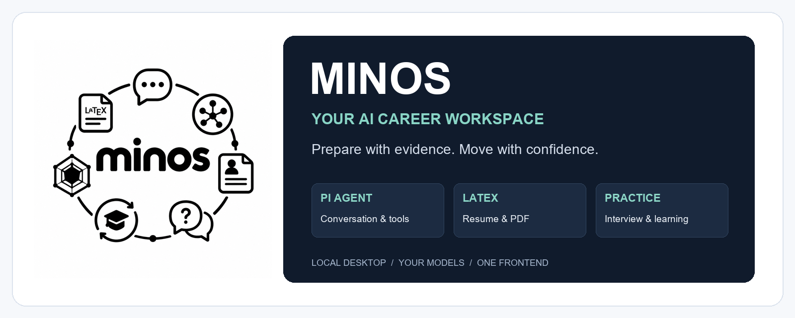
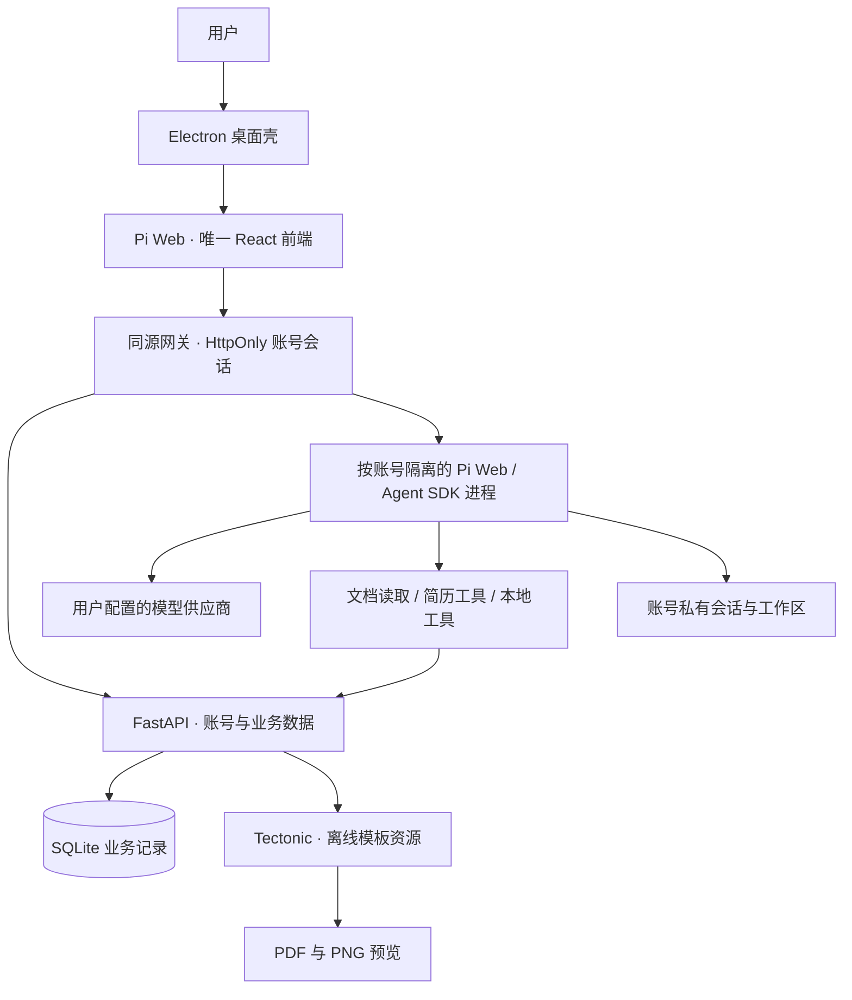

<p align="center">
  
</p>

<h1 align="center">MINOS · 你的 AI 求职搭档</h1>
<p align="center"><strong>从真实经历，到清晰表达；从一份简历，到下一次机会。</strong></p>
<p align="center">智能对话 · LaTeX 简历 · 模拟面试 · 知识学习 · 求职 Skills</p>
<p align="center">
  
  
  
  
  
</p>
<p align="center">
  <a href="https://github.com/Akun-python/minos/releases">下载安装</a> ·
  <a href="docs/USER_GUIDE.md">用户指南</a> ·
  <a href="#系统架构">系统架构</a> ·
  <a href="#开发与构建">开发构建</a> ·
  <a href="#路线图">路线图</a>
</p>

---

## 项目简介

**MINOS 是面向个人求职准备的本地桌面 AI 工作区。** 基于 Pi Web 与 Pi Agent SDK，将智能对话、结构化求职建议、可编译的 LaTeX 简历、模拟面试和学习记录整合为连续的准备流程，而不是多个彼此割裂的网页工具。

Windows 安装版由 Electron 管理前后端进程，随包提供 Node、Python、文档解析依赖和限定模板的离线 TeX 资源。用户使用自己的模型服务；账号、会话与工作区按本机账号组织。**只维护一套 Pi Web 前端，不再维护第二套 Vite 界面。**

> **项目状态：预发布。** 当前 Windows 10/11 x64 是主要交付目标，尚未完成另一台干净电脑上的全面验收。本地智能体能够以当前 Windows 用户权限访问文件和执行命令；账号隔离不等于操作系统沙箱。模型请求可能将用户提供的材料发送给所选供应商，不能将“本地运行”理解为“全部离线”。

## 导航

- [核心能力](#核心能力)
- [产品预览](#产品预览)
- [快速开始](#快速开始)
- [系统架构](#系统架构)
- [项目结构](#项目结构)
- [开发与构建](#开发与构建)
- [质量与验证](#质量与验证)
- [安全与数据边界](#安全与数据边界)
- [常见问题](#常见问题)
- [路线图](#路线图)
- [协作与问题反馈](#协作与问题反馈)
- [品牌与第三方许可](#品牌与第三方许可)

## 核心能力

| 模块 | 已实现能力 | 明确边界 |
| --- | --- | --- |
| **Pi 智能工作区** | 多会话、流式对话、模型配置、文件引用与工具调用；求职任务卡只填入草稿 | 真实生成需要用户配置可用模型；本地工具并非 OS 沙箱 |
| **LaTeX 简历** | 结构化内容保存、版本冲突检测、模板切换、重新编译、右侧预览和 PDF 下载 | 编译只更新派生 PDF；模板示例不自动导入个人经历 |
| **开源简历模板** | 共 7 款；其中 Awesome-CV、FortySecondsCV 提供完整上游资源与原例，保留类、字体、图标和图片 | McDowell、Hunner、latexcv 的预览为合成适配示例，有明确标注；中文加入字体回退，不承诺像素级一致 |
| **10 项内置 Skills** | 简历诊断、定制、排版、ATS、求职信、模拟面试、STAR、邮件草稿、薪酬及 Offer 对比 | 离线随包分发，账号启用时直接加载；不覆盖已有用户编辑，不保证 ATS 或录用结果 |
| **AI 面试** | 岗位、难度、时长配置；逐题作答与模型反馈；动态面试官、可选语音与本地摄像头预览 | 结束汇总仍含规则评分，不等于逐题模型评估；在线 ASR 在 Electron 中尚未保证，摄像头不参与视觉评分 |
| **知识与学习** | 知识分类、院校专业、章节、笔记、收藏、测验和学习复盘 | 以本机实际内容与真实学习记录为准，不生成虚假完成记录 |
| **账号与数据** | 本机账号、角色、求职画像、账号私有工作区；源码含业务额度与数据管理面板 | 业务记录清除不等于删除 Pi 会话、工作区文件或模型凭据 |
| **桌面交付** | Electron 窗口、服务管理、退出清理、安装资源与用户数据分离 | 当前安装包未商业签名；macOS/Linux 未作为已验证交付承诺 |

### 求职流程

```text
提供真实经历与目标岗位
          ↓
Pi 对话梳理证据与差距 → 用户确认 → 保存简历 → LaTeX 编译与预览
          ↓                                      ↓
知识学习与专项补强 ← 学习复盘 ← 模拟面试与逐题反馈
```

结构化建议用于帮助判断，不代表自动完成外部操作。投递进展由用户提供，不连接招聘网站自动投递；求职邮件仅生成草稿，外传材料或发送须经明确授权。

## 产品预览


| LaTeX 简历 | AI 面试 |
| --- | --- |
|  |  |

以上为隔离账号的真实界面截图，不含个人密钥或真实简历。截图记录早期预发布界面，可能与 main 的新 logo、顶部精简和新增模板不同；不是最新视觉验收凭证。完整步骤见 [用户指南](<docs/USER_GUIDE.md>)。

## 快速开始

### Windows 安装版

**[下载 Preview 10 安装包](https://github.com/Akun-python/minos/releases/download/v1.0.0-electron-preview.10/MINOS-Electron-Setup-1.0.0-x64.exe)** · [版本说明](https://github.com/Akun-python/minos/releases/tag/v1.0.0-electron-preview.10) · [SHA256 校验](https://github.com/Akun-python/minos/releases/download/v1.0.0-electron-preview.10/SHA256SUMS.txt)

1. 使用有仓库访问权限的 GitHub 账号下载（仓库目前为私有，无权限会显示 404）。Preview 10 安装包约 **415 MiB**。
2. 校验 SHA256，退出旧版后覆盖安装。不需要单独安装 Node、Python 或 TeX；此处离线 TeX 能力限定于随包模板，不是完整通用 TeX 发行版。
3. 首次启动创建自己的本机账号，无预置开发者账号或密钥。
4. 在右上角配置模型，确认本地智能体权限，再开始对话。未配置模型时可先浏览业务页面。

### 版本与交付状态

文档核对日期：**2026-10-28**。本页以 main 源码为准，安装体验以对应 Release 为准。

| 交付项 | Preview 10 安装包 | 当前 main 源码 |
| --- | --- | --- |
| 7 款模板、10 项内置 Skills | 已包含并做过定向验证 | 保留 |
| Pi Web 原生业务界面 | 已包含，不打包旧前端 | 旧前端目录已删除 |
| “系统 / 工具”顶栏入口隐藏 | 已包含 | 已实现 |
| “账号与数据”面板 | 已包含 | 已实现 |
| 指定品牌 logo、应用图标 | 已包含 | 已实现 |

Preview 10 基于源码提交 `a946e9a` 构建；后续 main 的文档修改不自动改变安装包。最新发布记录请以 [Releases](https://github.com/Akun-python/minos/releases) 为准。

安装包尚未商业签名，Windows 可能显示未知发布者。核验来源与散列，不要关闭系统安全防护。升级前建议备份数据。

校验示例（在安装包与校验文件所在目录执行，比较结果应与校验文件中的散列完全一致）：

```powershell
Get-FileHash .\MINOS-Electron-Setup-1.0.0-x64.exe -Algorithm SHA256
Get-Content .\SHA256SUMS.txt
```

### 最小使用示例

```text
我准备申请后端开发岗位。请先询问我的真实经历和目标 JD，
不要虚构学校、公司或指标。先展示简历优化建议，等我确认再保存。
```

需要 PDF 时可明确要求“只编译当前简历，不修改正文”。模板原例只用于参考，不能作为个人经历保存。

## 系统架构



### 架构原则

- **单一前端**：业务页面在 Pi Web 内原生渲染，不以旧 SPA 或 iframe 拼装第二套应用；独立头像展示资源不构成第二套前端工程。
- **复用 Pi 能力**：保留真实 Pi UI / API / SDK；对话、简历和面试尽量复用同一账号的模型配置。
- **同源与最小暴露**：浏览器持有随机 HttpOnly 账号 cookie；业务 JWT、刷新令牌与桥接凭据由服务端管理。
- **内容与派生产物分离**：简历保存、版本校验、模板切换与 PDF 编译职责分开；编译失败不冒充保存失败。
- **安装与用户数据分离**：安装包只携带运行资源；真实账号、工作区和配置留在个人数据目录。

详见 [Pi 集成与安全设计](<pi-web/MINOS-INTEGRATION.md>)、[本地 Harness](<backend/HARNESS.md>)、[便携运行设计](<backend/PORTABLE_RUNTIME.md>)。

## 项目结构

```text
minos/
├── pi-web/       # 唯一前端：Next.js / React / Pi UI、API、SDK 集成
├── backend/      # FastAPI、SQLite、业务服务、模板及预装 skills
├── desktop/      # Electron 主进程、预加载、运行时校验及 Windows 打包
├── scripts/      # 本机源码部署的启动与停止脚本
├── docs/         # 用户指南、设计文档和真实界面截图
├── assets/       # 指定品牌 logo、品牌横幅及 IP 素材
└── rocket_rig/   # 历史 IP 设计资源，不是第二套应用前端
```

关键入口：[前端](<pi-web>) · [业务后端](<backend>) · [桌面构建](<desktop>) · [品牌规范](<assets/brand/README.md>)。

## 开发与构建

### 环境要求

| 项目 | 当前基线 |
| --- | --- |
| 系统 | Windows 10/11 x64；桌面打包验证以 Windows 为主 |
| Node.js | 22.19+；当前构建使用 24.x |
| Python | 3.12 |
| 前端 | Next.js 16、React 19；Pi 依赖按仓库锁定版本安装 |
| 桌面 | Electron 41、electron-builder 26 |
| PDF | Tectonic 0.17.0；源码也可配置 XeLaTeX |

### 源码启动

```powershell
git clone https://github.com/Akun-python/minos.git
Set-Location minos
git switch main

# 与已安装的桌面应用分开，避免开发测试写入真实用户数据
$env:MINOS_DATA_DIR = Join-Path (Get-Location).Path '.runtime\dev-data'

python -m venv .venv
.\.venv\Scripts\python.exe -m pip install -r backend\requirements-local.txt
Set-Location pi-web
npm.cmd ci
npm.cmd run build
Set-Location ..
.\start-minos.cmd
```

源码启动脚本使用 `http://127.0.0.1:5173` 与后端 `http://127.0.0.1:8000`，端口占用时会退出；Electron 优先使用 5175/8005，并按可用情况分配端口。以实际打开地址为准。源码停止使用根目录的停止脚本，不要直接按端口终止未知进程。

上面的数据目录变量只对当前 PowerShell 及其子进程有效；若换终端启动，请重新设置。首次隔离运行会创建新的本机账号，不会迁入已有数据。源码依赖安装不自动准备离线 TeX 缓存；PDF 编译还需按 [离线运行说明](<desktop/LATEX_RUNTIME.md>) 准备资源，或配置含 xeCJK/Fandol 的 XeLaTeX。

**不要在同一构建目录运行 `next dev` 时执行 `next build`。** 应先退出正在运行的开发服务，再执行生产构建；二者不是可以同时运行的验证步骤。

需要模型或可选语音服务时，使用个人配置；不要在源码或文档写入真实凭据。详见 [Windows 部署指南](<DEPLOY-WINDOWS.md>) 和 [模型配置步骤](<docs/USER_GUIDE.md#模型与可选服务>)。

### 桌面打包

先按 [桌面构建说明](<desktop/README.md>)、[Electron 说明](<desktop/electron/README.md>) 准备经过验证的 Node、嵌入式 Python 和 TeX 资源，再运行：

```powershell
.\desktop\build.ps1
```

默认生成目录为 `dist/electron`。装配脚本会检查文档依赖、七款模板离线编译，以及十项内置 Skills 的完整性，不能用“构建成功”替代干净机器安装验收。生成产物通过 Releases 分发，不提交运行数据或依赖目录。

## 质量与验证

### 可复现的定向检查

下面只执行指定范围，不代表全量前端测试。后端测试在后端目录运行；前端需要先安装依赖。

```powershell
# 在仓库根目录执行
Push-Location backend
try { ..\.venv\Scripts\python.exe -m unittest discover -p '*test*.py' -q }
finally { Pop-Location }

Push-Location pi-web
try {
  node --test lib/minos-business.test.mjs components/MinosAccountPanel.test.mjs components/hidden-diagnostics-toolbar.test.mjs components/minos-brand.test.mjs
  node node_modules/typescript/bin/tsc --noEmit --incremental false
}
finally { Pop-Location }
```

安装包资源预检由装配脚本执行。首次准备运行时、下载依赖或调用远程模型需要网络；离线 PDF 编译通过不代表整个求职流程可离线完成。

### 已记录的验证结果

以下为截至本页核对日期的历史验证，不是自动更新的 CI 徽章，也不代表本次文档修改重新执行了全部测试：

| 验证项目 | 最近结果 / 范围 |
| --- | --- |
| 后端业务回归 | 运行 95 项，跳过 1 项，其余通过 |
| 单前端与账号面板 | 定向回归 10 项通过；TypeScript 与生产构建通过 |
| 品牌与面试资源隔离 | 指定 logo 原字节复制、品牌引用和面试头像独立性测试通过 |
| 模板运行资源 | 七款中文离线编译与 PDF 打开通过 |
| 完整版图标 | 两款上游原例实际编译；FontAwesome5 字体嵌入与原例图标检查通过 |
| Skills 首次加载 | 打包成品隔离账号直接加载十项，SDK 诊断为空，无再次安装 |
| 历史桌面验证 | 跨盘启动、账号登录、模型配置读回与保留等已做定向检查 |

**仍待验证：**另一台干净电脑全面验收、最新发布版真实远程模型回复、Electron 在线 ASR 稳定性。上游全量前端测试尚有未逐项处理的失败；不能宣称全量测试全绿或生产级全面验收完成。

## 安全与数据边界

- 默认数据目录为 `%LOCALAPPDATA%\MINOS`；备份前完全退出应用，再复制整个数据目录到受保护的位置。
- 服务仅应监听本机回环地址，不直接映射公网。Electron 启用渲染隔离，但它不限制智能体以当前用户权限执行工具。
- 向模型或可选在线服务提交简历、录音及其他材料前，应理解实际供应商与隐私条款。
- 内置技能为固定版本第三方参考流程，不能覆盖“不虚构事实”和“外传需授权”的要求；ATS、薪酬、法律或税务建议需结合实际核验。
- “清除业务数据”只作用于明确列出的数据库记录，不删除账号、Pi JSONL、工作区、磁盘附件、PDF 或模型密钥。
- 不要直接公开配置目录、日志或聊天导出；安全问题请通过仓库维护者的私有渠道报告，不附真实密钥或个人简历。

## 常见问题

| 问题 | 先检查什么 |
| --- | --- |
| 下载链接显示 404 | 当前 GitHub 账号是否有私有仓库权限；不要下载来源不明的镜像 |
| 能浏览但无法对话 | 是否确认工作区权限、保存并选中模型，以及供应商网络、认证和额度是否可用 |
| PDF 无法生成 | 区分保存成功与编译失败；安装版检查运行资源，源码版检查 TeX 与中文字体，不要为修缺依赖而改写经历 |
| 升级后还是旧 logo 或旧顶栏 | 对照上方版本表：main 已实现不等于已安装 Release 已包含；确认启动的不是旧构建目录 |
| 麦克风已授权但无识别 | Electron 在线 ASR 未保证可用；切换文字作答，播报成功不代表识别服务可用 |
| 想清除全部个人材料 | 业务清除面板不处理全部磁盘材料；先备份并退出应用，再按实际数据范围审慎处理，勿直接删库排障 |

更多排障与逐页说明见 [用户指南](<docs/USER_GUIDE.md#常见问题>)。

## 路线图

以下区分已实现方向与计划，不代表已承诺交付时间。

- [x] 统一 Pi Web 前端与 Electron 桌面入口
- [x] 模型配置复用、账号私有工作区与服务端桥接
- [x] 结构化简历、PDF 预览、七款模板与离线编译
- [x] 十项求职 Skills 随包提供、首次直接加载
- [x] 原生知识学习、模拟面试、复盘与画像
- [x] 统一指定品牌 logo，保留 AI 面试形象
- [x] 将单前端整合、账号面板与品牌变更打包发布为 Preview 10
- [ ] 干净 Windows 环境的完整安装、升级、备份与恢复验收
- [ ] 持续补齐上游前端回归、端到端测试和发布检查
- [ ] 提升语音能力的兼容性与失败恢复体验
- [ ] 更新最新品牌与模板界面的真实截图

## 协作与问题反馈

仓库当前为私有项目，协作需相应权限。提交问题时建议包含：**安装版本 / commit、系统版本、复现步骤、预期与实际行为、脱敏日志**。不要提交真实密钥、完整个人简历或用户数据目录。

开发变更应遵循：

1. 优先在现有 Pi Web 原生组件内补功能，不恢复第二套前端。
2. 改动涉及账号、文件访问、模型凭据或本地工具时，说明权限与数据边界。
3. 为核心行为补测试；构建、定向回归与端到端验收分别报告，不互相冒充。
4. 引入第三方模板、技能或字体时，保留来源、固定版本、许可与完整资源。
5. 文档中区分 main 已实现、发布包已包含和计划功能；不填未经运行的性能或成功率指标。

## 品牌与第三方许可

**项目品牌统一使用用户指定的 [MINOS 原始 logo](<assets/logo.png>)。** [README 横幅](<assets/brand/minos-project-banner.png>) 由原图排版生成，不重画标志；[应用图标生成脚本](<desktop/generate_brand_icons.py>) 生成 Windows ICO、浏览器与 PWA 尺寸。AI 面试头像使用独立资源，不随品牌替换。详见 [品牌说明](<assets/brand/README.md>)。

Pi Web 上游为 [agegr/pi-web](https://github.com/agegr/pi-web)，集成版本 `0.12.2`，基准提交 `e533d9b3975f8a74b378d5007c92fdf4d15d3fba`。保留其真实 UI / API / SDK 实现及 [MIT 许可](<pi-web/LICENSE>)。

模板、字体、技能和运行时分别遵循各自许可，不能用单一许可证标签覆盖所有资源。本仓库目前未提供覆盖自有代码的统一顶层开源许可证；**能访问仓库不等于获得任意再分发或商用授权。** 分发前核对各组件许可及品牌使用权限。

- [模板来源与许可](<backend/app/resume_templates/README.md>)
- [Skills 来源、版本与哈希](<backend/app/bundled_skills/manifest.json>) · [第三方技能说明](<backend/app/bundled_skills/NOTICE>)
- [离线 TeX 运行资源](<desktop/LATEX_RUNTIME.md>)
- [用户操作指南](<docs/USER_GUIDE.md>) · [Windows 部署](<DEPLOY-WINDOWS.md>) · [简历工作台](<backend/RESUME_WORKBENCH.md>)

---

<p align="center"><strong>MINOS · 让每一步准备，都有事实与方向。</strong></p>
