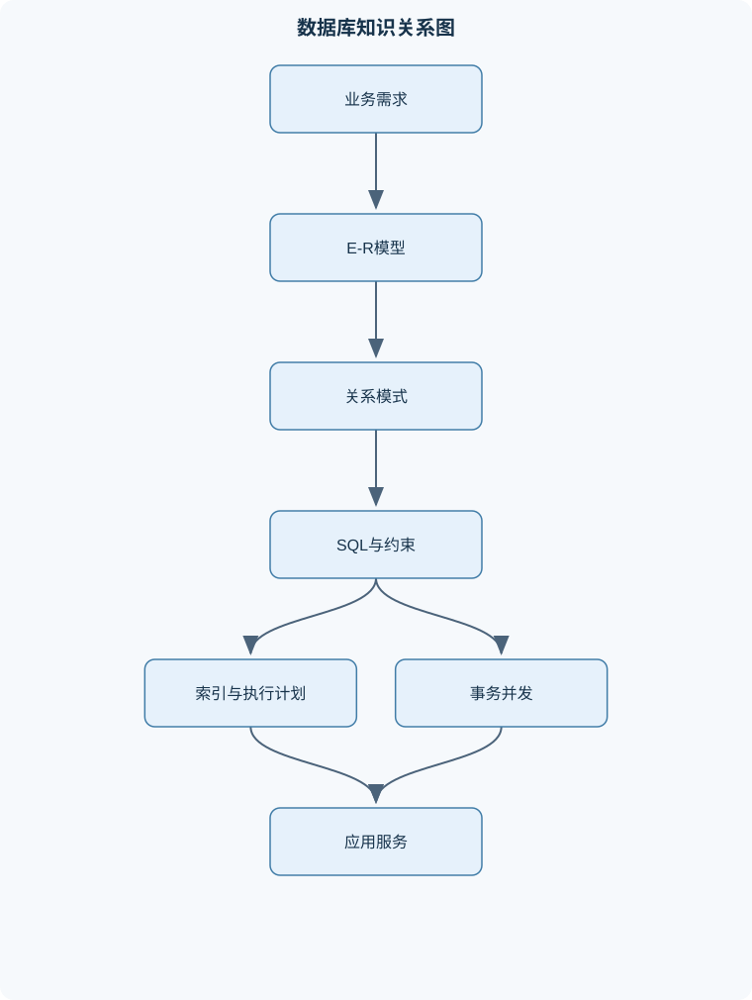
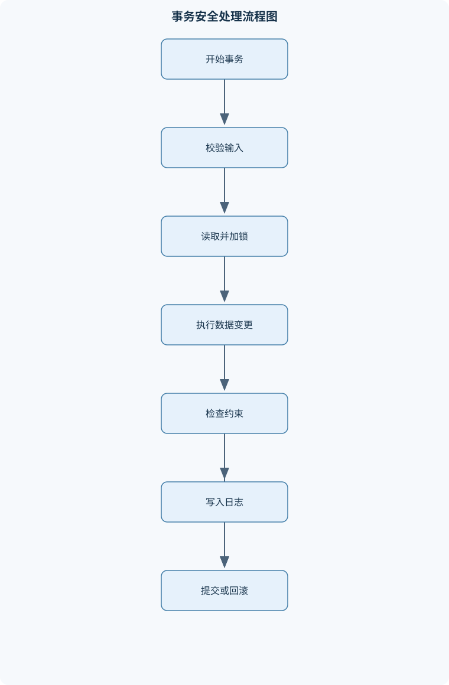

# Database and Software Techonolgy

## 一、课程整体知识框架

### 课程边界与先修知识

本课程覆盖关系数据库与软件开发中的数据持久化核心知识：数据库系统组成、关系模型、SQL数据定义与查询、完整性约束、E-R建模、关系模式转换、函数依赖与规范化、索引与查询性能、事务并发控制、故障恢复、数据库应用开发与测试。先修知识包括离散数学中的集合与关系、基本数据结构、程序设计基础、命令行与软件工程基本概念。课程以关系型数据库为主，兼顾不同数据库产品在SQL方言、事务隔离、索引类型和管理工具上的差异；不覆盖分布式数据库内部实现、数据仓库建模、机器学习数据库和具体厂商认证内容。





### 1. 课程对象、范围与核心问题

本课程研究关系数据库以及软件开发中的数据持久化问题。所谓数据持久化，是指程序结束、进程重启或系统发生故障后，业务数据仍能按照既定规则被可靠保存、查询和恢复。课程以关系型数据库为主线，围绕“如何组织数据、如何表达查询、如何保证正确、如何提高效率、如何在软件中安全使用”五个问题展开。

课程的先修基础包括集合与关系、基本数据结构、程序设计、命令行操作以及软件工程基本概念。集合与关系有助于理解关系、元组、连接和函数依赖；数据结构有助于理解树形索引、哈希索引和执行计划；程序设计基础用于编写数据访问层、事务处理代码和测试程序；软件工程知识用于理解数据库迁移、版本管理、分层架构和持续交付。

课程覆盖数据库系统组成、关系模型、SQL 数据定义与查询、完整性约束、E-R 建模、关系模式转换、函数依赖与规范化、索引、查询处理、事务并发控制、故障恢复、数据库应用开发和测试。课程不展开分布式数据库内部实现、数据仓库建模、机器学习数据库以及具体厂商认证体系。不同数据库产品在 SQL 方言、事务隔离实现、索引类型、管理工具和默认配置上可能存在差异，教材中的通用原理应与具体产品文档区分。

### 2. 数据库系统与文件系统

文件系统通常以文件和目录为基本组织单位，应用程序直接负责数据格式、查找方式、并发访问和恢复逻辑。当多个程序共享同一批文件时，容易出现数据重复、格式不一致、并发覆盖、权限分散和故障后难以恢复等问题。例如，学生姓名既保存在选课文件中，又保存在缴费文件中，修改其中一处而遗漏另一处，就会产生不一致。

数据库系统由数据库、数据库管理系统、应用程序、用户和管理工具共同构成。数据库是被持久化保存的数据及其描述；数据库管理系统负责数据定义、查询处理、事务管理、并发控制、恢复和权限控制；客户端工具只是访问接口，不能等同于数据库内核。应用程序通过数据访问层向数据库发出 SQL 或调用接口，业务层负责业务规则，数据库负责存储、约束和事务等职责。

数据库通常采用三级模式结构。外模式面向特定用户或应用，表示用户需要看到的数据子集；概念模式描述整个数据库的逻辑结构，包括表、关系和约束；内模式描述数据在存储设备上的组织方式，包括页、索引和物理布局。外模式与概念模式之间的映射支持逻辑数据独立性，使表结构调整尽量不影响用户视图；概念模式与内模式之间的映射支持物理数据独立性，使索引、存储页或访问路径变化尽量不影响应用逻辑。数据独立性不是“修改任何结构都完全无需改程序”，而是在映射和接口保持兼容时降低影响范围。

### 3. 关系模型的基本对象

关系模式记为 $R(A_1,A_2,\ldots,A_n)$，其中 $R$ 是关系名，$A_i$ 是属性名。关系实例是满足模式约束的有限元组集合，元组记为 $t$，属性 $A$ 上的取值记为 $t[A]$。在理想关系模型中，关系是集合，因此元组不重复，属性值具有原子性；但实际 SQL 查询结果常保留重复行，除非显式使用 `DISTINCT`，所以不能把 SQL 结果的多重集合语义和纯关系代数完全混同。

候选键是能够唯一标识元组的最小超键。主键从候选键中选定一个，可以由单个属性组成，也可以由多个属性组成。外键引用被参照关系的候选键或唯一约束，用于表达跨表关联。主键通常要求非空和唯一，外键则允许为空，是否允许空值取决于业务上的参与约束。

关系代数提供查询语义的形式基础。选择运算记为 $\sigma_{\text{条件}}(R)$，保留满足条件的元组；投影运算记为 $\pi_{\text{属性列表}}(R)$，保留指定属性并按关系语义去除重复；连接记为 $R\bowtie_{\text{条件}}S$。等值连接使用相等条件，自然连接按同名属性匹配并通常去除重复连接列。交、并、差等集合运算要求参与运算的关系具有相容的属性结构。SQL 的 `WHERE`、`JOIN`、`SELECT`、`UNION` 等语句可以分别从这些关系运算中理解，但 SQL 还具有重复行和 `NULL` 三值逻辑等扩展语义。

### 4. SQL 数据定义、数据操作与查询语义

数据定义语言使用 `CREATE TABLE` 等语句建立表、列、数据类型和约束。数据类型选择应同时考虑取值范围、精度、比较规则、存储空间和跨系统兼容性。金额不应使用可能产生二进制舍入误差的近似浮点类型表示；日期时间应明确时区、精度和业务含义；过度使用字符串会削弱数据库的校验能力和索引效果。

表约束可以在列级或表级声明。`NOT NULL` 限制列不能取空值；`CHECK` 表达取值范围或同一行内的逻辑条件；`UNIQUE` 保证非空值之间不重复，但不同数据库对多个 `NULL` 的处理细节可能不同；`PRIMARY KEY` 表示主键；`FOREIGN KEY` 表示参照关系。约束应尽量由数据库强制执行，而不能只依赖应用代码，因为多个应用、批处理脚本或并发请求都可能绕过单一应用层。

`INSERT` 增加元组，`UPDATE` 修改已有元组，`DELETE` 删除元组。更新和删除必须特别检查 `WHERE` 条件，缺少条件可能影响整张表。`NULL` 表示未知、不适用或缺失，不能简单等同于空字符串或数值 $0$。在 SQL 三值逻辑中，比较结果可能是 `TRUE`、`FALSE` 或 `UNKNOWN`；例如 `NULL = NULL` 不是 `TRUE`，而是 `UNKNOWN`，因此应使用 `IS NULL` 或 `IS NOT NULL`。

查询通常包含投影、选择、连接、分组、排序和限制结果数量等操作。`WHERE` 在分组前筛选行，`HAVING` 在分组后筛选组；将聚合条件写入 `WHERE` 是语义错误。`ORDER BY` 规定输出顺序，未指定排序时不能假设数据库按插入顺序返回。`LIMIT` 常用于截取结果，但分页时若没有稳定的排序键，数据变化可能造成重复或遗漏。

视图是保存的查询定义，向用户隐藏底层表结构或限制可见列。简单单表视图可能支持更新；包含聚合、分组、去重、复杂连接或计算列的视图通常不能直接更新，或需要额外的更新规则。`UNION` 通常去除重复行，`UNION ALL` 保留重复行；`EXCEPT` 表示集合差，但具体支持情况和排序规则可能存在方言差异。

### 5. 查询与关系运算的深入结构

内连接只保留两侧满足连接条件的组合；左外连接保留左表全部元组，即使右表没有匹配项，也会以 `NULL` 补齐右侧列。若在 `LEFT JOIN` 后把右表筛选条件写入 `WHERE`，右侧为空的行会被过滤，结果可能退化为内连接。因此，条件究竟写在 `ON` 还是 `WHERE`，必须结合保留行的需求判断。

交叉连接产生两表元组的笛卡尔积，若两表分别有 $m$ 和 $n$ 行，理论上最多产生 $mn$ 个组合，通常只有在明确需要所有组合时使用。自连接是同一张表以不同别名参与连接，适合表示员工与主管、同一订单中的商品比较等关系。

分组与聚合把多行压缩为每组一行。`COUNT(*)` 统计行数，`COUNT(column)` 通常忽略该列为 `NULL` 的行，`SUM`、`AVG` 等聚合也会受到空值影响。若需要统计“没有匹配记录”的主体，通常应使用左外连接并配合 `COUNT(右表主键)`，而不是 `COUNT(*)`。窗口函数与分组不同：窗口函数在保留明细行的同时计算排名、累计值或分组统计。窗口由 `PARTITION BY` 划分，`ORDER BY` 确定计算顺序，窗口帧进一步规定参与计算的行范围。

子查询可以返回单值、单列、多行或表结构。相关子查询依赖外层当前行，语义直观但可能产生较高执行代价；优化器可能将其改写为连接或半连接，但不能假设所有数据库都会采用相同计划。重复行处理必须有业务依据，不能用 `DISTINCT` 掩盖错误连接。若一个客户有多条租赁记录，连接后出现多行是关系结构的真实结果，是否去重取决于查询目标。

### 6. E-R 建模与关系模式转换

E-R 模型从业务对象和业务联系出发设计数据库。实体集表示具有独立业务意义的对象集合，属性描述实体特征。属性可以按是否可再分、是否允许多值、是否派生以及是否构成标识进行分类。姓名通常是复合属性的候选表现，联系电话可能是多值属性，年龄可以由出生日期派生，但是否落库要考虑查询和一致性需求。

联系的基数描述实体之间的数量关系。一对一联系表示一方至多对应另一方一个实体；一对多联系表示一方可以对应多个实体，而另一方至多对应一个实体；多对多联系需要通过中间关系表转换。参与约束说明实体是否必须参加联系：全参与表示每个实体都必须参与，部分参与表示可以没有关联。基数和参与约束应转化为 `NOT NULL`、`UNIQUE`、外键或额外检查逻辑，而不能停留在图形标记上。

一对多联系通常将“一”方的主键放入“多”方作为外键；若多方必须关联一方，则外键设为非空。一对一联系可选择一方保存另一方外键，并对外键增加唯一约束。多对多联系转换为独立关系模式，至少包含两侧主键作为外键，联合主键可以防止同一关联重复。联系本身的属性，例如选课成绩、下单数量，应放在中间关系中，而不是任意放入实体表。

弱实体不能仅凭自身属性唯一标识，必须依赖拥有实体和标识联系。转换后通常把拥有实体主键纳入弱实体主键。超类与子类表示继承关系，转换时可采用一张总表加类型列、总表与各子类表、或每个具体子类独立成表等策略；选择取决于空值数量、查询模式、约束表达能力和一致性要求。

### 7. 函数依赖与规范化

函数依赖记为 $X\to Y$，其中 $X$、$Y$ 是属性集合。其含义是：任意两个元组若在 $X$ 上取值相同，则必须在 $Y$ 上取值相同。若 $Y\subseteq X$，称为平凡函数依赖；否则为非平凡函数依赖。函数依赖表达的是业务语义，不是仅凭当前样本数据观察到的偶然规律。

属性集闭包记为 $X^+$，表示由函数依赖集合 $F$ 从 $X$ 可推出的全部属性。计算时先令 $X^+=X$；若存在依赖 $Y\to Z$ 且 $Y\subseteq X^+$，则将 $Z$ 加入闭包；重复直到没有新增属性。若 $X^+$ 包含关系 $R$ 的全部属性，$X$ 是超键；再删除其中任意属性，若闭包都不再覆盖 $R$，则 $X$ 是候选键。该方法适用于函数依赖已知且属性数量可管理的模式，候选键穷举的最坏复杂度随属性数量指数增长。

规范化的因果链条是：第一范式要求属性值原子化，消除重复组；第二范式在第一范式基础上消除候选键真子集对非主属性的部分依赖；第三范式进一步消除非主属性对候选键的传递依赖；BCNF 要求每个非平凡函数依赖的决定因素都是超键。规范化可减少插入、删除和更新异常，但可能增加连接次数，因此实际设计需要在一致性、查询复杂度和性能之间权衡。

分解还必须考察无损连接和依赖保持。将 $R$ 分解为 $R_1$ 和 $R_2$ 时，若交集属性 $R_1\cap R_2$ 能函数决定 $R_1$ 或能函数决定 $R_2$，则对满足给定函数依赖的关系实例通常是无损的，自然连接不会产生伪元组。依赖保持表示可以在分解后的各关系上分别检查原有依赖，而不必每次都连接多个关系。BCNF 分解可能牺牲依赖保持，第三范式分解通常更重视同时保持依赖和无损连接。

### 8. 完整性、安全与数据库应用架构

完整性分为实体完整性、参照完整性和业务完整性。实体完整性要求主键唯一且不可为空；参照完整性要求外键值对应被参照键，或按规则允许为空；业务完整性由范围、状态转换、数量关系和时间规则等组成。删除或更新被参照行时，可采用 `CASCADE`、`RESTRICT`、`NO ACTION` 或 `SET NULL`，具体行为取决于产品和约束定义。级联并非越多越好，错误设计可能导致大范围意外删除。

约束可以即时检查，也可以延迟到事务提交时检查。延迟约束适用于事务内部暂时违反约束、但提交时必须恢复一致性的场景；不是所有数据库或所有约束类型都支持相同的延迟机制。权限模型应区分用户、角色和对象权限，遵循最小权限原则：应用只获得完成任务所需的最少表、列和操作权限。

参数化查询将数据作为参数传递，而不是把用户输入拼接到 SQL 语句结构中，可防止大多数结构型 SQL 注入。但它不能替代授权、输入格式校验、业务规则检查和敏感错误信息控制。数据库应用通常划分为数据访问层、业务层和接口层。数据访问层管理查询与映射，业务层定义事务边界和业务流程，接口层负责请求解析与响应。连接池复用数据库连接，但必须正确处理连接归还、事务清理、异常回滚和超时。

### 9. 索引与查询处理

索引是附加的数据结构，用于减少查找所需的页面访问。无索引时常需全表扫描；B 树索引在理想平衡条件下定位成本约为 $O(\log_B N)$，其中 $N$ 是索引项数，$B$ 是每个节点平均分支数。范围查询还需加上输出 $m$ 条记录的代价，总体约为 $O(\log_B N+m)$。哈希索引适合等值查找，但通常不适合范围查询和排序。

复合索引的列顺序影响可用范围。对索引 $(A,B,C)$，若查询固定 $A$，通常可继续利用 $B$；若跳过前导列，后续列的定位能力可能显著下降，这就是最左匹配约束。覆盖索引包含查询所需的列，使数据库可能只访问索引而不回表，但覆盖索引增加存储和写入维护成本。表达式索引适用于经常按计算结果查询的场景；部分索引只覆盖满足条件的行，可减少规模，但要求查询谓词与索引条件具有可识别的对应关系。

选择性可理解为满足谓词的记录比例，比例越低通常越适合索引；若查询返回大部分记录，全表扫描可能更便宜。成本可抽象为：

$$
C_{\text{total}}=C_{\text{scan}}+C_{\text{cpu}}+C_{\text{io}}+C_{\text{lock}}
$$

其中各项分别表示扫描、计算、输入输出和锁等待成本。实际优化器还会考虑缓存、并行度、统计信息和估计误差。执行计划显示数据库选择了何种扫描、连接和排序方式，必须结合实际数据规模和参数分布分析，不能只凭索引存在与否判断性能。

### 10. 事务、并发控制与故障恢复

事务 $T$ 是一组具有整体语义的读写操作，ACID 分别表示原子性、一致性、隔离性和持久性。事务通常经历活动、部分提交、提交、失败和中止等状态。提交表示结果被确认，回滚撤销未提交影响；应用开启自动提交时，一条 SQL 可能就是一个独立事务，多个语句若未显式划定边界，就不具备整体原子性。

并发调度是多个事务操作的交错序列。不同事务对同一数据项的操作中至少一个为写操作时，通常构成冲突。建立优先图：节点表示事务，若 $T_i$ 的冲突操作先于 $T_j$，则加入边 $T_i\to T_j$。优先图无环时，调度冲突可串行化；有环时不能通过交换非冲突操作化为串行调度。

常见并发异常包括脏读、不可重复读、幻读和丢失更新。读已提交通常避免读取未提交数据，但同一事务两次读取可能看到不同已提交版本；可重复读加强同一行的稳定性，但具体是否完全防止幻读依赖实现；串行化要求结果等价于某个串行顺序，但事务仍可能因死锁或序列化冲突失败。两阶段锁要求先获取锁、后释放锁；严格两阶段锁通常让排他锁保持到提交或回滚，可避免脏写并有助于可恢复性，但仍可能死锁。

故障包括事务故障、系统故障和介质故障。日志记录更新的事务标识、数据位置、旧值或新值及提交状态。先写日志原则要求相关日志先于脏页写入稳定存储。恢复通常从检查点开始分析活跃事务，对需要恢复的已提交更新执行 `REDO`，对未提交事务反向执行 `UNDO`，并视恢复协议写入补偿日志。备份只能在可恢复、可验证和可定期演练时真正提供可靠性。应用层还应考虑幂等请求、重复提交、网络超时和安全重试，因为“客户端未收到响应”不等于数据库事务没有提交。

### 11. 性能、测试与工程边界

数据库性能不仅由单条 SQL 决定，还受到数据分布、并发量、缓存命中率、锁等待、连接池大小、磁盘能力和事务持续时间影响。性能分析应记录实际执行计划、行数估计误差、扫描页数、排序或临时空间、锁等待和资源使用。容量评估需要估算数据增长、索引增长、备份空间、峰值并发和恢复时间目标，而不能只依据当前表大小。

数据库迁移应以版本号管理，每次迁移具有明确的前置版本、变更内容、回滚或补偿方案。生产迁移必须评估锁影响、数据兼容性和旧版本应用是否仍能工作。对象关系映射可以减少重复的数据访问代码，但复杂连接、批量写入、锁定查询和事务边界仍需审查实际 SQL，不能把生成的 SQL 自动视为最优。

测试应覆盖约束测试、查询结果测试、事务测试、并发测试、故障恢复测试和性能测试。查询测试不仅验证返回值，还要验证重复行、空值、边界日期和无匹配记录。事务测试要检查异常时是否回滚、重试是否幂等、死锁或序列化失败是否被正确处理。恢复测试应验证备份可读取、日志可应用、数据校验通过以及服务恢复时间符合要求。

## 二、章节和模块划分

### 核心知识覆盖清单

本清单用于检查正文是否覆盖本课程的主要知识模块：

- **数据库系统与关系模型**：数据库与文件系统的差异、数据库管理系统的组成、三级模式与数据独立性、关系、元组与属性、候选键、主键与外键、关系代数基本运算、实体完整性与参照完整性、数据库用户与应用架构。
- **SQL数据定义与数据操作**：CREATE与数据类型选择、表约束的声明方式、INSERT、UPDATE与DELETE、NULL与三值逻辑、SELECT投影和选择、ORDER BY与LIMIT、视图的定义与更新边界、不同SQL方言的兼容性。
- **SQL查询与关系运算**：内连接与外连接、交叉连接与自连接、集合运算UNION与EXCEPT、分组与聚合函数、HAVING与WHERE的区别、子查询与相关子查询、窗口函数与窗口帧、查询结果的重复行处理。
- **E-R模型与数据库设计**：实体集与属性分类、联系的基数与参与约束、一对一和一对多联系、多对多联系的转换、弱实体与标识联系、超类、子类与继承、E-R图到关系模式的映射、业务规则到约束的落地。
- **函数依赖与关系规范化**：函数依赖的形式化定义、平凡与非平凡函数依赖、属性集闭包计算、候选键求解、部分依赖与传递依赖、第一至第三范式、Boyce-Codd范式、无损连接与依赖保持。
- **完整性约束与数据库安全**：NOT NULL与CHECK约束、UNIQUE与主键约束、外键参照动作、CASCADE、RESTRICT与SET NULL、延迟约束与即时约束、角色、用户与权限、最小权限原则、参数化查询与注入防护。
- **索引与查询处理**：全表扫描与索引扫描、B树索引的有序查找、哈希索引的等值查找、复合索引与最左匹配、覆盖索引与索引仅扫描、表达式索引与部分索引、选择性与基数估计、执行计划与性能权衡。
- **事务与并发控制**：事务的原子性与持久性、事务状态转换、提交与回滚、并发调度与可串行化、脏读、不可重复读与幻读、读已提交与可重复读、串行化隔离级别、两阶段锁与死锁。
- **故障恢复与可靠性**：系统故障与介质故障、日志记录与先写日志、检查点机制、UNDO与REDO恢复、提交记录与恢复判断、备份与恢复策略、幂等重试与重复提交、恢复测试与数据校验。
- **数据库应用软件工程**：数据访问层与业务层分离、连接池与连接生命周期、事务边界设计、对象关系映射的适用边界、数据库迁移与版本管理、输入校验与错误处理、查询与事务单元测试、性能监控和容量评估。


### 1. 数据库系统与关系模型

本章先建立数据库、数据库管理系统、客户端和应用程序之间的边界，再说明三级模式、数据独立性、关系、元组、属性、候选键、主键和外键。随后用选择、投影、连接等关系代数解释查询的逻辑基础，并以实体完整性和参照完整性说明关系模型如何限制非法数据。数据库用户可分为普通业务用户、应用账户、开发人员、管理员和运维人员，不同角色对应不同权限和责任。

### 2. SQL 数据定义与数据操作

本章从 `CREATE TABLE` 开始，讨论常见数据类型、默认值、命名、主键、唯一约束、检查约束和外键。随后处理 `INSERT`、`UPDATE`、`DELETE` 与事务边界，重点分析 `NULL`、三值逻辑和默认值的差异。查询部分从 `SELECT`、投影、选择、排序和限制开始，再进入视图、集合运算和 SQL 方言差异。方言差异可能体现在分页语法、自动增长列、日期函数、布尔类型、字符串连接、标识符引用和冲突处理语法上，移植时必须以目标产品的解析规则和事务行为为准。

### 3. SQL 查询与关系运算

本章重点解释内连接、左外连接、交叉连接、自连接、`UNION`、`EXCEPT`、分组、聚合、`WHERE`、`HAVING`、子查询、相关子查询和窗口函数。教学分析应始终区分“筛选行”和“筛选组”，区分“压缩结果行的分组”与“保留明细行的窗口计算”，并说明 `COUNT(*)` 与 `COUNT(column)` 在空值和外连接下的不同。还要讨论重复行来源、`DISTINCT` 的真实用途以及外连接条件位置对结果的影响。

### 4. E-R 模型与数据库设计

本章从实体集、属性和联系开始，分析一对一、一对多、多对多、基数和参与约束。多对多联系必须转换为中间关系；联系属性应放在联系对应的关系中。弱实体、标识联系、超类、子类和继承映射用于处理依赖标识和分类业务。完成 E-R 模型后，应将每个实体、联系、主键、外键、可选参与和业务规则映射到关系模式，并检查哪些规则可以用数据库约束直接表达，哪些规则需要触发器、事务逻辑或专门校验。

### 5. 函数依赖与关系规范化

本章以 $R(A_1,A_2,\ldots,A_n)$ 和函数依赖集合 $F$ 为对象，训练闭包计算、候选键求解和依赖推理。规范化分析要从重复组、部分依赖、传递依赖逐步推进到第三范式和 BCNF，不能仅凭表中列数判断范式。分解后还要验证无损连接和依赖保持。若交集属性能够函数决定分解后的某一方，则二元分解通常满足无损连接判据；但无损不等于依赖保持，依赖保持也不等于查询性能最佳。

### 6. 完整性约束与数据库安全

本章将业务规则分为非空、唯一、范围、参照和跨行规则，分别讨论 `NOT NULL`、`CHECK`、`UNIQUE`、主键和外键。参照动作包括级联、限制和置空，选择时要考虑生命周期和误删除风险。比较即时约束与延迟约束的适用条件，说明数据库约束与应用校验的职责边界。安全部分覆盖角色、用户、权限、最小权限、参数化查询、输入校验和错误处理，强调参数化查询防止语句结构注入，但不负责授权和业务合法性判断。

### 7. 索引与查询处理

本章从全表扫描与索引扫描的访问路径比较开始，介绍 B 树的有序查找、哈希索引的等值查找、复合索引的最左匹配、覆盖索引、表达式索引和部分索引。B 树定位约为 $O(\log_B N)$，范围查询还要加上输出记录数；索引收益与选择性、数据分布和缓存状态相关。通过执行计划分析连接顺序、访问路径、估计行数、排序和回表成本，解释为什么索引数量增加会提高读性能，却同时增加写入维护和存储成本。

### 8. 事务与并发控制

本章先说明事务状态、提交、回滚和 ACID，再用交错调度构造脏读、不可重复读、幻读和丢失更新。优先图判定冲突可串行化：节点为事务，冲突顺序形成有向边，无环则可拓扑排序出等价串行顺序。随后比较读已提交、可重复读和串行化的可见结果边界。两阶段锁分为增长阶段和收缩阶段，严格两阶段锁提高可恢复性但不能消除死锁，因此应用仍需处理锁等待、死锁检测、回滚和安全重试。

### 9. 故障恢复与可靠性

本章区分事务故障、系统故障和介质故障，说明日志、检查点、先写日志、提交记录、`REDO` 和 `UNDO` 的关系。恢复过程先分析故障前状态，再依据提交状态重做或撤销；已提交事务不能因数据页未写入而丢失，未提交事务不能在恢复后留下可见影响。备份策略应同时考虑全量备份、增量变化、保留周期、恢复点目标和恢复时间目标。幂等请求、重复提交、网络超时和恢复测试属于应用可靠性的一部分，不能只依赖数据库内部恢复机制。

### 10. 数据库应用软件工程

本章把数据库放入完整软件生命周期中，讨论数据访问层与业务层分离、连接池、连接生命周期和事务边界。一个转账业务应将账户校验、余额变更、流水写入和提交置于清晰的事务范围内，并处理异常回滚、死锁重试和请求幂等。对象关系映射适合常规增删改查，但复杂报表、批量操作、锁定查询和高性能路径需要直接审查 SQL 与执行计划。

数据库迁移采用有序版本管理，必须处理旧应用兼容、新字段默认值、数据回填、索引创建和失败回滚。输入校验分为格式校验、范围校验、权限校验和业务状态校验；错误处理既要保证事务回滚，也要避免向外暴露敏感内部信息。测试模块覆盖查询单元测试、事务单元测试、约束测试、并发复现实验、恢复测试和性能测试。性能监控关注查询延迟、吞吐量、错误率、连接池使用、锁等待、缓存命中和存储增长；容量评估则要结合业务增长与恢复要求，而不能只看当前数据量。

## 三、核心概念的详细解释

### 3.1 数据库系统、关系模型与数据独立性

数据库系统由数据库、数据库管理系统、应用程序、用户以及管理工具共同组成。数据库是持久化保存的数据及其结构描述；数据库管理系统负责数据定义、查询处理、完整性约束、事务管理、并发控制、故障恢复和权限控制；应用程序通过数据访问层发送 SQL 或调用接口，业务层负责业务流程，数据库负责数据存储与一致性。数据库客户端只是访问接口，不能等同于数据库内核。

文件系统通常让应用程序直接管理文件格式、查找方式、并发访问和故障恢复。数据库系统则把这些通用能力集中到管理系统中。例如，若订单信息、库存信息分别由不同程序写入普通文件，两个程序可能同时修改同一商品数量，或者一个程序更新成功而另一个程序更新失败。数据库可以利用约束和事务把这些操作组织成一个具有原子性的整体。

三级模式包括外模式、概念模式和内模式。外模式面向特定用户或应用，可能只暴露订单的摘要字段；概念模式描述全部表、属性、联系和约束；内模式描述页、索引、记录布局等物理组织。外模式与概念模式之间的映射支持逻辑数据独立性，概念模式与内模式之间的映射支持物理数据独立性。数据独立性不是任何修改都无需改程序，而是在接口和语义保持兼容时，把结构变更的影响限制在较小范围内。

关系模式记为 $R(A_1,A_2,\ldots,A_n)$。其中 $R$ 是关系名，$A_i$ 是属性名；关系实例是满足模式约束的有限元组集合，元组记为 $t$，属性 $A$ 上的值记为 $t[A]$。关系模型把属性视为具有明确域的原子值，但 SQL 查询结果通常是多重集合，可能包含重复行。因此，关系代数中的投影默认按集合语义去除重复，而 SQL 中的 `SELECT` 默认保留重复，只有 `DISTINCT` 才显式去重。

候选键是能够唯一标识元组的最小超键。主键是从候选键中选定的一个键，可以是单属性键，也可以是复合键。外键引用另一个关系的候选键或唯一约束，用于表达参照关系。主键通常同时具有非空和唯一要求；外键是否允许 `NULL`，取决于该联系是否允许实体不参与。例如，订单必须属于某个客户时，订单表中的客户编号应为 `NOT NULL`；若某个员工可以暂时没有部门，则部门外键可以允许空值。

### 3.2 关系代数与 SQL 查询语义

选择运算记为 $\sigma_{\text{条件}}(R)$，它保留满足条件的元组；投影运算记为 $\pi_{\text{属性列表}}(R)$，它保留指定属性。连接运算记为 $R\bowtie_{\text{条件}}S$，先按照连接条件匹配两个关系中的元组，再形成组合结果。

内连接只保留两侧能够匹配的记录。左外连接保留左表的全部记录，右表无匹配时补入 `NULL`；右外连接对称地保留右表；全外连接保留两侧全部记录。若把右表过滤条件写在 `WHERE` 中，例如：

```sql
SELECT c.customer_id, r.rental_id
FROM customer AS c
LEFT JOIN rental AS r
  ON r.customer_id = c.customer_id
WHERE r.rental_date >= DATE '2025-01-01';
```

没有租赁记录的客户因 `r.rental_date` 为 `NULL` 而无法满足 `WHERE` 条件，结果事实上接近内连接。若要保留这些客户，应将条件放入 `ON`：

```sql
SELECT c.customer_id, r.rental_id
FROM customer AS c
LEFT JOIN rental AS r
  ON r.customer_id = c.customer_id
 AND r.rental_date >= DATE '2025-01-01';
```

`WHERE` 在分组前过滤元组，`HAVING` 在分组后过滤分组。例如，查询选课至少两门的学生，应先按学生分组，再用 `HAVING COUNT(*) >= 2` 筛选；不能用 `WHERE COUNT(*) >= 2`，因为聚合结果在逻辑上尚未生成。

窗口函数与分组聚合不同。`GROUP BY` 通常把多行压缩为每组一行，而窗口函数在保留原行的同时计算分组统计值。例如：

```sql
SELECT student_id,
       course_id,
       score,
       AVG(score) OVER (PARTITION BY student_id) AS student_avg
FROM enrollment;
```

结果仍保留每门课程的成绩，同时增加该学生的平均成绩。窗口的 `ORDER BY` 决定计算顺序，窗口帧决定参与计算的行范围；“从当前行到前一行”和“整个分区”不是同一语义。

`NULL` 表示未知、不适用或缺失，不等于空字符串，也不等于数值 $0$。涉及 `NULL` 的普通比较通常产生 `UNKNOWN`，而不是 `TRUE` 或 `FALSE`。SQL 的三值逻辑包括 `TRUE`、`FALSE` 和 `UNKNOWN`；`WHERE` 只保留结果为 `TRUE` 的行。因此应使用 `IS NULL` 和 `IS NOT NULL` 判断空值。`NOT IN` 与空值组合时尤其容易产生意外结果，必要时可改用 `NOT EXISTS`，并明确子查询列的非空性。

视图是保存的查询定义，可以隐藏复杂连接、限制列暴露并提供逻辑抽象。简单的单表投影或选择视图在某些产品中可能可更新，但包含分组、聚合、`DISTINCT`、集合运算或复杂连接的视图通常不能直接更新，或更新语义不唯一。SQL 的数据类型、分页语法、自动增长列、日期函数和字符串函数存在方言差异，跨产品迁移时不能只检查语法，还要检查 `NULL`、排序稳定性、事务隔离和时间精度。

### 3.3 E-R 建模与关系模式转换

E-R 模型使用实体集、属性和联系描述业务世界。实体集表示同类对象，如客户、商品和订单；属性描述实体特征；联系表示实体之间的业务关系。属性可分为简单属性与复合属性、单值属性与多值属性、存储属性与派生属性。年龄通常可由出生日期派生，不宜同时长期存储年龄和出生日期，否则会产生随时间变化的不一致。

联系的基数描述一侧实体最多或必须关联多少个另一侧实体。一对多联系中，一个部门可以有多个员工，但一个员工通常只属于一个部门；转换为关系模式时，通常把“一”方的主键放入“多”方作为外键。多对多联系不能只把一方外键放入另一方，否则无法表示一个实体关联多个对方实体，应建立联系表，例如：

$$
Enrollment(student\_id,\ course\_id,\ enrolled\_at,\ score)
$$

其中 $(student\_id, course\_id)$ 可以作为复合主键，两个属性分别引用学生表和课程表。

弱实体不能仅依靠自身属性唯一标识，必须依附于拥有者实体和标识联系。例如订单明细的行号可能只在某个订单内部唯一，因此可用 $(order\_id,line\_no)$ 作为主键。超类与子类建模可以采用一张表加类型列、超类表与子类表分离、或每个具体子类独立成表等策略。选择方式取决于共有属性、子类互斥性、查询频率和约束表达能力。

业务规则不能只停留在 E-R 图上。例如“订单金额必须非负”可落实为 `CHECK (amount >= 0)`；“每条明细必须属于已有订单”落实为外键；“订单至少包含一条明细”往往需要事务逻辑、触发机制或应用服务补充，因为普通外键只能防止孤立明细，不能保证父表一定存在子行。

### 3.4 函数依赖与规范化

函数依赖 $X\to Y$ 表示：对于关系实例中的任意两个元组，如果它们在属性集 $X$ 上取值相同，则它们在属性集 $Y$ 上取值也相同。若 $Y\subseteq X$，称为平凡函数依赖；否则为非平凡函数依赖。函数依赖反映业务规则，不是由当前样本数据中“恰好没有重复”自动推出的事实。

属性集闭包记为 $X^+$，表示从 $X$ 出发依据函数依赖集合 $F$ 能推出的全部属性。若 $X^+$ 包含关系模式的全部属性，则 $X$ 是超键；若再删除 $X$ 中任意一个属性后不再是超键，则 $X$ 是候选键。

规范化的逻辑顺序是：先消除重复组和非原子值，达到第一范式；再消除候选键真子集对非主属性的部分依赖，达到第二范式；再消除非主属性对候选键的传递依赖，达到第三范式；若每个非平凡函数依赖的决定因素都是超键，则达到 BCNF。规范化可减少插入、删除和更新异常，但可能增加连接次数，因此实际设计需要在一致性、查询复杂度和性能之间权衡。

无损连接与依赖保持是分解的重要性质。将 $R$ 分解为 $R_1$ 和 $R_2$ 时，若交集属性 $R_1\cap R_2$ 能函数决定 $R_1$ 或能函数决定 $R_2$，则二元分解对满足 $F$ 的关系实例通常是无损的。无损表示分解后自然连接不会产生伪元组；依赖保持则表示无需连接多个关系即可检查原函数依赖。二者不能互相替代。

### 3.5 约束、安全与应用分层

`NOT NULL` 防止列值缺失，`UNIQUE` 防止非空值重复，但不同产品对唯一约束中的多个 `NULL` 的处理可能不同；主键通常综合非空和唯一。`CHECK` 适合表达单行范围规则，如金额非负、状态属于有限集合。外键表达跨表存在性，参照动作可使用限制、级联或置空。级联删除适合依赖对象随父对象自然消亡的场景，不适合具有审计或长期保留要求的业务数据。

即时约束在语句或事务操作发生时检查；延迟约束可推迟到事务提交时检查。延迟约束适合暂时处于中间状态、但提交时必须完整满足规则的复杂更新流程，不过并非所有数据库产品或所有约束类型都支持相同的延迟机制。

安全设计包括用户、角色、权限和最小权限原则。应用账户不应拥有不必要的结构修改、全库删除或管理权限。参数化查询把数据作为参数传入，而不是拼接到 SQL 语句结构中，可以防止多数 SQL 注入；但它不能替代授权、输入格式检查、业务状态校验和敏感数据脱敏。数据访问层负责连接和 SQL，业务层负责事务边界与业务规则，控制器或接口层负责请求格式和身份上下文，分层可以降低职责混杂。

### 3.6 索引、查询处理与性能

索引是辅助访问结构。全表扫描按页读取整个表，适合返回大部分记录或表很小的情况；索引扫描先定位索引项，再访问数据页，适合选择性较高的条件。选择性可近似理解为满足谓词的记录比例，比例越低通常越适合索引，但最终决策还取决于统计信息、缓存、回表成本和并行执行。

B 树保持键的有序性，适合等值查找、范围查找、前缀查找和排序。哈希索引通常适合等值查找，不天然支持范围顺序。复合索引 $(A,B,C)$ 通常优先支持从左侧开始的条件组合；只查询 $B$ 而没有使用 $A$，未必能有效利用索引。覆盖索引包含查询所需列，可能避免访问主表，但会增大索引体积和写入维护成本。表达式索引可支持对计算结果的检索，部分索引只保存满足预设谓词的记录。

查询优化器会在逻辑等价的执行方案中选择物理计划。常见变换包括把单表选择下推到连接前、在不改变语义的前提下提前投影、改变内连接顺序以及选择不同连接算法。外连接、`NULL`、重复行和窗口函数会限制这些变换。成本可以抽象为：

$$
C_{\text{total}}
=
C_{\text{scan}}+
C_{\text{cpu}}+
C_{\text{io}}+
C_{\text{lock}}
$$

其中各项分别表示扫描、计算、输入输出和锁等待成本。该式是分析模型，不是所有数据库都直接使用的精确公式；实际系统还会考虑缓存、并行度、网络传输和统计误差。

### 3.7 事务、并发控制与故障恢复

事务 $T$ 是一组具有整体语义的读写操作，最终以提交或回滚结束。原子性要求全部操作成功或全部撤销；一致性要求事务前后满足约束；隔离性规定并发事务之间的可观察边界；持久性要求提交结果在系统故障后仍可恢复。

调度是多个事务操作的交错序列。不同事务对同一数据项的操作中至少一个为写操作时，通常构成冲突。冲突可串行化通过优先图判断：节点代表事务，若 $T_i$ 的冲突操作先于 $T_j$，则加入边 $T_i\to T_j$。图无环时可拓扑排序出等价串行顺序；有环时不能通过交换非冲突操作化为串行调度。

脏读是事务读取了另一个未提交事务写入的值；不可重复读是同一事务两次读取同一行得到不同值；幻读是同一范围查询两次返回的行集合发生变化；丢失更新是两个事务基于旧值写回，后写结果覆盖先写结果。读已提交通常避免读取未提交数据，但同一事务的两次读取可能不同；可重复读增强同一行读取稳定性；串行化要求结果等价于某个串行顺序，但可能通过阻塞或序列化失败降低并发度。不同数据库对快照、锁和异常检测的实现并不完全一致。

两阶段锁包括增长阶段和收缩阶段。增长阶段只能获得锁，收缩阶段只能释放锁。严格两阶段锁通常将排他锁保持到提交或回滚，可避免脏写并提高可恢复性，但会延长锁持有时间，仍可能发生死锁。死锁处理需要检测环、回滚某个事务或设置超时，并由应用安全重试。

故障恢复依靠日志。先写日志原则要求相关日志记录先于对应脏页写入稳定存储。恢复通常先分析检查点到故障点的日志，确定事务状态和需要处理的数据页；对已提交事务执行 `REDO`，对未提交事务反向执行 `UNDO`，并在必要时写补偿日志。系统故障通常影响内存状态，介质故障还可能损坏持久化数据，因此备份、恢复演练和数据校验不可替代。

## 四、重要定义、公式、定理和推导

### 专业审校补充：关键定义与适用边界

快照隔离并不等价于可串行化。快照隔离通常让事务读取同一一致性快照，并在提交时检测写写冲突，因此能够避免脏读和许多不可重复读；但两个事务可能读取相同条件下的旧数据，随后分别更新不同的行，最终共同违反跨行业务规则，这称为写偏斜。例如规则是“值班医生至少一人在线”，事务T1看到医生乙在线后下线医生甲，事务T2同时看到医生甲在线后下线医生乙；两者修改不同记录，若系统只检测写写冲突，可能都提交，导致无人在线。若业务约束涉及集合、范围或聚合结果，应使用串行化隔离、显式锁定覆盖规则的行或谓词范围，或把不变量转化为可冲突更新的单行约束。适用边界是：快照隔离适合读多写少且允许一定并发的场景，但不能仅凭“读取一致”断言业务结果可串行化；具体行为还取决于数据库产品对快照、锁和冲突检测的实现。


### 4.1 关系运算的等价推导

选择下推的依据是选择条件只涉及一个关系。若连接条件为 $\theta$，且条件 $p$ 只涉及 $R$ 的属性，则：

$$
\sigma_p(R\bowtie_\theta S)
=
(\sigma_p(R))\bowtie_\theta S
$$

推导过程是：连接结果中的每个元组都由一个 $R$ 元组和一个 $S$ 元组组成；若连接后元组满足只涉及 $R$ 的条件 $p$，则其 $R$ 部分在连接前就满足 $p$。因此先过滤 $R$ 不会删除最终应保留的结果，还能减少参与连接的元组数量。

该规则不能无条件用于外连接。例如左外连接必须保留左表无匹配的元组，若把条件错误地下推到会改变保留方向的位置，可能改变 `NULL` 补齐结果。包含 `NULL` 的谓词也必须按照三值逻辑验证。

内连接满足交换性和结合性：

$$
R\bowtie S=S\bowtie R
$$

$$
(R\bowtie S)\bowtie T=R\bowtie(S\bowtie T)
$$

这些等价性允许优化器改变连接顺序。但外连接不具备同样的无条件交换和结合性质，优化器必须检查保留行语义。

### 4.2 属性闭包与候选键算法

**输入**：关系模式 $R$、函数依赖集合 $F$、待计算属性集 $X$。  
**输出**：闭包 $X^+$。

过程如下：

1. 初始令 $X^+=X$。
2. 扫描每条依赖 $Y\to Z$。
3. 若 $Y\subseteq X^+$，则把 $Z$ 加入 $X^+$。
4. 若本轮没有新增属性，停止；否则继续扫描。

不变量是：每一步的 $X^+$ 都只包含能够由 $X$ 依据 $F$ 推出的属性。若最终 $X^+=R$，则 $X$ 是超键；再逐一删除 $X$ 中属性，若任何删除都会使闭包不再覆盖 $R$，则 $X$ 是候选键。

候选键枚举需要从属性子集开始。先检查单属性集合，再检查双属性集合，按集合大小递增，并删除非最小超键。该方法最坏需要枚举 $2^{|R|}$ 个属性子集，因此适合属性数量较小、函数依赖明确的模式分析。

### 4.3 完整闭包计算例题

**题干**：给定关系模式 $R(A,B,C,D,E)$，函数依赖集合：

$$
F=\{A\to BC,\ C\to D,\ BD\to E\}
$$

求 $A^+$，并判断 $A$ 是否为候选键。

**分析**：从 $A$ 开始，先使用左部为 $A$ 的依赖，再利用新得到的属性继续推导。

**逐步解答**：

1. 初始：
   $$
   A^+=\{A\}
   $$
2. 由 $A\to BC$：
   $$
   A^+=\{A,B,C\}
   $$
3. 由 $C\to D$：
   $$
   A^+=\{A,B,C,D\}
   $$
4. 现在 $B,D$ 均已在闭包中，由 $BD\to E$：
   $$
   A^+=\{A,B,C,D,E\}=R
   $$

因此 $A$ 是超键。由于 $A$ 只有一个属性，删除它后得到空集，显然不能推出全部属性，所以 $A$ 是候选键。

**结果验证**：任何两个元组若在 $A$ 上相同，由 $A\to BC$ 可知其 $B,C$ 相同，再由 $C\to D$ 可知 $D$ 相同，最后由 $BD\to E$ 可知 $E$ 相同，故全部属性相同。

**变式**：若把 $A\to BC$ 改成 $A\to B$，则 $A^+$ 只能得到 $\{A,B\}$，无法推出全部属性；此时 $A$ 不再是超键，必须寻找其他候选键。

### 4.4 无损连接与范式判定

对二元分解 $R\to R_1,R_2$，若：

$$
R_1\cap R_2\to R_1
$$

或：

$$
R_1\cap R_2\to R_2
$$

可由 $F^+$ 推出，则该分解满足无损连接判据。其原因是连接属性能够唯一确定分解后的某一侧，连接时不会把来自不同原始元组的片段错误组合成新的伪元组。

范式判定必须以候选键和函数依赖为基础。若候选键为 $(A,B)$，且存在 $A\to C$，其中 $C$ 是非主属性，则存在部分依赖，违反第二范式。若不存在部分依赖，但存在 $A\to B$、$B\to C$，且 $A$ 是候选键、$C$ 为非主属性，则存在传递依赖，违反第三范式。BCNF 更严格：每个非平凡依赖 $X\to Y$ 的 $X$ 都必须是超键。

### 4.5 B 树索引复杂度与边界

设 B 树索引平均分支数为 $B$，索引项数量为 $N$，树高为 $h$。理想平衡条件下：

$$
h\approx \log_B N
$$

等值定位的节点访问成本约为：

$$
O(\log_B N)
$$

如果范围查询返回 $m$ 条记录，则还需扫描叶节点和读取结果：

$$
O(\log_B N+m)
$$

这里 $N$ 是索引项数量，$B$ 是每个节点平均可容纳的分支数，$m$ 是输出记录数，不带物理单位。该复杂度忽略缓存、磁盘页布局、回表和并发锁等待。若查询返回表中大部分记录，$m$ 很大，索引定位带来的收益可能小于全表顺序扫描；若索引列被函数包裹、发生类型隐式转换，或者统计信息错误，优化器也可能选择不使用索引。

复合索引 $(A,B,C)$ 的“最左匹配”不是说只能查询 $A$，而是索引有序性首先由 $A$ 决定，再由 $B$、$C$ 决定。条件 `A = ? AND B = ?` 通常能形成较窄的索引范围；仅有 `B = ?` 时无法按完整前缀直接定位。若前缀列是范围条件，后续列在部分产品中可能只能用于过滤而不能继续缩小有序范围，具体行为应结合执行计划判断。

### 4.6 优先图与可串行化判定

给定调度：

$$
r_1(X),\ w_1(X),\ r_2(X),\ w_2(X)
$$

其中 $r_i(X)$ 表示事务 $T_i$ 读取 $X$，$w_i(X)$ 表示写入 $X$。$w_1(X)$ 与 $r_2(X)$ 冲突，产生 $T_1\to T_2$；$w_1(X)$ 与 $w_2(X)$ 冲突，也产生 $T_1\to T_2$。若没有反向冲突，则图无环，调度等价于先执行 $T_1$、再执行 $T_2$。

若调度中还出现 $r_2(Y)$、$w_2(Y)$ 先于 $r_1(Y)$，则会产生 $T_2\to T_1$。此时图中存在：

$$
T_1\to T_2\to T_1
$$

形成环，因此该调度不是冲突可串行化。需要注意，可串行化只说明结果等价性，不保证事务一定提交；约束冲突、死锁、超时或序列化失败仍可能导致事务回滚。

### 4.7 SQL 查询与参数化流程

下面示例查询选课至少两门的学生，展示分组、聚合和参数化条件。代码不依赖联网或文件操作：

```sql
-- 表结构假定：
-- student(student_id, student_name)
-- enrollment(student_id, course_id, score)

SELECT s.student_id,
       s.student_name,
       COUNT(e.course_id) AS course_count,
       AVG(e.score) AS average_score
FROM student AS s
JOIN enrollment AS e
  ON e.student_id = s.student_id
WHERE e.score IS NULL OR e.score BETWEEN :min_score AND :max_score
GROUP BY s.student_id, s.student_name
HAVING COUNT(e.course_id) >= :minimum_courses
ORDER BY course_count DESC, s.student_id ASC;
```

执行逻辑是：先连接学生与选课记录，再按分数条件过滤，按学生分组，计算课程数量和平均分，用 `HAVING` 保留至少达到门槛的分组，最后排序。`COUNT(e.course_id)` 不计入 `course_id` 为 `NULL` 的行；若希望统计所有连接行，应改为 `COUNT(*)`，但必须先确认连接不会产生补齐行或重复行。

### 4.8 事务恢复顺序与正确性

设日志中存在事务 $T_1$ 的提交记录和事务 $T_2$ 的更新记录，但没有 $T_2$ 的提交记录。故障恢复时：

1. 从检查点开始分析，确定 $T_1$ 已提交、$T_2$ 未提交。
2. 对 $T_1$ 的更新执行 `REDO`，确保即使其数据页尚未写入，也能恢复提交结果。
3. 对 $T_2$ 的更新按日志逆序执行 `UNDO`，恢复旧值。
4. 对撤销动作记录补偿信息，防止恢复过程再次中断后无法判断。
5. 恢复完成后开放服务。

先写日志原则保证执行 `REDO` 或 `UNDO` 时有足够的日志信息。如果数据页已经先于旧值日志写入稳定存储，系统故障后可能既无法恢复提交事务的新值，也无法撤销未提交事务的旧状态，因而不能保证原子性和持久性。

### 4.9 事务边界、幂等性与重试

应用事务边界应覆盖一个完整业务不变量。例如转账至少包含：确认账户存在、检查余额、更新转出账户、更新转入账户、写入流水和提交。若只把其中一条更新放入事务，而把流水写入放在事务外，系统可能出现余额已改变但没有流水的状态。

网络超时不等于数据库事务一定失败。客户端可能在提交成功后才断开连接，重试请求会造成重复扣款。幂等设计通常使用业务请求编号建立唯一约束：

$$
UNIQUE(request\_id)
$$

第一次请求成功写入请求编号和业务结果，重复请求检测到同一编号后返回已有结果，而不是再次执行业务操作。幂等约束只能解决重复请求问题，不能替代金额校验、权限检查、锁定策略和事务隔离。

## 五、算法、流程和实现思路

### 方法与流程覆盖索引

下列方法或流程应在正文中说明输入、步骤、适用条件、结果检查和边界：

- 属性闭包与候选键算法。输入：关系模式R和函数依赖集合F；输出：给定属性集的闭包及候选键集合。过程：先令closure为输入属性；反复扫描F，若依赖左部包含于closure则加入右部；直到一轮扫描没有新增属性。枚举属性子集并按集合大小递增，保留闭包覆盖R且删除任一属性后不再覆盖R的集合。不变量：closure始终是当前属性依据F可推出的属性集合。终止条件：闭包不再增长，候选键枚举完成。适用条件：函数依赖可形式化表达且模式属性数量不宜过大。单次闭包计算复杂度约为O(|F|·|R|)，候选键穷举最坏为指数级。
- 查询逻辑分析流程。输入：SQL查询、模式、约束和统计信息；输出：关系代数逻辑计划及可执行物理计划。过程：解析语法并绑定表列；执行笛卡尔积、选择、投影、连接、分组等语义分析；根据谓词和投影下推、连接重排等等价变换减少中间结果；比较全表扫描、索引扫描、不同连接算法的估计代价；选择计划并执行。验证条件：变换必须保持结果语义，外连接、NULL和重复行语义不能被忽略。终止条件：得到可执行算子树。复杂度：查询优化搜索空间通常随连接表数量快速增长，具体代价取决于优化器策略和统计信息。
- B树索引查找流程。输入：有序索引、搜索键k和比较规则；输出：匹配记录位置或范围起止位置。过程：从根节点开始，在节点内定位k所在的键区间；沿对应子指针向下；到达叶节点后扫描相邻叶节点以完成范围查询。不变量：目标键若存在，始终位于当前节点覆盖的键范围内。终止条件：到达叶节点并完成等值或范围扫描。适用条件：需要排序、范围检索或前缀检索的可比较键；不适合仅有无序等值需求的全部场景。查找树高为h时定位约为O(h)，输出m条结果时总成本约为O(h+m)。
- 事务调度优先图判定流程。输入：按时间顺序排列的多事务操作序列；输出：是否冲突可串行化及可能的串行顺序。过程：为每个事务建立节点；扫描任意两个不同事务对同一数据项的操作，若顺序先后且至少一个为写，则建立有向边；使用深度优先搜索或入度消除检测有环。无环时对图进行拓扑排序得到等价串行顺序。有环时报告冲突不可串行化。不变量：每条边都代表至少一个不可交换的冲突顺序。终止条件：所有冲突对检查完毕且环检测结束。复杂度：若有V个事务、E条冲突边，建图约为O(P)，环检测为O(V+E)，P为操作对检查规模。
- 基于日志的故障恢复流程。输入：日志记录、检查点、数据页和故障时刻；输出：恢复后满足一致性的数据库状态。过程：从最近有效检查点开始分析活跃事务；向前重做已提交或按恢复协议需要重做的更新；反向扫描日志撤销未提交事务，并写入补偿日志；完成后开放数据库服务。不变量：任何已持久化数据页对应的必要日志都已稳定保存。终止条件：所有需重做记录已处理且所有未提交事务已撤销。适用条件：日志记录包含事务标识、数据项或页、旧值或新值以及提交状态。复杂度取决于检查点到故障之间的日志长度和待恢复页数。
- 并发异常复现实验流程。输入：两个或多个事务脚本、隔离级别和共享数据初始状态；输出：异常类型、发生条件和隔离级别差异。过程：准备可回滚的测试数据；在不同会话中交错执行读写操作；记录每一步可见值、锁等待和提交结果；分别测试脏读、不可重复读、幻读和丢失更新；改变隔离级别后重复实验并比较结果。控制变量：数据库产品、事务边界、自动提交设置、索引和执行计划保持明确。终止条件：所有预设交错顺序完成或出现阻塞、死锁、序列化失败。适用条件：仅用于受控测试环境，不应在生产数据上制造冲突。复杂度按事务操作数和测试交错方案数计算，穷举交错可能呈指数增长。





### 5.1 属性闭包与候选键求解

#### 5.1.1 属性闭包的定义与不变量

给定关系模式 $R(A_1,A_2,\ldots,A_n)$ 及函数依赖集合 $F$，属性集 $X$ 的闭包记为 $X^+$。它表示从 $X$ 出发，依据 $F$ 能够推出的全部属性。若 $X^+$ 包含关系 $R$ 的全部属性，则 $X$ 是超键；若删除 $X$ 中任意一个属性后都不能继续覆盖全部属性，$X$ 才是候选键。

闭包计算的基本不变量是：在算法执行的任何时刻，当前闭包只会包含由初始属性集和 $F$ 合法推出的属性，不会加入没有依赖依据的属性。算法开始时令 $closure=X$；反复扫描每条依赖 $Y\rightarrow Z$，如果 $Y\subseteq closure$，就把 $Z$ 中尚未出现的属性加入 `closure`。一轮扫描没有新增属性时停止。

```text
函数 Closure(X, F):
    closure ← X
    changed ← true
    当 changed = true 时:
        changed ← false
        对 F 中每条函数依赖 Y → Z:
            如果 Y ⊆ closure:
                new_attributes ← Z - closure
                如果 new_attributes 非空:
                    closure ← closure ∪ new_attributes
                    changed ← true
    返回 closure
```

若关系属性数为 $|R|$，函数依赖数为 $|F|$，使用集合包含判断的简化实现中，一次闭包计算通常可估计为 $O(|F|\cdot |R|)$ 量级；实际复杂度还受属性集合表示方式和依赖右部拆分方式影响。终止的原因是属性集合有限，且每次有效迭代至少增加一个属性。

#### 5.1.2 候选键的求解步骤

候选键求解不能只看“出现次数最少”的属性，因为函数依赖可能由多个属性共同决定。可靠流程如下：

1. 列出关系模式的全部属性。
2. 识别从未出现在任何函数依赖右部的属性。这些属性通常必须出现在每个候选键中，但这只是缩小搜索范围的必要条件，不是完整判定。
3. 枚举可能的属性集合，优先检查较小集合。
4. 对每个集合计算闭包。若闭包覆盖全部关系属性，则它是超键。
5. 删除其中任一属性并重新计算闭包。若删除后不再覆盖全部属性，则原集合是候选键。
6. 继续寻找其他不可约超键，避免只得到一个候选键而遗漏其他候选键。

例如，给定：

$$
R(A,B,C,D,E)
$$

$$
F=\{A\rightarrow BC,\ C\rightarrow D,\ BD\rightarrow E\}
$$

先计算 $A^+$：

- 初始 $A^+=\{A\}$；
- 由 $A\rightarrow BC$ 加入 $B,C$；
- 由 $C\rightarrow D$ 加入 $D$；
- 此时已有 $B,D$，由 $BD\rightarrow E$ 加入 $E$；
- 因此 $A^+=\{A,B,C,D,E\}=R$。

所以 $A$ 是超键。由于 $A$ 只有一个属性，不能再删减，因此 $A$ 是候选键。进一步可判断 $A\rightarrow BC$ 是非平凡依赖，且决定因素 $A$ 是超键；但 $C\rightarrow D$ 中的 $C$ 不是超键，因此该模式不满足 BCNF。

### 5.2 查询逻辑分析、等价变换与实现计划

#### 5.2.1 从 SQL 到关系代数

查询处理流程一般包括语法解析、名称绑定、语义检查、逻辑计划生成、物理计划选择和执行。逻辑计划只描述“要得到什么结果”，物理计划还要决定“用什么访问路径和算法得到结果”。

例如：

```sql
SELECT c.customer_id, COUNT(r.rental_id) AS rental_count
FROM customer AS c
LEFT JOIN rental AS r
  ON r.customer_id = c.customer_id
GROUP BY c.customer_id
HAVING COUNT(r.rental_id) >= 2
ORDER BY rental_count DESC;
```

其逻辑含义依次是：

1. 对 `customer` 与 `rental` 做左外连接；
2. 按客户编号分组；
3. 计算每组租赁记录数；
4. 用 `HAVING` 过滤分组；
5. 按聚合结果降序排列。

`WHERE` 在分组前过滤行，`HAVING` 在分组后过滤组。若要保留没有租赁记录的客户，必须使用外连接；如果改成内连接，这些客户在分组前已经被删除。`COUNT(r.rental_id)`不统计右表补出的 `NULL`，而 `COUNT(*)` 会统计外连接形成的结果行，因此两者含义不同。

#### 5.2.2 查询等价变换的边界

选择条件只涉及单个关系时，可以在连接前下推，以减少参与连接的行数。例如，先筛选某日期范围内的租赁记录，再与客户表连接，通常比连接全部租赁记录后再筛选更经济。投影也可以提前执行，但必须保留后续连接条件、分组字段、排序字段和最终输出字段，否则会改变结果。

内连接通常具有交换性和结合性：

$$
R\bowtie S=S\bowtie R
$$

$$
(R\bowtie S)\bowtie T=R\bowtie(S\bowtie T)
$$

这些性质允许优化器调整连接顺序。但外连接不能无条件套用上述规则，因为外连接产生的 `NULL` 行具有保留语义。将右表条件从 `ON` 移到 `WHERE`，可能把左外连接改变成内连接；将 `DISTINCT` 用于掩盖错误连接条件，也不能视为正确优化，因为重复行可能真实反映一对多联系。

#### 5.2.3 访问路径与成本判断

数据库可能选择全表扫描、索引扫描、索引范围扫描、哈希连接、嵌套循环连接或排序合并连接。成本可以抽象为：

$$
C_{\text{total}}=C_{\text{scan}}+C_{\text{cpu}}+C_{\text{io}}+C_{\text{lock}}
$$

其中各项分别表示扫描、计算、输入输出和锁等待成本；它们没有统一物理单位，通常由数据库内部成本模型以相对代价表示。选择性可理解为满足谓词的记录比例。低选择性通常更适合索引，但若查询返回大部分记录，频繁回表的成本可能超过全表扫描。

B 树索引查找在理想平衡条件下，树高为 $h$ 时定位成本约为 $O(h)$，常写作 $O(\log_B N)$，其中 $N$ 是索引项数，$B$ 是平均分支数。若范围查询返回 $m$ 条记录，总成本更接近：

$$
O(\log_B N+m)
$$

因此不能只说“有索引就是对数复杂度”。复合索引 `(customer_id, rental_date)` 通常有利于先按客户等值筛选、再按日期范围查找；仅按 `rental_date` 查找是否能充分利用该索引，取决于数据库实现和执行计划，不能简单认为与单列日期索引等价。

### 5.3 冲突可串行化与两阶段锁

#### 5.3.1 优先图判定流程

调度是多个事务操作的交错序列。若两个不同事务操作同一数据项，且至少一个操作是写操作，则它们产生冲突。建立优先图时，每个事务是一个节点；若事务 $T_i$ 的冲突操作先于 $T_j$，就加入边 $T_i\rightarrow T_j$。

若图无环，调度冲突可串行化；对图进行拓扑排序即可得到一个等价串行顺序。若图有环，则不能通过交换非冲突操作将该调度转换成串行调度。

例如，若调度中出现：

- $T_1$ 先读写数据项 $X$；
- $T_2$ 随后写 $X$；

则加入 $T_1\rightarrow T_2$。若另有冲突顺序形成 $T_2\rightarrow T_1$，就出现环，说明该调度不可冲突串行化。

这个判定只针对冲突可串行化，不等同于所有形式的可串行化判定。它也不自动保证事务具有业务正确性，例如两个事务各自执行合法操作，组合后仍可能违反业务上限规则。

#### 5.3.2 两阶段锁实现思路

两阶段锁协议要求事务先进入增长阶段，只能获得锁而不能释放锁；一旦进入收缩阶段，只能释放锁而不能再获得新锁。严格两阶段锁通常要求排他锁保持到提交或回滚，以避免其他事务读取或覆盖未提交结果。

转账操作可以采用如下逻辑：

1. 开启事务；
2. 按稳定顺序锁定转出和转入账户，降低死锁概率；
3. 检查账户存在和余额是否足够；
4. 更新两账户余额；
5. 写入转账流水；
6. 提交；
7. 任一步骤失败则回滚。

即使采用两阶段锁，仍可能发生死锁。例如，$T_1$ 持有账户 A 等待账户 B，$T_2$ 持有账户 B 等待账户 A。数据库可以检测死锁并回滚其中一个事务，应用层应识别死锁错误并在满足幂等条件时重试。重试不能无限进行，也不能把所有异常都当作可重试错误。

### 5.4 日志恢复与可靠性流程

#### 5.4.1 先写日志、检查点与恢复

日志记录通常包含事务标识、数据项或数据页、旧值、新值及提交状态。先写日志原则要求：相关日志记录先于对应脏页写入稳定存储。这样即使系统在数据页写入过程中崩溃，恢复过程仍能依据日志重做或撤销。

检查点用于缩短恢复范围。恢复流程通常包括：

1. 从最近有效检查点开始分析日志；
2. 确定故障时活跃、已提交和未提交的事务；
3. 对需要保留结果的已提交事务执行 `REDO`；
4. 对未提交事务反向执行 `UNDO`；
5. 写入补偿日志，记录撤销动作；
6. 完成恢复后再开放服务。

若事务 $T_1$ 已提交但其数据页尚未落盘，恢复必须重做其更新；若事务 $T_2$ 未提交但部分数据已经写入磁盘，恢复必须撤销其影响。只做 `REDO` 会留下未提交结果，只做 `UNDO` 又可能丢失已提交但未落盘的数据。

#### 5.4.2 备份、恢复测试与校验

系统故障通常是内存、进程或操作系统异常，介质故障则可能损坏持久化存储。备份策略应明确全量备份、增量变化、保留周期、可接受的数据丢失范围和恢复时间要求。备份文件存在并不代表系统可恢复，必须在隔离环境中定期验证：

- 备份是否完整可读；
- 恢复后表结构、索引和约束是否存在；
- 关键记录数量和校验值是否一致；
- 应用是否能够正常连接；
- 恢复耗时是否满足业务要求。

恢复验证应使用抽样记录、行数、聚合值和业务不变量进行校验，而不能只检查“恢复命令返回成功”。

## 六、概念之间的关系与对比

### 6.1 数据库、数据库管理系统、客户端与应用分层

数据库是被保存的数据及其结构描述；数据库管理系统负责存储、查询、并发、恢复和安全；客户端是发送命令、查看结果的访问工具；应用程序则把用户请求转化为业务流程。四者职责不同。

在分层架构中，数据访问层负责连接、参数绑定、结果映射和事务接口；业务层负责金额、状态转换、权限和流程规则；数据库层负责主键、外键、唯一性、非空性、范围约束和事务原子性。把所有规则都写在应用层，会导致其他程序或脚本绕过校验；把所有流程都塞入数据库，又可能使业务逻辑难以测试和部署。因此应按规则性质分配职责，并用数据库约束作为最终一致性边界。

### 6.2 E-R 建模、关系模式与规范化的关系

E-R 模型描述实体、属性、联系、基数和参与约束；关系模式是将这些设计转换为可实现表结构的结果。实体集通常转换为表，实体标识符转换为主键；一对多联系通常将“一”方主键作为“多”方外键；多对多联系必须建立中间关系，并把双方主键作为外键，通常共同组成复合主键。

例如，学生与课程是多对多关系，应建立：

- `Student(student_id, ...)`
- `Course(course_id, ...)`
- `Enrollment(student_id, course_id, grade, ...)`

`Enrollment` 的主键可以是 `(student_id, course_id)`。如果把课程名称和学生姓名重复放入每条选课记录，就会产生更新异常。规范化正是通过分析函数依赖，识别这种重复和异常来源。

E-R 模型强调业务语义，规范化强调属性依赖；前者回答“有哪些实体和联系”，后者回答“属性应如何分组”。两者不能互相替代。一个 E-R 图可能语义正确但关系分解不规范；一个形式上规范的表结构也可能遗漏业务中的可选参与、状态约束或历史保存要求。

### 6.3 完整性约束与应用校验

| 约束或机制 | 主要解决的问题 | 典型边界 |
|---|---|---|
| `NOT NULL` | 属性必须有值 | 不能表达跨行或跨表条件 |
| `UNIQUE` | 值或组合值不能重复 | 空值处理规则可能因产品而不同 |
| 主键 | 唯一标识元组且通常非空 | 不代表业务上所有字段都合法 |
| 外键 | 保证参照记录存在 | 不能自动判断业务状态是否允许引用 |
| `CHECK` | 单行范围或逻辑条件 | 对跨行聚合和外部系统状态能力有限 |
| 应用校验 | 格式、权限和流程判断 | 不能替代并发安全的数据库约束 |

`CASCADE`、`RESTRICT` 和 `SET NULL`也体现不同生命周期策略。级联适合明确定义为从属对象的数据，例如订单明细随订单删除；限制适合重要历史数据，避免误删主记录；置空要求外键允许 `NULL`，并且业务上确实允许关系解除。错误选择参照动作可能把一次删除扩大为大量数据删除，或留下不完整的业务记录。

### 6.4 NULL、空字符串、零值与三值逻辑

`NULL`表示未知、不适用或缺失，不等于空字符串，也不等于数值零。比较 `NULL = NULL` 的结果通常不是真，而是 `UNKNOWN`。因此应使用：

```sql
WHERE delivered_at IS NULL
```

而不是：

```sql
WHERE delivered_at = NULL
```

SQL 条件通常采用真、假、未知三值逻辑。`WHERE` 只保留结果为真的行，假和未知都会被过滤。外连接产生的补充 `NULL` 会影响过滤、聚合和连接判断。`COUNT(column)`忽略该列的 `NULL`，`COUNT(*)`统计结果行；这也是统计查询中常见的语义差异。

### 6.5 规范化与反规范化、正确性与性能

第一范式消除重复组并要求属性值原子化；第二范式在满足第一范式的基础上，消除候选键真子集对非主属性的部分依赖；第三范式消除非主属性对候选键的传递依赖；BCNF要求每个非平凡函数依赖的决定因素都是超键。

规范化减少插入、删除和更新异常，但可能增加连接次数。反规范化则可能复制数据以减少连接、提高读取速度，但必须增加同步机制、约束或刷新流程。两者不是“规范化一定正确、反规范化一定错误”的关系。应先保证依赖、约束和事务语义，再根据实际执行计划、读写比例、数据规模和一致性要求决定是否有选择地反规范化。

分解还要分别检查无损连接和依赖保持。无损连接保证拆分后重新自然连接不会产生伪元组；依赖保持保证可以在分解后的关系上直接检查原有依赖。无损不等于依赖保持，依赖保持也不等于查询一定高效。

### 6.6 索引、约束与查询性能

主键和唯一约束通常需要索引或等价的数据结构，但业务索引应根据查询谓词、排序、连接条件和选择性设计。索引可加速读取，却会增加插入、删除、更新维护成本和存储占用。

B 树适合等值、范围、排序和前缀匹配；哈希索引主要适合等值查找，通常不适合范围排序。覆盖索引包含查询所需字段，可能减少回表；表达式索引适合对表达式结果检索；部分索引只维护满足条件的行，适合数据分布稳定且查询条件明确的场景。

索引失效或收益较低的常见情况包括：查询返回大部分记录；对索引列施加不匹配的函数；发生隐式类型转换；复合索引没有利用前导列；统计信息过期；结果集很大导致回表成本高。最终判断应以执行计划和实际测量为依据，不能仅凭索引名称推断性能。

### 6.7 事务隔离级别与并发异常

脏读是读取其他事务尚未提交的数据；不可重复读是同一事务两次读取同一行得到不同结果；幻读是两次范围查询返回的记录集合发生变化；丢失更新是一个事务覆盖另一个事务已经写入的结果。

读已提交通常避免读取未提交数据，但同一事务前后两次读取仍可能不同；可重复读增强同一事务中的读取稳定性，但具体实现对范围插入、快照和锁的处理存在产品差异；串行化要求并发结果等价于某个串行顺序，但可能增加锁等待、回滚或序列化失败。隔离级别描述可观察结果边界，不等于所有数据库使用完全相同的内部机制。

### 6.8 日志恢复与应用重试

数据库日志恢复处理的是持久化状态在故障后的正确重建；应用重试处理的是网络超时、锁冲突、死锁或暂时性失败后的再次执行。两者不能互相替代。

提交成功后客户端断线，应用无法仅凭网络错误判断业务是否成功。若直接重试，可能重复扣款或重复创建订单。安全重试需要业务请求编号、唯一约束和幂等处理；对于死锁或序列化失败，还要重新开始完整事务，而不是从事务中间继续执行。恢复机制保证数据库状态可重建，幂等机制保证同一业务请求重复到达时不会产生额外副作用。

### 6.9 常见考法与实现审查要点

#### 6.9.1 函数依赖与候选键

常见题型是给定 $R$ 和 $F$，要求计算某属性集闭包、判断超键和候选键。解题关键是逐条应用依赖并记录新增属性，最后检查最小性。只要闭包覆盖全属性，只能先判定为超键；没有删除性检查，不能直接称为候选键。

#### 6.9.2 SQL 外连接与分组

常见题型要求查询“没有任何子记录的对象”或“至少满足若干条记录的对象”。前者通常使用左外连接后判断右表主键为 `NULL`，后者通常使用 `GROUP BY` 与 `HAVING`。应明确区分 `WHERE` 的行过滤和 `HAVING` 的分组过滤，并检查 `COUNT(*)` 与 `COUNT(column)` 的差别。

#### 6.9.3 调度与优先图

常见题型给出交错读写序列，要求判断是否冲突可串行化。步骤是找同数据项的跨事务冲突、按先后建立有向边、检测环。无环时拓扑排序得到可能的串行顺序；有环时只能说明该调度不具备冲突可串行化，不能据此断言所有其他串行化形式都不成立。

#### 6.9.4 索引选择与事务设计

实现审查通常要求说明为什么选择某个索引、事务边界或隔离级别。合格答案必须同时讨论收益和代价：索引减少扫描但增加写维护；高隔离减少异常但增加等待和失败重试；把多个更新放入一个事务保证原子性，但事务过大可能持锁时间长、降低并发度。只有精品答案还会补充执行计划、约束冲突、死锁和恢复测试。

## 七、典型例题和应用场景

### 专业审校补充：综合例题

题干：库存表inventory(sku, available_qty, version)中，某商品sku='A100'的available_qty为1。两个并发请求各自购买1件，要求库存不能为负数、成功订单只能生成一条，并允许客户端因网络超时安全重试。请设计事务处理并说明为什么“先查询库存，再执行UPDATE”可能出错。分析：若T1和T2都先读到库存为1，再分别把内存中的1减为0，普通UPDATE可能发生丢失更新；即使数据库避免丢失更新，两个请求也可能都依据同一旧读数创建订单。库存扣减、订单写入和请求幂等记录必须处于同一事务中。逐步解答：第一步建立request_log(request_id, result, UNIQUE(request_id))，orders(order_id, request_id UNIQUE, sku, quantity)，inventory以sku为主键。第二步，事务开始后先插入request_log；若request_id已存在，则读取已保存结果并提交或返回，不能再次扣库存。第三步执行条件更新：UPDATE inventory SET available_qty=available_qty-1, version=version+1 WHERE sku='A100' AND available_qty>=1；检查受影响行数。若为0，说明库存不足或商品不存在，回滚并记录明确失败结果。若为1，继续插入orders，并写入成功结果，最后提交。数据库会对同一库存行进行必要的并发控制，第二个事务在第一个提交后重新判断条件，因available_qty已为0而失败。结果验证：成功路径中库存由1变0，订单数增加1；并发执行后成功订单最多1条，库存不小于0；同一request_id重试不产生第二条订单。若提交后客户端超时，重试命中request_log并返回原结果。变式：若一次购买quantity为q，应把条件改为available_qty>=q并执行available_qty=available_qty-q；若订单允许取消，取消事务必须验证订单状态为已支付或已扣库存，并通过状态条件更新保证同一订单不会重复返还库存。


### 典型题型与应用覆盖索引

建议通过下列题型或应用检查概念是否能够迁移：

- 以dvdrental类电影租赁模式为背景，从film、inventory、rental、customer和payment等表中查询某客户租赁过的影片，要求展示连接条件、重复行来源、NULL处理和按租赁次数降序排列的完整SQL推导。
- 给定Student、Course和Enrollment三张表，编写查询：找出选修至少两门课程的学生、没有任何选课记录的学生，以及每门课程的平均成绩；完整说明WHERE、GROUP BY、HAVING和外连接的选择理由。
- 给定关系R(A,B,C,D,E)及函数依赖A→BC、C→D、BD→E，计算A+、候选键，并判断分解到第三范式或BCNF时是否保持无损连接和依赖保持。
- 把一个包含订单、客户、商品和订单明细的未规范化表转换为E-R模型，再映射为关系模式，标注主键、外键、基数、可选参与和必要约束。
- 给定两个事务对账户余额执行读取、修改和写回，构造丢失更新、脏读和不可重复读的交错调度；分别使用锁、事务隔离级别或原子UPDATE修复，并解释各方案代价。
- 给定一个包含日期范围查询、等值查询和模糊查询的订单表，比较无索引、单列索引和复合索引的执行计划；说明选择性、最左匹配、排序需求和写入维护成本。
- 设计一个转账事务：校验账户存在、锁定或原子更新余额、写入流水、提交或回滚；分析异常分支、死锁重试、幂等请求和事务边界。
- 给定日志中事务T1已提交、事务T2未提交且发生系统故障，结合检查点、旧值和新值演示REDO与UNDO的处理顺序，并说明为什么日志必须先于数据页持久化。
- 将一个存在SQL注入风险的字符串拼接查询改为参数化查询，补充输入校验、权限限制和错误信息处理；说明参数化查询解决的是语句结构注入，不替代授权和业务规则校验。


### 7.1 例题一：多表连接、重复行与外连接

#### 题干

设有以下关系：

- `customer(customer_id, customer_name)`
- `rental(rental_id, customer_id, inventory_id, rental_date)`
- `inventory(inventory_id, film_id)`
- `film(film_id, title)`

要求查询每位客户租赁过的影片名称及租赁次数，包含从未租赁影片的客户，并按租赁次数降序排列；租赁次数相同时按客户编号升序排列。

#### 分析

客户与租赁记录是一对多关系，一个客户可能对应多条 `rental` 记录，因此连接结果中同一客户会出现多行。若要统计次数，必须以客户为分组单位。由于题目要求保留没有租赁记录的客户，主表应为 `customer`，并使用左外连接。

`COUNT(r.rental_id)` 只统计非 `NULL` 的租赁编号；如果使用 `COUNT(*)`，即使某客户没有匹配的租赁记录，左外连接产生的补空行也会被计数为一行，结果会错误地显示为 1。

#### 逐步解答

```sql
SELECT
    c.customer_id,
    c.customer_name,
    COUNT(r.rental_id) AS rental_count,
    COUNT(DISTINCT f.film_id) AS film_count
FROM customer AS c
LEFT JOIN rental AS r
    ON r.customer_id = c.customer_id
LEFT JOIN inventory AS i
    ON i.inventory_id = r.inventory_id
LEFT JOIN film AS f
    ON f.film_id = i.film_id
GROUP BY c.customer_id, c.customer_name
ORDER BY rental_count DESC, c.customer_id ASC;
```

连接过程可以理解为：

1. `customer LEFT JOIN rental`：保留所有客户，没有租赁的客户在租赁列上补 `NULL`。
2. 继续连接 `inventory` 和 `film`：将库存编号转换为影片编号和影片名称。
3. `GROUP BY`：按客户聚合。
4. `COUNT(r.rental_id)`：统计实际租赁记录数量。
5. `COUNT(DISTINCT f.film_id)`：统计租赁过的不同影片数量；同一影片被重复租赁时只计一次。
6. `ORDER BY`：先按租赁次数降序，再按客户编号升序。

#### 结果验证与边界

若客户甲有三条租赁记录，其中两条属于同一影片，则 `rental_count=3`，`film_count=2`。若客户乙没有租赁记录，则 `rental_count=0`，而不是 `1`。

若把条件写成：

```sql
WHERE r.rental_date >= DATE '2025-01-01'
```

没有租赁记录的客户会因 `r.rental_date` 为 `NULL` 而被过滤。若题目要求保留所有客户，应写为：

```sql
LEFT JOIN rental AS r
  ON r.customer_id = c.customer_id
 AND r.rental_date >= DATE '2025-01-01'
```

#### 变式

若要求找出至少租赁过两次的客户，应使用：

```sql
HAVING COUNT(r.rental_id) >= 2
```

`WHERE` 在分组前过滤元组，`HAVING` 在分组和聚合后过滤分组。把聚合条件写进 `WHERE` 通常会产生语法错误或语义错误。

---

### 7.2 例题二：选课查询中的子查询、聚合与空结果

#### 题干

设有：

- `student(student_id, student_name)`
- `course(course_id, course_name)`
- `enrollment(student_id, course_id, score)`

完成以下任务：

1. 找出至少选修两门课程的学生；
2. 找出没有任何选课记录的学生；
3. 求每门课程的平均成绩，并保留没有成绩记录的课程。

#### 解答

至少选修两门课程：

```sql
SELECT
    s.student_id,
    s.student_name,
    COUNT(DISTINCT e.course_id) AS course_count
FROM student AS s
JOIN enrollment AS e
    ON e.student_id = s.student_id
GROUP BY s.student_id, s.student_name
HAVING COUNT(DISTINCT e.course_id) >= 2;
```

这里使用 `COUNT(DISTINCT e.course_id)` 是为了防止异常重复记录导致课程数被重复计算。若数据库已通过复合主键 `PRIMARY KEY(student_id, course_id)` 保证每个学生每门课只有一条选课记录，也可以使用 `COUNT(*)`，但显式表达“不同课程数”通常更能体现业务语义。

找出没有选课记录的学生：

```sql
SELECT s.student_id, s.student_name
FROM student AS s
LEFT JOIN enrollment AS e
    ON e.student_id = s.student_id
WHERE e.student_id IS NULL;
```

也可以使用 `NOT EXISTS`：

```sql
SELECT s.student_id, s.student_name
FROM student AS s
WHERE NOT EXISTS (
    SELECT 1
    FROM enrollment AS e
    WHERE e.student_id = s.student_id
);
```

两种写法都表达“找不到匹配选课记录”。当子查询涉及 `NULL` 或复杂关联时，`NOT EXISTS` 通常比 `NOT IN` 更容易避免三值逻辑陷阱。

每门课程的平均成绩：

```sql
SELECT
    c.course_id,
    c.course_name,
    AVG(e.score) AS average_score
FROM course AS c
LEFT JOIN enrollment AS e
    ON e.course_id = c.course_id
GROUP BY c.course_id, c.course_name;
```

`AVG` 会忽略 `NULL` 成绩。没有任何成绩的课程，其平均值通常为 `NULL`，不能直接解释为 0。`NULL` 表示未知、缺失或不适用，而 0 是一个明确的数值。如果业务规定“没有成绩时显示为 0”，可以使用：

```sql
COALESCE(AVG(e.score), 0)
```

但这只是显示层转换，不应误认为课程实际平均成绩为 0。

#### 结果验证

若某课程有成绩 80、90 和 `NULL`，平均成绩为：

$$
\frac{80+90}{2}=85
$$

而不是：

$$
\frac{80+90+0}{3}=\frac{170}{3}
$$

如果题目要求“至少有一门成绩且平均成绩不低于 60 分”，应在 `HAVING` 中同时判断：

```sql
HAVING COUNT(e.score) > 0
   AND AVG(e.score) >= 60
```

---

### 7.3 例题三：函数依赖、候选键与范式判断

#### 题干

给定关系模式：

$$
R(A,B,C,D,E)
$$

函数依赖集合：

$$
F=\{A\rightarrow BC,\ C\rightarrow D,\ BD\rightarrow E\}
$$

求：

1. $A^+$；
2. 候选键；
3. 判断该模式是否满足第三范式和 BCNF；
4. 分析分解 $R_1(A,B,C)$、$R_2(A,C,D,E)$ 是否无损。

#### 逐步解答

计算 $A^+$：

1. 初始闭包为：

$$
A^+=\{A\}
$$

2. 由 $A\rightarrow BC$ 加入 $B,C$：

$$
A^+=\{A,B,C\}
$$

3. 由 $C\rightarrow D$ 加入 $D$：

$$
A^+=\{A,B,C,D\}
$$

4. 此时已有 $B,D$，由 $BD\rightarrow E$ 加入 $E$：

$$
A^+=\{A,B,C,D,E\}
$$

因此 $A$ 能决定关系的全部属性，是超键。由于 $A$ 只有一个属性，不能再删减，所以 $A$ 是候选键。

判断第三范式时，依赖 $C\rightarrow D$ 的左部 $C$ 不是超键，右部 $D$ 也不是主属性，因为候选键只有 $A$，所以该依赖违反第三范式。由于 BCNF 要求每个非平凡函数依赖的决定因素都是超键，$C\rightarrow D$ 同样违反 BCNF。

对于分解：

- $R_1(A,B,C)$；
- $R_2(A,C,D,E)$；

交集为：

$$
R_1\cap R_2=\{A,C\}
$$

由于 $A\rightarrow BC$，所以 $AC\rightarrow ABC$，即交集属性能够决定 $R_1$ 的全部属性。因此该二元分解满足无损连接判据。无损表示自然连接不会产生伪元组，但不自动表示所有函数依赖都能在分解后的单个关系中直接检查。

#### 变式

若把分解改为：

- $R_1(A,B)$；
- $R_2(C,D,E)$；

两者交集为空，通常无法通过自然连接恢复原关系中的关联，容易产生笛卡尔组合形成伪元组。因此，不能只看分解后的表是否更短，还必须检查无损连接。

---

### 7.4 例题四：索引选择与执行计划分析

#### 题干

订单表 `orders` 包含：

```text
orders(order_id, customer_id, status, created_at, total_amount)
```

常见查询包括：

1. 按客户编号查询某段时间内的订单；
2. 查询所有未完成订单并按创建时间排序；
3. 查询金额大于某阈值的大量订单。

请提出索引方案并说明边界。

#### 分析

对于查询：

```sql
SELECT order_id, created_at, total_amount
FROM orders
WHERE customer_id = ?
  AND created_at >= ?
  AND created_at < ?
ORDER BY created_at;
```

可以考虑复合索引：

```sql
CREATE INDEX idx_orders_customer_created
ON orders(customer_id, created_at);
```

其利用方式通常是先按 `customer_id` 等值定位，再在相同客户范围内按 `created_at` 做范围扫描。复合索引的列顺序不可任意交换。若索引改为 `(created_at, customer_id)`，时间范围可能先截取很大区域，再筛选客户，效果可能不同。

对于查询：

```sql
SELECT order_id, created_at
FROM orders
WHERE status = 'PENDING'
ORDER BY created_at;
```

可以考虑：

```sql
CREATE INDEX idx_orders_status_created
ON orders(status, created_at);
```

但 `status` 的取值通常较少，选择性可能不高。若表中大部分订单都是 `PENDING`，优化器可能判断全表扫描更便宜。是否使用索引不能只根据列名决定，还要结合数据分布、统计信息、缓存状态和返回行数。

对于金额阈值查询：

```sql
SELECT *
FROM orders
WHERE total_amount > 100;
```

如果大多数订单金额都超过 100，索引需要访问大量索引项和数据页，回表成本可能高于顺序扫描。索引并非建立后必然提高速度。

#### 覆盖索引与维护成本

如果查询只需要索引中已经包含的列，数据库可能采用索引仅扫描，减少回表。例如索引包含 `(customer_id, created_at, order_id)`，查询只返回这些列时，可能不需要访问数据表。但覆盖索引会增大索引体积，并增加插入、删除和相关更新的维护成本。

查询总成本可抽象为：

$$
C_{\text{total}}
=
C_{\text{scan}}
+
C_{\text{cpu}}
+
C_{\text{io}}
+
C_{\text{lock}}
$$

其中各项分别表示扫描、计算、输入输出和锁等待成本。该式是分析模型，不是所有数据库产品都直接使用的精确公式；实际优化器还会考虑缓存命中、并行度、排序成本和统计估计误差。

---

### 7.5 例题五：事务并发、丢失更新与可靠转账

#### 题干

账户表：

```text
account(account_id, balance)
```

账户甲初始余额为 100。两个事务同时执行：

```text
T1: 读取余额 100，计算 100 + 30，写回 130
T2: 读取余额 100，计算 100 - 20，写回 80
```

分析最终余额，并给出修复方案。

#### 分析

若 T1 和 T2 都先读取 100，随后分别写回 130 和 80，最终结果取决于最后一次写入，可能是 130 或 80。正确结果应为：

$$
100+30-20=110
$$

这种异常称为丢失更新。一个事务的修改被另一个事务的写入覆盖。

#### 修复方案一：原子更新

增加 30：

```sql
UPDATE account
SET balance = balance + 30
WHERE account_id = ?;
```

减少 20：

```sql
UPDATE account
SET balance = balance - 20
WHERE account_id = ?
  AND balance >= 20;
```

通过数据库在更新语句内部读取并修改同一列，避免应用先读取再写回造成的覆盖。第二条语句还将余额约束纳入更新条件，执行后应检查受影响行数是否为 1。

#### 修复方案二：显式事务与锁定读取

```sql
BEGIN;

SELECT balance
FROM account
WHERE account_id = ?
FOR UPDATE;

UPDATE account
SET balance = balance - ?
WHERE account_id = ?;

COMMIT;
```

`FOR UPDATE` 的具体语法和锁行为可能因产品不同而不同。事务必须覆盖读取和写入，且应设置合理的超时与死锁处理策略。

#### 转账业务的完整性要求

转账不仅修改余额，还应写入流水。一个合理的事务应包括：

1. 校验请求编号、账户存在性和业务权限；
2. 按稳定顺序锁定两个账户，减少死锁概率；
3. 检查转出余额；
4. 更新两个账户；
5. 写入转账流水；
6. 提交事务；
7. 对死锁或序列化失败进行有限次安全重试。

请求编号应设置唯一约束，以防网络超时后重复提交。重试不能简单地无条件重复扣款，必须先确认原请求是否已经产生业务结果。

---

### 7.6 例题六：日志恢复中的 REDO 与 UNDO

#### 题干

故障前日志中存在以下记录：

```text
<T1, A, 100, 80>
<T2, B, 50, 70>
<T1, COMMIT>
```

假设故障发生时，T1 的数据页可能尚未写入磁盘，T2 尚未提交。说明恢复过程。

#### 解答

日志记录可解释为：

- T1 把数据项 A 从 100 修改为 80，并已提交；
- T2 把数据项 B 从 50 修改为 70，但没有提交。

恢复过程通常包括：

1. 从检查点或日志起点开始分析事务状态；
2. 识别 T1 为已提交事务，T2 为未提交事务；
3. 对 T1 执行 `REDO`，确保 A 的值为 80；
4. 对 T2 执行 `UNDO`，利用旧值把 B 恢复为 50；
5. 必要时写入补偿日志，记录撤销动作；
6. 完成恢复后再开放数据库服务。

先写日志原则要求：相关日志记录必须先于对应脏数据页写入稳定存储。否则，如果数据页已经写入而日志尚未持久化，故障后可能没有足够信息撤销未提交修改；如果提交记录未持久化而数据已写入，也可能无法判断该修改是否应保留。

#### 边界

系统故障通常只影响内存状态，可通过日志恢复；介质故障可能破坏日志或数据页，必须结合备份、归档日志和恢复演练。数据库内部恢复不能替代备份，也不能保证人为误删数据可以无限制地恢复。

---

## 八、实验、实践和项目相关知识

### 专业审校补充：实践任务

实验任务：实现并验证一个带幂等请求的库存扣减服务，不要求联网或真实支付。输入材料包括三张表的建表语句：inventory(sku, available_qty, version)、orders(order_id, request_id, sku, quantity, status)以及request_log(request_id, result, UNIQUE(request_id))；准备库存为2的商品和至少三个不同请求编号，另准备同一请求编号的重复脚本。步骤如下：先实现事务版扣减流程，要求在一个事务中检查或写入请求编号、条件扣减库存、创建订单并保存结果；再用两个或更多数据库会话交错执行同一商品的扣减；分别测试库存充足、库存不足、重复请求、事务中途约束失败、客户端提交后模拟超时重试；最后比较“先SELECT再UPDATE”和“条件UPDATE”的结果，并记录执行计划或受影响行数。输出包括建表与初始化脚本、事务操作脚本、每次测试的时间顺序和观察结果、最终库存、订单数量、幂等记录及异常说明。评价标准：库存始终不为负；成功扣减次数不超过初始库存；同一request_id最多对应一条订单；失败事务不残留订单或部分扣减；重复请求返回与首次请求一致的业务结果；并发测试能够说明锁等待、回滚或条件更新的原因。排错方法：若重复订单出现，检查request_id是否真正设置UNIQUE以及幂等检查和业务写入是否在同一事务；若库存为负，检查UPDATE是否带有available_qty>=quantity条件；若库存已扣但无订单，检查订单写入是否在事务外或异常后未回滚；若测试无法复现并发问题，关闭自动提交、明确每个会话的BEGIN和COMMIT，并记录数据库产品的隔离级别。


### 8.1 实验一：关系模式设计、约束与查询测试

#### 实验目标

围绕学生选课系统完成从需求分析到关系模式、约束、查询和测试的完整流程。重点验证主键、外键、唯一性、非空、检查约束、外连接、分组聚合和事务回滚。

#### 输入数据与模式设计

设计以下关系：

```sql
CREATE TABLE student (
    student_id INTEGER PRIMARY KEY,
    student_name VARCHAR(100) NOT NULL,
    email VARCHAR(200) UNIQUE
);

CREATE TABLE course (
    course_id INTEGER PRIMARY KEY,
    course_name VARCHAR(200) NOT NULL,
    credit NUMERIC(3,1) NOT NULL CHECK (credit > 0)
);

CREATE TABLE enrollment (
    student_id INTEGER NOT NULL,
    course_id INTEGER NOT NULL,
    score NUMERIC(5,2) CHECK (score >= 0 AND score <= 100),
    PRIMARY KEY (student_id, course_id),
    FOREIGN KEY (student_id) REFERENCES student(student_id),
    FOREIGN KEY (course_id) REFERENCES course(course_id)
);
```

其中，`enrollment` 的复合主键防止同一学生重复选同一门课程；`score` 允许为 `NULL`，表示尚未评分，而不是 0 分。

#### 实验步骤

1. 插入合法学生、课程和选课数据。
2. 尝试插入重复的 `student_id`，观察主键约束失败。
3. 尝试插入不存在的 `student_id` 或 `course_id`，观察外键约束失败。
4. 尝试插入超过 100 或小于 0 的成绩，观察 `CHECK` 约束失败。
5. 插入没有任何选课记录的学生。
6. 执行“至少选修两门课”“没有选课记录的学生”“每门课平均成绩”等查询。
7. 开启事务，修改一名学生的选课记录，然后回滚，验证数据恢复原状。
8. 在两个数据库产品或不同 SQL 方言下对日期、分页、自动增长列等语法进行兼容性记录，不把某一产品语法当作通用 SQL。

#### 评价标准

- 关系模式能表达学生、课程和选课之间的多对多联系；
- 复合主键、外键和检查约束能够阻止明显非法数据；
- 查询结果能正确处理重复行、`NULL` 和没有匹配记录的外连接；
- 事务回滚后数据库不残留中间修改；
- 测试不仅验证成功路径，还验证约束冲突和空结果。

#### 排错方法

若外键插入失败，应先确认父表记录是否存在、列类型是否兼容以及事务中父表插入是否已经提交。若平均成绩与预期不符，应检查是否误把 `NULL` 当成 0，或是否因连接多个一对多关系造成重复计数。若左外连接结果缺少无选课学生，应检查右表条件是否错误地写入 `WHERE`。

---

### 8.2 实验二：执行计划、索引与查询性能

#### 实验目标

比较无索引、单列索引和复合索引对等值查询、范围查询、排序查询的影响，理解选择性、最左匹配、覆盖索引和写入维护成本。

#### 输入数据

准备具有以下字段的订单表：

```text
order_id
customer_id
status
created_at
total_amount
```

数据应包含：

- 多个客户，其中部分客户订单很多；
- 多种订单状态，但状态分布不应全部相同；
- 跨越多个日期范围的订单；
- 金额分布既有小额也有大额；
- 少量 `NULL` 或明确禁止 `NULL` 的字段，以验证约束边界。

实验数据量应足以产生不同访问路径；如果表过小，数据库可能因顺序扫描成本极低而不使用索引，这并不代表索引无效。

#### 实验步骤

1. 在没有辅助索引的情况下执行以下查询：
   ```sql
   SELECT order_id, created_at
   FROM orders
   WHERE customer_id = ?
     AND created_at >= ?
     AND created_at < ?
   ORDER BY created_at;
   ```
2. 查看执行计划中的访问方式、估计行数、实际行数、排序操作和扫描页数。
3. 创建索引：
   ```sql
   CREATE INDEX idx_orders_customer_created
   ON orders(customer_id, created_at);
   ```
4. 重复执行查询，比较索引扫描、范围扫描和排序是否发生变化。
5. 分别测试：
   ```sql
   SELECT *
   FROM orders
   WHERE status = 'PENDING';

   SELECT *
   FROM orders
   WHERE total_amount > 100;
   ```
6. 调整数据分布，使条件命中少量记录和大量记录，观察优化器是否改变计划。
7. 测试只返回索引列与返回大量非索引列的差别，分析是否需要回表。
8. 对插入、更新、删除进行基准比较，记录索引维护带来的额外成本。

#### 评价标准

- 能解释为什么某个查询使用或不使用索引；
- 能说明复合索引列顺序与等值条件、范围条件、排序条件的关系；
- 能区分估计行数和实际行数，发现统计信息失真；
- 不以“执行计划出现索引”作为唯一成功标准，而以总延迟、扫描量、资源消耗和并发影响综合评价；
- 记录测试数据规模、缓存状态、并发数量和事务设置，使结果可重复。

#### 排错方法

若索引未被使用，应检查谓词是否对列执行了函数或隐式类型转换，条件选择性是否过低，统计信息是否过期，以及查询返回结果是否占表的大部分。若复合索引效果不明显，应检查是否跳过了前导列，或前导列使用了范围条件导致后续列利用受限。若索引扫描反而更慢，应检查回表次数、随机输入输出成本和缓存状态。

---

### 8.3 实验三：并发异常与隔离级别

#### 实验目标

在受控测试数据上复现丢失更新、脏读、不可重复读、幻读或序列化失败，比较不同隔离级别以及原子更新、锁定读取的差异。

#### 输入数据

建立余额表和订单表：

```text
account(account_id, balance)
orders(order_id, customer_id, status)
```

准备两个独立数据库会话，关闭自动提交或显式开启事务，记录每一步操作的时间顺序和返回结果。

#### 实验步骤

1. 在两个会话中分别启动事务。
2. 让会话 A 读取账户余额但暂不提交。
3. 让会话 B 读取或修改同一账户，记录是否阻塞、是否能看到未提交值。
4. 交错执行两个会话的更新，观察是否发生丢失更新。
5. 在会话 A 内先后两次读取同一条件，期间让会话 B 插入、修改或提交，观察两次结果是否不同。
6. 改变隔离级别后重复实验。
7. 使用原子 `UPDATE`、`SELECT ... FOR UPDATE` 或串行化事务重新测试。
8. 制造两个事务以相反顺序锁定两个账户，记录死锁或锁等待。
9. 验证应用在死锁、锁超时或序列化失败后是否回滚，并且重试不会造成重复业务结果。

#### 评价标准

- 能准确区分脏读、不可重复读、幻读和丢失更新；
- 能记录事务边界、自动提交设置、锁等待和最终提交状态；
- 能解释隔离级别描述的是可观察结果边界，而不是所有产品都采用相同内部实现；
- 修复方案既能保证数据一致性，也能说明锁等待、吞吐量和重试成本；
- 所有实验均在可回滚测试数据上进行，不对真实业务数据制造冲突。

#### 排错方法

如果没有复现预期异常，应检查自动提交是否仍然开启、两个会话是否真正重叠、数据库产品是否使用快照读取，以及查询是否命中了不同的数据范围。若实验出现永久阻塞，应查看锁持有者和等待者，终止测试事务并回滚。若重试后数据重复，应检查请求幂等键、唯一约束和事务边界是否覆盖了业务结果写入。

---

### 8.4 项目实践：可靠的订单与支付数据访问层

#### 项目任务

设计一个简化订单系统，包含客户、订单、订单明细、商品库存和支付流水。项目不要求实现完整前端，而要求构造可靠的数据访问层和业务事务。

#### 输入与核心约束

建议关系包括：

- `customer(customer_id, ...)`
- `orders(order_id, customer_id, status, request_id, ...)`
- `order_item(order_id, product_id, quantity, unit_price)`
- `product(product_id, stock, price)`
- `payment(payment_id, order_id, amount, status, ...)`

核心约束包括：

- 订单必须引用存在的客户；
- 订单明细数量必须大于 0；
- 商品价格和支付金额不能为负；
- `request_id` 必须唯一，防止重复提交；
- 订单明细引用的订单和商品必须存在；
- 库存扣减和订单创建必须在同一业务事务中完成。

#### 实施步骤

1. 将需求中的实体、属性和联系转换为 E-R 模型。
2. 将多对多的订单与商品联系转换为 `order_item`。
3. 根据函数依赖检查是否存在客户信息、商品信息重复存储。
4. 创建表、主键、外键、唯一约束和检查约束。
5. 使用数据库迁移脚本管理表结构版本。
6. 在数据访问层实现参数化查询，不拼接用户输入形成 SQL。
7. 在业务层划定订单创建事务边界：
   - 校验请求编号；
   - 查询并锁定商品库存；
   - 检查库存是否足够；
   - 创建订单和订单明细；
   - 扣减库存；
   - 创建待支付记录；
   - 提交事务。
8. 为死锁、序列化失败和网络超时设计有限次重试。
9. 为重复请求返回已有订单结果，而不是重新扣减库存。
10. 通过单元测试、集成测试、并发测试和恢复测试验证实现。

#### 项目产出与验收标准

项目至少应产出：

- 关系模式和约束说明；
- 数据库迁移脚本；
- 数据访问层接口；
- 事务边界说明；
- 正常与异常分支测试用例；
- 执行计划和性能分析记录；
- 并发异常复现与修复报告；
- 备份恢复或故障恢复演练记录。

验收时重点检查：

- 是否存在无客户订单、无商品明细或负库存；
- 重复请求是否产生重复订单；
- 支付失败时订单和库存是否按业务规则回滚；
- 两个并发请求购买最后一件商品时，是否出现负库存；
- SQL 是否使用参数化接口；
- 事务提交、回滚、锁等待和异常重试是否有明确日志；
- 查询性能是否通过实际执行计划而非索引数量判断；
- 数据库迁移失败时是否有可执行的回滚或前向修复方案。

#### 常见项目边界

对象关系映射工具可以减少常规增删改查代码，但不能自动保证复杂报表、批量更新、锁定查询和事务边界正确。数据库约束也不能替代权限检查和业务状态校验；应用层仍需判断当前用户是否有权修改订单，以及订单是否处于允许取消的状态。性能测试结果还会受到数据量、缓存、硬件、并发数和具体数据库产品实现影响，不能直接把一次本地测试结果推广到所有部署环境。

## 九、常见错误和易混淆内容

### 重点易错项核对清单

复习和回答问题时应逐项检查以下边界：

- 把数据库、数据库管理系统和具体客户端工具混为一谈；客户端只是访问接口，不能代表数据库内核。
- 把主键误认为只能由单个整数列组成；主键可以是多个属性组成的复合键。
- 把NULL当作普通值比较；NULL参与比较通常产生UNKNOWN，必须使用IS NULL或IS NOT NULL。
- 在LEFT JOIN的右表条件写入WHERE，导致保留的无匹配行被过滤，实际效果接近内连接。
- 用SELECT DISTINCT掩盖错误连接条件；重复结果可能来自真实的一对多关系，去重不能替代建模分析。
- 只依据列名推断外键关系；外键关系必须由约束或明确业务规则支持。
- 认为第三范式或BCNF自动解决所有性能问题；规范化、查询性能和业务一致性需要综合权衡。
- 认为建立索引后所有查询都会更快；低选择性、大结果集、函数包裹列或类型隐式转换都可能使索引失效或收益很低。
- 把复合索引的任意列顺序视为等价；等值列、范围列、排序列的排列会影响可用性。
- 把事务提交等同于业务操作一定成功；应用仍需处理约束冲突、死锁、序列化失败和网络重试。
- 只用应用代码检查外键或金额范围而不设置数据库约束；并发请求可能绕过应用检查造成不一致。
- 认为可重复读、快照隔离和串行化在所有数据库产品中具有完全相同的实现和异常表现。
- 忽略自动提交模式；单条SQL可能被自动提交，多个语句若未显式划定事务边界则不具备整体原子性。
- 用SELECT最大编号加一生成新键；并发事务可能得到相同结果，应使用数据库生成机制或安全的键分配策略。
- 在恢复、迁移或批量删除前直接操作生产数据；缺少备份、回滚方案和恢复演练会放大故障影响。
- 把对象关系映射生成的SQL当作无需审查的最优SQL；复杂连接、批量操作和事务边界仍需查看实际查询与执行计划。


### 9.1 数据库系统、关系模型与约束的混淆

#### 9.1.1 把数据库、数据库管理系统和客户端工具混为一谈

数据库是被持久化保存的数据及其结构描述；数据库管理系统负责数据定义、查询处理、事务、并发控制、恢复和权限；客户端工具只是发送 SQL、查看结果或管理对象的访问接口。客户端关闭并不等于数据库中的数据消失，删除客户端软件也不等于删除数据库文件。分析系统组成题时，应分别说明数据、管理软件、应用程序、用户和管理工具的职责。

三级模式也不能理解为三份完全独立的数据。外模式面向用户或应用，概念模式描述逻辑结构，内模式描述物理存储。逻辑数据独立性表示概念结构变化尽量不影响外模式和应用；物理数据独立性表示索引、页组织变化尽量不影响逻辑结构。若列名、数据含义或接口契约发生不兼容变化，数据独立性并不保证应用无需修改。

#### 9.1.2 把主键、候选键、超键和外键混淆

超键只要求能够唯一标识元组，可能包含多余属性；候选键是在唯一性的基础上不可再约的超键；主键是选定的候选键，可能是复合键；外键则用于引用另一个关系中的候选键或唯一约束。主键不必是单个整数列，`(order_id, product_id)` 也可以是订单明细表的复合主键。

外键不一定等于主键，也不一定必须非空。若订单必须属于客户，则 `orders.customer_id` 应同时设置外键和 `NOT NULL`；若某个实体允许暂时没有关联对象，外键可以为空。只根据列名相同就断言存在外键关系是不严谨的，必须检查约束定义或明确业务规则。

#### 9.1.3 把 `NULL` 当作空字符串、零或普通值

`NULL` 表示未知、不适用或缺失，不等于 `''`，也不等于数值 `0`。在三值逻辑中，`NULL = NULL` 的结果通常是 `UNKNOWN`，而不是 `TRUE`。判断空值应使用：

```sql
WHERE column_name IS NULL
```

或：

```sql
WHERE column_name IS NOT NULL
```

`WHERE` 只保留条件结果为 `TRUE` 的行，`FALSE` 和 `UNKNOWN` 都会被过滤。因此，`WHERE salary <> 1000` 不会自动包含工资为空的记录。聚合函数也有差异：`COUNT(*)` 统计行数，`COUNT(column_name)` 通常只统计该列非空的行，`AVG(column_name)`、`SUM(column_name)` 等也通常忽略空值。

#### 9.1.4 用 `DISTINCT` 掩盖错误连接

一对多连接自然会产生多行。例如一个客户有三条订单，客户与订单连接后客户信息会重复三次，这不一定是错误。`SELECT DISTINCT` 只能删除结果中所有投影列都相同的重复行，不能修复错误的连接条件，也不能把真实的业务关系变成一对一。

排查重复结果应依次检查：连接条件是否完整、连接的基数是否为一对多、是否遗漏了中间表、是否需要分组统计、是否确实只需要不同实体。若要求“每个客户的订单数”，应使用 `GROUP BY` 和 `COUNT`，而不是先连接再盲目 `DISTINCT`。

### 9.2 SQL 语义和查询书写错误

#### 9.2.1 混淆 `WHERE`、`HAVING` 和 `ON`

`WHERE` 在分组前过滤行，适合过滤原始列；`GROUP BY` 将剩余行划分为组；`HAVING` 在分组后过滤组，适合 `COUNT`、`SUM` 等聚合条件。下面的逻辑是错误的：

```sql
WHERE COUNT(*) >= 2
```

应写为：

```sql
GROUP BY student_id
HAVING COUNT(*) >= 2
```

外连接中的右表条件尤其容易出错。若要求保留左表所有行，应把针对右表的匹配条件放在 `ON` 中：

```sql
FROM customer AS c
LEFT JOIN rental AS r
  ON r.customer_id = c.customer_id
 AND r.rental_date >= DATE '2025-01-01'
```

若把日期条件写入 `WHERE`，右表没有匹配的记录会因日期为 `NULL` 被排除，结果可能退化为内连接。

#### 9.2.2 忽略重复行和集合运算差异

纯关系代数中的关系具有集合语义，投影会去重；SQL 查询结果通常具有多重集合语义，默认保留重复。`UNION` 会去重，`UNION ALL` 保留重复；`EXCEPT` 的具体支持和重复处理可能因数据库产品而不同，书写时应确认方言规则。

`NATURAL JOIN` 会按照所有同名列连接，表结构后来增加同名列时可能改变查询语义，生产代码通常应显式写连接条件。自连接必须使用别名，否则无法区分同一表的两个角色，例如员工与其主管。

#### 9.2.3 误解视图、子查询和窗口函数

视图保存查询定义，不一定保存独立数据副本。简单单表视图有时可以更新，包含聚合、分组、去重、多表连接或计算列的视图往往不能直接更新，具体边界取决于数据库产品。视图也不能替代权限设计，必须结合授权范围判断可见列和可见行。

相关子查询会依赖外层当前行，可能重复执行逻辑；它适合表达“是否存在匹配记录”等条件，但复杂场景应比较连接、聚合和窗口函数的执行计划。窗口函数保留原始行，同时计算分组内排名、累计值或相邻值；`GROUP BY` 通常会把多行压缩为一行。窗口帧决定累计范围，`ROWS` 和 `RANGE` 在重复排序值存在时可能产生不同结果，不能只记函数名称而忽略帧定义。

#### 9.2.4 把 `ORDER BY`、`LIMIT` 当成稳定分页保证

没有明确 `ORDER BY` 的查询不保证结果顺序。即使有排序，若排序列存在并列值，分页结果也可能因执行计划或数据变化而不稳定。稳定分页应增加唯一的次级排序键，例如：

```sql
ORDER BY created_at DESC, order_id DESC
```

`LIMIT` 的语法和分页方式存在方言差异，大偏移量分页还可能需要扫描和丢弃大量记录。数据持续写入时，基于最后一条记录的键集分页通常比单纯偏移量分页更稳定，但仍需明确边界条件。

### 9.3 E-R 建模、规范化与完整性错误

#### 9.3.1 忽略联系基数和参与约束

实体集、属性和联系不能只画名称。必须判断联系是一对一、一对多还是多对多，以及参与是必选还是可选。一对多关系通常把“一”方主键放到“多”方作为外键；多对多关系必须增加联系表，并把两方主键作为外键，必要时组成复合主键。若订单和商品之间的“购买”联系具有数量、成交价等属性，这些属性应放入订单明细，而不是任意放入订单表或商品表。

弱实体不能独立依靠自身部分属性唯一标识，通常需要结合拥有者主键；把弱实体当作普通实体会丢失标识联系。超类和子类映射时，还要说明是单表继承、父子表继承还是具体类表继承，以及子类标识、互斥性和完整参与约束如何落地。

#### 9.3.2 仅凭“列少”判断规范化程度

第一范式要求属性值具有原子性，不能在一个字段中存储逗号分隔的多个商品编号。第二范式只针对存在复合候选键的情形，要求非主属性不依赖候选键的真子集；单属性候选键下不存在部分依赖问题。第三范式要求消除非主属性对候选键的传递依赖。BCNF 更严格，要求每个非平凡函数依赖 $X\rightarrow Y$ 的决定因素 $X$ 都是超键。

规范化的判断必须依据函数依赖，而不是表中列的数量。规范化可减少插入、删除和更新异常，但可能增加连接次数。反规范化必须有明确查询性能或历史快照需求，并通过约束、事务和测试维护冗余数据。

#### 9.3.3 错算属性闭包和候选键

计算 $X^+$ 时，初始集合必须是 $X$，只有当函数依赖左部包含于当前闭包时，才能加入右部。例如对：

$$
R(A,B,C,D,E),\quad F=\{A\rightarrow BC,\ C\rightarrow D,\ BD\rightarrow E\}
$$

计算 $A^+$：

1. 初始 $A^+=\{A\}$；
2. 由 $A\rightarrow BC$ 得到 $\{A,B,C\}$；
3. 由 $C\rightarrow D$ 得到 $\{A,B,C,D\}$；
4. 由 $BD\rightarrow E$ 得到全部属性。

所以 $A$ 是候选键。不能因为 $BD\rightarrow E$ 的右部出现了 $E$，就直接认为 $BD$ 是键；必须计算 $(BD)^+$ 并检查是否覆盖全部属性。候选键还必须满足最小性，能够覆盖全部属性的任意超键不一定是候选键。

分解时要区分无损连接和依赖保持。二元分解 $R\to R_1,R_2$ 若交集属性能够函数决定 $R_1$ 或 $R_2$，通常满足无损连接判据；无损并不意味着所有依赖都能分别在分解后的关系中检查。

### 9.4 索引、执行计划与性能误判

#### 9.4.1 认为“有索引就一定更快”

索引减少访问数据页的数量，但需要维护索引页、执行定位和可能的回表操作。若谓词选择性低、查询返回大部分记录，顺序全表扫描可能更便宜。可以用抽象成本表示：

$$
C_{\text{total}}=C_{\text{scan}}+C_{\text{cpu}}+C_{\text{io}}+C_{\text{lock}}
$$

其中各项分别表示扫描、计算、输入输出和锁等待成本；实际优化器还会考虑缓存、并行度和统计信息误差。

对索引列使用函数、隐式类型转换或前导通配符，可能使普通索引难以有效定位。例如 `WHERE LOWER(name)=...` 不一定能使用 `name` 的普通索引，除非建立相应表达式索引或采用其他设计。是否使用索引必须查看执行计划和实际行数，不能只根据索引名称判断。

#### 9.4.2 误解复合索引的列顺序

复合索引 `(customer_id, created_at)` 与 `(created_at, customer_id)` 不是等价的。B 树复合索引通常遵循左侧前缀组织，最左列的等值条件往往有助于继续利用后续列。等值列、范围列和排序列的排列会影响定位和排序。范围条件之后的列可能仍参与过滤或覆盖，但未必继续用于缩小索引扫描范围。

覆盖索引只表示查询所需列可以从索引中取得，并不保证一定发生索引仅扫描；可见性、统计信息、缓存和产品实现仍会影响计划。部分索引只覆盖满足谓词的行，查询条件必须与其逻辑相容，否则无法获得预期收益。

#### 9.4.3 只增加索引，不考虑写入和容量

插入、删除、更新索引键时都要维护索引，索引越多，写入成本和存储占用通常越高。低选择性列、重复度高的状态列不一定适合单独建索引；但若与高选择性列组合或配合部分索引，仍可能有价值。索引设计必须结合典型查询、数据分布、写入比例、排序需求和容量增长评估。

### 9.5 事务、并发和恢复中的错误

#### 9.5.1 把事务提交等同于业务必然成功

提交只表示数据库接受了当前事务的结果，不能保证业务请求没有超时、后续消息发送成功或客户端已收到响应。应用仍要处理约束冲突、死锁、锁超时、序列化失败和网络断开。自动提交模式下，每条语句可能独立提交；多个语句若未显式包在一个事务中，不具备整体原子性。

#### 9.5.2 混淆脏读、不可重复读、幻读和丢失更新

脏读是读取了其他事务尚未提交的数据；不可重复读是同一事务两次读取同一行，结果因其他事务提交更新而变化；幻读是两次范围查询得到的行集合发生变化；丢失更新是两个事务基于旧值写回，后写覆盖先写。不同数据库产品对隔离级别和快照实现可能不同，不能仅凭名称推断完全相同的异常边界。

冲突可串行化判定应建立优先图：节点表示事务，冲突操作按先后形成有向边。图无环时可拓扑排序出等价串行顺序；有环时不能通过交换非冲突操作化为串行调度。严格两阶段锁能提高可恢复性，但仍可能死锁，应用必须设置检测、超时和重试策略。

#### 9.5.3 忽略先写日志和恢复方向

先写日志原则要求数据页写入稳定存储前，相应日志记录已经稳定保存。恢复时通常先分析检查点和日志，判断事务状态；对需要保留的已提交更新执行 `REDO`，对未提交事务执行 `UNDO`，并按恢复协议记录补偿信息。若把未提交事务也直接重做，可能把失败事务的部分结果遗留在数据库中；若不重做已提交事务，可能丢失已经确认的业务结果。

备份不是“做过一次导出”就完成。应明确全量、增量或日志备份的组合、保留周期、恢复点目标、恢复时间目标，并定期在隔离环境执行恢复测试和数据校验。

### 9.6 应用开发、安全和测试中的错误

#### 9.6.1 把应用校验当作数据库约束的替代品

应用校验可以提供友好提示，但多个应用、脚本或并发请求都可能绕过应用代码。金额范围、非空、唯一性、外键和关键状态约束应尽量落到数据库。跨行或跨表规则通常需要事务、触发机制或业务服务协同完成。

#### 9.6.2 用字符串拼接构造 SQL

以下形式存在注入风险：

```text
"SELECT * FROM account WHERE name = '" + user_input + "'"
```

参数化查询把用户输入作为值传递，不让输入改变 SQL 语句结构。它不能替代授权、业务状态检查、输入格式校验和错误处理。数据库账户还应遵循最小权限原则，应用不应拥有不必要的建表、删除全部数据或管理权限。

#### 9.6.3 把 ORM 生成的 SQL 当作最优方案

对象关系映射适合常规增删改查，但可能产生逐行查询、过多列查询、隐式连接或不合理事务边界。复杂报表、批量更新、锁定读取和高并发路径应审查实际 SQL、绑定参数、执行计划、返回行数和锁等待。连接池中的连接必须正确归还，事务异常时必须回滚，不能把带有未提交状态的连接交给下一个请求。

## 十、笔试重点、题型和解题方法

### 专业审校补充：笔试题型

题型一：给出两个事务在快照隔离或读已提交下执行的操作序列，要求判断是否存在写偏斜、丢失更新或不可重复读，并说明改用串行化、行锁或约束后的结果。解题关键是区分读读、读写、写写冲突，不能只看事务是否读取了相同数据；还要检查业务规则是否涉及多行集合。常见失分点是把快照隔离直接等同于可串行化，或认为“两个事务更新不同记录”就一定安全。题型二：给定订单表、复合索引和带参数的查询，要求判断索引是否可用于过滤、排序或覆盖，并分析谓词改写。解题关键是按复合索引列顺序检查等值条件、范围条件和排序条件，同时考虑函数包裹列、隐式类型转换、低选择性及结果集大小；最终应结合执行计划而非只凭索引名称下结论。常见失分点是机械套用最左匹配，忽略范围条件可能限制后续列的利用，也忽略回表和维护成本。题型三：给出一次数据库迁移或事务脚本，要求找出部分成功、重复执行和回滚风险，并设计可验证的修复流程。解题关键是明确迁移版本、事务边界、约束建立顺序、已有数据清洗和重复执行行为；对不可事务化的操作要设计前向修复或可恢复步骤。常见失分点是只写DDL语句而不说明已有数据如何满足新约束，或把脚本执行结束误认为迁移已经安全完成。


### 10.1 关系模型、SQL 与完整性约束题

#### 题型一：判断主键、候选键和外键

**常见题干：**给出若干关系及属性，要求判断候选键、主键、外键和实体完整性、参照完整性。

**解题方法：**

1. 先列出能够唯一标识元组的属性集合；
2. 检查是否存在多余属性，区分超键和候选键；
3. 判断主键是否允许 `NULL`，通常主键要求非空且唯一；
4. 检查外键是否引用被参照表的候选键或唯一约束；
5. 根据业务参与约束判断外键是否还需要 `NOT NULL`。

**易错点：**外键允许 `NULL` 并不违反参照完整性；`NULL`通常表示该联系暂不存在，而不是引用了一个编号为零的对象。

#### 题型二：SQL 多表查询和聚合

**常见题干：**找出至少选修两门课程的学生、没有选课记录的学生，或统计每门课程的平均成绩。

**解题方法：**

- “至少两门”使用学生分组和 `HAVING COUNT(...) >= 2`；
- “没有任何记录”优先使用左外连接配合 `COUNT(右表主键)=0`，或使用 `NOT EXISTS`；
- “包括没有学生的课程”必须从课程表出发使用左外连接；
- 平均成绩应明确是否忽略 `NULL` 成绩，以及是否只统计已完成成绩。

例如：

```sql
SELECT s.student_id, s.student_name
FROM student AS s
LEFT JOIN enrollment AS e
  ON e.student_id = s.student_id
GROUP BY s.student_id, s.student_name
HAVING COUNT(e.course_id) = 0;
```

结果验证时要构造至少三类数据：有多条选课记录、有一条记录、完全没有记录，并检查 `COUNT(*)` 与 `COUNT(e.course_id)` 的差异。

#### 题型三：外连接和 `NULL` 三值逻辑

**常见题干：**解释某个 `LEFT JOIN` 为什么没有返回无匹配记录，或判断含 `NULL` 的比较结果。

**解题方法：**先写出连接阶段产生的补空行，再判断 `WHERE` 条件的真假。若右表列为 `NULL`，`r.status='PAID'` 的结果是 `UNKNOWN`，会被 `WHERE` 排除。需要保留左表行时，将匹配条件放到 `ON`；需要查找空值时使用 `IS NULL`。

#### 题型四：关系代数与 SQL 等价变换

**常见题干：**将查询写成选择、投影、连接，或判断某个选择下推是否保持语义。

**解题方法：**

- 单关系条件的选择可在连接前下推；
- 投影提前时必须保留连接属性、过滤属性和最终输出属性；
- 内连接通常可交换、可结合；
- 外连接不能无条件套用内连接的所有变换；
- 必须考虑 `NULL`、重复行和集合/多重集合语义。

### 10.2 E-R 建模、函数依赖与规范化题

#### 题型五：E-R 图到关系模式的转换

**常见题干：**给出订单、客户、商品和订单明细等业务描述，要求设计实体、联系、主键和外键。

**解题步骤：**

1. 从业务名词识别实体，如客户、订单、商品；
2. 从动词识别联系，如客户提交订单、订单包含商品；
3. 标注联系基数和参与约束；
4. 将一对多关系的“一”方主键放入“多”方；
5. 将多对多关系转换为联系表；
6. 将联系属性放入联系表；
7. 将必选参与落地为 `NOT NULL`，将唯一性落地为 `UNIQUE`；
8. 检查是否存在重复存储和更新异常。

结果验证应使用一个客户多张订单、一张订单多个商品、同一商品出现在多个订单中的数据，确认模式能够表达全部情况且不重复保存客户和商品基本信息。

#### 题型六：属性闭包和候选键

**常见题干：**给定：

$$
R(A,B,C,D,E),\quad F=\{A\rightarrow BC,\ C\rightarrow D,\ BD\rightarrow E\}
$$

求 $A^+$ 和候选键。

**逐步解答：**

- $A^+=\{A\}$；
- 使用 $A\rightarrow BC$，得到 $\{A,B,C\}$；
- 使用 $C\rightarrow D$，得到 $\{A,B,C,D\}$；
- 使用 $BD\rightarrow E$，得到 $\{A,B,C,D,E\}$；
- 因此 $A$ 是超键；
- $A$ 为单属性，删除属性后不再覆盖全部关系，所以是候选键。

验证时还应检查是否存在其他候选键。不能因为找到一个候选键就停止，除非题目明确只要求一个候选键或已经证明其他属性组合不可能。

#### 题型七：范式判断与分解

**常见题干：**判断关系是否满足第二范式、第三范式或 BCNF，并分析分解。

**解题方法：**

1. 先求全部候选键和主属性；
2. 检查是否存在候选键真子集决定非主属性，判断第二范式；
3. 检查是否存在非主属性通过另一个非主属性传递决定，判断第三范式；
4. 对每个非平凡依赖 $X\rightarrow Y$ 检查 $X$ 是否为超键，判断 BCNF；
5. 分解后分别验证无损连接和依赖保持。

不要把“满足第三范式”直接等同于“满足 BCNF”。BCNF 更严格，某些第三范式分解可能保持依赖但不满足 BCNF，或者满足无损连接但需要在连接后才能检查某些依赖。

### 10.3 索引和查询处理题

#### 题型八：选择索引与分析执行计划

**常见题干：**订单表存在客户等值查询、日期范围查询和按日期排序，比较无索引、单列索引和复合索引。

**解题方法：**

1. 写出真实查询谓词、排序列和返回列；
2. 判断条件的选择性，即满足条件的记录比例；
3. 比较全表扫描、索引扫描和可能的回表成本；
4. 根据等值列、范围列、排序列安排复合索引顺序；
5. 检查查询是否对索引列做函数包裹或隐式转换；
6. 通过执行计划比较估计行数、实际行数、扫描页数、排序和连接算法；
7. 评估索引对插入、更新、删除和存储的额外代价。

B 树定位在理想平衡条件下约为 $O(\log_B N)$，其中 $N$ 是索引项数，$B$ 是平均分支数；范围查询还要加上输出记录数 $m$ 的代价，约为 $O(\log_B N+m)$，不能只回答“对数复杂度”。

### 10.4 事务、并发和恢复题

#### 题型九：判断调度是否冲突可串行化

**常见题干：**给出两个或多个事务对数据项的读写交错序列，判断是否冲突可串行化。

**解题步骤：**

1. 为每个事务建立一个节点；
2. 检查不同事务对同一数据项的操作；
3. 若至少一个操作是写操作，且前者先发生，则建立有向边；
4. 对优先图做环检测；
5. 无环则拓扑排序得到可能的等价串行顺序；
6. 有环则不能通过交换非冲突操作化为串行调度。

读读不冲突；读写、写读、写写在同一数据项上通常冲突。若只看事务最终数值而不建立优先图，可能遗漏中间读写造成的不可串行化。

#### 题型十：区分隔离异常并提出修复

**常见题干：**构造脏读、不可重复读、幻读或丢失更新的调度，并说明如何修复。

**参考分析：**

- 脏读：事务 $T_1$ 写入但未提交，$T_2$ 读取该值，随后 $T_1$ 回滚；
- 不可重复读：$T_1$ 两次读取同一行，中间 $T_2$ 提交更新；
- 幻读：$T_1$ 两次按范围查询，中间 $T_2$ 插入满足范围的新行并提交；
- 丢失更新：两个事务都读取旧值，分别计算后写回，后写覆盖先写。

修复方案包括提高隔离级别、使用适当锁、原子更新和版本号检查。修复时还要说明代价：更强隔离可能增加锁等待、死锁或序列化失败，应用必须能够回滚并安全重试。

#### 题型十一：日志恢复中的 `REDO` 与 `UNDO`

**常见题干：**检查点后事务 $T_1$ 已提交，事务 $T_2$ 未提交，系统发生故障，要求说明恢复顺序。

**解题方法：**

1. 从有效检查点开始分析日志，确定活跃事务；
2. 根据提交记录判断哪些更新属于已提交事务；
3. 对已提交事务进行 `REDO`，确保其更新进入数据页；
4. 对未提交事务反向执行 `UNDO`，恢复旧值；
5. 必要时写入补偿日志；
6. 完成恢复后再开放服务。

关键依据是先写日志原则：数据页在稳定存储前，相应日志必须已经持久化。若没有旧值或新值等足够日志信息，就无法可靠撤销或重做。

### 10.5 面试问题、参考答案与深入追问

#### 面试题一：数据库与文件系统的主要区别是什么？

**参考答案：**文件系统让应用自行管理数据格式、并发、查询和恢复；数据库管理系统提供统一的查询、约束、事务、权限、索引和恢复能力。数据库并非所有场景都优于文件，但当数据共享、并发访问、一致性和复杂查询要求提高时，数据库更适合。

**追问要点：**应说明数据库也有成本，包括连接管理、事务开销、索引维护和运维复杂度；小型临时数据不必强行使用复杂数据库架构。

#### 面试题二：为什么不能只在应用层检查外键或金额范围？

**参考答案：**并发请求、后台脚本或其他服务可能绕过应用层，单独的应用检查也可能在检查后、写入前被其他事务改变。数据库约束能够在最终写入处提供一致性边界，应用校验则负责友好提示和复杂业务规则，两者应结合使用。

**追问要点：**跨行规则通常仍需事务、锁、唯一约束或专门的业务协调，`CHECK` 不一定适合表达所有跨表条件。

#### 面试题三：如何判断一个索引是否有效？

**参考答案：**先明确查询谓词、排序和返回列，再查看执行计划中的访问路径、估计行数、实际行数、扫描页数、回表、排序和锁等待。还要考虑选择性、数据分布、缓存、写入比例和索引维护成本。建立索引后必须用代表性数据和真实查询验证，不能只看建索引操作是否成功。

**追问要点：**解释复合索引列顺序、范围条件、覆盖索引、表达式索引和部分索引的限制。

#### 面试题四：如何设计转账事务？

**参考答案：**在一个清晰事务中校验账户、按一致顺序锁定或原子更新账户余额、检查余额、更新双方余额、写入流水并提交；任何异常都回滚。应设置金额非负、账户存在和请求编号唯一等约束，处理死锁和序列化失败，并设计幂等请求避免网络重试导致重复扣款。

**追问要点：**说明锁顺序为什么能降低死锁概率；不能把数据库提交成功后发送外部消息简单地放在同一数据库事务中而不考虑跨系统一致性。

#### 面试题五：读已提交、可重复读和串行化有什么区别？

**参考答案：**读已提交通常只读取已提交结果，但同一事务两次读取可能不同；可重复读通常保证已读取行在事务内保持一致，但幻读和具体快照行为取决于产品实现；串行化要求并发结果等价于某个串行执行顺序，约束最强，但可能产生锁等待或序列化失败。

**追问要点：**不要把隔离级别名称当作所有产品完全一致的实现；应结合锁、快照、冲突检测和失败重试机制说明。

#### 面试题六：如何防止 SQL 注入？

**参考答案：**使用参数化查询或安全的数据访问接口，把用户输入作为参数值而不是 SQL 语句片段；同时进行输入格式校验、最小权限授权、敏感错误隐藏和审计。表名、列名等不能直接使用普通值参数化时，应使用白名单映射。

**追问要点：**参数化查询不能解决越权、业务逻辑漏洞、错误的事务边界和不安全的动态排序字段。

#### 面试题七：ORM 什么时候不适合直接使用？

**参考答案：**复杂报表、多表聚合、批量更新、锁定读取、窗口函数和性能敏感路径中，ORM 生成的 SQL 可能不符合预期。此时应审查实际 SQL 和执行计划，必要时使用手写参数化 SQL，同时保留事务、权限和测试规范。

**追问要点：**不能把“手写 SQL”理解为天然更快；关键是语义正确、参数安全、计划合理并经过实际测量。

#### 面试题八：数据库迁移如何降低上线风险？

**参考答案：**每次迁移使用有序版本号和可审查脚本，先考虑旧应用与新结构的兼容性，再分步添加字段、回填数据、建立约束和索引。大型表避免长时间阻塞操作，迁移前准备备份和恢复方案，迁移后验证行数、约束、关键查询和应用读写。

**追问要点：**说明失败时的回滚或前向修复策略；删除列和修改数据类型通常比新增可空列风险更高，不能只依赖事务回滚覆盖所有部署场景。

#### 面试题九：如何测试数据库故障恢复？

**参考答案：**准备可恢复测试数据，执行全量及必要的增量或日志备份，模拟系统故障或在隔离环境中恢复，验证已提交事务存在、未提交事务不产生可见结果，并校验主键、外键、行数和关键业务汇总。记录恢复时间和可恢复时间点，与系统目标比较。

**追问要点：**备份文件存在不等于恢复可用；必须定期做实际恢复演练，并检查备份链完整性和数据校验结果。

### 10.6 岗位关联与实际验收标准

#### 数据库开发工程师与后端软件工程师

实际任务包括设计关系模式、编写 SQL、维护约束、实现数据访问层和事务服务。使用的知识包括 E-R 映射、规范化、索引、参数化查询、事务隔离、幂等性和迁移管理。产出应包括表结构脚本、查询接口、事务边界说明、执行计划和测试报告。验收标准是数据约束可阻止非法状态，正常和异常事务结果明确，查询性能在目标数据量下满足要求，重复请求不会造成重复业务结果。

#### 数据库管理员与数据平台运维工程师

实际任务包括权限管理、备份恢复、容量监控、锁等待处理、索引维护和故障演练。使用的知识包括最小权限、日志、检查点、`REDO`、`UNDO`、恢复点目标、恢复时间目标和执行计划。产出应包括权限清单、备份策略、恢复记录、监控指标和容量报告。验收标准是账号权限符合职责边界，备份能够在隔离环境成功恢复，故障后数据满足一致性要求，容量增长趋势能够支持扩容决策。

#### 软件测试工程师与数据质量工程师

实际任务包括查询结果测试、约束测试、事务并发实验、迁移验证和数据校验。使用的知识包括三值逻辑、外连接、聚合、并发异常、隔离级别、幂等性和恢复流程。产出应包括可重复测试数据、测试脚本、异常复现步骤、预期结果和缺陷报告。验收标准是测试能覆盖空值、重复值、无匹配记录、并发冲突、回滚、重复提交和恢复后的关键数据状态，而不是只验证一条正常查询。

#### 业务系统分析师与技术支持工程师

实际任务包括把业务规则转换为实体、联系、约束和事务不变量，分析错误数据和故障现象。使用的知识包括 E-R 建模、函数依赖、完整性约束、事务边界、日志恢复和错误处理。产出应包括业务规则到数据库约束的映射表、故障定位流程和数据修复方案。验收标准是每条关键业务规则都有明确落点，修复过程保留审计信息，不直接使用无条件批量修改破坏数据，并能说明修复后的验证方法。

## 十一、面试重点、追问方向和回答要点

### 专业审校补充：面试追问

问题一：为什么库存扣减通常优先使用带条件的原子UPDATE，而不是先查询再在应用层计算？参考回答：先查询再计算存在检查与使用之间的并发间隙，多个事务可能读取同一库存并作出相同决定。UPDATE inventory SET available_qty=available_qty-:q WHERE sku=:sku AND available_qty>=:q把业务条件放入写操作，并通过受影响行数判断成功与否；库存扣减、订单写入和幂等记录还必须处于同一事务中。深入追问：原子UPDATE是否能解决重复请求？回答要点：不能，它主要解决并发扣减条件的竞态；重复请求仍需业务请求编号、唯一约束和事务内结果记录。问题二：如何判断一个索引优化是否真实有效？参考回答：先确认查询语义和数据分布，再查看实际执行计划、扫描行数、返回行数、是否回表、排序或临时聚合，以及并发和写入维护代价。索引不是越多越好，低选择性、返回大部分数据或统计信息失真时可能仍选择全表扫描。深入追问：为什么本地测试变快不代表生产环境一定变快？回答要点：数据量、分布、缓存命中率、并发、硬件、参数配置和数据库产品实现都可能不同；应使用接近生产的数据特征和负载，并验证计划稳定性与写入成本。


### 11.1 数据库系统与关系模型

#### 11.1.1 数据库、数据库管理系统与文件系统的区别

**常见问题：数据库相较于普通文件系统解决了什么问题？**

参考回答应从职责集中化和一致性保证展开。文件系统主要提供文件保存、目录组织和基本读写，应用程序需要自行处理数据格式、查询、并发、权限和故障恢复。数据库管理系统则在持久化数据之外，提供数据定义、SQL 查询、完整性约束、事务、并发控制、日志恢复和权限管理。数据库并不只是“更快的文件”，而是把数据管理规则从各个应用程序中集中到统一系统中。

**深入追问：数据库能否完全避免数据不一致？**

不能。数据库约束只能保证已经被形式化并正确声明的规则。例如主键、外键、非空和检查约束可以防止许多非法状态，但跨多个系统的业务规则、错误的事务边界、绕过数据库的脚本以及错误的迁移仍可能造成不一致。因此，回答时应区分数据库内部一致性、应用业务一致性和跨系统一致性。

#### 11.1.2 三级模式与数据独立性

**常见问题：什么是三级模式？逻辑数据独立性和物理数据独立性有什么区别？**

外模式面向特定用户或应用，概念模式描述整个数据库的逻辑结构，内模式描述页、索引和记录布局等物理组织。概念模式变化尽量不影响外模式和应用，称为逻辑数据独立性；索引、存储结构或访问路径变化尽量不影响逻辑结构，称为物理数据独立性。

回答时不能说“任何修改都不会影响程序”。如果列名、字段语义、约束行为或接口返回结构发生不兼容变化，应用仍需修改。视图、数据访问层和稳定接口可以降低结构变化的影响，但不能消除语义兼容性要求。

### 11.2 关系模型、键与完整性约束

#### 11.2.1 主键、候选键和外键

**常见问题：候选键、主键、超键和外键有什么区别？**

超键是能够唯一标识元组的属性集合，可以包含多余属性；候选键是不可再约的超键；主键是从候选键中选定的一个；外键引用其他关系的候选键或唯一约束，用于表达参照关系。主键可以是复合键，不限于单个整数列。外键是否允许 `NULL` 取决于业务上的参与约束。

**深入追问：为什么仅在应用代码中检查外键不够？**

因为多个应用、脚本或并发请求都可能直接写入数据库。应用层检查和实际写入之间还可能发生并发变化，形成检查与使用之间的间隙。数据库外键约束能够在最终写入点统一保证参照完整性。应用层仍需负责更高层的权限和业务状态判断，但不能用应用代码完全替代数据库约束。

#### 11.2.2 `NULL` 与三值逻辑

**常见问题：为什么 `WHERE score <> 60` 查不出分数为空的记录？**

`NULL` 不是普通数值，而是未知、不适用或缺失。与 `NULL` 的比较通常产生 `UNKNOWN`，而 `WHERE` 只保留结果为 `TRUE` 的行，因此空值行会被过滤。判断空值必须使用 `IS NULL` 或 `IS NOT NULL`。`NULL` 也不等于空字符串和数值零。

**深入追问：`COUNT(*)` 和 `COUNT(column)` 有什么区别？**

`COUNT(*)` 统计行数，包括目标列为空的行；`COUNT(column)` 通常只统计该列非空的行。左外连接后，如果没有匹配的右表记录，`COUNT(*)` 仍可能把补出的连接行计为一行，而 `COUNT(right_table.id)` 会得到零。回答时应结合外连接和聚合场景说明，而不能只背诵定义。

### 11.3 SQL 查询与关系运算

#### 11.3.1 内连接、外连接和重复行

**常见问题：`LEFT JOIN` 后在右表条件上使用 `WHERE` 会发生什么？**

例如：

```sql
SELECT c.customer_id, r.rental_id
FROM customer AS c
LEFT JOIN rental AS r
  ON r.customer_id = c.customer_id
WHERE r.rental_date >= DATE '2025-01-01';
```

没有租赁记录的客户在右表日期列上为 `NULL`，不能满足 `WHERE` 条件，因此会被过滤，查询效果接近内连接。若要求保留所有客户，应将日期条件放入 `ON`：

```sql
SELECT c.customer_id, r.rental_id
FROM customer AS c
LEFT JOIN rental AS r
  ON r.customer_id = c.customer_id
 AND r.rental_date >= DATE '2025-01-01';
```

**深入追问：为什么不直接使用 `DISTINCT` 消除重复？**

重复行可能源于真实的一对多关系。一个客户有多笔订单时，连接结果出现多行是正确的。`DISTINCT` 只能删除投影列完全相同的结果，不能修复错误连接条件，也不能替代分组统计。应先确定业务目标：需要明细就保留多行，需要次数就使用 `COUNT`，需要不同对象才使用 `COUNT(DISTINCT ...)` 或合理投影。

#### 11.3.2 `WHERE`、`GROUP BY` 和 `HAVING`

**常见问题：`WHERE` 和 `HAVING` 如何选择？**

`WHERE` 在分组前过滤原始行，例如筛选日期范围；`GROUP BY` 对剩余行分组；`HAVING` 在聚合后过滤分组，例如保留订单数量至少为两笔的客户：

```sql
SELECT customer_id, COUNT(*) AS order_count
FROM orders
WHERE status = 'paid'
GROUP BY customer_id
HAVING COUNT(*) >= 2;
```

先用 `WHERE` 排除无关行通常能减少分组输入，但不能把聚合条件写入 `WHERE`。具体 SQL 方言对日期、分页、布尔类型和自增列的语法可能不同，面试回答应说明自己使用的是通用 SQL 思路，实际部署需核对产品实现。

### 11.4 E-R 建模、函数依赖与规范化

#### 11.4.1 业务规则到关系模式

**常见问题：如何把订单和商品的多对多关系转换为表？**

订单与商品之间通常是多对多联系，一个订单包含多个商品，一个商品也可出现在多个订单中。应引入联系实体或中间表 `order_item`，至少包含 `order_id`、`product_id`、`quantity` 和成交时单价。若订单明细的唯一性由订单和商品共同决定，可使用 `(order_id, product_id)` 作为复合主键；若允许同一商品在一个订单中出现多行，则应使用独立明细编号，并增加业务约束说明。

**深入追问：为什么订单明细要保存成交单价，而不是始终读取商品当前价格？**

商品价格会变化，订单金额需要保留交易发生时的事实。若只读取当前商品价格，历史订单金额会随着商品调价而变化，破坏数据的历史一致性。这是业务语义和数据建模共同决定的设计，不是单纯的冗余。接受受控冗余时，应通过事务、不可变字段或审计规则保证其正确。

#### 11.4.2 函数依赖、候选键和闭包

**常见问题：给定 $R(A,B,C,D,E)$ 和依赖 $A\rightarrow BC$、$C\rightarrow D$、$BD\rightarrow E$，如何判断 $A$ 是否为候选键？**

逐步计算：

1. 初始 $A^+=\{A\}$；
2. 由 $A\rightarrow BC$ 加入 $B,C$；
3. 由 $C\rightarrow D$ 加入 $D$；
4. 由于已有 $B,D$，由 $BD\rightarrow E$ 加入 $E$；
5. 得到 $A^+=\{A,B,C,D,E\}$，覆盖关系全部属性。

因此 $A$ 是超键。由于 $A$ 只有一个属性，删除它后不可能仍覆盖全部属性，所以 $A$ 是候选键。进一步分析，$C\rightarrow D$ 的决定因素不是超键，因此该关系不满足 BCNF。

**深入追问：第三范式和 BCNF 哪个更严格？**

BCNF 要求每个非平凡函数依赖 $X\rightarrow Y$ 的决定因素 $X$ 都是超键；第三范式允许在某些情况下决定因素不是超键，但右部属性必须属于某个候选键，即为主属性。BCNF 通常能进一步减少冗余，但分解时可能牺牲依赖保持；第三范式分解常更容易同时保持依赖。实际设计要同时验证无损连接、依赖保持、查询复杂度和维护成本。

### 11.5 索引与查询性能

#### 11.5.1 索引是否一定提高性能

**常见问题：建立索引后为什么查询仍可能执行全表扫描？**

索引是否有利取决于选择性、统计信息、数据分布、缓存状态、回表成本和查询结果规模。如果条件返回表中大部分记录，顺序扫描可能比频繁访问索引和数据页更便宜。对索引列使用函数、发生隐式类型转换、谓词形式无法有效利用索引，也可能降低索引收益。最终判断应查看实际执行计划，而不是仅凭索引存在与否。

**深入追问：复合索引为什么强调最左匹配？**

复合索引如 `(customer_id, order_date)` 首先按 `customer_id` 排序，再在相同客户内按日期排序。查询同时指定客户和日期范围通常能充分利用索引；只按日期查询时，不能直接利用该索引的首列有序性。索引列顺序应结合等值过滤、范围过滤、排序需求和常见查询模式决定，不能认为任意排列都等价。

#### 11.5.2 覆盖索引和写入代价

若索引已经包含查询所需的过滤列和返回列，数据库可能直接从索引完成读取，减少回表访问，这类路径可称为索引仅扫描或覆盖索引。但增加索引会占用存储，并在插入、删除和相关更新时维护索引结构。索引数量不是越多越好，应结合读写比例、查询延迟目标和数据增长速度评估。

### 11.6 事务、并发控制与隔离级别

#### 11.6.1 并发异常

**常见问题：脏读、不可重复读、幻读和丢失更新分别是什么？**

脏读是事务读到另一个尚未提交事务写入的数据；不可重复读是同一事务两次读取同一行得到不同结果；幻读是同一范围查询两次返回的行集合不同，通常由插入或删除造成；丢失更新是两个事务都读取旧值后写回，后写操作覆盖先写操作。

回答不能只列定义，还应说明发生条件与修复方法。例如库存扣减可以使用原子条件更新：

```sql
UPDATE product
SET stock = stock - :quantity
WHERE product_id = :product_id
  AND stock >= :quantity;
```

随后检查受影响行数是否为 1。该写法把检查和修改合并到数据库执行中，但仍需把订单写入、库存修改和流水记录放入合理事务中。

#### 11.6.2 隔离级别与两阶段锁

**常见问题：可重复读是否等于串行化？**

不一定。隔离级别描述并发事务可观察的结果边界，不同产品对锁、快照和序列化失败的实现可能不同。可重复读主要保证同一事务对已读取数据的可重复观察，但对范围插入、写写冲突和快照行为的处理可能存在差异。串行化要求结果等价于某个串行执行顺序，但事务仍可能因检测到冲突而回滚并要求重试。

两阶段锁要求事务先只加锁不释放，进入收缩阶段后只释放不再加锁。严格两阶段锁通常使排他锁保持到提交或回滚，有助于避免脏写和提高可恢复性，但可能产生死锁。应用应设置合理超时、保持一致的加锁顺序，并对明确的死锁或序列化失败进行有限次安全重试。

### 11.7 故障恢复、可靠性与安全

#### 11.7.1 日志、`REDO`、`UNDO` 和先写日志

**常见问题：系统故障后如何判断哪些操作需要重做或撤销？**

恢复通常先分析检查点及其后的日志，确定故障时哪些事务已经提交、哪些事务仍处于活动状态。已提交事务可能已经写入日志但尚未写入数据页，需要执行 `REDO`；未提交事务即使部分数据页已经写入，也必须执行 `UNDO`，消除其影响。先写日志原则要求对应日志记录先于脏数据页持久化，使恢复时拥有足够的旧值或新值信息。

**深入追问：为什么事务提交后仍可能需要 `REDO`？**

提交表示提交记录已经稳定保存，并不一定意味着所有修改过的数据页都已经写回磁盘。数据库可以延迟写数据页以提高性能，因此故障恢复需要依据日志把已提交更新重新应用到数据页。持久性依赖的是日志和恢复协议，而不是要求每次提交都立即同步写完所有数据页。

#### 11.7.2 参数化查询与权限

**常见问题：参数化查询能解决哪些安全问题？**

参数化查询把 SQL 结构与用户数据分离，用户输入作为参数值处理，能够防止通过拼接字符串改变语句结构。它不能替代授权、业务校验、敏感数据脱敏和错误信息控制。例如用户即使无法注入 SQL，也可能通过修改订单编号访问不属于自己的订单，因此还需要在业务层或查询条件中落实资源归属检查。

### 11.8 数据库应用开发与测试

#### 11.8.1 事务边界和幂等请求

**常见问题：转账业务的事务边界应如何设计？**

至少应将账户存在性检查、余额变更、转入账户更新、流水记录和提交纳入一个清晰事务。余额检查和扣减不能被两个独立语句间的并发操作破坏，可以采用行锁或带条件的原子更新。事务失败应回滚全部相关修改。

网络超时不能直接说明提交失败。请求可能已经提交成功，客户端只是没有收到响应。应使用业务请求编号并建立唯一约束，使重试请求能够返回已有结果，而不是再次扣款。幂等设计不等于无限重试，重试还应区分死锁、序列化失败、约束冲突和永久性业务错误。

#### 11.8.2 迁移、测试与监控

**常见问题：数据库迁移如何降低发布风险？**

迁移应采用有序版本脚本，明确升级顺序、兼容窗口、数据回填、索引创建方式和失败处理。对大表增加字段或创建索引时，要考虑锁持有时间、写入影响和回滚成本。新旧应用并存期间，优先采用向后兼容的变更，例如先增加可空字段和兼容代码，再回填数据，最后收紧约束或删除旧字段。

测试至少应覆盖查询结果、空值和重复行、约束违反、事务回滚、并发冲突、重复提交、迁移前后数据一致性以及备份恢复。监控指标包括查询延迟、吞吐量、错误率、连接池占用、锁等待、死锁、缓存命中、日志增长和存储容量。只监控平均延迟会掩盖尾部慢查询，应结合分位数和实际执行计划分析。

## 十二、与岗位技能和实际工作的关联

### 12.1 后端软件工程师

#### 12.1.1 典型工作任务

后端工程师需要把业务流程转化为数据访问操作和事务服务，例如创建订单、扣减库存、写入支付记录、查询客户历史记录和分页返回结果。对应知识包括 E-R 建模、主外键约束、SQL 连接与聚合、参数化查询、事务隔离、幂等设计、连接池和迁移管理。

业务层与数据访问层应保持职责清晰。数据访问层负责参数绑定、查询和结果映射；业务层负责权限、状态转换和跨表业务不变量；数据库负责约束、事务和持久化。对象关系映射适合常规单表或简单关联操作，但复杂报表、批量修改、锁定查询和性能敏感路径必须审查生成 SQL 和执行计划。

#### 12.1.2 主要产出与验收标准

主要产出包括：

- 关系模式、主键、外键和约束脚本；
- 参数化的数据访问方法；
- 明确的事务边界说明；
- 正常、异常、重复请求和并发测试；
- 慢查询执行计划及优化记录；
- 数据库迁移脚本和回滚或前向修复方案。

验收时应确认非法订单不能写入、库存不会因并发请求变成负数、重复请求不会产生重复扣款或订单、异常发生时相关修改整体回滚。查询性能应在接近实际数据量和并发量的环境中验证，不能只凭本地少量数据判断。

### 12.2 数据库开发工程师

#### 12.2.1 典型工作任务

数据库开发工程师负责设计表结构、编写视图、存储过程或查询接口，分析函数依赖和规范化程度，设计索引并处理复杂查询。工作中需要区分逻辑设计与物理设计：规范化主要解决冗余和更新异常，索引和执行计划主要解决访问效率，两者不能互相替代。

例如订单、客户、商品和订单明细应拆分为具有清晰依赖关系的关系。客户名称不应重复写入每条订单明细；商品当前价格与订单成交价的语义不同，可以分别保存。必要的受控冗余必须有明确的更新责任、事务保护和验证规则。

#### 12.2.2 主要产出与验收标准

产出包括关系模式文档、函数依赖分析、无损分解说明、约束脚本、索引设计说明、复杂查询和执行计划分析。验收标准包括：

- 每个关键业务实体有稳定标识；
- 外键和非空规则与参与约束一致；
- 关键数据规则不能被普通写入绕过；
- 分解不会产生错误连接结果；
- 查询结果正确处理 `NULL`、重复行和外连接；
- 索引能改善目标查询，同时没有造成不可接受的写入开销。

### 12.3 数据库管理员与数据平台运维工程师

#### 12.3.1 典型工作任务

管理员和运维工程师负责角色权限、备份恢复、故障处理、容量规划、锁等待分析和数据库运行状态监控。权限设计应遵循最小权限原则：应用账号只拥有完成业务所需的表或操作权限，不能默认拥有结构修改、删除全部数据或管理其他账号的权限。

故障处理需要区分事务故障、系统故障和介质故障。系统故障通常依靠日志和检查点恢复；介质故障还需要备份、日志链和数据校验。备份策略应结合恢复点目标和恢复时间目标，不能只回答“每天备份一次”。备份文件必须通过实际恢复演练验证可用性。

#### 12.3.2 主要产出与验收标准

主要产出包括权限清单、备份策略、恢复演练记录、容量趋势报告、慢查询清单和锁等待分析报告。验收重点是：

- 账号权限与职责相匹配；
- 备份链完整且能够在隔离环境恢复；
- 已提交事务在恢复后保留；
- 未提交事务不会残留可见影响；
- 能够定位锁等待、死锁、连接耗尽和存储增长原因；
- 扩容和归档方案有容量数据、风险评估和回退措施。

### 12.4 软件测试工程师与数据质量工程师

#### 12.4.1 测试任务与方法

测试人员需要验证查询语义、约束行为、事务边界和并发结果。测试数据不能只有完整、非空和单行样例，还应包含：

- 没有关联记录的主表行；
- 多条关联记录造成的一对多结果；
- `NULL`、零、空字符串和边界日期；
- 重复请求编号；
- 违反唯一、外键和检查约束的输入；
- 两个事务同时修改同一数据项；
- 提交前连接断开和死锁重试场景。

并发实验应在可回滚的测试数据上执行，明确数据库产品、自动提交模式、事务边界、隔离级别和操作交错顺序。记录每一步读取值、写入值、锁等待、提交结果和最终状态，避免把偶然现象误判为隔离级别保证。

#### 12.4.2 主要产出与验收标准

产出包括测试数据脚本、查询断言、事务测试、并发复现步骤、缺陷报告和数据校验报告。验收标准是测试能够证明：

- 查询在无匹配记录和空值条件下结果正确；
- 约束能够拒绝非法状态；
- 回滚后没有残留部分更新；
- 重复提交不会重复产生业务效果；
- 并发场景符合指定隔离级别；
- 迁移前后关键行数、主键、外键和业务汇总保持一致；
- 恢复后数据满足持久性和一致性要求。

### 12.5 业务系统分析师与数据治理工程师

#### 12.5.1 业务规则落地

业务分析师需要把自然语言规则转化为实体、属性、联系、基数、参与约束和事务不变量。例如“每个订单必须属于一个客户”对应订单表中的非空外键；“一个订单至少有一条明细”通常涉及跨行规则，不能仅靠单列外键保证，可能需要在事务服务、数据库触发机制或专门校验流程中落实。

“商品库存不能为负”可以通过检查约束保证基础范围，但“扣减库存必须与订单状态变化同步”属于跨表业务规则，需要由事务边界和并发控制共同保证。分析时应标注每条规则的实现位置、失败表现和验收方法。

#### 12.5.2 主要产出与验收标准

主要产出包括业务规则—数据库约束映射表、数据字典、实体关系说明、状态转换规则和数据修复方案。验收标准是每条关键规则都有明确的：

1. 业务含义；
2. 数据字段或关系映射；
3. 约束或事务实现位置；
4. 违反规则时的错误处理；
5. 测试和修复验证方法。

这样可以避免只凭列名猜测关系，也能防止把必须由数据库约束保证的规则全部交给应用代码。

### 12.6 技术支持与数据库故障处理工程师

#### 12.6.1 故障定位流程

处理查询变慢时，应先确认问题范围和时间，再检查执行计划、估计行数与实际行数、索引使用情况、锁等待、连接池、缓存和存储状态。不能直接删除或新增索引作为第一反应。若查询结果错误，应优先确认参数、事务可见性、`NULL` 处理、连接条件、重复行来源和数据本身是否已违反约束。

处理数据异常时，应先停止扩大影响，保留日志和审计信息，确认事务状态和故障时间点，再制定只读核查、备份、修复和验证步骤。禁止在没有备份和回滚方案的情况下直接对生产数据执行无条件批量更新。

#### 12.6.2 主要产出与验收标准

故障处理应形成时间线、影响范围、根因分析、临时措施、永久修复和验证记录。验收时需要说明：

- 哪些事务已经提交，哪些事务回滚或被撤销；
- 是否存在重复提交、丢失更新或脏数据；
- 修复前后关键业务汇总是否一致；
- 是否需要补充约束、索引、监控或重试策略；
- 恢复和修复操作是否可重复、可审计、可回退。

### 12.7 跨岗位的综合能力边界

数据库知识在实际工作中不是孤立的 SQL 技能。建模决定数据语义，约束决定非法状态能否被阻止，事务决定多步操作是否具有原子性，索引和执行计划决定访问成本，日志与备份决定故障后的可恢复性，应用架构决定这些能力能否被正确调用。

一个可验收的数据库应用应同时满足四类条件：

- **正确性**：查询结果、约束和事务行为符合业务规则；
- **安全性**：使用参数化查询、最小权限和适当错误处理；
- **性能**：在目标数据量和并发量下，延迟、吞吐量和资源占用达到要求；
- **可靠性**：能够处理回滚、重复请求、死锁、序列化失败、备份恢复和迁移失败。

任何单一指标都不能代表系统质量。查询很快但结果错误，不能称为高性能系统；数据约束完整但无法恢复，不能称为可靠系统；代码使用参数化查询但账号权限过大，也不能称为安全系统。实际岗位工作要求把关系模型、SQL、规范化、索引、事务、恢复和软件工程流程结合起来，形成可验证、可维护和可恢复的数据持久化方案。
