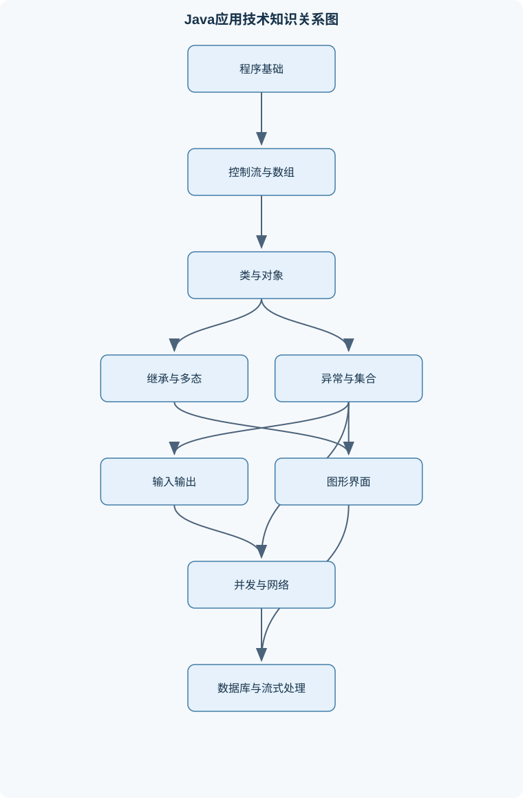
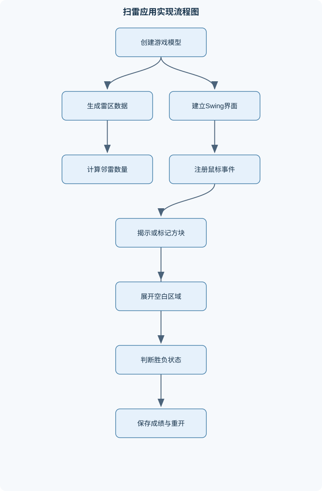

# Java应用技术

## 一、课程整体知识框架

### 课程边界与先修知识

《Java应用技术》覆盖使用Java构建中小型应用程序所需的核心语言、面向对象设计、标准类库、图形界面、并发、网络通信、数据库访问和函数式编程基础。课程从程序结构、数据类型、控制流和数组开始，逐步扩展到类与对象、继承与多态、接口、异常、输入输出、泛型与集合、Swing图形界面、线程与同步、Socket通信、JDBC以及Lambda和Stream。先修知识包括基本计算机操作、变量与函数概念、基本算法和离散的逻辑推理能力；不以特定开发环境、操作系统或数据库产品为前提。课程不覆盖大型框架、企业级部署、分布式事务、完整软件工程管理和高级虚拟机调优，但应说明这些内容与Java基础应用开发的边界。





### 1. 课程定位、先修条件与能力边界

《Java应用技术》面向中小型应用程序开发，核心任务是把问题转化为可运行、可维护、可测试的 Java 程序。课程内容从程序结构和基本数据处理开始，逐步建立面向对象模型，再扩展到集合、文件、图形界面、并发、网络、数据库和函数式编程。学习结果不只是能够写出若干语句，而是能够解释程序的运行过程，判断数据和对象的生命周期，设计类之间的协作关系，并对异常、资源、线程和事务进行必要的约束。

课程的先修条件包括基本计算机操作、变量和函数的概念、基本算法以及离散的逻辑推理能力。例如，需要理解“条件成立时执行某段操作”“重复处理直到条件不满足”“一个函数接收参数并返回结果”等基本思想。课程不以特定操作系统、开发环境或数据库产品为前提，因此应把 Java 语言规则、标准类库语义和应用设计原则作为稳定知识，把具体工具界面、数据库驱动版本和操作系统命令视为实现环境。

课程覆盖的是 Java 基础应用开发边界。大型 Web 框架、企业级部署、分布式事务、容器编排、完整软件工程管理和高级虚拟机调优不属于本课程主体。它们可以建立在本课程知识之上：例如，框架仍然依赖类、接口、异常、集合、反射和网络通信；企业应用仍然需要数据库事务和并发控制。但“能够使用 Java 编写一个具有界面、文件、网络或数据库功能的中小型程序”，不等于“已经掌握大型系统的部署、治理和性能调优”。

### 2. 从源代码到程序运行

Java 程序通常先由源文件编译为类文件，再由 Java 虚拟机加载、验证、连接并执行。源文件中的类、方法和表达式属于程序员可读的语言结构；类文件是面向虚拟机的中间表示；运行时由 JVM 管理类加载、内存区域、线程和字节码执行。JDK 是开发工具和运行库的集合，包含编译、运行、调试等工具；JVM 是执行 Java 类文件的运行环境；Java 标准类库则提供字符串、集合、输入输出、网络和数据库接口等可复用能力。

一个最小可运行程序需要一个入口方法：

```java
public class Hello {
    public static void main(String[] args) {
        System.out.println("Hello");
    }
}
```

`main` 是静态方法，因此不需要先创建 `Hello` 对象；`String[] args` 接收命令行参数，数组长度为 `args.length`，合法下标是 `0` 到 `args.length - 1`。类名、方法名和变量名属于标识符，关键字不能作为标识符使用。命名约定通常使用大写字母开头表示类名，使用小写字母开头表示变量和方法，多个单词采用驼峰形式。命名约定不改变语义，但能降低阅读和维护成本。

### 3. 类型、变量、表达式与输入输出

Java 的基本数据类型包括整数、浮点数、字符和布尔类型。`byte`、`short`、`int`、`long`用于整数，`float`、`double`用于浮点数，`char`表示一个 UTF-16 代码单元，`boolean`表示真或假。整数类型的取值范围由位数决定；以 `int` 为例，使用 32 位补码表示，范围为 $-2^{31}$ 到 $2^{31}-1$。这里的 $2$ 是二进制基数，指数表示位数，边界来自一位作为符号位、其余位参与补码编码。整数运算超出范围时不会自动报错，而是按位截断并产生回绕结果，因此“数学上正确”不代表“Java 表达式结果正确”。

变量必须在使用前完成初始化。局部变量没有自动默认值，字段和数组元素则会在创建时获得默认值：数值类型通常为 `0`，`boolean` 为 `false`，引用类型为 `null`。`null` 表示引用不指向任何对象，不能调用其实例方法。变量的作用域决定名称在哪些代码区域可见，生命周期则表示其值可以存在多久，二者不能混为一谈。

算术运算需要特别注意整数除法和类型提升。若 `a` 和 `b` 都是 `int`，表达式 `a / b` 执行整数除法，小数部分被截去；若需要保留小数，应先使至少一个操作数转换为浮点类型，例如 `(double) a / b`。强制转换只改变转换位置产生的值类型，不能逆转已经发生的整数除法。混合运算时，较窄类型通常先提升为较宽类型，但赋值给较窄类型仍可能需要显式转换，并可能丢失精度。

关系运算产生布尔结果，逻辑运算连接条件。`&&` 和 `||` 具有短路特性：当左侧已经足以决定结果时，右侧不再求值。这既能提高效率，也能用于避免无效访问，例如先判断引用不为 `null`，再调用方法。赋值运算的左侧必须是可被赋值的变量、字段或数组元素。表达式中的求值顺序、隐式转换和溢出边界，应通过逐子表达式分析，而不能只看最终形式。

标准输入输出把程序与外部环境连接起来。输出可以使用 `System.out`，错误信息可以使用 `System.err`，输入通常通过 `System.in` 配合字符读取器、扫描器或缓冲流完成。命令行参数是启动程序时传入的字符串数组，若需要整数，必须显式解析，并处理格式不合法的情况。

### 4. 控制流、方法与数组

条件分支用于根据状态选择路径。`if-else`适合处理范围条件和复杂逻辑，`switch`适合根据离散值选择分支。嵌套条件应保证每个分支的条件互斥或具有明确优先级，否则可能出现一个输入被错误分类的问题。循环包括 `for`、`while` 和 `do-while`：`for`适合计数或遍历，`while`适合先判断再重复，`do-while`至少执行一次，适合菜单交互等“先执行后判断”场景。

`break`结束当前循环或 `switch`，`continue`跳过本轮剩余语句并进入下一轮。循环正确性可用循环不变量说明：例如线性查找中，从下标 `0` 到当前下标 `i-1` 的元素都不等于目标值。每次循环开始时不变量成立；检查第 `i` 个元素后，不变量向下一轮保持；循环结束时，若未提前返回，则整个数组都没有目标值。

方法定义了可复用的操作边界，包含返回类型、方法名、参数列表和方法体。Java 方法参数采用值传递。传递基本类型时复制的是数值；传递对象时复制的是引用值，因此方法可以通过形参引用修改对象内部状态，但不能通过让形参重新指向其他对象来改变调用者的引用变量。递归方法必须有终止条件，并且每次递归调用都要使问题规模朝终止条件减少。例如阶乘满足

$$
n! =
\begin{cases}
1, & n=0,\\
n(n-1)!, & n>0.
\end{cases}
$$

其中 $n$ 是非负整数。若不限制 $n\geq 0$，或者递归参数不递减到 `0`，就可能无限递归并耗尽栈空间。

数组是长度固定、元素类型相同的对象。若 `int[] a = new int[n]`，则创建后 `a.length` 恒为 $n$，合法下标为 $0$ 到 $n-1$。访问 `a[n]` 或负下标会抛出 `ArrayIndexOutOfBoundsException`。二维数组本质上是数组的数组，可以创建不规则数组：

```java
int[][] a = new int[2][];
a[0] = new int[3];
a[1] = new int[5];
```

因此不能假设所有行的长度都相等，访问 `a[i][j]` 时必须分别检查 `i` 是否在 `0` 到 `a.length-1`，以及 `j` 是否在 `0` 到 `a[i].length-1`。

### 5. 类、对象、封装与对象相等性

类描述对象的状态和行为。字段保存状态，方法表达操作，构造器在对象创建时建立初始状态。对象由 `new` 创建，变量保存的是对象引用而不是对象本身。若引用变量 `r` 为 `null`，则它不指向任何对象；两个引用使用 `==` 比较时，比较的是是否指向同一对象，内容比较通常使用 `equals`。

`this`表示当前对象，可用于区分字段和参数，也可调用本类的其他构造器。构造器可以重载，但不同构造器应共同维护类的不变条件，例如账户余额不能在构造后成为非法值。`static`成员属于类而不是某个对象，静态方法没有当前对象，因此不能直接使用 `this` 或 `super`，也不能直接访问实例字段。`final`变量只能赋值一次；对 `final int[] a` 而言，禁止的是引用 `a` 重新指向别的数组，不禁止修改数组元素。要实现内容不可变，还需要复制数据、禁止暴露可变引用或提供只读封装。

访问控制用于封装实现细节。`private`成员只能在声明它的类内部直接访问，不会自动变成子类的 `protected`成员；子类若要使用相关状态，应通过父类提供的受保护或公开方法。包可以组织相关类，`import`只是在源代码中简化类型名称，不会突破访问权限。

重载要求方法名相同但参数列表不同，编译器根据编译期可见的参数类型选择重载版本。可变参数本质上可按数组处理，但固定参数通常比可变参数具有更明确的匹配关系。`equals`与 `hashCode`必须保持约定：如果两个对象按 `equals` 相等，则它们的 `hashCode`必须相等；反之不要求。将对象作为 `HashSet`元素或 `HashMap`键时，修改参与相等性判断的字段可能破坏集合定位。

### 6. 继承、多态、接口与抽象设计

继承表示“是一个”的关系，可复用父类公开或受保护的行为，但不应仅为复用几行代码而建立继承关系。若类 `B`继承类 `A`，创建 `B`对象时先执行 `A`的构造器，再执行 `B`的构造器。若子类构造器没有显式调用 `super(...)`，编译器会尝试插入无参 `super()`；当父类没有可访问的无参构造器时，子类必须明确调用某个父类构造器，否则编译失败。

重写发生在继承或接口实现关系中，要求方法签名兼容，访问权限不能被缩小。重写方法的实际版本由运行时对象类型决定，这就是动态绑定。重载方法的选择主要依据编译期参数类型。因此，向上转型不会改变对象的实际类型，但会限制当前引用在编译期能够看到的成员；向下转型必须确认对象确实属于目标类型，否则会产生 `ClassCastException`。`instanceof`可用于运行时类型判断，但过度依赖类型分支通常说明抽象设计不足。

抽象类可以包含字段、普通方法、抽象方法和构造器，不能直接创建对象；接口主要描述可替换的行为契约。接口可以包含抽象实例方法、默认方法和静态方法，接口字段隐含为 `public static final`。静态接口方法通过接口名调用，不能当作实例方法重写。组合优先于继承：若一个对象“拥有”另一个对象，应优先把后者作为字段，通过委托实现功能，从而减少父类变化对整个层次结构的影响。

反射以 `Class`对象表示运行时类型，可以获取类名、字段、方法和构造器信息，并在满足访问条件时动态调用。反射适合框架、插件和通用工具，但会削弱编译期检查，增加可读性、性能和安全风险，不能作为普通业务代码的默认替代方案。

### 7. 异常、泛型与集合

异常对象表示程序运行中出现的异常条件。`Throwable`体系中，错误通常表示程序难以恢复的严重问题；异常则用于表达可处理的失败。受检查异常要求方法声明或处理，运行时异常通常由编程错误或输入状态不满足前提引起。`try-catch-finally`中，异常发生后会寻找匹配的 `catch`；`finally`通常用于清理，但进程被强制终止或虚拟机崩溃时不能保证执行。资源关闭应优先使用 `try-with-resources`，因为实现 `AutoCloseable`的资源会按创建顺序的逆序自动关闭。

自定义异常应表达明确的领域失败，例如余额不足、协议格式错误或文件格式不正确。异常传播可以在低层保留原始原因，在高层转换为调用者能够理解的业务错误；不应捕获异常后静默忽略。

泛型在编译期约束类型。`List<String>`与`List<Object>`不是同一个类型，虽然 `String`是`Object`的子类型。通配符上界 `? extends T`适合读取一组至少属于 `T`的元素，通配符下界 `? super T`适合向容器写入 `T`及其子类型。泛型信息主要用于编译期检查，运行时存在类型擦除，因此不能直接创建 `new T()`或`new List<String>[10]`。

集合语义必须与任务匹配：`List<E>`表示有序、可重复的元素序列；`Set<E>`用于不希望保留重复元素的场景；`Map<K,V>`表示键到值的映射，每个键至多对应一个值。迭代器遍历期间直接结构性修改集合可能产生并发修改异常，应使用迭代器提供的删除操作或建立副本。排序可依赖元素的自然顺序，也可传入 `Comparator`；比较器必须保持一致的比较关系，否则排序和有序集合可能产生难以解释的结果。

### 8. 输入输出与对象持久化

字节流以字节为单位处理，适合图片、压缩数据和二进制协议；字符流负责字符与字节之间的编码转换，适合文本。`InputStream`和`OutputStream`是字节流抽象，`Reader`和`Writer`是字符流抽象。文本读写必须明确字符编码，否则同一字节序列在不同编码下可能被解释为不同字符。整数写入文本文件时可能保存字符序列，如字符`"123"`；写入二进制流时保存的是二进制数值表示，二者不能使用同一种读取方式。

缓冲流通过批量读写减少底层调用次数，但不会改变数据格式。输出缓冲区中的数据可能尚未真正写出，适时调用 `flush`，关闭资源时也会执行必要的刷新。`DataInputStream`和`DataOutputStream`按规定的二进制格式读写基本类型，读取顺序和写入顺序必须一致。对象序列化需要对象及其相关可序列化状态满足条件；`Serializable`不等于数据加密，也不保证长期版本兼容或跨语言互操作，敏感数据不应无保护地序列化。

随机访问文件允许在文件的不同位置读写，适合固定记录或索引场景，但必须自行维护偏移量、记录长度和格式一致性。所有文件资源都应明确关闭，异常路径也不能遗漏关闭操作。

### 9. Swing、事件驱动与界面模型

Swing界面由顶层窗口、容器和组件组成。`JFrame`或`JDialog`通常作为顶层窗口，`JPanel`是普通容器，需要放入顶层窗口或其他容器后才能显示。布局管理器根据容器大小、组件首选尺寸和约束分配空间，不能用绝对坐标替代所有布局。`BorderLayout`按东、西、南、北和中心区域管理，`FlowLayout`按行排列，`GridLayout`按规则网格排列，`CardLayout`用于多个面板之间切换。`Box`使用自身的布局体系，不应假设它使用默认的`BorderLayout`。

事件驱动程序不是从上到下执行一次就结束，而是等待用户动作，由事件对象描述发生了什么，由监听器接收事件并回调处理方法。鼠标、键盘、按钮和菜单事件具有不同事件类型。Swing界面更新应在事件分发线程中完成；耗时计算若直接放在事件处理器内，会阻塞事件分发线程，造成界面无响应。耗时任务应与界面线程分离，并在适当时机把结果交回界面线程。

MVC思想把数据模型、界面视图和用户操作控制分开。扫雷程序中，模型可保存地雷位置、揭示状态、标记状态和邻雷数；视图负责按钮、面板和排行榜显示；控制器负责鼠标事件、胜负判断和模型更新。`JTable`、`JList`等组件通常通过模型提供数据，数据变化后通知视图刷新。自定义绘图应在组件绘制方法中使用`Graphics`，避免直接在任意时刻保存或重复使用绘图对象。

### 10. 线程、同步与并发控制

线程是独立的执行路径。通过`Thread`或`Runnable`可以描述线程任务，但调用`run()`只是普通方法调用，只有调用`start()`才会创建新的执行线程。线程概念上经历新建、可运行、阻塞、等待、计时等待和终止等状态，具体切换由调度和同步操作决定。`sleep`使线程计时等待但通常不释放已持有的锁；`yield`只是调度提示，不能保证让出处理器；`interrupt`用于传递中断请求，不能强制安全杀死线程。

多个线程访问共享变量时，可能发生竞态条件。若一个操作包含“读取、计算、写回”多个步骤，即使单个读写看似简单，整体也可能被其他线程插入。`synchronized`通过对象监视器提供互斥和一定的可见性保证。线程进入同步方法或同步代码块时获取锁，退出时释放锁，包括因异常退出的情况。`wait`、`notify`和`notifyAll`属于对象监视器机制：调用`wait`必须先持有对应监视器，调用后释放该监视器并等待；被唤醒后还要重新竞争锁。等待条件必须用`while`反复检查，因为可能发生虚假唤醒，也可能多个线程竞争后条件已被其他线程改变。

死锁通常需要互斥、持有并等待、不可剥夺和循环等待等条件共同存在；活锁中线程持续改变状态却没有实质进展；饥饿表示某线程长期得不到资源。线程安全集合可以降低部分同步负担，但不能自动保证跨多个操作的业务原子性。并发设计必须同时考虑原子性、可见性和有序性，不能只看到“加了锁”就断定程序完全正确。

### 11. Socket、JDBC与事务

`Socket`通常表示客户端通信端点，`ServerSocket`负责监听端口并通过`accept`接收连接。连接建立后，双方通过输入输出流传输字节或字符。仅有“发送消息”还不足以构成协议，必须规定消息边界、编码、请求响应顺序、异常断开和关闭方式。例如文本回声协议可以规定每条消息以换行结束，接收方持续读取直到换行或检测到连接关闭。

阻塞读写会等待数据或连接状态，服务端若在单线程中依次处理客户端，某个客户端的慢操作可能阻塞其他客户端。多客户端服务端可为每个连接分配线程，或使用更高级的异步模型；本课程重点是理解连接生命周期、流关闭和任务分工。资源关闭顺序通常应先关闭外层流和会话，再关闭底层连接，并处理通信异常。

JDBC程序通常依次建立`Connection`、创建`PreparedStatement`、绑定参数、执行查询或更新、遍历`ResultSet`并关闭资源。`PreparedStatement`把 SQL 结构与数据值分离，能够减少拼接错误并防止把用户输入直接当作 SQL 代码。查询结果应映射为明确的领域对象，而不是让业务代码到处操作列号和字符串。

事务用`commit`和`rollback`界定边界。转账操作包括扣款和入账，若前者成功而后者失败，必须回滚以避免只扣不入。一个事务的基本流程是：关闭自动提交；执行全部操作并检查每次更新结果；全部成功则提交；任一步失败则回滚；最后释放资源。隔离级别影响并发事务之间能看到什么数据，不能脱离具体数据库和业务一致性要求泛化判断。

### 12. Lambda、Stream与综合应用

函数式接口只有一个抽象方法，可用 Lambda 表达式表示行为。方法引用和构造器引用是 Lambda 的简写形式，但只有在目标类型明确时才能判断参数和返回值。Stream不是存储数据的集合，而是对数据源进行流水线处理的抽象。典型流水线由数据源、中间操作和终结操作构成。`filter`筛选，`map`转换，`sorted`排序，`reduce`聚合，`collect`收集或分组统计。

中间操作通常是惰性的，只有终结操作才触发遍历。流不能在终结操作后重复使用。流操作中应避免共享可变变量和不可控副作用；并行流需要承担任务拆分、线程调度和结果合并成本，不一定比顺序流更快，尤其不适合数据量小、操作很轻或依赖共享状态的任务。

综合扫雷项目可把所有模块连接起来：使用二维数组保存地雷和邻雷数，使用类封装棋盘与格子状态，使用 Swing 显示界面，使用事件监听器处理揭示和标记，使用队列或栈展开空白区域，使用文件或 JDBC 保存成绩，使用异常处理输入和资源错误，使用分层设计隔离模型、视图和控制器。该项目的价值不在于界面模仿，而在于验证程序结构、边界处理、状态转换和测试方法是否一致。

## 二、章节和模块划分

### 核心知识覆盖清单

本清单用于检查正文是否覆盖本课程的主要知识模块：

- **Java程序基础与运行机制**：JDK、JVM与程序运行过程、源文件、类文件与入口方法、标识符、关键字与命名约定、基本数据类型与取值范围、变量初始化与作用域、算术、关系与逻辑运算、类型转换与运算溢出、命令行参数与标准输入输出。
- **控制流、方法与数组**：条件分支与嵌套选择、for、while与do-while循环、break、continue与循环不变量、方法定义、参数与返回值、值传递与引用值传递、递归方法的终止条件、一维数组与数组初始化、二维数组与不规则数组、数组边界检查与默认值。
- **类、对象与封装**：类的字段、方法与构造器、对象创建与引用变量、this关键字与构造器重载、访问控制与数据封装、static成员与实例成员、final变量、方法与类、重载、可变参数与参数匹配、包、导入与访问边界、对象相等性与hashCode约定。
- **继承、多态与抽象设计**：继承关系与代码复用边界、super调用与构造器执行顺序、方法重写与动态绑定、向上转型与向下转型、instanceof与运行时类型判断、抽象类与抽象方法、接口、默认方法与静态方法、组合优先于继承的设计原则、反射基础与Class对象。
- **异常、泛型与集合框架**：异常层次与异常对象、try-catch-finally执行规则、checked异常与unchecked异常、自定义异常与异常传播、try-with-resources资源管理、泛型类、泛型方法与类型参数、通配符上界与下界、List、Set与Map的语义、迭代器与集合遍历、集合的相等性、排序与比较器。
- **输入输出与对象持久化**：字节流与字符流的区别、InputStream与OutputStream、Reader、Writer与字符编码、缓冲流与性能影响、文本文件的按行读写、DataInputStream与DataOutputStream、对象序列化与Serializable、随机访问文件基础、资源关闭、刷新与异常处理。
- **Swing图形界面与事件驱动**：顶层窗口与容器层次、JPanel、按钮、标签与输入组件、布局管理器的空间分配、BorderLayout、FlowLayout与GridLayout、CardLayout与多面板切换、事件对象、监听器与回调、鼠标、键盘与菜单事件、事件分发线程与界面更新、MVC思想与JTable、JList模型、Graphics绘图与自定义组件。
- **线程、同步与并发控制**：Thread与Runnable创建线程、线程启动、执行与生命周期、sleep、yield与interrupt、共享变量与竞态条件、synchronized方法与代码块、对象监视器与锁释放、wait、notify与notifyAll、死锁、活锁与饥饿、线程安全集合与任务分工、并发程序的可见性与原子性。
- **网络通信与JDBC数据库编程**：Socket与ServerSocket角色、客户端连接与服务端accept、输入输出流上的协议设计、阻塞通信与连接关闭、多客户端服务端线程模型、JDBC驱动、连接与资源管理、Statement与PreparedStatement、ResultSet遍历与对象映射、事务提交、回滚与隔离边界、参数绑定与SQL注入防护。
- **Lambda、Stream与综合应用设计**：函数式接口与Lambda表达式、方法引用与构造器引用、Stream流水线结构、filter、map与sorted、reduce与聚合结果、collect与分组统计、惰性求值与终结操作、并行流的适用边界、扫雷类事件驱动项目架构、分层设计、测试与错误处理。


### 1. 模块一：Java程序基础与运行机制

#### 核心内容与关键结论

本模块建立源文件、类文件、JDK、JVM和标准类库之间的关系。应能够从“编写源代码—编译—加载类—执行入口方法—输出结果”的顺序解释程序为何运行。重点检查入口方法的签名、类名与文件名关系、标识符规则、关键字限制、变量初始化和作用域。

一个重要推导是数组下标边界：数组长度为 `n` 时，数组元素共有 `n` 个；第一个元素占据序号 `0`，最后一个元素序号为前一个序号，即 `n-1`。因此合法下标为 $0\leq i<n$，访问 $i=n$ 或 $i<0$ 都越界。这个结论只适用于 Java 数组，不适用于所有集合或自定义索引结构。

#### 基础语法例题

**题干：**设 `int a = 7; int b = 2;`，比较 `a / b`、`(double) a / b` 和 `(int)((double)a / b)` 的结果。

**分析：**`a / b`在两个操作数均为`int`时先执行整数除法；显式转换发生在除法之前时，运算提升为浮点除法；最后再转换为`int`会截去小数。

**逐步解答：**

1. `a / b`得到整数`3`；
2. `(double) a / b`先把`a`变为`7.0`，结果为`3.5`；
3. `(int)((double)a / b)`把`3.5`转换为`3`。

**结果验证：**打印结果应分别为`3`、`3.5`和`3`。若把 `(int)` 写在除法之前，结果又会回到整数除法。

**变式：**若 `a = Integer.MAX_VALUE`，再计算 `a + 1`，结果会发生整数溢出；可先转换为`long`，例如 `(long)a + 1`。

### 2. 模块二：控制流、方法与数组

#### 代表性算法一：数组线性查找

**输入：**数组 `a` 和目标值 `x`。  
**输出：**`x`首次出现的下标，不存在时返回`-1`。  
**过程：**从下标`0`开始逐个比较，若`a[i] == x`立即返回`i`；遍历完成后返回`-1`。循环不变量是：每次检查下标`i`前，区间`0`到`i-1`内没有目标值。  
**复杂度：**最坏时间复杂度为$O(n)$，额外空间复杂度为$O(1)$，适用于无序数组。

```java
public static int linearSearch(int[] a, int x) {
    for (int i = 0; i < a.length; i++) {
        if (a[i] == x) {
            return i;
        }
    }
    return -1;
}
```

#### 代表性算法二：二分查找

**输入：**已按非降序排列的数组 `a` 和目标值 `x`。  
**输出：**任意匹配下标，不存在时返回`-1`。  
**过程：**维护闭区间`[left, right]`，取 `mid = left + (right - left) / 2`。若`a[mid]`小于目标，舍弃左半部分；若大于目标，舍弃右半部分；相等则返回。每轮区间严格缩小，区间为空时结束。  
**复杂度：**时间复杂度为$O(\log n)$，额外空间复杂度为$O(1)$。前提是数组已经排序且支持随机访问；对链表直接使用二分并不具有相同效率。

#### 数组追踪例题

**题干：**

```java
int[] values = new int[5];
for (int i = 0; i < values.length; i++) {
    values[i] = i * 2;
}
```

**分析：**创建数组后长度固定为`5`，元素初始为`0`。循环每次写入一个合法下标。

**逐步解答：**

| 循环开始时的 `i` | 写入值 | 数组状态 |
|---|---:|---|
| 0 | 0 | `[0,0,0,0,0]` |
| 1 | 2 | `[0,2,0,0,0]` |
| 2 | 4 | `[0,2,4,0,0]` |
| 3 | 6 | `[0,2,4,6,0]` |
| 4 | 8 | `[0,2,4,6,8]` |

**结果验证：**循环结束时`i`为`5`，但最后一次访问是`values[4]`，合法；若循环条件写成`i <= values.length`，最后会访问`values[5]`并抛出越界异常。

**变式：**二维不规则数组的每一行长度可能不同，访问前必须使用`a[i].length`，不能统一使用`a[0].length`。

### 3. 模块三：类、对象、继承与多态

#### 面向对象例题

**题干：**设计`Account`、`SavingAccount`和`Transferable`，要求账户余额封装，储蓄账户重写利息计算方法，并使用接口引用调用转账行为。

**分析：**余额不能直接暴露为可任意修改的公共字段；`SavingAccount`是`Account`的一种，因此适合继承；转账能力是可独立替换的行为，适合接口。

**逐步解答：**

1. `Account`将余额声明为`private`，通过受约束的方法存取；
2. `SavingAccount`构造时先调用父类构造器，再初始化自己的利率字段；
3. `SavingAccount`重写利息计算方法；
4. `Account r = new SavingAccount(...)`是向上转型，`r`只能在编译期看到`Account`公开成员；
5. 调用被重写的方法时，实际执行`SavingAccount`版本；
6. 若要向下转型，必须先确认对象运行时确实为`SavingAccount`。

**结果验证：**父类构造器先执行；重写方法按运行时类型分派；子类新增方法不能通过父类引用直接调用。

**变式：**若两个类只是“都需要日志功能”，但不存在稳定的“是一个”关系，应采用组合或工具对象，而不是强行继承。

### 4. 模块四：异常、泛型与集合

#### 泛型集合例题

**题干：**使用 `Map<String, List<Integer>>` 保存学生成绩，按姓名分组并计算每组平均分。

**分析：**键类型为`String`，值类型为`List<Integer>`。同一姓名对应多次成绩，因此不能把值设计为单个整数。插入新姓名时需要创建列表；读取时应考虑键不存在的情况。

**逐步解答：**

1. 用姓名作为键；
2. 获取对应成绩列表，不存在则建立新列表；
3. 把成绩加入列表；
4. 遍历每个键值对，累加成绩并除以列表长度；
5. 计算平均值时使用`double`，避免整数除法丢失小数；
6. 若希望按平均分排序，使用`Comparator`明确排序规则。

**结果验证：**姓名相等依赖`String.equals`和`hashCode`，内容相同的字符串应映射到同一逻辑键；若自定义键类破坏相等性约定，查找可能失败。

**变式：**`List<? extends Number>`适合读取不同数值子类型，但不能安全地向其中加入任意`Number`；`List<? super Integer>`可以加入`Integer`，但取出时只能按`Object`安全接收。

#### 异常处理例题

**题干：**读取文本文件并统计行数，要求文件不存在时给出明确提示，并保证资源关闭。

**分析：**文件打开、字符解码和逐行读取都可能失败。资源关闭不能只写在正常路径，应使用`try-with-resources`。低层异常可以保留原因，高层负责向用户解释。

**逐步解答：**

1. 创建带明确字符编码的字符读取器；
2. 在资源管理结构中逐行读取；
3. 每成功读取一行，计数器加一；
4. 文件不存在时单独处理；
5. 其他输入输出异常保留原因并记录；
6. 资源块结束后自动关闭文件。

**结果验证：**正常文件返回行数；空文件返回`0`；不存在文件不会继续执行读取逻辑；异常发生时资源仍应关闭。

**变式：**若把二进制图片使用字符流读取，可能发生编码转换错误；应使用字节流并按图片格式处理。

### 5. 模块五：输入输出与Swing图形界面

#### Swing事件例题

**题干：**设计可切换难度的扫雷界面，使用`JFrame`、`JPanel`、`CardLayout`、按钮和鼠标监听器。

**分析：**窗口是顶层容器，游戏面板和设置面板是不同卡片；难度选择改变模型参数，不能只改变按钮文字。用户点击后由事件监听器更新模型，再通知视图刷新。

**逐步解答：**

1. 创建顶层窗口；
2. 建立主面板并设置`CardLayout`；
3. 将游戏面板和设置面板加入主面板；
4. 在设置面板中监听难度按钮；
5. 根据难度重新创建行数、列数和地雷数；
6. 切换到游戏卡片；
7. 鼠标左键揭示格子，右键修改标记状态；
8. 将耗时的成绩读取或复杂计算移出事件分发线程；
9. 完成后在事件线程中更新组件状态。

**结果验证：**`JPanel`必须放入窗口或其他容器；按钮事件能够触发模型变化；切换卡片不应创建大量重复窗口；界面线程不被长时间任务阻塞。

**变式：**排行榜可作为独立对话框，通过组合关系由主窗口持有，而不是让排行榜类继承整个主窗口。

### 6. 模块六：线程、网络与JDBC

#### 代表性流程：生产者—消费者

**输入：**有界缓冲区、生产任务和消费任务。  
**输出：**生产者和消费者在容量约束下安全交换数据。  
**过程：**

1. 生产者获取缓冲区监视器；
2. 当缓冲区已满时，在`while`中调用`wait`；
3. 缓冲区未满时放入元素；
4. 调用`notifyAll`通知可能等待的线程；
5. 消费者获取同一监视器；
6. 当缓冲区为空时，在`while`中等待；
7. 缓冲区非空时取出元素；
8. 调用`notifyAll`；
9. 所有线程在任务结束或收到中断请求时退出。

**评价重点：**不能在未持有对应锁时调用`wait`；不能把条件检查写成一次性的`if`；不能把`notify`误认为已经把锁交给被唤醒线程。被唤醒线程仍需重新竞争锁并重新检查条件。

#### Socket例题

**题干：**实现文本回声客户端和服务端，规定每条消息以换行结束。

**分析：**客户端负责连接、发送带换行的消息、读取服务端回应并关闭；服务端负责监听、接受连接、读取完整消息、回写消息。换行是协议中的消息边界，不是随意的格式字符。

**逐步解答：**

1. 服务端创建`ServerSocket`并监听端口；
2. 客户端创建`Socket`连接；
3. 双方使用明确字符编码创建读写器；
4. 客户端发送一行并刷新；
5. 服务端按行读取并回写；
6. 客户端读取回应；
7. 发生异常断开时清理资源；
8. 多客户端场景下为每个连接分配独立任务，避免一个阻塞连接拖住全部客户端。

**结果验证：**消息中不含结束标记时，接收方可能持续阻塞；客户端和服务端编码不一致时，非 ASCII 文本可能乱码；关闭输出端可能使对方读到流结束，但也意味着不能继续发送。

#### JDBC事务例题

**题干：**完成账户转账：查询余额，扣款，入账；任一步失败则回滚。

**分析：**扣款和入账必须属于同一事务。不能把用户输入直接拼接进 SQL，应使用`PreparedStatement`绑定参数。

**逐步解答：**

1. 获取`Connection`并关闭自动提交；
2. 使用参数化查询读取付款账户余额；
3. 若余额不足，抛出业务异常并回滚；
4. 执行扣款更新并检查更新行数；
5. 执行收款更新并检查更新行数；
6. 两次更新均成功时调用`commit`；
7. 任意`SQLException`或业务异常发生时调用`rollback`；
8. 在`finally`或资源管理结构中关闭`ResultSet`、`PreparedStatement`和`Connection`。

**结果验证：**成功时两方余额都变化；失败时两方都保持原状态；更新行数为`0`时不能假设操作成功。

### 7. 实验与综合项目

#### 实验一：数组、异常与文件统计

**输入数据：**包含空文件、普通文本、超长行、缺失文件和不同字符内容的测试文件。  
**步骤：**

1. 编写线性查找和数组统计方法；
2. 使用边界长度数组测试空数组、单元素数组和大数组；
3. 编写按行读取程序；
4. 明确字符编码；
5. 对不存在文件、权限失败和格式异常分别处理；
6. 使用`try-with-resources`保证关闭；
7. 输出行数、非空行数和最长行长度。

**评价标准：**数组边界无异常；空输入结果正确；文件资源必定关闭；错误信息能区分文件不存在与内容格式错误；核心方法可独立测试。  
**排错方法：**先打印数组长度和当前下标，再检查循环条件；文件问题先确认路径和编码，再确认读取逻辑；若异常被吞掉，应保留异常类型和原因。

#### 实验二：扫雷综合项目

**输入数据：**行数`h`、列数`w`、地雷位置、用户鼠标操作和成绩记录。  
**步骤：**

1. 设计模型，保存地雷、邻雷数、揭示和标记状态；
2. 初始化地雷并计算八邻域数量；
3. 左键揭示安全格，若邻雷数为`0`则使用队列展开；
4. 右键切换标记；
5. 判断踩雷、全部安全格揭示和游戏继续状态；
6. 使用 Swing 组件显示棋盘；
7. 使用监听器处理输入；
8. 将计时和成绩保存与界面显示分离；
9. 对边界、重复点击、角落格子和全雷地图进行测试。

**评价标准：**每个格子状态转换合法；邻雷数不越界；空白展开不会重复处理；点击地雷立即进入失败状态；胜负判断与显示一致；界面线程不执行长时间阻塞任务。  
**排错方法：**先单独验证一个格子的八邻域，再验证整张棋盘；记录队列中每个坐标并检查访问标记；将模型测试与界面测试分离；遇到界面无响应时检查事件处理器是否执行文件、数据库或大量计算。

### 8. 典型易错点、笔试问题与面试问题

#### 具体易错点

1. 把对象引用误认为对象本身；`r == null`时调用实例方法会产生`NullPointerException`。
2. 把数组长度当作最后一个下标；最后一个下标是`a.length - 1`。
3. 认为 Java 存在 C 语言式指针运算；数组引用不能通过加法访问下一个元素。
4. 把整数除法误当作浮点除法；必须在除法前提升至少一个操作数。
5. 认为`final int[] a`不能修改元素；`final`只限制引用重新赋值。
6. 在静态方法中使用`this`或`super`；静态上下文没有当前对象。
7. 把重载和重写混淆；重载主要由编译期参数列表决定，重写由运行时对象类型决定。
8. 认为`private`成员会自动变成子类的`protected`成员；子类不能直接访问父类私有成员。
9. 用`==`比较字符串内容；内容比较应使用`equals`。
10. 以为`finally`在虚拟机崩溃或强制终止时绝对执行；资源管理仍应依赖自动关闭结构。
11. 直接调用线程的`run()`；这不会创建新线程。
12. 在`wait`和`notify`外部调用；必须持有对应对象监视器。
13. 用`if`而不是`while`检查等待条件；唤醒后条件可能已被其他线程改变。
14. 把`JPanel`当作顶层窗口直接显示；通常需要放入`JFrame`或`JDialog`。
15. 在 Swing 事件处理器中执行长时间任务；会阻塞事件分发线程。
16. 将二进制文件当作文本文件读取；字节格式和字符编码语义不同。
17. 直接拼接 SQL；可能导致注入、转义错误和参数类型问题。
18. 认为并行流一定更快；任务拆分和合并成本可能超过收益。

#### 典型笔试问题与解答思路

1. **为什么数组长度为`n`时下标是`0`到`n-1`？**  
   解答思路：数组有`n`个位置，第一个位置从`0`编号，连续编号的第`n`个位置为`n-1`；访问`n`已经超出元素数量。

2. **方法传递对象时能否改变调用者的引用？**  
   解答思路：参数始终按值传递，复制的是引用值。方法可通过复制后的引用修改同一对象内容，但让形参指向新对象不会改变调用者变量。

3. **重载和重写如何区分？**  
   解答思路：重载通常发生在同一类或继承体系内，参数列表不同，主要在编译期选择；重写要求子类提供兼容实现，运行时按对象实际类型分派。

4. **为什么父类构造器先执行？**  
   解答思路：子类对象包含父类继承部分，必须先建立父类状态；隐式`super()`找不到可访问无参构造器时会编译失败。

5. **为什么`wait`必须放在`while`中？**  
   解答思路：线程被唤醒不等于条件成立，可能是虚假唤醒或其他线程先改变了条件，因此必须重新获取锁并检查条件。

6. **`String`和`StringBuilder`有什么区别？**  
   解答思路：`String`不可变，修改会产生新对象；`StringBuilder`可变，适合单线程大量拼接；线程安全需求不能仅靠类型名称推断。

7. **为什么使用`PreparedStatement`？**  
   解答思路：参数绑定把 SQL 结构与输入数据分离，减少转义错误并防止把输入解释为 SQL 代码；同时有利于重复执行相同结构的语句。

8. **Stream为什么没有终结操作就通常不执行？**  
   解答思路：中间操作构成惰性流水线，只有`forEach`、`collect`、`reduce`等终结操作要求产生结果时，才触发数据遍历。

#### 典型面试问题与参考回答要点

1. **如何解释 Java 的值传递？**  
   参考答案：所有参数都是值传递。基本类型复制值；对象参数复制引用值，所以可以修改同一对象，但不能改变调用者引用变量本身。  
   深入追问要点：举例区分修改字段与重新赋值；说明`null`引用不能访问实例成员。

2. **什么时候使用继承，什么时候使用组合？**  
   参考答案：稳定的“是一个”关系且需要多态时使用继承；“拥有一个”或仅为复用功能时优先组合。  
   深入追问要点：说明继承会暴露父类变化，组合可通过委托降低耦合；讨论接口与实现分离。

3. **如何保证一个集合操作的线程安全？**  
   参考答案：先明确共享范围和复合操作，再选择同步、并发集合或任务串行化；不能只把单个方法声明为同步就假设多步业务操作安全。  
   深入追问要点：区分原子性、可见性和有序性；分析检查后更新的竞态条件。

4. **Swing界面卡顿如何排查？**  
   参考答案：检查事件分发线程是否执行文件、数据库、网络或大量计算；将耗时任务移出界面线程，完成后安全更新组件。  
   深入追问要点：说明模型和视图分离；讨论任务取消、中断和异常反馈。

5. **如何设计一个可靠的 Socket 文本协议？**  
   参考答案：规定编码、消息边界、请求响应顺序、错误格式、超时和关闭语义。  
   深入追问要点：解释按行读取为何需要换行；讨论半包、断开和多客户端处理。

6. **JDBC事务失败时如何保证一致性？**  
   参考答案：把相关操作放入同一事务，全部成功才提交，任一步失败就回滚，并检查更新行数和业务条件。  
   深入追问要点：讨论自动提交、隔离级别和并发转账；说明参数绑定不能代替业务校验。

7. **为什么并行流不能随意使用？**  
   参考答案：并行流有拆分、调度和合并成本，且共享可变状态会引入竞态；只有数据量和任务粒度足够、操作近似独立时才可能获益。  
   深入追问要点：说明无副作用函数、顺序约束和合并器要求。

8. **如何定位一个数组越界异常？**  
   参考答案：记录数组长度、循环变量和访问表达式，检查循环不变量及边界条件，特别关注`<=`误写为`<`或二维数组行长度不一致。  
   深入追问要点：讨论空数组、单元素数组、负下标和不规则二维数组测试。

### 9. 岗位关联与课程产出

#### Java应用开发工程师与后端开发工程师

实际任务包括编写业务类、处理输入输出、调用数据库、设计异常边界和维护接口。使用的知识包括面向对象、集合、泛型、JDBC、事务、网络和 Lambda。主要产出是可编译程序、领域对象、参数化 SQL、测试用例和错误处理说明。验收标准包括功能结果正确、边界输入可控、资源及时关闭、SQL不直接拼接用户输入、事务失败时状态可恢复。

#### 桌面应用开发工程师

实际任务包括设计窗口、面板、布局、事件处理和模型刷新。使用 Swing 容器、布局管理器、监听器、事件分发线程和 MVC 思想。产出是可操作界面、界面状态模型和异常提示。验收标准包括组件层次清晰、窗口可关闭、操作不会导致界面长期无响应、重复点击和非法输入具有明确行为。

#### 软件测试与自动化测试开发工程师

实际任务包括设计边界测试、异常测试、接口测试和回归测试。使用控制流分析、数组边界、异常传播、集合相等性、并发条件和 JDBC 事务知识。产出是测试数据、测试步骤、预期结果和缺陷复现说明。验收标准包括覆盖正常、空输入、极值、重复操作、资源失败和并发冲突等场景，且每个缺陷都能由明确输入稳定复现。

#### 数据库应用与网络程序开发工程师

数据库任务关注连接管理、参数绑定、结果映射和事务；网络任务关注连接建立、协议边界、阻塞行为、多客户端处理和关闭流程。产出是客户端、服务端、数据库访问模块及协议说明。验收标准包括异常断开可恢复、资源不泄漏、结果集正确映射、事务一致性满足业务要求，并能解释阻塞通信和线程模型的限制。

#### 运维开发、工具开发及初级跨平台开发岗位

这类岗位常编写文件处理工具、批量数据转换程序、诊断工具或基础应用模块。使用 Java 基础语法、集合、输入输出、异常、并发和函数式处理。产出是可重复运行的工具程序、配置读取逻辑和日志信息。验收标准包括输入格式明确、错误可定位、长时间运行不无故泄漏资源，且不把特定操作系统命令或数据库产品行为误认为 Java 语言本身的保证。

## 三、核心概念的详细解释

### 1. Java程序结构与运行机制

Java程序通常经历“源代码—类文件—虚拟机执行”三个阶段。源文件以`.java`保存，编译器将其翻译为包含字节码的`.class`文件，Java虚拟机加载、验证并执行类文件。JDK提供编译、运行和调试等开发工具；JVM负责类加载、字节码执行、线程管理和内存管理；标准类库提供`String`、集合、输入输出、网络和数据库等可复用类型。三者不能混为一谈：JDK是开发工具集合，JVM是运行环境，标准类库是程序可调用的API集合。

入口方法通常写为：

```java
public class Hello {
    public static void main(String[] args) {
        System.out.println("Hello");
    }
}
```

`main`必须是静态方法，因为程序启动时还没有必要先创建该类的对象。`args`是引用变量，指向一个`String`数组；若没有命令行参数，则`args.length`为$0$，此时访问`args[0]`会发生数组下标越界。源文件中的类名、方法名和变量名属于标识符，关键字不能作为标识符。命名约定通常要求类名采用大写字母开头的驼峰形式，方法和变量采用小写字母开头的驼峰形式，常量使用大写字母和下划线。命名约定主要影响可读性，不改变程序的运行语义。

### 2. 数据类型、变量与表达式

Java类型分为基本类型和引用类型。基本类型直接表示值，包括整数类型`byte`、`short`、`int`、`long`，浮点类型`float`、`double`，字符类型`char`和布尔类型`boolean`。引用类型变量保存对象引用，可以为`null`，表示不指向任何对象。引用变量本身与对象不是同一概念：执行`Account a = new Account();`时，`a`是引用变量，`new Account()`创建对象。

以`int`为例，它使用32位补码表示，取值范围为

$$
-2^{31}\leq x\leq 2^{31}-1。
$$

这里的$x$表示一个`int`值，$2$表示二进制基数。整数运算超出范围时通常发生回绕，而不是自动抛出异常。例如，`Integer.MAX_VALUE + 1`得到最小的`int`值。若需要扩大运算范围，应在运算前转换类型，例如`long result = (long) a * b;`。若先执行`a * b`再赋给`long`，溢出已经发生，后续赋值无法恢复正确结果。

局部变量必须在使用前明确初始化；字段和数组元素在创建时获得默认值。数值类型默认值为`0`或相应浮点零值，`boolean`默认值为`false`，引用类型默认值为`null`。类型转换分为自动转换和强制转换。较小整数类型通常可以自动提升到较大范围类型，但从`double`转为`int`会截去小数部分，并可能产生范围损失。`int`除以`int`仍是整数除法，例如`5 / 2`结果为`2`；若要得到实数结果，至少一个操作数应先转换为浮点类型。

### 3. 控制流、方法与数组

条件语句根据布尔表达式选择执行路径；循环语句重复执行一段代码。`for`适合循环次数或下标结构明确的场景，`while`适合先判断条件再决定是否执行，`do-while`至少执行一次。`break`立即结束当前循环或`switch`，`continue`跳过本轮剩余语句并进入下一轮。分析循环时，应说明循环不变量，即每次循环开始时都成立的条件。例如线性查找中，若已检查下标区间$[0,i)$，循环不变量是目标值$x$不在该区间内；找到$x$时可以返回$i$，循环结束仍未找到时返回$-1$。

方法由返回类型、方法名、参数列表和方法体构成。Java采用值传递。传递基本类型时，形参得到实参值的副本；传递对象时，形参得到引用值的副本。因此，方法可以通过形参修改对象内部字段，但不能通过给形参重新赋值改变调用者的引用变量：

```java
static void change(StringBuilder s) {
    s.append("X");              // 修改同一个对象
    s = new StringBuilder("Y"); // 只改变形参s
}
```

递归方法必须具备明确的终止条件，并且递归调用要向终止条件靠近。以阶乘为例，$0!=1$是终止条件，$n!=n(n-1)!$是递推关系。缺少终止条件会导致栈空间耗尽。

数组创建后长度固定。若`a.length`为$n$，合法下标为$0$到$n-1$；访问其他下标会抛出`ArrayIndexOutOfBoundsException`。一维数组可以写为`int[] a = new int[5]`，数组元素初始为`0`。二维数组本质上是“数组的数组”，因此可以创建不规则数组：

```java
int[][] table = new int[2][];
table[0] = new int[3];
table[1] = new int[5];
```

此时`table[0].length`和`table[1].length`不同，不能假定每一行长度相等。

### 4. 类、对象、封装与相等性

类描述对象的状态和行为。字段保存状态，方法描述行为，构造器负责建立对象初始状态。`this`表示当前对象，可用于区分字段与形参，也可在一个构造器中调用同类的另一个构造器。构造器不能声明返回类型，不能被继承，也不能被重写；构造器重载则要求参数列表不同。

访问控制决定成员的可见范围。`private`成员只能在声明它的类内部直接访问，子类不会自动获得可直接访问的`private`成员；子类可以通过父类提供的`public`或`protected`方法间接使用相应状态。封装通常把字段声明为`private`，通过方法检查输入并维护不变量，例如账户余额不能因非法操作变为负数。

`static`成员属于类，而实例字段属于对象。静态方法没有当前对象，因此不能直接使用`this`或`super`，也不能直接访问实例字段。`final`变量只能赋值一次；`final int[] a`只限制引用变量`a`不能重新指向其他数组，不限制数组元素被修改。若要实现内容不可变，需要复制数据、隐藏可变对象或提供只读访问。

对象的`==`比较引用是否指向同一对象，`equals`通常用于比较逻辑内容。若类重写`equals`，通常也必须重写`hashCode`：两个对象若`equals`为`true`，必须具有相同的哈希值，否则放入`HashSet`或作为`HashMap`键时会产生错误行为。`String`内容比较应使用`equals`，不能依赖字符串驻留机制使`==`“看起来有效”。

### 5. 继承、多态、接口与反射

若类`B`继承类`A`，创建`B`对象时先初始化父类部分，再初始化子类部分。若子类构造器没有显式调用`super(...)`，编译器会尝试插入`super()`；若父类不存在可访问的无参构造器，子类将编译失败。重写要求存在继承关系，并且方法签名兼容；重载则主要由参数列表区分。

重写方法的实际执行版本由运行时对象类型决定，重载方法的选择主要由编译期参数类型决定：

```java
Animal a = new Dog();
a.sound();       // 运行时调用Dog重写的sound
// a.fetch();    // 若Animal没有声明fetch，编译期不可见
```

向上转型安全，因为子类对象必然包含父类部分；向下转型必须确认运行时对象确实属于目标子类，否则会抛出`ClassCastException`。`instanceof`可在转换前进行类型判断，但对象为`null`时结果为`false`。

抽象类可以包含字段、具体方法和抽象方法，不能直接创建对象。接口表达可替换的行为契约，可以包含抽象方法、默认方法、静态方法以及常量字段。接口中的字段隐含为`public static final`；接口静态方法通过接口名调用，不能作为实例方法被重写。组合优先于继承，是因为组合能降低类之间的紧耦合，使对象可以替换所依赖的组件。反射通过`Class`对象检查类型信息、构造对象或调用成员，但会增加运行时耦合，且访问限制、异常处理和可维护性必须纳入设计。

### 6. 异常、泛型与集合

异常对象表示程序执行中的异常情况。`try-catch-finally`中，`try`放置可能出错的代码，`catch`按类型处理异常，`finally`通常用于释放资源。`finally`并非任何情况下都绝对执行，例如虚拟机崩溃或进程被强制终止时可能无法执行。`try-with-resources`能够自动关闭实现`AutoCloseable`的资源，适合文件流、数据库连接和结果集管理。

受检异常通常要求调用者捕获或继续声明，非受检异常通常继承自`RuntimeException`，多表示参数错误、空引用或下标越界等编程问题。自定义异常应表达明确的业务或操作失败原因，异常传播路径要避免吞掉原始信息。

泛型在编译期约束类型，例如`List<String>`表示只能按字符串序列使用。`List<E>`有序且允许重复，`Set<E>`用于表达不希望重复的元素，`Map<K,V>`表示从键到值的映射。`List<Integer>`不是`List<Number>`的子类型，因此需要通配符表达受限关系：`? extends Number`适合读取某种`Number`子类型，`? super Integer`适合写入`Integer`。集合查找和去重依赖元素的`equals`与`hashCode`；排序可以使用自然顺序或`Comparator`。

### 7. 输入输出、图形界面与事件驱动

字节流按原始字节处理，适合图片、压缩文件和自定义二进制格式；字符流通过字符编码处理文本，适合文字内容。`InputStream`和`OutputStream`面向字节，`Reader`和`Writer`面向字符。文本读写必须明确编码，否则同一字节序列在不同编码下可能得到不同字符。缓冲流通过批量读写减少底层调用，但不会改变数据格式。输出流的缓冲数据需要刷新或关闭；关闭资源应优先使用`try-with-resources`。

Swing界面由顶层窗口、容器和组件组成。`JPanel`通常作为容器中的面板，不能脱离顶层窗口直接显示；`JFrame`或`JDialog`等顶层容器负责承载组件。布局管理器决定组件的空间分配，`BorderLayout`按东、西、南、北、中区域安排，`FlowLayout`按流式顺序排列，`GridLayout`按规则网格分配，`CardLayout`适合在多个面板之间切换。`Box`使用自身的布局体系，不应简单套用`JFrame`内容区的默认布局推断其行为。

事件由事件对象、事件源和监听器组成。监听器注册到组件后，事件发生时由框架回调相应方法。Swing界面创建和更新通常应在事件分发线程中进行；耗时任务若直接在该线程执行，会导致界面冻结。较复杂的界面可采用模型—视图—控制器思想，将数据状态、显示组件和用户操作处理分开。自定义绘图时，`paintComponent`应在组件绘制流程中使用，并避免直接修改模型状态。

### 8. 线程、同步、网络、数据库与函数式编程

调用`start()`才会创建并启动新线程；直接调用`run()`只是普通方法调用。线程可能经历新建、可运行、阻塞、等待、计时等待和终止等状态。共享变量在多个线程访问时可能出现竞态条件。`synchronized`通过对象监视器提供互斥和可见性；线程进入等待集必须持有对应监视器，`wait()`会释放该监视器，唤醒后仍需重新竞争锁。等待条件必须用`while`检查，因为可能发生虚假唤醒或条件已被其他线程改变。死锁通常由循环等待造成，活锁是线程不断响应却无法推进，饥饿是某线程长期得不到资源。

`Socket`表示客户端或已连接的通信端点，`ServerSocket`负责监听并接受连接。网络程序必须定义消息边界，例如换行符、长度前缀或固定长度；仅调用一次`read`不能假定已读完整消息。阻塞读写可能长期等待，因此应设计关闭、超时和异常断开规则。多客户端服务器可为连接分配任务或线程，但线程数量和共享状态需要受到控制。

JDBC流程包括获得`Connection`、创建`PreparedStatement`、绑定参数、执行查询或更新、遍历`ResultSet`以及关闭资源。`PreparedStatement`将SQL结构与数据值分离，避免直接拼接用户输入造成SQL注入。事务以`commit`和`rollback`界定：所有相关操作成功才提交，任一步失败则回滚。事务隔离和并发影响数据库可见性，不能仅靠Java对象同步替代数据库事务。

Lambda表达式用于表示函数式接口的实现。Stream流水线通常由数据源、中间操作和终结操作构成。`filter`筛选，`map`转换，`sorted`排序，`reduce`聚合，`collect`收集或分组。中间操作通常是惰性的，终结操作才触发遍历。并行流可能因拆分、合并、调度和共享状态成本而变慢；含有副作用的流操作也可能破坏线程安全和结果确定性。

## 四、重要定义、公式、定理和推导

### 专业审校补充：关键定义与适用边界

Java并发中的“中断”不是强制终止线程，而是一种协作式取消机制。线程对象维护中断状态；调用另一个线程的interrupt()通常只会设置该状态，并不会立即停止目标线程。若目标线程正在sleep、wait或join等可中断阻塞方法中，方法可能抛出InterruptedException，并清除当前线程的中断状态；若线程没有处于这些阻塞状态，则通常需要通过Thread.currentThread().isInterrupted()主动检查。正确的取消流程是：任务定义可终止的检查点；外部调用interrupt()发出请求；任务在检查到中断后释放资源、恢复或记录中断状态，并正常结束。捕获InterruptedException后，如果当前方法无法继续向上声明该异常，应执行Thread.currentThread().interrupt()，避免丢失取消信号。中断不等同于stop()，也不能保证正在执行的任意代码立即停止。若任务长期执行不可中断的同步或本地操作，仅设置中断标志可能无法及时终止；因此应同时设计超时、关闭资源或其他退出条件。该边界适用于Java线程协作，不表示能够取消已经提交到数据库的事务或撤销所有外部副作用。


### 1. 数值范围、下标与渐近复杂度

对于使用$b$位补码表示的有符号整数，取值范围为

$$
-2^{b-1}\leq x\leq 2^{b-1}-1。
$$

推导原因是最高位承担符号权重，负数部分可表示到$-2^{b-1}$，非负数部分最多为$2^{b-1}-1$。该公式适用于Java固定宽度有符号整数，不适用于`BigInteger`这类可扩展精度类型。

数组长度为$n$时，合法下标集合为

$$
\{0,1,\ldots,n-1\}.
$$

当$n=0$时，该集合为空，任何下标访问都非法。二维数组`a[i][j]`中，首先必须满足$0\leq i<a.length$，然后还必须满足$0\leq j<a[i].length$；不规则数组不能使用统一的列长度替代第二个边界检查。

线性查找从下标$0$到$n-1$依次比较目标值，最坏情况下比较$n$次，时间复杂度为$O(n)$，额外空间复杂度为$O(1)$。二分查找要求数组已按非降序排列，并维护闭区间$[left,right]$。令

$$
mid=left+\frac{right-left}{2},
$$

可避免`left + right`可能发生的整数溢出。每次比较后保留至多一半候选区间，因此时间复杂度为$O(\log n)$；若数组未排序，缩小区间的依据不成立，不能使用二分查找。

### 2. 递归、循环不变量与排序推导

阶乘满足

$$
0!=1,\qquad n!=n\cdot(n-1)!\quad(n>0)。
$$

递归实现的终止条件是$n=0$，每次调用把参数减小$1$，因此最多产生$n+1$层调用。若每层只做常量操作，时间复杂度满足

$$
T(n)=T(n-1)+O(1)=O(n),
$$

递归栈额外空间为$O(n)$。当$n$很大时，即使数学结果有意义，递归深度也可能超过栈容量。

归并排序将长度为$n$的序列分为两个规模约为$n/2$的部分，递归排序后再线性合并，故有

$$
T(n)=2T\left(\frac n2\right)+O(n)=O(n\log n)。
$$

合并阶段使用两个指针分别指向左右有序序列的未处理部分。其循环不变量是：输出序列前缀已经有序，并且恰好包含两侧已经消耗的元素。归并排序通常需要$O(n)$辅助空间；它适合需要稳定排序的场景，但不应将其额外空间误认为$O(1)$。

### 3. 面向对象语义的关键结论

若`B extends A`，创建`B`对象时必须先初始化`A`部分，再初始化`B`部分。原因是子类状态可能依赖父类已建立的不变量；若父类没有可访问无参构造器，子类必须显式选择可访问的父类构造器。该结论只描述构造执行顺序，不表示父类构造器会创建一个独立的父类对象。

设引用变量$r$的静态类型为`A`，运行时对象类型为`B`。编译器首先根据静态类型决定可调用成员，运行时再根据实际对象类型决定被重写实例方法的版本。因此向上转型不会改变对象类型，却会减少编译期可见成员。静态方法按类或编译期类型解析，不参与普通实例方法的动态绑定。

若类重写`equals`，其基本约束包括自反性、对称性、传递性、一致性以及对`null`的比较规则；若`x.equals(y)`为`true`，必须满足`x.hashCode()==y.hashCode()`。反向并不要求哈希值不同的对象一定不相等，因为哈希冲突是允许的。这些约束是哈希集合正确定位元素的前提。

### 4. 泛型、集合与资源管理规则

泛型通配符遵循“生产者适合上界，消费者适合下界”的使用原则。对于`List<? extends Number>`，只能安全读取为`Number`，不能安全加入任意具体数值，因为实际列表可能是`List<Double>`。对于`List<? super Integer>`，可以安全加入`Integer`，读取时只能按`Object`接收，因为实际类型可能是`List<Number>`或`List<Object>`。

资源管理的安全结构可抽象为：

```java
try (BufferedReader reader =
         Files.newBufferedReader(path, StandardCharsets.UTF_8)) {
    String line;
    while ((line = reader.readLine()) != null) {
        // 处理一行文本
    }
} catch (IOException e) {
    // 记录或转换异常
}
```

资源在离开`try`语句块时自动关闭，关闭顺序与创建顺序相反。该规则适用于实现`AutoCloseable`的资源，但不能替代对业务错误、编码错误和数据格式错误的区分。

### 5. 并发同步与生产者消费者条件

有界缓冲区容量为$C$，当前元素数为$k$，必须始终满足

$$
0\leq k\leq C。
$$

生产者只有在$k<C$时才能放入元素；消费者只有在$k>0$时才能取出元素。标准同步流程是：生产者获得锁后，用`while (buffer.isFull()) wait()`等待；条件满足后放入元素并`notifyAll()`。消费者获得同一把锁后，用`while (buffer.isEmpty()) wait()`等待；条件满足后取出元素并`notifyAll()`。使用`while`而不是`if`，是因为线程被唤醒后不一定立即获得锁，且被唤醒时条件可能已经被其他线程再次改变。

互斥保证同一时刻只有一个线程进入临界区；可见性保证一个线程对共享状态的修改能够被其他线程观察；原子性保证一个复合操作不会被并发交错破坏。`volatile`主要提供可见性和一定的有序性，不足以使“读取—修改—写回”这类复合操作自动原子化；计数器递增通常需要锁或原子类。

### 6. JDBC事务与Stream求值

设一次转账包含扣款和入账两步，事务不变量是总余额变化符合业务规则，且不能只完成其中一步。流程为：关闭自动提交，检查账户状态和余额，执行扣款，检查更新行数，执行入账，再检查更新行数；全部成功执行`commit`，任一步失败执行`rollback`。若直接拼接用户输入，用户输入可能改变SQL语句结构；参数绑定后，输入被作为数据值处理，不能直接改变预编译SQL的语法结构。

Stream中间操作通常只建立处理描述，不立即遍历数据。例如`filter(...).map(...)`在没有终结操作时可能不执行谓词和转换。`collect`、`reduce`、`forEach`等终结操作才启动流水线。若输入规模为$n$，单次`filter`和`map`通常是$O(n)$；若随后执行比较排序，排序阶段一般为$O(n\log n)$。这些复杂度以操作本身、数据结构和比较代价可控为前提；若映射函数内部访问数据库或执行复杂算法，整体复杂度必须把这些额外成本计算在内。

## 五、算法、流程和实现思路

### 方法与流程覆盖索引

下列方法或流程应在正文中说明输入、步骤、适用条件、结果检查和边界：

- 数组线性查找：输入数组a和目标值x，输出目标首次出现的下标或-1；从下标0开始逐项比较，找到相等元素立即返回，否则遍历结束返回-1；循环不变量是已检查区间内不存在目标；时间复杂度O(n)，额外空间复杂度O(1)，适用于无序数组。
- 二分查找：输入已按非降序排列的数组a和目标x，输出任意匹配下标或-1；维护闭区间[left,right]，取mid=left+(right-left)/2，根据a[mid]与x的关系缩小一半区间，直到区间为空；每轮区间严格缩小，时间复杂度O(log n)，适用于支持随机访问且已排序的数据。
- 递归求阶乘：输入非负整数n，输出n!；当n=0时返回1，否则返回n乘以factorial(n-1)；终止条件是参数递减到0，递推关系为T(n)=T(n-1)+O(1)，时间复杂度O(n)，递归栈空间O(n)，不适用于极大n。
- 归并排序：输入可比较元素序列，输出非降序序列；递归拆分为左右两半，分别排序，再用双指针合并两个有序区间；不变量是合并过程中输出前缀始终有序且包含两侧已消费元素；时间复杂度O(n log n)，额外空间O(n)，适合稳定排序需求。
- 生产者消费者同步流程：输入有界缓冲区、生产任务和消费任务，输出按约束安全交换的数据；生产者在缓冲区满时wait，未满时放入并notifyAll；消费者在缓冲区空时wait，非空时取出并notifyAll；条件检查必须使用while而非if，以应对虚假唤醒和竞争；适用于线程间协作，需避免未持锁调用wait。
- 扫雷邻雷数计算：输入雷区二维数组和位置(r,c)，输出相邻八个位置的地雷数量；遍历dr、dc取值范围-1到1，跳过(0,0)，对每个候选坐标执行边界检查并累加地雷；时间复杂度为每个格子O(1)，完整初始化为O(hw)，其中h和w是行数和列数；适用于固定八邻域规则。
- 扫雷空白区域展开：输入雷区、邻雷数矩阵和未揭示位置，输出所有可安全揭示的连通空白区域；使用栈或队列，从起点开始，弹出位置并检查邻域，邻雷数为0时加入尚未访问的安全邻居；访问标记保证每个格子最多处理一次；时间复杂度O(hw)，额外空间O(hw)，必须先判断起点不是地雷。
- JDBC查询流程：输入数据库连接参数、参数化SQL和参数值，输出结构化查询结果；依次建立Connection、创建PreparedStatement、绑定参数、执行查询、遍历ResultSet、关闭资源；终止条件是结果集遍历完毕或发生SQLException；资源关闭应使用try-with-resources，适用于明确的单次查询或事务操作。


### 1. 算法设计的统一分析方法

Java应用中的算法不仅包括排序和查找，也包括异常处理、资源关闭、线程协作、网络协议、数据库事务和界面事件处理。分析一个算法或流程时，应明确输入、输出、状态、约束、终止条件和异常分支。若只描述“调用某方法完成处理”，而不说明数据如何变化、何时结束以及失败后如何恢复，通常不能证明程序是正确的。

对数组 $a$ 进行处理时，数组长度记为 $a.length$，合法下标为 $0$ 到 $a.length-1$。对集合处理时，需要区分元素顺序、重复性和键的唯一性。对线程、Socket 和数据库连接处理时，还要把资源状态纳入流程：线程可能等待或终止，连接可能建立或断开，事务可能提交或回滚。理想算法的复杂度只能描述计算成本，不能自动保证现实系统中的网络延迟、磁盘速度、数据库锁等待或界面响应时间。

### 2. 线性查找与二分查找

#### 2.1 线性查找

线性查找适用于无序数组。输入是数组 $a$ 和目标值 $x$，输出 $x$ 首次出现的下标；若不存在则输出 $-1$。过程从下标 $0$ 开始逐项比较：

```java
public static int linearSearch(int[] a, int x) {
    for (int i = 0; i < a.length; i++) {
        if (a[i] == x) {
            return i;
        }
    }
    return -1;
}
```

循环不变量是：每轮开始时，区间 $[0,i)$ 中不存在目标值 $x$。若当前元素等于 $x$，由于下标从小到大检查，当前下标就是首次出现位置；若循环结束，说明整个合法下标范围都已检查，返回 $-1$。最好情况为第一次比较成功，时间复杂度为 $O(1)$；最坏情况需要检查 $n$ 个元素，时间复杂度为 $O(n)$；额外空间复杂度为 $O(1)$。

边界反例包括空数组、目标值出现在首位、目标值重复出现以及目标值不存在。空数组的 `a.length` 为 $0$，循环不会执行，直接返回 $-1$。不能把“找到最后一个目标”误写成首次出现，否则必须继续扫描并更新答案。

#### 2.2 二分查找

二分查找要求数组已经按照非降序排列，并且适合随机访问。维护闭区间 $[left,right]$，每轮取：

$$
mid=left+\frac{right-left}{2}
$$

使用 `left + (right - left) / 2` 可以避免 `left + right` 在整数范围较大时溢出。若 $a[mid] < x$，目标只能位于 $[mid+1,right]$；若 $a[mid] > x$，目标只能位于 $[left,mid-1]$；相等时返回 `mid`。

```java
public static int binarySearch(int[] a, int x) {
    int left = 0;
    int right = a.length - 1;

    while (left <= right) {
        int mid = left + (right - left) / 2;
        if (a[mid] == x) {
            return mid;
        } else if (a[mid] < x) {
            left = mid + 1;
        } else {
            right = mid - 1;
        }
    }
    return -1;
}
```

每轮循环前的不变量是：如果数组中存在 $x$，它必在闭区间 $[left,right]$ 内。每次比较后，区间至少删除一个中间位置，并且区间长度大致减半，因此时间复杂度为 $O(\log n)$，额外空间复杂度为 $O(1)$。若数组未排序，二分查找可能直接丢弃包含目标值的区间，结果不可靠；若使用链表，按下标访问本身不是常数时间，二分查找的实际优势也会降低。

### 3. 递归、排序与区域展开

#### 3.1 递归阶乘

阶乘定义为：

$$
n!=
\begin{cases}
1,&n=0\\
n(n-1)!,&n>0
\end{cases}
$$

Java实现如下：

```java
public static long factorial(int n) {
    if (n < 0) {
        throw new IllegalArgumentException("n must be non-negative");
    }
    if (n == 0) {
        return 1L;
    }
    return n * factorial(n - 1);
}
```

输入必须是非负整数。终止条件为 `n == 0`，递归调用使参数从 $n$ 逐步减小到 $0$，因此递归深度为 $n+1$。时间复杂度为 $O(n)$，递归栈空间为 $O(n)$。当 $n$ 较大时，虽然递归逻辑仍然正确，但 `long` 的数值范围有限，结果可能溢出；再大的输入还可能导致栈空间不足。递归的正确终止不等于结果一定能用所选数据类型表示。

#### 3.2 归并排序

归并排序先把序列递归拆分，再合并两个已经有序的子序列。设输入规模为 $n$，拆分形成两个规模约为 $n/2$ 的问题，合并需要线性扫描，因此有递推关系：

$$
T(n)=2T\left(\frac n2\right)+O(n)
$$

由此得到时间复杂度 $O(n\log n)$。合并时使用两个指针分别指向左右有序区间的当前元素，每次选择较小者写入输出。合并过程的不变量是：输出前缀始终有序，并且恰好包含两侧已经消费的元素。标准归并排序需要 $O(n)$ 的辅助空间；它适合需要稳定排序的场景，即相等元素的原有相对顺序可以保持。

若数据量很小，简单插入排序可能因为常数开销较低而更快；若内存严格受限，归并排序的额外空间可能成为限制。复杂度分析还假设元素比较是 $O(1)$，若比较器内部执行复杂计算，实际成本需要加上比较器的开销。

#### 3.3 扫雷邻雷数和空白区域展开

扫雷棋盘有 $h$ 行、$w$ 列。计算位置 $(r,c)$ 的邻雷数时，遍历：

$$
dr\in\{-1,0,1\},\quad dc\in\{-1,0,1\}
$$

跳过 $(dr,dc)=(0,0)$，候选坐标为 $(r+dr,c+dc)$。只有满足：

$$
0\le r+dr<h,\qquad 0\le c+dc<w
$$

时才访问该位置。每个格子最多检查八个邻居，因此单格计算为 $O(1)$，完整初始化为 $O(hw)$。

空白区域展开不能使用无限递归。可使用队列或栈，并设置访问标记。输入是棋盘、邻雷数矩阵和待揭示位置；输出是所有可安全揭示的格子。首先判断起点是否越界或为地雷；然后把起点加入队列。每次取出一个格子，若其邻雷数为零，则把尚未访问且安全的邻居加入队列；若邻雷数大于零，则揭示该格子但不继续扩展。每个格子最多入队一次，所以时间复杂度为 $O(hw)$，额外空间复杂度为 $O(hw)$。

### 4. 生产者—消费者同步流程

有界缓冲区包含容量上限、当前元素和用于互斥的监视器。生产者在缓冲区满时不能继续放入，消费者在缓冲区空时不能继续取出。伪代码如下：

```text
生产者:
    获取缓冲区锁
    while 缓冲区已满:
        wait
    放入一个元素
    notifyAll
    释放锁

消费者:
    获取缓冲区锁
    while 缓冲区为空:
        wait
    取出一个元素
    notifyAll
    释放锁
```

这里使用 `while` 而不是 `if` 有两个原因：线程被唤醒后还必须重新竞争锁，重新获得锁时条件可能已经被其他线程改变；此外，等待线程可能发生虚假唤醒。`wait()`、`notify()` 和 `notifyAll()` 都属于对象监视器机制，调用它们前必须持有同一对象的监视器。调用 `wait()` 后，线程释放该监视器并进入等待；被唤醒后不会立即执行，而是重新竞争锁。

若生产者和消费者分别使用不同锁，可能无法正确保护同一缓冲区；若忘记在放入或取出后通知对方，线程可能永久等待。`notify()`只唤醒一个等待线程，在多个生产者和消费者共用缓冲区时，`notifyAll()`通常更容易保证系统继续推进，但会产生更多线程竞争。

### 5. JDBC查询与事务流程

#### 5.1 参数化查询

一次 JDBC 查询的输入包括数据库连接配置、SQL 模板、参数值和结果映射规则，输出是对象集合或统计结果。标准流程是：

1. 建立 `Connection`；
2. 创建 `PreparedStatement`；
3. 使用参数绑定方法设置输入值；
4. 调用查询或更新方法；
5. 遍历 `ResultSet`；
6. 将列映射为 Java 对象；
7. 使用 `try-with-resources` 自动关闭资源。

不能把用户输入直接拼接到 SQL 字符串中。参数绑定将输入作为数据值处理，使其不能直接改变 SQL 语句结构，从而降低 SQL 注入和转义错误风险。`ResultSet`遍历结束的正常条件是没有下一行；发生 `SQLException` 时应进入异常处理路径。资源关闭顺序通常与创建顺序相反，使用 `try-with-resources` 可以在正常结束和异常结束时都执行关闭。

#### 5.2 转账事务

转账至少包含扣款和入账两次更新。若扣款成功、入账失败而仍保留扣款，就会破坏业务一致性。因此流程应为：

1. 关闭自动提交，开始事务；
2. 查询付款账户并检查余额；
3. 执行扣款，检查受影响行数；
4. 执行收款入账，检查受影响行数；
5. 两步都成功则 `commit`；
6. 任一步失败则 `rollback`；
7. 无论成功失败都关闭语句和连接。

“受影响行数为 1”是更新成功的常见检查条件，但具体判断仍取决于 SQL 设计和数据库语义。余额不足属于业务失败，可以主动抛出异常并回滚；连接断开、SQL 语法错误等属于技术失败，同样不能提交部分结果。事务只能约束同一事务边界内的数据库操作，不能自动回滚已经发送到外部消息系统或文件系统的副作用。

### 6. Stream流水线与事件驱动实现

Stream通常由数据源、中间操作和终结操作组成。例如：

```java
List<String> result = names.stream()
        .filter(name -> name != null && !name.isBlank())
        .map(String::trim)
        .sorted()
        .toList();
```

`filter`、`map`、`sorted`属于中间操作，`toList`是终结操作。许多中间操作是惰性的：没有终结操作时，流水线通常不会真正遍历数据。`filter`和`map`对 $n$ 个元素通常为 $O(n)$；`sorted`通常为 $O(n\log n)$，但前提是比较操作本身成本可控。若映射函数中访问数据库，则不能只按一次内存遍历估算复杂度。

Swing程序应把模型、视图和控制逻辑分开。模型保存棋盘、地雷、标记、胜负和计时状态；视图由 `JFrame`、`JPanel`、按钮和标签等组件构成；控制器通过监听器把鼠标、键盘和菜单事件转换为模型操作。界面创建和更新通常应在事件分发线程中完成；耗时计算、文件读取或数据库访问不能长时间阻塞事件分发线程，否则界面会失去响应。`JPanel`通常要放入 `JFrame`、`JDialog`等顶层容器，不能把普通面板直接当作顶层窗口显示。

### 7. 例题一：整数除法、类型提升与溢出

#### 题干

```java
int a = 5;
int b = 2;
long x = a * b;
double y = a / b;
long z = (long) Integer.MAX_VALUE + 1;
```

求 `x`、`y` 和 `z` 的结果，并说明如何计算实数除法。

#### 分析与解答

`a * b` 的两个操作数都是 `int`，乘法结果也是 `int`，结果为 $10$，再赋给 `long` 不会改变数值，因此 `x` 为 $10$。`a / b`是整数除法，小数部分被舍弃，`y`实际先得到 `2`，再转换为 `double`，所以 `y`为 `2.0`。`z`在加法前把最大 `int` 转换为 `long`，因此计算在 `long`范围内，结果为 $2147483648$。

若希望得到 $2.5$，应写成 `double y = (double) a / b;`。若写成 `long q = (long) (a * b)`，不能挽回乘法阶段已经发生的 `int` 溢出。

#### 结果验证与变式

验证时逐个标注子表达式类型，而不是只看左侧变量类型。变式是 `int p = Integer.MAX_VALUE; int q = p + 1;`，结果发生回绕；若改为 `long q = (long) p + 1`，则不会在 `int`加法阶段溢出。

### 8. 例题二：数组追踪与边界检查

#### 题干

```java
int[] values = new int[5];
for (int i = 0; i < values.length; i++) {
    values[i] = 2 * i;
}
System.out.println(values[3]);
```

说明每轮循环后的数组状态，并判断 `values[5]` 是否合法。

#### 分析与解答

数组创建后长度固定为 $5$，元素默认值为 $0$。循环开始时数组为 `[0, 0, 0, 0, 0]`。当 $i=0,1,2,3,4$ 时，依次写入 $0,2,4,6,8$，最终数组为 `[0,2,4,6,8]`，`values[3]`为 $6$。合法下标是 $0$ 到 $4$，因此 `values[5]`会抛出 `ArrayIndexOutOfBoundsException`。

二维不规则数组可写为 `int[][] a = new int[2][];`，此时外层数组长度为 $2$，但两个内层数组仍为 `null`，必须分别创建后才能访问 `a[i][j]`。因此“二维数组创建完成”不一定代表每一行都已分配。

#### 结果验证与变式

把循环条件错误地写为 `i <= values.length` 会在 $i=5$ 时越界。变式是 `int[][] a = {{1,2},{3}}`，第二行合法下标只有 $0$，访问 `a[1][1]`越界。

### 9. 例题三：重载、重写与构造器顺序

#### 题干

设 `SavingAccount` 继承 `Account`，并重写 `withdraw` 方法：

```java
Account a = new SavingAccount();
a.withdraw(100);
```

判断实际执行哪个方法，并说明构造 `SavingAccount`对象时的构造器顺序。

#### 分析与解答

变量 `a` 的编译期类型是 `Account`，运行时对象类型是 `SavingAccount`。若 `withdraw`在子类中构成合法重写，调用时采用动态绑定，实际执行 `SavingAccount.withdraw`。但是编译器只能允许 `Account`类型中可见的方法；若只在 `SavingAccount`新增方法而父类没有声明，不能通过 `a`直接调用。

创建 `SavingAccount`对象时，先执行父类构造器，再执行子类构造器。若子类构造器没有显式写 `super(...)`，编译器会尝试插入无参 `super()`；如果父类没有可访问的无参构造器，编译失败。构造器不是普通方法，不能被重写。

#### 结果验证与变式

若存在 `withdraw(int)`和`withdraw(double)`，调用 `a.withdraw(100)`的重载选择主要依据编译期参数类型；重载和重写可能同时出现，前者先在编译期确定签名，后者再在运行时确定实现。

### 10. 例题四：引用传递语义与 `final` 数组

#### 题干

```java
static void change(int[] a) {
    a[0] = 9;
    a = new int[] {1, 2};
}

int[] data = {3, 4};
change(data);
```

调用后 `data` 的内容是什么？若参数写成 `final int[] a`，结果是否变化？

#### 分析与解答

Java始终采用值传递。调用 `change(data)` 时，复制的是数组引用值。方法中的形参 `a`和调用者的 `data`最初指向同一个数组，因此 `a[0]=9`会修改该数组，调用者看到 `[9,4]`。随后执行 `a = new int[]{1,2}`只改变形参 `a`的指向，不能改变调用者变量 `data`，所以最终仍是 `[9,4]`。

若参数声明为 `final int[] a`，禁止的是形参引用重新赋值，不能阻止 `a[0]=9`。同理，`final int[]`只保证引用不重新指向其他数组，不保证数组内容不可变。

#### 结果验证与变式

若要避免调用者数组被修改，应在方法内部复制数组；若要提供不可变视图，还需使用复制、只读封装或不暴露可变内部数组，不能仅依靠 `final`。

### 11. 例题五：异常、资源和数据库更新

#### 题干

编写一个读取文本文件并统计行数的流程，要求文件不存在时给出明确错误，并保证文件关闭。

#### 分析与解答

文本读取涉及字符编码，不能把任意二进制文件直接按文本解释。流程应先确定字符集，再使用 `try-with-resources`建立读取器，逐行读取并计数。读取到文件末尾时终止；发生文件不存在、权限不足或编码转换错误时进入异常路径；资源由 `try-with-resources`自动关闭。

若该方法能够合理处理异常，就在当前层记录上下文并返回错误结果；若当前层无法决定如何处理，则保留原因并向上层传播。不能捕获 `Exception`后什么都不做，否则会隐藏错误。`finally`通常会执行，但进程被强制终止或虚拟机崩溃时不能把它视为绝对保证，因此资源管理优先使用自动关闭机制。

#### 结果验证与变式

测试至少包括正常文本、空文件、不存在路径、无权限路径、不同编码文本和读取过程中发生异常。变式是 JDBC 查询：`Connection`、`PreparedStatement`和`ResultSet`都应纳入资源管理范围。

### 12. 实验一：实现并验证有界缓冲区

#### 输入数据与步骤

设置容量为 $3$ 的缓冲区，启动两个生产者和两个消费者，生产者分别提交编号数据，消费者持续取出直到收到结束标记。步骤如下：

1. 定义缓冲区队列和容量字段；
2. 为放入、取出操作设置同一监视器；
3. 缓冲区满时使用 `while` 调用 `wait()`；
4. 缓冲区空时使用 `while` 调用 `wait()`；
5. 成功放入或取出后调用 `notifyAll()`；
6. 使用日志记录线程名、操作、队列长度和时间顺序；
7. 在正常结束后验证所有数据恰好消费一次。

#### 评价标准与排错方法

评价标准包括：队列长度始终满足 $0\leq size\leq capacity$；不丢失、不重复数据；没有未持锁调用 `wait()`；异常时线程能够结束；程序不会因固定顺序假设而死锁。若程序永久等待，检查是否遗漏通知、是否错误使用 `if`、是否生产者和消费者判断的不是同一队列。若出现计数错误，检查共享变量的原子性和是否存在多个锁保护同一状态。

### 13. 实验二：扫雷模型、界面与持久化项目

#### 输入数据与步骤

输入为行数 $h$、列数 $w$、地雷位置、鼠标操作和可选成绩记录。实施步骤如下：

1. 建立棋盘模型，保存地雷、邻雷数、揭示状态和标记状态；
2. 初始化每个格子的邻雷数，并对每个候选邻居做边界检查；
3. 实现揭示算法：命中地雷则失败，邻雷数为零则展开安全区域；
4. 以 `JPanel`绘制棋盘，以按钮或自定义组件接收鼠标事件；
5. 使用 `CardLayout`切换开始、游戏中、结束和排行榜面板；
6. 将事件处理与模型更新分开，界面更新放在事件分发线程；
7. 游戏结束后将成绩以文本、数据库或明确格式保存；
8. 对胜利、失败、重新开始和窗口关闭进行资源清理。

#### 评价标准与排错方法

模型测试应验证角落、边缘、中心、无雷棋盘、全是雷、相邻多雷和空白区域连通情况。界面验收包括鼠标左右键行为一致、标记状态可见、重复点击不破坏状态、窗口调整后组件布局合理。若邻雷数错误，打印每个坐标及八邻域检查结果；若空白展开重复或无限循环，检查访问标记；若界面卡顿，检查事件监听器中是否执行了耗时文件、数据库或大量计算；若成绩记录丢失，检查关闭时机、异常处理和写入格式。

## 六、概念之间的关系与对比

### 1. 基本类型、引用类型与对象身份

| 对比项 | 基本类型 | 引用类型 |
|---|---|---|
| 保存内容 | 直接保存值 | 保存对象引用值 |
| 是否可以为 `null` | 不能 | 可以 |
| `==` 的含义 | 通常比较值 | 比较是否指向同一对象 |
| 成员访问 | 不通过对象调用实例方法 | 可通过引用访问对象成员 |
| 常见风险 | 溢出、整数除法、类型转换 | 空引用、别名修改、对象生命周期 |

引用相等与内容相等必须区分。两个 `String`对象内容相同，不代表引用一定相同；内容比较应使用 `equals`，并处理引用为 `null`的情况。若类型重写了 `equals`，通常还必须保持相同内容对象具有相同 `hashCode`，否则放入 `HashSet`或作为 `HashMap`键时可能出现查找异常。

### 2. 字段、局部变量、实例成员与静态成员

实例字段属于对象，每个对象通常有独立副本；静态字段属于类，所有对象共享同一份类级状态。实例方法可以访问 `this`和实例字段；静态方法没有当前对象，不能直接使用 `this`或 `super`，也不能直接访问实例成员。把共享状态误写成静态字段，会使多个对象意外互相影响；把本应共享的配置复制到每个对象，又会造成状态不一致。

局部变量没有自动默认值，必须先赋值；字段和数组元素创建后具有默认值。这个差异解释了为什么字段可以直接读取而未初始化的局部变量不能通过编译。

### 3. `final`变量、`final`方法与`final`类

`final`修饰变量时表示变量不能再次赋值。对于 `final int[] a`，不能让 `a`指向另一数组，但数组元素仍可修改；对于对象引用也是同样规则。`final`方法不能被子类重写，`final`类不能被继承。三者约束对象不同，不能把“引用不可重新赋值”误解为“对象内部完全不可变”。

真正的不可变对象需要对象创建后状态不能改变，并且不能泄露可修改的内部引用。例如保存数组时应复制输入数组，返回数组时也应返回副本或受控视图。

### 4. 重载、重写与隐藏

| 概念 | 发生位置 | 判断依据 | 选择时机 |
|---|---|---|---|
| 重载 | 同一类或继承体系中同名方法 | 参数列表不同 | 主要在编译期 |
| 重写 | 子类重新实现父类可重写实例方法 | 签名兼容、访问权限不降低 | 运行期动态绑定 |
| 静态方法隐藏 | 子类声明同名静态方法 | 不能按实例多态理解 | 主要按引用的编译期类型 |

重载可以接受不同参数个数、类型或顺序，但仅改变返回类型不能构成重载。重写要求存在继承或接口实现关系，方法签名兼容，访问权限不能比父类更严格。向上转型不会改变对象的实际类型，却会限制编译期可见成员；向下转型只有在运行时对象确实属于目标子类型时才安全，必要时使用 `instanceof`进行判断。

### 5. 继承、接口与组合

继承表示“是一个”关系，例如储蓄账户是账户的一种；接口表示对象能够提供某种行为契约，例如账户可以实现转账能力。继承可以复用实现，但会形成较强耦合，父类字段和构造器变化可能影响子类。组合表示“拥有一个”关系，例如游戏主窗口拥有排行榜对话框、控制器拥有模型对象。若只是为了复用少量代码，不应机械地使用继承，通常应优先考虑组合和委托。

抽象类可以包含字段、构造器、具体方法和抽象方法；接口主要表达行为契约，也可以包含默认方法和静态方法。接口字段具有固定的类级常量语义，不能把接口字段理解为普通实例字段。接口不能通过 `new`直接创建对象，但实现类对象可以赋给接口引用。

### 6. `String`、`StringBuilder`与`StringBuffer`

`String`是不可变字符序列，每次拼接可能产生新对象，适合表示不会被修改的文本值。`StringBuilder`提供可变字符序列，适合单线程中反复拼接；`StringBuffer`的方法具有同步特征，适合某些需要方法级同步的场景，但不代表任意多个操作组成的业务过程自动具有原子性。

`StringBuffer`不能用 `=`把一个普通字符串“初始化为对象”，应使用构造器或方法创建对象；它有 `append()`方法，可以追加内容；其容量会根据需要扩展，不是固定长度；它不继承 `String`的方法，因为 Java 不支持从 `String`继承。内容比较仍应使用 `equals`或适当的字符序列比较方法。

### 7. 字节流、字符流与对象序列化

字节流以字节为单位处理数据，适合图片、压缩文件和协议数据；字符流负责字符与字节之间的编码转换，适合文本。文本文件必须明确字符编码，否则同一字节序列可能被解释为不同字符。使用 `Reader`、`Writer`读取文本，不等于可以读取任意二进制格式。

`DataInputStream`和`DataOutputStream`以约定的二进制格式读写基本数据类型；文本读写则保存字符表示，两者不能混用。对象序列化需要对象及其相关对象满足可序列化条件，但 `Serializable`不自动保证数据安全、跨语言兼容或长期版本兼容；敏感数据和类结构变化需要额外设计。

### 8. 异常类型与资源管理

Checked异常通常要求调用者捕获或声明传播，适合表示调用者可能合理处理的外部失败；Unchecked异常通常继承自 `RuntimeException`，常表示编程错误、非法参数或状态问题。两者都属于异常机制，但处理策略不能简单地“一律捕获”。

`try-catch-finally`中，`try`执行正常则跳过异常处理；发生匹配异常时进入对应 `catch`；随后通常执行 `finally`。如果 `try`或`catch`中执行 `return`，`finally`仍可能先执行。资源关闭优先使用 `try-with-resources`，因为它能自动关闭实现 `AutoCloseable`的资源，并保留关闭异常信息。进程强制终止、虚拟机崩溃等情况下不能保证 `finally`执行。

### 9. 集合、数组、泛型与通配符

数组长度固定，元素类型在运行时具有较强约束；`ArrayList<E>`长度可变，适合频繁按下标访问和顺序存储。`List<E>`有序且允许重复；`Set<E>`强调元素唯一性；`Map<K,V>`保存键到值的映射，键的相等性和哈希值直接影响查找。

泛型主要在编译期约束类型，例如 `List<String>`不能直接加入整数。`? extends T`适合读取某种 `T`子类型的数据，通常不能安全地加入新的具体元素；`? super T`适合写入 `T`及其子类型，但读取时通常只能当作 `Object`。可用“生产者扩展、消费者超类”理解这一边界，但仍需结合具体操作判断。

### 10. 线程安全中的互斥、可见性与原子性

互斥是同一时刻只允许一个线程进入临界区；可见性是一个线程的修改能被其他线程及时观察；原子性是一个操作不会被并发交错破坏。例如 `count++`包含读取、加一和写回三个步骤，即使单次读写看似简单，也不等于递增整体原子。

`synchronized`同时提供互斥和必要的内存可见性，并在退出同步区域时释放监视器。`volatile`主要用于可见性和有序性，不能单独保证复合更新的原子性。死锁要求多个线程相互等待锁；活锁是线程不断响应但没有有效进展；饥饿是某线程长期得不到资源。减少锁嵌套、固定加锁顺序、缩短临界区和避免在锁内执行外部阻塞操作，有助于降低风险。

### 11. `wait`、`sleep`、`yield`与`interrupt`

`wait()`必须在持有对应对象监视器时调用，并释放该监视器；`sleep()`使当前线程计时等待，但不会释放已经持有的锁；`yield()`只是向调度器表达让出执行机会的意图，不保证一定发生切换；`interrupt()`是线程中断协作信号，不是强制杀死线程。

因此，不能用 `sleep()`代替条件同步，也不能假设 `yield()`能实现线程公平。收到中断后，任务应决定是恢复中断标记、退出循环还是把异常向上传递，不能无条件吞掉中断状态。

### 12. Swing事件线程与普通工作线程

Swing组件的创建和更新通常应在事件分发线程中进行，以避免组件状态被多个线程同时修改。按钮监听器、鼠标监听器和键盘监听器通常都在该线程中执行。若监听器中执行长时间计算、文件读写或数据库访问，界面无法及时处理重绘和用户事件。

普通工作线程适合执行耗时任务，但完成后更新界面时仍应通过安全的界面调度机制。事件驱动程序的关键不是“每个事件都立即完成所有工作”，而是快速接收事件、更新受控状态，并把耗时任务移到适当的执行单元。

### 13. Socket通信与JDBC通信

Socket通信面向字节或字符流，双方必须约定消息边界，例如换行符、长度前缀或固定长度。仅调用一次 `read`不能保证读到完整消息，因为网络读取可能只返回部分数据。阻塞读取会等待数据或连接关闭，因此协议必须定义结束标记和异常断开规则。

JDBC通信面向数据库协议，由驱动把 Java 调用转换为数据库操作。Socket连接关闭表示通信资源结束，不等于数据库事务自动正确提交；JDBC事务则需要明确 `commit`和`rollback`。二者都需要资源关闭、异常处理和超时意识，但事务一致性是数据库操作特有的约束。

### 14. 典型易错点及纠正

1. 把对象引用当成对象本身；应区分引用变量、对象和 `null`。
2. 使用 `==`比较字符串内容；应使用 `equals`并处理空引用。
3. 认为 Java 方法可以按引用传递；Java始终值传递，传递对象时复制引用值。
4. 认为 `final`数组不能修改元素；`final`只限制引用重新赋值。
5. 在静态方法中使用 `this`或`super`；静态上下文没有当前对象。
6. 把重载和重写混为一谈；重载主要由编译期参数匹配决定，重写由运行时对象类型决定。
7. 认为私有成员会自动变成子类的受保护成员；`private`成员不能被子类直接访问。
8. 认为数组越界会返回默认值；越界访问会抛出异常。
9. 把 `run()`当作启动线程的方法；只有 `start()`才创建新的执行线程。
10. 在 `wait()`外部调用同步区域；这会抛出监视器相关异常。
11. 用 `if`而不是 `while`检查等待条件；唤醒后条件必须重新判断。
12. 认为 `sleep()`会释放锁；它不会释放已持有的监视器。
13. 在 Swing监听器中执行耗时任务；会阻塞事件分发线程。
14. 把 `JPanel`直接当顶层窗口；它通常必须放入顶层容器。
15. 认为所有容器都默认使用 `BorderLayout`；具体布局取决于容器和设置，`Box`不按普通 `BorderLayout`理解。
16. 把二进制文件按文本读取；字节语义和字符编码语义不同。
17. 认为 `Serializable`保证跨版本和跨语言兼容；它只提供默认序列化能力。
18. 直接拼接 SQL；应使用 `PreparedStatement`参数绑定。
19. 只提交数据库事务的成功分支而不回滚异常分支；可能留下部分更新。
20. 滥用并行流并共享可变变量；任务拆分和合并成本可能超过收益，还可能产生竞态。

### 15. 典型笔试问题及解答思路

#### 问题一：`int`溢出如何避免？

先判断运算是否可能超出 $[-2^{31},2^{31}-1]$，再在运算前把至少一个操作数转换为 `long`或使用更大范围的数值类型。若转换发生在运算之后，无法恢复已经溢出的结果。

#### 问题二：为什么 `5 / 2`不是 `2.5`？

因为两个操作数都是 `int`，表达式使用整数除法。至少一个操作数先转换为 `double`，例如 `(double) 5 / 2`，结果才是浮点数。

#### 问题三：数组和 `ArrayList`有什么主要区别？

数组长度创建后固定，支持下标访问并具有数组类型检查；`ArrayList`容量可动态扩展，提供集合操作。二者都能按下标访问，但扩容、装箱、内存布局和接口能力不同。

#### 问题四：重载和重写如何区分？

重载要求方法名相同但参数列表不同，主要由编译器选择；重写要求子类重新实现父类可重写实例方法，实际执行版本由运行时对象类型决定。仅改变返回类型不能构成重载。

#### 问题五：为什么构造子类对象要先执行父类构造器？

子类对象包含父类继承部分，必须先建立父类状态，再初始化子类自身状态。若父类没有可访问无参构造器，子类必须显式调用合适的 `super(...)`。

#### 问题六：`wait()`为什么必须在同步区域中？

`wait()`操作依赖对象监视器。线程必须先持有该监视器，才能把自己加入等待集并释放监视器；否则无法保证等待条件与共享状态检查的一致性。

#### 问题七：为什么 JDBC要使用 `PreparedStatement`？

它把 SQL结构和数据参数分离，用户输入不会直接改变 SQL语法结构，能降低注入风险，并减少字符串转义错误。它不能替代权限控制、输入校验和事务设计。

#### 问题八：Stream为什么可能“没有执行”？

中间操作通常是惰性的，只有终结操作才触发遍历。只写 `filter`和`map`而没有 `collect`、`forEach`或其他终结操作时，不应假定转换函数已经执行。

#### 问题九：为什么并行流不一定更快？

并行流需要拆分任务、调度线程、合并结果；数据量小、任务不易拆分、操作包含同步或共享状态时，额外成本可能超过并行收益。必须根据任务粒度、数据规模和副作用进行评估。

### 16. 典型面试问题、参考答案与追问要点

#### 问题一：Java是值传递还是引用传递？

参考答案：Java始终是值传递。传递基本类型时复制数值，传递对象时复制引用值，所以方法可以通过形参修改对象内部状态，但不能通过给形参重新赋值改变调用者的引用变量。

深入追问：若希望方法修改调用者的引用，应返回新引用并由调用者接收，或把可变状态封装在对象中，不能声称 Java 支持 C++式引用传递。

#### 问题二：如何设计不可变类？

参考答案：类通常声明为 `final`或限制继承；字段设为 `private final`；构造时完成所有状态初始化；不提供修改方法；对可变输入进行防御性复制；返回可变字段时返回副本或只读视图。

深入追问：`final`字段本身不保证引用对象不可变，必须分析对象图中所有可变组件。

#### 问题三：什么时候使用继承，什么时候使用组合？

参考答案：若子类型确实满足父类型的行为契约，且需要多态替换，可以使用继承；若只是复用实现、表示拥有关系或需要降低耦合，应优先组合。

深入追问：若子类必须大量覆盖父类方法或违反父类约束，说明继承关系可能不成立，应重新设计接口或组合结构。

#### 问题四：如何定位线程安全问题？

参考答案：先识别共享可变状态，再列出读写操作及其线程，判断是否存在竞态；随后确定互斥、可见性和原子性要求，使用同步、并发集合或原子类实现约束，并通过压力测试和日志复现。

深入追问：`volatile`只解决可见性和一定有序性，不能使复合的读取—修改—写回自动原子。

#### 问题五：为什么生产者消费者条件要用 `while`？

参考答案：线程被唤醒后需要重新竞争锁，重新拿到锁时条件可能已被其他线程改变；同时还要应对虚假唤醒。因此必须在循环中重新检查条件。

深入追问：`notify()`只唤醒一个等待线程，多条件、多生产者和多消费者场景通常使用 `notifyAll()`更稳妥，但仍要正确设计条件和锁。

#### 问题六：如何设计一个可靠的 Socket文本协议？

参考答案：明确连接建立、消息格式、消息边界、字符编码、响应格式、错误表示、超时和关闭规则。不能假设一次 `read`就得到一条完整消息，应使用换行、长度前缀或其他边界机制。

深入追问：客户端异常断开时服务端读到结束标志或异常，应关闭该连接并释放对应线程或任务，不能影响其他客户端。

#### 问题七：JDBC事务失败时如何处理？

参考答案：关闭自动提交，执行全部业务步骤；每一步检查返回状态；全部成功后提交；任一步异常或业务校验失败则回滚；最后关闭结果集、语句和连接。

深入追问：事务只覆盖数据库连接中的操作，文件写入、消息发送等外部副作用需要额外的一致性方案，不能假设数据库回滚会自动撤销它们。

#### 问题八：Swing界面为什么会卡顿？

参考答案：事件分发线程承担事件处理和界面更新。如果在监听器中执行大循环、文件读写、网络通信或数据库查询，事件分发线程被阻塞，界面就无法重绘和响应。

深入追问：耗时任务应移到工作线程，任务结束后通过受控方式更新模型和界面，并处理取消、异常和窗口关闭。

#### 问题九：如何判断一个 Stream操作是否适合并行化？

参考答案：检查数据规模、任务是否可独立拆分、每个元素处理成本、收集器是否支持并行合并，以及是否存在共享可变状态。只有拆分和合并成本相对较低、操作近似无副作用时，才可能获得收益。

深入追问：即使并行流结果看似正确，共享可变列表、计数器或非线程安全对象仍可能产生数据竞争，应优先使用无副作用的转换和归约。

### 17. 岗位任务、知识使用与验收标准

#### Java应用开发工程师和桌面应用开发工程师

实际任务包括设计类、接口和集合模型，编写文件处理、异常管理和 Swing 事件界面。使用封装、继承、多态、布局管理器、监听器、事件分发线程和 MVC 思想。产出包括可运行程序、类关系说明、异常处理流程和测试记录。验收标准是主要功能正确，界面不因耗时操作失去响应，输入越界和空引用得到处理，资源能够关闭。

#### 后端、网络程序与数据库应用开发工程师

实际任务包括实现 Socket 客户端和服务端、设计文本协议、执行参数化查询和事务操作。使用流、线程、同步、`PreparedStatement`、`ResultSet`和事务边界。产出包括客户端、服务端、数据库访问类、协议说明和异常日志。验收标准包括多客户端不会互相破坏状态，断线能够释放资源，SQL输入不能改变语句结构，转账等多步操作不会提交部分结果。

#### 软件测试和自动化测试开发工程师

实际任务包括为数组边界、异常传播、并发流程、界面事件和数据库事务设计测试。使用等价类、边界值、状态转换、模拟输入和结果断言。产出包括测试用例、失败日志、回归测试程序和缺陷定位信息。验收标准包括正常、异常、空输入、最大范围、重复操作、并发交错和资源关闭场景均有覆盖，测试结果可重复。

#### 运维开发、工具开发和技术支持工程师

实际任务包括批量文件转换、日志分析、配置读取、数据导入导出和诊断工具开发。使用集合、字符编码、异常、流式处理、线程任务和数据库访问。产出包括可重复运行的工具、输入输出格式说明、错误日志和统计结果。验收标准包括输入格式错误时能给出位置和原因，长时间运行不泄漏文件或数据库连接，不能把特定操作系统命令或数据库产品行为误认为 Java 语言的普遍保证。

#### 初级移动或跨平台应用开发岗位

实际任务通常涉及 Java 基础语法、对象模型、接口回调、集合、异步任务和数据持久化。使用本课程知识理解生命周期、事件驱动、线程边界和数据封装。产出包括功能模块、状态模型、异常处理和测试用例。验收标准包括状态变化可追踪，界面线程与后台任务分离，配置和数据访问有明确边界，并能说明具体平台框架规则与 Java 通用语言规则的区别。

## 七、典型例题和应用场景

### 专业审校补充：综合例题

题干：编写一个可取消的文件统计任务。任务逐行读取文本文件，统计非空行数；主线程启动任务后等待一小段时间，再请求取消。要求说明任务如何响应中断，文件如何关闭，以及为什么不能直接调用Thread.stop()。

分析：统计任务包含循环读取、业务计算和资源管理三个阶段。循环每处理一行就检查中断状态，能够在文件较大时及时退出。读取操作使用try-with-resources，因此无论正常结束、检测到中断还是发生IOException，Reader都能关闭。中断只表示取消请求，任务必须主动决定退出；主线程不能假定调用interrupt()后统计线程已经立即结束。

逐步解答：第一步，在任务类中保存输入路径和统计结果。第二步，run方法进入try-with-resources，使用明确字符集创建BufferedReader。第三步，循环读取每一行；每轮先调用Thread.currentThread().isInterrupted()，若为真则设置cancelled标志并返回；否则根据trim后的内容更新非空行数。第四步，在finally或try-with-resources退出阶段释放文件资源。第五步，主线程创建Thread并调用start，而不是直接调用run；随后调用interrupt()发送取消请求，再调用join等待线程结束。join本身可能被中断，主线程应根据程序语义处理InterruptedException，通常记录后恢复自身中断状态。

结果验证：若任务自然读完，cancelled为false，统计结果可读取；若主线程发出中断且任务在下一次检查处观察到标志，cancelled为true，线程最终进入TERMINATED状态，输入文件仍被关闭。若把start误写为run，任务会在主线程中同步执行，主线程无法并发发出取消请求。若使用stop，线程可能在持有锁或更新部分状态时被粗暴终止，导致资源和数据不一致。

变式：将任务改为从阻塞队列中取数据。若使用BlockingQueue.take()，捕获InterruptedException后应清理资源、设置取消状态，并根据调用层约定重新设置当前线程的中断标志；不能捕获异常后无条件继续循环，否则外部取消请求可能被吞掉。


### 典型题型与应用覆盖索引

建议通过下列题型或应用检查概念是否能够迁移：

- 基础语法例题：给出包含整数除法、类型转换和溢出的表达式，逐步标注每个子表达式的类型、求值顺序和结果，并说明如何通过显式转换或扩大运算类型避免错误。
- 数组追踪例题：对int[] values=new int[5]及循环赋值代码逐轮列出i、values数组状态和最终输出，解释数组默认值、下标范围以及二维不规则数组的创建方式。
- 面向对象例题：设计Account、SavingAccount和接口Transferable，完整说明字段封装、构造器调用顺序、方法重写、向上转型和接口引用调用，并分析哪些调用在编译期不可见。
- 异常处理例题：编写读取文本文件并统计行数的程序，分别处理文件不存在、编码错误和运行时异常，使用try-with-resources保证关闭资源，并解释异常传播路径。
- 泛型集合例题：使用Map<String,List<Integer>>统计多个学生的成绩，完成分组、排序和平均值计算，说明泛型嵌套、通配符限制以及键相等性的影响。
- 线程同步例题：实现有界缓冲区的生产者消费者模型，展示错误的if判断与正确的while判断，追踪锁获取、wait释放锁、notifyAll唤醒和重新竞争锁的过程。
- Swing事件例题：制作可切换难度的扫雷界面，使用JFrame、JPanel、CardLayout、按钮和鼠标监听器，说明组件层次、布局计算、事件分发线程和模型状态更新。
- Socket例题：实现一个基于文本协议的回声客户端与服务端，定义连接建立、消息结束标记、异常断开和资源关闭规则，分析阻塞读写与多客户端线程模型。
- JDBC事务例题：完成转账操作，先查询账户余额，再执行扣款和入账，检查余额不足和更新行数，成功时commit，任一步失败时rollback，并说明为什么不能直接拼接用户输入。
- 综合项目例题：设计扫雷游戏的数据模型、视图和控制器，推导邻雷数计算与空白区域展开算法，处理左键揭示、右键标记、胜负判断、计时和成绩保存，并列出单元测试与边界测试用例。


### 1. 基础语法、数组与方法的综合例题

#### 题干

设有如下程序片段：

```java
public class ArrayDemo {
    public static int average(int[] values) {
        int sum = 0;
        for (int i = 0; i < values.length; i++) {
            sum += values[i];
        }
        return sum / values.length;
    }

    public static void main(String[] args) {
        int[] values = new int[5];
        for (int i = 0; i < values.length; i++) {
            values[i] = i * 2 + 1;
        }
        System.out.println(average(values));
    }
}
```

要求说明数组创建后的初始状态、循环执行过程、输出结果，并分析当数组为空时会发生什么。

#### 分析与逐步解答

执行 `new int[5]` 后，数组长度为 `5`，合法下标为 `0` 到 `4`，每个元素的默认值为 `0`。赋值循环每轮的状态如下：

| 循环变量 `i` | 赋值表达式 | 数组状态 |
|---|---:|---|
| 0 | `0 * 2 + 1 = 1` | `[1, 0, 0, 0, 0]` |
| 1 | `1 * 2 + 1 = 3` | `[1, 3, 0, 0, 0]` |
| 2 | `2 * 2 + 1 = 5` | `[1, 3, 5, 0, 0]` |
| 3 | `3 * 2 + 1 = 7` | `[1, 3, 5, 7, 0]` |
| 4 | `4 * 2 + 1 = 9` | `[1, 3, 5, 7, 9]` |

`average`方法中的 `sum` 依次变为 `1、4、9、16、25`。由于 `sum`和 `values.length`都是`int`，`25 / 5`进行整数除法，结果为 `5`。若希望计算带小数的平均值，应将返回类型改为 `double`，并使用 `return (double) sum / values.length;`。

若调用 `average(new int[0])`，循环不会执行，但最后会计算 `0 / 0`，抛出`ArithmeticException`。因此，方法应先检查 `values.length == 0`，明确返回约定或抛出参数异常。该例说明数组长度固定、数组元素有默认值、整数除法会截去小数，且边界输入必须单独处理。

#### 结果验证与变式

对于数组 `[2, 4, 6]`，平均值的整数结果为 `4`；对于 `[1, 2]`，数学平均值是 `1.5`，但原方法返回 `1`。变式是把数组改为二维不规则数组：

```java
int[][] table = new int[2][];
table[0] = new int[3];
table[1] = new int[1];
```

此时外层数组长度为 `2`，但每一行长度不同，访问 `table[0][3]`会越界，访问未初始化的 `table[1]`元素本身则可能得到`0`，因为二维数组的每一行仍是独立的引用。

### 2. 继承、多态与对象相等性的例题

#### 题干

设计账户类和转账能力接口：

```java
interface Transferable {
    boolean transfer(Account target, double amount);
}

class Account implements Transferable {
    private final String id;
    private double balance;

    public Account(String id, double balance) {
        this.id = id;
        this.balance = balance;
    }

    public double getBalance() {
        return balance;
    }

    protected void changeBalance(double amount) {
        balance += amount;
    }

    @Override
    public boolean transfer(Account target, double amount) {
        if (target == null || amount <= 0 || balance < amount) {
            return false;
        }
        this.changeBalance(-amount);
        target.changeBalance(amount);
        return true;
    }

    @Override
    public boolean equals(Object other) {
        if (this == other) {
            return true;
        }
        if (!(other instanceof Account)) {
            return false;
        }
        Account that = (Account) other;
        return id.equals(that.id);
    }

    @Override
    public int hashCode() {
        return id.hashCode();
    }
}

class SavingAccount extends Account {
    private final double rate;

    public SavingAccount(String id, double balance, double rate) {
        super(id, balance);
        this.rate = rate;
    }

    public double interest(double principal) {
        return principal * rate;
    }
}
```

说明构造器执行顺序、向上转型、接口调用以及`equals`和`hashCode`的关系。

#### 分析与逐步解答

创建`new SavingAccount("A", 1000, 0.03)`时，先进入`SavingAccount`构造器；构造器第一条隐含或显式的父类构造调用是`super(...)`，因此先执行`Account`的构造器，初始化`id`和`balance`，然后返回子类构造器初始化`rate`。父类没有可访问的无参构造器时，子类必须显式调用合适的`super`构造器。

可以写：

```java
Account account = new SavingAccount("A", 1000, 0.03);
```

这是向上转型。引用变量的编译期类型是`Account`，所以只能直接调用`Account`中声明的成员；对象的运行时类型仍是`SavingAccount`。如果子类重写了父类方法，实际调用版本由运行时对象类型决定；但本例中的`interest`只在子类声明，不能通过`account.interest(...)`直接调用。向下转型前必须确认对象确实属于目标类型：

```java
if (account instanceof SavingAccount) {
    SavingAccount saving = (SavingAccount) account;
    System.out.println(saving.interest(1000));
}
```

`transfer`通过接口引用也可以调用，因为`Account`实现了`Transferable`。接口引用只暴露接口声明的操作，具体执行仍由运行时对象决定。

`equals`使用账户编号判断业务相等，`hashCode`也由同一编号计算。若两个对象`equals`为`true`，则必须具有相同的`hashCode`，否则放入`HashSet`或作为`HashMap`键时可能出现查找失败。`==`只比较两个引用是否指向同一对象，不能代替内容相等判断。

#### 结果验证与变式

建立两个编号都为`"A"`的账户对象，二者不是同一引用，因此`a1 == a2`为`false`，但`a1.equals(a2)`为`true`。变式是把`id`改为可变字段：对象放入`HashMap`后再修改`id`，其哈希桶位置可能与原位置不一致，导致通过新编号无法正常取出，因此作为键的状态通常应保持稳定。

### 3. 异常、文件读取与资源管理例题

#### 题干

编写程序统计文本文件行数，要求使用字符流和`try-with-resources`，并区分文件不存在、读取失败和运行时参数错误。

#### 逐步解答

```java
import java.io.BufferedReader;
import java.io.IOException;
import java.nio.charset.StandardCharsets;
import java.nio.file.Files;
import java.nio.file.Path;

public class LineCounter {
    public static long countLines(Path path) {
        if (path == null) {
            throw new IllegalArgumentException("path不能为null");
        }

        long count = 0;
        try (BufferedReader reader =
                     Files.newBufferedReader(path, StandardCharsets.UTF_8)) {
            while (reader.readLine() != null) {
                count++;
            }
            return count;
        } catch (IOException e) {
            throw new IllegalStateException("文件读取失败: " + path, e);
        }
    }

    public static void main(String[] args) {
        if (args.length != 1) {
            System.err.println("用法：java LineCounter <文件路径>");
            return;
        }
        try {
            System.out.println(countLines(Path.of(args[0])));
        } catch (IllegalArgumentException | IllegalStateException e) {
            System.err.println(e.getMessage());
        }
    }
}
```

输入是文件路径，输出是行数。`Files.newBufferedReader`将字节转换为字符，并明确使用`UTF-8`编码；`BufferedReader`减少底层读取次数。`try-with-resources`在正常结束或异常离开代码块时自动关闭阅读器，关闭过程中产生的异常也会按语言规则处理。

如果路径为`null`，属于调用参数错误，抛出`IllegalArgumentException`。如果文件不存在、权限不足或读取过程中发生输入输出错误，属于`IOException`，这里转换为带上下文信息的运行时异常。调用者可以根据异常类型和消息定位问题。

#### 结果验证与变式

空文件的行数为`0`；只有一行且末尾没有换行符的文件，`readLine()`仍返回一行内容，因此行数为`1`。变式是统计二进制文件中的字节数，此时应使用`InputStream`，不能用字符流，因为字符编码转换可能使读取的字符数与字节数不同。

### 4. 泛型、集合与Stream的例题

#### 题干

给定多个学生及其成绩，使用`Map<String, List<Integer>>`分组保存，计算每位学生的平均成绩，并找出平均成绩不低于`80`的学生。

#### 逐步解答

```java
import java.util.ArrayList;
import java.util.Comparator;
import java.util.HashMap;
import java.util.List;
import java.util.Map;

public class ScoreStatistics {
    public static void main(String[] args) {
        Map<String, List<Integer>> scores = new HashMap<>();

        scores.computeIfAbsent("李明", key -> new ArrayList<>()).add(85);
        scores.computeIfAbsent("李明", key -> new ArrayList<>()).add(75);
        scores.computeIfAbsent("王芳", key -> new ArrayList<>()).add(92);
        scores.computeIfAbsent("王芳", key -> new ArrayList<>()).add(88);
        scores.computeIfAbsent("赵强", key -> new ArrayList<>()).add(60);

        scores.entrySet().stream()
                .map(entry -> {
                    String name = entry.getKey();
                    List<Integer> values = entry.getValue();
                    double average = values.stream()
                            .mapToInt(Integer::intValue)
                            .average()
                            .orElse(0.0);
                    return new StudentAverage(name, average);
                })
                .filter(item -> item.average() >= 80)
                .sorted(Comparator.comparingDouble(StudentAverage::average)
                        .reversed())
                .forEach(System.out::println);
    }

    record StudentAverage(String name, double average) {
    }
}
```

`Map`中的键是学生姓名，值是成绩列表。`computeIfAbsent`保证第一次出现某个姓名时建立列表，随后直接追加成绩。`stream`的`map`把一个键值对转换为一个平均成绩对象，`filter`筛选平均分，`sorted`按照平均分降序排列，`forEach`是终结操作，触发整个流水线执行。

本例中李明平均分为`80.0`，王芳为`90.0`，赵强为`60.0`，因此输出王芳和李明。`average()`返回可选结果，是因为空成绩列表没有数学上的平均值；使用`orElse(0.0)`明确规定空列表的处理方式。

#### 结果验证与变式

如果成绩列表为`[79, 80]`，平均值为`79.5`，不满足`>= 80`。变式是按成绩段分组，可先把平均分映射为字符串等级，再使用`Collectors.groupingBy`收集。应避免在流中修改外部共享列表，否则并行执行时可能产生竞态和结果不确定。

### 5. 多线程生产者—消费者例题

#### 题干

设计一个容量为`2`的有界缓冲区。生产者在缓冲区满时等待，消费者在缓冲区空时等待；要求说明为什么条件判断必须使用`while`而不能使用`if`。

#### 逐步解答

```java
import java.util.ArrayDeque;
import java.util.Queue;

public class BoundedBuffer<E> {
    private final Queue<E> queue = new ArrayDeque<>();
    private final int capacity;

    public BoundedBuffer(int capacity) {
        if (capacity <= 0) {
            throw new IllegalArgumentException("容量必须为正数");
        }
        this.capacity = capacity;
    }

    public synchronized void put(E value) throws InterruptedException {
        if (value == null) {
            throw new NullPointerException("不允许放入null");
        }
        while (queue.size() == capacity) {
            wait();
        }
        queue.add(value);
        notifyAll();
    }

    public synchronized E take() throws InterruptedException {
        while (queue.isEmpty()) {
            wait();
        }
        E value = queue.remove();
        notifyAll();
        return value;
    }
}
```

生产者进入`put`时获得缓冲区对象的监视器。如果队列已满，调用`wait()`释放监视器并进入等待；其他线程获得锁后可以消费数据。消费者在队列为空时同理等待。放入或取出数据后调用`notifyAll()`，使等待线程有机会重新竞争锁。

被唤醒不等于条件已经成立。可能是其他线程先获得锁并改变了队列状态，也可能发生虚假唤醒。因此线程重新获得锁后必须再次检查条件，`while`会保证条件不满足时继续等待。若使用`if`，线程被唤醒后可能直接执行`remove()`或`add()`，造成异常或超出容量。

#### 结果验证与变式

容量为`2`时连续放入三个元素，第三次放入会等待；取出一个元素后，生产者被唤醒并重新检查条件，才允许继续放入。变式是使用`BlockingQueue`实现同样功能，此时阻塞和唤醒机制由标准库提供，但仍需理解容量、阻塞和中断语义。

### 6. 典型笔试问题与解答思路

#### 问题一：`final int[] a`能否修改数组元素？

参考答案：可以。`final`约束的是引用变量不能重新指向另一个数组：

```java
final int[] a = new int[2];
a[0] = 10;       // 合法
// a = new int[3]; // 编译错误
```

如果要求内容不可变，需要返回副本、只读封装，或不暴露可修改引用。

#### 问题二：重载和重写有什么区别？

参考答案：重载发生在同一作用域或继承体系中，方法名相同但参数列表不同，主要由编译期参数类型决定。重写要求子类提供与父类兼容的方法实现，实际执行版本由运行时对象类型决定。只改变返回类型不能构成合法重载，重写还受到访问权限、异常声明和返回类型协变等限制。

#### 问题三：`String`、`StringBuilder`和`StringBuffer`如何选择？

参考答案：`String`不可变，适合表示稳定文本；多次拼接时会产生较多临时对象。`StringBuilder`可变，适合单线程中的高效拼接；`StringBuffer`的方法带同步控制，适合需要其同步特性的场景，但同步单个方法不等于复杂业务操作整体原子。`StringBuffer`不是`String`的子类，不能直接继承`String`的方法体系。

#### 问题四：`wait()`和`sleep()`的区别是什么？

参考答案：`wait()`必须在持有相应对象监视器的同步区域内调用，调用后释放该监视器，直到被通知、超时或中断；`sleep()`使当前线程计时等待，但不会释放已经持有的锁。`wait`和`notify`定义在`Object`中，因为任何对象都可以作为监视器。

#### 问题五：为什么不能直接拼接SQL？

参考答案：用户输入可能改变SQL语句结构，造成SQL注入，也会引发引号、转义和类型处理错误。`PreparedStatement`先确定SQL结构，再绑定参数，把输入作为数据值处理。参数绑定不能替代业务授权和输入校验，但能隔离SQL结构与参数值。

#### 问题六：为什么`main`方法必须是`static`？

参考答案：程序启动时尚未要求先创建入口类对象，虚拟机可以通过类直接定位静态入口方法。`static`方法没有隐含的当前对象，因此不能直接使用`this`和`super`，也不能直接访问实例成员。

#### 问题七：二分查找为什么要求有序数组？

参考答案：二分查找根据中间元素与目标值的比较结果排除一半区间。只有数组满足非降序等有序条件时，才能证明被排除区间不可能包含目标。无序数组中，即使中间元素较小，也不能推出右侧一定存在目标。

#### 问题八：数据库事务为什么需要检查更新行数？

参考答案：执行`UPDATE`没有抛出异常，不代表目标记录一定存在或确实被修改。若扣款更新行数为`0`，继续执行入账会导致业务不一致。应检查每一步影响行数，全部满足业务条件后提交，否则回滚。

### 7. 典型面试问题与深入回答要点

#### 问题一：Java是值传递还是引用传递？

参考答案：Java方法参数始终是值传递。传递基本类型时复制基本值；传递对象时复制引用值，因此方法可以通过形参修改同一对象的内部状态，但把形参重新赋值不会改变调用者的引用变量。

深入追问：若方法执行`r = new Object()`，调用者原来的引用不会改变；若执行`r.setValue(...)`，调用者可能观察到对象状态改变。

#### 问题二：如何设计一个不可变类？

参考答案：类通常声明为`final`以避免被子类破坏不变性；字段设为`private final`；构造器中完成初始化；不提供修改器；对可变字段进行防御性复制，返回时也返回副本或只读视图。不可变对象适合跨线程共享，但其引用指向的外部对象仍需谨慎处理。

#### 问题三：为什么组合常常优于继承？

参考答案：继承建立较强的“是一个”关系，子类依赖父类实现细节，父类变化可能影响多个子类。组合通过字段持有协作对象，能够替换实现，降低耦合。只有当子类确实满足父类的行为契约、并且需要多态替换时，才适合继承。

#### 问题四：如何定位线程安全问题？

参考答案：先确定共享可变状态，再识别读取—修改—写回等复合操作，检查可见性、原子性和执行顺序。然后通过锁、并发集合、原子类或不可变对象建立明确的同步边界。不能仅凭“每个方法都很短”判断线程安全。

深入追问：`volatile`适合状态标志的可见性，但不能保证`count++`原子；复合条件仍需锁或其他协调机制。

#### 问题五：Socket文本协议为什么需要消息边界？

参考答案：TCP提供有序字节流，不保留应用层的消息边界。一次发送可能对应多次接收，也可能多次发送合并为一次接收。因此协议必须规定换行符、长度前缀或固定长度等边界，接收方按协议完整读取。

#### 问题六：Swing事件分发线程的作用是什么？

参考答案：事件分发线程负责处理用户事件、布局和界面更新。耗时网络、文件或数据库操作不应直接在该线程中执行，否则界面无法及时响应。后台任务完成后，应把结果安全地交给界面线程更新组件模型。

#### 问题七：什么时候不应使用并行流？

参考答案：数据规模很小、单元素处理成本低、顺序副作用明显、操作依赖共享可变状态，或任务拆分和合并成本高时，不应盲目使用并行流。并行流的收益取决于任务粒度、数据结构、处理函数和运行环境，不能由语法自动保证。

#### 问题八：如何保证资源一定关闭？

参考答案：优先使用`try-with-resources`，让实现`AutoCloseable`的对象由语言结构自动关闭。关闭顺序通常与创建顺序相反。异常处理应保留原始异常和上下文信息，不能用空的`catch`吞掉错误。数据库连接、语句、结果集、文件流和Socket都应有明确的所有权和关闭责任。

### 8. 常见易错点归纳

1. 把对象和引用变量混为一谈；引用可能为`null`，对`null`调用实例方法会抛出`NullPointerException`。  
2. 访问数组时使用`0`到`length`，正确的最大下标是`length - 1`。  
3. 误以为二维数组是规则矩阵；Java的二维数组实际上是数组的数组，每一行长度可以不同。  
4. 先执行可能溢出的`int`乘法，再把结果赋给`long`；正确做法是在运算前扩大操作数类型。  
5. 使用`==`比较字符串内容；字符串内容比较通常使用`equals`。  
6. 在`static`方法中使用`this`或`super`；静态上下文没有当前对象。  
7. 把`private`成员当作子类可直接访问的成员；子类不能直接访问父类的`private`字段。  
8. 把`final`数组理解成元素不可修改；`final`只限制引用重新赋值。  
9. 直接调用线程的`run()`方法；这只是普通方法调用，不会启动新线程，启动线程应调用`start()`。  
10. 用`if`而非`while`检查`wait`条件；线程被唤醒后必须重新检查条件。  
11. 在没有持有监视器时调用`wait`、`notify`或`notifyAll`，会抛出`IllegalMonitorStateException`。  
12. 认为`finally`在虚拟机崩溃或进程被强制终止时绝对执行；资源管理仍应依靠`try-with-resources`。  
13. 将字符流和字节流混用；文本需要编码转换，二进制数据应按字节处理。  
14. 把`JPanel`当作顶层窗口直接显示；通常应将其放入`JFrame`或其他顶层容器。  
15. 假定所有容器都使用`BorderLayout`；`Box`使用自己的布局体系，实际布局取决于容器设置。  
16. 在Swing事件监听器中执行长时间任务，导致界面冻结。  
17. 把`ResultSet`、`PreparedStatement`和`Connection`关闭顺序写反或遗漏，导致资源泄漏。  
18. 事务中只判断是否抛出异常，不检查更新行数，可能提交业务上无效的操作。  
19. 在Stream中修改外部共享集合，可能造成并发错误和结果不确定。  
20. 认为序列化天然安全且永久兼容；默认序列化不等于加密，也不保证跨版本和跨语言长期兼容。

## 八、实验、实践和项目相关知识

### 专业审校补充：实践任务

案例任务：实现“可取消的批量成绩导入器”。输入材料包括一个UTF-8文本文件，每行格式为学号、姓名、成绩，字段以逗号分隔；一个用于保存结果的数据库表；以及一组包含空行、重复学号、非法成绩和中途取消场景的测试数据。程序使用JDBC和PreparedStatement，要求把文件解析、数据库写入和取消控制分层实现。

执行步骤：1. 检查命令行参数并验证输入文件存在。2. 使用BufferedReader逐行读取，按固定规则校验字段数量、姓名非空和成绩范围；错误行写入错误报告，不让单行错误破坏整个任务。3. 数据库连接关闭自动提交，使用PreparedStatement插入或更新记录。每处理一批记录提交一次，批大小由程序常量明确规定；批处理失败时回滚当前批次并记录原因。4. 在读取循环和批次提交前检查当前线程中断状态；收到取消请求后停止读取，回滚尚未提交的批次，关闭ResultSet、Statement和Connection，并输出已提交批次数。5. 主线程负责启动、取消和等待，不直接访问导入线程的可变集合。

输出包括成功记录数、错误记录数、跳过原因、取消状态和数据库中最终可查询的记录。评价标准：文本编码处理正确；空行和末尾无换行符不误判；用户输入不直接拼接SQL；异常路径关闭全部资源；已提交批次满足事务完整性；取消后不会提交一个半完成的批次；重复学号的处理规则明确且结果一致；多线程状态访问具有可见性。

排错方法：若数据库中出现半批数据，检查commit位置和异常后的rollback路径；若取消后任务仍运行，检查是否只设置了标志而没有在循环中读取，或线程卡在不可中断操作中；若中文乱码，核对Reader使用的字符集；若重复学号行为不稳定，检查唯一约束、更新策略和事务边界；若统计结果与数据库不一致，分别核对“解析成功”“执行成功”和“事务已提交”三个计数，不要把它们混为一个变量。


### 1. 实验一：数组、集合与文件统计工具

#### 实验目标

实现一个命令行文本统计程序，读取指定文本文件，统计总行数、非空行数、单词或分隔符切分后的词数，并将结果保存到另一个文本文件。实验综合使用命令行参数、数组或集合、字符流、异常处理和资源关闭。

#### 输入数据与步骤

输入为一个明确编码的文本文件，以及输出文件路径。程序步骤如下：

1. 检查命令行参数数量，不足时输出用法说明。  
2. 使用`Path`表示路径，使用字符流指定统一字符编码。  
3. 通过`BufferedReader`逐行读取，维护行数、非空行数和词数。  
4. 对每行执行`trim()`，空字符串不计入非空行；非空行可按连续空白切分。  
5. 将统计结果写入输出文件，使用`BufferedWriter`并通过`newLine()`换行。  
6. 使用`try-with-resources`自动关闭输入和输出资源。  
7. 对文件不存在、权限不足、编码读取失败和参数错误分别给出可定位信息。

词数统计必须先说明定义。若采用空白分隔，连续空白视为一个分隔符；标点是否属于词的一部分，应在程序说明中固定，不能在不同测试中随意改变。

#### 评价标准

正常文件的统计结果与人工核对一致；空文件输出全部为零；包含空行、连续空格、中文文本和末尾无换行符的文件处理正确；输入路径不存在时程序不崩溃并给出原因；输出文件能够被再次读取。程序不能把字节数误当作字符数，也不能因忘记关闭文件导致文件被占用或资源持续增长。

#### 排错方法

若中文显示异常，首先检查读取和写入时使用的字符编码是否一致；若最后一行未被统计，检查循环条件是否正确使用`readLine() != null`；若空行被计为一个词，检查是否先对行执行空白判断；若输出文件内容不完整，检查缓冲写入后是否关闭或刷新。对异常应保留原始异常作为原因链，避免只输出“失败”。

### 2. 实验二：Swing扫雷核心模块

#### 实验目标

实现一个小型扫雷程序，重点不是复制某个现成界面，而是建立清晰的模型、视图和控制器边界。模型保存雷区、邻雷数、揭示状态和标记状态；视图使用`JFrame`、`JPanel`、按钮或自定义组件显示；控制器处理鼠标事件、难度切换、胜负判断和重新开始。

#### 输入数据与核心算法

设雷区有`h`行、`w`列。地雷状态可使用二维`boolean`数组表示，揭示状态可使用二维`boolean`数组表示，标记状态可使用另一数组表示。位置使用`(r, c)`表示，其中`0 <= r < h`、`0 <= c < w`。

邻雷数计算伪代码如下：

```text
输入：地雷数组 mine[h][w]
输出：邻雷数数组 count[h][w]

对于 r = 0 到 h - 1：
    对于 c = 0 到 w - 1：
        如果 mine[r][c] 为真：
            count[r][c] = -1
            继续下一位置
        total = 0
        对于 dr = -1 到 1：
            对于 dc = -1 到 1：
                如果 dr = 0 且 dc = 0：
                    继续
                nr = r + dr
                nc = c + dc
                如果 0 <= nr < h 且 0 <= nc < w 且 mine[nr][nc] 为真：
                    total = total + 1
        count[r][c] = total
```

每个位置最多检查八个邻居，因此单个格子的计算工作量是常数；初始化整个棋盘需要处理`h*w`个格子，时间复杂度为$O(hw)$，额外空间主要是多个状态数组，数量与棋盘大小成正比。

空白区域展开可使用队列或栈。先判断起点不在雷上且未揭示，再将起点加入容器；每次取出一个位置并揭示。如果该位置的邻雷数为`0`，就把尚未揭示且安全的邻居加入容器。使用`visited`或直接检查揭示状态保证一个格子不会被无限重复加入。若用户点击地雷，应立即转入失败状态，禁止继续接受普通揭示操作。

#### Swing实现步骤

1. 在事件分发线程中创建顶层窗口和初始界面。  
2. 用`JPanel`承载棋盘组件，用布局管理器安排顶部状态区、中心棋盘区和底部控制区。  
3. 难度切换使用`CardLayout`或重新构造棋盘面板，但切换后必须重新计算容器布局。  
4. 每个格子按钮只负责显示模型状态，不在按钮自身保存完整业务逻辑。  
5. 鼠标左键触发揭示，右键触发标记；控制器先检查当前游戏状态，再修改模型。  
6. 模型变化后统一刷新受影响组件，避免在多个监听器中重复维护状态。  
7. 计时器只更新显示，胜负判断依据模型中的揭示数量和地雷状态。  
8. 读取和保存排行榜时使用文件流；若使用数据库，应把数据库访问移出界面事件处理线程。  
9. 关闭窗口时释放计时器、文件和数据库等外部资源。

#### 评价标准

棋盘边界不越界；第一步或随机布雷规则有明确说明；揭示地雷后游戏结束；标记不改变揭示状态；空白区域能完整展开；所有非地雷格揭示后判定胜利；重新开始能清理旧状态；切换难度后行列数、地雷数和界面组件一致。界面事件中不能执行明显耗时的文件、网络或数据库操作。

#### 排错方法

若边角格子的邻雷数错误，检查`nr`和`nc`的边界判断，并确认跳过了`(0,0)`偏移；若空白区域重复展开，检查揭示标记是否在入队前或出队时设置；若点击后界面不变，检查模型更新后是否触发组件刷新和重新绘制；若切换难度后旧按钮仍响应，检查旧面板是否仍被容器引用；若界面冻结，检查事件监听器中是否包含循环、文件读取或数据库查询。

### 3. 实验三：Socket回声通信

#### 实验目标

实现一个文本回声服务端和客户端，明确连接建立、消息结束标记、异常断开和资源关闭规则。该实验用于理解`ServerSocket`、`Socket`、输入输出流和阻塞通信。

#### 输入、输出与流程

服务端输入为监听端口和客户端文本消息，输出为把收到的每条消息原样返回。客户端输入为服务端地址、端口和若干行文本，输出为服务端返回的文本。

服务端流程：

1. 创建`ServerSocket`并绑定监听端口。  
2. 调用`accept()`等待客户端连接。  
3. 为每个连接建立字符读取器和写入器。  
4. 约定一行对应一条消息，以换行符作为消息结束标记。  
5. 读取到普通文本后回写；读取到约定的`QUIT`后关闭当前连接。  
6. 单客户端版本可顺序处理；多客户端版本可为每个连接提交任务。  
7. 连接异常或客户端提前断开时关闭资源，但不能使服务端无条件崩溃。

客户端流程：

1. 创建`Socket`并连接服务端。  
2. 发送一行文本并刷新输出缓冲区。  
3. 读取服务端返回的一行，显示结果。  
4. 重复发送或发送`QUIT`。  
5. 使用`try-with-resources`关闭Socket及其流。

#### 评价标准与排错方法

客户端发送`hello`后必须收到同样的`hello`；没有换行或没有刷新时，服务端可能持续阻塞等待消息边界；客户端异常退出时服务端应观察到输入结束并释放连接；多客户端同时连接时，一个客户端的阻塞不能使其他客户端完全无法处理。排错时先确认服务端是否已监听，再确认地址和端口，再检查协议双方是否采用相同的编码、换行和结束标记。不得把“调用`read()`没有立即返回”简单判断为程序死循环，阻塞读可能只是正在等待符合协议的数据。

### 4. 实验四：JDBC转账事务

#### 实验目标

实现两个账户之间的转账操作，要求扣款和入账要么全部成功，要么全部撤销。实验重点是`Connection`、`PreparedStatement`、`ResultSet`、参数绑定、提交和回滚。

#### 输入数据与流程

输入为转出账户、转入账户和转账金额。流程如下：

1. 建立数据库连接并关闭自动提交。  
2. 使用`PreparedStatement`按账户编号查询余额和账户状态。  
3. 检查两个账户存在、状态正常、账户不相同、金额大于零且余额足够。  
4. 执行扣款更新，并检查更新行数是否符合预期。  
5. 执行入账更新，并检查更新行数。  
6. 所有步骤成功后调用`commit()`。  
7. 任一步出现异常或业务校验失败，调用`rollback()`。  
8. 在`finally`或资源结构中关闭结果集、语句和连接。

参数不能使用字符串拼接：

```java
String sql = "UPDATE account SET balance = balance - ? WHERE id = ?";
PreparedStatement statement = connection.prepareStatement(sql);
statement.setBigDecimal(1, amount);
statement.setString(2, fromId);
```

金额通常不应使用二进制浮点数直接表示账务精度，实际设计应根据业务精度选择合适的十进制定点类型和数据库字段类型。本课程示例重点是事务流程，不规定特定数据库产品或金额精度标准。

#### 评价标准

正常转账后转出账户减少、转入账户增加；余额不足时两个账户均不改变；转入账户不存在时扣款不能单独提交；重复请求的处理策略必须明确；异常断开后连接最终释放；用户输入不能改变SQL结构。测试时应检查事务前后总余额、单个账户余额和数据库连接状态。

#### 排错方法

若出现“扣款成功、入账失败”，检查是否错误地在两步之间调用了`commit()`；若更新行数为`0`仍提交，检查业务校验；若查询结果为空却调用取值方法，检查`ResultSet.next()`；若连接数量持续增加，检查所有异常分支是否关闭资源；若SQL执行异常，检查参数顺序、参数类型和数据库字段类型，而不是直接把用户输入拼进SQL。

### 5. 综合项目：分层扫雷与成绩保存系统

#### 项目范围

综合项目可包含扫雷核心游戏、Swing界面、难度配置、计时、成绩保存和可选的排行榜查询。项目边界应明确：课程项目关注Java语言、标准类库、事件驱动、并发基础、文件或JDBC访问，不要求使用大型框架、企业级部署或分布式事务。

#### 分层结构

模型层保存棋盘和游戏状态，提供布雷、邻雷数计算、揭示、标记和胜负判断方法；视图层负责窗口、按钮、标签、菜单和排行榜面板；控制器层接收事件并调用模型，再通知视图刷新；持久化层负责将成绩写入文本文件或数据库。每层应有明确责任，不能让按钮监听器直接拼接SQL、计算全部棋盘逻辑或维护多个互相矛盾的状态变量。

#### 测试用例

至少包括空棋盘、最小尺寸棋盘、最大允许尺寸、只有一个地雷、地雷位于四角、连续空白区域、边界点击、重复揭示、重复标记、胜利、失败、重新开始、非法难度、文件不存在、数据库连接失败和窗口关闭等情况。对于随机布雷，应固定随机种子或注入布雷策略，以便核心算法测试可重复。

#### 验收标准

程序能够启动并关闭；主要操作不会产生数组越界、空引用或未处理异常；邻雷数与人工计算一致；空白展开不会遗漏或无限循环；胜负状态不可被非法操作逆转；界面线程保持响应；文件或数据库资源可以关闭；成绩保存失败时不影响当前游戏状态，并能向用户说明失败原因。项目说明应记录数据结构、状态转换、异常策略、线程边界和已知限制，而不是只展示最终界面。

## 九、常见错误和易混淆内容

### 重点易错项核对清单

复习和回答问题时应逐项检查以下边界：

- 把Java对象变量误认为对象本身；引用变量可能为null，使用null调用实例方法会产生NullPointerException。
- 误以为Java存在C语言式指针运算；数组引用不能通过加法访问下一个元素，数组访问会进行边界检查。
- 误以为final数组不能修改元素；final约束的是引用变量的重新赋值，不自动提供数组内容不可变性。
- 把private成员理解为会变成子类的protected成员；private成员对子类不可直接访问，子类只能通过继承的公开或受保护接口间接使用相关状态。
- 在static方法中使用this或super；静态上下文没有当前对象，不能直接引用实例成员。
- 混淆重载与重写；重载由参数列表区分，重写要求继承关系和兼容的方法签名，返回类型和访问权限也受约束。
- 把接口方法一概视为只能是抽象实例方法；接口可以包含抽象方法、默认方法、静态方法，接口字段隐含为public static final，具体语法仍受语言版本约束。
- 把String、StringBuilder和StringBuffer当作同一类；String不可变，StringBuilder适合单线程可变拼接，StringBuffer提供同步方法但不等于所有复合操作都自动满足业务原子性。
- 用==比较两个字符串内容；==比较引用是否相同，字符串内容比较应使用equals，并注意null安全。
- 认为finally在所有情况下都一定执行；进程被强制终止、虚拟机崩溃等情形可能无法执行finally，资源管理应优先使用try-with-resources。
- 在wait、notify外部调用或用if检查等待条件；这些操作必须与同一监视器配合，等待条件应在while循环中反复检查。
- 在Swing事件处理器中执行长时间计算；这会阻塞事件分发线程，使界面无响应，应将耗时任务移出界面线程并通过安全方式更新界面。
- 认为线程启动应调用run而不是start；直接调用run只是普通方法调用，不会创建新的执行线程。
- 把JPanel当作顶层窗口直接显示；JPanel通常需要放入JFrame、JDialog等顶层容器，容器还需要正确设置布局和关闭策略。
- 用默认布局推断所有容器行为；JFrame内容窗格通常使用BorderLayout，而Box使用BoxLayout体系，实际布局取决于具体容器和设置。
- 序列化对象时忽略类版本、敏感字段和兼容性；Serializable只表示可参与默认序列化，不代表数据安全、长期兼容或跨语言可用。


### 1. 程序运行、类型与数组边界

#### 1.1 混淆 JDK、JVM、类文件与程序入口

`JDK`是开发工具和运行库的集合，包含编译、运行、调试等工具；`JVM`是执行类文件的运行环境；`.class`文件是源代码编译后的字节码表示。编写 `.java` 文件并不等于程序已经运行，通常还要经过编译和由虚拟机加载执行。`main`方法必须满足规定的入口形式，例如：

```java
public static void main(String[] args) {
    System.out.println("start");
}
```

`args`可能是长度为 $0$ 的数组，因此不能不检查就访问 `args[0]`。命令行参数不是普通输入流中的一行文本，而是程序启动时传入的字符串数组；标准输入则通过 `System.in`读取，二者来源和处理方式不同。

#### 1.2 把局部变量、字段和数组元素的默认值混为一谈

字段和数组元素在对象或数组创建时会获得默认值，但局部变量不会自动初始化。例如：

```java
class Sample {
    int field;                 // 默认值为 0

    void test() {
        int local;
        // System.out.println(local); // 编译错误
        int[] values = new int[3];    // 元素默认值为 0
    }
}
```

局部变量必须在每条可能到达使用点的路径上完成赋值。条件分支中只在某一条路径赋值，仍可能编译失败，因为编译器不能证明另一条路径一定不会执行。引用类型字段和数组元素默认值为 `null`，这表示没有指向对象，不表示存在一个“空对象”；对 `null`调用实例方法会抛出 `NullPointerException`。

#### 1.3 忽略整数除法和整数溢出

两个 `int`操作数相除时，结果仍是整数。例如 `5 / 2`的结果为 `2`，不是 `2.5`。如果需要实数结果，必须让运算至少包含一个浮点操作数：

```java
double average = (double) sum / count;
```

类型转换必须发生在可能溢出的运算之前。若 `a`和 `b`是 `int`，下面的代码可能已经先发生 `int`溢出：

```java
long result = a * b;
```

更安全的写法是：

```java
long result = (long) a * b;
```

以 `int`为例，合法范围为 $-2^{31}$ 到 $2^{31}-1$。超出范围时通常发生回绕，而不是自动抛出异常。浮点数还存在二进制表示不能精确表达某些十进制小数的问题，因此不应直接用 `==`判断一般小数计算结果是否完全相等。

#### 1.4 误解数组长度和下标范围

若数组长度为 $n$，合法下标是 $0$ 到 $n-1$。`a[n]`一定越界，空数组的长度为 $0$，任何下标访问都不合法。二维数组本质上是“数组的数组”，每一行可以有不同长度：

```java
int[][] a = new int[2][];
a[0] = new int[3];
a[1] = new int[1];
```

此时 `a.length`为 `2`，但 `a[0].length`为 `3`，`a[1].length`为 `1`。访问二维数组时必须分别检查行和列，不能用统一的列长度处理不规则数组。还要区分“行引用为 `null`”和“行已创建但长度为零”这两种情况。

#### 1.5 错把 `final` 数组理解为不可变数组

```java
final int[] values = new int[10];
values[0] = 5;        // 合法
// values = new int[20]; // 不合法
```

`final`约束的是引用变量不能重新指向其他数组，不自动约束数组元素。若需要对外提供不可修改的内容，应返回副本、使用不可变集合或通过封装方法限制修改。类似地，`final`字段只能保证引用或变量不能再次赋值，并不自动使引用指向的对象深度不可变。

### 2. 控制流、方法与参数传递

#### 2.1 把 `break`、`continue`和 `return`混为一谈

`break`结束当前循环或 `switch`；`continue`结束本轮循环并进入下一轮；`return`结束整个方法，并可能携带返回值。嵌套循环中，不带标签的 `break`只结束最内层循环。分析循环时，应明确每个分支对循环变量的影响，否则容易出现变量不更新导致的无限循环。

线性查找的循环不变量是：当前下标之前的区间中不存在目标值。若在循环体中错误地先执行 `i++`再访问数组，可能跳过下标 `0`或访问越界。使用 `do-while`时，循环体至少执行一次；输入校验若要求“先判断、后执行”，应优先使用 `while`。

#### 2.2 误以为 Java 按引用传递参数

Java 方法参数始终采用值传递。传递基本类型时，复制的是基本值；传递对象时，复制的是引用值。方法可以通过这个引用修改对象内部状态，但不能通过给形参重新赋值来改变调用者的引用变量：

```java
static void change(int[] a) {
    a[0] = 10;       // 调用者看到元素变化
    a = new int[5];  // 只改变形参 a
}
```

调用结束后，调用者原来的数组仍然存在，且第一个元素为 `10`，但不会改为指向方法中新建的数组。若需要让调用者获得新对象，应通过返回值返回，或修改一个由调用者持有的可变对象。

#### 2.3 递归缺少终止条件或没有向终止条件靠近

递归方法必须包含明确的基础情况，并且每次递归调用都应使问题规模减小。例如阶乘满足：

$$
0! = 1,\qquad n! = n(n-1)! \quad (n>0)
$$

若 `n`不递减、基础情况不可达，程序会持续创建调用栈，最终可能抛出 `StackOverflowError`。递归求阶乘的时间复杂度为 $O(n)$，递归栈空间为 $O(n)$；当输入很大时，循环实现通常更适合。递归定义还应说明输入边界，例如阶乘不接受负整数。

### 3. 类、对象、继承与多态

#### 3.1 把对象、引用变量和 `null`混为一谈

执行 `Account account = new Account();`时，`account`是引用变量，`new Account()`产生对象。多个引用可以指向同一个对象，修改对象状态时，其他指向该对象的引用也能观察到变化。若 `Account account = null;`，则没有对象可供调用实例方法或访问实例字段。

`==`对基本类型比较值，对引用类型比较是否指向同一对象；`equals`通常用于比较内容，但具体语义由类实现决定。字符串内容比较应使用 `equals`，并注意调用者可能为 `null`，例如使用 `"ok".equals(value)`可以避免因 `value`为 `null`而抛出异常。

#### 3.2 混淆重载与重写

重载发生在同一类或继承体系中，方法名相同但参数列表不同，选择主要依据编译期可见的参数类型。重写要求子类提供与父类兼容的实例方法实现，实际执行版本由运行时对象类型决定。返回类型、访问权限、异常声明等也受到语言规则约束。

```java
Animal a = new Dog();
a.sound();       // 可能执行 Dog 重写的 sound 方法
```

但如果 `sound`存在多个重载版本，具体选择哪个重载，主要由变量的编译期类型和调用参数类型决定。不能因为“对象实际是子类”就认为所有子类新增方法都能通过父类引用直接调用；父类引用的编译期可见成员仍然限制调用。

#### 3.3 错误理解构造器执行顺序

若 `B extends A`，创建 `B`对象时，先完成 `A`部分的构造，再执行 `B`构造器中的语句。若子类构造器没有显式调用 `super(...)`，编译器会尝试插入无参 `super()`调用；如果父类没有可访问的无参构造器，就会编译失败。

`this(...)`用于调用本类的另一个构造器，必须位于构造器第一条语句；`super(...)`用于调用父类构造器，也必须位于第一条语句，二者不能同时直接出现在同一个构造器首行。构造器不是普通方法，没有返回类型，也不能被继承或重写。

#### 3.4 错误认为 `private`成员会自动变为子类的 `protected`成员

`private`成员只能在声明它的类内部直接访问，子类不会因此获得直接访问权限。子类若要使用相关状态，只能调用父类提供的 `public`或 `protected`方法，或者通过构造器和其他公开接口完成协作。把字段设置为 `private`并提供受控方法，是封装的一部分，不是把字段变为子类可随意修改。

#### 3.5 在静态上下文中使用 `this`或 `super`

`static`成员属于类，不依赖某个具体对象。静态方法中没有隐含的当前对象，因此不能直接使用 `this`或 `super`，也不能直接访问实例字段和实例方法。若必须操作实例数据，应显式接收对象引用作为参数，或先创建、获得某个对象后通过引用调用。

#### 3.6 把接口方法、接口字段和抽象类规则混在一起

接口可以声明抽象实例方法、默认方法和静态方法。接口字段隐含为 `public static final`，必须初始化，不能作为普通实例变量使用。接口静态方法通过接口名调用，不能依赖实现类对象进行多态分派。抽象类可以包含实例字段、构造器、已实现方法和抽象方法；接口更适合表达能力或协议，抽象类更适合表达具有共享实现的类族。

组合优先于继承并不是绝对禁止继承，而是要求继承关系确实表达“是一种”的稳定关系。若只是为了复用少量代码，却让子类受到父类内部实现和生命周期约束，组合通常更易维护。

### 4. 异常、集合、泛型与对象相等性

#### 4.1 认为 `finally`在任何情况下都一定执行

通常离开 `try`或 `catch`时会执行 `finally`，但虚拟机崩溃、进程被强制终止等情况可能使其无法执行。资源管理应优先使用 `try-with-resources`，让实现自动关闭实现了 `AutoCloseable`的资源。`finally`中再次抛出异常或执行 `return`还可能覆盖原异常或原返回值，因此不应在其中随意改变控制流。

#### 4.2 用 `if`而不是 `while`检查等待条件

生产者消费者模型中，生产者应在缓冲区满时等待，消费者应在缓冲区空时等待。等待线程被唤醒后，条件可能已被其他线程改变，也可能出现虚假唤醒，因此必须重新检查：

```java
synchronized (buffer) {
    while (buffer.isFull()) {
        buffer.wait();
    }
    buffer.put(value);
    buffer.notifyAll();
}
```

调用 `wait`、`notify`和 `notifyAll`必须持有对应对象的监视器。调用 `wait`会释放该监视器并进入等待，但被唤醒后仍需重新竞争锁。`notify`只唤醒等待集中的一个线程，`notifyAll`唤醒多个等待线程；被唤醒不等于已经获得锁。

#### 4.3 误以为 `run()`会创建新线程

`start()`才会请求创建新的执行线程，并由新线程调用 `run()`；直接调用 `run()`只是普通的方法调用，仍在当前线程中执行。线程安全还不能只看“有没有使用线程”，需要分析共享变量的可见性、原子性和互斥性。`count++`包含读取、加一、写回多个步骤，单独使用 `volatile`不能保证多个线程递增结果正确。

#### 4.4 误解集合的语义和遍历规则

`List<E>`强调有序和可重复；`Set<E>`用于不保留重复元素的集合语义；`Map<K,V>`通过键映射到值，同一映射中键具有唯一性。集合接口的语义不等于所有实现的性能和顺序都相同。遍历集合时直接结构性修改，可能导致 `ConcurrentModificationException`；若需要删除，应使用迭代器提供的删除操作，或在遍历结束后统一处理。

使用对象作为 `HashSet`元素或 `HashMap`键时，`equals`和 `hashCode`必须保持约定：若两个对象根据 `equals`相等，则它们的 `hashCode`必须相同。把可变对象作为键后再修改参与相等性判断的字段，可能导致对象无法按原键查找到。

#### 4.5 误解泛型通配符的读写边界

`List<Integer>`不是 `List<Number>`的子类型。`List<? extends Number>`适合读取为 `Number`，但通常不能安全加入具体数值；`List<? super Integer>`可以加入 `Integer`，读取时只能可靠地当作 `Object`。通配符表达使用边界，类型参数则常用于在方法参数、返回值和多个位置之间保持类型关系。不能为了消除编译错误而随意使用原始类型，否则会把类型检查推迟到运行时。

### 5. 输入输出、Swing、网络和数据库

#### 5.1 把字节流和字符流当作同一种流

`InputStream`和 `OutputStream`按字节处理，适合二进制数据；`Reader`和 `Writer`处理字符，需要考虑字符编码。文本文件必须以一致的编码写入和读取，否则可能出现乱码。一个整数写入二进制流时保存的是二进制表示，用字符流写入时可能保存字符 `'1'`、`'2'`等文本序列，读取方法必须与写入格式匹配。

缓冲流通过减少底层读写次数提高性能，但 `flush`只是将缓冲区内容推送出去，不等于关闭资源；关闭输出流通常也会刷新缓冲区。输出程序结束前应明确刷新或关闭，否则末尾数据可能仍停留在缓冲区中。

#### 5.2 误以为 `Serializable`意味着永久兼容或安全

实现 `Serializable`只表示对象可以参与默认序列化机制，不表示数据适合长期保存、跨语言交换或安全传输。序列化还涉及类版本、字段变化、敏感数据和反序列化风险。若字段不应被序列化，可根据语言机制和设计要求进行排除；长期数据交换通常应采用明确、可演化的格式，并定义版本和校验规则。

#### 5.3 把 `JPanel`当作顶层窗口，或错误推断布局

`JPanel`通常是普通容器，必须放入 `JFrame`、`JDialog`等顶层容器后才能显示。不同容器的默认布局不能一概而论；`JFrame`内容区域通常使用 `BorderLayout`，而 `Box`使用与 `BoxLayout`相关的布局体系。`BorderLayout`按东、西、南、北、中分配空间；`FlowLayout`按行排列组件；`GridLayout`把区域分成等尺寸网格；`CardLayout`适合在多个面板之间切换。

Swing组件创建和更新通常应在事件分发线程中进行。耗时的网络、文件、数据库或大规模计算不能直接放在按钮监听器中，否则会阻塞界面重绘和事件处理。应将耗时任务移出界面线程，并以受控方式更新模型和界面。

#### 5.4 Socket通信没有消息边界

Socket提供字节流或字符流连接，不自动规定“一次发送对应一次接收”。应用必须设计协议边界，例如按行结束、固定长度、长度前缀或明确的结束标记。若服务端使用 `readLine()`等待换行，客户端却不发送换行，双方可能相互等待。关闭输出方向、刷新缓冲区、关闭连接和处理异常断开都必须纳入协议流程。多客户端服务端还要明确每个连接由哪个线程或任务处理，以及共享状态如何同步。

#### 5.5 直接拼接 SQL 或不检查事务结果

用户输入不能直接拼接到 SQL 字符串中。`PreparedStatement`通过参数绑定分离 SQL结构和数据值，既降低注入风险，也减少转义错误。转账等多步操作必须以事务包围，成功时 `commit`，失败时 `rollback`；每次更新还应检查影响行数。数据库事务回滚只能撤销事务范围内的数据库操作，不能自动撤销已经发送的网络消息或写入的外部文件。

### 6. Lambda、Stream和综合设计

#### 6.1 把中间操作当成立即执行

`filter`、`map`、`sorted`等通常是中间操作，先建立处理流水线；没有 `count`、`collect`、`reduce`、`forEach`等终结操作时，流水线通常不会真正遍历数据。Stream通常只能消费一次，重复使用同一个流对象可能抛出异常。流中的操作应尽量无副作用，不要在 `map`或 `filter`中偷偷修改共享集合。

#### 6.2 滥用并行流

并行流并不保证更快。任务拆分、线程调度、结果合并和数据同步都有成本；数据规模较小、处理很轻、顺序要求严格或操作包含共享可变状态时，并行化可能更慢或产生错误。只有在处理相互独立、可安全合并且计算成本足够高时，才应考虑并行流。界面程序、数据库访问和具有顺序副作用的操作尤其不适合随意并行。

## 十、笔试重点、题型和解题方法

### 专业审校补充：笔试题型

题型一：中断语义与线程生命周期分析。题目方向是给出包含start、interrupt、sleep、catch和join的代码，要求判断输出顺序、线程是否结束以及中断状态变化。解题关键是区分调用interrupt()、抛出InterruptedException、清除中断状态和线程真正进入TERMINATED的时刻；还要判断主线程调用run还是start。常见失分点是把interrupt当作强制杀线程，认为sleep被中断后线程自动结束，或忽略catch块中是否恢复中断状态。

题型二：Swing事件分发线程与后台任务改错题。题目方向是给出按钮监听器中直接执行文件读取、数据库查询或复杂循环的程序，要求指出界面冻结原因并设计修改方案。解题关键是让界面组件的创建和更新在事件分发线程中完成，把耗时任务移到后台线程，并通过安全的结果回传机制更新界面；任务结束、失败和取消都应有明确状态。常见失分点是把所有代码都放入后台线程，导致组件被非事件线程修改；只使用repaint却忽略模型状态；或者后台线程异常未传递到界面。

题型三：JDBC批处理与事务边界设计题。题目方向是分析逐行导入程序，判断哪些记录会被提交，补写commit、rollback和资源关闭逻辑，并说明PreparedStatement的作用。解题关键是先划分事务边界，再区分解析错误、SQL执行错误和提交失败；检查executeUpdate返回值，不能只依据“没有抛异常”判断业务成功。常见失分点是把关闭连接等同于可靠提交，异常后继续使用同一事务，忘记回滚，或把用户输入拼接进SQL；还容易遗漏ResultSet、Statement和Connection的关闭顺序。





### 1. 基础语法、类型与数组题

#### 题型一：判断表达式结果和溢出

**题干：**

```java
int a = 5;
int b = 2;
double x = a / b;
long y = (long) a * 1000000000;
```

问 `x`的值以及为什么 `y`的写法比 `long z = a * 1000000000;`安全。

**解题方法：**

先标注子表达式类型。`a / b`的两个操作数都是 `int`，因此先进行整数除法，结果为 `2`，再转换为 `double`，所以 `x`为 `2.0`。`(long) a`使乘法提升为 `long`，乘积在较大范围内计算；若先计算两个 `int`相乘，溢出已经发生，赋给 `long`也不能恢复。

**结果验证：**

把 `5 / 2`改成 `(double) a / b`，结果才是 `2.5`。把较大乘数换成 `Integer.MAX_VALUE`附近的值，可以观察未经提升时的回绕现象。

**变式：**

给出 `double d = (int) 3.9;`，结果为 `3`，因为从浮点类型转换为整数会截去小数部分，但这不等于四舍五入。

#### 题型二：数组追踪与越界判断

**题干：**

```java
int[] a = new int[4];
for (int i = 0; i <= a.length - 1; i++) {
    a[i] = i + 1;
}
System.out.println(a[4]);
```

**解题方法：**

数组长度为 `4`，合法下标是 `0`、`1`、`2`、`3`。循环条件 `i <= a.length - 1`等价于 `i <= 3`，循环赋值本身正确；但 `a[4]`超出合法范围，执行打印语句时抛出 `ArrayIndexOutOfBoundsException`。

**结果验证：**

把 `a[4]`改成 `a[3]`，输出 `4`。把循环条件改成 `i < a.length`，表达更直接，也能避免边界推导错误。

**变式：**

二维数组 `int[][] a = new int[2][3]`的合法行下标是 `0`到`1`，列下标是 `0`到`2`；若是 `new int[2][]`，还必须先为每一行创建数组。

### 2. 方法、重载与参数传递题

#### 题型三：判断对象参数修改结果

**题干：**

```java
static void change(int[] a) {
    a[0] = 99;
    a = new int[]{1, 2};
}

public static void main(String[] args) {
    int[] values = {3, 4};
    change(values);
    System.out.println(values[0]);
}
```

**解题方法：**

进入 `change`时复制 `values`中的引用值，形参 `a`与 `values`暂时指向同一数组。执行 `a[0] = 99`会修改该数组。之后 `a = new int[]{1, 2}`只改变形参，调用者的 `values`仍指向原数组，因此输出 `99`。

**结果验证：**

若把方法改为 `return new int[]{1, 2};`并让调用者接收返回值，调用者才会获得新数组引用。

**变式：**

若参数类型改为 `int x`，方法内部执行 `x = 99`不会改变调用者的整数变量，因为基本值被复制传入。

#### 题型四：区分重载与重写

**题干：**

```java
class Parent {
    void print(Object x) { System.out.println("parent-object"); }
}

class Child extends Parent {
    @Override
    void print(Object x) { System.out.println("child-object"); }
    void print(String x) { System.out.println("child-string"); }
}

Parent p = new Child();
p.print("java");
```

**解题方法：**

先按编译期类型 `Parent`查找可见的重载候选。`Parent`中只有 `print(Object)`，因此调用签名确定为 `print(Object)`。再根据运行时对象类型 `Child`进行动态绑定，执行 `Child`重写的 `print(Object)`，输出 `child-object`。`print(String)`虽然存在于 `Child`，但通过 `Parent`引用在编译期不可见。

**结果验证：**

将变量声明为 `Child c = new Child();`后调用 `c.print("java")`，编译器可见两个重载，`String`版本更匹配，输出 `child-string`。

### 3. 集合、异常与泛型题

#### 题型五：分析 `equals`、`hashCode`与集合行为

**题干：**

某类 `Student`只重写了 `equals`，没有重写 `hashCode`。将两个学号相同的 `Student`对象放入 `HashSet`，可能出现什么结果？

**分析：**

`HashSet`通常先根据 `hashCode`定位，再使用 `equals`判断。若两个逻辑相等对象的哈希值不同，集合可能把它们放在不同位置，导致重复元素未被正确排除。规范要求：若 `a.equals(b)`为 `true`，则必须有 `a.hashCode() == b.hashCode()`。

**解题步骤：**

先判断集合类型是否依赖哈希；再判断类是否同时遵守相等性契约；最后区分对象身份相等和内容相等。若对象作为键或集合元素后修改了参与相等性判断的字段，查找结果还可能失效。

**变式：**

`TreeSet`主要依赖自然顺序或比较器判断元素顺序和“相等”，因此比较器与 `equals`语义不一致时也会产生令人困惑的去重结果。

#### 题型六：判断异常传播和资源关闭

**题干：**

编写读取文本文件并统计行数的程序，要求文件不存在时给出提示，读取完成后关闭资源。

**解题方法：**

使用 `try-with-resources`创建 `BufferedReader`，把文件不存在等可检查异常交给 `catch`处理，循环读取直到返回 `null`：

```java
import java.io.BufferedReader;
import java.io.IOException;
import java.nio.charset.StandardCharsets;
import java.nio.file.Files;
import java.nio.file.Path;

public class LineCounter {
    public static int countLines(Path path) throws IOException {
        int count = 0;
        try (BufferedReader reader =
                 Files.newBufferedReader(path, StandardCharsets.UTF_8)) {
            while (reader.readLine() != null) {
                count++;
            }
        }
        return count;
    }
}
```

`try-with-resources`会在离开结构时关闭资源，即使读取过程中抛出异常。调用者可以捕获 `IOException`并区分路径不存在、权限不足等具体情况。编码必须与文件实际编码约定一致，不能认为所有文本都使用同一种编码。

### 4. 并发、网络和数据库题

#### 题型七：说明为什么等待条件必须使用 `while`

**题干：**

生产者在缓冲区满时等待，消费者在缓冲区空时等待。为什么不能写成：

```java
if (buffer.isEmpty()) {
    buffer.wait();
}
value = buffer.remove();
```

**解题方法：**

线程被唤醒后不一定仍满足原来的条件：可能存在虚假唤醒，也可能有多个消费者竞争，另一个线程先取走了数据。因此醒来后必须重新检查条件：

```java
while (buffer.isEmpty()) {
    buffer.wait();
}
value = buffer.remove();
```

调用 `wait`前必须持有 `buffer`的监视器；等待时释放锁，唤醒后重新竞争锁。生产者放入数据后通常调用 `notifyAll`，让等待线程重新检查各自条件。

**结果验证：**

设计两个消费者和一个生产者，生产者只放入一个元素。若使用 `if`，两个消费者可能都继续执行取出操作；使用 `while`时，第二个消费者重新发现缓冲区为空并继续等待。

#### 题型八：设计 JDBC 转账事务

**题干：**

从账户 A 向账户 B 转账，要求余额不足、账户不存在或第二次更新失败时，不能只提交第一步。

**解题方法：**

流程必须是：

1. 获取 `Connection`并关闭自动提交；
2. 使用 `PreparedStatement`查询账户；
3. 检查账户存在、状态正常、金额为正且余额足够；
4. 执行扣款，检查影响行数；
5. 执行入账，检查影响行数；
6. 全部成功后 `commit`；
7. 任何异常或业务失败都 `rollback`；
8. 使用 `try-with-resources`关闭语句、结果集和连接。

**结果验证：**

在入账语句前人为制造异常，确认扣款不会保留；检查转账前后两个账户余额总和是否符合业务规则。不能把用户输入拼入 SQL 字符串，应使用 `?`参数和 `setXXX`绑定。

### 5. Stream、Swing与综合应用题

#### 题型九：分析 Stream流水线和复杂度

**题干：**

给定 `List<Integer> values`，筛选偶数、转换为平方、排序并收集为列表。说明哪些操作是中间操作，何时真正执行。

**解题方法：**

`filter`、`map`和 `sorted`构成中间操作，只有 `collect`作为终结操作时才触发遍历。若输入规模为 $n$，筛选和映射通常各为 $O(n)$，排序通常为 $O(n\log n)$；整体主要受排序阶段支配。若映射函数内部还访问数据库，则不能只按集合操作复杂度估计。

示例：

```java
List<Integer> result = values.stream()
        .filter(x -> x % 2 == 0)
        .map(x -> x * x)
        .sorted()
        .toList();
```

需要说明 `toList()`的具体可变性和版本语义不能脱离所使用的 Java 版本；若程序要求明确的可变列表，应选择语义明确的收集方式。

**变式：**

将 `sorted`删除，结果不再保证升序；将流改为并行流，不能据此断言一定更快，且应检查排序、收集和共享状态的影响。

#### 题型十：分析 Swing 扫雷事件流程

**题干：**

用户点击棋盘按钮后，程序需要揭示单元格、判断地雷、刷新按钮显示并更新计时器。应如何划分责任？

**解题方法：**

模型保存雷区、邻雷数、揭示状态和胜负状态；视图保存按钮和标签；控制器或监听器接收点击事件，调用模型的揭示方法，再根据模型结果更新视图。组件创建和界面更新放在事件分发线程中；若计时或成绩保存涉及耗时操作，应避免阻塞该线程。空白展开使用栈或队列，并用访问状态保证每个格子最多处理一次，时间复杂度为 $O(hw)$，其中 $h$和 $w$分别是行数和列数。

**结果验证：**

测试角落、边界、重复点击、地雷点击、全部安全格揭示和重新开始。检查界面状态是否与模型一致，不能只根据按钮文字判断真实游戏状态。

### 6. 常见面试问题与参考回答

#### 问题一：Java中对象是按引用传递吗？

**参考答案：**

不是。Java所有参数都是值传递。传递对象时，复制的是引用值，因此方法可以通过复制出的引用修改同一对象，但给形参重新赋值不会改变调用者的引用变量。

**深入追问要点：**

应能用数组示例区分“修改对象内容”和“修改引用指向”，并说明返回新对象是让调用者获得新引用的常见方式。

#### 问题二：`==`和 `equals`有什么区别？

**参考答案：**

基本类型使用 `==`比较值；引用类型的 `==`比较是否是同一对象。`equals`用于内容或逻辑相等判断，但实际语义由类实现决定。重写 `equals`时通常必须同步重写 `hashCode`。

**深入追问要点：**

说明字符串内容比较不能依赖字符串驻留或编译器优化，应使用 `equals`；还要讨论 `null`安全和可变字段参与相等性判断的风险。

#### 问题三：`ArrayList`和 `LinkedList`如何选择？

**参考答案：**

`ArrayList`基于连续的动态数组结构，按下标随机访问通常较快，尾部追加通常摊销较低；中间插入或删除可能需要移动大量元素。`LinkedList`具有节点链接结构，按下标访问需要遍历，只有在已定位节点且插入位置明确时，链式插入才可能有优势。实际选择还要考虑缓存局部性、内存开销和访问模式，不能只背诵单一复杂度。

**深入追问要点：**

应指出通过 `LinkedList`的下标循环访问仍可能是 $O(n^2)$，并说明接口类型应按程序需要选择，而不是依赖具体实现细节。

#### 问题四：为什么 `wait`必须在同步区域内？

**参考答案：**

`wait`、`notify`和 `notifyAll`属于对象监视器协作机制。调用线程必须持有相应监视器，否则会抛出 `IllegalMonitorStateException`。`wait`会释放该监视器，唤醒后重新竞争锁。

**深入追问要点：**

应说明等待条件用 `while`检查，区分锁释放与线程唤醒，解释 `notify`不保证被唤醒线程立即执行。

#### 问题五：`volatile`能保证线程安全么？

**参考答案：**

不能一概而论。`volatile`主要保证对变量的可见性和一定的有序性，但不能把多个步骤的复合操作变成原子操作。例如 `count++`仍可能丢失更新。需要互斥时使用锁，需要单变量原子更新时可考虑原子类，具体方案取决于共享状态和操作逻辑。

**深入追问要点：**

能够区分可见性、原子性和互斥性，并说明不可变对象、线程封闭和并发集合的适用边界。

#### 问题六：为什么 `PreparedStatement`能降低 SQL 注入风险？

**参考答案：**

SQL结构先被确定，用户输入通过参数绑定作为数据值传入，不能直接改变原 SQL的语法结构。它还减少了手工转义错误，并能复用预编译语句。

**深入追问要点：**

应说明参数绑定不能替代权限控制、输入校验和事务设计；表名、列名等结构标识符通常不能直接作为普通参数绑定，需要采用受控白名单。

#### 问题七：Socket为什么会出现读写阻塞？

**参考答案：**

Socket输入流通常在没有足够数据到达时等待，输出也可能因缓冲区或对端状态受限而阻塞。若协议没有消息结束标记，双方可能互相等待。因此必须设计明确的长度、分隔符或关闭规则，并处理超时、断线和资源释放。

**深入追问要点：**

说明单线程服务端处理多客户端时，一个阻塞客户端可能影响其他客户端；可使用任务分工或线程池，但共享状态仍需同步。

#### 问题八：Swing中为什么不能在按钮监听器里做长时间任务？

**参考答案：**

按钮事件通常由事件分发线程处理。长时间计算、文件操作、网络访问或数据库查询会阻塞该线程，使界面无法重绘和响应。应把耗时任务放到工作线程，任务完成后在界面线程更新组件，并处理异常、取消和窗口关闭。

**深入追问要点：**

回答应区分“后台任务执行线程”和“界面组件更新线程”，还应说明模型状态更新的一致性，不能让多个线程随意修改界面和业务数据。

#### 问题九：继承和组合如何选择？

**参考答案：**

若子类确实是父类的一种，并且需要遵守父类对外契约，可考虑继承；若只是复用功能或表达“拥有一个组件”，通常优先组合。组合减少对父类内部实现的依赖，也便于替换具体实现。

**深入追问要点：**

应能分析父类方法是否适用于所有子类、是否违反替换原则、是否存在脆弱基类问题，并给出接口加组合的替代设计。

#### 问题十：Stream什么时候不适合使用？

**参考答案：**

当流程包含复杂的可变状态、需要精细控制中间结果、异常恢复路径复杂、调试要求逐步观察，或操作本身有强烈副作用时，普通循环可能更清晰。并行流还要求操作独立、可拆分、可合并，并且数据规模和单项计算成本足以抵消并行开销。

**深入追问要点：**

应指出 Stream不是自动优化工具，不能在 `forEach`中随意修改共享集合；还要考虑顺序、短路操作、收集器并行特性以及外部资源访问。

### 7. 岗位关联、实际任务与验收标准

#### 7.1 Java应用开发和桌面应用开发

实际任务包括设计账户、棋盘、成绩记录等领域类，编写集合处理、文件保存和 Swing界面。使用封装、接口、多态、异常、布局管理器、事件监听器和 MVC分层。主要产出是可运行程序、类设计说明、事件流程和测试记录。

验收标准包括：输入非法时不会崩溃；对象状态只能通过受控方法修改；界面组件层次和布局正确；耗时操作不会阻塞事件分发线程；文件资源能够关闭；模型状态与界面显示一致；重新开始、胜负切换和窗口关闭等状态转换可重复验证。

#### 7.2 后端、网络和数据库应用开发

实际任务包括实现客户端与服务端通信、定义文本协议、执行参数化查询、完成事务操作和映射查询结果。使用 `Socket`、线程或任务、同步机制、`PreparedStatement`、`ResultSet`和 `commit`、`rollback`。

验收标准包括：协议明确消息边界；客户端异常断开后服务端释放资源；一个客户端阻塞不会无限占用公共资源；多客户端共享状态不会产生竞态；SQL不由用户输入直接拼接；转账等多步操作不会提交部分结果；数据库连接、语句和结果集在正常和异常路径都能关闭。

#### 7.3 软件测试和自动化测试开发

实际任务包括设计数组边界、异常传播、集合相等性、线程交错、界面事件、Socket断开和数据库回滚测试。使用边界值、等价类、状态转换、断言、模拟输入和可重复测试数据。

验收标准包括覆盖空输入、最大范围、重复操作、非法参数、资源失败、并发交错和异常断开；失败时能定位到输入、状态和期望结果；随机算法可通过固定种子或替换策略提高可重复性；测试不能只验证界面文字，还应验证底层模型和持久化结果。

#### 7.4 运维开发、工具开发及技术支持

实际任务包括日志统计、批量文件转换、配置读取、数据导入导出和诊断工具。使用字符编码、缓冲流、集合、异常、Stream、并发任务和 JDBC。主要产出是可重复运行的工具、输入输出格式说明、错误日志和统计结果。

验收标准包括输入格式错误时给出位置和原因；大文件处理不会不必要地一次性载入全部内容；文件、线程和数据库连接不会持续泄漏；编码约定明确；失败任务不会静默产生半成品；工具能区分 Java语言本身保证的行为与具体操作系统、数据库产品或运行环境的特定行为。

#### 7.5 初级移动或跨平台开发岗位

实际任务通常包括实现事件回调、状态管理、集合转换、异步任务和本地数据保存。使用 Java对象模型、接口、异常、线程边界和数据封装理解具体平台框架。主要产出是功能模块、状态模型、错误处理逻辑和测试用例。

验收标准包括：状态变化有明确来源；界面线程和后台任务分离；生命周期变化不会导致空引用或重复回调；数据访问异常可恢复或明确提示；能够区分 Java通用语言规则与具体平台框架的生命周期、线程和资源管理规则。

## 十一、面试重点、追问方向和回答要点

### 专业审校补充：面试追问

问题一：为什么调用Thread.interrupt()不能保证线程立即停止？
参考回答：interrupt()主要是向目标线程发送协作式取消信号。目标线程可能正在运行普通代码，也可能正在sleep、wait或join。前者需要主动检查isInterrupted()，后者通常通过InterruptedException获知请求。任务应在安全检查点停止，释放资源并结束；捕获异常后若当前层不能继续声明，应恢复中断状态。不能使用stop强制终止，因为它可能让共享状态停留在不一致阶段。
深入追问：如果线程一直阻塞在不可中断的外部操作中怎么办？回答要点是为操作设置超时，关闭相关通道或资源以解除阻塞，并把资源关闭、任务状态和线程退出条件设计成统一的取消流程；仅重复调用interrupt()不一定有效。

问题二：Swing程序为什么要区分事件分发线程和后台线程？
参考回答：Swing组件通常不是线程安全的，事件分发线程负责处理用户事件并更新界面。如果在监听器中执行长时间文件、网络或数据库操作，事件队列无法及时处理，界面就会卡顿。合理结构是由事件分发线程启动后台任务，后台任务执行耗时逻辑，完成后再把结果、错误或取消状态交回事件分发线程更新模型和组件。
深入追问：后台任务完成后直接调用标签组件的setText是否总是安全？回答要点是不能把“任务完成”误认为自动获得界面线程权限；应通过事件分发线程调度更新，并确保任务结束时窗口仍然有效。若结果可能多次返回，还要处理任务取消、窗口关闭和过期结果覆盖新状态的问题。


### 1. Java运行机制、类型与基础语法

#### 1.1 常见笔试问题一：JDK、JVM和类库有什么区别？Java程序如何运行？

**解答思路：**应按开发阶段和运行阶段区分。JDK提供编译、运行、调试等开发工具；JVM负责加载、验证和执行类文件；标准类库提供`String`、集合、输入输出、网络等可调用的类型和方法。典型流程是：编写`.java`源文件，编译生成`.class`类文件，JVM加载类文件并执行入口方法`main`。

**边界说明：**Java源代码并不是直接由JVM按源文件执行；具体运行方式可能由开发工具封装，但不能因此把开发工具、虚拟机和类库混为一谈。`main`中的`String[] args`可能是长度为$0$的数组，访问`args[0]`前必须检查长度，否则会发生数组下标越界。

#### 1.2 常见笔试问题二：为什么`int result = a * b`可能错误，而`long result = (long) a * b`更安全？

`a`和`b`若都是`int`，表达式`a * b`首先按`int`运算。若数学结果超出`int`范围，溢出在赋值给`long`之前已经发生，扩大变量类型无法恢复原值。将其中一个操作数先转换为`long`后，乘法按更大范围计算。

以`int`为例，其范围为

$$
-2^{31}\leq x\leq 2^{31}-1。
$$

这里$x$表示一个`int`值。这个结论只适用于`int`整数表示，不能直接推断浮点数的精度范围。浮点数还可能存在舍入误差；金额等需要十进制精度的场景，不应简单依赖二进制浮点数的精确相等比较。

#### 1.3 常见笔试问题三：`5 / 2`为什么等于`2`？如何得到`2.5`？

两个操作数都是整数时，Java执行整数除法，结果类型仍为整数，小数部分被截去。若需要实数结果，应在除法前把至少一个操作数转换为浮点类型：

```java
double result = (double) 5 / 2;
```

若写成`(double) (5 / 2)`，先完成整数除法得到`2`，再转换为`2.0`，仍然错误。这个问题经常出现在平均值、比例和百分比计算中。还应检查除数是否为零；整数除以零会抛出`ArithmeticException`。

### 2. 方法、参数传递、数组与递归

#### 2.1 常见笔试问题四：Java是值传递还是引用传递？

Java方法参数始终采用值传递。传递基本类型时，复制的是基本类型的值；传递对象时，复制的是对象引用的值。两个引用变量可能指向同一个对象，因此方法内部可以通过形参修改该对象的字段，但不能通过给形参重新赋值改变调用者的引用变量。

```java
static void change(int[] a) {
    a[0] = 99;       // 修改同一个数组对象
    a = new int[3];  // 只改变形参a的指向
}
```

调用者原来的数组第一个元素会变成`99`，但调用者持有的数组引用不会因为`a = new int[3]`而改指向新数组。若形参为`null`，访问其元素或调用实例方法会产生`NullPointerException`。

#### 2.2 常见面试追问：如何证明一个数组算法没有越界？

参考回答应包含三个部分：首先说明数组长度为`a.length`时，合法下标是$0$到$a.length-1$；其次说明循环条件与下标变化，例如`i < a.length`保证最后一次访问为`a[a.length - 1]`；最后说明空数组的行为。若采用`i <= a.length`，当`i`等于`a.length`时就会访问非法位置。

二维数组还要分别检查行和列，因为`int[][]`是数组的数组，不保证每行长度相同。对不规则数组`a[i][j]`，必须先保证`0 <= i < a.length`，再保证该行非空且`0 <= j < a[i].length`。

#### 2.3 常见面试追问：递归方法如何保证终止？

递归必须有明确的终止条件，并且每次递归调用都朝终止条件推进。例如阶乘：

```java
static long factorial(int n) {
    if (n == 0) {
        return 1;
    }
    if (n < 0) {
        throw new IllegalArgumentException("n must be non-negative");
    }
    return n * factorial(n - 1);
}
```

这里输入条件是非负整数，终止条件为`n == 0`，递归参数每次减少`1`。若遗漏终止条件，或递归参数不变化，就可能导致栈溢出。即使逻辑能够终止，递归深度过大仍可能超出调用栈，因此极大规模数据通常需要改为循环或显式栈。

### 3. 类、对象、封装与相等性

#### 3.1 常见笔试问题五：`final int[] a`是否表示数组内容不可修改？

不是。`final`修饰引用变量时，只禁止该引用重新指向其他数组，不能禁止数组元素修改：

```java
final int[] a = new int[2];
a[0] = 10;          // 合法
// a = new int[3];  // 编译错误
```

如果业务要求内容不可变，需要通过防御性复制、只读视图或不暴露可修改的内部数组实现。`final`修饰方法通常表示子类不能重写该方法；`final`修饰类表示该类不能被继承。三种语境都体现“不能重新定义或重新赋值”的约束，但约束对象不同。

#### 3.2 常见笔试问题六：`==`和`equals`有什么区别？为什么重写`equals`通常还要重写`hashCode`？

对基本类型，`==`比较数值；对引用类型，`==`比较两个引用是否指向同一个对象。`equals`通常用于比较对象内容，但具体语义由类实现决定。字符串内容比较应使用`equals`，不能依赖字符串驻留或对象创建方式。

若两个对象按照`equals`判断相等，则必须具有相同的`hashCode`。哈希集合先根据哈希值定位候选区域，再使用相等性判断，因此只重写`equals`而不重写`hashCode`可能导致逻辑相等对象无法正确查找。放入`HashSet`或作为`HashMap`键的对象，其参与相等性判断的字段还应尽量保持稳定，否则对象放入集合后修改关键字段可能无法再被找到。

#### 3.3 常见面试追问：为什么组合通常优于继承？

继承表达“是一个”的稳定类型关系，例如`SavingAccount`是`Account`的一种；组合表达“拥有一个”或“依赖一个”关系，例如游戏控制器拥有游戏模型。继承会暴露父类实现细节，父类变化可能影响多个子类；组合通过接口调用协作者，替换实现通常更灵活。

继承适合共享稳定的抽象和可替换行为，组合更适合变化频繁、需要运行时替换或职责边界明确的场景。回答时不能把“组合优先”理解为完全禁止继承，而应说明二者的语义条件和维护成本。

### 4. 继承、多态、接口与反射

#### 4.1 常见笔试问题七：重载和重写如何区分？

重载发生在同一作用域或继承体系中，方法名相同但参数列表不同，主要由编译期参数类型决定。重写要求子类重新提供与父类兼容的方法实现，调用哪个版本主要由运行时对象类型决定。

```java
Animal a = new Dog();
a.sound();
```

如果`Dog`重写了`sound`，实际执行`Dog`版本；但编译器检查调用是否合法时，主要依据引用变量`a`声明的类型`Animal`。向上转型不会改变对象实际类型，却会限制编译期可见的成员。向下转型必须确保对象实际类型兼容，否则会抛出`ClassCastException`；可以先使用`instanceof`进行判断。

#### 4.2 常见面试追问：构造器执行顺序是什么？

创建子类对象时，先初始化父类部分，再初始化子类部分。若子类构造器没有显式写`super(...)`，编译器会尝试插入无参父类构造器调用；如果父类没有可访问的无参构造器，子类会编译失败。执行顺序通常包括父类字段初始化、父类构造器、子类字段初始化和子类构造器。

构造器中不应依赖尚未完成初始化的子类状态，也不应在构造期间调用可能被子类重写的方法，否则动态绑定可能访问未初始化字段。

#### 4.3 常见笔试问题八：接口中的方法和字段有哪些限制？

接口可以声明抽象方法，也可以包含默认方法和静态方法。接口字段隐含具有公开、静态和不可重新赋值的性质。接口静态方法属于接口本身，不能通过实现类对象按普通实例方法方式调用。接口默认方法用于提供可继承的默认行为，但多个接口出现同名默认方法时，类需要明确解决冲突。

“接口方法可以是`final`实例方法”是容易出现的错误说法。接口中的抽象方法不能用`final`要求实现类禁止重写，因为实现类正是通过实现该方法提供行为；具体语法限制还取决于所使用的Java语言版本，但不能将接口方法一概视为普通类中的可重写实例方法。

#### 4.4 常见面试追问：反射适合解决什么问题？有什么风险？

反射通过`Class`对象获取运行时类型信息，并可以在受控条件下检查字段、方法、构造器或创建对象。它适合通用工具、对象映射、插件加载和框架基础设施。风险包括编译期类型检查减弱、调用错误延迟到运行时、性能和可读性成本增加，以及访问边界和模块限制问题。

业务代码不应为了“灵活”而大量使用反射。若接口和多态已经能够表达需求，优先使用静态类型设计；只有在确实需要根据运行时类型动态处理时，才使用反射，并对类不存在、构造失败、访问受限和方法异常进行明确处理。

### 5. 异常、泛型、集合与输入输出

#### 5.1 常见笔试问题九：`finally`是否一定执行？try-with-resources解决什么问题？

通常情况下，`finally`会在`try`或`catch`完成后执行，适合释放资源；但虚拟机崩溃、进程被强制终止等情况下不能保证执行。`try-with-resources`要求资源实现`AutoCloseable`，在离开结构时自动按逆序关闭资源，关闭异常也能按照异常抑制机制保留。

文件、数据库连接和网络套接字应优先使用try-with-resources。不能只依靠人工记忆在每个分支调用关闭方法，否则异常路径容易泄漏资源。`finally`中的`return`还可能覆盖`try`或`catch`中的返回值，应避免这样写。

#### 5.2 常见面试追问：为什么集合中要使用泛型？

泛型在编译期约束元素类型，减少强制类型转换和运行时类型错误。例如`List<String>`只能按字符串语义使用。`List<? extends Number>`适合读取某种`Number`子类型的元素，但通常不能安全地加入具体数值；`List<? super Integer>`适合写入`Integer`，读取时只能按`Object`理解。

需要准确说明“生产者使用上界、消费者使用下界”的设计思想，但不能把通配符说成运行时完整保留的类型信息。Java泛型主要通过编译器检查和类型擦除实现，运行时不能简单地用`new T()`创建泛型类型对象。

#### 5.3 常见笔试问题十：`List`、`Set`和`Map`有什么语义差异？

`List<E>`表示有序、可重复的元素序列，适合按位置访问；`Set<E>`强调元素不重复，具体顺序取决于实现；`Map<K,V>`表示键到值的映射，键通常具有唯一性。选用集合时要先说明业务语义，再考虑访问、插入、查找和排序成本。

若使用对象作为`HashMap`键，必须保证`equals`与`hashCode`契约；若需要排序，可以使用自然顺序或`Comparator`。排序比较器必须尽量满足传递性和一致性，否则可能出现排序结果不稳定或抛出比较异常。

#### 5.4 常见面试追问：字节流和字符流如何选择？

字节流按原始字节处理，适合图片、压缩包、二进制协议等；字符流负责字符与字节之间的编码转换，适合文本。读取文本时必须明确字符编码，不能假定写入和读取环境总使用相同默认编码。

缓冲流通过减少底层读写调用降低开销，但不会改变数据格式。文本中写入整数时可能写入字符序列，例如字符`"123"`；二进制数据写入则按约定保存数值表示，不能用普通文本读取器解释。

### 6. Swing、线程、网络与数据库

#### 6.1 常见笔试问题十一：为什么`JPanel`不能直接作为顶层窗口显示？

`JPanel`通常是普通容器，需要放入`JFrame`、`JDialog`等顶层容器后才能显示。容器层次应明确：顶层窗口包含内容容器，内容容器再放置面板、按钮、标签和输入组件。`Box`使用其自身的布局体系，不能简单按照`BorderLayout`推断所有容器的默认布局。

布局管理器负责根据容器空间和组件约束分配位置。`BorderLayout`按东、西、南、北、中五个区域组织组件；`FlowLayout`按流式顺序排列；`GridLayout`按网格分配近似相等的空间；`CardLayout`适合在多个面板之间切换。

#### 6.2 常见面试追问：为什么Swing事件处理器中不能执行耗时任务？

Swing界面更新和事件处理通常依赖事件分发线程。若在按钮监听器中执行长时间文件读写、网络通信、数据库查询或大量计算，事件分发线程被阻塞，界面无法重绘和响应。

正确做法是把耗时任务交给工作线程，任务完成后再将模型变化和界面更新安排到合适的界面线程中。还要处理任务取消、异常传播和窗口关闭，不能简单创建线程后任其运行。

#### 6.3 常见笔试问题十二：`start()`和`run()`有什么区别？

调用`start()`会请求创建并启动新的执行线程，线程随后执行`run()`；直接调用`run()`只是普通方法调用，代码仍在当前线程中执行，不会产生并发。线程状态可以经历新建、可运行、阻塞、等待、计时等待和终止等阶段，具体转换由调度、锁竞争和等待操作共同决定。

`sleep()`使当前线程进入计时等待，但不会释放已经持有的对象监视器；`wait()`必须在持有对应监视器的同步区域内调用，并会释放该监视器。被`notify`唤醒的线程还要重新竞争锁，不能认为调用`notify`后线程立即执行。

#### 6.4 常见面试追问：如何解释生产者消费者中的`while`而不是`if`？

生产者在缓冲区满时等待，消费者在缓冲区空时等待。唤醒后条件可能已经被其他线程改变，也可能出现虚假唤醒，因此必须重新检查条件：

```java
synchronized (buffer) {
    while (buffer.isFull()) {
        buffer.wait();
    }
    buffer.put(value);
    buffer.notifyAll();
}
```

不变量是：生产者只有在缓冲区未满时放入，消费者只有在缓冲区非空时取出。`wait`、`notify`和`notifyAll`必须针对同一个监视器使用。只使用一个共享标志并不能自动保证可见性、原子性和顺序，复合操作还需要锁或其他并发工具。

#### 6.5 常见笔试问题十三：Socket程序为什么需要协议边界？

Socket提供字节流或数据流连接，不自动保留“消息”边界。若发送方连续写入两条消息，接收方一次读取可能得到半条、一条或多条消息。因此必须设计协议，例如固定长度、长度前缀、换行结束或明确的结束标记。

服务端通常创建`ServerSocket`并调用`accept()`等待连接，客户端通过`Socket`连接服务端。阻塞读写可能长期等待，必须设计超时、关闭、异常断开和资源释放规则。多客户端服务端可以为每个连接分配任务，但线程数量、共享状态和异常传播必须受到控制。

#### 6.6 常见面试追问：JDBC转账如何保证不能只扣款不入账？

应把扣款和入账放入同一事务：关闭自动提交，查询并校验余额，执行扣款，检查更新行数，再执行入账并检查更新行数；全部成功调用`commit()`，任一步失败调用`rollback()`。最后使用try-with-resources关闭`ResultSet`、`PreparedStatement`和`Connection`。

查询和更新必须使用`PreparedStatement`绑定参数，不能把用户输入直接拼接进SQL。参数绑定将数据值与SQL结构分离，可以降低SQL注入风险和转义错误。事务只能回滚数据库事务范围内的操作，不能自动撤销已经发送的网络消息或写入的外部文件。

### 7. Lambda、Stream与综合项目

#### 7.1 常见笔试问题十四：Stream的中间操作为什么称为惰性操作？

`filter`、`map`、`sorted`等通常属于中间操作，主要构造处理流水线，不一定立即遍历数据；`collect`、`reduce`、`forEach`等终结操作才触发执行。例如：

```java
long count = names.stream()
        .filter(name -> name != null)
        .map(String::trim)
        .filter(name -> !name.isEmpty())
        .count();
```

实际执行通常是元素逐步经过流水线，而不是先生成每一步完整的中间集合。若没有终结操作，许多中间操作不会真正执行。涉及排序、分组或外部副作用时，不能只凭“写成一行”判断性能和正确性。

#### 7.2 常见面试追问：并行流什么时候不适合使用？

当数据量较小、单个元素处理很快、操作存在共享可变状态、任务难以拆分或结果合并成本高时，并行流可能比顺序流更慢。数据库访问、网络调用和带顺序依赖的操作尤其不能简单改为并行流。

合适的并行处理应尽量满足元素处理相互独立、终结操作可安全合并、收集器具备并行语义，并且拆分和线程调度成本相对较小。不能在并行流中直接向非线程安全的`ArrayList`写入，也不能用普通共享计数器代替归约。

#### 7.3 综合项目面试问题：如何设计一个扫雷类应用？

参考回答应采用分层思路。模型层保存雷区、揭示状态、标记状态和胜负状态；控制器层处理按钮和鼠标事件；视图层负责组件、布局和状态显示；持久化层保存成绩。邻雷数计算需要遍历位置周围的八个候选方向，对每个坐标进行边界检查；空白区域展开可使用栈或队列，并用访问标记避免重复处理。

深入追问通常包括：

- **如何避免数组越界？**  
  对行列分别检查，不能用固定列数处理不规则数组。
- **如何避免空白展开死循环？**  
  每个格子最多入队或入栈一次，使用揭示状态或访问数组。
- **如何保证界面不冻结？**  
  把计时、文件保存或复杂计算移出事件分发线程。
- **如何测试随机布雷？**  
  将布雷策略或随机源抽象出来，在核心测试中使用固定输入。
- **如何处理成绩保存失败？**  
  当前游戏结果与持久化结果分离，保存失败时释放资源并给出明确提示，不回写错误的排行榜状态。

### 8. 典型错误快速辨析

面试中还应能够快速纠正以下说法：

1. `final int[]`不能修改元素。错误；它只限制引用重新赋值。  
2. `private`成员会自动变成子类的`protected`成员。错误；子类不能直接访问父类私有成员。  
3. 静态方法可以直接使用`this`或`super`。错误；静态上下文没有当前对象。  
4. 调用`run()`就是启动新线程。错误；启动线程应调用`start()`。  
5. `notify()`会立刻让等待线程获得锁。错误；唤醒后仍需重新竞争监视器。  
6. `finally`在任何情况下都一定执行。错误；强制终止和虚拟机崩溃等情形除外。  
7. 字符串用`==`比较内容。错误；通常应使用`equals`。  
8. 默认布局在所有Swing容器中都是`BorderLayout`。错误；具体容器和设置决定布局。  
9. `Serializable`保证长期兼容和数据安全。错误；它只是表示对象可参与默认序列化。  
10. `PreparedStatement`只是在SQL中换一种写法。错误；参数绑定的关键价值是分离SQL结构和数据值。  
11. 并行流一定比顺序流快。错误；拆分、调度和合并都有成本。  
12. `wait()`可以在任意地方调用。错误；必须在持有对应监视器的同步区域内调用。  
13. 二维数组必定是规则矩阵。错误；每一行本身是独立数组，可以长度不同。  
14. `StringBuffer`继承自`String`。错误；二者是不同类，`StringBuffer`提供可变字符序列和同步方法。  

## 十二、与岗位技能和实际工作的关联

### 1. Java应用开发工程师

#### 1.1 典型工作任务

初级Java应用开发通常需要把业务需求转换为类、接口、集合和方法。例如，一个账户管理程序可能包含账户实体、转账服务、输入校验、文件或数据库持久化和异常处理。开发者需要明确每个类的责任，避免把界面代码、SQL拼接、业务规则和数据结构全部写进一个方法。

实际工作中会频繁使用封装、构造器、接口、多态、集合、异常和输入输出。若功能涉及数据库，还要增加连接管理、参数绑定和事务边界；若功能涉及Socket，则要定义消息格式、连接生命周期和异常断开行为。

#### 1.2 主要产出和验收标准

主要产出包括源代码、可运行程序、接口或协议说明、数据库访问模块、测试记录和错误日志。验收标准包括：

- 输入为空、越界、类型错误时不会直接崩溃；
- 业务规则能够被单独测试，而不是只能通过界面验证；
- 文件、Socket和数据库资源在正常和异常路径都能关闭；
- 数据库多步操作不会提交部分结果；
- 类之间依赖方向清晰，修改界面不会破坏核心业务；
- 关键方法能够说明输入、输出、异常和边界条件。

### 2. 后端开发工程师

#### 2.1 课程知识在岗位中的作用

大型后端框架不属于本课程主体，但框架建立在Java基础之上。类和接口用于组织服务，异常用于传播失败信息，集合用于承载请求和查询结果，泛型用于保持数据类型约束，反射和注解机制常用于框架基础设施。理解这些底层语义，才能正确判断框架回调、对象生命周期和线程边界。

例如，服务方法执行数据库更新时，不能因为框架自动管理连接就忽略事务逻辑；调用外部服务时，不能把网络读写当作一定立即返回；处理共享缓存时，不能仅凭局部变量判断线程安全。

#### 2.2 产出与验收标准

后端岗位的产出可能包括服务类、数据访问类、参数对象、异常映射和测试代码。验收标准通常要求：

- 输入参数有明确校验；
- 错误能够分类，调用方能区分业务失败和系统失败；
- SQL使用参数绑定；
- 事务边界覆盖完整业务操作；
- 并发请求不会破坏共享状态；
- 日志包含足以定位问题的信息，但不泄露敏感数据；
- 资源和线程不会因异常持续累积。

课程不负责覆盖完整的Web部署、分布式事务和服务治理，因此回答岗位问题时应明确边界：Java基础能够支撑这些系统的代码理解，但不能声称仅凭本课程就能完成企业级架构设计。

### 3. 桌面应用开发工程师

#### 3.1 典型工作任务

桌面岗位常涉及表单、配置工具、数据查看器、图形化管理程序和小型游戏。Swing知识对应窗口、面板、按钮、标签、输入框、菜单、布局和事件监听器；面向对象知识用于分离模型、视图和控制器；文件、JDBC和Socket知识用于保存数据、读取配置和连接服务端。

以扫雷类项目为例，模型负责地雷分布和揭示规则，视图负责绘制按钮和显示状态，控制器负责处理左键、右键和菜单事件。排行榜对话框可以作为主窗口组合的一个成员，但不应让对话框直接承担全部游戏逻辑。

#### 3.2 验收标准与排错流程

界面程序的验收不只是“能显示窗口”，还包括：

- 组件层次合理，`JPanel`被放入顶层容器；
- 布局在窗口尺寸变化时仍能保持基本可用；
- 事件监听器能正确识别事件对象；
- 长时间任务不会阻塞事件分发线程；
- 鼠标重复点击、窗口关闭和非法输入不会导致异常；
- 模型状态与界面显示一致。

排错时应先确认事件是否触发，再确认模型状态是否改变，最后确认视图是否刷新。若按钮显示正确但游戏状态错误，应检查模型；若模型正确但界面不更新，应检查事件线程和刷新逻辑；若窗口布局异常，应检查容器层次和布局管理器，而不是盲目增加坐标值。

### 4. 软件测试工程师和自动化测试开发工程师

#### 4.1 典型工作任务

测试岗位需要根据程序状态和边界设计测试，而不仅是执行几个正常样例。数组功能应测试空数组、单元素数组、首尾元素、重复元素和不存在元素；集合功能应测试重复键、空值、排序和相等性；异常功能应测试文件不存在、编码不匹配、资源关闭失败和异常重新抛出。

并发程序需要考虑不同执行交错，例如生产者先运行、消费者先运行、多个消费者同时等待和唤醒后条件已经改变。数据库事务要测试余额不足、账户不存在、扣款成功但入账失败、连接中断和重复请求。

#### 4.2 产出与验收标准

主要产出包括测试用例、自动化测试代码、缺陷报告、回归结果和边界数据。验收标准包括：

- 每个测试用例有明确输入、预期结果和失败定位信息；
- 测试能够覆盖正常路径和异常路径；
- 并发测试不依赖偶然的执行顺序；
- 数据库测试能验证提交、回滚和更新行数；
- 资源关闭可以通过计数、模拟对象或日志观察；
- 随机算法测试具有可重复性，必要时固定随机源。

### 5. 数据库应用开发工程师

#### 5.1 典型工作任务

数据库开发任务包括建立`Connection`、执行参数化查询、遍历`ResultSet`、将行映射为对象，以及处理事务。查询流程通常是：创建连接，创建`PreparedStatement`，绑定参数，执行查询，遍历结果，关闭资源。更新流程还要检查返回的影响行数，不能只判断“方法没有抛异常”。

对象映射时要处理数据库空值、字段类型和对象构造规则。数据库中的一行不一定天然对应一个完整业务对象，可能还需要组合多个查询结果或处理一对多关系。课程覆盖基础映射原则，但不替代大型对象关系映射框架的完整知识。

#### 5.2 验收标准

- 用户输入不直接拼接到SQL；
- 查询结果为空时不会错误调用当前行取值；
- 事务成功时完整提交，失败时完整回滚；
- 所有数据库资源在异常路径关闭；
- 更新行数符合业务预期；
- 连接失败、SQL错误和业务校验失败能够区分；
- 金额和日期等数据类型符合业务精度要求。

### 6. 网络程序开发工程师

#### 6.1 典型工作任务

Socket开发需要同时处理连接、协议、阻塞和资源。服务端通过`ServerSocket`监听端口并调用`accept()`获得客户端连接，客户端通过`Socket`建立连接，双方在输入输出流上交换数据。协议必须规定消息格式、编码、结束标记、错误响应和连接关闭规则。

多客户端程序可以将每个客户端交给独立任务，但共享聊天室列表、连接表或统计计数时需要考虑线程安全。若一个客户端异常断开，服务端应关闭该连接并清理相关状态，不能使整个服务程序退出。

#### 6.2 验收标准与排错方法

验收标准包括：

- 客户端和服务端使用一致的字符编码和消息边界；
- 半条消息、空消息和异常断开能够处理；
- 读写阻塞不会无限期占用资源；
- 多个客户端互不覆盖或污染数据；
- 连接关闭后对应流和线程可以终止；
- 协议错误能够返回明确结果。

排错时先确认连接是否建立，再检查双方是否使用同一消息结束规则，随后确认读写顺序是否形成互相等待。若服务端一直阻塞，应检查客户端是否发送了协议要求的结束标记；若接收内容粘连，应检查是否错误地把一次`read`当成一条完整消息。

### 7. 运维开发、工具开发与技术支持

#### 7.1 典型工作任务

工具开发常见任务包括批量读取文本、统计日志、转换数据格式、扫描目录、导入数据库和生成报告。此类程序看似简单，但通常要长时间运行并处理大量异常输入，因此集合、字符编码、缓冲流、异常传播和资源关闭非常重要。

使用Stream处理日志时，应区分惰性流水线和终结操作；使用并行流前要评估任务成本和共享状态；使用线程处理多个文件时，要限制任务数量并保证输出合并顺序符合需求。若工具依赖某个操作系统命令或数据库产品特性，应在程序边界中明确说明，不能将其误认为Java语言普遍保证。

#### 7.2 产出与验收标准

主要产出包括命令行工具、配置文件读取模块、批量处理报告、错误日志和可重复的测试数据。验收标准包括：

- 输入格式和编码清楚；
- 单个坏文件不会导致所有任务无提示失败；
- 失败记录包含文件位置、原因和处理状态；
- 大文件处理不会无界地把全部内容载入内存；
- 文件句柄、数据库连接和线程任务能够结束；
- 重复执行不会产生不可控的重复数据；
- 输出结果可以通过小规模样例手工核对。

### 8. 初级移动或跨平台应用开发岗位

#### 8.1 典型工作任务

这类岗位虽然使用具体平台框架，但仍大量依赖Java对象、接口、集合、异常和线程思想。常见任务包括事件回调、状态管理、异步加载、数据缓存和本地持久化。开发者需要理解回调方法何时执行、对象是否仍然有效、后台任务何时结束，以及界面更新必须在哪个线程完成。

`String`不可变、集合相等性、对象引用和异常传播等基础问题，会直接影响状态缓存和数据展示。若多个回调同时修改共享状态，还需要使用合适的同步或任务串行化机制。

#### 8.2 验收标准

- 状态变化有明确来源，不依赖多个变量的隐式组合；
- 界面线程与后台任务分离；
- 页面或组件销毁后，后台任务不会继续无条件更新失效对象；
- 数据加载失败能够恢复、重试或明确提示；
- 空引用、重复回调和生命周期变化有测试；
- 能区分Java通用规则与具体平台的生命周期、权限和线程规则。

### 9. 面向实际工作的综合能力边界

在真实岗位中，程序验收不仅看“是否能运行”，还看是否可解释、可测试和可维护。一个合格的Java基础应用至少应说明：输入是什么，输出是什么，哪些状态会变化，错误如何传播，资源何时申请和释放，线程是否共享数据，数据库事务覆盖哪些操作，以及哪些行为依赖具体环境。

本课程能够支撑中小型程序的核心实现，包括命令行工具、桌面程序、基础Socket通信、JDBC访问和简单的函数式数据处理；它不能单独替代大型框架、企业级部署、分布式事务、完整测试体系或高级虚拟机调优。岗位实践中，应把本课程的语言规则和标准类库知识作为基础，再根据项目要求补充框架、数据库产品、部署环境和安全规范。
