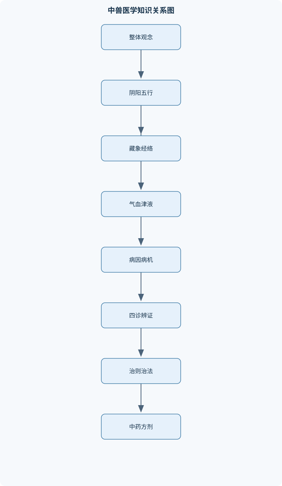
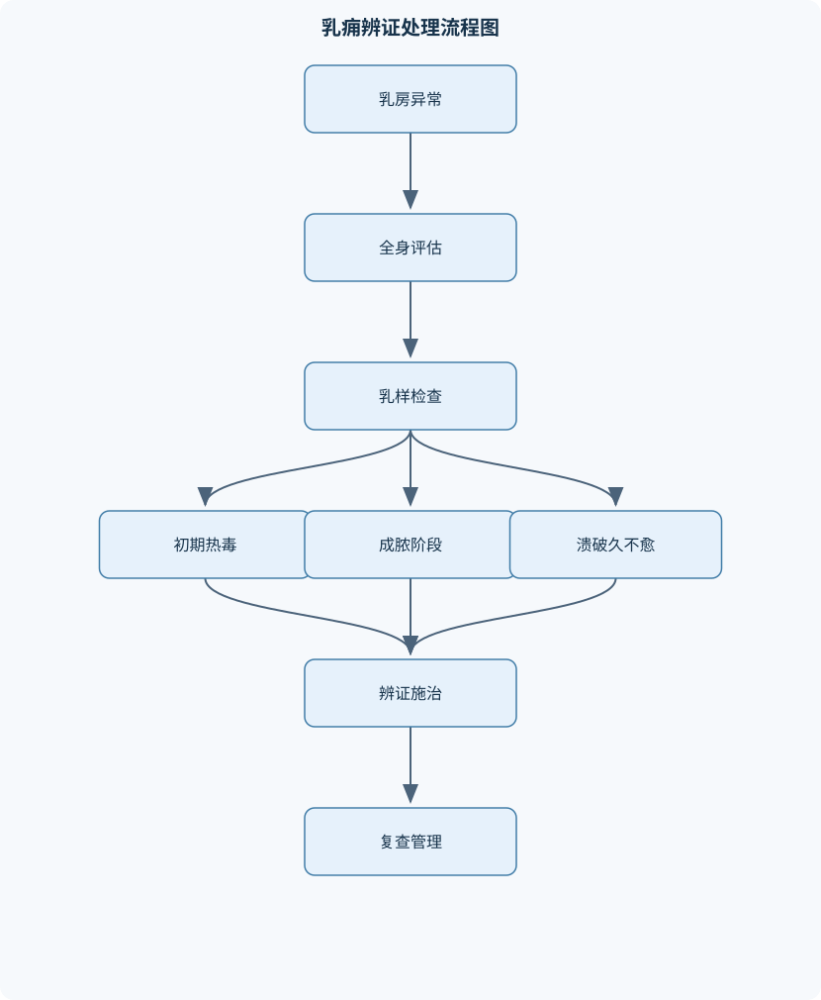

# 中兽医学

## 一、课程整体知识框架

### 课程边界与先修知识

《中兽医学》研究以中医基础理论为指导，结合动物种属、生理特点和临床表现，对动物疾病进行整体认识、四诊采集、辨证分析、治则制定以及中药、方剂、针灸等防治的课程。主要内容包括阴阳五行、藏象、经络、气血津液、病因病机、诊法、辨证、治则治法、中药学、方剂学和常见畜禽疾病的辨证论治。课程边界在于讲授传统兽医学理论及其规范临床应用，不替代传染病学、外科学、药理学、影像学、实验室诊断和现代兽医公共卫生流程。学习本课程应具备动物解剖生理学、基础兽医学、病理学、药理学和临床诊断学基础，并理解不同动物的正常体温、呼吸、脉搏、采食、排泄、行为和口腔黏膜表现。临床应用必须综合动物种属、年龄、生产阶段、病程、饲养管理、实验室检查、动物福利和食品安全要求；对急危重症、传染病、群发病、中毒、严重脱水、呼吸循环障碍和需要手术的疾病，应优先进行现代兽医急救、隔离、检验和专科处理。





### 1. 学科定位、研究对象与课程边界

中兽医学是在传统中医理论基础上，结合动物种属、生理特点、生产用途和临床表现，研究动物疾病发生发展规律、诊察方法、证候分类、治疗原则以及中药、方剂、针灸等防治方法的应用性学科。其核心不是把人的疾病和处方简单移植到动物，而是以动物的整体状态、病程变化和证候组合为依据，形成“采集信息—分析病机—确定证候—制定治法—选择方药—评价疗效”的连续过程。

中兽医学的“整体观念”包括三个层面。第一，动物个体是形体、脏腑、气血津液、经络和精神活动相互联系的整体，局部症状需要放在全身状态中解释。第二，动物与饲养环境、气候、饲料、饮水、运动、生产阶段和管理方式相互联系。第三，疾病是动态过程，同一动物在不同阶段可能由表入里、由实转虚，或出现寒热错杂、虚实夹杂。因此，初诊结论必须允许随复诊资料和辅助检查结果调整。

本课程不替代传染病学、外科学、药理学、影像学、实验室诊断和动物公共卫生流程。急危重症、呼吸循环障碍、严重脱水、中毒、疑似传染病、群发性疾病、机械性肠梗阻、严重乳房炎和需要手术处理的病变，应优先进行生命支持、隔离、采样、病原学检查、输液、引流或外科处理，中兽医辨证可作为综合诊疗的一部分，不能延误必要的现代兽医处置。

### 2. 基本认识方法：整体观、辨证论治与辨病论治

“病”是相对完整的病理过程或疾病类别；“症”是动物表现出来的症状和体征，例如发热、咳嗽、腹泻、口色改变、乳汁异常；“证”是某一疾病阶段中病因、病位、病性以及正邪盛衰关系的综合概括；“证候”是若干具有内在联系的临床表现及其病机组合。辨证是把四诊资料归纳为证候的过程，辨病则是依据病因、病原、病理变化、解剖部位和实验室结果确定疾病名称。

辨证论治强调“证同治同、证异治异”。同一种现代疾病可能因寒热、虚实和病位不同而采用不同治法；不同疾病也可能因具有相同的证候而采用相近治法。辨病论治能够明确传染性、外科性、寄生虫性或中毒性病因，辨证论治则有助于分析动物当前的机体反应和证候阶段。二者不是相互排斥的关系：病名用于确定诊疗范围和风险，证候用于确定治疗方向和个体化调整。

### 3. 元气、阴阳与五行的理论基础

元气论把生命活动理解为形体与功能相互依存的过程。课程中的“气”不是现代物理学中的某一种气体，而是维持生命活动的功能性物质及其运动状态。阴阳是相对概念，阴可表示相对静止、内守、寒凉和物质基础，阳可表示相对运动、外向、温热和功能活动。阴阳必须说明比较对象和条件，不能把某个结构或症状永久固定为阴或阳。例如，体表相对于体内可属阳，但同一体表局部又可能出现寒证或热证。

阴阳关系包括对立制约、互根互用、消长平衡和相互转化。寒邪偏盛可损伤阳气，形成“阴盛则阳病”；阳气虚弱又可出现畏寒、冷痛、泄泻、水肿等表现。由此可推出“寒者热之”的治法，但该原则只有在确认病性属寒、病位和虚实明确、没有明显热邪或急危重症时才适用。低体温不等于传统寒证，休克、低灌注、环境寒冷和测量误差均可造成体温降低；高体温也不能单独证明热证。

五行以木、火、土、金、水概括不同功能属性及其相互联系。相生为木生火、火生土、土生金、金生水、水生木；相克为木克土、土克水、水克火、火克金、金克木。母病及子、子病及母可作为传变模型；相乘是克制太过，相侮是反向克制。例如肝气失疏、木气偏亢，可能影响脾胃运化，可用“木乘土”解释腹胀、食欲下降和泄泻。但五行不能替代饲料分析、寄生虫检查、感染性肠炎检查或胰腺等器官检查，不能仅凭五行对应表机械诊断。

### 4. 藏象与经络的功能系统

藏象理论中的脏腑名称主要表示功能系统，不能简单等同于现代解剖器官。五脏包括心、肺、脾、肝、肾，主要特点是化生和贮藏精气；六腑包括胆、胃、小肠、大肠、膀胱和三焦，主要承担受纳、传化、排泄等功能；奇恒之腑包括脑、髓、骨、脉、胆和女子胞等，形态上类似腑而功能上具有贮藏精气等特点。

心主血脉、藏神。心气推动血脉运行，心血又是神志活动的重要物质基础，因此心血不足可见精神沉郁、活动减少、脉虚等表现，但“神”异常还必须排除缺氧、低血糖、中毒、疼痛和神经系统疾病。肺主气，既主呼吸之气，又主一身之气；肺的宣发与肃降关系到呼吸、鼻液排出和水液输布。肺失宣降可见咳嗽、喘息、鼻液异常，痰饮阻肺时可兼有痰多、胸腹部呼吸负担增加等表现。

脾主运化、升清、统血，主肌肉和四肢，开窍于口，在液为涎，并与胃相表里。水谷精微的吸收和转输是气血生成的重要基础，脾气虚可导致食欲下降、消瘦、腹泻、乏力，也可因统摄失常而出血。肝藏血、主疏泄、主筋，动则血运于诸经，静则血归于肝的理论说明肝血与运动、筋脉濡养及血液储藏有关；肝血不足可见活动不利、视物异常或精神不安，但仍应结合贫血、营养缺乏和神经肌肉疾病检查。

肾藏精、主水，主纳气，并与命门之火相关。肾阳不足可出现畏寒、腰胯无力、泄泻、水肿或繁殖功能异常；肾不纳气可表现为久喘、吸气困难等，但呼吸困难首先要排除肺炎、气道阻塞、胸腔疾病和循环障碍。三焦在理论上是水液运行和气化活动的通道，临床上可用于概括上焦、中焦、下焦不同部位的病变。经络是联系脏腑、形体和体表的功能通路，针灸定位可以参考经络和穴位，但不能将经络直接等同于血管、神经或淋巴管。

### 5. 气、血、津液及其病理变化

元气是生命活动的根本动力；宗气由自然界清气和水谷精微之气结合而成，聚于胸中，与呼吸和心血运行有关；营气行于脉内，具有化生血液和濡养作用；卫气行于脉外，具有温养、护卫和调节腠理等作用。气的运动形式包括升、降、出、入，气机失调可表现为气虚、气滞、气逆和气陷。

气能生血，说明脾胃运化和气化功能参与血液生成；气能行血，说明气的推动作用有助于血液运行；气能摄血，说明气具有约束血液、使其循脉运行的作用。血能载气并为气提供物质基础，故称“气为血帅，血为气母”。气滞可导致血瘀，气虚可导致血行无力或出血。慢性失血动物出现黏膜苍白、精神沉郁和脉虚时，可考虑血虚兼气虚，但必须进行血常规、寄生虫、消化道出血和营养状态检查。

津液是机体正常水液的总称，津较稀薄，液较浓稠。津液来源于饮水和水谷精微，经脾运化、肺宣发肃降、三焦通行和肾气蒸化而输布排泄。津液亏耗可见口渴、尿量减少、黏膜干燥和粪便干结；水液停聚可形成痰饮或水肿。痰饮、瘀血和结石是病理产物，也可反过来阻滞气机、影响脏腑功能。严重脱水、休克和肾衰竭不能只用“津液失调”概括，应及时进行液体复苏、肾功能评估和电解质检查。

### 6. 病因、病机与疾病转归

六气是风、寒、暑、湿、燥、火的正常气候变化；当其过盛、异常，或机体适应能力不足时，才可能成为六淫。风邪具有开泄、善行数变和主动特点，表现常较突然、游走不定；寒邪易伤阳，具有凝滞和收引特点，可见冷痛、拘急和脉迟；暑邪炎热升散，常夹湿并损伤津液；湿邪重浊、黏滞、趋下，病程较长且阻滞气机；燥邪易伤津，常影响肺；火热可伤津、生风、动血、致痈。

内伤因素包括情志变化、饥饱失常、过劳、久卧、妊娠哺乳负担和管理不当。外伤、烧伤、冻伤、虫兽伤和中毒可直接损伤形体、气血或脏腑。正气是机体维持正常生理和抵抗病邪的综合能力，邪气是破坏稳态并引发疾病的因素。正邪相争的结果可表现为邪胜正衰、正胜邪退、邪去正虚或正虚邪恋。分析病机时应同时判断病位、病性和正邪盛衰，不能只依据一个症状下结论。

### 7. 四诊、八纲辨证与诊断推理

望诊包括精神、体态、被毛、皮肤、口腔黏膜、眼鼻分泌物、粪便、尿液、乳房和乳汁等。不同动物口腔黏膜的观察部位和正常颜色不同，白、赤、青、黄等口色只能提供病理提示，青紫还可能见于缺氧、循环障碍或瘀血，不能单独确诊。闻诊包括声音、呼吸声、咳嗽声及分泌物气味。问诊需记录发病时间、群体分布、饲料饮水、免疫、环境、生产阶段、既往病史和用药史。切诊包括触诊、叩诊和脉诊，浮脉、沉脉、迟脉、数脉、虚脉、实脉的意义必须结合动物的正常脉率、体温、应激和病程判断。

八纲辨证先判表里，再辨寒热、虚实，最后以阴阳统摄。表寒证常见恶寒较重、发热较轻、清涕、无汗、浮紧等倾向；表热证常见发热较重、微恶寒、口渴、黏涕、浮数等倾向。里寒证可见畏寒、冷痛、泄泻、迟脉；里热证可见高热、口渴、便秘、尿黄、数脉。虚证表示正气不足，实证表示邪气亢盛或病理产物壅滞，虚实可以夹杂并随病程变化。六经辨证适合分析外感病由表入里的层次；卫气营血辨证用于温热病病势深入的阶段性分析；气血津液辨证适合分析气虚、血瘀、津亏、痰饮等病理状态。

## 二、章节和模块划分

### 核心知识覆盖清单

本清单用于检查正文是否覆盖本课程的主要知识模块：

- **中兽医学理论体系与整体观**：中兽医学的学科内容与特点、整体观念在动物临床中的含义、辨证论治与辨病论治的关系、病、症、证与证候的区别、元气论与生命活动认识、阴阳的属性与相互关系、五行特性及相生相克、五行相乘相侮与病理传变、阴阳五行理论的临床应用边界。
- **藏象与经络基础**：五脏的主要生理功能、六腑的主要生理功能、奇恒之腑与一般腑的区别、脏腑之间的表里关系、心主血脉与藏神、肺主气、司呼吸及宣发肃降、脾主运化、升清和统血、肝藏血、主疏泄和主筋、肾藏精、主水和命门之火、三焦的气化与水液通道、经络的基本概念及临床定位。
- **气血津液与病理生理**：元气、宗气、营气和卫气、气机的升降出入、气对血的生、行、摄作用、血对气的承载作用、津与液的性质差异、气与津液的生成运行关系、血与津液的相互转化、血液生成与脾胃的关系、气虚、气滞、气逆、气陷的病机、血虚、血瘀、出血和血热的病机、津液亏耗、痰饮和水肿的形成。
- **病因与病机**：六气、六淫与疠气、风邪的开泄、善行数变和主动、寒邪的伤阳、凝滞和收引、暑邪的炎热、升散和挟湿、湿邪的重浊、黏滞、趋下和阻滞、燥邪伤津及易伤肺的特点、火热邪气伤津、生风、动血和致痈、七情、饥饱劳逸与内伤、外伤、烧伤、冻伤、虫兽伤和中毒、痰饮、瘀血、结石等病理产物、正邪相争与疾病转归、病位、病性和正邪盛衰的综合分析。
- **四诊与兽医临床信息采集**：望诊的全身、局部和分泌物观察、闻诊中的声音与气味判断、问诊的发病史、饲养史和用药史、切诊中的触诊、叩诊与脉诊、不同动物的口腔黏膜观察部位、白、赤、青、黄口色的基本病理意义、浮、沉、迟、数、虚、实脉的提示作用、体表温度、耳鼻四肢和精神状态的综合判断、粪便、尿液、鼻液和乳汁的望闻诊、四诊资料的交叉验证、传统诊察与体温、血常规、影像和病原学检查的结合。
- **辨证体系与诊断推理**：八纲辨证的阴阳、表里、寒热、虚实、表寒证与表热证的鉴别、里寒证与里热证的鉴别、虚中夹实与实中夹虚、脏腑辨证的基本方法、六经辨证的适用范围、卫气营血辨证的层次、气血津液辨证的适用范围、病因辨证与病性辨证、证候动态演变和传变、同病异治与异病同治、辨证结果与现代鉴别诊断的互补关系。
- **治则、治法与临床决策**：扶正与祛邪、治标与治本、正治与反治、治常与治变、汗法及其适应证、吐法及其适应证和风险、下法及其适应证、和法的适用病位、温法、清法和补法、消法及其与泻下法的区别、先急后缓与标本兼顾、动物种属、病程和体质对治法选择的影响。
- **中药性能、炮制与配伍**：中药材、中成药与民间草药、四气与寒热病性的对应、辛、甘、酸、苦、咸五味作用、升降浮沉与病势趋向、归经与选择性作用部位、毒性、剂量和个体差异、修制、水制、火制和水火共制、炮制对药性、毒性和制剂性的影响、七情配伍的单行、相须、相使、相畏、相杀、相恶和相反、配伍禁忌与妊娠禁忌、动物种属、产品动物和停药管理的安全要求。
- **方剂学与常用治法方**：方剂与治法的关系、君臣佐使的组成原则、方剂的药味增减变化、药量变化与功效偏移、数方合用和药物替代、解表方的分类与应用、清热方的分类与应用、泻下方与消导方、和解方、温里方与祛湿方、理中汤与四君子汤比较、麻黄汤与桂枝汤比较、白虎汤与清营类方比较、大承气汤、小承气汤和调胃承气汤比较、四神丸、玉屏风散和补中益气汤、四物汤、六味地黄丸和肾气丸。
- **常见动物疾病辨证与综合防治**：猪风寒感冒与风热感冒、肺气失宣、痰饮阻肺的辨治、脾胃虚寒与脾胃气虚、脾肾阳虚泄泻的病机、热结胃肠及其与食积的鉴别、肝胆湿热与湿热下注、肾阳虚、肾虚水泛和肾不纳气、乳痈的病因、分期和证型、乳痈热毒壅盛、气血瘀滞和气血两虚、乳房检查、乳汁检查和乳房炎鉴别、群体性疾病中的隔离、采样和报告、中兽医治疗与抗感染、补液、外科引流的协同、疗效评价、复诊和方案调整。


### 1. 中兽医学理论体系与整体观

本模块建立课程的概念基础，重点说明元气、阴阳、五行、整体观、辨证论治和辨病论治。学习时应始终区分传统功能系统与现代解剖结构，明确理论模型的解释范围。阴阳五行可用于组织临床信息和解释病机传变，但不能替代病原学、血液学、影像学和毒物学检查。

### 2. 藏象与经络基础

本模块依次讲授五脏、六腑、奇恒之腑、脏腑表里关系以及经络定位。重点解释心主血脉与藏神、肺主气和宣降、脾运化升清统血、肝藏血疏泄主筋、肾藏精主水和命门之火、三焦气化等内容。经络用于理解体表与脏腑的联系及针灸定位，不能作为现代组织结构的直接替代。

### 3. 气血津液与病理生理

本模块从元气、宗气、营气、卫气讲到气血津液的生成、运行和相互关系，再分析气虚、气滞、气逆、气陷、血虚、血瘀、出血、血热、津亏、痰饮和水肿。推理应遵循“功能异常—运行障碍—临床表现”的链条。例如脾气虚可导致气血生化不足，继而出现血虚；脾不统血又可导致出血，但出血原因仍需区分外伤、凝血障碍、寄生虫和器官病变。

### 4. 病因与病机

本模块按外感病因、内伤因素、外伤与中毒、病理产物和正邪关系组织。重点比较风、寒、暑、湿、燥、火的性质及其临床表现，解释六气与六淫的区别，分析疾病从表入里、由实转虚、寒热错杂和虚实夹杂的可能路径。群体性发病时，个体证候分析必须置于流行病学调查、隔离、采样和报告流程之后。

### 5. 四诊与兽医临床信息采集

本模块要求把四诊作为交叉验证系统，而不是孤立的诊断工具。输入信息包括动物种属、年龄、生产阶段、病史、饲养史、临床表现和辅助检查；输出应包括初步证候、现代鉴别诊断、补充检查和复诊指标。体温、呼吸、脉搏、采食、排泄、精神和黏膜颜色应结合判断。任何单一口色、脉象或分泌物都不能独立决定证候。

### 6. 辨证体系与诊断推理

本模块比较八纲辨证、脏腑辨证、六经辨证、卫气营血辨证、气血津液辨证、病因辨证和病性辨证。八纲辨证提供总纲，脏腑辨证定位功能系统，六经和卫气营血强调外感病传变层次，气血津液辨证侧重物质和功能失调。辨证结果必须与病程、种属差异、现代检查结果相互验证，并记录支持证据和反证。

### 7. 治则、治法与临床决策

治则包括扶正祛邪、治标治本、正治反治、治常治变和先急后缓。八法包括汗、吐、下、和、温、清、补、消。汗法适用于病邪在表且正气能够耐受发汗；吐法风险较高，动物存在误吸、脱水和应激风险，必须严格限定适应证；下法用于里实积滞或热结，但应排除机械性肠梗阻、严重脱水和虚弱；和法用于少阳或表里、寒热、虚实错杂；温法、清法、补法和消法分别针对寒证、热证、虚证和积聚痰瘀等病理产物。补法不能用于高热、感染或邪实未解的所有消瘦动物。

### 8. 中药性能、炮制与配伍

中药性能包括四气、五味、升降浮沉和归经。寒凉药多用于热证，温热药多用于寒证；辛能散、行，甘能补、缓、和，酸能收、涩，苦能泻、燥、降，咸能软坚、下行。升降浮沉表示作用趋向，归经表示理论上的作用部位，二者都不能等同于现代药物分布或受体靶点。

炮制包括修制、水制、火制和水火共制，可能改变药物的药性、毒性、刺激性、有效成分和制剂性能。七情配伍中，单行为单味药发挥作用；相须为性能功效相近药物协同；相使为主药与辅助药配合；相畏、相杀涉及毒性或副作用的制约；相恶表示配伍后作用降低；相反属于配伍禁忌。实际选药还必须审查药材来源、动物种属、年龄、妊娠、肝肾功能、食用动物残留和停药管理，不能直接套用人用剂量。

### 9. 方剂学与常用治法方

方剂由治法统摄，君药针对主病或主证，臣药辅助君药或治疗重要兼证，佐药可治次要证候、制约药性或反佐，使药可引经或调和诸药。药味增减、药量变化、剂型和给药途径变化，均可能改变方剂功效和安全边界。

理中汤与四君子汤均可健脾益气，但理中汤配干姜，偏温中散寒，适合脾胃虚寒；四君子汤偏益气健脾，适合脾胃气虚。麻黄汤偏辛温发汗，适用于表寒实证；桂枝汤偏调和营卫，适用条件不同。白虎汤偏清气分实热，清营类方适用于热入营分，不能仅凭“发热”互相替代。大承气汤、小承气汤和调胃承气汤的泻下强度及作用重点随芒硝、厚朴、枳实、甘草等配伍变化而不同，必须先判断是否存在阳明腑实以及燥、实、痞、满的组合。四神丸偏温肾暖脾、固肠止泻；玉屏风散偏益气固表；补中益气汤偏益气升阳；四物汤偏养血调血；六味地黄丸偏滋补肾阴；肾气丸在滋补基础上兼温助肾阳。

### 10. 常见动物疾病辨证与综合防治

猪风寒感冒与风热感冒的鉴别，应结合恶寒、发热程度、鼻液性质、口渴、咳嗽和脉象倾向；猪群呼吸道症状还必须鉴别流感、支原体病、细菌性肺炎和其他传染病。肺气失宣、痰饮阻肺可分别从宣肺、祛痰、理气等方向分析，但喘息严重时应优先处理缺氧和呼吸循环障碍。脾胃虚寒、脾胃气虚和脾肾阳虚泄泻，应根据寒象、病程、腰胯无力、粪便特点和正气情况区分。热结胃肠要与食积、机械性肠梗阻和严重脱水鉴别。

肝胆湿热与湿热下注可从病位和分泌排泄异常分析；肾阳虚、肾虚水泛和肾不纳气分别侧重温煦、利水和纳气功能。乳痈表现为乳房红、肿、热、痛及乳汁异常，传统上可分为热毒壅盛、气血瘀滞和气血两虚。初期可从清热解毒、消肿散瘀分析，成脓期重点是确认脓腔并规范引流，溃破久不愈时兼顾扶正排脓。乳痈不能只按证型治疗，还应进行乳房检查、乳汁检查、必要的病原学检测、弃奶管理、卫生控制和全身抗感染评估。

### 11. 四诊辨证流程

**输入：**动物种属、年龄、生产阶段、病史、饲养管理、全身与局部表现、体温、呼吸循环指标及辅助检查结果。  
**过程：**

```text
病例输入
→ 评估生命体征、隔离需求和急救指征
→ 依次采集望、闻、问、切资料
→ 排除环境温度、应激、种属差异和测量误差
→ 判断病位：表/里及具体脏腑或局部组织
→ 判断病性：寒/热、虚/实，并识别夹杂
→ 形成候选证候和现代鉴别诊断
→ 选择必要的血液、影像、病原学或乳样检查
→ 制定治法、观察指标和复诊条件
```

**输出：**初步证候、鉴别诊断、补充检查、治疗方向和复诊指标。不变量是不能由单一症状决定证候；终止条件是主要证候能够解释核心表现、病程和检查结果，且没有未处理的危急征象。该流程适合一般非急危重症，复杂病例应转入现代专科诊疗。

### 12. 中药与方剂审查流程

输入证候、动物种属、体重、年龄、妊娠状态、生产用途、既往用药和食品安全要求。先确定治法，再按四气五味、升降浮沉、归经和功效选择候选药；随后安排君臣佐使，检查相反、相恶、妊娠禁忌、毒性、药材来源和种属差异；最后明确剂型、途径、观察指标和停药管理。输出为经审查的治疗方案。该流程不能替代合法处方审核，也不能在未确认药材质量和安全性的情况下使用有毒或来源不明药材。

### 13. 代表性例题与分析

#### 例题一：表寒证与表热证鉴别

**题干：**某猪发热、恶寒、咳嗽。甲表现为清鼻液、无明显口渴、浮紧倾向；乙表现为黏鼻液、口渴、浮数倾向。分别辨证并说明边界。

**分析与解答：**甲以恶寒、清涕、无汗倾向和浮紧为主，病位偏表、病性偏寒、正邪关系偏实，可辨为表寒证，治法偏辛温解表。乙以发热较重、口渴、黏涕和浮数为主，病位偏表、病性偏热，可辨为表热证，治法偏辛凉解表。  
**结果验证：**复诊应观察体温、呼吸负担、鼻液变化和采食恢复；若出现群体发病、持续高热或呼吸困难，必须补充病原学和呼吸系统检查。  
**变式：**若动物精神沉郁、脉弱、病程较长，应考虑表证兼气虚，不能机械使用峻烈发汗法。

#### 例题二：理中汤与四君子汤比较

**题干：**动物长期食欲下降、稀便。甲兼腹痛、四肢偏冷；乙无明显寒象但精神乏力、消瘦。

**分析与解答：**两者共同点是脾胃功能不足和气虚倾向。甲有冷象和腹痛，说明脾胃虚寒，理中汤因配伍干姜而偏温中散寒、补气健脾；乙以气虚为主，四君子汤偏益气健脾。  
**结果验证：**应观察粪便、食欲、体温、腹痛和脱水程度；若存在寄生虫、感染性肠炎或严重低蛋白，不能仅用补益方解释和处理。  
**变式：**若长期高热、腹胀拒食，应先排查感染、积滞或外科腹症，不能因消瘦而直接温补。

#### 例题三：大承气汤、小承气汤与调胃承气汤

**题干：**三只动物均腹胀便秘。甲腹胀满、燥结、热象明显；乙腹胀实满但燥结不突出；丙粪便干结而腹部痞满不明显。

**分析与解答：**三者共同前提是必须确认里实热结，而不是一般便秘。甲痞、满、燥、实俱备，传统治法偏峻下热结；乙实满明显而燥结较轻，偏向较缓的泻下方案；丙燥实在下而痞满不明显，偏向调胃和缓下方向。  
**结果验证：**治疗前应检查脱水、腹痛性质、肠蠕动和影像学表现。幼龄、妊娠、虚弱、严重脱水或疑似机械性肠梗阻时不能按腑实使用泻下法。  
**变式：**若腹胀伴持续翻滚、无粪便排出和进行性疼痛，应优先按外科急症处理。

#### 例题四：五行病机分析

**题干：**动物长期应激后食欲下降、腹胀、间歇性泄泻，兼有易惊和躁动。

**分析与解答：**传统模型可用肝气失疏、木乘脾土解释情志或应激影响脾胃运化，治法重点应放在疏肝理气与健脾运化的主次关系上。但该解释不能排除饲料突然更换、寄生虫、感染性肠炎和肝胆疾病。  
**结果验证：**需结合粪便检查、饲料调查、体况、肝功能和群体发病情况。  
**变式：**若同时出现高热、血便或快速脱水，应先进行感染性和危重症评估。

#### 例题五：乳痈分期处理

**题干：**奶牛乳房局部红肿热痛，乳汁有絮状物并发热；数日后形成局限性波动肿块，排脓不畅。

**分析与解答：**初期属于乳房局部炎症和热毒壅盛倾向，治法可从清热解毒、消肿散瘀分析，并同步进行乳样采集和全身状态评估。出现波动肿块提示可能形成脓腔，重点转为确认脓肿并规范引流；若溃破久不愈、脓液清稀、体况下降，则兼顾益气养血和扶正排脓。  
**结果验证：**评价指标包括体温、采食、乳房疼痛和肿胀、乳汁细胞或培养结果、产奶量及复发情况。  
**变式：**若出现精神沉郁、循环异常或多乳区受累，应按全身感染风险处理，不能局限于局部辨证。

### 14. 实验与项目任务

#### 项目一：四诊资料与现代检查的交叉验证

**输入数据：**选择非急危重症动物病例，记录种属、年龄、病程、饲养史、体温、呼吸、脉搏、精神、采食、排泄、黏膜、分泌物和触诊结果，并同步收集可获得的血常规、粪检或影像资料。  
**步骤：**先完成四诊记录，再按表里、寒热、虚实和病位形成候选证候；随后将每条证候判断与支持证据、反证和待查项目对应；最后比较辨证结论与现代检查结果。  
**评价标准：**记录完整，能够区分症状、病名和证候；没有把单一口色或脉象作为确诊依据；能指出至少一个现代鉴别诊断和一个需要复查的指标。  
**排错方法：**若证候与体温、病程或实验室结果矛盾，应检查测量误差、环境应激、种属正常值和记录遗漏，而不是强行修改资料以符合理论。

#### 项目二：乳房炎综合诊疗流程设计

**输入数据：**乳房外观、触诊、乳汁性状、体温、采食量、产奶量、乳区分布、挤奶卫生和群体发病信息。  
**步骤：**先判断是否存在败血症、严重毒血症或需紧急引流的脓肿；再按规范方法采集乳样；根据病程和局部表现区分热毒壅盛、气血瘀滞或气血两虚倾向；制定中兽医治法与现代乳房炎管理协同方案；设定复查时间和弃奶、隔离及卫生要求。  
**评价标准：**完成个体分期、证型分析、现代鉴别、采样计划、治疗边界和复查指标；不能以乳汁外观替代培养或其他检查。  
**排错方法：**若局部好转而体温持续升高，应重新评估全身感染；若乳汁恢复但肿块持续，应排查脓腔、纤维化和其他乳腺病变；若群体多只发病，应转入群体性疾病调查流程。

## 三、核心概念的详细解释

### 3.1 中兽医学的对象、方法与整体观

中兽医学以传统中医理论为基础，结合动物种属、生理特点、饲养环境、生产阶段和临床表现，研究疾病的病因、病机、诊察、辨证、治则及中药、方剂、针灸等防治方法。其基本诊疗链条是：采集资料—辨别病位与病性—分析正邪盛衰—确定证候—制定治法—选择方药或针灸方案—观察疗效并复诊调整。

整体观不是把所有症状简单归因于“体质”，而是要求将局部病变放在动物全身和环境中分析。例如乳房红肿热痛既要辨别乳房局部的热毒、瘀滞和脓肿，也要检查体温、采食、反刍、产奶量、乳汁变化及群体发病情况。咳嗽、鼻液和喘息既可属于肺失宣降，也可能由病毒、细菌、支原体、寄生虫、吸入性损伤或环境粉尘引起。因此，中兽医辨证不能替代病原学、血液学、影像学和外科检查。

“病”是相对完整的疾病过程或疾病类别；“症”是动物能够观察或测量到的表现，如发热、咳嗽、腹泻、精神沉郁、黏膜苍白和乳汁异常；“证”是疾病某一阶段病因、病位、病性及正邪关系的综合概括；“证候”则是具有内在病机联系的一组症状和体征。辨病回答“患的是什么疾病”，辨证回答“当前处于什么病理阶段、属于什么寒热虚实和脏腑病位”。同病可以异治，异病也可以同治，但前提是证候相同或主要病机相近。

### 3.2 元气、阴阳与五行

元气论把生命活动理解为形体与功能相互依存、气化运动持续进行的过程。课程中的“气”不是某一种现代化学气体，而是维持生命活动的功能性物质及其运动状态。元气是生命活动的根本动力，宗气由自然界清气与水谷精微之气结合而成，聚于胸中，与呼吸、声音和一身气机有关；营气主要运行于脉内，具有化生血液和濡养作用；卫气运行较快，主要发挥温养、护卫和调节体表的作用。

阴阳是相对属性，必须说明比较对象和条件。阴可表示相对静止、内守、寒凉、物质基础；阳可表示相对运动、外向、温热、功能活动。体表相对于体内可属阳，但体表局部也可能出现寒证；白昼相对于黑夜属阳，但高热动物在夜间仍可表现为热证。阴阳关系包括对立制约、互根互用、消长平衡和相互转化。阴虚不能制约阳，常表现为虚热，即“阴虚生内热”；阳虚不能温煦肌表，常表现为畏寒、冷痛、泄泻和水肿，即“阳虚生外寒”。这些是病机模型，不等于体温测量结果。环境寒冷、休克和低灌注可造成低体温，感染、应激或炎症也可造成高体温。

五行的基本属性为木、火、土、金、水。相生顺序为木生火、火生土、土生金、金生水、水生木；相克关系为木克土、土克水、水克火、火克金、金克木。相生可用于解释功能联系，如脾胃运化产生的水谷精微支持气血化生；相克可用于解释制约关系，如肝气过亢影响脾胃运化，可用“木乘土”描述。

“乘”是克制过度，“侮”是反向克制。例如脾土虚弱时，肝木即使正常也可能相对乘脾；肺金气虚时，肝木偏亢可出现木侮金的理论解释。五行还能解释“母病及子”和“子病及母”的传变模型。但五行不能替代饲料分析、寄生虫检查、感染性肠炎检查或器官功能检查。若动物持续腹泻，不能仅凭“木乘土”排除饲料霉变、细菌感染、病毒感染、寄生虫和胰腺疾病。

### 3.3 藏象、脏腑功能与经络

藏象中的心、肺、脾、肝、肾及六腑名称，首先是传统理论中的功能系统，不能直接等同于现代解剖器官。五脏偏于化生和贮藏精气，六腑偏于受纳、传化和排泄。奇恒之腑如脑、髓、骨、脉、胆、女子胞等，形态上多似腑而功能上具有贮藏精气的特点；胆既参与胆汁贮藏和排泄，又属于六腑与奇恒之腑的特殊结合。

心主血脉、藏神。心气推动血液运行，心血是神志活动的重要物质基础。广义的“神”指生命活动及其外在表现，狭义的“神”指精神、意识和思维活动。心血充足时，动物精神、反应和被毛状态通常较好；心气或心血不足可见精神不振、脉弱、活动耐力下降等，但这些表现还需与贫血、心肺疾病、疼痛和全身感染鉴别。

肺主气，主呼吸之气，又主一身之气。肺通过宣发肃降完成气机升降和体内外气体交换；宣发偏向向上、向外布散，肃降偏向向下、向内清肃。肺失宣发可见鼻液、咳嗽、喘息和体表卫外功能异常；肺失肃降可见咳嗽、气逆、痰液增多和水液输布障碍。肺还与水液代谢有关，但肺失宣降不能单独解释所有水肿和呼吸困难，必须排查心衰、低蛋白血症、肺炎、胸腔积液和气道阻塞。

脾主运化、升清、统血，主肌肉和四肢，开窍于口，在液为涎。运化包括运化水谷和运化水液：前者涉及采食物质转化为精微，后者涉及水液输布。脾气虚可导致食欲下降、消化不良、腹泻、消瘦和四肢无力；脾不统血可出现慢性出血倾向。脾与胃相表里，胃主受纳和腐熟，脾主运化和升清，二者共同完成消化吸收功能。

肝藏血、主疏泄、主筋。动物活动时血液输布于经脉，安静时血液相对归藏于肝，传统上概括为“动则血运于诸经，静则血归于肝脏”。肝血不足可见筋脉失养、运动不利、被毛失泽和视物异常等；肝疏泄失常可影响情志、食欲、气机和脾胃运化。肾藏精、主水、主骨生髓，并与生长发育、生殖和先天禀赋有关。命门之火是肾阳及其温煦、推动作用的理论表达，肾阳虚可见畏寒、腰腹冷痛、泄泻、水肿和生殖功能减退。

六腑以通为用。胃主受纳，胆贮藏和排泄胆汁，小肠分清泌浊，大肠传导糟粕，膀胱贮尿和排尿，三焦被视为水液运行和气化的通道。经络是联系脏腑、肢体、皮毛和组织的理论系统，可用于解释病变传导、症状分布和针灸定位；经络定位不能替代神经定位、血管检查、骨关节影像和外伤评估。

### 3.4 气、血、津液及其病理变化

气具有推动、温煦、防御、固摄和气化作用。气机包括升、降、出、入四种基本运动。气虚是功能不足，常见精神不振、活动减少、呼吸无力和食欲下降；气滞是运行不畅，常见胀满、疼痛和情绪或运动状态变化；气逆是气机反向上冲，可见咳嗽、喘息、呕吐等；气陷是升举无力，可见久泻、脱垂和内脏下陷倾向。上述表现不是单一症状的机械对应，必须结合病位和病程。

血运行于脉内，具有濡养和承载作用。气能生血、行血和摄血：脾胃运化正常有助于血液生成，气的推动使血运行，气的固摄使血不妄行。血能载气并为气提供物质基础。因此，气虚可导致血行无力或出血，气滞可导致血瘀；长期失血又可导致血虚并进一步影响气的功能。血虚可见黏膜苍白、精神沉郁、被毛失泽和脉虚；血瘀可见局部固定疼痛、青紫、肿块或血行不畅。青紫也可能来自缺氧和循环障碍，不能仅按血瘀处理。

津液是机体正常水液的总称，津较稀薄，分布于皮肤、肌肉和孔窍；液较浓稠，主要充养关节、骨髓和脏腑。津液与脾、肺、肾、三焦关系密切。脾运化、肺宣降、肾气化和三焦通道共同影响水液生成、输布和排泄。津液亏耗可见口渴、尿量减少、皮肤弹性下降和黏膜干燥；水液停聚可形成痰饮、水肿或腹水。严重脱水、休克和电解质紊乱属于现代急症，不能只用“津液亏耗”概括后延误补液和监护。

### 3.5 病因与病机

六气是正常的风、寒、暑、湿、燥、火气候变化；当其过盛、异常或机体不能适应时，才称为六淫。风邪具有轻扬开泄、善行数变和主动的特点，常见症状变化快、病位偏表和运动异常。寒邪易伤阳，具有凝滞和收引特点，可导致冷痛、拘急和运行不畅。暑邪炎热升散，常耗气伤津并夹湿。湿邪重浊、黏滞、趋下，容易阻滞气机，导致沉重、泄泻、水肿和病程迁延。燥邪易伤津，且常先伤肺。火热可伤津、生风、动血和致痈，高热动物若出现抽搐、出血或局部化脓，必须同时进行生命支持和感染评估。

内伤因素包括情志刺激、饥饱失常、劳逸不当、饲养密度过高、运输应激和生产负荷过重。外伤包括挫伤、烧伤、冻伤、咬伤、刺伤和手术创伤；中毒则需优先进行毒物暴露调查、去除暴露源和现代急救。痰饮、瘀血、结石等是病理产物，也可进一步成为致病因素。正气是维持正常生理和抵抗病邪的综合能力，邪气是破坏机体稳态并引发疾病的因素。正邪相争的结果可表现为邪胜、正虚、正邪相持或邪去正复，疾病可能由表入里、由实转虚或出现虚实夹杂。

### 3.6 四诊与临床信息采集

望诊包括观察精神、姿态、运动、被毛、皮肤、眼鼻、口腔黏膜、分泌物、排泄物和局部病变。闻诊包括听声音和嗅气味，如咳嗽声、喘鸣声、嘶哑、粪便异常气味和伤口腐败气味。问诊应涵盖发病时间、病程变化、饲料饮水、免疫、驱虫、用药、生产阶段、同群动物情况和既往病史。切诊包括触诊、叩诊及脉诊，触诊可评价温度、疼痛、肿胀、硬度和波动感，叩诊可辅助判断含气、含液或实质性改变。

口腔黏膜颜色可提供线索：偏白可提示贫血、失血或循环灌注不足；偏赤可见热证、炎症或充血；偏青紫可见寒凝、瘀血、缺氧或循环障碍；偏黄可见湿热、黄疸或其他代谢异常。口色必须结合种属、品种、正常色泽、光线和黏膜部位判断，不能单独确诊。

浮脉指轻取较明显，传统上多提示病位偏表；沉脉指重取较明显，多提示病位偏里；迟脉和数脉分别提示脉搏相对缓慢和加快；虚脉和实脉反映正气不足或邪气壅盛倾向。动物脉率受种属、年龄、体型、运动、应激、体温和疼痛影响，不能直接套用人的脉率。四诊资料必须交叉验证，并与体温、呼吸频率、血常规、影像和病原学结果结合。

### 3.7 辨证体系

八纲辨证以表里、寒热、虚实和阴阳概括病位、病性及正邪关系。表证多涉及肌表、皮毛和肺卫，里证多涉及脏腑、气血和骨髓；表里不能只按病程长短判断。寒证常见畏寒、冷痛、清稀分泌物、迟脉；热证常见发热、口渴、黏稠分泌物、赤色和数脉，但环境温度、应激和炎症均可干扰判断。虚证是正气不足，实证是邪气亢盛或病理产物壅滞，二者可同时存在。

表寒证偏恶寒重、发热轻、无汗、清涕、浮紧脉；表热证偏发热重、微恶寒、口渴、黏涕、浮数脉。里寒证偏冷痛、泄泻、四肢冷和沉迟脉；里热证偏高热、口渴、便秘、尿黄、沉数或实脉。仅有鼻液或体温升高不足以完成表寒、表热鉴别。

脏腑辨证强调病变所属功能系统，如肺气虚、肺失宣降、脾胃虚寒、肝胆湿热、肾阳虚和肾不纳气。六经辨证适合分析外感病从表入里、寒热转化的阶段性变化；卫气营血辨证适合分析温热病由浅入深的层次；气血津液辨证适合分析气虚、气滞、血虚、血瘀、津亏、痰饮和水肿。病因辨证用于分析风、寒、湿、热、痰、瘀等因素，不能取代中毒、感染和寄生虫病的病因调查。

### 3.8 治则、治法与八法

治则是治疗疾病时的总原则，治法是实现治则的具体方法。扶正用于增强或恢复机体功能，祛邪用于消除病邪或病理产物；邪盛以祛邪为主，正虚以扶正为主，虚实夹杂需确定主次。治标针对当前最急迫的症状或危险病理环节，治本针对疾病根本病机；呼吸困难、严重脱水和脓肿需先处理危急标证，同时不能忽视感染和原发病。

正治是逆病性而治，如寒者热之、热者寒之、虚则补之、实则泻之。反治是顺从疾病表面表现而采用与常规不同的治法，必须建立在复杂病机和充分诊断基础上，不能把“反治”理解为随意使用相反药性。治常是按一般规律治疗，治变则根据病情特殊变化调整。八法为汗、吐、下、和、温、清、补、消。汗法用于表邪，吐法用于某些病邪壅于上部的特殊情况，风险较大；下法用于里实积滞或燥结，必须排除机械性肠梗阻、肠扭转、严重脱水、幼龄和虚弱；和法用于半表半里或脏腑失和；温法用于寒证，清法用于热证，补法用于虚证，消法用于积滞、痰、瘀和癥块等病理产物。消法与下法不同，前者渐进消散，后者通过通下排除实邪。

### 3.9 中药性能、炮制与配伍

中药的性能包括四气、五味、升降浮沉和归经。四气为寒、凉、温、热，表示药物寒热倾向；五味为辛、甘、酸、苦、咸。辛能散、能行，常用于发汗、行气、散结和活血；甘能补、能缓、能和；酸能收敛固涩；苦能泻、燥、降；咸能软坚、下行。味与功效不是绝对一一对应，必须结合药物整体性能、剂量和配伍。

升降浮沉表示药物作用趋向，升、浮偏向上行和外达，沉、降偏向下行和内收；归经是药物作用与某脏腑或经络系统联系的理论表达，不能等同于现代药物分布、受体靶点或血药浓度。药物安全取决于药材来源、炮制、种属、体重、年龄、妊娠、肝肾功能、合并用药和食用动物残留要求，不能把人用经验剂量直接用于动物。

炮制包括修制、水制、火制和水火共制，目的可能是清除杂质、改变药性、降低毒性、增强疗效、便于贮藏和制剂。生品与炮制品不应视为完全相同。七情配伍包括单行、相须、相使、相畏、相杀、相恶和相反。相须是性能功效相近药物合用以增强疗效；相使是主药与辅助药配合以提高作用；相畏和相杀涉及毒性或副作用的相互制约；相恶是相互削弱疗效；相反属于配伍禁忌。配伍还应审查妊娠禁忌、毒性、来源和产品动物停药管理。

### 3.10 方剂组成与常用方的证候边界

方剂必须“方从法立”，先确定病机和治法，再选择药物。君药针对主病或主证，是方剂核心；臣药辅助君药或治疗重要兼证；佐药治疗次要证候、制约药性或反佐；使药引药至病所或调和诸药。药味增减、药量变化、方剂合用和药物替代都可能改变功效与安全边界。

四君子汤由党参、白术、茯苓、甘草组成，偏益气健脾，适用于脾胃气虚；理中汤由干姜、党参、白术、甘草组成，在益气健脾基础上温中散寒，适用于脾胃虚寒。二者不能因均含党参、白术、甘草而无条件替代。麻黄汤偏辛温发汗，适用于表寒实证；桂枝汤偏调和营卫，适用条件不同。白虎汤偏清气分实热，清营类方针对热入营分，病位和病性不同。大承气汤、小承气汤和调胃承气汤均用于阳明腑实相关证候，但燥、实、痞、满和泻下强度不同，不能用于所有便秘、腹胀或采食下降。

### 3.11 常见疾病的辨证边界

风寒感冒偏恶寒重、发热轻、清鼻液、无汗和浮紧脉，治法偏辛温解表；风热感冒偏发热重、微恶寒、黏鼻液、口渴和浮数脉，治法偏辛凉解表。猪群出现呼吸道症状时，还必须鉴别流感、支原体病、细菌性肺炎及其他传染病，并执行隔离、采样和群体调查。

脾胃气虚偏食欲下降、乏力、便溏和脉虚；脾胃虚寒在此基础上寒象更明显，可见腹痛喜温、四肢冷和清稀泄泻；脾肾阳虚泄泻多病程较久、黎明前后明显、畏寒和腰腹冷。热结胃肠偏燥屎、腹胀、便秘、发热和实证表现，必须排除机械性梗阻和脱水。肝胆湿热可见黄疸、尿黄、黏腻分泌物和湿热表现，需结合肝胆功能和感染检查。肾阳虚、肾虚水泛和肾不纳气分别偏重温煦失职、水液泛滥和呼吸摄纳无力，不能把所有水肿或喘息都归于肾虚。

乳痈以乳房红、肿、热、痛和乳汁异常为主要表现，传统上分为热毒壅盛、气血瘀滞和气血两虚。初期可表现为热毒与瘀滞，成脓期重点在确认脓腔并规范排脓，溃破久不愈且脓汁清稀时可兼顾益气养血、扶正排脓。乳痈必须与细菌性乳房炎、外伤、乳房脓肿和其他乳腺疾病鉴别，进行乳房检查、乳汁检查、必要的培养和全身感染评估；食用动物还需执行弃奶、停药和残留控制要求。

## 四、重要定义、公式、定理和推导

### 专业审校补充：关键定义与适用边界

针灸治疗在中兽医学中属于“辨证取穴、辨病辅助”的外治疗法，其理论依据包括经络、腧穴、气血运行和脏腑相关，但腧穴定位必须以动物种属、体表标志和局部解剖为前提，不能把人体穴位图直接平移到牛、马、猪或犬。取穴可结合循经取穴、局部取穴、阿是穴和辨证配穴：局部病变明显时可取病变周围或相关经脉腧穴；全身证候突出时需兼顾脏腑和气血。针灸适用于病情稳定、诊断相对明确且不存在立即手术或急救指征的病例，可作为疼痛管理、功能康复或慢性病调理的辅助措施。骨折、关节脱位、开放性创伤、进行性神经功能缺失、严重感染、休克、呼吸循环障碍、妊娠动物腹部危险区域以及凝血异常动物，不能仅凭辨证施针；局部肿胀、脓肿、出血或明显感染处也不宜直接针刺。疗效判断应结合疼痛反应、步态、采食、活动能力和现代检查结果，不能以动物短暂安静或针后嗜睡单独证明疾病已经改善。


### 4.1 基本定义及其逻辑关系

阴阳的定义是：在特定比较对象和条件下，阴表示相对静止、内守、寒凉和物质基础，阳表示相对运动、外向、温热和功能活动。其逻辑不是“阴永远对应某一器官、阳永远对应某一症状”，而是相对比较关系。若病理表现为阴液不足、阳失制约，可推导出虚热；若阳气不足、温煦和推动功能下降，可推导出虚寒。

气的定义是维持生命活动的功能性物质及其运动状态；血是运行于脉内、具有濡养和承载作用的物质；津液是机体正常水液的总称，津较稀薄，液较浓稠。正气是维持正常生理活动和抵抗病邪的综合能力，邪气是破坏机体稳态并引发疾病的因素。证是某一阶段病因、病位、病性和正邪关系的综合概括，辨证是由四诊资料归纳证候的过程。

### 4.2 气血津液关系的推导

由“脾胃为气血生化之源”可作如下推导：

1. 饲料和饮水经胃受纳、脾运化，转化为水谷精微。
2. 水谷精微参与气血生成，因此脾胃功能下降可导致气虚或血虚。
3. 脾气具有统摄作用，若脾气虚弱，血液固摄无力，可出现出血。
4. 气具有推动作用，气虚则血行无力；气滞则血行受阻，可形成血瘀。
5. 血又是气的物质基础，长期血虚可进一步导致气的功能减弱。

因此，慢性失血动物若出现黏膜苍白、精神沉郁、脉虚和活动耐力下降，不能只判断为“血虚”，还应分析是否兼有气虚，并进行血常规、寄生虫和消化道出血检查。该推导适用于辨证分析，不可替代对贫血病因的现代诊断。

由“脾运化、肺宣降、肾气化、三焦通行”可推导水液病机：脾失运化，水湿生成或输布不利；肺失宣降，水液不能向下输布；肾阳不足，蒸腾气化无力；三焦不利，水道不通。多因素共同作用时可出现水肿、痰饮和尿量变化。若动物出现严重脱水、少尿、呼吸困难或循环障碍，应优先进行体液状态、肾功能和循环监测。

### 4.3 五行生克的推导与边界

五行相生关系可表示为：

$$
木 \rightarrow 火 \rightarrow 土 \rightarrow 金 \rightarrow 水 \rightarrow 木
$$

箭头表示传统理论中的生化和支持关系，不表示现代生理学中的单一因果链。若母行功能异常影响子行，称母病及子；若子行病变反过来影响母行，称子病及母。五行相克关系可表示为：

$$
木 \dashv 土,\quad 土 \dashv 水,\quad 水 \dashv 火,\quad 火 \dashv 金,\quad 金 \dashv 木
$$

其中 $\dashv$ 表示制约。克制太过称相乘，反向克制称相侮。以肝脾关系为例：

1. 肝疏泄正常，有助于气机调畅。
2. 肝气过亢或疏泄失常，可能影响脾胃运化。
3. 脾失运化后出现腹胀、食欲下降和泄泻。
4. 若脾本已虚弱，则肝气的影响更容易表现出来，可称“木乘土”。

这一推导只能说明传统病机解释路径。若存在持续腹泻、发热、血便、脱水或群体发病，必须优先排查感染、饲料中毒、寄生虫、营养和环境因素。

### 4.4 八纲辨证的推导规则

八纲分析可按以下顺序进行：

1. 先判断病位偏表还是里：观察病程、皮毛肌表、肺卫表现及脏腑气血表现。
2. 再判断寒热：综合体温、精神、口渴、分泌物、排泄物、疼痛性质和脉象。
3. 再判断虚实：分析正气是否不足、邪气是否壅盛，以及病理产物是否存在。
4. 最后以阴阳统摄，并识别表里同病、寒热错杂、虚实夹杂。
5. 每一个判断都要记录支持证据和反证，避免只凭一个症状下结论。

例如“发热”只能支持热象，不能直接证明里热实证；若动物同时精神沉郁、脉弱、食欲废绝，则可能存在正虚。若高热伴呼吸困难、黏膜发绀或循环不良，应先处理生命危险，再进行辨证。八纲结果的有效性取决于它能否解释主要症状、病程变化和辅助检查结果；若不能解释，应重新检查测量误差、环境应激、种属正常值和遗漏病史。

### 4.5 治则选择的推导

由正邪关系可得：

- 邪气盛、正气尚可：以祛邪为主，必要时兼顾扶正。
- 正气虚、邪气不盛：以扶正为主。
- 正虚邪实并存：分清主次，或先祛急邪后扶正，或攻补兼施。
- 标证危急：先治标以稳定生命，再治本。
- 病情缓和：治本与调理并重。

“寒者热之”的适用前提是病性确属寒，且没有明显热邪、实热或急危重症。若动物低体温来自休克，单纯温补并不能代替复苏；若所谓“寒证”实际为严重感染早期，也不能因见畏寒而忽视病原学检查。“补虚”也有边界：持续高热、感染、积滞、脓肿和邪实未解时盲目补益，可能使病邪留恋，必须先控制危险病因和实邪。

### 4.6 方剂组成与功效变化的推导

方剂功效不是药物名称的简单相加，而是由药性、功效、配伍、药量、剂型和病机共同决定。若以方剂功效记为 $F$，可作概念性表示：

$$
F = f(\text{药味},\ \text{药量},\ \text{配伍},\ \text{剂型},\ \text{病位},\ \text{病性},\ \text{体质})
$$

这里的 $F$ 不是可直接计算的数值，$f$ 表示综合判断关系；药量也不是脱离动物种属和安全要求的固定变量。增加或减少一味药，可能改变主治；改变核心药物比例，可能使方剂由温中转为偏补气，或由和解转为清利；不同剂型还会改变起效速度、吸收和适用场景。

理中汤与四君子汤的比较可按推导完成：

1. 二方均含补气健脾的基本药物，故均可用于脾胃功能不足。
2. 理中汤加入干姜，增强温中散寒作用。
3. 因此，理中汤适合脾胃虚寒，常需有腹痛喜温、畏寒、泄泻清稀等寒象。
4. 四君子汤不以温散为核心，偏于益气健脾。
5. 因此，脾胃气虚而寒象不明显时，四君子汤的理论适配性更强。

大承气汤、小承气汤和调胃承气汤的选择也不能只看“都能泻下”。应先确认是否属于阳明腑实，再分析燥、实、痞、满的组合及正气状态：燥屎、实热、痞满胀痛俱重时，理论上需要较强的通下；实而燥结不明显时，宜考虑较缓的通下方向；燥实在下而痞满不突出时，治法侧重点不同。幼龄、妊娠、严重脱水、虚弱动物和疑似机械性肠梗阻不得仅按传统腑实使用泻下法。

### 4.7 乳痈分期推导

乳痈病程可按局部病变与正邪关系分层：

1. 初期：乳房红、肿、热、痛，乳汁异常，热毒和气血壅滞较明显，治法偏清热解毒、消肿散瘀。
2. 成脓期：局部肿块形成并出现波动感，重点是确认脓腔和规范排脓，不能只增加口服药物。
3. 溃破久不愈期：脓汁清稀、排出不畅、病程迁延，提示气血受损，治法可在排脓基础上兼顾益气养血。
4. 若出现持续高热、精神沉郁、采食废绝、循环异常或多乳区受累，应优先评估全身感染和败血症风险。
5. 若群体多只发病，还要转入乳房卫生、挤奶流程、环境和病原传播调查。

该推导的边界是：传统证型只能指导综合治疗方向，不能代替乳样采集、培养或药敏评估，也不能代替脓肿引流、隔离、弃奶和食品安全管理。

### 4.8 四诊资料的证据权重与验证原则

四诊资料没有一种可以独立决定证候。可采用“多证据相互支持”的原则：

- 望诊提供整体和局部外观信息；
- 闻诊提供声音和气味信息；
- 问诊提供时间顺序、暴露因素和群体背景；
- 切诊提供温度、疼痛、肿块、脉象等信息；
- 现代检查提供体温、血常规、影像、病原学和器官功能证据。

若口色提示青紫，但动物同时存在呼吸困难和低氧表现，应先按缺氧或循环障碍评估；若脉数而体温正常，需考虑疼痛、应激、运动或测量误差；若乳汁外观改善而乳房肿块持续，应排查脓腔、纤维化或其他乳腺病变。只有当病位、病性、虚实、病程和检查结果大体相互一致时，辨证结果才具备较好的临床解释力。

## 五、算法、流程和实现思路

### 方法与流程覆盖索引

下列方法或流程应在正文中说明输入、步骤、适用条件、结果检查和边界：

- 四诊辨证流程：输入为动物种属、病史、饲养管理、全身表现、局部表现和辅助检查结果；先确认生命体征与隔离需求，再按望、闻、问、切采集信息，归纳病位、病性和虚实寒热，形成一个或多个候选证候；输出为初步辨证、鉴别诊断、需要补充的检查和复诊指标；不变量是任何单一症状不得独立决定证候；终止条件是证候与主要临床表现、病程及检查结果相互一致，或转入现代专科诊断。适用于一般非急危重症，复杂病例需联合现代兽医诊疗。
- 八纲辨证分析流程：输入为四诊资料；第一步判断病位偏表或里，第二步判断寒或热，第三步判断虚或实，第四步用阴阳统摄并识别夹杂证；将每个判断与支持证据和反证记录对应；输出为八纲证候描述及治法方向；不变量是先排除环境、应激、种属差异和测量误差；终止条件是主要证候能解释核心症状且没有未处理的危急征象。
- 中药选用与配伍审查流程：输入为证候、动物种属、体重、年龄、生产用途、妊娠状态、既往用药和产品安全要求；先确定治法，再按药性、归经、功效选择候选药，安排君臣佐使，检查相反、相恶、妊娠禁忌、毒性和种属差异，最后确定剂型、给药途径、观察指标和停药管理；输出为经审查的治疗方案；不变量是不得在未核实药材来源和安全性的情况下使用有毒或来源不明药材；不适用于替代处方审核和法规要求。
- 方剂比较分析流程：输入为两个或多个方剂及其组成、功效和主治；逐味标记核心药、辅助药和制约药，比较治法、药性、作用部位、病位、病性和正邪关系，再分析药味增减、剂量变化和剂型变化对功效的影响；输出为共同点、差异点、适应证和禁忌边界；终止条件是能够用证候而非药名解释方剂选择。
- 乳痈临床工作流程：输入为乳房外观、触诊、乳汁性状、体温、采食和全身状态；先评估是否存在败血症、严重毒血症或需要紧急处理的脓肿，再采集规范乳样进行检查，区分热毒壅盛、气血瘀滞和气血两虚等证候，按病程选择清热解毒、消肿散瘀、引流或扶正排脓等治法，并同步执行卫生、挤奶、隔离和现代乳房炎管理；输出为分期、证型、治疗和复查计划；终止条件是全身状态稳定、乳汁异常改善且复查结果支持恢复。
- 群发性疾病调查流程：输入为多个动物的发病时间、地点、日龄、饲料、饮水、免疫、死亡和临床表现；建立病例定义，绘制时间和群体分布，采集代表性样本，优先排查传染病、中毒、饲料和环境因素，再进行辨证分型；输出为初步病因分类、隔离与防控措施、实验室检测计划和个体治疗边界；不变量是先控制传播和暴露风险，不能用个体辨证替代群体病因调查。


### 5.1 四诊辨证与现代鉴别诊断流程

四诊辨证不是把症状逐项套入固定证型，而是将动物种属、病史、环境、全身表现、局部表现和辅助检查整合为病位、病性及正邪盛衰的判断。该流程适用于病情相对稳定的一般病例，不适用于需要立即抢救的休克、严重呼吸循环障碍、急性中毒、机械性肠梗阻和疑似传染病暴发现场。

**输入：**动物种属、年龄、性别、妊娠或泌乳状态、生产阶段、发病时间、饲养管理、用药史、望闻问切资料、体温和必要的实验室或影像检查结果。

**输出：**初步辨证、现代鉴别诊断、拟定治法、需要补充的检查、疗效评价指标和复诊条件。

**步骤：**

1. **先做安全分流。**检查精神状态、呼吸频率和呼吸困难程度、脉搏或心率、体温、黏膜颜色、毛细血管再充盈、脱水程度及是否存在持续呕吐、严重腹泻、抽搐、出血或不能站立。若存在危急征象，应先进行现代兽医急救和专科处理，中兽医辨证只能作为协同分析。
2. **判断是否需要隔离。**群体中短期内出现相似症状，或伴有高热、咳嗽、腹泻、神经症状、死亡增加，应优先考虑传染病、饲料中毒、饮水污染和环境因素，建立病例定义并采样。
3. **按四诊采集资料。**望诊观察精神、被毛、姿态、运动、呼吸、口腔黏膜、鼻液、粪尿、乳汁和局部病灶；闻诊观察叫声、咳嗽、喘鸣及异常气味；问诊追溯发病先后、饲料更换、气候变化、免疫、驱虫、用药和同群发病情况；切诊包括体表温度、疼痛、肿块、腹部张力、脉象等。
4. **先辨病位，再辨病性。**病位可偏表或里，病性可偏寒、热、湿、燥、痰、瘀、气滞或气虚。表里、寒热、虚实必须结合病程，不能凭单一症状判断。
5. **形成候选证候。**例如发热、恶寒、清鼻液、咳嗽、浮紧脉可支持表寒倾向；发热较重、微恶寒、口渴、黏鼻液、浮数脉可支持表热倾向。但呼吸困难、群体发病或肺部影像异常时，仍需鉴别病毒性、细菌性、支原体性和寄生虫性呼吸道疾病。
6. **交叉验证。**若证候解释不了主要症状，或与体温、血常规、病原学、影像结果矛盾，应检查环境应激、测量误差、种属正常值和记录遗漏，不能强行修改证候。
7. **设定终止条件。**当主要证候能够解释核心表现、病程和检查结果，且不存在未处理的危急征象时，可形成初步治疗方案；若无法解释，转入现代专科诊断或补充检查。

该流程的不变量是：口色、脉象、单一分泌物或某一个症状不得独立决定证候；传统证候描述也不得替代病原学、血液学、影像学和外科评估。

### 5.2 八纲辨证的结构化分析算法

八纲辨证可按“表里—寒热—虚实—阴阳统摄”的顺序组织。阴阳是总纲，表里说明病位深浅，寒热说明病性，虚实说明正邪盛衰。顺序不是绝对固定，但逐层分析有助于避免把一个症状直接当作诊断结论。

**输入：**经过四诊整理的症状、体征、病程、环境因素和辅助检查。

**过程：**

1. **表里判断：**新发、病程较短、症状主要在皮毛、肌表或肺卫，且有恶寒、发热、鼻液、咳嗽等，可考虑表证；腹泻、便秘、黄疸、持续食欲下降、脏腑功能异常或病程迁延，提示里证可能性增加。表里可相兼，也可由表入里。
2. **寒热判断：**寒证可见畏寒、冷痛、清稀分泌物、迟脉；热证可见发热、口渴、黏稠或黄赤分泌物、数脉。环境寒冷、运动、疼痛和应激会改变体温与脉搏，因此不能把低体温必然等同于寒证，也不能把高体温单独作为热证依据。
3. **虚实判断：**虚证反映正气不足，常见精神疲弱、脉虚、病程较长、恢复能力下降；实证反映邪气亢盛或病理产物壅滞，常见症状较剧、局部胀满疼痛、脉有力。虚实可夹杂，例如脾气虚基础上兼有食积，或感染后正虚而余邪未尽。
4. **阴阳统摄：**阴证多表现为寒、虚、内、静，阳证多表现为热、实、外、动，但这些属性是相对的，必须注明比较对象和条件。
5. **记录支持证据和反证。**例如“表寒”有清涕、恶寒、浮紧脉支持，但若存在高热持续、脓性鼻液和肺部实变，则需重新考虑热证或现代感染性疾病。
6. **输出治法方向。**表寒偏辛温解表，表热偏辛凉解表；里寒偏温中或温里，里热偏清热或泻下；虚证偏扶正，实证偏祛邪。若虚实夹杂，应确定主次，避免单纯攻伐或盲目补益。

### 5.3 中药选用、配伍与安全审查流程

中药选择必须“方从法立”，即先明确病机和治法，再选药组方。药物的四气、五味、升降浮沉和归经是传统性能描述，不等同于现代药物分布、靶点或血药浓度。

**输入：**证候、动物种属、体重、年龄、妊娠或泌乳状态、生产用途、肝肾功能、既往用药、药材来源和食品安全要求。

**步骤：**

1. 确认主要治法，如解表、清热、温里、补益、理气、化痰、祛湿、活血、收涩或消导。
2. 按四气选择寒凉或温热倾向，按五味分析作用方向：辛多有发散、行气、活血作用；甘多有补益、缓急、调和作用；酸多有收敛固涩作用；苦多有清泄、燥湿、下降作用；咸多有软坚、下行作用。
3. 根据病位和病势考虑升降浮沉及归经，但不能把“归肺”“归肝”等直接解释为现代器官靶向。
4. 安排君臣佐使。君药针对主病或主证；臣药辅助君药或治疗重要兼证；佐药治疗次要证候、制约药性或反佐；使药引经或调和诸药。
5. 检查七情配伍。相须是性能和功效相近药物协同；相使是主药与辅药配合以增强疗效；相畏、相杀侧重毒性或副作用的相互制约；相恶表示配伍后作用可能受到削弱；相反涉及配伍禁忌。
6. 审查毒性、来源、炮制状态、种属差异、妊娠禁忌、药物相互作用和食用动物停药管理。
7. 明确观察指标，包括精神、采食、排泄、体温、呼吸、局部病灶、乳汁或粪尿变化；出现恶化或不良反应时停止套用原方案并重新诊断。

不得将人用剂量直接换算为动物用量。动物种属、胃肠道结构、代谢能力、年龄、妊娠、肝肾功能以及食用产品残留要求均可能改变安全边界。

```python
def review_herbal_plan(case):
    """
    输入：病例字典，包含证候、种属、生产用途、妊娠状态、药材和检查结果
    输出：审查结果与需要补充的信息
    本程序只进行结构化审查，不计算剂量，也不替代兽医处方审核。
    """
    required = ["species", "pattern", "purpose", "pregnancy", "herbs"]
    missing = [key for key in required if key not in case]

    if missing:
        return {
            "status": "incomplete",
            "missing": missing,
            "action": "补充病例信息后再进行配伍和安全审查"
        }

    warnings = []

    if case["purpose"] == "food_animal":
        warnings.append("必须审查食用动物用药限制、产品残留和停药管理")

    if case["pregnancy"] is True:
        warnings.append("必须逐味审查妊娠禁忌，不能仅按证候选方")

    if not case["herbs"]:
        warnings.append("未提供药材组成，无法进行君臣佐使及配伍审查")

    if case["pattern"] in ["高热", "疑似中毒", "严重脱水", "呼吸循环障碍"]:
        warnings.append("应优先进行现代兽医急救、检验或专科处理")

    return {
        "status": "review_required",
        "pattern": case["pattern"],
        "warnings": warnings,
        "next_step": "核实药材来源、炮制状态、禁忌、相互作用和复查指标"
    }

case = {
    "species": "反刍动物",
    "pattern": "脾胃虚寒",
    "purpose": "food_animal",
    "pregnancy": False,
    "herbs": ["干姜", "党参", "白术", "甘草"]
}

result = review_herbal_plan(case)
print(result["status"])
```

程序的终止条件是完成信息完整性、生产用途、妊娠状态和危急征象检查；它不能判断药材真伪、病原学结果或具体剂量，输出的“审查”不等同于临床处方。

### 5.4 方剂比较与病案推理流程

比较方剂时，应从组成、治法、核心药物、病位、病性、正邪关系和禁忌边界逐层展开，而不是只背诵功效。

**步骤：**

1. 列出各方组成，标出核心药物。
2. 判断方剂解决的是表、里、寒、热、虚、实中的哪一组主要矛盾。
3. 分析药味增减如何改变作用重点。
4. 对照患者证候，排除机械性肠梗阻、严重脱水、传染病和外科病变等现代禁忌。
5. 以证候而不是方名解释选择理由。
6. 用症状、体温、采食、排泄、局部病灶和实验室结果验证疗效。

### 5.5 例题一：表寒证与表热证鉴别

**题干：**某猪突然发热、咳嗽、鼻液增多。甲表现恶寒较重、鼻液清稀、无汗样表现、脉浮紧；乙表现发热较重、微恶寒、口渴、鼻液黏稠、脉浮数。分别辨证并说明治疗方向。

**分析：**甲以恶寒、清稀鼻液、浮紧脉为主，寒邪束表、卫阳受遏的可能性较大；乙以发热、口渴、黏液和数脉为主，偏向风热犯表。

**逐步解答：**

1. 二者病位均偏表。
2. 甲病性偏寒，属表寒倾向，治法偏辛温解表。
3. 乙病性偏热，属表热倾向，治法偏辛凉解表。
4. 若出现呼吸困难、持续高热、群体发病或肺部异常，应补充病原学和呼吸系统检查。

**结果验证：**治疗后体温、呼吸状态、鼻液性质和采食量应改善；若持续恶化，说明不能继续按普通外感处理。

**变式：**若动物精神沉郁、体温明显异常且黏膜发绀，应优先评估缺氧、肺炎或循环障碍，而不是仅按表寒或表热选方。

### 5.6 例题二：理中汤与四君子汤

**题干：**甲动物长期食欲减退、消瘦、精神不足，但无明显畏寒和冷痛；乙动物食欲不振、稀便、腹痛喜温、四肢偏冷。比较两方适用性。

**解答：**

1. 两方均有益气健脾方向，适用于脾胃功能不足。
2. 四君子汤偏益气健脾，甲的气虚而寒象不明显，理论上更符合。
3. 理中汤加入干姜，温中散寒作用增强；乙有腹痛喜温、稀便和肢冷，偏脾胃虚寒，理论适配性较强。
4. 若乙同时高热、腹部高度膨满、持续呕吐或疑似肠梗阻，不得仅凭“腹痛泄泻”使用温补方。

**结果验证：**应观察采食、粪便性状、腹痛、体温和体重变化；若高热、血便或脱水持续，应转入感染性肠炎、寄生虫病或外科疾病鉴别。

**变式：**若甲兼有明显寒象，四君子汤的适配性下降，应重新分析是否存在脾胃虚寒或阳虚。

### 5.7 例题三：热结胃肠与食积鉴别

**题干：**动物腹胀、排便减少。甲粪便干硬、腹部胀满疼痛、体温升高；乙在突然更换饲料后出现食欲下降、嗳气或反刍异常、粪便中可见未消化饲料，但无明显高热。

**解答：**

1. 甲表现为燥、实、热和腑气不通的组合，需考虑热结胃肠，治法方向为通腑泄热、理气消胀。
2. 乙与饲料改变和消化功能紊乱关系密切，偏向食积或消化不良，治法重点为消导、理气和调整饲料。
3. 两者都可腹胀，但腹胀不是使用泻下法的充分条件。
4. 若腹部高度扩张、持续疼痛、不能排便排气、反复呕吐或循环状态下降，应立即排除机械性肠梗阻、肠扭转和严重胃肠扩张。

**验证：**通过排便、腹围、腹痛、采食、脱水程度及影像或实验室检查综合判断。

**变式：**幼龄、妊娠、严重脱水或体弱动物即使便秘，也不能机械套用峻下法。

### 5.8 例题四：气血关系推理

**题干：**某动物慢性失血，表现黏膜苍白、精神沉郁、脉虚和活动耐力下降。说明气血关系并提出分析方向。

**解答：**

1. 血具有濡养和承载作用，血虚可导致黏膜苍白、精神不足和组织失养。
2. 气能生血、行血和摄血，长期失血可进一步导致气虚；气虚又可使摄血无力、血行无力，形成气血两虚或失血—气虚的循环。
3. 治疗方向可考虑益气养血，但必须先查明失血原因。
4. 应进行血常规、寄生虫检查、消化道出血排查及必要的影像或粪便检查。

**结果验证：**不能只用精神和黏膜颜色判断疗效，应结合红细胞相关指标、粪便、采食和体重变化。

**变式：**若存在持续出血、休克或严重贫血，应先进行现代急救和止血处理，补益法不能替代病因治疗。

### 5.9 例题五：乳痈分期与综合处理

**题干：**奶牛乳房局部红肿热痛，乳汁有絮状物并伴体温升高；后期局部出现边界较清楚、具有波动感的肿块，排脓不畅。说明分期和处理重点。

**解答：**

1. 初期以乳房红肿热痛、乳汁异常和发热为主，偏热毒壅盛或气血瘀滞，治疗方向为清热解毒、消肿散瘀，同时进行乳样规范采集和全身状态评估。
2. 出现波动感提示可能形成脓腔，应通过触诊、超声等检查确认，成脓后重点是规范引流，而不是单纯增加内服药。
3. 溃破久不愈、脓液清稀、排出不畅且动物体质下降时，可在处理局部病灶基础上兼顾益气养血、扶正排脓。
4. 持续高热、精神沉郁、采食废绝或循环异常提示全身感染风险，应优先进行现代抗感染、支持和必要的外科处理。
5. 食用动物还要执行弃奶、卫生、隔离和残留管理。

**结果验证：**乳房肿胀、疼痛、乳汁性状、体温、采食和乳样复查结果均应改善；局部好转而全身高热不退时，应重新评估败血症或深部脓肿。

### 5.10 实验或项目一：四诊辨证一致性评估

**输入数据：**同一病例的种属、年龄、病史、环境、体温、呼吸、口腔黏膜、鼻液、粪便、脉象记录，以及血常规或病原学结果。

**步骤：**

1. 两名或多名学习者分别独立完成望闻问切记录。
2. 各自写出病位、寒热、虚实和候选证候，并标明支持证据和反证。
3. 对照现代检查，分析哪些证候可解释主要表现，哪些不能解释。
4. 讨论种属正常值、环境、应激和记录误差的影响。
5. 形成统一的复诊指标和转诊条件。

**评价标准：**资料记录完整；未以单一口色或脉象定论；能提出至少一个现代鉴别诊断；能说明何时停止传统辨证并转入专科诊疗；复诊指标具有可观察性。

**排错方法：**若学习者结论差异很大，先核对原始资料和测量方法，再讨论证候；不得通过删除矛盾信息来制造一致结论。若体温、脉搏或血常规结果与辨证明显冲突，应优先复核设备、采样和种属正常范围。

### 5.11 实验或项目二：乳房炎综合诊疗流程设计

**输入数据：**乳房外观、触诊、乳汁性状、体温、采食、产奶量、乳区分布、挤奶卫生、同群病例和乳样检查结果。

**步骤：**

1. 判断是否存在败血症、严重毒血症或需紧急引流的脓肿。
2. 按规范方法采集乳样，记录采样乳区和时间。
3. 结合病程区分热毒壅盛、气血瘀滞、气血两虚等证候倾向。
4. 制定中兽医治法与现代乳房炎管理协同方案。
5. 规定体温、乳房肿胀、疼痛、乳汁、采食、产奶量和复查结果等评价指标。
6. 对多只动物发病者，转入群体调查，排查挤奶设备、卫生流程、环境和病原传播。

**评价标准：**完成分期、证型分析、现代鉴别、采样计划、治疗边界、隔离和食品安全管理；不能以乳汁外观替代培养或其他检查。

**排错方法：**局部好转而体温持续升高时，重新评估全身感染；乳汁恢复而肿块持续时，排查脓腔、纤维化和其他乳腺病变；群体反复发病时，不得只调整个体处方，必须检查群体管理因素。

## 六、概念之间的关系与对比

### 6.1 病、症、证与证候

| 概念 | 核心含义 | 例子 | 不能混淆之处 |
|---|---|---|---|
| 病 | 相对完整的疾病过程或疾病类别 | 急性乳房炎、肺炎 | 不能用一个证候代替病原学或病理诊断 |
| 症 | 可观察或测量的表现 | 发热、咳嗽、腹泻、乳汁异常 | 单一症状通常不能独立定证 |
| 证 | 某一阶段病因、病位、病性和正邪关系的综合概括 | 表寒证、脾胃虚寒证 | 同一疾病不同阶段可有不同证 |
| 证候 | 一组具有内在病机联系的症状和体征 | 发热、恶寒、清涕、浮紧脉组成表寒倾向 | 不是症状的简单相加，而是病机组合 |

辨病和辨证是互补关系。辨病有助于识别传染病、寄生虫病、中毒和外科病变；辨证有助于分析当前病程、寒热虚实和个体反应。对于疑似传染病或群发病，必须先进行隔离、采样和报告流程，不能以“同一证型”替代群体病因调查。

### 6.2 阴阳、表里、寒热与虚实

阴阳是总纲，表里是病位，寒热是病性，虚实是正邪盛衰。四者既有联系又不可互相替代。例如表寒证可有实证和虚证之分：表寒实证常见恶寒、无汗、脉浮紧；表寒虚证可能表现为卫表不固、反复外感、出汗和脉虚。里热也可有实热和虚热之别：实热多邪气亢盛，虚热多由阴液不足、制约阳气能力下降所致。

“寒者热之”适用于确认病性偏寒且无明显热邪、正气能够耐受温热治疗的情况；若动物因休克低体温，却有严重感染和循环障碍，不能直接按传统寒证温治。“虚则补之”也有边界，感染、高热、食积、痰湿或脓肿未处理时，盲目补益可能使邪气不易外解。

### 6.3 脏腑功能系统与现代器官检查

藏象中的“肺主气”“脾主运化”“肝藏血”“肾主水”等，是传统功能联系，不是现代解剖学器官的一对一替代。

- **肺主气与呼吸系统检查：**肺失宣降可见咳嗽、喘息、鼻液和水液输布异常，但肺炎、支原体病、寄生虫病、气道阻塞和心源性呼吸困难均需现代鉴别。
- **脾主运化与消化系统检查：**脾气虚可表现食欲下降、消瘦、稀便和乏力，但饲料霉变、寄生虫、感染性肠炎、胰腺疾病和营养不足不能被“脾虚”解释掉。
- **肝藏血与出血、贫血检查：**肝血不足是传统病机概念，黏膜苍白、出血和精神沉郁还需血常规、凝血和肝功能评估。
- **肾主水与泌尿系统检查：**肾虚水泛可见水肿、少尿等理论表现，但肾小球疾病、尿路阻塞、心衰和低蛋白血症也可出现类似现象。

### 6.4 气、血与津液的相互关系

气能生血、行血、摄血；血能载气、养气。气滞可导致血瘀，气虚可导致血行无力或摄血不固；血虚又可使气失所养。临床上“气血同治”不能简单理解为同时使用补气和补血药，而应判断气滞、气虚、血瘀、血虚的主次。

津液是机体正常水液总称，津较稀薄，液较浓稠。气推动津液生成、输布和排泄；津液亏耗可见口渴、尿少、粪便干燥和黏膜干燥；水液停聚可形成痰饮或水肿。严重脱水时，应优先进行现代液体复苏和电解质评估，不能以利水或燥湿法代替补液。

### 6.5 六气与六淫、正气与邪气

风、寒、暑、湿、燥、火是自然界气候变化的六气；当其过盛、异常或动物不能适应并引发疾病时，才称为六淫。把正常气候直接等同于病邪是错误的。疠气强调具有较强传染性的外感致病因素，群发疾病调查时必须考虑病原传播、接触、环境和宿主因素。

正气是维持正常生理活动和抵抗病邪的综合能力，邪气是破坏机体稳态并导致疾病的因素。正邪相争决定病程转归，但不能因此忽略病原体、毒物、营养缺乏或外伤等具体因素。辨证中的“正虚”不能替代免疫、营养、器官功能和实验室评价。

### 6.6 八法与治则的对应关系

八法包括汗、吐、下、和、温、清、补、消。八法是治法分类，不能直接当作疾病名称。

- **汗法：**适用于病邪在表且正气能够耐受者；高热、脱水或虚弱动物需谨慎。
- **吐法：**适用范围有限，动物耐受性和误吸风险必须评估，不能作为常规催吐手段。
- **下法：**适用于里实、燥结、积滞等情况；疑似机械性肠梗阻、肠扭转、严重脱水和体弱动物禁忌机械套用。
- **和法：**用于表里、寒热或脏腑不和等不宜单纯汗、下的情况。
- **温法：**适用于里寒、阳虚或寒凝，但感染高热、阴虚内热和热毒壅盛不能误用。
- **清法：**适用于热证；不能把所有发热都当作传统实热。
- **补法：**适用于正气不足；邪实未解、积滞、感染或脓肿未处理时不宜盲目补益。
- **消法：**用于食积、痰饮、瘀血、癥积等渐进性病理产物，和直接攻下燥结不同。

治则还包括扶正祛邪、治标治本、正治反治、治常治变以及先急后缓。严重呼吸障碍、休克、出血和脓肿时，“先治标”不是忽略病因，而是先处理威胁生命的当前问题，再解决根本病因。

### 6.7 中药性能与现代药理概念

四气五味、升降浮沉、归经和毒性共同构成传统药性分析。四气表示寒、凉、温、热倾向；五味表示辛、甘、酸、苦、咸的作用特征；升降浮沉说明作用趋向；归经说明与某脏腑或经络系统的理论联系。它们不能直接替代药理学中的受体、代谢、分布、半衰期和毒理学指标。

炮制包括修制、水制、火制和水火共制等。炮制可能改变药物的寒热倾向、刺激性、毒性、有效成分、溶出性和制剂性能，因此生品与炮制品不能无条件视为相同。对来源不明、霉变、混淆品或毒性药材，必须停止使用并进行质量鉴别。

### 6.8 相须、相使、相畏、相杀、相恶与相反

相须强调性能功效相近药物协同；相使强调主药与辅药配合以增强疗效；相畏是某药物毒性或副作用被另一药物制约；相杀是某药物能够减轻或消除另一药物的毒性；相恶表示配伍后作用可能被削弱；相反涉及配伍禁忌。相畏与相杀都涉及制约关系，但观察角度不同，不能混为同义词。是否能够配伍还要结合炮制、剂量、动物种属、妊娠、肝肾功能和产品安全要求判断。

### 6.9 方剂组成变化与治效变化

方剂功效不是药味名称的简单相加，可用下式表示其分析框架：

$$
\text{方剂作用} = f(\text{药味组成},\ \text{药量比例},\ \text{配伍关系},\ \text{剂型},\ \text{病位},\ \text{病性},\ \text{体质})
$$

式中 $f$ 表示综合关系，不是可以脱离临床条件直接计算的数值；药量比例也不是可以跨物种照搬的固定值。减去君药可能使方剂失去主治，增加温热药可能使方剂偏于温散，增加清热或利湿药可能改变寒热和作用重点，改变汤剂、散剂或其他剂型还可能改变释放和吸收特征。

因此，理中汤与四君子汤虽都涉及健脾益气，但理中汤因有温中散寒药而偏向脾胃虚寒，四君子汤偏向脾胃气虚；麻黄汤与桂枝汤都可用于外感表证，但前者偏辛温发汗、适用于表寒实证，后者侧重调和营卫，不能将二者笼统称为同一种“感冒方”。

### 6.10 乳痈与细菌性乳房炎的关系及边界

乳痈是以乳房红、肿、热、痛及乳汁异常为主要表现的传统病名，常可对应急性乳房炎的临床表现，但二者不能简单画等号。乳痈的热毒壅盛、气血瘀滞和气血两虚是证型分类；细菌性乳房炎则需要结合乳样检查、病原学、炎症指标和乳房组织变化判断。

初期可有清热解毒、消肿散瘀的治法方向；成脓期若确认脓腔，应规范引流；溃破久不愈、正气受损时才考虑扶正排脓。整个过程必须同时执行乳区卫生、乳样检查、隔离或挤奶管理、必要的抗感染和食品安全措施。局部红肿减轻不代表病原已清除，乳汁外观改善也不代表乳腺组织已经恢复。

### 6.11 个体辨证与群体调查

个体辨证关注单个动物的病位、病性和虚实；群体调查关注发病时间、空间、日龄、饲料、饮水、免疫、环境和接触传播。群体发病时，个体症状可以用于病例分类，但不能替代群体病因调查。

群体调查的顺序通常是：建立病例定义—确定发病范围—绘制时间和群体分布—控制传播和暴露—采集代表性样本—优先排查传染病、中毒、饲料和环境因素—再进行个体辨证分型。若把同群动物全部归入“风热”或“湿热”，可能延误隔离、报告、采样和环境整改。

### 6.12 常见治疗方向的对照

| 临床方向 | 主要病机 | 典型治法 | 主要边界 |
|---|---|---|---|
| 表寒 | 寒邪束表、卫阳受遏 | 辛温解表 | 高热、呼吸困难和群发病需现代鉴别 |
| 表热 | 风热犯表、卫表不和 | 辛凉解表 | 不能仅凭发热定热证 |
| 脾胃虚寒 | 中阳不足、运化失常 | 温中散寒、补气健脾 | 高热、感染或积滞未解不宜盲补 |
| 痰饮阻肺 | 津液输布失常、痰饮壅肺 | 燥湿化痰、理气宣肺 | 需排查肺炎、寄生虫和气道阻塞 |
| 热结胃肠 | 实热与燥结互结 | 通腑泄热、理气消胀 | 排除肠梗阻、肠扭转和严重脱水 |
| 脾肾阳虚泄泻 | 脾肾阳气不足、运化与固摄失常 | 温补脾肾、固涩止泻方向 | 需排查感染、寄生虫、饲料和肾病 |
| 肝胆湿热 | 湿热郁结肝胆 | 清利肝胆湿热 | 黄疸和肝功能异常需现代检查 |
| 肾虚水泛 | 肾阳不足、水液气化失常 | 温阳利水方向 | 鉴别心衰、低蛋白和尿路疾病 |
| 乳痈热毒壅盛 | 局部热毒、气血壅滞 | 清热解毒、消肿散瘀或规范引流 | 不得替代乳样检查和外科处理 |

这些对照只能作为推理框架，最终方案必须结合动物种属、病程、体质、现代诊断、动物福利和食品安全要求。

## 七、典型例题和应用场景

### 专业审校补充：综合例题

题干：一只成年犬近三个月反复后肢跛行，运动后加重，休息后稍缓解；触诊膝关节内侧疼痛，局部无明显发热和开放性损伤，精神、采食及排便基本正常。主人希望采用针灸治疗。请进行中兽医分析，说明针灸前的鉴别流程、取穴思路、疗效验证和安全边界。分析：跛行属于症状，不等于某一证候。病程较长、活动后加重、局部疼痛提示筋骨或经脉痹阻，可从气血运行不畅、寒湿痹阻或瘀滞方向形成候选证候，但仍需排除前十字韧带损伤、髌骨脱位、骨关节退行性病变、骨折、肿瘤和神经性跛行。逐步解答：第一步，记录患肢、跛行分级、起步和转弯表现，并进行骨科和神经学检查；必要时进行影像学检查。第二步，若发现关节不稳、明显骨性损伤或进行性神经缺损，应转入外科或专科流程，不能直接以痹证处理。第三步，在诊断支持保守康复且生命状态稳定时，可将“局部气血阻滞、筋骨失养”作为辅助辨证方向，取穴原则以局部或阿是穴配合相关经脉腧穴为主，例如在明确解剖定位和避开血管、神经、感染灶的前提下，选择膝周适宜腧穴，并根据整体证候酌配后肢远端穴；具体穴位和操作深度须由受训兽医依据犬体型、解剖和器械规范确定。第四步，建立治疗前基线，包括静息和运动后跛行、触痛反应、关节活动范围及影像结果。疗效验证：连续观察同一运动条件下的步态、上下台阶能力、疼痛反应和活动意愿；若症状仅短时缓解、反复恶化或出现关节肿胀、发热、不能负重，应重新检查病因。结果：针灸只能作为明确诊断后的辅助康复措施，不能替代韧带修复、骨折固定、抗感染或镇痛管理。变式：若该犬突然不能站立、后肢本体感觉消失或大小便功能异常，首先按急性神经或脊髓疾病分流，进行神经定位和影像学评估，不得先按慢性痹证施针。


### 典型题型与应用覆盖索引

建议通过下列题型或应用检查概念是否能够迁移：

- 表寒证与表热证鉴别：给出动物发热、恶寒、鼻液、咳嗽、口色和脉象资料，要求按照病因、表里、寒热、虚实逐项分析；表寒偏恶寒重、发热轻、无汗、清涕、浮紧脉，治法偏辛温解表；表热偏发热重、微恶寒、口渴、黏涕、浮数脉，治法偏辛凉解表；最后说明高热、呼吸困难或群体发病时必须补充病原学和呼吸系统检查。
- 理中汤与四君子汤比较：从组成、君药、药性、功效和主治逐项作答；指出二者均可补气健脾，但理中汤以干姜温中散寒，适于脾胃虚寒，四君子汤偏益气健脾，适于脾胃气虚；给出泄泻、腹痛、四肢冷与食欲减退等不同证候组合，要求说明如何据寒热虚实选择。
- 大承气汤、小承气汤与调胃承气汤比较：先确认是否属于阳明腑实，再分析燥、实、痞、满的组合；痞满燥实俱备且实热较重时偏向峻下，痞满实而燥结不明显时选择较缓方案，燥实在下而无明显痞满时选择调胃方案；同时指出脱水、幼龄、妊娠、虚弱和疑似机械性肠梗阻不能仅按传统腑实使用泻下法。
- 五行生克病例分析：给出脾虚泄泻伴肝郁、食欲不振和腹胀的资料，要求以肝木乘脾土解释病机，再结合脾运化失常判断治法重点；答案应说明五行是病机解释工具，不能替代寄生虫、饲料变化、感染性肠炎和胰腺疾病检查。
- 气血关系病例分析：给出动物慢性失血、精神沉郁、黏膜苍白、脉虚和心悸样表现，要求说明气血相互关系，分析血虚与气虚的先后及兼夹，制定益气养血方向，并列出需要进行的血常规、寄生虫和消化道出血检查。
- 乳痈分期处理：给出奶牛乳房局部红肿热痛、乳汁絮状物、体温升高，后期形成局限性波动肿块且排脓不畅；要求分为初期、成脓期和溃破久不愈期，分别说明清热解毒消肿、规范排脓和扶正排脓的治法，同时说明乳样培养、乳区卫生、弃奶管理和全身抗感染评估。
- 猪感冒辨证：给出猪群出现发热、恶寒、清鼻液或黏鼻液、咳嗽和采食下降，要求区分风寒感冒与风热感冒，列出支持证据、治法和群体防控措施，并说明猪群呼吸道症状还需鉴别流感、支原体病、细菌性肺炎和其他传染病。
- 补虚药使用边界：给出长期消瘦、泄泻、低蛋白和持续高热的动物，要求判断是否可以直接使用补益法；答案应指出高热、感染或邪实未解时盲目补益可能导致闭门留寇，应先明确病因、控制实邪并评估肝肾功能和营养状态。


### 7.1 四诊辨证的综合应用

#### 例题一：表寒证与表热证的鉴别

**题干：**某猪场部分育肥猪突然出现发热、咳嗽、采食量下降。甲猪恶寒明显，发热不高，无汗，鼻液清稀，脉浮紧；乙猪发热较重，轻度恶寒，口渴，鼻液黏稠偏黄，脉浮数。要求分别判断证候倾向、病机、治法，并说明还需要排查哪些现代疾病。

**分析：**两例均有发热、咳嗽和鼻液，病位主要在表，涉及肺卫。但甲猪以恶寒、清稀鼻液、无汗和浮紧脉为主，寒邪束表、卫阳被遏的特点较明显；乙猪以发热较重、口渴、黏稠鼻液和浮数脉为主，风热犯表、肺卫失宣的倾向较明显。脉浮只能支持病位偏表，不能单独决定寒热。

**逐步解答：**

1. 甲猪为表寒倾向，病机是寒邪束表、肺气失宣，治法偏辛温解表、宣肺止咳。
2. 乙猪为表热倾向，病机是风热犯表、肺卫不利，治法偏辛凉解表、宣肺清热。
3. 两者都不能仅凭传统证候直接确定疾病名称。猪群呼吸道症状还应鉴别病毒性呼吸道病、支原体病、细菌性肺炎、混合感染、粉尘刺激及通风不良。
4. 应记录发病日龄、发病比例、死亡率、免疫史、饲料和环境变化，并根据兽医诊疗规范采集鼻拭子、气管或肺组织等适宜样本。

**结果验证：**若甲猪经保温、改善通风和相应治疗后恶寒减轻、鼻液减少、体温恢复，说明表寒判断与病程变化较一致；若出现呼吸困难、持续高热、死亡增加或肺部听诊异常，则原有辨证不能替代病原学和肺部检查。

**变式：**若动物同时出现高热、张口呼吸、黏膜发绀和不能站立，不应继续按普通表证处理，而应先进行呼吸循环支持、隔离和现代专科诊断。

#### 例题二：理中汤与四君子汤的选择

**题干：**病例甲表现为食欲下降、精神不振、粪便稀溏、腹部喜温、四肢偏冷；病例乙表现为食欲下降、体倦、被毛粗乱、粪便偏稀，但无明显畏寒和冷痛。比较两方的组成、功效和适用证候。

**分析：**两方均以补气健脾为共同基础，但药性重点不同。理中汤由干姜、党参、白术、甘草组成，干姜使其偏于温中散寒；四君子汤由党参、白术、茯苓、甘草组成，重点为益气健脾，寒热偏性较弱。

**逐步解答：**

1. 病例甲具有泄泻、喜温、四肢冷等寒象，属于脾胃虚寒倾向，理中汤的治法适配性较强。
2. 病例乙主要是脾胃气虚，寒象不明显，四君子汤的理论适配性较强。
3. 若病例甲伴有高热、腹部明显胀满、粪便恶臭或血便，不能直接使用温补法，应先排查感染、食积、中毒和肠道炎症。
4. 若病例乙伴有持续消瘦、低蛋白、慢性失血或寄生虫感染，应查明病因，不能把所有体倦都归为脾气虚。

**结果验证：**判断是否正确，不以“用了方后精神好转”作为唯一标准，还应观察采食量、粪便性状、体温、脱水程度、体重变化和血液检查结果。

**变式：**若脾气虚兼有食积腹胀，应先分析补益与消导的主次；若湿邪明显、肢体沉重和水肿突出，应考虑健脾祛湿方向，而不是机械套用四君子汤。

#### 例题三：热结胃肠与食积的鉴别

**题干：**某犬腹胀、排便困难。病例甲高热、口渴、腹部胀满拒按、粪便干硬，精神烦躁；病例乙食欲下降、嗳气或恶臭、腹胀但体温正常，近期有过量进食史。要求比较两者的病机和治法。

**分析：**病例甲同时具备热、实、燥、结等特点，符合热结胃肠的理论表现；病例乙以饮食停滞、脾胃运化不良为主，更接近食积。二者都可能腹胀和排便减少，但病性不同。

**逐步解答：**

1. 病例甲的病机为实热与燥结互结，治法方向为通腑泄热、理气消胀，传统方剂比较中可涉及大承气汤类思路。
2. 病例乙的病机为饮食积滞、胃肠传化失常，治法方向偏消食导滞、理气和中。
3. 选择泻下法前必须排除机械性肠梗阻、肠扭转、严重脱水、腹膜炎和其他外科急症。
4. 幼龄、老龄、妊娠、严重虚弱或循环不稳定的动物，不能仅凭腹胀和便秘使用峻下法。

**结果验证：**应结合腹部影像、脱水评价、排便情况、腹痛变化和复诊结果判断。若腹胀进行性加重、持续呕吐或完全停止排便，应立即转入外科和急诊流程。

**变式：**若腹胀伴精神疲弱、脉无力、长期慢性便秘而无明显热象，不能按阳明腑实处理，应重新评估虚实和肠道器质性病变。

#### 例题四：气血关系病例分析

**题干：**某母羊长期消瘦，黏膜苍白，精神沉郁，活动后易疲倦，脉象偏虚。近期粪便中发现异常，且有慢性失血可能。要求说明气血关系、证候倾向和现代检查计划。

**分析：**血具有濡养和承载作用，气具有推动、温煦和摄血作用。长期失血可先导致血不足，继而影响气的功能；气虚又可能使摄血无力、血行不畅，形成气血两虚或血虚兼气虚。黏膜苍白和消瘦不能单独证明中兽医证型，也可能见于寄生虫病、营养缺乏、慢性炎症或消化道出血。

**逐步解答：**

1. 传统辨证可考虑血虚兼气虚倾向，治法方向为益气养血，但必须先处理持续失血和原发病。
2. 现代检查包括血常规、红细胞相关指标、粪便寄生虫检查、必要时粪便隐血和消化道检查。
3. 若动物存在严重贫血、心率明显加快、呼吸困难或不能站立，应先进行生命支持和病因处理。
4. 评价疗效时应同时观察精神、采食、黏膜颜色、体重、血细胞指标及寄生虫控制情况。

**结果验证：**若只使用补益方法而忽略寄生虫或持续失血，动物可能短期精神改善但贫血继续加重，说明治疗没有针对病因。

**变式：**若动物同时高热、粪便恶臭、脱水明显，则应先处理感染和体液失衡，不能因消瘦和疲倦而立即补益。

#### 例题五：乳痈分期与综合处理

**题干：**某奶牛一乳区红、肿、热、痛，乳汁出现絮状物，体温升高。数日后局部形成边界较清楚的肿块，触诊有波动感但排出不畅。要求按病程分析证型、治法和工作流程。

**分析：**初期表现为局部炎性反应和乳汁异常，应考虑热毒壅盛或气血瘀滞；形成波动感提示可能存在脓腔，必须通过检查确认，不能仅凭肿胀判断成脓。乳痈的传统分期可帮助安排治疗重点，但临床上应与细菌性乳房炎、外伤、乳房脓肿和其他乳腺疾病鉴别。

**逐步解答：**

1. 初期以清热解毒、消肿散瘀为治法方向，同时采集规范乳样进行检查。
2. 若确认脓腔形成，治疗重点转为规范引流、局部清洁和控制感染，不能单纯增加内服药物。
3. 若溃破后脓汁清稀、排出不畅、病程迁延并伴精神和采食下降，可在排脓基础上考虑扶正排脓、益气养血方向。
4. 若全身高热、精神沉郁、脱水、循环异常或多个乳区受累，应优先评估严重全身感染。
5. 病乳区应按食品动物用药和弃奶要求管理，治疗方案须由执业兽医结合药物标签、残留风险和当地规定审核。

**结果验证：**复查应包括体温、采食、乳房触诊、乳汁性状、乳样检查结果和产奶量变化。局部红肿减轻但乳汁持续异常，提示感染或乳腺组织损伤可能未解决。

**变式：**若同群多头奶牛在短期内出现乳汁异常，应转入群体调查，检查挤奶设备、乳区卫生、操作流程、环境和病原传播，不能把所有病例分别归为同一传统证型。

### 7.2 方剂比较与治法推理

#### 麻黄汤与桂枝汤

麻黄汤偏辛温发汗、宣肺平喘，理论适用于外感风寒、表实、无汗、恶寒较重等情况；桂枝汤偏调和营卫，适用于表虚、汗出、恶风等营卫不和表现。二者都可用于表寒范畴，但“有汗无汗、虚实强弱、恶风恶寒程度”影响选择。动物若出现呼吸困难、发绀、持续高热或群体发病，应优先进行现代呼吸系统检查，不能仅凭方剂名称判断。

#### 大承气汤、小承气汤与调胃承气汤

三方均属于泻下类方剂的比较对象，但药物配伍不同，导致泻下强度和侧重点不同。分析时应先确认是否存在热结胃肠，再比较燥、实、痞、满的组合。燥结、实热、腹胀和痞满均重时，理论上需要较强通下；实热存在而燥结或痞满不突出时，选择思路不同。严重脱水、虚弱、幼龄、妊娠及疑似机械性肠梗阻时，不能按传统“腑实”直接使用泻下法。

#### 四君子汤、补中益气汤、四物汤和六味地黄丸

四君子汤以益气健脾为核心，适合脾胃气虚；补中益气汤在补气基础上强调升阳举陷，适用于中气下陷；四物汤以养血和血为核心，适用于血虚或血行失调；六味地黄丸偏滋补肾阴，适用于肾阴不足。四方分别对应不同病位和病性，不能因为动物“消瘦、乏力”就任意选择补益方。高热、感染、积滞、严重肝肾功能异常或病因未明时，应先完成现代评估。

### 7.3 四诊辨证流程的结构化实现

**输入：**动物种属、年龄、体重、生产阶段、病史、饲养管理、全身症状、局部症状、体温、脉搏或心率、实验室结果及群体发病信息。

**输出：**安全分流结果、候选证候、现代鉴别诊断、治疗方向、复查指标和转诊条件。

**不变量：**任何单一症状、口色或脉象不得独立决定证候；急危重症和群发病必须优先进入现代急救、隔离和调查流程。

**终止条件：**主要证候能够解释核心表现，现代检查没有明显矛盾，且不存在未处理的危急征象；否则应补充检查或转入专科诊断。

```text
流程 四诊辨证(病例资料):
    输入: 病例资料
    输出: 初步辨证、鉴别诊断、治法方向、复查计划

    如果 存在呼吸循环障碍、严重脱水、抽搐、休克或不能站立:
        输出 "优先急救和现代专科处理"
        结束

    如果 存在短期群体发病、死亡增加或疑似传染:
        输出 "隔离、建立病例定义、采样并开展群体调查"
        继续记录个体资料，但不得仅按个体证候治疗

    采集望诊、闻诊、问诊、切诊资料
    判断病位: 表、里或表里同病
    判断病性: 寒、热、湿、燥、痰、瘀等
    判断虚实: 正气不足、邪气亢盛或虚实夹杂
    用阴阳统摄上述判断

    若 候选证候不能解释主要症状:
        标记 "证候不一致"
        列出需要补充的体温、血液、影像或病原学检查

    若 证候与检查结果明显矛盾:
        检查种属正常值、测量误差、环境应激和记录遗漏
        不强行修改病例资料

    输出 候选证候、现代鉴别、治法方向、复查指标
结束
```

该流程不是自动开具处方的程序，也不能替代执业兽医的现场判断。其作用是规范资料顺序、保留反证并减少把传统理论当作唯一诊断依据的风险。

## 八、实验、实践和项目相关知识

### 专业审校补充：实践任务

任务：完成一次“犬后肢疼痛病例的针灸辅助决策与腧穴定位”实训，重点训练种属适配、风险分流和疗效记录，不以自行给动物针刺为目标。输入材料包括犬的体型和体表照片、标准解剖示意图、病例时间线、步态短视频、体温和基础生命体征记录、关节触诊结果、影像学摘要，以及可疑骨折、感染、神经损伤和凝血异常等鉴别资料；实训可使用解剖模型或标记贴，不得在无资质、无保定和无消毒条件下操作活体。步骤：一，先核对种属、年龄、体重、妊娠或用药情况和危险征象；二，按病史、望诊、闻诊、问诊、切诊整理支持证据、反证和缺失资料；三，完成跛行病因分流，判断是否需要外科、影像或实验室检查；四，在解剖图上标出拟用的局部穴、远端穴和阿是穴，逐一写明体表定位、预期作用和避开结构；五，制定观察指标和停止条件；六，由同伴复核穴位定位、风险和记录完整性。输出包括病例记录表、候选证候及现代鉴别、取穴原则图、针灸禁忌清单、复查计划和转诊条件。评价标准：种属和解剖定位正确；不把症状直接等同证候；至少列出两项重要现代鉴别；能识别急危重症和局部禁刺区域；每个取穴均有病机或局部依据；疗效指标可重复记录；未写入无条件适用于所有动物的操作参数。排错方法：若把人体穴位图直接套用，应重新以犬体表标志和解剖结构校正；若只凭跛行判断寒湿痹证，应补充病程、疼痛性质和影像资料；若针后动物安静便判定痊愈，应改用步态、负重和复诊检查验证；若出现局部出血、疼痛明显增加、精神恶化或呼吸异常，应立即停止操作并转入规范临床处置。


### 8.1 实验一：不同动物四诊资料采集与辨证记录

#### 实验目的

建立适用于牛、羊、猪、犬等动物的基本四诊记录方法，理解种属差异、环境温度和应激对体温、呼吸、脉搏、精神状态及分泌物观察的影响。实验重点不是追求单一证型，而是训练“资料完整、证据交叉、结论有边界”的工作方式。

#### 输入数据与准备

输入数据包括动物种属、年龄、性别、生产阶段、饲养环境、采食饮水、排便排尿、免疫和用药史、体温、呼吸频率、心率或脉搏、黏膜颜色、鼻液、粪便、精神状态、姿态和局部病变。体温、呼吸和心率应采用适合该动物种属的规范方法记录，并注明测量时间、环境温度和动物是否刚运动或受到保定应激。

#### 操作步骤

1. 先观察动物在自然状态下的精神、姿态、步态、呼吸和采食行为，避免一开始就强行保定导致应激信息失真。
2. 按望、闻、问、切顺序记录资料。望诊包括整体状态、被毛、口腔黏膜、鼻液、粪尿和局部病灶；闻诊包括呼吸音、咳嗽、叫声和异常气味；问诊包括发病时间、饲料变化、同群发病、既往用药和生产变化；切诊包括体表温度、疼痛、肿胀、腹部张力和脉象。
3. 将观察结果分为“支持证据、反证、尚未获得资料”三栏。例如清稀鼻液支持寒湿倾向，但环境低温、过敏和鼻腔刺激也可能造成类似表现。
4. 依据病位、寒热、虚实和阴阳形成候选证候，同时列出现代鉴别诊断。
5. 由另一名记录者复核，检查是否遗漏种属正常值、测量单位、病程和群体信息。

#### 评价标准

完整记录所有关键资料；每项辨证结论至少有两类以上证据支持；能够指出至少一种现代鉴别诊断；能够说明体温、脉搏或口色不能独立确诊；对于呼吸困难、严重脱水、发绀、抽搐和不能站立的动物，能够正确标记为需要优先处理的病例。

#### 常见排错方法

若脉数但体温正常，应检查运动、疼痛、保定应激和测量时间；若口色青紫，应先排查缺氧和循环障碍；若证候与血常规或影像结果不一致，应检查记录、种属差异和测量误差，而不是强行套用八纲。若同群多个动物症状相似，应停止单纯个体辨证，转入群体调查。

### 8.2 实验二：中药材性能、炮制和配伍审查

#### 实验目的

理解四气、五味、升降浮沉、归经和毒性之间的关系，观察炮制对药材外观、气味、质地和应用边界的影响，并训练配伍禁忌、妊娠风险、种属差异和食品动物停药管理的审查流程。

#### 输入数据与准备

输入包括药材名称、来源批次、性状记录、炮制方法、拟用动物种属、年龄、体重、妊娠或泌乳状态、生产用途、拟治疗证候、既往用药和产品安全要求。实验不以自行确定具体剂量为目标，不使用来源不明或具有明显毒性的材料进行动物试验。

#### 操作步骤

1. 记录药材外观、颜色、气味、断面、质地和炮制状态，区分生品、修制品、水制品、火制品和水火共制品。
2. 根据传统药性记录四气、五味、升降浮沉和归经，并明确这些概念是传统性能表达，不能直接等同于现代药物分布、受体靶点或化学成分。
3. 根据病例证候先确定治法，再筛选候选药物，安排君、臣、佐、使，说明每味药在方中的作用。
4. 检查相须、相使、相畏、相杀、相恶和相反关系，审查妊娠禁忌、毒性、药物相互作用及动物种属差异。
5. 对食用动物增加弃奶、弃蛋、弃肉和残留风险记录，必要时转交处方审核和法规管理人员。
6. 设定观察指标，如采食、粪便、精神、皮肤或黏膜变化、过敏表现和原发病指标，并规定停用和复诊条件。

#### 评价标准

能够由证候推导治法，再由治法选择药物；能够区分相须与相使、相畏与相杀；能说明炮制可能改变药性、毒性和制剂性的原因；能发现来源不明、妊娠、泌乳、食品动物和合并用药等风险；不能把人用经验剂量直接套用于动物。

#### 常见排错方法

若只凭药材“寒热”决定使用而忽略病位和虚实，应重新回到治法；若把生品和炮制品视为完全相同，应补充炮制目的和毒性变化；若方中出现多味功效相近药物，应说明协同是否必要以及是否增加不良反应风险；若病例存在高热、感染、积滞或中毒，不应以“消瘦、乏力”为理由直接补益。

### 8.3 项目一：乳痈综合诊疗与质量控制流程

#### 项目任务

设计奶牛乳痈或乳房炎的个体诊疗和群体质量控制流程，要求同时体现中兽医辨证、现代乳样检查、乳房卫生、引流边界、食品安全和复诊评价。

#### 输入数据

乳房外观、局部温度、肿胀和疼痛、乳汁颜色与性状、乳区分布、体温、精神、采食、产奶量、挤奶设备、挤奶顺序、乳区清洁、同群发病数量及既往治疗记录。

#### 项目步骤

1. 先判断有无败血症、严重毒血症、休克、严重脱水或需要紧急引流的脓肿。
2. 按规范方法采集乳样，记录采样乳区、时间和保存条件，避免污染导致错误判断。
3. 根据局部与全身表现，将病例暂分为热毒壅盛、气血瘀滞或气血两虚倾向，但必须保留现代鉴别诊断。
4. 初期重点为控制感染、改善乳区卫生和减轻局部炎症；确认脓腔后重点为规范引流和伤口管理；久不愈且正气受损时，才讨论扶正排脓方向。
5. 记录弃奶和食品安全要求，所有药物使用必须由合格兽医根据标签、残留风险和适用动物审核。
6. 设定复诊指标：体温、采食、乳房肿胀、乳汁性状、乳样结果、产奶量和是否出现新发乳区病变。

#### 评价标准

流程必须包含分期、证型倾向、现代鉴别、乳样采集、卫生管理、治疗边界、弃奶要求和复查计划。不能把乳汁外观作为唯一诊断依据，不能把局部好转等同于病原清除，也不能将所有乳房肿块都视为已成脓。

#### 排错方法

局部好转而体温持续升高时，应重新评估全身感染和深部脓肿；乳汁改善但肿块持续时，应排查脓腔、纤维化或其他乳腺病变；同群多头发病时，应检查挤奶流程、设备清洁、乳区消毒、环境和传播途径；治疗后反复发病时，应复核病原、耐药风险、人员操作和弃奶管理。

### 8.4 项目二：群体性疾病调查与中兽医分型

#### 项目任务

针对猪群、禽群或反刍动物群体中短期出现的呼吸道、消化道或全身症状，建立“群体病因调查优先、个体辨证辅助”的工作流程。

#### 输入数据

发病时间、日龄或生产阶段、栏舍位置、饲料批次、饮水、通风、温湿度、免疫和驱虫记录、发病率、死亡率、临床症状、用药史、转群记录及代表性动物样本。

#### 项目步骤

1. 建立病例定义，明确何种症状、体温或生产指标达到病例标准。
2. 按时间、空间和动物类别记录病例分布，判断是否为单点事件、连续传播或共同暴露。
3. 立即采取隔离、人员分流、器械分区和环境控制措施，降低传播或继续暴露风险。
4. 优先排查传染病、中毒、饲料霉变、饮水污染、通风和温度问题，再采集代表性样本进行实验室检查。
5. 在病因调查基础上，对稳定个体按寒热、表里、虚实及脏腑病位进行分型，用于辅助制定个体化治疗和护理方案。
6. 每日更新发病率、死亡率、采食量、饮水量、体温和治疗反应，确定是否扩大采样或转入专科处理。

#### 评价标准

能够区分个体证候和群体病因；能够先控制传播和暴露，再进行辨证；病例定义、样本代表性、记录完整性和复查指标明确；不能用“风寒”“风热”或“湿热”替代病原学、中毒和饲料环境调查。

#### 排错方法

若只有少数动物发病，应检查是否存在个体基础病、外伤或特殊暴露；若症状相似但不同日龄发病时间不同，应分析传播链和易感阶段；若治疗后死亡继续增加，应重新评估病因、采样质量、隔离效果和耐药风险，而不是简单增加同类药物。

### 8.5 实践岗位中的知识应用

#### 动物诊疗机构

实际任务包括采集四诊资料、区分表里寒热虚实、建立现代鉴别诊断、选择中药或针灸辅助方案并记录疗效。产出应包括完整病历、证候分析、治疗计划、复诊记录和转诊依据。验收标准是资料可追溯、急危重症分流正确、方药审查完整、疗效指标可量化，且没有用传统证候替代必要的现代检查。

#### 养殖场兽医与群体健康管理

实际任务包括调查发病分布、判断传染病或共同暴露风险、执行隔离和采样、分析饲料饮水及环境因素，并对稳定个体进行辨证分型。产出包括病例定义、群体调查表、样本计划、环境整改措施和治疗边界。验收标准是先控制传播和暴露，记录发病率与死亡率变化，并能说明个体治疗与群体防控之间的关系。

#### 中药材、制剂和兽药质量控制岗位

实际任务包括药材来源审核、性状鉴别、炮制记录、配伍审查、稳定性和生产动物风险管理。产出包括批次记录、炮制工艺记录、配伍审查表和食品安全风险记录。验收标准是生品与炮制品区分清楚，毒性和禁忌审核完整，生产动物的停药和残留管理可追溯，不能以民间经验替代质量控制。

#### 动物疫病防控与检验辅助岗位

实际任务包括现场调查、病例分类、规范采样、样本标识、实验室结果整理和防控措施反馈。中兽医学知识主要用于整理临床表现和证候分布，但不能替代病原学检测、流行病学判断和法定报告流程。验收标准是样本信息完整、采样过程规范、群体风险识别及时，传统辨证结论与现代检测结果分开记录并分别解释。

## 九、常见错误和易混淆内容

### 重点易错项核对清单

复习和回答问题时应逐项检查以下边界：

- 把阴阳、五行、脏腑名称直接等同于现代解剖器官，忽略其在传统理论中是功能系统和病机模型。
- 把病、症、证混为一谈；症是临床表现，病是相对完整的病理过程，证是某一阶段病机本质的概括。
- 只凭口色、舌色或脉象诊断疾病，忽略动物种属差异、正常变异、环境温度和现代检查。
- 将六气和六淫混淆；六气是正常气候变化，只有异常或机体不能适应时才可能成为致病因素。
- 认为寒证必然等于低体温，热证必然等于高体温；体温异常还可能受休克、炎症、环境和应激影响。
- 把相须、相使、相畏、相杀混为同义词；相须强调同类协同，相使强调主辅增效，相畏和相杀强调毒性或副作用的制约关系。
- 忽略炮制对药性、毒性、有效成分和适用范围的改变，直接把生品和炮制品视为完全相同。
- 认为补虚药适用于所有消瘦、乏力或慢性病；邪实、感染、高热、积滞未解时盲目补益可能加重病情。
- 把解表、清热、温里、泻下和消导混用；必须先判断病位、寒热、虚实及是否存在结滞。
- 把麻黄汤与桂枝汤都简单归为感冒方；前者偏辛温发汗、用于表寒实证，后者偏调和营卫、适用条件不同。
- 把大承气汤用于所有便秘或腹胀；应先排除机械性肠梗阻、肠扭转、严重脱水和虚弱状态。
- 只按传统乳痈证型治疗，不进行乳样检查、病原学评估和必要的引流、卫生及群体管理。
- 将动物用药直接套用人用剂量或经验处方；动物种属、体重、年龄、妊娠、食用动物残留和药物相互作用均会改变风险。
- 把传统方剂名称当作现代疾病诊断；同一现代疾病可有不同证型，同一证型也可见于不同疾病。
- 忽略传染病、中毒、营养缺乏、寄生虫病和外科急症，把所有表现都解释为气血阴阳失调。


### 1. 将传统理论中的脏腑直接等同于现代解剖器官

中兽医学的“心、肺、脾、肝、肾”等首先是功能系统和病机模型，不是现代解剖学意义上单一器官的简单替代。例如“肺主气、司呼吸”既涉及呼吸功能，也涉及气机宣发肃降和水液输布；“脾主运化”不能直接等同于某一个解剖器官的消化吸收功能。临床上应把脏腑辨证与解剖、生理、病理及实验室检查结合，不能因出现“肺气虚”就排除肺炎、气道阻塞或心肺疾病。

### 2. 混淆病、症、证和证候

“症”是可观察或测量的表现，如发热、咳嗽、腹泻、口色改变和乳汁异常；“病”是相对完整的疾病过程或疾病类别；“证”是某一疾病阶段中病因、病位、病性及正邪关系的综合概括；“证候”是具有内在病机联系的一组临床表现。发热是症，不是证；乳痈是病名，热毒壅盛、气血瘀滞和气血两虚是证型。答题时不能把“发热”直接写成“热证”，还要结合口渴、分泌物性状、精神状态、脉象、病程及现代检查判断。

### 3. 把阴阳当成固定不变的标签

阴阳是相对概念，必须说明比较对象和条件。体表相对于体内可以属阳，但体表同样可能出现寒证；白昼相对于黑夜属阳，但动物在白昼也可能表现为阴虚或阳虚。阴虚生内热，是阴液不足、制约阳气的作用减弱而形成虚热；阳虚生外寒，是阳气不足、温煦功能减弱而出现畏寒、冷痛等表现。二者不是“阴虚必然高体温、阳虚必然低体温”的简单等式。休克、低灌注、环境寒冷和测量误差都可引起低体温，感染、疼痛和应激也可引起高体温。

### 4. 混淆六气与六淫

风、寒、暑、湿、燥、火在正常气候变化中称六气；当其过盛、异常，或动物机体不能适应并导致疾病时，才称六淫。不能把所有寒冷、潮湿或炎热环境都直接称为病邪。判断外感病邪时，还要分析暴露时间、动物年龄、被毛和体况、栏舍环境、群体发病情况及病原学结果。

### 5. 机械套用五行生克关系

五行可以作为解释脏腑联系和病理传变的理论工具，但不能替代疾病诊断。例如肝气失疏、木乘脾土，可以解释腹胀、食欲下降和泄泻；但同样表现也可能由饲料霉变、寄生虫、病毒性肠炎、细菌感染或胰腺疾病引起。答题时应先说明五行所解释的病机，再指出需要排查的现代病因，不能仅按“肝木克脾土”下结论。

### 6. 将脾胃气虚、脾胃虚寒和脾肾阳虚混为一谈

脾胃气虚主要表现为食欲下降、体倦、粪便偏稀、脉虚等，寒象不一定明显；脾胃虚寒在气虚基础上有腹痛喜温、畏寒、四肢冷、泄泻清稀等寒象；脾肾阳虚病程通常更久，除泄泻外还可见畏寒、腰腹冷痛、夜间或清晨泄泻、水肿和生殖功能减退等表现。四君子汤偏益气健脾，理中汤偏温中散寒，脾肾阳虚不能仅用一般健脾方替代，且持续泄泻必须排查感染、寄生虫、饲料和肾脏疾病。

### 7. 把气血关系写成单向关系

“气为血帅，血为气母”包含双向联系。气能生血、行血、摄血；血能载气并为气的活动提供物质基础。气滞可导致血瘀，气虚可导致血行无力或摄血失常；失血日久又可导致气随血脱或气血两虚。慢性失血动物出现黏膜苍白、精神沉郁和脉虚时，不能只写“血虚”，还应考虑气虚兼夹，并安排血常规、寄生虫和消化道出血等检查。

### 8. 混淆浮沉、迟数与动物正常生理差异

浮脉是轻取较明显，传统上多提示病位偏表；沉脉是重取较明显，多提示病位偏里；迟、数分别表示脉搏相对缓慢和加快。不同动物种属、年龄、体型、运动状态和应激水平会影响正常脉率。脉数可以见于热证，也可见于疼痛、紧张和运动后；口色青紫既可提示寒凝血瘀，也可能是缺氧或循环障碍。脉象和口色必须与体温、呼吸、黏膜灌注及现代检查交叉验证。

### 9. 混淆治则、治法与方剂

治则是治疗疾病时的总原则，如扶正祛邪、治标治本、正治反治、治常治变；治法是具体治疗方法，如汗、吐、下、和、温、清、补、消；方剂是按照治法组成的药物组合。不能因为疾病名称相同就直接套方。先判断病位、寒热、虚实和兼夹，再确定治法，最后选择方剂。方剂名称不是现代疾病诊断名称，同一疾病可有不同证型，同一证型也可见于不同疾病。

### 10. 将八法简单理解为八种固定处方

汗法用于邪在表、腠理闭塞等情况，但体虚、自汗、严重脱水或高热伴循环障碍时需谨慎；吐法目前适用范围有限，误用可能导致误吸、脱水和应激；下法用于里实、积滞或燥结，必须排除机械性肠梗阻、肠扭转和严重脱水；补法适用于正虚，但感染、高热、积滞或邪实未解时盲目补益可能“闭门留寇”。八法是治法分类，不是可以脱离证候任意使用的处方清单。

### 11. 混淆四气、五味、升降浮沉和归经

四气为寒、凉、温、热，说明药物的寒热倾向；五味不仅是味觉描述，还概括辛散、甘补缓和、酸收涩、苦泻燥降、咸软坚下等作用特点；升降浮沉描述药物作用趋向；归经表示药物作用与某脏腑或经络系统的理论联系。归经不能等同于现代药物分布或特异性靶点，升浮也不能机械地等同于“向上进入某器官”。

### 12. 混淆七情配伍中的相须、相使、相畏和相杀

相须是性能功效相类似的药物合用，以增强疗效；相使是以一药为主、另一药辅助其发挥作用；相畏是某药的毒性或副作用受到另一药制约；相杀是某药能够减轻或消除另一药的毒性或副作用。相畏与相杀方向不同，不能写成同义词。相恶表示两药合用后可能相互削弱疗效，相反则属于配伍禁忌，不能把“相反”理解成普通的功效拮抗。

### 13. 忽略炮制对药性的改变

炮制包括修制、水制、火制和水火共制等。炮制可能改变药物的寒热偏性、毒性、刺激性、有效成分、溶出性和制剂性能。生品与炮制品不能一概而论，来源不明、炮制不规范或霉变的药材可能带来动物中毒和食品安全风险。生产动物还需考虑残留、弃奶、停药管理和法规要求，不能直接套用人的经验用法。

### 14. 把麻黄汤、桂枝汤和其他解表方混为“感冒方”

麻黄汤偏辛温发汗，适用于表寒实证，常见恶寒较重、发热、无汗、鼻液清稀和浮紧脉；桂枝汤偏调和营卫，适用条件并非单纯表寒实证；辛凉解表方则用于风热犯表。判断方剂时要比较病位、病性、汗出情况、正气强弱和脉象，不能只因为都有发热、咳嗽或鼻液就任意替换。

### 15. 把泻下方和消导方混为一谈

泻下方主要针对里实、燥结或积滞从下而解；消导方主要针对饮食积滞，强调消食导滞、理气和中。热结胃肠有燥、实、痞、满等组合时，理论上可考虑承气类方，但幼龄、妊娠、虚弱、严重脱水及疑似机械性肠梗阻动物不能仅按便秘使用泻下法。腹胀、排便减少还需鉴别肠扭转、肠梗阻、腹膜炎和中毒。

### 16. 只按乳痈证型处理而忽略现代乳房炎流程

乳痈表现为乳房红、肿、热、痛及乳汁异常，传统上可分热毒壅盛、气血瘀滞和气血两虚。初期可考虑清热解毒、消肿散瘀；成脓期若确认脓腔，应规范引流；久溃不愈且正气受损时，才在排脓基础上兼顾益气养血。但乳房外观不能代替乳样检查，必须关注体温、采食、产奶量、乳样培养或其他适宜检测，并执行卫生、隔离、弃奶和食品安全管理。

### 17. 将补益药用于所有消瘦、乏力和慢性病动物

消瘦可能由寄生虫、慢性感染、营养不足、吸收障碍、肝肾疾病、慢性失血或肿瘤性病变引起。高热、脓毒性过程、食积、湿热和明显实邪未解时，直接补益可能加重壅滞或掩盖病情。补益前应判断正虚是否为主要矛盾，并结合血常规、肝肾功能、营养状况、粪检和病原学检查。

### 18. 用人的剂量、方药和正常值直接套用于动物

动物种属、体重、年龄、妊娠状态、肝肾功能、胃肠结构、生产用途及药物代谢存在差异。食用动物还涉及残留、弃奶和停药管理。中药也可能发生毒性、相互作用和种属特异性反应，因此不能依据人体处方或民间经验直接确定动物剂量。急危重症、传染病、中毒、严重脱水、呼吸循环障碍和外科急症应优先进行现代兽医处理。

## 十、笔试重点、题型和解题方法

### 专业审校补充：笔试题型

1. 病例分析题：给出犬慢性跛行、局部压痛、影像学提示关节退行性改变，要求从症、证、病三个层次作答，并说明针灸辅助治疗的取穴原则。解题关键是先把跛行作为症状，结合病程、疼痛、局部表现和整体状态提出气血痹阻或筋骨失养等候选证候，再说明局部取穴、循经取穴和阿是穴的关系，同时写出影像学和骨科诊断不能被辨证替代。常见失分点是把“跛行”直接写成某一证名，或只罗列穴位而不解释取穴依据。

2. 鉴别与安全边界题：给出动物疼痛、肢体不能负重、局部肿胀和体温升高，要求判断哪些情况可以进入针灸辅助流程，哪些情况必须先转入现代专科处理。解题关键是识别骨折、脱位、化脓性感染、严重创伤、休克、进行性神经损伤和凝血异常等风险，并说明先稳定生命、影像检查、采样、引流或手术评估的必要性。常见失分点是把“针灸能调气血”写成所有疼痛均可直接针刺，忽略局部感染、开放创口和急危重症分流。

3. 论述题：比较“辨证取穴”和“局部取穴”的适用条件，并说明如何评价疗效。解题关键是指出辨证取穴针对整体病机和经脉脏腑联系，局部取穴针对疼痛、功能障碍和病变区域，二者可结合但必须受种属解剖、病因诊断和安全边界限制；疗效评价应记录治疗前基线，重复观察步态、疼痛、关节活动、采食和活动耐量，并结合影像或实验室结果。常见失分点是认为局部症状改善即病因消除，或用一次针后安静、嗜睡代替长期疗效验证。





### 1. 名词解释题：阴虚生内热、阳虚生外寒

#### 参考答法

阴虚生内热，是阴液、阴精不足，不能制约阳气，导致相对偏亢而形成虚热的病机；阳虚生外寒，是阳气不足，温煦肌表和推动功能减弱，出现畏寒、冷痛等外寒表现。两者均属于阴阳失衡，但不能分别等同于体温升高和降低，必须结合精神、饮食、排泄、口色、脉象和病程判断。

#### 解题要点

先写“阴阳关系”，再写“具体不足”，最后写“临床表现和边界”。若只写“阴虚就是热、阳虚就是寒”，得分不完整。

### 2. 简答题：脾的主要功能、窍液和表里关系

#### 参考答法

脾主运化，包括运化水谷精微和运化水液；脾主升清，将精微等有用物质向上输布；脾主统血，维持血液在脉内运行；脾主肌肉和四肢，脾气充足则肌肉和运动状态较好。脾开窍于口，在液为津，与胃相表里。脾气虚可见食欲下降、体倦、粪便稀溏；脾不统血可见出血，但必须排查外伤、凝血障碍和器官病变。

#### 解题方法

按照“功能—窍—液—表里—病理表现”五步作答，不要只列“运化、升清、统血”。

### 3. 简答题：热结胃肠的主证、治则和用方边界

#### 参考答法

热结胃肠是里实热与燥结、腑气不通相互结合的病机。主要表现可有高热、口渴、腹部胀满、疼痛拒按、粪便干硬或排便困难、精神烦躁等。治法为通腑泄热、理气消胀，承气类方可作为传统方剂分析对象。大承气汤偏峻下热结，适用于燥、实、痞、满较重的理论证候。使用泻下法前必须排除机械性肠梗阻、肠扭转、严重脱水、腹膜炎、幼龄和虚弱状态。

#### 易错点

不能把所有便秘都判为热结胃肠；不能只凭粪便干硬而忽略体温、腹痛、脱水和外科急症。

### 4. 比较题：理中汤与四君子汤

| 比较项目 | 理中汤 | 四君子汤 |
|---|---|---|
| 组成特点 | 党参、白术、干姜、甘草 | 党参、白术、茯苓、甘草 |
| 共同作用 | 补气健脾 | 补气健脾 |
| 主要偏性 | 温中散寒 | 益气健脾 |
| 适用证候 | 脾胃虚寒，泄泻、腹痛喜温、畏寒等 | 脾胃气虚，食欲下降、体倦、粪便偏稀等 |
| 选择依据 | 寒象明显 | 寒象不明显而气虚为主 |

#### 解题方法

先写共同点，再写组成差异，最后由药性差异推导主治差异。不能只背药味而不解释干姜和茯苓所造成的治法侧重变化。

### 5. 比较题：麻黄汤与桂枝汤

答题应从组成、治法、汗出、病性和主治五方面比较。麻黄汤偏辛温发汗、宣肺平喘，理论上用于表寒实证，常见恶寒较重、发热、无汗、喘咳、浮紧脉；桂枝汤偏调和营卫，适用表虚、营卫不和等条件，不能简单理解为“较弱的麻黄汤”。二者均可用于外感表证的理论分析，但正邪盛衰、汗出情况和病机不同。

#### 变式

若动物出现高热、呼吸困难、发绀或同群大量发病，不能继续按普通表证比较方剂，应优先进行呼吸系统评估、隔离、采样和现代治疗。

### 6. 简答题：方剂的君臣佐使

君药针对主病或主证，是方剂的核心；臣药辅助君药治疗主病，或兼治重要兼证；佐药可治疗次要证候、制约君臣药的毒性或峻烈之性，也可在病情拒药时发挥反佐作用；使药可引经或调和诸药。君臣佐使不是固定的药物等级，而是药物在具体方剂中的功能分工。药味增减、剂量变化和剂型变化都可能改变方剂的主治范围。

### 7. 名词解释题：气为血帅，血为气母

“气为血帅”是指气对血具有生血、行血和摄血作用，气虚可导致血液生成不足、运行无力或出血；“血为气母”是指血为气的物质基础和载体，血虚可使气失所养，出现气血两虚。临床分析慢性失血、贫血、精神沉郁和脉虚时，应同时考虑血虚与气虚，并结合血常规、寄生虫、消化道出血和营养状态检查。

### 8. 简答题：中药四气五味及临床意义

四气为寒、凉、温、热，用于概括药物寒热作用倾向；五味中，辛能散、行气、活血，甘能补、缓、和，酸能收涩，苦能泻、燥、降，咸能软坚、下行。四气主要联系药物寒热属性，五味主要概括作用特征，二者不能孤立使用。选药时还要结合升降浮沉、归经、毒性、炮制、动物种属、妊娠状态和生产用途。

### 9. 简答题：乳痈的证型与治疗原则

乳痈以乳房红、肿、热、痛及乳汁异常为主要表现，传统上可分为热毒壅盛、气血瘀滞和气血两虚。热毒壅盛初期偏清热解毒、消肿散瘀；成脓期确认脓腔后应规范排脓；溃破久不愈、脓汁清稀、正气受损时，可在排脓基础上兼顾益气养血。气血瘀滞可从疏肝解郁、清热散结分析；气血两虚可从补益气血分析。整个过程必须结合乳样检查、病原学评估、卫生管理、弃奶管理和全身抗感染判断。

### 10. 选择题、判断题和填空题的识别方法

#### 选择题

先找题干中的病位、寒热、虚实和关键药物。问“脾肾阳虚五更泄泻”的方剂时，应抓住脾肾阳虚和清晨泄泻，而不能只看“腹泻”二字；问“痰饮阻肺”的方剂时，应抓住燥湿化痰、理气和中；问“与知母相须”的药物时，应辨别题目考查的是协同配伍而非相反或相恶。

#### 判断题

重点检查绝对化表述。例如“升必然等于浮、沉必然等于降”容易忽略药物作用趋向的复杂性；“所有便秘都可用泻下方”忽略机械性肠梗阻和虚弱动物；“补虚药适用于所有消瘦动物”忽略邪实和感染；“寒证就是低体温”忽略环境、休克和测量误差。

#### 填空题

五脏表里关系应写为心—小肠、肺—大肠、脾—胃、肝—胆、肾—膀胱；六腑中三焦具有特殊功能地位。脾运化包括运化水谷精微和运化水液。中药性能通常包括四气、五味、升降浮沉和归经等。方剂组成变化包括药味增减、药量变化、剂型变化和数方合用等，答题时应根据题干要求写出相应内容。

### 11. 面试题一：如何开展一般动物的四诊辨证？

#### 参考答案

先确认动物种属、年龄、生产阶段和生命体征，排除急危重症和传染病风险；再按望、闻、问、切采集全身、局部、病史和环境资料；随后分析病位、寒热、虚实、气血津液和脏腑关系，形成初步证候；最后结合体温、血常规、影像、病原学等结果确定治疗边界，并设置复诊指标。

#### 深入追问要点

若被问到“最不能做什么”，应回答不能凭单一口色、脉象或症状确诊；若被问到“何时停止传统辨证”，应回答出现休克、严重呼吸循环障碍、中毒、机械性肠梗阻、疑似传染病暴发或需要手术的情况时，转入现代急救、隔离、检验和专科流程。

### 12. 面试题二：如何判断表寒与表热？

#### 参考答案

表寒偏恶寒重、发热较轻、无汗、鼻液清稀、浮紧脉；表热偏发热重、微恶寒、口渴、鼻液黏稠或偏黄、浮数脉。判断必须结合病程、动物正常体温、环境温度、应激和呼吸道检查，不能只看发热程度。

#### 深入追问要点

猪群同时发病时，应说明风寒、风热只是证候分析，还需鉴别病毒、细菌、支原体、寄生虫、通风不良和粉尘刺激，并执行隔离和采样。

### 13. 面试题三：理中汤和四君子汤如何选择？

#### 参考答案

二者均可补气健脾。理中汤含干姜，偏温中散寒，适用于脾胃虚寒；四君子汤偏益气健脾，适用于脾胃气虚而寒象不明显。选择时看寒热表现、腹痛喜温、四肢温度、粪便性状和病程。

#### 深入追问要点

如果动物高热、腹泻恶臭、血便或群体发病，应回答不能直接温补，应先排查感染、中毒、寄生虫和饲料问题。

### 14. 面试题四：乳房红肿热痛时如何处理？

#### 参考答案

先评估体温、精神、采食和是否有全身毒血症；检查乳房各乳区，观察乳汁性状并按规范采集乳样；根据病程和局部病变分析热毒壅盛、气血瘀滞或气血两虚倾向；成脓时确认脓腔并进行规范引流；同时执行乳区卫生、挤奶管理、隔离、弃奶和必要的现代抗感染处理。

#### 深入追问要点

乳汁外观正常但乳房肿块持续，应考虑深部脓肿、纤维化或其他乳腺病变；同群多头发病，应转入挤奶设备、人员操作、环境和病原传播调查。

### 15. 面试题五：群体性腹泻首先做什么？

#### 参考答案

首先确认病例定义和发病范围，记录日龄、栏舍、时间、饲料、饮水、免疫、驱虫和死亡情况；立即控制可能的传播和共同暴露，采集代表性样本，优先排查传染病、中毒、饲料霉变、饮水污染和寄生虫。个体辨证应在群体调查基础上进行，不能以脾虚、湿热等证候替代病因调查。

#### 深入追问要点

如果治疗后死亡率仍上升，应复核病例定义、采样质量、检测范围、隔离效果、饲料批次和药物反应，而不是简单增加同类药物。

### 16. 面试题六：如何审查中药配伍安全性？

#### 参考答案

先确认药材来源、品种、炮制状态和动物种属，再核对证候、体重、年龄、妊娠或泌乳状态、既往用药和生产用途；审查相反、相恶、妊娠禁忌、毒性和可能的药物相互作用；最后制定观察指标、给药记录和停药、弃奶或残留管理方案。

#### 深入追问要点

对来源不明、有毒或炮制不规范药材，不能因“民间常用”而直接使用；对食品动物，必须把食品安全和残留风险纳入方案。

### 17. 面试题七：如何评价中兽医治疗是否有效？

#### 参考答案

不能只看精神短暂好转，应根据疾病设定客观指标，如体温、采食量、饮水量、粪便性状、呼吸状态、乳房肿胀、乳汁检查、产奶量、体重、血常规或病原学结果。复诊时比较治疗前后变化，并判断是否出现新病变或药物不良反应。

#### 深入追问要点

若症状改善但关键指标恶化，应优先相信整体风险信号并重新检查；若局部改善而群体发病持续，应转向群体防控和病因调查。

### 18. 面试题八：如何解释中医理论与现代兽医学的关系？

#### 参考答案

中兽医学提供整体观察、证候归纳和治疗方向；现代兽医学提供病原学、病理学、实验室、影像、急救、外科和公共卫生手段。二者可以互补，但不能互相替代。传统证候不能取代传染病报告、病原检测、外科引流、补液和食品安全管理。

#### 深入追问要点

若二者结论不一致，应重新核对病史、采样、测量和证候判断，而不是强行使现代检查服从传统理论。

### 19. 岗位关联与产出要求

#### 执业兽医和动物诊疗岗位

实际任务包括四诊资料采集、辨证分析、中药或针灸辅助治疗、现代鉴别诊断和复诊。主要使用八纲辨证、脏腑辨证、治则治法、方剂组成原则和药物安全知识。产出包括病历、证候分析、治疗方案、检查计划和复诊记录。验收标准是急危重症分流正确、证候有证据支持、方药审查完整、疗效指标明确。

#### 养殖场兽医和群体健康岗位

实际任务包括群体病例定义、发病调查、隔离、采样、饲料饮水和环境分析，以及稳定个体的辨证分型。主要使用整体观、病因病机、群体调查流程和常见证型辨治。产出包括群体调查表、隔离方案、采样计划、环境整改记录和治疗评价。验收标准是先控制传播与暴露，不能用个体证候替代群体病因分析。

#### 中药材鉴定、炮制和制剂岗位

实际任务包括药材来源审核、性状鉴别、炮制过程记录、配伍审查和产品安全管理。主要使用四气五味、升降浮沉、归经、炮制和七情配伍知识。产出包括批次记录、炮制记录、质量审查表和生产动物风险记录。验收标准是生品与炮制品区分清楚，毒性、禁忌、残留和停药管理可追溯。

#### 动物疫病防控和检验辅助岗位

实际任务包括现场病例分类、规范采样、样本标识、流行病学资料整理和防控措施反馈。主要使用病因辨证、四诊资料整理和群体调查流程，但不能用辨证替代病原学检测和法定防控流程。产出包括病例定义、样本清单、分布记录、检测计划和防控反馈。验收标准是样本信息完整、隔离和报告及时、传统证候与现代检验结果分别记录并明确解释边界。

## 十一、面试重点、追问方向和回答要点

### 专业审校补充：面试追问

1. 问：为什么中兽医针灸不能直接照搬人体穴位图？参考回答：不同动物在体型、骨性标志、肌肉分布、皮肤厚度、神经血管走行和行为保定方面存在差异；同名腧穴的体表定位和安全范围必须根据种属及局部解剖重新确认。人体经络理论可作为理论参照，但不能代替动物解剖定位、风险评估和规范操作。深入追问：如果病例症状与某一经脉理论高度吻合，是否可以跳过影像检查？回答要点：不能。经脉和证候可帮助形成治疗思路，但骨折、关节损伤、感染、肿瘤和神经疾病仍需通过病史、体格检查及必要的影像或实验室检查鉴别。

2. 问：如何判断针灸是适合作为辅助治疗，还是应该立即转入现代专科流程？参考回答：先看生命体征和危急征象，再看是否存在需要手术、引流、隔离、抗感染或紧急镇痛的病因。病情稳定、诊断相对明确、无局部禁刺和严重全身风险时，针灸可作为疼痛管理或康复辅助；休克、严重呼吸循环障碍、开放性损伤、骨折脱位、进行性神经缺损、脓肿和疑似传染病群发时，必须优先进行现代兽医处置。深入追问：针灸后动物暂时安静，能否说明治疗有效？回答要点：不能。安静可能来自应激解除、疲劳或短时镇静样反应，应以治疗前后的步态、负重、疼痛反应、采食、活动能力和必要的复查结果进行连续验证。


### 1. 如何说明中兽医学的学科特点与临床边界

#### 参考回答

中兽医学以传统中医理论为基础，结合动物种属、生理特点、饲养环境、生产阶段和临床表现，进行四诊、辨证、立法、选方和疗效评价。其核心诊疗链条是“采集资料—分析病位、病性和正邪盛衰—确定证候—制定治法—选择方药或针灸—复诊调整”。

整体观要求把动物看成形体、脏腑、气血津液、经络、精神活动以及环境管理相互联系的整体。例如乳房红肿热痛不能只观察局部，还要检查体温、采食、产奶量、乳汁、全身状态和同群发病情况；咳嗽和鼻液也不能只归因于肺气失宣，还需排查病毒、细菌、支原体、寄生虫、粉尘刺激和通风不良。

中兽医学不能替代传染病学、外科学、药理学、实验室诊断、影像学和动物公共卫生流程。休克、严重呼吸循环障碍、急性中毒、严重脱水、机械性肠梗阻、疑似传染病暴发以及需要引流或手术的病例，应先进行生命支持、隔离、采样、补液、引流或专科处理。

#### 深入追问要点

- **问：辨证论治与辨病论治是否矛盾？**  
  答：不矛盾。辨病回答“是什么疾病、病因和风险是什么”，辨证回答“当前处于何种病理阶段、病位、寒热虚实如何”。同一疾病可以因证型不同而异治，不同疾病也可能因证候相近而同治，但必须先排除需要专科处理的病因。
- **问：为什么不能把脏腑直接等同于现代解剖器官？**  
  答：中兽医学中的心、肺、脾、肝、肾首先是功能系统和病机模型。例如“肺主气”包含呼吸、气机宣降和水液输布等理论内容，并不等于现代解剖中的单一肺组织功能。

### 2. 如何解释阴阳、五行及其临床应用边界

#### 参考回答

阴阳是相对属性，阴可表示相对静止、内守、寒凉和物质基础，阳可表示相对运动、外向、温热和功能活动。阴阳必须说明比较对象和条件，不能把某种症状永久固定为阴或阳。阴阳关系包括对立制约、互根互用、消长平衡和相互转化。

阴虚不能制约阳，容易形成虚热，即阴虚生内热；阳虚不能温煦机体，可出现畏寒、冷痛、泄泻和水肿，即阳虚生外寒。由此可推导“寒者热之”，但前提是确认病性属寒，且无严重热邪、感染、脱水或其他需要优先处理的病变。低体温不必然等于寒证，休克、低灌注、环境寒冷和测量误差均可造成低体温；高体温也不能单独证明热证，疼痛、应激和炎症都可能升高体温。

五行通过相生、相克、相乘、相侮解释脏腑之间的联系和病理传变。例如肝气失疏、木气偏亢影响脾胃运化，可用“木乘土”解释腹胀、食欲下降和泄泻。但五行只是病机解释工具，不能替代饲料检查、寄生虫检查、病原学和器官功能检查。

#### 深入追问要点

- **问：高热动物能否直接判为阳证？**  
  答：不能。应结合口渴、分泌物性状、精神状态、病程、脉象、黏膜和实验室指标判断，还要排除应激、运动、炎症和环境因素。
- **问：五行相克是否意味着脏腑之间一定存在直接解剖性损伤？**  
  答：不是。相克及相乘、相侮是传统功能联系和病机模型，不是现代解剖学上的直接因果关系。

### 3. 如何回答气血津液与脏腑功能问题

#### 参考回答

气是维持动物生命活动的功能性物质及其运动状态，血是运行于脉内、具有濡养和承载作用的物质，津液是机体正常水液的总称，津较稀薄，液较浓稠。元气是生命活动的根本动力；宗气与呼吸和胸中气机有关；营气运行于脉内，具有濡养和化生血液的作用；卫气运行较快，具有温养和护卫作用。

气对血具有生、行、摄的作用。脾胃运化水谷精微，是气血化生的重要基础；气虚可导致血液生成不足、运行无力或摄血失常，表现为血虚、瘀滞或出血。血对气有承载和濡养作用，慢性失血可进一步导致气虚。因而“气为血帅，血为气母”不是单向关系。

肺主气、司呼吸，并参与气机升降出入和水液输布。肺失宣降可见咳嗽、喘息、鼻液和痰饮；脾运化失常又可使津液停聚而成痰。肝藏血、主疏泄、主筋，动物活动时血行于诸经，安静时血归于肝的理论重点是血液贮藏与调节；但黏膜苍白、运动耐力下降和精神沉郁还需鉴别贫血、失血、心肺疾病和慢性消耗性疾病。

脾主运化、升清、统血，开窍于口，在液为津，与胃相表里；肾藏精、主水、主纳气，并与命门之火相关；三焦是气化和水液运行的通道。上述脏腑功能属于传统理论表达，必须结合现代生理和病理检查。

### 4. 如何鉴别表寒、表热及虚实夹杂

#### 参考回答

表证通常病位较浅，涉及肌表、皮毛和肺卫。表寒倾向可见恶寒较重、发热较轻、无汗、鼻液清稀、浮紧脉；表热倾向可见发热较重、微恶寒、口渴、鼻液黏稠或偏黄、浮数脉。二者只是证候倾向，不能凭发热或鼻液单项决定。

辨虚实要结合病程、精神、脉力、局部表现和正邪关系。虚证提示正气不足，常见病程较长、精神疲弱、恢复能力下降；实证提示邪气亢盛或痰、瘀、积滞等病理产物壅滞，常见症状较剧、局部胀满或疼痛明显。虚实可夹杂，例如脾气虚兼食积，或感染后正虚而余邪未清。

#### 深入追问要点

- **问：浮脉能否直接诊断表证？**  
  答：不能。浮脉只是支持病位偏表的传统信息，必须结合病程、全身表现和其他检查。
- **问：猪群咳嗽、发热都能按感冒治疗吗？**  
  答：不能。应先考虑群体性呼吸道疾病，调查日龄、发病率、死亡率、免疫史、通风和病原学；个体辨证只能作为综合处理的一部分。

### 5. 如何说明八法与治则的关系

#### 参考回答

治则是治疗疾病的总原则，包括扶正与祛邪、治标与治本、正治与反治、治常与治变以及先急后缓、标本兼顾等。八法是较具体的治法，包括汗、吐、下、和、温、清、补、消。

汗法适用于外邪在表且正气尚可的情况；吐法风险较大，需严格判断适应证和动物状态；下法适用于里实、积滞或热结，但必须排除机械性肠梗阻、严重脱水、妊娠和虚弱；和法用于表里、寒热或脏腑失和；温法适用于寒证，清法适用于热证，补法适用于正虚，消法用于食积、痰、瘀、癥结等病理产物。

“正治”是寒者热之、热者寒之、虚则补之、实则泻之；“反治”是在病情复杂或出现假象时，采用顺从表面症状而实质上针对真病机的治法。反治不能理解为任意反向用药，必须建立在病机明确的基础上。

#### 深入追问要点

- **问：长期消瘦、腹泻的动物能否直接补益？**  
  答：不能。若存在高热、感染、食积、寄生虫或中毒，盲目补益可能使邪实更难清除，应先明确病因和虚实主次。
- **问：消法与下法有何区别？**  
  答：消法主要渐消痰、瘀、食积、癥结等病理产物，作用相对和缓；下法通过通腑排出实邪，针对里实、燥结或积滞，强度和风险通常更高。

### 6. 如何说明中药性能、炮制与配伍安全

#### 参考回答

四气为寒、凉、温、热，反映药物作用的寒热倾向；五味包括辛、甘、酸、苦、咸。辛多有发散、行气、活血、散结作用；甘可补益、缓急、调和；酸可收敛固涩；苦可清泄、燥湿、降逆；咸可软坚、下行。升降浮沉概括药物作用趋向，归经表示与某脏腑或经络系统的理论联系，不能等同于现代药物分布或靶点。

炮制包括修制、水制、火制和水火共制。炮制可能改变药性、毒性、刺激性、有效成分和制剂性能，生品与炮制品不能无条件视为相同。配伍中的相须强调性能功效相近、协同增效；相使强调主药与辅药配合；相畏、相杀主要涉及毒性或副作用的制约；相恶表示作用被削弱；相反属于配伍禁忌。另需审查妊娠禁忌、毒性、种属差异、年龄、生产用途、既往用药和残留风险。

#### 深入追问要点

- **问：动物可以直接套用人的中药剂量吗？**  
  答：不可以。动物种属、体重、代谢、胃肠特点、妊娠泌乳状态、疾病程度和食品动物残留要求均不同，必须依据规范处方审核和安全资料确定。
- **问：来源不明的民间草药能否用于生产动物？**  
  答：不应直接使用。应确认品种、污染、炮制、毒性、质量和残留风险，不能以“长期民间使用”代替安全审核。

### 7. 如何比较理中汤与四君子汤

#### 参考回答

二方均可健脾益气。理中汤由干姜、党参、白术、甘草组成，干姜使其偏于温中散寒，适用于脾胃虚寒，常见泄泻、腹痛喜温、畏寒、四肢冷等寒象。四君子汤由党参、白术、茯苓、甘草组成，偏于益气健脾，适用于脾胃气虚，表现为食欲下降、体倦、粪便偏稀、脉虚而寒象不明显。

比较方剂不能只背药名，应按“共同治法—核心药物—药性差异—适应证—禁忌边界”回答。理中汤并非所有腹泻均适用；高热、血便、恶臭便、腹部明显胀满或疑似感染时，应先进行现代鉴别。四君子汤也不能代替对寄生虫、慢性失血、低蛋白和器官疾病的检查。

### 8. 如何比较大承气汤、小承气汤和调胃承气汤

#### 参考回答

三方均属于针对阳明腑实理论的泻下方，但作用侧重点和强度不同。分析时应先确认是否存在里实、燥结、实热，再观察痞、满、燥、实的组合。

痞满燥实俱备、实热较重时，理论上偏向峻下；实而燥结不明显、痞满较突出时，可考虑较缓的通下方向；燥实在下而痞满不突出时，治法侧重又不同。不能把三方当作治疗所有便秘和腹胀的通用方。

使用泻下法前，必须排除机械性肠梗阻、肠扭转、腹膜炎、严重脱水和循环不稳定。幼龄、妊娠、老弱及正气不足动物尤其需要谨慎。面试中应明确表示：传统方剂比较不能取代腹部检查、影像、补液和外科评估。

### 9. 如何回答乳痈的辨证与处理

#### 参考答案

乳痈以乳房红、肿、热、痛和乳汁异常为主要表现，临床上应与细菌性乳房炎、外伤、乳房脓肿、纤维化及其他乳腺疾病鉴别。

热毒壅盛可分阶段处理：初期偏清热解毒、消肿散瘀；成脓期若确认脓腔，应规范引流；溃破久不愈、脓汁清稀且正气受损时，可在排脓基础上兼顾益气养血。气血瘀滞倾向可从疏肝解郁、清热散结方向分析；气血两虚则从补益气血方向分析，但都不能脱离病原学、乳样检查和全身状态。

乳痈工作流程应包括体温和精神状态评估、乳房视诊触诊、乳汁检查、规范采样、必要的抗感染和引流、挤奶卫生、隔离及弃奶管理。若高热、采食废绝、循环异常或多乳区受累，应优先评估全身感染和败血症风险。

### 10. 如何处理群体性疾病中的中兽医辨证

#### 参考答案

群体性疾病必须先进行群体调查，不能把多个动物的相似症状直接归为同一证型。应建立病例定义，记录发病时间、日龄、栏舍、饲料、饮水、免疫、死亡和临床表现，分析时间、空间和群体分布；随后采取隔离、人员分流、环境控制和规范采样，优先排查传染病、中毒、饲料霉变、饮水污染和通风问题。

在群体病因调查基础上，才可对稳定个体按八纲、脏腑、气血津液进行辨证分型，用于辅助治疗和护理。个体辨证不能替代病原检测、报告、消毒和群体防控。

### 11. 面试答题的证据组织方法

#### 推荐结构

面对病例题或岗位题，可以按以下顺序回答：

1. **先分流风险：**是否存在呼吸困难、休克、严重脱水、中毒、脓肿、机械性梗阻或传染病暴发征象。
2. **再说资料：**动物种属、年龄、生产阶段、病程、饲养环境、用药史和四诊结果。
3. **再定病位病性：**表里、寒热、虚实、气血津液和脏腑病位。
4. **提出证候：**说明支持证据和至少一个反证或鉴别诊断。
5. **制定治法：**明确扶正、祛邪、治标、治本以及汗、和、温、清、补、消等方向。
6. **说明方药边界：**解释君臣佐使、药性、禁忌、炮制、种属和食品安全。
7. **安排检查和复诊：**列出体温、采食、呼吸、粪便、乳汁、血常规、病原学或影像等指标。
8. **给出终止或转诊条件：**病情恶化、证候无法解释核心表现或出现危急征象时，转入现代专科处理。

这种回答方式能够避免只背方剂名称，也能体现对传统理论、现代诊断和临床安全边界的综合理解。

## 十二、与岗位技能和实际工作的关联

### 1. 执业兽医和动物诊疗机构岗位

#### 实际任务

主要任务包括接诊和病史采集、四诊资料整理、初步辨证、现代鉴别诊断、中药或针灸辅助治疗、疗效评价和复诊调整。面对犬猫、猪、牛、羊等不同动物，必须结合种属正常体温、呼吸、脉搏、采食、排泄、精神状态和口腔黏膜表现，不能把人的症状标准直接套用于动物。

#### 使用的课程知识

- 用整体观联系全身状态、局部病变、饲养环境和病程。
- 用八纲辨证分析表里、寒热、虚实和阴阳。
- 用脏腑辨证分析肺失宣降、脾胃虚寒、肝胆湿热、肾虚水泛等病机。
- 用气血津液理论解释气滞、血瘀、血虚、痰饮和水肿。
- 用治则和八法确定扶正祛邪、治标治本及温、清、补、消等方向。
- 用中药性能、炮制、七情配伍和君臣佐使进行处方审查。
- 对乳痈、呼吸道症状、泄泻和热结胃肠进行辨证与现代鉴别结合。

#### 主要产出

应形成结构完整的病历、四诊记录、初步辨证、现代鉴别诊断、检查计划、治疗方案、用药审核表和复诊记录。方药记录应写明药材名称、炮制状态、剂型、给药途径、观察指标和停药或弃奶管理要求；不应只写一个方名而不说明适应证和安全边界。

#### 验收标准

- 急危重症能及时分流，不因辨证而延误抢救。
- 证候判断有多项资料支持，不能由单一口色、脉象或症状决定。
- 处方与病位、寒热、虚实及动物种属相匹配。
- 对有毒药材、妊娠动物、生产动物和来源不明药材完成风险审查。
- 设定可观察的疗效指标，并在复诊时根据结果调整方案。
- 病原学、血液学、影像学和外科处理结果与辨证记录分别描述，避免混为一谈。

### 2. 畜禽养殖场兽医和群体健康管理岗位

#### 实际任务

包括日常巡栏、异常动物筛查、发病率和死亡率记录、环境检查、饲料饮水管理、免疫和驱虫记录、群体性疾病调查、隔离、采样、消毒、治疗和复产评估。中兽医学在该岗位中的价值，主要是帮助整理临床表现、分析病程和个体差异，而不是替代流行病学调查。

#### 使用的课程知识

- 以整体观分析动物、栏舍、气候、饲料、饮水、密度和生产阶段的关系。
- 以六淫和病因病机理论提示寒冷、暑热、湿邪、燥邪、环境应激和管理失当的可能影响。
- 以肺主气、脾主运化、肝主疏泄等理论整理呼吸道、消化道和应激相关表现。
- 以群体调查流程优先排查传染病、中毒、饲料和环境因素。
- 以八纲和脏腑辨证对病情稳定的个体进行辅助分型。
- 以疗效评价指标判断治疗是否真正改善群体健康，而不是只看少数动物精神好转。

#### 主要产出

应形成病例定义、发病分布表、日龄和栏舍分析、饲料与饮水核查表、隔离和采样计划、环境整改记录、个体治疗清单及复查报告。报告中要区分“群体病因判断”“个体证候判断”和“实验室检测结果”。

#### 验收标准

- 发现短期内多只动物出现相似症状时，先控制传播和共同暴露。
- 采样具有代表性，样本标签、时间、动物信息和临床表现完整。
- 能区分传染病、饲料中毒、环境因素和个体基础病的调查路径。
- 不以“风寒”“风热”“湿热”等证候替代病原学和毒物分析。
- 记录发病率、死亡率、采食量、饮水量、体温和生产性能变化。
- 治疗后病情未改善时，能够复核病例定义、病原、采样质量、隔离效果和环境整改，而不是简单增加药物。

### 3. 动物医院中药、针灸及康复辅助治疗岗位

#### 实际任务

主要服务于病情稳定、适合综合治疗的动物，包括慢性疼痛、运动功能恢复、消化功能紊乱、术后康复辅助和部分慢性虚损状态。此类岗位必须先完成疾病性质和禁忌评估，不能把针灸或中药作为急性呼吸循环障碍、严重感染或外科急症的替代治疗。

#### 使用的课程知识

- 用经络理论进行传统定位，但不能将经络位置直接等同于现代神经、血管或器官结构。
- 用气血理论分析疼痛、瘀滞、肌肉筋脉失养和恢复迟缓。
- 用补虚、活血、理气、祛湿等治法确定辅助治疗方向。
- 根据年龄、种属、疼痛程度、凝血状态、妊娠和既往用药评估风险。
- 结合影像、血液检查和功能评估确定康复目标。

#### 主要产出

包括康复评估表、疼痛和运动功能基线、治疗部位与频次记录、动物应激和福利记录、阶段性复查报告及转诊建议。中药方案还应记录药材来源、配伍审查、观察指标和不良反应。

#### 验收标准

- 治疗前明确诊断范围和禁忌证。
- 对骨折、脓肿、严重感染、凝血障碍和急性神经症状进行专科评估。
- 以活动能力、疼痛反应、采食、睡眠或行为等指标评价疗效。
- 动物出现疼痛加重、持续发热、局部肿胀或神经功能恶化时及时停止辅助方案并转诊。
- 不把“精神改善”作为唯一疗效证据。

### 4. 兽药企业中兽药产品研发与质量控制岗位

#### 实际任务

包括产品立项、药材筛选、来源审核、炮制工艺、配伍设计、剂型开发、稳定性观察、质量标准建立和动物使用安全评价。研发人员需要将传统功效描述转化为可观察、可记录和可评价的临床指标，不能仅凭方剂名称或经验疗效完成产品评价。

#### 使用的课程知识

- 四气五味、升降浮沉和归经用于解释传统药性与适用病机。
- 炮制知识用于分析生品和炮制品在药性、毒性、刺激性及制剂性方面的差异。
- 七情配伍和君臣佐使用于分析处方结构和药味变化。
- 方剂“方从法立”的原则用于判断产品是否真正针对目标证候。
- 动物种属差异、生产用途、妊娠泌乳状态和残留风险用于安全边界设计。

#### 主要产出

包括原料验收记录、药材鉴别报告、炮制批记录、配方审查表、质量控制指标、稳定性记录、动物试验方案和不良反应记录。产品说明不能只写“清热解毒”“补气健脾”等宽泛功效，还应说明适用证候倾向、禁忌边界和不能替代的疾病处理。

#### 验收标准

- 药材品种、来源、批次和炮制状态可追溯。
- 有毒药材、配伍禁忌和妊娠风险完成审核。
- 产品功效与处方组成、药性和目标证候保持一致。
- 试验设计包含适用动物、观察指标、对照和不良反应记录。
- 生产动物的停药、弃奶和残留管理要求明确。
- 不把传统理论描述直接当作现代药理靶点或药效结论。

### 5. 中药材鉴定、炮制和制剂生产岗位

#### 实际任务

包括原药材接收、性状和真伪鉴别、净制、切制、干燥、炒制、炙制、蒸煮或其他炮制操作，以及成品包装、储存和批次追踪。炮制过程中必须关注温度、时间、含水量、污染和有效成分变化。

#### 使用的课程知识

- 理解炮制改变药性、毒性、刺激性和制剂性能的机制。
- 区分修制、水制、火制和水火共制。
- 识别相须、相使、相畏、相杀、相恶和相反的不同含义。
- 根据四气五味和归经分析处方配伍，但不将其替代质量检测。
- 结合动物种属和产品用途评估使用边界。

#### 主要产出

包括原料验收单、炮制工艺卡、设备和批次记录、成品检验记录、储存条件、异常偏差报告和召回追踪信息。

#### 验收标准

- 生品、炮制品和不同规格药材标识清楚。
- 关键工艺参数和操作人员记录完整。
- 来源不明、受污染或性状异常的药材不得直接进入制剂。
- 毒性、配伍禁忌和生产动物使用风险有书面审核。
- 成品质量问题能够追溯到原料、炮制、配方或包装环节。

### 6. 动物疫病防控、流行病学调查与检验辅助岗位

#### 实际任务

包括现场流行病学调查、病例定义、样本采集、样本标识、冷链或保存条件管理、实验室送检、结果整理和防控反馈。中兽医学知识可用于整理症状组合和证候分布，但不能替代病原学、病理学、流行病学和报告流程。

#### 使用的课程知识

- 用病因病机理论对临床资料进行结构化整理。
- 用四诊资料辅助描述不同阶段和不同个体的表现。
- 用群体调查流程区分共同暴露、传播性疾病和个体性疾病。
- 用证候动态演变观察疾病由表入里、由实转虚或虚实夹杂的变化。
- 用疗效评价判断防控措施和辅助治疗是否有效。

#### 主要产出

包括现场调查表、病例定义、发病时间线、动物分组、样本清单、检测计划、隔离记录和防控效果评估。对疑似传染病、群发死亡和重大动物疫病风险，应按规范完成报告和处置。

#### 验收标准

- 样本具有代表性，采集时间与临床阶段记录准确。
- 样本标签、动物信息、症状、用药和死亡情况完整。
- 先执行隔离和暴露控制，再进行个体辨证。
- 实验室结果与传统证候记录分开表达，避免互相替代。
- 检测结果与临床不一致时，复核采样、保存、病例定义和检测范围。

### 7. 动物保健品和饲料企业技术服务岗位

#### 实际任务

包括养殖场巡访、饲料和饮水管理评估、动物生产性能分析、腹泻和采食下降等问题的现场调查，以及产品使用后的效果跟踪。技术服务人员不能把所有生产性能下降都归结为“脾虚”或“湿邪”，需要先分析营养、霉菌毒素、饲料更换、饮水、密度、温度和传染病。

#### 使用的课程知识

- 用脾胃运化理论解释采食、消化和粪便变化的传统病机。
- 用气血津液理论分析脱水、消瘦、低蛋白和慢性消耗。
- 用湿、痰、食积等病理产物理论辅助整理症状组合。
- 用群体调查流程确认产品适用范围和风险。
- 用复诊指标评价采食、日增重、产奶量、产蛋率、粪便和死亡率变化。

#### 主要产出

包括现场诊断记录、饲料和环境核查表、产品使用方案、观察指标、阶段性效果报告和异常事件反馈。方案必须明确产品不能替代抗感染、补液、驱虫、外科和疫病防控。

#### 验收标准

- 先排查重大病因和管理因素，再讨论保健品或饲料添加方案。
- 方案与动物种属、生产阶段和食品安全要求相匹配。
- 效果评价使用生产性能和临床指标，而非单纯主观描述。
- 出现群体死亡、持续高热、呼吸困难或严重脱水时，及时转入兽医诊疗和疫病调查。

### 8. 兽医药政、食品动物用药与残留风险管理岗位

#### 实际任务

包括审查动物用药方案、核对生产动物用途、评估停药和弃奶要求、检查药材与制剂来源、记录不良反应和处理违规用药风险。中兽药并不因为“天然”就自动安全，毒性、污染、配伍、残留和种属代谢差异同样需要管理。

#### 使用的课程知识

- 中药毒性、四气五味、炮制和配伍禁忌。
- 动物种属、年龄、妊娠泌乳状态和生产阶段对风险的影响。
- 乳痈等乳房疾病中的弃奶和乳样管理。
- 方剂增减、剂型变化和联合用药可能造成的安全边界变化。
- 辨证治疗与现代抗感染、补液、引流和隔离措施的协同关系。

#### 主要产出

包括用药审核表、生产动物分类记录、停药和弃奶管理记录、残留风险评估、不良反应报告和整改追踪报告。

#### 验收标准

- 不使用来源不明、炮制不规范或禁忌不清的药材。
- 不以人用经验剂量替代动物处方审核。
- 对妊娠、泌乳、幼龄、老龄和肝肾功能异常动物进行风险分层。
- 对乳、肉、蛋等产品明确管理要求。
- 发现疑似传染病、群发中毒或重大用药风险时，及时启动报告、隔离、采样和追踪程序。

### 9. 教学、科研和临床技术培训岗位

#### 实际任务

包括编写病例、组织四诊训练、设计辨证分析题、开展方剂比较、评价临床疗效和培训现场记录。教学内容必须同时呈现传统理论的适用范围和现代兽医学的限制，不能把背诵方剂当作完整临床能力。

#### 使用的课程知识

- 病、症、证和证候的区分。
- 四诊信息的交叉验证。
- 八纲、脏腑、六经、卫气营血及气血津液辨证的适用范围。
- 治则、八法、中药性能、炮制、配伍和方剂组成原则。
- 常见疾病如呼吸道症状、泄泻、热结胃肠和乳痈的综合诊疗流程。

#### 主要产出

包括病例题、操作记录表、辨证推理表、方剂比较表、实验或项目评价表、复诊指标清单和错误分析报告。

#### 验收标准

- 题目提供足够的种属、病程、饲养和临床资料。
- 参考答案说明推理步骤，不只给证型或方名。
- 每个病例至少指出一个现代鉴别诊断和一个安全边界。
- 急危重症、传染病、群发病、中毒和外科病例明确转入现代诊疗流程。
- 评价学生或培训对象时，既看传统理论解释能力，也看采样、隔离、用药安全、疗效评价和复诊调整能力。
