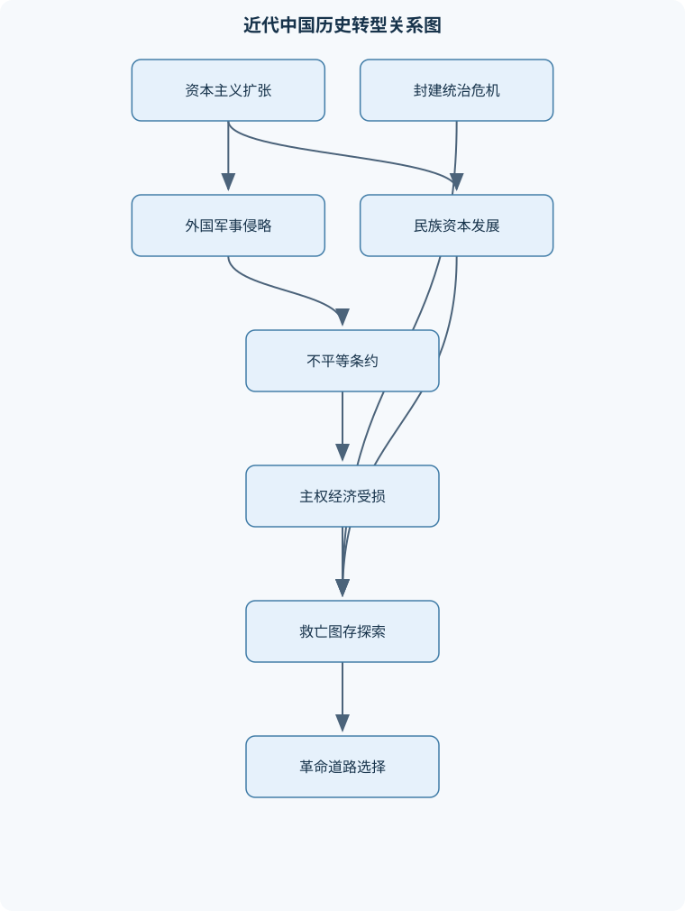
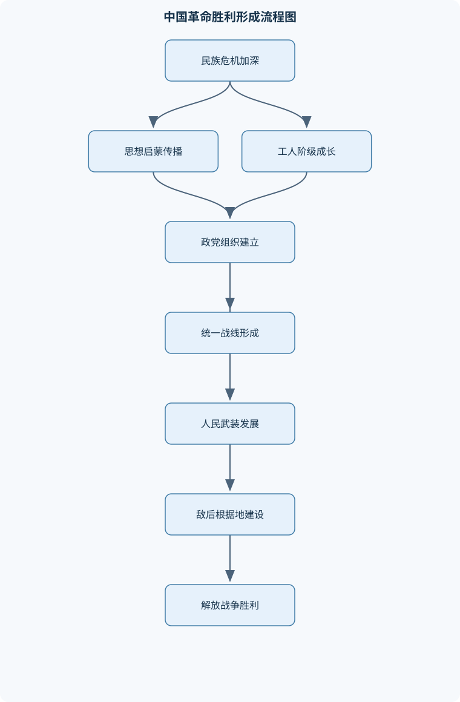

# 中国近现代史纲要

## 一、课程整体知识框架

### 课程边界与先修知识

本课程以1840年鸦片战争至1949年中华人民共和国成立前的中国历史为主体，兼顾鸦片战争前清朝社会结构、世界资本主义发展和近代东亚国际环境等必要背景，重点讲授中国由传统社会向近代社会转型的历史进程。课程围绕民族独立、人民解放、国家富强和社会进步四条主线，分析外国资本主义侵略、封建统治危机、近代化探索、人民群众斗争、政党政治演变及中国革命道路形成之间的关系。课程不以一般世界史、中华人民共和国史、当代国际关系史或单纯人物生平为主要内容，但应引入工业革命、殖民扩张、俄国十月革命和世界反法西斯战争等必要的国际背景。先修知识包括中国古代王朝更替和基本社会结构、世界近代史常识、历史年代和地图阅读能力，以及史料的基本分类和证据意识。





### 1. 课程对象、时间范围与基本问题

本课程以1840年鸦片战争至1949年中华人民共和国成立前的中国历史为主体，必要时追溯鸦片战争前的清朝社会结构、财政状况、对外贸易和世界资本主义发展。1840年不是中国历史变化的绝对起点，而是外部资本主义扩张与中国内部社会危机发生强烈碰撞的标志性节点；1949年则是新民主主义革命取得全国性胜利、国家政权形态发生根本变化的历史节点。课程重点不在于罗列朝代、战争和人物，而在于解释中国社会性质变化、民族危机加深、救国方案更替以及革命道路形成之间的因果关系。

课程围绕四条相互联系的主线展开：

1. **民族独立主线**：考察外国资本主义及其后发展为帝国主义的侵略，如何通过战争、条约、领土占领、司法特权、关税限制、资本输出和政治干涉损害中国主权；同时分析中国人民反侵略斗争如何维护民族生存、促进民族意识觉醒。
2. **人民解放主线**：考察农民、工人、城市小资产阶级、民族资产阶级以及其他社会力量在不同历史阶段的政治诉求和实践，说明人民群众并非历史旁观者，而是推动社会变动的重要力量。
3. **国家富强主线**：分析洋务运动、民族资本主义发展、维新变法、教育改革、军事建设和工业化尝试，说明近代化不仅是技术引进，还涉及政治制度、经济结构、教育体系、社会组织和国家治理能力的整体转型。
4. **社会进步主线**：分析民主共和、民主与科学、马克思主义传播、工人运动、妇女解放、群众动员和新型政治组织的发展，说明社会进步既表现为制度与思想变化，也表现为社会主体和政治参与方式的变化。

### 2. 近代中国社会性质的分析框架

#### 2.1 半殖民地与半封建的含义

“半殖民地”强调国家主权受到外国侵略和控制，但中国并未完全丧失国家形式、中央政权和全部主权。列强通过不平等条约取得领土、通商、关税、司法、驻军和外交等特权，使中国主权受到多层次侵蚀；但是清政府及其后的中国政权仍以中国国家名义存在，中国人民也始终进行维护独立和反抗侵略的斗争。因此，“半殖民地”不能简单等同于已经完全沦为殖民地。

“半封建”强调封建生产关系、地主土地占有、宗法等级观念和封建政治结构仍然占据重要地位，同时资本主义因素已经出现并逐步发展。它不是说中国社会已经转变为资本主义社会，也不是说传统因素完全没有变化。近代中国形成了传统地主经济、外国资本、官僚资本、民族资本和小农经济并存的复杂结构。

分析社会性质时，应同时考察外部支配和内部结构。若只看到列强侵略，就会把中国的贫弱完全归因于外部因素；若只看到封建制度，又会忽略战争、条约特权和资本输出对中国发展的强制性影响。近代中国的贫困和落后，是外国侵略、封建统治危机、生产技术落后、政治腐败和社会组织能力不足相互作用的结果。

#### 2.2 近代化不等于简单西化

近代化是一个综合过程，至少包括经济工业化、交通和通信发展、军事技术改造、教育制度变化、科学知识传播、政治制度调整、社会组织重组以及国家治理能力提高。学习近代化问题，不能把购买外国武器、穿着西式服装或使用西方制度名称直接视为完成近代化。

近代中国的近代化受到两个条件的双重制约：一方面，外国侵略迫使中国学习新的军事、工业和制度知识；另一方面，列强又不希望中国成为独立、富强的现代国家，因此通过政治控制、经济垄断和军事压力限制中国发展。与此同时，封建统治集团内部的利益结构、财政制度、官僚习气和社会等级关系，也限制了改革的深度。

### 3. 历史因果分析方法

#### 3.1 结构条件、直接原因与历史结果

分析历史事件时，应把原因分为三个层次：

- **结构条件**：长期存在的社会制度、经济结构、阶级关系、国际环境和国家治理状况。
- **直接原因或导火索**：在特定时间促使矛盾集中爆发的事件，例如禁烟措施、战争挑衅、条约签订、政治镇压或外交危机。
- **过程性因素**：参与者的组织能力、资源条件、政策选择、军事部署和群众动员方式。

例如，鸦片战争的深层背景包括英国工业革命后对海外市场和原料的需求、清朝政治财政危机以及中英贸易矛盾；直接冲突则与禁烟和英国军事行动相联系；战争结果还受到武器装备、军事组织、指挥体系、财政能力和统治集团态度等因素影响。由此可见，不能把一场战争简单归结为某个个人决策，也不能用单一因素解释复杂历史转折。

可以用一个非计量性的分析表达式表示历史事件的解释结构：

$$
R=f(S,E,A,P)
$$

其中，$R$表示历史结果，$S$表示结构条件，$E$表示直接事件或外部环境，$A$表示参与者及其组织行动，$P$表示政策选择和过程机制。这里的$f$不是可以直接计算的数学函数，变量也没有统一的物理单位，不能据此生成数值结论。该表达式只适用于帮助组织论证：同一结构条件下，不同主体的行动可能造成不同结果；同一事件在不同制度和国际环境中，也可能产生不同影响。其边界在于，历史过程具有偶然性和多重因果，不能用单一模型替代史料分析。

#### 3.2 结论推导的基本步骤

以“近代中国主权受损不是单次战争失败造成的，而是多种特权叠加的结果”为例，可按以下步骤推导：

第一，列出条约和战争所涉及的具体内容，包括割地、赔款、通商口岸、协定关税、领事裁判权、租界、驻军和外交干涉。  
第二，将这些内容分别归入领土主权、司法主权、经济主权、行政权和外交权等类别。  
第三，分析每项权利受损的直接后果，例如关税受限会削弱财政调节能力，领事裁判权会破坏司法统一，租界和驻军会压缩行政管理空间。  
第四，说明各项特权之间的叠加关系：军事失败导致条约签订，条约特权又削弱财政和治理能力，治理能力下降进一步增加对外依赖。  
第五，区分短期结果和长期影响，避免把某一条约的即时后果等同于整个近代社会的全部变化。  
第六，结合中国人民的反抗和近代化探索，说明主权受损并不意味着民族主体性消失。

### 4. 课程中的主体、概念与边界

#### 4.1 帝国主义与外国民众的区分

课程中的“帝国主义”是历史分析概念，主要指资本主义发展到垄断阶段后，以殖民扩张、政治控制、经济掠夺和军事侵略为主要特征的对外体系。在具体历史分析中，应区分外国政府、殖民机构、军队、企业、传教机构、普通侨民和外国民众，不能把所有外国人员都等同于侵略势力。分析对象应当是侵略政策、政治组织、经济机构和军事行动，而不是依据国籍进行笼统判断。

#### 4.2 民族资本主义、外国资本与官僚资本

民族资本主义是近代中国民族资产阶级投资经营的资本主义工商业。它与外国资本、官僚资本和传统地主经济存在区别，也可能发生联系和竞争。民族资本主义的发展受到市场需求、技术条件、资金来源、国家政策、外国资本压迫和封建关系束缚等多重影响。它具有推动经济近代化、培养新社会力量的作用，但自身力量相对弱小，政治上容易受到外国资本、封建势力和官僚资本的限制。

#### 4.3 旧民主主义革命与新民主主义革命

旧民主主义革命通常指资产阶级及其政治力量领导的反帝反封建革命阶段，辛亥革命是其重要实践。新民主主义革命则是在无产阶级及其政党领导下、以工农联盟为基础的反帝反封建革命阶段。二者都具有民族独立和反封建的任务，但领导力量、群众基础、政治目标、组织方式和革命道路不同。不能把三民主义直接等同于成熟的无产阶级革命理论，也不能因为辛亥革命建立了共和政体，就认为半殖民地半封建社会已经被彻底改变。

#### 4.4 统一战线、正面战场与敌后战场

统一战线是不同阶级、阶层、政党和社会力量基于共同政治目标形成的合作关系。合作不等于利益完全一致，统一战线需要处理共同目标与内部矛盾的关系。

抗日战争中的正面战场主要由国民党军队承担大规模正规作战，敌后战场主要依托抗日根据地开展游击战、人民战争和根据地建设。二者作战主体、空间形态、组织方式和军事任务不同，但共同构成全民族抗战的重要组成部分。不能把二者相互割裂，也不能用一个战场替代另一个战场的历史作用。

## 二、章节和模块划分

### 核心知识覆盖清单

本清单用于检查正文是否覆盖本课程的主要知识模块：

- **近代中国社会与历史起点**：鸦片战争前的清朝社会结构、自然经济与商品经济发展、清朝政治与财政危机、闭关政策与对外贸易限制、工业革命与资本主义扩张、鸦片贸易及其社会影响、近代中国社会性质的转变、半殖民地半封建社会概念。
- **外国侵略与民族反抗**：鸦片战争与南京条约、第二次鸦片战争及其影响、不平等条约体系、领事裁判权与关税主权受损、租界与势力范围、资本输出与商品倾销、近代反侵略战争的意义、反侵略战争失败的原因、民族意识的觉醒。
- **太平天国与农民阶级探索**：太平天国运动的兴起、金田起义与政权建设、天朝田亩制度、太平天国的军事扩展、天京事变及其后果、资政新篇的改革设想、湘军与清政府镇压、太平天国的历史意义、农民战争的阶级局限。
- **洋务运动与近代化起步**：洋务派的形成、自强与求富方针、近代军事工业、民用企业与交通建设、新式海军与国防建设、同文馆与留学教育、洋务派与顽固派争论、洋务运动的进步作用、洋务运动失败的原因。
- **民族危机加深与维新变法**：边疆危机与列强扩张、中日甲午战争、马关条约及其影响、列强瓜分中国的危机、民族资本主义初步发展、戊戌维新运动的背景、百日维新的主要措施、维新派的政治主张、戊戌变法失败的原因、改良道路的历史局限。
- **义和团运动与清末新政**：义和团运动的兴起、扶清灭洋口号、八国联军侵华、辛丑条约及其后果、东南互保、清末新政的主要内容、废除科举与教育改革、新军建设与政治危机、清政府统治合法性的衰落。
- **辛亥革命与民国初年政治**：资产阶级革命思想传播、革命派与改良派论战、同盟会与三民主义、武昌起义与各省响应、中华民国临时政府、临时约法的政治意义、袁世凯窃取革命果实、二次革命与护国运动、军阀割据与政治失序、辛亥革命的历史功绩与局限。
- **新文化运动与马克思主义传播**：第一次世界大战与民族资本发展、新文化运动的思想启蒙、民主与科学的思想主题、俄国十月革命的影响、五四运动的历史背景、五四运动的群众性与反帝性、工人阶级登上政治舞台、马克思主义在中国传播、旧民主主义向新民主主义转变。
- **中国共产党成立与革命道路探索**：中国共产党成立的历史条件、民主革命纲领的提出、第一次国共合作、国民革命与北伐战争、大革命失败及其原因、土地革命与武装斗争、农村革命根据地建设、农村包围城市道路、党内教条主义与经验主义、遵义会议与历史转折。
- **全民族抗战与新中国成立前夜**：九一八事变与民族矛盾变化、西安事变及其和平解决、抗日民族统一战线、七七事变与全面抗战、正面战场与敌后战场、持久战战略思想、中国共产党在抗战中的作用、抗日战争的国际地位、抗战胜利后的政治格局、重庆谈判与解放战争、三大战役与全国胜利、七届二中全会的历史准备。


### 1. 近代中国社会与历史起点

本模块说明鸦片战争前清朝社会的基本结构。清朝传统经济以小农家庭生产和自然经济为基础，但商品经济、区域市场、手工业和长途贸易已有发展，因此不能把鸦片战争前的中国描述为完全封闭、没有商品交换的社会。政治上，清朝形成高度集中的皇权体制和庞大的官僚体系；财政收入主要依靠传统税收，国家对地方、人口和土地的控制能力受到交通、信息和基层治理条件限制。

清朝后期出现人口压力、土地兼并、财政紧张、官僚腐败、军备落后和社会矛盾积累。清政府实行对外贸易限制，广州一口通商等政策强化了官方控制，但“闭关政策”并不意味着中国完全与世界隔绝。英国工业革命后，机器生产提高了商品产量和资本扩张能力，列强开始通过贸易、战争、殖民和资本输出争夺海外市场。鸦片贸易改变了中英贸易关系，造成白银外流、财政压力、社会风气和民众健康等问题，也成为战争爆发的重要直接背景之一。

本模块的核心结论是：近代中国社会转型既有外部冲击，也有内部危机。不能把清朝衰败解释为单纯的文化问题，更不能把鸦片战争视为完全偶然的冲突。

### 2. 外国侵略与民族反抗

鸦片战争以清政府战败和《南京条约》签订为重要结果，条约涉及割地、赔款、开放通商口岸等内容，随后相关条约进一步扩大外国特权。第二次鸦片战争期间，英法等国扩大军事和外交压力，天津条约、北京条约等使外国势力在通商、外交、传教、驻京和内河航行等方面取得更多权利。

不平等条约体系的影响不能只用赔款数额衡量。领土割让和租借地损害领土完整；领事裁判权削弱中国司法主权；协定关税限制关税自主权；通商口岸和租界使外国势力获得深入中国社会经济的据点；资本输出、商品倾销和对海关、金融、交通等领域的控制，则使经济依附程度加深。由此可推导出，近代中国主权受损是政治、经济、司法、军事和领土控制叠加的结果。

中国人民的反侵略斗争包括官兵抵抗、地方武装、民众抗争和社会舆论等多种形式。反侵略战争虽然多次失败，但打击了列强把中国完全变为殖民地的企图，也促进了民族意识觉醒。失败原因包括清政府政治腐败、封建制度僵化、军事组织和武器装备落后、财政能力不足以及统治集团妥协退让等。这里的“失败”不能被理解为人民没有抵抗，而应区分战争结果、斗争过程和历史意义。

### 3. 太平天国与农民阶级探索

太平天国运动是在土地矛盾、阶级压迫、社会灾荒、地方治理失序和外来宗教思想影响等多重背景下兴起的农民运动。金田起义后，太平军迅速发展，建立政权并控制广大地区，形成对清朝统治的重大冲击。

《天朝田亩制度》以土地分配和社会平等为主要设想，反映了农民对土地和公平的强烈要求，但其平均主义方案与小农经济条件之间存在矛盾，难以形成稳定、持续和高效的社会经济制度。《资政新篇》提出某些发展资本主义、兴办实业和改革政治的设想，具有不同于传统农民平均主义的因素，但缺乏充分的社会基础和有效实施条件。

天京事变削弱了领导核心和组织纪律，清政府则借助湘军等地方武装加强镇压，外国侵略势力也在特定阶段支持清政府。太平天国的历史意义在于沉重打击清朝统治，动员广大农民反抗封建压迫，并推动社会各界重新思考国家和制度问题。其局限则表现为宗教色彩浓厚、领导集团内部矛盾突出、缺乏科学稳定的政治制度、未能正确处理与其他社会力量的关系，最终不能完成民族独立和社会根本变革。

### 4. 洋务运动与近代化起步

洋务运动由部分清朝官僚和地方实力派推动，主要口号是“自强”和“求富”。其基本思路是在维护清朝统治和封建制度的前提下，引进西方军事技术、机器生产、近代教育和交通设施。军事工业、民用企业、轮船航运、电报、铁路以及新式海军建设，构成这一时期近代化尝试的主要内容。

同文馆、派遣留学生和新式学堂培养了一批了解外语、科学和军事知识的新型人才。洋务派与顽固派的争论，反映了传统政治结构对新技术、新知识和新制度的不同态度。但洋务运动主要着眼于器物和军事层面的改革，没有从根本上改变封建政治结构和社会经济关系；企业管理中存在官僚垄断、效率低下和腐败问题，近代军事建设又受到财政困难、制度僵化和外国技术依赖的限制。

洋务运动的进步作用在于开启工业、教育、交通、军事和外交制度的近代转型，促进资本主义因素和新型知识群体成长。其失败说明，单纯依靠地主阶级统治集团自上而下引进技术，不能完成国家制度和社会结构的全面变革。

### 5. 民族危机加深与维新变法

近代列强在边疆和周边地区的扩张，使清政府面临持续的领土和主权危机。中日甲午战争失败以及《马关条约》的签订，进一步加深民族危机，割地、赔款、通商和外国资本设厂等条款扩大了列强对中国的经济和政治压力。列强随后争夺租借地、划分势力范围，中国面临被瓜分的严重危机。

民族资本主义在这一时期获得一定发展，新的企业、报刊、学堂和知识群体逐渐出现。维新派以救亡图存为目标，主张改革政治制度、发展资本主义、兴办教育和更新军事。戊戌变法期间推行的措施涉及行政、教育、经济和军事等方面，具有推动制度改革和思想启蒙的意义。

维新变法失败既因为顽固势力的政治镇压，也因为维新派缺乏广泛群众基础、政治组织能力不足、过度依赖统治者、没有形成足以改变权力结构的社会力量，并且在反帝和反封建问题上存在局限。由此可见，改良方案能够推动思想和制度讨论，却难以在半殖民地半封建社会中独立完成民族独立和社会根本变革。

### 6. 义和团运动与清末新政

义和团运动产生于民族危机加深、地方社会矛盾激化和民众反洋教情绪发展等背景。其口号“扶清灭洋”体现了反抗外国侵略的民族情绪，同时也表明运动仍然依附于传统政治权威，具有排外、迷信和组织分散等局限。

八国联军侵华和《辛丑条约》使清政府承担巨额赔款、允许外国驻兵并进一步受到政治和军事控制。东南互保反映出地方督抚与中央政府、外国势力之间复杂的利益关系，也说明清朝统治体系内部已经出现严重离心倾向。

清末新政包括编练新军、改革教育、废除科举、整顿财政、筹建新式学堂和预备立宪等内容。这些改革促进了新知识传播、新式教育发展和新军形成，却没有消除清政府的专制性质和对外依赖。废除科举打破了传统士人进入政治体系的重要渠道，教育和军制改革又培养了新的知识群体和军事力量，反而加速了政治危机。清政府因不断失败、财政负担加重和改革失信而失去统治合法性。

### 7. 辛亥革命与民国初年政治

资产阶级革命思想在民族危机、清末新政、海外留学和报刊传播等条件下发展。革命派与改良派围绕革命与改良、君主立宪与民主共和、社会动员和政治道路展开论战。中国同盟会的成立加强了革命组织联系，三民主义以民族、民权、民生为基本内容，体现了资产阶级民主革命的政治主张。

武昌起义后，各省响应，清朝统治迅速瓦解。中华民国临时政府成立，《中华民国临时约法》以限制专制权力、确立共和政治原则为主要方向，具有重要的制度和思想意义。但革命派力量不足，帝国主义干涉，旧官僚和军事实力派仍然存在，袁世凯借助政治和军事条件取得政权，革命果实被旧势力攫取。

二次革命、护国运动和反对复辟的斗争，说明共和政体形式建立后，专制势力仍可通过军队、官僚、地方势力和外部支持恢复影响。军阀割据造成政治失序和社会动荡。辛亥革命推翻了清王朝，结束延续数千年的君主专制制度，促进了民主共和观念传播和社会思想解放；但它没有改变帝国主义控制、封建土地关系和社会经济结构，因此不能等同于完成反帝反封建革命。

### 8. 新文化运动与马克思主义传播

第一次世界大战期间，列强在欧洲相互争夺，客观上为中国民族资本主义发展提供了一定空间，但中国仍受外国资本和封建关系限制。新文化运动以思想启蒙为重要内容，提倡民主与科学，反对封建礼教和思想专制，推动白话文、教育改革、妇女解放和个性解放等社会议题发展。

俄国十月革命改变了世界政治格局，也为中国先进知识分子提供了新的革命思想资源。五四运动的直接背景包括巴黎和会上中国外交权益受损、民族危机持续和国内社会矛盾加剧。运动由青年学生首先发动，随后得到工人罢工、商人罢市等社会力量支持，具有反帝反封建性质和广泛群众性。

五四运动推动工人阶级以独立政治力量登上历史舞台，促进马克思主义传播和新型政治组织形成。它之所以被视为新民主主义革命的开端，不仅因为发生了学生抗议，更因为革命的群众基础、领导力量、思想方向和组织方式出现重要变化。旧民主主义革命向新民主主义革命的转变，是思想启蒙、工人运动、民族危机和马克思主义传播共同作用的结果。

### 9. 中国共产党成立与革命道路探索

中国共产党成立具有多方面历史条件：民族危机和社会矛盾持续加深，工人阶级力量发展，马克思主义在中国传播，五四运动促进政治组织变化，俄国革命和国际工人运动提供思想影响。政党成立后，逐步提出民主革命纲领，推动工人运动和反帝反封建斗争。

第一次国共合作以共同反帝反军阀为政治基础。共产党员以个人身份加入国民党，同时保持政治和组织上的独立性。国民革命和北伐战争扩大了反帝反军阀运动的社会影响，促进工农运动发展，但国共双方在领导权、阶级利益、土地问题和革命目标上的矛盾始终存在。大革命失败与反革命政变、帝国主义干涉、国民党右派背叛、共产党自身经验不足和组织准备不充分等因素有关。

大革命失败后，中国共产党转向土地革命和武装斗争，在农村建立革命根据地，逐步形成农村包围城市、武装夺取政权的道路。这条道路不是单纯的军事路线，而是武装斗争、土地革命、根据地建设和党的领导相结合的整体实践。党内教条主义和经验主义曾造成严重困难，遵义会议在长征过程中纠正军事和组织上的错误，成为重要历史转折。

### 10. 全民族抗战与新中国成立前夜

九一八事变后，日本扩大对中国的侵略，民族矛盾逐渐上升为主要矛盾。西安事变的和平解决推动国共关系变化，为抗日民族统一战线形成创造条件。七七事变后，中国进入全民族抗战阶段。

抗日战争中，正面战场承担大规模正规作战任务，敌后战场依托根据地开展游击战争、人民战争和政治经济建设。持久战战略思想说明，在敌强我弱、国家幅员广阔、人民能够动员的条件下，战争可通过战略防御、战略相持和战略反攻逐步改变力量对比。中国共产党在组织群众、建设根据地、开展敌后作战和维护统一战线方面发挥重要作用；全国各阶层人民的长期抗战是战争胜利的基础，国际反法西斯力量的支持也是重要条件。

抗战胜利后，国共力量对比发生变化。重庆谈判和政治协商会议表明和平建国曾经存在政治努力，但国民党坚持专制统治和内战政策，接收过程中的腐败、恶性通货膨胀、社会生产破坏以及政治压制进一步削弱其合法性。中国共产党领导的人民革命力量在抗战中发展壮大，根据地建设和群众动员为后续战争提供了政治、组织和社会基础。

解放战争经过战略防御、战略进攻和战略决战等阶段，辽沈、淮海、平津三大战役基本摧毁国民党军队的主要军事力量。人民群众的物资、交通、担架和后勤支援，是人民战争取得胜利的重要条件。1949年七届二中全会提出党的工作重心由农村转向城市，规定全国胜利后政治、经济和外交工作的基本方向，并强调防止骄傲自满、警惕腐蚀和权力蜕化。这些部署为全国胜利和新民主主义社会建设作了政治与思想准备。

## 三、核心概念的详细解释

### 3.1 近代中国社会性质：半殖民地半封建社会

#### 3.1.1 “半殖民地”的含义及判断依据

“半殖民地”首先是一个国家主权受侵蚀的概念。鸦片战争以后，列强通过军事威胁、不平等条约、领土割让、租界、势力范围、驻军、领事裁判权、协定关税和外交干涉等方式，逐步控制中国部分国家权力。中国的领土、司法、关税、外交和财政均受到不同程度的限制，但中国并未像典型殖民地那样完全丧失国家形式、中央政权和全部主权。

判断近代中国是否属于半殖民地，不能只看是否签订了不平等条约，还要考察主权受损的范围和程度。其主要表现包括：

1. **领土主权受损**：通过战争和条约割让香港岛、台湾及其附属岛屿等领土，并形成租借地、租界和势力范围。
2. **司法主权受损**：外国人在中国境内犯罪，往往由本国领事或法院审理，形成领事裁判权。
3. **关税主权受损**：中国不能根据本国经济需要自主决定关税税率，国家保护民族工商业的能力受到限制。
4. **行政与外交权受损**：外国公使、领事和驻军对中国政府施加压力，列强通过外交、军事和经济力量干涉中国内政。
5. **经济主权受损**：外国资本控制海关、航运、金融、矿产、铁路和部分工业部门，使中国经济发展服从于外部资本利益。

但是，“半殖民地”不等于“完全殖民地”。清政府及其后的中国政权仍以中国国家名义存在，国内行政系统仍然运行，中国人民也始终保持着反侵略斗争和争取民族独立的政治实践。列强之间的利益矛盾、中国疆域广大、人民持续反抗以及国际格局变化，也使列强没有把中国完全变为某一个国家的殖民地。

#### 3.1.2 “半封建”的含义及判断依据

“半封建”指近代中国封建生产关系和封建政治结构仍然占据重要地位，同时资本主义经济因素已经出现并发展。封建因素主要表现为地主阶级占有大量土地、农民受到地租和高利贷剥削、宗法等级关系延续，以及清政府和后来部分政权保留封建性政治结构。资本主义因素则表现为外国资本进入、民族资本主义产生、商品经济发展、近代工商业和新式交通兴起、工人阶级形成以及城市社会结构变化。

“半封建”不能理解为中国仍然完全停留在传统社会。近代中国出现了多种经济成分并存的局面：

| 经济成分 | 主要特征 | 历史作用与限制 |
|---|---|---|
| 地主土地所有制 | 地主占有土地，农民缴纳地租 | 保持封建社会基本结构，限制农村生产力发展 |
| 小农经济 | 家庭经营，生产主要满足自身需要 | 具有顽强稳定性，但分散、脆弱，难以形成大规模工业市场 |
| 外国资本 | 控制部分金融、航运、矿产和工业 | 带来近代生产方式，同时具有掠夺和控制性质 |
| 官僚资本 | 依托国家权力形成的垄断性资本 | 在抗战后尤其膨胀，挤压民族工商业 |
| 民族资本 | 中国民族资产阶级投资经营的工商业 | 推动工业化和社会变迁，但资金、技术、市场和政治环境受限 |

因此，半封建不是“封建因素与资本主义因素各占一半”，而是说明传统生产关系仍占重要地位，资本主义因素又已经改变社会结构。它反映的是社会转型的不彻底和矛盾性。

#### 3.1.3 社会性质的综合判定

判断一个社会的性质，不能只依据某个现象，而应综合考察国家主权、生产关系、阶级结构、政治制度和经济运行方式。近代中国的社会性质可以概括为：

> 外国资本主义侵略造成国家主权受损，封建生产关系和政治结构仍然存在，资本主义因素逐步发展，三者相互交织，形成半殖民地半封建社会。

这一结论具有三个边界：

- 不能把中国说成已经完全殖民化，因为中国仍保有国家形式和持续的民族反抗。
- 不能把中国说成纯粹封建社会，因为外国资本、民族资本、近代工业和工人阶级已经出现。
- 不能把民族资本主义的发展说成中国已经进入独立资本主义社会，因为外国资本控制、封建关系束缚和政治压迫仍然存在。

### 3.2 外国资本主义侵略与帝国主义

#### 3.2.1 外国资本主义侵略的基本方式

外国资本主义侵略不是单一的军事行为，而是军事、政治、经济、司法和文化手段的综合运用。鸦片战争后，列强先以军事力量打开中国市场，再通过条约把军事胜利制度化，最后以资本、商品和政治代理人巩固利益。

其作用链条通常表现为：

> 军事侵略 → 签订不平等条约 → 获得通商、领土和司法特权 → 控制贸易、金融和交通 → 干涉中国政治 → 进一步扩大经济和政治利益。

例如，协定关税使中国不能自主调整进口税率；外国商品大量输入，冲击传统手工业；资本输出又使外国资本控制铁路、矿产、银行和航运。军事侵略因此转化为长期的制度性控制。

需要注意的是，不能把所有外国人或外国文化都等同于侵略势力。应当区分外国政府、殖民机构、侵略军队、外国资本和普通外国居民，也要区分近代知识传播与服务于殖民侵略的文化宣传。

#### 3.2.2 资本输出与商品倾销

**商品倾销**是指外国资本凭借军事和条约特权，把工业品大规模输入中国，以获取市场和利润。它会冲击中国传统手工业和农业生产，改变国内市场结构。

**资本输出**是指外国资本不再只销售商品，而是直接在中国设立企业、投资铁路矿产、控制银行航运或向中国政府提供贷款，以获取利息、股息、经营权和政治影响。资本输出比单纯商品贸易具有更强的长期控制作用。

二者并非互相排斥。外国资本可以先通过商品输入占领市场，再通过投资铁路、金融和工矿控制商品流通；也可以借助贷款、赔款和海关收入取得财政控制。由此可见，近代中国经济受压迫不是单纯“进口商品增加”的问题，而是生产、流通、金融和财政多方面受制。

### 3.3 近代化与救国方案

#### 3.3.1 近代化的多维含义

近代化不是单纯购买西方武器，也不是制度名称的移植，而是经济、政治、教育、军事、社会组织和国家治理的综合转型。至少包括：

- **经济近代化**：机器工业、近代企业、铁路、轮船、金融和市场体系发展；
- **军事近代化**：新式武器、军队训练、军事教育、后勤体系和国防工业建设；
- **教育近代化**：新式学堂、外语教育、科学知识、留学制度和人才培养；
- **政治近代化**：国家权力结构、法律制度、行政体系和政治参与方式变化；
- **社会近代化**：职业分化、城市发展、妇女解放、报刊传播和社会组织形成；
- **思想近代化**：民族国家观念、民主共和思想、科学精神和新的社会理论传播。

洋务运动主要推进军事工业、民用企业、教育和交通建设，但没有改变封建政治结构；戊戌维新试图将制度改革推进到政治和教育层面，却因统治集团内部矛盾、社会基础不足和外部压力而失败；辛亥革命推翻君主专制、建立共和政体，却没有完成反帝反封建的社会根本变革。因此，近代化必须同时考察技术、制度、社会动员和国家独立条件。

#### 3.3.2 救国方案的历史更替

近代中国的救国方案经历了由器物学习到制度改革、再到革命道路探索的变化：

1. **农民阶级反抗**：太平天国以农民战争方式冲击清朝统治，提出土地和社会改革设想，但受小生产者局限，难以建立稳定的新制度。
2. **地主阶级洋务自救**：主张“自强”“求富”，学习西方军事和工业技术，但以维护清朝统治为前提，无法解决政治腐败和社会结构问题。
3. **资产阶级改良**：维新派主张变法、兴学、发展资本主义和实行一定程度的制度改革，但依靠皇权和少数上层人物，缺乏广泛群众基础。
4. **资产阶级革命**：革命派以民族、民权、民生为主要政治主张，推翻君主专制，建立共和政体，但未能改变帝国主义和封建势力共同支配的社会结构。
5. **新民主主义革命**：马克思主义传播后，工人阶级及其政党逐步形成领导力量，探索出以工农联盟为基础、通过武装斗争和土地革命取得政权的道路。

这种变化不是简单的思想替换，而是社会矛盾、阶级力量、组织能力和国际环境共同作用的结果。

### 3.4 统一战线、人民战争与革命道路

#### 3.4.1 统一战线

统一战线是不同阶级、阶层、政党和社会力量为了共同政治目标形成的合作关系。第一次国共合作的共同目标主要是反帝反军阀，抗日民族统一战线的共同目标是抵抗日本侵略。统一战线内部仍然存在阶级利益、领导权和政治目标差异，因此合作不等于融合，更不等于各方立场完全一致。

分析统一战线时，需要回答四个问题：

1. 各方共同目标是什么？
2. 各方分别拥有何种政治、军事和社会资源？
3. 合作采取何种组织形式？
4. 内部矛盾如何影响合作的稳定性？

#### 3.4.2 农村包围城市、武装夺取政权

这条道路是在大革命失败后形成的实践性道路。其基本环节包括：

> 武装斗争建立力量 → 土地革命发动群众 → 根据地建设巩固政权 → 逐步扩大农村力量 → 形成战略包围 → 夺取全国政权。

它不是单纯的军事路线。没有土地革命，农民群众缺乏持续支持革命的直接利益基础；没有根据地建设，武装力量缺乏稳定的政治、经济和社会条件；没有党的领导，武装斗争、群众动员和政权建设难以形成统一方向。

这条道路的适用条件包括：国家政治权力分裂或统治薄弱、农村人口占多数、封建土地关系严重、革命力量能够建立组织和武装、敌人统治存在地域差异。若缺少这些条件，不能机械套用“农村包围城市”的结论。

### 3.5 正面战场、敌后战场与全民族抗战

正面战场主要承担大规模正规作战任务，敌后战场主要依托抗日根据地开展游击战争、人民战争和政治经济建设。二者作战主体、空间位置、组织形式和作战方式不同，但共同构成全民族抗战。

正面战场在战略防御阶段进行了大量会战，阻滞和消耗日军，体现了中国军队的抗战作用；敌后战场通过破袭交通线、袭击据点、发动群众、建立根据地和开展生产，扩大了抗战的社会基础，牵制和消耗了大量日军及其附属力量。二者不能相互替代，也不能简单对立。

持久战战略思想的核心不是“战争自然会拖长”，而是根据敌强我弱、敌小我大、敌退步我进步、敌寡助我多助等条件，说明战争力量会在长期战争和广泛动员中发生变化。其分析边界是：持久战并不意味着可以忽视军事训练、武器装备、后勤保障和国际环境。

## 四、重要定义、公式、定理和推导

### 专业审校补充：关键定义与适用边界

清末新政与辛亥革命不能简单理解为“改革导致革命”或“革命完全否定改革”。清末新政是在内忧外患和统治危机加深条件下，由清政府主导的自上而下调整，主要涉及编练新军、废除科举、兴办学堂、奖励实业、改革官制和筹备立宪等方面。其一方面推动了教育、军事、经济和政治观念变化，扩大了新式知识群体和近代政治参与；另一方面改革经费多由加税、借款等方式筹集，增加社会负担，新军和新式教育又培育了不满清朝统治的新力量。预备立宪缺乏真正的权力约束，皇权与官僚体系仍居核心，改革未能解决列强控制、土地关系和政治腐败等根本问题。因此，清末新政既是清政府延续统治的尝试，也是旧制度进一步暴露矛盾、促成革命条件发展的历史过程。其适用边界是：不能把新政的客观影响等同于清政府主观追求，也不能把辛亥革命的爆发归结为新政单一因素。


### 4.1 不平等条约影响的分类公式

历史分析中可以用一个分类模型表示条约影响：

$$
I=I_T+I_S+I_J+I_C+I_E+I_P
$$

其中：

- $I$ 表示条约体系的综合影响，不是精确的货币数值；
- $I_T$ 表示领土主权影响；
- $I_S$ 表示国家安全和驻军影响；
- $I_J$ 表示司法主权影响；
- $I_C$ 表示关税与通商影响；
- $I_E$ 表示经济和财政影响；
- $I_P$ 表示政治与外交影响。

这个公式是**概念分类公式**，各项不能直接相加得出客观分数，也没有统一计量单位。它的用途是防止只看到赔款而忽略司法、关税、领土和政治控制。

以南京条约及其后续条约为例：

1. 割让香港岛，增加 $I_T$；
2. 开放通商口岸，扩大 $I_C$ 和 $I_E$；
3. 规定赔款，增加 $I_E$，并加重清政府财政压力；
4. 通过后续条约取得领事裁判权，增加 $I_J$；
5. 通过协定关税限制中国自主调整关税的能力，增加 $I_C$；
6. 通过租界、驻军和外交干涉，增加 $I_S$ 与 $I_P$。

由此可以推导：近代中国主权受损不是某一项条款造成的，而是多个制度性特权叠加的结果。

### 4.2 历史事件因果链的推导方法

历史事件的因果分析可以表示为：

$$
\text{结构条件}+\text{直接诱因}+\text{主体行动}
\rightarrow
\text{事件过程}
\rightarrow
\text{短期结果}
\rightarrow
\text{长期影响}
$$

该表达式不是自然科学定律，而是历史解释框架。每个部分含义如下：

- **结构条件**：长期存在的经济、政治、阶级和国际环境；
- **直接诱因**：促使矛盾在特定时间爆发的事件；
- **主体行动**：不同力量依据自身利益采取的政策或行动；
- **事件过程**：战争、改革、运动或政变的具体展开；
- **短期结果**：政权变化、条约签订、政策调整或运动失败；
- **长期影响**：社会意识、阶级力量、制度结构和政治方向的变化。

#### 例一：甲午战争后维新运动兴起

- 结构条件：清政府腐败，民族资本主义有所发展，列强侵略加深；
- 直接诱因：甲午战争失败和《马关条约》签订；
- 主体行动：维新派知识分子和部分官僚提出变法主张；
- 事件过程：宣传变法、组织学会、推动政治和教育改革；
- 短期结果：百日维新被镇压；
- 长期影响：维新思想扩大了民族危机和制度改革的政治讨论，并推动部分社会力量转向革命。

由此可见，甲午战争失败并不会自动产生维新运动，必须经过知识分子解释、政治组织动员和社会力量参与。

#### 例二：五四运动成为新民主主义革命开端

- 结构条件：民族危机延续，工人阶级成长，新文化运动促进思想解放；
- 直接诱因：巴黎和会上中国外交权益受损；
- 主体行动：学生首先示威，工人罢工、商人罢市，形成社会合力；
- 事件过程：反帝反封建斗争扩大，政府被迫调整相关政策；
- 短期结果：群众运动取得一定政治效果；
- 长期影响：工人阶级政治作用增强，马克思主义传播加快，新型政治组织形成。

判断其历史性质，不能只依据“学生首先参加”，而要综合考察群众范围、斗争对象、阶级力量和思想方向。

### 4.3 政体变化与社会革命的区分

可以用下式说明两者关系：

$$
\text{政体变化}\neq\text{社会结构根本变化}
$$

政体变化主要指国家权力形式改变，例如从君主制转为共和制；社会结构变化则涉及土地关系、阶级关系、经济控制权、国家主权和人民政治地位等更深层内容。

辛亥革命推翻清王朝，建立中华民国，属于重要政体变化；但帝国主义在华特权仍然存在，地主土地关系未被根本改变，广大农民仍受压迫，革命果实又被袁世凯等旧势力取得。因此，辛亥革命具有推翻君主专制、传播民主共和观念和促进思想解放的历史功绩，但没有完成反帝反封建的根本任务。

这一结论的边界是：不能因革命未完成全部目标，就否定其政治制度和思想文化方面的进步作用；也不能因建立共和政体，就断言民族独立和人民解放已经实现。

### 4.4 近代救国方案比较的评价矩阵

比较不同救国方案时，可采用以下维度：

| 比较维度 | 太平天国 | 洋务运动 | 戊戌维新 | 辛亥革命 | 新民主主义革命 |
|---|---|---|---|---|---|
| 主要领导力量 | 农民阶级 | 地主阶级洋务派 | 资产阶级维新派及部分官僚 | 资产阶级革命派 | 无产阶级及其政党 |
| 主要目标 | 反清及社会改造 | 自强求富、维护统治 | 变法图强、制度改良 | 推翻君主专制、建立共和 | 反帝反封建、人民解放 |
| 群众基础 | 农民群众 | 官僚、军队和部分企业力量 | 知识分子及部分官僚 | 资产阶级、会党和部分群众 | 工农联盟及广泛人民力量 |
| 主要方式 | 武装起义 | 官办和官督商办改革 | 自上而下改革 | 武装革命和政权更替 | 武装斗争、土地革命、统一战线 |
| 根本局限 | 小生产者局限 | 不改变封建制度，依赖外国 | 脱离群众，依赖皇权 | 未改变社会基本结构 | 面临战争、经济落后和复杂国内外环境 |

评价时应同时分析历史作用与历史局限，不能只看失败结果，也不能只看主观愿望。

### 4.5 抗日战争胜利的综合推导

抗日战争胜利可以按照以下因果链说明：

$$
\text{全民族抗战}
+\text{正面战场作战}
+\text{敌后战场与人民动员}
+\text{持久战战略}
+\text{国际反法西斯合作}
\rightarrow
\text{中国战场力量逐步变化}
\rightarrow
\text{抗战胜利}
$$

其中，五个条件具有不同作用：

1. **全民族抗战**提供了广泛的政治基础和人力资源；
2. **正面战场**承担大规模正规作战，抵抗和消耗日军主力；
3. **敌后战场**发动群众、建立根据地、破袭交通，扩大抗战的社会基础；
4. **持久战战略**把敌强我弱的短期劣势转化为长期战争中的力量变化；
5. **国际反法西斯合作**使日本面临更广泛的军事和外交压力。

不能把胜利单纯归因于外部援助，因为中国人民的长期抗战是战争持续和胜利的基础；也不能忽略国际因素，因为世界反法西斯战争的整体进程确实影响了日本的战略处境。

### 4.6 历史分析流程与适用边界

#### 4.6.1 事件因果分析流程

**输入**：事件名称、时间、地点、参与者、政策背景和结果。  
**输出**：结构条件—直接诱因—主体行动—过程—结果—局限的完整因果链。

**步骤：**

1. 确定事件发生前的长期社会结构；
2. 区分深层原因与直接导火索；
3. 分析不同主体的目标、资源和相互关系；
4. 按时间顺序还原事件过程；
5. 区分短期结果、长期影响和未完成目标；
6. 检查每一项结论是否能够由条约、诏令、报刊、回忆录、统计材料或实物证据支持。

**适用条件**：战争、改革、革命、政权更替和社会运动。  
**终止条件**：已经能够说明“为什么发生、如何发展、产生什么结果、为什么存在局限”。  
**边界**：不能把时间上先后发生的两个事件直接当作因果关系，也不能用单一人物意图代替复杂社会力量的作用。

#### 4.6.2 不平等条约比较流程

**输入**：条约名称、签订时间、签约主体和具体条款。  
**输出**：条约影响矩阵。

**步骤：**

1. 按领土、赔款、通商、关税、司法、外交、驻军分类；
2. 判断每项条款影响的是国家主权、财政收入、市场结构还是行政权；
3. 比较条约签订前后的空间、经济和政治变化；
4. 分析多个条约之间的叠加关系；
5. 区分条款的直接后果与长期影响。

**排错方法：**

- 若只写赔款而没有主权和经济分析，说明分类不完整；
- 若把租界直接写成完全割让领土，应重新区分租界、租借地和割让地；
- 若把所有外国人在华活动都写成侵略，应区分国家侵略行为、资本活动、文化交流和普通个人活动；
- 若将后期形成的制度提前用于早期条约，应检查时间顺序。

### 4.7 综合例题

#### 例题一：为什么近代中国是半殖民地半封建社会？

**分析**：需要分别说明外部主权受损和内部生产关系并存，不能只写列强侵略。

**解答步骤：**

1. 列举领土、司法、关税、外交和经济控制，说明“半殖民地”；
2. 说明地主土地关系、宗法等级和封建政治仍然存在；
3. 说明外国资本、民族资本、近代工业和工人阶级已经出现；
4. 得出“传统封建因素与资本主义因素交织、国家主权受到外来控制但未完全殖民化”的结论。

**结果验证**：若答案能够同时解释主权受损、封建关系延续和资本主义因素发展，且没有把中国说成完全殖民地或纯粹封建社会，即为结构完整。

**变式**：要求说明为什么“半殖民地半封建”不是两个“半”的简单相加。回答应指出这是对社会结构和国家地位的综合判断，而非数量比例。

#### 例题二：比较洋务运动与戊戌维新的异同。

**分析**：应从领导力量、目标、措施、群众基础和失败原因比较。

**解答步骤：**

1. 洋务运动由地主阶级洋务派主导，重点是军事、工业、交通和教育；
2. 戊戌维新由维新派推动，试图把改革推进到政治制度、教育和行政层面；
3. 二者都受到民族危机刺激，都主张学习西方，都具有救亡图存和近代化倾向；
4. 洋务运动局限于维护清朝封建统治，戊戌维新依赖皇权且脱离群众；
5. 二者都未能解决帝国主义压迫和封建制度束缚。

**结果验证**：若比较既指出共同的近代化诉求，又解释改革深度和政治基础差异，便没有把二者混为同一种运动。

**变式**：若题目改为“为什么洋务运动不能挽救清朝”，应增加甲午战争暴露军事和制度缺陷、封建统治结构限制改革、官僚腐败和对外国依赖等内容。

#### 例题三：辛亥革命的历史功绩与局限是什么？

**解答步骤：**

1. 功绩：推翻清王朝统治，结束延续数千年的君主专制制度；建立共和政体；传播民主共和观念；推动社会思想解放；
2. 局限：没有改变帝国主义在华特权；没有解决土地问题；没有充分发动和组织广大人民；革命组织内部力量分散；革命果实被袁世凯等旧势力取得；
3. 综合判断：辛亥革命是一次具有重要历史意义的资产阶级民主革命，但没有完成反帝反封建的根本任务。

**结果验证**：既不能只写“失败”，也不能把推翻君主专制等同于完成民族独立和人民解放。

#### 例题四：五四运动为什么被视为新民主主义革命的开端？

**解答步骤：**

1. 运动具有反帝反封建性质；
2. 参与者由学生扩大到工人、商人等社会群体，具有广泛群众性；
3. 工人阶级通过罢工等方式显示独立政治力量；
4. 马克思主义传播加快，革命思想方向发生变化；
5. 新型政治组织形成，革命领导力量和社会基础发生变化。

**结果验证**：如果答案只写“学生爱国运动”，则没有说明其作为革命阶段转折点的历史依据。

#### 例题五：为什么中国革命不能照搬以城市起义为中心的模式？

**分析**：需要结合中国社会结构和敌我力量。

**解答步骤：**

1. 近代中国是小农经济占优势的农业社会，农民人口占多数；
2. 城市中帝国主义、官僚资本和反动政权力量集中，革命力量在城市相对弱小；
3. 农村地域广大、统治力量相对薄弱，具备建立根据地的空间；
4. 土地革命能够满足农民的直接利益，形成群众基础；
5. 武装斗争、根据地建设和党的领导结合，逐步积累力量；
6. 最终形成农村包围城市、武装夺取政权的道路。

**结果验证**：若答案只写“农村人口多”，则因果链不完整；还必须说明土地关系、敌我力量分布、组织建设和武装斗争之间的联系。

#### 例题六：如何评价正面战场与敌后战场的关系？

**解答步骤：**

1. 正面战场主要进行大规模正规作战，承担抵御日军主力的任务；
2. 敌后战场依托根据地开展游击战、破袭战和人民战争；
3. 正面战场在战略防御中发挥重要作用，敌后战场不断扩大抗战社会基础并牵制日军；
4. 二者作战方式、空间和主体不同，但共同构成全民族抗战；
5. 不能用一个战场完全替代另一个战场，也不能把二者写成相互孤立或相互否定。

**结果验证**：答案同时写明差异、联系和共同历史作用，才符合全民族抗战的整体分析。

## 五、算法、流程和实现思路

### 方法与流程覆盖索引

下列方法或流程应在正文中说明输入、步骤、适用条件、结果检查和边界：

- 历史事件因果分析流程：输入事件、时间、参与者、制度背景和结果；第一步确定事件发生前的结构条件；第二步区分直接导火索、深层原因和外部条件；第三步分析不同主体的目标与资源；第四步追踪政策、战争或社会运动的实际过程；第五步区分短期结果、长期影响和历史局限；输出结构化因果链。适用于战争、改革、革命和政权转型分析；终止条件是每一项结论均能对应至少一类可靠史料或明确的课程事实。
- 不平等条约影响分析流程：输入条约条款；将条款分为领土、赔款、通商、关税、司法、外交和驻军等类别；分别判断其对国家主权、财政、市场、司法和行政权的影响；再分析条款之间的叠加效应；输出条约影响矩阵。适用于南京条约、天津条约、北京条约、马关条约和辛丑条约等比较分析；边界是不能仅凭赔款数额推断全部历史影响。
- 历史人物与政治力量评价流程：输入人物或政治集团及其主张、行动和结果；先区分个人意图与客观效果；再考察其阶级基础、组织资源和时代约束；随后分别评价进步作用、历史贡献、局限性和责任；最后形成有条件的综合判断。适用于洋务派、维新派、革命派、国民党和中国共产党等对象；不能用单一的道德评价替代历史分析。
- 历史地图与时间线分析流程：输入战争、条约、政权和运动的空间信息；按年份排列关键节点；标注通商口岸、租界、势力范围、根据地、战场和交通线；比较前后空间格局；输出事件的时间—空间关系。适用于侵略扩张、北伐战争、抗日战争和解放战争；边界是地图信息必须与年代相符，不能把不同时期行政区划直接混用。
- 史料互证流程：输入至少两种不同来源的材料；识别材料作者、形成时间、使用对象和政治目的；提取彼此相同、互补或矛盾的事实；与条约、统计、档案或实物证据进行交叉核对；区分可确认事实、合理推断和无法确认的说法；输出分层结论。适用于评价回忆录、报刊、政治文献和宣传材料；终止条件是结论明确标注证据强度。
- 历史比较分析流程：输入两个或多个运动、改革或政权；统一比较维度，包括目标、领导力量、群众基础、组织方式、制度措施、外部环境、结果和局限；逐项比较后解释差异产生的机制；输出共性、差异及其历史原因。适用于洋务运动与戊戌维新、辛亥革命与五四运动、正面战场与敌后战场等专题；不可用现代政治概念简单替代当时历史语境。





### 5.1 历史事件因果分析流程

历史事件因果分析的输入包括事件名称、发生时间、参与者、制度背景、国际环境、行动过程和结果；输出是能够区分结构条件、直接原因、行动机制与历史后果的因果链。该流程适用于鸦片战争、太平天国运动、洋务运动、戊戌维新、辛亥革命、五四运动、国共合作、抗日战争和解放战争等主题。

#### 5.1.1 分析步骤

第一步，确定时间边界和事件范围。研究鸦片战争时，不能只从某一次冲突开始，还要纳入工业革命、英国对外扩张、鸦片贸易、清朝财政与军事状况等背景；研究五四运动时，则要区分第一次世界大战、巴黎和会外交失败、学生运动、工人运动和后续马克思主义传播之间的时间关系。

第二步，区分三类原因：

- **结构条件**：长期存在的社会制度、经济结构、阶级关系、国际力量对比和国家治理状况。
- **直接原因**：在特定时间促使矛盾爆发的事件，例如英国以禁烟为借口发动战争、巴黎和会外交处置引发民众抗议。
- **推动因素或中介机制**：把背景转化为具体行动的组织、舆论、交通、军事、政党和群众动员条件。

第三步，分析主体的目标与资源。列强的目标可能包括市场、原料、通商特权、领土和政治控制；清政府的目标可能包括维护统治、缓和财政压力和保持传统秩序；农民、工人、民族资产阶级和知识分子的目标则随阶级处境和历史阶段而变化。必须同时考察各主体拥有的军事力量、组织能力、经济资源、政治合法性和群众基础。

第四步，追踪事件过程。不能用“侵略导致失败”或“改革遭到阻挠”代替过程分析，而应说明政策如何形成、军事行动如何展开、不同集团如何反应、联盟如何建立或破裂，以及局部事件如何影响总体局势。

第五步，区分结果层次。短期结果是事件直接造成的政治、军事或制度变化；中期影响是社会结构、阶级关系、思想传播和组织形式的调整；长期影响则涉及民族意识、革命道路和国家政权形态的变化。历史局限也必须单独说明，避免把某一事件的积极作用扩展为其全部效果。

#### 5.1.2 结构化伪代码

```python
def analyze_history_event(event):
    # 输入：事件对象，包含时间、参与者、背景、过程、结果和史料信息
    # 输出：结构化因果链和分层结论

    time_range = define_time_boundary(event)
    conditions = classify(event.background, categories=[
        "社会结构", "经济结构", "政治制度", "国际环境"
    ])
    direct_causes = identify_direct_causes(event)
    actors = analyze_actors(event.participants)

    for actor in actors:
        actor.goal = identify_goal(actor)
        actor.resources = identify_resources(actor)
        actor.constraints = identify_constraints(actor)

    process = reconstruct_process(event)
    short_effects = classify_effects(event.results, "短期")
    long_effects = classify_effects(event.results, "长期")
    limitations = identify_limitations(event)

    evidence_check = cross_check(event.sources)
    assert evidence_check.has_basic_support
    return {
        "时间边界": time_range,
        "结构条件": conditions,
        "直接原因": direct_causes,
        "主体分析": actors,
        "过程": process,
        "短期结果": short_effects,
        "长期影响": long_effects,
        "历史局限": limitations
    }
```

该流程的不变量是：任何结论都必须能够回到具体时间、主体、行动或结果，不能只凭抽象判断。终止条件是所有主要因果环节均有文献、条约、报刊、档案、回忆材料或实物证据中的至少一类支持，并对证据不足之处降低结论强度。历史研究中的“复杂度”不宜机械换算为程序运行时间；实际工作量主要取决于事件跨度、材料数量、来源差异和争议程度。

### 5.2 不平等条约影响分析流程

该流程的输入是一个或多个条约及其具体条款，输出是“条款—权利受损—社会后果”的影响矩阵。适用于《南京条约》及其附件、《天津条约》《北京条约》《马关条约》和《辛丑条约》的比较。

#### 5.2.1 条款分类

首先把条款分为领土、赔款、通商、关税、司法、外交、驻军和资本经营等类别。其次判断条款直接限制了哪一种国家权力：

- 割地、租借和划定势力范围，限制领土主权；
- 领事裁判权，限制司法主权；
- 协定关税，限制财政和经济政策自主权；
- 开放口岸、商品倾销和资本输出，改变市场结构；
- 赔款及其利息，增加财政负担，可能促使政府加重税收；
- 驻军和外交特权，削弱行政与安全控制能力。

再次分析条款之间的叠加效应。例如，单独看通商口岸，可能只表现为贸易范围扩大；但若与协定关税、领事裁判权、外国银行和海关控制结合，便会形成市场、司法、财政和行政权相互牵制的体系。不能仅以赔款金额判断条约影响，因为主权损失、经济控制和政治干涉往往比单一数字更能说明社会结构变化。

### 5.3 历史人物与政治力量评价流程

评价对象可以是洋务派、维新派、革命派、国民党或中国共产党，也可以是具体历史人物。评价步骤如下：

1. 明确其所处阶段和历史任务，避免用后来的政治目标直接衡量早期人物；
2. 区分主观意图与客观效果，例如洋务派可能意在维护清朝统治，但其军事工业、民用企业和新式教育客观上推动了近代化；
3. 分析阶级基础、组织资源和社会支持，说明其为什么能行动、又为什么受到限制；
4. 分别评价进步作用、历史贡献、局限性和应负责任；
5. 形成有条件的综合判断，而不是“全盘肯定”或“全盘否定”。

这一流程尤其适用于评价戊戌维新。维新派具有要求变法、发展教育和学习西方制度的进步倾向，但其政治上依赖皇权，经济和社会基础薄弱，对群众发动不足，对帝国主义抱有不切实际的幻想，因此改革难以突破封建统治结构。

### 5.4 时间—空间—力量关系分析流程

历史事件不仅发生在时间中，也发生在具体空间中。分析时先按年份排列节点，再标注通商口岸、租界、势力范围、铁路和交通线、革命根据地、正面战场与敌后战场，最后比较空间格局变化。

例如，分析农村包围城市道路，不能只写“农村人口多”。还应观察城市中反动政权、帝国主义和官僚资本力量集中，而农村地域广大、统治力量相对薄弱；土地革命能够把农民的生存要求与革命组织结合起来；根据地又为武装斗争、政权建设和经济供给提供空间。空间条件因此不是背景装饰，而是革命战略形成的现实基础。

分析抗日战争时，还要避免把正面战场和敌后战场放在同一空间逻辑中简单比较。正面战场主要承担大规模正规作战，敌后战场则深入日军占领区，依靠根据地、交通线破袭、群众组织和游击战牵制敌人。二者的功能不同，但共同构成全民族抗战。

### 5.5 史料互证流程

输入至少两种不同类型的材料，例如条约与报刊、诏令与地方档案、回忆录与战场记录、统计资料与实物遗址。首先确认作者、形成时间、使用对象和政治目的；其次提取材料中的事实陈述；再次区分相互印证、互相补充和彼此矛盾的内容；最后将结论分为“可以确认”“较为合理的推断”和“尚不足以确认”三层。

回忆录和口述材料不能因为叙述生动就直接视为完整事实。需要考察其形成时间与事件发生时间的距离、叙述者的身份、记忆选择、政治目的以及是否有其他材料支持。宣传材料同样具有史料价值，但它首先反映宣传者希望塑造的政治形象，不能不加分析地当作客观统计。

### 5.6 代表性例题与完整解答

#### 例题一：说明近代中国为什么形成半殖民地半封建社会。

**分析**：题目要求同时说明国家主权受损和内部生产关系变化，不能只写列强侵略。

**解答步骤：**

1. 鸦片战争以后，列强通过割地、租界、势力范围、领事裁判权、协定关税、驻军和外交干涉等方式控制中国部分国家权力，因此中国成为主权受侵蚀的半殖民地国家；
2. 地主土地所有制、地租剥削、宗法关系和封建政治结构仍然存在，说明封建因素并未消失；
3. 外国资本、民族资本、官僚资本、近代工业、工人阶级和商品经济逐步发展，说明中国又不再是纯粹的传统封建社会；
4. 外部控制与内部封建结构相互作用，形成半殖民地半封建社会。

**结果验证**：如果答案只写“列强侵略使中国落后”，缺少生产关系和社会结构分析；如果写“已经成为殖民地”，则忽略了中国仍保有国家形式和持续反抗。

**变式**：题目若问“半殖民地和半封建是否各占一半”，应回答二者不是数量比例，而是分别从国家地位和社会结构两个维度进行综合判断。

#### 例题二：比较洋务运动和戊戌维新的目标与局限。

**分析**：应从领导力量、改革范围、社会基础和结果比较。

**解答步骤：**

1. 洋务运动主要由地主阶级洋务派推动，核心方针是“自强”“求富”，重点建设军事工业、民用企业、新式海军和新式教育；
2. 戊戌维新由维新派推动，改革范围扩大到行政、教育、军事、经济和政治制度；
3. 二者都由民族危机推动，都主张学习西方，都具有救亡图存和近代化倾向；
4. 洋务运动没有触动封建政治制度，依赖官僚体系和外国技术，甲午战争暴露其局限；
5. 戊戌维新依赖皇权，缺少群众基础和独立武装，又受到守旧势力压制，因此迅速失败；
6. 二者共同表明，单纯技术引进或统治集团自上而下改良，都不能完成民族独立和社会根本变革。

**结果验证**：答案必须既写共同点，也说明改革深度不同，不能把两者等同于同一种运动。

**变式**：若题目改为“洋务运动为何不能挽救清朝”，应补充其维护封建统治、管理腐败、军政体制落后和对外国依赖等因素。

#### 例题三：论述辛亥革命的历史功绩与局限。

**分析**：应把政体变化与社会结构变化区分开。

**解答步骤：**

1. 辛亥革命推翻清王朝统治，结束延续数千年的君主专制制度；
2. 建立共和政体，传播民主共和观念，推动思想解放和社会风俗变化；
3. 但革命没有改变帝国主义在华特权，没有解决土地问题，也没有充分发动和组织广大人民；
4. 革命组织内部力量分散，袁世凯等旧势力凭借军政资源取得政权，革命成果受到侵夺；
5. 因此，辛亥革命是具有重要历史意义的资产阶级民主革命，但未完成反帝反封建的根本任务。

**结果验证**：不能把“推翻君主制”直接等同于“实现民族独立和人民解放”。

**变式**：若题目要求解释其失败原因，还应分析帝国主义干涉、民族资产阶级力量软弱和革命党组织局限。

#### 例题四：为什么五四运动被视为新民主主义革命的开端？

**分析**：关键不只是运动规模，而是革命性质、阶级力量和思想方向发生变化。

**解答步骤：**

1. 五四运动具有反帝反封建性质，直接反对列强损害中国权益和国内封建政治压迫；
2. 运动由学生发起，迅速扩展到工人罢工、商人罢市等多种社会力量，具有广泛群众性；
3. 工人阶级通过独立的政治行动登上历史舞台，社会革命的领导力量开始发生变化；
4. 十月革命影响和马克思主义传播加快，革命思想方向由资产阶级民主主义逐步转向新的革命理论；
5. 新型政治组织和工人运动的发展，为中国共产党成立及新民主主义革命形成创造条件。

**结果验证**：若只写“学生爱国运动”，没有解释工人阶级、马克思主义和组织变化，论证是不完整的。

**变式**：若题目问“新文化运动与五四运动的关系”，应说明新文化运动主要提供思想启蒙，五四运动则把思想批判转化为广泛政治和社会行动。

#### 例题五：说明农村包围城市、武装夺取政权道路的形成。

**分析**：必须同时讨论社会结构、武装斗争、土地革命和根据地建设。

**解答步骤：**

1. 大革命失败后，城市中的反革命力量集中，革命力量难以通过一次城市起义取得全国政权；
2. 中国是以小农经济为基础的农业社会，农民占人口多数，农村存在广泛的土地和阶级矛盾；
3. 土地革命满足农民的直接利益，能够把群众支持转化为组织、兵员、粮食和情报资源；
4. 农村地域广大，部分地区统治力量相对薄弱，便于建立革命根据地；
5. 武装斗争保护根据地，党的组织和政权建设巩固群众基础，经济建设维持长期斗争；
6. 经过实践总结，形成农村包围城市、武装夺取政权的整体道路。

**结果验证**：只说“农村人口多”是不充分的，还必须说明土地关系、敌我力量分布、根据地建设和党的领导。

**变式**：若题目问“这是否只是军事路线”，应回答不是；它是武装斗争、土地革命、根据地建设和党的领导相统一的政治、经济、军事道路。

#### 例题六：比较抗日战争中的正面战场与敌后战场。

**分析**：应统一比较主体、空间、作战方式、战略功能和社会动员。

| 比较维度 | 正面战场 | 敌后战场 |
|---|---|---|
| 主要主体 | 以国民党军队为主的正规军 | 以人民武装和根据地力量为主 |
| 空间位置 | 日军推进方向上的正面防线 | 日军占领区及其后方 |
| 作战方式 | 大规模正规战 | 游击战、破袭战和人民战争 |
| 主要功能 | 阻滞日军进攻，消耗其主力 | 牵制日军、破坏交通和巩固群众组织 |
| 组织基础 | 国家军队和战区体系 | 根据地、基层政权和群众动员 |
| 历史联系 | 共同构成全民族抗战 | 共同构成全民族抗战 |

**结果验证**：既不能把二者相互割裂，也不能用一个战场替代另一个战场。二者在不同战略阶段承担不同任务，共同影响抗战进程。

### 5.7 实验与项目一：不平等条约影响矩阵

**输入数据**：选取若干条约的领土、赔款、通商、关税、司法和驻军条款；同时记录条约签订时间、战争背景和适用地区。

**实施步骤：**

1. 抄录或概括条款的准确含义，不把后来的解释写成原始条款；
2. 将每一条款放入领土、财政、通商、司法、外交、军事六类；
3. 判断条款直接限制的国家权力；
4. 进一步分析其对市场、财政、行政和社会阶层的影响；
5. 比较不同条约之间的叠加效果；
6. 形成“条款—主权领域—直接后果—长期影响”的表格。

**评价标准**：分类准确；时间顺序正确；能区分直接影响与间接影响；结论有材料依据；不把赔款金额当作唯一指标。

**排错方法**：若把租界等同于所有被割让领土，应重新区分租界、租借地、割让地和势力范围；若把协定关税只写成“贸易增加”，应补充国家调节关税和保护民族工商业能力受到限制的后果。

### 5.8 实验与项目二：抗战战场与人民动员分析

**输入数据**：选取若干正面战场战役、敌后战场行动、根据地建设材料、群众支前记录和国际反法西斯合作材料。

**实施步骤：**

1. 按时间排列战略防御、战略相持和战略反攻等阶段；
2. 标注作战主体、战场空间、作战方式和战略目标；
3. 记录粮食、交通、情报、兵员和医疗等人民动员形式；
4. 对比正面战场与敌后战场的功能；
5. 加入国际援助和世界反法西斯战争的影响；
6. 形成“战场任务—社会基础—战略效果”的分析报告。

**评价标准**：不否定任一战场的抗战作用；能够说明人民群众长期支持的基础作用；能够区分中国抗战的主体因素与国际援助因素；结论符合时间和空间条件。

**排错方法**：若只写军事战役而没有群众动员，应补充根据地政权、民兵、交通、粮食和情报；若把国际援助写成抗战胜利的唯一原因，应重新分析中国人民长期抗战和民族团结的决定性作用。

## 六、概念之间的关系与对比

### 6.1 外国侵略、封建统治危机与近代中国贫弱的关系

外国侵略和封建统治不是互相排斥的两个解释。列强通过战争和条约破坏中国主权、掠夺经济利益，清政府及其后的反动政权又通过土地关系、政治压迫、财政失序和官僚腐败限制社会内部改革。外部压迫加重内部危机，内部统治软弱又为列强干涉提供条件，二者形成循环。

因此，不能把中国落后完全归因于外国侵略，也不能把一切问题归结为封建制度。近代中国贫弱是外部强制与内部制度危机共同作用的结果。反侵略斗争如果不改变封建统治结构，难以实现人民解放；内部改革如果不争取民族独立，也会受到列强控制。

### 6.2 半殖民地半封建社会与近代化的关系

半殖民地半封建社会为近代化创造了矛盾性条件。一方面，列强入侵带来工业技术、近代企业、铁路、轮船、学校和新的思想资源，刺激民族资本主义和社会结构变化；另一方面，列强并不希望中国成为独立富强的工业国家，通过特权、市场控制、资本垄断和政治干涉限制中国近代化。

近代化因此不是简单“向外国学习”，而是经济、政治、教育、军事和社会组织的综合转型。洋务运动主要推进技术和军事层面，戊戌维新试图推进制度层面，辛亥革命推进政体层面，新文化运动和马克思主义传播则推动思想与社会组织层面。不同探索相继出现，反映近代化要求不断深化。

### 6.3 反侵略战争与民族意识觉醒

反侵略战争失败并不等于毫无历史作用。鸦片战争促使先进知识分子认识世界、研究外国和寻找救国道路；甲午战争失败及列强瓜分危机推动民族危机意识普遍扩展；义和团运动、辛亥革命、五四运动和抗日战争则使民族认同、群众动员和政治组织不断发展。

但反侵略战争的意义必须与其历史局限区分。义和团具有反帝爱国性质，同时存在排外、迷信和组织分散等局限；清政府某些战争中的抵抗不能等同于真正代表人民利益；抗日民族统一战线中的各政治力量共同抗战，但其阶级利益和政治目标并不完全一致。

### 6.4 太平天国、洋务运动与戊戌维新的比较

| 维度 | 太平天国运动 | 洋务运动 | 戊戌维新 |
|---|---|---|---|
| 主要力量 | 农民阶级 | 地主阶级洋务派 | 资产阶级维新派及部分官僚 |
| 主要目标 | 推翻清朝统治，建立新秩序 | “自强”“求富”，维护清朝并增强国力 | 变法图强，调整政治、教育和经济制度 |
| 主要方式 | 武装起义和农民政权建设 | 官办、官督商办企业及军事教育改革 | 皇权支持下的自上而下改革 |
| 积极作用 | 打击清朝统治，冲击封建秩序 | 引进近代技术，培养新式人才 | 推动思想启蒙和制度改革意识 |
| 主要局限 | 小生产者局限，缺乏稳定组织和先进理论 | 不触动封建制度，依赖外国，管理腐败 | 脱离群众，依赖皇权，政治和社会基础薄弱 |
| 失败机制 | 内部矛盾、领导集团分裂和清军镇压 | 甲午战争暴露制度和军事局限 | 守旧势力政变和改革力量薄弱 |

三者不能按“谁更先进”作简单线性排列。太平天国代表农民反抗，洋务运动代表地主阶级自救，戊戌维新代表资产阶级改良诉求，失败原因分别来自阶级局限、制度限制和组织基础不足。

### 6.5 改良、革命与救亡方案的关系

改良是在既有统治框架内逐步调整，革命则要求通过群众斗争和政权变革改变基本政治结构。洋务运动主要属于统治阶级自救，戊戌维新属于资产阶级改良，辛亥革命属于资产阶级民主革命，五四运动后革命力量和思想方向进一步变化。

三者都受到民族危机推动，但在领导力量、群众基础、制度目标和组织方式上不同。不能因改良失败就否定其思想启蒙作用，也不能因革命推翻旧政权就认为所有社会问题已经解决。辛亥革命说明政体变化不必然带来国家独立、土地改革和人民解放；五四运动以后，革命道路则更多建立在工人阶级、农民群众、马克思主义和新型政党组织的结合之上。

### 6.6 三民主义、民主共和与马克思主义的区别

三民主义是资产阶级民主革命时期的重要政治主张，包含民族、民权、民生等内容，具有反对民族压迫、要求民主政治和关注社会经济问题的进步意义，但其阶级基础和历史条件决定了它不能等同于后来成熟的无产阶级革命理论。

民主共和主要强调政体形式和政治权利结构，推翻君主专制是其重要目标；马克思主义则不仅讨论政治制度，还分析生产关系、阶级斗争、国家性质和革命领导力量。辛亥革命建立共和政体但未改变半殖民地半封建社会基本结构，说明政体变化不能代替社会经济和阶级关系的根本变革。

### 6.7 旧民主主义革命与新民主主义革命

| 比较维度 | 旧民主主义革命 | 新民主主义革命 |
|---|---|---|
| 大致阶段 | 近代早期至五四运动前后 | 五四运动后至中华人民共和国成立前 |
| 主要领导力量 | 资产阶级及其政治力量 | 无产阶级及其政党 |
| 社会基础 | 主要依靠部分资产阶级、知识分子和城市力量 | 以工农联盟为基础，联合各革命阶级和进步力量 |
| 主要任务 | 反帝反封建，建立资产阶级共和国 | 反帝反封建，建立人民民主政权 |
| 组织方式 | 革命党、会党和部分新式社会组织 | 先进政党、武装力量、根据地和统一战线 |
| 道路特点 | 更重视城市政治变革 | 形成农村包围城市、武装夺取政权道路 |

二者的共同点是都以争取民族独立和反对封建压迫为基本任务；区别在于领导力量、群众基础、组织形式和革命前途不同。五四运动之所以成为转折点，正在于工人阶级政治作用增强、马克思主义传播加快和新型政党组织出现。

### 6.8 第一次国共合作与抗日民族统一战线

两种统一战线都以共同政治目标为基础，但形成条件和任务不同。第一次国共合作的主要目标是反帝反军阀、推动国民革命；抗日民族统一战线的首要任务是共同抵抗日本侵略、维护民族生存。

统一战线不等于参加者利益完全一致。第一次国共合作中，国共双方在领导权、土地问题和革命方向上存在矛盾，大革命失败说明合作必须处理独立性与统一性关系。抗日民族统一战线中，各阶级、政党和军队在抗战问题上合作，同时在政治制度、社会动员和战后国家安排上存在竞争。正确理解统一战线，既要看到共同目标，也要分析内部差异和合作边界。

### 6.9 正面战场与敌后战场

正面战场和敌后战场的区别不是“谁抗战、谁不抗战”，而是作战主体、空间位置、军事形式和社会组织不同。正面战场主要依靠正规军在战略要地进行大规模作战，敌后战场则依托根据地、基层政权和群众组织开展游击战争、破袭交通线和人民战争。

二者的联系体现在：正面战场阻滞日军推进并消耗其主力，为敌后发展创造条件；敌后战场扩大抗战区域、牵制日军兵力、破坏其统治体系，也为全国抗战提供持续的社会基础。抗日战争胜利不能归因于单一战场，而是全民族抗战、持久战略、人民动员和国际反法西斯合作共同作用的结果。

### 6.10 抗战胜利与解放战争胜利的因果衔接

抗战胜利改变了国内政治力量对比。国民党通过接收和控制国家资源，军事力量一度增强，但接收过程中的腐败、专制统治、内战政策、恶性通货膨胀和社会生产破坏削弱了其政治合法性。中国共产党领导的人民革命力量则在抗战中扩大了根据地、人民武装和群众组织，形成了较强的政治动员与社会支持能力。

重庆谈判和政治协商会议表明，抗战胜利后曾存在和平建国的政治努力；国民党坚持专制和内战，最终使矛盾转入战争。解放战争中的战略防御、战略进攻和战略决战，不能只从军事技术解释，还要结合人民群众支前、土地关系变化、政权组织能力、经济治理和政治合法性。三大战役基本摧毁国民党军队主要力量，七届二中全会则为工作重心由农村转向城市和全国胜利后的政治、经济、外交安排作了准备。

### 6.11 历史结果的多重因果关系

历史结果通常不是单一因素造成的。抗日战争胜利至少包括四个层面：全国各族人民长期抗战是基础；抗日民族统一战线和人民动员提供组织条件；中国共产党在敌后战场和根据地建设中发挥重要作用；世界反法西斯力量的合作和国际援助构成外部条件。外部援助重要，但不能取代中国人民长期抗战；军事胜利重要，也不能代替政治动员和社会组织。

同样，近代中国革命道路的形成也不是某一人物或某一会议单独决定的，而是民族危机、阶级结构、工农运动、马克思主义传播、政党建设、武装斗争和根据地实践共同作用的结果。历史解释必须把直接原因、结构条件、行动主体和长期后果放在同一因果链中。

### 6.12 史料类型与历史结论的关系

诏令、条约、报刊和私人文书属于文献史料，能够反映政策、外交关系、政治主张和个人经历；遗址、器物、建筑和纪念设施属于实物史料，能够补充文字记载；回忆录和口述材料保存了亲历者经验，但容易受到记忆、身份和叙述目的影响。

不同史料不能简单按“官方”或“民间”决定真伪，而应比较其形成时间、作者身份、传播对象和叙述目的。条约适合确认正式权利义务，报刊适合研究舆论和社会反应，回忆录适合了解行动者经验但需要互证。最终结论应区分已被多种材料确认的事实、根据材料作出的合理推断，以及目前材料不足以支持的判断。

## 七、典型例题和应用场景

### 专业审校补充：综合例题

题干：结合清末新政的主要措施，说明它为什么既推动了社会变化，又未能挽救清王朝。分析：本题不能只列举“废科举、办学堂、练新军”等事实，而要区分改革措施、社会后果和政权危机之间的关系。第一步，确定新政的背景：八国联军侵华和《辛丑条约》后，清政府面临财政困窘、列强压力、地方势力增强和社会不满。第二步，整理措施。教育方面，废除科举、兴办新式学堂、派遣留学生，改变了传统选官和知识传播方式；军事方面，编练新军，试图建立近代化军队；经济和行政方面，奖励实业、改革官制、筹备立宪，显示出制度调整意图。第三步，分析双重作用。新式教育扩大了具有近代知识和政治意识的群体，新军成为传播革命思想和参与政治变动的重要力量，实业政策也在一定程度上促进了民族工商业发展。但改革经费主要依靠加税、借款和摊派，增加了城乡民众与工商阶层负担；新军训练和新式教育提高了组织能力，却未使清政府获得广泛政治认同；预备立宪长期停留在筹备层面，皇权和官僚特权没有受到根本限制。第四步，作出结论：新政改善了部分制度和社会条件，却没有改变清政府维护封建统治、接受列强压迫和压制群众政治参与的基本性质，因而无法消除革命因素，反而在一定程度上加速了旧王朝的瓦解。结果验证：完整答案应同时出现“措施—中介机制—社会变化—政权局限”四个层次，不能把新政写成毫无作用，也不能写成已经完成近代国家转型。变式：若题目改为“清末新政与戊戌维新的关系”，应比较二者的提出背景、主持力量、改革范围、实施条件和历史结果，指出新政是在更严重危机下进行的统治自救，而不是戊戌维新的简单延续。


### 典型题型与应用覆盖索引

建议通过下列题型或应用检查概念是否能够迁移：

- 例题方向：结合南京条约、虎门条约及后续条约条款，分层说明近代中国主权受损和经济结构变化的过程。完整解答应先列条款，再按领土、司法、关税、通商和经济控制分类，最后说明条约体系的累积效应。
- 例题方向：比较太平天国运动、洋务运动和戊戌维新的历史作用与失败原因。完整解答应分别说明领导阶级、改革目标、组织基础、外部环境和制度局限，避免把三者归结为同一种运动。
- 例题方向：说明甲午战争后民族危机如何推动维新运动、义和团运动和资产阶级革命思想发展。完整解答应建立战争失败—主权危机—社会动员—思想分化的因果链，并区分改良、排外和革命方案。
- 例题方向：论述辛亥革命的历史功绩与失败原因。完整解答应同时分析推翻君主专制、建立共和政体、促进思想解放等贡献，以及帝国主义干涉、社会经济基础不足、革命组织局限和旧势力反扑等原因。
- 例题方向：解释五四运动为什么被视为新民主主义革命的开端。完整解答应从反帝反封建性质、群众性、工人阶级作用、马克思主义传播和革命领导力量变化五个层面展开。
- 例题方向：说明第一次国共合作形成的条件、主要过程和失败原因。完整解答应分析共同反帝反军阀目标、国共双方力量、外部支持、合作方式和内部矛盾，并区分合作成就与破裂原因。
- 例题方向：论述农村包围城市、武装夺取政权道路的形成。完整解答应从大革命失败后的政治环境、农村社会结构、土地革命、武装斗争、根据地建设和理论总结六个环节说明其形成过程。
- 例题方向：比较抗日战争中的正面战场与敌后战场。完整解答应比较作战主体、战略阶段、作战方式、社会动员、战场功能和历史作用，避免将二者对立化或相互替代。
- 例题方向：分析抗日战争胜利的原因及其世界意义。完整解答应从全民族抗战、中国共产党作用、人民动员、正义性质、国际反法西斯合作和战争结果分别论证。
- 例题方向：分析抗战胜利后国民党政权迅速失去民心的原因。完整解答应结合接收腐败、专制统治、内战政策、恶性通货膨胀、社会生产破坏和人民政治诉求进行因果分析。


### 7.1 不平等条约体系与近代中国主权受损

#### 题干

结合南京条约及其后续相关条约，说明近代中国主权受损和经济结构变化的过程。回答不能只罗列条款，应解释不同特权之间的联系。

#### 分析与解答

第一步，先按权利类型整理条款，而不是按照条约名称机械记忆。领土方面，战争和条约造成领土割让、租借地、租界及势力范围等现象；通商方面，列强取得开放通商口岸等权利；关税方面，协定关税削弱中国自主调整税率、保护本国工商业的能力；司法方面，领事裁判权使外国人在中国境内不完全受中国司法管辖；军事与外交方面，列强通过驻军、公使和外交压力干涉中国内政。

第二步，分析各类特权对国家权力的影响。领土割让直接破坏国家领土完整；领事裁判权损害司法主权；协定关税限制财政和经济政策空间；通商口岸和租界使外国势力获得深入中国腹地的制度入口。不同条款并非彼此孤立，而是形成叠加效应。

第三步，说明经济后果。通商口岸扩大后，外国商品进入中国市场，传统手工业和部分自然经济受到冲击；赔款加重政府财政压力，政府可能通过加税、借款等方式转嫁负担；外国资本进一步进入航运、金融、矿业、铁路和贸易领域，形成商品倾销与资本输出并存的经济控制。民族资本主义虽然在这种冲击中产生和发展，但受到资金、技术、市场、关税和政治环境等多重限制。

第四步，作出概念判断。近代中国不是因某一项赔款或某一次割地才成为半殖民地，而是在领土、司法、关税、外交、财政和经济等方面长期受损，国家主权受到多层次侵蚀。由于中国仍保有形式上的国家政权，人民反侵略斗争持续存在，因此不能把半殖民地等同于完全殖民地。

#### 结果验证与变式

答案至少应同时出现“条款分类—主权影响—经济后果—综合判断”四个层次。若只写“赔款很多、割地很多”，说明没有分析司法、关税和经济控制的制度性影响。

变式题可改为“为什么不能仅凭赔款数额判断不平等条约的全部影响”。回答应指出：赔款主要体现财政负担，不能替代对领土、司法、关税、通商、驻军和资本控制的分析；条约影响还会通过财政危机、市场变化和政治干涉产生长期后果。

### 7.2 比较太平天国、洋务运动与戊戌维新

#### 题干

比较太平天国运动、洋务运动和戊戌维新的历史作用与失败原因，说明三者在近代中国社会转型中的位置。

#### 分析与解答

可建立如下比较框架：

| 比较维度 | 太平天国运动 | 洋务运动 | 戊戌维新 |
|---|---|---|---|
| 主要力量 | 农民群众及其领袖集团 | 地主阶级洋务派官僚 | 维新派知识分子和部分官僚 |
| 主要目标 | 反抗清朝统治，建立新的政治秩序 | “自强”“求富”，维护清朝统治 | 通过制度和行政改革挽救民族危机 |
| 主要实践 | 农民战争、政权建设、土地方案 | 军事工业、民用企业、教育和海军建设 | 政治、教育、经济和军事方面的改革 |
| 进步作用 | 沉重打击清朝统治，推动社会矛盾公开化 | 引进近代生产技术，培养新式人才 | 传播变法思想，推动制度改革意识 |
| 主要局限 | 小生产者局限、宗教色彩、内部矛盾和组织分裂 | 维护封建统治，依赖外国，改革不触及政治制度根本 | 依赖皇权、脱离群众、组织力量弱，受到守旧势力反扑 |

太平天国的历史意义不能被“最终失败”抵消。它反映了广大农民对土地关系、政治压迫和社会不平等的反抗，并在一定时期内动摇了清朝统治。但农民阶级缺乏建立现代国家制度和持续发展近代经济的条件，天朝田亩制度带有平均主义和小农经济理想，资政新篇虽有近代化设想，却缺乏稳定的社会基础和实施条件。

洋务运动推动了近代军事工业、民用企业、交通运输和新式教育的发展，是中国近代化的早期尝试。但其基本目标是“中体西用”式的自救，即在不根本改变封建政治结构的前提下引进技术。甲午战争暴露出单纯购买武器、建设企业和编练海军并不能自动形成现代国家能力；官僚管理、财政制度、政治结构和社会动员能力同样决定国防和工业化成效。

戊戌维新试图把改革从器物层面推进到制度层面，涉及行政、教育、经济和军事等方面，因而比洋务运动更具有制度改革色彩。但维新派主要依赖皇帝和少数官僚，缺乏能够支撑改革的军队、政党和群众组织，也没有充分解决土地问题和民众利益问题。改革遭到守旧势力反扑后，缺少持续抗争能力。

#### 结果验证与变式

高质量答案应分别说明三种运动的领导力量、目标、实践、进步作用和局限，不能用“都失败了”替代历史分析。变式题“为什么单纯依靠农民起义、地主阶级自救或统治阶层改良都不能完成民族独立和社会根本变革”，应进一步指出三者都未能同时解决帝国主义压迫、封建制度束缚、国家组织能力和人民动员等问题。

### 7.3 甲午战争后救亡方案的分化

#### 题干

说明甲午战争后民族危机如何推动维新运动、义和团运动和资产阶级革命思想的发展，并比较三种方案的差异。

#### 分析与解答

甲午战争失败及马关条约签订，使中国面临割地、赔款、通商特权扩大和列强瓜分的严重危机。战争失败不仅是军事挫折，也暴露出洋务运动未能改变政治制度、财政体系和国家治理能力的局限。由此形成“战争失败—主权危机—社会动员—思想分化”的因果链。

维新派认为必须通过制度改良增强国家能力，主张改革政治、教育、军事和经济，希望在保留君主制度的条件下实现富强。其特点是改良性、制度性和自上而下，但依赖皇权、缺乏群众基础，最终在守旧势力反扑下失败。

义和团运动以民间组织和农民群众为主体，具有强烈的反侵略性质，表达了民众抵抗外国势力和维护地方社会的愿望。“扶清灭洋”表明其尚未形成明确的反封建政治目标；同时，排外情绪、迷信因素和组织分散也限制了其斗争效果。评价义和团必须把反侵略作用与历史局限分开，不能因其局限而否定其反侵略性质，也不能因其反侵略而忽略其排外和组织问题。

革命派则认为清政府已经成为帝国主义和封建势力的维护者，必须通过革命推翻君主专制，建立共和政体。三民主义集中表达了资产阶级民主革命的政治主张。革命派比维新派更强调政权更替和政治革命，但也没有充分解决土地问题，未能彻底改变帝国主义特权和封建经济结构。

#### 结果验证与变式

回答应说明三种方案并非简单的“先进—落后”线性排列，而是在不同社会力量、思想资源和组织条件下形成的选择。变式题可要求解释“民族危机为什么能够推动政治动员，但不能自动决定政治方向”。应指出政治方向取决于领导力量、阶级基础、组织能力、思想理论和群众参与方式。

### 7.4 辛亥革命的功绩与局限

#### 题干

论述辛亥革命的历史功绩、失败原因及其历史地位。

#### 分析与解答

首先说明革命的主要功绩。辛亥革命推翻了清王朝统治，结束了延续较长时间的君主专制制度，建立了共和政体；中华民国临时政府和临时约法在形式上体现了主权在民、权力制约和共和政治原则；革命还推动民主共和思想传播，促进社会思想解放，动摇了传统政治合法性。

其次分析革命未完成的任务。辛亥革命没有改变帝国主义在华特权，没有解决农村土地关系，也没有摧毁封建经济基础和旧式政治力量；革命党组织分散，政治和军事资源不足，未能充分发动和组织广大群众。袁世凯利用革命力量与旧势力之间的矛盾取得政权，革命果实由旧势力接管，共和制度受到破坏，随后出现军阀割据和政治失序。

再次解释失败原因。外部方面，帝国主义列强通过外交、经济和军事压力，维护在华利益；内部方面，民族资产阶级力量弱小，革命派缺乏稳定的组织和军队，政治纲领对土地问题回应不足，社会动员范围有限。清朝旧官僚、地方军阀和大地主等旧势力仍掌握相当资源，革命难以彻底清除其政治和经济基础。

综合判断是：辛亥革命是一次具有重大历史意义的资产阶级民主革命。它推翻君主专制、传播共和思想的功绩不可否定，但没有完成反帝反封建的根本任务，政体形式变化也没有自动带来国家独立和人民解放。

#### 结果验证与变式

若答案只写“推翻清朝，所以革命成功”，则忽视了社会结构未变；若只写“袁世凯窃取果实，所以革命失败”，则忽视了革命在政治思想和制度形式上的积极影响。变式题可要求比较辛亥革命与五四运动，应从群众基础、领导力量、思想方向、组织方式和历史任务等方面比较。

### 7.5 五四运动与新民主主义革命的开端

#### 题干

为什么五四运动被视为新民主主义革命的开端？

#### 分析与解答

第一，五四运动具有明确的反帝反封建性质。运动直接反对巴黎和会对中国外交权益的处置，也反对国内军阀政府的妥协和专制统治，斗争对象超出了单纯的外交请愿。

第二，运动具有广泛群众性。运动由学生首先发动，但很快得到工人罢工、商人罢市和其他社会力量支持。群众参与使政治抗议从知识界和学生群体扩展为社会性运动。

第三，工人阶级开始以独立政治力量登上历史舞台。工人通过罢工等方式参与斗争，不仅提供经济压力，也显示了新的社会力量能够组织和影响政治进程。

第四，马克思主义传播加速，革命思想方向发生变化。俄国十月革命提供了新的思想资源，部分先进知识分子开始以马克思主义分析中国社会和民族问题，推动新型政治组织形成。

第五，革命的领导力量、阶级基础、思想方向和组织方式发生变化。旧民主主义革命主要由资产阶级及其政治力量领导；五四运动后，工人阶级及其先进政党逐步成为革命的重要领导力量，工农群众成为更加重要的社会基础。因此，五四运动不仅是一场学生爱国运动，也是中国革命阶段转换的重要标志。

#### 结果验证与变式

完整答案至少应包含反帝反封建性质、群众性、工人阶级作用、马克思主义传播和领导力量变化五点。变式题可问“第一次世界大战为什么既造成民族资本主义发展的短暂空间，又没有改变中国受压迫的基本格局”，应同时说明列强忙于战争、国内市场扩大和外国资本控制仍然存在等条件。

### 7.6 第一次国共合作与大革命失败

#### 题干

说明第一次国共合作形成的条件、主要成就和失败原因。

#### 分析与解答

合作形成的政治基础是共同反帝反军阀。军阀割据和帝国主义干涉使社会各阶层面临共同的民族和政治压力；中国共产党成立后需要联合更广泛的力量，中国国民党也需要新的组织方式、群众基础和革命力量。共产党员以个人身份加入国民党，同时保持政治和组织上的独立性，这不是两个政党完全合并。

合作推动了黄埔军校建设、国民革命军组织和北伐战争，扩大了反帝反军阀运动的影响；工农运动迅速发展，群众政治参与范围扩大，部分地区的旧军阀统治受到打击。

合作失败有多重原因。国民党右派代表大地主、大资产阶级等利益，反对工农运动和土地革命，最终发动反革命政变；帝国主义支持反革命力量，干涉中国革命；共产党当时缺乏独立领导武装斗争的经验，在统一战线中的领导权、军队和组织建设不足；工农群众的政治要求与国民党右派利益发生根本冲突。由此可见，合作有共同目标，但合作双方利益并不完全一致。

#### 结果验证与变式

答案应把“合作成就”和“破裂原因”分开，不能把大革命失败归结为单一人物或单一事件。变式题可要求解释统一战线为何既能集中力量又包含矛盾，应指出统一战线是不同阶级和政党基于共同目标形成的合作，合作不等于利益完全一致。

### 7.7 农村包围城市、武装夺取政权道路的形成

#### 题干

论述中国革命道路为什么从城市中心转向农村，并说明这条道路的构成要素。

#### 分析与解答

大革命失败后，城市中的反动统治力量集中，工人运动和革命组织遭到严重破坏，直接发动城市起义面临敌强我弱的条件。中国又是小农经济占优势的农业社会，农民人口众多，土地问题关系广大农民的生存利益。农村地域广大，反动统治力量在部分地区相对薄弱，为革命力量保存和发展提供了空间。

这条道路不是简单“离开城市到农村”，而是由四个要素构成：

1. **武装斗争**：建立和发展人民武装，反抗反动军事力量；
2. **土地革命**：改变不合理的土地关系，回应农民最直接的利益要求，形成群众基础；
3. **根据地建设**：在农村建立政权、发展生产、组织教育和改善社会治理，使革命力量能够长期存在；
4. **党的领导**：把军事、土地、政权和群众工作统一起来，并在实践中总结经验。

“农村包围城市”不是永久放弃城市，而是在农村积累政治、经济、军事和组织力量，最终形成对城市的战略包围。道路的形成经历了实践探索、错误调整、经验总结和理论概括，不能被理解为预先设计好的单纯军事方案。

#### 结果验证与变式

若答案只写“农村人口多”，说明没有解释土地关系、敌我力量分布、根据地建设和党的领导。变式题可问“为什么不能照搬城市起义模式”，应结合中国社会结构、国家权力布局和革命力量实际说明。

### 7.8 抗日战争中正面战场与敌后战场的关系

#### 题干

比较抗日战争中的正面战场与敌后战场，说明二者在全民族抗战中的作用。

#### 分析与解答

正面战场主要由国民党军队承担大规模正规作战，依托重要城市、交通线和战略区域阻滞日军推进。敌后战场主要依托抗日根据地开展游击战争、破袭战和人民战争，打击日军及其扶植的伪政权，破坏交通线和后勤体系，并进行群众组织、政权建设和生产动员。

二者的差异表现在作战主体、战场位置、作战方式和组织形式方面，但差异不等于对立。正面战场的抵抗使日军不能迅速实现战略目标，并为敌后发展争取时间；敌后战场扩大了抗战区域，牵制和消耗日军力量，削弱其基层统治，保持长期抗战的社会基础。二者共同构成全民族抗战的重要组成部分。

抗日战争胜利不能简单归因于某一个战场，也不能以一个战场否定另一个战场。战争胜利是全民族抗战、抗日民族统一战线、持久战略、人民动员和国际反法西斯合作综合作用的结果。

#### 结果验证与变式

比较题至少要有“差异—联系—共同作用”三个层次。变式题可问“持久战为什么能够改变敌我力量对比”，应说明敌强我弱是相对状态，战争发展还受到国家幅员、人民动员、战争正义性、敌方资源消耗和国际形势变化影响。

### 7.9 抗战胜利后政权力量对比的变化

#### 题干

分析抗日战争胜利后国民党政权政治合法性下降、中国共产党领导的人民革命力量发展以及解放战争胜利之间的关系。

#### 分析与解答

抗战胜利后，国民党通过受降、接收和控制国家资源，军事力量一度增强；但接收过程中的腐败、官僚资本扩张、政治压制和坚持内战政策，削弱了其社会声望。恶性通货膨胀和生产破坏使城市居民、工商业者和广大民众承受沉重压力，政权的经济治理能力受到质疑。

中国共产党领导的人民革命力量在抗战中扩大了根据地、人民武装和群众组织，形成较强的社会动员能力。根据地建设使其不仅拥有军事力量，也积累了政权治理、生产组织和群众参与经验。重庆谈判和政治协商会议说明和平建国曾经存在政治努力，但国民党坚持专制统治和内战政策，最终使政治矛盾转入军事冲突。

解放战争的胜利不能只解释为军事装备差异。人民群众提供物资、交通、担架和情报等支援，土地关系变化和政治动员增强了人民军队的社会基础；三大战役则在战略决战阶段基本摧毁国民党主要军事力量。1949年七届二中全会进一步为工作重心由农村转向城市、全国胜利后的政治经济安排和防止权力腐化作了准备。

#### 结果验证与变式

变式题可改为“为什么政权更替不仅取决于军事实力”。回答应从政治合法性、经济治理、群众动员、组织能力、战略决策和社会支持等方面展开，说明战争结果是多重力量综合作用的结果。

## 八、实验、实践和项目相关知识

### 专业审校补充：实践任务

任务：制作“清末新政—辛亥革命条件形成”关系图，训练从政策措施追踪到社会力量变化的能力。输入材料包括清末新政时期关于废科举、兴学堂、编练新军、奖励实业和预备立宪的文献节选，相关时期的报刊或回忆材料，以及1911年前后的政治组织和地方响应资料。步骤如下：第一，给每份材料标注形成时间、作者或发布主体、直接对象和可能的立场；第二，建立四列表格，分别记录政策内容、直接目的、实际影响和受影响的社会力量；第三，将影响分为教育知识群体、新军、民族工商业者、地方官绅和普通民众，分析各群体获得的机会、承担的负担及政治态度变化；第四，绘制时间线，把新政措施、立宪活动、保路运动、武昌起义和各省响应按先后排列；第五，形成一页因果图，至少包含“统治危机—政策调整—社会力量变化—政治合法性下降—革命爆发”五个环节，并为每个箭头写出中介机制。输出包括政策影响表、时间线、因果图和不超过800字的结论。评价标准：事实和时间准确占30%；能区分清政府主观目的与客观后果占25%；能具体说明社会力量变化及其机制占25%；能指出新政的积极作用、局限和与辛亥革命之间的非单线因果关系占20%。排错方法：若把所有新政都直接写成革命准备，应检查是否说明中间机制；若只写废科举而忽略财政负担、新军和立宪，应重新按政策类别核对；若把地方响应全部解释为人民革命，应区分地方官绅、会党、商人、学生和新军等主体；若材料叙述互相矛盾，应先比较形成时间、作者立场和使用对象，再区分可确认事实与解释性判断。


### 8.1 不平等条约影响矩阵实践

#### 实践目标

通过整理条约条款，训练从原始文献中提取事实、分类主权受损类型并分析叠加影响的能力。该实践适合个人完成，也可由小组分别负责条款整理、地图信息、经济影响和综合论证。

#### 输入材料与步骤

输入材料包括条约文本节选、相关政府文书、同时期报刊、地图和经济社会资料。材料不应只选一份，以避免把单一叙述直接当作完整历史事实。

第一步，建立条款记录表，至少设置“时间、签订主体、条款原意、涉及权利、直接影响、长期影响、证据类型”七个字段。

第二步，将条款归入领土、赔款、通商、关税、司法、驻军、外交和资本控制等类别。若一条条款同时涉及多个类别，应分别记录，不能强行归入单一栏目。

第三步，制作影响矩阵。横向列出国家主权、财政能力、市场结构、司法行政和外交决策，纵向列出各项条款，标注直接影响和间接影响。例如，协定关税直接影响关税自主权，间接影响政府保护民族工商业的能力；通商口岸直接改变贸易空间，间接促进外国资本深入中国经济。

第四步，形成三段式结论：先说明条款事实，再说明制度影响，最后解释这些影响如何共同构成半殖民地状态。结论必须区分“条款明确规定的事实”和“根据多项材料作出的历史推断”。

#### 评价标准与排错方法

评价标准包括：条款归类准确，占比不以数量而以解释质量为重点；主权影响和经济影响能够区分；能说明不同特权的叠加效应；引用材料时能交代其形成时间和叙述目的。

常见错误有三类。第一，把所有外国人员等同于侵略势力，应区分国家侵略政策、资本控制和普通人员活动。第二，把“开放通商口岸”直接写成中国完全失去贸易权，应说明其实际含义是外国取得更有利的通商制度和空间。第三，只统计赔款数额，不分析司法、关税、驻军和经济控制。排错时应回到“条款—权力—结果”链条逐项核对。

### 8.2 历史事件因果链重建实践

#### 实践目标

以甲午战争与戊戌维新、五四运动与马克思主义传播、第一次国共合作与大革命失败、抗战胜利与解放战争中的任一组事件为对象，训练区分结构条件、直接原因、中介机制和历史结果的能力。

#### 输入数据

输入数据包括时间节点、参与主体、政策主张、组织活动、战争或运动过程、短期结果和长期影响。时间节点必须标明年份，涉及战争、会议、条约和运动时，还应尽量标出先后关系，避免把后发生的思想或制度倒置到前一时期。

#### 操作步骤

第一步，制作时间线，至少列出背景形成、矛盾集中、事件爆发、力量变化和结果出现五类节点。

第二步，制作主体分析表，记录每一主体的目标、资源、组织方式和约束条件。例如分析第一次国共合作时，应分别考察国民党、共产党、工农群众、帝国主义和军阀等力量，而不能只写两个政党的行动。

第三步，绘制因果链文字版：

> 长期结构条件 → 直接触发因素 → 组织与动员机制 → 决策或行动过程 → 短期结果 → 长期影响与局限。

例如，分析农村包围城市道路时，不能只写“城市失败所以转向农村”，而应写明城市反动统治集中、农村人口众多、土地关系尖锐、农村存在建立根据地的空间，以及武装斗争、土地革命、根据地建设和党的领导如何结合。

第四步，使用至少两类史料进行互证。政治文献适合确认主张，报刊适合观察舆论和社会反应，回忆录适合了解参与者经验，但回忆材料必须结合形成时间和叙述目的审查。

#### 评价标准与排错方法

评价分为四项：时间顺序是否准确；结构条件与导火索是否区分；主体目标和资源是否具体；结论是否同时说明积极作用与历史局限。

排错时重点检查三个问题：是否把结果倒写成原因；是否用单一人物意志替代社会结构；是否把“同时发生”误写成“因果关系”。如果不能说明中间机制，例如组织、群众动员、军事行动或制度安排，就不能直接从背景跳到结果。

### 8.3 历史地图与战场空间分析项目

#### 项目任务

围绕鸦片战争后的通商口岸与租界、北伐战争的推进路线、抗日战争正面与敌后战场、解放战争三大战役等主题，制作一份时间—空间关系报告。项目重点不是绘图技术，而是说明空间变化如何影响政治、经济和军事过程。

#### 输入数据与步骤

输入包括不同时期地图、通商口岸或租界位置、主要交通线、战场、根据地、城市和政权控制区域。第一步按年代筛选地图，不能把不同时期的行政区划和战场边界直接叠加。第二步标注核心地点并写明其历史功能，例如港口可能兼具贸易、军事、外交和资本进入功能。第三步比较前后空间格局，说明交通线、城市、边界和根据地如何影响军队调动、物资运输、群众组织和政权控制。第四步撰写空间解释，不把地图上的接近简单等同于因果关系，还要结合史料说明联系机制。

#### 评价标准与排错方法

验收成果应包括时间范围说明、地点注释、至少两组前后对比、空间变化的历史解释以及材料出处类型说明。重点评价年代是否准确、地点功能是否解释清楚、地图信息是否与文字材料互证。

常见错误包括把租界、租借地和势力范围混为一谈，把正面战场和敌后战场画成互不相交的绝对区域，把战役地点当作全部战争过程，以及用现代行政区划代替当时历史空间。排错时需逐项核对地图年份、地点名称、控制主体和实际功能。

### 8.4 近代救国方案比较项目

#### 项目任务

比较太平天国、洋务运动、戊戌维新、辛亥革命和新民主主义革命道路，形成一份“救国方案演变”专题报告。报告不以人物生平为中心，而以领导力量、社会基础、政治目标、经济措施、组织方式、群众参与、外部环境和历史结果为统一比较维度。

#### 研究步骤

第一步，建立比较表，保证所有对象都使用同一组维度，避免对一个运动讲制度、对另一个运动只讲人物。

第二步，区分“主观目标”和“客观结果”。例如洋务派主观上主要是维护清朝统治，但客观上推动了近代工业、教育和军事技术的发展；辛亥革命主观上追求共和，客观上虽推翻君主专制，却未能改变帝国主义和封建经济结构。

第三步，分析方案之间的承接和转折。鸦片战争后的“师夷长技”体现对外部世界认识的扩大；甲午战争后制度改革要求增强；辛亥革命转向政权形式变革；五四运动后，思想启蒙、工人运动和马克思主义传播推动革命领导力量和道路发生变化。

第四步，形成综合结论：近代中国革命道路不是单纯思想选择，而是在民族危机、社会结构、阶级力量、组织能力和长期实践比较中形成的历史选择。结论必须说明不同方案的进步作用和局限，不能把历史过程写成简单的“失败方案被下一个方案替代”。

#### 评价标准与排错方法

评价标准包括比较维度统一、历史概念使用准确、因果链完整、能够说明方案与社会基础的关系，并能区分旧民主主义革命和新民主主义革命。排错时重点检查：是否把太平天国的平均主义直接等同于现代社会主义；是否把三民主义等同于后来成熟的无产阶级革命理论；是否把近代化等同于全盘西化；是否把革命政体变化等同于国家独立和人民解放。

### 8.5 抗战记忆与史料互证实践

#### 实践目标

通过比较诏令、报刊、回忆录、口述材料、遗址和纪念设施，分析抗日战争中的正面战场、敌后战场、群众支前和国际反法西斯合作，训练证据意识和叙事辨析能力。

#### 操作流程

第一步，记录每份材料的作者或形成主体、形成时间、使用对象、叙述目的和材料类型。第二步，提取材料中可直接确认的事实，例如某次战役发生地点、某项政策内容或某类群众组织。第三步，标出材料中的评价性语言和宣传性表达，将事实陈述与价值判断分开。第四步，将不同材料进行互证，区分相互印证、互相补充和存在矛盾的内容。第五步，形成分层结论：明确事实、较有依据的推断、尚不能由现有材料确认的说法。

#### 评价标准与排错方法

评价标准不是看材料是否“讲得感人”，而是看能否说明证据性质、形成背景和相互关系。回忆录和口述材料具有亲历价值，但可能受到记忆重构、身份立场和事后叙述目的影响；报刊能反映舆论和动员方式，但不必然等同于全部社会意见；纪念设施能反映公共记忆和纪念方式，不能单独证明事件的全部细节。

排错时，不能因为材料来自官方就完全接受，也不能因为材料来自民间就自动视为真实；不能把个别亲历者经验扩大为所有人的共同经验；不能用后来的政治结论替代对当时过程的具体考察。对抗日战争的整体判断，应把正面战场、敌后战场、人民动员和国际合作放在同一历史框架中分析。

## 九、常见错误和易混淆内容

### 重点易错项核对清单

复习和回答问题时应逐项检查以下边界：

- 把半殖民地误解为已经完全成为殖民地，忽略中国仍保有形式上的国家政权和部分主权。
- 把近代中国落后完全归因于外国侵略，忽略封建制度、政治腐败和经济技术落后的内部因素。
- 把洋务运动简单评价为全面近代化，忽略其维护封建统治、依赖外国和管理腐败等局限。
- 把太平天国的平均主义主张与现代社会主义直接等同，忽略其宗教色彩和小生产者局限。
- 把戊戌变法失败仅归因于守旧势力镇压，忽略维新派不敢否定封建制度、依赖列强和脱离群众等因素。
- 把义和团运动的反侵略性质与其排外、迷信和组织局限混为一谈，应分别评价。
- 把辛亥革命推翻清王朝等同于完成反帝反封建革命，忽略革命果实被袁世凯等旧势力取得。
- 把三民主义中的民族、民权、民生与后来成熟的无产阶级革命理论混同，忽略其资产阶级民主革命性质。
- 把五四运动仅理解为学生运动，忽略工人阶级参与、商人罢市和群众性社会动员。
- 把第一次国共合作理解为两个政党完全合并，忽略共产党员以个人身份加入国民党的组织形式和政治独立性要求。
- 把农村包围城市理解为单纯军事路线，忽略土地革命、群众动员、根据地建设和党的领导之间的统一关系。
- 把正面战场和敌后战场相互割裂，忽略二者在不同战略阶段的作用差异及共同抗战事实。
- 把抗战胜利仅归因于外部援助，忽略中国人民长期抗战、民族团结和人民动员的决定性作用。
- 把历史人物评价简化为全盘肯定或全盘否定，忽略人物在不同历史阶段的行动、约束与实际后果。
- 把教材中的政治结论当作无需论证的口号，忽略时间、主体、证据和因果关系的具体分析。


### 9.1 时间范围、历史阶段与概念边界

#### 9.1.1 把1840年理解为中国近代史一切变化的绝对起点

1840年鸦片战争是中国由传统社会向近代社会转型的重要标志，但不是所有近代因素突然出现的起点。鸦片战争前，清朝社会已经存在自然经济与商品经济并存、人口压力增加、财政危机、吏治腐败、军事力量下降等问题；与此同时，英国完成工业革命并积极进行海外扩张，世界资本主义市场正在形成。因此，分析鸦片战争，必须把清朝内部危机与世界资本主义扩张联系起来。

相反，也不能把鸦片战争前的商品经济发展直接等同于资本主义社会。商品交换扩大、区域市场形成，只能说明传统经济内部出现活跃因素；是否形成资本主义生产关系，还要考察雇佣劳动、资本积累、生产资料占有和市场化生产等条件。

#### 9.1.2 把1949年以后事实倒置到近代史

课程主体止于1949年中华人民共和国成立前后。七届二中全会对全国胜利后的工作重心、政治经济方向和防止腐蚀问题作了准备，但不能把1949年以后具体的社会主义改造、工业化成就或当代制度安排提前作为近代史已经完成的事实。答题时应区分“为以后发展作准备”“提出发展方向”和“已经实现”三个不同层次。

#### 9.1.3 混淆旧民主主义革命与新民主主义革命

旧民主主义革命通常指资产阶级及其政治力量领导的反帝反封建革命阶段，辛亥革命是其重要实践。新民主主义革命则是在无产阶级及其政党领导下、以工农联盟为基础、包括其他反帝反封建力量参加的革命阶段。二者都具有反帝反封建任务，但领导力量、阶级基础、思想指导和革命前途不同。

五四运动被视为新民主主义革命的开端，不是因为发生了学生示威这一单一事实，而是因为运动显示出工人阶级参与扩大、群众动员方式变化、马克思主义传播加快和新型政治组织形成等结构性变化。

### 9.2 “半殖民地半封建社会”的易错理解

#### 9.2.1 把半殖民地等同于完全殖民地

“半殖民地”说明国家主权受到外国侵略和控制，但中国仍保有形式上的国家政权、中央政府和部分国家权力。列强通过不平等条约、租界、势力范围、领事裁判权、协定关税、驻军和外交干涉侵蚀主权，却没有把中国完全变成某一个列强的殖民地。

因此，答题不能写成“中国已经完全失去国家主权”。更准确的表述是：中国的领土、司法、关税、外交和经济主权受到不同程度损害，国家独立受到严重限制。

#### 9.2.2 把半封建理解为“封建因素和资本主义因素各占一半”

“半封建”不是数量比例，也不是说社会处于封建与资本主义之间的中间状态。它强调地主土地所有制、封建地租、宗法关系和封建政治结构仍占重要地位，同时外国资本、民族资本、近代工商业和工人阶级已经出现。

近代中国存在地主经济、小农经济、外国资本、官僚资本和民族资本等多种经济成分。民族资本主义的发展并没有自动消除封建关系，外国资本的进入也不等于中国自主工业化已经完成。

#### 9.2.3 把近代贫弱完全归因于外国侵略

外国侵略造成主权受损、赔款负担、市场控制和经济掠夺，是近代中国贫困落后的重要外部原因；但清政府腐败、封建生产关系、财政制度落后、军事技术不足和社会组织能力弱，也是重要内部原因。完整因果链应写成：

> 外国侵略加深国家危机，封建统治和制度腐败削弱抵抗与改革能力，技术和经济落后又使中国更容易受到外部控制，三者相互作用，造成近代贫弱。

只写外因，会忽略中国社会内部变革的必要性；只写内因，则会淡化帝国主义侵略的强制性和掠夺性。

### 9.3 反侵略战争与不平等条约的混淆

#### 9.3.1 只记赔款和割地，不分析主权结构

分析南京条约及其后续条约时，应按条款功能分类：

| 条款类型 | 主要影响 |
|---|---|
| 领土割让、租借地、租界 | 破坏领土完整，形成外国直接控制区域 |
| 开放通商口岸 | 扩大列强进入中国市场和内地的通道 |
| 协定关税 | 限制中国自主调整关税、保护民族工业的能力 |
| 领事裁判权 | 损害司法主权，外国人在华不完全受中国司法管辖 |
| 赔款 | 加重财政负担，可能诱发加税和举借外债 |
| 驻军、外交和海关控制 | 加强列强对行政、军事和外交事务的干涉 |

不能用赔款数额替代全部条约影响。条约体系的关键在于多项特权相互叠加，使国家主权、财政、司法、市场和行政权同时受到限制。

#### 9.3.2 把所有外国人等同于侵略势力

课程中的“资本—帝国主义侵略”针对的是以国家、垄断资本和殖民体系为主体的侵略行为，不等于把所有外国普通民众、传教士、商人或技术人员简单视为同一类政治力量。历史分析应区分国家侵略政策、资本扩张行为、宗教文化活动和普通个人行为，并结合具体证据判断其性质。

#### 9.3.3 认为反侵略战争失败就没有历史意义

近代反侵略战争屡遭失败，但反抗本身具有重要历史意义：它打击列强完全瓜分中国的企图，维护了民族生存空间，表现出中国人民不屈服的民族精神，并在失败中推动先进中国人学习世界、总结制度和技术差距，促进民族意识觉醒。历史意义不等于军事结果，必须同时分析结果、过程和长期影响。

### 9.4 太平天国、洋务运动和戊戌维新的错误评价

#### 9.4.1 把太平天国的平均主义等同于现代社会主义

天朝田亩制度反映了农民对土地平等和社会公平的要求，但其基础是小农经济和宗教性政治理想，缺乏现代工业、无产阶级和科学社会主义条件。太平天国沉重打击清朝统治，具有反封建意义；同时也存在宗教色彩、等级秩序、内部斗争和小生产者局限。评价时应把进步作用与历史局限并列。

#### 9.4.2 把洋务运动说成全面近代化

洋务运动引进西方军事技术，兴办军事工业、民用企业、交通设施和新式教育，推动了近代化起步。但其核心目标是维护清朝封建统治，改革主要集中于器物和技术层面，没有根本改变政治制度和社会生产关系；企业管理受官僚体制制约，对外国技术和设备存在依赖。甲午战争暴露出，仅有军事装备和局部工业建设不能解决国家制度、财政、组织和政治动员问题。

#### 9.4.3 把戊戌变法失败只归因于顽固派镇压

守旧势力镇压是变法失败的直接原因，但还应分析维新派的政治基础和组织条件。维新派依赖皇帝和少数官僚，缺乏独立军事实力和广泛群众基础；改革措施推进过急，未能有效整合不同政治力量；同时没有触动封建土地关系，也对列强和封建统治的性质认识不足。因此，戊戌变法既有外部压制，也有改良道路自身的历史局限。

### 9.5 义和团、清末新政与辛亥革命的易混淆内容

#### 9.5.1 把义和团的反侵略性与排外、迷信局限混为一谈

义和团运动具有反抗外国侵略、维护民族生存的性质，“扶清灭洋”反映出其反帝与维护清朝统治的复杂结合。但运动也带有盲目排外、迷信色彩和组织分散等局限。评价时应分别回答“反侵略性质是什么”和“历史局限是什么”，不能因为其有局限就否定反侵略作用，也不能因为其反侵略就全盘肯定。

#### 9.5.2 把清末新政等同于主动民主改革

清末新政包括教育改革、编练新军、经济和行政调整等内容，尤其废除科举、发展新式教育，改变了传统政治文化和人才选拔结构。但清政府改革的主要目的仍是维护统治，政治权力结构未根本改变，改革又受到财政困难、官僚腐败和民族危机制约。新政在客观上培养了新式知识群体和军政力量，却也加速了清政府合法性的衰落。

#### 9.5.3 把辛亥革命推翻清朝等同于完成反帝反封建革命

辛亥革命推翻君主专制制度，建立共和政体，传播民主共和观念，具有重大历史功绩；但它没有改变帝国主义在华特权，没有解决土地问题，也没有充分发动和组织广大人民，革命果实被袁世凯等旧势力取得。因此，政体形式变化不等于国家完全独立、人民获得解放和社会结构根本改变。

### 9.6 新文化运动、五四运动和马克思主义传播的区别

新文化运动以思想启蒙为主要内容，提倡民主与科学，反对封建礼教和思想专制，推动白话文、妇女解放和个性解放等社会议题。五四运动则是具有广泛群众性的反帝反封建政治运动，直接背景包括民族危机和外交权益受损。二者相互联系但不能混为一谈：前者主要表现为思想文化领域的启蒙，后者表现为学生、工人、商人等多阶层参与的政治社会运动。

马克思主义传播也不是五四运动当天才开始，而是在十月革命影响、新文化运动发展、工人运动成长和民族危机加深的共同作用下逐步扩大。五四运动加快了传播并推动新型政治组织形成。

### 9.7 国共合作、农村革命道路与抗战战场的易错点

#### 9.7.1 把第一次国共合作理解为两个政党完全合并

第一次国共合作采取共产党员以个人身份加入国民党的组织形式，同时保持政治和组织上的独立性。合作基础是共同反帝反军阀，但双方在领导权、土地问题、阶级利益和革命目标上始终存在矛盾。合作有共同目标，不等于双方立场完全一致。

#### 9.7.2 把农村包围城市理解成单纯军事路线

农村包围城市、武装夺取政权包括四个不可分割的环节：武装斗争、土地革命、根据地建设和党的领导。农村根据地之所以能够存在，不仅因为城市敌强我弱，还因为土地革命满足农民利益，群众动员提供兵员和物资，根据地政权提供组织保障。缺少土地和群众基础，单纯转移到农村并不能形成革命道路。

#### 9.7.3 把正面战场与敌后战场相互对立

正面战场主要由国民党军队承担大规模正规作战，敌后战场主要依托根据地开展游击战和人民战争。二者主体、区域、战术和阶段作用不同，但共同构成全民族抗战。不能把正面战场写成“没有作用”，也不能用正面战场替代敌后战场的群众动员和根据地建设。

#### 9.7.4 把抗战胜利仅归因于外援或单一政治力量

抗战胜利是全民族抗战、持久战略、人民动员、中国共产党在敌后战场和统一战线中的作用以及世界反法西斯力量支持共同作用的结果。国际支持是重要外部条件，中国人民长期抗战和民族团结则是基础性力量。答题应避免单因论。

## 十、笔试重点、题型和解题方法

### 专业审校补充：笔试题型

一、材料分析题：给出清末新政中废科举、兴学堂、编练新军和预备立宪的材料，要求说明这些措施的历史作用及其局限。解题关键是按教育、军事、政治三个维度分类，分别写出制度变化、社会力量成长和清政府统治目标，再说明改革未触及皇权结构、列强控制和社会经济矛盾。常见失分点是把新政写成全面近代化，或只写“改革失败”而不解释为什么既有客观推动作用又不能挽救政权。二、材料与论述结合题：围绕西安事变和平解决，分析国共关系和民族矛盾变化对抗日民族统一战线形成的影响。解题关键是先说明九一八事变后民族危机上升，再分析国民党“攘外必先安内”政策、全国抗日救亡运动、中国共产党统一战线主张和各政治力量压力，最后说明和平解决为停止内战、共同抗日创造条件，但不等于国共矛盾消失或双方完全一致。常见失分点是把西安事变写成单纯军事政变，忽略复杂政治背景；或把和平解决等同于抗日战争全面开始，混淆事件节点。三、概念辨析与综合题：解释“新民主主义革命”与“旧民主主义革命”的主要区别，并结合五四运动说明革命领导力量、群众基础和思想方向的变化。解题关键是从领导阶级、指导思想、群众参与、革命前途和时代条件五个维度比较，指出五四运动中工人阶级以独立政治力量参与，马克思主义传播加快，革命方向发生变化。常见失分点是把“新民主主义”写成中华人民共和国成立后的社会主义革命，或把五四运动仅写成学生爱国运动而遗漏工人阶级、商人和其他社会力量的参与。


### 10.1 历史事件因果题

#### 10.1.1 常见题型

常见题目包括“分析鸦片战争失败原因”“说明五四运动成为新民主主义革命开端的原因”“论述抗日战争胜利的原因”“分析国民党政权在抗战后失去民心的原因”等。

#### 10.1.2 通用答题流程

第一步，界定事件的时间、主体和性质；第二步，区分结构条件、直接原因和推动因素；第三步，说明各主体的目标、资源和约束；第四步，按照“背景—过程—结果—影响—局限”展开；第五步，验证结论是否同时包含内因与外因、短期结果与长期影响。

例如分析近代反侵略战争失败，不能只写武器落后。应依次说明：封建统治腐败和社会制度落后是根本原因；经济技术落后和军事组织不足削弱作战能力；清政府实行妥协退让、缺乏有效动员；人民反抗虽然英勇，但缺乏统一组织和先进政治力量。最后指出，失败同时推动民族意识觉醒和救国方案调整。

#### 10.1.3 边界与反例

“外国武器先进”只能解释军事层面的不利，不能单独解释国家为什么长期失败；“清政府腐败”也不能解释全部问题，因为战争还涉及国际资本扩张、财政制度、交通通信和社会动员。因果题中每一条原因都应说明其作用机制，而不是简单罗列名词。

### 10.2 条约与主权受损题

#### 题型

“结合不平等条约说明中国半殖民地化过程”“比较南京条约、马关条约和辛丑条约的影响”“分析列强如何控制中国经济”等，均属于条款分类和累积影响题。

#### 解题方法

先把材料中的条款分为领土、通商、关税、司法、赔款、驻军和外交等类别，再分别说明其对国家权力的影响，最后分析条款之间的叠加效应。结论应指出：近代中国主权受损不是单一军事失败造成的，而是政治、经济、司法、领土和财政控制共同形成的。

若材料出现“海关”“税率”，应联想到关税主权；出现“外国人由本国领事审理”，应联想到领事裁判权；出现“租界、驻军、势力范围”，应分析领土和行政控制，而不能只归入“经济侵略”。

### 10.3 比较题

#### 代表题一：比较洋务运动与戊戌维新

答题应统一比较维度：领导力量、改革目标、主要措施、群众基础、制度深度、外部环境和失败原因。二者共同点是都受民族危机刺激，都主张学习西方和推进近代化；差异在于洋务运动主要进行军事、工业和教育建设，戊戌维新进一步涉及政治制度和行政改革。二者都没有解决帝国主义压迫和封建制度束缚，但失败机制不同，不能写成“都因守旧派反对而失败”的单一答案。

#### 代表题二：比较正面战场与敌后战场

应从作战主体、作战方式、活动区域、战略阶段、社会动员和历史作用六个维度比较。正面战场以正规军大规模作战为主，敌后战场以根据地、游击战和人民战争为主要特点；二者在不同阶段承担不同任务，共同消耗和牵制日军，不能相互替代。

### 10.4 评价题

#### 10.4.1 人物或政治力量评价公式

历史评价可采用以下结构：

> 时代背景与政治立场 + 主要行动 + 客观贡献 + 历史局限 + 条件性结论。

评价洋务派时，既要说明其推动军事工业、民用企业和新式教育，也要说明其维护封建统治、依赖外国和改革不彻底；评价维新派时，既要说明其传播变法思想，也要分析依赖皇权、脱离群众和组织力量薄弱。不能用“好人”或“坏人”替代历史分析。

#### 10.4.2 常见失分原因

只写主观愿望，不写实际效果；只写积极作用，不写阶级基础和局限；把后来的发展结果倒推为人物当时已经认识到的目标；把政治责任、历史局限和道德评价混为一谈。

### 10.5 论述题示例一：论述辛亥革命的功绩与局限

#### 参考结构

开头先界定辛亥革命是资产阶级民主革命的重要实践。主体第一层写功绩：推翻清王朝统治，结束君主专制制度；建立共和政体，传播民主共和观念；推动社会思想解放和民族意识发展。第二层写局限：没有改变帝国主义在华特权，没有解决土地问题，没有充分发动和组织广大人民，革命组织内部不够统一，革命果实被袁世凯等旧势力取得。结尾指出，它推动了政治制度和思想观念变化，但没有完成反帝反封建的根本任务。

#### 结果验证

答案必须同时出现“推翻君主专制”和“未完成反帝反封建任务”两个层次。只写“辛亥革命伟大成功”或“辛亥革命彻底失败”，都属于片面结论。

### 10.6 论述题示例二：五四运动为什么是新民主主义革命的开端

#### 参考结构

第一，运动具有反帝反封建性质；第二，参与者由学生扩大到工人、商人等社会群体，形成广泛群众性；第三，工人阶级通过罢工等形式显示出独立政治力量；第四，马克思主义传播加快，革命思想方向发生变化；第五，新型政治组织发展，革命领导力量和阶级基础出现变化。结论应强调，五四运动不是普通学生抗议，而是中国革命由旧民主主义阶段向新民主主义阶段转变的重要标志。

### 10.7 论述题示例三：第一次国共合作为何形成并最终破裂

#### 解题步骤

形成条件包括共同反帝反军阀目标、国民革命运动发展、工农运动扩大以及双方力量互补。合作过程中，国共两党共同推动国民革命和北伐战争，扩大反帝反军阀影响，但在领导权、阶级利益、土地问题和革命方向上矛盾持续存在。

破裂原因应包括国民党右派发动反革命政变、帝国主义干涉、国民党内部阶级立场变化，以及共产党在组织、军事和政治斗争经验方面的不足。答案要区分“合作取得的成就”和“合作破裂的原因”，不能把失败简单归因于某一个人物或单一事件。

### 10.8 论述题示例四：农村包围城市、武装夺取政权道路如何形成

#### 参考结构

大革命失败后，城市反革命力量集中，直接进行城市起义面临严重困难；中国是小农经济占优势的农业社会，农民数量众多，农村地区具有建立根据地的空间。中国共产党通过土地革命满足农民利益，以武装斗争保卫根据地，以政权建设和经济建设巩固群众基础，并通过党的领导把三者结合起来。经过长期实践和理论总结，逐步形成农村包围城市、武装夺取政权的道路。

必须指出，这条道路不是“逃到农村”的权宜之计，也不是单纯军事路线，而是武装斗争、土地革命、根据地建设和党的领导相统一的革命道路。

### 10.9 论述题示例五：抗日战争胜利的原因与意义

#### 原因

第一，全民族抗战形成了广泛的民族统一战线；第二，中国人民长期坚持抗战，人民群众提供兵员、物资、交通和情报支持；第三，正面战场和敌后战场共同作战，持久战略逐步改变敌我力量对比；第四，中国共产党在组织群众、建设根据地、开展敌后战争和维护统一战线方面发挥重要作用；第五，世界反法西斯力量的合作和国际援助构成重要外部条件。

#### 意义

抗战胜利捍卫了国家主权和民族生存，打击了日本殖民侵略；促进民族意识、民族团结和社会组织能力发展；改变了中国在世界反法西斯战争中的地位，并对世界反法西斯战争胜利和战后国际格局产生影响。答案不能把意义局限为军事胜负，也不能把外援写成唯一决定因素。

### 10.10 论述题示例六：抗战胜利后国民党政权为何迅速失去民心

应从政治、经济、社会和军事四方面展开。政治上坚持专制和内战政策，压制民主力量；经济上恶性通货膨胀、接收腐败和官僚资本扩张，损害工农和民族工商业利益；社会上战争破坏加重民众负担，人民对和平、民主和稳定生活的要求无法得到满足；军事上虽然获得外援和接收装备，但政治合法性下降，军队与社会脱节。与此同时，中国共产党领导的人民革命力量在抗战中发展壮大，拥有根据地、人民武装和群众支持。由此可见，战争结果不仅由武器和兵力决定，也取决于政权合法性、社会动员能力和经济治理能力。

### 10.11 材料题的史料互证方法

#### 输入、过程与输出

输入至少包括两种不同类型的材料，例如条约与报刊、政府文件与回忆录、地图与实物遗址。分析时先确认作者、形成时间、使用对象和叙述目的，再提取材料中的事实、观点和评价。随后区分材料之间的相同、互补和矛盾之处，最后形成分层结论：

- 多种材料共同确认的内容，可作为较稳定事实；
- 只有一份材料支持、但与背景相符的内容，应表述为合理推断；
- 材料互相冲突且缺乏补充证据的内容，不宜作绝对判断。

#### 排错方法

不能把材料中的观点直接当作历史事实；不能因为材料是回忆录就忽略形成时间和记忆偏差；不能用后来的结论替代对材料原意的分析；不能只摘抄材料而不说明其与题目问题的关系。

### 10.12 面试问题与参考回答

#### 问题一：如何解释“半殖民地半封建社会”？

**参考答案**：半殖民地强调中国国家主权受到列强侵蚀，但没有完全沦为殖民地；半封建强调地主土地关系和封建政治结构仍然重要，同时外国资本、民族资本和近代工商业逐步发展。二者共同说明近代中国处于外部控制与内部传统结构交织的社会状态。

**深入追问要点**：不能把“半”理解为数量比例；应举出领事裁判权、协定关税、租界等主权受损表现，并说明民族资本主义发展没有自动改变封建结构。

#### 问题二：如何评价洋务运动？

**参考答案**：洋务运动是中国近代化的早期尝试，推动军事工业、民用企业、交通和新式教育发展，培养了部分近代人才；但其目标是维护清朝封建统治，改革主要集中于器物和技术层面，受到官僚体制、财政困难、管理腐败和外国依赖限制，因此不能挽救清朝统治。

**深入追问要点**：若问“是否完全失败”，应回答其政治目标未实现，但近代化起步和社会结构变化具有客观历史作用。

#### 问题三：为什么辛亥革命没有完成反帝反封建任务？

**参考答案**：革命推翻了君主专制，但没有改变帝国主义在华特权和封建土地关系；革命派组织和军事力量有限，群众动员不足，革命果实被旧势力取得。因此，政体变化没有转化为国家独立和社会结构根本变革。

**深入追问要点**：应同时说明辛亥革命的历史功绩，避免将“有局限”回答成“毫无意义”。

#### 问题四：五四运动的历史意义是什么？

**参考答案**：五四运动具有反帝反封建性质，参与者从学生扩大到工人、商人等社会群体，工人阶级开始以独立政治力量发挥作用，马克思主义传播加快，新型政治组织逐步形成。因此，它标志着中国革命领导力量、阶级基础和思想方向的重要变化。

**深入追问要点**：不能只回答“爱国”；要说明学生运动、工人运动和思想转向之间的联系。

#### 问题五：第一次国共合作为什么既有必要又存在矛盾？

**参考答案**：双方都面临反帝反军阀的共同任务，合作能够整合政治、军事和群众力量；但两党代表的阶级利益、革命目标和对领导权的要求不同，在土地问题和革命方向上存在根本分歧。因此，统一战线是基于共同目标的合作，不是双方立场完全一致。

**深入追问要点**：应说明共产党员以个人身份加入国民党，同时保持政治和组织独立性。

#### 问题六：如何说明农村包围城市道路不是照搬外国模式？

**参考答案**：中国是小农经济占优势的农业社会，农村人口众多，城市反动统治力量集中。中国共产党把武装斗争、土地革命、根据地建设和党的领导结合起来，在实践中积累力量，逐渐形成符合中国国情的革命道路。

**深入追问要点**：若追问“农村为什么能够成为根据地”，应回答土地利益、群众支持、地理空间和敌我力量分布等条件。

#### 问题七：正面战场和敌后战场有什么关系？

**参考答案**：正面战场主要进行大规模正规作战，敌后战场主要依托根据地开展游击战和人民战争；二者作战主体和方式不同，但都承担抗击和牵制日军的任务，共同构成全民族抗战。不能把二者相互割裂或相互替代。

**深入追问要点**：应结合战略阶段说明正面防御、敌后发展和持久抗战之间的联系。

#### 问题八：如何解释抗战胜利后政权力量对比的变化？

**参考答案**：国民党拥有较强正规军和外部支持，但接收腐败、专制统治、内战政策和恶性通货膨胀削弱了政治合法性；中国共产党领导的人民革命力量在抗战中扩大了根据地、人民武装和群众组织，形成较强社会动员能力。因此，政权更替不仅是军事力量比较，也是政治合法性、经济治理和群众支持的综合结果。

**深入追问要点**：不能把国民党失败只归因于军事指挥，也不能把人民革命胜利只归因于外部因素，应同时分析政治、经济、军事和社会基础。

### 10.13 岗位关联与成果验收

#### 中学历史教师或高校课程教师

实际任务包括设计时间线、讲解条约体系、组织比较讨论和批改论述题。需要使用社会性质、革命阶段、统一战线、史料互证和因果分析等知识。产出可以是专题教案、材料题解析和评分量表。验收标准是：时间无明显错置，概念边界清晰，能区分事实与评价，论述题评分点覆盖背景、过程、结果和局限，不能只罗列事件名称。

#### 党史与中国近现代史研究助理

实际任务包括整理事件年表、比较不同政治力量、核对回忆材料与文献材料、撰写专题摘要。需要重点使用史料类型辨析、主体分析、因果链和历史比较方法。产出应包括时间—空间表、人物或政治集团评价表、证据强度标注和专题研究摘要。验收标准是每项结论均能说明证据依据，能够区分材料原话、研究者推断和综合判断，不把单一回忆扩大为普遍事实。

#### 档案整理人员或博物馆策展人员

实际任务包括对条约、诏令、报刊、照片、遗址和纪念设施进行分类，构建展览叙事和说明文字。需要使用史料分类、材料互证、历史地图和时间线分析。产出包括展品目录、展签、专题展线和证据说明。验收标准是展品年代、地点、人物和事件关系准确，展签不以宣传性语言替代历史解释，不把纪念意义直接当作全部历史事实。

#### 新闻历史编辑与出版教材编辑

实际任务包括核查历史表述、压缩复杂背景、审校人物评价、处理争议性材料。需要掌握半殖民地半封建社会、民族资本主义、统一战线、正面战场与敌后战场等概念边界。产出包括专题稿件、事实核查表和术语统一表。验收标准是时间范围不越界，政治力量和普通民众不被混为一谈，评价具有条件性，标题和正文不夸大单一因素的作用。

## 十一、面试重点、追问方向和回答要点

### 专业审校补充：面试追问

问题一：为什么说清末新政具有“自救性”与“客观进步性”的双重特征？参考回答：清末新政的直接目标是缓解内外危机、维护清朝统治，因此具有明显的统治自救性质。它并未根本改变皇权结构和封建政治，也没有摆脱列强控制。但废科举、兴学堂、编练新军、奖励实业和筹备立宪客观上推动了教育制度、军事组织、工商业和政治观念变化，扩大了新式知识群体和近代政治参与。评价时必须区分清政府的主观目的与政策造成的社会后果。追问：新政为何反而加速清王朝瓦解？回答要点：改革培养了新式知识群体和新军，扩大了政治期待；筹款方式增加民众负担；立宪迟缓削弱政治信任；新力量形成后，旧政权已难以垄断政治资源。

问题二：如何理解抗日民族统一战线中的“统一”与“独立自主”？参考回答：统一是指在民族危机和共同抗敌目标下，不同阶级、政党和社会力量暂时联合，形成共同抗战的政治格局；独立自主则要求各政治力量保持自身组织、政治立场和动员能力，不能因合作而放弃原则或完全依附其他力量。二者并不矛盾：没有统一，就难以集中力量抗击侵略；没有独立自主，合作可能转化为一方被吸收或失去政治判断。追问：统一战线内部有矛盾，为什么仍能维持？回答要点：民族矛盾具有重大现实压力，共同抗战目标提供合作基础；各方在军事、政治和群众动员上相互需要；同时通过协商、斗争和策略调整处理分歧，因此统一不是无条件一致，而是在共同目标下的有原则合作。


### 11.1 面试回答的总体结构

《中国近现代史纲要》的面试题通常不要求单纯背诵年代和人物，而要求说明历史事件发生的条件、参与主体、行动过程、实际结果及其历史局限。回答可采用“概念界定—背景条件—事件过程—历史影响—边界说明”的结构。

第一，先界定题目中的核心概念。例如回答“半殖民地半封建社会”时，应分别解释“半殖民地”和“半封建”，说明前者指国家主权受到侵蚀但未完全殖民化，后者指封建生产关系仍占重要地位而资本主义因素逐步发展。第二，说明结构性背景，包括国际环境、社会经济结构、政治制度和阶级关系。第三，分析直接原因与行动过程，避免把复杂事件压缩成一句“民族危机加深”。第四，区分短期结果与长期影响。第五，补充历史边界，防止把局部作用说成全部作用，把1949年以后的事实倒置到近代史中。

回答历史问题时，还应区分“历史事实”“历史解释”和“价值评价”。例如，“某条约规定开放通商口岸”属于事实；“通商口岸使外国资本获得深入中国市场的制度入口”属于解释；“该条约体系加深了中国半殖民地化程度”属于在事实和机制基础上的综合判断。三者混淆，会导致回答看似观点鲜明却缺乏证据和逻辑。

### 11.2 近代中国社会性质与民族危机

#### 11.2.1 常见问题：如何理解半殖民地半封建社会？

**参考答案：**“半殖民地”强调国家主权受到外国资本主义和帝国主义侵略、控制与干涉。列强通过战争、不平等条约、领土割让、租界和势力范围、领事裁判权、协定关税、驻军及资本控制等方式，损害中国的领土、司法、关税、外交和经济主权。但中国仍保有形式上的国家政权、中央政府和部分国家权力，人民也持续开展反侵略斗争，因此不能等同于完全殖民地。“半封建”强调地主土地所有制、封建地租、宗法等级关系和封建政治结构仍然重要，同时外国资本、民族资本、官僚资本、近代工商业和工人阶级已经出现。这个概念不是两个“半”的数量相加，而是对国家地位、生产关系和社会结构的综合判断。

**追问方向及回答要点：**

- 若追问“为什么不能说中国已经完全殖民化”，应指出中国仍有国家形式、中央政权和民族反抗，列强之间也存在利益竞争。
- 若追问“半封建是否意味着没有资本主义”，应说明民族资本主义和外国资本已经发展，但受到封建关系、外国控制和政治环境限制。
- 若追问“近代中国落后是否完全由侵略造成”，应回答外部侵略与内部封建统治、政治腐败、技术落后和社会组织能力不足共同作用，不能归结为单一原因。

#### 11.2.2 常见问题：怎样分析不平等条约的影响？

**参考答案：**不能只罗列赔款和割地，应建立条款—权力—结构的分析链。先把条款分为领土、通商、关税、司法、外交、驻军和赔款等类别；再判断其影响对象。领土条款损害国家领土完整，领事裁判权损害司法主权，协定关税限制国家经济政策空间，驻军和外交特权加强列强对中国政治的干涉，赔款则加重财政负担。不同条款相互叠加，使中国既受到政治控制，也受到市场、金融和产业层面的经济控制。由此可见，近代中国主权受损不是某一次战争失败的单一结果，而是多种特权长期累积的结果。

**追问方向及回答要点：**

- 若追问“开放通商口岸是否一定是现代化”，应说明开放口岸客观上促进商品交换、交通和信息流动，但在不平等条约条件下主要服务于列强商品倾销和资本扩张，不能直接等同于自主现代化。
- 若追问“列强是否只带来了破坏”，应区分客观后果与主观目的。近代技术、制度和知识的传入刺激了中国社会变化，但列强的根本目标是侵略、控制和获利，并不希望中国成为独立富强的现代国家。
- 若追问“怎样证明条约影响具有累积性”，可从领土、司法、关税、财政和资本输出之间的相互强化关系展开，而不能只依据某一项赔款数额判断。

### 11.3 救国方案与近代化探索

#### 11.3.1 常见问题：如何比较太平天国、洋务运动和戊戌维新？

**参考答案：**三者都受到社会危机和民族危机推动，但领导力量、目标、组织方式和改革深度不同。太平天国主要是农民群众反抗清朝统治的武装运动，天朝田亩制度反映小农平均主义要求，资政新篇包含近代化设想，但缺乏充分实施条件。洋务运动由地主阶级洋务派推动，重点是军事工业、民用企业、交通、海军和新式教育，具有近代化起步意义，但基本目标是维护清朝封建统治，未触及政治制度根本。戊戌维新由维新派推动，试图把改革扩展到政治、教育、经济和军事制度，改革深度超过洋务运动，但依赖皇权、组织力量弱、群众基础不足，并受到守旧势力镇压。三者的失败说明，单纯依靠农民战争、封建统治集团自救或少数知识分子自上而下改良，都不能完成民族独立和社会根本变革。

**追问方向及回答要点：**

- 若追问“太平天国是否等同于现代社会主义”，应指出其基础是小生产者和农民运动，带有宗教色彩和平均主义，不具备现代社会主义的理论、阶级基础和制度条件。
- 若追问“洋务运动是否毫无意义”，应肯定其在军事工业、近代企业、交通、教育和人才培养方面的开创作用，同时说明其维护封建统治、依赖外国、官僚管理和制度局限。
- 若追问“戊戌变法失败是否只是因为慈禧等守旧势力”，应补充维新派政治经验不足、组织力量薄弱、脱离群众、依赖皇权和对帝国主义抱有幻想等因素。

#### 11.3.2 常见问题：如何评价辛亥革命？

**参考答案：**辛亥革命推翻清王朝统治，结束延续多年的君主专制制度，建立共和政体，传播民主共和观念，推动思想解放和社会风气变化，具有重要历史功绩。但它没有改变帝国主义在华特权，没有解决土地问题，没有充分发动和组织广大人民，革命组织内部也存在力量分散、政治妥协和组织准备不足等问题。袁世凯等旧势力取得革命果实后，军阀政治和政治失序延续，半殖民地半封建社会的基本结构没有根本改变。因此，辛亥革命是一次具有重大历史意义的资产阶级民主革命，但没有完成反帝反封建的根本任务。

**追问方向及回答要点：**

- 若追问“推翻皇帝是否意味着人民已经解放”，应区分政体形式变化与社会结构变化。君主专制被推翻是政治进步，但土地关系、外国特权和人民经济处境没有根本改变。
- 若追问“三民主义与后来的革命理论是否相同”，应指出三民主义属于资产阶级民主革命思想，后来革命理论在领导阶级、群众基础、土地政策和革命前途方面具有不同内容。
- 若追问“辛亥革命是否失败”，应作有条件判断：在完成民族独立和社会根本变革方面未达到目标，但在推翻君主专制、传播共和理念和推动社会思想变化方面取得重要成就。

### 11.4 五四运动、马克思主义传播与革命转向

#### 11.4.1 常见问题：为什么说五四运动是新民主主义革命的开端？

**参考答案：**五四运动具有反帝反封建性质，直接反对列强在外交问题上的不公正处置，也反映了国内社会对封建思想和政治压迫的不满。运动最初由青年学生发动，随后扩大到工人罢工、商人罢市等社会行动，体现出广泛群众性。工人阶级通过独立的集体行动登上政治舞台，马克思主义传播加快，新型政治组织逐步形成。由此，革命的群众基础、领导力量、思想方向和组织方式都发生变化。因此，五四运动不是一般学生爱国运动，而是旧民主主义革命向新民主主义革命转变的重要标志。

**追问方向及回答要点：**

- 若追问“为什么不能只称其为学生运动”，应说明学生是先导，但运动迅速扩展为工人、商人等多阶层参与的社会运动。
- 若追问“反帝与反封建如何联系”，应指出民族危机和国内政治压迫相互交织，反对外部侵略同时推动对旧思想、旧制度和政治权威的批判。
- 若追问“马克思主义为什么能够传播”，应结合民族危机、工人运动发展、十月革命影响和知识分子对既有救国方案的反思说明，而不能只写成某一思想家个人选择的结果。

### 11.5 中国革命道路与统一战线

#### 11.5.1 常见问题：为什么形成农村包围城市、武装夺取政权的道路？

**参考答案：**大革命失败后，城市中的反革命力量集中，革命力量相对弱小，直接发动城市起义面临巨大困难。中国是以小农经济为基础的农业社会，农民人口占多数，农村存在土地关系矛盾和广泛的群众动员空间。通过土地革命满足农民的现实利益，可以形成稳定群众基础；通过武装斗争建立和保卫根据地，可以保存革命力量；通过根据地建设发展政治、经济、文化和组织能力，可以把局部力量转化为持续革命力量。最终，武装斗争、土地革命、根据地建设和党的领导结合起来，形成农村包围城市、武装夺取政权的道路。

**追问方向及回答要点：**

- 若追问“这是否只是军事路线”，应说明它同时包括土地关系调整、群众动员、政权建设、经济建设和党的组织领导。
- 若追问“为什么不能照搬城市革命模式”，应结合中国社会结构、敌我力量分布、农村地域条件和农民人口比例说明。
- 若追问“遵义会议的意义是什么”，应从纠正军事和组织上的错误、确立符合实际的领导和决策方向、实现重要历史转折等方面回答，不宜脱离具体历史情境作抽象评价。

#### 11.5.2 常见问题：如何理解第一次国共合作及其失败？

**参考答案：**第一次国共合作建立在共同反帝反军阀的政治目标之上，国际环境、工农运动发展和双方力量需要也提供了条件。共产党员以个人身份加入国民党，同时保持政治和组织上的独立性。合作推动国民革命和北伐战争，扩大了反帝反军阀运动，促进工农群众政治参与。但国共双方在领导权、阶级利益、土地问题和革命前途上存在根本差异。国民党右派发动反革命政变，帝国主义干涉和共产党自身组织、经验方面的不足共同导致大革命失败。

**追问方向及回答要点：**

- 若追问“国共合作是否意味着两个政党完全合并”，应明确不是。合作有共同目标，但双方保持各自组织和政治立场。
- 若追问“失败能否完全归咎于外部敌人”，应说明帝国主义和国民党右派反革命是重要原因，同时共产党对统一战线领导权、武装力量和组织建设准备不足。
- 若追问“合作的历史价值是什么”，应指出其扩大群众运动、推动北伐和反帝反军阀斗争，同时暴露阶级矛盾和领导权问题，为后续道路调整提供经验。

### 11.6 抗日战争与战后政权更替

#### 11.6.1 常见问题：如何评价正面战场与敌后战场？

**参考答案：**正面战场主要由国民党军队承担大规模正规作战，承担抵御日军主力、保卫重要城市和交通区域等任务；敌后战场主要依托抗日根据地开展游击战、破袭战、人民战争以及政治经济建设。二者作战主体、空间条件和作战方式不同，但都属于全民族抗战的重要组成部分。正面战场在战略防御阶段发挥了重要作用，敌后战场则不断扩大抗战区域、牵制日军兵力、瓦解其基层统治并组织群众。不能把二者相互割裂，更不能用一个战场的作用否定另一个战场。

**追问方向及回答要点：**

- 若追问“抗战胜利是否主要依靠外援”，应说明国际反法西斯合作和外部援助是重要条件，但中国人民长期抗战、民族团结和人民动员是取得胜利的基础。
- 若追问“敌后战场为何能够发展”，应结合敌后广大农村空间、群众组织、根据地建设、游击战争特点和日军统治弱点说明。
- 若追问“如何理解持久战”，应说明敌强我弱并不等于力量永远不变；通过战略防御、战略相持和战略反攻，依靠广阔国土、人民动员和战争消耗逐步改变力量对比。

#### 11.6.2 常见问题：为什么抗战胜利后国民党政权迅速失去民心？

**参考答案：**抗战胜利后，国民党在军事和资源方面一度占据优势，但接收日伪产业过程中的腐败、官僚资本扩张、专制统治和内战政策削弱了政治合法性。恶性通货膨胀、社会生产破坏和民众生活困难，使城市居民、工商业者和广大社会群体对其治理能力产生强烈不满。相对而言，中国共产党领导的人民革命力量在抗战中扩大了根据地、人民武装和群众组织，形成了较强的政治动员能力。政权更替因此不仅是军事力量对比的结果，也是政治合法性、社会动员能力和经济治理能力共同作用的结果。

**追问方向及回答要点：**

- 若追问“国民党军队装备更好为何仍失败”，应指出武器优势不能替代政治组织、群众支持、后勤治理和军队内部士气。
- 若追问“重庆谈判有何意义”，应说明它表明抗战胜利后曾存在和平建国的政治努力，但政治分歧和内战政策最终使和平方案难以实现。
- 若追问“三大战役的意义”，应说明其基本摧毁国民党主要军事力量，是人民战争、战略决策、后勤支援和力量对比变化共同作用的结果。

#### 11.6.3 常见问题：七届二中全会作了哪些历史准备？

**参考答案：**七届二中全会提出党的工作重心由农村转向城市，规定全国胜利后在政治、经济和外交方面的基本方向，并提出由农业国向工业国、由新民主主义社会向社会主义社会发展的方向。同时，会议提醒全党警惕权力、物质和环境变化带来的腐蚀风险，保持优良作风。这些部署说明，全国胜利不仅是军事问题，也是国家治理、经济恢复、政权建设和干部作风建设问题。

**追问方向及回答要点：**

- 若追问“工作重心转移为什么重要”，应联系城市接管、经济恢复、政权建设和国家治理任务的变化。
- 若追问“新民主主义社会是否等于社会主义社会”，应明确二者属于不同历史阶段，不能把1949年前后的政治准备等同于后来已经完成的社会主义改造。
- 若追问“糖衣炮弹的警示具有什么历史逻辑”，应说明革命由战争环境进入执政和建设环境后，权力、物质利益和组织作风面临新的考验。

### 11.7 历史人物、政治力量和史料评价

#### 11.7.1 常见问题：如何避免把历史人物简单化？

评价历史人物应先区分个人意图和客观效果，再考察其阶级基础、组织资源、时代约束和实际行动。评价洋务派，既要看到其推动军事工业、民用企业和新式教育，也要说明其维护封建统治、依赖外国和制度改革不足。评价维新派，既要肯定其传播变法思想，也要分析其依赖皇权、脱离群众和组织薄弱。评价革命派和中国共产党，则应结合不同阶段的政治主张、组织能力、群众基础和实践结果，而不能用单一的道德标签替代历史分析。

#### 11.7.2 常见问题：怎样判断一则史料的证据价值？

首先确认作者、形成时间、使用对象和政治目的；其次判断材料能够直接证明什么，不能证明什么；再次与条约、档案、报刊、统计、实物和其他回忆材料互证。诏令和条约适合确认正式政策与权利义务，报刊适合研究舆论和社会动员，回忆录和口述材料能够反映亲历经验，但容易受到记忆和叙述目的影响。最终结论应区分已确认事实、合理推断和证据不足的说法。

### 11.8 面试表达中的常见失误

第一，把所有外国人、传教士或普通民众等同于帝国主义侵略势力，忽略具体主体、组织身份和政治行为的区别。第二，把政体变化等同于社会革命完成，忽视土地关系、经济结构和国家主权。第三，把历史结论写成口号，不说明时间、主体、证据和因果机制。第四，只讲某一阶层或某一战场，忽视人民群众、统一战线和多种政治力量的互动。第五，把“有进步作用”与“完成历史任务”混为一谈。第六，把1949年以后的制度和成就提前用于解释1949年前的历史。第七，把回忆录中的个人经历直接当成全部历史事实。第八，回答追问时只重复原句，不能补充条件、反例和边界。

## 十二、与岗位技能和实际工作的关联

### 12.1 中学历史教师

#### 12.1.1 典型工作任务

中学历史教师需要把复杂历史过程转化为符合学生认知水平的课程内容，包括设计时间线、解释条约体系、组织史料研读、比较不同救国方案、指导历史论述题和纠正常见概念错误。教师不能只讲事件结论，还要说明“为什么发生”“谁参与”“产生什么影响”“为什么没有达到目标”。

#### 12.1.2 所需知识与工作产出

需要重点使用社会性质分析、不平等条约影响分析、历史因果链、史料互证和历史比较方法。课程产出可以包括：

- “鸦片战争—条约体系—主权受损”的因果图示；
- 太平天国、洋务运动、戊戌维新的比较表；
- 辛亥革命功绩与局限的论述题评分要点；
- 五四运动与新民主主义革命开端的史料题；
- 正面战场和敌后战场的对比教学材料。

验收标准包括年代和空间关系准确、概念边界清楚、事实与评价分层、材料引用能够支撑结论、不同历史主体不被简单标签化。对学生答案的评价不能只看是否写出关键词，还要看是否形成完整因果链。

### 12.2 高校思想政治理论课教师

#### 12.2.1 典型工作任务

高校教师需要把近代中国历史放在民族独立、人民解放、国家富强和社会进步四条主线中讲授，解释中国社会性质、革命道路和政权更替的历史逻辑。课堂中既要处理政治理论与历史事实的关系，也要防止把历史内容讲成脱离具体时空的抽象口号。

#### 12.2.2 所需知识与工作产出

需要掌握旧民主主义革命与新民主主义革命的区别、第一次国共合作的条件和破裂原因、农村包围城市道路的形成、抗日民族统一战线及七届二中全会的历史准备。主要产出包括专题讲稿、案例讨论题、史料研读任务和课程思政评价量表。

验收时应检查：每项政治结论都有相应的历史事实和因果分析；不把合作说成利益完全一致；不把抗战胜利归结为单一力量；不把近代史和1949年后的历史阶段混为一谈。

### 12.3 党史与中国近现代史研究助理

#### 12.3.1 典型工作任务

研究助理常承担档案编目、年代核对、人物关系梳理、事件时间线整理、报刊材料摘录和专题研究辅助工作。面对同一事件的不同叙述，需要区分材料作者、形成时间、政治目的和证据强度，不能只依据一则回忆或一篇评论作结论。

#### 12.3.2 所需知识与工作产出

应使用史料互证流程和历史地图、时间线分析流程。产出可包括事件卡片、人物活动年表、条约条款矩阵、史料可信度说明和研究综述提纲。验收标准是每一条事实都能标明时间、地点、主体和证据类型；推断性结论与直接材料分开；存在矛盾材料时，明确列出分歧原因，不用未经论证的单一叙述覆盖全部事实。

### 12.4 档案馆与地方文献整理人员

#### 12.4.1 典型工作任务

档案人员需要对诏令、条约、报刊、私人文书、照片、遗址、器物和纪念设施进行分类、编目、数字化描述和主题关联。地方文献整理还要处理行政区划变化、地名变更和同名地点问题，不能把不同时期的行政边界直接套用。

#### 12.4.2 所需知识与工作产出

需要掌握史料类型、历史地图分析和时间线重建方法。常见产出包括档案目录、专题数据库字段、地方抗战史料汇编说明和文献之间的互证报告。验收标准是来源属性、形成时间、保存状态、内容摘要和关联事件完整；材料说明不把纪念意义当作事实证明；对回忆录和口述材料标注其形成时间、叙述者身份及可能的记忆偏差。

### 12.5 博物馆、纪念馆策展人员与红色文化讲解员

#### 12.5.1 典型工作任务

策展和讲解工作需要将碎片化文物、文献和人物故事组织成有时间顺序、有因果关系的展览叙事。讲解员既要说明民族危机和人民抗争，也要避免把复杂历史简化为单一人物、单场战役或单句口号。

#### 12.5.2 所需知识与工作产出

应运用“背景—行动—结果—影响—局限”的叙事结构，准确解释太平天国、洋务运动、辛亥革命、五四运动、抗日战争和解放战争之间的阶段联系。产出包括展览大纲、展签、讲解词、观众问答卡和教育活动方案。

验收标准包括：展品年代、地点和人物关系准确；展签控制评价性语言的强度；正面战场与敌后战场均得到符合史实的说明；普通民众、工人、农民、学生和商人的历史作用不被忽略；涉及争议材料时能够说明证据范围。

### 12.6 新闻媒体历史编辑

#### 12.6.1 典型工作任务

历史编辑需要核查年代、人物身份、条约内容、战争阶段和政治组织关系，避免标题夸张、概念误用和历史类比失当。例如，不能把“半殖民地”写成“完全殖民地”，不能把五四运动只写成学生事件，也不能把抗战中的两个战场写成互相替代的关系。

#### 12.6.2 所需知识与工作产出

需要掌握事实核查、史料分级和历史概念边界。产出包括稿件审校意见、历史事实核查表、人物和机构关系表、时间线校对表。验收标准是所有关键事实有明确依据，标题和正文含义一致，事实、解释和评价分开，不能使用不存在的数字、频次和未经证实的绝对化判断。

### 12.7 出版机构教材编辑

#### 12.7.1 典型工作任务

教材编辑需要统筹章节结构、术语一致性、知识梯度和练习设计，检查前后文是否把同一概念用于不同含义。对“民族资本主义”“官僚资本”“统一战线”“近代化”“新民主主义革命”等术语，应建立统一释义和使用边界。

#### 12.7.2 所需知识与工作产出

主要产出包括教材正文、知识点索引、概念表、例题解析、图表文字和审校记录。验收标准是：

1. 时间范围始终保持在1840—1949年主体框架内；
2. 每个历史结论都有事实、过程和条件支撑；
3. 比较题同时呈现共性、差异和差异原因；
4. 评价人物和政治力量时区分贡献、局限和历史责任；
5. 不用重复口号替代历史解释；
6. 不把现代概念无条件套入近代语境。

### 12.8 公共文化机构项目策划

#### 12.8.1 典型工作任务

公共文化项目策划可能涉及近代史主题展览、地方历史教育活动、红色文化研学和公共讲座。策划者需要根据受众、场地、材料类型和时间长度设计内容，不仅安排“讲什么”，还要确定证据如何展示、观众如何参与和效果如何评估。

#### 12.8.2 所需知识与工作产出

需要使用时间线分析、历史比较、史料互证和因果链方法。产出包括项目方案、展陈脚本、讲座提纲、互动问题和评估报告。验收标准是主题明确、史实准确、材料来源属性清楚、叙事不把单一人物或单一事件绝对化，观众能够理解民族危机、人民抗争、近代化探索和革命道路形成之间的联系。

### 12.9 政府与社会组织政策研究助理

#### 12.9.1 典型工作任务

政策研究助理可承担历史背景分析、公共文化政策评估、社会组织项目论证和地方发展叙事研究。历史知识的作用不是直接替代现实政策分析，而是帮助研究者识别制度形成的历史条件、利益主体、组织资源和社会动员方式。

#### 12.9.2 所需知识与工作产出

需要运用主体分析、因果分析和史料分层方法。产出包括背景研究报告、政策沿革说明、利益相关者分析、项目风险清单和历史事实核查附件。验收标准是历史类比有明确边界，不把近代事件直接当作现实政策结论；不同主体的利益和资源分别说明；事实、推断和价值判断清楚区分；报告能够指出历史经验的适用条件和不可直接移植之处。

### 12.10 跨岗位通用能力

#### 12.10.1 事实核查能力

输入一项历史表述后，应先核对时间、地点、主体、事件名称和证据类型，再判断表述是否超出了材料能够支持的范围。对于“决定性”“唯一原因”“完全改变”等强结论，应要求有充分的过程证据和边界说明。

#### 12.10.2 结构化表达能力

无论授课、写作、策展还是研究，都应将材料整理为“条件—行动—机制—结果—局限”的结构。该结构能够防止只堆砌年代和人物，也能避免把复杂历史压缩为单线因果。

#### 12.10.3 多主体分析能力

近代中国历史同时涉及列强、清政府、地方官僚、农民、工人、民族资产阶级、知识分子、不同政党和国际反法西斯力量。实际工作中，应分别说明各主体的目标、资源、约束和结果，不能用一个集团的立场代表全部社会。

#### 12.10.4 适用边界意识

历史知识可以帮助解释制度变迁、组织动员和社会结构，但不能把近代经验机械套用于现实问题。使用历史类比时，必须说明时代条件、社会结构、技术环境和政治制度是否相近；若条件不同，只能作启发性参照，不能直接推出现实结论。
