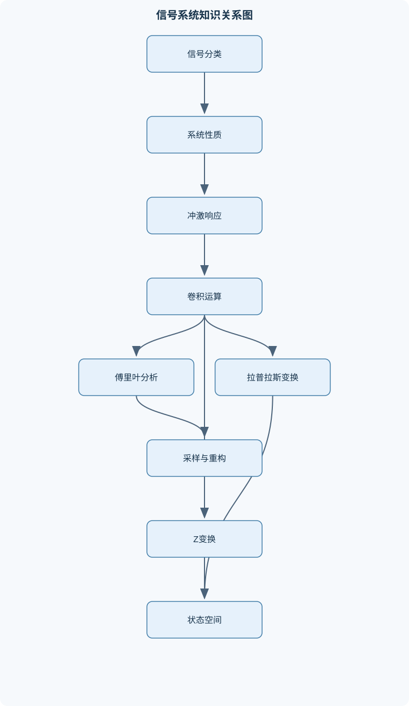
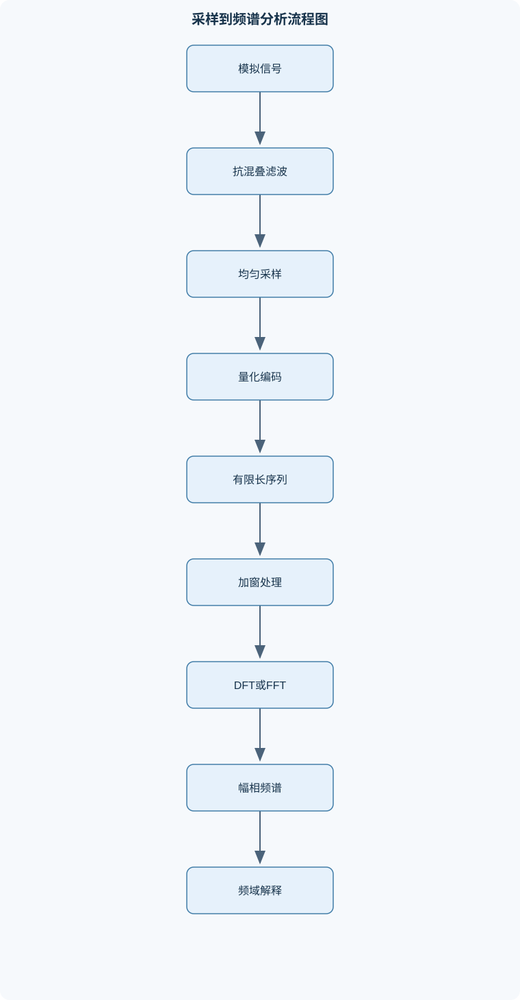

# 信号与系统

## 一、课程整体知识框架

### 课程边界与先修知识

本课程研究连续时间与离散时间信号的表示、变换、系统性质、响应分析、频域与复频域方法，以及采样和数字实现基础。主要对象包括确定性信号、周期与非周期信号、能量与功率信号、连续与离散信号、线性时不变系统、常系数微分方程和差分方程系统、状态空间模型、傅里叶级数与傅里叶变换、拉普拉斯变换、Z变换、离散傅里叶变换、采样与重构。先修知识包括微积分、复数与复指数、常微分方程、线性代数、级数、概率基础和基本编程或数值计算知识。课程重点是理想线性模型及其数学推导，同时说明有限观测、噪声、量化、混叠、边界效应和数值误差等现实限制；不以具体电路、软件或硬件型号为前提。





### 1. 研究对象、基本表示与先修基础

《信号与系统》研究信号如何表示、变换、传输和处理，以及系统如何根据输入产生输出。连续时间信号记为 $x(t)$，其中 $t$ 为连续时间变量，通常以秒为单位；离散时间信号记为 $x[n]$，其中 $n\in\mathbb Z$ 是整数样本索引。连续时间信号可以在任意实数时刻取值，离散时间信号只在整数索引处定义。离散时间并不等同于数字信号：离散时间信号的自变量离散，但幅度仍可能是连续值；经过量化后，幅度才进一步限制为有限个等级。

信号可以按多个相互独立的标准分类。确定信号由明确的数学关系或规则决定，例如 $x(t)=e^{-t}u(t)$；随机信号的具体取值不能由当前模型完全确定，通常需要用均值、自相关函数、功率谱密度等统计量描述。周期信号满足存在正周期 $T_0>0$，使得

$$
x(t+T_0)=x(t)
$$

对所有相关的 $t$ 成立。最小正周期称为基本周期。离散时间周期信号满足存在正整数 $N_0$，使得

$$
x[n+N_0]=x[n].
$$

例如 $x[n]=\cos(\Omega_0 n+\phi)$ 具有离散周期的充要条件是 $\Omega_0/(2\pi)$ 为有理数；连续时间正弦信号只要角频率非零，就具有周期 $T_0=2\pi/|\omega_0|$。因此，不能把连续时间和离散时间的周期性条件直接混用。

能量与功率由极限定义，而不是由波形幅度简单判断。连续时间信号的能量为

$$
E=\int_{-\infty}^{\infty}|x(t)|^2\,\mathrm dt,
$$

离散时间信号的能量为

$$
E=\sum_{n=-\infty}^{\infty}|x[n]|^2.
$$

平均功率分别可写为

$$
P=\lim_{T\to\infty}\frac{1}{2T}\int_{-T}^{T}|x(t)|^2\,\mathrm dt
$$

和

$$
P=\lim_{N\to\infty}\frac{1}{2N+1}
\sum_{n=-N}^{N}|x[n]|^2,
$$

前提是相应极限存在。有限能量且能量非零的信号通常称为能量信号；有限且非零平均功率的信号通常称为功率信号。衰减指数信号 $e^{-at}u(t)$ 在 $a>0$ 时能量有限，属于能量信号；非零周期信号的总能量通常发散，但平均功率有限，因此通常属于功率信号。零信号是边界情形，其能量和功率均为零。

### 2. 信号的结构分解与基本运算

任意信号都可以分解为偶部和奇部。连续时间情形为

$$
x_e(t)=\frac{x(t)+x(-t)}{2},\qquad
x_o(t)=\frac{x(t)-x(-t)}{2},
$$

因此 $x(t)=x_e(t)+x_o(t)$。离散时间情形只需将 $t$ 替换为 $n$。偶信号满足 $x_e(t)=x_e(-t)$，奇信号满足 $x_o(t)=-x_o(-t)$，且奇信号在零点必须为零。对于复信号，还可按实部和虚部分解：

$$
x(t)=\operatorname{Re}\{x(t)\}+j\operatorname{Im}\{x(t)\}.
$$

因果信号在 $t<0$ 或 $n<0$ 时为零；非因果信号在负时间或负索引处可能非零。无记忆信号的输出只依赖当前输入，具有记忆的系统则依赖过去、现在或未来输入。需要区分“信号因果性”和“系统因果性”：前者描述信号支撑区间，后者描述系统输出是否依赖未来输入。

单位阶跃函数通常定义为

$$
u(t)=
\begin{cases}
1,&t\ge 0,\\
0,&t<0,
\end{cases}
$$

但 $t=0$ 处的取值可按题目约定处理，单点取值不影响普通积分。离散单位阶跃为 $u[n]=1$（当 $n\ge0$），否则为零。连续时间单位冲激 $\delta(t)$ 不是普通函数，而是满足

$$
\int_{-\infty}^{\infty}\delta(t)\,\mathrm dt=1
$$

并具有筛选性质

$$
\int_{-\infty}^{\infty}x(t)\delta(t-t_0)\,\mathrm dt=x(t_0)
$$

的广义函数。离散单位脉冲 $\delta[n]$ 满足 $\delta[0]=1$、其余位置为零，并有

$$
\sum_{k=-\infty}^{\infty}x[k]\delta[n-k]=x[n].
$$

时移、时间反转和时间尺度变换必须按表达式逐步判断。$x(t-t_0)$ 表示向右移动 $t_0$；$x(-t)$ 表示关于原点反转；$x(at)$ 在 $|a|>1$ 时沿时间轴压缩，在 $0<|a|<1$ 时扩展。表达式 $(t-1)u(t-1)$ 的支撑区间为 $t\ge1$，而不是先画 $tu(t)$ 后任意平移幅度。离散序列中，$(1/2)^{n-2}u[n-2]$ 从 $n=2$ 开始，首个非零样本为 $1$；不能把指数的横向位移误认为幅度系数。

### 3. 系统性质与线性时不变系统

系统可抽象表示为

$$
y=\mathcal T\{x\},
$$

其中 $x$ 是输入，$y$ 是输出，$\mathcal T$ 是系统算子。线性要求同时满足齐次性和可加性：

$$
\mathcal T\{a x_1+b x_2\}
=a\mathcal T\{x_1\}+b\mathcal T\{x_2\}.
$$

若系统的输入输出关系中含有常数偏置、平方项或乘积项，通常不是线性系统。例如 $y(t)=x^2(t)$ 不满足齐次性，因为 $\mathcal T\{a x\}=a^2x^2$，一般不等于 $a\mathcal T\{x\}$。

时不变性要求输入延迟后，输出只产生相同延迟：

$$
\mathcal T\{x(t-t_0)\}=y(t-t_0)
$$

或离散形式

$$
\mathcal T\{x[n-n_0]\}=y[n-n_0].
$$

判断时不变性时，应分别计算“先移位再过系统”和“先过系统再移位”两种结果。系统 $y(t)=t\,x(t)$ 虽然线性，但不时不变，因为对移位输入得到 $(t)x(t-t_0)$，而移位输出为 $(t-t_0)x(t-t_0)$。

稳定性通常采用有界输入有界输出（BIBO）定义：任何满足 $|x(t)|\le M_x<\infty$ 的输入，都产生满足 $|y(t)|\le M_y<\infty$ 的输出。对连续时间 LTI 系统，充分必要条件是

$$
\int_{-\infty}^{\infty}|h(t)|\,\mathrm dt<\infty;
$$

对离散时间 LTI 系统，条件为

$$
\sum_{n=-\infty}^{\infty}|h[n]|<\infty.
$$

该结论针对 BIBO 稳定性，不等同于内部稳定性、渐近稳定性或数值计算稳定性。

无记忆 LTI 系统的冲激响应只能集中在原点，例如连续时间中 $h(t)=K\delta(t)$，离散时间中 $h[n]=K\delta[n]$。因果 LTI 系统必须满足 $h(t)=0$（当 $t<0$）或 $h[n]=0$（当 $n<0$）。系统可逆是指存在逆系统，使级联后恢复输入；若系统丢失信息，例如 $y(t)=x^2(t)$，则不同输入可能产生相同输出，通常不可逆。

### 4. 卷积及其系统解释

连续时间 LTI 系统的输出由输入和冲激响应的卷积给出：

$$
y(t)=x(t)*h(t)
=\int_{-\infty}^{\infty}x(\tau)h(t-\tau)\,\mathrm d\tau.
$$

离散时间形式为

$$
y[n]=x[n]*h[n]
=\sum_{k=-\infty}^{\infty}x[k]h[n-k].
$$

推导过程如下：先将输入表示为移位冲激的叠加，

$$
x(t)=\int_{-\infty}^{\infty}x(\tau)\delta(t-\tau)\,\mathrm d\tau.
$$

每个 $\delta(t-\tau)$ 经过时不变系统后变为 $h(t-\tau)$；再利用线性性，将所有加权响应相加，得到卷积积分。离散情形将积分替换为求和，并将 $\delta[n-k]$ 作为分解基元。

卷积满足交换律、结合律和分配律：

$$
x*h=h*x,
$$

$$
(x*h)*g=x*(h*g),
$$

$$
x*(h_1+h_2)=x*h_1+x*h_2.
$$

交换律说明可以从输入侧或系统侧观察卷积；结合律用于级联 LTI 系统；分配律用于并联系统。上述性质需在卷积存在的条件下使用，例如绝对可积或绝对可和条件足以保证相关运算成立。

卷积的图形计算包含三个动作：固定输出时刻，将 $h(\tau)$ 关于原点反转得到 $h(-\tau)$；再平移为 $h(t-\tau)$；确定其与 $x(\tau)$ 的非零区间交叠范围；最后在交叠区间内积分。矩形脉冲与矩形脉冲卷积通常产生梯形或三角形；指数信号与有限宽脉冲卷积通常需要按交叠边界分段。边界点的单点取值不改变普通积分结果，但离散卷积中的每个样本都必须明确计入。

### 5. 连续时间系统的时域分析

线性常系数微分方程可表示为

$$
\sum_{k=0}^{N}a_k\frac{\mathrm d^k y(t)}{\mathrm dt^k}
=
\sum_{m=0}^{M}b_m\frac{\mathrm d^m x(t)}{\mathrm dt^m}.
$$

其响应可分解为零输入响应和零状态响应：

$$
y(t)=y_{\mathrm{zi}}(t)+y_{\mathrm{zs}}(t).
$$

零输入响应令输入为零，只保留初始状态产生的自然响应；零状态响应令初始状态为零，只研究输入造成的响应。该分解来自线性方程解的叠加，而不是把任意响应机械地分成两段。

齐次方程的特征方程决定自然响应。若特征根为互异根 $s_i$，则对应项为 $C_i e^{s_i t}$；若 $s_0$ 为 $r$ 重根，则对应项为

$$
(C_0+C_1t+\cdots+C_{r-1}t^{r-1})e^{s_0t}.
$$

输入产生的特解称强迫响应。若输入指数项的指数与特征根重复，特解需要乘以足够高次的 $t$，直到不再与齐次解重复。稳定连续系统的自然响应应衰减，通常要求相关极点实部为负；实部为零可能产生持续振荡，实部为正则产生发散响应。

阶跃响应与冲激响应之间存在关系。若系统因果且初始静止，阶跃输入为 $u(t)$，输出为

$$
s(t)=u(t)*h(t)=\int_{-\infty}^{t}h(\tau)\,\mathrm d\tau.
$$

在分布意义下，

$$
h(t)=\frac{\mathrm d s(t)}{\mathrm dt}.
$$

对于含 $\delta(t)$、$\delta'(t)$ 的微分方程，不能把冲激当作普通有限函数。应先写出因果响应的分段形式，计算各阶导数中由跳变产生的冲激项，再比较方程两端 $\delta(t)$ 及其导数的系数，这一过程称冲激匹配。初始条件必须与系统实际定义和因果假设一致，否则会得到不满足方程的响应。

### 6. 离散时间系统的时域分析

线性常系数差分方程的一般形式为

$$
\sum_{k=0}^{N}a_k y[n-k]
=
\sum_{m=0}^{M}b_m x[n-m].
$$

若最高阶输出项系数不为零，可以整理为递推关系，根据已知初值逐点计算。初始静止条件通常指系统在输入作用前的状态为零，但它不等同于 $y[0]=0$；具体初值应由方程和状态定义共同确定。

齐次解由特征方程决定。若特征根为 $r_i$，互异根对应 $C_i r_i^n$；$r_0$ 为 $q$ 重根时，响应包含

$$
(C_0+C_1n+\cdots+C_{q-1}n^{q-1})r_0^n.
$$

输入为阶跃、指数或正弦序列时，可按相同形式设定特解。若特解与齐次解重复，则乘以 $n$ 的适当幂。离散系统因果且 BIBO 稳定时，有理系统的所有极点必须位于单位圆内，即 $|z_i|<1$。

离散卷积为

$$
y[n]=\sum_k x[k]h[n-k].
$$

长度分别为 $L$ 和 $M$ 的有限长序列，其线性卷积长度为 $L+M-1$。递归系统的冲激响应通常无限长，因为当前输出依赖过去输出；非递归系统只依赖有限个输入样本，通常得到有限长冲激响应。这里的“输入侧算法”固定 $n$，扫描所有 $k$；“输出侧算法”固定某个输入样本，将其冲激响应按幅度和位置累加。两种方法必须得到相同结果。

### 7. 傅里叶级数与傅里叶变换

连续时间周期信号的指数傅里叶级数为

$$
x(t)=\sum_{k=-\infty}^{\infty}C_k e^{jk\omega_0t},
\qquad
\omega_0=\frac{2\pi}{T_0},
$$

其中

$$
C_k=\frac{1}{T_0}
\int_{t_0}^{t_0+T_0}x(t)e^{-jk\omega_0t}\,\mathrm dt.
$$

积分区间可以是任意连续长度为 $T_0$ 的区间。三角形式使用直流项、余弦项和正弦项；指数形式在处理时移、调制和 LTI 系统时更直接。偶信号的傅里叶级数系数具有相应对称性，奇信号的余弦系数或直流分量可能为零；半波对称、四分之一波对称可以进一步消去特定谐波。

复指数是 LTI 系统的特征函数。若输入为 $e^{j\omega t}$，则

$$
y(t)=\int_{-\infty}^{\infty}h(\tau)e^{j\omega(t-\tau)}\,\mathrm d\tau
=e^{j\omega t}H(j\omega),
$$

其中

$$
H(j\omega)=\int_{-\infty}^{\infty}h(\tau)e^{-j\omega\tau}\,\mathrm d\tau.
$$

因此系统只改变复指数的幅度和相位，不改变其频率。周期输入通过 LTI 系统后，每个谐波系数变为 $C_kH(jk\omega_0)$。幅度谱为 $|C_k|$，相位谱为 $\arg C_k$；负的幅度应改写为正幅度并在相位中加入 $\pi$，不能把负幅度直接当作幅度谱。

非周期信号的傅里叶变换定义为

$$
X(j\omega)=\int_{-\infty}^{\infty}x(t)e^{-j\omega t}\,\mathrm dt,
$$

逆变换为

$$
x(t)=\frac{1}{2\pi}\int_{-\infty}^{\infty}X(j\omega)e^{j\omega t}\,\mathrm d\omega.
$$

普通函数的绝对可积性是保证变换存在的常用条件，但不是唯一条件；周期信号和常数信号常需在广义函数意义下使用频域冲激。核心性质包括

$$
x(t-t_0)\longleftrightarrow e^{-j\omega t_0}X(j\omega),
$$

$$
x(at)\longleftrightarrow \frac{1}{|a|}X\left(j\frac{\omega}{a}\right),
$$

以及

$$
x(t)*h(t)\longleftrightarrow X(j\omega)H(j\omega).
$$

时域相乘对应频域卷积：

$$
x(t)h(t)\longleftrightarrow
\frac{1}{2\pi}X(j\omega)*H(j\omega).
$$

这些公式必须同时满足变换存在条件；对冲激、周期信号等对象，应说明所采用的广义函数解释。

### 8. 拉普拉斯变换与 Z 变换

双边拉普拉斯变换定义为

$$
X(s)=\int_{-\infty}^{\infty}x(t)e^{-st}\,\mathrm dt,
\qquad s=\sigma+j\omega.
$$

变换表达式必须与收敛域（ROC）同时给出。对右边信号，ROC 通常是某条垂线右侧；对左边信号，ROC 通常是某条垂线左侧；对双边信号，ROC 通常是两个边界之间的竖直条带。相同的有理表达式配合不同 ROC，可能对应不同的时域信号。

单边拉普拉斯变换从 $0^-$ 开始积分，适合处理因果系统和非零初始条件。微分性质为

$$
\mathcal L\left\{\frac{\mathrm dx(t)}{\mathrm dt}\right\}
=sX(s)-x(0^-),
$$

更高阶导数会出现多个初始值项。系统函数 $H(s)$ 通常定义为零初始条件下的输出与输入之比。频率响应 $H(j\omega)$ 只有在虚轴属于 ROC 时才可由 $s=j\omega$ 得到。连续时间因果有理系统稳定，通常要求所有极点位于左半平面。

Z 变换定义为

$$
X(z)=\sum_{n=-\infty}^{\infty}x[n]z^{-n}.
$$

其 ROC 决定序列方向：右边序列对应外侧区域，左边序列对应内侧区域，双边序列对应环形区域。因果有理系统的 ROC 在最外极点之外；因果系统 BIBO 稳定要求单位圆包含在 ROC 内，因此因果有理系统的极点必须位于单位圆内。离散频率响应由 $z=e^{j\Omega}$ 给出，但必须先确认单位圆属于 ROC；$\Omega$ 的单位是弧度每样本，并具有 $2\pi$ 周期性。

部分分式展开时，单极点产生指数型序列或信号，重极点产生带有 $n$ 或 $t$ 的乘积项。不能只根据代数分式判断反变换，必须结合 ROC 判断右边、左边还是双边形式。初值定理和终值定理也有适用条件：终值定理要求相关极点条件成立，持续振荡或发散情形不能直接套用。

### 9. 采样、量化与离散傅里叶分析

理想冲激采样模型为

$$
x_s(t)=x(t)\sum_{n=-\infty}^{\infty}\delta(t-nT_s),
$$

其中 $T_s$ 为采样周期，采样频率为

$$
f_s=\frac{1}{T_s},
$$

采样角频率为 $\omega_s=2\pi f_s$。若原信号严格带限于 $|\omega|\le\omega_m$，并满足

$$
\omega_s>2\omega_m
$$

则理想低通滤波器原则上可以从采样信号恢复原信号。频域中采样导致原频谱以 $\omega_s$ 为间隔周期延拓。若频谱副本重叠，就产生混叠；重叠后的不同模拟频率映射到同一离散频率，之后无法仅靠数字处理唯一分离。实际系统需在 ADC 前设置抗混叠模拟低通滤波器，并考虑滤波器过渡带、噪声和时钟抖动。

量化把连续幅度映射到有限等级。量化位数决定幅度分辨率，不决定采样时间分辨率。量化误差可表现为噪声近似，但在低幅度、强相关或发生饱和时不能简单视为独立白噪声。DAC 则通过保持、滤波等过程将数字样本转换为连续时间波形；理想重构公式依赖带限假设，现实滤波器只能近似理想响应。

长度为 $N$ 的 DFT 定义为

$$
X[k]=\sum_{n=0}^{N-1}x[n]e^{-j2\pi kn/N},
\qquad k=0,1,\ldots,N-1.
$$

逆 DFT 为

$$
x[n]=\frac1N\sum_{k=0}^{N-1}X[k]e^{j2\pi kn/N}.
$$

DFT 是有限长序列周期延拓后的离散频率采样。有限观测会导致频谱泄漏：实际频率未落在 DFT 频点时，能量扩散到多个频点。加窗可以降低旁瓣，但会牺牲主瓣宽度和幅度估计精度。DFT 中的乘法对应循环卷积；若要用频域乘法计算长度为 $L$、$M$ 的线性卷积，通常应将序列零填充到至少 $L+M-1$ 的长度。

### 10. 状态空间与系统结构

连续时间状态空间模型为

$$
\dot{\boldsymbol{x}}_{\mathrm{state}}(t)
=A\boldsymbol{x}_{\mathrm{state}}(t)
+B\boldsymbol{u}_{\mathrm{state}}(t),
$$

$$
\boldsymbol{y}_{\mathrm{state}}(t)
=C\boldsymbol{x}_{\mathrm{state}}(t)
+D\boldsymbol{u}_{\mathrm{state}}(t).
$$

离散时间模型为

$$
\boldsymbol{x}_{\mathrm{state}}[n+1]
=A\boldsymbol{x}_{\mathrm{state}}[n]
+B\boldsymbol{u}_{\mathrm{state}}[n],
$$

$$
\boldsymbol{y}_{\mathrm{state}}[n]
=C\boldsymbol{x}_{\mathrm{state}}[n]
+D\boldsymbol{u}_{\mathrm{state}}[n].
$$

连续系统的状态转移矩阵为

$$
\Phi(t-t_0)=e^{A(t-t_0)},
$$

状态响应为

$$
\boldsymbol{x}_{\mathrm{state}}(t)
=\Phi(t-t_0)\boldsymbol{x}_{\mathrm{state}}(t_0)
+\int_{t_0}^{t}\Phi(t-\tau)B
\boldsymbol{u}_{\mathrm{state}}(\tau)\,\mathrm d\tau.
$$

第一项是零输入响应，第二项是输入引起的零状态响应。矩阵指数的特征值决定系统模态；若 $A$ 可对角化，可通过特征向量展开矩阵指数，若存在重特征值，则会出现类似 $t^r e^{\lambda t}$ 的项。

可控性判断系统输入能否在有限时间内把状态驱动到目标状态。连续时间可控性矩阵为

$$
\mathcal C=
\begin{bmatrix}
B&AB&A^2B&\cdots&A^{n-1}B
\end{bmatrix},
$$

若其秩等于状态维数，则系统完全可控。可观性矩阵为

$$
\mathcal O=
\begin{bmatrix}
C\\
CA\\
CA^2\\
\vdots\\
CA^{n-1}
\end{bmatrix},
$$

满秩时系统完全可观。可控性、可观性、内部稳定性和输入输出稳定性是不同性质，不能用一个结论替代全部判断。状态变量的选取不唯一，但不同实现可以具有相同传递函数；状态空间模型还可揭示传递函数约分后隐藏的不可控或不可观模态。

## 二、章节和模块划分

### 核心知识覆盖清单

本清单用于检查正文是否覆盖本课程的主要知识模块：

- **信号的基本概念与分类**：连续时间信号与离散时间信号、确定信号与随机信号、周期信号与非周期信号、能量信号与功率信号、偶信号与奇信号分解、因果信号与非因果信号、实信号与复信号、单位阶跃与单位冲激、信号的时移反转与尺度变换。
- **系统性质与线性时不变系统**：系统的输入输出描述、线性与叠加齐次性、时不变性判定、因果性与无记忆性、稳定性与有界输入有界输出、可逆性与逆系统、连续时间冲激响应、离散时间单位脉冲响应、LTI系统的卷积关系。
- **连续时间系统的时域分析**：常系数微分方程建模、零输入响应与零状态响应、自然响应与强迫响应、初始条件与边界条件、冲激函数及其导数、冲激匹配法、阶跃响应与冲激响应的关系、卷积积分的图形计算、系统暂态与稳态响应。
- **离散时间系统的时域分析**：常系数差分方程、递推关系与初始静止条件、零输入和零状态响应、离散卷积和的定义、有限长与无限长序列、单位阶跃和单位脉冲序列、递归系统与非递归系统、线性常系数系统的特征根、卷积的输入侧与输出侧解释。
- **连续时间傅里叶级数与频谱**：周期信号的指数傅里叶级数、三角形式傅里叶级数、傅里叶级数系数计算、线谱与频谱结构、复指数作为LTI系统特征函数、频移与调制、时移与相位变化、周期信号通过LTI系统、帕塞瓦尔关系、对称性对频谱的影响。
- **连续时间傅里叶变换**：傅里叶变换定义与收敛条件、常见信号变换对、变换的线性时移与尺度性质、微分与积分性质、时域卷积与频域乘积、频域卷积与时域乘积、能量谱密度、幅度谱与相位谱、理想滤波器与带宽、广义函数中的冲激频谱。
- **拉普拉斯变换与连续系统**：双边与单边拉普拉斯变换、收敛域及其意义、有理函数的零极点、部分分式展开、初值定理与终值定理、微分方程的变换域求解、系统函数与传递函数、因果性稳定性与收敛域、极点位置与自然响应、频率响应与拉普拉斯变换的联系。
- **Z变换与离散系统**：双边与单边Z变换、Z变换收敛域、序列时移与反转、有理Z变换的零极点图、部分分式展开与重根处理、差分方程的Z域求解、离散系统函数、因果性与稳定性判定、初值定理与终值定理的适用条件、极点位置与离散系统响应。
- **采样量化与离散傅里叶分析**：理想冲激采样模型、采样频率与奈奎斯特条件、频谱周期延拓、混叠产生机制、抗混叠低通滤波、理想重构与插值、量化误差与量化噪声、模数转换与数模转换流程、离散傅里叶变换定义、频谱泄漏与有限观测效应。
- **状态空间与系统结构**：连续时间状态方程、离散时间状态方程、状态转移矩阵、矩阵指数与特征值、输入输出响应的状态空间表达、可控性判定、可观性判定、状态变量选取与实现结构、状态空间模型与传递函数转换、系统稳定性与状态响应。


### 1. 第一章：信号的基本概念与分类

本章先建立连续时间和离散时间的统一语言，再讨论确定性、随机性、周期性、能量性、因果性、奇偶性和实复性。典型分析应先确定自变量类型，再检查周期条件，最后根据能量或功率定义判断信号类别。例如 $x(t)=u(t)$ 是确定、连续时间、因果信号，但其能量发散，平均功率为有限非零值；$x(t)=e^{-t}u(t)$ 是连续、确定、因果且有限能量信号。分类标准可以同时成立，不能把“连续”和“确定”视为互斥类别。

### 2. 第二章：系统性质与线性时不变系统

本章从输入输出算子出发，逐项判定线性、时不变性、因果性、无记忆性、可逆性和 BIBO 稳定性。核心对象是 LTI 系统，因为任意输入可以由移位冲激分解，系统只需给出冲激响应 $h$，即可通过卷积确定输出。连续系统采用卷积积分，离散系统采用卷积和。应特别区分零状态条件下的卷积响应与含有非零初始状态时的完整响应。

### 3. 第三、四章：连续与离散时间系统的时域分析

连续时间部分以常系数微分方程为模型，离散时间部分以常系数差分方程为模型。两者在结构上具有对应关系：特征根决定自然响应，输入形式决定强迫响应，重复根导致多项式因子，初始条件用于确定待定常数。连续系统中的冲激及其导数需要使用广义函数和冲激匹配；离散系统则通过单位脉冲和递推关系逐点确定响应。

零输入响应只由初始状态产生，零状态响应只由输入产生。若系统处于初始静止状态，零状态响应可表示为输入与冲激响应的卷积；若存在储能或内部状态，不能只计算卷积而忽略零输入项。暂态响应通常与系统极点有关，稳态响应则与长期输入和系统频率特性有关。

### 4. 第五章：连续时间傅里叶级数与频谱

本章处理周期信号。指数傅里叶级数将周期信号表示为基本角频率整数倍的复指数叠加，系数由一个周期内的积分求得。计算时应先确定基本周期，再利用偶奇对称、半波对称等性质减少积分。周期矩形波的频谱是离散线谱；通过 LTI 系统后，第 $k$ 条谱线的系数变为 $C_kH(jk\omega_0)$。频谱中的幅度、相位和直流分量分别反映不同结构，不能只画幅度谱而忽略相位对时域波形的影响。

### 5. 第六章：连续时间傅里叶变换

本章把傅里叶级数推广到非周期信号。可将周期逐渐增大，使基频趋于零，离散谱线变得越来越密，谱系数与频率间隔的乘积趋向连续频谱，从而得到傅里叶变换。应同时掌握常见变换对、时移、尺度、微分、积分、调制、卷积和乘积性质。变换公式的使用必须检查信号是否绝对可积，或明确采用广义函数解释。理想低通滤波器在频域中截取指定带宽，但其时域冲激响应通常无限延伸且非因果，因此是理想模型而非可直接实现的有限装置。

### 6. 第七章：拉普拉斯变换与连续系统

本章把微分方程求解转化为代数运算。$s=\sigma+j\omega$ 中，$\sigma$ 控制指数衰减或增长，$\omega$ 描述振荡。零点影响系统对特定输入的抑制或增强，极点决定自然响应和主要动态。部分分式展开后，必须结合 ROC 选择右边、左边或双边反变换。因果性要求时域响应在负时间为零，稳定性要求冲激响应绝对可积；对于因果有理系统，通常等价于所有极点在左半平面。单边变换适合带初始条件的因果方程，双边变换更适合统一讨论时域方向和收敛域。

### 7. 第八章：Z 变换与离散系统

Z 变换是离散时间差分方程的主要变换工具。$z$ 平面中的极点位置决定序列的增长或衰减，单位圆对应离散频率响应。与拉普拉斯变换一样，代数表达式和 ROC 必须作为整体解释。对有理函数进行部分分式展开时，重极点会产生 $n r^n$ 等项；因果系统通常选择最外极点之外的 ROC，稳定系统则要求单位圆在 ROC 内。单边 Z 变换可将初始条件带入代数方程，但不能据此忽略双边 Z 变换对序列方向的区分。

### 8. 第九章：采样、量化与模拟数字接口

本章研究连续信号如何进入数字处理系统。完整流程包括抗混叠滤波、均匀采样、量化、编码、数字处理、数模转换、保持和重构滤波。奈奎斯特条件只对严格带限和理想重构模型成立；现实信号通常含有高频噪声，因此需要留出过渡带。混叠是频谱副本重叠造成的不可逆失真，与量化误差不同：前者是时间采样不足导致的频率歧义，后者是幅度取整造成的误差。

### 9. 第十章：离散傅里叶变换与有限数据分析

DFT 对有限长度数据进行频谱分析，隐含输入序列的周期延拓。频率间隔为

$$
\Delta f=\frac{f_s}{N},
$$

其中 $f_s$ 为采样频率，$N$ 为样本数。增大 $N$ 可以提高频率栅格的密度，但若只是零填充，并不会增加原始观测时间，也不会真正提高物理分辨率。有限观测截断会造成频谱泄漏；加窗可以改变泄漏分布，但会影响幅度和频率估计。实序列 DFT 具有共轭对称性，可用于结果校验。

### 10. 第十一章：状态空间与系统结构

本章用状态向量描述系统内部动态。状态变量应足以结合当前输入和当前状态预测未来状态。状态空间模型适用于多输入多输出系统、非零初始状态系统以及需要研究内部结构的系统。应掌握状态转移矩阵、零输入和输入响应、传递函数转换、可控性和可观性判定。传递函数只描述输入输出关系，可能隐藏内部模态；状态空间模型则能够区分可控、不可控、可观和不可观部分。

### 11. 代表性分析流程一：连续时间卷积

**输入：** $x(t)$ 与 $h(t)$；**输出：** $y(t)=x(t)*h(t)$。

1. 写出
   $$
   y(t)=\int_{-\infty}^{\infty}x(\tau)h(t-\tau)\,\mathrm d\tau.
   $$
2. 将 $h(\tau)$ 反转为 $h(-\tau)$，再平移为 $h(t-\tau)$。
3. 根据两个信号的支撑区间确定交叠范围。
4. 按交叠边界分段积分。
5. 检查输出的起始时间、结束时间、连续性和单位。
6. 若输入或冲激响应含冲激，应改用筛选性质，不把冲激当作普通函数积分。

连续卷积的计算量取决于分段数量和每段积分复杂度。该流程适用于分段连续信号和广义函数，但前提是卷积在所采用的意义下存在。

### 12. 代表性分析流程二：离散卷积与有限长序列

**输入：** 长度为 $L$ 的 $x[n]$ 与长度为 $M$ 的 $h[n]$；**输出：** 长度为 $L+M-1$ 的线性卷积。

固定输出索引 $n$，只累加同时满足 $x[k]$ 和 $h[n-k]$ 有定义的乘积：

$$
y[n]=\sum_{k=\max(k_{\min},n-\ell_{\max})}
^{\min(k_{\max},n-\ell_{\min})}
x[k]h[n-k].
$$

不变量是：每一个输出样本都包含全部有效乘积项，且没有重复计数。直接算法复杂度为 $O(LM)$。如果将两个序列分别零填充到至少 $L+M-1$ 点，再使用 DFT 进行频域乘法，可得到线性卷积；若不补零，结果通常是循环卷积。

```python
# 语言：Python
def linear_convolution(x, h):
    """返回两个有限长实数或复数序列的线性卷积。"""
    L = len(x)
    M = len(h)
    y = [0 for _ in range(L + M - 1)]

    for n in range(L + M - 1):
        total = 0
        for k in range(L):
            j = n - k
            if 0 <= j < M:
                total += x[k] * h[j]
        y[n] = total

    return y

x = [1, 2, 1]
h = [1, -1]
print(linear_convolution(x, h))  # [1, 1, -1, -1]
```

### 13. 代表性分析流程三：有理变换的部分分式展开

**输入：** 有理函数 $X(s)$ 或 $X(z)$；**输出：** 与指定 ROC 相容的时域表达式。

先因式分解分母，识别单极点、重极点和共轭复极点；再按极点结构设定待定系数；通过代入特殊点或比较系数求解；最后结合 ROC 选择右边或左边反变换。若有重极点，必须保留对应高阶项。例如

$$
X(s)=\frac{1}{(s+a)^2}
$$

的反变换不是单纯的 $e^{-at}$，而是与 $t e^{-at}$ 有关；若指定右半平面 ROC，则得到右边因果形式，若指定左半平面 ROC，则得到左边形式。最后可用初值、极点位置和直接变换检验结果。

### 14. 代表性分析流程四：采样和混叠判定

**输入：** 原信号最高有效频率、采样频率、滤波器指标；**输出：** 混叠判定和重构条件。

1. 确定信号频谱的有效边界 $f_m$。
2. 检查 $f_s>2f_m$ 是否成立。
3. 若不成立，计算频谱副本间隔 $f_s$，判断副本重叠区间。
4. 在采样前设计抗混叠滤波器，使带外成分衰减到允许范围。
5. 若条件成立，确定重构低通滤波器的通带、阻带和过渡带。
6. 对实际系统额外检查时钟抖动、滤波器非理想性和高频噪声。

该流程适用于采样近似均匀、带宽可以合理定义的信号；对强非平稳信号或含大量未知高频成分的信号，单一最高频率可能不足以描述风险。

### 15. 代表性例题一：信号分类

**题干：** 判断 $x_1(t)=e^{-2t}u(t)$、$x_2(t)=\cos(3t)$、$x_3[n]=\cos(\pi n/3)$ 的周期性和能量、功率属性。

**分析：** 先分别使用连续和离散周期条件，再计算能量或平均功率。

**解答：**

1. $x_1(t)$ 为确定、连续时间、因果信号。由于其幅度随 $t$ 增大而衰减，不是周期信号。其能量为
   $$
   E=\int_0^\infty e^{-4t}\,\mathrm dt=\frac14,
   $$
   因而是能量信号，平均功率为零。
2. $x_2(t)$ 的基本角频率为 $3$，周期为
   $$
   T_0=\frac{2\pi}{3}.
   $$
   它不是有限能量信号，但平均功率为
   $$
   P=\frac12.
   $$
3. $x_3[n]$ 的频率满足 $\Omega_0/(2\pi)=1/6$ 为有理数，因此周期为 $N_0=6$。其平均功率为 $1/2$，总能量发散，属于功率信号。

**结果验证：** 将 $n$ 替换为 $n+6$，有 $\cos(\pi(n+6)/3)=\cos(\pi n/3+2\pi)=x_3[n]$。将 $t$ 替换为 $t+2\pi/3$，可验证 $x_2$ 周期性。

**变式：** 若改为 $x[n]=\cos(\sqrt2\,n)$，则 $\sqrt2/(2\pi)$ 通常为无理数，不存在正整数周期，因此不是离散周期信号。

### 16. 代表性例题二：矩形脉冲卷积

**题干：** 设 $x(t)=u(t)-u(t-1)$，$h(t)=u(t)-u(t-2)$，求 $y(t)=x(t)*h(t)$。

**分析：** $x(\tau)$ 非零于 $0\le\tau<1$，$h(t-\tau)$ 非零条件为 $0\le t-\tau<2$，即 $t-2<\tau\le t$。积分值等于两个区间交叠长度。

**解答：**

- 当 $t<0$ 时，无交叠，$y(t)=0$；
- 当 $0\le t<1$ 时，交叠区间为 $[0,t]$，长度为 $t$；
- 当 $1\le t<2$ 时，$x$ 完全落在 $h(t-\tau)$ 的有效范围内，长度为 $1$；
- 当 $2\le t<3$ 时，交叠区间为 $[t-2,1]$，长度为 $3-t$；
- 当 $t\ge3$ 时，无交叠。

因此

$$
y(t)=
\begin{cases}
0,&t<0,\\
t,&0\le t<1,\\
1,&1\le t<2,\\
3-t,&2\le t<3,\\
0,&t\ge3.
\end{cases}
$$

**结果验证：** 两个非零区间长度分别为 $1$ 和 $2$，卷积支撑区间应为 $[0,3]$；最大重叠长度为较短脉冲宽度 $1$，与结果一致。

**变式：** 若 $h(t)$ 的幅度改为 $A$，则整个结果乘以 $A$；若两个矩形脉冲均为宽度 $1$，中间平台消失，卷积为三角形。

### 17. 代表性例题三：二阶差分方程

**题干：** 求初始静止系统

$$
y[n]-\frac12y[n-1]=x[n],
$$

在输入 $x[n]=u[n]$ 下的因果响应。

**分析：** 特征方程为 $r-\frac12=0$，齐次解为 $C(1/2)^n$。阶跃特解设为常数 $K$。

**解答：**

代入常数特解：

$$
K-\frac12K=1,
$$

所以 $K=2$。总响应为

$$
y[n]=C\left(\frac12\right)^n+2.
$$

初始静止意味着 $y[-1]=0$。令 $n=0$：

$$
y[0]-\frac12y[-1]=1,
$$

得到 $y[0]=1$，于是 $C=-1$。因此

$$
y[n]=2-\left(\frac12\right)^n,\qquad n\ge0,
$$

并乘以 $u[n]$ 表示因果形式。

**结果验证：** $y[0]=1$；$y[1]=3/2$；代入递推式有 $3/2-1/2=1$。当 $n\to\infty$ 时，$y[n]\to2$，与稳定系统对单位阶跃的稳态值一致。

**变式：** 若输入改为 $(1/2)^n u[n]$，则输入形式与特征根重复，特解必须设为 $Kn(1/2)^n$，不能只设为 $K(1/2)^n$。

### 18. 代表性例题四：傅里叶级数对称性

**题干：** 周期为 $2\pi$ 的偶信号满足 $x(t)=1$（当 $|t|<\pi/2$），其余一个周期内为零，求指数傅里叶系数。

**分析：** 基本角频率为 $\omega_0=1$。信号为偶信号，可利用区间对称性。

**解答：**

$$
C_k=\frac1{2\pi}\int_{-\pi/2}^{\pi/2}e^{-jkt}\,\mathrm dt.
$$

当 $k=0$ 时，

$$
C_0=\frac1{2\pi}\cdot\pi=\frac12.
$$

当 $k\ne0$ 时，

$$
C_k
=\frac1{2\pi}\frac{e^{-jk\pi/2}-e^{jk\pi/2}}{-jk}
=\frac{\sin(k\pi/2)}{\pi k}.
$$

因此偶数 $k\ne0$ 时 $C_k=0$，奇次谐波保留，且系数符号随 $k$ 变化。

**结果验证：** $C_{-k}=C_k^*$；由于信号为实偶信号，系数应为实数且满足偶对称，结果符合。直流分量等于一个周期内平均值 $1/2$。

**变式：** 若脉冲整体右移 $t_0$，新系数为 $C_k e^{-jkt_0}$，幅度谱不变而相位谱改变。

### 19. 代表性例题五：采样与混叠

**题干：** 模拟信号包含频率 $3$ kHz 和 $7$ kHz 两个正弦分量，采样频率为 $10$ kHz。判断是否混叠，并求 $7$ kHz 分量在基带中的等效频率。

**分析：** 奈奎斯特频率为 $f_s/2=5$ kHz。$7$ kHz 超过该边界，其频谱副本折叠到基带。

**解答：**

$3$ kHz 分量位于基带内，可以保留；$7$ kHz 分量与采样频率相差

$$
|7-10|=3\ \text{kHz}.
$$

因此它在离散采样后与 $3$ kHz 分量映射到同一基带频率，发生混叠。仅根据采样序列无法区分原来的 $3$ kHz 和 $7$ kHz 成分。

**结果验证：** 离散角频率分别为

$$
\Omega_1=2\pi\frac{3}{10},\qquad
\Omega_2=2\pi\frac{7}{10}.
$$

由于离散频率以 $2\pi$ 为周期，$\Omega_2$ 与 $-2\pi(3/10)$ 等价，而实余弦的正负频率对应同一余弦频率，因此两者折叠到相同基带位置。

**变式：** 若采样频率提高到 $20$ kHz，奈奎斯特频率为 $10$ kHz，两个分量均位于基带内；但现实系统仍需抗混叠滤波器处理带外噪声。

### 20. 实验一：有限观测下的 DFT 频谱泄漏

**输入数据：** 采样频率 $f_s=1000$ Hz，分别生成长度 $N=64$ 的信号 $x_1[n]=\cos(2\pi\cdot125n/f_s)$ 和 $x_2[n]=\cos(2\pi\cdot130n/f_s)$。

**步骤：**

1. 计算两组数据的 DFT。
2. 记录频率间隔 $\Delta f=f_s/N$。
3. 绘制幅度谱，并分别使用矩形窗和汉宁窗。
4. 比较主峰位置、主瓣宽度和旁瓣高度。
5. 对 $x_2[n]$ 增加观测长度，观察频谱峰值扩散情况。

**评价标准：**

- DFT 频率轴标定正确；
- $125$ Hz 信号落在频点上时，矩形窗谱线集中程度较高；
- $130$ Hz 不落在原频率栅格上时出现泄漏；
- 加窗后旁瓣下降，但主瓣变宽；
- 能解释零填充只增加频点密度，不等同于增加观测时间。

**排错方法：** 若频谱峰值出现在错误频率，检查 $2\pi kn/N$ 的符号、频率轴单位和是否把采样频率误当作角频率；若实信号没有共轭对称，检查 DFT 归一化和复指数符号；若幅度差约一倍，检查单边谱是否对非直流、非奈奎斯特频点进行了幅度补偿。

### 21. 实验二：采样系统中的混叠与抗混叠滤波

**输入数据：** 由 $1$ kHz 和 $6$ kHz 正弦分量组成的模拟模型，分别采用 $f_s=10$ kHz 和 $f_s=20$ kHz 采样。

**步骤：**

1. 计算两种采样频率下的奈奎斯特频率。
2. 生成采样序列并计算 DFT。
3. 对比采样前后频谱位置。
4. 在采样前加入截止频率约为 $4$ kHz 的低通滤波模型。
5. 再次采样并比较混叠成分是否减少。
6. 改变滤波器过渡带，记录通带衰减和阻带残留。

**评价标准：**

- 能正确指出 $6$ kHz 在 $10$ kHz 采样下折叠为 $4$ kHz；
- 能说明提高采样频率或降低带外成分均可减少混叠；
- 能区分滤波器衰减造成的幅度变化与混叠造成的频率不可辨识；
- 报告中注明频率单位、采样周期和 DFT 频率分辨率。

**排错方法：** 若混叠频率计算错误，应使用与采样频率整数倍相差最近的频率；若滤波后仍有明显高频峰，检查滤波器截止频率、过渡带和滤波器是否在采样之前使用；若波形相位异常，检查离散索引是否从零开始以及滤波器延迟是否被补偿。

## 三、核心概念的详细解释

### 1. 信号的表示、分类与基本运算

信号是描述一个物理量、数学量或信息量随自变量变化规律的函数。连续时间信号记为 $x(t)$，其中 $t$ 为连续变量，通常单位为秒；离散时间信号记为 $x[n]$，其中 $n\in\mathbb Z$ 为整数样本索引。离散时间不等于数字信号：$x[n]$ 的幅度仍可取连续实数，只有经过量化后，幅度才被限制在有限个等级中。

确定信号由明确表达式或确定规则给出，例如 $x(t)=e^{-at}u(t)$；随机信号的单次取值不能由当前确定性模型完全预知，通常需要用均值、自相关和功率谱密度等统计量描述。周期性的定义必须区分连续和离散情形。连续信号满足

$$
x(t+T_0)=x(t),\qquad T_0>0,
$$

其中最小正周期为基本周期。离散序列满足

$$
x[n+N_0]=x[n],\qquad N_0\in\mathbb Z_{>0}.
$$

例如 $x[n]=\cos(\Omega_0n+\phi)$ 具有周期的充要条件是 $\Omega_0/(2\pi)$ 为有理数。若 $\Omega_0/(2\pi)$ 为无理数，则序列永不重复，尽管其幅度始终有界。

能量

### 3.2 连续时间与离散时间的表示

连续时间信号的自变量在时间轴上连续取值，常用 $x(t)$ 表示；离散时间信号只在整数索引上取样，常用 $x[n]$ 表示。离散时间信号不必是数字信号，因为样本幅值仍可能是连续实数；经过量化和编码后，才成为可由有限比特表示的数字序列。分析信号时应同时说明自变量、幅值取值、定义域和单位，避免把“离散时间”“幅值离散”和“数字信号”混为一谈。

常见基本信号包括单位阶跃、单位冲激、指数信号、正弦信号、矩形脉冲和 sinc 函数。连续时间冲激满足

$$
\int_{-\infty}^{\infty}\delta(t)\,\mathrm dt=1,
$$

并通过筛选性质提取函数在指定时刻的值；离散冲激则是 $δ[0]=1$ 且其他整数点为零。阶跃信号用于描述开关和因果起始，冲激信号用于刻画系统瞬时响应，指数和正弦信号则是线性时不变系统的重要特征输入。

### 3.3 信号的基本运算与结构分解

时间平移、反转、尺度变换和幅值缩放必须按顺序执行。$x(t-t_0)$ 表示向右平移 $t_0$，$x(-t)$ 表示关于原点反转，$x(at)$ 在 $|a|>1$ 时压缩时间轴、在 $0<|a|<1$ 时扩展时间轴。对带有阶跃函数的表达式，应先确定非零区间，再决定是否需要分段书写。一个稳妥的检查方法是分别代入区间端点前后的小量，确认支撑区间和跳变位置。

能量信号满足有限能量

$$
E=\int_{-\infty}^{\infty}|x(t)|^2\,\mathrm dt<\infty,
$$

离散情形将积分换成求和；功率信号的长期平均功率有限且非零。有限时长脉冲通常是能量信号，理想无限周期信号通常按平均功率分析。若信号既不满足有限能量也不具有有限非零平均功率，不能强行套用二者的结论。

### 3.4 系统性质的判定方法

系统写成 $y=\mathcal T\{x\}$ 后，可分别判定线性、时不变、因果、无记忆、可逆和稳定性。线性要求齐次性与可加性同时成立；时不变性要求输入整体延迟后，输出只发生相同延迟。判定时应把“先平移再过系统”和“先过系统再平移”写成两个表达式逐项比较，不能凭系统名称猜测。

无记忆系统的输出只依赖同一时刻或同一索引的输入；含积分、延迟、卷积或历史状态的系统通常有记忆。因果系统在时刻 $t_0$ 的输出不能依赖 $t>t_0$ 的输入。可逆性要求不同输入不会产生同一输出，实际判定要说明逆系统是否存在以及逆系统是否稳定。连续时间 LTI 系统的 BIBO 稳定充分必要条件是

$$
\int_{-\infty}^{\infty}|h(t)|\,\mathrm dt<\infty,
$$

离散时间对应绝对可和条件。该结论只适用于 LTI 系统，不能直接推广到任意非线性或时变系统。

### 3.5 LTI 系统、冲激响应与卷积

线性和时不变性使任意输入都可以分解为移位冲激的加权叠加，系统输出由输入与冲激响应卷积得到：

$$
y(t)=x(t)*h(t)=\int_{-\infty}^{\infty}x(\tau)h(t-\tau)\,\mathrm d\tau.
$$

离散时间形式为 $y[n]=\sum_k x[k]h[n-k]$。手算卷积时应经历“翻转、平移、确定重叠区间、积分或求和、检查边界”五步；有限长序列还应先确定输出长度，避免把线性卷积误当作循环卷积。卷积的交换律、结合律和分配律分别支持更换计算顺序、级联系统合并和并联系统拆分。

### 3.6 时域响应与频域响应

微分方程或差分方程描述系统的内部约束，零输入响应反映初始状态，零状态响应反映外部输入。对有理系统，系统函数的极点决定自然响应的衰减或发散趋势，零点影响特定频率的抑制和通带形状。傅里叶变换把卷积转为乘法，拉普拉斯变换和 Z 变换则通过收敛域补充因果性和稳定性信息。因此同一个系统在时域、频域和复频域的描述应保持一致，不能只依据传递函数分子分母的形式判断全部性质。

### 3.7 采样与离散频率分析

带限信号采样时，采样频率应高于最高频率的两倍，才能在理想低通重构条件下避免频谱重叠。采样不足会产生混叠，一旦不同模拟频率映射到同一离散频率，仅靠后续数字处理不能恢复原始信息。实际系统通常在采样器前使用抗混叠低通滤波器，并在模数转换后结合量化误差评估信噪比。

有限长度数据使用 DFT 时，截断相当于时域加窗，会产生频谱泄漏；栅栏效应说明真实频率不落在 DFT 频点上时，峰值会分散到邻近频点。应根据观测时长、窗函数主瓣宽度和旁瓣抑制选择分析方案，不能把 DFT 峰值直接当作连续信号的精确频率。

### 3.8 状态空间与统一分析视角

状态空间模型以最小状态变量描述动态系统，连续时间形式为

$$
\dot{x}=Ax+Bu,\qquad y=Cx+Du.
$$

矩阵 $A$ 描述内部状态演化，$B$ 描述输入如何进入状态，$C$ 描述状态如何映射到输出，$D$ 描述直接通道。状态空间适合多输入多输出系统、初始状态分析和控制器设计，但模型的状态选择并不唯一。分析任何信号与系统问题时，都应先明确输入输出、时间域、初始条件和适用假设，再选择时域卷积、变换域或状态空间工具，并用边界条件和数量级检查结论。

## 四、重要定义、公式、定理和推导

### 专业审校补充：关键定义与适用边界

必须区分输入输出意义下的 BIBO 稳定性与状态空间意义下的内部稳定性。对有理系统函数 $H(s)=Y(s)/X(s)$，若系统取因果实现且无极零相消，连续时间 BIBO 稳定通常要求全部极点严格位于左半平面；离散时间则要求全部极点严格位于单位圆内。仅由约分后的 $H(s)$ 判断可能遗漏被零点相消的内部不稳定模态。例如 $H(s)=(s-1)/(s-1)(s+2)=1/(s+2)$ 的输入输出表达式看似稳定，但某些状态实现仍含有极点 $s=1$，非零初始状态可能激发该模态而发散。极零相消只有在讨论零状态输入输出响应时才可代数约去；若分析内部稳定、初始状态响应、可控性或可观性，必须保留原始实现。边界极点位于虚轴或单位圆上时，不能直接宣称 BIBO 稳定；还需检查冲激响应的绝对可积性或绝对可和性。频率响应在极点落于频率轴或单位圆上时，普通稳态正弦响应通常不存在。


### 4.1 信号分类、基本运算与系统性质

连续时间信号写作 $x(t)$，其中 $t$ 为连续时间变量，通常单位为秒；离散时间信号写作 $x[n]$，其中 $n\in\mathbb Z$ 为整数索引。连续时间信号在任意实数时刻定义，离散时间信号只在整数索引处定义。离散时间不等于数字信号，后者还要求幅度经过量化，只能取有限个等级。

连续时间信号的周期条件是存在 $T_0>0$，使

$$
x(t+T_0)=x(t).
$$

最小正周期称为基本周期。离散时间信号的周期条件是存在正整数 $N_0$，使

$$
x[n+N_0]=x[n].
$$

例如 $x[n]=\cos(\Omega_0 n+\phi)$ 周期存在的充要条件是 $\Omega_0/(2\pi)$ 为有理数。若 $\Omega_0=2\pi p/q$，其中 $p,q$ 互质，则基本周期为 $N_0=q$。因此，连续时间正弦信号和离散时间正弦序列的周期判据不能直接混用。

连续时间信号的能量和平均功率分别为

$$
E=\int_{-\infty}^{\infty}|x(t)|^2\,\mathrm dt,
$$

$$
P=\lim_{T\to\infty}\frac{1}{2T}
\int_{-T}^{T}|x(t)|^2\,\mathrm dt,
$$

离散时间信号对应为

$$
E=\sum_{n=-\infty}^{\infty}|x[n]|^2,
$$

$$
P=\lim_{N\to\infty}\frac{1}{2N+1}
\sum_{n=-N}^{N}|x[n]|^2.
$$

有限非零能量信号称为能量信号，有限非零平均功率信号称为功率信号。对于非零周期信号，每个周期都贡献相同的正能量，因此总能量通常发散，但平均功率有限，属于功率信号。例如 $x(t)=\cos(\omega_0t)$ 的平均功率为 $1/2$，而总能量为无穷大。相反，$x(t)=e^{-at}u(t)$ 在 $a>0$ 时满足

$$
E=\int_0^\infty e^{-2at}\,\mathrm dt=\frac{1}{2a},
$$

属于能量信号。

信号的偶部和奇部分别为

$$
x_e(t)=\frac{x(t)+x(-t)}{2},\qquad
x_o(t)=\frac{x(t)-x(-t)}{2}.
$$

由两式相加可得 $x(t)=x_e(t)+x_o(t)$。离散时间情形只需将 $t$ 换为 $n$。该分解常用于傅里叶级数计算：偶信号的正弦系数为零，奇信号的余弦系数为零。

单位冲激 $\delta(t)$ 不是普通函数，而是满足

$$
\int_{-\infty}^{\infty}\delta(t)\,\mathrm dt=1
$$

并具有筛选性质

$$
\int_{-\infty}^{\infty}x(t)\delta(t-t_0)\,\mathrm dt=x(t_0)
$$

的广义函数。离散时间单位脉冲 $\delta[n]$ 定义为 $\delta[0]=1$、其他索引处为零。单位阶跃与冲激满足分布意义下的关系

$$
\frac{\mathrm d}{\mathrm dt}u(t)=\delta(t).
$$

在普通积分中，$u(0)$ 的单点取值不影响结果；但在含冲激或对称边界的题目中，必须遵守题目给定的约定。

系统可表示为输入输出关系 $y=\mathcal T\{x\}$。线性要求同时满足齐次性和可加性：

$$
\mathcal T\{a x_1+b x_2\}
=a\mathcal T\{x_1\}+b\mathcal T\{x_2\}.
$$

时不变性要求输入延迟后，输出只发生同样延迟：

$$
\mathcal T\{x(t-t_0)\}=y(t-t_0)
$$

或离散形式

$$
\mathcal T\{x[n-n_0]\}=y[n-n_0].
$$

因果系统在当前时刻的输出不能依赖未来输入；无记忆系统的输出只依赖当前输入。BIBO 稳定性要求任意满足 $|x(t)|\leq M_x<\infty$ 的输入均产生有界输出。LTI 系统的稳定性判据为

$$
\int_{-\infty}^{\infty}|h(t)|\,\mathrm dt<\infty
$$

或

$$
\sum_{n=-\infty}^{\infty}|h[n]|<\infty.
$$

### 4.2 LTI 系统的冲激响应与卷积定理

连续时间任意信号可形式化表示为移位冲激的叠加：

$$
x(t)=\int_{-\infty}^{\infty}x(\tau)\delta(t-\tau)\,\mathrm d\tau.
$$

设连续时间LTI系统的冲激响应为 $h(t)$，即输入 $\delta(t)$ 时输出为 $h(t)$。由时不变性，输入 $\delta(t-\tau)$ 时输出为 $h(t-\tau)$；再由线性和叠加性，输入 $x(t)$ 的输出为

$$
y(t)=\int_{-\infty}^{\infty}x(\tau)h(t-\tau)\,\mathrm d\tau
=x(t)*h(t).
$$

离散时间同理：

$$
x[n]=\sum_{k=-\infty}^{\infty}x[k]\delta[n-k],
$$

因此

$$
y[n]=\sum_{k=-\infty}^{\infty}x[k]h[n-k]
=x[n]*h[n].
$$

卷积中的 $h(t-\tau)$ 先关于 $\tau$ 反转，再平移到 $t$；不能把它误写成同向平移的 $h(\tau-t)$。卷积满足交换律、结合律和分配律：

$$
x*h=h*x,
$$

$$
(x*h)*g=x*(h*g),
$$

$$
x*(h_1+h_2)=x*h_1+x*h_2.
$$

交换律说明输入与系统冲激响应在数学卷积中地位对称；结合律说明级联的多个LTI系统可以先合并冲激响应；分配律说明并联系统的总冲激响应为各支路冲激响应之和。这些结论要求相关卷积存在，不能无条件用于发散的广义表达式。

**连续时间矩形脉冲示例。**设

$$
x(t)=u(t)-u(t-1),\qquad
h(t)=u(t)-u(t-2).
$$

两个信号分别在区间 $[0,1)$ 和 $[0,2)$ 内取值为 $1$。卷积等于两个区间的交叠长度。于是

$$
y(t)=
\begin{cases}
0,&t<0,\\
t,&0\le t<1,\\
1,&1\le t<2,\\
3-t,&2\le t<3,\\
0,&t\ge 3.
\end{cases}
$$

计算步骤是固定 $t$，确定 $\tau\in[0,1)$ 且 $t-\tau\in[0,2)$ 的交集，再对交集长度积分。卷积结果的支撑区间为两个支撑区间端点相加得到的 $[0,3)$。

卷积还给出阶跃响应和冲激响应的关系。若输入为 $u(t)$，则

$$
s(t)=u(t)*h(t)=\int_{-\infty}^{t}h(\tau)\,\mathrm d\tau.
$$

在适当的初始条件和可积条件下，

$$
h(t)=\frac{\mathrm d}{\mathrm dt}s(t).
$$

离散时间中，若 $s[n]=u[n]*h[n]$，则

$$
h[n]=s[n]-s[n-1].
$$

常见考法是给出分段 $x(t)$、$h(t)$，要求画出反转、平移及交叠区间，再进行分段积分；或者给出差分形式的阶跃响应，利用一阶差分恢复冲激响应。

### 4.3 微分方程、差分方程与响应分解

连续时间常系数系统可由微分方程描述：

$$
a_N\frac{\mathrm d^Ny}{\mathrm dt^N}
+\cdots+a_1\frac{\mathrm dy}{\mathrm dt}+a_0y
=
b_M\frac{\mathrm d^Mx}{\mathrm dt^M}
+\cdots+b_1\frac{\mathrm dx}{\mathrm dt}+b_0x.
$$

总响应可分为零输入响应和零状态响应：

$$
y(t)=y_{\mathrm{zi}}(t)+y_{\mathrm{zs}}(t).
$$

零输入响应由初始状态产生，令输入为零后求齐次方程；零状态响应令初始状态为零，只保留输入造成的响应。该分解来自线性方程解的叠加，不能在含初始条件的问题中只计算 $x*h$ 而忽略零输入响应。

齐次方程的特征方程为

$$
a_Ns^N+\cdots+a_1s+a_0=0.
$$

若特征根为互异根 $s_i$，自然响应为

$$
y_h(t)=\sum_i C_i e^{s_i t}.
$$

若 $s_0$ 是重数为 $r$ 的根，则对应项为

$$
(C_0+C_1t+\cdots+C_{r-1}t^{r-1})e^{s_0t}.
$$

因此，左半平面根对应衰减模态，右半平面根对应发散模态，虚轴上的单根对应持续振荡；虚轴上的重根会产生随时间增长的多项式因子，通常不稳定。

例如系统满足

$$
y''(t)+3y'(t)+2y(t)=x(t),
$$

其特征方程为 $(s+1)(s+2)=0$。若输入为 $x(t)=e^{-t}u(t)$，由于输入指数 $e^{-t}$ 与特征根 $-1$ 重合，特解不能只设为 $Ke^{-t}$，而应设为 $Kte^{-t}$。这说明当强迫项与自然响应根重合时，特解必须乘以足够阶次的 $t$，以避免与齐次解线性相关。

离散时间常系数系统可写为

$$
y[n]+a_1y[n-1]+\cdots+a_Py[n-P]
=
b_0x[n]+b_1x[n-1]+\cdots+b_Mx[n-M].
$$

齐次解由特征方程

$$
r^P+a_1r^{P-1}+\cdots+a_P=0
$$

决定。互异根 $r_i$ 对应 $C_ir_i^n$；重根 $r_0$ 的重数为 $r$ 时，对应项为

$$
(C_0+C_1n+\cdots+C_{r-1}n^{r-1})r_0^n.
$$

离散系统因果稳定的有理系统要求所有极点位于单位圆内，即 $|r_i|<1$。例如根为 $0.8$ 时响应按 $0.8^n$ 衰减；根为 $-0.8$ 时衰减并交替变号；根为 $1$ 时不衰减，通常不满足BIBO稳定性。

差分方程的直接求解流程是：先写齐次解，再根据输入形式设特解；若输入根与特征根重合，则乘以 $n$ 的适当幂次；最后利用初始条件求常数。若长度为 $L$ 的输入通过长度为 $M$ 的有限冲激响应系统，线性卷积结果长度为

$$
L+M-1.
$$

直接计算每个输出样本需要累加有效乘积项，整体复杂度为 $O(LM)$。递归系统则需保存历史输出，启动时必须明确初始静止条件或给定初始状态。

### 4.4 傅里叶级数、傅里叶变换与频率响应

周期为 $T_0$ 的连续时间信号可表示为指数傅里叶级数：

$$
x(t)=\sum_{k=-\infty}^{\infty}a_k e^{jk\omega_0t},
\qquad
\omega_0=\frac{2\pi}{T_0},
$$

其中系数为

$$
a_k=\frac{1}{T_0}\int_{t_0}^{t_0+T_0}
x(t)e^{-jk\omega_0t}\,\mathrm dt.
$$

积分区间可以是任意连续一个周期。若信号为实信号，则 $a_{-k}=a_k^*$；若为实偶信号，系数为实数且频谱具有偶对称性；若为实奇信号，系数为纯虚数且直流系数为零。

复指数是LTI系统的特征函数。令输入为 $e^{j\omega t}$，则

$$
y(t)=\int_{-\infty}^{\infty}h(\tau)e^{j\omega(t-\tau)}\,\mathrm d\tau
=e^{j\omega t}\int_{-\infty}^{\infty}h(\tau)e^{-j\omega\tau}\,\mathrm d\tau.
$$

定义

$$
H(j\omega)=\int_{-\infty}^{\infty}h(\tau)e^{-j\omega\tau}\,\mathrm d\tau,
$$

于是

$$
y(t)=H(j\omega)e^{j\omega t}.
$$

若 $H(j\omega)=|H(j\omega)|e^{j\angle H(j\omega)}$，系统对该正弦分量的作用是幅度乘以 $|H(j\omega)|$，相位增加 $\angle H(j\omega)$，频率不变。对周期信号逐项应用该结论，有

$$
y(t)=\sum_{k=-\infty}^{\infty}
a_kH(jk\omega_0)e^{jk\omega_0t}.
$$

这就是周期信号通过LTI系统的频谱计算方法。

非周期信号的傅里叶变换定义为

$$
X(j\omega)=\int_{-\infty}^{\infty}
x(t)e^{-j\omega t}\,\mathrm dt,
$$

逆变换为

$$
x(t)=\frac{1}{2\pi}\int_{-\infty}^{\infty}
X(j\omega)e^{j\omega t}\,\mathrm d\omega.
$$

若变换存在，时移、频移和尺度性质分别为

$$
x(t-t_0)\longleftrightarrow e^{-j\omega t_0}X(j\omega),
$$

$$
e^{j\omega_0t}x(t)\longleftrightarrow X\bigl(j(\omega-\omega_0)\bigr),
$$

$$
x(at)\longleftrightarrow \frac{1}{|a|}
X\left(j\frac{\omega}{a}\right),\quad a\ne0.
$$

时域卷积对应频域乘法：

$$
x(t)*h(t)\longleftrightarrow X(j\omega)H(j\omega).
$$

证明可交换积分次序：

$$
\begin{aligned}
\mathcal F\{x*h\}
&=\int\left[\int x(\tau)h(t-\tau)\,\mathrm d\tau\right]
e^{-j\omega t}\,\mathrm dt\\
&=X(j\omega)H(j\omega).
\end{aligned}
$$

该推导要求积分交换合法，例如信号绝对可积；对于冲激等对象，需要使用广义函数框架。时域相乘则对应频域卷积：

$$
x(t)h(t)\longleftrightarrow
\frac{1}{2\pi}X(j\omega)*H(j\omega).
$$

帕塞瓦尔关系说明能量可在时域或频域计算：

$$
\int_{-\infty}^{\infty}|x(t)|^2\,\mathrm dt
=
\frac{1}{2\pi}\int_{-\infty}^{\infty}
|X(j\omega)|^2\,\mathrm d\omega.
$$

其中 $|X(j\omega)|^2$ 是能量谱密度的基础表达。实际频谱图必须区分幅度谱 $|X(j\omega)|$ 与相位谱 $\arg X(j\omega)$；负幅度应通过相位增加 $\pi$ 表示，而不是把幅度谱画成负值。

### 4.5 拉普拉斯变换、Z变换与收敛域

双边拉普拉斯变换定义为

$$
X(s)=\int_{-\infty}^{\infty}x(t)e^{-st}\,\mathrm dt,
\qquad s=\sigma+j\omega.
$$

使积分绝对收敛的 $s$ 的集合称为收敛域。相同的代数表达式，如果收敛域不同，可能对应不同的时域信号。例如

$$
X(s)=\frac{1}{s+a}
$$

当收敛域为 $\operatorname{Re}(s)>-a$ 时，对应右边信号

$$
x(t)=e^{-at}u(t);
$$

当收敛域为 $\operatorname{Re}(s)<-a$ 时，对应左边信号

$$
x(t)=-e^{-at}u(-t).
$$

因此，不能只写有理式而不说明收敛域。

拉普拉斯变换的微分性质可由分部积分得到：

$$
\mathcal L\left\{\frac{\mathrm dx}{\mathrm dt}\right\}
=sX(s)-x(0^-).
$$

继续微分可得

$$
\mathcal L\{x''(t)\}
=s^2X(s)-sx(0^-)-x'(0^-).
$$

单边拉普拉斯变换特别适合因果系统和含初始条件的微分方程求解，因为初始值项会显式出现。双边变换则更适合统一分析左边、右边和双边信号的收敛域。

对零初始条件的LTI系统，系统函数为

$$
H(s)=\frac{Y(s)}{X(s)}.
$$

若系统因果，则有理系统的收敛域在最右极点右侧；若还要求BIBO稳定，虚轴必须位于收敛域内，因此因果有理系统的全部极点必须位于左半平面。频率响应 $H(j\omega)$ 只有在虚轴属于收敛域时才可由 $s=j\omega$ 得到。

Z变换定义为

$$
X(z)=\sum_{n=-\infty}^{\infty}x[n]z^{-n}.
$$

对于右边序列，收敛域通常在最外极点之外；对于左边序列，收敛域在最内极点之内；双边序列的收敛域通常是两个圆之间的环形区域。因果有理离散系统的收敛域在最外极点之外；若要求稳定，单位圆必须位于收敛域内，因此因果稳定系统的极点满足 $|z_i|<1$。

Z变换的时移性质为

$$
x[n-n_0]\longleftrightarrow z^{-n_0}X(z).
$$

对零初始条件系统，差分方程经Z变换后可写成代数方程，从而得到

$$
H(z)=\frac{Y(z)}{X(z)}.
$$

例如

$$
y[n]-0.5y[n-1]=x[n]
$$

在初始静止条件下有

$$
H(z)=\frac{1}{1-0.5z^{-1}}.
$$

因果冲激响应为

$$
h[n]=(0.5)^n u[n],
$$

因为极点 $z=0.5$ 位于单位圆内，所以该因果系统稳定。若同一有理式取收敛域 $|z|<0.5$，则对应左边序列，且单位圆不在收敛域内，不满足稳定性。

初值定理和终值定理不能无条件套用。对于适用的右边序列，初值可由

$$
x[0]=\lim_{z\to\infty}X(z)
$$

求得。终值定理

$$
\lim_{n\to\infty}x[n]
=\lim_{z\to1}(1-z^{-1})X(z)
$$

要求除可能位于 $z=1$ 的终值相关极点外，其他极点严格位于单位圆内。持续振荡或发散序列不满足条件，不能直接使用该公式。

### 4.6 采样、重构与离散傅里叶变换

理想冲激采样模型为

$$
x_s(t)=x(t)\sum_{n=-\infty}^{\infty}\delta(t-nT_s),
$$

其中 $T_s$ 为采样周期，采样频率为 $f_s=1/T_s$。设采样角频率为 $\omega_s=2\pi/T_s$，则采样信号频谱为

$$
X_s(j\omega)
=
\frac{1}{T_s}
\sum_{k=-\infty}^{\infty}
X\bigl(j(\omega-k\omega_s)\bigr).
$$

该式说明采样会使原频谱以 $\omega_s$ 为间隔周期复制。若原信号严格带限于 $|\omega|\le\omega_m$，并且

$$
\omega_s>2\omega_m
$$

则相邻频谱副本不重叠，可以用理想低通滤波器恢复原信号。若不满足该条件，副本发生重叠，产生混叠；混叠后的不同模拟频率在采样数据中表现为同一离散频率，后端数字滤波无法唯一恢复原信号。

例如模拟正弦频率为 $f_0=7\ \mathrm{kHz}$，采样频率为 $f_s=10\ \mathrm{kHz}$。采样后等效基带频率为

$$
f_{\mathrm{alias}}=|f_0-kf_s|
$$

中落在 $[0,f_s/2]$ 内的值。取 $k=1$ 得 $|7-10|=3\ \mathrm{kHz}$，所以采样序列表现为 $3\ \mathrm{kHz}$ 的离散正弦，而不能从该序列唯一判断原信号究竟是 $3\ \mathrm{kHz}$ 还是 $7\ \mathrm{kHz}$。

实际采集流程通常为：先根据有效带宽设计抗混叠模拟滤波器，再以足够高的采样率采样，随后进行量化编码。量化步长由幅度范围和量化等级决定，量化位数影响幅度分辨率，不改变采样时间间隔。饱和失真、量化误差、时钟抖动和模拟噪声分别属于不同误差来源，不能都称为混叠。

长度为 $N$ 的有限序列 $x[n]$ 的DFT定义为

$$
X[k]=\sum_{n=0}^{N-1}x[n]e^{-j2\pi kn/N},
\qquad k=0,1,\ldots,N-1.
$$

逆DFT为

$$
x[n]=\frac{1}{N}\sum_{k=0}^{N-1}
X[k]e^{j2\pi kn/N}.
$$

频率点间隔为

$$
\Delta f=\frac{f_s}{N}
=\frac{1}{NT_s}
=\frac{1}{T_{\mathrm{obs}}},
$$

其中 $T_{\mathrm{obs}}=NT_s$ 为观测时长。增加观测时长可以减小频率间隔，但不等同于自动提高真实信号的信噪比。

DFT隐含输入序列的周期延拓，因此DFT域乘法对应循环卷积，而不是一般的线性卷积。若长度分别为 $L$ 和 $M$ 的序列需要通过DFT实现线性卷积，应至少零填充到

$$
N\ge L+M-1.
$$

有限观测相当于用窗函数截取无限长信号。时域相乘对应频域卷积，因此截断会造成频谱泄漏。矩形窗主瓣较窄但旁瓣较高，其他窗函数通常以增宽主瓣换取旁瓣降低。实序列满足共轭对称性（索引按模 N 计算）：

$$
X[(N-k)\bmod N]=X^*[k].
$$

其中 $X[0]$ 为实数；当 $N$ 为偶数时，$X[N/2]$ 也为实数。

常见DFT分析步骤为：明确采样率与观测长度；确定频率索引对应的实际频率；检查直流分量和共轭对称性；区分主瓣、旁瓣与噪声峰；最后说明窗函数、零填充和频率分辨率对结果的影响。直接计算DFT的复杂度为 $O(N^2)$，FFT利用偶奇分解将复杂度降为 $O(N\log N)$，但两者计算的数学对象仍是同一个DFT。

### 4.7 状态空间模型、状态转移与系统稳定性

连续时间状态空间模型为

$$
\dot{\boldsymbol{x}}(t)
=A\boldsymbol{x}(t)+B\boldsymbol{u}(t),
\qquad
\boldsymbol{y}(t)
=C\boldsymbol{x}(t)+D\boldsymbol{u}(t),
$$

其中 $\boldsymbol{x}(t)$ 为状态向量，$\boldsymbol{u}(t)$ 为输入向量，$\boldsymbol{y}(t)$ 为输出向量，$A,B,C,D$ 为维数相容的矩阵。状态转移矩阵为

$$
\Phi(t)=e^{At}.
$$

从初始时刻 $t_0$ 出发，状态响应为

$$
\boldsymbol{x}(t)
=
\Phi(t-t_0)\boldsymbol{x}(t_0)
+
\int_{t_0}^{t}
\Phi(t-\tau)B\boldsymbol{u}(\tau)\,\mathrm d\tau.
$$

第一项是零输入响应，第二项是输入引起的零状态响应。该结果可通过求解线性微分方程的积分因子得到。若 $A$ 可对角化，即 $A=V\Lambda V^{-1}$，则

$$
e^{At}=Ve^{\Lambda t}V^{-1},
$$

矩阵指数中的模态由 $A$ 的特征值决定。

离散时间状态方程为

$$
\boldsymbol{x}[n+1]
=A\boldsymbol{x}[n]+B\boldsymbol{u}[n],
\qquad
\boldsymbol{y}[n]
=C\boldsymbol{x}[n]+D\boldsymbol{u}[n].
$$

迭代可得

$$
\boldsymbol{x}[n]
=A^n\boldsymbol{x}[0]
+\sum_{k=0}^{n-1}A^{n-1-k}B\boldsymbol{u}[k].
$$

连续系统内部渐近稳定要求 $A$ 的全部特征值实部小于零；离散系统内部渐近稳定要求全部特征值模小于 $1$。这属于内部状态稳定性，不能简单等同于某个输入输出通道的有限响应。

可控性矩阵和可观性矩阵分别为

$$
\mathcal C=
\begin{bmatrix}
B&AB&A^2B&\cdots&A^{r-1}B
\end{bmatrix},
$$

$$
\mathcal O=
\begin{bmatrix}
C\\CA\\CA^2\\\vdots\\CA^{r-1}
\end{bmatrix},
$$

其中 $r$ 为状态维数。若 $\operatorname{rank}(\mathcal C)=r$，系统完全可控；若 $\operatorname{rank}(\mathcal O)=r$，系统完全可观。可控性表示输入能否影响所有状态方向，可观性表示由输出能否辨识所有状态方向。二者不能由传递函数的零极点图单独替代判断，因为隐藏模态可能在输入输出传递函数中发生极零相消。

状态空间与传递函数的关系为

$$
H(s)=C(sI-A)^{-1}B+D
$$

或离散形式

$$
H(z)=C(zI-A)^{-1}B+D.
$$

该关系通常基于零初始状态。常见考法是给定 $A,B,C,D$，先检查矩阵维数，再求特征值、状态转移矩阵和输出；最后分别判断稳定性、可控性和可观性，并说明这些结论各自对应的物理或系统含义。

## 五、算法、流程和实现思路

### 方法与流程覆盖索引

下列方法或流程应在正文中说明输入、步骤、适用条件、结果检查和边界：

- 连续时间卷积分析流程：输入为x(t)和h(t)，输出为y(t)。先写y(t)=积分x(tau)h(t-tau)dtau，再将h(t-tau)关于tau反转并平移，确定两信号非零区间的交叠范围，按交叠区间分段积分，最后检查边界点和单位。适用于分段连续信号和广义函数；直接分段计算的复杂度取决于区间数量。
- 离散卷积求和流程：输入为有限长或截断序列x[n]、h[n]，输出为y[n]。固定输出索引n，计算所有满足x[k]和h[n-k]有定义的k，累加x[k]h[n-k]；对每个n重复直到输出区间结束。不变量是每个输出样本均包含所有有效乘积项；长度分别为L和M的有限序列线性卷积需要L+M-1个样本，直接算法复杂度为O(LM)。
- 部分分式展开流程：输入为有理函数X(s)或X(z)，输出为时域表达式。先因式分解分母，识别单极点、重极点和共轭复极点；按极点结构设定待定系数；代入特殊点或比较系数求解；结合收敛域选择右边、左边或双边反变换；最后检查初值、极点和单位一致性。适用于有理变换，代数求系数通常为多项式规模的线性方程问题。
- 差分方程求解流程：输入为系统差分方程、输入序列和初始条件，输出为完整响应。先求特征方程得到齐次解，再根据输入形式设定特解；若输入根与特征根重合，特解乘以足够阶次的n；利用初始条件确定常数，或用单边Z变换统一求解；将零输入和零状态响应分别核对。适用于线性常系数差分方程，递推计算每个样本的成本通常为O(1)。
- 傅里叶级数分析流程：输入为周期信号x(t)，输出为系数和频谱。确定基本周期与角频率；选择指数形式或三角形式；在一个周期内积分求系数；利用奇偶性、半波对称性减少计算；根据系数绘制幅度谱和相位谱；将频谱系数乘以系统频率响应得到输出。适用于满足相应可积条件的周期信号，分段积分是主要计算步骤。
- 采样与混叠判定流程：输入为信号最高有效频率和采样频率，输出为是否可避免混叠及重构方案。先确定信号带宽和频谱边界；检查采样频率是否大于两倍最高频率；若不满足，设计抗混叠模拟滤波；若满足，说明理想重构滤波器的通带和过渡带要求；对有限带宽和非理想滤波器保留保护频带。该流程只适用于带宽可定义且采样时钟近似均匀的信号。
- DFT直接计算流程：输入为N点序列x[n]，输出为N个频率采样X[k]。对每个k计算X[k]=求和 x[n]exp(-j2pi kn/N)，再根据需要计算幅度和相位；检查共轭对称性、直流分量和频率轴标定。直接算法复杂度为O(N^2)，适用于小规模计算或验证FFT结果；大规模数据应采用FFT。
- FFT分治流程：输入为长度为2的整数次幂的序列，输出为DFT。将序列按偶、奇索引拆分，递归计算两组较短DFT，使用旋转因子合并；递归终止于长度1；合并时保持每个子问题的频谱结果正确。不变量是每层合并均等价于对应长度DFT；时间复杂度为O(N log N)，额外空间通常为O(N)，适用于均匀频率栅格的有限长序列。
- 状态空间响应分析流程：输入为A、B、C、D矩阵、初始状态和输入，输出为状态与输出。先检查矩阵维数；求状态转移矩阵或进行离散迭代；计算状态响应和输入响应；由y=Cx+Du得到输出；通过特征值判断内部稳定性，再用可控性和可观性矩阵分析结构。矩阵指数的直接计算复杂度依赖矩阵阶数，数值实现需关注条件数和舍入误差。





### 1. 连续时间卷积与离散时间卷积的统一分析流程

线性时不变系统的核心计算关系是输入与冲激响应的卷积。连续时间系统中，

$$
y(t)=x(t)*h(t)=\int_{-\infty}^{\infty}x(\tau)h(t-\tau)\,\mathrm d\tau ,
$$

其中 $t$ 和 $\tau$ 的单位通常为秒，$x(t)$、$h(t)$ 和 $y(t)$ 的单位分别由具体物理量决定。离散时间系统中，

$$
y[n]=x[n]*h[n]=\sum_{k=-\infty}^{\infty}x[k]h[n-k].
$$

离散卷积中的 $n$、$k$ 是无量纲整数索引；若采样周期为 $T_s$，则实际时间为 $t=nT_s$。

卷积流程不能简单理解为“两个波形相乘”。对连续时间卷积，应依次完成以下步骤：

1. 将 $h(\tau)$ 关于 $\tau$ 反转为 $h(-\tau)$；
2. 再平移为 $h(t-\tau)$；
3. 确定 $x(\tau)$ 与 $h(t-\tau)$ 的非零区间；
4. 求出两区间的交叠范围；
5. 在交叠范围内积分，并按照交叠边界变化对结果分段；
6. 检查 $t$ 取值边界、单位和因果性。

对于离散卷积，固定一个输出索引 $n$，只累加满足 $x[k]$ 和 $h[n-k]$ 同时有定义的项。若有限长序列长度分别为 $L$ 和 $M$，其线性卷积长度为 $L+M-1$，直接计算复杂度为 $O(LM)$。算法不变量是：在每一个 $n$ 上，求和包含所有有效乘积项且没有重复计数。

#### 例：两个有限长序列的卷积

设

$$
x[n]=\{1,2,1\},\qquad h[n]=\{1,1\},
$$

并规定两个序列均从 $n=0$ 开始。输出长度为 $3+2-1=4$。逐点计算：

$$
\begin{aligned}
y[0]&=x[0]h[0]=1,\\
y[1]&=x[0]h[1]+x[1]h[0]=1+2=3,\\
y[2]&=x[1]h[1]+x[2]h[0]=2+1=3,\\
y[3]&=x[2]h[1]=1.
\end{aligned}
$$

因此

$$
y[n]=\{1,3,3,1\}.
$$

验证方法包括交换输入和冲激响应后重新计算，结果应相同；还可以利用总和性质验证：

$$
\sum_n y[n]=\left(\sum_nx[n]\right)\left(\sum_nh[n]\right)=4\times2=8,
$$

而 $1+3+3+1=8$。若将结果误写成三个样本，通常是把线性卷积错误地当成了循环卷积。

### 2. 部分分式展开与反变换流程

对于有理拉普拉斯变换或有理 $Z$ 变换，反变换的关键不只是代数展开，还包括收敛域的选择。一般流程如下：

1. 检查分子次数；若分子次数不小于分母次数，先进行多项式长除法；
2. 将分母因式分解，识别单极点、重极点和共轭复极点；
3. 按极点结构设定待定系数；
4. 代入特殊点或比较各次幂系数，求出待定系数；
5. 根据收敛域选择右边、左边或双边时域信号；
6. 用初值、终值或代回变换式进行验证。

例如，

$$
X(s)=\frac{1}{(s+a)(s+b)},\qquad a\ne b,
$$

可写为

$$
X(s)=\frac{1}{b-a}\left(\frac{1}{s+a}-\frac{1}{s+b}\right).
$$

若收敛域为 $\operatorname{Re}(s)>-\min(a,b)$，则选择右边信号：

$$
x(t)=\frac{1}{b-a}\left(e^{-at}-e^{-bt}\right)u(t),
$$

前提是 $a,b>0$。同一个代数表达式若选择左侧收敛域，则时域方向不同，不能认为反变换唯一。

$Z$ 变换中，右边序列的收敛域通常位于最外层极点之外，左边序列的收敛域位于最内层极点之内，双边序列的收敛域是两个圆之间的环形区域。若收敛域包含单位圆，才可能得到通常意义下的离散时间稳定频率响应。连续时间情形中，若收敛域包含虚轴，才可在 $s=j\omega$ 上得到普通傅里叶变换或频率响应。

重极点必须使用相应阶次的分母。例如

$$
X(s)=\frac{A}{s+a}+\frac{B}{(s+a)^2}
$$

对应的时域项包括 $e^{-at}u(t)$ 和 $t e^{-at}u(t)$。一般地，极点重数为 $r$ 时，时域自然响应包含最高至 $t^{r-1}e^{p t}$ 的项。离散时间中相应形式为 $n^{r-1}p^n$，并需结合右边或左边方向确定收敛域。

### 3. 线性常系数微分方程和差分方程的求解流程

连续时间系统可表示为

$$
\sum_{k=0}^{N}a_k\frac{\mathrm d^k y(t)}{\mathrm dt^k}
=
\sum_{m=0}^{M}b_m\frac{\mathrm d^m x(t)}{\mathrm dt^m}.
$$

先令输入为零，得到齐次方程，其特征方程为

$$
\sum_{k=0}^{N}a_k r^k=0.
$$

特征根决定自然响应。单根 $r_i$ 产生 $C_i e^{r_i t}$；重根 $r$ 的重数为 $q$ 时产生

$$
(C_0+C_1t+\cdots+C_{q-1}t^{q-1})e^{rt}.
$$

再根据输入形式设定特解。例如输入为 $e^{\lambda t}$，若 $\lambda$ 不是特征根，可设特解为 $Ke^{\lambda t}$；若与特征根重合，则必须乘以足够阶次的 $t$。最后利用初始条件求常数。

总响应可以分解为

$$
y(t)=y_{\mathrm{zi}}(t)+y_{\mathrm{zs}}(t),
$$

其中零输入响应由初始状态产生，零状态响应由输入产生。若系统含有非零初始条件，只计算 $x*h$ 得到的只是零状态响应，不能替代完整响应。

离散时间常系数差分方程可写为

$$
y[n]+\sum_{k=1}^{N}a_k y[n-k]
=
\sum_{m=0}^{M}b_m x[n-m].
$$

齐次特征方程由

$$
r^N+a_1r^{N-1}+\cdots+a_N=0
$$

给出。递归计算时，必须明确初始条件和起始索引。对于因果、初始静止系统，当前输出只依赖当前及过去输入；若差分方程包含未来输入或未来输出，系统通常不是因果的，除非重新定义计算方向。

#### 伪代码：有限长序列线性卷积

```python
def linear_convolution(x, h):
    """
    输入:
        x: 从索引0开始的有限长序列
        h: 从索引0开始的有限长序列
    输出:
        y: 长度为len(x)+len(h)-1的线性卷积
    """
    L = len(x)
    M = len(h)
    y = [0.0] * (L + M - 1)

    for i in range(L):
        for j in range(M):
            y[i + j] += x[i] * h[j]

    return y
```

该程序的不变量是：处理完外层索引 $i$ 和内层索引 $j$ 后，乘积 $x[i]h[j]$ 已经准确累加到输出位置 $i+j$。终止条件是所有 $L M$ 个乘积均已处理。时间复杂度为 $O(LM)$，额外空间复杂度为 $O(L+M)$。它只计算有限长序列的线性卷积，不直接处理无限序列、循环卷积或连续时间积分。

### 4. 傅里叶级数、傅里叶变换与频率响应分析流程

周期信号的指数傅里叶级数为

$$
x(t)=\sum_{k=-\infty}^{\infty}C_k e^{jk\omega_0t},
\qquad
C_k=\frac{1}{T_0}\int_{T_0}x(t)e^{-jk\omega_0t}\,\mathrm dt,
$$

其中 $T_0$ 为基本周期，$\omega_0=2\pi/T_0$，$k$ 为整数。对于 LTI 系统，输入的每一项复指数都是特征函数：

$$
e^{j\omega t}\longrightarrow H(j\omega)e^{j\omega t}.
$$

因此周期输入通过系统后的系数为

$$
D_k=C_kH(jk\omega_0).
$$

分析周期信号时，应先判断基本周期，再计算系数；利用偶对称、奇对称或半波对称可以减少积分。实信号满足共轭对称关系

$$
C_{-k}=C_k^*,
$$

所以幅度谱关于零频率偶对称，相位谱具有相应的共轭关系。

非周期信号使用傅里叶变换：

$$
X(j\omega)=\int_{-\infty}^{\infty}x(t)e^{-j\omega t}\,\mathrm dt.
$$

$\omega$ 的单位为弧度每秒，逆变换为

$$
x(t)=\frac{1}{2\pi}\int_{-\infty}^{\infty}X(j\omega)e^{j\omega t}\,\mathrm d\omega.
$$

必须说明变换存在的条件；普通绝对可积信号可直接使用积分定义，周期信号或单位冲激等对象往往需要广义函数解释。时域卷积对应频域乘法：

$$
x(t)*h(t)\longleftrightarrow X(j\omega)H(j\omega).
$$

时域乘积对应频域卷积：

$$
x(t)h(t)\longleftrightarrow
\frac{1}{2\pi}X(j\omega)*H(j\omega).
$$

频移性质由调制产生：

$$
x(t)e^{j\omega_ct}
\longleftrightarrow X\bigl(j(\omega-\omega_c)\bigr).
$$

不能把 $\omega$、$\Omega$ 和赫兹频率混用。采样后的数字角频率为 $\Omega=\omega T_s$，单位为弧度每样本，并以 $2\pi$ 为周期。

### 5. 采样、量化和 DFT 的实现流程

理想冲激采样可写为

$$
x_s(t)=x(t)\sum_{n=-\infty}^{\infty}\delta(t-nT_s).
$$

其频谱为

$$
X_s(j\omega)=\frac{1}{T_s}
\sum_{k=-\infty}^{\infty}X\bigl(j(\omega-k\omega_s)\bigr),
\qquad
\omega_s=\frac{2\pi}{T_s}.
$$

采样流程应先确定信号有效带宽，再检查采样频率、抗混叠滤波器和重构滤波器。对最高有效频率为 $f_{\max}$ 的理想带限信号，基本条件为

$$
f_s>2f_{\max}.
$$

等号处没有实际保护带，不适合抵抗噪声、滤波器滚降和时钟误差。若频谱副本重叠，产生混叠；混叠后的不同模拟频率映射到同一离散频率，单靠数字处理无法唯一恢复。

量化将幅度映射到有限等级。若量化器有 $B$ 位、满量程范围为 $V_{\mathrm{FS}}$，理想均匀量化步长近似为

$$
\Delta=\frac{V_{\mathrm{FS}}}{2^B}.
$$

量化误差不是采样混叠：前者主要是幅度离散化造成的误差，后者是频谱重叠造成的信息不可逆混合。输入超出量程还会产生饱和失真，不能用增加采样频率解决。

$N$ 点 DFT 定义为

$$
X[k]=\sum_{n=0}^{N-1}x[n]e^{-j2\pi kn/N},
\qquad k=0,1,\ldots,N-1.
$$

频率间隔为 $\Delta f=f_s/N$，但 DFT 分析的是长度为 $N$ 的数据的周期延拓。若观测窗内不包含整数个周期，频谱会泄漏到相邻频点。加窗可降低旁瓣泄漏，但会扩大主瓣并改变幅值标定。直接 DFT 的复杂度为 $O(N^2)$；FFT 通过偶、奇索引分治将复杂度降为 $O(N\log N)$，但两者数学结果相同。

### 6. 状态空间响应与数值实现流程

连续时间状态空间模型为

$$
\frac{\mathrm d\boldsymbol{x}_{\mathrm{state}}(t)}{\mathrm dt}
=A\boldsymbol{x}_{\mathrm{state}}(t)+B\boldsymbol{u}_{\mathrm{state}}(t),
$$

$$
\boldsymbol{y}_{\mathrm{state}}(t)
=C\boldsymbol{x}_{\mathrm{state}}(t)+D\boldsymbol{u}_{\mathrm{state}}(t).
$$

状态转移矩阵为

$$
\Phi(t-t_0)=e^{A(t-t_0)}.
$$

因此

$$
\boldsymbol{x}_{\mathrm{state}}(t)
=
\Phi(t-t_0)\boldsymbol{x}_{\mathrm{state}}(t_0)
+
\int_{t_0}^{t}
\Phi(t-\tau)B\boldsymbol{u}_{\mathrm{state}}(\tau)\,\mathrm d\tau .
$$

第一项是零输入响应，第二项是输入引起的响应。矩阵 $A$ 的特征值决定系统模态；连续系统要求内部渐近稳定时，所有特征值实部均为负。离散状态方程

$$
\boldsymbol{x}_{\mathrm{state}}[n+1]
=A_d\boldsymbol{x}_{\mathrm{state}}[n]+B_d\boldsymbol{u}_{\mathrm{state}}[n]
$$

则要求内部稳定时，$A_d$ 的全部特征值位于单位圆内。

实现时应先检查 $A,B,C,D$ 的维数，再确定初始状态、输入采样方式和输出采样方式。可控性矩阵为

$$
\mathcal C=
\begin{bmatrix}
B&AB&A^2B&\cdots&A^{r-1}B
\end{bmatrix},
$$

可观性矩阵为

$$
\mathcal O=
\begin{bmatrix}
C\\CA\\CA^2\\\vdots\\CA^{r-1}
\end{bmatrix},
$$

其中 $r$ 为状态维数。满秩分别表示状态可被输入控制、可由输出重建。可控性和可观性不等同于稳定性，不能互相替代。

### 7. 典型笔试问题、面试问题与岗位任务

#### 笔试问题一：为什么 LTI 系统输出是卷积？

将输入表示为冲激的连续叠加：

$$
x(t)=\int_{-\infty}^{\infty}x(\tau)\delta(t-\tau)\,\mathrm d\tau.
$$

时不变性说明系统对 $\delta(t-\tau)$ 的响应为 $h(t-\tau)$，线性性说明各响应可按 $x(\tau)$ 加权相加，于是得到

$$
y(t)=\int_{-\infty}^{\infty}x(\tau)h(t-\tau)\,\mathrm d\tau.
$$

该推导要求系统线性、时不变，并且积分或广义函数运算有意义。

#### 笔试问题二：如何判断离散正弦序列是否周期？

对 $x[n]=\cos(\Omega_0n+\phi)$，周期条件要求存在正整数 $N$ 使得

$$
\Omega_0N=2\pi m,\qquad m\in\mathbb Z.
$$

因此 $\Omega_0/(2\pi)$ 必须为有理数。若 $\Omega_0=\pi/3$，最小周期为 $N_0=6$；若 $\Omega_0/(2\pi)$ 为无理数，则没有有限整数周期。

#### 笔试问题三：零输入响应和零状态响应有何区别？

零输入响应令输入为零而保留初始状态，反映系统自身模态；零状态响应令初始状态为零而保留输入，通常由 $x*h$ 得到。二者相加才是给定初始条件下的总响应。把非零初始状态直接忽略，是只求得零状态响应的典型错误。

#### 笔试问题四：为什么极点决定系统稳定性？

因果有理连续系统的冲激响应由 $e^{p t}u(t)$ 及其重根形式组成。若极点实部小于零，响应衰减；若实部大于零，响应发散；若极点位于虚轴上，通常不能绝对可积。离散系统中相应模态为 $p^nu[n]$，只有 $|p|<1$ 才衰减并满足绝对可和条件。

#### 笔试问题五：采样频率不足时为什么无法恢复？

采样频谱是原频谱按 $\omega_s$ 周期复制。若 $\omega_s$ 小于两倍最高角频率，副本发生重叠。重叠后的一个频率分量可能由多个原始频率共同产生，采样值无法区分这些来源，因此不存在对所有候选信号都有效的唯一重构滤波器。

#### 笔试问题六：DFT 为什么会产生频谱泄漏？

有限观测等价于原信号乘以矩形窗。时域相乘对应频域卷积，矩形窗的频谱具有明显旁瓣，因此单一正弦的频谱会扩散到多个 DFT 频点。若信号周期与观测窗不相容，周期延拓边界不连续，泄漏更明显。

#### 笔试问题七：频率响应能否直接由系统函数得到？

只有在相应频率轴属于收敛域时，才能令 $s=j\omega$ 或 $z=e^{j\Omega}$。例如因果系统若极点位于单位圆上，$H(e^{j\Omega})$ 在对应频率处通常不存在普通意义下的有限值。脱离收敛域仅代数代入，是不完整的判断。

#### 笔试问题八：状态空间模型和传递函数有什么关系？

在零初始状态下，连续系统传递函数为

$$
H(s)=C(sI-A)^{-1}B+D.
$$

状态空间保留内部状态和初始状态信息，适合多输入多输出系统和内部稳定性分析；传递函数主要描述输入到输出的外部关系，可能隐藏不可控或不可观状态。两者的极点表达还可能因状态实现的非最小性而出现约消。

#### 面试问题一：如何设计一个数字低通处理流程？

参考答案包括：先明确采样率、信号有效带宽和允许延迟；检查抗混叠滤波器；确定通带、阻带、截止频率和衰减指标；选择 FIR 或 IIR 结构；验证幅频、相频、群延迟、稳定性和定点量化误差；最后用独立测试信号验收。追问时应说明滤波器阶数越高不一定越好，因为计算量、延迟和数值敏感性会增加。

#### 面试问题二：如何区分混叠、量化噪声和频谱泄漏？

混叠来自采样前频谱副本重叠；量化噪声来自幅度有限分辨率；频谱泄漏来自有限时间观测和窗函数。追问可分别提出改进办法：混叠需抗混叠滤波和提高采样率，量化误差可增加位数或合理缩放，泄漏可增加观测长度或选择窗函数。

#### 面试问题三：如何验证卷积程序正确？

先用单位脉冲验证输出是否等于冲激响应；再检查交换律；对有限长序列检查输出长度 $L+M-1$；用总和关系验证直流分量；最后与直接数学计算或小规模 DFT 结果比较。追问时应区分线性卷积和循环卷积，并说明零填充长度至少应达到线性卷积所需长度。

#### 面试问题四：递归滤波器为什么可能数值不稳定？

理论稳定不等于有限精度实现一定可靠。极点靠近单位圆时，系数量化、舍入误差和状态溢出会被放大；高阶多项式直接实现还可能具有较差条件数。改进方法包括采用二阶节、合理缩放、检查极点裕量、进行定点仿真和极端输入测试。

#### 面试问题五：如何解释相位跳变？

相位通常以 $(-\pi,\pi]$ 包裹表示，跨越边界时会出现数值跳变。应通过相位展开判断是否为连续相位变化，并结合群延迟分析。若幅度接近零，相位本身可能不稳定，不能仅凭相位图的跳变断言系统发生突变。

#### 面试问题六：如何判断状态空间模型是否可控可观？

构造 $\mathcal C$ 和 $\mathcal O$，分别计算秩是否达到状态维数。若不满秩，说明存在无法由输入激励或无法由输出观测的状态方向。追问时还应说明可控、可观与稳定是不同属性，并可使用模态分解定位不可控或不可观模态。

#### 面试问题七：实时信号处理系统的验收指标有哪些？

应至少包括采样同步、端到端延迟、吞吐率、幅度误差、频率响应、噪声底、溢出率、异常输入下的稳定性和资源占用。若是滤波器，还需验收通带纹波、阻带衰减、群延迟和启动瞬态。不能只以“输出波形看起来相似”作为唯一标准。

#### 面试问题八：面对有限观测和噪声，理想模型应如何修正？

先区分模型误差、测量噪声、量化误差和边界效应，再选择窗函数、平均、滤波或统计估计方法。所有处理都会改变幅值、相位或分辨率，因此必须报告参数、单位和误差范围。追问时应指出，增加数据长度可改善频率分辨率，但不能自动消除非平稳性或系统性偏差。

信号处理算法工程师通常需要完成滤波、频谱估计、特征提取和实时优化，核心知识包括卷积、频率响应、采样、量化、DFT 和数值稳定性，产出是算法代码、参数配置和测试报告，验收标准包括频域指标、时域误差、延迟和资源占用。通信、音频和雷达岗位还需分别关注带宽、调制、噪声、时频分辨率和检测概率。

嵌入式数字信号处理岗位需要把浮点模型转为定点或有限精度实现，使用差分方程、IIR/FIR 结构、溢出分析和量化误差知识，产出可运行实现、定点仿真和边界测试结果。测控与数据采集岗位重点使用采样定理、抗混叠滤波、ADC/DAC 流程和时钟误差分析，验收应包括有效带宽、混叠抑制、幅值精度、延迟和异常输入恢复能力。控制系统建模岗位则重点使用状态空间、状态转移矩阵、可控性、可观性和极点稳定性，产出模型、响应分析和验证数据。

## 六、概念之间的关系与对比

### 1. 信号分类概念的边界

| 分类维度 | 一类信号 | 另一类信号 | 判别关键 |
|---|---|---|---|
| 自变量 | 连续时间信号 $x(t)$ | 离散时间信号 $x[n]$ | 自变量是否只取整数索引 |
| 幅度 | 模拟幅度 | 量化幅度 | 幅度是否被限制为有限等级 |
| 可预测性 | 确定信号 | 随机信号 | 是否能由确定规则完全描述 |
| 时间结构 | 周期信号 | 非周期信号 | 是否存在有限正周期 |
| 能量性质 | 能量信号 | 功率信号 | 总能量与长期平均功率的极限 |
| 时间方向 | 因果信号 | 非因果信号 | 负时间或负索引是否为零 |
| 对称性 | 偶信号 | 奇信号 | 关于原点反射后的符号关系 |

这些分类彼此独立。例如，一个离散序列可以是确定、周期、功率、因果信号；一个连续信号也可以是随机、非周期、能量信号。不能由“连续”推出“能量有限”，也不能由“幅度有界”推出“能量有限”。非零周期信号通常总能量发散，但平均功率有限；衰减信号可能能量有限而平均功率为零。

### 2. 信号因果性、系统因果性和稳定性的区别

信号因果性是信号本身的支撑性质，例如 $x(t)=e^{-t}u(t)$ 是因果信号。系统因果性则要求在时刻 $t_0$ 的输出不能依赖 $t>t_0$ 的输入。对 LTI 系统，这等价于

$$
h(t)=0,\quad t<0
$$

或离散情形

$$
h[n]=0,\quad n<0.
$$

稳定性通常指有界输入有界输出，即 BIBO 稳定性。对 LTI 系统，连续时间条件为

$$
\int_{-\infty}^{\infty}|h(t)|\,\mathrm dt<\infty,
$$

离散时间条件为

$$
\sum_{n=-\infty}^{\infty}|h[n]|<\infty.
$$

因果性不推出稳定性，稳定性也不推出因果性。一个非因果但绝对可积的冲激响应可以稳定；一个因果但含有不衰减振荡的系统可以不满足 BIBO 稳定。

### 3. 无记忆、可逆、线性和时不变性的对比

无记忆系统的输出只依赖当前输入，例如

$$
y(t)=a(t)x(t)
$$

是无记忆系统；积分器依赖过去输入，因而有记忆。线性要求叠加性：

$$
T\{a x_1+b x_2\}=aT\{x_1\}+bT\{x_2\}.
$$

时不变性要求输入延迟后，输出仅发生相同延迟：

$$
T\{x(t-t_0)\}=y(t-t_0).
$$

线性与时不变性是两种不同性质。系统 $y(t)=t x(t)$ 是线性但时变；系统 $y(t)=x^2(t)$ 可能时不变但非线性。可逆性要求存在逆系统，使不同输入不会产生同一输出。稳定性则关心输入和输出的有界关系，不能由可逆性或线性直接推出。

### 4. 卷积、相关与乘法的区别

卷积为

$$
y[n]=\sum_kx[k]h[n-k],
$$

其中一个序列发生反转和平移。相关通常比较两个信号在不同位移下的相似程度，常含共轭和不同的位移约定。二者在实信号、特定对称条件下可能形式相似，但物理含义不同。时域卷积对应频域乘法，常用于系统响应和滤波；时域乘法对应频域卷积，常用于调制和窗函数分析。把相关函数当作卷积使用，会导致时移方向、共轭和频谱解释错误。

卷积满足交换律、结合律和分配律：

$$
x*h=h*x,
$$

$$
(x*h_1)*h_2=x*(h_1*h_2),
$$

$$
x*(h_1+h_2)=x*h_1+x*h_2.
$$

因此级联 LTI 系统的总冲激响应为各级冲激响应的卷积，并联系统的总冲激响应为各支路冲激响应之和。上述结论要求相关卷积存在；对无限信号还需满足适当的绝对可积、绝对可和或广义函数条件。

### 5. 傅里叶级数、傅里叶变换、拉普拉斯变换和 Z 变换

傅里叶级数用于周期信号，结果是离散线谱；傅里叶变换用于非周期信号，结果通常是连续频谱。周期信号的周期逐渐增大时，频率间隔逐渐减小，线谱包络在适当归一化下趋向连续频谱。

拉普拉斯变换在傅里叶变换基础上增加了指数权重：

$$
X(s)=\int_{-\infty}^{\infty}x(t)e^{-st}\,\mathrm dt.
$$

$s=\sigma+j\omega$ 中，$\sigma$ 控制指数衰减或增长，$\omega$ 描述振荡。Z 变换是离散时间对应形式：

$$
X(z)=\sum_{n=-\infty}^{\infty}x[n]z^{-n}.
$$

傅里叶变换关注频率轴，拉普拉斯变换关注复平面，Z 变换关注复 $z$ 平面。变换表达式若不同时给出收敛域，通常不能唯一确定时域信号。右边、左边和双边信号可能共享同一有理代数表达式，但收敛域不同。

### 6. 冲激响应、阶跃响应、自然响应和强迫响应

对零状态 LTI 系统，阶跃响应与冲激响应满足

$$
s(t)=u(t)*h(t).
$$

在适当条件下，形式上有

$$
h(t)=\frac{\mathrm d s(t)}{\mathrm dt}.
$$

但含有不连续点时，求导必须考虑冲激项；不能只对普通分段表达式逐段求导而遗漏跳变产生的 $\delta(t)$。

自然响应由系统极点和初始状态决定，不依赖持续外部输入；强迫响应由输入形式和系统频率特性决定。暂态响应通常随时间衰减，稳态响应是输入持续作用后保留的部分，但若系统不稳定或输入包含不衰减共振分量，稳态极限可能不存在。零输入响应和自然响应在常见初值问题中密切相关，但“自然响应”强调系统模态，“零输入响应”强调求解时输入被置零，二者概念侧重点不同。

### 7. 连续系统与离散系统的对应关系

| 连续时间 | 离散时间 |
|---|---|
| $t$ | $n$ |
| $\delta(t)$ | $\delta[n]$ |
| $\int$ | $\sum$ |
| 微分方程 | 差分方程 |
| $s$ 平面 | $z$ 平面 |
| 左半平面稳定 | 单位圆内稳定 |
| $e^{st}$ | $z^n$ |
| $H(j\omega)$ | $H(e^{j\Omega})$ |
| 冲激响应绝对可积 | 冲激响应绝对可和 |

这种对应关系有助于建立统一理解，但不能机械替换。连续时间频率 $\omega$ 的单位是弧度每秒，离散时间频率 $\Omega$ 的单位是弧度每样本；离散频率具有 $2\pi$ 周期性，而连续频率通常不作这种等价识别。连续时间正弦信号对任意非零实频率都周期，离散正弦序列则必须满足有理频率条件才周期。

### 8. 理想模型与实际实现的差异

理想 LTI 模型假设系统参数固定、采样时钟均匀、数据长度无限、数值运算精确且噪声可忽略。实际系统存在有限观测、边界截断、噪声、量化、饱和、时钟抖动、滤波器过渡带和舍入误差。

理想带限采样条件给出 $f_s>2f_{\max}$，但现实中还要为滤波器过渡带和高频噪声保留裕量。理想 DFT 可在整周期观测下得到集中谱线，实际数据往往非整周期，因而需要窗函数并进行幅值校正。理想极点判定可直接说明稳定性，实际定点实现还需要考察系数量化、状态溢出和数值条件。理想状态空间模型中的可控性和可观性由秩判定，实际传感器噪声和执行器限制还会影响状态估计与控制效果。

### 9. 常见易错点汇总

1. 把离散时间信号误认为幅度也离散；时间离散和幅度量化是两个步骤。
2. 把连续正弦的周期条件直接套用于离散正弦，忽略 $\Omega_0/(2\pi)$ 必须为有理数。
3. 认为信号幅度有界就一定是能量信号；无限持续的有界周期信号通常能量发散。
4. 把单位冲激当作普通函数，忽略其积分性质和导数冲激。
5. 卷积中漏掉反转步骤，错误确定交叠区间。
6. 将零状态响应当作总响应，忽略初始条件产生的零输入响应。
7. 只看有理表达式而不看拉普拉斯或 $Z$ 变换收敛域。
8. 在极点位于虚轴或单位圆时仍直接声称系统稳定。
9. 混用 $\omega$、$\Omega$、赫兹频率和采样频率。
10. 把循环卷积结果当成线性卷积结果。
11. 把量化误差称为混叠，忽略二者分别属于幅度离散化和频谱重叠。
12. 认为加窗只会降低泄漏而不会改变主瓣宽度和幅值。
13. 认为可控性、可观性和稳定性是同一个性质。
14. 对含重极点的部分分式展开遗漏 $t^k e^{pt}$ 或 $n^k p^n$ 项。
15. 认为相位包裹跳变必然代表真实系统突变。
16. 认为增加采样频率可以解决任意噪声、饱和或量化问题。

这些错误的共同根源是忽略定义中的条件、边界和模型适用范围。解题或实现时，应同时检查时间方向、收敛域、单位、初始条件、有限长度和数值精度。

## 七、典型例题和应用场景

### 专业审校补充：综合例题

题目：某连续系统的一个状态空间实现为 $\dot{\boldsymbol{x}}(t)=A\boldsymbol{x}(t)+Bu(t)$、$y(t)=C\boldsymbol{x}(t)$，其中 $A=\begin{bmatrix}1&0\\0&-2\end{bmatrix}$，$B=\begin{bmatrix}1\\1\end{bmatrix}$，$C=\begin{bmatrix}0&1\end{bmatrix}$，$D=0$。判断其输入输出传递函数、内部稳定性、BIBO 稳定性，并说明初始状态对结果的影响。这里 $t$ 的单位为秒，$u(t)$ 和 $y(t)$ 的单位分别由模型给定。分析：对零初始状态，$H(s)=C(sI-A)^{-1}B+D$。先计算 $sI-A=\begin{bmatrix}s-1&0\\0&s+2\end{bmatrix}$，故 $(sI-A)^{-1}=\begin{bmatrix}1/(s-1)&0\\0&1/(s+2)\end{bmatrix}$。右乘 $B$ 得 $\begin{bmatrix}1/(s-1)\\1/(s+2)\end{bmatrix}$，再左乘 $C$ 只保留第二个分量，因此 $H(s)=1/(s+2)$。从零状态输入输出关系看，唯一可见极点为 $s=-2$，冲激响应为 $h(t)=e^{-2t}u(t)$，其绝对积分为 $\int_0^\infty e^{-2t}\,dt=1/2$，所以零状态通道是 BIBO 稳定的。另一方面，矩阵 $A$ 的特征值为 $1$ 和 $-2$，因特征值 $1>0$，内部状态系统不是渐近稳定。令输入为零且初始状态为 $\boldsymbol{x}(0)=[1,0]^T$，则 $\boldsymbol{x}(t)=[e^t,0]^T$，但输出 $y(t)=0$，说明不稳定状态被该输出通道隐藏。若初始状态为 $[0,1]^T$，则 $y(t)=e^{-2t}$。结果验证：传递函数只反映零初始状态下的输入输出关系，不能替代对 $A$ 的特征值检查。变式：将 $C$ 改为 $[1,1]$，则 $H(s)=1/(s-1)+1/(s+2)=(2s+1)/[(s-1)(s+2)]$，不再相消。由于仍有右半平面极点，因果零状态系统不具备 BIBO 稳定性。


### 典型题型与应用覆盖索引

建议通过下列题型或应用检查概念是否能够迁移：

- 信号分类例题：给定u(t)、t u(t)、指数衰减信号和正弦信号，分别判断连续或离散、周期或非周期、确定或随机、能量或功率，并说明周期信号通常具有有限平均功率而非衰减周期信号通常不是能量信号。
- 信号波形变换例题：完整绘制(t-1)u(t-1)、(1/2)^n u[n-2]、e^(-t)[u(t)-u(t-1)]等信号，逐项确定支撑区间、起始位置、幅度变化和离散样本取值。
- 冲激响应例题：由含delta(t)、delta'(t)或delta''(t)的常系数微分方程求h(t)，分别求齐次解和冲激特解，再用冲激项系数匹配确定常数，并验证因果性。
- 卷积积分例题：两个矩形脉冲或矩形脉冲与指数衰减信号进行卷积，完整列出反转、平移、交叠区间、分段积分和最终分段表达式。
- 差分方程例题：给定二阶常系数差分方程、输入阶跃和初始条件，分别用递推法和Z变换法求响应，比较零输入、零状态和总响应。
- 傅里叶级数例题：求周期矩形波或半波对称波的指数傅里叶系数，利用对称性判断哪些谐波为零，绘制幅度谱并求其通过给定LTI系统后的输出谱。
- 傅里叶变换例题：求门函数、指数衰减信号和调制信号的变换，使用时移、频移、尺度变换和卷积性质，说明相位因子和频谱平移的来源。
- 拉普拉斯变换例题：给定有理函数及不同收敛域，分别求右边、左边和双边时域信号；绘制零极点图，并判断因果性和稳定性。
- Z变换例题：对含重极点的有理Z变换进行部分分式展开，结合因果收敛域求序列，利用初值定理或终值定理检查结果的适用条件。
- 采样例题：给定最高频率、采样频率和重构滤波器，判断是否发生混叠，绘制采样前后频谱副本，并计算混叠到基带的频率位置。
- DFT例题：对有限长实序列手算DFT的若干频点，解释直流分量、共轭对称性、频率分辨率、频谱泄漏和加窗对结果的影响。
- 状态空间例题：给定连续或离散状态矩阵，计算状态转移矩阵、零输入响应和输出，构造可控性与可观性矩阵，并由特征值判断内部稳定性。


### 1. 典型例题一：信号分类、周期性与能量功率判断

**题目。** 判断下列信号的连续性、确定性、周期性、因果性以及能量或功率属性：

$$
x_1(t)=e^{-2t}u(t),\qquad
x_2(t)=\cos(4t+\frac{\pi}{3}),\qquad
x_3[n]=\cos\left(\frac{2\pi}{3}n\right),
$$

其中 $u(t)$ 是单位阶跃函数。

**分析与解答。**

$x_1(t)$ 的自变量为连续时间 $t$，表达式完全确定，因此是连续时间确定信号。由于 $e^{-2t}u(t)$ 在 $t<0$ 时为零，在 $t\geq 0$ 时指数衰减，所以它是因果信号。其能量为

$$
E_1=\int_0^\infty e^{-4t}\,\mathrm dt
=\left[-\frac{1}{4}e^{-4t}\right]_0^\infty
=\frac14.
$$

能量有限且非零，因此 $x_1(t)$ 是能量信号。它不是周期信号，因为指数衰减后不会重复出现相同波形。

$x_2(t)$ 是连续时间确定信号。角频率为 $\omega_0=4\ \mathrm{rad/s}$，因此基本周期为

$$
T_0=\frac{2\pi}{4}=\frac{\pi}{2}\ \mathrm s.
$$

非零连续时间正弦信号在无限时间轴上具有有限平均功率，而总能量发散，所以它通常属于功率信号。其平均功率为

$$
P_2=\frac{1}{T_0}\int_0^{T_0}\cos^2(4t+\frac{\pi}{3})\,\mathrm dt
=\frac12.
$$

$x_3[n]$ 是离散时间确定信号。离散时间正弦序列具有周期的条件是 $\Omega_0/(2\pi)$ 为有理数。此处

$$
\frac{\Omega_0}{2\pi}=\frac13,
$$

因此存在最小正整数周期 $N_0=3$。一个周期的样本为

$$
x_3[0]=1,\quad x_3[1]=-\frac12,\quad x_3[2]=-\frac12.
$$

它是有界周期序列，属于功率信号而不是能量信号。平均功率为

$$
P_3=\frac13\left(1^2+\left(-\frac12\right)^2+\left(-\frac12\right)^2\right)
=\frac12.
$$

**验证与边界。** 若将 $x_3[n]$ 改为 $\cos(\sqrt{2}n)$，则 $\sqrt{2}/(2\pi)$ 通常为无理数，序列不具有离散周期；但它仍然有界，长期平均功率可存在。周期性、能量和功率是不同判据，不能由“波形看起来重复”替代计算。

### 2. 典型例题二：连续时间卷积积分

**题目。** 设

$$
x(t)=u(t)-u(t-1),\qquad h(t)=e^{-t}u(t),
$$

求零状态输出 $y(t)=x(t)*h(t)$。

**分析与解答。**

$x(t)$ 只在 $0\leq t<1$ 时等于 $1$，因此

$$
y(t)=\int_{-\infty}^{\infty}x(\tau)h(t-\tau)\,\mathrm d\tau
=\int_{-\infty}^{\infty}x(\tau)e^{-(t-\tau)}u(t-\tau)\,\mathrm d\tau.
$$

非零条件为

$$
0\leq \tau<1,\qquad \tau\leq t.
$$

根据 $t$ 的取值分三段讨论。

当 $t<0$ 时，两个非零区间没有交叠，因此

$$
y(t)=0.
$$

当 $0\leq t<1$ 时，交叠区间为 $0\leq\tau\leq t$，所以

$$
\begin{aligned}
y(t)
&=\int_0^t e^{-(t-\tau)}\,\mathrm d\tau\\
&=e^{-t}\int_0^t e^\tau\,\mathrm d\tau\\
&=1-e^{-t}.
\end{aligned}
$$

当 $t\geq1$ 时，交叠区间为 $0\leq\tau\leq1$，于是

$$
\begin{aligned}
y(t)
&=\int_0^1e^{-(t-\tau)}\,\mathrm d\tau\\
&=e^{-t}(e-1)\\
&=(e-1)e^{-t}.
\end{aligned}
$$

因此

$$
y(t)=
\begin{cases}
0,&t<0,\\
1-e^{-t},&0\leq t<1,\\
(e-1)e^{-t},&t\geq1.
\end{cases}
$$

**结果验证。** 在 $t=0$ 处，$y(0)=0$；在 $t=1$ 处，左右表达式均给出 $1-e^{-1}$，输出连续。由于输入和冲激响应均为因果信号，卷积结果也为因果信号。输出先上升后衰减，符合“有限持续时间输入激励稳定一阶系统”的物理意义。

**变式。** 若输入改为 $x(t)=u(t)$，则

$$
y(t)=u(t)*e^{-t}u(t)=(1-e^{-t})u(t),
$$

输出不再在 $t=1$ 后衰减，而是趋于常数 $1$。这说明有限时长输入和阶跃输入会产生不同的稳态响应。

### 3. 典型例题三：常系数微分方程的零输入、零状态响应

**题目。** 对系统

$$
\frac{\mathrm dy(t)}{\mathrm dt}+3y(t)=2x(t),
$$

求在 $y(0^-)=1$ 且 $x(t)=u(t)$ 时的响应，并区分零输入响应与零状态响应。

**分析与解答。**

先求零输入响应。令输入为零，则

$$
\frac{\mathrm dy_{\mathrm{zi}}(t)}{\mathrm dt}+3y_{\mathrm{zi}}(t)=0.
$$

特征方程为 $s+3=0$，故

$$
y_{\mathrm{zi}}(t)=Ce^{-3t}.
$$

由初始条件 $y_{\mathrm{zi}}(0^+)=1$ 得

$$
y_{\mathrm{zi}}(t)=e^{-3t}u(t).
$$

再求零状态响应。零状态响应的初始状态为零，系统传递函数为

$$
H(s)=\frac{Y(s)}{X(s)}=\frac{2}{s+3}.
$$

阶跃输入的拉普拉斯变换为 $X(s)=1/s$，因此

$$
Y_{\mathrm{zs}}(s)=\frac{2}{s(s+3)}
=\frac{2}{3}\left(\frac1s-\frac1{s+3}\right).
$$

反变换得到

$$
y_{\mathrm{zs}}(t)=\frac23(1-e^{-3t})u(t).
$$

总响应为

$$
y(t)=y_{\mathrm{zi}}(t)+y_{\mathrm{zs}}(t)
=\left(\frac23+\frac13e^{-3t}\right)u(t).
$$

**验证。** 当 $t=0^+$ 时，

$$
y(0^+)=\frac23+\frac13=1,
$$

与初始条件一致。当 $t\to\infty$ 时，指数项趋于零，稳态值为 $2/3$。极点为 $s=-3$，位于左半平面，因此系统的自然响应衰减，因果系统稳定。

**变式。** 若方程右侧改为 $2\delta(t)$，则必须在冲激点附近使用冲激匹配或积分法，不能直接把 $\delta(t)$ 当作普通函数代入。若系统含有 $y''(t)$，冲激输入还可能造成 $y'(t)$ 的跳变，连续性条件必须根据微分方程逐项确定。

### 4. 典型例题四：离散差分方程与 $Z$ 变换

**题目。** 对因果系统

$$
y[n]-\frac12y[n-1]=x[n],
$$

设初始静止，输入为 $x[n]=u[n]$，求 $y[n]$。

**分析与解答。**

在初始静止条件下取单边或双边 $Z$ 变换，得到

$$
Y(z)\left(1-\frac12z^{-1}\right)=X(z).
$$

由于

$$
X(z)=\frac{1}{1-z^{-1}},
$$

所以

$$
Y(z)=\frac{1}{(1-z^{-1})(1-\frac12z^{-1})}.
$$

部分分式展开为

$$
Y(z)=\frac{2}{1-z^{-1}}-\frac{1}{1-\frac12z^{-1}}.
$$

因果收敛域为

$$
|z|>1,
$$

包含两个极点外侧。利用

$$
\frac{1}{1-az^{-1}}
\longleftrightarrow a^nu[n],
$$

得到

$$
y[n]=2u[n]-\left(\frac12\right)^nu[n]
=\left(2-\left(\frac12\right)^n\right)u[n].
$$

**递推验证。** 由原差分方程，

$$
y[0]=x[0]+\frac12y[-1]=1,
$$

而表达式给出 $y[0]=2-1=1$。继续计算：

$$
y[1]=1+\frac12y[0]=\frac32,\qquad
y[2]=1+\frac12y[1]=\frac74.
$$

公式分别给出 $3/2$ 和 $7/4$，结果一致。

**变式与边界。** 同一个有理式若收敛域改为 $|z|<1/2$，反变换将对应左边序列，不能仍写成因果阶跃序列。代数表达式相同而收敛域不同，时域信号可能完全不同。因果稳定系统要求全部极点位于单位圆内；本例系统极点为 $z=1/2$，因此稳定，但输入阶跃本身不是能量信号，输出趋于常数 $2$。

### 5. 典型例题五：采样、混叠与频率折叠

**题目。** 模拟信号包含两个正弦分量：

$$
x(t)=\cos(2\pi\cdot 3\,\mathrm{kHz}\,t)
+\frac12\cos(2\pi\cdot 7\,\mathrm{kHz}\,t).
$$

若采样频率为 $f_s=10\,\mathrm{kHz}$，判断是否发生混叠，并说明采样后观察到的频率。

**分析与解答。**

信号最高频率为 $7\,\mathrm{kHz}$。理想带限采样要求

$$
f_s>2f_{\max}=14\,\mathrm{kHz}.
$$

实际采样频率为 $10\,\mathrm{kHz}$，不满足条件，因此会发生混叠。

采样后数字角频率为

$$
\Omega=2\pi\frac{f}{f_s}.
$$

对于 $3\,\mathrm{kHz}$ 分量，

$$
\Omega_1=2\pi\frac{3}{10}=0.6\pi,
$$

它位于基本数字频率区间 $[-\pi,\pi]$ 内，不发生折叠。对于 $7\,\mathrm{kHz}$ 分量，

$$
\Omega_2=2\pi\frac{7}{10}=1.4\pi.
$$

利用数字频率以 $2\pi$ 为周期性，

$$
1.4\pi-2\pi=-0.6\pi.
$$

由于余弦对正负频率具有相同幅度，$7\,\mathrm{kHz}$ 分量在采样后表现为

$$
f_{\mathrm{alias}}=|7-10|\,\mathrm{kHz}=3\,\mathrm{kHz}.
$$

因此两个不同模拟频率混叠到同一数字频率，采样后无法仅凭样本唯一恢复原信号。

**改进方案。** 可提高采样频率至大于 $14\,\mathrm{kHz}$，并在模数转换前使用抗混叠低通滤波器抑制超过奈奎斯特频率的成分。若系统最高有效频率为 $7\,\mathrm{kHz}$，实际设计还需为模拟滤波器保留过渡带，不能只按等号选择采样率。

### 6. 典型例题六：有限长序列的 DFT 与频谱泄漏

**题目。** 对长度为 $N=4$ 的序列

$$
x[0]=1,\quad x[1]=0,\quad x[2]=-1,\quad x[3]=0,
$$

求其 DFT。

**解答。**

DFT 定义为

$$
X[k]=\sum_{n=0}^{N-1}x[n]e^{-j2\pi kn/N},
\qquad k=0,1,2,3.
$$

逐点计算：

$$
X[0]=1+0-1+0=0.
$$

令 $W_4=e^{-j\pi/2}=-j$，则

$$
X[1]=1+0(-j)-1(-1)+0(j)=2,
$$

$$
X[2]=1+0(-1)-1(1)+0(-1)=0,
$$

$$
X[3]=1+0(j)-1(-1)+0(-j)=2.
$$

因此

$$
X[0],X[1],X[2],X[3]=\{0,2,0,2\}.
$$

序列是实序列，所以应满足共轭对称性 $X[k]=X^*[N-k]$；这里 $X[1]=X[3]=2$，验证成立。若将有限观测长度改为不能完整包含正弦信号周期的长度，DFT 将把截断信号视为周期延拓，频率分量通常不再只落在一个频点，而会扩散到邻近频点，这就是频谱泄漏。加窗可以降低旁瓣，但会扩大主瓣，因而不能同时无限提高频率分辨率和旁瓣抑制能力。

### 7. 应用场景与方法选择

#### 7.1 音频、语音与振动分析

语音和机械振动通常由传感器转换为连续电压，再经过抗混叠滤波、采样和量化形成 $x[n]$。短时傅里叶分析用于观察随时间变化的频率结构；低通、带通和陷波系统用于抑制噪声或分离频带。短时分析必须在有限窗内进行，因此频谱泄漏、窗函数主瓣宽度和频率分辨率会直接影响结果。若要估计某个稳定谐波的幅度，应尽量使观测窗包含整数个周期，或采用合适窗函数并进行幅度校正。

#### 7.2 通信系统中的调制与滤波

连续时间复指数 $e^{j\omega t}$ 是 LTI 系统的特征函数：

$$
e^{j\omega t}*h(t)=H(j\omega)e^{j\omega t}.
$$

因此，调制会把基带频谱搬移到载波附近，带通滤波器再选择目标频带。实际设计中需同时检查带宽、过渡带、群时延和系统稳定性。理想砖墙滤波器具有无限长冲激响应，不能直接以有限延迟实现；有限阶近似会在通带和阻带之间产生折中。

#### 7.3 数据采集与传感器测量

测量链路可表示为“模拟传感器—模拟调理—抗混叠滤波—ADC—数字处理—DAC或存储”。采样频率决定时间分辨率，量化位数决定幅度分辨率。量化误差在未饱和、输入变化足够丰富且量化步长较小时，常可近似为幅度范围内的噪声；但对于低幅度周期信号、过载信号或强相关输入，这种噪声模型可能失效。饱和失真、时钟抖动和模拟前端噪声也不能归结为同一种误差。

#### 7.4 控制与状态空间建模

连续系统可写成

$$
\dot{\boldsymbol{x}}(t)=A\boldsymbol{x}(t)+B u(t),\qquad
y(t)=C\boldsymbol{x}(t)+D u(t),
$$

其中 $\boldsymbol{x}(t)$ 为状态向量，$u(t)$ 为输入，$y(t)$ 为输出。状态响应为

$$
\boldsymbol{x}(t)=e^{A(t-t_0)}\boldsymbol{x}(t_0)
+\int_{t_0}^{t}e^{A(t-\tau)}B u(\tau)\,\mathrm d\tau.
$$

矩阵指数中的特征值决定系统模态。连续时间内部渐近稳定通常要求 $A$ 的全部特征值实部为负；离散时间则要求状态矩阵特征值均在单位圆内。可控性矩阵

$$
\mathcal C=[B\ AB\ \cdots\ A^{n-1}B]
$$

满秩时，系统状态可由输入驱动到所需方向；可观性矩阵

$$
\mathcal O=
\begin{bmatrix}
C\\
CA\\
\vdots\\
CA^{n-1}
\end{bmatrix}
$$

满秩时，状态可由输出观测。稳定性、可控性和可观性是不同属性，不能互相替代。

## 八、实验、实践和项目相关知识

### 专业审校补充：实践任务

任务：实验验证有限观测下的频谱泄漏、窗函数影响与幅度校正。输入材料为采样频率 $f_s=1000\,\mathrm{Hz}$、长度 $N=256$ 的实值序列，以及两组正弦信号：$x_1[n]=\cos(2\pi\cdot125n/f_s)$，$x_2[n]=\cos(2\pi\cdot130n/f_s)$，其中 $n=0,1,\ldots,255$。125 Hz 恰落在 DFT 频点，因为频率间隔为 $\Delta f=f_s/N=3.90625\,\mathrm{Hz}$，而 130 Hz 通常不落在整数频点。步骤如下：先对两组数据分别计算 $N$ 点 DFT，绘制单边幅度谱并标明频率轴单位；再分别乘以矩形窗、汉宁窗和汉明窗后计算 DFT；记录主瓣宽度、最大旁瓣相对幅度以及峰值位置。对窗函数后的幅度，应说明窗的相干增益，即窗系数平均值对正弦峰值的缩放作用，不能直接把未校正的谱峰当作原信号幅度。随后将 $N$ 增大到 1024 进行零填充，但保持原始 256 个样本不变，比较频率网格变密与真实分辨能力的区别。输出包括三组窗函数下的幅度谱图、两种信号的峰值频率估计、主瓣和旁瓣的定性比较，以及一段结论：零填充改善频谱显示的插值密度，却不能替代更长的有效观测时间。评价标准：125 Hz 信号在矩形窗下应主要集中于对应频点；130 Hz 信号应出现泄漏，换用平滑窗后旁瓣降低但主瓣变宽；频率轴必须使用 $k f_s/N$，而不是把索引 $k$ 直接当作赫兹。排错方法：若频谱左右不对称，检查是否绘制了单边谱却未正确处理负频率能量；若峰值频率整体错误，检查采样频率单位和 DFT 指数符号；若窗后幅度明显偏小，检查相干增益校正；若零填充后误以为分辨率无限提高，重新区分频率采样间隔与由观测时长决定的主瓣宽度。


### 1. 实验一：有限长序列卷积与 DFT 的数值验证

#### 实验目标

验证离散卷积的定义、线性卷积与循环卷积的区别，观察 DFT 的共轭对称性、频率分辨率和零填充作用，并用直接 DFT 结果检查程序实现。

#### 输入数据与步骤

取

$$
x[n]=\{1,2,1\},\qquad h[n]=\{1,1\},
$$

规定两序列均从 $n=0$ 开始。

1. 按定义计算线性卷积，预期结果为 $\{1,3,3,1\}$。
2. 将两个序列补零至长度 $N=4$，进行 $4$ 点 DFT。
3. 计算频域乘积 $X[k]H[k]$，再进行逆 DFT，验证得到线性卷积。
4. 若不补零而直接以长度 $N=3$ 相乘，比较逆 DFT 结果，观察循环卷积的首尾折叠。
5. 对实序列绘制幅度谱，检查 $X[k]=X^*[N-k]$。

#### 可运行示例代码

```python
import cmath
import math

def dft(x):
    """计算有限长序列的直接 DFT，返回复数列表。"""
    n = len(x)
    result = []
    for k in range(n):
        value = 0j
        for m in range(n):
            angle = -2.0 * math.pi * k * m / n
            value += x[m] * cmath.exp(1j * angle)
        result.append(value)
    return result

def idft(X):
    """计算逆 DFT。"""
    n = len(X)
    result = []
    for m in range(n):
        value = 0j
        for k in range(n):
            angle = 2.0 * math.pi * k * m / n
            value += X[k] * cmath.exp(1j * angle)
        result.append(value / n)
    return result

x = [1, 2, 1, 0]
h = [1, 1, 0, 0]

X = dft(x)
H = dft(h)
Y = [X[k] * H[k] for k in range(4)]
y = idft(Y)

print("频域相乘后逆变换的结果：")
print([round(v.real, 10) for v in y])
```

该代码只进行内存中的数值计算，不读取文件、不联网，也不执行外部命令。直接 DFT 的时间复杂度为 $O(N^2)$，逆 DFT 同样为 $O(N^2)$。当 $N$ 很大时，应使用 FFT，将复杂度降低到通常的 $O(N\log N)$。

#### 评价标准与排错方法

结果的实部应接近 $\{1,3,3,1\}$，虚部只允许存在数值舍入误差。若出现明显虚部，首先检查指数符号、逆变换中的 $1/N$ 因子以及频率索引范围。若结果出现首尾相加，通常是补零长度不足，导致循环卷积代替了线性卷积。长度为 $L$ 和 $M$ 的有限序列至少应补零到 $N\geq L+M-1$。

### 2. 实验二：采样、混叠与抗混叠滤波

#### 实验目标

观察同一模拟正弦信号在不同采样频率下的离散表现，验证数字频率的 $2\pi$ 周期性，识别混叠频率，并说明抗混叠滤波器的作用。

#### 输入数据

设置三个模拟频率：

$$
f_1=1\,\mathrm{kHz},\qquad
f_2=4\,\mathrm{kHz},\qquad
f_3=7\,\mathrm{kHz},
$$

分别使用

$$
f_s=10\,\mathrm{kHz}
$$

和

$$
f_s=20\,\mathrm{kHz}
$$

采样。观测时长可取 $10\,\mathrm{ms}$，但有限观测会产生频谱泄漏，因此频率估计时应说明窗长和频率分辨率

$$
\Delta f=\frac{f_s}{N}.
$$

#### 实验步骤

1. 生成连续时间近似参考波形，参考时间间隔应远小于目标信号周期。
2. 按 $f_s=10\,\mathrm{kHz}$ 抽取样本，分别计算三组正弦的离散序列。
3. 使用 DFT 或零填充后的频谱估计观察峰值位置。
4. 对 $7\,\mathrm{kHz}$ 分量，验证其折叠到 $|7-10|=3\,\mathrm{kHz}$。
5. 将采样率改为 $20\,\mathrm{kHz}$，检查 $7\,\mathrm{kHz}$ 是否可在奈奎斯特区间内区分。
6. 在采样前人为保留低于 $4\,\mathrm{kHz}$ 的成分，模拟抗混叠低通滤波，再重新采样。

#### 评价标准

实验应明确区分三种频率：模拟频率 $f$，单位为赫兹；模拟角频率 $\omega=2\pi f$，单位为弧度每秒；数字角频率 $\Omega=\omega T_s=2\pi f/f_s$，单位为弧度每样本。频谱峰值允许因有限窗和频率栅格产生偏差，但折叠关系应符合

$$
f_{\mathrm{alias}}
=\left|f-m f_s\right|,
$$

其中整数 $m$ 应选择使结果落入 $[0,f_s/2]$ 的范围。

#### 排错方法

若频率轴整体错误，检查是否把样本索引 $n$ 直接当成秒，正确时间应为 $t=nT_s$。若频谱出现镜像，应确认是否绘制了双边频谱；实信号的正负频率本来就具有共轭对称性。若增加采样率后仍观察到混叠，检查是否在生成数据前已经对信号进行了错误的低采样率抽取，或是否将模拟频率与数字频率混用。

### 3. 项目一：音频或振动信号的频域诊断

#### 项目目标

建立一个不依赖具体硬件型号的信号分析流程，对一段有限长度的音频、机械振动或传感器序列进行时域、频域和滤波前后比较，判断主要周期成分、噪声频带和可能的异常。

#### 输入与处理流程

输入为等间隔采样序列 $x[n]$、采样频率 $f_s$ 以及可选的时间标记。流程如下：

1. 检查样本是否等间隔，统计缺失值、饱和样本和明显异常值。
2. 去除直流分量，计算均值

   $$
   \bar{x}=\frac{1}{N}\sum_{n=0}^{N-1}x[n].
   $$

3. 将序列分成若干短帧，帧间可设置重叠。
4. 对每帧加窗并计算 DFT，形成短时幅度谱。
5. 根据频谱峰值估计主频，根据带宽和谐波结构区分周期成分与宽带噪声。
6. 设计低通、带通或陷波处理，并比较滤波前后的时域波形、幅度谱和相位或群时延。
7. 用保留数据或不同时间段验证方法是否稳定。

#### 评价标准

项目产出至少包括：采样率和单位说明、有效观测时长、频率分辨率、窗函数与帧长、滤波器通带和阻带、滤波前后信噪比或均方误差、主要峰值频率及其不确定性。若目标是检测周期振动，不能只报告“频谱最大值”，还应检查该峰是否在不同时间帧中持续存在。若目标是语音处理，还应关注瞬态辅音、非平稳性和滤波延迟。

#### 常见排错

频谱峰过宽可能是观测时间过短、窗函数不合适或信号频率随时间变化。低频处出现很大峰值，可能是未去除直流分量或传感器零偏。滤波后波形发生明显时间偏移，可能是因果滤波器群时延未补偿；若采用双向离线滤波，则应明确说明它不适用于严格实时系统。若输入含有超出奈奎斯特频率的噪声，数字滤波无法恢复采样前已经发生的混叠，必须在模数转换前改善模拟抗混叠条件。

### 4. 项目二：状态空间系统的响应、可控性与可观性分析

#### 项目目标

对给定的连续或离散状态空间模型，计算状态响应和输出，判断内部稳定性，并分析哪些状态能够被输入控制或被输出观测。

#### 输入数据

给定矩阵

$$
A,\quad B,\quad C,\quad D,
$$

初始状态 $\boldsymbol{x}(t_0)$ 或 $\boldsymbol{x}[0]$，以及输入 $u(t)$ 或 $u[n]$。连续模型为

$$
\dot{\boldsymbol{x}}(t)=A\boldsymbol{x}(t)+Bu(t),
\qquad
y(t)=C\boldsymbol{x}(t)+Du(t),
$$

离散模型为

$$
\boldsymbol{x}[n+1]=A\boldsymbol{x}[n]+Bu[n],
\qquad
y[n]=C\boldsymbol{x}[n]+Du[n].
$$

#### 实施步骤

1. 检查矩阵维数：若状态维数为 $r$，则 $A$ 必须为 $r\times r$，$B$ 为 $r\times p$，$C$ 为 $q\times r$。
2. 求 $A$ 的特征值。连续系统检查特征值实部，离散系统检查特征值模。
3. 对离散模型按递推式计算 $\boldsymbol{x}[n]$ 和 $y[n]$；对连续模型可使用矩阵指数或数值积分。
4. 构造可控性矩阵 $\mathcal C$ 和可观性矩阵 $\mathcal O$，计算其秩。
5. 将状态响应分为零输入部分和输入引起的零状态部分。
6. 若已知输入输出关系，消去状态变量并与传递函数比较，检查极点和直通项是否一致。

#### 评价标准

稳定性判断必须说明是内部稳定性还是输入输出稳定性。可控性和可观性应报告矩阵秩及状态维数，而不能只给出“可控”或“不可控”。数值实现中，接近秩亏的矩阵可能因舍入误差显示为满秩，因此应同时考察奇异值大小和条件数。连续系统的矩阵指数计算还应关注大特征值导致的数值溢出，离散递推则应检查长时间迭代中的误差累积。

#### 排错方法

若状态维数与矩阵维数不匹配，先统一行向量和列向量约定。若输出与传递函数结果不一致，检查是否遗漏了 $D u(t)$ 或 $D u[n]$ 的直通项。若系统状态发散而输入输出暂时有限，可能存在不可观测的不稳定模态；这说明仅观察输出不能代表内部稳定。若使用单一输出判断可控性，则属于概念混淆，可控性必须由 $(A,B)$ 决定，可观性必须由 $(A,C)$ 决定。

## 九、常见错误和易混淆内容

### 重点易错项核对清单

复习和回答问题时应逐项检查以下边界：

- 连续时间的周期性条件与离散时间周期性条件不同；离散正弦序列只有当频率与2pi之比为有理数时才具有离散周期。
- 能量信号和功率信号不是由幅度大小直接决定，而由能量积分或长期平均功率决定；非零信号不能同时具有有限非零能量和有限非零平均功率。
- 单位阶跃在零点的取值、单位冲激的积分性质和冲激导数的处理必须遵循题目约定，不能把delta(t)当作普通函数。
- 时移、反转和尺度变换的顺序容易混淆；表达式中应先确定支撑区间，再判断幅度和横坐标变化。
- 卷积中的h(t-tau)或h[n-k]包含反转与平移；直接把两个信号同向平移会导致错误的交叠范围。
- 零输入响应由初始条件产生，零状态响应由输入产生；含初始条件的系统不能仅把输入与冲激响应卷积而忽略初始状态。
- 频率响应H(jomega)或H(e^(jOmega))不能脱离收敛域使用；极点位于频率轴或单位圆上时，普通稳定频率响应可能不存在。
- 拉普拉斯变换和Z变换的代数表达式相同并不代表时域信号相同；收敛域决定序列或信号是右边、左边还是双边。
- 终值定理必须满足相应极点条件；不能对存在持续振荡、发散极点或不满足收敛条件的系统直接套用。
- 离散频率具有2pi周期性，数字角频率、模拟角频率和赫兹频率不能混用；频率轴标定必须注明单位。
- 采样频率大于两倍最高频率只是理想带限模型下的基本条件，现实信号的高频噪声、滤波器过渡带和时钟抖动会降低重构质量。
- 量化位数决定幅度分辨率而非时间分辨率；量化误差、饱和失真和模拟前端噪声不能简单等同于采样混叠。
- DFT分析的是有限长序列的周期延拓，循环卷积不等同于线性卷积；进行线性卷积的频域计算时通常需要足够零填充。
- 幅度谱非负，负号应转化为相位变化；相位在负pi与pi之间的跳变可能只是相位包裹，不一定表示信号真实不连续。
- 状态空间内部稳定性、输入输出稳定性、可控性和可观性是不同概念，不能由单一矩阵或单一极点结论替代全部判断。


### 1. 连续时间与离散时间的周期性混淆

连续时间正弦信号 $x(t)=\cos(\omega_0t+\phi)$ 在 $\omega_0\ne0$ 时总是周期信号，基本周期为

$$
T_0=\frac{2\pi}{|\omega_0|}.
$$

离散时间正弦序列 $x[n]=\cos(\Omega_0n+\phi)$ 则不一定周期。它具有离散周期的充要条件是存在正整数 $N_0$，使得 $\Omega_0N_0=2\pi k$，其中 $k$ 为整数，即 $\Omega_0/(2\pi)$ 必须为有理数。例如 $\cos(\pi n/3)$ 的基本周期为 $6$，而 $\cos(\sqrt{2}n)$ 通常没有周期。不能因为离散序列的波形有界，就断定它周期。

离散频率还具有 $2\pi$ 周期性：

$$
e^{j(\Omega+2\pi)n}=e^{j\Omega n}.
$$

因此，$\Omega=\pi/2$、$5\pi/2$ 和 $-\!3\pi/2$ 表示同一个离散复指数序列，但它们在频率图上的标注位置可能不同。使用数字角频率时，必须注明单位为弧度每样本；使用模拟角频率 $\omega$ 时，单位通常为弧度每秒，二者通过 $\Omega=\omega T_s$ 联系。

### 2. 能量信号、功率信号和有界信号不能混为一谈

能量有限只说明

$$
E=\int_{-\infty}^{\infty}|x(t)|^2\,\mathrm dt
$$

或

$$
E=\sum_{n=-\infty}^{\infty}|x[n]|^2
$$

有限；有界只说明信号幅度不发散，不能推出能量有限。非零周期信号在无限时间轴上重复出现，通常总能量发散，但平均功率有限。例如 $x(t)=\cos(\omega_0t)$ 有限幅度、有限平均功率 $P=1/2$，却不是能量信号。衰减信号 $e^{-at}u(t)$ 在 $a>0$ 时能量有限；若 $a=0$，它退化为阶跃信号，能量发散。若 $a<0$，信号发散，通常既不是能量信号也不是有限功率信号。

零信号是特殊边界情形，能量和平均功率均为零。不能把“能量为零”和“不是能量信号”混为一谈；教材中通常将非零且有限能量的信号称为能量信号。

### 3. 单位阶跃、单位冲激及冲激导数的处理

单位阶跃 $u(t)$ 在 $t=0$ 的取值通常不影响普通积分，但在含有冲激或边界采样的题目中，必须遵守题目约定。单位冲激 $\delta(t)$ 不是普通函数，不能把它当成在 $t=0$ 处取一个无限大数值再进行普通代数运算。其核心性质是

$$
\int_{-\infty}^{\infty}x(t)\delta(t-t_0)\,\mathrm dt=x(t_0),
$$

并且

$$
\int_{-\infty}^{\infty}\delta(t)\,\mathrm dt=1.
$$

冲激导数满足

$$
\int_{-\infty}^{\infty}x(t)\delta'(t-t_0)\,\mathrm dt=-x'(t_0),
$$

负号不能遗漏。离散时间的 $\delta[n]$ 是普通序列，满足 $\delta[0]=1$、其余位置为零，不能直接把连续时间冲激的“无限高、无限窄”图像套用于离散序列。

### 4. 时移、反转和尺度变换的顺序错误

表达式 $x(t-t_0)$ 表示向右移动 $t_0$，$x(-t)$ 表示关于原点反转，$x(at)$ 在 $|a|>1$ 时发生时间压缩，在 $0<|a|<1$ 时发生时间扩展。分析复杂表达式时，优先确定非零区间，再判断幅度变化。例如

$$
(t-1)u(t-1)
$$

在 $t<1$ 时为零，在 $t\geq1$ 时为 $t-1$，它不是把 $tu(t)$ 的纵坐标整体加 $1$，而是将整个波形向右平移。对于 $x(2-t)$，可先写成 $x(-(t-2))$，理解为先反转、再右移；若只凭“括号中常数正负”判断，容易得到相反方向。

离散序列还要注意索引取整和起始位置。例如 $(1/2)^{n-2}u[n-2]$ 从 $n=2$ 开始取值为 $1$，不是从 $n=0$ 开始取值为 $1$。

### 5. 信号因果性与系统因果性的混淆

信号因果表示 $x(t)=0$（$t<0$）或 $x[n]=0$（$n<0$）。系统因果则要求任意时刻的输出不能依赖未来输入。对 LTI 系统，因果性的等价条件是

$$
h(t)=0,\quad t<0
$$

或

$$
h[n]=0,\quad n<0.
$$

一个非因果输入经过因果系统，输出仍可能在负时间非零；一个因果输入经过非因果系统，输出也可能依赖未来输入。无记忆系统是更强的条件：输出只依赖当前输入。LTI 系统无记忆的充要形式为 $h(t)=K\delta(t)$ 或 $h[n]=K\delta[n]$，而不是所有因果系统都无记忆。

### 6. 线性、时不变性与稳定性的判定不完整

线性必须同时验证齐次性和可加性：

$$
T\{a x_1+b x_2\}=aT\{x_1\}+bT\{x_2\}.
$$

只检查 $T\{0\}=0$ 不能证明线性。时不变性要求输入延迟后，输出只发生相同延迟：

$$
T\{x(t-t_0)\}=y(t-t_0),
$$

其中 $y(t)=T\{x(t)\}$。系统中显式出现 $t$ 或 $n$ 不一定绝对非时不变，但通常需要代入定义逐步验证。

BIBO 稳定性是“所有有界输入产生有界输出”，不是“输出看起来不发散”。LTI 系统稳定的充要条件为连续时间冲激响应绝对可积：

$$
\int_{-\infty}^{\infty}|h(t)|\,\mathrm dt<\infty,
$$

或离散时间冲激响应绝对可和：

$$
\sum_{n=-\infty}^{\infty}|h[n]|<\infty.
$$

能量有限并不必然保证 BIBO 稳定；例如某些冲激响应平方可积但不绝对可积。

### 7. 卷积中的反转、平移和交叠区间错误

连续时间卷积应写为

$$
y(t)=\int_{-\infty}^{\infty}x(\tau)h(t-\tau)\,\mathrm d\tau.
$$

对 $h(\tau)$ 而言，$h(t-\tau)$ 同时包含关于 $\tau$ 的反转和平移。若两个有限区间没有交叠，卷积为零；交叠端点改变时，积分上下限必须分段改变。常见错误包括把 $h(t-\tau)$ 写成 $h(t+\tau)$、忽略交叠区间、将两个信号同向平移，以及忘记连续时间卷积积分中的单位因素。

长度分别为 $L$ 和 $M$ 的有限离散序列，其线性卷积长度为 $L+M-1$。若直接用 $N$ 点 DFT 相乘而没有零填充，得到的是循环卷积，不一定是线性卷积。

### 8. 零输入响应、零状态响应与总响应

零输入响应由初始状态产生，即令外部输入为零但保留初始条件；零状态响应由输入产生，即令初始状态为零。总响应满足

$$
y(t)=y_{\mathrm{zi}}(t)+y_{\mathrm{zs}}(t).
$$

对于有初始条件的微分方程，直接使用 $x(t)*h(t)$ 只能得到零状态响应，不能自动包含储能元件或状态变量造成的零输入响应。使用单边拉普拉斯变换或单边 $Z$ 变换时，初值项会出现在微分或移位公式中，若遗漏这些项，得到的通常只是零状态结果。

### 9. 傅里叶级数、傅里叶变换与频率响应的边界

傅里叶级数适用于周期信号，所得频谱是离散线谱；傅里叶变换适用于非周期信号或更一般的广义函数，所得频谱通常是连续函数，也可能含有频域冲激。周期信号不能在普通意义下直接声称具有有限总能量，但可以使用傅里叶级数和功率形式的帕塞瓦尔关系。

LTI 系统对复指数输入 $e^{j\omega t}$ 的响应为

$$
e^{j\omega t}*h(t)=H(j\omega)e^{j\omega t},
$$

其中

$$
H(j\omega)=\int_{-\infty}^{\infty}h(t)e^{-j\omega t}\,\mathrm dt.
$$

该式要求频率轴属于相应变换的收敛域。若极点位于虚轴上，普通稳定频率响应可能不存在，不能不加条件地代入 $s=j\omega$。

### 10. 拉普拉斯变换、Z 变换和收敛域

相同的有理表达式不一定对应相同的时域信号。以

$$
X(s)=\frac{1}{s+a}
$$

为例，收敛域 $\operatorname{Re}(s)>-a$ 对应右边信号 $e^{-at}u(t)$；收敛域 $\operatorname{Re}(s)<-a$ 对应左边信号 $-e^{-at}u(-t)$。因此必须同时写变换表达式和收敛域。

对有理 $Z$ 变换，右边序列通常对应最外极点之外的收敛域，左边序列对应最内极点之内的收敛域，双边序列对应环形收敛域。因果有理离散系统的收敛域在最外极点之外；因果稳定系统还必须包含单位圆，因此所有极点必须位于单位圆内。连续时间因果稳定有理系统的极点必须位于左半平面。

初值定理和终值定理都有适用条件。终值定理不能直接用于持续振荡信号、含右半平面极点的发散信号或不满足极点条件的系统。

### 11. 采样、量化和混叠的区别

理想冲激采样使频谱按采样角频率重复：

$$
X_s(j\omega)=\frac{1}{T_s}\sum_{k=-\infty}^{\infty}
X\bigl(j(\omega-k\omega_s)\bigr),
\qquad
\omega_s=\frac{2\pi}{T_s}.
$$

若原信号严格带限于 $|\omega|\leq\omega_m$，理想无混叠重构要求 $\omega_s>2\omega_m$。等号情形通常没有过渡保护空间，实际系统不宜采用。混叠发生在采样前，是频谱副本重叠造成的不可逆失真；量化误差发生在幅度离散化阶段，位数主要决定幅度分辨率，不决定采样时间分辨率。模拟抗混叠滤波器必须放在模数转换之前，采样后再滤波无法恢复已经折叠到基带的频率成分。

### 12. DFT、频谱泄漏和循环卷积

$N$ 点 DFT 为

$$
X[k]=\sum_{n=0}^{N-1}x[n]e^{-j2\pi kn/N},
\qquad k=0,1,\ldots,N-1.
$$

DFT 默认输入序列进行周期延拓。若截取的有限数据段不包含整数个周期，周期延拓的边界会产生突变，导致频谱泄漏。零填充可以增加频率网格的显示密度，但不能提高原始观测时长决定的真实分辨率。窗函数能够降低旁瓣泄漏，却通常会扩大主瓣并改变幅度估计，不能声称“窗函数消除了泄漏”。

对于实序列，DFT 满足共轭对称性：

$$
X[(N-k)\bmod N]=X^*[k].
$$

若只看到负频率部分的峰值，不应误判为新的独立频率成分。频率分辨率为 $\Delta f=f_s/N=1/(NT_s)$，但能否区分相近频率还取决于有效观测时间、窗函数和信噪比。

### 13. 状态空间概念的混用

连续时间状态响应为

$$
\boldsymbol{x}(t)=\boldsymbol{\Phi}(t-t_0)\boldsymbol{x}(t_0)
+\int_{t_0}^{t}\boldsymbol{\Phi}(t-\tau)B u(\tau)\,\mathrm d\tau,
$$

其中 $\boldsymbol{\Phi}(t)=e^{A t}$。离散时间状态响应则使用 $A^n$ 或递推关系。连续系统内部渐近稳定要求 $A$ 的全部特征值实部为负；离散系统要求全部特征值模小于 $1$。这不同于仅根据某个输入输出传递函数判断的外部稳定性。

可控性由 $(A,B)$ 决定，可观性由 $(A,C)$ 决定。可控性矩阵和可观性矩阵分别为

$$
\mathcal C=[B\ AB\ \cdots\ A^{r-1}B],
$$

$$
\mathcal O=
\begin{bmatrix}
C\\CA\\\vdots\\CA^{r-1}
\end{bmatrix},
$$

其中 $r$ 是状态维数。矩阵秩不足不能简单解释为“系统不稳定”，它说明存在不能由输入驱动或不能由输出辨识的状态方向。

## 十、笔试重点、题型和解题方法

### 专业审校补充：笔试题型

题型一：给出有理拉普拉斯变换及不同收敛域，要求写出时域信号并判断因果性、稳定性。例如 $X(s)=1/[(s+1)(s+3)]$ 分别取 $\operatorname{Re}s>-1$、$-3<\operatorname{Re}s<-1$ 和 $\operatorname{Re}s<-3$。解题关键是先部分分式展开，再依据右边信号对应极点右侧收敛域、左边信号对应极点左侧收敛域，最后检查收敛域是否包含虚轴。常见失分点是只根据代数式写唯一反变换、遗漏收敛域，或把含左半平面极点的任意表达式都误判为稳定。题型二：给出状态矩阵 $A,B,C$，要求判断内部稳定、可控性与可观性，并比较传递函数极零相消前后的结论。解题关键是求 $A$ 的特征值，构造 $\mathcal C=[B\ AB\ \cdots\ A^{r-1}B]$ 和 $\mathcal O=[C^T\ (CA)^T\ \cdots]^T$，分别检查秩是否为状态维数；若出现极零相消，不能用约分后的传递函数替代内部模态分析。常见失分点是把可控性当成稳定性、把满秩条件写成行列式条件而忽略非方阵情形，或漏写直接通道 $D$。题型三：给定有限长正弦序列的频率、采样率和 DFT 长度，要求判断是否落在 DFT 栅格、解释泄漏并比较加窗与零填充。解题关键是计算 $\Delta f=f_s/N$，检查 $f_0/\Delta f$ 是否为整数；非整数时说明有限截断导致频谱与窗函数频谱卷积，不能把旁瓣误判为多个真实正弦。还要区分零填充造成的频率采样间隔变化与实际分辨率变化。常见失分点是混淆模拟频率与数字角频率、忘记实信号的共轭对称性、将窗函数降低旁瓣的代价——主瓣变宽——遗漏。


### 1. 信号分类、周期性与能量功率判断题

**典型问题：** 判断 $e^{-2t}u(t)$、$\cos(4t)$ 和 $\cos(2\pi n/3)$ 的类别。

**解题方法：** 先辨认自变量是 $t$ 还是 $n$，再分别检查周期定义。对连续正弦使用 $T_0=2\pi/|\omega_0|$；对离散正弦检查 $\Omega_0/(2\pi)$ 是否有理。能量题直接计算平方积分或平方和，周期信号通常改算一个周期的平均功率。最后单独判断因果性，不能由周期性替代。

**验证：** 检查所得周期是否为最小正周期，并确认能量和功率的极限存在。

### 2. 波形变换和分段表达式题

**典型问题：** 绘制 $(t-1)u(t-1)$、$e^{-t}[u(t)-u(t-1)]$ 或 $(1/2)^{n-2}u[n-2]$。

**解题方法：** 先由阶跃函数确定支撑区间，再在支撑区间内化简幅度表达式，最后标出起点、端点和离散样本。连续时间单点值通常不影响积分，但离散序列的每一个样本都必须明确。含反转和尺度时，建议先令新变量等于括号整体，求出非零区间后再恢复原变量。

### 3. LTI 系统性质判定题

**典型问题：** 判断 $y(t)=t x(t)$、$y(t)=x(t-2)$、$y[n]=x[n]+x[n-1]$ 是否线性、时不变、因果、无记忆和稳定。

**解题方法：** 逐项判定。$y(t)=t x(t)$ 线性但通常时变；$y(t)=x(t-2)$ 线性时不变、因果但有记忆；$y[n]=x[n]+x[n-1]$ 线性时不变、因果、有记忆。稳定性要从有界输入出发，不能只观察公式形式。若系统是 LTI，优先求或识别 $h$，再使用冲激响应的因果性、无记忆性和绝对可积性条件。

### 4. 连续时间卷积积分题

**典型问题：** 求矩形脉冲 $x(t)=u(t)-u(t-1)$ 与 $h(t)=e^{-t}u(t)$ 的卷积。

**解题方法：** 写出 $x(\tau)h(t-\tau)$，列出两个非零条件，求交集。对于本题，$0\leq\tau<1$ 且 $\tau\leq t$。因此：

$$
y(t)=
\begin{cases}
0,&t<0,\\
\displaystyle\int_0^t e^{-(t-\tau)}\,\mathrm d\tau=1-e^{-t},&0\leq t<1,\\
\displaystyle\int_0^1 e^{-(t-\tau)}\,\mathrm d\tau=e^{-(t-1)}-e^{-t},&t\geq1.
\end{cases}
$$

应检查 $t=0$ 处输出为零、$t=1$ 两段结果相等，并确认因果输入和因果系统产生因果输出。

### 5. 微分方程和差分方程响应题

**典型问题：** 求常系数系统在阶跃输入和给定初始条件下的总响应。

**解题方法：** 先求齐次方程的特征根，得到自然响应；再根据输入形式设定强迫响应。若输入特征形式与特征根重合，特解需乘以足够阶次的 $t$ 或 $n$。最后用初始条件求常数，并分解为零输入与零状态响应进行核对。差分方程中要特别明确初始静止条件；不同初始条件对应不同的系统响应。

**验证：** 将结果代回微分方程或差分方程，检查初始值、单位和长期行为。实部为负的连续极点或模小于 $1$ 的离散极点对应衰减自然响应；边界极点通常产生持续振荡或不衰减项。

### 6. 傅里叶级数和频谱题

**典型问题：** 求周期矩形波的指数傅里叶系数，并求其通过 LTI 系统后的输出频谱。

**解题方法：** 先确定 $T_0$ 和 $\omega_0=2\pi/T_0$，再计算

$$
a_k=\frac{1}{T_0}\int_{T_0}x(t)e^{-jk\omega_0t}\,\mathrm dt.
$$

利用偶对称、奇对称、半波对称判断系数为零的谐波。通过 LTI 系统后，

$$
b_k=H(jk\omega_0)a_k.
$$

频谱幅度乘以 $|H(jk\omega_0)|$，相位加上 $\arg H(jk\omega_0)$。不能只改变幅度而忽略相位。

### 7. 傅里叶变换性质综合题

**典型问题：** 已知门函数或 $e^{-at}u(t)$ 的变换，求其时移、调制、尺度变换或卷积后的频谱。

**解题方法：** 先写基础变换对，再逐项应用性质。例如若 $x(t)\leftrightarrow X(j\omega)$，则

$$
x(t-t_0)\leftrightarrow e^{-j\omega t_0}X(j\omega),
$$

$$
x(t)e^{j\omega_0t}\leftrightarrow X\bigl(j(\omega-\omega_0)\bigr),
$$

$$
x(at)\leftrightarrow \frac{1}{|a|}X\left(j\frac{\omega}{a}\right),\quad a\ne0.
$$

尺度变换中的 $1/|a|$ 不能遗漏。最后检查频谱的共轭对称性、幅度单位和相位因子。

### 8. 拉普拉斯变换与 Z 变换反变换题

**典型问题：** 给定有理函数、极点和收敛域，求右边、左边或双边信号，并判断因果性和稳定性。

**解题方法：** 先部分分式展开，再结合收敛域选取基本反变换。不能只根据代数式决定时域方向。连续时间中，右边信号的收敛域位于最右极点右侧；离散时间中，右边序列的收敛域位于最外极点之外。因果稳定性还需检查收敛域是否包含虚轴或单位圆。含重极点时，反变换会出现 $t^m e^{p t}u(t)$ 或 $n^m p^n u[n]$ 类型项。

### 9. 采样、混叠和重构题

**典型问题：** 原信号最高频率为 $f_m$，采样率为 $f_s$，判断是否混叠并确定重构滤波器条件。

**解题方法：** 先确认频率单位，再检查理想条件 $f_s>2f_m$。若不满足，说明频谱副本重叠，不能靠采样后的理想低通滤波唯一恢复。计算混叠频率时，可将原频率折叠到区间 $[0,f_s/2]$，例如频率 $f$ 的基带等效频率可由与 $k f_s$ 的距离取最小值得到。实际系统还应考虑抗混叠滤波器的过渡带、时钟抖动和高频噪声。

### 10. DFT、FFT和循环卷积题

**典型问题：** 对有限长实序列求若干个 DFT 频点，或判断 DFT 相乘得到的是线性卷积还是循环卷积。

**解题方法：** 使用

$$
X[k]=\sum_{n=0}^{N-1}x[n]e^{-j2\pi kn/N}.
$$

先求 $k=0$ 的直流分量，再利用实序列的共轭对称性减少计算。频率坐标为 $f_k=kf_s/N$，但 $k>N/2$ 的点通常解释为负频率。若需要用 DFT 计算长度为 $L+M-1$ 的线性卷积，应将两个序列零填充到至少该长度，再进行频域相乘和 IDFT。未充分零填充时，尾部样本会折返到前部，形成循环混叠。

### 11. 状态空间和系统结构题

**典型问题：** 求状态转移矩阵、输出响应，并判断可控性、可观性和稳定性。

**解题方法：** 连续系统先求 $\boldsymbol{\Phi}(t)=e^{At}$，再使用

$$
\boldsymbol{x}(t)=\boldsymbol{\Phi}(t-t_0)\boldsymbol{x}(t_0)
+\int_{t_0}^{t}\boldsymbol{\Phi}(t-\tau)B u(\tau)\,\mathrm d\tau.
$$

离散系统使用 $\boldsymbol{x}[n+1]=A\boldsymbol{x}[n]+Bu[n]$ 递推。然后由 $y=C\boldsymbol{x}+Du$ 求输出。构造 $\mathcal C$ 和 $\mathcal O$，分别比较其秩与状态维数。稳定性由 $A$ 的特征值判断，但不能用可控性或可观性结论替代稳定性判断。

### 12. 常见面试问题及参考回答

#### 问题一：为什么 LTI 系统可以用冲激响应完全描述？

任意适当信号可以表示为移位冲激的加权叠加。系统对每个 $\delta(t-\tau)$ 的响应由时不变性变为 $h(t-\tau)$，再由线性叠加得到

$$
y(t)=\int x(\tau)h(t-\tau)\,\mathrm d\tau.
$$

离散时间情形将积分改为求和。该结论要求系统确实线性时不变，且积分或级数在所讨论意义下存在。

**深入追问要点：** 非零初始状态会增加零输入响应；非 LTI 系统不能仅用一个固定冲激响应描述全部输入输出关系。

#### 问题二：采样率大于两倍最高频率为什么仍可能失真？

奈奎斯特条件建立在严格带限、均匀采样和理想重构的模型上。现实信号可能含有高频噪声，模拟滤波器具有有限过渡带，采样时钟存在抖动，且信号最高频率并不总能被准确限定。工程设计通常需要保护频带，并在 ADC 前使用抗混叠滤波器。

#### 问题三：频谱泄漏和混叠有什么区别？

混叠由采样频谱副本重叠造成，发生在采样阶段且通常不可逆；频谱泄漏由有限时间截断和 DFT 的周期延拓边界不连续造成，属于有限观测分析误差。加窗可改变泄漏的旁瓣和主瓣，但不能修复已经发生的混叠。

#### 问题四：为什么同一个有理 $Z$ 变换表达式可能对应不同序列？

因为代数表达式只给出极点和分子结构，收敛域决定每个极点项选择右边反变换还是左边反变换。因果性、稳定性和双边性都必须结合收敛域确定，而不能只看分式形式。

#### 问题五：零输入响应和零状态响应在工程上分别代表什么？

零输入响应描述系统内部储能或初始状态造成的自然演化；零状态响应描述外部输入在初始状态为零时造成的响应。实际系统启动时，两者通常同时存在。把输入与 $h$ 卷积得到的只是零状态响应，若忽略初始状态，可能漏掉瞬态项。

#### 问题六：如何判断一个数字滤波器是否因果、稳定？

对 LTI 数字滤波器，因果性要求 $h[n]=0$（$n<0$），稳定性要求 $\sum_n|h[n]|<\infty$。对因果有理系统，稳定性通常等价于所有极点位于单位圆内。有限长 FIR 滤波器天然因果化后稳定；IIR 滤波器则必须检查极点位置，不能只看系数大小。

#### 问题七：为什么状态空间模型比传递函数更适合多输入多输出系统？

传递函数通常描述输入输出之间的频域比值，而状态空间模型直接保留内部状态，能够统一处理多输入、多输出、初始状态和非零直通项。它还便于分析可控性、可观性和内部稳定性。不同状态变量选取可能产生不同矩阵表示，但在适当条件下具有相同输入输出行为。

#### 问题八：DFT 中零填充是否提高频率分辨率？

零填充会使 DFT 频率采样点更加密集，便于绘制和估计谱峰位置，但不会增加原始观测时长，也不会真正缩小由 $1/T_{\mathrm{obs}}$ 决定的可分辨频率间隔。若要提高实际分辨能力，应增加有效观测时间，并结合合适窗函数和信噪比评估。

### 13. 岗位关联与成果验收

信号处理算法工程师常需完成滤波、频谱估计、特征提取和异常检测，使用卷积、傅里叶变换、采样理论、统计噪声模型和数字滤波器稳定性知识。成果应包括明确的输入输出格式、频率轴单位、处理延迟、计算资源占用以及在独立测试数据上的误差或检测率。

通信系统工程师需要分析调制、频移、带宽、采样和噪声影响，验收重点是频谱占用、误码或信噪比指标、同步误差容限和带外泄漏。音频与语音处理工程师需要处理非平稳信号，除频谱外还要关注帧长、窗函数、听感或识别性能以及实时延迟。嵌入式数字信号处理工程师则必须同时考虑差分方程、定点量化、溢出、舍入误差和内存占用，验收不能只看浮点仿真结果。

测控与数据采集工程师重点使用采样定理、抗混叠滤波、ADC 量化和传感器校准知识，产出应包括采样率依据、模拟前端带宽、量化分辨率、饱和范围和数据完整性检查。控制系统建模与分析工程师使用微分方程、状态空间、极点、可控性和可观性，验收应同时覆盖内部稳定性、输入输出响应、初始状态响应以及模型与实测数据的一致性。

## 十一、面试重点、追问方向和回答要点

### 专业审校补充：面试追问

问题一：为什么一个传递函数看起来稳定，状态空间实现仍可能内部不稳定？参考回答：传递函数描述零初始状态下输入到输出的通道，极零相消可能把某个不可观或不可控的内部模态从输入输出表达式中消去；但该模态仍由状态矩阵 $A$ 决定，并可能被初始状态激发。因此应分别检查传递函数的 BIBO 稳定性与 $A$ 的内部稳定性，不能仅依赖约分后的极点。深入追问：若相消来自精确数学模型，工程实现为什么仍需警惕？回答要点是参数扰动、有限精度和噪声会破坏精确相消，使隐藏模态重新出现在输出中；还应检查可控性、可观性和实现结构。问题二：零填充为什么能让 DFT 频谱曲线更平滑，却不能真正提高频率分辨率？参考回答：长度为 $N$ 的 DFT 频率间隔是 $f_s/N$，零填充增加的是频率轴上的采样点数，相当于对原有限观测的离散时间傅里叶变换进行更密集取样。真正的分辨能力主要由有效观测时长和窗函数主瓣宽度决定；若原始观测只有 256 个样本，补零到 1024 并未增加新的测量信息。深入追问：如何改善两个相近正弦分量的可分辨性？回答要点是延长有效观测时间以缩窄主瓣，同时选择合适窗函数平衡旁瓣泄漏与主瓣宽度；若信号非平稳，还需权衡帧长和时间定位能力，不能只盲目增大 DFT 点数。


### 1. 如何从系统性质推出 LTI 系统的卷积关系？

**参考回答：**  
连续时间输入可以在广义函数意义下表示为移位冲激的叠加：

$$
x(t)=\int_{-\infty}^{\infty}x(\tau)\delta(t-\tau)\,\mathrm d\tau .
$$

设系统的冲激响应为 $h(t)$，则由时不变性，输入 $\delta(t-\tau)$ 产生的输出为 $h(t-\tau)$；再由线性叠加，得到

$$
y(t)=\int_{-\infty}^{\infty}x(\tau)h(t-\tau)\,\mathrm d\tau
=x(t)*h(t).
$$

离散时间情形对应为

$$
x[n]=\sum_{k=-\infty}^{\infty}x[k]\delta[n-k],
$$

所以

$$
y[n]=\sum_{k=-\infty}^{\infty}x[k]h[n-k].
$$

这个结论的前提是系统满足线性和时不变性，并且卷积积分或卷积和在所讨论意义下存在。若系统具有非零初始状态，输出还可能包含零输入响应，不能只用输入与冲激响应的卷积表示总响应。

**深入追问要点：**

- 卷积交换律 $x*h=h*x$ 说明计算时可选择较容易反转、平移和积分的一方。
- 结合律 $(x*h_1)*h_2=x*(h_1*h_2)$ 表明级联 LTI 系统可以先合并冲激响应。
- 因果 LTI 系统要求 $h(t)=0$（$t<0$）或 $h[n]=0$（$n<0$）。
- BIBO 稳定性要求连续时间 $\int|h(t)|\,\mathrm dt<\infty$，离散时间 $\sum|h[n]|<\infty$。
- 不能把卷积写成逐点乘法；频域中才有 $Y= XH$ 的乘法关系。

### 2. 如何区分零输入响应、零状态响应、自然响应和强迫响应？

**参考回答：**  
对线性常系数微分方程，系统总响应可分解为

$$
y(t)=y_{\mathrm{zi}}(t)+y_{\mathrm{zs}}(t),
$$

其中零输入响应 $y_{\mathrm{zi}}(t)$ 由初始状态产生，令输入为零后求得；零状态响应 $y_{\mathrm{zs}}(t)$ 在初始状态为零的条件下由输入产生。自然响应通常指齐次方程的响应，由特征根决定；强迫响应是由外部输入形式决定的特解。零输入响应一般属于自然响应，但在具体表达中还必须满足初始条件。零状态响应可能同时包含暂态分量和稳态分量。

例如特征方程有根 $s=-a$，则自然响应含 $Ce^{-at}$。若输入为正弦信号，强迫响应通常含同频正弦项；若输入形式与齐次解重合，需要乘以足够阶次的 $t$，以避免特解与齐次解线性相关。

**深入追问要点：**

- 初始条件必须与微分方程的阶数匹配。
- 含冲激输入时，不能简单假定所有状态在冲激时刻连续，应通过冲激匹配或积分方程确定跳变。
- 单边拉普拉斯变换适合把初始条件作为微分项中的附加项处理。
- 卷积通常给出零状态响应；非零初始状态必须额外加入零输入响应。
- 离散时间中，初始静止条件是使用单边或双边 $Z$ 变换时的重要前提。

### 3. 为什么复指数是 LTI 系统的特征函数？

**参考回答：**  
将输入取为 $x(t)=e^{j\omega t}$，连续时间 LTI 系统输出为

$$
\begin{aligned}
y(t)
&=\int_{-\infty}^{\infty}e^{j\omega\tau}h(t-\tau)\,\mathrm d\tau\\
&=e^{j\omega t}\int_{-\infty}^{\infty}h(\lambda)e^{-j\omega\lambda}\,\mathrm d\lambda\\
&=H(j\omega)e^{j\omega t}.
\end{aligned}
$$

其中令 $\lambda=t-\tau$，并定义

$$
H(j\omega)=\int_{-\infty}^{\infty}h(\lambda)e^{-j\omega\lambda}\,\mathrm d\lambda.
$$

因此输入的频率 $\omega$ 不变，只被乘以复数 $H(j\omega)$。该复数的模改变幅度，相角改变相位。对离散系统同理：

$$
e^{j\Omega n}\longrightarrow H(e^{j\Omega})e^{j\Omega n}.
$$

**深入追问要点：**

- 频率响应只在频率轴属于变换收敛域时才能按普通函数使用。
- 若极点位于 $j\omega$ 轴或单位圆上，稳定系统的普通频率响应可能不存在。
- 实信号的正弦响应可由共轭复指数合成为实部。
- 线性系统不改变频率是 LTI 模型的性质；时变系统可能产生调制和频率搬移。
- 幅频特性、相频特性和群时延分别描述幅度、相位和相位对频率的变化。

### 4. 拉普拉斯变换或 $Z$ 变换中，为什么收敛域不可省略？

**参考回答：**  
同一个代数表达式可能对应不同的时域信号。例如

$$
X(s)=\frac{1}{s+a}
$$

若收敛域为 $\operatorname{Re}(s)>-a$，对应

$$
x(t)=e^{-at}u(t);
$$

若收敛域为 $\operatorname{Re}(s)<-a$，对应

$$
x(t)=-e^{-at}u(-t).
$$

代数式相同，但一个是右边信号，一个是左边信号。对有理 $Z$ 变换，极点外侧收敛域通常对应右边序列，极点内侧收敛域通常对应左边序列，环形收敛域对应双边序列。收敛域还决定因果性和稳定性：因果有理连续系统要求收敛域向右延伸且包含右半平面方向；因果离散系统要求收敛域在最外极点之外。

**深入追问要点：**

- 连续时间稳定性要求 $j\omega$ 轴属于收敛域；离散时间稳定性要求单位圆属于收敛域。
- 极点位置本身不能独立决定稳定性，必须结合收敛域。
- 对因果有理系统，连续时间极点应位于左半平面，离散时间极点应位于单位圆内。
- 终值定理需要极点条件，存在持续振荡或右半平面不稳定极点时不能直接使用。
- 传递函数的零极点消去可能掩盖内部不稳定模态，状态空间分析有时更可靠。

### 5. 采样频率大于两倍最高频率是否总能保证信号恢复？

**参考回答：**  
在理想条件下，若连续时间信号严格带限，最高有效角频率为 $\omega_{\max}$，并且采样频率满足

$$
\omega_s>2\omega_{\max},
\qquad
\omega_s=\frac{2\pi}{T_s},
$$

则采样后的频谱副本不重叠，可以用理想低通滤波器重构原信号。采样后数字角频率为

$$
\Omega=\omega T_s,
$$

它具有 $2\pi$ 周期性。

现实中信号可能含有高频噪声，抗混叠滤波器具有有限过渡带，采样时钟存在抖动，且模拟信号未必严格带限。因此工程上需要保留保护频带，而不能把“不小于两倍”当作所有场景的充分工程条件。混叠一旦在采样过程中发生，后续数字滤波通常无法恢复原始频率成分。

**深入追问要点：**

- 若输入频率为 $f$，采样频率为 $f_s$，混叠频率可折叠到奈奎斯特区间内。
- 抗混叠滤波必须位于模数转换之前。
- 量化噪声与混叠不同：量化主要造成幅度离散化误差，混叠是频谱折叠。
- 过采样可以放宽模拟滤波器过渡带要求，但不能消除所有噪声和时钟误差。
- 重构还需考虑数模保持电路、输出滤波器和系统延迟。

### 6. DFT 为什么会产生频谱泄漏？零填充能否解决？

**参考回答：**  
长度为 $N$ 的 DFT 为

$$
X[k]=\sum_{n=0}^{N-1}x[n]e^{-j2\pi kn/N},
\qquad k=0,1,\ldots,N-1.
$$

它等价于对有限观测数据的周期延拓进行频谱分析。若截取的数据段不是原信号整数个周期，首尾连接处会产生不连续，等效于原信号乘以有限时间窗。时域相乘对应频域卷积，因此理想谱线会被窗函数频谱展宽，形成泄漏。

零填充只增加频率采样点密度，便于观察峰值和进行插值估计；它不增加原始观测时间，也不改变窗函数主瓣宽度，因此不能从根本上提高频率分辨能力。减少泄漏需要选择合适窗函数、延长观测时间或使采样段与周期对齐。

**深入追问要点：**

- 频率间隔为 $\Delta f=f_s/N=1/T_{\mathrm{obs}}$，其中 $T_{\mathrm{obs}}=NT_s$。
- 矩形窗主瓣窄但旁瓣较高；其他窗通常以主瓣变宽换取旁瓣降低。
- 实序列 DFT 具有共轭对称性，$X[(N-k)\bmod N]=X^*[k]$。
- DFT 默认周期延拓；循环卷积与线性卷积不同。
- 计算线性卷积时，若两个序列长度分别为 $L$、$M$，应至少零填充到 $N\geq L+M-1$。

### 7. 状态空间模型与传递函数各自适合解决什么问题？

**参考回答：**  
状态空间模型表示系统内部状态演化：

连续时间：

$$
\dot{\boldsymbol{x}}(t)=A\boldsymbol{x}(t)+B\boldsymbol{u}(t),
\qquad
\boldsymbol{y}(t)=C\boldsymbol{x}(t)+D\boldsymbol{u}(t).
$$

离散时间：

$$
\boldsymbol{x}[n+1]=A\boldsymbol{x}[n]+B\boldsymbol{u}[n],
\qquad
\boldsymbol{y}[n]=C\boldsymbol{x}[n]+D\boldsymbol{u}[n].
$$

它能直接描述初始状态、多输入多输出、内部模态、可控性和可观性。传递函数主要描述零初始条件下输入输出之间的关系，例如连续时间

$$
H(s)=C(sI-A)^{-1}B+D.
$$

因此传递函数适合频率响应、极点零点和级联关系分析；状态空间更适合内部结构、状态估计、控制器设计和多变量系统。

**深入追问要点：**

- 连续系统状态转移矩阵为 $\Phi(t)=e^{At}$；离散系统为 $\Phi[n]=A^n$。
- 可控性由
  $$
  \mathcal C=[B\ AB\ \cdots\ A^{r-1}B]
  $$
  的秩判断。
- 可观性由
  $$
  \mathcal O=
  \begin{bmatrix}
  C\\CA\\\vdots\\CA^{r-1}
  \end{bmatrix}
  $$
  的秩判断。
- 内部稳定性不等价于某一次输入输出实验中的有界性。
- 状态变量选取不唯一，不同实现可以有相同传递函数。

### 8. 数字滤波器中递归结构和非递归结构如何比较？

**参考回答：**  
非递归系统的输出只依赖当前和有限个过去输入，可表示为

$$
y[n]=\sum_{k=0}^{M}b_kx[n-k].
$$

其冲激响应有限长，通常称为 FIR 结构。递归系统还使用过去输出，例如

$$
y[n]=\sum_{k=0}^{M}b_kx[n-k]
-\sum_{r=1}^{P}a_ry[n-r],
$$

其冲激响应通常无限长，通常称为 IIR 结构。FIR 易于保证稳定，也可以设计严格线性相位；IIR 在达到相近幅频指标时通常需要较低阶数，但稳定性、量化误差和极点位置更敏感。

**深入追问要点：**

- 递归系数有限精度可能造成极点偏移，甚至使稳定系统变为不稳定。
- FIR 的线性相位通常需要对称或反对称系数，并伴随固定群时延。
- 实时系统必须考虑运算量、内存、延迟和溢出。
- 定点实现需要分析量化、舍入、饱和和极限环。
- 不能仅依据阶数比较优劣，还要结合通带纹波、阻带衰减和实现平台。

### 9. 如何解释“系统稳定”在不同语境中的含义？

**参考回答：**  
对输入输出意义下的 BIBO 稳定性，任意有界输入都必须产生有界输出。LTI 系统的判据是冲激响应绝对可积或绝对可和：

$$
\int_{-\infty}^{\infty}|h(t)|\,\mathrm dt<\infty,
\qquad
\sum_{n=-\infty}^{\infty}|h[n]|<\infty.
$$

对状态空间系统，还要区分内部稳定性。连续时间矩阵 $A$ 的特征值实部均为负，或离散时间矩阵 $A$ 的特征值模均小于 $1$，才表示相应的渐近内部稳定。若系统存在不可观测的不稳定状态，输出可能暂时看似稳定，但内部状态仍会发散。

**深入追问要点：**

- 边界极点可能导致持续振荡，通常不满足渐近稳定；重根位于边界时还可能产生增长项。
- 输入输出稳定不一定能揭示内部隐藏模态。
- 频率响应的存在还需要频率轴属于收敛域。
- 仿真时间有限，不能仅凭“波形没有明显发散”证明稳定。
- 数值误差、饱和和采样延迟可能改变实际系统的稳定性。

## 十二、与岗位技能和实际工作的关联

### 1. 信号处理算法工程师

实际任务通常包括去噪、频谱估计、事件检测、特征提取和异常分类。工作流程是先明确采样率、传感器量程、信号带宽和噪声性质，再进行去直流、抗混叠检查、分帧、加窗、滤波和频域分析。

所使用的课程知识包括卷积、LTI 系统、傅里叶变换、DFT、采样定理、功率谱和数字滤波器稳定性。若要设计检测器，不能只取单次频谱最大值，还应在多个时间段验证峰值是否稳定，并区分真实信号、泄漏旁瓣和噪声峰。

**主要产出：**

- 算法说明和输入输出接口；
- 频率轴、单位、采样率和延迟定义；
- 滤波器参数、稳定性证明或验证结果；
- 测试数据上的误检率、漏检率、均方误差或信噪比改善；
- 浮点结果与目标实现结果的误差分析。

**验收重点：**  
结果应在不同幅度、不同噪声水平和不同频率位置下保持可解释；不能只在一组理想数据上有效。对实时算法，还必须报告每帧处理时间和最坏延迟。

### 2. 通信系统工程师

通信系统中常见任务包括调制解调、带宽分析、脉冲成形、同步、滤波和采样率规划。频移性质说明乘以载波复指数会使频谱平移；LTI 系统通过 $H(j\omega)$ 或 $H(e^{j\Omega})$ 改变幅度和相位。采样知识用于模数转换、数字下变频和带通采样方案的约束分析。

**主要产出：**

- 信号频谱和带宽预算；
- 采样频率、抗混叠滤波器及保护频带设计；
- 通带纹波、阻带衰减和群时延指标；
- 噪声、频偏、时钟误差和量化误差的容限分析；
- 波形质量、误码率或信噪比测试报告。

**验收重点：**  
频谱必须标注模拟频率或数字角频率的单位，不能混用 $\omega$ 和 $\Omega$。带外泄漏不能仅凭理论频响判断，还要检查有限字长、窗函数、滤波器启动瞬态和本振误差。

### 3. 音频与语音处理工程师

音频和语音信号通常是非平稳信号，不能把整段数据简单视为一个周期信号。常见任务包括分帧、加窗、短时频谱分析、语音端点检测、降噪、均衡和回声抵消。短时傅里叶分析本质上是在有限时间窗内进行局部频谱估计，因此帧长决定时间分辨率与频率分辨率的折中。

课程中的卷积、频率响应、群时延、DFT、频谱泄漏和量化知识都直接相关。语音处理还需关注滤波器的相位失真，因为幅度响应相同而相位响应不同的系统，可能产生不同的瞬态波形和听感。

**主要产出：**

- 分帧长度、帧移、窗函数和频率分辨率；
- 噪声估计和滤波策略；
- 语音清晰度、识别准确率或客观失真指标；
- 实时延迟、计算量和内存占用；
- 不同说话人、音量和噪声环境下的鲁棒性结果。

**验收重点：**  
不能只以频谱变平或噪声功率下降作为成功标准；语音增强还要避免语音谐波被误删、产生音乐噪声或引入不可接受的延迟。

### 4. 数字滤波器设计与嵌入式 DSP

数字滤波器工程需要把理想频域指标转换为有限阶差分方程和可实现结构。FIR 滤波器主要依据卷积实现，IIR 滤波器依据递归差分方程实现。设计时要同时检查极点位置、系数量化、溢出、舍入噪声和启动瞬态。

**主要产出：**

- 差分方程、系数表和结构框图；
- 幅频、相频、群时延和稳定性结果；
- 每个采样周期的乘加次数、内存和延迟；
- 浮点与定点实现的误差；
- 饱和、溢出和极端输入下的测试记录。

**验收重点：**

- 输入全零时，初始状态应按设计衰减或保持为零；
- 输入阶跃时，输出不能出现超出量程的未处理溢出；
- IIR 极点必须处于稳定区域，并考虑量化后的最坏偏移；
- 线性卷积、循环卷积和缓冲区边界必须严格区分；
- 滤波器延迟应在接口协议中明确，不能只在波形图上凭视觉判断。

### 5. 雷达与声纳信号分析

雷达和声纳常通过回波的时延、频移、幅度和相位估计目标距离、速度和方向。时域卷积可描述发射波形与目标响应的关系；傅里叶变换和频率响应用于分析多普勒频移、脉冲压缩和滤波；采样理论决定接收机带宽和采样率。

**主要产出：**

- 回波检测和匹配滤波结果；
- 时延、频移和目标参数估计；
- 距离分辨率、速度分辨率和旁瓣指标；
- 强杂波、噪声和多目标场景下的检测性能；
- 采样率、动态范围和量化误差预算。

**验收重点：**  
不能把频谱峰直接等同于目标。应检查峰值是否满足时延、频移和信噪比约束，是否可能由旁瓣、混叠或硬件饱和产生。有限观测造成的主瓣宽度和泄漏会限制两个相近目标的可分辨性。

### 6. 测控、传感器和数据采集

数据采集任务包括传感器标定、采样率选择、模拟前端设计、量化范围设置和数据质量监测。采样率必须依据有效带宽和滤波器过渡带确定；量化位数决定幅度分辨率，不决定时间分辨率。若传感器有直流偏置或低频漂移，应在采集和数字处理两端分别考虑其影响。

**主要产出：**

- 传感器量程、采样率和抗混叠滤波器依据；
- ADC 分辨率、量化步长和饱和范围；
- 丢样、毛刺、时钟抖动和异常值检测报告；
- 校准曲线和单位换算关系；
- 采集数据的时间戳、同步误差和完整性说明。

**验收重点：**  
应通过已知频率、已知幅度和扫频信号验证系统。若高频成分已经混叠，后端软件不能声称通过数字低通“恢复”原信号；必须回到模拟前端和采样方案重新检查。

### 7. 图像与视频处理

图像可视为二维离散信号，视频还增加时间维。二维卷积用于平滑、锐化和边缘检测；二维傅里叶变换用于分析空间频率；采样和量化分别对应空间采样、时间采样以及像素幅度离散化。视频系统还需考虑帧率、运动造成的频谱变化、编码延迟和边界处理。

**主要产出：**

- 卷积核或滤波器设计；
- 边界填充规则和输出尺寸；
- 频域能量分布、噪声抑制和清晰度指标；
- 峰值信噪比、结构相似性或任务识别性能；
- 处理帧率、显存或内存使用和端到端延迟。

**验收重点：**  
边界条件不是实现细节，而是系统定义的一部分。零填充、重复边界和镜像边界会产生不同结果；频域实现若未正确处理零填充，可能把线性卷积错误实现为循环卷积。

### 8. 控制系统建模与分析

控制系统工程师需要从物理规律建立微分方程、差分方程或状态空间模型，并分析极点、稳定性、响应速度和稳态误差。状态空间模型适合多输入多输出系统，也能显式处理初始状态、可控性和可观性。传递函数适合分析输入输出频率特性和闭环极点。

**主要产出：**

- 连续或离散状态方程；
- 状态转移矩阵和输入输出响应；
- 极点、零点、稳定性、可控性和可观性分析；
- 阶跃、脉冲和实际输入下的暂态与稳态指标；
- 模型仿真与实测数据的残差分析。

**验收重点：**

- 必须说明是内部稳定性还是输入输出稳定性；
- 不能通过单一输出波形判断所有内部状态；
- 离散化时要说明采样周期和离散化方法；
- 状态变量单位和矩阵维数必须一致；
- 传递函数与状态空间结果应在零初始条件下相互核对。

### 9. 机器学习数据预处理

机器学习中的信号预处理包括重采样、去趋势、滤波、分帧、频谱特征、时频特征和归一化。信号与系统知识用于判断处理是否改变了标签相关信息，是否引入未来信息，是否因滤波延迟或边界处理造成数据泄漏。

**主要产出：**

- 可复现的预处理参数和单位；
- 训练集、验证集、测试集一致的采样与归一化规则；
- 特征提取定义、频率轴和窗函数说明；
- 消融实验和噪声鲁棒性结果；
- 处理前后样本数量、时长和时间对齐关系。

**验收重点：**  
实时预测场景不能使用依赖未来样本的非因果滤波，除非明确任务是离线分析。归一化参数必须只由训练数据估计；否则测试集信息会泄漏。滤波、重采样和补零产生的边界样本也应标记或剔除，避免模型学习人工边界特征。
