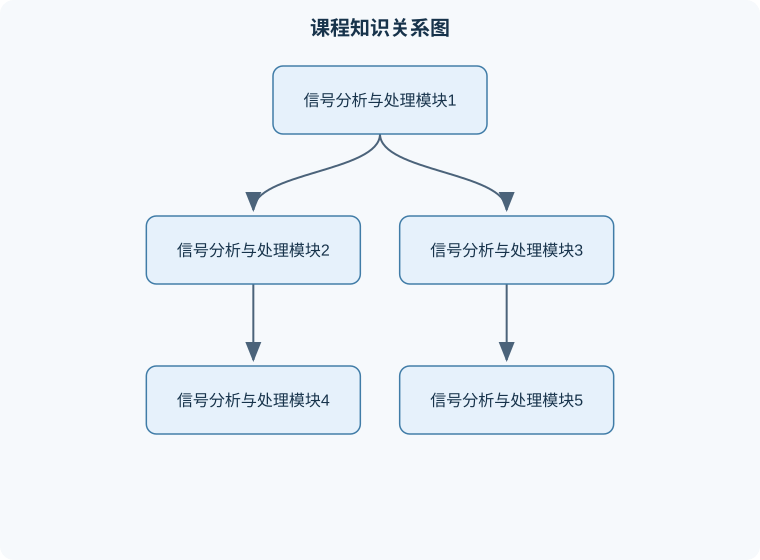

# 信号分析与处理

## 一、课程整体知识框架

### 课程边界与先修知识

本课程研究连续时间与离散时间信号的表示、分析、变换、系统响应、采样与重构、数字滤波及典型数值实现。内容覆盖时域分析、频域分析、傅里叶级数与傅里叶变换、离散时间傅里叶变换、离散傅里叶变换与快速傅里叶变换、Z变换、线性时不变系统、模拟与数字滤波器、调制解调及噪声基础。先修知识包括高等数学中的复数、积分、级数、微分方程和线性代数，概率统计基础，电路或系统基本概念，以及能够进行基础编程和数值计算。课程不以通信系统、图像处理或控制系统为完整替代，而是为这些方向提供信号处理基础。理想模型通常假设系统线性、时不变、参数精确且数值计算无误差；实际系统还需考虑采样时钟、量化、有限字长、噪声、频谱泄漏、边界效应、实时性和硬件资源限制。





### 1. 课程对象与统一表示

信号是随某个自变量变化、用于描述信息的物理量或数学量。自变量为连续时间 $t$（单位通常为秒）时，信号写作 $x(t)$；自变量为整数序号 $n$、且每个样本间隔为 $T_s$ 秒时，信号写作 $x[n]$。连续时间信号在每个实数时刻都有定义，离散时间信号只在整数序号上有定义；离散时间并不等于幅值离散，只有经过量化后才同时具有有限字长表示。

系统把输入信号变换为输出信号，记为 $y=\mathcal{T}\{x\}$。课程的主线是：先描述信号，再建立系统模型，随后用时域、频域和变换域分析系统，最后完成采样、滤波、频谱估计和工程实现。信号分析回答“信号包含什么成分、具有什么性质”，信号处理回答“如何提取、抑制、变换或重构这些成分”。

常用基本信号包括单位冲激 $\delta[n]$、单位阶跃 $u[n]$、指数信号和正弦信号。离散单位冲激定义为

$$
\delta[n]=
\begin{cases}
1,&n=0\\
0,&n\ne 0
\end{cases}
$$

因此任意离散信号都可表示为冲激加权和：

$$
x[n]=\sum_{k=-\infty}^{\infty}x[k]\delta[n-k].
$$

该式的前提是信号按整数序号定义；它不是把连续时间信号直接替换为离散序列。连续时间冲激 $\delta(t)$是广义函数，满足 $\int_{-\infty}^{\infty}\delta(t)\,dt=1$，不能把它误认为普通的“宽度为零、高度为一”的函数。

### 2. 八个核心模块及其逻辑关系

#### 模块一：信号与系统基本概念

信号可按时间变量分为连续时间和离散时间，按幅值分为模拟信号和数字信号，按可预测性分为确定信号和随机信号，按能量分布分为能量信号和功率信号。连续时间信号的能量为

$$
E=\int_{-\infty}^{\infty}|x(t)|^2\,dt,
$$

离散时间信号的能量为

$$
E=\sum_{n=-\infty}^{\infty}|x[n]|^2.
$$

若 $0<E<\infty$，称为能量信号；平均功率分别定义为

$$
P=\lim_{T\to\infty}\frac{1}{2T}\int_{-T}^{T}|x(t)|^2\,dt
$$

和

$$
P=\lim_{N\to\infty}\frac{1}{2N+1}\sum_{n=-N}^{N}|x[n]|^2.
$$

周期信号通常是非零功率信号，但“有界”不等于“功率有限”，含有随时间增长的信号可能既不是有限能量信号，也不是有限功率信号。

连续时间信号满足 $x(t+T_0)=x(t)$ 的最小正数 $T_0$称为基波周期。离散复指数 $e^{j\Omega n}$周期存在的条件是存在正整数 $N$和整数 $m$，使

$$
\Omega N=2\pi m.
$$

因此 $\Omega/(2\pi)$必须是有理数。连续时间复指数 $e^{j\omega_0t}$只要 $\omega_0\ne0$就具有周期 $T_0=2\pi/|\omega_0|$。离散信号中角频率相差 $2\pi$的指数完全相同，这是离散频率周期性的来源。

系统的重要性质包括线性、时不变性、因果性、稳定性和可逆性。线性要求叠加性：

$$
\mathcal{T}\{a x_1+b x_2\}=a\mathcal{T}\{x_1\}+b\mathcal{T}\{x_2\}.
$$

时不变性要求输入延迟导致输出同样延迟：

$$
\mathcal{T}\{x[n-n_0]\}=y[n-n_0].
$$

因果系统的当前输出不能依赖未来输入；有界输入有界输出稳定性要求存在有限常数 $B$，使 $|x[n]|\le M$时有 $|y[n]|\le B$。这些性质相互独立，例如非因果系统可能稳定，线性系统也可能不稳定。

#### 模块二：线性时不变系统与卷积

线性时不变系统可由单位冲激响应完全刻画。若输入为 $x[n]$、冲激响应为 $h[n]$，则输出为卷积

$$
y[n]=x[n]*h[n]=\sum_{k=-\infty}^{\infty}x[k]h[n-k].
$$

推导过程是：先用冲激分解输入，再利用线性性将各冲激响应相加，最后利用时不变性把 $\delta[n-k]$的响应写成 $h[n-k]$。连续时间形式为

$$
y(t)=\int_{-\infty}^{\infty}x(\tau)h(t-\tau)\,d\tau,
$$

其中 $\tau$是积分变量，单位与 $t$相同。有限长序列卷积长度为 $L_x+L_h-1$，但无限长序列不能机械套用这一长度公式。

离散因果LTI系统的稳定条件为

$$
\sum_{n=-\infty}^{\infty}|h[n]|<\infty.
$$

证明可由 $|x[n]|\le M$得到

$$
|y[n]|\le\sum_k|x[k]||h[n-k]|
\le M\sum_k|h[k]|.
$$

若该绝对和有限，则输出有界。反之，绝对和发散并不自动说明系统一定对所有输入不稳定，但说明不能用该充分条件证明稳定；对许多标准系统可构造有界输入使输出无界。因果性对应 $h[n]=0$（$n<0$）。

#### 模块三：傅里叶级数、傅里叶变换与频谱

傅里叶分析把信号分解为不同频率的复指数。周期连续时间信号的傅里叶级数为

$$
x(t)=\sum_{k=-\infty}^{\infty}C_k e^{jk\omega_0t},
\qquad
C_k=\frac{1}{T_0}\int_{T_0}x(t)e^{-jk\omega_0t}\,dt,
$$

其中 $\omega_0=2\pi/T_0$，$C_k$为复幅度，单位与 $x(t)$一致。非周期信号使用傅里叶变换：

$$
X(j\omega)=\int_{-\infty}^{\infty}x(t)e^{-j\omega t}\,dt,
$$

逆变换为

$$
x(t)=\frac{1}{2\pi}\int_{-\infty}^{\infty}X(j\omega)e^{j\omega t}\,d\omega.
$$

$\omega$的单位为弧度每秒，$X(j\omega)$还带有时间单位，因此不能把变换幅值无条件解释为“电压”。存在可积性、能量有限性或广义函数意义等适用条件；例如常数信号的普通积分不收敛，但可在广义函数意义下表示为零频冲激。

LTI系统在频域满足

$$
Y(j\omega)=X(j\omega)H(j\omega),
$$

其中 $H(j\omega)$是频率响应。该结论来自卷积定理，但必须注意：频域相乘只描述线性时不变系统，不适用于一般时变系统或非线性系统。幅频特性反映增益，$\arg H(j\omega)$反映相位变化；只比较幅值可能遗漏波形失真。

#### 模块四：采样、量化与模数转换

采样把连续信号变为序列：

$$
x[n]=x_c(nT_s),
$$

其中 $T_s$为采样周期，$f_s=1/T_s$为采样频率，单位为赫兹。若连续信号最高频率不超过 $B$ Hz，且为严格带限信号，则无混叠采样需要 $f_s>2B$。采样频谱是原频谱以 $f_s$为间隔的周期复制；当复制谱重叠时产生混叠，后续数字处理不能完全恢复原信号。

采样定理要求信号严格带限，而现实信号通常含有高频噪声，因此实际系统在采样前使用抗混叠模拟低通滤波器。临界频率附近若没有过渡带，理论条件难以满足。量化把幅值映射为有限个等级，量化误差与输入相关，不能简单当作总是白噪声；低幅周期信号还可能出现明显的相关失真。模数转换流程包括模拟调理、抗混叠滤波、采样保持、量化和编码；数模转换还需要重构滤波器抑制镜像频谱。

#### 模块五：离散时间傅里叶变换与变换域分析

离散时间傅里叶变换定义为

$$
X(e^{j\omega})=\sum_{n=-\infty}^{\infty}x[n]e^{-j\omega n}.
$$

它关于 $\omega$以 $2\pi$为周期，因为 $e^{-j(\omega+2\pi)n}=e^{-j\omega n}$。对于绝对可和序列，该级数通常绝对收敛；对于能量有限但非绝对可和序列，需要在更弱意义下解释。时移、频移、卷积分别对应相位因子、频率平移和频域相乘。

$Z$变换为

$$
X(z)=\sum_{n=-\infty}^{\infty}x[n]z^{-n},
$$

其中 $z$为复变量，收敛域决定变换的实际含义。不能只看代数表达式而忽略收敛域：同一个有理式可能对应不同的右边序列或左边序列。因果有理系统通常要求收敛域在最外极点之外，稳定系统要求单位圆包含在收敛域内；二者同时成立时，单位圆既不能经过极点，也必须位于合适的收敛域中。

#### 模块六：数字滤波器与系统实现

数字滤波器按照功能分为低通、高通、带通和带阻，按照结构分为FIR和IIR。一般差分方程可写为

$$
y[n]=-\sum_{k=1}^{M}a_k y[n-k]
+\sum_{k=0}^{N}b_kx[n-k].
$$

FIR滤波器只有有限个输入延迟项，易实现严格线性相位；IIR含反馈，通常用较低阶数实现陡峭幅频特性，但存在稳定性、量化和极限环问题。设计指标必须明确通带边缘、阻带边缘、通带波动、阻带衰减和采样频率。设计完成后需同时检查理论频响、有限字长系数下的频响、瞬态响应和实际数据效果。

#### 模块七：DFT、FFT与频谱估计

$N$点DFT定义为

$$
X[k]=\sum_{n=0}^{N-1}x[n]e^{-j2\pi kn/N},
\qquad k=0,1,\ldots,N-1.
$$

逆变换为

$$
x[n]=\frac{1}{N}\sum_{k=0}^{N-1}X[k]e^{j2\pi kn/N}.
$$

直接计算每个 $X[k]$需要约 $N^2$次复乘加，FFT利用旋转因子的对称性和周期性，将复杂度降为约 $N\log_2N$。DFT实际分析的是有限长度记录的周期延拓，因此非整周期截断会产生谱泄漏；加窗能降低旁瓣，但会扩大主瓣并改变幅值，需要进行窗函数增益修正。补零提高频谱显示的频率采样密度，却不能提高原始数据的真实分辨率。频率间隔为 $\Delta f=f_s/N$，实际分辨能力还受记录时长、窗函数和信噪比限制。

#### 模块八：随机信号、噪声与综合应用

随机信号不能用单次确定波形完全描述，常用均值、方差、自相关和功率谱密度刻画。均值反映直流分量，方差反映波动强度，自相关反映不同时间间隔的相关程度。噪声抑制必须先区分噪声与有效信号在频带、统计特性和时域结构上的差异；若二者频谱完全重叠，仅靠线性滤波不能无失真分离。

典型应用链路是“传感器—模拟调理—采样—数字滤波—特征提取—判决或控制”。每个环节都可能引入偏差：传感器产生噪声，放大器造成饱和，采样造成混叠，量化产生误差，滤波器引入延迟，特征算法对异常值敏感。因此结果必须用时域误差、频域指标、延迟、资源占用和边界数据共同验收。

## 二、章节和模块划分

### 核心知识覆盖清单

本清单根据本课程的章节划分整理，用于检查正文是否覆盖各个核心模块：

- **1. 代表性分析算法与实现流程**。
- **2. 典型例题**。
- **3. 实验与项目流程**。
- **4. 易错点、笔试问题与面试问题**。
- **5. 岗位关联与验收产出**。


### 1. 代表性分析算法与实现流程

#### 算法一：有限长序列线性卷积

**输入：**序列 $x[0],\ldots,x[L_x-1]$和 $h[0],\ldots,h[L_h-1]$。  
**输出：**长度 $L_x+L_h-1$的序列 $y[n]$。  
**过程：**初始化所有 $y[n]=0$；对每个输入样本 $x[k]$，将 $x[k]h[r]$累加到 $y[k+r]$。  
**不变量：**处理完前 $k$个输入样本后，输出中已经准确累加这些样本对所有位置的贡献。  
**终止条件：**所有 $k$和 $r$均处理完。  
**复杂度：**时间复杂度 $O(L_xL_h)$，额外空间为 $O(L_x+L_h)$。适用于有限长序列；长序列可改用重叠相加或FFT卷积。

```python
def linear_convolution(x, h):
    """返回两个有限长实序列的线性卷积。"""
    if len(x) == 0 or len(h) == 0:
        return []
    y = [0.0] * (len(x) + len(h) - 1)
    for k, xk in enumerate(x):
        for r, hr in enumerate(h):
            y[k + r] += xk * hr
    return y

print(linear_convolution([1, 2], [1, -1, 2]))
```

#### 算法二：DFT频谱计算与验证

输入采样序列、采样频率和DFT长度；若数据长度不足则明确补零，若超过则截取或分段；计算 $X[k]$，再将 $k f_s/N$转换为频率。对实信号只需重点观察 $0$到 $f_s/2$的单边频谱，但单边幅值通常要对非直流、非奈奎斯特频点乘以2。验证时用已知正弦信号检查峰值位置，并检查共轭对称性。该流程适用于离线分析，不适合直接承担严格实时任务的大规模计算。

#### 算法三：数字滤波器设计与验收

先将模拟频率换算为归一化数字频率，明确通带、阻带及允许误差；选择FIR或IIR结构；求系数后检查极点位置、频率响应和群延迟；用单位冲激、阶跃和含噪测试信号验证；最后在定点字长下复测。任何一个指标不满足，都不能仅凭“曲线大致相似”判定设计合格。

#### 算法四：采样链路分析

输入为连续信号最高频率范围、目标带宽和允许失真。先确定抗混叠滤波器的通带和阻带，再选择 $f_s$；根据量化位数估计幅值分辨率，检查满量程、饱和和噪声；采样后用频谱观察混叠分量。适用条件是采样时钟稳定、信号在采样保持期间变化可控；若存在时钟抖动或非线性失真，还需单独建模。

### 2. 典型例题

#### 例题一：周期性判断

**题干：**判断 $x[n]=\cos(8\pi n/7+2)$是否周期，并求基波周期。  
**分析：**离散余弦周期要求 $\Omega N=2\pi m$。  
**解答：**$\Omega=8\pi/7$，故

$$
\frac{\Omega}{2\pi}=\frac47.
$$

取最小正整数 $N=7$时，$m=4$为整数，因此基波周期为 $7$。  
**验证：**相位增加 $\Omega N=8\pi$，余弦值不变。  
**变式：**若 $\Omega=\sqrt{2}$，则 $\sqrt2/(2\pi)$通常为无理数，序列不具有离散周期。

#### 例题二：卷积计算

**题干：**已知 $x[0]=1,x[1]=2$，$h[0]=1,h[1]=-1,h[2]=2$，求线性卷积。  
**解答：**

$$
y[0]=1\cdot1=1,
$$

$$
y[1]=1\cdot(-1)+2\cdot1=1,
$$

$$
y[2]=1\cdot2+2\cdot(-1)=0,
$$

$$
y[3]=2\cdot2=4.
$$

所以 $y=[1,1,0,4]$。  
**验证：**长度应为 $2+3-1=4$；交换两序列后结果不变。  
**变式：**若采用循环卷积而不是线性卷积，必须先补零到至少4点，否则会发生首尾折叠。

#### 例题三：采样频率判断

**题干：**信号最高频率为 $3$ kHz，采样频率分别为 $5$ kHz和 $8$ kHz，判断是否满足理想采样条件。  
**解答：**奈奎斯特条件要求 $f_s>2B=6$ kHz。$5$ kHz不满足，会发生混叠；$8$ kHz满足理想带限条件。  
**验证：**$5$ kHz采样的奈奎斯特频率为 $2.5$ kHz，超过该频率的成分会折叠。  
**变式：**若信号并非严格带限，即使 $8$ kHz也不能保证无混叠，必须增加模拟抗混叠滤波器。

#### 例题四：DFT频率间隔

**题干：**采样频率为 $8$ kHz，记录长度为 $N=256$，求DFT频率间隔；若补零到1024点，真实分辨率是否提高。  
**解答：**

$$
\Delta f=\frac{f_s}{N}=\frac{8000}{256}=31.25\text{ Hz}.
$$

补零后显示间隔为 $8000/1024=7.8125$ Hz，但原始记录时长未改变，因此真实分辨能力没有按四倍提高。  
**验证：**记录时长为 $256/8000=32$ ms，决定频率分辨能力的主要尺度约为其倒数。  
**变式：**若实际采集1024个点，记录时长增加，才可能获得更细的真实频率区分能力。

#### 例题五：系统稳定性

**题干：**判断系统 $y[n]=\sum_{k=0}^{\infty}(1/2)^k x[n-k]$是否因果、稳定。  
**解答：**其冲激响应为 $h[k]=(1/2)^k u[k]$，只在 $k\ge0$时非零，所以系统因果。又有

$$
\sum_{k=0}^{\infty}\left|\frac12\right|^k
=\frac{1}{1-1/2}=2<\infty,
$$

故系统BIBO稳定。  
**验证：**若输入满足 $|x[n]|\le M$，则 $|y[n]|\le2M$。  
**变式：**将 $1/2$换为 $1.1$后，冲激响应绝对和发散，系统不再满足该稳定条件。

### 3. 实验与项目流程

#### 实验一：DFT、FFT和补零比较

**输入数据：**采样频率 $f_s=8000$ Hz；生成或采集长度分别为16和256的正弦混合序列，并设置一个不落在DFT频点上的频率。  
**步骤：**  
1. 对16点数据直接计算16点DFT。  
2. 将同一16点数据补零到256点后计算256点DFT。  
3. 对真实采集的256点数据计算256点DFT。  
4. 比较峰值位置、主瓣宽度、旁瓣高度和运行时间。  

**评价标准：**能正确区分频率采样间隔与真实分辨率；能解释泄漏、窗函数和补零；峰值频率应与理论频率在记录长度和窗函数允许误差内一致。  
**排错方法：**若频率轴错误，检查 $f_s/N$；若幅值差约两倍，检查单边谱缩放；若补零后误称“分辨率提高”，应重新区分显示密度和信息量；若频谱不对称，检查输入是否为实信号及复数指数符号约定。

#### 实验二：FIR低通滤波器验证

**输入数据：**含低频有效信号和高频干扰的离散序列，给定采样频率、通带边缘、阻带边缘及衰减要求。  
**步骤：**  
1. 设计FIR低通滤波器并记录阶数、系数和群延迟。  
2. 观察冲激响应、幅频响应和相频响应。  
3. 对含噪序列滤波，比较滤波前后的时域波形和频谱。  
4. 用扫频信号验证通带增益和阻带衰减。  

**评价标准：**通带波动不超过设计上限，阻带衰减达到要求；输出没有明显越界或异常振荡；延迟补偿后有效信号位置正确。  
**排错方法：**若边缘频率偏移，检查归一化频率定义；若阻带不够深，增加阶数或改变窗函数；若时域波形整体延迟，检查线性相位群延迟；若定点实现后不稳定或噪声增大，检查系数缩放和字长。

### 4. 易错点、笔试问题与面试问题

#### 常见易错点

1. 把离散时间信号误称为数字信号；离散时间只说明时间轴离散。  
2. 忽略离散频率的 $2\pi$周期性。  
3. 将连续时间周期判据直接用于离散序列。  
4. 把卷积长度公式用于循环卷积。  
5. 认为补零能增加原始信息。  
6. 忽略DFT的周期延拓假设。  
7. 只看滤波器幅频响应而不检查相位和延迟。  
8. 把奈奎斯特频率、采样频率和最高信号频率混为一谈。  
9. 认为量化误差始终是独立白噪声。  
10. 只看极点位置而不看$Z$变换收敛域。  
11. 对实信号单边谱直接取半而未做幅值补偿。  
12. 忽略ADC输入满量程导致削顶。  
13. 将能量信号和功率信号理解为互斥的全部分类。  
14. 未验证程序的频率轴、单位、符号和边界样本。

#### 典型笔试问题及解答思路

1. **证明卷积交换律。**交换求和变量并利用有限或绝对收敛条件，将 $\sum_kx[k]h[n-k]$改写为$\sum_rh[r]x[n-r]$。  
2. **判断离散复指数是否周期。**求 $\Omega/(2\pi)$是否为有理数，并找满足 $\Omega N=2\pi m$的最小正整数$N$。  
3. **说明混叠为何不可逆。**不同连续频率采样后可产生相同离散序列，因此仅凭采样值无法区分原频率。  
4. **推导LTI频域关系。**对卷积求DTFT或傅里叶变换，利用指数因子分离得到乘积。  
5. **比较FIR与IIR。**从结构、稳定性、线性相位、阶数、计算量和量化敏感性逐项比较。  
6. **解释谱泄漏。**有限截断等于与矩形窗相乘，频域变为真实谱与窗谱卷积，造成能量扩散。  
7. **判断系统BIBO稳定性。**对离散因果LTI系统检查$\sum|h[n]|$是否有限；不能只凭输出某一例判断。  
8. **解释FFT为何更快。**利用旋转因子的周期性把DFT分解为偶、奇子序列递归计算，减少重复乘加。

#### 典型面试问题与回答要点

1. **如何避免采样混叠？**先确定信号带宽，设计抗混叠模拟滤波器，再选择有余量的采样率，并用频谱验证。追问要点：现实信号通常非严格带限，采样率不能只按理论临界值取。  
2. **FFT后峰值频率为何不准确？**有限记录、频率栅栏和谱泄漏共同造成；可延长记录、加合适窗并进行峰值插值，但插值不等于获得新信息。  
3. **FIR和IIR如何选？**严格线性相位和高可靠性优先时选FIR；资源有限且需陡峭响应时考虑IIR，并验证稳定性和定点误差。  
4. **如何验证一个滤波器？**检查系数、极点、冲激响应、幅相响应、群延迟、边界频率和真实数据效果。  
5. **卷积和相关有什么区别？**卷积包含时间翻转，相关用于相似性或延迟估计；混用会导致峰值位置和物理解释错误。  
6. **如何处理直流漂移？**先确认漂移是否为有效低频信息，再用去均值、高通或趋势建模；不能未经分析直接删除低频。  
7. **量化位数不够会怎样？**产生幅值误差、噪声和可能的削顶；应通过满量程设置、增益分配和饱和检测降低影响。  
8. **如何定位频谱异常？**依次检查采样率和单位、数据长度、窗函数、去均值、单边谱缩放、频率轴和传感器饱和，最后与已知测试信号对照。

### 5. 岗位关联与验收产出

信号处理工程岗位通常负责采集链路设计、滤波器实现、频谱分析和算法验证，使用采样定理、卷积、DFT/FFT、滤波器设计及随机信号知识，产出参数文档、可复现实验代码、频响曲线和测试报告；验收标准包括指标满足、边界输入不崩溃、单位和频率轴正确、资源占用可接受。

数据分析岗位常处理传感器时序数据，需完成去趋势、异常检测、频谱特征和统计指标提取，产出清洗数据、特征表和分析结论；验收重点是缺失值处理可追溯、训练和测试数据无泄漏、特征具有明确物理含义。嵌入式研发岗位还需关注实时性、内存、定点量化、溢出和中断延迟，最终以目标处理器上的周期数、误差、稳定性和长期运行结果验收。

## 三、核心概念的详细解释

### 1. 信号的分类、表示与基本运算

信号是一个或多个变量之间的映射。若自变量为连续时间 $t$，写作 $x(t)$；若自变量为整数序号 $n$，写作 $x[n]$。连续时间信号在所有实数时刻有定义，离散时间信号只在整数序号处有定义。离散时间不等于数字信号：采样只使时间变量离散，量化才使幅值取有限个等级。

信号还可按确定性分为确定信号和随机信号，按周期性分为周期信号和非周期信号，按能量分布分为能量信号和功率信号。连续时间信号的能量和平均功率分别为

$$
E=\int_{-\infty}^{\infty}|x(t)|^2\,dt,
\qquad
P=\lim_{T\to\infty}\frac{1}{2T}\int_{-T}^{T}|x(t)|^2\,dt.
$$

离散时间信号对应为

$$
E=\sum_{n=-\infty}^{\infty}|x[n]|^2,
\qquad
P=\lim_{N\to\infty}\frac{1}{2N+1}\sum_{n=-N}^{N}|x[n]|^2.
$$

能量有限且非零的信号是能量信号；平均功率有限且非零、能量通常无限的信号是功率信号。衰减指数信号往往是能量信号，非零无限长正弦信号是功率信号。一个随时间增长的信号可能既不是有限能量信号，也不是有限功率信号，因此不能依据“信号有界”直接判断类别。

信号的基本运算包括幅值缩放、时间平移、时间反转和时间尺度变换。离散信号中的 $x[n-n_0]$表示右移 $n_0$个样本，$x[n+n_0]$表示左移；连续时间中的 $x(at)$在 $|a|>1$时压缩时间轴，在 $0<|a|<1$时扩展时间轴。若 $a<0$，还包含时间反转。进行复合变换时必须从自变量整体代入，不能只对图形的一部分作直观平移。

单位阶跃和单位冲激是描述信号的重要工具。离散单位阶跃定义为

$$
u[n]=
\begin{cases}
1,&n\ge 0,\\
0,&n<0,
\end{cases}
$$

并有 $\delta[n]=u[n]-u[n-1]$。任意离散信号都可表示为

$$
x[n]=\sum_{k=-\infty}^{\infty}x[k]\delta[n-k].
$$

这个展开式说明每个样本都可看成一个移位冲激的权重。连续时间冲激 $\delta(t)$是广义函数，满足

$$
\int_{-\infty}^{\infty}\delta(t)\,dt=1,
$$

并满足筛选性质

$$
\int_{-\infty}^{\infty}x(t)\delta(t-t_0)\,dt=x(t_0),
$$

不能把 $\delta(t)$当作普通的“宽度为零、高度为一”的函数。

### 2. 周期性与复指数

连续时间信号满足存在 $T_0>0$，使得

$$
x(t+T_0)=x(t)
$$

时称为周期信号，最小正周期称为基波周期。对 $x(t)=A\cos(\omega_0t+\phi)$，只要 $\omega_0\ne0$，基波周期为

$$
T_0=\frac{2\pi}{|\omega_0|},
$$

其中 $\omega_0$单位为弧度每秒，$A$为幅值，$\phi$为相位。若信号由多个正弦分量组成，则各分量频率之比必须为有理数，才可能存在公共周期。例如 $\cos(2t)+\cos(\sqrt{2}t)$不存在周期，因为频率比为无理数。

离散复指数 $e^{j\Omega n}$存在正整数周期 $N$的条件是

$$
e^{j\Omega(n+N)}=e^{j\Omega n},
$$

即

$$
\Omega N=2\pi m,\qquad m\in\mathbb Z.
$$

因此 $\Omega/(2\pi)$必须为有理数。若 $\Omega=2\pi p/q$，其中 $p,q$互质，则基波周期为 $q$。离散频率相差 $2\pi$的复指数相同：

$$
e^{j(\Omega+2\pi)n}=e^{j\Omega n}.
$$

这说明离散时间频率具有 $2\pi$周期性，不能把离散角频率无限延伸而不作等价处理。

### 3. 系统性质与系统建模

系统将输入变为输出，记为 $y=\mathcal T\{x\}$。线性系统满足齐次性和可加性，合并写作

$$
\mathcal T\{a x_1+b x_2\}
=a\mathcal T\{x_1\}+b\mathcal T\{x_2\}.
$$

时不变系统满足输入延迟与输出延迟等价：

$$
\mathcal T\{x[n-n_0]\}=y[n-n_0].
$$

因果系统在时刻 $n$的输出不能依赖 $n$之后的输入。稳定性通常采用有界输入有界输出定义：若存在有限 $B_x$使 $|x[n]|\le B_x$，则存在有限 $B_y$使 $|y[n]|\le B_y$。可逆系统要求不同输入不能产生同一输出，并且存在逆系统恢复原输入。

线性时不变系统可由单位冲激响应 $h[n]$完全描述。由冲激分解，

$$
x[n]=\sum_{k=-\infty}^{\infty}x[k]\delta[n-k],
$$

若系统线性且时不变，则

$$
y[n]
=\sum_{k=-\infty}^{\infty}x[k]h[n-k]
=x[n]*h[n].
$$

因果离散系统的必要条件是 $h[n]=0$（$n<0$）；当且仅当

$$
\sum_{n=-\infty}^{\infty}|h[n]|<\infty
$$

时，离散线性时不变系统满足有界输入有界输出稳定性。这个结论不适用于任意非线性或时变系统。

### 4. 卷积及其物理意义

离散卷积定义为

$$
y[n]=x[n]*h[n]
=\sum_{k=-\infty}^{\infty}x[k]h[n-k].
$$

计算时可将 $h[k]$反转为 $h[-k]$，再平移为 $h[n-k]$，与 $x[k]$逐点相乘并对 $k$求和。等价地，也可固定输出位置 $n$，逐项计算乘积。有限长序列长度分别为 $L_x$和 $L_h$时，线性卷积长度为

$$
L_y=L_x+L_h-1.
$$

卷积具有交换律、结合律和分配律：

$$
x*h=h*x,\qquad
(x*h)*g=x*(h*g),\qquad
x*(h+g)=x*h+x*g.
$$

卷积的物理含义是：输入中位于每个时刻的样本都会激发一个按 $h[n]$形状变化的响应，所有响应叠加形成输出。移动平均滤波器的冲激响应为有限个相等系数，因此能削弱快速变化；差分滤波器的系数和为零，因此能抑制直流分量并突出变化边缘。

循环卷积与线性卷积不同。$N$点循环卷积中的序号按模 $N$折返，若直接用 $N$点DFT相乘，得到的是循环卷积。要通过DFT实现长度分别为 $L_x,L_h$的线性卷积，通常至少补零到

$$
N\ge L_x+L_h-1
$$

再进行DFT相乘和逆变换。

### 5. 傅里叶分析、频谱与滤波

傅里叶分析把信号分解为不同频率的复指数。连续时间傅里叶变换为

$$
X(\omega)=\int_{-\infty}^{\infty}x(t)e^{-j\omega t}\,dt,
$$

逆变换为

$$
x(t)=\frac{1}{2\pi}\int_{-\infty}^{\infty}X(\omega)e^{j\omega t}\,d\omega.
$$

其中 $\omega$单位为弧度每秒，$X(\omega)$同时包含幅度和相位信息。只观察 $|X(\omega)|$可能丢失时移、相位失真等重要信息。

离散傅里叶变换定义为

$$
X[k]=\sum_{n=0}^{N-1}x[n]e^{-j2\pi kn/N},
\qquad k=0,1,\ldots,N-1,
$$

逆变换为

$$
x[n]=\frac{1}{N}\sum_{k=0}^{N-1}X[k]e^{j2\pi kn/N}.
$$

采样频率为 $f_s$时，第 $k$个DFT频点对应频率

$$
f_k=\frac{k}{N}f_s.
$$

对于实值序列，频谱满足共轭对称性 $X[N-k]=X^*[k]$。单边幅度谱通常要将非直流、非奈奎斯特频点的幅度乘以 $2$，否则会低估正弦分量幅值。

有限长度截断会造成频谱泄漏。若信号周期不能整齐地落入观测窗，截断相当于乘以窗函数，频域中变为真实频谱与窗频谱卷积。增大记录长度提高频率分辨率

$$
\Delta f=\frac{f_s}{N},
$$

但补零只使频率采样点变密，不增加原始数据包含的信息，也不能真正提高由观测时长决定的分辨能力。

### 6. 采样、量化与模数转换

连续信号以采样周期 $T_s$采样，采样频率为

$$
f_s=\frac{1}{T_s}.
$$

若连续信号最高频率不超过 $f_{\max}$，理想均匀采样无混叠重构的条件为

$$
f_s>2f_{\max}.
$$

等号通常不能作为安全设计条件，因为频率恰在奈奎斯特频率处时相位、滤波器滚降和实际频谱边界会使重构不稳妥。采样前的模拟低通抗混叠滤波器用于抑制超过 $f_s/2$的频率。混叠是不同连续频率在采样后产生相同离散序列的现象，例如采样频率为 $1000\ \mathrm{Hz}$时，$600\ \mathrm{Hz}$正弦采样后等价于频率为 $400\ \mathrm{Hz}$的某个正弦分量，但相位符号可能发生变化。

量化把连续幅值映射到有限等级。若量化器满量程范围为 $V_{\min}$到 $V_{\max}$，位数为 $B$，理想均匀量化等级数为 $2^B$，量化间隔近似为

$$
\Delta=\frac{V_{\max}-V_{\min}}{2^B}.
$$

量化误差通常定义为 $e_q=x_q-x$，在不发生过载且误差近似均匀分布时，其均方值约为 $\Delta^2/12$。该结论依赖误差与信号近似不相关等条件；在低幅周期信号、过载或非均匀量化时不能机械使用。

### 7. 数字滤波器与随机信号

有限冲激响应滤波器可写作

$$
y[n]=\sum_{k=0}^{M}b_kx[n-k].
$$

它一定因果，若系数有限则稳定，并且容易通过对称系数实现线性相位。无限冲激响应滤波器含有反馈，例如

$$
y[n]=\sum_{k=0}^{M}b_kx[n-k]
-\sum_{r=1}^{P}a_ry[n-r].
$$

其稳定性与系统极点位置有关；离散有理系统要求所有极点严格位于单位圆内。有限字长实现还可能出现系数量化、舍入噪声、溢出和极限环振荡。

随机信号不能仅用单条波形描述，常用均值、自相关和功率谱密度描述。均值为

$$
\mu_x=E\{x[n]\},
$$

自相关函数为

$$
R_x[\ell]=E\{x[n]x^*[n-\ell]\},
$$

其中 $E\{\cdot\}$表示数学期望，$\ell$为滞后量。宽平稳信号的均值与时间无关，自相关只与滞后量有关。白噪声在不同时间的相关性接近零，但“频谱平坦”并不意味着每个有限长度样本的频谱一定完全平坦。实际噪声还可能包含工频干扰、量化噪声、传感器漂移和非平稳突发干扰。

### 8. 典型分析流程与工程岗位关联

处理实际数据时，首先明确采样率、单位、传感器量程和目标指标；其次检查缺失、饱和、异常跳变和时间戳；然后去除明显趋势或直流分量，选择合适窗函数和频谱估计方法；最后设计滤波器并在时域、频域和边界输入上验证。滤波后的结果不能只凭曲线“看起来平滑”判断正确，还要检查幅值偏差、相位延迟、边界瞬态和噪声变化。

算法或信号处理岗位常见任务包括滤波器设计、FFT频谱分析、采样链路评估和嵌入式实现。输入可能是带单位的传感器序列，输出应包括清洗后的数据、滤波器参数、频响曲线、误差指标和可复现实验代码。验收标准应明确通带波动、阻带衰减、截止频率、延迟、运行时间、内存占用及异常输入行为。数据分析岗位还需防止用未来数据计算当前特征，避免训练测试数据泄漏；嵌入式岗位则要检查定点溢出、乘加累加精度、缓存占用和实时截止时间。

## 四、重要定义、公式、定理和推导

### 专业审校补充：关键定义与适用边界

Z变换的收敛域（ROC）不是由代数表达式单独决定的，而是由序列的时域支撑性质决定的。对右边序列，ROC位于最外层极点之外；对左边序列，ROC位于最内层极点之内；对双边序列，ROC通常位于两组极点之间。ROC不能包含任何极点。离散时间有理系统的因果性要求冲激响应为右边序列，稳定性要求ROC包含单位圆，即满足 |z|=1；因此“极点在单位圆内”只是在因果有理系统前提下判断稳定性的简化结论。若系统非因果，极点位置与稳定性不能脱离ROC单独判断。有限长序列的ROC通常为整个复平面，但需排除使表达式出现极点的点；含有单位圆极点的系统不能具有绝对可和的冲激响应。进行逆Z变换时，必须同时给出X(z)和ROC，否则同一个代数表达式可能对应多个不同序列。


### 1. 周期性判定的推导与例题

#### 例题一：判断连续时间和离散时间信号的周期性

题目：判断下列信号是否周期，并求基波周期：

$$
x_1(t)=2\cos(3t+\pi/4),
$$

$$
x_2[n]=\cos(8\pi n/7+2),
$$

$$
x_3[n]=e^{j n/8-j\pi}.
$$

分析：连续时间正弦信号直接使用 $T_0=2\pi/|\omega_0|$。离散时间复指数必须检查 $\Omega/(2\pi)$是否为有理数。

解答：

对 $x_1(t)$，角频率为 $3\ \mathrm{rad/s}$，所以

$$
T_1=\frac{2\pi}{3}\ \mathrm{s}.
$$

对 $x_2[n]$，$\Omega=8\pi/7$，有

$$
\frac{\Omega}{2\pi}=\frac47.
$$

令 $\Omega N=2\pi m$，得到 $8\pi N/7=2\pi m$，即 $4N=7m$。由于 $4$与$7$互质，最小正整数解为 $N=7$。

对 $x_3[n]$，$\Omega=1/8$，因此

$$
\frac{\Omega}{2\pi}=\frac{1}{16\pi},
$$

这是无理数，故不存在整数周期。

验证：将 $n$替换为 $n+7$时，$x_2[n+7]$的相位增加 $8\pi$，指数或余弦值不变；而不存在整数 $N$使 $N/8=2\pi m$，所以 $x_3[n]$非周期。

变式：若将 $x_3[n]$改为 $e^{j\pi n/8}$，则 $\Omega/(2\pi)=1/16$，基波周期为 $16$。

#### 例题二：多频率信号的周期性

题目：判断

$$
x[n]=2\cos(\pi n/4)+\sin(\pi n/8)-2\sin(\pi n/2+\pi/6)
$$

是否周期。

解答：三个角频率分别为 $\pi/4,\pi/8,\pi/2$。它们相对于 $2\pi$的比值为 $1/8,1/16,1/4$，均为有理数。单个分量的周期分别为 $8,16,4$，公共周期是它们的最小公倍数：

$$
N_0=\operatorname{lcm}(8,16,4)=16.
$$

验证：每个分量在移位 $16$后相位分别增加 $4\pi,2\pi,8\pi$，所以整体不变。变式是将第二项改为 $\sin(\sqrt2\,n)$，此时频率比含无理数，整体通常不再周期。

### 2. 线性时不变系统与卷积推导

#### 例题三：计算有限长卷积

题目：已知

$$
x[n]=\{1,2,1\},\qquad h[n]=\{1,-1\},
$$

两序列均从 $n=0$开始，求 $y[n]=x[n]*h[n]$。

解答：

$$
y[0]=x[0]h[0]=1,
$$

$$
y[1]=x[0]h[1]+x[1]h[0]=-1+2=1,
$$

$$
y[2]=x[1]h[1]+x[2]h[0]=-2+1=-1,
$$

$$
y[3]=x[2]h[1]=-1.
$$

因此

$$
y[n]=\{1,1,-1,-1\},\qquad n=0,1,2,3.
$$

验证：长度应为 $3+2-1=4$，满足结果长度；总和验证为

$$
\sum y[n]=0,
$$

而 $\sum x[n]=4,\sum h[n]=0$，卷积总和应为两者乘积 $0$，结果正确。

变式：若使用4点循环卷积，结果与上述线性卷积相同；若使用3点循环卷积，最后一个样本会折返到第0个位置，得到混叠，不能当作线性卷积。

#### 卷积算法

输入为长度分别为 $L_x,L_h$的序列 $x,h$，输出为长度 $L_x+L_h-1$的线性卷积。过程是初始化全零输出，对每个输入样本 $x[i]$，将 $x[i]h[j]$累加到输出位置 $i+j$。不变量是：处理完 $i$之前的输入样本后，输出已包含这些样本产生的全部贡献。循环结束条件为所有 $i,j$组合均处理完成。直接算法复杂度为 $O(L_xL_h)$，额外空间为 $O(L_x+L_h)$。

```python
def linear_convolution(x, h):
    """计算两个一维有限长序列的线性卷积。"""
    if not x or not h:
        return []
    y = [0.0] * (len(x) + len(h) - 1)
    for i, xi in enumerate(x):
        for j, hj in enumerate(h):
            y[i + j] += xi * hj
    return y

x = [1, 2, 1]
h = [1, -1]
print(linear_convolution(x, h))  # [1.0, 1.0, -1.0, -1.0]
```

### 3. DFT、FFT与频率分辨率

#### 例题四：确定DFT频点和分辨率

题目：采样频率为 $f_s=8000\ \mathrm{Hz}$，数据长度为 $N=1024$，求频率分辨率以及第 $k=128$个频点对应的频率。

解答：

$$
\Delta f=\frac{f_s}{N}
=\frac{8000}{1024}
=7.8125\ \mathrm{Hz}.
$$

因此

$$
f_{128}=128\Delta f
=1000\ \mathrm{Hz}.
$$

若数据为实值序列并观察单边频谱，频率范围通常为 $0$至 $f_s/2=4000\ \mathrm{Hz}$。变式：补零到 $N=4096$后，频率网格间隔变为 $1.953125\ \mathrm{Hz}$，但原始观测时长仍为 $1024/8000=0.128\ \mathrm{s}$，实际分辨能力没有按四倍提高。

#### DFT与FFT流程

DFT直接计算每个 $X[k]$，需要约 $N^2$次量级的复乘加，复杂度为 $O(N^2)$。FFT利用旋转因子和分治结构，将长度为 $N$的变换拆成偶、奇序列：

$$
X[k]=E[k]+W_N^kO[k],
$$

$$
X[k+N/2]=E[k]-W_N^kO[k],
$$

其中

$$
W_N=e^{-j2\pi/N},
$$

$E[k]$和$O[k]$分别是偶数和奇数样本的$N/2$点DFT。若 $N$为2的整数次幂，递归深度为 $\log_2N$，复杂度降为 $O(N\log N)$。FFT输出仍然是DFT，不是另一种频谱定义。

输入为长度 $N$的序列，输出为长度 $N$的复频谱；算法不变量是每一层蝶形运算保持相应子序列的DFT等价关系；终止条件是子问题长度降为1。适用条件是输入长度和实现方式满足相应分解要求，非2次幂长度可用其他FFT分解或补零处理，但补零不是必需的数学条件。

### 4. 采样与混叠例题

#### 例题五：判断采样后频率

题目：一个模拟正弦信号频率为 $600\ \mathrm{Hz}$，采样频率为 $1000\ \mathrm{Hz}$。判断采样后是否混叠，并给出等效基带频率。

分析：奈奎斯特频率为 $500\ \mathrm{Hz}$，原信号超过该频率，必然混叠。将 $600\ \mathrm{Hz}$减去采样频率 $1000\ \mathrm{Hz}$，得到 $-400\ \mathrm{Hz}$；对实值正弦而言，负频率对应相位变化后的 $400\ \mathrm{Hz}$正弦。

结果：混叠到 $400\ \mathrm{Hz}$附近。验证方法是比较连续信号和采样序列，利用

$$
\sin\left(2\pi\frac{600}{1000}n\right)
=
\sin\left(2\pi\frac{3}{5}n\right)
$$

并结合离散频率模 $2\pi$及正负频率等价关系进行化简。变式：若采样频率提高到 $1600\ \mathrm{Hz}$，奈奎斯特频率为 $800\ \mathrm{Hz}$，则 $600\ \mathrm{Hz}$不会因理想采样发生混叠，但仍需考虑模拟滤波器和实际频谱带宽。

### 5. 数字滤波器设计与验证

#### 代表性滤波流程

输入包括采样频率、通带边缘、阻带边缘、通带允许波动、阻带最小衰减和待处理序列。先统一频率单位，确认边缘频率均小于 $f_s/2$；再根据指标选择FIR或IIR结构；计算或调用设计方法得到系数；检查幅频响应、相位响应、群延迟和稳定性；最后用含有通带、阻带、边界频率和异常值的测试信号验证。

FIR滤波器常用窗函数法或最优化法设计。窗函数法中，理想冲激响应被有限窗截断，滤波器阶数增大通常可缩窄过渡带，但会增加运算量和延迟。IIR滤波器在相同幅频指标下阶数可能较低，但相位通常非线性，对量化和稳定性更敏感。零相位离线滤波可通过正向和反向处理抵消相位延迟，但它需要未来数据，不适合严格实时系统。

#### 实验一：采样与抗混叠验证

步骤：生成包含 $100\ \mathrm{Hz}$和 $600\ \mathrm{Hz}$的连续信号近似序列；分别以 $1000\ \mathrm{Hz}$和 $2000\ \mathrm{Hz}$采样；对采样数据计算FFT；再在采样前加入截止频率低于奈奎斯特频率的低通环节，比较频谱。

输入数据：已知幅值、频率和采样率的合成正弦序列，同时加入少量白噪声。评价标准：能否正确识别 $100\ \mathrm{Hz}$分量；在 $1000\ \mathrm{Hz}$采样时是否观察到约 $400\ \mathrm{Hz}$的混叠分量；加入抗混叠滤波后，$600\ \mathrm{Hz}$分量是否被明显抑制。

排错方法：若频率轴错误，检查使用的是 $f_s/N$而不是样本序号；若谱峰位置偏移，检查观测长度和窗函数；若混叠未出现，确认测试信号确实包含超过 $f_s/2$的分量；若滤波效果异常，检查截止频率是否用弧度每秒与赫兹混用。

#### 实验二：DFT、FFT和补零比较

步骤：构造长度为16的正弦序列，分别计算16点DFT和FFT；将同一序列补零到256点后计算FFT；再生成长度为256的独立序列作比较。记录运行时间、频率轴、谱峰位置和谱峰宽度。

输入数据：采样频率固定，信号包含一个不落在DFT频点上的正弦分量，并加入可控噪声。评价标准：FFT与直接DFT的数值误差应接近浮点计算误差；补零后谱线采样更密，但主瓣宽度不应被误判为真正变窄；长度256的真实观测数据通常具有更好的频率分辨能力。

排错方法：检查DFT与FFT的归一化约定是否一致；检查单边谱是否错误地对直流分量乘2；检查补零是否放在序列末端而不是改变原始样本顺序；运行时间比较应多次重复并避免将绘图时间混入算法时间。

### 6. 具体易错点与边界辨析

1. 把离散时间误认为数字信号；离散时间允许幅值为任意实数。  
2. 把连续冲激当作普通函数，忽略其积分性质。  
3. 判断离散正弦周期时只看角频率大小，不检查 $\Omega/(2\pi)$是否为有理数。  
4. 把离散频率 $\Omega$直接当作赫兹，忽略 $\Omega=2\pi f/f_s$的换算。  
5. 将右移写成 $x[n+n_0]$；正整数右移应为 $x[n-n_0]$。  
6. 忽略有限长卷积输出长度 $L_x+L_h-1$。  
7. 把循环卷积结果当作线性卷积，未进行必要补零。  
8. 认为FFT改变了DFT的数学结果；FFT只是更快的计算方法。  
9. 把补零造成的密集频率采样误认为提高了真实分辨率。  
10. 只看幅度谱而忽略相位、群延迟和边界瞬态。  
11. 认为采样频率等于两倍最高频率就一定安全；实际需要过渡带和滤波器余量。  
12. 以为滤波器“越平滑越好”，忽略目标信号也可能被削弱。  
13. 用非因果的零相位滤波结果评价实时系统。  
14. 将滤波器阶数、截止频率和采样频率使用不同单位。  
15. 用有限样本均值代替随机过程理论均值，却不报告估计误差。  
16. 忽略ADC饱和，导致量化误差模型和频谱分析失效。  

### 7. 典型笔试问题及解答思路

1. **为什么离散复指数的频率具有 $2\pi$周期性？**  
   说明 $e^{j(\Omega+2\pi)n}=e^{j\Omega n}e^{j2\pi n}=e^{j\Omega n}$，因为$n$为整数。

2. **如何判断一个离散复指数是否周期？**  
   建立 $\Omega N=2\pi m$，检查 $\Omega/(2\pi)$是否为有理数，并取最小正整数$N$。

3. **如何由冲激响应推出卷积公式？**  
   先写输入的冲激分解，再利用线性和时不变性，将每个冲激响应写为$h[n-k]$，最后求和。

4. **线性卷积和循环卷积的主要区别是什么？**  
   线性卷积序号不折返，长度为$L_x+L_h-1$；循环卷积按$N$取模，可能发生时域折叠。

5. **为什么FFT比直接DFT快？**  
   FFT利用偶奇分解和旋转因子复用，将$O(N^2)$降为$O(N\log N)$。

6. **如何解释频谱泄漏？**  
   有限观测等价于时域乘窗，频域变为真实谱与窗谱卷积，因此单一频率能量扩散到邻近频点。

7. **采样定理的条件是什么？**  
   信号应带限，采样频率严格高于最高频率的两倍，并且采样前需抑制带外成分。

8. **FIR与IIR如何选择？**  
   线性相位、稳定性和易实现优先时选FIR；阶数、运算量受限且可接受相位非线性时可选IIR，并检查极点和量化稳定性。

### 8. 典型面试问题及参考回答要点

1. **如何定位频谱峰值？**  
   先确认采样率、窗函数、FFT长度和单边谱归一化，再用峰值搜索；深入追问时应说明泄漏、噪声底和谱峰插值会影响频率估计。

2. **为什么补零后频谱看起来更平滑？**  
   补零使DFT频率采样点变密，相当于对窗后频谱进行更密集取样，但没有增加观测时长和实际信息。

3. **如何验证一个滤波器是否合格？**  
   检查通带波动、阻带衰减、过渡带、相位或群延迟，再用合成信号和真实数据测试；深入追问要包括边界、异常输入和定点实现。

4. **实时系统能否使用零相位滤波？**  
   严格实时通常不能，因为反向滤波需要未来样本；可改用因果FIR、低延迟IIR或允许固定延迟的线性相位结构。

5. **如何区分混叠和频谱泄漏？**  
   混叠来自采样前带外频率折叠，改变采样率或抗混叠滤波会改变它；泄漏来自有限观测和窗函数，改变记录长度或窗函数会改变它。

6. **滤波后信号延迟从何而来？**  
   因果滤波器使用当前及过去样本，线性相位FIR的群延迟约为阶数的一半；IIR的延迟随频率变化。

7. **嵌入式实现中最需要防范什么？**  
   防止定点乘加溢出、系数量化导致频响变化、缓存越界和处理时间超过采样周期；验收应包括误差、周期数、内存和长时间稳定性。

8. **如何判断频谱估计结果可信？**  
   检查频率轴和单位，改变窗函数、记录长度和分段方式进行敏感性分析，并比较已知测试信号的理论频率；不能只凭单幅曲线下结论。

## 五、算法、流程和实现思路

### 方法与流程覆盖索引

下列方法或流程应在正文中说明输入、步骤、适用条件、结果检查和边界：

- 1. 信号处理问题的统一分析流程
- 2. 有限长卷积算法
- 3. DFT、频谱计算与 FFT 实现思路
- 4. 数字滤波器设计与实现流程
- 5. 典型例题与变式
- 6. 实验与项目工作流


### 1. 信号处理问题的统一分析流程

一个完整的信号处理任务通常不能直接从“选择滤波器”开始，而应依次完成信号定义、采集条件确认、目标指标确定、模型选择、算法实现和结果验证。设连续时间信号为 $x(t)$，采样间隔为 $T_s$，采样频率为 $f_s=1/T_s$，采样序列为 $x[n]=x(nT_s)$。输出信号记为 $y[n]$。

#### 1.1 输入、输出与指标定义

首先明确以下问题：

1. 输入是连续时间信号、离散时间信号，还是已经量化的数字序列；
2. 信号的采样频率、记录长度、幅值单位和有效动态范围是什么；
3. 目标是去噪、检测、估计频率、重构波形，还是提取统计特征；
4. 允许的延迟、计算量、内存和幅值误差是多少；
5. 结果应以时域波形、频谱、功率谱密度、检测准确率还是参数误差评价。

例如，若要从传感器数据中提取低频趋势，不能仅依据“噪声频率较高”就使用任意低通滤波器，还要确认采样频率足以表示目标变化，并确认滤波器的过渡带不会削弱有用成分。

#### 1.2 采样与预处理

若连续时间信号最高有效频率为 $f_{\max}$，理想无混叠采样要求

$$
f_s>2f_{\max}.
$$

这里的 $f_s$ 和 $f_{\max}$ 的单位均为赫兹。实际系统通常在模数转换器之前加入模拟抗混叠低通滤波器，因为真实信号往往不是严格带限的。若带外频率在采样前未被足够抑制，它们会折叠到基带，采样后无法通过数字处理唯一恢复。

数字预处理可包括去直流、去趋势、幅值归一化、异常值处理和分段。去均值的形式为

$$
x_0[n]=x[n]-\bar{x},
\qquad
\bar{x}=\frac{1}{N}\sum_{n=0}^{N-1}x[n],
$$

其中 $N$ 是样本数，$\bar{x}$ 与 $x[n]$ 具有相同单位。去均值适合消除直流偏置，但若直流分量本身具有物理意义，则不能未经说明地删除。

### 2. 有限长卷积算法

#### 2.1 原理、输入与输出

对离散时间线性时不变系统，输入为 $x[n]$，单位冲激响应为 $h[n]$，输出为

$$
y[n]=x[n]*h[n]
=\sum_{k=-\infty}^{\infty}x[k]h[n-k].
$$

若输入长度为 $N_x$，滤波器长度为 $N_h$，且二者均从序号 $0$ 开始，则线性卷积输出长度为

$$
N_y=N_x+N_h-1.
$$

该长度结论的前提是输入和滤波器均为有限长序列，且未进行循环截断。

#### 2.2 直接实现步骤

直接卷积的过程如下：

1. 输入：有限长序列 $x[0],\ldots,x[N_x-1]$ 和 $h[0],\ldots,h[N_h-1]$；
2. 输出：长度为 $N_x+N_h-1$ 的序列 $y[n]$；
3. 初始化所有 $y[n]=0$；
4. 对每个输入样本 $x[k]$，将 $x[k]h[r]$ 加到 $y[k+r]$；
5. 遍历完所有 $k,r$ 后停止；
6. 检查输出长度、边界位置和数值范围。

伪代码为：

```text
输入：x[0..Nx-1]，h[0..Nh-1]
输出：y[0..Nx+Nh-2]

将 y 的所有元素初始化为 0
for k = 0,1,...,Nx-1:
    for r = 0,1,...,Nh-1:
        y[k+r] = y[k+r] + x[k] * h[r]
返回 y
```

循环不变量是：完成外层循环到 $k=q$ 后，所有已经处理的输入样本 $x[0],\ldots,x[q]$ 对输出的贡献均已累加。双重循环结束时得到完整线性卷积。直接算法的乘加次数数量级为 $O(N_xN_h)$，适合滤波器较短或需要逐样本实时处理的情形。

#### 2.3 代码实现与验证

```python
def linear_convolution(x, h):
    """计算两个有限长实数序列的线性卷积。"""
    nx = len(x)
    nh = len(h)
    y = [0.0] * (nx + nh - 1)

    for k in range(nx):
        for r in range(nh):
            y[k + r] += x[k] * h[r]

    return y


x = [1.0, 2.0, 1.0]
h = [1.0, -1.0]
print(linear_convolution(x, h))
```

逐步计算可得：

$$
y[0]=1\times1=1,
$$

$$
y[1]=2\times1+1\times(-1)=1,
$$

$$
y[2]=1\times1+2\times(-1)=-1,
$$

$$
y[3]=1\times(-1)=-1.
$$

因此输出为 $[1,1,-1,-1]$，长度为 $3+2-1=4$。验证时应检查：单位冲激输入是否输出 $h[n]$；全零输入是否得到全零输出；交换 $x$ 与 $h$ 后结果是否相同；输出边界是否包含完整尾部。

### 3. DFT、频谱计算与 FFT 实现思路

#### 3.1 DFT 的定义与频率轴

长度为 $N$ 的序列 $x[n]$ 的离散傅里叶变换为

$$
X[k]=\sum_{n=0}^{N-1}x[n]e^{-j2\pi kn/N},
\qquad k=0,1,\ldots,N-1.
$$

逆变换为

$$
x[n]=\frac{1}{N}\sum_{k=0}^{N-1}X[k]e^{j2\pi kn/N}.
$$

其中 $j^2=-1$，$k$ 是频率索引。若采样频率为 $f_s$，则第 $k$ 个频率栅格为

$$
f_k=\frac{k f_s}{N}.
$$

对于实值信号，$X[k]$具有共轭对称性，通常只需观察 $0$ 到奈奎斯特频率 $f_s/2$ 的单边频谱，但单边幅值应对非直流、非奈奎斯特分量进行适当的双倍修正。

频率分辨率为

$$
\Delta f=\frac{f_s}{N}.
$$

增加 $N$ 有两种不同方式：增加实际观测时间，或仅在已有数据后补零。前者能够提高真实频率分辨能力；后者主要使频谱曲线采样更密，不会消除有限观测造成的主瓣宽度和泄漏。

#### 3.2 直接 DFT 与 FFT 的差异

直接计算每个 $X[k]$ 需要对所有 $n$ 求和，复杂度为 $O(N^2)$。FFT并未改变DFT的数学结果，而是利用旋转因子

$$
W_N=e^{-j2\pi/N}
$$

的周期性和对称性，将计算分解为较小规模的子问题。在 $N$ 为 $2$ 的整数次幂时，基于偶、奇序列分解的基-2 FFT 复杂度约为 $O(N\log_2N)$。

FFT的输入仍是长度为 $N$ 的序列，输出仍是 $N$ 个复数频谱系数。FFT本身不能自动解决混叠、泄漏、直流偏置或单位错误；它只是更快地计算DFT。

#### 3.3 频谱分析流程

一个可复现的频谱分析流程如下：

1. 读取样本并确认采样频率 $f_s$；
2. 检查缺失值、饱和点、直流偏置和异常幅值；
3. 根据目标选择记录长度和窗函数；
4. 必要时去均值；
5. 计算DFT或FFT；
6. 建立正确的频率轴；
7. 根据任务计算幅度谱、功率谱或功率谱密度；
8. 与已知测试信号、理论频率和时域统计量交叉验证。

若观察到频率峰值，应确认其是否为真实成分、窗函数旁瓣、谐波、噪声峰，或者采样混叠后的结果。

### 4. 数字滤波器设计与实现流程

#### 4.1 指标转换

数字滤波器设计前应明确通带边缘频率、阻带边缘频率、通带允许波动和阻带最小衰减。若幅值衰减以分贝表示，幅值比 $A$ 与分贝值的关系为

$$
A_{\mathrm{dB}}=20\log_{10}A.
$$

因此，阻带衰减为 $A_r$ dB 时，阻带幅值上限为

$$
|H(e^{j\omega})|\le 10^{-A_r/20}.
$$

通带波动不能与功率比混淆；若指标针对功率，应使用 $10\log_{10}$，而幅值响应使用 $20\log_{10}$。

#### 4.2 FIR 与 IIR 选择

FIR滤波器可写成

$$
y[n]=\sum_{k=0}^{M}b_kx[n-k].
$$

它没有反馈，容易保证因果性和稳定性，并可通过对称系数实现线性相位；代价是达到较窄过渡带时可能需要较高阶数。

IIR滤波器一般写成

$$
y[n]=\sum_{k=0}^{M}b_kx[n-k]
-\sum_{r=1}^{L}a_ry[n-r].
$$

它可用较低阶数实现较陡峭的幅频特性，但反馈会引入稳定性、量化敏感性和相位非线性问题。实现时应采用规范二阶节等数值较稳健的结构，不能只依据传递函数形式判断实际定点系统一定稳定。

#### 4.3 滤波器验收

滤波器设计完成后应至少检查：

- 通带最大波动是否不超过指标；
- 阻带最小衰减是否达到要求；
- 截止频率和过渡带是否符合定义；
- 相位或群延迟是否满足应用需求；
- 单位冲激响应是否衰减；
- 最大内部状态和输出幅值是否溢出；
- 处理时间是否小于一个采样周期或允许的块处理时间。

### 5. 典型例题与变式

#### 例题一：判断离散复指数的周期

**题干：**判断

$$
x[n]=\cos\left(\frac{8\pi}{7}n+2\right)
$$

是否周期，并求基波周期。

**分析：**离散正弦信号周期存在的条件是 $\Omega/(2\pi)$ 为有理数。这里 $\Omega=8\pi/7$，所以

$$
\frac{\Omega}{2\pi}=\frac{4}{7}.
$$

令 $\Omega N=2\pi m$，得到

$$
\frac{8\pi}{7}N=2\pi m
\Rightarrow 4N=7m.
$$

最小正整数解为 $N=7,m=4$。

**结果验证：**将 $n$ 替换为 $n+7$，相位增加 $8\pi$，余弦值不变。因此基波周期为 $7$个样本。

**变式：**若 $\Omega=\pi\sqrt{2}$，则 $\Omega/(2\pi)=\sqrt{2}/2$ 为无理数，不存在整数周期。

#### 例题二：判断信号类别

**题干：**判断 $x(t)=Ae^{-\alpha t}u(t)$ 在 $\alpha>0$ 时是能量信号还是功率信号。

**分析：**其能量为

$$
E=\int_0^\infty |A|^2e^{-2\alpha t}\,dt
=\frac{|A|^2}{2\alpha},
$$

因为 $\alpha>0$，积分有限且非零，所以它是能量信号。其长期平均功率为零，因此不是非零功率信号。

**结果验证：**若 $\alpha=0$，信号变为 $Au(t)$，能量发散，平均功率需单独计算；这说明结论依赖 $\alpha>0$。

**变式：**无限长非零正弦信号通常能量无限，但平均功率有限且非零，因此属于功率信号。

#### 例题三：计算有限长卷积

**题干：**给定 $x[n]=[1,2,1]$，$h[n]=[1,-1]$，求线性卷积。

**分析：**输出长度为 $3+2-1=4$。逐项累加：

$$
y[0]=1,
\quad y[1]=2-1=1,
$$

$$
y[2]=1-2=-1,
\quad y[3]=-1.
$$

**结果：**

$$
y[n]=[1,1,-1,-1].
$$

**验证：**输入总和为 $4$，滤波器总和为 $0$，所以输出总和应为 $0$；结果总和为 $1+1-1-1=0$，与系统的直流增益一致。

**变式：**若改为循环卷积，输出长度取决于循环长度，不能直接使用 $N_x+N_h-1$。

#### 例题四：计算 DFT 频率分辨率

**题干：**采样频率为 $8000$ Hz，记录 $N=1024$ 个样本，求频率间隔和第 $100$ 个频率栅格。

**分析：**

$$
\Delta f=\frac{8000}{1024}=7.8125\ \text{Hz}.
$$

若索引从 $k=0$ 开始，则

$$
f_{100}=100\Delta f=781.25\ \text{Hz}.
$$

**结果验证：**最高非负频率约为 $4000$ Hz，与奈奎斯特频率 $f_s/2$ 一致。

**变式：**若只将1024点补零到4096点，频率栅格变为 $1.953125$ Hz，但原始观测时长没有增加，真实分辨能力并不等价于采集4096个有效样本。

#### 例题五：分析采样混叠

**题干：**连续信号包含 $7$ kHz 正弦分量，采样频率为 $10$ kHz。采样后该分量在基带表现为何频率？

**分析：**奈奎斯特频率为 $5$ kHz，$7$ kHz 超出范围。离散采样后频率按 $f_s$ 周期折叠：

$$
f_{\mathrm{alias}}=|7-10|=3\ \text{kHz}.
$$

因此采样序列无法区分原始的 $7$ kHz 分量与基带的 $3$ kHz 分量。

**结果验证：**离散正弦的角频率分别为 $2\pi(7/10)$ 和 $2\pi(3/10)$，二者相差 $2\pi$ 的符号等价关系，采样值相同。

**变式：**提高采样频率只能避免新的混叠；已经采样形成的混叠无法用普通数字低通滤波器恢复原频率。

### 6. 实验与项目工作流

#### 6.1 实验一：DFT、补零与窗函数比较

**输入数据：**采样频率取 $f_s=1000$ Hz，生成长度为 $N=256$ 的信号

$$
x[n]=\cos(2\pi 125n/f_s)+0.3\cos(2\pi 210n/f_s),
$$

并可叠加零均值随机噪声。测试三组情况：原始256点做256点DFT；取前64点做64点DFT；64点补零到256点后计算DFT。

**步骤：**

1. 生成信号并记录实际观测时长；
2. 分别计算三组频谱；
3. 使用矩形窗和一种平滑窗进行比较；
4. 标记理论频率125 Hz和210 Hz；
5. 记录峰值位置、主瓣宽度和旁瓣幅度；
6. 改变噪声幅值，重复分析。

**评价标准：**频率轴单位正确；理论频率位于合理峰值附近；能够解释补零导致的曲线变密与分辨率变化；能够区分泄漏、窗函数旁瓣和随机噪声。

**排错方法：**若峰值整体偏移，优先检查 $f_s$ 和频率轴；若幅值约

## 六、概念之间的关系与对比

### 6.1 信号分类、系统性质与分析方法的对应关系

信号的分类不是彼此排斥的单一标签，而是从不同角度描述同一个对象。例如，温度传感器输出可以是连续时间信号，也可以经过采样后成为离散时间信号；它可能是模拟幅值信号，也可能经过量化后成为数字信号；若温度变化由给定模型决定，可近似视为确定信号，若受到随机环境扰动，则应采用随机信号模型。区分这些概念的关键在于：连续或离散描述时间轴，模拟或数字描述幅值表示，确定或随机描述可预测性。

连续时间信号写作 $x(t)$，其中 $t$ 为连续时间变量，单位通常为秒；离散时间信号写作 $x[n]$，其中 $n$ 为整数序号。若采样周期为 $T_s$，则采样时刻满足 $t=nT_s$，但不能因此把 $x(t)$与 $x[n]$完全等同。离散化首先只意味着时间变量取离散值；只有经过量化和有限字长编码后，幅值也才被限制为有限个等级。

能量与功率的分类适用于判断信号的整体强度分布。离散信号的能量为

$$
E=\sum_{n=-\infty}^{\infty}|x[n]|^2,
$$

平均功率为

$$
P=\lim_{N\to\infty}\frac{1}{2N+1}
\sum_{n=-N}^{N}|x[n]|^2.
$$

若 $0<E<\infty$，信号是能量信号；若能量发散但平均功率为有限正数，则通常称为功率信号。持续存在的周期正弦信号属于功率信号，因为其总能量随观察时间增长而发散，但平均功率有限。有限长度脉冲通常属于能量信号。考试中常见的错误是看到信号幅值有界，就直接判断其能量有限；幅值有界只说明 $|x[n]|$存在上界，并不能保证无穷项平方和收敛。

系统性质决定可以使用哪一种分析工具。线性时不变系统，即 LTI 系统，满足线性和时不变性。对 LTI 系统，单位冲激响应 $h[n]$完全决定系统，输出可由卷积求得：

$$
y[n]=x[n]*h[n]
=\sum_{k=-\infty}^{\infty}x[k]h[n-k].
$$

这里 $x[n]$是输入，$h[n]$是冲激响应，$y[n]$是输出，$k$是求和索引。卷积方法的适用前提是系统确实为线性时不变系统。限幅器、自动增益控制和乘法调制等操作可能是非线性的或时变的，不能不加检查地套用固定冲激响应卷积。

对于 LTI 系统，时域卷积对应频域乘法：

$$
Y(e^{j\Omega})=X(e^{j\Omega})H(e^{j\Omega}),
$$

其中 $\Omega$ 为离散时间角频率，单位为弧度每样本；$X(e^{j\Omega})$、$H(e^{j\Omega})$和 $Y(e^{j\Omega})$分别表示输入、系统和输出的频率响应。这个关系说明滤波器并不是“删除某些时间点”，而是对不同频率成分施加不同的幅度和相位变化。若只关注幅值，应分析 $|H(e^{j\Omega})|$；若关心波形对齐、脉冲位置或闭环控制，则还必须分析相位和群延迟。

### 6.2 周期性、频率表示与频谱的区别

连续时间正弦信号可写为

$$
x(t)=A\cos(\omega_0t+\varphi),
$$

其中 $A$ 为幅值，$\omega_0$ 为角频率，单位为弧度每秒，$\varphi$ 为初相位。其频率为 $f_0=\omega_0/(2\pi)$，单位为赫兹，周期为 $T_0=1/f_0$。同一正弦信号既可以用频率 $f_0$表示，也可以用角频率 $\omega_0$表示，但计算时不能把二者的数值直接混用。

离散正弦信号可写成

$$
x[n]=A\cos(\Omega_0n+\varphi),
$$

其中 $\Omega_0$为离散时间角频率。离散频率具有 $2\pi$ 周期性，因为

$$
e^{j(\Omega_0+2\pi)n}=e^{j\Omega_0n}e^{j2\pi n}
=e^{j\Omega_0n}.
$$

因此，$\Omega_0$与 $\Omega_0+2\pi r$ 表示同一个离散复指数，其中 $r$ 为任意整数。离散信号是否周期，还取决于 $\Omega_0/(2\pi)$是否为有理数。若存在正整数 $N$使 $\Omega_0N=2\pi m$，其中 $m$为整数，则 $N$是一个周期；若该比值为无理数，则一般不存在整数周期。

“信号是周期的”和“频谱中有一个峰”不是同一命题。理想无限长周期正弦信号的频谱可集中在特定频率处；有限长度截取后，频谱会受到矩形窗影响而出现主瓣和旁瓣。若信号频率不落在 DFT 栅格上，还会发生频谱泄漏。设观测长度为 $N$，采样频率为 $f_s$，则 DFT 频率间隔为

$$
\Delta f=\frac{f_s}{N}.
$$

增大 $N$可以减小频率栅格间隔，但不等于一定能分辨所有相近频率，因为实际分辨能力还受窗函数主瓣宽度、信噪比和信号稳定性影响。补零可以让频谱曲线采样点更密，便于峰值定位和绘图，但不能增加原始观测时间，也不能创造新的物理信息。

考试中的综合题常要求解释“为什么两个正弦分量在时域中相加后，频谱出现两个峰”。若输入为

$$
x[n]=A_1\cos(\Omega_1n+\varphi_1)
+A_2\cos(\Omega_2n+\varphi_2),
$$

在线性分析框架下，频谱是两个分量频谱的叠加；但有限采样、窗函数和噪声会使峰形展宽、峰值偏移或互相掩盖。若 $\Omega_1$与 $\Omega_2$过于接近，单纯增加补零点数不能根本解决分辨问题，通常需要增加有效观测时间或采用更合适的估计方法。

### 6.3 采样、量化、混叠与重构的边界

采样是把连续时间信号在时间轴上取样，量化是把幅值映射到有限等级，编码是把量化结果表示为二进制或其他数字格式。三者分别对应时间离散、幅值离散和符号表示。采样频率为 $f_s$时，采样周期为

$$
T_s=\frac{1}{f_s}.
$$

若连续时间信号严格带限，最高频率不超过 $B$ Hz，并且

$$
f_s>2B,
$$

则在理想条件下可以通过理想低通重构原信号。这里的 $2B$是奈奎斯特采样率，条件中的“严格带限”和“理想重构”十分重要。现实传感器输出通常并不严格带限，因此采样前需要模拟抗混叠低通滤波器，并预留过渡带。

若输入中含有频率 $f_0$，采样后会产生与 $f_0$相差整数倍采样频率的等效频率。可用

$$
f_{\text{alias}}=\left|f_0-kf_s\right|
$$

寻找落入 $[0,f_s/2]$范围内的混叠频率，其中 $k$为使结果落入该范围的整数。例如，采样频率为 $1000$ Hz，输入正弦频率为 $700$ Hz，则它在离散数据中表现为 $|700-1000|=300$ Hz 的分量。数字低通滤波器只能抑制采样后已经存在的 300 Hz 离散分量，无法判断它原来来自 300 Hz还是700 Hz，因此不能恢复混叠前的信息。

量化误差与采样混叠也不能混为一谈。采样混叠主要由时间采样不足和前端带宽控制不当造成；量化误差主要由量化级数有限造成。在理想均匀量化、输入覆盖多个量化级且量化误差可近似视为独立噪声时，量化步长越小，误差功率通常越低。但对过载削顶、强相关信号或低幅值信号，白噪声近似可能失效。

常见考法是给定最高频率和安全过渡带，要求确定采样频率或判断某频率是否混叠。解题步骤应先确定模拟信号的有效最高频率，再检查前端滤波器是否能在奈奎斯特频率前衰减带外分量，最后计算混叠位置。不能只写“采样频率大于最高频率的两倍”，而忽略模拟滤波器的非理想滚降和实际测量噪声。

### 6.4 滤波器类型、时域响应与频域指标的对比

低通、高通、带通和带阻是按通带位置划分的滤波器类型。低通保留低频成分并抑制高频成分，适合去除快速噪声或提取慢变化趋势；高通抑制直流和慢变成分，适合突出突变和快速变化；带通保留某一频带，常用于提取机械振动或通信信道中的目标成分；带阻抑制窄频干扰，例如电源频率及其附近的周期干扰。

FIR 滤波器的输出通常可表示为

$$
y[n]=\sum_{k=0}^{M}b_kx[n-k],
$$

其中 $M$为滤波器阶数，$b_k$为系数。若系数满足 $b_k=b_{M-k}$，则可以获得线性相位结构，但会引入近似固定的群延迟，常为 $M/2$个采样周期。FIR 易于保证稳定，适合对相位要求严格的场景；代价是达到较窄过渡带时可能需要较高阶数和更多乘加运算。

IIR 滤波器具有反馈结构，可写成一般形式：

$$
y[n]=\sum_{k=0}^{M}b_kx[n-k]
-\sum_{r=1}^{L}a_ry[n-r].
$$

其中 $a_r$为反馈系数。IIR通常能以较低阶数获得较陡的幅频过渡，但其稳定性依赖反馈极点位置，有限字长量化还可能改变极点位置。对于离散系统，因果有理 IIR 系统稳定的常见条件是全部极点位于单位圆内，即极点 $p_i$满足 $|p_i|<1$。实际实现还要检查系数量化、内部溢出和状态初始化。

“幅频响应平坦”与“波形不失真”并不完全等价。理想无失真传输要求通带内幅度基本恒定、相位为线性函数。若相位非线性，即使幅度响应平坦，不同频率分量也会产生不同延迟，从而改变脉冲和瞬态波形。离线分析可使用双向滤波减小相位偏移，但双向处理需要未来样本，因此不能直接用于严格实时系统。

滤波器设计的实际流程包括：输入为采样率、通带边缘、阻带边缘、通带允许波动、阻带最小衰减和实时约束；先明确频率单位，再选择 FIR 或 IIR 结构，计算或调用设计方法得到系数，随后检查频响、冲激响应、阶跃响应、群延迟和数值稳定性；输出为系数、延迟、资源占用和验证报告。对长度为 $N$的序列，直接 FIR 卷积的计算量通常与 $MN$同阶；若使用 FFT 分块卷积，长序列场景下可降低平均计算量，但必须处理分块边界和滤波器状态。

### 6.5 相关、卷积与匹配检测的关系

卷积和相关都包含乘积、求和与索引移动，但时间反转方式不同。离散卷积定义为

$$
(x*h)[n]=\sum_{k=-\infty}^{\infty}x[k]h[n-k].
$$

若模板为 $s[n]$，常见互相关形式可写为

$$
r_{xs}[m]=\sum_{n}x[n]s^*[n-m],
$$

其中 $s^*[n]$表示模板的复共轭，$m$表示相对位移。对于实信号，复共轭可省略，但索引方向仍然决定峰值所代表的时延符号。

若接收信号包含延迟模板

$$
x[n]=A s[n-n_0]+w[n],
$$

其中 $A$为幅度因子，$n_0$为延迟，$w[n]$为噪声，则将 $x[n]$与 $s[n]$作相关，相关输出通常在与 $n_0$对应的位置出现峰值。匹配滤波器本质上可以通过对模板进行时间反转和共轭来构造，其目标是在给定噪声模型下增强已知波形的检测能力。若模板长度、采样率或同步基准不一致，相关峰可能展宽、下降或偏移。

相关峰高并不自动等于“检测成功”。还要设定检测门限，并根据噪声水平评估误警率和漏检率。周期信号可能产生多个相关峰，强反射或多径也会造成多个峰值。工作中常用相关进行同步、时延估计和模板匹配；考试中则常要求区分相关与卷积，并判断峰值位置的正负号。验证时应使用已知延迟的模板输入，检查估计延迟是否与理论值一致。

### 6.6 确定性分析与随机信号分析的互补关系

确定性信号的分析重点是波形、周期、频率、卷积和变换结果；随机信号的分析重点是均值、自相关、功率谱密度和统计稳定性。对随机过程 $X[n]$，均值函数可写为

$$
\mu_X[n]=\mathbb{E}\{X[n]\},
$$

自相关函数可写为

$$
R_X[n_1,n_2]
=\mathbb{E}\{X[n_1]X^*[n_2]\},
$$

其中 $\mathbb{E}\{\cdot\}$表示数学期望，$^*$表示复共轭。若随机过程宽义平稳，则均值为常数，自相关只依赖时间差 $\ell=n_1-n_2$，可记为 $R_X[\ell]$。在满足相应条件时，自相关函数与功率谱密度构成傅里叶变换对。

实际数据通常只有有限长度的一次观测，无法直接得到理论期望，因此需要用样本均值、样本自相关或分段平均估计。单段周期图的方差可能较大；分段平均能够降低估计波动，但会牺牲频率分辨率。窗函数、分段长度、重叠比例和归一化方式会影响谱估计结果，报告中必须说明这些条件。

例如，设备振动信号中可能同时存在确定性的转轴频率和随机噪声。频谱峰有助于定位转轴相关分量，功率谱密度则适合比较不同频带的噪声能量。若先去均值，直流峰会减弱，但这并不代表低频机械状态已经被正确去除；若先高通，又可能删除有诊断价值的慢变故障趋势。因此，分析顺序必须由测量目标决定。

### 6.7 从课程概念到工程判断的统一流程

面对一个信号分析问题，首先要明确输入的时间性质、幅值表示、采样率、单位和数据长度。其次判断目标是描述、估计、检测、滤波还是重构，并检查是否存在混叠、缺失、不等间隔采样、饱和和非平稳等问题。再次根据系统是否线性时不变选择卷积、频率响应或其他模型；若信号具有明显随机性，则补充统计和谱估计分析。

一个可验证的处理流程可写为：输入原始序列、采样率和任务指标；完成数据质量检查和单位统一；进行去直流、去趋势、抗混叠或分帧等预处理；选择时域、频域或时频域方法；计算输出并记录参数；使用理论例子、冲激、正弦、阶跃、噪声和真实数据进行验证；最后检查幅值、频率、延迟、边界和资源占用。流程终止条件是输出满足预设误差、延迟和稳定性指标，而不是“波形看起来平滑”。

综合题中，最终结论应同时包含方法、适用条件和限制。例如，“采用低通滤波提取低频状态量”还应说明截止频率相对于目标频带的位置、滤波器造成的延迟、是否实时、采样前是否完成抗混叠，以及高频成分若已混叠则无法通过数字滤波恢复。只有把概念关系、计算结果和工程边界同时写清，信号分析与处理的结论才具有可检验性。

## 七、典型例题和应用场景

### 专业审校补充：综合例题

题干：已知双边Z变换为 X(z)=z/[(z−0.5)(z−2)]，分别在ROC为 |z|>2、0.5<|z|<2 和 |z|<0.5 时求逆Z变换，并判断对应序列的因果性与稳定性。

分析：先作部分分式展开：X(z)=−(2/3)·z/(z−0.5)+(2/3)·z/(z−2)=−(2/3)/(1−0.5z⁻¹)+(2/3)/(1−2z⁻¹)。基本对偶关系为：当ROC为 |z|>|a| 时，1/(1−az⁻¹)对应 aⁿu[n]；当ROC为 |z|<|a| 时，对应 −aⁿu[−n−1]。

解答一：ROC为 |z|>2。两项都取右边序列，因此 x[n]=−(2/3)(0.5)ⁿu[n]+(2/3)2ⁿu[n]。序列从 n=0 开始，为因果序列。由于第二项随 n 增长，绝对和发散，且ROC不包含单位圆，所以系统不稳定。

解答二：ROC为 0.5<|z|<2。第一项取左边序列，第二项取右边序列，故 x[n]=(2/3)(0.5)ⁿu[−n−1]+(2/3)2ⁿu[n]。该序列同时包含负时间和非负时间样本，是双边、非因果序列。ROC包含单位圆，且两侧序列分别按 n趋向负无穷和正无穷衰减，因此系统稳定。

解答三：ROC为 |z|<0.5。两项都取左边序列，得到 x[n]=(2/3)(0.5)ⁿu[−n−1]−(2/3)2ⁿu[−n−1]。它是反因果序列。ROC不包含单位圆，因此不稳定。

结果验证：三个ROC均不能穿过极点 z=0.5 和 z=2；中间ROC包含单位圆，只有中间情形稳定。变式：若题目只给出X(z)而不提供ROC，不能唯一确定x[n]；应明确说明“至少存在三种不同的逆变换”，并分别列出相应时域序列。


### 典型题型与应用覆盖索引

建议通过下列题型或应用检查概念是否能够迁移：

- 1. 连续时间、离散时间与信号周期性的综合判断
- 2. 能量信号与功率信号
- 3. 线性时不变系统与卷积
- 4. DFT频率轴与频谱泄漏
- 5. 采样混叠与抗混叠处理
- 6. 典型易错点与结果审查
- 7. 常见笔试问题及解答思路
- 8. 面试问题、参考答案与深入追问
- 9. 典型应用场景


### 1. 连续时间、离散时间与信号周期性的综合判断

#### 例题一：判断信号类型与周期

**题干：**判断下列信号是否为周期信号；若是，求基波周期：

$$
x_1(t)=2\cos(3t+\frac{\pi}{4}),
$$

$$
x_2[n]=\cos(\frac{8\pi}{7}n+2),
$$

$$
x_3[n]=\cos(\frac{n}{4})\cos(\frac{\pi n}{4}).
$$

其中，$t$的单位为秒，$n$为整数样本序号。

**分析与解答：**

对于连续时间正弦信号 $\cos(\omega_0t+\phi)$，只要 $\omega_0\neq 0$，其基波周期为

$$
T_0=\frac{2\pi}{|\omega_0|}.
$$

因此，$x_1(t)$的角频率为 $3\ \mathrm{rad/s}$，有

$$
T_1=\frac{2\pi}{3}\ \mathrm{s}.
$$

对于离散时间正弦信号，周期必须是正整数 $N$。离散复指数 $e^{j\Omega n}$周期存在的条件为

$$
\Omega N=2\pi m,
$$

其中 $m$和$N$均为整数，$N>0$。这等价于 $\Omega/(2\pi)$为有理数。

对 $x_2[n]$，有

$$
\Omega=\frac{8\pi}{7},
\qquad
\frac{\Omega}{2\pi}=\frac{4}{7}.
$$

因此存在周期。令

$$
\frac{8\pi}{7}N=2\pi m
$$

可得

$$
4N=7m.
$$

最小正整数解为 $N=7$、$m=4$，所以 $x_2[n]$的基波周期为 $7$个样本。

对 $x_3[n]$使用积化和差公式：

$$
x_3[n]
=\frac{1}{2}\left[
\cos\left(\frac{n}{2}-\frac{\pi n}{4}\right)
+\cos\left(\frac{n}{2}+\frac{\pi n}{4}\right)
\right].
$$

其中两个离散角频率分别为

$$
\Omega_1=\frac{2-\pi}{4},
\qquad
\Omega_2=\frac{2+\pi}{4}.
$$

由于 $\pi$为无理数，$\Omega_1/(2\pi)$和 $\Omega_2/(2\pi)$均不是有理数，因此通常不存在正整数周期。故 $x_3[n]$不是周期信号。

**结果验证：**离散信号的“角频率写成分数”并不自动意味着周期，必须检验其与 $2\pi$ 的比值是否为有理数。

**变式：**若将 $x_3[n]$中的第一项改为 $\cos(\pi n/4)$，则两项角频率均为 $\pi/4$，信号可以化为同一频率的平方或倍角形式，周期性需要重新计算，不能直接沿用原结论。

---

### 2. 能量信号与功率信号

#### 例题二：判断指数信号的能量性质

**题干：**判断连续时间信号

$$
x(t)=Ae^{-at}u(t)
$$

在 $a>0$时是能量信号还是功率信号，并求其能量。

**分析与解答：**

连续时间信号的能量定义为

$$
E=\int_{-\infty}^{\infty}|x(t)|^2\,dt.
$$

由于 $u(t)$使信号只在 $t\geq0$时非零，因此

$$
E=\int_0^\infty |A|^2e^{-2at}\,dt.
$$

当 $a>0$时，积分收敛：

$$
E=|A|^2\left[-\frac{1}{2a}e^{-2at}\right]_0^\infty
=\frac{|A|^2}{2a}.
$$

因此该信号是有限能量信号，其平均功率为零。

**边界分析：**

- 当 $a=0$时，信号变为 $Au(t)$，能量发散，平均功率也需要依据定义重新判断；
- 当 $a<0$时，信号随时间增长，能量发散，平均功率通常也不有限；
- 非零无限长正弦信号的能量发散，但平均功率有限，属于功率信号；
- “能量有限”和“幅值有限”不是同一概念。

**变式：**对离散信号 $x[n]=a^nu[n]$，只有 $|a|<1$时能量和

$$
E=\sum_{n=0}^{\infty}|a|^{2n}
=\frac{1}{1-|a|^2}
$$

才收敛。

---

### 3. 线性时不变系统与卷积

#### 例题三：计算有限长序列的线性卷积

**题干：**已知输入

$$
x[n]=[1,2,1]
$$

和系统单位冲激响应

$$
h[n]=[1,-1],
$$

求系统输出 $y[n]=x[n]*h[n]$。

**逐步解答：**

输入长度为 $N_x=3$，冲激响应长度为 $N_h=2$，因此线性卷积输出长度应为

$$
N_y=N_x+N_h-1=4.
$$

按照

$$
y[n]=\sum_kx[k]h[n-k]
$$

逐项计算：

$$
y[0]=x[0]h[0]=1,
$$

$$
y[1]=x[0]h[1]+x[1]h[0]
=-1+2=1,
$$

$$
y[2]=x[1]h[1]+x[2]h[0]
=-2+1=-1,
$$

$$
y[3]=x[2]h[1]=-1.
$$

所以

$$
y[n]=[1,1,-1,-1].
$$

**结果验证：**输入序列总和为 $4$，滤波器系数总和为 $0$。有限长卷积结果总和应满足

$$
\sum_n y[n]
=
\left(\sum_nx[n]\right)
\left(\sum_nh[n]\right)=4\times0=0.
$$

计算结果的总和为 $1+1-1-1=0$，验证通过。

**变式：**若题目要求长度为 $3$的循环卷积，则必须先规定循环长度，并将超出范围的索引按模运算折回，不能直接使用线性卷积的长度公式。

---

### 4. DFT频率轴与频谱泄漏

#### 例题四：确定DFT频率栅格

**题干：**采样频率为 $f_s=8000\ \mathrm{Hz}$，采集 $N=1024$个样本，求DFT频率间隔和第 $100$个频率点。

**解答：**

DFT频率间隔为

$$
\Delta f=\frac{f_s}{N}
=\frac{8000}{1024}
=7.8125\ \mathrm{Hz}.
$$

若频率索引从 $k=0$开始，则

$$
f_k=k\Delta f.
$$

所以

$$
f_{100}=100\times7.8125
=781.25\ \mathrm{Hz}.
$$

对于实值信号，正频率部分通常观察 $0$到 $f_s/2=4000\ \mathrm{Hz}$。若使用双边频谱，超过奈奎斯特频率的部分应解释为负频率，而不是新的独立正频率。

**结果验证：**频率点总间隔为 $1024\times7.8125=8000\ \mathrm{Hz}$，与采样频率一致。

**变式：**将1024点数据补零到4096点后，频率栅格变为

$$
\Delta f'=\frac{8000}{4096}=1.953125\ \mathrm{Hz}.
$$

但补零没有增加原始观测时长，因此不会等价于真正采集4096个样本，不能把更密的频率栅格误认为更高的实际分辨能力。

---

### 5. 采样混叠与抗混叠处理

#### 例题五：计算采样后的混叠频率

**题干：**连续信号包含频率为 $7\ \mathrm{kHz}$的正弦分量，采样频率为 $10\ \mathrm{kHz}$。求该分量在采样序列中的基带表现频率。

**解答：**

采样后的奈奎斯特频率为

$$
f_N=\frac{f_s}{2}=5\ \mathrm{kHz}.
$$

原始频率 $7\ \mathrm{kHz}$超过 $5\ \mathrm{kHz}$，因此会折叠到基带。其混叠频率为

$$
f_{\mathrm{alias}}=|7-10|=3\ \mathrm{kHz}.
$$

采样后，$7\ \mathrm{kHz}$与$3\ \mathrm{kHz}$的离散序列表现完全相同，因此仅依据采样序列无法确定原始频率究竟是 $7\ \mathrm{kHz}$还是 $3\ \mathrm{kHz}$。

**结果验证：**离散角频率分别为

$$
\Omega_1=2\pi\frac{7}{10},
\qquad
\Omega_2=2\pi\frac{3}{10}.
$$

二者相差 $2\pi$，而离散复指数对角频率具有 $2\pi$周期性。

**工程边界：**抗混叠滤波器必须位于采样之前。采样完成后，数字滤波器可以抑制混叠后的频率成分，却不能恢复其原始频率身份。

---

### 6. 典型易错点与结果审查

#### 6.1 概念和公式方面的易错点

1. 将离散时间信号误认为数字信号。采样使时间离散，量化才使幅值离散。
2. 将连续冲激 $\delta(t)$当作普通函数处理，忽略其积分面积为$1$的广义函数性质。
3. 判断离散正弦周期时只看角频率大小，不检查 $\Omega/(2\pi)$是否为有理数。
4. 把连续时间周期 $T$和离散时间周期 $N$混用；前者单位为秒，后者单位为样本。
5. 将有界信号直接判断为能量信号；无限长正弦有界但不是有限能量信号。
6. 把周期信号的能量写成有限值；非零周期信号在无限时间上通常能量发散。
7. 混淆线性卷积和循环卷积；两者输出长度和边界处理不同。
8. 忘记卷积中时间反转，错误地把卷积写成逐点相乘。
9. 把DFT频率索引 $k$直接当作赫兹，忽略换算式 $f_k=kf_s/N$。
10. 把补零后的频率点变密理解为实际频率分辨率必然提高。
11. 将频谱泄漏与采样混叠混为一谈：泄漏主要与有限观测和窗函数有关，混叠主要与采样前带外成分有关。
12. 计算单边幅度谱时忘记对非直流、非奈奎斯特频率的正负频率能量进行合并。
13. 设计滤波器时只看通带截止频率，不检查阻带衰减、过渡带和实时延迟。
14. 将零相位离线滤波直接用于实时系统；反向处理需要未来样本，不满足严格因果性。
15. 忽略滤波器初始状态，导致分段处理时每段开头出现明显瞬态。
16. 使用$IIR$滤波器时只比较幅频响应，不检查相位畸变、稳定性和量化敏感性。

#### 6.2 结果验证的通用方法

计算结果至少应进行一种独立验证。卷积可检查长度、总和和单位冲激输入响应；DFT可检查频率轴、共轭对称性和已知正弦峰值位置；采样问题可检查奈奎斯特条件和频率折叠关系；滤波器可用通带、阻带、群延迟和极端输入共同验证。若程序输出与理论不符，应先检查索引起点、单位、归一化系数和边界条件，再怀疑算法本身。

---

### 7. 常见笔试问题及解答思路

1. **为什么离散时间复指数具有$2\pi$频率周期性？**  
   因为
   $$
   e^{j(\Omega+2\pi)n}=e^{j\Omega n}e^{j2\pi n}=e^{j\Omega n}
   $$
   对任意整数$n$成立。解题时应从指数表达式直接验证，而不是凭连续时间直觉判断。

2. **如何证明LTI系统的输出是卷积？**  
   先将输入分解为
   $$
   x[n]=\sum_kx[k]\delta[n-k]
   $$
   ，再利用线性和时不变性，得到每个移位冲激产生$x[k]h[n-k]$，最后叠加得到卷积。

3. **线性卷积长度为什么是$N_x+N_h-1$？**  
   最早非零位置为$0$，最晚非零位置为$(N_x-1)+(N_h-1)$，包含的整数位置数为$N_x+N_h-1$。

4. **采样定理的条件是什么？**  
   信号必须具有最高有效频率边界，并且采样频率严格高于两倍最高频率；实际系统还需在采样前进行抗混叠滤波。对非带限信号，不能简单声称完全无失真重构。

5. **DFT中的泄漏如何产生？**  
   有限长度记录相当于将无限信号乘以时间窗，时域相乘对应频域卷积；矩形窗的频域旁瓣会将能量扩散到多个频率点。

6. **FFT与DFT是什么关系？**  
   DFT是变换定义，FFT是利用对称性、周期性和分治结构快速计算DFT的一类算法。FFT不改变变换结果，只改变计算效率。

7. **FIR和IIR滤波器如何比较？**  
   FIR通常易实现严格线性相位且稳定性结构简单，但达到同样过渡带可能需要更高阶数；IIR计算量较低，但相位通常非线性，并且实现时必须检查极点稳定性和数值敏感性。

8. **为什么滤波器会产生延迟？**  
   因果滤波器只能使用当前和过去输入。线性相位FIR的群延迟通常为$(N-1)/2$个样本，其中$N$为滤波器系数长度；IIR的群延迟随频率变化。

---

### 8. 面试问题、参考答案与深入追问

#### 问题一：如何定位频谱峰值不在理论频率点的原因？

**参考答案：**先核对采样频率、样本数和频率轴公式，再检查记录长度是否包含整数个周期。若不是整数周期，有限窗会造成泄漏；可增加有效观测时长、选用适当窗函数，或采用插值估计峰值。

**深入追问要点：**补零只能使频率栅格更密，不能替代延长观测时间；若频率随时间变化，还需使用短时傅里叶变换或其他时频方法。

#### 问题二：实时系统能否使用前后向零相位滤波？

**参考答案：**严格实时系统通常不能，因为前后向处理需要未来样本。离线分析可以使用，实时场景应采用因果FIR、低延迟IIR或允许固定延迟的线性相位结构。

**深入追问要点：**前后向处理会使幅频响应的幅度平方化，滤波器阶数和边界瞬态也会发生变化，不能只把它理解为“相位变成零”。

#### 问题三：如何判断一个系统是否稳定？

**参考答案：**对LTI系统，若单位冲激响应绝对可和，即

$$
\sum_n|h[n]|<\infty,
$$

则系统满足BIBO稳定。对于有理系统，还应检查极点是否位于单位圆内；边界极点需要结合具体输入和定义谨慎分析。

**深入追问要点：**稳定性不等于因果性，因果性主要由冲激响应的支撑范围决定；一个系统可以因果但不稳定，也可以非因果但稳定。

#### 问题四：如何设计传感器去噪流程？

**参考答案：**先明确有用信号带宽、噪声类型、采样频率和允许延迟，再进行去直流、异常值处理和抗混叠检查，然后选择FIR、IIR或频域方法。验证时应同时比较时域误差、频域衰减、延迟和极端输入行为。

**深入追问要点：**不能只用信噪比作评价，还要检查信号峰值、边沿、相位和下游检测任务是否受影响。

#### 问题五：为什么同一个滤波器在浮点和定点实现中效果不同？

**参考答案：**定点实现存在系数量化、乘加舍入和溢出风险，极点位置可能发生偏移，尤其是高阶IIR对系数量化敏感。需要进行缩放、饱和处理、分节实现和定点仿真。

**深入追问要点：**应报告量化前后频响差异、最大误差、溢出次数、处理周期和内存占用，而不能只比较一段波形。

#### 问题六：如何区分工频干扰、随机噪声和混叠？

**参考答案：**工频干扰通常表现为稳定的窄带谱线；随机噪声表现为一定带宽内的统计性波动；混叠则与采样频率和采样前带外信号有关，改变采样率或模拟抗混叠条件后会发生系统性变化。

**深入追问要点：**需用重复采集、改变采样率、检查模拟前端和比较功率谱密度等方法交叉验证。

#### 问题七：如何解释卷积在工程滤波中的意义？

**参考答案：**LTI系统可以分解为许多移位冲激响应的加权叠加，输入每个样本都会激励一份移位后的冲激响应，所有响应相加就是卷积。滤波器的系数实际上描述了系统对不同时间位置输入的加权方式。

**深入追问要点：**卷积不仅用于滤波，还用于系统响应预测、脉冲响应测量、回声建模和通道均衡。

#### 问题八：如何验证一个FFT程序没有频率轴错误？

**参考答案：**输入一个已知频率且尽量落在DFT栅格上的正弦，检查峰值索引是否满足$k=f_0N/f_s$；再检查实值输入的共轭对称性、直流项和奈奎斯特点的处理。

**深入追问要点：**还要明确FFT输出是否归一化、使用双边还是单边幅度谱，以及窗函数是否改变了幅度校正系数。

---

### 9. 典型应用场景

#### 9.1 传感器振动分析

采集加速度、速度或位移信号后，通常先检查采样率和传感器量程，再去除直流偏置与趋势。利用FFT或功率谱密度可以识别旋转频率、倍频和宽带噪声。若设备状态随时间变化，应将长记录分段，使用短时频谱观察频率随时间的变化。验收指标包括特征频率误差、噪声底、异常检测延迟和对不同转速的适应性。

#### 9.2 音频与语音处理

语音信号具有明显的时变性，短时分析比整段FFT更适合。预处理可以包括预加重、分帧、加窗和频谱计算。滤波时需区分去除低频漂移、抑制高频噪声和保护语音共振峰等不同目标。实时语音系统还需同时控制算法延迟、帧长、帧移和边界拼接误差。

#### 9.3 通信接收机

通信系统中常见任务包括匹配滤波、定时同步、载波恢复、带通滤波和频谱监测。采样率、带宽和混叠条件必须在模拟前端共同设计。匹配滤波器的目标不是单纯“让波形更平滑”，而是在已知噪声模型下提高抽样时刻的信噪比。验收应包括误码率、同步误差、频偏容忍度和计算延迟。

#### 9.4 工业数据分析与嵌入式实现

数据分析岗位通常负责清洗时序数据、检测缺失和异常、提取时域统计量与频域特征，并形成可追溯的特征表。嵌入式岗位还要将算法转换为固定点或硬件可实现形式，控制内存、功耗和处理周期。产出可以包括滤波器参数文件、可复现实验代码、频响曲线、测试报告和部署版本；验收标准包括指标满足、边界输入不崩溃、单位正确、频率轴正确及长期运行稳定。

## 八、实验、实践和项目相关知识

### 专业审校补充：实践任务

实验任务：验证ROC、因果性与稳定性的关系。输入材料为三个离散系统的有理系统函数：H₁(z)=1/[(1−0.6z⁻¹)(1−0.8z⁻¹)]，H₂(z)=1/[(1−0.6z⁻¹)(1−1.2z⁻¹)]，以及一个由同一极点集合构成但指定为双边序列的系统。先根据极点位置画出极点图，分别列出可能的ROC；再依据ROC写出冲激响应，截取有限范围的样本，计算部分和或有限长度近似的绝对值累加；随后用单位冲激输入进行递推仿真，比较不同初始状态或不同边界截断对输出的影响。

步骤：一，标注极点、零点和单位圆；二，判断每种ROC对应的右边、左边或双边序列；三，推导或数值生成前后各若干样本；四，检查因果性、稳定性和输出是否衰减；五，将理论判断与递推结果对照。输出应包括极点图、ROC说明、冲激响应表、稳定性结论、理论与数值误差，以及对截断长度的敏感性分析。

评价标准：极点和ROC无矛盾占25%；逆变换及因果性判断占25%；稳定性论证明确使用单位圆或绝对可和条件占25%；数值验证、误差解释和图表单位占25%。排错时重点检查：把极点位置误当作ROC、遗漏左边序列前的负号、将双边序列错误地当成因果序列、递推仿真时误用零初始状态，以及截断范围过短导致“暂时衰减”被误判为稳定。若理论与仿真不符，应先核对z⁻¹系数、样本索引和边界条件，再检查浮点误差。


### 1. 算法一：直接卷积与FFT卷积

#### 1.1 输入、输出与适用条件

直接卷积输入为有限长序列$x[n]$和$h[n]$，输出为线性卷积$y[n]$。当滤波器较短、数据量较小或需要逐样本实时处理时，直接卷积更直观。其乘加次数数量级为$O(N_xN_h)$。

FFT卷积先将序列补零到长度$L$，要求$L\geq N_x+N_h-1$，再计算

$$
y=\operatorname{IFFT}\{\operatorname{FFT}(x,L)\operatorname{FFT}(h,L)\}.
$$

若不满足足够补零条件，频域相乘得到的是循环卷积而不是线性卷积。FFT方法在长序列和长滤波器场景中通常更高效，但需要处理分块边界和变换延迟。

#### 1.2 Python示例

```python
import numpy as np

def linear_convolution_direct(x, h):
    """计算两个一维有限长序列的线性卷积。"""
    x = np.asarray(x, dtype=float)
    h = np.asarray(h, dtype=float)
    y = np.zeros(len(x) + len(h) - 1, dtype=float)

    for k in range(len(x)):
        for r in range(len(h)):
            y[k + r] += x[k] * h[r]
    return y

def linear_convolution_fft(x, h):
    """通过补零和FFT计算线性卷积。"""
    x = np.asarray(x, dtype=float)
    h = np.asarray(h, dtype=float)
    length = len(x) + len(h) - 1

    X = np.fft.fft(x, n=length)
    H = np.fft.fft(h, n=length)
    y = np.fft.ifft(X * H).real
    return y

x = np.array([1.0, 2.0, 1.0])
h = np.array([1.0, -1.0])

y_direct = linear_convolution_direct(x, h)
y_fft = linear_convolution_fft(x, h)

print("直接卷积：", y_direct)
print("FFT卷积：", y_fft)
print("最大差异：", np.max(np.abs(y_direct - y_fft)))
```

**输出解释：**两种实现都应得到近似$[1,1,-1,-1]$的结果。FFT计算存在浮点舍入误差，因此最大差异通常不是严格的零，但应远小于信号主要幅值。

**终止条件与不变量：**直接卷积的双重循环遍历所有输入和滤波器样本；每次累加都保持已经访问的样本对其输出位置贡献完整。FFT卷积的关键不变量是补零长度至少覆盖线性卷积的全部有效位置。

---

### 2. 算法二：DFT、FFT与单边幅度谱流程

#### 2.1 处理步骤

给定采样序列$x[n]$、采样频率$f_s$和样本数$N$，可按以下流程分析频谱：

1. 检查$x[n]$是否包含缺失值、明显异常值和直流偏置；
2. 根据目标决定是否去均值或去趋势；
3. 选择窗函数$w[n]$，形成$x_w[n]=x[n]w[n]$；
4. 计算DFT或FFT；
5. 建立频率轴
   $$
   f_k=\frac{kf_s}{N};
   $$
6. 对实值信号保留$0\leq f\leq f_s/2$的单边部分；
7. 除直流和奈奎斯特点外，将正频率幅度乘以$2$，以补偿负频率能量；
8. 检查频率峰值、幅值归一化和窗函数修正；
9. 改变记录长度或窗函数，观察结论是否稳定。

FFT的典型复杂度约为$O(N\log_2N)$，直接DFT的复杂度约为$O(N^2)$。当$N$较大且适合分治结构时，FFT优势明显；但复杂度比较不应掩盖内存、缓存、实时延迟和数值精度要求。

---

### 3. 实验一：DFT、补零与窗函数比较

#### 3.1 实验目标

比较不同记录长度、补零方式和窗函数对频谱曲线的影响，区分频率栅格、实际分辨率、谱泄漏、主瓣宽度和旁瓣抑制。

#### 3.2 输入数据

取采样频率

$$
f_s=1000\ \mathrm{Hz},
$$

生成长度为$N=256$的信号

$$
x[n]=\cos\left(2\pi\frac{125}{f_s}n\right)
+0.3\cos\left(2\pi\frac{210}{f_s}n\right),
$$

其中$n=0,1,\ldots,255$。可在实验扩展中加入零均值随机噪声，但应记录随机种子和噪声幅度。

#### 3.3 实验步骤

1. 对256个原始样本计算256点DFT；
2. 取前64个样本计算64点DFT；
3. 将64个样本补零到256点后计算256点DFT；
4. 分别使用矩形窗和一种平滑窗；
5. 绘制频率轴为赫兹的双边或单边幅度谱；
6. 标出理论频率125 Hz和210 Hz；
7. 比较峰值位置、峰值幅度、主瓣宽度和旁瓣高度；
8. 改变记录长度，观察观测时间对频率分辨能力的影响。

#### 3.4 评价标准

- 频率轴应由$f_s$和FFT长度共同确定；
- 125 Hz和210 Hz附近应出现相应频谱成分；
- 64点数据补零后曲线更密，但不能宣称观测分辨率等价于256个有效样本；
- 平滑窗通常降低旁瓣，但会改变主瓣宽度和幅值，需要进行幅度校正；
- 实值信号双边频谱应具有共轭对称性，幅度谱应近似镜像。

#### 3.5 排错方法

若峰值整体偏移，检查采样频率和索引公式；若幅值偏小，检查窗函数相干增益和单边谱倍增规则；若出现非对称频谱，检查信号是否误用了复数运算或只截取了一侧；若补零后把峰值位置误判为真实精度提高，应重新区分频率栅格与观测时长。

---

### 4. 实验二：采样与抗混叠验证

#### 4.1 实验目标

验证采样频率、奈奎斯特条件和混叠频率之间的关系，观察采样前模拟滤波的重要性。

#### 4.2 输入数据

构造连续信号的离散模拟版本，包含两个分量：

$$
x(t)=\cos(2\pi\cdot 1000t)
+0.5\cos(2\pi\cdot 7000t).
$$

分别使用采样频率$10$ kHz、20 kHz和40 kHz进行采样。这里频率单位为赫兹，时间单位为秒。

#### 4.3 实验步骤

1. 对每个采样率生成等长时间记录；
2. 计算采样序列的FFT；
3. 标出理论频率和对应的奈奎斯特频率；
4. 比较10 kHz采样时7 kHz分量折叠到3 kHz的现象；
5. 在采样前加入截止频率低于5 kHz的理想化或数值低通处理；
6. 再次采样并比较频谱；
7. 改变记录长度，区分混叠与频谱泄漏的影响。

#### 4.4 评价标准

- 10 kHz采样时应观察到7 kHz成分在基带表现为3 kHz；
- 20 kHz采样的奈奎斯特频率为10 kHz，7 kHz不再发生该意义下的折叠；
- 采样前低通处理应抑制超出目标带宽的分量；
- 数字滤波不能恢复已经混叠的原始频率；
- 结论应同时说明采样率和模拟前端条件。

#### 4.5 排错方法

若混叠频率计算错误，应将原频率减去最接近的采样频率整数倍，再折叠到$[0,f_s/2]$；若频谱峰值不在整数频率点，检查记录时长和窗函数；若提高采样率后频率轴仍错误，检查FFT长度与采样率是否使用了不同数据段的参数。

---

### 5. 项目：传感器时序数据的频域特征提取

#### 5.1 项目任务

对一段振动或压力传感器时序数据完成清洗、频谱分析、主频提取和结果报告。项目重点不是简单画出FFT曲线，而是建立可追溯的数据处理链。

#### 5.2 输入与步骤

输入应至少包括采样序列、采样频率、物理单位和时间戳。处理步骤为：

1. 检查时间戳是否等间隔；
2. 统计缺失、重复和异常样本；
3. 记录缺失值处理规则，不能无说明地插值；
4. 去除直流或趋势，并说明其物理依据；
5. 按固定时长分段、加窗并计算功率谱密度；
6. 提取主频、频带能量、均方根值和峰值因子；
7. 对不同时间段比较特征变化；
8. 输出清洗数据、参数文件、特征表和分析报告。

#### 5.3 评价标准

- 每个处理步骤均有参数和单位；
- 不同采样率或记录长度下，频率轴仍正确；
- 主频误差不超过预先规定的容差；
- 缺失值、异常值和边界段处理可复现；
- 结果能解释实际物理含义，而不是只报告无单位的数值；
- 代码对空数据、短数据和全为常数的数据能够给出明确错误或合理结果。

#### 5.4 排错方法

若主频随分段长度变化很大，应检查信号是否非平稳、是否存在泄漏或分辨率不足；若频带能量异常增大，应检查单位换算、窗函数归一化和重复计数；若特征表在训练和测试阶段出现异常一致，应排查数据泄漏；若时间戳不等间隔，不能直接使用固定采样率FFT，应先重采样或采用适合非均匀采样的方法。

---

### 6. 项目：实时数字滤波器的实现与验收

#### 6.1 项目目标

实现一个满足通带、阻带、延迟和计算量要求的数字滤波器，并比较浮点版本与定点版本的差异。适用场景包括传感器去噪、音频预处理或控制系统测量信号整形。

#### 6.2 输入与设计流程

项目输入包括采样频率$f_s$、通带边缘频率、阻带边缘频率、通带允许波动、阻带最小衰减和最大允许延迟。设计步骤为：

1. 确认目标频带和采样率；
2. 判断是否需要模拟抗混叠滤波；
3. 选择FIR或IIR结构；
4. 计算或确定滤波器系数；
5. 绘制幅频响应、相频响应和群延迟；
6. 用阶跃、冲激、正弦扫频和随机输入测试；
7. 进行系数量化和定点仿真；
8. 在目标处理器或等效运行环境中测量周期数、内存和溢出情况。

#### 6.3 评价标准

- 通带波动和阻带衰减满足指标；
- 通带内有用信号幅值误差可接受；
- 延迟不超过系统允许值；
- 长时间输入不出现非预期发散；
- 极端幅值输入不会发生未处理的溢出；
- 浮点与定点版本的误差、频响变化和资源占用均有记录。

#### 6.4 常见排错

若阻带衰减不足，检查滤波器阶数、窗函数和频率归一化；若截止频率偏移，检查设计函数所需的频率单位是否为赫兹或归一化频率；若实时处理超时，检查逐点实现是否重复计算、是否可以使用分块或多相结构；若滤波器开头出现大幅瞬态，应检查初始状态和分段拼接；若定点版本发散，应优先检查极点结构、缩放和乘加溢出，而不能只增加输出限幅。

---

### 7. 岗位任务与课程知识的对应关系

#### 7.1 信号处理算法工程师

实际任务包括设计FIR、IIR、FFT分析、谱估计和检测算法。所需知识包括卷积、频率响应、采样定理、窗函数、随机信号和数值实现。主要产出为算法代码、参数文档、频响曲线、测试数据和性能报告。验收标准包括指标满足、频率轴和单位正确、边界输入可处理、实时延迟和资源占用符合要求。

#### 7.2 数据分析与状态监测岗位

实际任务包括传感器数据清洗、异常检测、趋势分析和频域特征提取。所需知识包括去趋势、统计量、功率谱密度、短时频谱和滤波器边界效应。产出包括清洗数据、特征表、可视化结果和诊断结论。验收重点是处理过程可追溯、缺失值规则明确、训练测试无数据泄漏、特征有物理解释。

#### 7.3 嵌入式信号处理研发岗位

实际任务包括把浮点算法转换为定点或硬件友好实现，处理DMA缓存、分帧、实时中断和资源限制。所需知识包括卷积、FFT、滤波器结构、量化误差、溢出控制和复杂度分析。产出包括可部署代码、定点系数、接口说明、周期数报告和长期稳定性测试。验收标准包括最大处理时间小于采样周期、内存不越界、定点误差可控、异常输入不崩溃，并在目标运行环境中稳定工作。

## 九、常见错误和易混淆内容

### 重点易错项核对清单

复习和回答问题时应逐项检查以下边界：

- 1. 连续时间、离散时间与数字信号的混淆
- 2. 时间平移、反转和尺度变换的方向判断错误
- 3. 周期性判断中忽略离散时间的整数条件
- 4. 截断信号与无限长周期信号的周期性混淆
- 5. 能量信号、功率信号和幅值有界的混淆
- 6. 线性与时不变性的误判
- 7. 因果性、稳定性与可逆性的混淆
- 8. 冲激、阶跃和普通窄脉冲的混淆
- 9. 卷积、乘法和相关的混淆
- 10. 频率单位、角频率和归一化频率混淆
- 11. 采样混叠、频谱泄漏和栅栏效应混淆
- 12. DFT、FFT、频率分辨率和补零的混淆
- 13. 单边幅度谱、双边谱和功率谱密度的混淆
- 14. FIR、IIR、相位和零相位滤波的混淆
- 15. 统计量与随机信号分析中的错误


### 1. 连续时间、离散时间与数字信号的混淆

连续时间信号 $x(t)$ 的自变量 $t$ 可以取任意实数；离散时间信号 $x[n]$ 的自变量 $n$ 只能取整数。离散时间只表示时间轴被抽样，并不表示幅值已经取有限个等级。例如，$x[n]=\sqrt{2}\,n$ 是离散时间信号，但其幅值仍可取无限多个实数值。只有经过量化和有限字长编码后，信号才属于通常意义上的数字信号。

常见错误是把“采样”与“量化”视为同一个过程。采样使时间变量离散，量化使幅值取有限集合。模数转换器同时完成采样和量化，但理论分析中必须分别讨论二者造成的影响：采样可能产生混叠，量化会产生量化误差和量化噪声。

### 2. 时间平移、反转和尺度变换的方向判断错误

对离散序列，$x[n-n_0]$表示右移$n_0$个样本，$x[n+n_0]$表示左移$n_0$个样本。判断方向时不能只看括号中的正负号，而应令原序列中的特定样本位置代入。例如，原序列$x[2]$在$x[n-2]$中出现在$n=4$，所以是右移。

连续时间变换$x(at)$还包含时间尺度变化。当$|a|>1$时，信号在时间轴上压缩；当$0<|a|<1$时，信号扩展；当$a<0$时，还要进行时间反转。复合变换如$x(2t-4)$应先写成$x[2(t-2)]$，可见它是先将时间压缩，再向右平移$2$个时间单位，而不是直接平移$4$个单位。图形变换必须从自变量整体代入，不能只凭直觉移动局部特征。

### 3. 周期性判断中忽略离散时间的整数条件

连续时间正弦信号$x(t)=A\cos(\omega_0t+\phi)$在$\omega_0\ne0$时必有周期

$$
T_0=\frac{2\pi}{|\omega_0|},
$$

其中$\omega_0$的单位是弧度每秒，$T_0$的单位是秒。离散时间正弦信号$x[n]=\cos(\Omega n+\phi)$只有在存在正整数$N$和整数$m$满足

$$
\Omega N=2\pi m
$$

时才具有周期。等价地，$\Omega/(2\pi)$必须是有理数。

因此，$\cos(\pi n/4)$的周期为$8$，因为$(\pi/4)N=2\pi m$的最小正整数解是$N=8$；而$\cos(n/4)$通常不是周期信号，因为$(1/4)/(2\pi)$是无理数。离散时间角频率相差$2\pi$的信号完全相同，但这并不意味着所有写成小数或分数的角频率都具有周期。

多个离散周期信号相加时，整体周期是各分量周期的最小公倍数，前提是各分量周期均为整数。多个连续时间正弦信号相加时，各角频率之比必须为有理数，否则不存在公共周期。还应注意，乘积可利用积化和差公式产生新的频率，不能只观察原表达式中的一个频率。

### 4. 截断信号与无限长周期信号的周期性混淆

信号$x(t)=\cos(2\pi t)u(t)$不能因为余弦部分具有周期，就判定整个信号周期。阶跃$u(t)$破坏了时间平移不变性：当$t<0$时信号为零，而平移一个周期后通常不再保持相同值。因此，周期性必须针对完整信号判断，而不能只分析其中一个因子。

同理，有限时长正弦波一般不是严格周期信号。它可以在有限区间内表现出周期结构，但周期信号要求对所有定义域成立。频谱分析中有限截断会引起泄漏，这正是严格周期性与有限观测之间差异的体现。

### 5. 能量信号、功率信号和幅值有界的混淆

能量信号要求

$$
0<E=\int_{-\infty}^{\infty}|x(t)|^2\,dt<\infty
$$

或

$$
0<E=\sum_{n=-\infty}^{\infty}|x[n]|^2<\infty.
$$

功率信号要求平均功率有限且非零。无限长非零正弦信号幅值有界，但能量为无穷，平均功率为有限正值，所以是功率信号而不是能量信号。一个随时间增长的信号可能能量和平均功率都发散，不能仅因其“不是能量信号”就归入功率信号。

有限长非零信号通常是能量信号；衰减指数信号在衰减速度足够快时也是能量信号。判断时必须先计算平方可积性或平方可和性，再讨论平均功率，不能用“有界”“周期”直接替代定义。

### 6. 线性与时不变性的误判

线性要求同时满足齐次性和可加性。系统$y[n]=x^2[n]$不是线性系统，因为

$$
\mathcal{T}\{a x[n]\}=a^2x^2[n]\ne a\mathcal{T}\{x[n]\}
$$

一般成立。系统$y[n]=x[n]+3$也不是线性系统，因为零输入产生非零输出。

时不变性必须比较两个完整过程。若输入$x[n]$产生$y[n]$，再输入$x[n-n_0]$，输出应为$y[n-n_0]$。系统$y[n]=n x[n]$不是时不变系统，因为移位后系数由$n$决定，而不是由原输出整体移位得到。线性与时不变性相互独立，线性系统不一定时不变，时不变系统也不一定线性。

### 7. 因果性、稳定性与可逆性的混淆

因果系统的输出在时刻$n$不能依赖未来输入$x[n+1]$、$x[n+2]$等。系统$y[n]=x[n]+x[n-1]$因果，系统$y[n]=x[n+1]$非因果。非因果系统并不一定“数学上错误”，它可能适用于离线处理，但不适合严格实时实现。

BIBO稳定性要求任意有界输入都产生有界输出。对离散时间LTI系统，稳定条件为

$$
\sum_{n=-\infty}^{\infty}|h[n]|<\infty.
$$

对有理系统，因果系统稳定通常要求所有极点严格位于单位圆内。极点位于单位圆上时，系统可能对某些输入保持有界，但不满足一般BIBO稳定性。可逆性则要求能由输出唯一恢复输入，它与稳定性并不等价；一个系统可以可逆但逆系统不稳定。

### 8. 冲激、阶跃和普通窄脉冲的混淆

离散单位冲激$\delta[n]$是普通序列，只有$n=0$时取$1$，其余位置为$0$。连续时间冲激$\delta(t)$是广义函数，满足

$$
\int_{-\infty}^{\infty}\delta(t)\,dt=1.
$$

不能把连续冲激解释成“宽度为零、高度为一”的普通函数，也不能直接用离散冲激的求和公式替代连续冲激的积分性质。连续时间冲激的面积为一，离散时间冲激的样值为一，二者单位和运算规则不同。

### 9. 卷积、乘法和相关的混淆

离散卷积为

$$
y[n]=\sum_{k=-\infty}^{\infty}x[k]h[n-k].
$$

其中一个序列必须发生反转和移位。逐点乘法$x[n]h[n]$不是卷积。相关运算通常包含共轭和不同的移位约定，也不能直接将相关公式当作卷积使用。

有限长序列长度分别为$N_x$和$N_h$时，线性卷积长度是$N_x+N_h-1$；若使用$N$点循环卷积，则结果只有$N$点，并且序列会按$N$周期折叠。用FFT计算线性卷积时，补零长度至少应满足

$$
N\ge N_x+N_h-1,
$$

否则会发生时域混叠。

### 10. 频率单位、角频率和归一化频率混淆

频率$f$的单位是赫兹，角频率$\omega$的单位是弧度每秒，二者关系为

$$
\omega=2\pi f.
$$

离散时间角频率$\Omega$通常以弧度每个样本为单位，不直接等于连续时间角频率。若采样频率为$f_s$，连续频率$f$对应的离散角频率为

$$
\Omega=2\pi\frac{f}{f_s}.
$$

频率轴若以DFT索引$k$表示，则

$$
f_k=\frac{k f_s}{N},
\qquad
\Delta f=\frac{f_s}{N}.
$$

忘记除以$N$或混用$f_s$与$\omega_s$，会造成频率轴整体错误。

### 11. 采样混叠、频谱泄漏和栅栏效应混淆

采样混叠发生在采样前：当信号含有超过奈奎斯特频率$f_s/2$的成分时，它们会折叠到低频。抗混叠滤波器必须位于采样之前，采样后再用数字滤波器不能恢复已经折叠的原频率。

频谱泄漏主要由有限观测造成。若观测窗内没有包含整数个周期，截断相当于把信号与矩形窗相乘，频域中产生卷积，从而使能量扩散到邻近频率。栅栏效应则是频率只在离散栅格上取值，真实频率位于两个栅格之间时，峰值可能偏离真实位置。增加记录长度、合理选择窗函数和进行峰值插值可改善估计，但三者不能混为同一现象。

### 12. DFT、FFT、频率分辨率和补零的混淆

DFT是离散傅里叶变换的数学定义，FFT是计算DFT的快速算法。FFT并没有改变变换结果或增加原始信息。直接DFT的计算量通常为$O(N^2)$，基于分治结构的常见FFT算法计算量约为$O(N\log N)$，但具体性能还受硬件、内存访问和实现方式影响。

频率间隔

$$
\Delta f=\frac{f_s}{N}
$$

由采样频率和有效观测长度共同决定。将$N$个样本补零到$M>N$点会使频谱曲线的采样网格变密，即新的网格间隔为$f_s/M$，但原始观测时间没有增加，因此不能把补零等同于提高真实频率分辨率。

### 13. 单边幅度谱、双边谱和功率谱密度的混淆

对实值信号，双边频谱通常在正、负频率上具有共轭对称性。构造单边幅度谱时，除直流分量和奈奎斯特频点外，正频率部分常需乘以$2$，以补偿被合并的负频率能量。若直接把双边谱正半轴截取而不作幅值调整，正弦分量幅值会被低估。

幅度谱表示各频率成分的幅值，功率谱密度表示单位频率带宽内的平均功率，单位和归一化方式不同。不同窗函数还会改变幅值校正和噪声底，不能只比较未经说明的峰值。

### 14. FIR、IIR、相位和零相位滤波的混淆

FIR滤波器的冲激响应有限长，适当设计可获得严格线性相位，结构通常不易因量化而失稳，但达到陡峭过渡带可能需要较高阶数。IIR滤波器可用较低阶数实现较陡峭幅频响应，但相位通常非线性，并且极点位置对数值误差敏感。

离线正向—反向滤波可以抵消相位延迟，但需要未来样本，因此通常不是严格实时操作；同时它会改变幅频响应并影响边界。因果滤波器必然存在一定延迟或相位变化，不能把“零相位”作为所有实时系统的默认属性。

### 15. 统计量与随机信号分析中的错误

均值反映直流或平均偏置，方差反映围绕均值的波动。没有去均值就直接计算频谱，低频和直流分量可能掩盖其他成分。自相关的估计还涉及有偏、无偏和归一化约定，不能在不同软件输出之间直接比较数值。

随机信号的单次频谱不是功率谱密度的充分估计。常用的分段平均方法可以降低估计方差，但会牺牲一定频率分辨率。非平稳信号不能只用一个全局频谱概括，应考虑短时傅里叶变换、时频分析或分段统计。

## 十、笔试重点、题型和解题方法

### 专业审校补充：笔试题型

题型一：给出有理系统函数及不同ROC，要求求逆Z变换并判断因果性、稳定性。解题关键是先分式展开，再依据每个因子的ROC选择右边或左边序列，最后检查ROC是否包含单位圆。常见失分点是未写ROC、把所有因子都默认成因果形式、忽略左边序列的负号，以及只看极点位置而不检查单位圆。

题型二：给出差分方程、输入序列和初始条件，要求求零输入响应、零状态响应或完整输出。解题关键是区分齐次解与特解，先利用初始条件确定未知常数，再用卷积或递推计算零状态响应，最后将两部分相加。常见失分点是把零状态响应误当作完整响应、将初始条件定义在错误的样本时刻、漏掉单位阶跃引起的边界项，以及未说明系统是否因果。

题型三：给出有限长度数据、采样频率和窗函数，要求计算某个DFT频点、单边幅度谱或功率谱密度，并解释峰值偏移。解题关键是明确DFT索引、频率间隔 Δf=fₛ/N、变换归一化方式和单边谱的能量折算；若频率不落在栅格上，还要说明泄漏和窗函数影响。常见失分点是把角频率与赫兹混用、遗漏负频率折叠后的幅值修正、把零填充误认为提高真实分辨率，以及没有区分幅度谱单位和功率谱密度单位。


### 1. 判断信号是否具有周期性

**题型：**给出连续或离散正弦、复指数、阶跃截断信号，要求判断周期性并求基波周期。

**解题方法：**

- 连续时间复指数$e^{j\omega_0t}$在$\omega_0\ne0$时，周期为$2\pi/|\omega_0|$；
- 离散时间复指数$e^{j\Omega n}$必须满足$\Omega N=2\pi m$；
- 多个分量要寻找公共周期；
- 含有阶跃、有限窗或非周期包络时，要针对完整信号判断。

例如$x[n]=2\cos(\pi n/4)+\sin(\pi n/8)$的两个分量周期分别为$8$和$16$，总周期为$16$。若出现$\cos(n/4)$，则应检验$(1/4)/(2\pi)$是否为有理数，不能把连续时间的周期公式直接套用。

### 2. 判断能量信号和功率信号

**题型：**判断指数、正弦、有限长序列或增长信号的能量性质，并计算能量或平均功率。

**解题方法：**

1. 先写能量定义；
2. 判断积分或级数是否收敛；
3. 若能量发散，再计算平均功率；
4. 说明信号是否满足有限非零功率条件。

例如$x(t)=Ae^{-at}u(t)$在$a>0$时为能量信号，能量为

$$
E=\int_0^\infty |A|^2e^{-2at}\,dt=\frac{|A|^2}{2a}.
$$

非零无限长正弦信号的能量发散，但平均功率为$A^2/2$，属于功率信号。增长信号如$x(t)=t$通常能量和平均功率都发散，不应硬归为功率信号。

### 3. 判断系统的线性、时不变性、因果性和稳定性

**题型：**给出系统表达式，判断多个系统性质。

**解题方法：**

- 线性：分别检验齐次性和可加性；
- 时不变：输入延迟后重新代入系统，与原输出延迟比较；
- 因果：检查当前输出是否含未来输入；
- 稳定：对任意有界输入检查输出是否有界；LTI系统可检查$\sum|h[n]|$。

例如$y[n]=x[n]+x[n-1]$是线性、时不变、因果系统；若其冲激响应为$h[n]=\delta[n]+\delta[n-1]$，则绝对可和，因此稳定。系统$y[n]=n x[n]$虽为线性，但不是时不变；系统$y[n]=x[n+1]$是时不变但非因果。

### 4. 求离散卷积

**题型：**给出两个有限长序列，求线性卷积、输出长度或指定样本。

**解题方法：**

先写

$$
y[n]=\sum_k x[k]h[n-k],
$$

再确定有效索引范围。也可采用“翻转—平移—相乘—求和”的图形方法。若$x[n]$长度为$N_x$、$h[n]$长度为$N_h$，输出长度为$N_x+N_h-1$。

计算后至少做两项验证：检查首尾样本；检查总和是否满足

$$
\sum_n y[n]=\left(\sum_nx[n]\right)\left(\sum_nh[n]\right)
$$

（该等式适用于绝对可和或有限长序列）。若题目使用循环卷积，必须先确认循环长度，并注意索引折叠。

### 5. 用冲激响应分析LTI系统

**题型：**根据$h[n]$求输出、判断系统性质，或利用冲激分解推导卷积。

**解题方法：**

利用

$$
x[n]=\sum_kx[k]\delta[n-k]
$$

以及时不变性得到

$$
y[n]=\sum_kx[k]h[n-k].
$$

因果性要求$h[n]=0$（$n<0$）；BIBO稳定性要求$h[n]$绝对可和；若$h[n]$有限长，则系统是FIR系统。不能只看$h[0]$或极点数量判断稳定性，必须检查全部相关项或极点位置。

### 6. 采样频率、混叠与重构条件

**题型：**给出信号最高频率和采样频率，判断是否混叠；求混叠频率或设计采样率。

**解题方法：**

若最高有效频率为$f_{\max}$，理想无混叠条件为

$$
f_s>2f_{\max}.
$$

当频率$f_0$超过$f_s/2$时，将其折叠到奈奎斯特区间。可通过寻找整数$k$，使

$$
f_{\mathrm{alias}}=|f_0-kf_s|
$$

落在$[0,f_s/2]$内。若$f_0=7$ kHz、$f_s=10$ kHz，则混叠频率为$3$ kHz。解题时还要说明：模拟抗混叠滤波器应在采样前使用，数字滤波不能恢复已丢失的原频率。

### 7. DFT频率轴、幅值和分辨率

**题型：**求DFT频率间隔、频率索引、峰值位置或解释补零实验。

**解题方法：**

对于采样频率$f_s$、数据长度$N$，

$$
\Delta f=\frac{f_s}{N},
\qquad
f_k=k\Delta f.
$$

实值信号的正频率部分通常取$0\le k\le N/2$。计算单边幅度谱时，除直流和奈奎斯特频点外，其他正频率幅值通常乘$2$，但具体还需考虑DFT归一化约定和窗函数增益。

若补零到$M$点，新的频率网格为$f_s/M$，但原始观测时间不变。因此，补零改善的是频谱显示和峰值定位的细密程度，不等价于获得了更高的真实分辨率。

### 8. 解释频谱泄漏、窗函数和主瓣旁瓣

**题型：**比较矩形窗、汉宁类窗等窗函数，解释峰值展宽和旁瓣变化。

**解题方法：**

有限记录相当于信号乘以窗函数，频域中变为真实频谱与窗频谱卷积。矩形窗主瓣较窄，但旁瓣较高，泄漏可能较明显；平滑窗通常降低旁瓣，却会增大主瓣宽度并改变幅值。选择窗函数要根据目标决定：若重视相近频率分辨，关注主瓣宽度；若重视弱信号检测，关注旁瓣抑制。不能笼统说某窗函数“始终最好”。

### 9. 解释FIR与IIR设计及滤波器响应

**题型：**根据通带、阻带、过渡带、纹波和延迟要求选择滤波器，并分析频响。

**解题方法：**

先把指标换成统一单位，明确采样频率和数字频率归一化方式，再决定FIR或IIR。FIR适合线性相位和高可靠实现；IIR适合低阶、陡峭幅频响应，但需检查极点稳定性和相位失真。评价不能只看幅频曲线，还应检查群延迟、阶跃响应、边界瞬态、计算量和定点量化影响。

若采用线性相位FIR，长度为$N_h$且系数对称时，常见群延迟约为

$$
\tau_g=\frac{N_h-1}{2}
$$

个样本，转换为时间延迟为$\tau_gT_s$。该结论要求滤波器确实具有相应的线性相位结构，不能对任意FIR直接套用。

### 10. 用FFT实现线性卷积

**题型：**说明FFT卷积步骤、补零长度和循环卷积误差来源。

**解题方法：**

设输入长度为$N_x$，滤波器长度为$N_h$。取

$$
N\ge N_x+N_h-1,
$$

分别补零后计算DFT：

$$
Y[k]=X[k]H[k],
$$

再作$N$点逆DFT得到线性卷积。若$N$不足，时域结果会发生循环折叠；若输入是连续数据流，还需采用重叠相加或重叠保存，并处理分块边界。FFT只改变计算方式，不改变卷积的数学定义。

### 11. 随机噪声、相关和功率谱估计

**题型：**求均值、方差、自相关，或解释分段平均功率谱。

**解题方法：**

先确认是否去均值。若均值不为零，自相关中会含有直流贡献。白噪声理想模型的不同样本不相关，但真实测量噪声可能有颜色、漂移和非平稳特征。功率谱估计要说明记录长度、窗函数、分段方式、重叠率和归一化。单次周期图方差较大，分段平均可降低方差，但有效频率分辨率会受到分段长度限制。

### 12. 面试问题：如何设计一条传感器信号处理链？

**参考答案：**先明确传感器带宽、采样频率、幅值范围、噪声来源和实时延迟；在ADC前设置抗混叠滤波器；数字域进行去直流、异常检查和带通或低通处理；再依据任务计算时域、频域或时频特征。应通过已知正弦、阶跃、噪声和极端幅值测试验证链路。

**深入追问要点：**若传感器时间戳不等间隔，不能直接按固定$f_s$使用FFT；若存在饱和，应保留饱和标志而不是简单截断；若用于控制系统，还必须将滤波延迟纳入稳定性和响应时间分析。

### 13. 面试问题：如何判断一个频谱峰值是真实成分还是泄漏？

**参考答案：**改变记录长度、窗函数和分段方式，观察峰值是否在理论频率附近稳定存在；同时检查采样率、频率轴、窗函数幅值校正和噪声底。真实成分通常在合理参数变化下保持频率位置，泄漏会随窗函数和观测长度明显变化。

**深入追问要点：**若峰值位于两个频率栅格之间，应说明栅栏效应；补零可以帮助峰值定位但不增加原始信息；相邻强信号的旁瓣可能掩盖弱信号，此时需要降低旁瓣或改进观测时长。

### 14. 面试问题：为什么采样后无法用数字滤波器消除混叠？

**参考答案：**混叠使不同的连续频率产生相同的离散样本。例如$f_0$与$f_0-f_s$在采样后具有相同的离散复指数，因此数字系统无法仅根据样本判断原频率。数字滤波器最多只能删除混叠后的离散频率成分，不能决定它原来属于哪个连续频率。

**深入追问要点：**抗混叠滤波器必须在ADC之前；采样频率应留出过渡带，而不是只满足理论等号；带通信号可采用带通采样，但必须满足频谱搬移后不重叠的条件。

### 15. 面试问题：FIR和IIR如何选择？

**参考答案：**若要求严格线性相位、稳定性直观、易于并行和定点实现，优先考虑FIR；若计算资源有限且需要较陡峭的幅频响应，可考虑IIR，但要检查极点稳定性、相位失真、初始状态和量化敏感性。

**深入追问要点：**不能只比较阶数，因为FIR和IIR的每阶乘加数量、结构和内存访问不同；IIR实现中二阶节通常比高阶直接型更稳健；若相位影响关键，应评价群延迟而非只看幅频响应。

### 16. 面试问题：如何解释“补零后频谱更平滑”？

**参考答案：**补零增加了DFT计算点数，使频率采样网格更密，因此频谱曲线看起来更平滑，峰值位置也可能更容易估计。但补零没有增加原始观测时长，没有改变窗函数造成的主瓣宽度，也没有创造新的独立信息。

**深入追问要点：**真实分辨率主要受有效观测时间和窗函数影响；若要区分相近频率，应增加有效采样时长或改善信噪比，而不是无限补零。

### 17. 面试问题：实时滤波中如何处理延迟和边界？

**参考答案：**实时系统通常使用因果滤波器，只能利用当前和过去样本，因此存在群延迟或频率相关延迟。应在系统指标中明确允许延迟，并用阶跃、冲激和分段输入测试边界瞬态。离线系统可以使用正向—反向滤波降低相位偏差，但它需要未来样本，不适合严格实时。

**深入追问要点：**分块处理需要保存滤波器状态；直接对每个数据块独立滤波会在块边界产生突变；初始状态可根据系统启动方式、稳态估计或预填充策略确定。

### 18. 面试问题：如何验证定点DSP实现的正确性？

**参考答案：**先以高精度浮点实现作为参考，使用相同输入、系数和初始状态比较定点输出；测试正弦扫频、阶跃、冲激、最大幅值、最小非零值、随机噪声和长时间运行。记录最大绝对误差、均方误差、频响偏差、溢出次数、处理周期和内存占用。

**深入追问要点：**系数量化可能改变极点位置和阻带衰减；应采用缩放、饱和算术和稳健滤波器结构；“输出没有溢出”不等于内部乘加没有溢出，必须检查中间变量位宽。

### 19. 面试问题：如何选择功率谱估计方法？

**参考答案：**若信号近似平稳且需要频率分辨率，可使用较长记录的周期图；若希望降低方差，可采用分段加窗平均；若信号非平稳，应使用短时傅里叶变换或其他时频方法。选择应同时考虑记录长度、频率分辨率、时间分辨率和噪声统计特性。

**深入追问要点：**分段越短，时间定位更好但频率分辨率降低；窗函数会影响幅值和旁瓣；功率谱密度的单位应明确，例如功率/赫兹，不能与无量纲幅度谱混用。

### 20. 面试问题：如何把信号处理知识用于岗位任务验收？

**参考答案：**算法工程师应提交可复现代码、参数说明、频响和误差报告；数据分析岗位应提交清洗规则、特征表、异常处理记录和物理解释；嵌入式岗位应提交定点系数、周期数、内存、溢出和长期稳定性测试。验收标准必须包括功能指标、边界输入、单位一致性、延迟、资源和可追溯性。

**深入追问要点：**不能只验收一条理想正弦输入；应加入缺失、饱和、突变、非平稳噪声和采样率变化等情况。测试集不能参与参数调优，否则会造成数据泄漏；所有频率、时间、幅值和功率结果都应带单位及归一化说明。

## 十一、面试重点、追问方向和回答要点

### 专业审校补充：面试追问

问题一：为什么同一个系统函数在不同ROC下可能代表不同系统？参考回答：Z变换不仅记录代数表达式，还通过ROC编码序列的时域支撑。相同的极点因子可以对应右边、左边或双边序列，因此可能分别形成因果、不稳定系统或非因果但稳定系统。判断系统性质时必须同时使用表达式和ROC，不能只依据极点位置。深入追问：为什么工程实现通常偏向因果ROC？回答要点是实时系统只能使用当前及过去输入，因而冲激响应需为右边序列；若要求稳定，还必须使因果系统全部极点位于单位圆内。

问题二：实际数字滤波器中，为什么理论稳定性验证还需要配合数值测试？参考回答：理论分析通常基于精确系数、无限精度和固定初始条件，而实际实现存在系数量化、乘加舍入、有限字长和溢出。极点可能因量化而偏移，接近单位圆的高阶系统尤其敏感。因此应同时检查量化后极点、频率响应、长时间零输入响应、最大内部状态和溢出次数。深入追问：如何设计最小验证流程？回答要点是先用单位冲激检查响应形状，再用有界正弦和随机输入检查输出范围，最后进行定点仿真与极端系数组合测试，并报告误差、峰值状态和处理延迟。


### 1. 面试回答的统一组织方法

信号分析与处理问题通常同时考查概念准确性、数学条件、工程取舍和验证意识。回答时应先明确输入信号的类型、采样率、单位和处理目标，再说明所采用的模型或算法，最后给出结果验证方法。不能只说“使用傅里叶变换”或“设计一个低通滤波器”，还应说明为什么使用、参数如何确定、可能产生什么误差以及如何判断结果可信。

面对计算题，应先写出适用公式并定义符号。例如，采样频率用 $f_s$ 表示，单位为赫兹；采样间隔为 $T_s=1/f_s$，单位为秒；连续时间角频率为 $\omega$，单位为弧度每秒；离散时间角频率为 $\Omega$，单位为弧度每个样本。计算结束后检查量纲、边界条件和极端情况。面对工程题，应区分理想模型与实际系统：理想采样定理假定带限信号和理想滤波器，真实系统还需考虑抗混叠滤波、量化、时钟抖动、有限字长、延迟和计算资源。

### 2. 常见笔试问题及解答思路

#### 问题一：如何区分连续时间信号、离散时间信号、模拟信号和数字信号？

**解答思路：**连续时间信号的自变量可以取任意实数，写作 $x(t)$；离散时间信号只在整数序号 $n$ 上定义，写作 $x[n]$。模拟信号通常强调幅值连续，数字信号通常同时具有离散时间和有限幅值等级。采样使时间离散，量化使幅值离散，二者不能混为一谈。

**追问要点：**序列 $x[n]=\sqrt{2}n$ 是离散时间信号，但幅值不一定是有限字长；实际数字系统还要考虑量化误差、编码范围和溢出。

#### 问题二：判断离散正弦信号是否周期，并求其基本周期。

**解答思路：**对 $x[n]=\cos(\Omega n+\phi)$，要求存在正整数 $N$，使

$$
\Omega N=2\pi m,\qquad m\in\mathbb Z.
$$

因此 $\Omega/(2\pi)$ 必须为有理数。若 $\Omega/(2\pi)=p/q$ 已约分，则基本周期为 $N_0=q$。例如 $\Omega=8\pi/7$ 时，$\Omega/(2\pi)=4/7$，基本周期为 $7$ 个样本。

**追问要点：**连续时间正弦只要角频率非零就有周期，而离散时间正弦还受整数周期条件限制；离散频率相差 $2\pi$ 的信号完全相同。

#### 问题三：说明线性时不变系统为什么可以用卷积表示。

**解答思路：**先将输入分解为移位冲激的加权和：

$$
x[n]=\sum_k x[k]\delta[n-k].
$$

线性保证系统输出等于各分量响应的加权和；时不变性保证 $\delta[n-k]$ 的响应为 $h[n-k]$，其中 $h[n]$ 是单位冲激响应。因此

$$
y[n]=\sum_k x[k]h[n-k]=x[n]*h[n].
$$

该结论要求系统确实是线性时不变系统，非线性系统或时变系统不能直接套用同一卷积关系。

**追问要点：**因果LTI系统要求 $h[n]=0$（$n<0$）；离散LTI系统的有界输入有界输出稳定性要求

$$
\sum_{n=-\infty}^{\infty}|h[n]|<\infty.
$$

#### 问题四：线性卷积和循环卷积有什么区别？

**解答思路：**有限长序列长度分别为 $N_x$ 和 $N_h$ 时，线性卷积长度为 $N_x+N_h-1$，表示序列在普通整数轴上的叠加。$N$ 点循环卷积把序列视为周期延拓，结果长度固定为 $N$，索引按模 $N$ 运算。若用 $N$ 点DFT实现线性卷积，通常需将两序列补零到至少 $N_x+N_h-1$ 的长度，否则会发生时域回绕。

**追问要点：**FFT卷积高效但不能自动保证线性卷积；分块卷积中的重叠相加和重叠保留方法，本质上是在控制循环卷积的回绕误差。

#### 问题五：解释混叠产生的原因及预防方法。

**解答思路：**采样频率为 $f_s$ 时，频率相差整数倍 $f_s$ 的连续时间正弦采样后可能产生相同序列。若信号最高有效频率为 $f_{\max}$，理想无混叠条件是

$$
f_s>2f_{\max}.
$$

实际系统在ADC前使用模拟抗混叠低通滤波器抑制奈奎斯特频率以上的分量。

**追问要点：**数字滤波器不能恢复已经折叠的频率；提高采样率只能避免后续采样产生混叠，不能消除已经形成的混叠。若输入不是严格带限，应依据允许误差而非只依据理论最高频率确定采样率。

#### 问题六：DFT频率分辨率由什么决定？补零能否提高分辨率？

**解答思路：**采样频率为 $f_s$、观测样本数为 $N$ 时，DFT频率栅格间隔为

$$
\Delta f=\frac{f_s}{N}.
$$

增加真实观测时间通常能提高区分相近频率的能力。补零会使频率栅格变密，使谱曲线显示更平滑，便于估计峰值位置，但不增加原始观测时长，因此不能等同于获得了相同长度的新数据。

**追问要点：**实际分辨能力还受窗函数主瓣宽度、信噪比、信号稳定性和峰值估计方法影响；不能把栅格间隔直接当作所有场景下的可分辨频差。

#### 问题七：FIR和IIR滤波器如何选择？

**解答思路：**FIR滤波器可通过对称系数实现严格线性相位，结构稳定性容易保证，但达到较窄过渡带时可能需要较高阶数。IIR滤波器通常以较低阶数获得较陡幅频响应，计算量和存储量较小，但相位通常非线性，极点位置和有限字长会影响稳定性。

**追问要点：**离线分析可使用正向、反向滤波减小相位失真，但该方法需要未来数据，不能直接用于严格实时系统；实时场景应根据允许延迟选择因果FIR或稳定IIR结构。

#### 问题八：如何解释频谱泄漏、窗函数和幅值误差？

**解答思路：**有限长度观测相当于将无限长信号乘以观测窗。时域相乘对应频域卷积，因而单一频率分量会扩散到邻近频率，形成泄漏。窗函数可以降低旁瓣泄漏，但通常会扩大主瓣、降低频率分辨能力，并改变幅值标定。矩形窗主瓣较窄但旁瓣较高；平滑窗旁瓣较低但主瓣较宽。

**追问要点：**应根据目标选择窗函数：检测弱小邻近分量重视旁瓣，估计频率重视主瓣和峰值定位，估计幅值则必须使用正确的窗函数增益修正。频谱图的纵轴应说明是幅值、功率还是功率谱密度。

### 3. 常见面试问题、参考答案与深入追问

#### 面试问题一：你会如何分析一段传感器时序数据？

**参考答案：**先确认采样率、时间戳、单位、缺失值和饱和范围，再观察时域波形和统计量。随后检查直流偏置、趋势、异常点和是否存在非均匀采样；根据目标选择去趋势、滤波或分段，再用DFT、功率谱密度或短时频谱提取频率特征。最后通过已知测试信号、不同分段长度和不同窗函数进行结果验证。

**深入追问要点：**若采样间隔不均匀，不能直接使用固定采样率FFT；若信号非平稳，整段频谱可能掩盖局部变化，应采用分帧分析；缺失值不能无说明地填零，因为填零会引入突变和额外频谱成分。

#### 面试问题二：滤波器的截止频率应如何确定？

**参考答案：**截止频率不是孤立选择的，应结合目标信号频带、噪声频带、采样率、过渡带宽度、允许衰减、延迟和计算资源确定。先绘制或估计信号频谱，再定义通带边缘、阻带边缘和允许波动，最后选择滤波器类型和阶数。

**深入追问要点：**频谱中的峰值不一定全部是有用信号；若有用分量和噪声频带重叠，单一线性滤波器不能完美分离，应考虑检测、建模或多传感器融合；离线零相位滤波不能直接替代实时因果滤波。

#### 面试问题三：如何判断FFT结果中的峰值是否可信？

**参考答案：**首先检查采样率、样本数、频率轴和单边谱的幅值归一化；其次改变记录长度和窗函数，观察峰值是否稳定；再与已知输入频率或时域周期进行交叉验证。对于随机信号，应采用分段平均等功率谱估计方法，而不能把单次FFT的起伏直接解释为稳定频率成分。

**深入追问要点：**峰值偏移可能来自频率栅格不足、泄漏或窗函数；补零只能改善峰值曲线的插值显示；直流和奈奎斯特频点在单边谱中不能与普通正频率点使用完全相同的倍增规则。

#### 面试问题四：怎样验证一个卷积或滤波算法实现正确？

**参考答案：**先用单位冲激输入验证输出是否等于滤波器冲激响应；再用常数输入检查直流增益；用单频正弦输入检查幅值和相位是否符合频率响应；最后与独立实现或手算小序列比较。还要测试空输入、短序列、极端幅值、边界段和长时间运行。

**深入追问要点：**应区分线性卷积和循环卷积；边界处理方式必须写入接口文档；若使用分块处理，要验证块间状态传递，否则会在每个块边界产生瞬态。

#### 面试问题五：如何处理实时系统中的延迟和计算量冲突？

**参考答案：**先计算每个采样周期可用的处理时间，再估计算法的乘加次数、内存访问和缓存开销。若FIR阶数过高，可考虑多相结构、抽取后处理、分块FFT卷积或适当放宽过渡带；若IIR满足幅频指标，则需检查相位、稳定性和定点敏感性。

**深入追问要点：**平均处理时间小于采样周期并不充分，还要检查最坏情况延迟、中断竞争、缓存抖动和连续运行稳定性；算法优化不能以破坏幅值、相位或异常输入行为为代价。

#### 面试问题六：定点实现为什么会与浮点仿真不同？

**参考答案：**定点实现存在系数量化、输入量化、乘加舍入、溢出和状态变量精度损失。IIR结构中的反馈误差可能累积，极点位置也可能发生变化。实现时应进行范围分析、缩放、饱和或溢出保护，并用定点仿真比较频响、时域误差和极端输入响应。

**深入追问要点：**直接型IIR对有限字长可能较敏感，可考虑二阶节级联和每级缩放；不能只观察正常幅值输入，还应测试最大输入、阶跃输入和长时间零输入下的极限环振荡。

#### 面试问题七：如何区分噪声、异常值和真实突变？

**参考答案：**需要结合时间连续性、幅值范围、重复出现规律、物理约束和多通道信息。随机噪声通常表现为统计波动，异常值可能是孤立尖峰或饱和，真实突变则可能持续存在并伴随其他测量量变化。可综合使用中值滤波、鲁棒统计、变化点检测和原始数据回看，不能仅靠幅值阈值删除。

**深入追问要点：**滤波可能把真实突变抹平；异常检测阈值应在独立验证数据上确定；删除异常点必须保留标记和处理记录，以保证结果可追溯。

#### 面试问题八：如果滤波结果看起来更平滑，能否说明算法更好？

**参考答案：**不能。平滑可能同时削弱噪声和有效细节。应依据任务指标评价，例如通带幅值误差、阻带衰减、信噪比改善、检测准确率、群延迟、边界失真和实时资源。若滤波后的信号用于测量，还要检查关键峰值、上升时间和相位是否被改变。

**深入追问要点：**“更平滑”不是通用质量指标；对于故障检测，过强低通可能消除故障早期高频特征；对于控制系统，额外延迟可能造成闭环稳定性下降。

### 4. 面试中的典型易错点与纠正方式

#### 4.1 把频率、角频率和归一化频率混用

$f$ 的单位是赫兹，$\omega=2\pi f$ 的单位是弧度每秒，离散角频率 $\Omega$ 的单位通常写作弧度每样本。设计函数可能要求输入赫兹、归一化频率或弧度，必须先确认接口定义。把 $f/f_s$、$2\pi f/f_s$ 和 $f/(f_s/2)$ 混为一谈，会导致截止频率偏移。

#### 4.2 把能量谱、幅度谱和功率谱密度混为一谈

幅度谱描述幅值随频率的分布，功率谱与幅值平方相关，功率谱密度还要按频率带宽归一化。不同记录长度、窗函数和归一化方式下，数值不能直接比较。报告中必须说明纵轴含义、单位和是否使用单边谱。

#### 4.3 认为所有系统都能用卷积分析

卷积表示输入与冲激响应的关系，前提是系统线性时不变。自动增益、限幅、量化、乘法调制和时变滤波器不一定满足该条件。遇到非线性系统，应先检查叠加性；遇到时变系统，应使用时变冲激响应或其他模型。

#### 4.4 忽略滤波器初始状态

分帧滤波时，如果每一帧都将状态清零，会在帧边界产生重复瞬态。正确方法是保存并传递状态，或使用有明确边界条件的离线方法。测试结果若只在整段数据上正常，而分块后出现周期性尖峰，应优先检查状态管理。

#### 4.5 把相关和卷积的方向完全等同

卷积包含时间反转，相关通常用于衡量相似性。对于实序列，相关与卷积在公式上相近但索引方向不同；在检测延迟、匹配滤波和峰值位置解释中，方向错误会导致估计的时间偏移符号错误。

#### 4.6 只测试理想正弦输入

理想正弦便于验证频率响应，但不能代表真实数据。必须加入噪声、直流偏置、趋势、突变、缺失、饱和、非平稳频率和极端幅值，才能发现边界处理、数值范围和参数假设方面的问题。

#### 4.7 把补零后的峰值位置当作新增信息

补零后的DFT曲线更密，但信息仍由原始观测决定。补零可帮助进行峰值插值和可视化，不能解决记录时间太短、信号频率随时间变化或两个频率过于接近的问题。

#### 4.8 忽略因果性和未来数据

零相位处理通常需要双向使用数据，适合离线分析而不适合严格实时系统。面试中若任务要求在线输出，应明确说明算法是否引入未来样本，以及允许多大固定延迟。

### 5. 综合面试题：从需求到交付

**问题：**要求从采样频率为 $2$ kHz 的振动信号中提取 $0$ 至 $300$ Hz 的低频状态量，同时抑制高频噪声，并在嵌入式设备上实时运行。请给出方案。

**参考答案：**

1. 先确认传感器前端是否已有模拟抗混叠滤波器，检查输入是否可能包含超过 $1$ kHz 的强分量；
2. 明确低频状态量允许的幅值误差、最大延迟和突变响应要求；
3. 根据通带和阻带指标设计FIR或IIR低通滤波器；
4. 若需要线性相位且资源允许，选择对称FIR；若延迟和乘加量更严格，可选择稳定IIR并评估相位影响；
5. 用冲激、阶跃、扫频、随机噪声和真实记录测试；
6. 计算通带波动、阻带衰减、群延迟、峰值误差和处理时间；
7. 若采用定点实现，完成系数量化、缩放、溢出和长时间稳定性测试；
8. 交付滤波器系数、接口文档、频响曲线、测试数据、资源报告和已知限制。

**追问要点：**若高频噪声已在ADC前混叠，数字滤波无法恢复原信号；若状态量包含快速突变，过低截止频率会造成响应滞后；若嵌入式设备采用分帧处理，必须正确维护滤波器状态。

## 十二、与岗位技能和实际工作的关联

### 1. 信号处理算法研发岗位

#### 1.1 典型实际任务

该岗位通常负责数字滤波、频谱分析、降噪、检测、参数估计和算法移植。具体任务可能包括：根据传感器规格确定采样方案；分析噪声频带和有效频带；设计FIR、IIR或多速率滤波器；实现DFT、FFT、功率谱估计和短时分析；建立仿真数据与真实数据测试集；将浮点算法转为定点或硬件友好结构。

#### 1.2 对应课程知识

信号分类和系统性质用于确认问题是否可以用LTI模型描述；卷积用于理解滤波器的时域运算；频率响应用于解释滤波器对不同频率分量的影响；采样定理用于确定采样率和抗混叠要求；DFT和FFT用于频域观察和快速计算；随机信号知识用于估计噪声功率、信噪比和谱稳定性；有限字长知识用于判断嵌入式实现中的误差和溢出风险。

#### 1.3 主要产出和验收标准

主要产出包括算法说明、参数表、源代码、测试数据、频响曲线、误差分析和资源评估。验收不应只看某一张波形图，而应至少检查：

- 通带幅值误差、阻带衰减和群延迟满足指标；
- 采样率、频率轴、幅值和功率单位正确；
- 冲激、阶跃、单频、随机和异常输入均能处理；
- 分块处理与整段处理的结果在允许误差内一致；
- 最坏情况下的运行时间小于采样周期或系统规定的处理窗口；
- 代码不会因空数据、短数据、极端幅值或非法参数崩溃。

### 2. 嵌入式信号处理与实时系统岗位

#### 2.1 典型实际任务

嵌入式岗位不仅要求算法正确，还要求算法在有限CPU、内存和功耗条件下稳定运行。常见任务包括DMA采样缓存管理、环形缓冲区、分帧FFT、实时FIR/IIR滤波、定点乘加、溢出保护、中断调度和接口数据校验。

#### 2.2 必须掌握的处理原则

实时系统中，算法每次处理的数据量和时间窗口必须明确。若采样周期为 $T_s$，则一次在线处理的最坏执行时间应小于系统允许的时间预算，不能只看平均运行时间。FIR逐点计算的乘加量与滤波器阶数成正比；DFT直接计算通常需要数量级为 $O(N^2)$ 的运算，FFT可降至约 $O(N\log N)$，但实际性能还受到缓存、内存访问和硬件指令集影响。

定点实现时要先分析输入、系数和中间累加值的最大范围。不能简单地把浮点系数截断为整数；应考虑系数缩放、舍入、饱和、累加器宽度和反馈结构。IIR滤波器尤其要检查极点量化后是否仍位于稳定区域。

#### 2.3 交付物与验收

交付物包括可部署代码、系数文件、缓存和接口说明、定点误差报告、周期数测试、内存使用报告和长期运行日志。验收标准包括：连续运行无缓存越界和状态丢失；最大处理时间满足实时约束；极端输入不产生未处理溢出；浮点与定点输出误差在规定范围内；设备重启、丢帧和异常采样时有明确恢复行为。

### 3. 数据分析与时序特征工程岗位

#### 3.1 典型实际任务

数据分析岗位经常处理温度、压力、加速度、电流、声音或设备运行状态等时序数据。任务包括数据质量检查、缺失值处理、去趋势、异常检测、频域特征提取、窗口统计和状态分类。

#### 3.2 课程知识的实际应用

去均值用于去除直流偏置，但不能自动删除具有物理意义的基线；去趋势用于减弱慢变趋势对频谱和统计量的影响；滤波用于限制频带和提高特征稳定性，但必须评估是否削弱故障特征；DFT和功率谱密度可提取主频、频带能量和谱峰；短时傅里叶变换适合分析频率随时间变化的信号。

对于窗口特征，应记录窗口长度、重叠比例、窗函数、采样率和边界规则。窗口太短，频率分辨率不足；窗口太长，非平稳变化会被平均。若数据存在不等间隔采样，必须先处理时间轴问题，不能直接假设固定采样率。

#### 3.3 产出和验收标准

主要产出包括清洗后的数据集、特征定义表、可复现处理脚本、频谱和统计报告、异常样本清单及结论说明。验收标准包括：

- 每个特征都有明确公式、单位和时间窗口；
- 缺失值、异常值和饱和点的处理可追溯；
- 训练集和测试集之间不存在时间或设备信息泄漏；
- 特征在不同记录长度、噪声水平和设备个体上具有合理稳定性；
- 频域特征能解释实际物理过程，而不是只依赖相关性；
- 对空数据、常数数据和采样率变化有明确处理规则。

### 4. 测试验证与质量工程岗位

#### 4.1 典型实际任务

测试岗位负责验证算法、设备或数据处理链路是否达到设计要求。工作内容包括建立基准输入、设计边界测试、比较参考实现、检查频率响应、验证延迟和统计误差，以及分析失败样本。

#### 4.2 推荐的测试层次

第一层是数学基准测试：使用单位冲激、单位阶跃、常数序列和短序列手算结果，验证卷积、滤波和索引逻辑。第二层是频率响应测试：输入多个已知频率的正弦波，比较理论增益和实际增益。第三层是随机和噪声测试：测量输出功率、信噪比和统计分布变化。第四层是边界测试：测试空输入、最短输入、最大幅值、全零输入、缺失数据、突变、长时间运行和参数非法情况。第五层是系统测试：在真实采样链路中检查ADC、缓存、处理和输出之间的时间对齐。

#### 4.3 验收标准

测试报告应同时包含输入条件、软件或硬件版本、参数、期望结果、实测结果、误差和结论。仅给出“曲线符合预期”不够，必须说明允许误差和判定依据。对于频率估计，应报告频率误差；对于滤波器，应报告通带波动、阻带衰减和延迟；对于实时实现，应报告最坏处理时间、内存占用和丢帧情况。

### 5. 音频、通信和仪器测量相关岗位

#### 5.1 音频处理

音频任务常涉及采样、抗混叠、重采样、均衡、降噪、动态范围处理和频谱分析。采样率决定可表示的最高频率；重采样必须先进行适当低通滤波，避免降采样时产生混叠；均衡器的幅频响应影响音色，群延迟和相位响应可能影响瞬态和空间感。验收时除频响外，还应检查瞬态响应、延迟、削波和长时间稳定性。

#### 5.2 通信与检测

通信接收机可能需要匹配滤波、相关检测、频偏估计、抽取和同步。相关峰的位置可用于估计时延，但必须明确相关定义、模板长度和噪声条件。抽取前必须限制输入带宽，否则会发生混叠。检测算法不能只看理想信噪比，还应评估误警率、漏检率、频偏和定时偏差。

#### 5.3 仪器与测量系统

测量系统关注幅值准确度、频率响应、噪声底、动态范围和校准。任何滤波、窗函数或去趋势操作都可能改变测量值，因此应区分“显示平滑”和“计量结果”。报告必须保留原始数据、处理参数、单位、校准信息和不确定度来源；若使用功率谱密度，还需明确频率分辨率和带宽归一化。

### 6. 跨岗位通用的专业能力要求

#### 6.1 从需求转为可验证指标

实际工作中，“去噪效果好”“频谱清晰”“运行快速”都不是充分的技术指标。应转化为通带误差、阻带衰减、信噪比改善、频率估计误差、允许延迟、最大处理时间、内存上限和异常输入行为等可测量指标。

#### 6.2 保持单位、边界和假设一致

信号处理中的错误常来自单位和假设，而非复杂数学。所有频率应注明赫兹、弧度每秒或弧度每样本；所有时间应注明秒或样本数；所有功率和幅值应说明归一化方式。采样定理、卷积、DFT、稳定性和频谱估计都有适用条件，工程报告必须同时写出条件和限制。

#### 6.3 建立可复现的处理链

可复现处理链应固定输入格式、采样率、窗口长度、滤波器参数、随机数种子或噪声生成规则，并保存中间结果和版本信息。每一步都应能回答：输入是什么、输出是什么、参数是什么、为什么这样处理、如何验证。这样才能在算法效果变化时定位问题，而不是依靠主观观察曲线。

#### 6.4 正确理解算法效果的边界

滤波不能恢复混叠前丢失的信息，补零不能增加观测信息，平滑不能保证保留突变，零相位处理不能直接用于严格实时系统，单次频谱峰值不能自动证明存在稳定周期成分。能够主动说明这些边界，是将课程知识转化为实际工程判断的重要标志。
