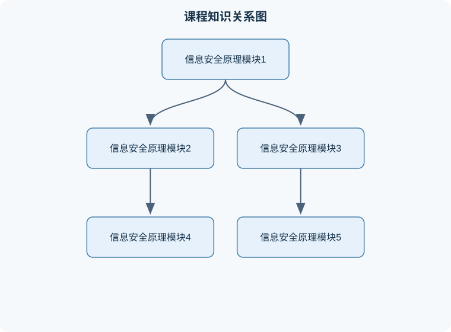

# 信息安全原理

## 一、课程整体知识框架

### 课程边界与先修知识

本课程研究信息系统与网络环境中的保密性、完整性、可用性、真实性、可审计性和不可否认性，覆盖安全目标、威胁建模、密码学基础、对称与公钥密码、哈希与消息认证、数字签名、身份认证、访问控制、网络协议安全、恶意代码、Web应用安全以及事件响应。课程重点是理解安全机制的数学依据、协议流程、攻击条件与防御边界，并能对典型系统进行安全分析。先修知识包括离散数学基础、概率基础、计算机网络、操作系统基本概念、数据结构与算法；学习公钥密码时还需要掌握模运算、素数、最大公因数和有限群的基本概念。课程不等同于法律合规、密码工程实现、渗透测试实训或数字取证专门课程，但为这些方向提供理论基础。





### 1. 课程对象、目标与基本分析方法

信息安全研究的是信息及其处理系统在采集、传输、存储、计算、共享和销毁过程中，如何抵御未经授权的访问、使用、修改、泄露、破坏或拒绝服务。保护对象不只是文件和数据库，也包括身份凭证、密钥、网络流量、程序代码、日志、设备配置、业务流程以及参与系统运行的人员。

信息安全分析不能只问“系统有没有攻击”，还要回答四类问题：

1. **保护什么**：确定资产、数据等级、业务依赖关系和可能损失。
2. **谁可能造成影响**：区分偶然错误、内部滥用、外部攻击、供应链风险和自然故障。
3. **攻击如何发生**：识别漏洞、攻击面、攻击路径、利用条件和影响范围。
4. **怎样证明防护有效**：通过控制措施、监测记录、测试结果、恢复演练和审计证据进行验证。

信息安全的经典目标可概括为机密性、完整性和可用性，通常记作 CIA：

- **机密性**（Confidentiality）：只有获得授权的主体才能读取信息。加密、访问控制、最小权限和数据脱敏主要服务于机密性。
- **完整性**（Integrity）：信息只能按照授权规则被创建、修改或删除，并且修改过程可被发现。哈希、消息认证码、数字签名、版本控制和审计日志用于提高完整性保障。
- **可用性**（Availability）：授权主体在需要时能够及时获得服务或数据。冗余、限流、备份、故障转移和抗拒绝服务措施主要用于可用性。

CIA 不是全部安全目标。身份认证解决“主体是谁”，授权解决“主体能做什么”，不可否认性强调行为与主体之间的可追溯联系，隐私保护则关注个人信息的收集、使用、披露和推断风险。一个系统可能机密性较好但可用性很差，也可能服务始终在线却允许未授权用户修改数据，因此安全评价必须分别检查各项目标，不能用单一指标替代整体判断。

安全事件、威胁、漏洞和攻击需要区分。**资产**是具有价值且需要保护的对象；**威胁**是可能造成不利后果的潜在因素；**漏洞**是系统设计、实现、配置或运行过程中的弱点；**攻击**是利用漏洞或其他条件实施的具体行为；**风险**则是威胁利用漏洞并造成损失的可能性与后果组合。漏洞存在不等于已经发生攻击，攻击发生也不一定意味着攻击者成功。

### 2. 安全模型与风险分析主线

课程采用“资产—威胁—漏洞—控制—验证”的主线组织知识。安全控制可以分为预防性控制、探测性控制、纠正性控制和恢复性控制。例如，多因素认证主要是预防性控制；异常登录告警是探测性控制；封禁被盗账户是纠正性控制；从可信备份恢复数据是恢复性控制。

风险的定量表达可以使用简化模型：

$$
R = P \times I
$$

其中，$R$ 表示风险值，$P$ 表示某一威胁事件在规定期间内发生并成功造成影响的概率，取值范围通常为 $0$ 到 $1$；$I$ 表示影响程度，可以用货币损失、服务中断时间、数据记录数或分级评分表示。若采用评分制，必须先规定评分尺度，否则不同人员给出的风险值不能直接比较。

这一公式适用于需要把可能性和影响进行结构化比较的初步分析，但不是自然规律。它假设 $P$ 与 $I$ 可以被合理估计，并且二者相乘能够表达决策差异。现实中概率数据可能不足，影响也可能具有非线性。例如，某个低概率事件一旦发生会造成不可恢复的生命安全或核心业务损失，此时不能仅因为乘积较小就忽略它。风险评估还应考虑控制成本、剩余风险、依赖关系和风险之间的相关性。

攻击面是系统中所有可能接收输入、执行操作或暴露信息的接口集合，包括网络端口、网页接口、移动应用、身份认证入口、管理员账户、第三方组件、云服务接口和人员操作流程。缩小攻击面不等于关闭所有功能，而是删除不必要接口、限制访问范围、校验输入、减少高权限账户，并对必要接口进行持续监测。

### 3. 安全服务、机制与运行边界

安全服务描述“要达到的保护效果”，安全机制描述“如何实现这种效果”，安全运维描述“如何在系统运行期间持续保持效果”。例如，机密性是一项安全服务；对称加密是实现该服务的机制；密钥轮换、密钥备份和密钥泄露处置属于运维过程。

安全设计必须考虑人和组织因素。密码策略如果要求用户记忆过多复杂凭证，可能诱发密码复用或书面记录；权限审批如果只依赖口头确认，就难以审计；日志如果收集过多却没有告警规则，会增加存储成本而不能提高检测能力。因此，安全控制的有效性不仅取决于技术算法，也取决于配置、流程、人员权限、培训、应急响应和责任划分。

**纵深防御**要求在不同层次部署相互补充的控制，例如网络隔离、主机加固、应用认证、数据库权限、数据加密和日志审计。纵深防御不能保证攻击绝对失败，但可以提高攻击成本、缩短发现时间、限制横向移动并降低最终影响。边界防火墙不能替代应用层输入校验；数据库加密也不能阻止已经获得合法查询权限的账户滥用数据。

## 二、章节和模块划分

### 核心知识覆盖清单

本清单根据本课程的章节划分整理，用于检查正文是否覆盖各个核心模块：

- **模块一：信息安全基本概念、目标与安全演化**。
- **模块二：密码学基础与古典密码**。
- **模块三：哈希、消息认证、数字签名与密钥管理**。
- **模块四：身份认证、访问控制与信任管理**。
- **模块五：网络安全、恶意流量与拒绝服务**。
- **模块六：操作系统、应用与数据安全**。
- **模块七：恶意代码、隐写与取证分析**。
- **模块八：安全运营、事件响应、治理与岗位实践**。
- **代表性算法与工作流程**。
- **典型例题与综合实践**。


### 模块一：信息安全基本概念、目标与安全演化

#### 1. 核心内容

本模块建立课程术语体系，说明信息安全从早期保密通信、计算机访问控制，逐步扩展到网络攻防、软件供应链、云环境、移动终端、物联网和数据治理。安全问题的变化与计算环境有关：单机时代重点是账户、文件和恶意程序；互联网时代增加了远程攻击、蠕虫、拒绝服务、钓鱼和僵尸网络；云和分布式系统进一步引入多租户隔离、接口授权、密钥托管和供应链信任问题。

攻击可按目标分为窃取信息、篡改数据、破坏服务、冒用身份和滥用资源；按攻击位置分为本地攻击、网络攻击、应用攻击和物理攻击；按攻击者是否需要交互分为被动攻击与主动攻击。窃听通常是被动攻击，篡改、重放和拒绝服务属于主动攻击。这个分类用于分析攻击特征，不能据此断定攻击者身份或法律责任。

#### 2. 关键结论与边界

安全目标之间可能冲突。提高认证强度通常会增加登录步骤，可能降低便利性；严格的访问控制可能减少数据泄露，却也可能影响业务可用性。安全设计应先识别业务不可接受的损失，再选择控制组合，而不是追求某一个指标无限提高。

典型概念题的分析步骤是：先说明资产和保护目标，再指出威胁与漏洞，最后给出控制及其局限。例如，员工将客户名单发送到个人邮箱，资产是客户数据，主要风险是机密性泄露；“员工粗心”是事件诱因，不是漏洞的完整描述；若系统允许未经审批导出且没有审计，就是流程和访问控制漏洞；控制措施应同时包括权限限制、导出审批、日志监测和人员责任追踪。

### 模块二：密码学基础与古典密码

#### 1. 核心概念

密码学研究在存在对手的情况下，如何通过数学变换实现保密、认证、完整性和不可否认等目标。明文记为 $M$，密文记为 $C$，密钥记为 $K$。加密过程可写为：

$$
C = E_K(M)
$$

解密过程为：

$$
M = D_K(C)
$$

正确的密码系统要求在合法密钥下满足 $D_K(E_K(M))=M$。这里的 $M$ 和 $C$ 可以是比特串、字节序列或经过编码的符号；公式本身不规定字符集，也不表示任何加密算法都能抵抗现实攻击。

替代密码用另一组符号替换原符号；移位密码把字母表中的位置移动固定数量。若将字母编号为 $0$ 到 $n-1$，移位量为 $k$，则：

$$
c=(m+k)\bmod n
$$

$$
m=(c-k)\bmod n
$$

其中 $m,c,k$ 为无量纲整数，$n$ 为字母表符号总数，要求 $0\leq m,c<n$。该方法的边界是密钥空间很小，且自然语言具有明显频率特征，因此可通过穷举和频率分析破解。隐写术不是加密，而是把信息隐藏在图像、音频、文本格式或其他载体中；一旦隐藏信息被发现，若没有加密，内容仍可能直接暴露。

#### 2. 密码设计原则

Kerckhoffs 原则要求系统安全性应依赖密钥，而不应依赖算法保密。算法公开后仍能安全运行，才便于审查、实现互操作和及时发现缺陷。现实中“自创加密算法”常失败，因为设计者只验证了正常输入，没有分析已知明文、选择明文、重放、密钥泄露和实现侧信道等攻击模型。

对称密码使用同一秘密密钥或可相互推导的密钥进行加解密，适合大数据量处理，但通信双方必须安全共享密钥。非对称密码使用公钥和私钥，适合密钥协商、数字签名和身份认证，但通常计算开销较大，不直接承担全部大文件加密任务。实际协议常采用混合加密：用非对称机制协商会话密钥，再用对称机制保护数据流。

### 模块三：哈希、消息认证、数字签名与密钥管理

#### 1. 机制区别

密码哈希函数把任意长度输入映射为固定长度摘要：

$$
h = H(M)
$$

其中 $M$ 是消息，$h$ 是固定长度比特串。安全哈希通常要求抗原像、抗第二原像和抗碰撞，但哈希不是加密，不能由摘要直接恢复原文。若把密码直接做普通哈希，离线猜测仍可能成功，因此密码存储应使用专门的口令派生方法，并结合随机盐和适当成本参数。

消息认证码以消息和共享密钥共同生成标签：

$$
t=\operatorname{MAC}_K(M)
$$

接收方用同一密钥重新计算并比较标签，用于验证消息来源和完整性，但不能提供公开可验证的签名效果，因为验证方也掌握共享密钥。

数字签名使用私钥生成签名，公钥验证签名。它能够支持来源认证、完整性验证和一定条件下的不可否认性，但前提是私钥没有泄露、公钥绑定关系可信、签名算法和实现安全。数字签名不能自动保证消息机密性，也不能证明签名者理解消息内容。

#### 2. 密钥管理边界

密钥管理包括生成、分发、存储、使用、轮换、备份、撤销和销毁。很多系统不是算法被破解，而是密钥出现在源代码、日志、聊天记录或未经保护的配置文件中。密钥轮换只能降低单个密钥泄露后的影响，不能替代权限控制和泄露响应；密钥备份若未加密，可能把恢复能力变成新的泄露入口。

### 模块四：身份认证、访问控制与信任管理

#### 1. 认证与授权

身份认证回答“你是谁”，授权回答“你能做什么”，审计回答“你做过什么”。认证因素通常包括所知信息、所持设备和固有特征。多因素认证要求不同类别因素组合，而不是把两个密码当作两个独立因素。

访问控制模型包括自主访问控制、强制访问控制、基于角色的访问控制和基于属性的访问控制。基于角色的模型适合组织岗位稳定的场景；基于属性的模型可以结合用户、资源、环境、时间和设备状态进行细粒度决策。最小权限原则要求主体只获得完成任务所需的最小权限；职责分离要求关键操作由不同主体共同完成，以降低单点滥用风险。

#### 2. 访问控制判定流程

一次访问请求至少应包含主体、资源、操作和环境信息。系统先认证主体，再加载有效策略，检查权限、时间、来源网络和资源状态，最后记录判定结果。默认拒绝比默认允许更安全，但在业务系统中还需处理故障时是否拒绝服务的问题。若权限缓存没有及时失效，用户离职后仍可能访问资源，这是“策略正确但实现状态错误”的典型边界。

### 模块五：网络安全、恶意流量与拒绝服务

#### 1. 网络威胁

网络安全关注通信双方、路径节点、协议状态和服务资源。常见威胁包括窃听、地址伪造、会话劫持、重放、扫描、恶意软件传播、邮件欺骗和拒绝服务。邮件的显示发件人字段如果缺乏可靠验证，不能单独证明真实来源；收件服务器通常只能直接看到上一跳连接信息，因此邮件源头追踪需要结合认证记录、传输链路和日志证据。

拒绝服务攻击的目标是使正常用户无法获得服务。单点流量攻击可通过扩容、限流和清洗缓解；分布式拒绝服务由大量来源共同发起，单台主机的过滤措施通常不足。SYN Cookie 可以减少服务器为半连接分配状态所造成的资源消耗，但不能消除已经到达链路或接入设备的巨大流量，也不能独立解决分布式流量型攻击。

#### 2. 网络防护分析

防火墙按地址、端口、协议、连接状态或应用特征进行控制；入侵检测侧重发现异常，入侵防御还可能主动阻断；网络分段用于限制横向移动。防护效果必须结合误报率、漏报率、吞吐量、时延和故障模式评价。加密流量能够保护内容机密性，但也可能降低传统内容检测能力，因此需要在端点、元数据和行为层面进行补充监测。

### 模块六：操作系统、应用与数据安全

#### 1. 操作系统安全

操作系统安全包括账户隔离、进程隔离、文件权限、内存保护、补丁管理、日志审计和安全启动。权限模型中的“读、写、执行”并不等于完整安全性，因为程序可能通过合法权限访问不应处理的数据。高权限账户若缺乏操作审计和临时授权机制，会形成高影响单点风险。

#### 2. 应用安全

应用安全关注输入、输出、会话、错误处理、依赖组件和业务逻辑。输入校验应明确类型、长度、编码、取值范围和上下文；输出编码应依据 HTML、SQL、命令行或日志等不同解释环境分别处理。参数化查询可以避免把用户输入直接拼接为 SQL 语句，但不能替代数据库最小权限。身份认证通过也不代表业务授权正确，例如普通用户仍可能修改其他用户对象的标识符。

数据安全还包括分类分级、最小收集、用途限制、留存期限、备份恢复和安全删除。加密备份可防止备份介质直接泄露，但恢复账户、解密密钥和备份目录权限仍必须单独保护。

### 模块七：恶意代码、隐写与取证分析

#### 1. 恶意代码分析

恶意代码包括病毒、蠕虫、木马、勒索软件、后门和脚本型恶意程序。病毒通常依附于其他文件传播，蠕虫强调自我传播，木马强调伪装和隐蔽控制；这些定义用于分析行为，不代表一个样本只能属于一种类别。

分析流程可分为静态分析、动态分析和关联分析。静态分析检查文件结构、字符串、导入函数和控制流；动态分析在隔离环境中观察进程、文件、注册表、网络连接和持久化行为；关联分析将时间线、哈希、域名、账户和日志进行交叉验证。实验环境必须与真实生产网络隔离，不能把未知样本直接放入办公设备。

#### 2. 隐写与反隐写

隐写通过改变载体中不易察觉的冗余部分来隐藏消息。其安全性取决于载体质量、嵌入容量、可检测性和抗压缩能力。隐藏容量越大，通常越容易引起统计异常；为了提高不可检测性，往往要降低容量。该权衡不是固定公式，必须结合载体格式和检测模型评估。

### 模块八：安全运营、事件响应、治理与岗位实践

#### 1. 事件响应闭环

安全运营把预防、监测、分析、响应和恢复连接起来。事件响应通常包括准备、发现与分析、遏制、根除、恢复以及事后改进。分析阶段要区分告警、事件和事故：告警是需要判断的信号，事件是已确认的安全相关活动，事故是达到预设影响阈值、需要组织响应的事件。

证据处理应记录采集时间、来源、操作人员、保存位置、哈希校验值和传递过程。日志时间不一致会破坏事件时间线，因此系统应统一时间源并记录时区。遏制措施不能只追求立即封禁，还要评估是否破坏取证、影响关键业务或使攻击者改变行为。

#### 2. 安全治理与岗位关联

安全治理把技术控制与制度、责任、风险接受和合规要求连接起来。安全开发岗位需要完成威胁建模、代码审查、依赖检查、测试和缺陷修复，产出包括风险清单、修复提交和验证报告；安全运营岗位需要处理告警、关联日志、分级事件和编写处置记录，验收标准包括告警可复现、判断依据完整、响应时限符合内部要求；渗透测试与分析岗位需要在授权范围内验证攻击路径，产出复现步骤、影响证据和修复建议，验收标准是结果可复核且不造成超出授权范围的影响；安全架构或业务安全岗位需要识别数据流、信任边界和控制缺口，产出架构风险分析、控制方案和残余风险说明。

### 代表性算法与工作流程

#### 1. 风险分析流程

**输入**：资产清单、业务流程、威胁来源、漏洞信息、已有控制和影响指标。  
**输出**：风险登记表、风险等级、处理建议和残余风险。  
**过程**：

1. 标识资产及其机密性、完整性、可用性要求；
2. 绘制数据流和信任边界；
3. 列举威胁、漏洞和可能攻击路径；
4. 估计发生可能性与影响；
5. 计算或分级风险；
6. 选择规避、降低、转移或接受措施；
7. 验证控制效果并更新风险。

**不变量**：每一项高影响资产都必须有对应威胁分析和责任人；每项控制都应说明保护目标和验证证据。**终止条件**：在规定范围内所有资产均完成评估，或剩余风险已经由有权责任人接受。适用边界是结构化初评，不等同于精确预测攻击概率。

#### 2. 访问控制判定流程

**输入**：主体身份、请求资源、操作类型、环境属性和策略集合。  
**输出**：允许或拒绝的决定，以及审计记录。  
**过程**：

1. 验证身份认证状态；
2. 获取主体角色和属性；
3. 获取资源分类和当前状态；
4. 匹配适用策略；
5. 检查最小权限、时间、来源和职责分离条件；
6. 若存在明确允许且无更高优先级拒绝，则允许，否则拒绝；
7. 记录主体、资源、操作、时间、结果和策略版本。

**不变量**：未认证主体不能获得需要身份的资源；策略冲突时不能因缺少匹配而默认允许。复杂度取决于策略匹配方式，简单角色表查找可近似为 $O(1)$，属性策略逐条匹配通常为 $O(n)$，其中 $n$ 为候选策略数量。

#### 3. 事件响应流程

输入是告警、日志、用户报告或外部情报；输出是事件结论、处置记录、恢复结果和改进项。流程包括确认范围、保存证据、评估影响、遏制传播、清除根因、恢复服务和复盘。终止条件不是“告警消失”，而是攻击路径被关闭、受影响资产完成检查、恢复状态得到验证，并且剩余风险已经明确。

```text
伪代码
输入：告警集合 A，日志集合 L，资产清单 S
输出：事件报告 R，处置记录 T

对每个告警 a ∈ A：
    验证 a 的来源、时间和关联资产
    若无法复现且没有辅助证据：
        标记为待观察，保留原始记录
        继续处理下一个告警
    从 L 中提取与 a 时间窗口和资产相关的记录
    判断是否存在未授权行为或异常影响
    若不存在：
        标记为误报或低风险事件
    否则：
        保存证据摘要、哈希值和采集链
        评估影响范围与业务优先级
        执行授权的遏制措施
        验证攻击路径是否仍可用
        完成根除、恢复和复测
        生成事件结论与改进项
返回 R 和 T
```

### 典型例题与综合实践

#### 例题一：目标分类

**题干**：某系统允许用户读取订单，却发现普通用户可以修改其他用户的收货地址。该问题主要违反哪一类安全目标？  
**分析**：读取权限本身不一定违反机密性；修改他人地址改变了业务数据，首先涉及完整性，同时可能引发业务欺诈。  
**解答**：主要问题是授权缺陷导致完整性受损。修复应校验当前用户与订单所有者关系，而不是只校验用户是否已登录。  
**验证**：用用户甲登录，尝试修改用户乙订单；应拒绝，并生成可审计记录。  
**变式**：若用户不能读取乙的订单但可以修改，仍是完整性和授权问题，不因机密性得到保护而安全。

#### 例题二：移位密码计算

**题干**：使用 $n=26$ 的字母表和移位量 $k=3$ 加密字母 $m=24$。  
**解答**：

$$
c=(24+3)\bmod 26=1
$$

编号为 $1$ 的字母即为结果。解密时：

$$
m=(1-3)\bmod 26=24
$$

**验证**：加密后再解密返回原编号。  
**变式**：若 $k=29$，有效效果等同于 $k=3$，说明密钥空间可按模 $26$ 归并，不能把不同整数移位量误认为不同安全密钥。

#### 例题三：风险排序

**题干**：风险甲发生可能性为 $0.2$、影响评分为 $90$；风险乙可能性为 $0.6$、影响评分为 $20$。按 $R=P\times I$ 排序。  
**解答**：

$$
R_{\text{甲}}=0.2\times90=18
$$

$$
R_{\text{乙}}=0.6\times20=12
$$

因此在该评分模型下风险甲优先。  
**验证**：检查两项使用同一影响尺度和同一时间范围。  
**变式**：若风险甲是低概率但不可恢复的核心业务中断，不能只依据乘积自动接受，应增加业务连续性和极端情景分析。

#### 例题四：哈希与加密辨析

**题干**：管理员保存用户密码的 SHA-256 摘要，是否意味着密码无法被恢复？  
**分析**：哈希不可逆不等于不可猜测。攻击者可对常见密码逐个计算摘要并比较。  
**解答**：普通哈希不能充分保护低熵密码，应使用带随机盐和可调计算成本的口令派生方案，并限制在线尝试。  
**验证**：检查数据库中每个账户是否有独立盐，验证登录系统是否具有失败次数控制。  
**变式**：文件完整性校验适合使用密码哈希；密码存储则需考虑离线猜测成本，二者用途不同。

#### 例题五：SYN Cookie 的适用边界

**题干**：服务器启用 SYN Cookie 后，遭受多来源大流量 SYN 泛洪，链路仍拥塞。原因是什么？  
**分析**：SYN Cookie 主要减少服务器为半连接维护状态的内存消耗；当大量流量已经占满接入链路或上游设备时，服务器即使不保存状态也无法获得足够带宽。  
**解答**：该措施改善了连接状态资源耗尽问题，但不能独立解决分布式流量型拒绝服务。还需上游清洗、限流、容量规划和分布式防护。  
**验证**：分别观察服务器半连接队列、CPU、内存、接入带宽和上游丢包位置。  
**变式**：若攻击规模较小且主要耗尽半连接状态，SYN Cookie 可能明显有效。

#### 实验一：访问控制验证实验

**步骤**：建立管理员、普通用户和审计员三个角色；为订单资源配置读取、修改、导出权限；测试正常请求、越权请求、离职用户请求和策略变更后的缓存状态。  
**输入数据**：三类用户身份、两类订单归属、四种操作请求和一组失效账户。  
**评价标准**：合法请求成功率为 100%；越权请求全部拒绝；每次拒绝包含主体、资源、操作和时间记录；权限撤销在规定时间内生效。  
**排错方法**：若普通用户可访问他人订单，检查对象级授权是否只验证角色；若撤权后仍可访问，检查令牌缓存、会话有效期和多节点策略同步。

#### 实验二：事件日志关联项目

**步骤**：在隔离环境生成登录失败、成功登录、权限变更、异常导出和网络连接日志；统一时间格式；按账户、地址、时间窗口关联事件；形成时间线并给出遏制建议。  
**输入数据**：认证日志、应用审计日志、主机日志和资产清单，均应使用模拟数据，不接入真实敏感系统。  
**评价标准**：能够还原关键事件顺序，区分误报与真实异常，标出受影响资产，保存原始日志和摘要校验值，结论可由另一名分析人员复核。  
**排错方法**：时间线错乱时检查时区和时钟偏差；关联结果过多时缩小时间窗口并增加账户、资源和操作条件；结论无法复核时补充原始证据、筛选规则和判断依据。

## 三、核心概念的详细解释

### 1. 信息安全的对象、目标与基本属性

信息安全保护的是信息及其处理系统在全生命周期中的安全状态。生命周期包括采集、输入、传输、存储、计算、共享、备份、归档和销毁。保护对象既包括业务数据，也包括身份凭证、密钥、程序、配置、日志、网络连接、硬件设备、业务流程和人员操作。

信息安全的基本目标通常用 CIA 表示。机密性要求未授权主体不能读取或推断受保护信息；完整性要求信息只能按照授权规则被创建、修改或删除，并能够发现未经授权的变化；可用性要求授权主体在需要时能够在可接受时间内使用服务或数据。三者之间可能发生冲突，例如更严格的访问控制可能提高机密性，却增加合法用户的操作成本；更强的加密和审计可能消耗计算资源，影响可用性。因此，安全设计不是单纯追求某一项指标，而是在业务目标、风险和成本之间进行约束下的平衡。

身份认证回答“主体是谁”，授权回答“该主体能做什么”，审计回答“发生过什么以及能否追溯”，不可否认性强调行为与主体之间的证据关联，隐私保护则关注个人信息的收集范围、使用目的、披露对象和推断风险。密码正确并不等于用户已经获得全部权限；登录日志存在也不等于日志内容可信，日志本身同样需要访问控制、完整性保护和时间同步。

### 2. 演化视角与计算机安全的特殊性

早期保密主要依赖物理隐藏、人员管理和人工密码。随着机械设备和电子计算机出现，密码处理速度显著提高，攻击者也可以自动尝试大量密钥或口令。网络普及后，攻击不再局限于单台设备，恶意代码、蠕虫、拒绝服务、网络钓鱼、供应链攻击和大规模自动化扫描可以跨越地域扩散。现代信息安全因此同时具有技术、组织和业务属性。

计算机安全具有几个特殊性。第一，复制成本极低，数据一旦泄露可被迅速复制，删除本地副本不一定能消除影响。第二，系统高度互联，一个低权限组件可能通过信任关系影响高价值业务。第三，软件行为由复杂规则决定，边界条件、配置错误和依赖组件缺陷可能产生隐蔽漏洞。第四，攻击可以自动化、远程化和规模化，防守方不仅要修复单个缺陷，还要管理资产、身份、配置、日志和供应链。第五，安全功能可能影响正常业务，过度限制会诱发绕过控制的行为，因此安全措施必须与可用性和运维流程结合。

### 3. 资产、威胁、漏洞、攻击、控制与风险

**资产**是具有业务、经济、法律、运行或社会价值且需要保护的对象。**威胁**是可能造成不利后果的潜在因素，例如恶意人员、内部误操作、软件故障、自然灾害或供应商失误。**漏洞**是设计、实现、配置或流程中的弱点。**攻击**是主体利用漏洞或其他条件实施的行为。**事件**是可观察到的系统或安全状态变化；事件不一定造成损害，只有经过分析后才可能被认定为安全事件。**控制**是降低风险或限制损害的技术、管理和物理措施。

攻击链通常可以表示为：发现目标—获取入口—建立执行能力—提升权限—横向移动—访问或破坏目标—维持控制—隐藏痕迹。实际攻击不一定完整经历所有阶段，但该链条有助于寻找控制点。预防性控制在攻击发生前降低成功概率，探测性控制发现异常，纠正性控制阻断或清除攻击，恢复性控制使业务回到可接受状态。一个成熟方案通常同时包含四类控制，不能只依赖边界防火墙或单一杀毒软件。

风险分析可采用“资产—威胁—漏洞—影响—控制—剩余风险”的顺序。风险不是漏洞数量的简单总和：一个公开漏洞若不存在可达路径、无敏感资产依赖，风险可能低于一个看似普通但直接影响核心业务的配置错误。风险评估还应考虑攻击条件、控制覆盖率、依赖关系、检测时间和恢复能力。

### 4. 攻击面、攻击分类与防御边界

攻击面是系统所有可能接收输入、执行操作、暴露身份或泄露信息的接口集合，包括开放端口、网页接口、移动应用、远程管理入口、数据库账户、第三方组件、云服务接口和人员流程。缩小攻击面包括删除不必要服务、限制管理入口、关闭默认账户、减少高权限主体、校验输入、隔离网络区域和及时更新组件。

攻击可以按对象分为机密性攻击、完整性攻击和可用性攻击；按来源分为内部与外部攻击；按自动化程度分为人工操作、脚本化攻击和大规模分布式攻击；按技术路径分为口令猜测、恶意代码、注入、越权、社会工程、流量耗尽和供应链攻击。分类的目的不是贴标签，而是帮助选择控制措施和证据。

拒绝服务攻击的核心是使合法用户无法获得足够的计算、内存、连接状态、带宽或应用处理能力。SYN Cookie 可以减少服务器为大量半连接保存状态的需求，但不能解决上游链路被大流量占满的问题，也不能自动抵御来自大量真实受控主机的应用层请求。防护应区分资源位置：服务器状态耗尽可使用连接策略和状态优化；链路拥塞需要上游清洗、容量规划或分布式承载；应用请求耗尽则需要身份、限流、缓存、请求复杂度控制和业务级检测。

僵尸网络是被控制的一组主机。其控制通信可能使用集中式协议，也可能使用加密或点对点结构，因此不能只依赖某个固定端口、域名或协议特征。检测应结合异常连接模式、进程行为、DNS 请求、认证记录、流量基线和终端威胁信息，并通过隔离、取证和重新安装等流程处置。对真实网络进行扫描或控制验证必须获得明确授权，课程实验应使用隔离环境和模拟数据。

### 5. 邮件欺骗、垃圾邮件与信任边界

传统邮件传输中，发件人地址字段不能单独证明真实身份。攻击者可以伪造显示名称或地址，使收件人误认为邮件来自可信组织。收件服务器通常只能直接观察相邻传输节点的网络信息，因此不能仅凭邮件正文中的“发件人”字段确认源头。

邮件防护需要多层校验：检查发送域的授权关系，验证传输链路和消息签名，分析域名、地址、时间、附件、链接和历史行为，并结合用户报告和隔离区处理。质询认证可以降低自动化垃圾邮件，但会给正常发件人带来交互成本，也不能解决被盗账户发送的可信垃圾邮件。黑名单能降低部分已知来源的投递成功率，却存在误封、滞后和攻击者更换来源的问题。邮件安全的边界是降低伪造和误信概率，而不是保证所有恶意邮件均能被自动识别。

### 6. 密码学、隐写术与安全服务

隐写术通过改变载体中的不显眼部分隐藏通信存在性，例如在图像、音频或文本结构中嵌入信息。它主要解决“是否存在通信”的隐蔽性问题，不等同于加密。若载体被识别或提取规则泄露，隐写内容可能直接暴露，因此重要信息通常应先加密，再进行隐写；隐写也可能因压缩、格式转换或统计检测而失效。

替代密码用一个符号替换另一个符号；移位密码是替代密码的简单形式；栅栏密码通过改变字符排列顺序隐藏文本结构。古典密码有助于理解密钥、明文、密文和攻击模型，但密钥空间小、模式明显，不能用于保护现代业务数据。现代密码学遵循公开算法、保密密钥的原则：算法可以公开分析，安全性主要依赖密钥保密。依赖算法秘密的方案一旦实现泄露，整体安全性通常会迅速下降。

对称密码使用同一秘密密钥进行加密和解密，适合大量数据处理，但通信双方首先需要安全共享密钥。非对称密码使用公钥和私钥，公钥可以公开，私钥必须保密，适合身份认证、数字签名和密钥建立，但通常不适合直接高效加密大文件。实际系统常采用混合加密：用非对称机制保护一次性会话密钥，再用对称机制处理数据。

哈希函数把任意长度输入映射为固定长度摘要。它应满足抗原像、抗第二原像和抗碰撞等性质，但哈希不是加密，通常不能由摘要直接解密出原文。消息认证码需要共享密钥，能够验证消息完整性和来源；数字签名使用私钥生成、用公钥验证，能够提供完整性、来源认证和较强的不可否认性，但签名本身不保证消息保密。

### 7. 安全系统、服务、机制与人员因素

安全系统由资产、主体、客体、策略、机制、审计和运维流程共同构成。安全服务是系统希望提供的能力，如身份认证、访问控制、机密性、完整性、可用性和审计；安全机制是实现这些服务的具体手段，如密码算法、访问控制列表、令牌、隔离、备份、日志和入侵检测。

最小权限要求主体只获得完成任务所需的最小权限；职责分离要求关键操作由不同主体或不同步骤共同完成；默认拒绝要求没有明确授权时拒绝访问；失效安全要求控制组件故障时不会无条件放开高风险权限。现实系统还要考虑密钥丢失、账户共享、应急账户、权限继承、缓存延迟、时间不同步和日志容量不足等问题。人员误操作、社会工程和流程绕过往往不是单纯技术缺陷，必须通过培训、审批、双人复核、最小权限和可审计流程共同降低风险。

### 8. 常见算法与安全工作流程

#### 8.1 访问信息的风险分析流程

**输入**：资产清单、业务依赖、威胁场景、漏洞信息、已有控制和影响尺度。  
**输出**：风险登记表、优先级、处置措施和剩余风险说明。

过程如下：

1. 为每项资产确定所有者、用途、位置、敏感性和可接受中断时间。
2. 列出可达入口、信任关系和关键依赖，形成攻击面。
3. 针对每个入口分析威胁主体、利用条件和可能后果。
4. 识别预防、探测、纠正和恢复控制。
5. 在统一时间范围内估计发生可能性和影响。
6. 计算或分级排序，制定接受、降低、转移或规避方案。
7. 记录假设、证据、责任人和复核时间。
8. 控制实施后重新评估剩余风险。

不变量是每条风险记录都必须能追溯到一个资产、一个威胁场景和至少一个影响结果。终止条件是所有高价值资产和高暴露入口均已分析，且每项高风险都有责任人和处置期限。该流程适合初步决策，不适合替代极端灾难、法律责任或相互依赖风险的专门分析。

#### 8.2 日志事件关联流程

**输入**：认证日志、应用审计日志、主机日志、网络日志、资产清单和统一时间基准。  
**输出**：事件时间线、受影响资产、证据链、处置建议和误报说明。

先保留原始日志并计算摘要，随后统一时区和时间格式；再按账户、源地址、目标资产、会话标识和时间窗口关联；最后区分正常行为、可疑事件和已确认事件。关联过程中不得覆盖原始记录。终止条件是关键事件的先后关系、主体、目标和操作均有证据支撑。常见排错点是时钟偏差、日志丢失、字段解析错误、重复转发和不同系统使用不同会话标识。

#### 8.3 授权判断伪代码

```text
# 输入：subject 主体，action 操作，resource 资源，policy 策略
# 输出：ALLOW 或 DENY，以及审计记录

function authorize(subject, action, resource, policy):
    if subject is null or resource is null:
        return DENY("missing identity or resource")

    if subject.account_status != "active":
        return DENY("inactive account")

    required = policy.required_permission(resource, action)
    granted = policy.permissions(subject)

    if required is null:
        return DENY("no explicit rule")

    if required not in granted:
        return DENY("permission denied")

    if not policy.object_condition_satisfied(subject, resource, action):
        return DENY("object condition failed")

    write_audit(subject.id, action, resource.id, "ALLOW")
    return ALLOW

function DENY(reason):
    write_audit(current_subject, current_action, current_resource,
                "DENY", reason)
    return "DENY"
```

该算法的关键不变量是：没有明确规则时不得放行；账户状态、操作权限和对象级条件必须同时满足。复杂度取决于权限索引结构；若按主体和资源建立哈希索引，单次查询平均可接近 $O(1)$，若每次遍历全部规则，则为 $O(n)$，其中 $n$ 是规则数量。复杂度不等于安全性，缓存策略、策略同步和撤权延迟仍需单独验证。

### 9. 实验与项目流程

#### 9.1 访问控制实验

**步骤**：建立管理员、普通用户和审计员三类模拟身份；设置订单读取、修改、导出三类操作；安排本人订单和他人订单；分别测试正常访问、越权访问、账户停用、权限撤销和策略更新后的访问。  
**输入数据**：身份表、资源归属表、权限规则、合法请求和恶意构造请求。  
**评价标准**：合法请求全部成功；越权请求全部拒绝；日志包含主体、对象、操作、时间和结果；撤权在规定时间内生效；另一名测试人员可以依据规则复现实验。  
**排错方法**：若角色正确却能读取他人订单，检查是否只做角色检查而未做对象级检查；若撤权后仍可访问，检查令牌缓存、会话有效期和多节点策略同步；若日志缺字段，检查审计调用是否覆盖所有拒绝分支。

#### 9.2 事件响应与日志关联项目

**步骤**：在隔离环境生成失败登录、成功登录、权限变更、异常导出和网络连接等模拟日志；统一时间格式；按账户、地址和时间窗口建立时间线；标出可能的初始入口、受影响资产和遏制动作。  
**输入数据**：认证日志、应用日志、主机日志、资产清单和预先定义的正常行为基线。  
**评价标准**：能够还原关键顺序；保留原始证据；结论与每条证据对应；区分误报和确认事件；提出隔离、凭证轮换、修复和恢复验证方案。  
**排错方法**：时间线错乱时检查时区和时钟偏差；事件过多时增加账户、资源和操作条件；无法复核时补充筛选规则、字段解释和原始摘要。

## 四、重要定义、公式、定理和推导

### 专业审校补充：关键定义与适用边界

认证加密（AEAD）同时提供机密性与完整性，但其安全成立有一个经常被忽略的前提：同一密钥下的 nonce（一次性随机数或计数器）必须按算法要求唯一。设加密输入为明文 $M$、附加认证数据 $A$、密钥 $K$ 和 nonce $N$，输出为密文 $C$ 与标签 $T$，可写为 $\operatorname{Enc}_K(N,A,M)=(C,T)$；解密时只有标签验证通过，才输出明文，否则必须拒绝。附加认证数据通常不加密，但会被认证，例如协议版本、会话编号和消息类型。若在流密码或计数器模式下重复使用同一密钥和 nonce，常会导致相同密钥流被重复使用，攻击者可由 $C_1\oplus C_2=M_1\oplus M_2$ 获得两条明文的关系；若认证标签的 nonce 使用也被破坏，还可能进一步伪造消息。因此，随机 nonce 不能只“看起来随机”，还要管理碰撞概率；计数器 nonce 则必须持久化并防止回滚。AEAD 不负责身份认证、密钥分发或业务授权，标签验证成功也不等于发送者具有访问权限。


### 1. 风险计算及其适用边界

在统一时间区间和统一影响尺度下，风险可用简化模型表示为：

$$
R=P\times I
$$

其中，$R$ 是风险值；$P$ 是威胁事件在规定期间内发生并成功造成影响的概率，满足 $0\leq P\leq1$；$I$ 是影响程度，可用货币、停机时间、数据记录数或分级分数表示。若 $I$ 的单位是货币，则 $R$ 可解释为期望损失；若 $I$ 是无量纲评分，则 $R$ 只是排序分数，不能直接解释为金钱。

推导步骤是：把事件发生与成功造成影响合并为概率 $P$，为该事件赋予影响量 $I$，用概率加权影响得到平均意义上的风险。因此，若两个风险的 $P$ 和 $I$ 可比较，便可通过乘积排序。若风险甲的 $P=0.2$、$I=90$，风险乙的 $P=0.6$、$I=20$，则

$$
R_{\text{甲}}=0.2\times90=18,\qquad
R_{\text{乙}}=0.6\times20=12
$$

在该模型下甲优先，但这不是“甲一定先发生”。若影响不可恢复、估计区间很宽、风险之间存在相关性，或 $I$ 使用非线性等级，必须增加情景分析，不能机械使用乘积。

### 2. 模运算与移位密码

设字母编号为 $0,1,\ldots,25$，明文编号为 $m$，密钥位移量为 $k$，密文编号为 $c$，则凯撒移位加密为：

$$
c=(m+k)\bmod 26
$$

解密为：

$$
m=(c-k)\bmod 26
$$

这里 $\bmod$ 表示取模运算，结果归入 $0$ 到 $25$。例如明文字母编号为 $1$，$k=3$：

$$
c=(1+3)\bmod26=4
$$

解密时：

$$
m=(4-3)\bmod26=1
$$

边界条件是负数也要按模映射，例如 $c=1,k=3$ 时：

$$
m=(1-3)\bmod26=24
$$

该密码的有效密钥最多只有 $26$ 种，且 $k$ 与 $k+26$ 等价。频率分析、已知明文和穷举都能有效攻击，因此只适合作为教学模型，不适合保护真实信息。

### 3. RSA 的基本数学关系与边界

RSA 使用两个不同的大素数 $p$ 和 $q$，令：

$$
n=pq
$$

在互素条件下，欧拉函数为：

$$
\varphi(n)=(p-1)(q-1)
$$

选择满足

$$
1<e<\varphi(n),\qquad \gcd(e,\varphi(n))=1
$$

的公开指数 $e$，再求 $d$ 使：

$$
ed\equiv1\pmod{\varphi(n)}
$$

公钥为 $(n,e)$，私钥为 $(n,d)$。对满足 $0\leq m<n$ 的消息整数 $m$，加密和解密分别为：

$$
c=m^e\bmod n,\qquad m=c^d\bmod n
$$

其正确性来自 $ed=1+t\varphi(n)$。在适用的互素条件下，由欧拉定理 $m^{\varphi(n)}\equiv1\pmod n$，因此：

$$
m^{ed}=m^{1+t\varphi(n)}
=m(m^{\varphi(n)})^t
\equiv m\pmod n
$$

实际安全性不能由这个代数推导单独保证。真实系统必须使用足够大的参数、经过验证的随机填充和成熟实现；直接对长消息逐整数使用基础 RSA 会产生长度、确定性和选择密文风险。RSA 的安全性通常与大整数分解困难相关，但“计算困难”依赖参数、算法和实现环境，不是绝对不可破解。

### 4. 哈希、认证码与数字签名的区别

哈希函数记为 $H(x)$，输入 $x$ 可以是任意长度，输出为固定长度摘要。若两个不同输入 $x\ne y$ 满足 $H(x)=H(y)$，称为碰撞。摘要相同不能证明文件绝对相同，只能在哈希函数安全性和攻击成本假设下提供高可信度的完整性检测。

消息认证码可表示为：

$$
\operatorname{MAC}_K(m)
$$

其中 $m$ 是消息，$K$ 是共享密钥。接收方用同一密钥重新计算并比较结果，因此可验证消息未被篡改且来自掌握密钥的一方，但双方共享密钥会带来密钥分发和主体区分问题。

数字签名可抽象为：

$$
\sigma=\operatorname{Sign}_{sk}(m)
$$

$$
\operatorname{Verify}_{pk}(m,\sigma)\in\{\text{true},\text{false}\}
$$

其中 $sk$ 是签名私钥，$pk$ 是对应公钥。签名验证成功表示消息与签名匹配，并不能自动证明签名者现实身份，身份绑定还依赖公钥管理、证书或其他可信分发机制。签名也不提供保密性；若需要保密，仍需加密。

### 5. 代表性例题

#### 例题一：哈希能否恢复密码

**题干**：数据库保存用户密码的哈希值，攻击者能否从哈希值直接解密得到原密码？  
**分析**：哈希不是可逆加密，不存在一般意义上的解密过程；但攻击者可以猜测候选密码并计算哈希比较。  
**结论**：不能说“哈希后绝对无法恢复”。低熵密码仍可能被离线猜出。密码存储应使用独立随机盐、适合口令的高成本派生算法，并限制在线尝试。  
**验证**：检查每个账户是否有独立盐、派生参数是否可调、失败登录是否限速。  
**变式**：文件完整性校验可使用通用哈希；密码存储不能只依赖快速哈希。

#### 例题二：SYN Cookie 为何不能解决所有洪泛

**题干**：启用 SYN Cookie 后，服务器半连接内存下降，但接入链路仍拥塞，原因是什么？  
**解答**：SYN Cookie 主要减少服务器保存半连接状态的成本。若攻击流量已占满上游链路，服务器即使节省内存也无法收到或处理正常请求。  
**结果验证**：同时观察链路带宽、上游丢包、半连接队列、CPU 和应用请求量。  
**变式**：若攻击只耗尽本机连接状态而链路充足，SYN Cookie 可能有效；若是应用层慢请求，则应检查应用线程、连接池和请求超时。

#### 例题三：邮件地址是否证明发件人

**题干**：邮件显示的发件人地址属于某公司，能否据此确认邮件来自该公司？  
**解答**：不能。显示地址可被伪造，还应检查域授权、消息签名、传输链路、链接目标、附件行为和历史发送模式。  
**结果验证**：比较邮件头中的传输路径与声明地址，检查签名验证结果和域策略。  
**变式**：即使域名校验成功，账户被盗后仍可能发送恶意邮件，因此需要行为分析和异常登录检测。

#### 例题四：风险优先级

**题干**：系统甲可能性为 $0.1$、影响为 $100$；系统乙可能性为 $0.7$、影响为 $15$。按乘积排序。  
**解答**：

$$
R_{\text{甲}}=0.1\times100=10
$$

$$
R_{\text{乙}}=0.7\times15=10.5
$$

在单一评分模型下乙略高。  
**验证**：确认两项的时间范围、影响单位和评分尺度相同。  
**变式**：若甲涉及不可恢复的核心数据损失，应增加极端事件和业务连续性评价，不能仅因分数略低而忽略。

#### 例题五：加密、签名和 MAC 的选择

**题干**：甲、乙希望传输一份只有乙能读取且能确认来自甲的文件，应选择哪种组合？  
**解答**：甲可使用签名私钥对文件或其摘要签名，再使用面向乙的加密机制保护文件；在大文件场景使用混合加密，以非对称机制保护会话密钥，以对称机制加密文件内容。  
**结果验证**：乙先验证签名和公钥绑定，再解密并检查内容完整性。  
**变式**：若双方共享可靠秘密且不需要公开验证，MAC 可提供完整性和来源认证，但不适合让第三方独立验证甲的签名行为。

### 6. 常见易错点、笔试题与面试题

#### 6.1 具体易错点

1. 把漏洞当成攻击；漏洞是弱点，攻击是利用行为。
2. 把威胁当成风险；风险还需要考虑发生可能性和影响。
3. 认为登录成功就拥有全部权限；认证和授权是两个阶段。
4. 把哈希当成加密；哈希主要用于摘要和校验，通常没有解密操作。
5. 认为数字签名提供保密性；签名主要解决完整性和来源认证。
6. 认为 HTTPS 能防止所有网页攻击；它主要保护传输链路，不能修复业务授权缺陷。
7. 只检查角色而不检查对象归属，导致水平越权。
8. 认为防火墙存在就没有攻击面；开放业务接口和内部信任关系仍可能被利用。
9. 认为 SYN Cookie 能解决所有拒绝服务；它不能消除链路和应用资源瓶颈。
10. 用固定黑名单识别全部僵尸网络；加密和点对点控制会改变特征。
11. 只保存告警而不保存原始日志，导致事件无法复核。
12. 忽略时区和时钟偏差，造成错误的事件时间线。
13. 只计算风险乘积而不记录假设，使分数无法比较。
14. 认为隐写术等同于加密；隐写隐藏通信存在性，不必然保护内容。
15. 直接使用公开算法实现密码协议，忽略随机数、填充、密钥生命周期和异常处理。
16. 权限撤销后仍可访问却只检查策略文件，忽略会话和缓存延迟。

#### 6.2 典型笔试问题及解答思路

1. **说明 CIA 三目标及相互关系。**  
   从机密性、完整性、可用性的定义入手，再说明三者可能冲突，最后用加密、审计、冗余分别举例。

2. **区分资产、威胁、漏洞、攻击和风险。**  
   按“保护对象—潜在原因—系统弱点—实际行为—可能损失”的因果链回答，不能只列名词。

3. **为什么公开算法而保密密钥？**  
   说明公开算法可接受分析和互操作，秘密集中在密钥；若算法也依赖保密，泄露后无法稳定维护安全性。

4. **解释对称密码与非对称密码的适用场景。**  
   对称密码速度快、适合大数据；非对称密码便于公钥分发、签名和密钥建立，但计算成本通常更高。

5. **哈希、MAC、数字签名有何区别？**  
   比较是否需要密钥、能否验证来源、是否支持公开验证以及是否提供保密性。

6. **推导移位密码的加密和解密公式。**  
   先定义字母编号，再说明加密加上 $k$ 后取模，解密减去 $k$，最后用边界例子验证负数取模。

7. **为什么风险乘积不能替代全部风险决策？**  
   指出概率和影响估计误差、极端事件、相关风险和不可恢复损失等边界。

8. **分析邮件欺骗的成因和防护。**  
   从发件人字段可伪造、相邻传输节点有限可见性出发，提出域校验、签名、内容分析和用户处置流程。

#### 6.3 典型面试问题、参考答案与追问要点

1. **如何处理一次疑似账户被盗事件？**  
   参考答案：保留证据，确认账户和影响范围，临时限制会话，轮换凭证，检查异常操作，修复入口并复盘。  
   追问要点：不能先删除日志；要区分遏制、根除和恢复；涉及高权限账户时需要更严格审批。

2. **如何判断一个告警是否真实？**  
   参考答案：结合资产重要性、主体行为基线、时间、来源、目标、操作结果和其他日志交叉验证。  
   追问要点：说明误报处理、证据保全和无法确认时的临时控制。

3. **如何设计最小权限？**  
   参考答案：按岗位和任务建立权限，默认拒绝，细化到对象和操作，定期复核，及时撤销离职和变更权限。  
   追问要点：讨论应急账户、权限继承、服务账户和多节点缓存。

4. **如何验证日志系统可靠？**  
   参考答案：确认覆盖关键操作、时间同步、集中保存、访问隔离、完整性保护、容量告警和检索可用性。  
   追问要点：讨论日志泄露、脱敏、原始证据保留和恢复演练。

5. **发现应用存在越权应怎样分析？**  
   参考答案：构造不同主体访问不同对象的授权矩阵，检查服务端是否验证对象归属，而不是只依赖前端隐藏按钮。  
   追问要点：说明缓存、批量接口、导出接口和异步任务也必须复测。

6. **为什么不能只用防火墙防护？**  
   参考答案：防火墙主要控制网络可达性，不能替代身份、应用授权、输入校验、终端防护、日志和恢复机制。  
   追问要点：区分网络边界、内部横向移动和应用层攻击。

7. **如何评估一次安全控制是否有效？**  
   参考答案：先定义控制目标，再设计合法、越权、异常和故障场景，检查阻断率、检测时间、误报、恢复时间和审计证据。  
   追问要点：控制有效不等于风险为零，还要评估绕过路径和残余风险。

8. **遇到大流量拒绝服务怎么办？**  
   参考答案：先确认流量位置和资源瓶颈，再区分链路、连接状态、主机和应用层问题，协调上游清洗、限流、扩容和业务降级。  
   追问要点：不能只重启服务器；重启可能丢失证据并无法解决上游拥塞。

### 7. 岗位任务与产出标准

安全运营岗位常处理告警分诊、日志关联、资产核对和事件升级，使用事件分析、认证、授权、攻击面和证据保全知识；产出应包括事件时间线、影响范围、证据位置、处置动作和复盘结论，验收标准是另一名分析人员能够复核。

安全分析岗位负责威胁建模、风险排序、控制设计和安全评估，使用资产—威胁—漏洞—控制模型、风险公式、访问控制和业务连续性知识；产出包括风险登记表、攻击路径、控制差距和剩余风险，验收标准是每项结论都有假设、证据、责任人和验证方法。

安全研发岗位负责认证授权、密码协议调用、日志审计和安全测试，使用密码学基本原理、最小权限、默认拒绝、对象级授权和异常处理知识；产出包括代码、测试用例、接口说明和审计字段，验收标准是合法请求可用、越权请求拒绝、敏感数据不泄露、密钥不硬编码，并通过边界、故障和回归测试。

业务或产品岗位负责识别数据价值、确定访问角色、定义可接受中断时间和审批流程；产出包括数据分类、权限矩阵、业务影响分析和验收条件。其核心不是编写密码算法，而是把业务目标转化为可实施、可审计、可恢复的安全要求。

## 五、算法、流程和实现思路

### 方法与流程覆盖索引

下列方法或流程应在正文中说明输入、步骤、适用条件、结果检查和边界：

- 1. 安全问题的通用分析流程
- 2. 对称加密、哈希和消息认证的实现流程
- 3. 公钥密码、数字签名与密钥交换流程
- 4. 访问控制与事件响应流程
- 5. 代表性例题
- 6. 实验与项目流程


### 1. 安全问题的通用分析流程

信息安全问题不能直接从“选择某个工具”开始，而应先明确保护对象、威胁主体、攻击路径和验收条件。一个可复用的分析流程如下：

1. **确定资产与安全目标**：列出数据、账户、服务、设备、密钥、日志和业务流程，分别判断机密性、完整性、可用性和隐私要求。
2. **划定信任边界**：标明用户设备、应用服务器、数据库、第三方服务和管理网络之间的边界。跨越边界的输入、身份和数据都应视为需要验证的对象。
3. **识别威胁与漏洞**：区分恶意攻击、误操作、配置错误、组件故障和自然灾害；记录漏洞的存在条件、可达路径和可能影响。
4. **选择控制措施**：按照预防、探测、纠正、恢复四类控制进行组合，避免只部署单一边界设备。
5. **验证控制效果**：用合法请求、越权请求、异常输入、故障切换和恢复演练验证控制，而不能只检查配置文件是否存在。
6. **记录剩余风险**：说明仍然成立的假设、未覆盖的资产、检测延迟、恢复时间和业务代价。

风险排序可采用前文的简化模型 $R=P\times I$。其中，$P$ 是规定时间内事件发生并造成影响的概率，范围为 $0$ 到 $1$；$I$ 是影响评分或损失值；$R$ 是风险值。只有在概率估计口径、影响尺度和统计周期一致时，才能比较不同风险。对于低概率但不可接受的灾难性事件，不能仅因乘积较小就自动接受，还应进行情景分析和业务连续性评估。

### 2. 对称加密、哈希和消息认证的实现流程

对称加密使用同一把秘密密钥完成加密和解密，适合大量数据处理。设明文为 $M$，密钥为 $K$，密文为 $C$，则可抽象表示为：

$$
C=E_K(M),\qquad M=D_K(C)
$$

其中，$E_K$ 和 $D_K$ 分别表示在密钥 $K$ 下的加密和解密函数。实际系统不能只调用“加密算法”而忽略工作模式、随机数、完整性保护和密钥生命周期。现代应用通常优先选择能够同时提供机密性和完整性的认证加密模式。随机数或初始化向量必须满足算法规定的唯一性或随机性要求，不能固定写死，也不能在同一密钥下错误复用。

哈希函数将任意长度输入映射到固定长度摘要。设输入为 $M$，摘要函数为 $H$，则：

$$
h=H(M)
$$

哈希不是加密，通常不存在用于恢复 $M$ 的解密密钥。它主要用于完整性校验、内容寻址和签名预处理。若攻击者能够自由替换消息，单独公布 $H(M)$ 不能阻止替换，因为攻击者可以同时计算新消息的摘要。此时应使用消息认证码：

$$
t=\operatorname{MAC}_K(M)
$$

其中，$K$ 是通信双方共享的秘密密钥，$t$ 是认证标签。接收方只有在重新计算标签并比较一致时，才接受消息。密码存储又是另一类问题：不能把普通哈希直接当作密码存储方案，应使用带独立随机盐、可调计算成本和抗并行猜测设计的口令派生机制，并配合登录限速和多因素认证。

#### 防御性伪代码：认证消息的发送与验证

```python
from hmac import compare_digest
import hashlib
import hmac

def make_tag(key: bytes, message: bytes) -> bytes:
    """使用共享密钥生成消息认证标签。"""
    return hmac.new(key, message, hashlib.sha256).digest()

def verify_message(key: bytes, message: bytes, tag: bytes) -> bool:
    """验证标签，使用常数时间比较避免明显的比较时序差异。"""
    expected = make_tag(key, message)
    return compare_digest(expected, tag)

def receive_record(key: bytes, message: bytes, tag: bytes) -> str:
    if not verify_message(key, message, tag):
        return "拒绝：认证标签不正确"
    return "接受：消息通过完整性与来源认证"

key = b"shared-key-for-demo"
body = b"order=1001&amount=20"
tag = make_tag(key, body)

print(receive_record(key, body, tag))
print(receive_record(key, b"order=1001&amount=2000", tag))
```

**输入**是字节形式的共享密钥、消息和标签；**输出**是接受或拒绝结果。程序不负责密钥协商、密钥保存、重放防护和权限判断，因此不能直接视为完整通信协议。若消息可能被重复提交，还需加入单调序号、时间窗口或一次性随机数，并在服务端保存已处理状态。验证流程的不变量是：只有标签与当前消息、当前密钥一致时才返回“接受”；终止条件是完成一次标签计算与比较，时间复杂度相对于消息长度为 $O(n)$，其中 $n$ 是消息字节数。

### 3. 公钥密码、数字签名与密钥交换流程

公钥密码使用一对相关密钥：公开的公钥和秘密保存的私钥。公钥可用于加密或验证，私钥可用于解密或签名，具体方向取决于算法。公钥密码解决了大规模系统中“如何在没有预共享对称密钥的情况下建立安全关系”的问题，但其计算成本通常高于对称加密，不宜直接加密大型文件。

数字签名的典型流程是：

1. 发送方对消息 $M$ 计算摘要 $h=H(M)$；
2. 使用私钥 $SK$ 对摘要生成签名 $\sigma=\operatorname{Sign}_{SK}(h)$；
3. 发送 $M$ 和 $\sigma$；
4. 接收方用公钥 $PK$ 验证 $\operatorname{Verify}_{PK}(H(M),\sigma)$；
5. 验证成功说明消息与签名匹配，并支持将签名关联到对应私钥持有者。

签名不能自动证明“签名者有权批准业务”，因为授权关系还需要证书、账户身份、审批规则和审计记录。公钥密码也不能自动解决密钥真实性问题。如果攻击者把自己的公钥冒充为服务器公钥，机密性和身份认证仍可能失败，因此实际系统需要可信证书链、密钥指纹校验或预置公钥。

RSA 的安全性依赖于特定参数和填充方案下的计算困难，不能把“整数分解困难”简单理解为任何小整数都安全。若两个大素数为 $p,q$，则模数 $N=pq$；公开参数和私有参数还需满足互质、指数关系和安全填充等条件。教学计算可以展示模幂运算，但不能把未经标准化填充的裸 RSA 用于生产系统。

### 4. 访问控制与事件响应流程

访问控制的核心判断可以表示为：

$$
\operatorname{Allow}(s,o,a,c)=
\begin{cases}
1,& \text{策略允许主体 }s\text{ 对对象 }o\text{ 执行操作 }a\text{，且上下文 }c\text{ 满足条件}\\
0,& \text{否则}
\end{cases}
$$

其中，$s$ 是主体，$o$ 是对象，$a$ 是操作，$c$ 是时间、设备、网络位置、风险等级等上下文。安全实现应默认拒绝，先认证主体，再进行对象级授权，并在服务端重新判断，不能只依赖前端隐藏按钮。

事件响应可按“准备—发现与分析—遏制—根除—恢复—复盘”组织。发现阶段保存原始证据和时间信息；遏制阶段限制攻击扩散，但要避免无计划关机导致证据丢失；根除阶段修复漏洞、清理恶意持久化和轮换受影响凭证；恢复阶段验证系统完整性后逐步恢复服务；复盘阶段改进检测规则、权限策略和恢复流程。事件响应的重点不是单纯“把机器重启”，而是建立可复核的事实链。

### 5. 代表性例题

#### 例题一：凯撒移位的加解密

**题干**：将英文字母编号为 $0$ 至 $25$，使用移位量 $k=3$ 加密字母 $x=24$，再解密。

**分析**：移位加密在模 $26$ 下计算，不能把超过 $25$ 的编号直接当成新字母编号。

**解答**：

$$
y=(x+k)\bmod 26=(24+3)\bmod26=1
$$

解密为：

$$
x'=(y-k)\bmod26=(1-3)\bmod26=24
$$

编号 $1$ 对应字母 B，编号 $24$ 对应字母 Y。

**结果验证**：加密后再解密得到原编号 $24$。  
**变式**：若 $k=29$，则其效果等同于 $k=3$，说明移位量应按模 $26$ 归并；该密码的密钥空间很小，不能抵御穷举和频率分析。

#### 例题二：哈希能否防止消息替换

**题干**：服务器向客户端公布文件摘要 $H(F)$。攻击者能否把文件 $F$ 替换成 $F'$ 而不被发现？

**分析**：如果摘要值本身没有受到认证保护，攻击者可以替换文件并同时替换摘要。

**解答**：单独公布哈希值只能在摘要来源可信时验证完整性。若攻击者可以修改文件和摘要，哈希不能阻止替换。应使用数字签名或消息认证码保护摘要及其来源。

**结果验证**：分别测试“只修改文件”和“同时修改文件与摘要”两种情况；第二种情况能绕过无认证的摘要校验。  
**变式**：软件发布通常需要数字签名，因为验证者不一定与发布者共享秘密密钥；内部接口可以使用消息认证码，但必须安全分发共享密钥。

#### 例题三：风险排序与边界

**题干**：风险甲的概率为 $0.2$、影响评分为 $90$；风险乙的概率为 $0.6$、影响评分为 $20$。按乘积模型排序。

**解答**：

$$
R_{\text{甲}}=0.2\times90=18
$$

$$
R_{\text{乙}}=0.6\times20=12
$$

在概率口径和影响尺度一致的前提下，风险甲优先。

**结果验证**：检查两项是否采用同一时间范围、同一影响分级和同一评分方向。  
**变式**：若风险乙会导致不可恢复的核心业务中断，则不能只按 $12$ 接受，应增加极端情景、恢复能力和监管后果分析。

#### 例题四：SYN Cookie 的适用边界

**题干**：启用 SYN Cookie 后，服务器半连接状态没有耗尽，但链路仍出现严重拥塞，为什么？

**分析**：SYN Cookie 主要减少服务器为未完成握手保存连接状态的资源消耗。若攻击流量已经占满服务器接入链路或上游设备，服务器是否保存半连接状态并不能释放带宽。

**解答**：该措施可以缓解部分状态耗尽型攻击，但不能独立解决大流量分布式拒绝服务。还需要上游流量清洗、限速、容量规划、分布式接入和运营商协同。

**结果验证**：分别观察半连接队列、内存、CPU、接入带宽、上游丢包和正常请求延迟。  
**变式**：若攻击规模较小且主要耗尽半连接状态，SYN Cookie 可能显著改善服务；若多来源流量持续占满链路，则效果有限。

#### 例题五：对象级授权缺失

**题干**：普通用户能够把请求中的订单编号改为他人订单并读取详情，角色检查也显示该用户是普通用户。问题在哪里？

**分析**：角色检查只证明用户属于某角色，不能证明该用户有权访问指定对象。缺失的是对象级授权或资源归属判断。

**解答**：服务端应根据已认证主体、订单归属、业务状态和操作类型重新授权，不能信任客户端传入的用户编号或只检查“是否为普通用户”。

**结果验证**：用同一账户访问自己的订单、他人订单、已删除订单和不存在订单，检查返回结果、日志和错误信息是否符合策略。  
**变式**：即使用户有读取权限，也不代表有导出、修改或批量查询权限；操作权限必须逐项定义。

### 6. 实验与项目流程

#### 实验一：访问控制矩阵验证

**步骤**：

1. 创建管理员、普通用户和审计员三个模拟角色；
2. 建立属于不同用户的订单、报告和审计日志；
3. 为读取、修改、删除、导出分别设定权限；
4. 测试正常请求、越权请求、失效账户请求和权限撤销后的旧会话；
5. 检查服务端决策日志是否记录主体、对象、操作、结果和时间。

**输入数据**：三类模拟身份、两类资源归属、四种操作、有效与失效会话。  
**评价标准**：合法请求成功率为 $100\%$；越权请求全部拒绝；撤销权限在规定时间内生效；日志足以复现决策。  
**排错方法**：若用户可访问他人资源，检查是否只做角色判断而未做对象归属判断；若撤权后仍可访问，检查令牌缓存、会话有效期和多节点策略同步；若日志缺少对象标识，补充统一审计字段。

#### 实验二：日志关联与事件时间线

**步骤**：

1. 在隔离环境生成登录失败、成功登录、权限变更、异常导出和网络连接等模拟日志；
2. 统一时区、时间格式和主机标识；
3. 按账户、地址、资源和时间窗口关联事件；
4. 区分误报、可疑活动和已确认事件；
5. 形成时间线、影响资产、处置动作和待验证假设。

**输入数据**：认证日志、应用审计日志、主机日志和资产清单，均使用模拟数据。  
**评价标准**：能够还原关键事件顺序，标明证据位置和判断依据，保留原始日志及其摘要校验值，另一名分析人员能够复核。  
**排错方法**：时间线错乱时检查时区和系统时钟偏差；关联结果过多时缩小时间窗口并增加账户、资源、操作条件；结论无法复核时补充筛选规则、原始记录和排除理由。

## 六、概念之间的关系与对比

### 1. 核心概念的因果关系

资产、威胁、漏洞、攻击、事件和风险不是同义词。资产是被保护对象，威胁是潜在不利因素，漏洞是可被利用的弱点，攻击是实际实施行为，事件是可观察变化，风险是成功可能性与影响的组合。因果链可概括为：

> 威胁主体或故障因素，在满足攻击条件时利用漏洞，作用于资产，产生安全事件，并可能造成机密性、完整性或可用性损失。

漏洞存在不等于已经发生攻击；攻击发生不等于攻击成功；事件被发现也不等于已经确认影响。分析报告必须分别写明事实、推断和仍待验证的假设。

### 2. 密码学机制的对比

| 机制 | 主要目标 | 密钥关系 | 能否直接防篡改 | 典型边界 |
|---|---|---|---|---|
| 对称加密 | 机密性 | 双方共享同一秘密密钥 | 单独使用不能可靠认证 | 密钥分发和轮换困难 |
| 哈希 | 摘要、完整性辅助 | 通常无秘密密钥 | 单独使用不能防攻击者替换摘要 | 不适合直接存储低熵密码 |
| 消息认证码 | 完整性与共享密钥来源认证 | 双方共享密钥 | 可以验证标签 | 不提供公开可验证性 |
| 数字签名 | 完整性、公开验证、签名关联 | 公钥与私钥 | 可以验证签名 | 依赖私钥保护和公钥真实性 |
| 隐写术 | 隐藏通信存在性 | 可有或无密钥 | 不等同于完整性保护 | 数据变换、压缩和检测可能破坏隐蔽性 |

加密解决“别人不能读”，认证解决“消息没有被未授权修改且来源符合预期”，授权解决“该主体是否被允许执行操作”。三者不能互相替代。例如，数据经过加密并不代表用户有权访问；用户通过身份认证也不代表请求参数没有被篡改。

### 3. 认证、授权、审计与不可否认性的对比

身份认证回答“你是谁”，授权回答“你能做什么”，审计回答“发生了什么”，不可否认性强调行为与主体之间的证据联系。认证成功后仍必须重新授权；授权成功后仍需记录关键操作；日志存在后仍需防篡改、限制读取并保持时间一致。

基于角色的访问控制适合角色稳定、职责清晰的组织；基于属性的访问控制可结合部门、资源标签、设备状态和时间条件，表达能力更强但策略验证更复杂；基于自主授权的模型灵活，却可能因资源所有者配置错误造成扩散。无论采用哪种模型，都应坚持最小权限、默认拒绝、职责分离和定期回收。

### 4. 拒绝服务、分布式拒绝服务与邮件欺骗的对比

拒绝服务是使目标无法为合法用户提供服务，来源可能是单台主机、协议状态耗尽、应用资源消耗或链路拥塞。分布式拒绝服务使用多个来源同时发起流量，防守难度在于来源分散、规模大且可能混入正常请求。SYN Cookie 能减少服务端半连接状态消耗，却不能消除上游链路拥塞，也不能处理所有应用层资源耗尽。

邮件欺骗利用邮件协议中发件人字段可被伪造的特点，属于身份表示不可信问题。收件服务器看到的直接对等方地址不一定是原始发送者，因此不能仅凭显示的发件人地址判断来源。防御应结合发送方校验、域名策略、签名验证、内容过滤、信誉分析和用户确认流程。邮件过滤能降低风险，但误报和漏报必须通过隔离区、人工复核和业务白名单控制。

### 5. 预防、探测、纠正和恢复控制的关系

预防控制降低攻击成功概率，例如多因素认证、输入校验和最小权限；探测控制提高发现能力，例如异常登录检测、完整性监控和集中日志；纠正控制限制已发生事件，例如冻结账户、隔离主机和撤销令牌；恢复控制使业务回到可接受状态，例如可信备份、故障转移和灾难恢复演练。

四类控制具有时间顺序，但不是互相替代关系。只做预防会在控制失效时缺乏证据；只做探测可能发现得太晚；只做纠正而没有恢复会导致业务长时间中断；只有备份而没有恢复验证，不能证明可用。控制验收应同时检查覆盖范围、误报率、响应时间、恢复时间和对正常业务的影响。

### 6. 十四个具体易错点及纠正方法

1. **把漏洞当成攻击**：漏洞是弱点，攻击是利用行为；报告中应分别记录发现证据和攻击证据。
2. **把身份认证当成授权**：登录成功不代表可以读取任意对象；必须进行对象级和操作级授权。
3. **认为加密自动保证完整性**：单独加密可能被篡改或重放，应使用认证加密或独立认证机制。
4. **把哈希当成加密**：哈希用于摘要而非解密；低熵密码仍可能被离线猜测。
5. **忽略随机数与初始化向量**：固定或复用不当可能破坏机密性；应按算法要求生成和管理。
6. **把数字签名当成授权批准**：签名只能证明密钥关联和消息匹配，批准权限还需业务规则。
7. **只做角色检查不做对象检查**：同一角色用户可能只能访问自己的资源。
8. **把隐藏前端按钮当作安全控制**：攻击者可以直接构造请求，服务端必须重新授权。
9. **认为防火墙能解决全部问题**：应用层漏洞、内部滥用和供应链风险可能绕过网络边界。
10. **认为启用 SYN Cookie 就能解决全部 SYN 泛洪**：它不一定解决链路拥塞和分布式流量攻击。
11. **只保存告警结论而不保存原始日志**：没有原始证据就难以复核和追责。
12. **忽略时间同步**：日志时区和时钟偏差会导致事件顺序错误。
13. **发生事件后立即关机或删除文件**：可能破坏易失证据，应按预定流程先隔离、记录和保全。
14. **把备份存在等同于可恢复**：备份可能损坏、被加密或权限不正确，必须进行恢复演练。
15. **把风险乘积当成客观真值**：$P$ 和 $I$ 是模型输入，估计误差和相关性会影响结论。
16. **忽略密钥生命周期**：密钥生成、分发、使用、轮换、吊销和销毁任何一环失控都会削弱密码系统。

### 7. 常见笔试问题及解答思路

#### 问题一：为什么 CIA 不能被单一指标替代？

应分别定义机密性、完整性和可用性，并举出“数据未泄露但被篡改”“服务在线但未授权用户可读”“数据保密但服务长期不可用”等反例。结论是安全评价必须按目标分解。

#### 问题二：为什么普通哈希不能直接保护密码？

应说明哈希不可逆只表示没有通用解密过程，攻击者仍可对候选密码计算摘要并比较。还应指出盐、口令派生成本、失败限速和多因素认证的作用。

#### 问题三：消息认证码与数字签名有什么区别？

应比较共享密钥与公私钥、验证范围、密钥分发和不可否认性。消息认证码适合共享密钥双方；数字签名支持公开验证，但依赖私钥保护和公钥真实性。

#### 问题四：为什么最小权限不能只靠角色实现？

角色只能表达粗粒度职责，资源归属、操作类型、时间和设备状态可能还需属性条件。回答应说明服务端对象级授权和默认拒绝的必要性。

#### 问题五：风险公式 $R=P\times I$ 的适用边界是什么？

应说明它适合统一尺度下的初步排序，前提是概率、影响和时间范围可比较；对于极端损失、相关风险和非线性后果，应结合情景分析、业务连续性和风险偏好。

#### 问题六：SYN Cookie 为什么不能解决所有拒绝服务？

应区分服务器半连接状态耗尽、主机资源耗尽、应用资源耗尽和链路拥塞。SYN Cookie主要针对前一类状态资源问题。

#### 问题七：数字签名能否证明发送者身份？

应回答：只能在私钥未泄露、签名验证正确且公钥与主体绑定可信的前提下，证明签名与某私钥匹配；要证明现实主体身份，还需证书、账户管理和审计证据。

#### 问题八：事件响应为什么不能只做“清除恶意文件”？

攻击者可能已窃取凭证、建立持久化、修改配置或横向移动。完整流程还需确定入口、范围、证据、凭证轮换、漏洞修复、恢复验证和复盘改进。

### 8. 常见面试问题、参考答案与追问要点

#### 面试问题一：如何设计一个安全登录流程？

**参考答案**：使用安全口令存储、传输加密、多因素认证、失败限速、会话失效、设备和异常行为检测，并记录关键认证事件。  
**追问要点**：如何防止令牌重放？如何处理忘记密码？如何避免错误提示泄露账户是否存在？回答应涉及令牌轮换、一次性链接、统一错误信息和恢复流程。

#### 面试问题二：发现普通用户可读取他人数据，你先做什么？

**参考答案**：先确认影响范围并保留请求、响应、账户和时间证据；必要时临时关闭高风险接口或收紧策略；随后修复服务端对象级授权并回归测试。  
**追问要点**：是否立即删除数据？应说明先保护证据和控制扩散，不能贸然破坏现场。

#### 面试问题三：如何判断一次异常登录是否真实攻击？

**参考答案**：关联账户、来源地址、设备指纹、时间、失败次数、成功后的操作和资产敏感度，结合用户确认与历史基线判断。  
**追问要点**：如何降低误报？应采用分层风险评分、业务白名单和人工复核，而不是只按地址黑名单。

#### 面试问题四：为什么不能自行实现密码算法？

**参考答案**：密码算法不仅是数学公式，还涉及参数、模式、随机数、填充、侧信道和密钥管理；自研实现难以经过充分审查。应调用成熟密码库并遵循安全接口。  
**追问要点**：库调用是否绝对安全？不能绝对化，还需正确选择模式、处理错误、管理密钥和进行测试。

#### 面试问题五：如何处理疑似勒索软件事件？

**参考答案**：确认范围后隔离受影响主机和账户，保留关键证据，阻断横向传播，检查备份完整性，修复入口并分阶段恢复。  
**追问要点**：为什么不立即全网断电？应权衡传播风险、业务影响和证据保全，按预案分区隔离。

#### 面试问题六：日志系统最重要的设计点是什么？

**参考答案**：统一时间、记录足够上下文、限制访问、保护完整性、集中存储并设置保留和告警策略。  
**追问要点**：日志本身被攻击者修改怎么办？可采用集中转发、只追加存储、摘要校验和权限分离，并保留原始记录。

#### 面试问题七：如何验证备份真的可用？

**参考答案**：定期进行隔离恢复，检查备份可读性、恢复顺序、依赖组件、权限、数据一致性和业务验收时间。  
**追问要点**：备份被恶意加密怎么办？应采用离线或不可变副本、分离权限、多版本保留和恢复演练。

#### 面试问题八：安全控制与业务可用性冲突时如何决策？

**参考答案**：先明确资产、影响和风险接受者，再比较控制收益、业务代价和替代方案，形成带期限、责任人和复核条件的风险处置决定。  
**追问要点**：谁能接受风险？应由具有业务责任和授权的主体决定，技术人员负责提供证据、方案和剩余风险说明。

### 9. 岗位任务、知识使用与验收标准

**安全运营人员**负责告警分诊、日志关联、资产核对、账户处置和事件升级。使用认证、授权、攻击链、日志完整性和事件响应知识。产出包括事件时间线、影响范围、证据位置、处置动作和复盘记录；验收标准是结论可由另一名分析人员复核，关键证据完整，处置动作有时间和责任人。

**安全分析人员**负责威胁建模、风险排序、攻击面分析、控制差距评估和安全方案审查。使用资产—威胁—漏洞—控制模型、风险公式、访问控制和业务连续性知识。产出包括风险登记表、攻击路径、控制建议、剩余风险和验证计划；验收标准是每项结论都有假设、证据、影响、责任人和复测方法。

**安全研发人员**负责认证授权模块、密码库调用、输入校验、日志审计和安全测试。使用对称加密、哈希、消息认证、数字签名、最小权限和默认拒绝原则。产出包括代码、接口说明、测试用例和审计字段；验收标准是合法请求可用、越权请求被拒绝、敏感数据不泄露、密钥不硬编码，并通过边界、异常、故障和回归测试。

**业务或产品人员**负责数据分类、角色定义、可接受中断时间、审批流程和风险接受条件。使用 CIA 目标、隐私保护、授权模型、恢复流程和风险分析知识。产出包括权限矩阵、业务影响分析、验收条件和应急联系人；验收标准是安全要求可转化为测试项，业务负责人能够确认影响等级和恢复目标，且权限与流程具备可审计性。

## 七、典型例题和应用场景

### 专业审校补充：综合例题

题干：用教学规模的 RSA 参数演示数字签名。取 $p=5,q=11$，消息整数 $m=7$，选择公开指数 $e=3$。求私钥指数 $d$，计算签名并验证；说明该例为什么不能直接用于真实系统。

分析：签名使用私钥产生，验证使用公钥完成，与 RSA 加密“公钥加密、私钥解密”的方向不同。先计算 $n=pq$ 和 $\varphi(n)$，再求满足 $ed\equiv1\pmod{\varphi(n)}$ 的 $d$。为便于使用欧拉定理，取与 $n$ 互素的消息 $m=7$。实际系统不会直接签署任意长消息整数，而是先对消息进行规定格式的哈希编码和填充。

逐步解答：
1. $n=5\times11=55$，$\varphi(n)=(5-1)(11-1)=40$。
2. 检查 $\gcd(3,40)=1$，所以 $e=3$ 可用。
3. 求 $d$：$3d\equiv1\pmod{40}$。因为 $3\times27=81=2\times40+1$，故 $d=27$。
4. 公钥为 $(55,3)$，私钥为 $(55,27)$。签名 $s=m^d\bmod n=7^{27}\bmod55$。逐次平方：$7^2\equiv49$，$7^4\equiv49^2\equiv36$，$7^8\equiv36^2\equiv31$，$7^{16}\equiv31^2\equiv26$。于是 $7^{27}=7^{16}7^8 7^2 7\equiv26\times31\times49\times7\equiv13\pmod{55}$，所以 $s=13$。
5. 验证：$s^e\bmod n=13^3\bmod55=2197\bmod55=7$，恢复出原消息，验证通过。

结果验证：改变消息为 $8$ 时，$13^3\bmod55=7\ne8$，因此该签名不能通过新消息的验证；改变签名为 $14$ 时，$14^3\bmod55=49\ne7$，也应拒绝。变式：若改用 $m=12$，由于 $\gcd(12,55)=1$，可按同一流程计算；若消息超过 $n$ 或不满足教材定理所需条件，必须先进行规范编码，不能把长文本直接代入基础 RSA。该参数极小且无安全填充，穷举分解即可恢复私钥，仅用于说明代数关系。


### 典型题型与应用覆盖索引

建议通过下列题型或应用检查概念是否能够迁移：

- 1. 典型例题一：区分资产、威胁、漏洞、攻击与风险
- 2. 典型例题二：凯撒移位密码的计算与边界
- 3. 典型例题三：哈希、加密与消息认证的区别
- 4. 典型例题四：风险排序与极端事件边界
- 5. 典型例题五：SYN Cookie 与分布式拒绝服务
- 6. 应用场景：邮件欺骗、垃圾邮件与身份信任
- 7. 应用场景：互联网服务与安全目标的权衡


### 1. 典型例题一：区分资产、威胁、漏洞、攻击与风险

#### 题干

某业务系统使用长期不变的管理员密码，管理接口可从互联网直接访问。某日发现大量登录失败日志，但尚未发现数据被修改。请分别指出其中的资产、威胁、漏洞、攻击迹象和风险，并说明应采取的控制措施。

#### 分析

业务数据、管理员账户、管理接口和审计日志都属于资产。攻击者尝试猜测或撞击管理员账户属于威胁；长期不变的密码、管理接口暴露且缺少访问限制属于漏洞。大量登录失败是可观察到的安全事件或攻击迹象，但它本身不能证明攻击已经成功。风险需要结合成功概率、影响程度和现有控制进行评估。

#### 逐步解答

1. **资产识别**：管理员账户具有高权限，业务数据具有机密性和完整性价值，日志具有审计价值。
2. **威胁识别**：外部攻击者可能进行口令猜测、凭证填充或利用管理接口缺陷。
3. **漏洞识别**：密码长期不变导致泄露后的持续风险；管理接口直接暴露扩大攻击面；若没有多因素认证、限速和来源限制，攻击成本较低。
4. **攻击迹象识别**：大量失败登录、短时间内来自多个地址的尝试、异常时间段的登录请求，均应进入调查范围。
5. **控制设计**：
   - 预防性控制：多因素认证、强口令策略、管理接口访问控制、最小权限和来源限制。
   - 探测性控制：登录失败告警、异常地理位置检测、账户行为基线。
   - 纠正性控制：临时锁定或限制风险账户、撤销异常会话、轮换受影响凭证。
   - 恢复性控制：从可信配置和备份恢复，并验证数据完整性。
6. **风险判断**：若管理员账户可直接修改核心数据，影响评分 $I$ 较高；若已有多因素认证和严格限速，成功概率 $P$ 可能下降。使用 $R=P\times I$ 进行初步排序时，必须说明概率估计的时间范围和影响评分尺度。

#### 结果验证

检查控制是否真正生效，而不是只检查配置是否存在：使用合法管理员登录、错误密码尝试、被限制来源访问和已撤销会话访问进行测试；确认失败事件被记录，告警能够触发，账户撤销在规定时间内生效。

#### 变式

如果失败登录均来自内部办公网，不能直接认定为外部攻击，可能是密码同步错误、脚本配置错误或内部设备感染。此时应结合终端资产、时间线和账户使用者进行关联分析。

---

### 2. 典型例题二：凯撒移位密码的计算与边界

#### 题干

将英文字母编号为 $0$ 到 $25$，使用移位量 $k=3$ 对单词 `DATA` 加密，并验证解密结果。

#### 解答

设明文字母编号为 $m$，密文编号为 $c$，字母总数为 $26$。加密公式为：

$$
c=(m+k)\bmod 26
$$

解密公式为：

$$
m=(c-k)\bmod 26
$$

其中，$\bmod$ 表示取模运算，结果限定在 $0$ 到 $25$。

`DATA` 的编号依次为 $3,0,19,0$。加密后：

- $D$：$(3+3)\bmod26=6$，得到 `G`；
- $A$：$(0+3)\bmod26=3$，得到 `D`；
- $T$：$(19+3)\bmod26=22$，得到 `W`；
- $A$：$(0+3)\bmod26=3$，得到 `D`。

因此密文为 `GDWD`。解密时对每个密文编号减去 $3$，可以返回 `DATA`。

#### 结果验证与边界

若 $k=29$，则其效果与 $k=3$ 相同，因为 $29\bmod26=3$。该密码的密钥等价类只有 $26$ 种，且存在频率分析和穷举攻击，不能用于现实中的机密数据保护。它适合说明模运算、可逆变换和密钥空间，不适合作为实际密码系统。

---

### 3. 典型例题三：哈希、加密与消息认证的区别

#### 题干

系统保存用户密码的 SHA-256 摘要，并使用文件摘要判断文件是否被修改。有人认为“摘要不能逆运算，因此密码安全且文件一定没有被篡改”。该说法是否正确？

#### 分析与解答

该说法包含两个错误。

第一，哈希不是加密。设消息为 $M$，哈希函数为 $H$，摘要为：

$$
h=H(M)
$$

哈希通常没有用于恢复原文的解密密钥，但攻击者可以猜测候选密码并计算摘要。如果密码熵较低，攻击者可以通过字典、规则和离线计算找到匹配值。因此密码存储应使用带独立随机盐和可调计算成本的口令派生机制，并配合在线限速和多因素认证。

第二，公开的文件摘要只能检测“文件内容是否与某个摘要匹配”，不能抵抗主动替换。攻击者若能够替换文件和摘要，就可以重新计算摘要。若需要确认消息由持有共享密钥的一方生成，应使用消息认证码：

$$
t=\operatorname{MAC}_K(M)
$$

其中，$K$ 为共享密钥，$t$ 为认证标签。若需要让第三方验证来源，可使用数字签名，并保护签名私钥。

#### 结果验证

对密码存储，应检查每个账户是否使用独立盐、参数是否可调、登录失败是否限速。对文件完整性，应确认摘要存放位置和访问权限受到保护；对跨信任边界传输的数据，应验证认证标签或数字签名，而不能只比较公开摘要。

#### 变式

下载公开软件时，发布者提供的摘要可以帮助发现传输错误或普通替换，但如果摘要和文件位于同一未保护位置，攻击者可以同时替换二者。若发布者提供数字签名，应验证签名对应的可信公钥及其有效状态。

---

### 4. 典型例题四：风险排序与极端事件边界

#### 题干

风险甲的发生概率为 $0.2$，影响评分为 $90$；风险乙的发生概率为 $0.6$，影响评分为 $20$。使用 $R=P\times I$ 计算风险值并排序。若风险甲涉及不可恢复的核心业务中断，结论是否需要调整？

#### 解答

$$
R_{\text{甲}}=0.2\times90=18
$$

$$
R_{\text{乙}}=0.6\times20=12
$$

在概率口径、统计周期和影响评分尺度一致的前提下，风险甲的模型值较高，应优先处理。

但乘积模型存在边界。它把影响简化为单一评分，不能完整表达不可恢复损失、法律后果、关键基础服务中断或安全事故之间的差异。如果风险甲虽然概率较低，但一旦发生将导致无法接受的后果，则应补充情景分析、恢复能力分析和风险接受审批，不能因为 $18$ 看起来只比 $12$ 大就直接采用普通处置策略。

#### 结果验证与变式

验证时要检查概率是否针对同一时间周期，例如都表示“未来一年内成功造成影响的概率”；还要确认影响评分不是一个使用金额、另一个使用主观等级。若风险之间存在共同依赖，例如同一身份系统故障同时导致多个业务不可用，则不能简单把各风险值相加而忽略相关性。

---

### 5. 典型例题五：SYN Cookie 与分布式拒绝服务

#### 题干

服务器启用 SYN Cookie 后，半连接队列占用明显下降，但来自大量不同网络的 SYN 流量仍然造成接入链路拥塞。为什么？还需要哪些措施？

#### 分析与解答

TCP 建立连接通常先由客户端发送 SYN，服务器返回 SYN-ACK，并暂存一定状态等待最终确认。SYN Cookie 的核心作用是减少服务器在收到初始 SYN 后保存半连接状态所占用的资源。因此，当攻击主要耗尽服务器半连接队列或相关内存时，SYN Cookie 可能有效。

但当大量流量已经占满服务器接入链路、上游路由器或防火墙处理能力时，服务器即使不保存半连接状态，也无法获得足够带宽处理合法请求。这属于链路或上游容量问题，不能靠服务器端的 SYN Cookie 独立解决。若流量来自大量受控主机，单个来源可能并不异常，简单按源地址封禁也可能误伤合法用户。

#### 处置措施

应根据流量位置和资源瓶颈采用组合措施：

1. 在上游或边缘位置进行流量清洗和限速；
2. 使用分布式接入和容量冗余分散流量；
3. 保护关键管理接口，避免与公开业务共用同一暴露面；
4. 监测半连接队列、CPU、内存、带宽、丢包点和合法请求成功率；
5. 建立攻击期间的业务降级、应急联络和恢复流程。

#### 结果验证与变式

若启用 SYN Cookie 后服务器内存恢复正常，但链路利用率仍接近饱和，说明控制只缓解了主机状态资源问题。若攻击流量很小但半连接队列被迅速占满，则 SYN Cookie、连接限速和来源验证可能取得明显效果。

---

### 6. 应用场景：邮件欺骗、垃圾邮件与身份信任

SMTP 传输中，邮件显示的发件人字段不能单独证明真实发送者。攻击者可以伪造显示名称或发件地址，诱导收件人点击链接、转账或提交凭证。收件服务器通常还需要结合连接来源、域名策略、签名验证、信誉信息、内容特征和历史行为判断邮件可信度。

垃圾邮件发送者常试图隐藏真实来源，以逃避信誉封禁和流量限制。防守方应采用多层控制：对来源进行信誉评估，对域名和发件人进行身份校验，对内容和链接进行检测，对异常发送行为进行限速，并通过用户报告和事件响应持续更新规则。任何单一规则都有边界，例如仅依赖黑名单无法识别新出现的来源，仅依赖关键词过滤又可能误伤正常邮件。

---

### 7. 应用场景：互联网服务与安全目标的权衡

在线支付系统优先保护交易完整性和身份真实性；医疗数据系统通常同时强调机密性、完整性和审计可追溯性；公共信息查询系统更关注可用性和抗滥用；备份系统则重点保护恢复能力、备份完整性和管理权限。安全目标的优先级必须由资产价值和业务影响决定，不能把所有系统都套用同一组控制。

例如，强制所有操作都经过复杂审批可能提高完整性，却可能使应急业务无法及时处理。合理做法是对高风险操作采用多方审批，对低风险查询采用较轻量控制，并通过日志和事后审计保持可追溯性。安全机制必须与业务流程、人员职责和故障恢复结合，才能形成可运行的安全系统。

## 八、实验、实践和项目相关知识

### 专业审校补充：实践任务

在隔离环境中完成“AEAD nonce 管理与篡改检测”实验，不连接真实业务，也不使用生产密钥。输入材料包括一组模拟消息、一个随机测试密钥、消息类型和会话编号等附加认证数据，以及两套测试用 nonce：一套保证唯一，另一套故意重复。实验工具应使用经过验证的密码库，并能输出密文、标签和验证结果。

步骤：1. 为每条消息生成或分配 nonce，记录密钥标识、nonce、附加数据、密文和标签；不得记录或提交真实密钥。2. 对同一消息分别修改密文、标签和附加数据，验证解密是否拒绝。3. 使用同一密钥重复 nonce 加密两条不同消息，比较两组密文的异或关系，并说明为什么这暴露了明文关系；不要把该现象误认为“必然直接恢复全部明文”。4. 模拟计数器持久化失败，使程序重启后重新使用旧 nonce，检查系统是否能检测并阻止发送。5. 编写测试记录，区分“成功解密”“标签验证失败”“nonce 冲突”和“格式错误”。

输出应包括测试用例表、正常与异常结果、nonce 分配策略、密钥生命周期说明和风险结论。评价标准是：合法消息可验证且能恢复；密文、标签或附加数据任一被修改都被拒绝；重复 nonce 能被检测、阻断或明确告警；日志不泄露明文密钥；另一名人员可依据记录复现实验。排错时，若篡改后仍能解密，检查是否实际调用了带认证的接口、是否忽略了验证返回值，以及是否把标签重新计算后再测试；若随机 nonce 偶发重复，检查随机源和碰撞检测；若重启后计数器回退，检查状态是否写入可靠存储以及写入失败时是否采取默认拒绝。


### 1. 实验一：访问控制与越权验证

#### 实验目标

验证身份认证和授权控制的区别，观察角色权限、对象级权限、会话缓存和权限撤销对安全结果的影响。实验必须使用模拟账户和隔离环境，不接入真实生产数据。

#### 输入数据

建立管理员、普通用户和审计员三个角色；准备用户甲和用户乙各自拥有的订单对象；设置读取、修改、导出和删除四类操作；另准备一个已禁用账户和一组过期会话令牌。

#### 实验步骤

1. 建立权限矩阵，明确每个角色对每种资源和操作的允许或拒绝结果。
2. 使用正常账户执行本人订单读取、修改和导出，记录响应和审计日志。
3. 使用普通用户访问他人订单，测试读取、修改和导出，重点检查对象级授权。
4. 使用已禁用账户和撤销后的会话令牌访问资源，观察会话是否立即失效。
5. 修改角色权限，检查多节点或缓存环境中的策略同步。
6. 导出审计日志，核对主体、资源、操作、时间、结果和来源信息是否齐全。

#### 评价标准

合法请求的成功结果应与权限矩阵一致；所有越权请求必须拒绝；拒绝结果不能泄露不必要的资源信息；权限撤销应在规定时间内生效；每个关键操作都应有可关联的审计记录。验证不能只看 HTTP 状态码，还要检查返回内容、数据库变化和日志结果。

#### 排错方法

若普通用户可访问他人订单，通常说明系统只检查“是否已登录”或只进行角色检查，没有验证资源归属。若撤销权限后仍可操作，应检查会话缓存、令牌有效期、策略发布延迟和多节点配置。若日志缺少资源标识，应补充对象编号、操作结果和请求关联标识，但应避免记录口令、完整令牌等敏感值。

---

### 2. 实验二：事件日志关联与时间线重建

#### 实验目标

根据模拟的认证日志、应用审计日志、主机日志和资产清单，判断一次异常账户活动是否构成安全事件，并形成可复核的时间线。

#### 输入数据

准备以下模拟记录：

- 登录成功和失败日志；
- 权限变更日志；
- 文件读取和批量导出日志；
- 主机进程启动记录；
- 资产清单和账户职责表。

所有记录应包含时间、主体、来源、目标资源、动作和结果；不同日志可以故意设置时区差异或时钟偏移，用于验证排错能力。

#### 实验步骤

1. 统一时间格式和时区，记录原始时间与转换后的标准时间。
2. 按账户、来源地址、主机和时间窗口筛选相关事件。
3. 将登录、权限变化、数据访问和导出动作按时间排序。
4. 对每个事件标注证据来源、可信程度和待确认事项。
5. 判断是否存在异常登录、权限提升、批量访问或异常导出。
6. 输出事件时间线、影响资产、初步结论和建议处置动作。
7. 对原始日志计算摘要并限制修改权限，确保分析结果可复核。

#### 评价标准

时间线应能说明关键事件的先后关系；结论必须区分事实、推断和未知信息；应列出受影响账户、主机和数据范围；原始证据不得被分析过程覆盖；另一名分析人员应能根据筛选条件复现主要结果。

#### 排错方法

若事件顺序混乱，检查时区、主机时钟和日志采集延迟。若关联结果过多，应缩小时间窗口并增加资源、动作和主体条件。若发现登录异常但无法判断是否成功，应同时检查认证结果、会话创建、后续资源访问和账户状态。若日志可能被篡改，应比对集中日志、副本摘要和访问记录。

---

### 3. 实验三：对称加密与认证标签的正确使用

#### 实验目标

理解机密性和完整性的区别，验证密文被修改、标签被修改或密钥错误时系统应拒绝数据。

#### 输入数据

使用模拟消息、随机生成的测试密钥和唯一的随机数或初始化向量。每次测试记录明文长度、密钥标识、随机数、密文、认证标签和验证结果，但不得把真实生产密钥写入代码或提交到版本库。

#### 实验步骤

1. 使用经过验证的密码库生成测试密钥。
2. 对同一明文进行加密，保存密文及其认证信息。
3. 使用正确密钥解密并验证标签，确认恢复明文。
4. 修改密文中的一个字节，检查验证是否失败。
5. 修改认证标签中的一个字节，检查验证是否失败。
6. 使用错误密钥验证，检查系统是否拒绝。
7. 检查同一密钥下随机数或初始化向量是否发生错误复用。
8. 记录异常处理是否泄露过多细节，避免区分“密钥错误”和“数据被修改”等内部状态。

#### 评价标准

合法数据能够正确恢复；密文、标签、密钥任一关键部分被修改时都应拒绝；随机数使用符合所选算法的要求；密钥不硬编码、不写入普通日志；失败处理不会把未验证的明文交给上层业务。

#### 排错方法

若密文修改后仍被接受，可能只使用了加密而没有完整性保护，或验证结果没有真正参与业务决策。若同一明文每次得到完全相同的密文，应检查随机数或初始化向量是否固定。若解密失败时仍返回部分明文，应修改接口，使认证通过后再输出数据。

#### 防御性示例代码

```python
import hashlib
import hmac


def make_tag(key: bytes, message: bytes) -> bytes:
    """使用共享密钥为消息生成认证标签。"""
    return hmac.new(key, message, hashlib.sha256).digest()


def verify_message(key: bytes, message: bytes, tag: bytes) -> bool:
    """验证标签，比较时使用常数时间比较函数。"""
    expected = make_tag(key, message)
    return hmac.compare_digest(expected, tag)


def main() -> None:
    key = b"demo-key-for-test-only"
    message = "订单状态：已创建".encode("utf-8")

    tag = make_tag(key, message)

    print("原消息验证结果：", verify_message(key, message, tag))

    changed_message = "订单状态：已取消".encode("utf-8")
    print("篡改消息验证结果：",
          verify_message(key, changed_message, tag))

    changed_tag = bytearray(tag)
    changed_tag[0] ^= 1
    print("篡改标签验证结果：",
          verify_message(key, message, bytes(changed_tag)))


if __name__ == "__main__":
    main()
```

该示例只演示消息认证标签，不提供机密性，也不应直接代替经过审计的生产密码方案。实际系统应使用成熟密码库提供的认证加密接口，并制定密钥生成、分发、轮换、撤销和销毁流程。

---

### 4. 实验四：拒绝服务防护的资源定位实验

#### 实验目标

区分主机状态资源耗尽、应用层资源耗尽和链路拥塞，避免把一种防护措施误认为可以解决所有拒绝服务问题。

#### 输入数据

在隔离测试环境中准备正常连接请求、受控速率的异常请求、不同来源地址的模拟流量，以及服务器的半连接队列、CPU、内存、带宽和应用响应时间指标。实验不得对外部系统发起流量。

#### 实验步骤

1. 记录无异常流量时的基线指标。
2. 逐步增加连接建立请求，观察半连接队列和内存变化。
3. 启用或调整主机侧连接保护后重复测试。
4. 增加应用层慢请求或大量资源查询，观察线程、连接池和数据库资源。
5. 模拟上游带宽受限场景，记录服务器主机指标与链路指标的差异。
6. 比较限速、缓存、连接保护、上游清洗和服务降级的效果。

#### 评价标准

实验报告应明确指出每种措施作用于哪一层、消耗哪类资源、缓解何种瓶颈；应同时记录误伤率、合法请求成功率、平均响应时间和恢复时间。若只报告“服务器是否宕机”，不能充分证明防护有效。

#### 排错方法

若半连接队列正常但业务仍缓慢，检查应用线程、数据库连接池和慢查询。若主机资源正常但用户无法访问，检查接入链路、上游设备和域名解析。若限速后合法用户大量失败，应重新评估阈值、分级策略和可信来源识别。

---

### 5. 安全实践中的十二个具体易错点

#### 易错点一：把登录成功当成授权成功

认证只证明主体身份，授权还要判断该主体能否访问指定资源和执行指定操作。对象级授权缺失时，普通用户可能通过修改资源编号访问他人数据。

#### 易错点二：把哈希当成加密

哈希主要用于摘要和完整性校验，不提供可逆解密过程。密码存储还要考虑离线猜测成本，不能只保存普通摘要。

#### 易错点三：认为 HTTPS 自动解决所有安全问题

加密传输不能修复服务器端越权、恶意业务逻辑、弱口令、错误授权和日志泄露。它主要保护传输过程中的机密性和完整性，前提是证书验证和端点配置正确。

#### 易错点四：只部署边界防火墙

内部账户滥用、应用漏洞、供应链组件和云端配置错误可能绕过网络边界。安全控制应覆盖身份、主机、应用、数据和运维流程。

#### 易错点五：只看漏洞是否存在，不看可达路径和影响

漏洞风险取决于攻击条件、资产价值、访问路径和现有控制。不能依据漏洞数量直接决定处置优先级。

#### 易错点六：把日志数量多等同于审计能力强

没有统一时间、主体、资源和结果字段的日志很难关联。大量无结构日志可能增加分析成本，却不能形成可靠证据。

#### 易错点七：忽略日志本身的完整性

攻击者若能修改日志，就可能掩盖入侵过程。日志应集中采集、限制写入和删除权限，并通过只追加存储或摘要校验提高可信度。

#### 易错点八：备份存在就认为能够恢复

备份可能损坏、缺少依赖、权限失效或被攻击者同时加密。必须进行隔离恢复和业务验收，验证恢复顺序、数据一致性和实际恢复时间。

#### 易错点九：把 SYN Cookie 当成通用拒绝服务防护

SYN Cookie主要减轻半连接状态资源消耗，不能消除上游链路拥塞，也不能处理所有应用层攻击。

#### 易错点十：在代码中固定随机数、初始化向量或密钥

固定值会破坏密码方案的重要安全假设。密钥和随机数必须按所用算法和密码库的要求生成、存储和轮换。

#### 易错点十一：错误信息泄露内部状态

分别提示“账户不存在”“密码错误”“标签错误”可能帮助攻击者枚举账户或判断验证过程。对外返回应适度统一，内部日志仍应保留足够的诊断信息。

#### 易错点十二：应急处置时立即删除全部证据

直接重装、清空日志或断电可能阻止继续攻击，但也可能丢失内存、进程、连接和时间线证据。应根据传播风险、业务影响和证据保全要求分区隔离并记录操作。

---

### 6. 常见笔试问题及解答思路

#### 问题一：机密性、完整性和可用性有什么区别？

解答思路：分别说明“谁能读”“谁能改以及能否发现改动”“授权主体能否及时使用”。举例说明加密主要服务于机密性，认证标签和签名服务于完整性与来源验证，冗余和恢复服务于可用性；最后指出三者可能存在业务权衡。

#### 问题二：威胁、漏洞、攻击和风险如何区分？

解答思路：威胁是潜在不利因素，漏洞是系统弱点，攻击是利用弱点的具体行为，风险是成功可能性与影响的组合。漏洞存在不等于攻击已经发生，攻击发生也不等于成功。

#### 问题三：为什么普通哈希不能充分保护密码？

解答思路：攻击者可以离线猜测候选密码并计算摘要。应说明独立随机盐防止大规模预计算，可调计算成本提高每次猜测代价，登录限速减少在线尝试，多因素认证降低单一密码泄露后的影响。

#### 问题四：数字签名与消息认证码有什么区别？

解答思路：消息认证码使用共享密钥，适合通信双方共同验证；数字签名使用私钥生成、公开密钥验证，适合需要第三方验证的场景。两者都不能自动解决密钥管理、时间有效性和业务授权问题。

#### 问题五：为什么最小权限不能简单理解为“权限越少越好”？

解答思路：最小权限是只授予完成任务所需的权限和持续时间。权限过少可能导致业务无法运行，人员可能通过共享账户或绕过流程解决问题，反而降低可审计性。因此需要角色设计、临时授权、审批和定期复核。

#### 问题六：风险公式 $R=P\times I$ 的适用条件是什么？

解答思路：概率、影响和时间口径必须一致，评分尺度必须明确，且乘积只能作为简化比较工具。对不可接受的极端事件、相关风险和非线性损失，应补充情景分析、业务连续性和风险接受审批。

#### 问题七：SYN Cookie 为什么不能独立抵御所有 SYN 泛洪？

解答思路：它主要减少服务器半连接状态消耗；若攻击流量耗尽上游带宽、边缘设备或分布式资源，服务器端优化无法恢复链路容量。应结合上游清洗、限流、冗余和流量监测。

#### 问题八：安全事件响应为什么要保留原始证据？

解答思路：原始证据用于确认事件事实、还原时间线、判断影响范围和复核处置结论。分析副本与原始数据应分离，记录采集时间、处理人员、摘要和访问过程，避免分析操作改变证据含义。

---

### 7. 常见面试问题、参考答案与深入追问

#### 面试问题一：发现管理员账户存在异常登录，你会怎么做？

参考答案：先确认告警来源和登录结果，关联来源地址、设备、时间、后续操作和账户职责；在证据保全的前提下限制风险会话、轮换凭证、检查权限变化和数据访问；最后形成时间线、影响评估和复盘项。

追问要点：不能只凭一次失败登录就锁定账户，也不能只看来源地址。要区分误报、凭证泄露和终端感染，并避免应急动作破坏证据。

#### 面试问题二：如何设计一个安全的权限系统？

参考答案：先建立主体、资源、操作和条件四元关系，采用默认拒绝、最小权限和职责分离；同时进行对象级授权、权限审批、定期复核、撤权和审计。认证成功后仍需对每次敏感操作授权。

追问要点：角色模型无法表达临时条件时，可增加资源归属、时间范围、组织关系和风险信号，但要防止策略过度复杂而无法审计。

#### 面试问题三：如果应用出现越权访问，如何定位？

参考答案：复现合法用户访问本人资源和访问他人资源的差异，检查服务端是否从请求参数直接取资源编号，确认授权判断是否在数据查询和修改前执行；再检查缓存、批量接口、导出接口和异步任务是否存在同类问题。

追问要点：不能只修复页面按钮隐藏。客户端限制不可信，必须在服务端进行资源级授权，并增加回归测试。

#### 面试问题四：如何判断一次告警是否为真实攻击？

参考答案：结合资产重要性、主体行为基线、来源可信度、认证结果、后续操作、进程和网络活动进行关联。结论应区分已确认、可能和无法判断，并说明证据不足之处。

追问要点：高误报率不应通过简单关闭规则解决，应分析规则条件、补充上下文和调整分级处置。

#### 面试问题五：服务器遭受疑似拒绝服务时，你会观察哪些指标？

参考答案：观察接入带宽、丢包点、连接队列、CPU、内存、线程、连接池、数据库负载、响应时间和合法请求成功率。根据瓶颈位置决定主机侧、应用侧还是上游侧处置。

追问要点：若只有服务器 CPU 升高，可能是应用层请求消耗资源；若链路先饱和，主机侧调参通常不能解决根因。

#### 面试问题六：日志系统如何保证可信和可用？

参考答案：统一时间和字段，集中采集，限制修改和删除权限，使用分层存储和完整性校验；同时控制日志量、设置保留策略、保护敏感字段，并建立告警和恢复机制。

追问要点：日志不能无限保存。应根据业务、审计和隐私要求确定范围，避免把口令、完整令牌和不必要的个人信息写入日志。

#### 面试问题七：如何验证备份方案有效？

参考答案：在隔离环境中定期恢复，验证备份可读性、依赖关系、权限、数据一致性、恢复顺序和业务功能；记录实际恢复时间，并与业务目标比较。

追问要点：只检查备份文件大小或任务成功状态不够，因为备份可能逻辑损坏或无法在真实故障条件下使用。

#### 面试问题八：安全要求影响业务上线速度时如何处理？

参考答案：先明确必须满足的底线控制、可接受的临时风险和上线后的补偿控制，形成责任人、期限、验证方式和风险接受记录。不能用“以后再修”代替正式风险决策。

追问要点：风险接受应由有业务责任和授权的主体作出，安全人员应提供证据、替代方案和剩余风险，而不是单方面替业务接受风险。

---

### 8. 岗位关联与项目验收

#### 安全运营岗位

实际任务包括告警分诊、日志关联、账户处置、资产核对和事件升级。使用认证授权、攻击链、日志完整性、风险排序和事件响应知识。主要产出是事件时间线、影响资产清单、证据记录、处置动作和复盘报告。验收标准是结论可复核、关键证据完整、处置动作有责任人和时间、误报与真实事件有明确区分。

#### 安全分析岗位

实际任务包括威胁建模、攻击面分析、风险登记、控制差距评估和安全方案审查。使用资产—威胁—漏洞—控制模型、CIA 目标、风险公式、最小权限和业务连续性知识。产出包括攻击路径、风险等级、控制建议、剩余风险和验证计划。验收标准是每项风险都有资产、威胁、漏洞、影响、假设、责任人和复测方式。

#### 安全研发岗位

实际任务包括认证授权模块、密码库调用、输入校验、审计日志、安全测试和缺陷修复。使用加密、哈希、消息认证、数字签名、默认拒绝和对象级授权知识。产出包括代码、接口说明、测试用例、错误处理规则和审计字段。验收标准是合法请求可用，越权请求被拒绝，敏感数据不泄露，密钥不硬编码，异常和边界条件通过测试。

#### 安全测试与评估岗位

实际任务包括配置核查、权限测试、接口测试、恢复演练和控制有效性验证。使用攻击面分析、风险建模、证据保全和实验评价方法。产出包括测试范围、前置条件、测试记录、缺陷证据、风险影响和复测结果。验收标准是测试不超出授权范围，结果可重复，缺陷描述包含触发条件和影响，修复后能够通过独立复测。

#### 业务安全与产品岗位

实际任务包括数据分类、业务影响分析、角色定义、可接受中断时间和应急流程设计。使用机密性、完整性、可用性、隐私保护、授权模型和恢复知识。产出包括权限矩阵、数据流说明、业务恢复目标、审批流程和验收条件。验收标准是安全要求能够转化为测试项，业务负责人确认影响等级和恢复要求，权限和审批具备可追溯性，且不会因控制设计不当诱发绕过行为。

## 九、常见错误和易混淆内容

### 重点易错项核对清单

复习和回答问题时应逐项检查以下边界：

- 1. 安全目标、身份与控制概念的混淆
- 2. 威胁、漏洞、攻击、事件和风险的混淆
- 3. 密码学概念的常见错误
- 4. 经典密码和现代密码的混淆
- 5. 网络攻击与防御边界的误判
- 6. 监测、日志与事件响应中的易错点
- 7. 软件与业务安全中的易错点
- 8. 常见错误的综合排错方法


### 1. 安全目标、身份与控制概念的混淆

#### 1.1 机密性、完整性和可用性不是同一类目标

机密性关注“未授权主体能否读取或推断信息”，完整性关注“信息是否被未授权地修改、伪造、删除或重排”，可用性关注“授权主体能否在需要时及时使用服务或数据”。加密主要降低机密性风险，但不自动保证完整性；哈希可以发现部分内容变化，但单独公开哈希值不能阻止攻击者替换文件后重新计算摘要；备份有助于恢复可用性，却不一定防止敏感数据泄露。

例如，攻击者将账户余额从 1000 修改为 1，主要破坏完整性；攻击者窃取账户资料，主要破坏机密性；攻击者通过流量泛洪使正常用户无法访问服务，主要破坏可用性。一个事件可能同时影响多个目标，分析时应分别描述，不应只写“系统不安全”。

#### 1.2 身份认证不等于授权

身份认证回答“访问者是谁”，授权回答“该主体可以访问哪些资源并执行哪些操作”。用户成功登录，只说明认证过程通过，不能据此授予读取所有订单、修改所有配置或导出全部数据的权限。实际系统还应检查资源归属、操作类型、租户边界、时间限制和审批状态。

常见错误是只在前端隐藏按钮，认为用户不能执行被隐藏的操作。前端限制只能改善界面体验，不能替代服务端授权。服务端必须对每一次敏感操作执行对象级和操作级检查，采用默认拒绝原则。

#### 1.3 访问控制模型不能只看角色名称

角色是权限的组织方式，不是安全结论本身。一个“管理员”角色如果拥有不必要的导出、删除和密钥查看权限，仍然违反最小权限原则。基于角色的访问控制适合权限相对稳定的组织，但对于资源归属、环境、时间和风险状态变化较多的场景，还需要结合属性或上下文进行判断。

权限矩阵至少应明确主体、资源、操作和条件。例如，“普通用户—本人订单—读取”与“普通用户—所有订单—导出”是不同授权项，不能因为用户都属于同一角色而合并处理。

### 2. 威胁、漏洞、攻击、事件和风险的混淆

#### 2.1 漏洞存在不等于攻击已经发生

漏洞是系统中的弱点，可能位于程序代码、配置、身份流程、人员操作或供应链中。攻击是利用漏洞或其他条件实施的行为。一个未被利用的缺陷仍然是漏洞，但不能直接写成“已经遭到入侵”。反过来，攻击者也可能利用合法功能实施滥用，未必需要传统意义上的软件漏洞。

安全日志中的异常登录、异常流量和权限变更首先是事件或迹象，需要结合证据判断是否为攻击、是否成功以及影响范围。严谨结论应区分“发现异常尝试”“确认未授权访问”“确认数据被修改”等不同证据等级。

#### 2.2 威胁主体、威胁事件和风险不能互换

攻击者、恶意内部人员、误操作员工、设备故障和自然灾害是威胁来源或威胁主体；“管理员账号被猜中”“数据库不可用”是可能发生的威胁事件；风险则是事件发生可能性与影响的组合。不能把“黑客”直接写成风险，也不能把“存在漏洞”直接等同于风险值。

使用简化模型 $R=P\times I$ 时，$P$ 必须说明时间范围和成功条件，$I$ 必须说明评分尺度或损失单位。若甲风险的影响按 1—5 评分，乙风险的影响按货币金额计算，二者的乘积不能直接比较。

#### 2.3 风险排序不等于风险接受

风险值较低不代表可以忽略。低概率但可能造成重大业务中断、敏感信息大规模泄露或不可恢复损害的事件，需要单独进行情景分析。风险处置通常包括降低、转移、规避和接受；“接受”必须由具有业务责任和授权的主体作出，并记录期限、前提和复核条件，不能由技术人员默认决定。

### 3. 密码学概念的常见错误

#### 3.1 哈希不是加密

加密使用密钥，使授权者能够通过解密恢复明文；哈希把任意长度输入映射为固定长度摘要，通常不提供通过密钥恢复原文的机制。哈希适合完整性校验、内容标识和签名预处理，不适合直接替代加密。

“哈希不可逆”也不等于“密码绝对无法猜出”。若密码空间很小，攻击者可以枚举候选密码，逐个计算摘要并比较。因此，口令存储需要独立随机盐、可调计算成本的口令派生机制、登录限速和多因素认证。盐的作用是使相同密码产生不同存储结果并增加批量预计算成本，但盐不是秘密，也不能单独阻止在线猜测。

#### 3.2 完整性校验和消息认证不能混为一谈

公开的摘要只能说明“当前文件与某个摘要是否一致”，前提是摘要值本身可信。若攻击者可以同时修改文件和摘要，单纯哈希无法阻止替换。消息认证码使用通信双方共享的秘密密钥生成标签，可以验证消息来源和完整性，但不适合向不共享密钥的任意第三方证明消息来源。

数字签名使用私钥生成签名，验证者使用公钥验证，能够支持公开验证和更强的主体关联，但签名本身不保证业务主体一定诚实，也不自动解决密钥泄露、证书撤销和时间有效性问题。

#### 3.3 加密不自动提供身份认证

对称加密主要保护机密性。若系统只加密而不认证密文，攻击者可能对密文进行篡改、重放或重新排序。实际协议应采用认证加密或将加密与可靠的完整性保护结合，并规定随机数、初始化向量、密钥轮换和错误处理要求。

#### 3.4 公钥密码学不是“无需密钥”

公钥密码使用公钥和私钥两类相关密钥，解决了不必预先共享同一秘密密钥的问题，但私钥仍必须保密，公钥还需要确认确实属于目标主体。公钥密码通常适合密钥交换、签名和少量数据处理，大量业务数据一般采用混合加密：先建立或协商会话密钥，再使用对称算法处理数据。

#### 3.5 Kerckhoffs 原则的边界

安全性应主要依赖密钥保密，而不是依赖算法不公开。公开算法有利于分析、实现和审计，但“算法公开”不意味着配置、密钥、随机数和协议实现可以随意处理。把秘密写入程序、使用固定随机数或复用不应复用的随机参数，都会使成熟算法失去安全性。

### 4. 经典密码和现代密码的混淆

凯撒移位、替代密码、栅栏密码和隐写术适合说明早期密码思想、编码变换和信息隐藏，不具备现实系统所需的安全强度。隐写术的目标是隐藏通信存在本身，密码学的目标通常是即使通信被发现也难以理解或伪造；二者可以组合，但隐写术不能替代加密。

对凯撒密码，若字母编号为 $0$ 到 $25$，明文编号为 $m$，移位量为 $k$，则密文编号为 $c=(m+k)\bmod26$。必须明确编号规则、大小写处理、空格和标点处理方式。若直接把字母按 1 到 26 编号，却仍使用同一公式，边界字符会出现错误。

### 5. 网络攻击与防御边界的误判

#### 5.1 SYN Cookie 的作用不是消除所有 SYN 泛洪

SYN Cookie 主要减少服务器为大量半连接保存状态所造成的资源耗尽。如果攻击流量已经占满接入链路、上游设备或分布式防护容量，服务器端减少状态保存也不能恢复带宽。因此，面对大规模分布式拒绝服务，还需要上游清洗、容量规划、限流、分布式接入和应急协同。

#### 5.2 拒绝服务和分布式拒绝服务不完全相同

拒绝服务强调服务可用性受到破坏，可以由单一主机、协议缺陷、应用资源耗尽或流量攻击造成；分布式拒绝服务强调攻击流量或请求来自多个来源。来源数量、流量大小、是否使用僵尸网络和是否能够识别过滤，是不同分析维度，不能只看一个术语下结论。

#### 5.3 防火墙不是完整安全体系

防火墙可以基于地址、端口、协议、状态或应用规则限制流量，但无法独立解决弱口令、越权、恶意内部操作、被盗会话、供应链缺陷和数据误删等问题。防护设计应覆盖身份、应用、主机、数据、日志、备份和恢复，而不是把所有安全责任交给边界设备。

#### 5.4 邮件发件人字段不能直接证明真实身份

传统邮件传输中，部分发件人字段可由发送方声明，收件服务器看到的直接对端地址也不一定是最初发送者。判断邮件来源需要结合域名认证、传输链路、签名、内容和行为证据。看到一个熟悉的发件人名称，不能直接确认邮件真实可信。

### 6. 监测、日志与事件响应中的易错点

第一，日志存在不等于日志可信。日志需要统一时间、访问控制、完整性保护、集中保存和合理留存。  
第二，时间线排序不能忽略时区、时钟偏差、采集延迟和日志写入顺序。  
第三，单条告警不能直接代表完整攻击链，必须关联账户、资产、来源、操作和时间窗口。  
第四，处置事件时不能未经评估就重启、关机或删除文件，这可能破坏易失性证据；应依据授权预案先保全证据，再实施隔离和遏制。  
第五，封禁一个地址不等于攻击已经结束，攻击可能来自地址池、代理、云资源或被控制终端。  
第六，备份成功不等于能够恢复，必须进行隔离恢复、数据一致性验证、权限检查和业务验收。  
第七，漏洞扫描结果不等于漏洞已被成功利用，扫描误报、版本识别错误和不可达路径都需要人工分析。  
第八，安全测试必须在授权范围内进行，不能因为“验证安全”而对生产系统实施未批准的破坏性操作。

### 7. 软件与业务安全中的易错点

输入校验应放在信任边界处，不能只依赖前端校验。输出编码、参数化查询、会话管理、错误处理和依赖组件更新应结合使用。将用户输入直接拼接到查询、命令、路径或模板中，可能导致注入、越权或信息泄露。

安全配置不能只检查默认值是否修改，还要检查失效账户、调试接口、密钥存储、备份权限、跨域策略、错误信息和日志内容。敏感信息不应出现在普通日志、异常堆栈和前端响应中。

隐私保护也不等于简单加密。还需控制收集范围、使用目的、保存期限、访问人员、共享对象和删除流程。数据脱敏若仍能通过组合字段重新识别，就不能声称实现了匿名化。

### 8. 常见错误的综合排错方法

排查信息安全问题时，应按“现象—证据—假设—验证—处置—复盘”顺序进行。先准确描述现象，例如“十分钟内某账户出现来自三个来源的失败登录”，不要直接写成“账户已被攻破”。再收集认证日志、资产信息、权限变更、网络流量和终端状态，形成可复核时间线。每个假设都应有支持证据和可能反证，验证后再决定隔离、凭证轮换、补丁修复或恢复操作。

如果结果与预期不符，应分别检查输入是否正确、时间是否统一、策略是否加载、缓存是否失效、节点是否同步、权限是否被继承，以及测试请求是否真的经过目标控制点。排错不能只重复同一操作而不缩小问题范围。

## 十、笔试重点、题型和解题方法

### 专业审校补充：笔试题型

1. 题目方向：解释 AEAD 中 nonce 重复的后果，并给出验证流程。解题关键：写明输入包括密钥、nonce、附加数据和明文，输出包括密文与标签；说明同一密钥下 nonce 必须满足算法要求的唯一性，解密必须先验证标签，失败则不输出明文。应区分机密性、完整性和身份认证。常见失分点：把 nonce 当作秘密密钥；认为 nonce 必须保密；只写“随机生成”而不讨论重复、持久化和计数器回滚；把标签验证成功等同于业务授权。

2. 题目方向：分析一次对象级越权或“混淆代理”问题。题干可给出用户甲登录后修改 URL 中的订单编号即可读取用户乙订单，或低权限服务代替用户调用高权限接口。解题关键：建立“主体—资源—操作—条件”授权矩阵，指出服务端必须验证资源归属和调用者权限，不能依赖前端隐藏按钮或仅检查登录状态；若存在服务间调用，还要验证原始用户身份和委托范围。常见失分点：把认证成功写成授权成功；只建议加防火墙；只测试页面而不测试导出、批量、异步和缓存接口；忽略拒绝响应、数据库变化和审计记录。

3. 题目方向：给出数字签名验证成功但业务仍不安全的情形，并要求说明边界。解题关键：签名可支持消息完整性和签名密钥持有者关联，但不能自动证明发送者被业务授权、证书状态有效、时间条件满足或内容符合业务规则；应依次检查签名格式、证书或公钥信任、有效期与撤销状态、消息上下文、权限和防重放字段。常见失分点：把数字签名当作加密；认为“能验签”就代表内容可信；遗漏重放攻击、密钥泄露和私钥保护；没有说明验证失败必须拒绝后续业务操作。


### 1. 概念辨析题

#### 题型一：区分资产、威胁、漏洞、攻击和风险

**题目**：某数据库存在未修复缺陷，但数据库位于隔离网络，只有经过多因素认证的运维终端可以访问。请判断“存在缺陷”是否等于“数据库已经遭受攻击”。

**解题思路**：先定义对象，再判断证据。数据库和其中的数据是资产；未修复缺陷是漏洞；可能利用该缺陷的攻击者或故障条件属于威胁；只有观察到利用行为、异常访问或影响结果，才能讨论攻击是否发生。隔离网络和多因素认证降低了可达性与成功概率，但不能证明风险为零。

**易失分点**：把漏洞写成攻击，或者因存在防护就断言“没有风险”。

#### 题型二：说明认证、授权和审计的区别

**题目**：用户登录成功后仍无法读取另一用户的订单，系统是否认证失败？

**解题思路**：不是。登录成功说明认证可能通过；读取他人订单被拒绝是授权控制生效。审计则负责记录登录、访问、拒绝和异常行为，以便追溯。答题时应分别写出三者的问题、控制方式和证据。

#### 题型三：分析 CIA 目标

**题目**：攻击者将网页首页替换为恶意内容，并使部分用户无法访问。事件影响哪些安全目标？

**解题思路**：网页被未授权修改，直接影响完整性；服务不可访问，影响可用性；若替换内容泄露配置或诱导用户提交凭据，还可能影响机密性。不能只选择一个目标而忽略连带影响。

### 2. 计算与公式题

#### 题型四：风险值计算

**题目**：风险甲在一年内发生并成功造成影响的概率为 $0.2$，影响评分为 $90$；风险乙概率为 $0.6$，影响评分为 $20$。使用 $R=P\times I$ 计算并排序。

**解答**：

$$
R_{\text{甲}}=0.2\times90=18
$$

$$
R_{\text{乙}}=0.6\times20=12
$$

在评分尺度、时间范围和估计口径一致的前提下，风险甲优先级较高。若甲代表不可恢复的核心业务中断，仍需补充极端情景分析，不能机械接受风险乙或忽略甲的业务性质。

#### 题型五：凯撒密码计算

**题目**：按 $A=0,\ldots,Z=25$ 编号，使用 $k=3$ 加密 `DATA`。

**解答**：$D,A,T,A$ 的编号为 $3,0,19,0$。分别计算 $(m+3)\bmod26$，得到 $6,3,22,3$，对应 `GDWD`。再使用 $(c-3)\bmod26$ 解密，应返回 `DATA`。若题目采用不同编号方式或要求保留空格，应先写明规则。

#### 题型六：哈希、加密和认证比较

**题目**：为什么保存文件的 SHA-256 摘要不能单独防止攻击者替换文件？

**解题思路**：如果攻击者能够同时修改文件和摘要，就能重新计算摘要，接收方仍可能得到一致结果。要防止主动篡改，应保护摘要来源，例如使用消息认证码、数字签名或受保护的可信存储。若题目问密码存储，还应补充随机盐、口令派生、限速和多因素认证，不能只回答“使用哈希”。

### 3. 网络攻击与防御题

#### 题型七：解释 SYN Cookie 的边界

**题目**：启用 SYN Cookie 后，服务器半连接资源压力下降，但链路仍然拥塞，原因是什么？

**解题思路**：SYN Cookie 主要减少服务器保存半连接状态的资源消耗；它不会增加接入链路带宽，也不能自动过滤来自多个来源的大流量。应分别观察服务器内存、半连接队列、CPU、链路利用率和上游丢包位置，再选择限流、上游清洗、分布式防护或容量扩展。

#### 题型八：判断邮件欺骗

**题目**：收到显示为熟悉联系人姓名的邮件，是否可以据此确认发送者真实可信？

**解题思路**：不能。显示名称或部分发件人字段可能由发送方声明，需结合域名认证、传输链路、数字签名、历史行为、附件和链接风险进行判断。答题应指出“字段可伪造”“直接对端不一定是原始来源”“来源验证与内容安全是两个问题”。

### 4. 综合分析题

#### 题型九：设计访问控制实验

**题目**：为管理员、普通用户和审计员设计订单系统权限测试。

**解题步骤**：

1. 明确输入：三类身份、本人和他人订单、读取、修改、删除、导出四种操作。
2. 建立期望矩阵：合法请求成功，越权请求拒绝，审计员只能读取审计信息或执行题目规定的审计操作。
3. 测试对象级授权：普通用户尝试修改他人订单，不能只测试角色菜单。
4. 测试会话与撤权：撤销权限后，旧令牌、缓存和多节点策略是否仍可访问。
5. 验证日志：记录主体、资源、操作、时间、结果和请求关联标识。
6. 评价结果：合法请求成功率、越权拒绝率、日志完整性和撤权生效时间均达到预设标准。

变式是加入租户边界、批量导出和并发请求，考查考生能否发现“单条访问正确但批量接口越权”的问题。

#### 题型十：事件响应流程题

**题目**：发现某高权限账户在异常时间从陌生终端登录，并执行大量数据导出，应如何处理？

**解题思路**：先保留认证、应用、网络和终端证据，确认时间线与影响资产；根据预案限制风险账户、撤销异常会话、暂停高风险导出或隔离终端；同时评估是否存在数据泄露、权限提升和横向移动；随后进行凭证轮换、漏洞修复和恢复验证；最后形成事件报告与复盘改进。不能只回答“删除账户”或“重启服务器”，因为这可能破坏证据且无法判断影响范围。

### 5. 常见面试问题及参考回答

#### 面试问题一：你如何解释“最小权限”？

**参考答案**：主体只获得完成当前任务所需的最少资源和最少操作权限，并尽量限制范围、时间和环境。权限应默认拒绝、按需授予、定期复核，岗位变化或任务结束后及时撤销。

**深入追问要点**：最小权限与可用性冲突时，应采用临时授权、审批、分级权限和应急账户，而不是长期授予最高权限。

#### 面试问题二：如何判断一次异常登录是否为真实攻击？

**参考答案**：不能仅凭单个地址或单条告警判断，应关联账户、设备指纹、地理位置、时间、失败次数、后续操作、权限变化和数据访问，结合用户确认与终端证据形成时间线。

**深入追问要点**：若用户使用代理或移动网络，地址异常不必然是攻击；应提高证据要求，避免仅按地理位置误封。

#### 面试问题三：密码数据库泄露后，为什么不能只要求用户修改密码？

**参考答案**：需要先判断存储方式、是否存在弱密码、是否有复用风险、攻击者是否可能离线猜测，以及令牌、密钥和会话是否也受影响。应进行凭证轮换、会话撤销、登录限速、多因素认证和异常监测，并检查是否已经发生访问或数据泄露。

**深入追问要点**：密码修改不能消除已经泄露的访问令牌，也不能修复导致泄露的权限和日志问题。

#### 面试问题四：加密系统中最容易被忽略的环节是什么？

**参考答案**：密钥生命周期和随机数管理常被忽略，包括生成、存储、访问、轮换、备份、撤销和销毁。还需检查算法模式、随机数或初始化向量是否按要求使用，以及错误信息是否泄露敏感内容。

**深入追问要点**：不能自行实现成熟密码算法，应使用经过审查的密码库，并明确密钥与数据的绑定关系。

#### 面试问题五：发生疑似勒索事件时第一步做什么？

**参考答案**：按照授权预案确认现象并控制传播，优先隔离受影响主机或网络分区，同时保全必要证据、保护备份和通知责任人。随后确定入侵入口、影响范围、恢复优先级和业务连续性方案。

**深入追问要点**：不能盲目关机或删除样本；应权衡传播风险、证据保全、业务影响和人员安全。

#### 面试问题六：如何设计可靠的安全日志？

**参考答案**：记录主体、资源、操作、结果、时间、来源、关联标识和必要的错误上下文；统一时区并监测时钟偏差；限制日志访问，集中保存，保护完整性，设置告警和留存策略。

**深入追问要点**：日志泄露隐私或密钥同样构成风险，不能为了“记录完整”而把口令、令牌和完整敏感数据写入日志。

#### 面试问题七：如何验证备份可恢复？

**参考答案**：在隔离环境定期恢复，验证备份可读性、版本完整性、依赖服务、权限、数据一致性和业务功能，并测量恢复时间。恢复演练结果应记录缺陷、责任人和改进期限。

**深入追问要点**：备份必须考虑被删除、被篡改或被加密的情况，应采用权限分离、多版本、离线或不可变副本等措施。

#### 面试问题八：如何处理安全与业务可用性的冲突？

**参考答案**：先明确资产、业务影响、威胁条件和控制收益，再比较替代方案、实施成本、恢复能力和剩余风险。由有权的业务责任人决定是否接受风险，技术人员提供证据、测试结果和风险边界。

**深入追问要点**：临时放宽控制必须有期限、范围、审批、监测和自动恢复条件，不能形成永久例外。

#### 面试问题九：为什么不能只用漏洞扫描结果决定修复优先级？

**参考答案**：漏洞评分不能完全反映资产价值、网络可达性、攻击路径、现有控制、暴露时间和业务影响。修复排序应结合资产重要性、利用条件、暴露范围、检测能力和恢复成本。

**深入追问要点**：不可达但严重的漏洞与直接暴露核心资产的中等缺陷，处置优先级可能不同，必须说明判断依据。

#### 面试问题十：安全测试的边界是什么？

**参考答案**：测试必须有明确授权、范围、时间窗口、数据保护措施、停止条件和应急联系人。优先使用隔离环境和模拟数据；生产测试应避免破坏性操作，并完整记录请求、证据和影响。

**深入追问要点**：发现超出授权范围的敏感信息时，应停止进一步访问，保全必要证据并按报告流程通知责任方，不能继续扩大验证。

### 6. 岗位关联与考核产出

#### 安全运营与事件分析岗位

实际任务包括告警分诊、日志关联、账户处置、资产核对和事件升级。所需知识包括 CIA 目标、认证与授权、攻击链、日志完整性、证据保全、拒绝服务和恢复流程。产出应包括事件时间线、影响资产、证据位置、处置动作、误报判断和复盘建议。验收标准是结论可由其他分析人员复核，关键证据完整，处置动作有责任人和时间，且未超出授权范围。

#### 安全分析与风险管理岗位

实际任务包括资产识别、威胁建模、攻击面分析、风险排序、控制差距评估和风险接受记录。所需知识包括 $R=P\times I$ 的适用条件、最小权限、信任边界、业务连续性和剩余风险。产出应包括风险登记表、攻击路径、控制建议、假设条件、责任人和复测计划。验收标准是每个风险都能追溯到资产、威胁、漏洞和影响，评分尺度统一，极端情景未被简单乘积掩盖。

#### 安全研发岗位

实际任务包括认证授权模块、密码库调用、输入校验、会话管理、日志设计和安全测试。所需知识包括加密与哈希区别、消息认证、密钥管理、对象级授权、默认拒绝和错误处理。产出应包括代码、接口说明、测试用例、异常规则和审计字段。验收标准是合法请求可用、越权请求拒绝、敏感数据不泄露、密钥不硬编码，边界、故障、重放和回归测试均有记录。

#### 安全测试与评估岗位

实际任务包括配置核查、权限矩阵测试、接口测试、恢复演练和控制有效性验证。所需知识包括攻击面、漏洞可达性、证据记录、风险影响和测试边界。产出应包括测试范围、前置条件、输入数据、执行步骤、预期结果、实际结果、缺陷证据和复测结论。验收标准是测试可重复、结果可复核、缺陷包含触发条件和影响，修复后能够证明控制真正生效。

#### 业务安全与产品岗位

实际任务包括数据分类、角色定义、业务影响分析、可接受中断时间、审批流程和恢复优先级设计。所需知识包括机密性、完整性、可用性、隐私保护、授权模型和风险处置。产出应包括权限矩阵、数据流说明、业务恢复目标、应急联系人和验收条件。验收标准是安全要求能够转化为可测试条目，业务负责人确认影响等级和风险接受条件，权限、审批和恢复过程具备可追溯性。

## 十一、面试重点、追问方向和回答要点

### 专业审校补充：面试追问

1. 问题：为什么“文件哈希一致”不能单独证明文件可信？参考回答：普通哈希只提供固定长度摘要，若攻击者能同时替换文件和摘要，就能重新计算出一致结果；它还不能证明摘要来自哪个主体。因此，防止主动篡改时应使用受保护的摘要来源，例如消息认证码、数字签名或具备访问隔离和完整性保护的可信存储，并结合来源认证、权限和审计判断文件是否应被接受。深入追问：数字签名验证成功是否足够？回答要点：还要检查签名者公钥的信任关系、证书有效状态、消息上下文、时间戳、防重放字段和业务授权；签名证明的是密码学关联，不自动证明业务行为合法。

2. 问题：发现 Web 接口存在越权访问时，如何区分根因并验证修复？参考回答：先固定主体、资源、操作和会话条件，建立允许与拒绝矩阵；分别测试本人资源、他人资源、批量编号、导出接口、异步任务、缓存响应和已撤销权限。服务端应在每次敏感操作前执行对象级授权，默认拒绝无法确认归属的请求，并记录主体、资源、动作和结果。深入追问：为什么“返回 403”仍不能证明修复完成？回答要点：还需检查数据是否已被读取、修改或导出，是否存在旁路接口、缓存泄露、异步任务继续执行，以及日志是否准确记录拒绝和异常；修复验收必须同时验证响应、状态变化、缓存和审计证据。


### 1. 如何解释信息安全的核心目标

#### 常见问题

信息安全通常用机密性、完整性和可用性概括，但为什么不能只说“防止数据泄露”？

#### 回答要点

机密性要求只有获得授权的主体才能读取或推断信息；完整性要求信息只能按照授权规则被创建、修改、删除或重排，并且未经授权的变化能够被发现；可用性要求授权主体在需要时能够在可接受的时间内获得服务或数据。三者分别对应不同的攻击和控制措施：

- 加密、访问控制、最小权限和脱敏主要降低机密性风险；
- 哈希、消息认证码、数字签名、版本控制和审计主要支持完整性保护；
- 冗余、限流、故障转移、备份和恢复演练主要改善可用性。

这三个目标并不相互替代。启用强加密可能提高机密性，但错误的密钥管理会使合法用户无法解密，反而损害可用性；备份可以帮助恢复数据，却不能阻止数据在备份生成前被泄露；日志可以记录修改行为，但如果日志本身可被管理员任意删除，完整性和可追溯性仍然不足。

#### 深入追问

**问：身份认证属于 CIA 中哪一项？**

身份认证不是 CIA 的同义词，而是确认主体身份的安全服务。认证成功后还必须进行授权，判断该主体能访问哪些资源、执行哪些操作。一个用户通过登录验证，不等于拥有读取所有数据或修改所有配置的权利。

**问：不可否认性和完整性有什么区别？**

完整性关注信息或记录是否被未授权修改；不可否认性关注某个行为是否能够与特定主体建立可信的证据关联。例如，数字签名可以帮助证明签名者对某消息进行签署，但签名成立并不自动证明业务流程已经获得授权，也不保证消息内容符合业务规则。

### 2. 如何区分资产、威胁、漏洞、攻击、事件和风险

#### 常见问题

某服务器存在弱口令，日志中出现大量登录失败，但尚未发现数据泄露。如何分别描述这些对象？

#### 回答要点

服务器、管理员账户、业务数据、配置文件和审计日志都可以是资产。攻击者猜测密码、内部人员滥用账户、恶意软件自动尝试登录等属于威胁来源或威胁行为。弱口令、管理接口暴露、缺少多因素认证和没有登录限速属于漏洞。大量登录失败是可观察到的安全事件或攻击迹象，但不能仅凭失败日志认定攻击已经成功。风险是威胁利用漏洞并造成影响的可能性与后果组合。

使用简化模型时：

$$
R=P\times I
$$

其中，$P$ 是规定时间内事件发生并成功造成影响的概率，取值在 $0$ 到 $1$ 之间；$I$ 是影响程度，可以是统一评分、货币损失、数据记录数或服务中断时间；$R$ 是在同一口径下得到的风险值。若不同风险使用不同的评分尺度、时间范围或影响单位，不能直接比较乘积。

#### 深入追问

**问：漏洞没有被利用，是否就没有风险？**

不是。漏洞可能尚未被发现利用，但只要存在可达路径、相关资产价值较高或攻击条件容易满足，就可能具有较高风险。反过来，一个严重漏洞如果处于不可达的隔离环境，且没有敏感资产依赖，实际风险可能低于直接暴露的中等缺陷。风险判断必须结合资产、暴露范围、利用条件、已有控制和恢复能力。

**问：出现一次异常登录，能否直接判定系统被入侵？**

不能。应检查登录是否成功、账户权限、来源地址、设备特征、后续操作、数据访问和持久化迹象。结论应区分“发现异常尝试”“确认认证成功”“确认发生越权访问”和“确认数据被修改”等证据等级。

### 3. 如何说明最小权限、默认拒绝和纵深防御

#### 常见问题

为什么仅仅设置“管理员”和“普通用户”两个角色，仍可能存在越权风险？

#### 回答要点

角色名称不是权限边界本身。权限设计至少要明确主体、资源、操作和适用条件。普通用户是否可以读取他人订单、管理员是否可以导出全部数据、审计员是否可以修改日志，都需要单独规定。服务端必须进行对象级和操作级授权，不能只在前端隐藏按钮。

最小权限要求主体只获得完成当前任务所必需的最小权限，并且权限应尽可能具有时间、资源范围和操作范围限制。默认拒绝要求未明确授权的请求全部拒绝，而不是因为规则缺失就放行。纵深防御则要求在身份、网络、应用、数据、主机、日志和恢复等多个层面设置相互补充的控制，避免单个控制失效后系统完全暴露。

#### 深入追问

**问：撤销权限后用户仍能访问，可能是什么原因？**

可能存在长时间有效的令牌、会话缓存、多个节点之间的策略同步延迟、后台任务仍持有旧凭证，或者数据库与授权服务状态不一致。排查时应验证撤权时间、令牌失效机制、缓存清理、节点同步、连接池和后台任务，而不能只检查权限表中的一条记录。

**问：为什么前端禁用按钮不能算授权控制？**

前端代码运行在用户可观察和可修改的环境中，攻击者可以直接构造请求。真正的授权必须在服务端对每次敏感操作验证主体、资源、操作、租户、状态和审批条件。前端限制可以改善用户体验，但不能作为安全边界。

### 4. 如何区分加密、哈希、消息认证和数字签名

#### 常见问题

系统保存密码的哈希值，是否意味着密码绝对无法被恢复？文件计算了哈希，是否就能防止文件被替换？

#### 回答要点

加密的目标是使授权主体能够在密钥帮助下恢复明文；哈希函数将任意长度输入映射为固定长度摘要，通常不提供解密机制。哈希不可逆不等于不可猜测。攻击者可以对常见密码、字典词和泄露口令逐一计算摘要，与数据库中的值比较。因此，密码存储需要使用独立随机盐、可调计算成本和适合口令场景的派生机制，并配合登录限速和多因素认证。

单独公开文件哈希值只能帮助发现文件内容是否与某个摘要一致。如果攻击者能够替换文件并重新发布对应的新摘要，单独哈希不能证明摘要来自可信主体。需要防止篡改时，应使用带密钥的消息认证码或数字签名。消息认证码适合共享密钥的通信双方；数字签名使用私钥签名、公钥验证，便于在不共享同一秘密密钥的情况下验证来源和完整性。

#### 深入追问

**问：加密后为什么还需要认证？**

有些加密方案只提供机密性，不保证密文未被修改。攻击者可能篡改密文、重排消息或利用错误处理差异实施攻击。现实系统应使用能够同时提供机密性和完整性保护的认证加密方案，严格遵守随机数、初始化向量和密钥复用条件。

**问：能否自行设计加密算法？**

不应在生产系统中自行设计密码算法或协议。应使用经过充分分析和实现验证的密码库，正确管理密钥、随机数、算法参数、错误处理和升级策略。算法安全不等于系统安全，密钥硬编码、随机数复用和明文日志同样可能使系统失效。

### 5. 如何解释公钥密码、密钥交换和数字签名

#### 常见问题

公钥密码是否意味着可以不使用任何秘密信息？

#### 回答要点

公钥密码使用一对相关密钥：公钥可以公开，私钥必须保密。公钥加密通常用于让持有私钥的一方解密；私钥签名则由对应公钥验证。公钥密码解决了密钥分发和身份验证中的部分问题，但不意味着没有秘密信息，也不适合直接替代高吞吐量的数据加密。

实际通信通常采用混合加密：先使用公钥密码或密钥协商机制建立会话密钥，再使用高效的对称认证加密保护大量数据。证书或其他可信绑定机制用于证明某个公钥属于特定主体，否则攻击者可以用自己的公钥冒充服务器，形成中间人攻击。

#### 深入追问

**问：RSA 的安全性来自哪里？**

RSA 的安全性依赖特定数学问题和正确参数、填充及密钥管理，传统表述通常与大整数分解困难有关。但“数学问题困难”不是单独的安全保证。密钥长度、随机生成、填充方式、实现抗侧信道能力、私钥保护和算法生命周期都会影响安全性。不能把教材中的简化公式直接用于生产系统。

**问：数字签名能证明签名者说的内容一定真实吗？**

不能。数字签名能够证明某个私钥对特定数据执行过签名，并支持完整性验证；它不保证数据本身真实、合法或符合业务意图。还需要验证证书、签名时间、撤销状态、业务授权和数据语义。

### 6. 如何分析拒绝服务、SYN 泛洪和分布式攻击

#### 常见问题

SYN Cookie 为什么能够缓解部分 SYN 泛洪？为什么它不能独立解决分布式拒绝服务？

#### 回答要点

TCP 建立连接通常需要客户端发送 SYN、服务器返回 SYN-ACK、客户端再发送 ACK。服务器在等待最终确认期间可能为半连接保存状态。攻击者发送大量 SYN 而不完成握手，会耗尽半连接队列和相关资源。SYN Cookie 通过把必要状态编码到响应参数中，减少服务器为未完成连接分配状态的需求，因此能够缓解状态资源耗尽。

但分布式拒绝服务可能由大量受控设备从不同来源同时发送流量。即使服务器不保存半连接状态，接入链路、上游路由器、负载均衡器、CPU 或应用线程仍可能被耗尽。流量型攻击还可能使用看似正常的完整连接或合法请求，SYN Cookie 对此没有直接作用。

#### 深入追问

**问：看到服务器 CPU 很高，是否可以断定遭受拒绝服务？**

不能。CPU 升高也可能来自正常业务增长、程序死循环、数据库慢查询、恶意复杂请求或后台任务。应同时观察连接数、半连接队列、带宽、请求分布、错误率、响应时间、来源集中度和业务基线。

**问：应急处置时是否立即重启服务器？**

不应把重启作为默认动作。重启可能暂时释放资源，但也可能丢失易失性证据，无法解决上游链路拥塞或应用层攻击。应依据预案进行限流、分区隔离、上游清洗、扩容或故障转移，并在不扩大影响的前提下保全必要证据。

### 7. 如何回答邮件欺骗、网络钓鱼和社交工程问题

#### 常见问题

为什么发件人地址看起来可信，仍不能证明邮件来自真实机构？

#### 回答要点

邮件传输系统中，邮件头部的部分发件人字段可能由发送方填写，显示地址与实际连接来源并不必然一致。收件服务器看到的直接连接对端，也可能只是中转服务器或受控设备。因此，不能只根据显示名称或单个地址判断来源。

防御需要结合发送域验证、邮件认证策略、域名和链接信誉、附件检测、异常登录分析以及用户确认流程。对涉及付款、密码重置、密钥、敏感数据或紧急转账的请求，应通过独立通信渠道确认，不能仅凭邮件中的联系方式操作。

#### 深入追问

**问：为什么垃圾邮件发送者常隐藏真实来源？**

大量发送行为可能导致源地址、服务器或网络服务商被列入黑名单。攻击者使用受控终端、伪造字段或多级中转分散来源，试图降低封禁效果。防御方应结合内容、行为、来源信誉、认证结果和历史模式，而不能只依赖单个 IP 地址黑名单。

**问：邮件过滤器误拦截怎么办？**

应建立分级处置和申诉机制，区分高置信恶意邮件、可疑邮件和正常邮件。对高影响业务邮件可采用隔离、人工复核和安全确认，而不是简单全部放行或全部拒收。评价标准包括拦截恶意邮件的能力、正常邮件误报率、处理时延和审计可追溯性。

### 8. 如何说明日志、事件响应和数字证据

#### 常见问题

安全日志应记录哪些信息？发现疑似入侵后如何处理？

#### 回答要点

日志应能够回答主体、时间、来源、目标资源、操作、结果和关联请求等问题。认证日志应记录成功与失败、账户、来源、设备和时间；授权日志应记录主体、资源、操作、决策结果和策略版本；应用日志还应记录业务对象、请求标识和错误信息。记录敏感数据时应避免直接写入密码、密钥和不必要的个人信息。

事件响应一般包括准备、检测与分析、遏制、清除、恢复和复盘。检测阶段应确认事件真实性、受影响资产和攻击范围；遏制阶段降低继续扩散或损害的可能性；清除阶段处理恶意账户、程序、配置和漏洞；恢复阶段验证系统完整性、业务功能和监测能力；复盘阶段改进控制和流程。

#### 深入追问

**问：为什么要保护日志本身？**

日志可能包含账户、地址、业务数据和调查线索。若攻击者能删除或修改日志，防守方无法重建时间线，也可能误判事件。应采用集中转发、权限分离、只追加存储、摘要校验、时间同步和访问审计，并保留原始记录与分析副本的关系。

**问：发现敏感信息后是否应继续扩大验证？**

若已超出授权范围，应停止继续访问，记录必要证据，保护数据不被扩散，并按照规定流程通知责任方。安全测试的目标是验证风险，不是最大化获取数据。测试必须有范围、时间窗口、停止条件和数据保护要求。

### 9. 如何验证备份、恢复和业务连续性

#### 常见问题

“系统有备份”是否等于“系统具备恢复能力”？

#### 回答要点

不等于。恢复能力还取决于备份是否完整、可读、未被篡改，是否包含配置、密钥和依赖组件，恢复顺序是否明确，以及业务人员能否在规定时间内验证数据和功能。备份还可能被攻击者一并加密或删除，因此需要权限分离、不同介质、多版本保留、离线或不可变副本和定期恢复演练。

恢复评价至少应观察恢复时间、数据丢失范围、业务功能、权限配置、日志连续性和安全监测是否恢复。技术恢复成功但业务无法核对账务、订单或权限状态，仍不能视为完整恢复。

#### 深入追问

**问：恢复演练为什么不能只在文档中模拟？**

文档无法证明备份可读、密钥可用、依赖组件可获得、操作人员能够执行，也无法暴露时间估计和权限问题。隔离恢复或受控演练能够发现实际缺陷，同时降低对生产环境的影响。

### 10. 常见笔试问题的回答结构

#### 问题一：为什么安全不是单一产品能够解决的？

因为风险来源跨越技术、人员、流程、供应链和自然环境。防火墙可能限制网络访问，但不能修复弱口令、越权逻辑、恶意内部操作或备份失效。完整方案应从资产、威胁、漏洞、控制和验证出发，组合预防、探测、纠正和恢复措施。

#### 问题二：加密是否一定提高安全性？

不一定。错误的密钥管理、随机数复用、权限配置、算法模式或密文完整性缺失，都可能使加密失效。加密还可能影响检索、性能和恢复，因此必须结合业务目标和密钥生命周期设计。

#### 问题三：为什么不能只做漏洞扫描？

扫描通常只能发现部分技术缺陷，无法完整识别业务逻辑越权、弱流程、人员误操作、资产重要性和恢复缺陷。扫描结果需要结合可达性、资产价值、控制覆盖率和业务影响进行风险判断，并通过人工验证和复测确认。

#### 问题四：为什么安全控制可能降低安全性？

控制过于复杂、频繁误报或严重影响业务时，使用者可能绕过流程、共享账户、关闭监控或把敏感数据转移到非受控渠道。因此，控制必须在安全收益、可用性、运维成本和用户行为之间取得平衡，并通过反馈持续改进。

#### 问题五：如何判断一个控制是否有效？

不能只看控制是否部署。应定义可测量的预期结果，例如越权请求全部拒绝、撤权在规定时间生效、告警能够触发、备份能够在目标时间内恢复。测试应覆盖正常、异常、边界、故障和绕过场景，并保留可复核证据。

#### 问题六：为什么资产清单是安全工作的基础？

没有资产清单，就无法判断保护对象、责任人、暴露面、软件版本、数据类型和业务重要性，漏洞也无法与影响对应。资产发现还应覆盖云服务、第三方接口、临时环境、备份和管理账户，避免只管理少数已登记服务器。

#### 问题七：默认允许和默认拒绝有什么差别？

默认允许意味着未匹配规则的请求可能继续执行，适合性较差且容易因遗漏造成越权。默认拒绝要求只有明确授权的请求才能通过，能够减少策略遗漏造成的风险，但需要维护完整的合法业务规则，并处理故障和紧急访问流程。

#### 问题八：安全事件为什么需要复盘？

如果只恢复服务而不分析根因，同类问题可能再次发生。复盘应检查初始入口、控制失效、发现时延、处置动作、恢复过程、证据完整性和业务影响，形成有责任人、期限和验证条件的改进项，而不是只归咎于某个操作人员。

## 十二、与岗位技能和实际工作的关联

### 1. 安全运营与监测岗位

#### 典型工作任务

安全运营人员通常负责告警分诊、日志关联、资产核对、账户处置、异常流量分析和事件升级。其工作不是简单地“查看告警”，而是判断告警是否真实、攻击是否成功、影响范围多大、应采取何种遏制动作，以及哪些证据需要保全。

处理一条异常登录告警时，应先确认账户、来源、时间、设备和认证结果，再关联权限变更、敏感数据访问、进程活动和网络连接。若发现同一账户在不可能的地理位置短时间登录，应检查是否存在共享账户、代理出口、时间同步错误或凭证泄露，不能仅凭地理位置直接定性。

#### 使用的课程知识

- 使用 CIA 框架判断事件影响的是机密性、完整性、可用性，还是多个目标；
- 使用资产—威胁—漏洞—控制模型判断事件与业务的关系；
- 使用认证、授权和最小权限知识识别异常账户行为；
- 使用攻击链判断攻击处于入口、权限提升、横向移动还是数据访问阶段；
- 使用日志完整性、时间线和证据保全方法支持调查；
- 使用拒绝服务和邮件欺骗知识分析网络与社交工程事件。

#### 主要产出与验收标准

主要产出包括告警研判记录、事件时间线、受影响资产清单、证据索引、遏制建议和复盘报告。验收时应检查：

1. 时间采用统一口径，明确时区和时钟偏差；
2. 每个关键结论都有对应日志、配置或系统证据；
3. 已区分异常尝试、成功入侵和影响确认；
4. 处置动作有责任人、执行时间和回滚条件；
5. 没有超出授权范围获取或传播敏感信息；
6. 另一名分析人员能够依据记录复核判断过程。

### 2. 安全分析、风险评估和威胁建模岗位

#### 典型工作任务

安全分析人员需要识别系统资产、划分信任边界、梳理数据流、分析攻击面、评估威胁并设计控制。工作对象可能是新建系统、业务改造、第三方接口、云环境或已有系统的安全整改。

分析过程应从业务目标开始，而不是先列工具。先确定核心数据、关键操作、依赖服务和恢复要求，再识别外部输入、身份边界、管理接口、第三方组件和高权限路径。随后分析攻击者如何获得入口、绕过认证、扩大权限、访问目标和影响业务。

#### 使用的课程知识

- 使用机密性、完整性、可用性和隐私目标确定保护重点；
- 使用攻击面概念识别开放端口、接口、管理入口和供应链暴露；
- 使用风险模型 $R=P\times I$ 进行同口径的初步排序；
- 使用预防、探测、纠正和恢复控制构造纵深防御；
- 使用最小权限和默认拒绝原则审查权限矩阵；
- 使用业务连续性知识评估低概率、高影响事件；
- 使用加密、哈希、消息认证和数字签名知识审查数据保护方案。

#### 主要产出与验收标准

产出包括资产清单、数据流和信任边界说明、威胁清单、攻击路径、风险登记表、控制差距和验证计划。验收标准包括：

- 每项风险都能追溯到具体资产、威胁、漏洞和影响；
- 概率和影响的定义、评分尺度及时间范围一致；
- 没有把漏洞数量直接当作风险值；
- 对低概率但灾难性事件进行了单独情景分析；
- 控制措施明确对应预防、探测、纠正或恢复目标；
- 每项建议都有责任人、实施条件和复测方法；
- 结论区分理想模型与现实限制，例如链路容量、遗留系统、人员流程和第三方依赖。

### 3. 安全研发与应用安全岗位

#### 典型工作任务

安全研发人员负责认证、授权、会话管理、密码库调用、输入校验、日志审计、敏感数据处理和安全测试。其重点不是自己发明算法，而是正确使用成熟的密码库和安全组件，并确保业务逻辑与安全策略一致。

开发访问订单接口时，不能只验证用户已经登录，还要检查用户是否属于对应租户、是否拥有该订单的读取或修改权限、订单状态是否允许操作、请求是否重复、操作是否需要审批。对于管理员接口，应采用更强认证、来源限制、操作审计和必要的二次确认。

#### 使用的课程知识

- 区分认证、授权、审计和不可否认性；
- 使用服务端对象级授权和默认拒绝；
- 区分加密、哈希、消息认证码和数字签名的用途；
- 正确处理密钥、随机数、初始化向量和错误信息；
- 使用输入校验、输出编码和参数化访问降低注入风险；
- 对密码采用合适的口令派生机制，而不是普通快速哈希；
- 通过日志记录主体、资源、操作、结果和请求标识；
- 设计超时、撤权、重放防护、失败限速和异常恢复。

#### 主要产出与验收标准

产出包括代码、接口契约、权限矩阵、错误处理说明、测试用例、审计字段和安全评审记录。验收标准包括：

1. 合法请求在正常条件下能够完成；
2. 未登录、无权限、资源不属于当前主体的请求全部拒绝；
3. 前端隐藏不能替代服务端授权；
4. 密钥和密码不硬编码、不写入普通日志；
5. 加密数据能够验证完整性，错误密文不会被静默接受；
6. 失败响应不泄露密钥、内部路径或敏感状态；
7. 通过边界、异常、并发、重放、撤权和回归测试；
8. 安全日志本身具备访问控制和完整性保护。

### 4. 安全测试、评估与审计岗位

#### 典型工作任务

安全测试人员负责配置核查、权限测试、接口测试、漏洞验证、恢复演练和控制有效性检查。测试必须在授权范围内进行，明确目标、时间窗口、测试数据、停止条件和报告方式。

权限测试不能只测试一个普通用户和一个管理员。应至少覆盖不同角色、不同资源归属、不同租户、失效账户、撤权后的旧会话、异常参数和并发请求。测试结果应同时记录预期行为与实际行为，以便区分产品缺陷、配置问题和测试误用。

#### 使用的课程知识

- 使用攻击面分析确定测试范围；
- 使用漏洞、攻击、事件和风险的区别进行准确报告；
- 使用 CIA 判断缺陷影响；
- 使用风险模型对缺陷进行统一排序；
- 使用日志和证据保全方法记录测试过程；
- 使用备份恢复、故障切换和拒绝服务原理设计可控实验；
- 使用最小权限和默认拒绝验证访问控制。

#### 主要产出与验收标准

产出包括测试计划、输入数据、执行步骤、预期结果、实际结果、缺陷证据、风险说明和复测结论。验收标准是：

- 测试有明确授权，未超出目标范围；
- 测试数据不包含不必要的真实敏感信息；
- 每个缺陷包含触发条件、影响、复现路径和限制条件；
- 缺陷等级依据资产和业务影响，而不是只依据技术名称；
- 修复后不仅检查页面现象，还要验证服务端控制、日志和异常路径；
- 结论能够被其他人员独立重复和复核。

### 5. 事件响应与数字取证岗位

#### 典型工作任务

事件响应人员负责确认事件、遏制扩散、清除威胁、恢复业务和组织复盘。数字取证强调证据的来源、完整性、时间关系和处理过程，不能为了快速修复而无记录地覆盖原始状态。

例如，发现服务器疑似被植入恶意程序时，应先记录主机信息、时间、进程、网络连接、账户、相关文件和日志状态；根据影响决定隔离网络、冻结账户或切换服务；在条件允许时保存必要的易失性信息和原始日志；清除后重新检查启动项、凭证、权限和监控配置。

#### 使用的课程知识

- 使用事件、攻击和影响的证据边界；
- 使用日志时间线和统一时钟分析事件顺序；
- 使用完整性校验保护证据副本；
- 使用攻击链寻找入口、扩散路径和持久化位置；
- 使用最小权限和凭证轮换降低继续利用的可能；
- 使用恢复和业务连续性知识确定服务切换与恢复顺序。

#### 主要产出与验收标准

产出包括事件记录、证据保全记录、时间线、影响分析、遏制方案、恢复验证和复盘报告。验收标准包括：

- 记录谁在何时以何种方式获取、复制和分析证据；
- 原始证据与分析副本关系清楚；
- 结论区分事实、推断和未确认假设；
- 遏制动作没有无必要地破坏证据；
- 恢复后重新验证账户、权限、程序、配置、日志和监测；
- 复盘措施具有责任人、完成期限和可验证结果。

### 6. 业务安全、产品和合规协同岗位

#### 典型工作任务

业务和产品岗位负责把安全要求转化为业务规则，包括数据分类、角色定义、审批流程、导出限制、保留周期、可接受中断时间和恢复优先级。该岗位不一定编写密码算法，但必须能够判断哪些数据和操作具有高价值，以及安全控制会如何影响业务。

设计文件导出功能时，应明确谁可以导出、可以导出哪些字段、是否需要审批、导出是否加密、是否记录操作、链接何时失效、能否追溯下载者，以及发生误导出后如何撤销和通知。只写“导出功能需要权限”是不完整的业务安全要求。

#### 使用的课程知识

- 用 CIA 和隐私目标识别数据保护要求；
- 用资产和风险分析确定关键业务；
- 用授权模型设计角色、资源和操作条件；
- 用最小权限减少过宽授权；
- 用审计和不可否认性保证关键操作可追溯；
- 用恢复目标和业务影响分析确定服务优先级；
- 用威胁建模识别人员、供应链和流程风险。

#### 主要产出与验收标准

产出包括数据分类表、角色与权限矩阵、业务影响分析、流程图、审批规则、恢复目标和验收条件。验收标准包括：

1. 每类数据都有明确的使用范围和责任主体；
2. 每项敏感操作都有主体、资源、操作和条件；
3. 权限撤销、离职、岗位变更和紧急授权有明确流程；
4. 业务能够说明可接受的数据丢失范围和服务中断时间；
5. 审计记录足以还原关键操作；
6. 安全控制不会迫使用户通过共享账户或非受控渠道绕过流程；
7. 需求能够转化为可执行、可测试和可复核的验收条目。

### 7. 通用职业能力的综合评价

#### 从“会使用工具”转向“能解释风险”

信息安全岗位不能只依据扫描器、告警平台或防火墙输出下结论。工具结果只是证据的一部分，必须结合资产价值、可达路径、攻击条件、已有控制和业务影响进行解释。能够说明“为什么重要、谁受影响、攻击如何发生、控制如何验证”，比单纯列出漏洞名称更有实际价值。

#### 从“发现问题”转向“闭环管理”

完整安全工作应形成发现、分析、处置、验证和复盘闭环。发现漏洞后要确定责任人和期限，处置后要进行复测，复测通过后仍应观察是否引入新的可用性或业务风险。事件恢复后要检查根因和控制缺口，不能把恢复服务误认为问题已经彻底解决。

#### 从“单点防护”转向“系统性防护”

成熟方案同时考虑技术控制、人员流程、供应商依赖、日志监测、备份恢复和应急决策。单一防火墙、单一密码策略、单一备份或单一告警规则都存在失效边界。面试和实际工作中，应明确每项控制的目标、前提、覆盖范围、失效方式和补充措施，才能形成可验证、可维护的安全体系。
