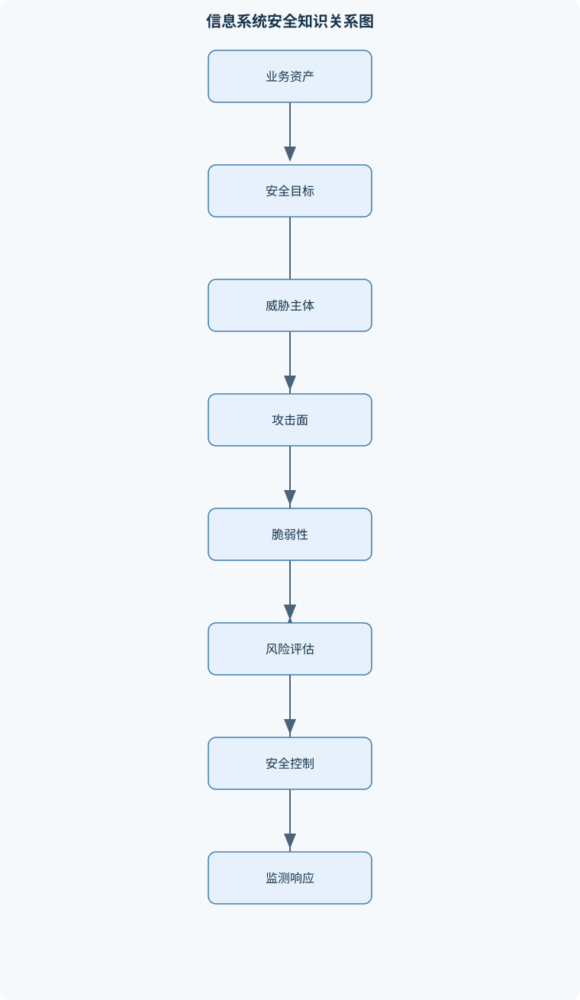
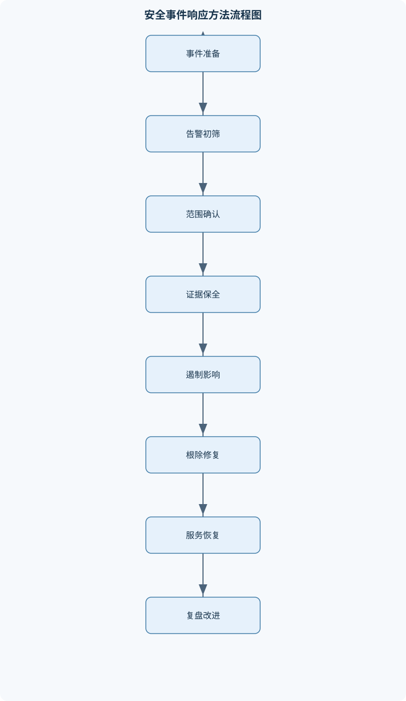

# 信息系统安全

## 一、课程整体知识框架

### 课程边界与先修知识

本课程研究信息系统在设计、开发、部署、运行和退役全过程中的安全目标、威胁建模、密码与身份安全、软件与网络防护、检测响应及数字取证。核心对象包括主机、网络、数据库、Web应用、云与虚拟化环境、终端设备、用户身份和安全运营流程。课程重点是机密性、完整性、可用性，以及真实性、可问责性和不可否认性等扩展目标；不将信息安全等同于单一的密码学或网络攻防。先修知识包括计算机网络基础、操作系统、数据结构与程序设计、数据库基本概念、概率基础和离散数学基础。学习者应能够理解进程与内存、文件权限、TCP/IP、HTTP、数据库查询、日志和基本编程。课程中的攻击实验应限定在授权、隔离和可恢复环境中，重点分析原理、风险和防御，不以对真实系统实施入侵为目标。





### 1. 课程对象、目标与先修基础

信息系统安全研究的对象不是某一种安全产品，而是信息系统从需求分析、架构设计、软件开发、部署上线、日常运行到退役销毁的全过程。系统边界内既包括主机、网络设备、数据库、Web 应用、云平台和虚拟机，也包括终端设备、用户身份、服务账户、密钥、日志、备份以及安全运营流程。一个系统即使使用了强加密，如果存在越权、错误配置、日志缺失、备份不可恢复或管理员账户失控，仍不能称为安全系统。

安全目标首先表现为三项基本保护属性：

- **机密性（Confidentiality，记为 $C$）**：未授权主体不能获得信息内容。例如，数据库被复制但攻击者无法解密，说明机密性控制可能有效；但数据库账户被越权读取，即使没有修改数据，也已经破坏机密性。
- **完整性（Integrity，记为 $I$）**：信息、程序和系统状态未被未授权地篡改、删除或伪造。恶意修改订单金额、替换软件包、伪造日志都属于完整性问题。
- **可用性（Availability，记为 $A$）**：授权主体在需要时能够访问资源并获得可接受的服务。流量耗尽、勒索加密、存储故障和错误的访问控制配置都可能破坏可用性。

在此基础上，系统还需要真实性、可问责性和不可否认性。真实性关注主体、消息或系统状态是否确实来自所声称的来源；可问责性要求操作能够关联到责任主体并保留可审计证据；不可否认性通常依赖数字签名、可信时间和证据保管，但不能简单理解为“有日志就无法否认”。日志可能被伪造、账号可能被盗用，私钥也可能泄露，因此证据链必须同时说明身份绑定、时间来源、数据完整性和操作授权。

先修知识包括计算机网络、操作系统、数据结构与程序设计、数据库、概率和离散数学。学习中需要理解进程与内存、文件权限、TCP/IP、HTTP、数据库查询、日志格式和基本程序控制流。密码学、访问控制和事件响应不是孤立章节：例如，Web 会话依赖密码学协议建立信道，依赖身份认证确认主体，再依赖授权策略决定主体可访问的对象，最后依赖日志和监测发现异常行为。

### 2. 威胁、脆弱性与风险的统一框架

安全分析通常从资产、攻击者、威胁、脆弱性和影响出发。资产可以是客户数据、密钥、业务接口、计算资源、信誉或恢复能力。攻击者能力或权限集合记为 $P$，建模时必须说明攻击者的初始位置、已有凭据、可触达接口、知识水平和限制条件。脆弱性集合记为 $V$，包括设计缺陷、程序错误、错误配置、权限管理缺失和流程缺陷。威胁是可能利用 $V$ 造成不利后果的事件或行为。

风险记为 $R$。在事件概率和损失可以粗略估计时，可写为：

$$
R=P(E)\times L
$$

其中，$P(E)$ 是不利事件 $E$ 在给定时间范围和假设条件下发生的概率，$L$ 是事件造成的损失，可以用货币、业务中断时间或分级尺度表达。若事件发生概率为 $p$，发生时损失为 $l$，未发生时损失为 $0$，损失随机变量 $X$ 的期望为：

$$
E[X]=p\cdot l+(1-p)\cdot0=p\cdot l
$$

例如，某服务在一年内发生重大中断的估计概率为 $0.02$，每次损失估计为 $500000$ 元，则期望损失为 $10000$ 元。但这一计算只适用于概率和损失估计相对稳定、事件可用单一概率描述的情形。多个事件可能相关，攻击可能形成级联故障，声誉损失和生命安全损失也不一定能用线性金额表示，因此不能把计算结果当成精确事实。

风险处置包括降低、避免、转移和接受。降低风险通常采用预防、检测、响应和恢复控制的组合，而不是只部署一道防线。纵深防御的含义是让攻击者在不同层次持续面对独立或部分独立的控制，例如网络分段限制横向移动，主机加固减少可利用服务，应用授权阻止越权，日志监测提高发现概率，备份和恢复减轻最终影响。多层控制并不意味着控制数量越多越安全；相互依赖的控制可能同时失效，过度复杂的策略还会引入配置错误。

### 3. 安全架构、信任边界与治理

信任边界是主体、数据或代码从一种信任水平进入另一种信任水平的位置。浏览器到服务器、应用到数据库、生产环境到备份环境、云租户到云平台控制面都应明确边界。数据流分析应记录输入来源、处理组件、存储位置、跨边界传输和输出去向。边界内的组件不能因为“属于同一组织”就自动互信，内部账号被盗、服务被攻陷和供应商凭据泄露都可能形成内部攻击路径。

安全治理把技术控制与责任、制度和业务决策联系起来。安全策略应定义允许和禁止的行为、权限边界、审批责任、例外处理和审计要求。可问责性要求主体、资源、操作、时间、结果和决策依据能够关联。安全责任不能只归于安全部门：业务负责人确认资产价值和残余风险，开发人员修复代码缺陷，运维人员维护配置和恢复能力，审计人员检查控制是否按要求运行。

### 4. 密码学与安全协议

对称加密使用同一类秘密密钥完成加密和解密，适合大量数据处理；分组密码模式还必须处理随机数、初始向量、消息长度、完整性和重复使用条件。仅加密不一定防篡改，实际协议通常需要认证加密或加密与消息认证的组合。公钥密码使用公钥和私钥，可用于密钥交换、数字签名和身份绑定，但通常计算开销大于对称加密，因此常见做法是用公钥机制建立或保护会话密钥 $K$，再用对称算法保护数据。

密码散列记为 $H(m)$，输入消息 $m$ 后输出固定长度摘要。理想情况下，若摘要长度为 $n$ 位，随机猜测命中特定摘要的单次概率约为 $2^{-n}$。散列具有抗原像、抗第二原像和抗碰撞等不同性质，但散列不是加密，不能通过“解密摘要”恢复原文。口令空间通常不均匀，攻击者可以使用字典、规则和预计算策略，因此口令存储应使用每个账户独立的随机盐和专门设计的慢速口令派生函数，而不能只做一次普通散列。

消息认证码（MAC）使用共享密钥证明消息完整性以及持有密钥一方的认证能力；数字签名 $\mathrm{Sig}_{sk}(m)$ 使用私钥 $sk$ 生成，验证者使用对应公钥验证。签名验证通常包括重新计算消息摘要、检查签名数学关系和验证公钥证书链。签名不能自动提供机密性；若既要保密又要验证来源，应设计加密和签名的组合，并明确证书验证、密钥用途和私钥泄露后的处理。

随机数质量直接影响密钥、会话令牌和初始化向量。密钥生命周期 $K$ 包括生成、分发、存储、使用、轮换、备份、撤销和销毁。密钥硬编码在源代码或镜像中会随代码仓库、日志或构建产物泄露。安全协议还必须处理重放攻击：攻击者复制旧消息再次发送时，接收方应使用随机数、计数器、时间窗口、会话标识或挑战响应保证消息“新鲜”。传输层安全机制通常通过证书验证服务器身份、协商会话密钥并保护传输中的机密性和完整性，但不能修复应用层越权、弱口令和恶意业务逻辑。

### 5. 身份认证、会话与访问控制

身份认证回答“主体是谁”，授权回答“主体可以对什么对象执行什么操作”。主体可以是用户、进程、服务或设备；客体可以是文件、数据库记录、接口、设备或操作。认证因素通常分为所知信息、所持设备和生物特征。多因素认证要求不同类别因素共同参与，不能把两个口令当作真正独立的多因素。

口令系统必须考虑在线猜测和离线猜测。在线猜测可通过速率限制、失败锁定、风险感知和多因素认证缓解；数据库泄露后的离线猜测则要求口令派生函数具有独立盐、足够计算成本和适当的内存成本。会话建立后，令牌应具有不可预测性、有限寿命、明确作用域和撤销机制，并防止固定会话、跨站请求伪造、令牌泄露和不安全存储。

访问控制可用函数表示。对请求 $q=(s,o,a)$，其中 $s$ 是主体，$o$ 是客体，$a$ 是动作，策略函数为：

$$
f(s,o,a,\text{context})\in\{\mathrm{allow},\mathrm{deny}\}
$$

只有当主体已完成认证、会话有效、资源状态满足约束且策略结果为允许时，系统才应执行操作。ACL 对每个客体列出主体及其操作；RBAC 将权限授予角色，主体通过角色获得权限；ABAC 根据主体、客体、动作和环境属性计算结果，例如只有“财务部门主体”在“受信设备”上于“工作时间”读取“本部门数据”。

默认拒绝、最小权限和职责分离是重要边界。若主体危险操作集合为 $D_i$，权限削减后为 $D_i'$，且 $D_i'\subseteq D_i$，则在其他条件不变时，主体可达的危险状态不会扩大。但这不保证风险必然下降，因为多个低权限角色可能被聚合，凭据可能被窃取，策略之间也可能形成新的绕过路径。

### 6. 网络、主机、恶意代码与漏洞

网络安全首先要理解分层和攻击面。攻击面是所有可能被触达并影响安全属性的接口、服务、输入、人员、设备和供应链组件。防火墙和 ACL 可按地址、端口、协议、方向和状态限制流量，但允许流量不等于安全流量。网络分段应限制不同安全域之间的可达性，并配合身份、设备状态和请求上下文形成零信任思想：不因网络位置自动信任，访问必须持续验证和最小授权。

主机加固包括减少不必要服务、更新补丁、限制管理入口、配置文件和目录权限、启用安全日志、保护凭据、校准时间和验证启动链。安全启动与可信根用于在启动阶段验证固件、引导程序和系统组件的完整性，但可信启动不能保证运行中的应用逻辑安全。远程管理应使用受保护信道、强认证、专用管理网络、命令审计和最小权限。

恶意代码包括病毒、蠕虫、木马和勒索软件。传播依赖可达性、诱因和执行条件；持久化可能依赖启动项、服务、计划任务或账户配置。防护不能只依赖特征匹配，还需限制执行、隔离权限、监测异常行为和准备恢复机制。拒绝服务主要破坏 $A$，窃取主要破坏 $C$，篡改主要破坏 $I$，但同一事件可能同时影响三者。

缓冲区溢出的因果链是：输入长度超过容量或边界计算错误，写操作覆盖相邻内存，进而破坏数据、控制流或对象元数据；只有在攻击者能够控制被覆盖内容并满足地址、编码和防护条件时，才可能改变执行路径。整数溢出可能先使长度计算绕回较小值，再导致分配不足和后续越界。边界检查、内存安全语言、栈保护、地址随机化和不可执行内存分别削弱不同环节，任何一项都不是普遍充分条件。

竞争条件发生在“检查”和“使用”之间存在时间窗口时。若程序检查临时文件不存在，攻击者在检查后替换为符号链接，程序可能把敏感数据写入错误对象。安全设计应使用原子创建、专用目录、安全句柄和对象身份复核。旁路执行则利用实现层状态而非程序预期结果泄露信息；Spectre 类问题中，错误分支最终可回滚，但推测执行可能改变缓存状态，攻击者通过访问延迟推断秘密。普通边界检查不必然消除推测路径和微架构侧信道，需要编译器、处理器、操作系统和代码共同缓解。

### 7. 安全软件开发与 Web 应用

安全软件开发从安全需求开始。设计阶段应绘制数据流和信任边界，识别资产、入口、敏感汇点、攻击者能力 $P$ 与脆弱性 $V$，再选择预防、检测、响应和恢复控制。输入验证应采用结构化解析和允许列表，并依据数据类型、长度、编码和业务约束验证；输出编码必须与使用上下文匹配，HTML、JavaScript、URL、SQL 和命令环境不能使用同一种“通用转义”。

注入的根因是把不可信数据当成了程序结构，例如字符串拼接形成 SQL、命令或模板。参数化查询使数据与查询结构分离；命令执行应避免把输入交给解释器，并限制可调用操作。访问控制失效包括对象编号可猜测、服务端未检查资源归属、角色只在前端隐藏按钮等。认证失效包括弱口令、会话固定、令牌生命周期错误和多因素绕过。安全配置错误、组件漏洞、供应链包污染和过度详细错误信息也会扩大攻击面。

安全日志应记录足以关联主体、请求、资源、结果和时间的信息，同时避免记录口令、完整令牌和不必要的个人敏感数据。日志记录不能替代授权检查，错误处理也不能向外泄露堆栈、密钥或内部路径。安全测试包括代码审查、静态分析、依赖检查、动态测试、模糊测试和授权场景测试。模糊测试通过大量畸形或随机输入发现崩溃、异常和边界缺陷，但不能证明不存在逻辑越权。

### 8. 安全监测、事件响应与数字取证

日志源包括身份认证、Web 访问、数据库、操作系统、终端、网络设备、云控制面和应用审计。时间同步、时区、日志格式、来源标识和完整性保护决定了事件能否可靠关联。基于特征的检测适合已知恶意域名、文件哈希、命令模式和规则序列；基于异常的检测可发现偏离基线的行为，但容易受业务变化影响。IOC 是入侵指标，例如恶意域名、文件哈希、进程特征或异常网络行为，单个 IOC 通常不能独立证明事件成立。

检测系统应区分误报和漏报。设真正恶意事件数为 $P$，正确发现数为 $TP$，误报数为 $FP$，则召回率为：

$$
\mathrm{Recall}=\frac{TP}{P}
$$

精确率为：

$$
\mathrm{Precision}=\frac{TP}{TP+FP}
$$

提高敏感度可能增加误报，评价时必须说明样本分布、事件标签、时间窗口和告警聚合规则，不能只报告总体准确率。安全信息与事件关联系统还需结合资产重要性、账户权限和业务上下文进行告警分级。

事件响应包括准备、发现与分析、遏制、根除、恢复和复盘。遏制应区分短期隔离与长期修复，避免未经授权直接删除证据。数字取证强调授权范围、易失性优先、原始数据保护和可复核性。一般先记录现场，再采集内存、运行进程和网络连接，随后采集磁盘镜像、日志和配置；对采集结果计算哈希，建立证据保管链，并使用分析副本。证据保管链至少记录采集人、时间、来源、工具、转移过程和存储位置。

### 9. 业务连续性与安全管理实践

业务影响分析识别关键业务、依赖关系、可接受中断时间和数据损失范围。RTO 是中断后恢复到可接受服务水平的最长时间；RPO 是故障后可接受的数据回退时间范围。若最近一次可用备份时间为 $t_b$，故障时间为 $t_f$，则数据回退时间近似为：

$$
t_f-t_b
$$

只有在备份链完整、内容可读且恢复过程经过验证时，该值才可用于判断是否满足 RPO。全量、增量和连续复制各有恢复时间、存储成本和故障依赖，备份数量多不等于恢复能力强。备份还应与生产环境隔离，保护备份凭据，并定期进行恢复演练。

云服务和供应商风险包括共享责任边界不清、接口权限过大、租户隔离失败、供应链依赖和服务中断。安全意识和社会工程防护应通过流程、技术和核验机制降低风险，而不能把责任简单归咎于个人。指标可以包括 MTTD（平均发现时间）和 MTTR（平均响应或恢复时间），但必须固定统计口径、起止时间和事件范围。审计与合规提供基线和证据要求，不等同于针对具体系统威胁的充分安全。

## 二、章节和模块划分

### 核心知识覆盖清单

本清单用于检查正文是否覆盖本课程的主要知识模块：

- **信息系统安全基础与安全治理**：安全目标与保护属性、资产威胁脆弱性风险、安全控制与纵深防御、安全策略与权限边界、风险评估与风险处置、安全架构与信任边界、安全责任与可问责性。
- **密码学基础与安全协议**：对称加密与分组模式、公钥加密与密钥交换、密码散列与消息认证码、数字签名与证书链、随机数与密钥生命周期、重放攻击与新鲜性、传输层安全基本机制。
- **身份认证与访问控制**：身份标识与认证因素、口令存储与抗离线猜测、多因素认证与单点登录、会话管理与令牌安全、自主访问控制、强制访问控制、基于角色与属性的访问控制、最小权限与职责分离。
- **网络与主机系统安全**：网络分层与攻击面、防火墙与访问控制列表、网络分段与零信任思想、主机加固与安全配置、安全启动与可信根、拒绝服务与流量耗尽、远程管理与安全运维。
- **恶意代码与软件漏洞**：病毒蠕虫木马与勒索软件、恶意代码传播与持久化、栈缓冲区溢出、整数溢出与内存边界、竞争条件与临时文件、命令注入与路径遍历、旁路执行与微架构泄漏、补丁管理与漏洞生命周期。
- **安全软件开发与Web应用安全**：安全需求与威胁建模、输入验证与输出编码、注入类漏洞、访问控制失效、身份认证失效、安全配置错误、组件与供应链风险、日志记录与错误处理、安全测试与模糊测试。
- **安全监测与入侵检测**：日志源与时间同步、安全信息与事件关联、基于特征的检测、基于异常的检测、网络入侵检测、主机入侵检测、规则匹配与告警分级、蜜罐与欺骗防御、误报漏报与检测评估。
- **事件响应与数字取证**：事件准备与响应职责、检测分析与事件分级、遏制根除与恢复、证据易失性排序、磁盘内存网络取证、时间线重建、证据完整性与保管链、根因分析与复盘改进。
- **业务连续性与安全管理实践**：业务影响分析、恢复时间目标与恢复点目标、备份策略与恢复验证、灾难恢复架构、供应商与云服务风险、安全意识与社会工程防护、指标度量与持续改进、审计检查与合规边界。


### 1. 代表性流程一：威胁建模与风险排序

**输入**：系统架构、资产清单、数据流、信任边界、安全目标和攻击者能力集合 $P$。  
**输出**：威胁清单、风险排序、控制措施和残余风险决定。

步骤如下：

1. 列出资产及其保护属性，明确哪些资产需要 $C$、$I$ 或 $A$。
2. 标出外部入口、身份边界、数据存储和跨系统调用。
3. 为每个入口描述攻击者初始位置、可用权限和目标。
4. 分析威胁利用的脆弱性 $V$、必要条件、影响范围和可检测性。
5. 使用定性等级或 $R=P(E)\times L$ 进行排序。
6. 选择预防、检测、响应和恢复控制，并由业务责任人确认残余风险。

不变量是每项高价值资产至少有明确保护目标和责任人。所有关键边界、数据流和高风险场景完成评审后终止。若资产数、数据流数和候选威胁数分别为 $A$、$F$、$T$，人工枚举的基本工作量可近似表示为 $O(A+F+T)$，但复杂系统的判断成本还取决于业务规则和依赖关系。

### 2. 代表性流程二：访问控制审计

**输入**：主体、客体、动作、身份状态、策略、角色或属性及环境上下文。  
**输出**：允许或拒绝决定、理由和审计记录。

处理顺序是：验证身份和会话有效性；加载主体、客体和环境属性；先检查显式拒绝和职责分离约束；再评估允许规则；确认最小权限和资源状态；执行决定并记录策略版本、匹配规则和结果。默认拒绝是重要不变量，策略版本必须可追踪，拒绝规则优先级必须明确。简单 ACL 查询可达到 $O(1)$ 到 $O(\log n)$；按顺序评估 $k$ 条规则时最坏为 $O(k)$。

```python
# Python：一个最小的服务端授权判定示例
def authorize(subject, resource, action, context, policy):
    """
    subject: {"id": ..., "roles": set(...)}
    resource: {"owner_id": ..., "classification": ...}
    action: 例如 "read" 或 "write"
    context: {"mfa": bool, "network": ...}
    policy: 策略配置
    """
    if subject is None or not context.get("mfa", False):
        return False, "未完成有效认证"

    # 显式拒绝优先于允许规则
    if action == "write" and resource["classification"] == "restricted":
        if "data_admin" not in subject["roles"]:
            return False, "缺少受限数据写权限"

    if action == "read" and subject["id"] == resource["owner_id"]:
        return True, "资源所有者读取"

    if action == "read" and "auditor" in subject["roles"]:
        return True, "审计角色读取"

    return False, "默认拒绝"
```

这段代码只演示授权逻辑，不代表完整生产实现。真实系统还需检查会话过期、租户边界、资源当前状态、审计日志完整性和策略变更审批。

### 3. 代表性流程三：日志检测与事件响应

日志检测的输入是规范化日志流、规则集合和资产上下文，输出是带证据摘要的告警。先校验时间戳和来源，再解析字段、匹配规则、按主体或会话关联事件、计算风险等级、抑制重复告警，并保留原始记录。原始日志不可被检测过程覆盖，告警必须能回溯到具体事件。批处理有 $N$ 条事件和 $R$ 条规则时，朴素匹配上界为 $O(NR)$，索引和窗口化关联可以降低实际成本。

事件响应输入告警、初步证据、资产重要性和授权范围，输出事件判定、遏制措施、恢复结果和复盘记录。顺序通常是准备与授权、初筛、确认范围、保护证据、短期遏制、根除修复、分阶段恢复、验证监控、根因分析。破坏性操作必须明确授权；当影响已消除、系统通过验证且遗留风险已接受或转交时终止。

### 4. 代表性流程四：数字取证

**输入**：授权范围、受影响设备和易失性数据。  
**输出**：可复核证据集、时间线和带不确定性说明的分析结论。

步骤是记录现场状态；优先采集内存、运行进程、网络连接和会话；再采集磁盘镜像、日志、配置和相关云审计数据；计算哈希并建立保管链；将原件只读保存，使用分析副本重建时间线；将多个来源相互印证，区分事实、推断和未知。原始介质不得被分析操作修改，每次转移必须记录人员、时间和操作。磁盘复制的数据量为 $S$ 时，复制成本通常为 $O(S)$，但人工分析成本受证据质量和事件复杂度限制。

### 5. 例题一：风险期望损失与处置

**题干**：资产甲一年内发生泄露的概率为 $0.04$，损失估计为 200000 元；资产乙发生服务中断的概率为 $0.01$，损失估计为 600000 元。分别计算期望损失并排序。

**分析与解答**：使用 $R=p\cdot l$。甲的风险为 $0.04\times200000=8000$ 元；乙的风险为 $0.01\times600000=6000$ 元。因此按该模型甲优先于乙。

**结果验证**：若把概率和损失视为稳定估计，排序正确。  
**变式**：若乙中断会导致甲泄露，二者不是独立事件，直接相加可能低估级联损失；此时应分析联合事件和业务依赖，不能只按单项期望值决策。

### 6. 例题二：口令存储

**题干**：比较明文、一次普通散列、加盐散列和口令派生函数在数据库泄露后的差异。

**分析与解答**：明文泄露后攻击者可直接登录；一次普通散列虽然不直接显示口令，但易受字典和高速硬件离线猜测；加盐使相同口令产生不同结果并破坏预计算表，但若散列很快，仍可高速猜测；带独立随机盐的慢速口令派生函数增加每次猜测成本，通常更适合口令验证。

验证口令时，系统读取该账户盐和参数，对用户输入执行同一派生过程，再比较结果，不应“解密”摘要。  
**变式**：若应用把派生参数写死且不支持升级，未来硬件变快后成本可能不足，因此应保存参数并支持逐步提高成本。盐不是秘密，派生密钥或服务端保护密钥才需要额外保密。

### 7. 例题三：访问控制判定

**题干**：用户甲属于 `employee` 角色，是文档所有者；用户乙属于 `auditor` 角色但不是所有者。两人均已通过多因素认证。资源为受限文档，请判断读取和写入权限。

**分析与解答**：若策略规定所有者可读写、审计角色只读，且受限文档写入要求 `data_admin` 角色，则甲读取允许，甲写入仍需检查是否有写权限；乙读取允许，乙写入拒绝。认证只证明“是谁”，不能自动推出“能做什么”。

**结果验证**：逐项检查认证、会话有效性、资源归属、角色权限和默认拒绝。  
**变式**：若前端隐藏写按钮但服务端不检查，攻击者仍可直接构造请求，因此授权必须在服务端执行并记录决定依据。

### 8. 例题四：Web 注入与输出编码

**题干**：某接口把用户输入直接拼接到 SQL 查询中，并将昵称原样插入 HTML 页面。指出两类风险和修复方法。

**分析与解答**：SQL 风险的因果链是外部输入进入查询字符串，输入改变了查询结构，导致越权读取或修改；应使用参数化查询、数据库账户最小权限和服务端授权。HTML 风险的因果链是输入被当作页面标记解释，可能改变页面结构或执行脚本；应根据 HTML 属性、文本、JavaScript 或 URL 上下文采用对应输出编码，并配合内容安全策略。

**结果验证**：检查输入是否仍能改变 SQL 结构，检查输出是否被当作纯数据处理。  
**变式**：只做黑名单过滤不能覆盖编码差异和新输入路径；参数化查询也不能替代业务对象授权。

### 9. 例题五：备份、RPO 与恢复验证

**题干**：系统每天 0 时进行全量备份，每 6 小时进行增量备份。故障发生在 14 时，最近一次可读备份为 12 时，但恢复演练发现增量链中 10 时文件损坏。判断可能的数据回退范围和主要问题。

**分析与解答**：按时间看，最近备份点为 12 时，理论回退时间为 $14-12=2$ 小时；但恢复依赖完整的增量链，10 时文件损坏使 12 时备份可能不可用，实际可能退回到更早的完整可用点，甚至无法恢复。备份存在不等于恢复能力成立。

**结果验证**：检查全量、增量链、校验结果和恢复环境，而不只看备份目录。  
**变式**：若 RPO 为 1 小时，则即使 12 时备份完整，2 小时回退也不满足目标；需要缩短备份间隔或采用连续复制，并验证恢复时间是否满足 RTO。

### 10. 实验与项目一：隔离环境中的日志检测

**输入数据**：预先生成的认证日志、Web 访问日志和进程日志，包含正常登录、连续失败登录、异常时间访问和可疑进程启动记录。实验必须在授权、隔离且可恢复的环境完成，不连接真实生产系统。

**步骤**：

1. 统一时区和时间格式，记录日志来源。
2. 统计同一账户、来源地址和时间窗口内的失败认证次数。
3. 将认证、访问和进程事件按主体与时间关联。
4. 设计规则并输出告警理由、资产重要性和证据摘要。
5. 人工标注真实事件，计算精确率和召回率。
6. 调整窗口、阈值和告警聚合方式，比较误报与漏报变化。

**评价标准**：原始日志保留完整；每条告警可追溯到原始记录；规则能区分单次输错与持续攻击；评价报告说明样本分布和标签依据。  
**排错方法**：若大量事件无法关联，检查时区、时间同步和字段解析；若误报过多，检查共享出口地址、批处理程序和合法运维窗口；若召回率低，检查规则是否过度依赖单一 IOC。

### 11. 实验与项目二：安全恢复与取证流程

**输入数据**：隔离虚拟机、预置的系统日志、磁盘镜像、内存采集文件和模拟业务数据。项目不得对真实设备执行删除、关机或修改操作。

**步骤**：

1. 明确授权范围、调查问题和证据保存位置。
2. 记录现场状态，优先分析易失性数据的采集结果。
3. 对镜像和关键文件计算哈希，建立证据编号和保管链。
4. 使用分析副本检查账户、进程、网络连接、启动项和日志。
5. 按统一时间基准建立时间线，并标注证据来源。
6. 分离事实、推断和无法确定的部分，形成事件报告。
7. 在恢复副本上验证补丁、凭据轮换、访问控制和备份恢复。

**评价标准**：原件与分析副本分离；所有操作可复核；时间线能够解释主要行为；结论不超出证据支持范围；恢复后监测和验证步骤完整。  
**排错方法**：哈希不一致时检查复制过程、文件是否被挂载写入以及工具参数；时间线冲突时检查时区、时钟漂移和日志来源；无法确认根因时不得强行下结论，应记录证据缺口并提出补充采集方案。

## 三、核心概念的详细解释

### 1. 信息系统安全目标与保护属性

信息系统安全的基本目标不是“系统绝对不会被攻击”，而是在明确的业务、技术和法律边界内，使授权主体能够按照预期使用系统，同时限制未授权主体对信息和系统状态的影响。最基本的保护属性包括机密性 $C$、完整性 $I$ 和可用性 $A$。

机密性 $C$ 关注信息内容是否被未授权主体获得。数据库被复制、网络通信被窃听、日志中泄露口令或密钥，均可能破坏机密性。加密可以降低数据被直接读取的风险，但不能阻止已经获得合法权限的主体滥用数据，也不能修复应用层越权读取。

完整性 $I$ 关注数据、程序、配置和运行状态是否被未授权地修改、删除或伪造。订单金额被改写、软件更新包被替换、审计日志被删除、访问控制策略被篡改，都属于完整性问题。完整性不仅是“文件是否被改过”，还包括修改者是否经过授权、修改是否符合业务规则以及修改过程是否可追溯。

可用性 $A$ 关注授权主体在需要时是否能访问资源，并获得约定范围内的服务。拒绝服务、勒索软件加密、存储损坏、错误的防火墙规则、密钥丢失和备份无法恢复，都可能导致可用性下降。拒绝服务通常首先影响 $A$，但若攻击同时造成数据破坏或信息泄露，也会影响 $I$ 或 $C$。

真实性用于判断主体、消息、软件包或系统状态是否确实来自声称的来源。可问责性要求系统能够把关键操作关联到主体、时间、资源和结果。不可否认性通常需要数字签名、可信时间、身份绑定和证据保管链共同支持，不能仅凭普通日志得出“操作者无法否认”的结论。

### 2. 资产、攻击者、威胁、脆弱性与风险

资产是需要保护的对象，既可以是客户数据、密钥、服务器和数据库，也可以是业务连续性、信誉、恢复能力和安全人员的操作权限。攻击者能力或权限集合记为 $P$。威胁建模时必须说明攻击者的初始位置、已掌握的凭据、可到达的接口、技术能力、攻击目标和现实限制。脆弱性集合记为 $V$，包括设计缺陷、实现错误、配置错误、权限过宽、流程缺失和供应链风险。

威胁是可能利用脆弱性造成不利结果的行为或事件。攻击面是外部或内部主体可以触达、并且可能影响安全属性的接口、服务、输入、人员、设备和供应链组件的总和。开放端口只是网络攻击面的一部分；Web 表单、API、管理员账户、云角色、第三方组件、远程运维通道和人员社会工程入口也属于攻击面。

风险 $R$ 可用定性等级表示，也可以在近似条件下表示为：

$$
R=P(E)\times L
$$

其中，$E$ 是不利事件，$P(E)$ 是在指定时间范围和假设条件下事件发生的概率，$L$ 是事件发生后的损失。若事件发生时损失为 $l$，未发生时损失为 $0$，则损失随机变量 $X$ 的期望为：

$$
E[X]=p\cdot l+(1-p)\cdot 0=p\cdot l
$$

该推导假设事件能够用一个概率 $p$ 描述，损失估计相对稳定，且损失可以用同一量纲加总。对级联故障、相关攻击、声誉损害、生命安全影响和长尾损失，单一乘法模型只能作为初步排序工具，不能当成精确预测。

风险处置主要包括降低、避免、转移和接受。降低风险通常需要预防、检测、响应和恢复控制联合发挥作用；避免风险是取消高风险业务或接口；转移风险可以通过合同、保险或服务责任安排分担部分损失，但不能把技术责任完全转移；接受风险必须由有权限的责任人明确确认，并记录接受范围和复审条件。

### 3. 安全控制、纵深防御与信任边界

安全控制是降低风险的机制，可分为管理控制、技术控制和物理控制，也可按作用划分为预防、检测、纠正、响应和恢复控制。访问控制、加密、补丁管理、日志审计、入侵检测、备份恢复和人员审批分别解决不同问题，不能用单一控制替代完整安全体系。

纵深防御要求攻击者即使突破一层控制，也会在后续层次遇到限制。例如，网络分段限制横向移动，主机加固减少可利用服务，应用授权阻止越权，数据库审计记录异常查询，备份和恢复降低勒索造成的持续影响。纵深防御不等于无限增加设备；如果各层共享同一管理员账户、同一密钥或同一错误配置，表面上有多层控制，实际可能形成单点失效。

信任边界是安全假设发生变化的位置。例如，互联网与内网之间、普通用户与管理员之间、应用服务器与数据库之间、云租户与云平台之间，都可能存在信任边界。跨越边界的数据流必须明确输入验证、身份认证、授权、加密、日志和错误处理责任。边界内的组件也不应被默认视为可信，因为合法账号被盗、内部服务被攻陷和供应链组件被替换同样可能导致风险。

### 4. 密码学原语与安全协议

对称加密使用同一密钥或可互相推导的密钥完成加密和解密，适合大量数据的高效保护。分组密码需要选择工作模式；不同模式在随机初始向量、错误传播、并行能力和重复明文处理方面具有不同性质。加密本身只提供保密性，若没有认证机制，攻击者可能篡改密文而不被发现，因此实际协议通常采用能够同时保证机密性和完整性的认证加密机制。

公钥密码使用公钥和私钥。公钥可以公开，私钥必须保密。公钥加密适合密钥封装和小数据保护，数字签名则由私钥生成、由公钥验证。实际传输协议通常采用混合加密：先用公钥机制协商或封装会话密钥，再用对称加密保护大量数据，以兼顾安全性和效率。

密码散列函数将任意长度消息映射为固定长度摘要 $H(m)$。理想情况下，若输出为 $n$ 位，随机猜测命中特定摘要的单次概率约为 $2^{-n}$。但这不表示散列可以保密或直接储存口令。散列不是加密，没有可逆解密过程；口令通常不是均匀随机字符串，攻击者可使用字典、规则、硬件并行计算和预计算策略。口令存储应使用每个账户独立的盐值以及专门设计的慢速口令派生函数，并设置适当的计算、内存和并行参数。

消息认证码 MAC 使用共享密钥证明消息完整性和持有密钥一方的认证能力。数字签名则支持公钥验证和更适合多方验证、审计及不可否认性分析的场景，但签名不能自动提供保密性。证书链把公钥绑定到身份，需要验证证书有效期、用途、签发链和撤销状态；“收到一个公钥”不等于“已经确认公钥属于目标主体”。

随机数用于密钥、初始向量、挑战值和会话标识。随机数重复、可预测或种子不足，可能使强密码算法失去安全性。密钥生命周期包括生成、分发、存储、使用、轮换、备份、撤销和销毁。密钥不得硬编码在源代码、镜像或公开配置中，密钥备份必须受到与原密钥相匹配的访问控制。

安全协议还必须处理重放攻击。仅验证消息来源和完整性不能判断消息是否为旧消息。协议可使用随机挑战、递增序列号、时间窗口、一次性令牌或绑定会话上下文实现新鲜性。传输层安全机制通常结合证书验证、密钥协商、会话密钥和完整性保护，但使用安全传输协议不能修复应用越权、弱口令、注入和服务器配置错误。

### 5. 身份认证、会话与访问控制

身份认证回答“主体是谁”，授权回答“主体能做什么”。主体可以是用户、进程、服务或设备；客体可以是文件、数据库记录、接口、设备或操作。成功登录只说明认证因素满足要求，不能推出主体对所有资源都具有权限。

认证因素通常分为所知信息、所持设备和生物特征。多因素认证要求不同类别的因素共同参与，而不是把两个口令当作真正的多因素。单点登录可以减少重复登录和口令暴露，但身份提供者一旦失效或被攻陷，影响范围可能扩大，因此需要强保护、会话生命周期管理和应急恢复机制。

会话标识必须具有足够随机性、不可预测性和适当的过期机制，并应绑定安全上下文。登录、提权和重要操作后应考虑更新会话标识，退出登录、密码修改和风险变化时应使相关会话失效。令牌不得出现在不必要的日志、URL、错误信息或客户端可被其他脚本读取的位置。

访问控制列表 ACL 以客体为中心列出主体及其允许操作；RBAC 将权限授予角色，再由主体获得角色；ABAC 根据主体、客体、动作、环境和资源状态等属性动态计算授权。三者可以组合使用。默认拒绝意味着没有明确允许时拒绝请求，显式拒绝规则的优先级必须明确。

最小权限要求主体只拥有完成当前任务所必需的权限。职责分离要求关键操作由不同主体或不同阶段共同完成，降低单一账户滥用风险。服务账户、自动化流水线、云角色和管理员账户同样需要遵守最小权限，不能只限制普通用户。

### 6. 网络、主机、云与虚拟化安全

网络安全需要结合分层结构分析攻击面。防火墙和访问控制列表可以限制源、目的、端口、协议和方向，但放行合法端口不代表应用安全。网络分段可以缩小横向移动范围；零信任思想强调每次访问都根据身份、设备状态、资源、动作和上下文进行持续验证，而不是仅凭网络位置建立永久信任。

拒绝服务包括带宽耗尽、连接资源耗尽、应用计算耗尽和存储耗尽。防护需要容量规划、限流、连接管理、缓存、冗余、清洗或上游协调，并明确哪些业务可以降级。单纯增加服务器可能无法解决状态表、数据库连接池或应用线程耗尽问题。

主机加固包括关闭不必要服务、最小化软件、及时修补、限制管理接口、强化文件权限、保护日志、配置安全审计和控制启动项。安全启动依赖可信根逐级验证固件、引导程序和操作系统组件，重点解决启动链完整性，但不能保证运行后的应用不存在漏洞。

云和虚拟化环境引入共享责任边界。云服务商可能负责底层设施，使用方仍需负责身份、数据、网络规则、应用配置和密钥管理，具体责任取决于服务模式和合同。虚拟机、容器、镜像仓库、编排平台和云角色都是安全对象；镜像中嵌入密钥、过宽的服务账户权限和公开存储桶配置都可能形成高风险。

### 7. 恶意代码、漏洞与软件安全

病毒依赖宿主传播，蠕虫可利用网络或服务自动扩散，木马伪装成合法软件，勒索软件通常通过加密或破坏数据影响可用性。恶意代码的关键分析维度包括初始进入、执行、持久化、权限提升、横向移动、数据收集、外传和破坏。防御不能只依赖杀毒特征，还需要应用控制、权限限制、网络分段、补丁、备份和行为监测。

栈缓冲区溢出的因果链是：输入长度超过容量或边界检查失效，写操作覆盖相邻内存，进而破坏数据、控制流或对象元数据；若攻击者还能够控制覆盖值并满足地址、编码和防护机制条件，才可能改变执行路径。边界检查、内存安全语言、栈保护、地址随机化和不可执行内存分别削弱不同环节，没有单一措施能覆盖所有情况。

整数溢出可能使长度计算、偏移计算或容量检查产生错误。例如，先对两个整数相加再转换为更大类型，若加法已在较小类型中溢出，后续转换也无法恢复真实值。安全修复需要明确整数范围、检查运算前提、使用安全类型并验证最终分配大小。

竞争条件发生在“检查”和“使用”之间存在时间窗口时。程序检查某路径是普通文件，但攻击者在使用前将其替换为符号链接，程序实际打开的对象就可能不同。安全设计应采用原子创建、安全句柄、明确目录权限和对象身份验证，不能仅依赖字符串路径再次检查。

命令注入、路径遍历、模板注入和不安全反序列化都源于外部输入改变了解释器或程序的语义。防御应优先使用参数化接口、结构化解析、允许列表、上下文相关输出编码和最小权限，而不是依赖不完整的黑名单过滤。

Spectre 类旁路利用推测执行留下的缓存等微架构状态。架构状态上的错误分支可能被回滚，但缓存状态不一定回滚；攻击者测量访问延迟，可以推断与秘密相关的索引。普通边界检查能阻止正常语义下的越界访问，却不一定消除推测路径，因此需要编译器、处理器、操作系统和代码层联合缓解。它与传统缓冲区溢出不是同一种漏洞。

### 8. 安全运营、检测、响应与取证

日志必须包含来源、时间、主体、动作、对象、结果和必要的上下文。时间同步、时区统一和时钟漂移记录是事件关联的前提。IOC 可以是恶意域名、文件摘要、进程特征或异常网络行为，但单个 IOC 通常不能独立证明事件成立，必须结合资产、时间、行为和其他证据。

基于特征的检测适合已知攻击模式，解释性较强，但容易漏掉变形或未知攻击。基于异常的检测可以发现偏离基线的行为，但正常业务变化会造成误报。网络入侵检测观察流量和协议行为，主机入侵检测观察进程、文件、账户和系统调用，两者应结合使用。

告警分级应考虑资产重要性、可信度、影响范围和攻击阶段，而不是只看规则名称。检测评价可使用精确率和召回率。设真正恶意事件数为 $P$，正确发现数为 $TP$，误报数为 $FP$，则：

$$
\text{召回率}=\frac{TP}{P}
$$

$$
\text{精确率}=\frac{TP}{TP+FP}
$$

提高检测敏感度可能增加误报。评价时必须说明样本分布、标签质量、时间窗口和告警聚合规则，不能只报告准确率，因为正常样本远多于攻击样本时，全部判定为正常也可能得到虚高准确率。

事件响应包括准备、发现与分析、遏制、根除、恢复和复盘。短期遏制的目标是限制扩散，根除的目标是清除持久化和根因，恢复则要逐步验证服务、凭据、监控和数据完整性。破坏性操作必须得到授权并记录理由。

数字取证强调原始证据不被修改、采集范围明确、证据来源可追溯、保管链完整。通常先处理易失性数据，例如内存、运行进程和网络连接，再采集磁盘镜像和持久化日志，但具体顺序还要结合业务连续性和证据易失程度。分析应使用副本，保留哈希、工具版本、操作人员、时间和参数。结论必须区分直接观察事实、合理推断和无法确定的部分。

### 9. 业务连续性、备份与治理

业务影响分析识别关键业务、依赖关系、可接受中断时间和数据损失。RTO 是系统中断后恢复到可接受服务水平的最长允许时间；RPO 是故障后可接受的数据回退时间范围。若最近一次可用备份时间为 $t_b$，故障时间为 $t_f$，则实际数据回退近似为：

$$
\Delta t=t_f-t_b
$$

只有在备份链完整、内容可读、恢复环境可用且恢复结果经过验证时，才能据此判断是否满足 RPO。备份数量多不等于恢复能力强；未验证、未隔离、与生产环境共享凭据的备份可能在同一事件中同时失效。

治理还包括安全责任、供应商风险、审计、合规和持续改进。合规要求通常是基线，不等于针对具体架构和威胁已经充分安全。指标应覆盖风险、控制有效性、发现时间、响应时间、补丁周期、恢复成功率和遗留问题，而不是只统计购买了多少安全产品。

## 四、重要定义、公式、定理和推导

### 专业审校补充：关键定义与适用边界

安全监测中的精确率与召回率描述不同的能力，不能互相替代。设真正的安全事件为正类，告警判定为正类；TP 表示真实事件且成功告警，FP 表示非事件却告警，FN 表示真实事件未告警，TN 表示非事件且未告警。精确率为 $Precision=TP/(TP+FP)$，表示告警中有多少确实相关；召回率为 $Recall=TP/(TP+FN)$，表示真实事件中有多少被发现。若告警资源有限，提高阈值通常可能减少误报、提高精确率，但也可能漏掉低特征强度事件，使召回率下降。安全运营不能只追求某一个指标：高精确率但低召回率会产生“看起来很准却漏掉大量攻击”的结果，高召回率但低精确率则会造成告警疲劳。指标必须说明样本范围、事件定义、时间窗口和标注可靠性；在极度类别不平衡时，即使准确率很高，也不能证明检测有效。


### 1. 风险期望损失的推导与边界

设事件 $E$ 发生概率为 $p$，发生时损失为 $l$，其中 $0\leq p\leq1$，$l\geq0$。定义损失随机变量：

$$
X=
\begin{cases}
l,&E\text{发生}\\
0,&E\text{不发生}
\end{cases}
$$

则：

$$
E[X]=p\cdot l+(1-p)\cdot0=p\cdot l
$$

若有多个互斥事件 $E_i$，每个事件概率为 $p_i$、损失为 $l_i$，则：

$$
E[X]=\sum_i p_i l_i
$$

但若事件相互依赖，不能简单把各项当作独立事件相加。例如，身份系统失效可能同时导致登录中断、监控失效和业务停摆，损失之间存在相关性。对概率区间、损失区间和极端长尾事件，应使用区间分析或情景分析，并明确不确定性。

#### 例题一：风险排序与处置

**题干**：资产甲年发生概率为 $0.04$，单次损失为 $200000$ 元；资产乙年发生概率为 $0.01$，单次损失为 $600000$ 元；资产丙年发生概率为 $0.20$，单次损失为 $30000$ 元。计算期望损失并排序。

**分析**：三项均使用同一时间单位“年”，损失单位均为元，因此可以直接计算。

**逐步解答**：

$$
R_{\text{甲}}=0.04\times200000=8000\text{元/年}
$$

$$
R_{\text{乙}}=0.01\times600000=6000\text{元/年}
$$

$$
R_{\text{丙}}=0.20\times30000=6000\text{元/年}
$$

排序为甲最高，乙和丙并列。乙的单次损失较大，丙的发生概率较高，二者处置策略不能只依据期望值决定。

**结果验证**：检查概率是否为年概率、损失是否为单次损失，并确认事件是否互斥或相关。

**变式**：若乙事件发生会使丙事件必然发生，则两者不能简单独立相加，应分析联合损失和级联影响。

### 2. 访问控制判定的形式化推导

一次访问请求可表示为：

$$
q=(s,o,a)
$$

其中，$s$ 是主体，$o$ 是客体，$a$ 是动作。策略判定函数为：

$$
f(s,o,a,\text{context})\in\{\text{allow},\text{deny}\}
$$

实际执行还必须满足身份认证完成、会话未失效、资源状态允许、职责分离约束满足以及请求未被显式拒绝。因此，执行条件可以表示为：

$$
\text{Execute}(q)=
\text{Authenticated}(s)
\land
\text{SessionValid}(s)
\land
f(s,o,a,\text{context})=\text{allow}
\land
\text{StateOK}(o)
$$

这说明认证与授权不能互相替代。即使 $\text{Authenticated}(s)$ 为真，若策略函数返回 deny，操作仍必须拒绝。

#### 例题二：ACL、RBAC 与 ABAC 判定

**题干**：用户张某已通过多因素认证，属于“财务审核员”角色。文件“工资表”标记为“机密”，策略规定财务审核员只能在公司设备、工作时间内读取工资表，不能删除。张某使用公司设备在工作时间请求读取和删除。

**分析**：先判断认证和会话，再按动作分别判定授权。

**逐步解答**：

1. 张某完成认证，满足身份条件。
2. 读取请求的主体是张某，客体是工资表，动作是 read。
3. RBAC 允许财务审核员拥有审核相关读取权限。
4. ABAC 检查设备属性和时间属性，均满足。
5. 因此读取请求允许。
6. 删除请求的动作是 delete，角色权限和职责分离规则均不允许。
7. 因此删除请求拒绝。

**结果验证**：审计记录应包含主体、角色、设备、时间、客体、动作、策略版本和最终结果。

**变式**：若张某改用个人设备，即使角色不变，ABAC 环境条件不满足，读取也应拒绝。

### 3. 口令散列与离线猜测

散列函数输出 $n$ 位摘要时，对均匀随机输入进行一次随机猜测，命中特定摘要的概率近似为 $2^{-n}$。但口令空间通常不均匀，攻击者会优先尝试常见词、泄露口令、替换规则和短字符串。因此，口令数据库泄露后，直接使用一次快速散列并不能提供足够保护。

带盐存储可表示为：

$$
d=F(\text{salt},\text{password},\text{parameters})
$$

其中，$\text{salt}$ 是每个账户独立且可公开保存的随机值，$F$ 是专门的口令派生函数，parameters 是计算成本、内存成本或并行参数。盐值的主要作用是阻止不同账户使用相同摘要、降低预计算表的价值；盐值不能替代慢速派生函数，也不能当作秘密密钥。

#### 例题三：比较四种口令存储方式

**题干**：比较明文、可逆加密、直接快速散列、带盐慢速派生函数四种方案在数据库泄露后的风险。

**逐步解答**：

1. 明文：攻击者立即获得全部口令，且可能尝试登录其他系统。
2. 可逆加密：若应用密钥与数据库一同泄露或可从服务器读取，攻击者可以解密；密钥管理是核心风险。
3. 直接快速散列：攻击者可以使用字典和并行硬件高速猜测，常见口令很快被恢复。
4. 带盐慢速派生函数：攻击者仍可离线猜测，但每个账户需要独立计算，且单次猜测成本更高。

**结果验证**：安全方案仍需防止在线暴力破解、设置登录限速、保护派生参数并进行口令轮换。  
**变式**：若所有账户共用同一个盐，重复口令仍产生相同摘要，无法达到每账户独立盐的效果。

### 4. 数字签名与混合加密

签名流程为：

1. 发送方计算消息摘要 $H(m)$。
2. 使用私钥 $sk$ 生成签名：

$$
\sigma=\operatorname{Sig}_{sk}(H(m))
$$

3. 接收方使用证书确认公钥归属。
4. 使用公钥验证 $\sigma$，并重新计算收到消息的摘要。
5. 两个摘要一致且证书链可信时，支持消息完整性和来源认证。

签名不提供保密性。若需要保密性和可验证来源，应同时使用混合加密和数字签名。常见逻辑是发送方对消息或规范化后的消息生成签名，再使用接收方公钥封装会话密钥，使用会话密钥加密消息和签名。接收方先恢复会话密钥和内容，再验证签名及证书。

#### 例题四：同时实现保密性与来源认证

**题干**：甲向乙发送机密消息，要求乙确认消息来自甲且内容未被修改，同时防止第三方读取。

**逐步解答**：

1. 甲生成随机会话密钥 $K$。
2. 甲用 $K$ 对消息进行认证加密，得到密文和完整性标签。
3. 甲使用自己的私钥对约定格式的消息摘要或协议数据生成签名。
4. 甲使用乙的公钥封装 $K$。
5. 乙用自己的私钥恢复 $K$，解密并验证认证标签。
6. 乙使用甲的公钥验证签名和证书链。
7. 任一验证失败，均不得把消息当作可信消息处理。

**结果验证**：若攻击者只能看到密文，保密性成立；若修改密文、签名或证书验证信息，验证应失败。

**变式**：若甲的私钥已经泄露，历史签名的追责能力会受到影响；若只使用签名而不加密，消息内容仍可能被读取。

### 5. 缓冲区溢出的因果链与修复

设缓冲区容量为 $B$ 字节，输入长度为 $L$ 字节。若程序允许写入且 $L>B$，则存在越界写风险。实际影响取决于越界区域的内存布局、覆盖内容、编译器保护和运行环境。不能仅由“输入超过容量”直接推出控制流一定被劫持。

#### 安全伪代码示例

```c
#include <stddef.h>
#include <stdbool.h>

bool copy_checked(char *dst, size_t dst_size,
                  const char *src, size_t src_len) {
    if (dst == NULL || src == NULL) {
        return false;
    }

    if (src_len >= dst_size) {
        return false;  // 保留结尾空间，拒绝过长输入
    }

    for (size_t i = 0; i < src_len; ++i) {
        dst[i] = src[i];
    }
    dst[src_len] = '\0';
    return true;
}
```

该代码的前提是 `dst_size` 确实表示目标缓冲区容量，`src_len` 真实反映输入长度，且调用者正确处理返回值。若 `src_len` 来自不可信的整数计算，仍需先检查计算过程是否溢出。内存安全语言、编译器保护、地址随机化和不可执行内存能够降低不同阶段的风险，但不能替代正确的边界验证。

### 6. 竞争条件的推导

若程序先检查路径状态，再根据路径打开对象，则存在时间间隔：

$$
t_{\text{check}}<t_{\text{use}}
$$

攻击者若能在该区间改变路径指向对象，检查对象 $o_1$ 与实际使用对象 $o_2$ 可能不同，即：

$$
o_{\text{checked}}\neq o_{\text{used}}
$$

因此，安全设计应使检查与使用具有原子性，或使用由操作系统返回的安全对象句柄，并在打开时限制符号链接、目录跳转和权限变化。

#### 例题五：临时文件替换

**题干**：程序检查 `/tmp/report` 不存在，随后以普通写入方式创建该文件。说明风险并给出修复思路。

**分析**：检查与创建不是原子操作。攻击者可在两步之间创建同名符号链接，使程序实际写入其他文件。

**逐步解答**：

1. 检查阶段确认路径当前不存在。
2. 攻击者在检查后创建符号链接。
3. 程序按路径打开文件。
4. 操作系统解析符号链接，程序可能覆盖无关文件。
5. 修复应使用原子创建选项，设置仅创建、不跟随符号链接的语义。
6. 临时目录应限制权限，文件创建后使用安全句柄继续操作，而不是反复根据字符串路径访问。

**结果验证**：测试时应验证文件已存在、符号链接替换、目录权限变化和并发请求等情况；不能只测试正常顺序。

### 7. 检测系统评价与事件关联

基于规则的日志检测流程如下：

- **输入**：规范化日志流、规则集合、资产上下文和时间基准。
- **过程**：校验来源与时间，解析字段，匹配条件，按主体和时间窗口关联事件，计算风险等级，抑制重复告警并保留原始记录。
- **输出**：告警、证据摘要、规则版本和关联事件。
- **不变量**：原始日志不可被检测过程覆盖，每条告警可以追溯到原始事件。
- **终止条件**：批处理处理完所有日志，或持续模式按窗口输出结果。
- **复杂度**：朴素规则匹配约为 $O(NR)$，其中 $N$ 为事件数、$R$ 为规则数；使用字段索引、规则索引和窗口聚合后可低于该上界。

规则检测适合已知模式，不适合单独识别未知攻击。告警还必须结合资产重要性和业务上下文，例如同样的失败登录次数，针对普通测试账户和关键管理员账户的风险不同。

### 8. 事件响应与数字取证流程

事件响应流程的输入是告警、初步证据、资产重要性和响应授权；输出是事件判定、影响范围、遏制结果、恢复结果和复盘记录。

1. **准备**：明确职责、联系方式、授权范围、备份和取证工具。
2. **发现与分析**：确认告警来源、时间、主体、资产和异常行为。
3. **遏制**：根据影响选择隔离主机、限制账户、阻断通信或降低服务暴露。
4. **根除**：清除恶意持久化、修复漏洞、轮换凭据并验证配置。
5. **恢复**：从可信来源恢复服务，分阶段开放流量并持续监测。
6. **复盘**：分析根因、控制失效点、证据缺口和改进责任。

数字取证工作流应先确认授权，记录现场状态，按易失性优先采集内存、运行进程和网络连接，再采集磁盘镜像和日志；对证据计算哈希，建立编号和保管链，使用分析副本进行只读分析，并按统一时间基准重建时间线。原件被修改、证据转移没有记录、时区未统一，都会降低结论的可复核性。

### 9. RTO、RPO 与恢复验证

若故障时间为 $t_f$，最近一次完整且可恢复的数据点为 $t_b$，则数据回退量为：

$$
\Delta t=t_f-t_b
$$

若 $\Delta t\leq \text{RPO}$，只能说明时间上的回退范围可能满足目标，不能证明恢复一定满足目标。还必须满足备份链完整、备份可读、恢复环境可用、凭据有效和业务数据通过一致性检查。

#### 例题六：备份链损坏

**题干**：系统在 0 时进行全量备份，6 时、12 时进行增量备份，故障发生在 14 时。12 时备份记录存在，但恢复验证发现 6 时增量文件损坏。RPO 为 4 小时。判断是否满足目标。

**逐步解答**：

1. 从时间看，12 时到 14 时回退 $2$ 小时。
2. 但 12 时增量依赖 6 时增量；6 时损坏使 12 时恢复链不完整。
3. 若无法修复或替代 6 时增量，最近可恢复点可能退回到 0 时。
4. 此时数据回退为 $14$ 小时，超过 RPO 的 4 小时。
5. 因此不能仅凭“12 时文件存在”判定满足 RPO。

**结果验证**：应执行完整恢复演练，检查文件可读性、链路依赖、应用一致性和恢复后权限。  
**变式**：若采用独立全量备份并在 12 时验证成功，则可减少对损坏增量链的依赖，但仍需检查 RTO 是否满足。

### 10. 代表性实验与项目流程

#### 实验一：隔离环境中的日志检测

**输入数据**：预先生成的认证日志、Web 访问日志、进程日志和资产清单，包含正常登录、连续失败登录、异常时间访问及可疑进程启动记录。实验环境必须授权、隔离且可恢复。

**步骤**：

1. 统一时区、时间格式和字段名称，登记每个日志源。
2. 按账户、来源、设备和时间窗口统计认证失败。
3. 将认证、访问和进程事件按主体及时间关联。
4. 设置规则并输出告警理由、资产价值和证据摘要。
5. 对样本进行人工标注，计算精确率和召回率。
6. 改变阈值和时间窗口，比较误报、漏报与告警数量。

**评价标准**：原始日志完整保留；每条告警可追溯；规则能区分偶发输错与持续攻击；报告说明样本分布、标签依据和误报来源。

**排错方法**：事件无法关联时检查时区、时钟漂移和字段解析；误报过多时检查共享出口地址、批处理程序和合法维护窗口；召回率低时检查规则是否依赖单一 IOC 或过窄时间窗口。

#### 实验二：安全恢复与取证流程

**输入数据**：隔离虚拟机、模拟业务数据、磁盘镜像、内存采集文件、系统日志和恢复备份。

**步骤**：

1. 明确调查问题、授权边界和证据保存位置。
2. 记录现场状态，优先处理已有的易失性数据。
3. 对镜像和关键文件计算哈希，建立证据编号和保管链。
4. 使用分析副本检查账户、进程、网络连接、启动项和日志。
5. 按统一时间基准重建时间线。
6. 分离事实、推断和无法确认的部分。
7. 在恢复副本上验证补丁、凭据轮换、访问控制和备份恢复。

**评价标准**：原件与分析副本分离；操作可复核；时间线能够解释主要行为；恢复服务前完成完整性和监控验证；报告不超出证据支持范围。

**排错方法**：哈希不一致时检查复制过程、挂载是否可写以及工具参数；时间线冲突时检查时区、时钟漂移和日志来源；证据不足时记录缺口，不得以推测替代事实。

## 五、算法、流程和实现思路

### 方法与流程覆盖索引

下列方法或流程应在正文中说明输入、步骤、适用条件、结果检查和边界：

- 威胁建模流程：输入为系统架构、资产清单、数据流、信任边界和安全目标；输出为威胁清单、风险排序和缓解措施。过程是识别资产与入口，绘制数据流和边界，枚举攻击者与滥用场景，分析威胁利用条件和影响，评估风险，选择预防检测响应控制，并由业务负责人确认残余风险。不变量是每项高价值资产至少有明确保护目标和责任人；当所有边界、关键数据流和高风险场景均完成评审时终止。适用于系统设计和重大变更；人工建模复杂度通常近似为 $O(A+F+T)$，其中 $A$ 为资产数、$F$ 为数据流数、$T$ 为候选威胁数。
- 基于规则的日志检测流程：输入为规范化日志流、规则集合和资产上下文；输出为告警及证据摘要。过程是校验时间戳和来源，解析字段，按规则匹配条件，关联同一主体或会话的多条事件，计算风险等级，抑制重复告警并保存原始记录。不变量是原始日志不可被检测过程覆盖，规则匹配结果可追溯到原始事件；在日志流结束或持续运行模式下按窗口输出，批处理复杂度为 $O(NR)$，其中 $N$ 为事件数、$R$ 为规则数，使用索引后可低于该上界。适用于结构稳定、攻击特征明确的场景，不适合单独识别未知攻击。
- 事件响应流程：输入为告警、初步证据、资产重要性和响应授权；输出为事件判定、遏制措施、恢复结果和复盘记录。过程是准备与授权，发现和初筛，确认范围与影响，优先保护证据，采取短期遏制，完成根除和修复，分阶段恢复服务，验证监控，进行根因分析和改进。不变量是保留决策记录、证据来源和时间线，任何破坏性操作须明确授权；当影响已消除、系统通过验证且遗留风险被接受或转交时终止。适用于安全事件和重大异常；流程本身通常为 $O(E+L)$，其中 $E$ 为证据项、$L$ 为日志与时间线记录数，但分析成本受人工判断和数据质量限制。
- 数字取证工作流：输入为授权范围、受影响设备和易失性数据；输出为可复核的证据集、时间线和分析结论。过程是确认授权，记录现场，按易失性优先采集内存、网络连接和运行进程，再采集磁盘镜像和相关日志，计算哈希，建立证据保管链，进行只读分析，关联时间线和行为，形成结论并说明不确定性。不变量是原始介质不被修改、每次转移均有人员时间和操作记录、分析副本与原件分离；当授权范围内的问题得到可复核解释或证据不足被明确记录时终止。适用于事故调查和运维故障分析；采集复杂度取决于介质规模，磁盘复制通常为 $O(S)$，其中 $S$ 为数据量。
- 访问控制审计流程：输入为主体、资源、请求、策略和环境属性；输出为允许或拒绝决策及审计记录。过程是验证身份和会话状态，加载主体与资源属性，评估显式拒绝规则，再评估允许规则和最小权限约束，执行授权结果，记录决策依据。不变量是默认拒绝、策略版本可追踪、拒绝规则优先级明确；当完成一次请求判定即终止。适用于ACL、RBAC和ABAC系统；简单ACL查询可为 $O(1)$ 到 $O(\log n)$，策略规则顺序评估最坏为 $O(k)$，其中 $k$ 为规则数。
- 安全代码审查流程：输入为源代码、设计文档、依赖清单和安全规则；输出为按严重性分级的问题及修复建议。过程是确定信任边界，追踪外部输入到敏感汇点，检查认证授权、边界、错误处理、密钥和日志，核对依赖与配置，使用静态分析定位候选问题，再通过测试验证可利用条件。不变量是每个外部输入都能追踪其验证、编码和使用上下文；当高风险路径完成人工复核且缺陷均有处置结论时终止。适用于发布前和重大变更审查；静态扫描通常为 $O(C)$ 到 $O(C\times D)$，其中 $C$ 为代码规模、$D$ 为数据流分析深度。





### 1. 威胁建模与风险处置流程

威胁建模的输入包括系统架构、资产清单、数据流、信任边界、攻击者能力集合 $P$ 和安全目标 $C$、$I$、$A$；输出包括威胁清单、风险排序、控制措施和残余风险说明。其核心不是罗列攻击名称，而是解释“谁从哪里、通过什么入口、利用哪项脆弱性、影响哪个资产和安全属性”。

#### 1.1 处理步骤与不变量

1. **识别资产和责任人**：标记数据库、密钥、身份目录、业务接口、备份和管理平面，并为高价值资产指定责任主体。
2. **绘制数据流和边界**：区分用户设备、应用服务器、数据库、第三方服务和云管理平面，标明数据进入、离开和跨越信任边界的位置。
3. **描述攻击者模型**：明确攻击者是否拥有普通账户、管理员凭据、内部网络位置或供应链访问能力；不能把“攻击者”抽象成无限能力主体。
4. **枚举滥用场景**：例如未授权读取客户数据、篡改订单、耗尽接口资源、窃取会话令牌或利用供应商更新通道。
5. **分析利用条件和影响**：将脆弱性 $V$ 与攻击者能力 $P$ 联系起来，判断攻击是否需要特殊权限、交互、时间窗口或物理接触。
6. **评估风险并排序**：在概率与损失可估计时使用
   $$
   R=P(E)\times L
   $$
   其中 $P(E)$ 是指定时间范围内事件发生的概率，$L$ 是事件损失；若事件相互依赖、存在级联故障或损失难以货币化，应采用分级判断并记录不确定性。
7. **选择控制措施**：组合预防、检测、响应和恢复控制，例如网络分段限制传播，应用授权阻止越权，日志检测提高发现能力，备份降低恢复损失。
8. **确认残余风险**：由业务责任人确认未消除的风险、接受期限、补偿控制和复审条件。

不变量是：每项高价值资产至少具有明确的保护目标和责任人；每条跨边界数据流都有认证、授权、加密或审计方面的分析结论；每项高风险威胁都有处置决定。若资产、关键数据流和高风险场景均完成评审，流程终止。若有 $A$ 个资产、$F$ 条数据流、$T$ 个候选威胁，人工初筛的工作量通常可近似表示为 $O(A+F+T)$，但实际成本还取决于架构复杂度和专家判断。

### 2. 访问控制审计流程

访问控制请求可表示为 $q=(s,o,a)$，其中 $s$ 是主体，$o$ 是客体，$a$ 是动作。策略判定函数可写为：

$$
f(s,o,a,\text{context})\in\{\text{allow},\text{deny}\}
$$

只有在身份认证成功、会话未失效、资源状态满足约束且 $f=\text{allow}$ 时，系统才应执行操作。认证回答“主体是谁”，授权回答“主体能做什么”，审计记录回答“谁在何时基于什么策略做了什么”。

#### 2.1 输入、输出和过程

**输入**：主体身份、资源标识、动作、会话状态、ACL、RBAC 角色、ABAC 属性、环境信息和策略版本。  
**输出**：允许或拒绝结果，以及包含主体、客体、动作、时间、策略依据和结果的审计记录。

过程如下：

1. 验证身份凭据、令牌有效期、会话绑定和多因素认证状态。
2. 加载主体属性、角色、客体分类、所属组织和环境属性。
3. 先评估显式拒绝规则，再评估允许规则。
4. 检查最小权限、职责分离、审批状态和业务条件。
5. 执行允许或拒绝结果。
6. 将决策依据写入不可随意修改的审计存储，并保留策略版本。

默认拒绝是重要不变量：没有明确允许时，不应因字段缺失、规则未匹配或组件异常而自动放行。简单 ACL 查询可为 $O(1)$ 到 $O(\log n)$；若按顺序检查 $k$ 条策略规则，最坏复杂度为 $O(k)$。复杂度不代表安全性，规则冲突、属性来源不可信和管理员权限过宽仍可能导致越权。

#### 2.2 参考实现：最小权限授权伪代码

```python
def authorize(subject, resource, action, context, policy):
    # 输入：主体、客体、动作、环境上下文和策略
    # 输出：允许或拒绝，以及可审计的决策原因

    if not subject.authenticated:
        return "deny", "authentication_required"

    if subject.session_expired:
        return "deny", "session_expired"

    if not policy.resource_exists(resource):
        return "deny", "resource_not_found_or_hidden"

    if policy.explicitly_denied(subject, resource, action, context):
        return "deny", "explicit_deny"

    if policy.requires_mfa(resource, action) and not subject.mfa_verified:
        return "deny", "mfa_required"

    if policy.violates_separation_of_duties(subject, resource, action):
        return "deny", "separation_of_duties_violation"

    if policy.allowed(subject, resource, action, context):
        return "allow", "matched_allow_rule"

    return "deny", "default_deny"
```

该实现的关键不变量是：未认证、会话过期、显式拒绝、强制多因素认证未完成或职责分离条件不满足时，不得执行敏感操作；所有分支都返回决策原因，便于审计和排错。实际系统还必须防止策略缓存过期、主体属性被篡改、对象标识可预测以及“前端隐藏按钮但后端不校验”的问题。

### 3. 基于规则的日志检测流程

#### 3.1 输入、输出和评价

**输入**为规范化日志流、规则集合、资产重要性、时间同步信息和主体上下文；**输出**为告警、证据摘要、风险等级和关联事件。处理流程是：

1. 校验日志来源、时间戳、时区、完整性和字段格式。
2. 解析认证、Web、数据库、主机进程和网络连接事件。
3. 按账户、设备、会话、来源和时间窗口关联多条事件。
4. 执行规则匹配，例如短时间内大量认证失败、成功登录后立即发生异常权限使用。
5. 结合资产重要性进行分级，抑制重复告警但不能覆盖原始日志。
6. 保存规则版本、命中字段和原始事件引用。

规则检测适合攻击特征稳定、字段结构明确的场景，不适合单独识别未知攻击。若真正恶意事件数为 $P$，正确发现数为 $TP$，误报数为 $FP$，则：

$$
\text{召回率}=\frac{TP}{P}
$$

$$
\text{精确率}=\frac{TP}{TP+FP}
$$

评价时必须说明事件标签、时间窗口、告警聚合规则和样本分布。不能只用“准确率”评价，因为正常事件往往远多于恶意事件，类别不平衡会使准确率虚高。

### 4. 事件响应和数字取证流程

#### 4.1 事件响应

输入包括告警、初步证据、资产重要性和响应授权；输出包括事件判定、影响范围、遏制措施、恢复结果和复盘记录。

1. **准备**：建立职责分工、联系方式、授权边界、备份和取证工具。
2. **发现与初筛**：验证告警来源，区分误报、异常和已确认事件。
3. **分析范围**：确定受影响账户、设备、数据、时间窗口和传播路径。
4. **保护证据**：优先保留内存、网络连接、运行进程、临时文件和原始日志等易失性信息。
5. **短期遏制**：隔离主机、限制账户或阻断恶意通信，但不得未经授权破坏证据。
6. **根除**：修复漏洞、删除持久化机制、轮换凭据、恢复安全配置。
7. **恢复**：从可信备份或重建环境恢复，分阶段开放服务并持续监控。
8. **复盘**：分析根因、控制失效点、检测延迟和流程缺口。

不变量是保留决策记录、证据来源和时间线；破坏性操作必须明确授权。系统只有在影响消除、服务通过验证且残余风险得到接受或转交时才算终止。

#### 4.2 数字取证工作流

输入为授权范围、受影响设备、磁盘镜像、内存数据、网络记录和日志；输出为证据集、时间线和可复核结论。

1. 确认授权范围和调查问题。
2. 记录现场状态，避免随意重启、关机、删除文件或覆盖日志。
3. 按易失性优先分析已有的内存、连接、进程和临时数据。
4. 采集磁盘镜像和相关日志，计算哈希值。
5. 建立证据编号、采集人、时间、工具、操作和转移记录。
6. 使用分析副本进行只读分析。
7. 关联账户、进程、文件、网络连接和日志，重建时间线。
8. 区分事实、推断和证据不足之处。

若磁盘数据量为 $S$，完整复制的基本工作量通常为 $O(S)$。哈希一致只能说明当前对象与计算哈希时的数据一致，不能单独证明文件内容真实、来源合法或操作者身份。

### 5. 典型例题及逐步解答

#### 例题一：风险排序

**题干**：资产甲事件概率为 $0.02$，损失为 $500000$ 元；资产乙事件概率为 $0.1$，损失为 $60000$ 元。按期望损失排序。

**分析**：两项数据的时间范围和损失单位一致，且暂时假设事件独立、损失稳定，可使用 $R=p\times l$。

**解答**：

$$
R_{\text{甲}}=0.02\times500000=10000\text{ 元}
$$

$$
R_{\text{乙}}=0.1\times60000=6000\text{ 元}
$$

因此按期望损失，甲风险高于乙。

**结果验证**：检查概率是否对应相同的一年或一个业务周期，损失是否包括恢复、法律和业务中断成本。  
**变式**：若甲和乙属于同一攻击链，不能简单相加，应分析联合概率和级联影响。

#### 例题二：口令存储

**题干**：比较明文存储、一次散列、加盐散列和慢速口令派生函数。

**分析与解答**：

1. 明文存储会在数据库泄露后直接暴露口令，不能接受。
2. 直接计算 $H(m)$ 不保存明文，但低熵口令容易被字典和高速硬件批量猜测。
3. 为每个账户使用独立随机盐，使相同口令产生不同结果，并破坏预计算表的通用性。
4. 使用专门的慢速、带盐口令派生函数，设置适当的计算和内存成本，增加离线猜测代价。
5. 验证时重新使用保存的盐和参数计算，再比较派生结果；盐不是秘密，派生参数也应记录。

**结果验证**：数据库泄露后攻击者可以获得盐和派生结果，但不能直接得到明文；若用户口令过于简单，慢速派生也不能消除猜测风险。  
**变式**：不能把硬编码在程序中的加密密钥当作口令存储方案，因为程序和配置泄露后密钥也可能被获得。

#### 例题三：访问控制

**题干**：用户甲属于“审计员”角色，可读取审计日志但不能删除；用户乙是业务管理员，可修改订单但不能审批自己的修改。判断两项请求。

**解答**：

1. 先认证用户身份并确认会话未失效。
2. 甲读取审计日志：若角色权限包含读取，则允许；删除请求：无明确允许，默认拒绝。
3. 乙修改订单：若角色包含修改权限且目标订单不涉及其本人审批链，可允许。
4. 乙审批自己修改的订单：违反职责分离，即使角色包含审批权限，也应拒绝。
5. 每次判断均记录主体、资源、动作、角色、规则和结果。

**结果验证**：测试后端接口，而不是只检查前端按钮；还应测试角色继承、批量接口和资源标识替换。  
**变式**：若权限随工作时间变化，应使用 ABAC 增加时间、组织和订单状态属性。

#### 例题四：缓冲区边界

**题干**：程序为字符数组分配 8 字节，却允许复制最多 12 个字节，判断风险和修复方式。

**解答**：

1. 可写容量为 8 字节，输入上限为 12 字节，最多可能多写 4 字节。
2. 多写数据可能覆盖相邻变量、对象元数据或控制信息。
3. 结果可能是崩溃、数据破坏或执行路径改变，具体取决于内存布局、输入内容和保护机制。
4. 修复应使长度约束与目标容量一致，并明确是否为字符串保留结束符。
5. 进一步使用内存安全语言、编译器保护、地址随机化和不可执行内存降低后果，但这些机制不能替代正确边界检查。

**结果验证**：测试空输入、最大合法输入、超长输入、编码转换和整数边界。  
**变式**：若长度来自无符号整数并发生整数溢出，即使表面存在边界检查，也可能计算出错误容量。

#### 例题五：备份恢复

**题干**：最近一次备份在故障前 2 小时完成，RPO 为 4 小时；但恢复演练发现备份链中间文件损坏。

**解答**：

1. 按时间计算，理论数据回退为 2 小时，小于 RPO。
2. 恢复需要完整备份链；中间文件损坏会使最近备份不可恢复。
3. 若只能恢复到故障前 10 小时的完整备份，实际回退可能为 10 小时，超过 RPO。
4. 因此不能根据备份时间戳直接判定目标满足。
5. 必须验证备份可读性、依赖链、应用一致性、恢复凭据和恢复环境。

**结果验证**：执行定期恢复演练并记录实际 RTO、实际 RPO 和失败原因。  
**变式**：独立全量备份、不可变备份和隔离恢复环境可以降低链损坏与勒索软件同时影响的风险，但仍需验证可用性。

### 6. 实验与项目流程

#### 实验一：隔离环境中的日志检测

**输入数据**：预生成的认证、Web、进程和网络日志，以及资产清单和人工标注。环境必须授权、隔离且可恢复。

**步骤**：

1. 统一时区、时间格式、字段名和日志来源。
2. 按账户、来源地址和时间窗口统计失败认证。
3. 关联成功登录、异常访问和可疑进程启动。
4. 设置规则并输出告警理由和原始证据引用。
5. 计算精确率、召回率和告警处理量。
6. 改变阈值，比较误报、漏报和分析成本。

**评价标准**：原始日志不被覆盖；每条告警可追溯；规则能区分偶发输错和持续攻击；报告说明标签依据。  
**排错方法**：无法关联时检查时区和字段解析；误报多时检查共享出口、批处理程序和维护窗口；召回率低时检查是否过度依赖单个 IOC。

#### 实验二：恢复与取证项目

**输入数据**：隔离虚拟机、磁盘镜像、内存采集文件、日志和模拟备份。

**步骤**：

1. 明确授权范围、调查问题和证据保存位置。
2. 记录现场状态，优先处理易失性数据。
3. 对镜像和关键文件计算哈希，建立保管链。
4. 在只读分析副本上检查账户、进程、启动项和网络连接。
5. 统一时间基准并重建时间线。
6. 分离事实、推断和未知项。
7. 在恢复副本中验证补丁、凭据轮换、访问控制和备份恢复。

**评价标准**：原件与副本分离；所有操作可复核；结论不超出证据支持范围；恢复后有监控和完整性验证。  
**排错方法**：哈希不一致时检查复制过程和挂载权限；时间线冲突时检查时区、时钟漂移和日志来源；证据不足时记录缺口，不以推测替代事实。

### 7. 常见易错点

1. 把 $C$、$I$、$A$ 混为一谈；窃取、篡改和拒绝服务的首要影响不同，但一个事件可以同时破坏多个属性。
2. 把认证当成授权；成功登录不代表可以访问所有资源。
3. 把加密、编码、散列和签名视为同一技术；它们解决的问题不同。
4. 认为使用加密传输后应用就安全；越权、注入和弱口令仍可能存在。
5. 认为黑名单过滤可以覆盖全部输入；应优先采用结构化解析、允许列表和上下文相关编码。
6. 认为一次散列足以保护口令；低熵口令仍容易被离线猜测。
7. 认为最小权限只针对普通用户；服务账户、云角色、管理员和流水线凭据同样需要限制。
8. 认为边界检查一定能阻止所有内存风险；整数溢出、类型转换和竞态可能使检查失效。
9. 把缓冲区溢出与推测执行旁路混为一谈；前者通常是架构可见的越界读写，后者依赖微架构状态。
10. 把 IDS 告警直接当作入侵事实；告警必须结合资产、时间和其他证据验证。
11. 只保存日志内容，不保存时间源、来源、格式和完整性信息。
12. 先关机、删文件或覆盖日志再取证；这可能破坏易失性证据和时间线。
13. 把单个 IOC 当作入侵的充分证明；域名、哈希或进程特征都可能误报或被复用。
14. 认为备份数量越多恢复能力越强；未验证、未隔离或凭据共享的备份可能同时失效。
15. 把合规通过等同于安全；合规通常是基线，不能替代具体威胁分析。
16. 把最小权限理解为“权限越少越安全”而忽略业务可用性；权限还必须可操作、可审计并支持职责分离。

### 8. 常见笔试问题及解答思路

#### 问题一：为什么风险不能简单等同于漏洞数量？

应先区分资产价值、攻击者能力、利用条件和影响。漏洞数量多不一定意味着风险高；一个可被低权限远程利用并影响核心数据库的缺陷，可能比多个不可触达的低影响缺陷风险更高。

#### 问题二：散列函数为什么不是加密？

加密强调使用密钥进行可逆变换；散列通常将任意长度输入映射为固定长度摘要，目标是抗原像、抗第二原像和抗碰撞。散列不能直接恢复明文，也不自动提供机密性。

#### 问题三：数字签名能否保证消息保密？

不能。签名主要支持来源认证和完整性；若还需保密，应使用适当的加密或安全传输机制。签名私钥泄露后，历史签名的追责能力还取决于时间、撤销和密钥保护条件。

#### 问题四：ACL、RBAC 和 ABAC 有何区别？

ACL 直接把主体和客体权限对应起来；RBAC 将权限授予角色，主体通过角色获得权限；ABAC 根据主体、客体、动作和环境属性计算结果。主体数量少且对象关系固定时 ACL 简单；组织职责稳定时 RBAC 易管理；条件动态且跨组织时 ABAC 表达力更强，但策略审计更复杂。

#### 问题五：为什么最小权限能降低攻击面？

若主体危险操作集合由 $D_i$ 缩减为 $D_i'$，且 $D_i'\subseteq D_i$，则在其他条件不变时可达危险状态不会扩大。但凭据窃取、权限聚合、配置错误和共享账户可能抵消该收益，因此还需要审计和定期回收。

#### 问题六：为什么不能先重启疑似被入侵主机？

重启会清除内存、运行进程、临时密钥和网络连接等易失性数据，还可能改变日志和时间线。除非存在迫切的安全或生命安全风险，通常应先按授权流程采集或保护关键证据。

#### 问题七：如何解释 Spectre 类旁路？

错误分支的架构结果可以回滚，但推测执行可能改变缓存状态。攻击者通过测量访问延迟推断秘密相关索引。因此普通边界检查不一定能消除微架构侧信道，需要代码、编译器、操作系统和处理器层联合缓解。

#### 问题八：为什么备份存在不等于满足 RPO？

RPO 关注故障后允许的数据回退范围，不只关注备份时间。若备份不可读、增量链损坏、恢复凭据失效或应用数据不一致，实际可恢复点可能远早于最近备份。必须通过恢复演练验证。

### 9. 常见面试问题、参考答案与追问要点

#### 问题一：如何设计一个新系统的安全评估？

参考答案：先识别资产、数据流、信任边界和攻击者模型，再分析 $C$、$I$、$A$ 目标，列出威胁和脆弱性，按影响和利用条件排序，提出预防、检测、响应和恢复控制，并由责任人确认残余风险。  
追问要点：能否说明云管理平面、第三方组件、备份和服务账户是否纳入边界；能否区分技术风险与业务风险。

#### 问题二：发现 Web 接口越权会如何处理？

参考答案：先确认授权范围，在隔离环境复现并记录请求、主体、资源和策略；临时限制高风险接口，修复后端授权检查，增加对象级访问控制、审计和回归测试。  
追问要点：不能只隐藏前端按钮；应测试直接请求、批量接口、资源标识替换、角色继承和缓存。

#### 问题三：如何判断一次 IDS 告警是否真实？

参考答案：检查原始日志和规则命中字段，再结合资产重要性、主体行为、时间线、进程、网络连接和其他 IOC 进行关联；将结论分为误报、待调查和确认事件。  
追问要点：说明误报来源、告警聚合、时间同步和规则版本；不能把单个 IOC 视为充分证据。

#### 问题四：口令数据库泄露后应采取什么措施？

参考答案：确认泄露范围，保护证据，强制高风险账户重置口令，检查是否复用，轮换相关令牌和密钥，并改用带盐的慢速口令派生函数。  
追问要点：盐可以公开；不能只“再加一次散列”；还要检查攻击者是否已经建立会话或持久化访问。

#### 问题五：如何降低勒索软件对业务连续性的影响？

参考答案：建立分层备份、隔离备份凭据和恢复环境，设置不可被生产账户随意修改的备份，定期进行恢复演练，并准备分阶段恢复和业务降级方案。  
追问要点：回答必须同时覆盖 RTO、RPO、备份完整性、恢复顺序、监控和凭据保护。

#### 问题六：如何进行安全代码审查？

参考答案：先确定信任边界，追踪外部输入到敏感汇点，检查认证、授权、输入验证、输出编码、错误处理、密钥、日志和依赖，再用静态分析提出候选问题，最后通过测试验证可利用条件。  
追问要点：静态工具结果需要人工确认；应区分可利用缺陷、理论问题和误报，并形成修复验收标准。

#### 问题七：事件响应中遏制与取证发生冲突怎么办？

参考答案：按资产重要性和现实危害排序，优先采取最小破坏性的遏制措施，例如网络隔离或限制账户；对任何可能改变证据的操作记录授权、时间、原因和影响。  
追问要点：若持续数据外泄，应说明为什么可以优先阻断外联，以及如何保存网络连接、日志和内存等证据。

#### 问题八：如何评价一个安全控制是否有效？

参考答案：先定义控制目标和威胁场景，再选择可验证指标，例如未授权请求阻断率、告警召回率、平均发现时间 MTTD、平均响应或恢复时间 MTTR、备份恢复成功率和权限回收及时性。  
追问要点：指标必须固定口径、时间窗口和数据来源，不能只报告数量，也不能把合规检查结果直接当成实际防护效果。

### 10. 岗位任务、知识应用与验收标准

#### 安全运营中心分析师和入侵检测工程师

实际任务包括日志接入、字段规范化、规则编写、告警关联和事件分级。使用日志检测、时间同步、IOC 分析、精确率与召回率等知识。产出是规则、告警说明、证据摘要和检测评估报告。验收标准是原始事件可追溯、规则版本可管理、误报原因有记录、关键事件能在规定时间内发现。

#### 事件响应工程师和数字取证分析师

实际任务包括现场保护、证据采集、遏制、根除、恢复和时间线重建。使用易失性排序、哈希、保管链、日志关联和根因分析知识。产出是事件报告、证据目录、时间线、遏制记录和改进清单。验收标准是授权范围明确、原始证据未被修改、每次转移可追溯、结论与证据一致。

#### 应用安全工程师和安全开发生命周期工程师

实际任务包括威胁建模、代码审查、依赖检查、输入验证、授权测试和模糊测试。使用信任边界、注入防护、输出编码、最小权限和安全测试知识。产出是威胁清单、缺陷报告、修复建议和回归测试。验收标准是高风险数据流完成审查，缺陷具备复现条件和影响说明，修复后测试能够证明问题不再成立。

#### 身份与访问管理工程师

实际任务包括认证系统、角色设计、属性策略、权限审批和定期复核。使用 MFA、会话管理、ACL、RBAC、ABAC、职责分离和审计知识。产出是策略、权限矩阵、审批记录和审计报告。验收标准是默认拒绝、权限可追踪、离职和岗位变更能够及时回收权限，敏感操作具备可问责记录。

#### 云安全工程师与业务连续性工程师

实际任务包括云账户分层、网络分段、密钥和备份管理、灾难恢复架构及恢复演练。使用信任边界、最小权限、RTO、RPO、备份隔离和恢复验证知识。产出是云安全基线、恢复方案、演练报告和风险处置记录。验收标准是管理平面与业务平面边界清晰，备份不可被单一生产凭据破坏，实际恢复时间和数据回退范围经过验证。

## 六、概念之间的关系与对比

### 1. 安全目标：机密性、完整性、可用性及其扩展属性

信息系统安全分析首先要区分保护目标。机密性、完整性和可用性分别记为 $C$、$I$、$A$，三者不是同一个目标的不同说法，也不能用一种控制措施完全替代。

**机密性（$C$）**要求未授权主体不能获得信息内容。数据库权限配置错误、网络窃听、对象存储公开、日志中泄露口令或令牌，均可能导致机密性破坏。加密、访问控制、网络隔离和数据脱敏主要用于降低机密性风险。例如，传输层加密可以防止链路上的窃听者直接读取内容，但不能阻止已经获得应用授权的用户读取不该访问的记录。

**完整性（$I$）**要求信息、程序和系统状态不能被未授权地修改、删除或伪造。订单金额被篡改、软件更新包被替换、审计日志被删除、数据库记录被未经授权地修改，均属于完整性问题。数字签名、消息认证码、文件完整性监测、事务控制、访问控制和不可变日志可以从不同层次保护完整性。完整性保护不等于机密性保护：攻击者可能无法修改数据，却能复制并读取数据。

**可用性（$A$）**要求授权主体在需要时能够访问资源并获得可接受的服务。拒绝服务、存储空间耗尽、勒索软件加密业务文件、错误的防火墙规则和单点故障都可能破坏可用性。冗余、限流、容量规划、故障转移、备份和恢复演练主要服务于可用性，但冗余组件本身也可能扩大攻击面，备份账户失控还可能导致机密性和完整性同时受损。

常见考法是给定一个事件，要求判断其主要影响属性。例如，攻击者复制客户数据库但没有修改记录，主要破坏 $C$；攻击者修改账户余额，主要破坏 $I$；攻击者发送大量请求使服务不可访问，主要破坏 $A$。现实事件通常具有复合影响：勒索软件加密数据破坏 $A$ 和 $I$，同时可能窃取数据破坏 $C$；管理员凭据泄露则可能先破坏机密性，随后造成完整性和可用性损失。

真实性、可问责性和不可否认性是扩展属性。真实性回答“主体、消息或系统状态是否来自所声称的来源”；可问责性回答“操作能否关联到具体主体并接受审查”；不可否认性则要求在身份绑定、私钥保护、时间可信和证据保管链完整的条件下，降低一方事后否认已执行操作的空间。仅有日志不能自动构成不可否认性，因为账号可能被盗用，日志可能被篡改，时间源也可能不可靠。

### 2. 资产、威胁、脆弱性、攻击面与风险的区别

资产是需要保护的对象或价值，包括客户数据、密钥、业务接口、计算资源、账户、日志、备份和业务连续性能力。威胁是可能造成不利后果的行为、事件或条件，例如凭据窃取、恶意代码传播、内部滥用、设备故障和供应商中断。脆弱性是资产或系统中可被利用的缺陷，可能来自设计、实现、配置、权限、流程或人员管理。

攻击面强调“攻击者能够触达的入口和路径总和”。Web 接口、远程管理端口、开放的云存储、终端 USB 接口、第三方依赖、员工邮箱和服务账户都可能属于攻击面。攻击面不是脆弱性本身：一个公开的登录接口是攻击面，弱口令或缺少多因素认证才是其中的脆弱性；若接口使用强认证但仍公开存在，它仍是需要监测和保护的入口。

威胁建模时必须说明攻击者能力或权限集合 $P$，包括初始位置、已有凭据、可访问网络、技术能力和限制条件。例如，外部匿名攻击者、已登录普通用户、被盗用的服务账户和恶意管理员的 $P$ 不同，因此同一脆弱性的可利用性和影响也不同。对外部匿名攻击者不可达的管理接口，不能在没有额外假设时直接视为其攻击路径。

风险记为 $R$，可用定性等级或期望损失表示：

$$
R=P(E)\times L
$$

其中，$P(E)$ 是在明确时间范围和假设下事件 $E$ 的发生概率，$L$ 是发生后的损失。若某数据库泄露事件一年发生概率估计为 $0.01$，每次损失估计为 $800000$ 元，则粗略期望损失为 $8000$ 元。这个结果只能用于比较和排序，不能说明事件必然发生，也不能覆盖级联故障、概率相关性和难以货币化的声誉损失。

风险排序不能只按漏洞技术分数。一个中等严重度的漏洞如果位于互联网入口、影响核心支付服务且无需认证，可能比内部测试主机上的高严重度漏洞更优先。工作中通常综合资产价值、攻击者能力 $P$、脆弱性可利用条件、影响的 $C/I/A$ 属性、已有控制和修复成本，形成风险登记册。常见考法要求说明“资产—入口—脆弱性—利用条件—影响—控制—残余风险”的完整因果链。

### 3. 认证、授权、审计与不可否认性的关系

认证和授权必须严格区分。认证回答“请求者是谁”，授权回答“该主体能对哪个客体执行什么操作”。主体可以是用户、进程、服务或设备；客体可以是文件、数据库记录、接口、虚拟机或密钥。

设请求为 $q=(s,o,a)$，分别表示主体 $s$、客体 $o$ 和动作 $a$，策略判定函数为：

$$
f(s,o,a,\text{context})\in\{\text{allow},\text{deny}\}
$$

只有当主体已完成认证、会话仍然有效、令牌未过期、资源状态满足约束，并且 $f$ 返回 allow 时，系统才应执行操作。用户成功登录只能证明凭据通过了认证，不能推出其可以读取所有客户记录或修改所有配置。

ACL 直接在客体上列出主体及允许操作，适合对象数量和权限关系相对明确的场景。RBAC 将权限授予角色，用户通过角色获得权限，适合岗位职责稳定的组织。ABAC 则根据主体、客体、动作和环境属性进行判断，例如只有“财务部门主体”在“工作时间”并通过“受管终端”访问“本部门账单”时才允许导出。ACL 易于查看单个资源的权限，RBAC 易于集中管理岗位权限，ABAC 表达能力强但策略分析、测试和审计更复杂。

最小权限要求主体只获得完成任务所需的权限，职责分离要求高风险流程由不同主体分别完成。例如，开发人员可以提交代码，但不能单独批准生产发布；运维人员可以执行部署，但不能修改审计日志；服务账户可以访问指定数据库表，但不应拥有全库管理员权限。最小权限降低了攻击者取得凭据后的可达状态空间，但不能消除风险，因为权限聚合、令牌盗用、策略错误和服务间信任仍可能形成攻击路径。

审计记录用于支持可问责性，至少应能关联主体、动作、客体、时间、结果、来源设备和策略版本。日志必须具有可靠时间源、访问控制和完整性保护。不可否认性比可问责性要求更高，通常需要数字签名、可信证书、私钥保护和完整证据链。管理员日志能够证明“某个账户执行了操作”，不一定能证明“账户持有人亲自执行了操作”。

### 4. 加密、散列、消息认证码与数字签名的对比

加密的主要目标是保密。对称加密使用同一把密钥进行加密和解密，适合大量数据处理，但通信双方必须安全共享密钥。公钥加密使用公钥和私钥，适合密钥交换或小数据加密，但通常计算成本较高。实际传输协议常采用混合方式：使用公钥机制协商会话密钥，再用对称算法保护大量业务数据。

密码散列函数计算消息摘要 $H(m)$，通常用于完整性检测、索引或口令派生过程。理想情况下，输出为 $n$ 位的散列值，对指定摘要进行一次随机猜测的命中概率约为 $2^{-n}$。但散列不是加密，不能依靠“反向解密”恢复明文。对于口令存储，直接保存明文会在数据库泄露时立即暴露口令；直接计算一次散列也容易被字典和高速硬件批量猜测。应使用每个账户独立的盐值和专门设计的慢速口令派生函数，并保存必要的参数以便验证。

消息认证码（MAC）使用共享密钥证明消息完整性和持有密钥一方的认证能力。接收方重新计算 MAC 并比较结果，可以判断消息是否被修改以及发送方是否持有共享密钥。但共享密钥的双方都能生成合法 MAC，因此在双方之间出现争议时，MAC 通常不能像数字签名一样区分具体生成者。

数字签名由发送方使用私钥 $sk$ 对消息生成 $\operatorname{Sig}_{sk}(m)$，验证者使用公钥验证。签名通常覆盖消息摘要，消息修改会导致验证失败；若公钥通过可信证书绑定到身份，签名还能支持来源认证。签名不自动提供保密性，保密仍需使用加密。若私钥泄露，攻击者可能生成形式上有效的签名，因此密钥保护、撤销、轮换和时间戳是不可忽略的条件。

常见考法是设计“既保密又能验证来源”的消息流程。发送方先对消息进行签名，再将消息和签名整体加密给接收方；接收方先解密，再验证证书、公钥有效期、撤销状态、签名和消息摘要。若题目只要求防止传输窃听，签名不是加密的替代物；若只要求检测篡改，单向散列又不能证明修改者身份。

### 5. 预防控制、检测控制、响应控制与恢复控制

安全控制按作用时机可分为预防、检测、响应和恢复，但这些类别不是互斥的产品名称。一项控制可能同时承担多个作用。例如，网络分段可以预防横向移动，也可以通过流量日志支持检测；备份主要支持恢复，但备份账户隔离和访问审计又具有预防作用。

预防控制直接降低攻击成功概率，包括安全配置、补丁、参数化查询、多因素认证、最小权限、内存边界检查、网络分段和密钥保护。预防控制并非绝对防护。例如，输入验证可能漏掉编码变体，补丁可能未覆盖所有版本，强认证也不能阻止合法账户被越权使用。

检测控制用于发现已发生或正在发生的异常，包括网络入侵检测、主机检测、日志关联、文件完整性监测和异常行为分析。基于特征的检测适合已知攻击模式，稳定且容易解释，但对变形攻击和未知攻击能力有限；基于异常的检测能发现偏离基线的行为，却容易受业务变化、季节性流量和新版本上线影响。

检测结果不能直接当作入侵事实。若真正恶意事件数为 $P$，正确发现数为 $TP$，误报数为 $FP$，则：

$$
\text{召回率}=\frac{TP}{P}
$$

$$
\text{精确率}=\frac{TP}{TP+FP}
$$

提高检测敏感度可能增加误报。评价时必须说明事件标签、时间窗口、告警聚合规则和样本分布。单个恶意域名、文件哈希或异常进程只能作为 IOC，不能脱离资产、时间线、认证记录和进程行为独立证明入侵成立。

响应控制用于限制事件影响，包括隔离主机、吊销令牌、限制出站流量、阻断恶意域名和保护证据。短期遏制不等于根除：隔离服务器可以阻止继续传播，但恶意持久化机制、被盗密钥和未修复漏洞仍可能存在。恢复控制包括清除恶意程序、修补漏洞、恢复备份、重新建立监控和验证业务一致性。

### 6. 事件响应与数字取证的边界和衔接

事件响应以尽快控制风险、恢复业务和减少损失为重点；数字取证以在授权范围内收集、保护和分析证据，重建可复核的事实。二者相互依赖但优先级可能不同。立即隔离主机有助于遏制攻击，却可能改变网络连接和进程状态；立即采集内存有助于取证，却可能延迟业务恢复。

规范流程应先确认授权、责任人和事件等级，再进行初筛、范围确认、证据保全、短期遏制、根除修复、恢复验证和复盘。对疑似被入侵的服务器，不能先随意关机、删除恶意文件或覆盖日志，因为内存中的进程、网络连接、临时密钥和已删除文件线索可能因此丢失。若业务风险迫使立即断网或关机，应记录决策者、授权依据、操作时间、操作内容和可能的证据损失。

数字取证通常遵循易失性优先原则。输入包括授权范围、受影响设备和易失性数据；输出包括证据集、哈希记录、时间线和分析结论。一般先记录现场，再采集内存、运行进程、网络连接和登录会话，之后采集磁盘镜像、系统日志、应用日志和云平台审计记录。原始介质应尽量避免修改，分析使用副本；每次证据转移都要记录人员、时间、目的、存储位置和操作，形成保管链。

时间线重建不能只依赖单一时间戳。应综合主机日志、身份认证记录、网络流量、文件元数据、进程启动信息和可信时间源，并注意时区、时钟漂移、日志延迟和攻击者修改时间的可能性。结论应区分已确认事实、合理推断和证据不足。例如，可以确认某账户在某时间从某地址成功认证，但不能仅凭该记录断言账户持有人本人操作，因为凭据可能已被窃取。

### 7. 安全工程中的典型混淆与综合应用

第一，不能把“使用 HTTPS”理解为“Web 应用已经安全”。传输层保护主要降低链路窃听和篡改风险，不能自动修复越权、注入、弱口令、会话固定、错误配置或不安全业务逻辑。一个采用加密传输的接口仍可能因只检查用户是否登录而允许其读取其他用户的数据。

第二，不能把输入验证、输出编码和加密混为一谈。输入验证用于判断数据是否符合允许的结构和范围；参数化查询防止数据被数据库解释为代码；输出编码防止数据在特定 HTML、脚本或 URL 上下文中被解释为控制内容；加密则主要保护内容不被未授权者读取。不同漏洞需要切断不同的因果链。

第三，不能把缓冲区溢出与推测执行旁路等同。缓冲区溢出通常是架构状态可见的越界读写，可能导致崩溃、数据破坏或控制流改变；推测执行旁路可能在架构状态回滚后，仍通过缓存等微架构状态泄露信息。边界检查、栈保护、地址随机化和不可执行内存主要削弱传统内存破坏路径，不能单独消除所有微架构侧信道。

第四，不能把备份存在等同于恢复能力成立。若最近可用恢复点为 $t_b$，故障时间为 $t_f$，数据回退时间近似为：

$$
\Delta t=t_f-t_b
$$

只有在备份链完整、备份内容可读、恢复环境可用、凭据有效且恢复后业务一致性通过验证时，才能将 $\Delta t$ 与 RPO 比较。恢复时间还必须与 RTO 对比。备份可能因共享生产凭据、缺乏隔离、未做恢复演练或被勒索软件同时删除而失效。

第五，不能把合规通过等同于风险消失。合规通常规定最低控制要求，而实际系统还受到架构、资产价值、攻击面、供应商依赖、业务变化和人员操作的影响。安全控制必须持续复核：资产清单变化会改变攻击面，组件升级会引入新漏洞，岗位变化会改变权限，业务高峰会改变异常检测基线，新的恢复演练结果也可能暴露原方案的不足。成熟的安全体系应将风险评估、控制实施、监测、事件响应、恢复和复盘连接成持续改进闭环。

## 七、典型例题和应用场景

### 专业审校补充：综合例题

题干：某企业部署主机入侵检测规则，对 2000 条经人工复核的进程事件进行评估。其中 40 条确实属于恶意行为，系统告警 50 条；这 50 条中有 30 条为真实恶意行为。计算 TP、FP、FN、TN、精确率、召回率和特异度，并判断该规则是否适合直接自动隔离主机。分析：先确定正类是“恶意行为”，再由已告警且真实恶意得到 TP。逐步解答：1. TP=30。2. 告警总数为 50，因此 FP=50-30=20。3. 真实恶意总数为 40，因此 FN=40-30=10。4. 正常事件数为 2000-40=1960，因此 TN=1960-20=1940。5. 精确率为 $30/(30+20)=0.6$，即 60%。6. 召回率为 $30/(30+10)=0.75$，即 75%。7. 特异度为 $TN/(TN+FP)=1940/(1940+20)=0.9898$，约为 98.98%。结果验证：TP+FP+FN+TN=30+20+10+1940=2000，且正类数量为 30+10=40，数值自洽。该规则能发现四分之三的恶意行为，但每 5 个告警约有 2 个误报；若直接自动隔离，可能影响正常业务，宜先进入人工复核或仅对高置信度、关键资产上的告警自动遏制。变式：若将规则阈值提高后，告警变为 30 条，其中 27 条为真实恶意，真实恶意总数仍为 40，则精确率为 $27/30=90\%$，召回率为 $27/40=67.5\%$。这说明阈值调整改善了告警质量，却牺牲了发现覆盖面。


### 典型题型与应用覆盖索引

建议通过下列题型或应用检查概念是否能够迁移：

- 风险排序例题：给出数据资产、发生概率和损失估计，计算每项期望损失并排序；随后说明概率不确定、相关事件和非量化声誉损失会如何改变结论，并选择预防、检测、转移或接受策略。
- 口令存储例题：比较明文、直接散列、加盐散列和口令派生函数；给出盐值、派生参数和数据库泄露场景，说明攻击者能获得什么、验证过程如何进行，以及为什么不能把加密密钥硬编码在应用程序中。
- 访问控制例题：给定用户、角色、资源分类和操作请求，分别用ACL、RBAC和ABAC判定结果；要求逐条写出认证、授权、默认拒绝、职责分离和审计依据。
- 数字签名与加密例题：给定发送方和接收方的密钥，设计既保密又可验证来源的消息流程，区分签名顺序、加密对象、证书验证和私钥泄露后的影响。
- 缓冲区溢出分析例题：给出带长度参数的C风格伪代码，判断越界写入位置、可能影响的内存对象和修复方案；要求区分程序崩溃、数据破坏和控制流劫持，不要求对真实目标编写利用代码。
- 竞争条件例题：给出检查临时文件是否存在后再创建的流程，构造时间窗口并说明符号链接替换风险；改写为安全的原子创建流程，并解释权限、目录和对象句柄条件。
- Web输入验证例题：分析一个将用户输入拼接到数据库查询或HTML响应中的接口，分别指出注入和跨站脚本的因果链，使用参数化查询、上下文相关输出编码、授权检查和安全日志完成修复。
- 入侵检测例题：给定多条连接、认证和进程日志，按时间窗口关联为一次疑似暴力破解或横向移动事件；计算精确率、召回率或告警优先级，并说明误报来源。
- 事件响应例题：给定一台疑似被入侵的服务器和正在运行的业务，设计证据采集、短期遏制、业务恢复和复盘顺序；要求解释为何不能先随意关机、删除文件或覆盖日志。
- Spectre与Meltdown概念例题：对比边界检查失败、异常处理和推测执行造成的架构状态与微架构状态差异，说明缓存测量为何可能泄露信息，以及软件和硬件缓解的适用边界。
- 备份恢复例题：给定全量备份、增量备份、备份间隔和恢复验证结果，计算可能的数据回退范围，选择满足RTO和RPO的方案，并指出备份凭据、勒索软件和恢复环境隔离风险。


### 1. 风险评估与控制选择

#### 例题：按期望损失排序风险

**题干**：某系统有三个风险事件：

- 事件 $E_1$：数据库被未授权读取，年度概率为 $0.04$，损失估计为 $300000$ 元；
- 事件 $E_2$：核心接口中断，年度概率为 $0.01$，损失估计为 $1000000$ 元；
- 事件 $E_3$：备份恢复失败，年度概率为 $0.08$，损失估计为 $120000$ 元。

使用 $R=P(E)\times L$ 计算期望损失并排序。

**逐步解答**：

1. 对 $E_1$：
   $$
   R_1=0.04\times300000=12000\text{ 元/年}
   $$
2. 对 $E_2$：
   $$
   R_2=0.01\times1000000=10000\text{ 元/年}
   $$
3. 对 $E_3$：
   $$
   R_3=0.08\times120000=9600\text{ 元/年}
   $$
4. 按期望损失排序为：
   $$
   E_1>E_2>E_3
   $$

**结果验证**：三个概率必须属于同一时间范围，损失必须采用相同货币单位，且不能把“每次损失”误当成“年度损失”。如果 $E_1$ 和 $E_2$ 可能由同一故障引发，简单相加会高估或低估总体风险。

**控制选择**：$E_1$ 应重点加强数据库访问控制、加密和异常查询检测；$E_2$ 应重点采用限流、冗余和故障转移；$E_3$ 应重点进行备份隔离、恢复演练和备份完整性验证。

**变式**：若 $E_2$ 可能造成法律责任或生命安全影响，则不能只按货币期望损失排序。此时应将不可接受后果设为强制处置条件，即使其期望损失低，也不能简单接受。

### 2. 口令存储与认证安全

#### 例题：比较不同口令存储方式

**题干**：某应用将用户口令直接保存为明文。攻击者获得数据库副本后，可以直接登录所有账户。请比较明文、一次直接散列、加盐散列和专用口令派生函数的安全性。

**分析与解答**：

1. **明文存储**：数据库泄露后，攻击者立即得到口令。若用户在其他系统重复使用口令，还会引发外部账户接管。
2. **直接散列**：系统保存 $H(m)$，登录时计算输入口令的散列并比较。密码散列不是加密，不能通过“解密”恢复原文，但攻击者可以离线猜测口令并计算摘要。
3. **加盐散列**：为每个账户生成独立随机盐 $s$，保存
   $$
   H(s\parallel m)
   $$
   盐值通常可以明文保存。不同用户即使使用相同口令，也会产生不同结果，预计算表的复用价值下降。
4. **口令派生函数**：使用专门设计的慢速、可调参数的函数，并为每个账户使用独立随机盐。其目标是提高攻击者进行大量离线猜测的成本，而不是让单次合法登录无限变慢。

**结果验证**：正确的登录验证流程是读取账户对应的盐值和参数，对用户输入执行同样的派生过程，再使用安全比较方式比较结果。口令验证系统不能保存用户输入的明文口令，也不能把应用程序中的固定字符串当作所有用户共用的盐。

**变式**：若攻击者只获得认证接口而没有数据库，主要受到在线限速、账户锁定、异常检测和多因素认证的影响；若攻击者获得数据库和派生参数，则防御重点转为提高离线猜测成本、保护高价值账户和及时轮换受影响凭据。

### 3. 访问控制判定

#### 例题：区分认证、授权与职责分离

**题干**：用户甲已完成多因素认证，具有“订单审核员”角色。其请求读取客户订单、修改订单金额并批准自己的修改。系统规定审核员可以查看订单，但修改金额必须由“订单编辑员”完成，批准操作不能由修改者本人执行。判断三个请求是否允许。

**逐步解答**：

1. 多因素认证证明用户甲是所声明的主体，但不自动授予全部资源权限。
2. 读取订单请求：
   - 主体身份有效；
   - 角色为订单审核员；
   - 客体属于订单；
   - 角色允许读取；
   - 因此允许。
3. 修改订单金额请求：
   - 该操作需要订单编辑员角色；
   - 用户甲没有该角色；
   - 因此拒绝。
4. 批准自己的修改请求：
   - 即使用户甲同时具有批准权限，也违反职责分离；
   - 系统应检查“修改者”和“批准者”是否为同一主体；
   - 因此拒绝。

可将授权判定表示为：

$$
f(s,o,a,\text{context})\in\{\text{allow},\text{deny}\}
$$

只有身份认证成功、会话有效、资源状态满足约束且 $f=\text{allow}$ 时才执行操作。

**结果验证**：审计日志至少应记录主体、客体、动作、时间、策略版本和结果。测试还应覆盖角色被撤销、会话过期、审批状态缺失和策略服务不可用等情况。策略服务异常时应默认拒绝敏感操作，而不是自动放行。

**变式**：若系统改用 ABAC，可增加“订单所属部门”“订单金额”“审批状态”“工作时间”和“设备可信状态”等属性。属性越多，策略表达能力越强，但属性来源必须可信，否则攻击者可能通过伪造环境属性绕过授权。

### 4. 数字签名、加密与证书

#### 例题：设计既保密又可验证来源的消息流程

**题干**：发送方要向接收方发送一份敏感业务文件。要求接收方确认文件来自发送方且未被修改，同时窃听者不能读取文件内容。设计消息处理流程。

**逐步解答**：

1. 发送方计算文件摘要：
   $$
   h=H(m)
   $$
   其中 $m$ 是文件内容，$H$ 是密码散列函数。
2. 发送方使用私钥 $sk_S$ 对摘要或规定格式的消息生成数字签名：
   $$
   \sigma=\operatorname{Sig}_{sk_S}(m)
   $$
3. 发送方将文件和签名交给加密过程，使用接收方公钥 $pk_R$ 或已建立的会话密钥保护机密性。
4. 接收方先解密获得文件和签名，再使用发送方公钥验证签名。
5. 验证者还必须确认发送方公钥确实绑定到发送方身份，不能只相信攻击者提供的任意公钥。

**结果验证**：文件被修改时，摘要或签名验证失败；窃听者没有相应解密能力时无法获得明文；发送方私钥泄露时，攻击者可以伪造新签名，因此必须撤销或替换证书，并评估泄露期间签名的可信范围。

**边界说明**：数字签名提供来源认证和完整性，不自动提供保密性；加密提供保密性，也不自动证明发送者身份。证书链只能解决公钥与身份的绑定问题，不能修复业务层越权或终端被恶意软件控制的问题。

### 5. 缓冲区溢出与边界检查

#### 例题：判断越界写入的影响

**题干**：程序为字符数组分配 16 个字节，却允许调用者提供长度 40 的输入，并按照输入长度直接复制。说明可能后果和修复方案。

**分析与解答**：

1. 数组合法下标范围为 $0$ 到 $15$。
2. 当写入长度大于 16 时，写操作会覆盖数组边界之外的内存。
3. 被覆盖内容可能包括相邻数据、对象元数据、保存的控制信息或其他线程共享状态。
4. 结果可能是程序崩溃、数据破坏、权限状态改变或控制流异常；是否能够进一步改变执行路径，取决于内存布局、输入可控程度和系统防护机制。
5. 修复不能只依赖“增加数组大小”，而应：
   - 在复制前验证长度；
   - 使用同时携带容量信息的接口；
   - 检查整数计算是否溢出；
   - 优先使用内存安全语言或经过验证的安全库；
   - 结合栈保护、地址随机化和不可执行内存降低后果。

**结果验证**：测试长度为 0、1、15、16、17、最大允许长度和异常编码的输入，并检查是否存在截断、越界、错误日志泄露或拒绝服务。防护机制可以降低利用成功率，但不能替代正确边界检查。

**变式**：若长度先由无符号整数转换为有符号整数，极大的长度可能在转换后变成负值，导致检查逻辑失效。因此必须在解析、类型转换和内存分配的每个阶段检查范围。

### 6. 竞争条件与临时文件

#### 例题：检查后使用造成的竞态

**题干**：程序先检查临时文件是否存在，若不存在则创建并写入敏感内容。攻击者能够访问该目录。说明风险并提出安全流程。

**逐步解答**：

1. 检查时刻记为 $t_1$，使用时刻记为 $t_2$。
2. 程序在 $t_1$ 判断文件不存在，但在 $t_1$ 和 $t_2$ 之间存在时间窗口。
3. 攻击者可在窗口内创建同名文件或替换符号链接。
4. 程序随后可能向攻击者指定的其他文件写入敏感数据，形成完整性或机密性问题。
5. 安全方案应使用具有“独占创建”语义的原子操作，让检查与创建不可分割；创建后还应使用安全句柄继续操作，而不是再次依赖可被替换的路径。
6. 临时目录权限、文件权限、符号链接处理和对象所有权必须同时检查。

**结果验证**：进行并发测试，改变调度顺序，确认无论攻击者何时插入操作，程序都不会写入非预期对象。单线程测试通过不能证明不存在竞态。

### 7. Web 输入处理与授权

#### 例题：区分注入、跨站脚本和越权

**题干**：接口将用户输入拼接进数据库查询，将昵称直接写入 HTML 页面，并只在前端隐藏“管理员”按钮。指出三类问题及修复方法。

**解答**：

1. 拼接数据库查询使输入改变查询结构，属于注入风险。应使用参数化查询或结构化查询接口，并限制数据库账户权限。
2. 将昵称直接写入 HTML 可能使输入被浏览器当作脚本或标记解释，属于跨站脚本风险。应根据 HTML、属性、JavaScript 或 URL 等具体上下文进行输出编码，并结合合理的浏览器安全策略。
3. 前端隐藏按钮不是授权控制。攻击者可以直接构造请求，因此服务端必须依据主体身份、角色、资源所属关系和动作执行授权检查。
4. 失败请求、异常参数和授权拒绝应记录必要审计信息，但不得把口令、会话令牌和完整敏感数据写入日志。

**结果验证**：测试正常输入、特殊字符、不同编码、缺失身份、低权限账户和跨用户资源标识。HTTPS 只能保护传输过程，不能修复上述应用层缺陷。

### 8. 日志检测与告警评价

#### 例题：关联暴力破解与横向移动

**题干**：在 10 分钟内，账户 `user1` 从同一来源出现 18 次认证失败，随后在一台服务器上成功登录，并在 2 分钟后启动异常进程。如何判断和分级？

**逐步解答**：

1. 校验时间戳、来源主机、日志完整性和时区。
2. 以账户、来源和时间窗口关联失败认证事件。
3. 将成功登录与前序失败事件联系起来，判断是否存在口令猜测成功的可能。
4. 将登录主体、服务器资产重要性和异常进程启动关联。
5. 若服务器为关键资产，告警等级应高于普通终端；应保留原始认证记录、进程路径、父子进程关系和网络连接信息。
6. 单个 IOC 只能提示可疑，不能独立证明入侵成立，应结合账户使用习惯、维护窗口、终端基线和其他日志确认。

检测评价可使用：

$$
\text{召回率}=\frac{TP}{P}
$$

$$
\text{精确率}=\frac{TP}{TP+FP}
$$

其中 $P$ 为真实恶意事件数，$TP$ 为正确发现数，$FP$ 为误报数。评价必须说明标签依据和时间窗口。

**变式**：若多个员工共享同一出口地址，按来源地址限速可能误伤正常用户；应结合账户、设备、会话和风险上下文，而不是只按单一地址判断。

### 9. 事件响应与数字取证

#### 例题：疑似入侵服务器的处置顺序

**题干**：一台正在提供业务的服务器出现异常管理员登录、未知进程和对外连接。如何在不随意破坏证据的前提下处置？

**逐步解答**：

1. 确认事件响应授权、负责人、业务影响和调查目标。
2. 记录当前时间、系统状态、登录主体、网络连接和告警来源。
3. 在允许的条件下优先保存内存、运行进程、网络连接等易失性信息。
4. 对外部通信采取经过批准的短期遏制措施，例如隔离网络区域，同时评估业务可用性影响。
5. 采集磁盘镜像和相关日志，计算哈希并建立证据保管链。
6. 在分析副本上检查持久化机制、账户变更、文件时间线和异常程序。
7. 完成根除、凭据轮换、补丁修复和恢复验证后分阶段恢复服务。
8. 复盘根因、控制失效点和改进措施。

**结果验证**：任何重启、删除文件、覆盖日志或安装工具的动作都可能改变证据，应先评估必要性并记录授权。结论必须区分直接观察事实、合理推断和仍无法确定的部分。

### 10. 推测执行与微架构旁路

#### 例题：比较边界检查失败与推测执行泄漏

**题干**：说明普通数组越界和 Spectre 类问题在状态变化、攻击条件和防御层次上的区别。

**解答**：

1. 普通越界通常是程序在架构语义上执行了不允许的读写，可能直接修改可见数据或造成崩溃。
2. 推测执行问题中，处理器暂时执行了最终不会提交的路径。架构状态可以回滚，但缓存等微架构状态可能已经改变。
3. 攻击者通过测量不同缓存状态下的访问时间，间接推断秘密相关索引。
4. 边界检查能够阻止正常执行路径中的越界访问，但不必然消除推测路径上的旁路。
5. 防御需要结合编译器屏障、处理器微码、操作系统隔离和代码设计，具体措施取决于处理器、编译环境和威胁模型。

**结果验证**：应在隔离实验环境中比较缓存命中与未命中的时间分布，不应对真实系统或他人设备进行测试。Meltdown 类问题侧重权限检查与异常处理之间的推测行为，Spectre 类问题侧重错误分支的推测执行，二者不能混为同一种漏洞。

## 八、实验、实践和项目相关知识

### 专业审校补充：实践任务

开展“软件供应链风险评审与可验证修复”实验。输入材料包括一个隔离的本地示例项目、源代码、依赖清单、锁定文件、构建配置、人工生成的漏洞说明、组件维护状态和一份模拟软件物料清单；不得连接外部服务或对真实项目扫描。步骤如下：1. 固定项目版本、解释运行环境和授权范围，计算源代码及依赖清单的哈希。2. 从依赖清单识别直接依赖与传递依赖，绘制依赖关系，标出生产依赖、开发依赖和构建工具。3. 将组件版本与给定漏洞说明逐项匹配，记录受影响范围、利用前提、涉及资产和可能后果，不能仅因组件名称相同就判定可利用。4. 检查锁定文件、来源完整性、构建脚本中的动态下载、硬编码凭据和过宽权限。5. 为高风险项提出升级、替换、隔离、功能关闭或补偿监控方案，并说明兼容性验证。6. 在本地副本中实施修复，重新生成依赖清单，运行已有离线测试，比较修复前后结果。输出包括依赖图、风险登记表、修复补丁或配置变更、测试记录、哈希记录和残余风险说明。评价标准：依赖识别完整；每项风险都有证据和利用条件；修复不破坏核心功能；构建输入可追溯；未把扫描结果直接等同于漏洞事实；高风险问题有责任人和验证结论。排错时，若依赖版本无法对应，检查锁定文件和传递依赖；若测试失败，区分安全修复引起的接口变化与原有环境差异；若哈希不一致，检查文件是否被重新生成、行尾格式和构建副本是否混用。


### 1. 实验总则与环境设计

所有攻击原理实验必须在明确授权、与生产系统隔离、能够恢复快照的环境中进行。实验对象可使用本地虚拟机、预置镜像、模拟日志和人工生成的数据，不得扫描无关网络、尝试真实账户口令或向外部系统发送攻击流量。

实验环境至少应包含：

- 一台用于生成业务日志的模拟服务器；
- 一份可恢复的数据库或文件数据；
- 独立的分析主机或虚拟机；
- 记录实验时间、操作者、镜像版本和配置变更的实验日志；
- 与生产凭据完全不同的测试账户和密钥。

评价安全实验时，不只看“是否发现漏洞”，还要看是否限定范围、是否保留原始数据、是否能解释攻击条件、是否提出可验证的修复方案。

### 2. 实验一：威胁建模与安全架构评审

#### 2.1 输入数据

选择一个隔离的课程管理或订单处理系统，提供：

- 系统组件清单；
- 用户端、应用服务、数据库、身份服务、备份服务和第三方接口；
- 典型数据流；
- 用户、普通运维人员、管理员和外部服务账户；
- 数据分类、业务重要性和预设恢复目标。

实验不要求真正部署可被外部访问的系统，重点是分析信任边界、攻击面和控制设计。

#### 2.2 实施步骤

1. 列出客户数据、身份凭据、密钥、业务记录、日志和备份等资产。
2. 标注每项资产的 $C$、$I$、$A$ 目标及责任人。
3. 绘制数据流，标记用户设备到应用、应用到数据库、应用到第三方服务的边界。
4. 说明攻击者初始位置和能力集合 $P$，例如未登录用户、普通账户、被盗服务账户或供应商账户。
5. 识别每个入口的脆弱性集合 $V$，包括弱认证、越权、注入、配置错误、过宽网络连通性和备份隔离不足。
6. 为每个威胁写出因果链：攻击者能力、利用条件、受影响资产、安全属性、业务后果。
7. 按定性风险或近似期望损失排序。
8. 选择预防、检测、响应和恢复控制，并标注残余风险。
9. 由另一组同学进行反向评审，专门寻找遗漏的信任边界和供应链入口。

#### 2.3 评价标准

- 所有高价值资产都有安全目标和责任人；
- 每条跨边界数据流均说明认证、授权、加密和审计要求；
- 高风险威胁具备明确的控制措施和验收方式；
- 能区分设计缺陷、实现缺陷、配置缺陷和管理缺陷；
- 不能只列攻击名，必须解释攻击成功的前提条件。

#### 2.4 排错方法

若威胁清单过于宽泛，应补充攻击者初始位置和可达接口；若所有风险都被判为“高”，应重新定义影响量级和业务时间范围；若控制措施只有防火墙和加密，应检查应用授权、身份生命周期、日志、备份和人员流程是否被遗漏。

### 3. 实验二：安全日志检测与告警关联

#### 3.1 输入数据

使用人工生成的认证日志、Web 访问日志和进程日志。数据应包含：

- 正常用户登录与退出；
- 少量口令输错；
- 短时间连续失败；
- 失败后成功登录；
- 非常用时间访问；
- 异常进程启动；
- 合法批处理程序和维护窗口，用于制造误报场景。

每条记录至少包含时间、来源、主体、动作、结果和设备标识。时间统一使用明确时区。

#### 3.2 处理流程与示例代码

下面的示例只读取预先准备的本地日志，不连接网络，不执行系统命令，也不修改原始文件。它按账户和来源统计时间窗口内的失败认证，并输出候选告警。

```python
from collections import defaultdict, deque
from datetime import datetime, timedelta

def parse_time(value):
    # 示例输入格式：2025-03-01T10:15:00
    return datetime.fromisoformat(value)

def detect_failed_logins(events, window_minutes=10, threshold=5):
    """
    输入：
        events: 字典列表，每项至少包含
                time、user、source、action、result
    输出：
        告警列表，每项包含主体、来源、失败次数和时间范围
    """
    grouped = defaultdict(deque)

    for event in sorted(events, key=lambda item: parse_time(item["time"])):
        if event.get("action") != "login":
            continue
        if event.get("result") != "failure":
            continue

        key = (event.get("user"), event.get("source"))
        current_time = parse_time(event["time"])
        queue = grouped[key]
        queue.append(current_time)

        boundary = current_time - timedelta(minutes=window_minutes)
        while queue and queue[0] < boundary:
            queue.popleft()

        if len(queue) >= threshold:
            yield {
                "user": key[0],
                "source": key[1],
                "count": len(queue),
                "start": queue[0].isoformat(),
                "end": queue[-1].isoformat(),
                "reason": "短时间内连续认证失败"
            }

sample_events = [
    {"time": "2025-03-01T10:00:00", "user": "alice",
     "source": "lab-01", "action": "login", "result": "failure"},
    {"time": "2025-03-01T10:02:00", "user": "alice",
     "source": "lab-01", "action": "login", "result": "failure"},
    {"time": "2025-03-01T04:00:00", "user": "bob",
     "source": "lab-02", "action": "login", "result": "success"},
]

alerts = list(detect_failed_logins(sample_events))
for alert in alerts:
    print(alert)
```

该流程的输入是规范化日志流，输出是可追溯的候选告警。其不变量是原始日志不被覆盖，告警可以回指原始事件。排序后，若有 $N$ 条事件，主要处理复杂度为 $O(N\log N)$；若输入已按时间排序，则窗口处理接近 $O(N)$。此规则适合识别特征明确的连续失败，不适合单独发现低频分散攻击。

#### 3.3 实施步骤

1. 检查日志来源、字段完整性、时区和时间同步。
2. 先运行基础规则，记录告警数量和每条告警的原始证据。
3. 加入成功登录、进程启动和访问日志进行跨源关联。
4. 标记合法维护窗口、共享出口地址和自动化程序。
5. 使用人工标签计算精确率和召回率。
6. 调整阈值、时间窗口和告警聚合策略。
7. 分析误报与漏报的原因，提出规则或数据源改进方案。

#### 3.4 评价标准与排错

每条告警必须说明主体、来源、时间范围、触发规则、相关资产和原始记录位置。若误报过多，应检查办公出口共享、密码管理器重试、批处理程序和维护任务；若漏报严重，应检查时区不一致、主体字段变化、攻击分散在多个来源或规则窗口过短。不能用单一“准确率”评价检测系统，因为正常事件通常远多于恶意事件，类别不平衡会掩盖漏报。

### 4. 实验三：Web 应用安全测试与修复验证

#### 4.1 实验对象

构造一个仅在实验网络可访问的简化 Web 应用，包含：

- 登录与会话；
- 订单查询；
- 订单修改；
- 用户昵称显示；
- 数据库查询；
- 管理员和普通用户两类角色；
- 应用日志和错误处理。

实验使用人工数据，不放置真实个人信息、真实口令或生产密钥。

#### 4.2 测试步骤

1. 绘制用户、浏览器、Web 服务和数据库之间的数据流。
2. 为每个输入标记来源、验证位置、处理方式和敏感汇点。
3. 检查数据库查询是否使用参数化接口。
4. 检查输出是否根据 HTML、属性、脚本或 URL 上下文进行编码。
5. 使用两个不同账户测试同一订单标识，验证服务端对象级授权。
6. 测试会话过期、退出登录、令牌重放和跨设备使用。
7. 检查错误响应是否泄露堆栈、路径、密钥或数据库结构。
8. 检查日志是否记录授权拒绝、异常输入和管理操作，同时避免记录会话令牌。
9. 使用模糊测试生成边界长度、异常编码和结构不完整的输入。
10. 修复问题后重新执行回归测试。

#### 4.3 评价标准

- 数据库操作不依赖字符串拼接；
- 访问控制在服务端执行，并按主体、资源和动作判定；
- 会话令牌具备有效期、失效机制和安全传输保护；
- 输出编码与使用上下文匹配；
- 错误信息对用户最小化，对内部审计保留足够上下文；
- 依赖组件和配置经过检查；
- 每个高风险缺陷都有复现步骤、影响说明、修复提交和回归证据。

#### 4.4 排错方法

若测试发现“前端隐藏按钮后仍可操作”，说明授权只存在于界面层；若过滤某些字符后仍可注入，应检查不同编码、不同输入路径和结构化解析；若修复后正常功能失败，应区分输入验证过严、输出编码位置错误和业务规则变更。测试工具报告的候选问题必须由人工确认，不能把自动扫描结果直接当作已证实漏洞。

### 5. 实验四：事件响应与数字取证

#### 5.1 输入数据

使用隔离虚拟机、预置磁盘镜像、内存采集文件、系统日志、应用日志和模拟备份。预先设置一组可解释的事件，例如异常账户登录、可疑启动项和异常外联，同时保留正常维护记录作为干扰项。

#### 5.2 操作步骤

1. 明确授权范围、调查问题、时间范围和证据保存位置。
2. 记录虚拟机状态、实验时间、系统时钟和当前运行服务。
3. 依据易失性优先原则整理已有内存、进程、网络连接和登录信息。
4. 复制磁盘镜像，计算原始镜像和分析副本的哈希。
5. 建立证据编号、采集人、采集时间、存储位置和每次转移记录。
6. 在分析副本上检查账户变化、启动项、文件时间线、日志和网络行为。
7. 将所有记录转换为统一时间基准，标注时钟来源和不确定性。
8. 形成事件时间线，区分观察事实、推断和未解决问题。
9. 设计短期遏制、根除、恢复和监测方案。
10. 在恢复环境中验证凭据轮换、补丁、权限收缩、日志采集和备份恢复。
11. 复盘根因，提出流程、架构和检测规则的改进项。

#### 5.3 评价标准

- 证据原件与分析副本分离；
- 哈希值、工具版本和操作记录完整；
- 证据保管链没有无法解释的空缺；
- 时间线能够说明关键行为及其证据来源；
- 报告不把单一 IOC 当作入侵事实；
- 恢复前完成业务数据、权限、监控和完整性验证；
- 对证据不足之处明确说明，而不是用推测替代结论。

#### 5.4 排错方法

哈希不一致时，检查复制过程、磁盘是否以可写方式挂载、工具参数及文件传输；时间线冲突时，检查时区、系统时钟漂移、日志生成时间和采集时间；无法确认根因时，应记录证据缺口，并提出补充采集方案。不得为了“让报告完整”而虚构攻击路径。

### 6. 项目：满足 RTO 和 RPO 的备份恢复设计

#### 6.1 项目输入

给定业务服务、数据量、允许中断时间、允许数据回退范围、备份窗口、存储容量和网络条件。RTO 是系统中断后达到可接受服务水平的最长时间；RPO 是故障后允许的数据回退时间范围。

#### 6.2 设计步骤

1. 对业务进行影响分析，区分核心交易、查询服务、日志和非关键文件。
2. 为不同数据类别设定 RTO 和 RPO。
3. 比较全量备份、增量备份、差异备份、快照和连续复制的恢复特点。
4. 设计备份加密、密钥管理、访问控制和隔离方案。
5. 将备份账户与生产管理员账户分离，限制删除和覆盖权限。
6. 设计至少一次完整恢复演练，验证数据库一致性、应用配置、权限和依赖服务。
7. 记录实际恢复开始时间、达到可服务状态的时间和恢复后的数据时间点。
8. 对照目标计算偏差并提出改进。

若故障时刻为 $t_f$，最近一次完整可用恢复点为 $t_b$，则数据回退时间近似为：

$$
\Delta t=t_f-t_b
$$

只有当备份链完整、内容可读、恢复环境可用且业务数据通过一致性检查时，才能将 $\Delta t$ 与 RPO 比较。备份文件存在不等于恢复能力成立。

#### 6.3 评价标准

- 实际恢复时间不超过 RTO；
- 实际数据回退不超过 RPO；
- 备份链完整且可读取；
- 备份凭据不与生产账户共用；
- 备份不能被同一勒索软件权限同时删除或加密；
- 恢复后业务、权限、日志和监测均正常；
- 演练结果包含失败点、责任人和再次验证时间。

#### 6.4 变式与排错

若最近增量备份损坏，必须回退到最近的完整可用链，而不能只依据文件时间判断恢复点。若恢复速度不足，应分析存储吞吐、网络带宽、数据库重建和人工配置环节；若数据点满足 RPO 但服务恢复超过 RTO，应优化恢复架构，而不是继续增加备份频率。若备份成功但恢复后权限错误，说明备份设计只验证了数据存在，没有验证应用一致性和安全配置。

## 九、常见错误和易混淆内容

### 重点易错项核对清单

复习和回答问题时应逐项检查以下边界：

- 把机密性、完整性和可用性混为一谈；拒绝服务主要破坏可用性，篡改主要破坏完整性，窃取主要破坏机密性，但一个事件可能同时影响多个目标。
- 把身份认证当成授权；成功登录只说明身份凭据通过，不能推出对所有资源具有操作权限。
- 把编码、加密、散列和签名当作同一种技术；它们分别解决表示安全、保密性、完整性或来源证明等不同问题。
- 认为使用HTTPS后应用就安全；传输保护不能修复越权、注入、弱口令、服务器配置错误或不安全业务逻辑。
- 认为输入过滤只要建立黑名单即可；攻击者可利用编码差异、上下文变化和未覆盖的输入路径，优先采用结构化解析、允许列表和上下文相关编码。
- 把缓冲区溢出与Spectre等同；前者通常涉及架构可见的越界读写，后者利用推测执行和微架构侧信道，防御层次不同。
- 认为边界检查必然阻止所有越界风险；整数溢出、类型转换、竞态和编译器或处理器行为可能使检查失效或产生旁路。
- 把蜜罐当成绝对安全的诱捕系统；蜜罐被攻陷后可能成为跳板，必须隔离、限制出站访问并持续监测。
- 把IDS告警直接当成入侵事实；告警需要结合资产、时间、上下文和其他证据进行验证，误报和漏报都存在。
- 先清理现场再取证；重启、删除文件、覆盖日志和安装工具可能改变易失性证据、时间戳和文件系统状态。
- 只保存日志内容而不保存时间源、来源、格式和完整性信息；没有时间同步和上下文，日志难以可靠关联。
- 认为备份数量越多恢复能力越强；未验证、未隔离、无法读取或与生产凭据共享的备份可能在事故中同时失效。
- 把最小权限理解为只给普通用户权限；服务账户、管理员账户、CI/CD凭据和云角色同样必须限制权限并定期审计。
- 把安全控制当作一次性项目；漏洞、业务流程、依赖组件、威胁和资产价值会变化，控制需要持续验证和改进。
- 把合规通过等同于系统安全；合规要求通常是基线，不保证针对具体架构、威胁和业务风险的充分防护。


### 1. 把信息系统安全等同于密码学或网络边界防护

信息系统安全的对象是系统全生命周期及其组成要素，包括主机、网络、应用、数据库、云资源、身份、密钥、日志、备份和管理流程。密码学主要解决保密、完整性、认证和不可否认性中的部分问题，防火墙主要控制网络流量，二者都不能单独覆盖越权、错误配置、软件缺陷、备份失败和内部滥用。

例如，应用通过加密连接传输数据，只能说明传输链路上的窃听风险可能降低；如果接口没有检查“当前用户是否有权读取该订单”，攻击者仍可通过合法连接读取其他用户数据。安全结论必须指出控制所处的层次、保护的属性和未覆盖的攻击路径。

### 2. 混淆机密性、完整性和可用性

机密性 $C$ 关注未授权主体是否获得信息内容；完整性 $I$ 关注信息、程序或系统状态是否被未授权修改；可用性 $A$ 关注授权主体能否在需要时访问资源。三者可能同时受影响，但不能互相替代。

- 流量泛洪通常首先破坏 $A$，因为服务无法及时响应。
- 窃取数据库副本主要破坏 $C$；若攻击者还修改记录，则同时破坏 $I$。
- 勒索软件加密业务文件通常破坏 $A$，如果文件被永久篡改或删除，也会破坏 $I$。
- 伪造审计日志主要破坏 $I$ 和可问责性，不一定直接泄露业务数据。

判断题目中的安全属性时，应先问“攻击者改变、读取还是阻断了什么”，再判断是否存在连带影响。

### 3. 把认证当成授权

认证回答“主体是谁”，授权回答“主体能执行什么操作”。用户通过多因素认证，只能证明其通过了规定的身份验证，不能推出其可以读取所有数据库记录、修改配置或执行管理员操作。

若请求表示为 $q=(s,o,a)$，其中 $s$ 是主体、$o$ 是客体、$a$ 是动作，系统必须在认证成功、会话有效、资源状态满足约束的前提下，再计算策略函数：

$$
f(s,o,a,\text{context})\in\{\text{allow},\text{deny}\}
$$

只有 $f=\text{allow}$ 时才能执行。常见错误是把“登录成功”作为授权条件，或者在前端隐藏按钮后就认为完成了权限控制。前端界面不是安全边界，授权必须在服务器端、资源实际访问处执行。

### 4. 把身份标识、认证因素和账户权限混为一谈

用户名、员工编号或设备编号只是身份标识，不是身份真实性证明。认证因素通常分为“知道的东西”“拥有的东西”和“自身特征”等类别。将两个密码同时输入不能自动构成多因素认证，因为它们仍属于同一因素类别。

还应区分账户、会话和权限。账户可能被多个会话使用，会话令牌可能在认证后被窃取，权限也可能因岗位变化而失效。安全设计应检查令牌有效期、撤销状态、设备绑定、异常登录和重新认证条件，而不能只检查用户名是否存在。

### 5. 混淆加密、散列、编码、MAC 和数字签名

这些机制的目的和密钥关系不同：

| 机制 | 主要目的 | 是否可逆 | 典型密钥关系 |
|---|---|---:|---|
| 加密 | 保密性 | 在密钥正确时可解密 | 对称密钥或公钥/私钥 |
| 散列 | 固定长度摘要、完整性辅助 | 不应从摘要恢复原文 | 通常无密钥 |
| 编码 | 表示转换、兼容传输 | 通常可逆 | 无密钥 |
| MAC | 完整性和持有密钥一方的认证能力 | 不用于恢复消息 | 发送方与验证方共享密钥 |
| 数字签名 | 来源认证、完整性和一定的不可否认性支持 | 不是加密 | 私钥签名、公钥验证 |

密码散列 $H(m)$ 不是加密，“解密散列”这一说法不准确。口令通常不是均匀随机字符串，攻击者可以使用字典、规则和离线计算进行猜测，因此应采用独立盐值和专用口令派生函数，而不是直接计算一次快速散列。

数字签名也不自动提供保密性。若要求消息既保密又可验证来源，通常需要分别设计加密和签名，并明确签名对象、证书验证、密钥用途及私钥泄露后的处理。

### 6. 认为 HTTPS 能修复所有 Web 安全问题

传输层安全可以降低通信被窃听、篡改和冒充服务器的风险，但不能自动修复：

- SQL 注入、命令注入和模板注入；
- 越权访问和对象级授权缺失；
- 弱口令、会话固定和令牌泄露；
- 不安全的文件上传、路径遍历；
- 服务器安全配置错误；
- 业务逻辑绕过和供应链组件漏洞。

HTTPS 保护的是特定传输链路。若终端已被恶意软件控制、服务器端应用本身返回了不该返回的数据，或者用户被诱导提交凭据，传输加密并不能消除风险。

### 7. 把输入过滤等同于安全验证

黑名单过滤依赖有限的危险字符串集合，容易被编码差异、大小写变化、语法变体或未覆盖的输入路径绕过。安全输入处理应根据数据用途选择方法：

- 数据库查询使用参数化查询，使数据不再被解释为查询语法；
- HTML 输出使用与上下文匹配的输出编码；
- 文件路径使用规范化、允许列表和目录边界检查；
- 命令调用尽量使用结构化参数接口，避免把输入拼接成 shell 命令；
- 业务字段使用类型、长度、范围和状态转换校验。

验证“输入看起来是否安全”不如验证“输入是否符合预期结构”。输入验证也不能替代授权检查，因为合法格式的数据仍可能属于其他用户。

### 8. 把最小权限理解为只限制普通用户

最小权限同样适用于管理员、服务账户、数据库账户、云角色、自动化流水线和备份账户。若服务账户拥有不必要的文件写权限，应用漏洞可能转化为主机持久化；若部署流水线能够删除生产资源，凭据泄露会产生大范围影响。

设主体 $i$ 原有危险操作集合为 $D_i$，削减权限后的集合为 $D_i'$，若 $D_i'\subseteq D_i$，则在其他条件不变时，主体可到达的危险状态不会因权限削减而扩大。但这不是风险必然下降的证明：凭据窃取、多个低权限账户串联、错误的角色继承和共享账户仍可能形成攻击路径。

### 9. 混淆 ACL、RBAC 和 ABAC

ACL 以客体为中心，直接列出主体及其允许操作；RBAC 将权限授予角色，主体通过角色获得权限；ABAC 根据主体、客体、动作和环境属性计算结果。三者可以组合，但策略来源和审计方式不同。

例如，“用户甲可读取文件乙”是 ACL 形式；“财务审核员可读取财务报表”是 RBAC 形式；“只有财务部门员工在工作时间、从受管设备读取本部门报表”则包含主体、客体和环境属性，属于 ABAC 思路。

常见错误包括角色过多导致权限难以审计、属性来源未经验证、显式拒绝和允许规则冲突，以及规则未匹配时默认放行。安全策略通常应默认拒绝，拒绝优先级必须明确，策略版本应可追踪。

### 10. 把缓冲区溢出与 Spectre 类旁路混为一谈

缓冲区溢出通常是程序实际执行了越过对象边界的读写，可能破坏数据、对象元数据或控制流。其因果链是：输入超过容量或长度计算失误，边界检查失效，写操作覆盖相邻内存，攻击者再利用被控制的值改变程序行为。

Spectre 类问题的重点不是架构语义下必然发生的越界写入，而是处理器推测执行造成的微架构状态泄露。错误分支最终可以回滚，但缓存等状态可能已经改变，攻击者通过访问延迟差异推断秘密相关信息。边界检查可能阻止正常路径的越界访问，却不必然消除推测路径中的侧信道，因此需要代码、编译器、操作系统和处理器层面的联合缓解。

### 11. 把边界检查视为充分条件

边界检查本身可能受到整数溢出、符号转换、截断、竞态和类型混淆影响。例如，长度变量在计算总字节数时发生整数溢出，检查使用的是溢出后的较小值，而实际分配和复制过程使用了不一致的长度。

竞争条件还可能使“检查的对象”和“使用的对象”不同。若系统先检查临时文件，再根据路径打开文件，攻击者可在两步之间替换符号链接。安全设计应采用原子创建、不可预测且权限受限的临时对象，并使用安全句柄或目录描述符继续操作。

### 12. 把 IOC、IDS 告警或单条日志当成入侵事实

IOC 可以是域名、文件摘要、进程特征、账户行为或异常网络模式，但单个 IOC 通常只能提供线索，不能独立证明入侵。例如，某个公网地址可能被多个合法用户共享，某个工具进程也可能由管理员正常运行。

基于特征的检测适合识别已知模式，但对未知攻击和变形攻击能力有限；基于异常的检测可以发现偏离基线的行为，却容易产生误报。告警必须结合资产重要性、时间窗口、身份上下文、进程链和其他证据进行确认。检测评价也不能只报告准确率，应说明真正事件数、告警聚合规则和样本分布。

若真正恶意事件数为 $P$，正确发现数为 $TP$，误报数为 $FP$，则：

$$
\text{召回率}=\frac{TP}{P}
$$

$$
\text{精确率}=\frac{TP}{TP+FP}
$$

提高检测敏感度可能增加误报，二者需要结合运营能力和事件代价权衡。

### 13. 先清理现场再响应或取证

重启设备会丢失部分内存、进程和网络连接信息；删除恶意文件可能同时删除时间线和持久化线索；安装工具、覆盖日志或直接修改原始磁盘会改变证据状态。事件响应应在授权范围内先记录现场，评估易失性数据价值，再按需要采集内存、网络连接、进程状态、磁盘镜像和日志。

短期遏制不等于随意关机。若业务仍在运行，应权衡继续泄露、证据丢失、业务中断和攻击扩散的风险，由授权人员决定隔离网络、暂停账户、切换服务或保留现场。所有破坏性操作必须记录原因、时间、执行人和影响。

### 14. 认为日志多就等于可问责

日志的价值取决于来源可信、时间一致、字段完整、权限受控和保存过程可追溯。至少应记录主体、时间、来源设备、动作、客体、结果和关联标识。时间同步失败会使跨主机事件无法可靠排序；共享账户会削弱责任关联；日志可被攻击者修改时，其证明力也会下降。

日志系统还需要防止日志注入、敏感信息泄露、容量耗尽和未授权读取。保留原始记录并建立不可随意修改的存储，有助于后续审计和取证，但普通日志不能自动证明某人亲自执行了操作。

### 15. 认为备份越多，恢复能力越强

备份数量多但恢复链损坏、密钥丢失、备份凭据与生产账户共用、备份系统可被勒索软件删除，仍不能形成可靠恢复能力。恢复点目标 RPO 衡量可接受的数据回退范围，恢复时间目标 RTO 衡量恢复到可接受服务水平的最长时间。

故障时刻为 $t_f$、最近一次完整可用恢复点为 $t_b$ 时，数据回退时间近似为：

$$
\Delta t=t_f-t_b
$$

只有备份链完整、内容可读、恢复环境存在、权限和应用依赖正确，并且恢复结果通过一致性验证，才能将 $\Delta t$ 与 RPO 比较。备份成功日志不是恢复成功证明，必须定期进行实际恢复演练。

### 16. 把合规通过等同于系统安全

合规要求通常提供最低控制基线，不能替代针对具体资产、架构、攻击者能力集合 $P$ 和脆弱性集合 $V$ 的风险分析。一个系统可能形式上具有密码策略、日志策略和备份策略，但实际存在共享账户、日志不可关联、备份无法恢复或云管理权限过宽等问题。

审计检查应区分“制度存在”“控制已部署”“控制持续有效”和“控制能否降低实际风险”。持续改进还需要结合 MTTD、MTTR、补丁时延、恢复演练成功率、权限复核完成率、误报率和高风险缺陷关闭情况。

## 十、笔试重点、题型和解题方法

### 专业审校补充：笔试题型

1. 题目方向：给出一条证书链、服务器域名、证书有效期、签发者和撤销状态，要求判断 TLS 连接是否应被接受，并说明客户端验证顺序。解题关键：验证信任根、链路签名、证书有效期、主机名是否匹配、用途约束和撤销信息；加密成功不等于身份可信。常见失分点：只检查证书是否“有签名”，忽略域名匹配、过期证书、错误信任根或中间证书用途不符。2. 题目方向：给出含直接依赖和传递依赖的项目清单以及一项存在漏洞的组件，要求定位受影响路径并制定供应链处置方案。解题关键：区分组件是否实际进入生产环境，分析版本约束、可利用前提、升级兼容性、锁定文件、来源完整性和构建权限。常见失分点：把依赖名称相同直接判为可利用，或只建议“升级”而不验证构建、测试和残余风险。3. 题目方向：给出混淆矩阵和告警阈值调整前后的数据，计算精确率、召回率、误报率并选择运营策略。解题关键：先明确正类和样本范围，再计算 $TP$、$FP$、$FN$、$TN$；结合关键资产、响应成本和漏报后果评价阈值。常见失分点：把精确率写成召回率，把准确率当作检测能力，或忽略类别不平衡和人工标注误差。


### 1. 概念辨析题

#### 题型：区分安全目标和控制作用

**问题**：某攻击使用户无法访问业务接口，但没有读取或修改数据库内容，主要破坏哪项安全属性？  
**解题思路**：题干强调“无法访问”，直接对应可用性 $A$。若题干另说明数据库被删除，则还涉及完整性 $I$；若攻击过程窃取了用户数据，则还涉及机密性 $C$。  
**常见陷阱**：把所有攻击都归为机密性问题，或认为拒绝服务必然意味着数据被篡改。

#### 题型：区分认证、授权和审计

**问题**：用户登录成功后是否可以访问所有资源？  
**解题思路**：不能。登录成功只说明认证通过，仍需根据主体、客体、动作和上下文进行授权。审计则记录决策和执行结果。答题时应写出“认证证明是谁，授权决定能做什么，审计说明谁在何时做了什么”。

### 2. 风险计算与风险处置题

#### 题型：计算期望损失

**问题**：某事件一年发生概率为 $0.03$，每次损失为 $200000$ 元，求年度期望损失。  
**逐步解答**：

$$
R=P(E)\times L=0.03\times200000=6000\text{ 元/年}
$$

**结果验证**：概率必须是同一年度范围内的概率，损失单位必须为元/次；不能把 $0.03$ 当成百分之三十，也不能将多个相关事件简单相加。  
**深入判断**：若事件造成不可接受的生命安全影响，不能只因期望损失较低就接受风险；若事件之间存在共同原因，单一乘法模型只能用于初步排序。

### 3. 密码学应用题

#### 题型：设计保密且可验证来源的消息流程

**问题**：发送方希望接收方既能确认消息来自发送方，又能防止中途读取，应采用什么机制？  
**解题思路**：

1. 发送方对消息生成数字签名，使用发送方私钥 $sk_S$。
2. 接收方使用发送方公钥验证签名，并检查证书链、有效期和撤销状态。
3. 使用接收方公钥或已建立的会话密钥加密消息及必要的签名数据。
4. 接收方先完成解密，再验证签名和消息摘要。
5. 若需要防止重放，应将随机数、时间窗口或唯一序列号纳入签名覆盖范围。

**结果验证**：签名解决来源认证和完整性支持，不自动提供保密性；证书不可信时，公钥与身份的绑定不能成立；私钥泄露会影响后续追责和历史签名解释。

### 4. 口令与身份认证题

#### 题型：比较口令存储方式

**问题**：为什么不能将口令明文保存或只做一次快速散列？  
**解题思路**：明文数据库泄露会直接暴露口令；快速散列便于攻击者进行大量离线猜测。安全存储应为每个账户生成独立随机盐，并使用可调成本的专用口令派生函数保存派生结果和参数。登录时对输入执行相同派生，再进行安全比较。

**结果验证**：盐值可以保存，但不能使用所有用户共用的固定字符串代替独立盐；派生参数应能在未来提高成本；数据库泄露后，攻击者获得的是验证材料，不应立即获得原始口令。

### 5. 访问控制题

#### 题型：用 ACL、RBAC 和 ABAC 判定权限

**问题**：用户甲属于“财务审核员”角色，可以读取本部门报表，但不能批准自己修改的报表。如何判断请求？  
**解题思路**：

1. 验证用户身份和会话状态。
2. RBAC 判断用户是否具有审核员角色。
3. ABAC 或资源属性判断报表所属部门是否与用户部门一致。
4. 对批准动作检查职责分离条件，确认批准者不是修改者。
5. 无明确允许或任一强制拒绝条件成立时，默认拒绝。
6. 记录策略版本、主体、资源、动作、上下文和结果。

**变式**：若用户同时拥有编辑员和审核员角色，角色聚合可能违反职责分离，应通过互斥角色、审批流程或强制拒绝规则阻止自审批。

### 6. 软件漏洞因果分析题

#### 题型：分析缓冲区溢出

**问题**：程序为长度为 $n$ 的字符数组分配空间，却复制长度为 $m$ 的外部输入，且 $m>n$。说明风险和修复方法。  
**解题思路**：

1. 复制写入范围超过数组边界。
2. 越界区域可能覆盖相邻数据、对象元数据或控制信息。
3. 后果可能是崩溃、数据破坏或控制流异常，是否能进一步利用取决于内存布局、输入可控性和保护机制。
4. 修复应在长度计算、分配、复制和类型转换处保持一致，使用带边界的接口，并优先采用内存安全语言或经过验证的库。
5. 结合栈保护、地址随机化和不可执行内存降低利用概率，但这些机制不能替代正确边界检查。

**边界反例**：若长度变量先进行有符号到无符号转换或计算时发生整数溢出，表面存在的检查仍可能失效。

### 7. 竞争条件与路径遍历题

#### 题型：解释检查与使用之间的竞态

**问题**：程序先检查临时文件不存在，再按文件名创建文件，为什么可能不安全？  
**解题思路**：检查和创建不是原子操作。攻击者可在两步之间建立同名符号链接，使程序实际写入敏感文件。安全方案应使用原子创建、独占创建标志、受限目录、不可预测名称，并在后续操作中继续使用已打开的安全句柄，而不是重新根据路径查找对象。

路径遍历题还需检查路径规范化、编码形式、绝对路径、符号链接和目录边界。仅删除字符串中的“../”不是可靠防护。

### 8. Web 应用题

#### 题型：区分 SQL 注入与跨站脚本

**问题**：应用将用户输入直接拼接到 SQL 查询和 HTML 响应中，分别存在什么风险？  
**解题思路**：

- 拼接到 SQL 语句中时，输入可能改变查询语法，形成 SQL 注入。修复使用参数化查询、最小数据库权限和错误信息控制。
- 拼接到 HTML 中时，输入可能被浏览器解释为脚本或标记，形成跨站脚本。修复使用与 HTML、属性、JavaScript 或 URL 上下文匹配的输出编码，并结合内容安全策略、输入约束和会话保护。
- 两种问题都不能仅靠传输加密或通用黑名单解决。
- 还应检查授权，因为即使没有注入，合法用户也可能越权读取其他对象。

### 9. 入侵检测评价题

#### 题型：计算精确率和召回率

**问题**：某时间窗口内真实恶意事件为 $P=20$ 个，正确发现 $TP=15$ 个，误报 $FP=10$ 个，求召回率和精确率。  
**逐步解答**：

$$
\text{召回率}=\frac{TP}{P}=\frac{15}{20}=75\%
$$

$$
\text{精确率}=\frac{TP}{TP+FP}=\frac{15}{15+10}=60\%
$$

**结果验证**：应说明事件标签、时间窗口、告警聚合规则和是否将同一攻击的多条告警合并。若只报告“准确率”，可能因正常事件数量过大而掩盖漏报和误报问题。

### 10. 事件响应与数字取证题

#### 题型：安排服务器入侵后的处理顺序

**问题**：一台正在提供业务的服务器出现可疑进程和异常登录，如何安排响应？  
**解题思路**：

1. 确认授权范围、责任人和业务影响。
2. 记录现场状态，不立即删除文件或随意重启。
3. 根据易失性优先原则保存已有的内存、进程、网络连接等信息。
4. 结合日志、账户、文件、进程和网络证据确定影响范围。
5. 在授权下实施短期遏制，例如隔离网络或暂停受影响账户。
6. 完成根除、补丁和凭据轮换，使用可信介质重建或恢复。
7. 验证业务、权限、日志和监测后逐步恢复。
8. 建立时间线，说明事实、推断和证据不足，最后完成根因分析和复盘。

**结果验证**：每次证据转移应有时间、人员、操作和存储位置记录；原件与分析副本分离；任何破坏性操作都应记录理由。

### 11. 业务连续性题

#### 题型：判断 RTO 与 RPO 是否满足

**问题**：故障发生于 14 时，最近完整可用恢复点为 12 时，恢复到可接受服务水平用了 5 小时。系统目标为 RPO 1 小时、RTO 4 小时，是否满足？  
**解题思路**：

$$
\Delta t=14-12=2\text{ 小时}
$$

数据回退 2 小时，大于 RPO 1 小时；恢复耗时 5 小时，大于 RTO 4 小时。因此两个目标均未满足。改进不能只增加备份次数，还需检查恢复链、复制机制、恢复环境容量和人工配置步骤。

### 12. 安全流程和算法题的作答方法

涉及流程题时，应按“输入—过程—输出—不变量—终止条件—适用边界”作答。例如日志检测流程的输入是规范化日志和规则，输出是可追溯告警；不变量是原始日志不被覆盖，终止条件是批处理结束或持续窗口输出。事件响应流程的终止条件不是“删除恶意文件”，而是影响已消除、系统通过验证且遗留风险被接受或转交。

涉及复杂度时，应明确其对象和假设。规则检测若有 $N$ 条事件、$R$ 条规则，朴素匹配上界可写为 $O(NR)$；索引、窗口聚合和规则分组可能降低实际成本。数字取证中的磁盘复制通常与数据量 $S$ 成正比，可记为 $O(S)$，但分析复杂度还受人工判断、证据质量和工具能力影响。复杂度不是安全性证明。

### 13. 常见面试问题与回答要点

#### 问题一：如何理解纵深防御？

**参考答案**：纵深防御是在网络、主机、应用、身份、数据、监测和恢复等层次部署相互补充的控制，使单点失效不会直接导致全部安全目标失守。例如网络分段限制横向移动，最小权限降低可达状态，应用授权防止越权，日志监测提高发现概率，备份和恢复降低持续影响。  
**深入追问要点**：不能简单通过增加产品数量实现纵深防御；应分析控制之间是否真正独立、是否共享同一账户或管理平面，以及控制失效时的残余风险。

#### 问题二：如何判断一个风险是否应接受？

**参考答案**：先明确资产、威胁、脆弱性、影响和风险假设，再评估降低、避免和转移方案，比较成本、业务影响和残余风险。接受必须由有权限的责任人明确确认，限定时间、范围和复审条件。  
**深入追问要点**：不可接受的生命安全、重大合规或关键业务风险不能仅按期望损失接受；概率不确定或存在级联故障时，应说明模型边界。

#### 问题三：为什么口令不能直接散列一次？

**参考答案**：口令往往可被字典和规则猜测，快速散列使攻击者能够进行大量离线尝试。应使用独立随机盐和可调成本的口令派生函数，并保护高价值账户、限制在线尝试和启用多因素认证。  
**深入追问要点**：盐值不是密钥，不要求保密；派生参数应可升级；应用程序中硬编码的共同盐不能替代每账户独立盐。

#### 问题四：如何设计安全的访问控制？

**参考答案**：先验证身份和会话，再以资源为中心执行服务器端授权，采用最小权限、默认拒绝、职责分离和必要的上下文约束。策略应可审计、可版本化，敏感操作应记录主体、资源、动作、结果和策略依据。  
**深入追问要点**：前端隐藏按钮不构成授权；角色继承和权限聚合可能造成越权；ABAC 的属性来源必须可信且及时更新。

#### 问题五：发现生产服务器疑似被入侵，第一步做什么？

**参考答案**：确认授权范围和事件责任人，保护现场并评估业务影响，不先随意关机、删除文件或覆盖日志。根据易失性和业务风险采集必要证据，再采取经过批准的遏制措施。  
**深入追问要点**：若攻击仍在泄露数据，遏制优先级可能高于部分取证；决策必须记录原因，且恢复前要完成凭据轮换、根因修复和监测验证。

#### 问题六：IDS 告警是否等于确认入侵？

**参考答案**：不是。告警是检测系统根据规则或异常模型生成的线索，需要结合资产、用户、时间、进程、网络和历史行为验证。特征检测易受变形攻击影响，异常检测可能误报。  
**深入追问要点**：应区分 IOC、告警、事件和已确认事件；评价检测应同时看精确率、召回率、告警延迟、分析成本和事件严重性。

#### 问题七：如何防止备份在勒索事件中同时失效？

**参考答案**：备份账户与生产账户分离，限制删除和覆盖权限，采用隔离或不可随意修改的备份介质，保护备份密钥，并定期进行完整恢复演练。恢复环境也应有安全基线和访问控制。  
**深入追问要点**：应验证应用一致性、权限、依赖服务和实际恢复时间；只验证备份文件存在不能证明满足 RTO 和 RPO。

#### 问题八：缓冲区溢出有哪些防御层次？

**参考答案**：首先修正长度计算和边界检查，使用内存安全语言或安全库；再结合编译器检查、栈保护、地址随机化、不可执行内存和权限隔离降低利用可能性。每种机制削弱不同环节，不能把某一机制当成充分条件。  
**深入追问要点**：需区分程序崩溃、数据破坏和控制流劫持；还应检查整数溢出、类型转换、竞态和错误的长度单位。

#### 问题九：如何避免安全日志反而成为风险？

**参考答案**：日志应记录必要的主体、时间、来源、动作、资源和结果，避免口令、完整令牌和不必要的敏感数据；限制读取权限，防止日志注入和容量耗尽，并保护原始日志完整性。  
**深入追问要点**：要统一时间基准，记录日志源和格式，配置保存周期和访问审计；日志内容越多不一定越有价值，关键是可关联、可验证和可操作。

#### 问题十：如何在云环境中划分责任？

**参考答案**：云服务提供方和使用方对不同层次承担不同责任，具体取决于服务类型和合同约定。使用方仍需管理身份权限、数据分类、网络规则、应用配置、密钥、日志和备份，不能因为基础设施由供应商维护就认为系统自动安全。  
**深入追问要点**：应识别管理平面、租户边界、第三方集成、退出和数据销毁风险，并验证供应商的恢复能力、事件通知和证据提供能力。

### 14. 岗位关联与能力验收

#### 安全架构师

实际任务是绘制信任边界、数据流和攻击面，设计身份、密钥、网络分段、日志和恢复架构。使用威胁建模、风险评估、纵深防御、最小权限和 RTO/RPO 知识。主要产出包括架构安全评审、威胁清单、控制映射和残余风险记录。验收标准是高价值资产有保护目标和责任人，关键跨边界数据流有认证、授权、保密和审计结论。

#### 应用安全工程师

实际任务包括安全需求分析、代码审查、依赖检查、注入防护、授权测试和模糊测试。使用输入验证、输出编码、会话管理、访问控制和漏洞生命周期知识。产出包括缺陷报告、修复建议、回归测试和发布风险结论。验收标准是漏洞具备明确复现条件、影响、修复方案和验证证据，高风险数据流完成人工复核。

#### 安全运营中心分析师与入侵检测工程师

实际任务包括日志接入、时间同步、规则编写、告警聚合、事件分级和误报治理。使用 IOC、特征检测、异常检测、精确率、召回率和事件响应知识。产出包括规则、告警证据摘要、调查记录和检测评估报告。验收标准是告警可追溯到原始日志，规则版本可审计，重大告警有明确升级路径，评价报告说明样本、标签和窗口条件。

#### 事件响应工程师与数字取证分析师

实际任务包括事件确认、遏制、证据采集、磁盘和内存分析、时间线重建及根因分析。使用易失性排序、哈希、证据保管链、日志关联和恢复验证知识。产出包括事件报告、证据目录、时间线、遏制记录和复盘改进项。验收标准是授权范围明确、原始证据未被修改、每次转移可追踪、事实与推断分离，结论不超出证据支持范围。

#### 身份与访问管理工程师

实际任务包括认证系统配置、角色和属性策略设计、权限审批、离职回收和定期复核。使用 MFA、会话管理、ACL、RBAC、ABAC、职责分离和审计知识。产出包括权限矩阵、策略版本、审批记录和复核报告。验收标准是默认拒绝、敏感操作有强认证和审计、权限能追溯到业务责任人，岗位变化能够及时触发权限调整。

#### 云安全工程师与业务连续性工程师

实际任务包括云账户分层、管理平面保护、网络隔离、密钥和备份管理、灾难恢复设计及演练。使用攻击面、最小权限、供应商风险、RTO、RPO 和恢复验证知识。产出包括云安全基线、恢复方案、演练报告和风险处置记录。验收标准是管理平面与业务平面边界清晰，备份不受单一生产凭据控制，实际恢复时间和数据回退范围经过验证。

#### 风险与合规专员、安全审计员

实际任务包括资产盘点、风险登记、控制检查、证据审阅和整改跟踪。使用风险模型、控制分类、可问责性、审计证据和残余风险管理知识。产出包括风险登记册、审计发现、整改计划和复核结论。验收标准是检查结果能够对应具体控制和业务风险，明确证据范围、例外条件、责任人和复查时间，不能用“制度已发布”替代“控制持续有效”。

#### 安全开发生命周期工程师和安全产品研发工程师

实际任务包括安全需求模板、威胁建模集成、静态与动态测试、组件供应链检查以及安全功能实现。使用软件漏洞因果分析、输入输出安全、依赖管理、密钥生命周期和安全测试知识。产出包括安全需求、测试报告、组件清单、缺陷闭环记录和发布门禁结果。验收标准是外部输入到敏感汇点可追踪，关键控制有自动化和人工验证，组件版本和风险处置可审计，发布不依赖未评估的高风险缺陷。

## 十一、面试重点、追问方向和回答要点

### 专业审校补充：面试追问

问题一：为什么“零信任”不能简单等同于“禁止所有网络访问”？参考回答：零信任的核心是不能仅因网络位置、内网身份或设备处于某个区域就默认可信，而应依据主体、设备、资源、动作和实时上下文进行持续认证、授权和最小权限控制。网络分段仍有价值，但只是降低横向移动范围，不能替代应用层授权、会话保护和审计。深入追问：怎样避免持续验证影响可用性？回答要点：采用风险分级和分层策略，对低风险会话减少重复交互，对敏感操作触发再次认证；同时准备故障降级、缓存策略和可审计的应急通道。问题二：供应链组件出现高危漏洞但暂时无法升级，如何处置？参考回答：先确认实际使用路径、版本和可利用条件，评估受影响资产与业务暴露面；随后采用临时隔离、关闭受影响功能、收紧权限、限制网络访问、增强检测和制定替换计划等补偿控制，并记录责任人、期限和验证条件。深入追问：为什么不能只依赖漏洞扫描器？回答要点：扫描器可能存在误报、漏报和版本识别错误，且通常不能判断业务是否调用危险功能；必须结合锁定依赖、构建产物、运行配置、代码路径和测试结果进行人工复核。


### 1. 如何理解信息系统安全的核心目标

#### 参考答案

信息系统安全首先围绕机密性 $C$、完整性 $I$ 和可用性 $A$ 展开，同时关注真实性、可问责性和不可否认性。机密性要求未授权主体不能获得信息内容；完整性要求数据、程序和系统状态不能被未授权篡改；可用性要求授权主体在需要时能够访问资源。

回答时应进一步说明，安全不是部署某一个产品，而是覆盖需求、设计、开发、部署、运行和退役的全生命周期。一个系统即使使用加密传输，如果存在越权、弱口令、日志缺失、备份不可恢复或管理员权限失控，仍然可能不安全。

#### 深入追问与回答要点

- **问：拒绝服务攻击主要影响哪一项安全属性？**  
  答：通常首先影响可用性 $A$，因为授权用户无法正常访问服务。如果攻击同时删除或篡改数据，也会影响完整性；若攻击过程中泄露配置或用户信息，还会影响机密性。
- **问：为什么“使用加密”不能直接说明系统安全？**  
  答：加密主要降低传输或存储数据被直接读取的风险，不能自动防止应用越权、注入、错误配置、恶意管理员、密钥泄露和拒绝服务。
- **问：如何处理安全目标冲突？**  
  答：例如强认证和严格限流可能提高安全性，却增加用户操作成本；高可用冗余可能扩大攻击面。应结合资产价值、威胁模型、业务影响和残余风险进行权衡，而不是绝对追求某一属性。

### 2. 如何进行威胁建模和风险排序

#### 参考答案

威胁建模应从资产、攻击者、攻击面、信任边界、数据流和安全目标开始。攻击者能力或权限集合记为 $P$，脆弱性集合记为 $V$。分析时要说明攻击者初始位置、已有凭据、可触达接口和现实限制，不能把攻击者假定为无限能力主体。

风险可在近似条件下表示为：

$$
R=P(E)\times L
$$

其中，$P(E)$ 是指定时间范围内不利事件 $E$ 的发生概率，$L$ 是发生后的损失。若三个事件分别为“数据库泄露”“核心接口中断”和“备份恢复失败”，应先统一时间范围和损失单位，再分别计算期望损失并排序。排序只是辅助决策，不能替代对法律责任、生命安全、级联故障和声誉损失的判断。

实际流程是识别资产与责任人，绘制数据流和信任边界，描述攻击者和滥用场景，分析利用条件与影响，选择预防、检测、响应和恢复控制，最后由业务责任人确认残余风险。

#### 深入追问与回答要点

- **问：风险公式什么时候不适用？**  
  答：当事件之间高度相关、存在级联故障、概率缺乏可靠估计，或损失具有非线性和不可接受后果时，乘法模型只能进行粗略排序。此时应使用分级评估、场景分析或强制处置条件。
- **问：如何确定高价值资产？**  
  答：依据业务依赖关系、数据敏感性、恢复难度、合规责任、影响范围和替代成本判断，而不能只按服务器数量或数据容量判断。
- **问：什么是残余风险？**  
  答：控制措施实施后仍然存在的风险。控制不能保证风险为零，必须记录剩余威胁、责任人、接受期限、补偿控制和复审条件。

### 3. 如何区分认证、授权和审计

#### 参考答案

认证回答“主体是谁”，授权回答“主体可以对哪个客体执行什么操作”，审计回答“谁在何时基于什么策略执行了什么操作”。主体可以是用户、进程、服务或设备，客体可以是文件、数据库记录、接口或设备。

请求可表示为 $q=(s,o,a)$，其中 $s$ 是主体，$o$ 是客体，$a$ 是动作。策略函数为：

$$
f(s,o,a,\text{context})\in\{\text{allow},\text{deny}\}
$$

只有当身份认证成功、会话有效、资源状态满足约束并且 $f=\text{allow}$ 时，系统才应执行操作。前端隐藏按钮不能替代服务器端授权检查。默认拒绝、最小权限、职责分离和策略版本可追踪是重要设计要求。

#### 深入追问与回答要点

- **问：用户完成多因素认证后，是否可以访问全部数据？**  
  答：不能。多因素认证提高身份可信度，但不改变账户本身的授权范围。
- **问：ACL、RBAC 和 ABAC 有何区别？**  
  答：ACL 直接按客体列出主体及允许操作；RBAC 把权限授予角色，主体通过角色获得权限；ABAC 根据主体、客体、动作和环境属性动态计算授权。角色适合组织结构稳定的场景，属性策略适合组织、设备、地点和时间等条件复杂的场景。
- **问：最小权限是否意味着只能给普通用户权限？**  
  答：不是。服务账户、管理员、云角色、自动化流水线和数据库账户同样需要限制权限，并定期复核和回收。

### 4. 如何解释口令、散列、MAC、加密和数字签名

#### 参考答案

加密的主要目标是保密性；散列将任意长度输入映射为固定长度摘要，不是可逆加密；MAC 使用共享密钥证明消息完整性和持有密钥一方的认证能力；数字签名由私钥生成、由公钥验证，可支持来源认证、完整性和一定的不可否认性。

口令不能明文保存，也不应只计算一次快速散列。若口令为 $m$，盐为 $s$，直接保存 $H(s\parallel m)$ 可以阻止相同口令产生相同摘要并降低预计算表的价值，但仍应使用专用、可调参数的慢速口令派生函数，以提高离线猜测成本。盐值可以保存，真正需要保护的是口令派生结果、参数和高价值账户。

签名不提供保密性。若消息既要保密又要验证来源，通常需要合理组合加密、签名、证书验证和密钥生命周期管理。

#### 深入追问与回答要点

- **问：散列值能否被“解密”？**  
  答：不能把散列称为加密。攻击者可以猜测候选口令并重新计算摘要，口令空间较小或分布不均匀时仍可能被离线破解。
- **问：数字签名能否证明操作者一定是本人？**  
  答：只能在私钥未泄露、私钥使用者身份绑定可信、证书链有效、签名内容和时间证据可靠等条件下提供较强的来源证明。私钥泄露后，追责结论必须重新分析。
- **问：为什么不能把密钥硬编码在应用程序中？**  
  答：程序可能被反编译、日志可能泄露、代码仓库可能被复制，硬编码密钥难以轮换和撤销。应使用受控的密钥管理机制，并限制密钥访问主体和用途。

### 5. 如何分析缓冲区溢出、竞争条件和注入漏洞

#### 参考答案

缓冲区溢出的因果链是：输入长度超过边界，写操作覆盖相邻内存，进而破坏数据、控制流或对象元数据；是否能进一步改变执行路径，还取决于覆盖内容、地址布局、编码限制和保护机制。边界检查、内存安全语言、栈保护、地址随机化和不可执行内存分别削弱不同环节，不能视为一个控制即可完全解决问题。

竞争条件发生在“检查资源状态”和“使用资源”之间存在时间窗口时。攻击者可以在检查后、使用前替换文件、符号链接或权限状态。安全设计应使用原子创建、安全句柄、目录描述符和对象身份再次验证。

注入漏洞的根因是把不可信输入当作代码、查询或命令的一部分解释。数据库查询应使用参数化接口，HTML 输出应进行上下文相关编码，命令调用应避免拼接并限制可选参数，路径访问应进行规范化和允许列表检查。

#### 深入追问与回答要点

- **问：边界检查是否足以防止所有溢出？**  
  答：不一定。整数溢出、类型转换、长度计算错误、竞态和编译器或处理器行为可能使检查失效，因此还需使用内存安全语言、静态分析和运行时保护。
- **问：过滤字符串能否彻底防止注入？**  
  答：黑名单容易遗漏编码、大小写、上下文和替代语法。应优先采用结构化解析、参数化接口、允许列表和上下文相关输出编码。
- **问：发现漏洞后是否应立即公开利用细节？**  
  答：应先确认授权范围、影响和修复路径，进行负责任的报告、补丁和验证。课程实验应限制在隔离、可恢复环境，不以攻击真实系统为目标。

### 6. 如何评价网络、主机和云环境的安全方案

#### 参考答案

网络安全不能只依赖边界防火墙。应先识别攻击面，再通过访问控制列表、网络分段、管理平面隔离、主机加固、安全配置、补丁管理和监测降低风险。零信任思想强调不因网络位置自动信任主体，每次访问都要依据身份、设备状态、资源和环境重新判断。

主机安全包括关闭不必要服务、限制远程管理、保护账户和密钥、启用安全启动、建立可信根、集中日志和配置基线。云环境还要区分云服务提供方与使用方的责任边界，重点保护管理平面、云角色、对象存储、密钥、镜像、容器和备份。

#### 深入追问与回答要点

- **问：防火墙配置正确是否足够？**  
  答：不够。应用层越权、被盗凭据、恶意内部主体、错误云策略和供应链组件可能绕过网络边界。
- **问：零信任是否等于不使用防火墙？**  
  答：不是。零信任是访问决策和信任假设的思想，仍可结合分段、防火墙、终端检测和身份策略。
- **问：拒绝服务防护如何设计？**  
  答：应组合限流、连接数控制、缓存、冗余、容量规划、异常流量检测和供应商协同，并明确哪些流量可以丢弃、哪些业务必须优先保障。

### 7. 如何处理安全告警和入侵事件

#### 参考答案

告警不是入侵事实。应结合资产重要性、时间线、主体、进程、网络连接、认证记录和 IOC 进行确认。规则检测适合特征明确、结构稳定的场景；异常检测能够发现偏离基线的行为，但容易受业务变化影响。

事件响应流程包括准备与授权、发现和初筛、确认范围与影响、证据保护、短期遏制、根除修复、分阶段恢复、验证监控和复盘改进。不能在没有记录和授权的情况下先关机、删文件、覆盖日志或安装工具，因为这些操作可能破坏易失性证据和时间线。

数字取证应明确授权范围，优先处理易失性数据，采集内存、网络连接和运行进程等信息，再进行磁盘镜像和日志分析；应计算哈希、保留原件、使用分析副本并建立证据保管链。

#### 深入追问与回答要点

- **问：IOC 是否能单独证明系统被入侵？**  
  答：通常不能。恶意域名、文件哈希或进程特征需要结合上下文、时间线和其他证据。
- **问：如何评价检测系统？**  
  答：若真正恶意事件总数为 $P$，正确发现数为 $TP$，误报数为 $FP$，则召回率为 $TP/P$，精确率为 $TP/(TP+FP)$。评价必须说明标签质量、样本分布、时间窗口和告警聚合方式。
- **问：为什么不能简单重启疑似被入侵主机？**  
  答：重启可能清除内存中的进程、连接、密钥和恶意代码线索。若业务风险迫使立即隔离，应记录决策、授权、操作时间和可能损失，并在条件允许时优先保留易失性证据。

### 8. 如何设计备份、恢复和业务连续性方案

#### 参考答案

业务连续性设计应先进行业务影响分析，识别关键业务、依赖关系、可接受中断时间和数据损失范围。RTO 是中断后恢复到可接受服务水平的最长时间；RPO 是故障后允许的数据回退时间范围。

若故障时刻为 $t_f$，最近一次完整可用恢复点为 $t_b$，数据回退时间近似为：

$$
\Delta t=t_f-t_b
$$

只有在备份链完整、内容可读、恢复环境可用、凭据有效并且业务数据通过一致性检查时，才能将 $\Delta t$ 与 RPO 比较。备份文件存在不等于恢复能力成立。还要防止勒索软件同时删除生产数据和备份，采用权限隔离、备份隔离、不可随意修改的副本和定期恢复演练。

#### 深入追问与回答要点

- **问：备份越多是否越安全？**  
  答：不一定。未验证、无法读取、与生产账户共享凭据或处在同一攻击边界内的备份可能同时失效。
- **问：RPO 达标但 RTO 不达标怎么办？**  
  答：说明数据恢复点满足要求，但恢复过程过慢，应优化恢复架构、自动化配置、存储吞吐、依赖服务和切换流程。
- **问：如何证明恢复方案有效？**  
  答：通过授权演练记录实际恢复时间、实际数据回退、业务一致性、权限、日志、监测和安全配置，不能只检查备份任务是否显示成功。

### 9. 面试回答的通用证据结构

#### 先说明边界和假设

回答安全问题时，应先说明系统类型、资产、攻击者能力集合 $P$、信任边界、授权范围和时间条件。没有边界的“绝对安全”“一定能防住”通常是不严谨的。

#### 再说明因果链

应按照“入口—脆弱性—利用条件—影响属性—控制措施—残余风险”的顺序回答。例如，注入问题不能只说“做输入过滤”，而要解释输入如何进入解释器、为何改变语义、参数化如何切断数据与代码的混淆，以及如何通过回归测试验证修复。

#### 最后说明验证和失败边界

成熟回答应包含日志、指标、恢复演练、测试证据和审计记录，并说明控制失效时的替代措施。安全控制不是一次性项目，必须随着资产、业务、漏洞、依赖和威胁变化持续复核。

## 十二、与岗位技能和实际工作的关联

### 1. 信息安全工程师

#### 实际任务

信息安全工程师通常负责资产盘点、风险评估、安全基线、访问控制审查、漏洞处置、日志接入和安全事件协同。工作对象可能同时包括主机、网络、数据库、Web 应用、云资源、终端、身份目录和备份系统。

#### 使用的课程知识

需要综合使用 $C$、$I$、$A$ 保护属性，资产—威胁—脆弱性—风险模型，最小权限、纵深防御、网络分段、补丁管理、密钥生命周期、日志检测和事件响应知识。面对漏洞时，不能只看技术严重程度，还要结合资产重要性、攻击面、可利用条件和业务影响排序。

#### 产出与验收

产出包括风险登记册、安全基线、整改清单、控制验证报告和事件协同记录。验收标准是每项高价值资产有责任人和保护目标，高风险问题有明确处置结论，控制能够通过配置、日志或测试证据验证，残余风险由有权限的责任人确认。

### 2. 安全架构师

#### 实际任务

安全架构师参与系统设计评审，划分信任边界，设计身份、密钥、网络、数据、日志和恢复架构，审查第三方服务与供应链依赖。其工作重点不是单点配置，而是判断系统组件之间的信任关系和失效传播路径。

#### 使用的课程知识

需要使用威胁建模、攻击面分析、纵深防御、零信任思想、认证与授权分离、密码协议、云责任边界、业务连续性和灾难恢复知识。设计时要明确管理平面、业务平面和数据平面的边界，避免把所有权限集中到单一账户或服务。

#### 产出与验收

产出包括安全架构图、数据流和信任边界说明、威胁清单、控制矩阵、密钥和权限设计、恢复架构。验收标准是关键数据流均有保护目标和责任人，跨边界访问有认证、授权、加密或审计依据，单一组件失效不会无条件扩大整个系统的权限和影响范围。

### 3. 应用安全工程师与安全开发生命周期工程师

#### 实际任务

实际任务包括安全需求分析、威胁建模、代码审查、依赖检查、接口授权测试、模糊测试、发布门禁和缺陷复测。需要关注从外部输入到敏感汇点的完整路径，而不是只检查表面字段。

#### 使用的课程知识

使用输入验证、参数化查询、上下文相关输出编码、访问控制、会话管理、错误处理、日志记录、组件供应链、缓冲区边界、竞争条件和安全配置知识。针对内存问题，还要理解整数溢出、类型转换、栈保护和内存安全语言的适用边界。

#### 产出与验收

产出包括安全需求、威胁模型、代码审查报告、漏洞复现条件、修复建议、回归测试和依赖风险清单。验收标准是高风险输入路径均完成追踪，缺陷报告能够说明前置条件、影响和修复方式，修复后测试不能仅验证“页面不能访问”，还要验证授权、日志和异常路径。

### 4. 渗透测试与安全评估工程师

#### 实际任务

在获得明确授权和范围后，评估网络、主机、Web、API、身份和云配置的安全性。测试应在隔离、可恢复或明确批准的环境中进行，优先验证风险和防御效果，不以破坏业务或获取无关数据为目标。

#### 使用的课程知识

需要使用攻击面、信任边界、身份认证、授权、注入、路径遍历、命令执行、配置错误、组件漏洞、网络分段和日志检测知识。测试结论应区分“可观察到的弱点”“已验证的影响”和“基于条件的潜在影响”，不能把扫描器告警直接当成已证实入侵。

#### 产出与验收

产出包括范围说明、测试记录、证据、风险分级和整改复测报告。验收标准是每项发现都能追溯到授权范围和测试条件，证据不包含不必要的敏感数据，修复复测能够证明攻击路径被切断或影响被限制。

### 5. 安全运营中心分析师与入侵检测工程师

#### 实际任务

安全运营岗位负责接收日志、规范化字段、维护检测规则、关联告警、核查资产上下文、分级处置和升级事件。检测工程师还要维护网络入侵检测、主机检测、规则库、异常基线和告警抑制策略。

#### 使用的课程知识

需要使用日志源、时间同步、IOC、规则匹配、异常检测、告警分级、误报漏报、精确率、召回率和事件时间线知识。原始日志不可被检测过程覆盖，告警必须能够追溯到来源、字段、规则版本和关联过程。

#### 产出与验收

产出包括告警、证据摘要、调查记录、规则变更记录和运营指标。验收标准是告警有明确理由和资产上下文，重要事件及时升级，规则调整经过验证；指标不能只看告警数量，还要说明检测覆盖、误报、漏报、平均发现时间 MTTD 和平均响应或恢复时间 MTTR 的统计口径。

### 6. 事件响应工程师

#### 实际任务

事件响应工程师负责事件准备、初筛、确认范围、遏制、根除、恢复和复盘。对正在运行的业务，应在保护证据与限制损失之间进行取舍，并记录每项决策的授权、时间和影响。

#### 使用的课程知识

需要使用事件分级、易失性证据排序、磁盘和内存取证、网络连接分析、证据保管链、根因分析、凭据轮换、补丁、备份恢复和监测验证知识。短期遏制与长期根除不能混为一谈：隔离主机可能迅速限制传播，但不等于已清除持久化机制。

#### 产出与验收

产出包括事件时间线、遏制记录、证据目录、根因分析、恢复验证和复盘改进计划。验收标准是原始证据未被修改，证据转移可追踪，结论区分事实和推断，恢复后不存在已知未处置的关键持久化路径。

### 7. 数字取证分析师

#### 实际任务

数字取证分析师在授权范围内采集和分析内存、磁盘、网络、日志、账户、进程、启动项和文件系统信息，重建事件时间线并说明证据不足之处。

#### 使用的课程知识

需要使用易失性排序、哈希、只读分析、时间同步、文件元数据、日志关联和保管链。对证据进行分析时，应使用副本，保留原件和采集记录，不能因为“方便分析”而直接修改原始介质。

#### 产出与验收

产出包括证据清单、哈希记录、保管链、时间线、分析过程和结论。验收标准是每项证据有来源、采集时间、操作人员和存储位置，结论能够由证据复核，不把单个 IOC 或单一时间戳夸大为完整事实。

### 8. 身份与访问管理工程师

#### 实际任务

负责账户生命周期、单点登录、多因素认证、角色和属性策略、权限申请审批、离职回收、定期复核和特权访问管理。

#### 使用的课程知识

需要使用身份标识、认证因素、口令存储、会话和令牌安全、ACL、RBAC、ABAC、默认拒绝、最小权限、职责分离和审计。尤其要防止认证成功后直接获得过宽权限，也要防止令牌长期有效、权限变更不生效和共享账户无法问责。

#### 产出与验收

产出包括角色权限矩阵、属性策略、审批记录、权限复核报告、特权账户清单和审计日志。验收标准是权限可追溯到业务责任人，敏感操作需要适当的强认证和审批，岗位变更、离职和服务账户变更能够触发及时回收或重新评估。

### 9. 云安全工程师

#### 实际任务

负责云账户分层、管理平面保护、网络和安全组、对象存储、云角色、镜像、容器、密钥、日志和备份安全。还要识别云服务提供方与使用方之间的责任边界。

#### 使用的课程知识

需要使用网络分段、零信任、最小权限、供应链风险、密钥生命周期、安全配置、日志监测和业务连续性知识。云资源可快速创建和销毁，因此权限、配置和资产清单必须自动化或持续复核。

#### 产出与验收

产出包括云安全基线、账户和角色设计、配置审计报告、密钥策略、备份恢复方案和事件处置记录。验收标准是管理接口受到强认证和最小权限保护，敏感存储默认不公开，日志能够覆盖关键操作，备份不受单一生产账户控制。

### 10. 风险与合规专员、安全审计员

#### 实际任务

负责资产和风险登记、控制检查、证据审阅、供应商风险评估、整改跟踪和复核。审计工作不仅检查制度是否存在，还要判断控制是否实际运行、证据是否完整以及例外是否被授权。

#### 使用的课程知识

需要使用风险概率与损失、控制分类、可问责性、审计证据、残余风险、供应商风险和业务连续性知识。应明确合规基线与实际安全之间的差异：满足要求不等于针对具体系统的风险已经充分降低。

#### 产出与验收

产出包括风险登记册、控制测试底稿、审计发现、整改计划、例外批准和复核报告。验收标准是每项发现都有事实证据、风险影响、责任人、整改期限和复核条件，不能用“制度已发布”替代“控制持续有效”。

### 11. 业务连续性与灾难恢复工程师

#### 实际任务

负责业务影响分析、RTO 和 RPO 设定、备份策略、恢复架构、故障切换、灾难演练和恢复后验证。

#### 使用的课程知识

需要使用可用性、依赖关系、备份链、恢复点、恢复时间、备份隔离、凭据保护、供应商风险和事件响应知识。恢复方案必须同时考虑数据、应用、网络、身份、密钥、配置、监控和人员操作，不应只备份数据库文件。

#### 产出与验收

产出包括业务影响分析、恢复方案、演练脚本、切换记录、实际 RTO/RPO 和改进计划。验收标准是实际恢复时间不超过 RTO，数据回退不超过 RPO，恢复后业务一致性、权限、日志和监控均通过验证；若演练失败，必须记录原因和下一次验证条件。

### 12. 安全产品研发工程师

#### 实际任务

负责安全网关、身份组件、检测平台、日志系统、密钥管理模块或终端安全产品的设计与实现。安全产品自身也可能成为高价值攻击目标，因此必须保护其管理接口、策略、密钥和升级链路。

#### 使用的课程知识

需要综合使用密码协议、输入验证、内存安全、访问控制、日志完整性、检测评价、供应链安全和安全更新知识。产品既要能发现异常，也要避免产生不可控的误报、权限扩大和敏感数据泄露。

#### 产出与验收

产出包括安全功能设计、接口文档、威胁模型、测试报告、升级和回滚方案、日志与审计设计。验收标准是关键操作有强认证和授权，策略变更可追踪，检测结果可复核，失败时默认安全，升级包来源和完整性可验证，产品不会因自身故障扩大业务风险。
