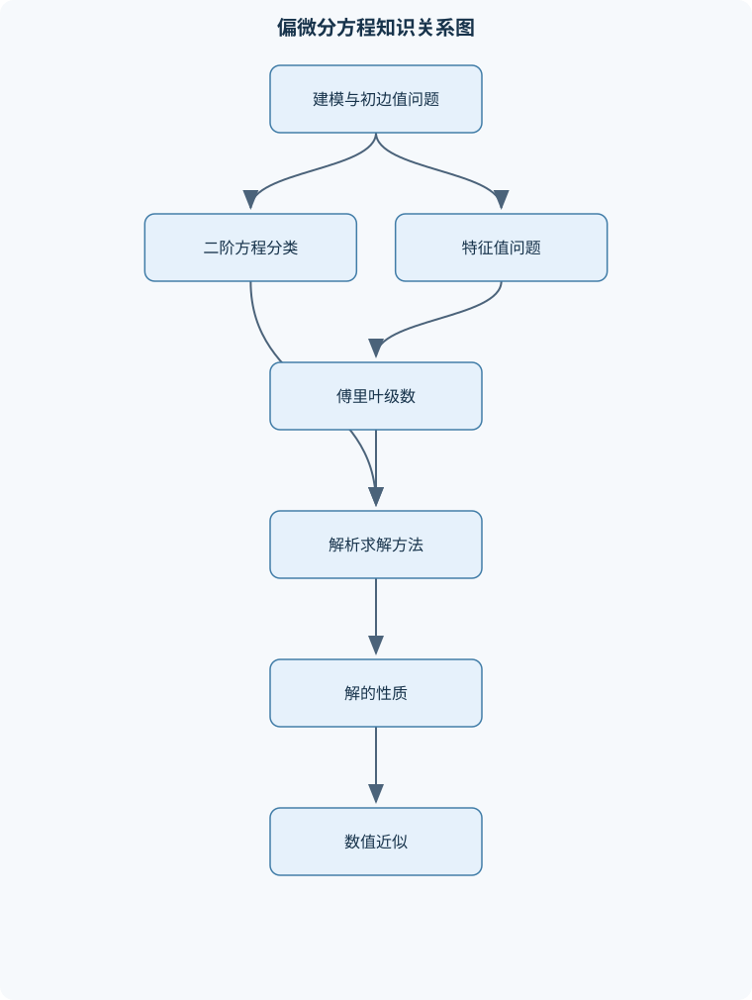
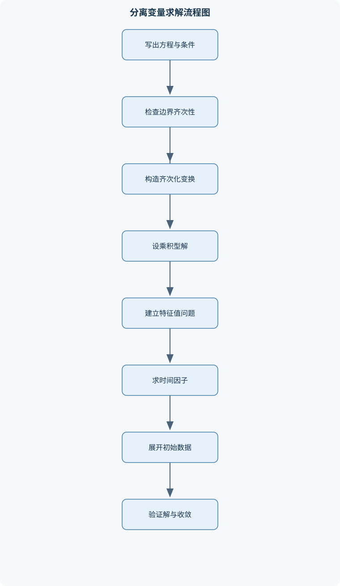

# 偏微分方程

## 一、课程整体知识框架

### 课程边界与先修知识

本课程研究含多个自变量及其偏导数的微分方程，重点讨论二阶线性偏微分方程的建模、分类、解析求解、边值问题与初边值问题。内容覆盖一维波动方程、热方程、拉普拉斯方程及泊松方程，兼顾无界域、半无界域、有界区间、圆域和柱域。先修知识包括单变量微积分与多元微积分、常微分方程、线性代数、复数与傅里叶级数；应掌握偏导数、梯度、散度、拉普拉斯算子、常系数线性常微分方程、特征值问题和正交展开。课程主要讨论经典解，即在考察区域内具有足够连续偏导数并逐点满足方程和条件的函数；对弱解、Sobolev空间和严格泛函分析只作边界说明。





### 1. 研究对象、基本记号与建模范围

偏微分方程研究含有多个自变量及其偏导数的方程。未知函数通常记为 $u=u(x,t)$ 或 $u=u(x,y,z)$，其中 $x,y,z$ 表示空间坐标，单位通常为长度；$t$ 表示时间，单位通常为时间。偏导数记为 $u_t,u_x,u_{xx}$，例如

$$
u_t=\frac{\partial u}{\partial t},\qquad
u_{xx}=\frac{\partial^2u}{\partial x^2}.
$$

在三维空间中，梯度、散度和拉普拉斯算子分别为

$$
\nabla u=(u_x,u_y,u_z),\qquad
\nabla\cdot F=F_{1x}+F_{2y}+F_{3z},
$$

$$
\Delta u=\nabla\cdot\nabla u=u_{xx}+u_{yy}+u_{zz}.
$$

课程重点是二阶线性偏微分方程及其初值问题、边值问题和初边值问题。经典解要求函数在考察区域内具有所需的连续偏导数，且方程和条件在通常逐点意义下成立。例如，波动方程的经典解至少要使 $u_{tt}$ 和 $u_{xx}$ 存在并连续；若初始数据只有分段光滑性，所得傅里叶级数可能只在逐点、均方或弱意义下收敛，不能自动称为经典解。

一个方程的阶数由最高阶偏导数决定。线性方程可写为

$$
Lu=f,
$$

其中 $L$ 是未知函数及其偏导数的线性组合，系数可以依赖自变量但不能依赖 $u$ 本身。若 $f=0$，称为齐次方程；若 $f\neq0$，称为非齐次方程。齐次边界条件与齐次方程是不同概念：$u_t-\kappa u_{xx}=q$ 可以配合 $u(0,t)=u(L,t)=0$，此时方程非齐次而边界齐次。

线性方程的叠加原理要求方程、初值条件和边界条件均具有线性齐次结构。若 $Lu_1=0$、$Lu_2=0$，则 $a u_1+b u_2$ 也是解；若 $Lu_1=f_1$、$Lu_2=f_2$，则 $L(au_1+bu_2)=af_1+bf_2$。非齐次边界或非线性项存在时，不能直接把任意两个解相加。

### 2. 初值、边界与适定性

初值条件规定某一时刻的状态，例如

$$
u(x,0)=f(x),\qquad u_t(x,0)=g(x).
$$

对于二阶时间方程，通常需要位移和速度两个初值；对于一阶时间方程，通常只需给出 $u(x,0)$。边界条件规定空间边界上的函数值或通量，常见形式如下：

- Dirichlet 条件：$u|_{\partial\Omega}=g$，规定边界上的函数值；
- Neumann 条件：$\dfrac{\partial u}{\partial n}=h$，规定外法向导数或通量；
- Robin 条件：$\alpha u+\beta\dfrac{\partial u}{\partial n}=r$，同时规定函数值和法向通量的线性关系。

法向导数为

$$
\frac{\partial u}{\partial n}=\nabla u\cdot n,
$$

其中 $n$ 是边界外法向单位向量。若热流满足傅里叶定律 $q=-k\nabla u$，则法向热流为 $q\cdot n=-k\dfrac{\partial u}{\partial n}$；因此 Neumann 条件规定的可能是导数，也可能是经过物理系数换算后的通量，二者不可混淆。

适定性通常包括存在性、唯一性和对数据的连续依赖。若初值稍微改变就导致解发生无界变化，则问题不稳定，即使形式上存在解，也不适合作为物理模型。波动、热传导和椭圆问题对数据的要求不同：波动方程传播初始扰动，热方程会平滑空间不规则性，椭圆方程主要由整个边界数据约束内部状态。

### 3. 二阶方程的分类与标准化

二元二阶线性方程的主部写成

$$
A u_{xx}+2B u_{xy}+C u_{yy}.
$$

在系数连续且主部不同时退化的前提下，判别量

$$
D=B^2-AC
$$

决定局部类型：

| 类型 | 判别条件 | 典型方程 | 主要性质 |
|---|---:|---|---|
| 双曲型 | $D>0$ | $u_{tt}-c^2u_{xx}=0$ | 存在特征方向，扰动有限速度传播 |
| 抛物型 | $D=0$ | $u_t-\kappa u_{xx}=0$ | 时间方向与扩散方向不对称 |
| 椭圆型 | $D<0$ | $\Delta u=0$ | 通常描述稳态约束，内部值受边界整体影响 |

这里必须注意交叉项约定。若写成 $Au_{xx}+Bu_{xy}+Cu_{yy}$，判别式应改写为 $B^2-4AC$；不能把两种记号混用。

令

$$
\xi=\alpha x+\beta y,\qquad \eta=\gamma x+\delta y,
$$

利用链式法则可计算 $u_{xx},u_{xy},u_{yy}$，再选择变换参数消去混合项。双曲型方程可变换为含有 $u_{\xi\eta}$ 的形式；抛物型方程通常只剩一个二阶方向；椭圆型方程可化为类似 $u_{\xi\xi}+u_{\eta\eta}$ 的形式。变系数方程的分类是局部的：同一个方程可能在不同区域类型不同；若 $A,B,C$ 同时退化，判别结论不能直接使用。

### 4. 傅里叶级数与特征值问题

在有限区间上，分离变量法把偏微分方程化为常微分方程和空间特征值问题。典型形式为

$$
X''+\lambda X=0.
$$

固定端条件 $X(0)=X(L)=0$ 只允许

$$
\lambda_n=\left(\frac{n\pi}{L}\right)^2,\qquad
X_n(x)=\sin\frac{n\pi x}{L},\quad n=1,2,\ldots.
$$

齐次 Neumann 条件 $X'(0)=X'(L)=0$ 则包含 $\lambda_0=0$ 的常数特征函数，并有

$$
X_n(x)=\cos\frac{n\pi x}{L},\quad n\geq1.
$$

一般傅里叶级数写为

$$
f(x)=\frac{a_0}{2}
+\sum_{n=1}^{\infty}
\left[
a_n\cos\frac{n\pi x}{L}
+b_n\sin\frac{n\pi x}{L}
\right],
$$

其中

$$
a_n=\frac{2}{L}\int_0^L f(x)\cos\frac{n\pi x}{L}\,dx,
\qquad
b_n=\frac{2}{L}\int_0^L f(x)\sin\frac{n\pi x}{L}\,dx.
$$

正交性使不同模态的系数能够分别计算；完备性则说明足够宽泛的数据可以由这些特征函数逼近。若函数在某点连续，级数通常收敛到该点函数值；若有跳跃，收敛到左右极限的平均值。均方收敛不等同于逐点收敛，不能仅凭能量意义下的逼近断言每一点都收敛。

奇延拓适用于固定端正弦级数，偶延拓适用于对称型余弦级数。延拓方式改变了端点附近的光滑性，进而影响系数衰减速度和截断误差。

### 5. 三类模型方程及其物理含义

一维波动方程为

$$
u_{tt}=c^2u_{xx},
$$

其中 $u$ 可表示弦的横向位移，$c$ 的单位为长度/时间。无界域中令

$$
\xi=x-ct,\qquad \eta=x+ct,
$$

链式法则给出

$$
u_{tt}-c^2u_{xx}=-4c^2u_{\xi\eta}.
$$

因此方程化为 $u_{\xi\eta}=0$，积分得到

$$
u(x,t)=F(x-ct)+G(x+ct).
$$

这两个项分别向右、向左传播。给定

$$
u(x,0)=f(x),\qquad u_t(x,0)=g(x),
$$

可得达朗贝尔公式

$$
u(x,t)=\frac{f(x-ct)+f(x+ct)}{2}
+\frac{1}{2c}\int_{x-ct}^{x+ct}g(s)\,ds.
$$

公式要求全空间初值具有适当的连续性或分段光滑性；半无界域不能直接套用，必须先根据边界条件进行奇延拓或偶延拓。固定端 $u(0,t)=0$ 对应奇延拓，自由端 $u_x(0,t)=0$ 对应偶延拓。波动方程具有有限传播速度，点 $(x,t)$ 只受区间 $[x-ct,x+ct]$ 内初始数据影响。

一维热方程为

$$
u_t=\kappa u_{xx},
$$

其中 $\kappa>0$ 的单位为长度$^2$/时间。对有限区间零边界问题使用 $u=X(x)T(t)$，得到

$$
\frac{T'}{\kappa T}=\frac{X''}{X}=-\lambda.
$$

固定端空间函数为正弦函数，时间因子为

$$
T_n(t)=e^{-\kappa\lambda_n t}.
$$

由于高频模态的 $\lambda_n$ 较大，高频扰动衰减更快，长时间状态由最低非零特征值决定。热方程的理想模型具有瞬时非零影响，但这不表示真实热传播速度无限；它是扩散近似在相应尺度下的数学性质。

拉普拉斯方程和泊松方程分别为

$$
\Delta u=0,\qquad -\Delta u=f.
$$

拉普拉斯方程的解称为调和函数。非恒定调和函数不能在区域内部取得严格最大值或最小值，最大值通常由边界决定。泊松方程描述体源、稳态热传导或静电势，符号正负取决于算子约定，但同一问题中必须保持一致。

### 6. 圆域、柱域与特殊函数

极坐标下

$$
\Delta u=u_{rr}+\frac1r u_r+\frac1{r^2}u_{\theta\theta}.
$$

对圆盘内的拉普拉斯方程设 $u=R(r)\Theta(\theta)$，角向周期性 $\Theta(\theta+2\pi)=\Theta(\theta)$ 导致

$$
\Theta_n(\theta)=\cos(n\theta),\quad \sin(n\theta),
\qquad n=0,1,2,\ldots.
$$

径向方程是 Euler 型方程，其解包含 $r^n$、$r^{-n}$；当 $n=0$ 时还包含 $\log r$。若要求圆心处有界，必须舍弃 $r^{-n}$ 和 $\log r$，因此圆盘内解由 $r^n$ 模态展开，而不是任意保留全部形式解。

柱坐标分离变量后，径向方程常为

$$
r^2R''+rR'+(\lambda^2r^2-\nu^2)R=0,
$$

即 Bessel 方程。其解为第一类和第二类 Bessel 函数 $J_\nu(r)$、$Y_\nu(r)$。圆心正则性通常排除 $Y_\nu$，圆柱边界条件则把 $\lambda$ 限制为相应 Bessel 函数或其导数的零点；这些零点一般不是等差数列。球坐标分离后会出现 Legendre 方程，轴对称情形的角向解为 $P_n(\cos\theta)$，并利用其正交性展开边界数据。

### 7. 积分变换、Green 函数与能量方法

全空间傅里叶变换定义为

$$
\widehat u(\xi,t)=\int_{-\infty}^{\infty}
u(x,t)e^{-i\xi x}\,dx.
$$

在该约定下，

$$
\widehat{u_{xx}}=-\xi^2\widehat u.
$$

因此全空间热方程变为

$$
\partial_t\widehat u=-\kappa\xi^2\widehat u,
\qquad
\widehat u(\xi,t)=e^{-\kappa\xi^2t}\widehat f(\xi).
$$

反变换给出热核卷积

$$
u(x,t)=\frac1{\sqrt{4\pi\kappa t}}
\int_{-\infty}^{\infty}
e^{-(x-\xi)^2/(4\kappa t)}f(\xi)\,d\xi,
\qquad t>0.
$$

该表示要求初值具有足够的可积性或采用适当的广义函数解释。热核因子 $e^{-\kappa\xi^2t}$ 表明高频成分随时间快速衰减。

Green 函数 $G(x,\xi)$ 表示源点 $\xi$ 对观察点 $x$ 的响应，通常满足

$$
L_xG(x,\xi)=\delta(x-\xi)
$$

及相应边界条件。由 Green 第二恒等式

$$
\int_\Omega(v\Delta u-u\Delta v)\,d\Omega
=
\int_{\partial\Omega}
\left(v\frac{\partial u}{\partial n}
-u\frac{\partial v}{\partial n}\right)\,ds
$$

可推导边界积分表示。Green 函数在源点处通常具有奇异性，积分公式必须按极限、主值或可积奇异函数解释，不能把它当作普通处处光滑函数。

能量法适合证明唯一性和稳定性。对波动方程乘以 $u_t$ 并积分，定义

$$
E(t)=\frac12\int_0^L
\left(u_t^2+c^2u_x^2\right)\,dx.
$$

分部积分后，能量变化只由端点通量、外力和阻尼决定。固定端或周期边界使通量为零时，$E(t)$ 守恒；非齐次边界不能直接舍去边界项。热方程相应表现为能量耗散，椭圆方程则常通过积分分部得到梯度平方的非负估计。

## 二、章节和模块划分

### 核心知识覆盖清单

本清单用于检查正文是否覆盖本课程的主要知识模块：

- **偏微分方程基础与适定性**：偏微分方程的阶数、线性与非线性、齐次方程与非齐次方程、初值条件、边界条件和混合条件、Dirichlet、Neumann与Robin边界条件、解的存在性、唯一性与连续依赖、叠加原理及其适用条件、模型方程的物理量纲分析、经典解、弱解与广义解的区别。
- **二阶方程分类与标准化**：二元二阶线性方程的一般形式、主部矩阵与判别式、双曲型、抛物型和椭圆型、特征曲线与特征方向、坐标变换消去混合偏导项、双曲型方程的标准形式、抛物型方程的标准形式、椭圆型方程的标准形式、变系数情形下分类的局部性。
- **傅里叶级数与特征值问题**：三角傅里叶级数及系数计算、奇延拓与偶延拓、正交性和完备性、周期边界条件下的特征函数、齐次Dirichlet边界特征值问题、齐次Neumann边界特征值问题、混合边界条件下的特征值、分段光滑函数的收敛与端点行为、均方收敛与逐点收敛的区别。
- **行波法与一维波动方程**：无界弦自由振动模型、波动方程的特征坐标、达朗贝尔公式、位移初值和速度初值的作用、半无界弦的奇延拓与偶延拓、固定端和自由端的反射条件、无界弦强迫振动、因果性和有限传播速度、行波解与驻波解的区别。
- **分离变量法与有界区域问题**：乘积型试探解的代入与分离常数、空间特征值问题的构造、有界弦自由振动、有限区间热传导、非齐次方程的齐次化、非齐次边界条件的变量变换、周期边界条件、自然边界条件与通量解释、解的傅里叶系数确定。
- **热方程与扩散过程**：一维热方程及热扩散系数、热方程的初边值问题、最大值原理的基本结论、热量守恒与能量衰减、稳态解与瞬态解、零边界温度问题、非零边界温度问题、周期区域中的温度分布、长时间极限与最低模态。
- **圆域、柱域与特殊函数**：极坐标下的拉普拉斯算子、圆盘内温度分布、极角周期性条件、Euler型方程及其幂函数解、柱坐标下的分离变量、Bessel方程的来源、第一类和第二类Bessel函数、圆柱边界条件与Bessel特征值、球坐标中的Legendre方程、Legendre多项式的正交性。
- **椭圆型方程与调和函数**：拉普拉斯方程与泊松方程、调和函数的平均值性质、最大值原理、矩形区域的分离变量解、圆盘边界值问题、Dirichlet问题的唯一性、Neumann问题的相容条件、边界数据的傅里叶展开、稳态热传导与静电势模型。
- **傅里叶变换法**：傅里叶变换的定义及逆变换、平移、缩放和微分性质、卷积定理、全空间热方程的变换求解、全空间波动方程的变换求解、热核与高斯函数、初值数据的可积性条件、变换法与频率衰减、反变换的积分表示与解释。
- **Green函数与积分表示**：基本解与Green函数、点源响应和叠加积分、Green第二恒等式、边界积分表示、Dirichlet Green函数、Neumann Green函数及相容条件、一维边值问题的Green函数、Green函数的对称性、奇异性与积分意义、解析表示的适用范围。
- **解的性质、能量方法与数值意识**：波动方程的能量守恒、热方程的能量耗散、椭圆方程的能量估计、唯一性证明的能量法、稳定性与连续依赖、傅里叶级数截断误差、有限差分网格与离散边界、热方程显式格式的稳定性限制、波动方程离散格式的传播误差、解析解与数值解的适用边界。


### 1. 模块一至三：基础、分类与谱工具

第一章“偏微分方程基础与适定性”先建立阶数、线性、齐次性和初边值问题的语言，再用热传导、弦振动和稳态温度场说明建模过程。建模时必须检查量纲：$u_t$ 的单位是 $[u]/T$，$\kappa u_{xx}$ 的单位是 $\kappa[u]/L^2$，故 $\kappa$ 必须具有 $L^2/T$ 的单位；波动方程中 $c^2u_{xx}$ 与 $u_{tt}$ 同量纲，故 $c$ 为 $L/T$。若边界条件与物理过程不匹配，例如固定端却使用 $u_x=0$，模型虽可形式求解，但物理含义已经改变。

第二章“二阶方程分类与标准化”从主部矩阵

$$
M=\begin{pmatrix}A&B\\B&C\end{pmatrix}
$$

出发，用其特征值符号说明分类。特征方向由二次型 $A\,dx^2+2B\,dx\,dy+C\,dy^2$ 决定。坐标变换的目标不是机械消除所有低阶项，而是先化简主部；低阶项可能在变换后仍然存在。变系数问题须逐点判断，不能根据某一处的判别式推断整个区域类型。

第三章“傅里叶级数与特征值问题”说明正交展开如何连接偏微分方程与常微分方程。分离常数必须讨论 $\lambda>0$、$\lambda=0$、$\lambda<0$ 三种情况。例如固定端条件下，$\lambda=0$ 给出线性函数但只能满足零解，$\lambda<0$ 给出双曲函数，同样通常不能同时满足两个固定端条件，故非零解只来自 $\lambda>0$。这一步是特征值推导的逻辑核心，不能直接预设 $\lambda>0$。

### 2. 模块四至六：波动、分离变量与热方程

第四章“行波法与一维波动方程”包括无界弦、半无界弦和强迫振动。无界弦采用达朗贝尔公式；半无界弦通过延拓把边界问题转为全空间问题；外力 $F(x,t)$ 存在时，可用特征线积分或 Duhamel 型叠加表示。行波解是两个方向传播的函数之和，驻波解则通常是空间和时间周期因子的乘积，二者的传播性质不同。

第五章“分离变量法与有界区域问题”处理有界弦自由振动、有限区间热传导及周期边界条件。若初值为 $f$、速度为 $g$，固定端弦的解为

$$
u(x,t)=\sum_{n=1}^{\infty}
\left[
A_n\cos\frac{n\pi ct}{L}
+B_n\sin\frac{n\pi ct}{L}
\right]\sin\frac{n\pi x}{L},
$$

其中 $A_n$ 是 $f$ 的正弦系数，$B_n$ 由 $g$ 的正弦系数除以 $n\pi c/L$ 得到。非齐次边界必须先齐次化。若 $u(0,t)=g_0(t)$、$u(L,t)=g_L(t)$，可取

$$
w(x,t)=g_0(t)+\frac{x}{L}\bigl(g_L(t)-g_0(t)\bigr),
\qquad v=u-w.
$$

则 $v$ 满足齐次边界，代回方程后源项变为原源项减去 $w$ 的算子作用。

第六章“热方程与扩散过程”强调稳态与瞬态的区别。零边界热方程的瞬态项由 $e^{-\kappa\lambda_nt}$ 衰减；非零固定边界通常先求稳态解 $w(x)$，再令 $v=u-w$。最大值原理说明，在无源、适当边界条件下，内部温度不会超过初始和边界温度的最大范围。该结论依赖抛物型方程结构，不能直接用于波动方程。

### 3. 模块七至九：特殊区域、椭圆方程与变换法

第七章“圆域、柱域与特殊函数”处理极坐标、柱坐标和球坐标。圆盘 Dirichlet 问题的边界数据先按角变量作傅里叶展开，再以 $r^n$ 延伸到内部；圆心有界性是舍弃奇异项的依据。柱域问题产生 Bessel 特征值，球域问题产生 Legendre 多项式。特殊函数不是额外附加的技巧，而是坐标变换后常微分方程的自然解。

第八章“椭圆型方程与调和函数”包括拉普拉斯方程、泊松方程、矩形和圆盘 Dirichlet 问题。矩形中分离变量会产生三角函数与双曲函数的组合；圆盘中则产生角向傅里叶模态和径向幂函数。Dirichlet 问题的唯一性可由最大值原理证明：若两个解具有同一边界值，它们的差是边界为零的调和函数，若差非零则应在内部取得正最大值或负最小值，矛盾。纯 Neumann 问题通常还需满足整体相容条件，并且解只能确定到加性常数。

第九章“傅里叶变换法”适用于全空间或平移不变区域。变换后微分变为频率乘法，平移对应相位因子，缩放改变频率尺度，乘积与卷积可互换。全空间热方程得到高斯热核；全空间波动方程则在频域中得到振荡型时间因子。有限区间或复杂边界不能随意使用连续傅里叶变换，必须考虑特征函数展开、镜像法或其他边界适配方法。

### 4. 模块十至十二：Green 函数、估计与数值意识

第十章“Green 函数与积分表示”从一维边值问题开始构造。以

$$
-u''=f,\qquad u(0)=u(L)=0
$$

为例，固定 $\xi$ 后，在 $x<\xi$ 和 $x>\xi$ 分别求齐次线性解；要求 $G$ 在 $x=\xi$ 连续，并由积分跨越源点得到导数跳跃

$$
-G_x(\xi+,\xi)+G_x(\xi-,\xi)=1.
$$

最后

$$
u(x)=\int_0^L G(x,\xi)f(\xi)\,d\xi.
$$

符号会随算子取 $G''=\delta$ 或 $-G''=\delta$ 而改变，必须从积分跳跃重新推导。

第十一章“解的性质、能量方法与数值意识”比较能量估计、最大值原理和傅里叶模态衰减。波动方程的能量主要守恒，热方程的能量通常衰减，椭圆方程通过梯度能量控制解的唯一性。数值方面，热方程显式差分格式

$$
u_j^{n+1}=u_j^n+r
(u_{j+1}^n-2u_j^n+u_{j-1}^n),
\qquad
r=\frac{\kappa\Delta t}{(\Delta x)^2}
$$

在一维均匀网格上通常要求 $0\le r\le\tfrac12$。这是离散格式的稳定性条件，不是连续方程对 $\Delta t$ 的限制。若空间节点数为 $M$、时间层数为 $N$，直接推进的计算量约为 $O(MN)$。

### 5. 代表性算法与流程

#### 流程一：分离变量法

**输入：** 线性齐次偏微分方程、区域、可分离边界条件、初值或边界数据。  
**输出：** 特征函数级数形式的解。

1. 设 $u=X(x)T(t)$，代入方程并除以 $X T$。
2. 将只依赖 $x$ 的表达式和只依赖 $t$ 的表达式都等于分离常数 $-\lambda$。
3. 先求空间特征值问题，完整讨论 $\lambda$ 的正、零、负情形。
4. 求每个特征值对应的时间因子。
5. 依据正交性展开初值或边界数据。
6. 检查方程、初值、边界及级数收敛性质。

每个截断到 $N$ 项的级数若通过 $M$ 个采样点直接计算，成本约为 $O(MN)$。适用条件是线性方程、几何区域规则且边界条件与特征函数相容；非线性方程、变系数复杂区域或非齐次边界不能机械套用。

#### 流程二：行波法与延拓

**输入：** 无界或半无界区间上的初位移 $f$、初速度 $g$、波速 $c$ 和边界类型。  
**输出：** 达朗贝尔型解。

1. 无界域先写出达朗贝尔公式。
2. 半无界固定端对 $f,g$ 作奇延拓，自由端作偶延拓。
3. 将延拓后的函数代入全空间公式。
4. 检查 $x=0$ 处的函数值或导数是否满足边界条件。
5. 代入原方程检查特征传播方向。

固定端奇延拓的原因是延拓函数满足 $F(-x)=-F(x)$，从而在边界处函数值相消；自由端偶延拓使导数相消。若边界为 Robin 条件，简单奇偶延拓通常无效。

#### 流程三：热方程显式差分

**输入：** $\kappa,\Delta x,\Delta t$、初值和边界值。  
**输出：** 各时间层的网格温度。

1. 计算 $r=\kappa\Delta t/(\Delta x)^2$。
2. 若 $r>\tfrac12$，减小 $\Delta t$ 或改用隐式格式。
3. 对内部节点使用中心差分更新。
4. 每一层更新后重新施加边界值。
5. 检查温度范围、稳定性和网格收敛性。

```python
# language: python
def heat_explicit(initial, left, right, kappa, dx, dt, steps):
    """一维零或给定边界热方程显式差分。
    initial: 内部及边界节点初值列表
    left, right: 每个时间层的边界值函数 left(n), right(n)
    """
    u = [float(v) for v in initial]
    m = len(u)
    r = kappa * dt / (dx * dx)
    if not (0.0 <= r <= 0.5):
        raise ValueError("显式格式在一维均匀网格上要求 0 <= r <= 1/2")
    history = [u.copy()]
    for n in range(steps):
        new_u = u.copy()
        for j in range(1, m - 1):
            new_u[j] = u[j] + r * (u[j + 1] - 2*u[j] + u[j - 1])
        new_u[0] = float(left(n + 1))
        new_u[-1] = float(right(n + 1))
        u = new_u
        history.append(u.copy())
    return history
```

#### 流程四：一维 Green 函数构造

**输入：** 二阶线性算子、区间、两端边界条件。  
**输出：** $G(x,\xi)$ 及积分表示。

固定源点 $\xi$，分别在 $x<\xi$ 和 $x>\xi$ 求齐次解；施加左、右边界条件；要求 $G$ 在 $\xi$ 连续；对含 $\delta(x-\xi)$ 的方程在 $\xi-\varepsilon$ 到 $\xi+\varepsilon$ 上积分，得到导数跳跃；最后对源项积分。验证标准包括边界条件、连续性、跳跃条件和算子作用结果。

### 6. 代表性例题

#### 例题一：固定端有限弦

**题干：** 求解

$$
u_{tt}=c^2u_{xx},\quad 0<x<L,
$$

$$
u(0,t)=u(L,t)=0,\quad u(x,0)=f(x),\quad u_t(x,0)=g(x).
$$

**分析：** 固定端要求正弦特征函数。

**解答：** 设 $u=XT$，得到

$$
X''+\lambda X=0,\qquad T''+c^2\lambda T=0.
$$

由边界条件得 $\lambda_n=(n\pi/L)^2$，$X_n=\sin(n\pi x/L)$。故

$$
u=\sum_{n=1}^{\infty}
\left(A_n\cos\frac{n\pi ct}{L}
+B_n\sin\frac{n\pi ct}{L}\right)
\sin\frac{n\pi x}{L},
$$

其中

$$
A_n=\frac2L\int_0^L f(x)\sin\frac{n\pi x}{L}\,dx,
$$

$$
B_n=\frac{2}{n\pi c}
\int_0^L g(x)\sin\frac{n\pi x}{L}\,dx.
$$

**验证：** 每项满足方程和端点条件，正交性保证 $t=0$ 时恢复 $f,g$。若 $f$ 不满足端点相容性，级数在端点处未必逐点恢复原值。

**变式：** 若一端固定、一端自由，则空间条件改为 $X(0)=0,X'(L)=0$，特征值变为 $\lambda_n=((n+\tfrac12)\pi/L)^2$。

#### 例题二：有限区间热传导

**题干：** 求解

$$
u_t=\kappa u_{xx},\quad u(0,t)=u(L,t)=0,\quad u(x,0)=f(x).
$$

**解答：** 分离变量得到正弦模态和

$$
u(x,t)=\sum_{n=1}^{\infty}
b_n e^{-\kappa(n\pi/L)^2t}
\sin\frac{n\pi x}{L},
$$

$$
b_n=\frac2L\int_0^L f(x)\sin\frac{n\pi x}{L}\,dx.
$$

**验证：** 指数因子使每个模态满足时间方程；边界处正弦函数为零。若 $f(x)=\sin(\pi x/L)$，则只有第一模态：

$$
u(x,t)=e^{-\kappa\pi^2t/L^2}\sin\frac{\pi x}{L}.
$$

**结论：** 当 $t\to\infty$ 时 $u\to0$；若第一模态系数不为零，长时间主导项就是第一模态。

**变式：** 若边界温度分别为 $T_0,T_1$，先取 $w(x)=T_0+(T_1-T_0)x/L$，令 $v=u-w$，再求齐次边界问题。

#### 例题三：半无界固定端波动问题

**题干：** 在 $x>0$ 上求解波动方程，满足 $u(0,t)=0$、$u(x,0)=f(x)$、$u_t(x,0)=g(x)$。

**解答：** 将 $f,g$ 延拓为奇函数 $\widetilde f,\widetilde g$，使用

$$
u(x,t)=\frac{\widetilde f(x-ct)+\widetilde f(x+ct)}2
+\frac1{2c}\int_{x-ct}^{x+ct}\widetilde g(s)\,ds.
$$

**边界验证：** 在 $x=0$，

$$
\widetilde f(-ct)+\widetilde f(ct)=0,
$$

且对称积分相互抵消，因此 $u(0,t)=0$。

**变式：** 若 $u_x(0,t)=0$，应作偶延拓而不是奇延拓。若误用奇延拓，得到的是固定端而非自由端。

#### 例题四：矩形区域稳态温度

**题干：** 在 $0<x<a,0<y<b$ 内求

$$
\Delta u=0,
$$

三边温度为零，$u(x,b)=h(x)$。

**解答：** 取

$$
u=X(x)Y(y).
$$

令 $X(0)=X(a)=0$，得到

$$
X_n(x)=\sin\frac{n\pi x}{a}.
$$

为使 $u(x,0)=0$，取

$$
Y_n(y)=\frac{\sinh(n\pi y/a)}{\sinh(n\pi b/a)}.
$$

于是

$$
u(x,y)=\sum_{n=1}^{\infty}
H_n
\frac{\sinh(n\pi y/a)}{\sinh(n\pi b/a)}
\sin\frac{n\pi x}{a},
$$

其中

$$
H_n=\frac2a\int_0^a h(x)\sin\frac{n\pi x}{a}\,dx.
$$

**验证：** $y=b$ 时恢复 $h(x)$ 的正弦展开，其余三边因子为零。

**变式：** 若非零边界位于 $x=a$，可交换 $x,y$ 的角色，构造相应双曲函数因子。

#### 例题五：一维 Dirichlet Green 函数

**题干：** 求解

$$
-u''=f(x),\quad 0<x<L,\quad u(0)=u(L)=0.
$$

**解答：** 设

$$
G(x,\xi)=
\begin{cases}
A(\xi)x,&x<\xi,\\
B(\xi)(L-x),&x>\xi.
\end{cases}
$$

边界条件已自动满足。连续性给出 $A(\xi)\xi=B(\xi)(L-\xi)$。由 $-G''=\delta(x-\xi)$，导数跳跃满足

$$
G_x(\xi-,\xi)-G_x(\xi+,\xi)=1.
$$

解得

$$
G(x,\xi)=
\frac1L
\begin{cases}
x(L-\xi),&x\leq\xi,\\
\xi(L-x),&x\geq\xi.
\end{cases}
$$

因此

$$
u(x)=\int_0^L G(x,\xi)f(\xi)\,d\xi.
$$

**验证：** $G(0,\xi)=G(L,\xi)=0$，在 $x=\xi$ 连续，导数跳跃符合算子符号。

**变式：** 若算子写成 $u''=f$，Green 函数整体符号改变，不能沿用原结果。

### 7. 实验与项目

#### 实验一：热方程显式差分的稳定性

**输入数据：** 取区间 $[0,1]$，$\kappa=1$，初值 $u(x,0)=\sin(\pi x)$，边界为零。分别取空间步长 $\Delta x=0.05$，时间步长使 $r=0.4$、$0.5$、$0.6$。

**步骤：**

1. 按网格离散初值。
2. 运行显式格式至固定终止时间。
3. 与精确解
   $$
   u_{\mathrm{exact}}(x,t)=e^{-\pi^2t}\sin(\pi x)
   $$
   比较。
4. 记录最大误差、最大温度和是否出现振荡。
5. 逐步减小 $\Delta t$，检验时间步长收敛。

**评价标准：** $r\leq0.5$ 时数值解应保持稳定，网格加密后误差应下降；$r>0.5$ 时可能出现振荡或发散。评价不能只看最终一张图，还应记录误差随网格变化的趋势。

**排错方法：** 若边界温度不为零，检查每个时间层是否重新施加边界；若误差异常增大，先计算 $r$；若只在端点附近误差大，检查初值、边界的相容性和误差范数定义。

#### 实验二：圆盘 Dirichlet 问题的模态截断

**输入数据：** 取圆盘半径 $R=1$，边界数据 $h(\theta)=1+\cos(2\theta)+0.5\sin(3\theta)$。

**步骤：**

1. 计算边界傅里叶系数。
2. 使用圆盘内正则解
   $$
   u(r,\theta)=a_0+\sum_{n\geq1}
   r^n(a_n\cos n\theta+b_n\sin n\theta).
   $$
3. 分别取截断阶数 $N=1,2,3,5$。
4. 在 $r=1$ 上比较重构边界和给定边界。
5. 在 $r=0,0.5,0.9$ 上检查温度范围和模态贡献。

**评价标准：** 对本例，$N=3$ 已包含全部非零模态，边界重构误差应接近数值积分误差；内部应保持有界，且不出现 $r^{-n}$ 或 $\log r$ 奇异项。最大值原则要求内部值不超过边界数据的最大、最小范围。

**排错方法：** 若圆心发散，检查是否误保留负幂或对数项；若角向周期不连续，检查傅里叶系数归一化；若边界重构振荡，检查角度采样点是否均匀以及截断阶数是否足够。

## 三、核心概念的详细解释

### 1. 偏微分方程、初边值问题与经典解

偏微分方程（partial differential equation，PDE）是含有多个自变量及其偏导数的方程。未知函数可写为 $u=u(x,t)$、$u=u(x,y)$ 或 $u=u(x,y,z)$。例如，一维波动方程、热方程和拉普拉斯方程分别为

$$
u_{tt}=c^2u_{xx},\qquad
u_t=\kappa u_{xx},\qquad
\Delta u=u_{xx}+u_{yy}=0.
$$

波动方程中的 $c>0$ 是传播速度，单位为“长度/时间”；热方程中的 $\kappa>0$ 是热扩散系数，单位为“长度$^2$/时间”。若 $u$ 表示温度，则 $u_t$ 的单位为温度/时间，$u_{xx}$ 的单位为温度/长度$^2$，因此 $\kappa u_{xx}$ 与 $u_t$ 具有相同量纲。量纲不一致通常意味着模型系数、变量或方程形式存在错误。

按最高阶导数的阶数，方程分为一阶、二阶或更高阶。线性方程要求未知函数及其各阶偏导数只以一次幂线性出现，且系数不依赖于未知函数本身。例如

$$
u_t-\kappa u_{xx}=q(x,t)
$$

是线性方程；而 $u_t-u_{xx}+u^2=0$ 是非线性方程。若右端项为零，称方程齐次；若右端项不为零，称方程非齐次。齐次方程与齐次边界条件是两个不同概念：方程可以非齐次而边界条件为 $u(0,t)=u(L,t)=0$。

初值条件描述某一时刻的状态。热方程是一阶时间方程，通常给出

$$
u(x,0)=f(x);
$$

波动方程是二阶时间方程，通常需要同时给出

$$
u(x,0)=f(x),\qquad u_t(x,0)=g(x).
$$

边界条件描述空间边界上的状态，常见形式包括

$$
u|_{\partial\Omega}=h
$$

的 Dirichlet 条件，

$$
\frac{\partial u}{\partial n}=q
$$

的 Neumann 条件，以及

$$
\alpha u+\beta\frac{\partial u}{\partial n}=r
$$

的 Robin 条件。其中 $n$ 是边界外法向单位向量。若热流满足 $F=-k\nabla u$，则外法向热流为

$$
F\cdot n=-k\frac{\partial u}{\partial n}.
$$

所以“给定法向导数”和“给定热流”只有在明确物理系数及符号约定后才可互换。

经典解要求函数具有足够的连续偏导数，方程、初值和边界条件均按逐点意义成立。例如，波动方程的经典解至少应使 $u_{tt}$ 和 $u_{xx}$ 连续。若初始数据只有分段光滑性，傅里叶级数可能只在均方意义或除少数点外逐点收敛，此时不能自动把级数称为经典解。弱解允许导数以积分或分布意义存在，适用范围更广，但需要使用适当的函数空间和积分恒等式。

一个初边值问题称为适定，通常要求解存在、唯一，并且对初始数据、边界数据和源项连续依赖。唯一性说明同一组数据不会对应两个不同解；连续依赖说明数据的小扰动不会引起解的无界变化。三者中任一条件失败，问题都可能不适合作为稳定的数学模型。

### 2. 二阶线性方程的分类及其局部性质

二元二阶线性方程的主部可写为

$$
Au_{xx}+2Bu_{xy}+Cu_{yy},
$$

其中 $A,B,C$ 可以依赖于 $(x,y)$。采用交叉项系数为 $2B$ 的记号时，判别量为

$$
D=B^2-AC.
$$

在系数连续且主部不同时退化，即 $A^2+B^2+C^2\neq0$ 的条件下：

- $D>0$ 时为双曲型；
- $D=0$ 时为抛物型；
- $D<0$ 时为椭圆型。

若写成 $Au_{xx}+Bu_{xy}+Cu_{yy}$，则判别式应改为 $B^2-4AC$。不能在两种记号之间混用判别式。

主部矩阵为

$$
M=
\begin{pmatrix}
A&B\\
B&C
\end{pmatrix}.
$$

其特征值的符号也能反映分类：两个特征值异号对应双曲型；一个特征值为零且另一个不为零对应抛物型；两个特征值同号对应椭圆型。分类只由二阶最高阶项决定，低阶项会影响具体解，但不会改变非退化点处的基本类型。

设新坐标为

$$
\xi=\alpha x+\beta y,\qquad
\eta=\gamma x+\delta y,
$$

且 $\alpha\delta-\beta\gamma\neq0$。由链式法则，

$$
u_x=\alpha u_\xi+\gamma u_\eta,\qquad
u_y=\beta u_\xi+\delta u_\eta.
$$

进一步有

$$
u_{xx}=\alpha^2u_{\xi\xi}+2\alpha\gamma u_{\xi\eta}
+\gamma^2u_{\eta\eta},
$$

$$
u_{xy}=\alpha\beta u_{\xi\xi}
+(\alpha\delta+\beta\gamma)u_{\xi\eta}
+\gamma\delta u_{\eta\eta},
$$

$$
u_{yy}=\beta^2u_{\xi\xi}+2\beta\delta u_{\xi\eta}
+\delta^2u_{\eta\eta}.
$$

将这些式子代入主部，选择新坐标方向使 $u_{\xi\eta}$ 的系数为零，就能得到局部标准形式。双曲型方程可化为类似

$$
u_{\xi\eta}+\text{低阶项}= \text{源项},
$$

抛物型方程可化为类似

$$
u_{\xi\xi}+\text{低阶项}= \text{源项},
$$

椭圆型方程可化为类似

$$
u_{\xi\xi}+u_{\eta\eta}+\text{低阶项}= \text{源项}.
$$

变系数方程的分类一般是局部的。例如 $A,B,C$ 随位置变化时，某些区域可能满足 $D>0$，另一些区域满足 $D<0$。在退化曲线或退化点附近，标准化坐标可能失效，不能把整个区域简单归为一种类型。

三类方程的物理和数学性质不同。双曲型方程描述波传播，信息沿特征方向传递，具有有限传播速度；抛物型方程描述扩散，理想热方程的扰动会立即影响整个空间，但影响通常随距离快速衰减；椭圆型方程描述稳态约束，内部值由整体边界数据共同决定。将热方程套用波动方程的有限传播结论，或将稳态拉普拉斯方程当作时间演化方程，都是概念性错误。

### 3. 傅里叶级数、特征函数与正交展开

在区间 $[-L,L]$ 上，周期为 $2L$ 的傅里叶级数通常写成

$$
f(x)\sim \frac{a_0}{2}
+\sum_{n=1}^{\infty}
\left[
a_n\cos\frac{n\pi x}{L}
+b_n\sin\frac{n\pi x}{L}
\right],
$$

其中

$$
a_n=\frac{1}{L}\int_{-L}^{L}f(x)\cos\frac{n\pi x}{L}\,dx,
$$

$$
b_n=\frac{1}{L}\int_{-L}^{L}f(x)\sin\frac{n\pi x}{L}\,dx.
$$

正交性来自积分关系。例如，当 $m\neq n$ 时，

$$
\int_{-L}^{L}
\cos\frac{m\pi x}{L}\cos\frac{n\pi x}{L}\,dx=0.
$$

因此将级数与某个基函数相乘并积分，就能单独提取对应系数。偶函数的正弦系数为零，奇函数的余弦系数及 $a_0$ 为零。将区间函数作奇延拓可以得到正弦级数，适合满足齐次 Dirichlet 条件的空间问题；作偶延拓可以得到余弦级数，适合齐次 Neumann 条件。

傅里叶展开的正交性只保证系数易于计算，完备性才说明一大类函数可以由这些特征函数逼近。分段光滑函数在连续点通常收敛到函数值，在跳跃点收敛到左右极限的平均值。均方收敛并不自动推出每一点逐点收敛，更不自动推出导数级数也逐点收敛。

边界条件决定特征函数。例如齐次 Dirichlet 特征值问题

$$
-X''=\lambda X,\qquad X(0)=X(L)=0
$$

的非零解为

$$
\lambda_n=\left(\frac{n\pi}{L}\right)^2,\qquad
X_n(x)=\sin\frac{n\pi x}{L},\qquad n=1,2,\ldots.
$$

齐次 Neumann 问题

$$
-X''=\lambda X,\qquad X'(0)=X'(L)=0
$$

则包括零特征值 $\lambda_0=0$ 和常数特征函数 $X_0=1$，以及

$$
\lambda_n=\left(\frac{n\pi}{L}\right)^2,\qquad
X_n(x)=\cos\frac{n\pi x}{L}.
$$

零特征值会导致纯 Neumann 椭圆问题的解只能确定到加性常数。

### 4. 行波、驻波与有限传播

无界弦自由振动模型为

$$
u_{tt}=c^2u_{xx},\qquad -\infty<x<\infty.
$$

取特征坐标

$$
\xi=x-ct,\qquad \eta=x+ct,
$$

则

$$
u_{tt}-c^2u_{xx}=-4c^2u_{\xi\eta}.
$$

因此原方程化为 $u_{\xi\eta}=0$。先对 $\xi$ 积分，再对 $\eta$ 积分，得到

$$
u(x,t)=F(x-ct)+G(x+ct).
$$

其中 $F$ 表示向右传播的波，$G$ 表示向左传播的波。给定

$$
u(x,0)=f(x),\qquad u_t(x,0)=g(x),
$$

有

$$
F(x)+G(x)=f(x),
$$

以及

$$
-cF'(x)+cG'(x)=g(x).
$$

积分并整理得达朗贝尔公式

$$
u(x,t)=\frac{f(x-ct)+f(x+ct)}{2}
+\frac{1}{2c}\int_{x-ct}^{x+ct}g(s)\,ds.
$$

因此 $(x,t)$ 处的解只依赖初始区间 $[x-ct,x+ct]$ 上的数据，这个区间构成特征锥。波动方程具有有限传播速度，初始扰动不可能在有限时间内影响特征锥之外的点。

行波是单向传播的 $F(x-ct)$ 或 $G(x+ct)$；驻波通常是分离变量所得的乘积，例如

$$
u_n(x,t)=
\sin\frac{n\pi x}{L}
\left(A_n\cos\frac{n\pi ct}{L}
+B_n\sin\frac{n\pi ct}{L}\right).
$$

驻波的空间节点固定，时间振荡而不发生整体平移。半无界弦问题可通过延拓转化为无界问题：固定端 $u(0,t)=0$ 使用奇延拓，自由端 $u_x(0,t)=0$ 使用偶延拓。延拓的奇偶性必须与边界条件一致，否则反射后的边界条件不成立。

### 5. 分离变量法与热扩散

对线性齐次且边界条件可分离的问题，设

$$
u(x,t)=X(x)T(t).
$$

以热方程为例，代入 $u_t=\kappa u_{xx}$ 得

$$
X(x)T'(t)=\kappa X''(x)T(t).
$$

在 $X$ 与 $T$ 非零处除以 $\kappa XT$，得到

$$
\frac{T'}{\kappa T}=\frac{X''}{X}.
$$

左侧只依赖 $t$，右侧只依赖 $x$，它们必须等于常数。为使空间特征值问题写成正定形式，令该常数为 $-\lambda$，于是

$$
-X''=\lambda X,\qquad T'+\kappa\lambda T=0.
$$

固定端边界 $X(0)=X(L)=0$ 时，

$$
X_n(x)=\sin\frac{n\pi x}{L},\qquad
\lambda_n=\left(\frac{n\pi}{L}\right)^2,
$$

时间因子为

$$
T_n(t)=e^{-\kappa\lambda_n t}.
$$

所以零边界热方程的解为

$$
u(x,t)=\sum_{n=1}^{\infty}
b_n e^{-\kappa(n\pi/L)^2t}
\sin\frac{n\pi x}{L},
$$

其中

$$
b_n=\frac{2}{L}\int_0^L f(x)\sin\frac{n\pi x}{L}\,dx.
$$

高频模态的 $\lambda_n$ 较大，衰减速度更快；当 $t$ 较大时，最低模态通常占主导。若初值与边界不相容，例如 $f(0)\neq0$ 而边界要求 $u(0,t)=0$，则解在角点 $(0,0)$ 可能不连续，经典正则性需要单独讨论。

非齐次边界不能直接套用齐次边界的正弦展开。若

$$
u(0,t)=T_0,\qquad u(L,t)=T_1,
$$

可先取稳态函数

$$
w(x)=T_0+\frac{T_1-T_0}{L}x,
$$

令 $v=u-w$。由于 $w(0)=T_0,w(L)=T_1$，有

$$
v(0,t)=v(L,t)=0.
$$

若 $w_t=0,w_{xx}=0$，则 $v$ 仍满足齐次热方程，最终解由稳态部分 $w$ 与衰减的瞬态部分 $v$ 组成。

### 6. 椭圆方程、圆域和柱域中的特殊函数

稳态热传导、静电势等问题常导致拉普拉斯方程

$$
\Delta u=0
$$

或泊松方程

$$
-\Delta u=f.
$$

调和函数具有平均值性质：若闭圆盘完全包含在区域内，则圆心处的函数值等于圆周平均值。由此可推出最大值原理：非恒定调和函数不能在区域内部取得严格最大值或最小值。因此，连续边界数据下的 Dirichlet 问题具有唯一性。若两个解 $u_1,u_2$ 具有相同边界值，则差函数 $w=u_1-u_2$ 调和且边界为零；最大值原理推出 $w\equiv0$。

在极坐标中，

$$
\Delta u=u_{rr}+\frac1r u_r+\frac1{r^2}u_{\theta\theta}.
$$

对圆盘内的拉普拉斯方程设 $u=R(r)\Theta(\theta)$，得到角向方程

$$
\Theta''+n^2\Theta=0
$$

和径向 Euler 方程

$$
r^2R''+rR'-n^2R=0.
$$

其解为 $r^n,r^{-n}$；当 $n=0$ 时为 $1,\log r$。由于圆心处要求有界，必须舍弃 $r^{-n}$ 和 $\log r$。因此半径为 $R$ 的圆盘内，边界函数的傅里叶展开决定解

$$
u(r,\theta)=a_0+\sum_{n=1}^{\infty}
\left(\frac rR\right)^n
\left(a_n\cos n\theta+b_n\sin n\theta\right).
$$

柱坐标分离变量时，径向方程常成为

$$
r^2R''+rR'+(\lambda^2r^2-\nu^2)R=0,
$$

这就是 Bessel 方程。其两个线性无关解为第一类 Bessel 函数 $J_\nu(\lambda r)$ 和第二类 Bessel 函数 $Y_\nu(\lambda r)$。在包含 $r=0$ 的区域内，$Y_\nu$ 通常在圆心奇异，应根据正则性排除。圆柱边界条件会要求 $J_\nu(\lambda R)=0$ 或其导数为零，因此允许的 $\lambda$ 是 Bessel 函数或其导数的零点，并非通常的等差数列。

球坐标分离变量会产生 Legendre 方程，其正则角向解为 Legendre 多项式 $P_n(\cos\theta)$。这些多项式在适当权函数下正交，能够用于球域中的轴对称边值问题。特殊函数不是额外附加的技巧，而是曲线坐标下空间特征值问题自然产生的特征函数。

### 7. Green 函数、傅里叶变换与能量观点

Green 函数是线性算子对点源的响应。若一维算子为 $L_x$，Green 函数通常满足

$$
L_xG(x,\xi)=\delta(x-\xi),
$$

并满足关于 $x$ 的边界条件。这里 $\xi$ 是源点，$x$ 是观察点。构造时在 $x\neq\xi$ 两侧求齐次方程解，在 $x=\xi$ 处要求 $G$ 连续，并根据点源确定导数跳跃。若算子为 $-d^2/dx^2$，则积分跨过 $\xi$ 可得

$$
-G_x(\xi^+,\xi)+G_x(\xi^-,\xi)=1.
$$

Green 第二恒等式为

$$
\int_\Omega(v\Delta u-u\Delta v)\,d\Omega
=
\int_{\partial\Omega}
\left(v\frac{\partial u}{\partial n}
-u\frac{\partial v}{\partial n}\right)\,ds.
$$

选择 $v$ 为 Green 函数，可以把区域内部的源项表示为体积分，并把边界数据表示为边界积分。Green 函数在源点可能奇异，积分表示必须按可积奇异性或分布意义理解。

全空间傅里叶变换定义为

$$
\widehat u(\xi,t)=
\int_{-\infty}^{\infty}u(x,t)e^{-i\xi x}\,dx.
$$

在函数和导数具有足够衰减、积分存在的条件下，

$$
\widehat{u_{xx}}=-\xi^2\widehat u.
$$

因此全空间热方程变为

$$
\partial_t\widehat u=-\kappa\xi^2\widehat u,
$$

解为

$$
\widehat u(\xi,t)=e^{-\kappa\xi^2t}\widehat f(\xi).
$$

逆变换得到热核表示

$$
u(x,t)=\frac1{\sqrt{4\pi\kappa t}}
\int_{-\infty}^{\infty}
\exp\left[-\frac{(x-\xi)^2}{4\kappa t}\right]f(\xi)\,d\xi,
\qquad t>0.
$$

因子 $e^{-\kappa\xi^2t}$ 强烈衰减高频成分，体现热方程的平滑作用。傅里叶变换规范不同，逆变换中的常数因子也不同，必须前后一致。

能量法用于证明唯一性和稳定性。对波动方程乘以 $u_t$ 并在区间积分，定义

$$
E(t)=\frac12\int_0^L
\left(u_t^2+c^2u_x^2\right)\,dx.
$$

分部积分得

$$
\frac{dE}{dt}
=
c^2u_xu_t\bigg|_{0}^{L}.
$$

若两端固定、周期或边界通量使该项为零，则能量守恒。对热方程乘以 $u$，可得

$$
\frac12\frac{d}{dt}\int_0^L u^2\,dx
=
-\kappa\int_0^L u_x^2\,dx
+\kappa uu_x\bigg|_0^L.
$$

零 Dirichlet 边界下边界项为零，故 $L^2$ 能量不增加，通常严格衰减。非齐次边界、外力和阻尼不能直接舍去边界项；它们分别可能向系统输入能量、耗散能量或改变能量平衡。

## 四、重要定义、公式、定理和推导

### 专业审校补充：关键定义与适用边界

Neumann边界问题具有区别于Dirichlet问题的相容性与非唯一性。对有界区域Ω上的泊松方程 $-\Delta u=f$，若给定外法向导数 $\partial_nu=g$，则由散度定理必须满足 $\int_\Omega f\,dV=\int_{\partial\Omega}g\,dS$。否则不存在满足方程和边界条件的经典解。推导是对方程积分：$\int_\Omega f\,dV=-\int_\Omega\Delta u\,dV=-\int_{\partial\Omega}\partial_nu\,dS$；若采用 $\Delta u=f$ 的符号约定，等式两侧符号相应改变，必须保持一致。相容时，若 $u$ 是解，则 $u+C$ 也是解，因此解至多确定到一个加性常数，通常附加归一化条件 $\int_\Omega u\,dV=0$。对热方程的纯Neumann边界，边界无通量意味着总热量变化只由内部源项决定；无源时空间平均值守恒。该结论要求区域有界、边界足够光滑，并且解具有可使用散度定理的正则性；非齐次源项、非连通区域或弱解情形需分别处理。


### 1. 分离变量法的统一推导

设方程、区域和边界条件均为线性齐次，并且允许乘积型试探解

$$
u(x,t)=X(x)T(t).
$$

将其代入一般形式

$$
u_t=\kappa u_{xx}
$$

得到

$$
XT'=\kappa X''T.
$$

除以 $\kappa XT$ 后，

$$
\frac{T'}{\kappa T}=\frac{X''}{X}.
$$

由于左侧仅依赖 $t$，右侧仅依赖 $x$，在连通区域内二者必须等于同一常数。令其为 $-\lambda$，得到

$$
-X''=\lambda X,\qquad T'+\kappa\lambda T=0.
$$

空间边界条件决定 $\lambda$ 及 $X$；时间方程给出

$$
T(t)=Ce^{-\kappa\lambda t}.
$$

把所有特征模态叠加，再利用初值展开确定系数。这个方法要求算子和边界条件具有足够的可分离结构；一般变系数、复杂区域或非线性问题不能机械套用。

### 2. 有限弦和有限区间热方程

固定端有限弦问题为

$$
u_{tt}=c^2u_{xx},\quad 0<x<L,
$$

$$
u(0,t)=u(L,t)=0,\quad
u(x,0)=f(x),\quad u_t(x,0)=g(x).
$$

分离变量得到

$$
X_n(x)=\sin\frac{n\pi x}{L},\qquad
\omega_n=\frac{n\pi c}{L}.
$$

因此

$$
u(x,t)=\sum_{n=1}^{\infty}
\left[
A_n\cos(\omega_nt)+B_n\sin(\omega_nt)
\right]
\sin\frac{n\pi x}{L}.
$$

由初位移和初速度分别得到

$$
A_n=\frac2L\int_0^L f(x)\sin\frac{n\pi x}{L}\,dx,
$$

$$
B_n=\frac{2}{L\omega_n}
\int_0^L g(x)\sin\frac{n\pi x}{L}\,dx.
$$

这里 $B_n$ 中出现 $\omega_n$，因为对时间求导后正弦项产生 $\omega_n$ 因子。若只给初位移而未给初速度，二阶时间方程的解一般不唯一。

零边界热方程的解为

$$
u(x,t)=\sum_{n=1}^{\infty}
b_ne^{-\kappa\lambda_nt}
\sin\frac{n\pi x}{L},
$$

$$
\lambda_n=\left(\frac{n\pi}{L}\right)^2.
$$

当 $t\to\infty$ 时，若 $b_1\neq0$，

$$
u(x,t)\sim
b_1e^{-\kappa\pi^2t/L^2}
\sin\frac{\pi x}{L}.
$$

这说明长时间行为由最低非零特征值决定。若 $b_1=0$，则继续检查第一个不为零的模态。

### 3. 拉普拉斯方程矩形问题的推导

考虑矩形 $0<x<a,0<y<b$ 上的拉普拉斯方程

$$
u_{xx}+u_{yy}=0,
$$

并设 $x=0,x=a,y=0$ 三边为零，$y=b$ 上给定 $u(x,b)=h(x)$。取

$$
u(x,y)=X(x)Y(y).
$$

代入后除以 $XY$：

$$
\frac{X''}{X}=-\frac{Y''}{Y}.
$$

令

$$
X''+\lambda X=0,\qquad
Y''-\lambda Y=0.
$$

由 $X(0)=X(a)=0$ 得

$$
\lambda_n=\left(\frac{n\pi}{a}\right)^2,\qquad
X_n(x)=\sin\frac{n\pi x}{a}.
$$

由 $Y(0)=0$ 得

$$
Y_n(y)=\sinh\frac{n\pi y}{a}.
$$

为使 $y=b$ 处的函数归一化，写成

$$
Y_n(y)=
\frac{\sinh(n\pi y/a)}
{\sinh(n\pi b/a)}.
$$

于是

$$
u(x,y)=\sum_{n=1}^{\infty}
h_n
\frac{\sinh(n\pi y/a)}
{\sinh(n\pi b/a)}
\sin\frac{n\pi x}{a},
$$

其中

$$
h_n=\frac2a\int_0^a
h(x)\sin\frac{n\pi x}{a}\,dx.
$$

三条零边界来自每一项的正弦因子或双曲正弦因子；第四条边界由 $h$ 的正弦展开恢复。若 $h$ 与角点的零边界不相容，角点处可能出现不连续，但区域内部仍可存在调和解。

### 4. Neumann 问题的相容条件

考虑泊松方程

$$
-\Delta u=f\quad\text{in }\Omega,
$$

以及纯 Neumann 条件

$$
\frac{\partial u}{\partial n}=g
\quad\text{on }\partial\Omega.
$$

对方程在 $\Omega$ 上积分：

$$
\int_\Omega f\,d\Omega
=
-\int_\Omega\Delta u\,d\Omega.
$$

由散度定理，

$$
\int_\Omega\Delta u\,d\Omega
=
\int_{\partial\Omega}
\frac{\partial u}{\partial n}\,ds.
$$

因此必须满足

$$
\boxed{
\int_\Omega f\,d\Omega+
\int_{\partial\Omega}g\,ds=0
}.
$$

这就是相容条件，表示区域内源项与边界总通量达到整体平衡。若相容条件满足，解仍不唯一，因为 $u+C$ 与 $u$ 具有相同的拉普拉斯算子和法向导数。通常需要附加归一化条件，例如

$$
\int_\Omega u\,d\Omega=0
$$

来确定加性常数。

### 5. Green 函数的一维构造

考虑

$$
-u''(x)=f(x),\qquad
u(0)=u(L)=0.
$$

令 $G(x,\xi)$ 满足

$$
-G_{xx}(x,\xi)=\delta(x-\xi),
$$

并满足 $G(0,\xi)=G(L,\xi)=0$。在 $x<\xi$ 和 $x>\xi$ 上，方程为 $G_{xx}=0$，故分别设

$$
G(x,\xi)=A x,\qquad x<\xi,
$$

$$
G(x,\xi)=B(L-x),\qquad x>\xi.
$$

连续性要求

$$
A\xi=B(L-\xi).
$$

对方程在 $\xi-\varepsilon$ 到 $\xi+\varepsilon$ 上积分：

$$
-\int_{\xi-\varepsilon}^{\xi+\varepsilon}G_{xx}\,dx=1.
$$

令 $\varepsilon\to0$，得到

$$
G_x(\xi^+,\xi)-G_x(\xi^-,\xi)=-1.
$$

由此得到

$$
G(x,\xi)=
\begin{cases}
\dfrac{x(L-\xi)}{L},&0\le x\le\xi,\\[6pt]
\dfrac{\xi(L-x)}{L},&\xi\le x\le L.
\end{cases}
$$

最终

$$
u(x)=\int_0^L G(x,\xi)f(\xi)\,d\xi.
$$

直接检查可知 $u(0)=u(L)=0$，且在分布意义下 $-u''=f$。源点变量 $\xi$ 与观察点变量 $x$ 的角色不能混淆；在自伴随边界条件下通常有 $G(x,\xi)=G(\xi,x)$。

### 6. 能量唯一性证明

设 $u_1,u_2$ 是同一固定端波动初边值问题的两个经典解，令

$$
w=u_1-u_2.
$$

则

$$
w_{tt}=c^2w_{xx},\qquad
w(0,t)=w(L,t)=0,
$$

且

$$
w(x,0)=0,\qquad w_t(x,0)=0.
$$

定义差解能量

$$
E(t)=\frac12\int_0^L
\left(w_t^2+c^2w_x^2\right)\,dx.
$$

将方程乘以 $w_t$ 并积分：

$$
\int_0^L w_{tt}w_t\,dx
=
c^2\int_0^Lw_{xx}w_t\,dx.
$$

左侧为

$$
\frac12\frac{d}{dt}\int_0^Lw_t^2\,dx.
$$

右侧分部积分为

$$
c^2w_xw_t\bigg|_0^L
-c^2\int_0^Lw_xw_{xt}\,dx.
$$

由于 $w(0,t)=w(L,t)=0$，对时间求导得端点处 $w_t=0$，边界项消失。因此

$$
E'(t)=0.
$$

初始能量 $E(0)=0$，故 $E(t)=0$。由于被积函数非负，得到 $w_t=0,w_x=0$，再结合零初值可知 $w\equiv0$。这证明了满足相应正则性和边界条件的解的唯一性。若边界非齐次、存在外力或阻尼，边界项和源项不能直接删除，必须把它们作为能量输入或耗散项估计。

### 7. 显式有限差分格式及稳定性边界

热方程

$$
u_t=\kappa u_{xx}
$$

在网格 $x_j=j\Delta x$、$t_n=n\Delta t$ 上采用前向时间差分和中心空间差分：

$$
\frac{u_j^{n+1}-u_j^n}{\Delta t}
=
\kappa
\frac{u_{j+1}^n-2u_j^n+u_{j-1}^n}{(\Delta x)^2}.
$$

令

$$
r=\frac{\kappa\Delta t}{(\Delta x)^2},
$$

则

$$
u_j^{n+1}
=
u_j^n+r
\left(u_{j+1}^n-2u_j^n+u_{j-1}^n\right).
$$

对均匀一维网格，该显式格式的稳定性通常要求

$$
0\le r\le\frac12.
$$

这个限制来自离散格式，不是连续热方程的物理定律。若 $r>1/2$，高频误差可能被放大，数值解出现振荡或发散；即使 $r\le1/2$，网格过粗仍会产生较大截断误差。每个时间层先更新内部节点，再重新施加边界值，不能把边界节点当作普通内部节点更新。

## 五、算法、流程和实现思路

### 方法与流程覆盖索引

下列方法或流程应在正文中说明输入、步骤、适用条件、结果检查和边界：

- 二阶方程分类与化简流程：输入主部系数 A、B、C及其定义域；输出类型和标准形式。先计算 D=B^2-AC，再判断 D的正负；若 D>0求特征方向，若 D=0识别唯一特征方向，若 D<0寻找使主部化为椭圆型标准形式的坐标变换；最后代入链式法则验证混合项是否消失。分类依赖主部而非低阶项，变系数方程应逐点或逐区域判断。有限次代数运算的符号复杂度通常为常数级，但实际困难来自系数退化和坐标变换求解。
- 分离变量法流程：输入线性齐次方程、区域和可分离边界条件；输出特征函数级数解。设 u=X(x)T(t)，代入并除以XT，将只含 x 的表达式与只含 t 的表达式置为常数；先求空间特征值问题，再求时间方程，最后用正交展开匹配初值或边界数据。每个截断到 N 个模态的系数计算若使用 M 个采样点，直接求和约为 O(MN)；终止条件是系数或新增模态对目标误差的贡献低于给定容差。非齐次边界必须先齐次化。
- 傅里叶级数系数计算流程：输入区间、函数 f 和边界延拓类型；输出 a_n、b_n及截断级数。先确定周期或奇偶延拓，再按正交关系积分；对分段函数逐段积分并检查端点跳跃；计算前 N 项并用系数衰减判断截断误差。解析积分的运算量取决于函数复杂度，离散采样计算通常为 O(MN)，快速傅里叶变换在等距采样且采用标准周期网格时可降至 O(M log M)。
- 行波法流程：输入无界或半无界区间上的初位移、初速度和边界条件；输出沿特征线传播的解。先写 u=F(x-ct)+G(x+ct)，由 t=0 的位移和速度建立关于 F、G 的方程，再积分确定它们；半无界问题根据固定端或自由端选择奇延拓或偶延拓，并在延拓后使用全空间公式。终止条件是代入原方程、初值和边界条件均成立；该方法不适用于一般变系数或复杂几何边界。
- 热方程显式有限差分流程：输入空间网格步长 Δx、时间步长 Δt、初值和边界值；输出网格温度。用中心差分近似 u_xx，用前向差分近似 u_t，得到 u_j^{n+1}=u_j^n+r(u_{j+1}^n-2u_j^n+u_{j-1}^n)，其中 r=κΔt/(Δx)^2；每一步先更新内部节点，再施加边界值。稳定性要求一维均匀网格通常满足 0≤r≤1/2；该条件是显式格式的稳定性限制，不是连续热方程本身的物理定律。每个时间层计算量为 O(M)，总计算量为 O(MN)。
- Green函数构造流程：输入一维线性算子、区间和边界条件；输出G(x,ξ)。固定源点 ξ，在 x≠ξ 处求齐次方程的左右解；施加边界条件、G在 ξ 处的连续性以及由δ源项导出的导数跳跃条件；再将源项与G积分得到解。终止条件是算子作用产生δ分布且边界条件满足。适用于线性问题，系数、区域或边界复杂时解析构造可能不可行。
- 傅里叶变换求解流程：输入全空间初值问题及足够可积的初值；输出频率积分形式或热核卷积形式。对空间变量变换，将微分算子化为乘法；求解关于时间的常微分方程；利用初值确定频域常数；最后做逆变换并检查积分收敛。连续变换本身不是有限算法；离散实现需截断频域并采样，频率截断误差和混叠误差必须单独评估。
- 能量法唯一性流程：输入两个满足同一线性初边值问题的候选解；输出唯一性结论。令差函数 w 为两解之差，使其满足零初值、零边界和齐次方程；将方程乘以 w_t 或 w 并积分，利用分部积分得到能量恒等式；由初始能量为零及能量非负性推出 w恒为零。该流程要求边界项可控，并且适用于具有相应正则性的解。





### 1. 二阶方程分类与标准化流程

#### 输入、输出与适用条件

输入是二元二阶线性方程的主部

$$
A(x,y)u_{xx}+2B(x,y)u_{xy}+C(x,y)u_{yy},
$$

以及系数定义域。输出包括方程在指定点或区域内的类型、可能的特征方向和标准形式。分类只由二阶最高阶导数的主部决定，低阶项、源项和边界条件不参与判别。采用交叉项写成 $2Bu_{xy}$ 的约定时，判别量为

$$
D=B^2-AC.
$$

若 $D>0$，方程为双曲型；若 $D=0$，为抛物型；若 $D<0$，为椭圆型。若系数随位置变化，必须逐点判断；当 $D$ 在区域内变号时，方程属于混合型，不能用一个类型概括整个区域。

#### 计算过程

先写出主部矩阵

$$
M=
\begin{pmatrix}
A&B\\
B&C
\end{pmatrix}.
$$

再计算 $D$，检查 $A、B、C$ 是否同时退化。若希望通过坐标变换

$$
\xi=\alpha x+\beta y,\qquad
\eta=\gamma x+\delta y
$$

消去混合项，应使用链式法则展开二阶导数。例如

$$
u_x=u_\xi\alpha+u_\eta\gamma,\qquad
u_y=u_\xi\beta+u_\eta\delta.
$$

二阶导数中的 $u_{\xi\eta}$ 系数由主部矩阵和新坐标方向共同决定。选择新坐标方向使其与特征方向相适应，就可使混合项系数为零。变换必须满足

$$
\alpha\delta-\beta\gamma\neq0,
$$

否则新坐标不能确定原来的点。

双曲型方程通常可化为含有 $u_{\xi\eta}$ 的形式，例如波动方程取

$$
\xi=x-ct,\qquad \eta=x+ct
$$

后得到

$$
u_{\xi\eta}=0.
$$

抛物型方程只有一个独立特征方向，标准形式通常保留一个二阶空间导数和一个一阶时间导数。椭圆型方程可在局部化为类似

$$
u_{\xi\xi}+u_{\eta\eta}+\text{低阶项}=0
$$

的形式。

#### 典型例题：判断类型并说明边界

**题干：** 判断

$$
u_{xx}+4u_{xy}+3u_{yy}+u_x-u=0
$$

的类型。

**分析：** 交叉项为 $4u_{xy}$，因此 $2B=4$，有 $A=1$、$B=2$、$C=3$。

**解答：**

$$
D=B^2-AC=2^2-1\cdot3=1>0.
$$

所以方程为双曲型。低阶项 $u_x-u$ 不改变分类。

**验证：** 主部矩阵为

$$
M=
\begin{pmatrix}
1&2\\
2&3
\end{pmatrix},
$$

其行列式为 $-1<0$，两个特征值异号，因此也判定为双曲型。

**变式：** 若方程写成

$$
u_{xx}+4u_{xy}+5u_{yy}=0,
$$

则 $D=4-5=-1<0$，类型变为椭圆型。若误把交叉项 $4u_{xy}$ 中的 $4$ 直接当作 $B$，会得到错误结论；判别式取决于记号约定。

---

### 2. 分离变量法流程

#### 输入、输出与适用条件

分离变量法适用于线性齐次方程、规则区域以及能够分离的边界条件。典型输入为有限区间上的初边值问题，例如

$$
u_t=\kappa u_{xx},\qquad 0<x<L,\ t>0,
$$

配合

$$
u(0,t)=u(L,t)=0,\qquad u(x,0)=f(x).
$$

输出是按空间特征函数展开的级数解。若方程、区域或边界条件不能分离，不能机械设定 $u=X(x)T(t)$。

#### 计算步骤

设

$$
u(x,t)=X(x)T(t).
$$

代入热方程并除以 $\kappa XT$：

$$
\frac{T'}{\kappa T}=\frac{X''}{X}.
$$

左边只含 $t$，右边只含 $x$，它们在所有 $x,t$ 上相等，只能等于常数。为便于得到稳定的空间特征值问题，令公共值为 $-\lambda$，于是

$$
X''+\lambda X=0,\qquad T'+\kappa\lambda T=0.
$$

固定端边界给出

$$
X(0)=X(L)=0.
$$

分三种情况讨论：

1. $\lambda=0$ 时，$X=a+bx$，边界条件迫使 $X\equiv0$；
2. $\lambda<0$ 时，$X$ 为双曲函数组合，边界条件同样只给出零解；
3. $\lambda>0$ 时，令 $\lambda=\mu^2$，得到
   $$
   X=\alpha\cos(\mu x)+\beta\sin(\mu x).
   $$
   边界条件导致 $\mu=n\pi/L$。

因此

$$
\lambda_n=\left(\frac{n\pi}{L}\right)^2,\qquad
X_n(x)=\sin\frac{n\pi x}{L},
$$

而时间因子为

$$
T_n(t)=e^{-\kappa\lambda_nt}.
$$

由初值展开

$$
f(x)=\sum_{n=1}^{\infty}b_n\sin\frac{n\pi x}{L},
$$

其中

$$
b_n=\frac{2}{L}\int_0^L f(x)\sin\frac{n\pi x}{L}\,dx,
$$

最终得到

$$
u(x,t)=\sum_{n=1}^{\infty}
b_n e^{-\kappa(n\pi/L)^2t}
\sin\frac{n\pi x}{L}.
$$

每个模态的空间频率为 $n\pi/L$，时间衰减率为 $\kappa(n\pi/L)^2$。高频模态衰减更快，这是热方程平滑性的来源。

#### 典型例题：有限区间热传导

**题干：** 在 $0<x<L$ 上求解

$$
u_t=\kappa u_{xx},
$$

满足

$$
u(0,t)=u(L,t)=0,\qquad
u(x,0)=x(L-x).
$$

**分析：** 零边界要求使用正弦特征函数。需要计算初值的正弦系数。

**解答：**

$$
b_n=\frac{2}{L}\int_0^L x(L-x)
\sin\frac{n\pi x}{L}\,dx.
$$

逐次分部积分可得

$$
b_n=\frac{4L^2}{n^3\pi^3}\bigl(1-(-1)^n\bigr).
$$

因此偶数项为零，奇数项为

$$
b_n=\frac{8L^2}{n^3\pi^3}.
$$

解为

$$
u(x,t)=
\sum_{\substack{n\ge1\\n\text{为奇数}}}
\frac{8L^2}{n^3\pi^3}
e^{-\kappa(n\pi/L)^2t}
\sin\frac{n\pi x}{L}.
$$

**结果验证：** 每个正弦项在 $x=0,L$ 处为零，因此边界条件成立。令 $t\to0^+$，在适当收敛意义下恢复 $x(L-x)$。令 $t\to\infty$，所有指数因子趋于零，故 $u(x,t)\to0$。

**变式：** 若边界温度为 $u(0,t)=T_0$、$u(L,t)=T_1$，先取稳态函数

$$
w(x)=T_0+\frac{T_1-T_0}{L}x,
$$

令 $v=u-w$。则 $v$ 满足零边界热方程，但初值变为 $f-w$。最终 $u=w+v$，其中 $w$ 是稳态部分，$v$ 是随时间衰减的瞬态部分。

#### 典型例题：有限区间波动方程

**题干：** 求解

$$
u_{tt}=c^2u_{xx},\qquad 0<x<L,
$$

满足固定端条件

$$
u(0,t)=u(L,t)=0,
$$

以及

$$
u(x,0)=f(x),\qquad u_t(x,0)=g(x).
$$

**解答：** 设 $u=X(x)T(t)$，得到

$$
X''+\lambda X=0,\qquad T''+c^2\lambda T=0.
$$

固定端特征函数仍为

$$
X_n(x)=\sin\frac{n\pi x}{L},\qquad
\lambda_n=\left(\frac{n\pi}{L}\right)^2.
$$

时间因子为

$$
T_n(t)=A_n\cos\frac{cn\pi t}{L}
+B_n\sin\frac{cn\pi t}{L}.
$$

故

$$
u(x,t)=\sum_{n=1}^{\infty}
\left[
A_n\cos\frac{cn\pi t}{L}
+B_n\sin\frac{cn\pi t}{L}
\right]\sin\frac{n\pi x}{L}.
$$

由初位移得到

$$
A_n=\frac{2}{L}\int_0^L f(x)\sin\frac{n\pi x}{L}\,dx.
$$

对时间求导并令 $t=0$，得到

$$
B_n=\frac{2}{cn\pi}\int_0^L g(x)\sin\frac{n\pi x}{L}\,dx.
$$

**验证：** 固定端条件由空间正弦函数自动满足；初速度系数中出现 $cn\pi$，因为时间正弦项求导会产生 $cn\pi/L$。若遗漏这个因子，初速度不能正确恢复。

**变式：** 自由端条件 $u_x(0,t)=u_x(L,t)=0$ 对应 Neumann 特征值问题，空间特征函数改为常数模态与余弦模态。常数模态在波动问题中表示整体平移，在热方程中表示平均温度不变。

---

### 3. 行波法与延拓流程

#### 无界弦问题

对

$$
u_{tt}=c^2u_{xx},\qquad -\infty<x<\infty,
$$

取特征坐标

$$
\xi=x-ct,\qquad \eta=x+ct.
$$

链式法则给出

$$
u_{tt}-c^2u_{xx}=-4c^2u_{\xi\eta}.
$$

因此方程化为

$$
u_{\xi\eta}=0.
$$

先对 $\xi$ 积分，再对 $\eta$ 积分，得到

$$
u(x,t)=F(x-ct)+G(x+ct).
$$

由初始条件

$$
F(x)+G(x)=f(x),
$$

以及

$$
-cF'(x)+cG'(x)=g(x),
$$

积分并整理，得到达朗贝尔公式

$$
u(x,t)=
\frac{f(x-ct)+f(x+ct)}{2}
+\frac{1}{2c}\int_{x-ct}^{x+ct}g(s)\,ds.
$$

这里 $c$ 的单位为长度/时间，积分项中的 $1/c$ 用于保证量纲与位移相同。公式要求初始数据具有足够的连续性或分段光滑性；若数据有跳跃，需按弱解或逐点极限解释。

#### 半无界弦的边界处理

若区域为 $x>0$，固定端条件 $u(0,t)=0$ 要求对初位移和初速度作奇延拓：

$$
\tilde f(-x)=-\tilde f(x),\qquad
\tilde g(-x)=-\tilde g(x).
$$

奇函数延拓保证在 $x=0$ 处函数值为零。自由端条件 $u_x(0,t)=0$ 则使用偶延拓，因为偶函数在对称点导数为零。延拓后应用无界域达朗贝尔公式，再限制回 $x>0$。

#### 典型例题：半无界固定端

**题干：** 在 $x>0$ 上求解波动方程，满足

$$
u(0,t)=0,\qquad u(x,0)=f(x),\qquad u_t(x,0)=0.
$$

**解答：** 将 $f$ 奇延拓为 $\tilde f$，将零速度奇延拓仍为零。由达朗贝尔公式

$$
u(x,t)=\frac12\left[\tilde f(x-ct)+\tilde f(x+ct)\right].
$$

当 $x-ct<0$ 时，第一项使用奇延拓，体现来自固定端的反射。令 $x=0$：

$$
u(0,t)=\frac12[\tilde f(-ct)+\tilde f(ct)]=0.
$$

**变式：** 若端点为自由端，改用偶延拓，得到 $u_x(0,t)=0$。两种延拓不是形式选择，而是由边界条件决定的反射类型。

#### 强迫振动的流程

若

$$
u_{tt}-c^2u_{xx}=F(x,t),
$$

且初值为零，可将空间或时间方向展开为模态，或者使用 Duhamel 原理。对无界域，源项在时间 $\tau$ 产生的影响只传播到

$$
|x-\xi|\le c(t-\tau)
$$

的区域内，解可表示为源项在过去特征锥中的积分。有限传播速度是双曲型方程的重要性质；不能把波动方程的影响范围误认为热方程的瞬时扩散范围。

---

### 4. 傅里叶变换与 Green 函数流程

#### 傅里叶变换求全空间热方程

采用约定

$$
\widehat u(\xi,t)=\int_{-\infty}^{\infty}u(x,t)e^{-i\xi x}\,dx.
$$

空间二阶导数满足

$$
\widehat{u_{xx}}=-\xi^2\widehat u.
$$

对

$$
u_t=\kappa u_{xx}
$$

变换后得到

$$
\partial_t\widehat u=-\kappa\xi^2\widehat u.
$$

这是关于 $t$ 的常微分方程，其解为

$$
\widehat u(\xi,t)=e^{-\kappa\xi^2t}\widehat f(\xi).
$$

逆变换得到

$$
u(x,t)=\frac{1}{2\pi}\int_{-\infty}^{\infty}
e^{i\xi x}e^{-\kappa\xi^2t}\widehat f(\xi)\,d\xi.
$$

计算高斯逆变换后，

$$
u(x,t)=
\frac{1}{\sqrt{4\pi\kappa t}}
\int_{-\infty}^{\infty}
\exp\left[-\frac{(x-s)^2}{4\kappa t}\right]f(s)\,ds,
\qquad t>0.
$$

该公式要求初值至少具有使卷积有意义的可积性；若初值增长过快，积分可能不收敛。频率因子 $e^{-\kappa\xi^2t}$ 对高频衰减特别强，因此热方程具有平滑作用。

#### 一维 Green 函数构造

考虑

$$
-u''(x)=f(x),\qquad 0<x<L,
$$

以及

$$
u(0)=u(L)=0.
$$

固定源点 $\xi$，在 $x\ne\xi$ 处要求

$$
-G_{xx}(x,\xi)=0.
$$

因此两侧均为线性函数。结合边界条件、连续性和导数跳跃条件，得到

$$
G(x,\xi)=
\begin{cases}
\dfrac{x(L-\xi)}{L},&0\le x\le\xi,\\[6pt]
\dfrac{\xi(L-x)}{L},&\xi\le x\le L.
\end{cases}
$$

连续性条件为

$$
G(\xi^-,\xi)=G(\xi^+,\xi),
$$

而对方程在 $\xi$ 两侧积分可得

$$
-G_x(\xi^+,\xi)+G_x(\xi^-,\xi)=1.
$$

于是

$$
u(x)=\int_0^L G(x,\xi)f(\xi)\,d\xi.
$$

**验证：** 当 $x=0$ 或 $x=L$ 时，$G=0$，故边界条件成立；对 $x$ 求二阶导数，除源点外为零，源点处的导数跳跃产生 $\delta(x-\xi)$。若将算子改为 $u''$，跳跃条件的符号必须同步改变。

---

### 5. 能量法与显式差分实现

#### 波动方程能量流程

对固定端问题定义

$$
E(t)=\frac12\int_0^L
\left(u_t^2+c^2u_x^2\right)\,dx.
$$

将方程乘以 $u_t$ 并积分，得到

$$
E'(t)=c^2u_xu_t\bigg|_0^L.
$$

固定端条件 $u(0,t)=u(L,t)=0$ 对时间求导后给出端点处 $u_t=0$，所以 $E'(t)=0$。若边界为非齐次、存在外力或阻尼，右端不一定为零，必须解释为边界功率、外部输入或能量耗散。

能量法唯一性先令两个解之差为 $w$，使其满足零方程、零初值和零边界，再证明 $E_w(t)=0$。该方法要求足够的可积性和分部积分条件；对于弱解，需要将推导改写为积分形式。

#### 热方程显式差分算法

输入为 $\kappa$、空间区间、初值、边界值、$\Delta x$ 和 $\Delta t$；输出为各时间层的网格温度。令

$$
r=\frac{\kappa\Delta t}{(\Delta x)^2},
$$

内部节点按

$$
u_j^{n+1}
=
u_j^n+r(u_{j+1}^n-2u_j^n+u_{j-1}^n)
$$

更新，随后重新施加边界值。一维均匀网格上的稳定性通常要求

$$
0\le r\le\frac12.
$$

若空间网格含 $M-1$ 个内部节点、时间层数为 $N$，每层更新量为 $O(M)$，总计算量为 $O(MN)$，存储两个时间层时空间复杂度为 $O(M)$。终止条件可以是达到给定终止时间，或相邻时间层最大差小于容差；但后者不能替代物理时间范围的设定。

```python
import math

def heat_explicit(kappa, length, nx, dt, final_time, initial_value):
    """一维零边界热方程的显式差分计算。"""
    dx = length / nx
    r = kappa * dt / (dx * dx)
    if r < 0 or r > 0.5:
        raise ValueError("显式格式要求 0 <= r <= 0.5")

    u = [initial_value(j * dx) for j in range(nx + 1)]
    u[0] = 0.0
    u[nx] = 0.0

    steps = math.ceil(final_time / dt)
    actual_dt = final_time / steps
    r = kappa * actual_dt / (dx * dx)
    if r > 0.5:
        raise ValueError("调整时间层数后仍不满足稳定性条件")

    for _ in range(steps):
        old = u[:]
        u[0] = 0.0
        u[nx] = 0.0
        for j in range(1, nx):
            u[j] = old[j] + r * (old[j + 1] - 2.0 * old[j] + old[j - 1])

    grid = [j * dx for j in range(nx + 1)]
    return grid, u
```

代码只实现离散计算，不涉及文件、网络或系统操作。它的适用条件是常系数、一维、均匀网格和零 Dirichlet 边界。若边界非零，应在每个时间层把首尾节点替换为指定边界值；若扩散系数随空间变化，离散式应改为通量形式，不能直接把 $\kappa$ 当常数移出差分。

#### 实验一：显式格式稳定性检验

**输入数据：** 取 $L=1$、$\kappa=1$、初值

$$
u(x,0)=\sin(\pi x),
$$

精确解为

$$
u_{\mathrm{exact}}(x,t)=e^{-\pi^2t}\sin(\pi x).
$$

分别选择 $r=0.4$、$0.5$ 和 $0.6$。

**步骤：**

1. 设定空间网格并离散初值；
2. 按 $r=\kappa\Delta t/(\Delta x)^2$ 计算时间步长；
3. 推进到固定终止时间；
4. 计算最大误差
   $$
   E_\infty=\max_j|u_j-u_{\mathrm{exact}}(x_j,t)|;
   $$
   $$
   \max_j|u_j|
   $$
   并记录是否出现振荡；
5. 加密空间网格，检查误差是否整体下降。

**评价标准：** $r\le1/2$ 时数值解应保持稳定，网格加密后误差应有下降趋势；$r>1/2$ 时可能出现高频振荡或发散。稳定并不意味着精确，网格截断误差仍需单独评估。

**排错方法：** 若误差突然增大，先检查 $r$；若端点不为零，检查每一层是否重新施加边界；若只在初始时刻误差大，检查初值与边界是否相容；若结果过度平滑，检查时间步是否过大或输出时间是否过长。

#### 实验二：圆盘 Dirichlet 问题的模态截断

**输入数据：** 圆盘半径为 $R=1$，边界值为

$$
h(\theta)=1+\cos(2\theta)+0.5\sin(3\theta).
$$

圆盘内调和解取正则形式

$$
u(r,\theta)=a_0+
\sum_{n\ge1}r^n
\left(a_n\cos n\theta+b_n\sin n\theta\right).
$$

**步骤：**

1. 计算 $h(\theta)$ 的傅里叶系数；
2. 取截断阶数 $N=1,2,3,5$；
3. 在 $r=1$ 上重构边界；
4. 在 $r=0,0.5,0.9$ 上计算内部值；
5. 比较边界误差和各模态对内部解的贡献。

**评价标准：** 本例只含常数、二阶余弦和三阶正弦模态，$N=3$ 后边界误差应主要来自数值积分误差。内部解应有界，且其最大值和最小值不应超出边界数据的范围。

**排错方法：** 若圆心发散，检查是否错误保留了 $r^{-n}$ 或 $\log r$；若角向结果不周期，检查采样区间是否重复计算了 $0$ 和 $2\pi$ 的端点；若系数出现倍数错误，检查常数项是 $a_0$ 还是 $a_0/2$ 的约定。

## 六、概念之间的关系与对比

### 1. 三类典型方程的统一比较

| 方程类型 | 典型形式 | 主要数据 | 传播或约束特征 | 代表性方法 |
|---|---|---|---|---|
| 双曲型 | $u_{tt}=c^2u_{xx}$ | 初位移、初速度及边界数据 | 有限传播速度，沿特征方向传播 | 行波法、特征线、模态展开、能量法 |
| 抛物型 | $u_t=\kappa u_{xx}$ | 初始温度及边界数据 | 扩散和平滑，理想模型下任意正时间都有非零影响 | 分离变量、傅里叶变换、热核、差分法 |
| 椭圆型 | $\Delta u=0$ 或 $-\Delta u=f$ | 主要是整个边界上的数据 | 无时间传播，内部由边界和源项整体约束 | 最大值原理、分离变量、Green 函数、有限元 |

三类方程的差异不是只由物理名称决定，而是由主部符号结构决定。双曲型方程的特征方向形成因果锥；抛物型方程具有时间方向和空间扩散方向；椭圆型方程没有实特征方向，通常描述稳态场或瞬时约束。

### 2. 初值问题、边值问题与初边值问题

初值问题在某个时间截面给定状态。例如全空间波动方程给出 $f$ 和 $g$ 后，达朗贝尔公式沿特征线向未来传播。边值问题则在空间边界上给出条件，例如

$$
\Delta u=0\quad\text{in }\Omega,\qquad
u|_{\partial\Omega}=h.
$$

初边值问题同时包含时间初值和空间边界，例如有限区间热方程。不同类型的数据不能随意互换：

- 热方程通常只需一个初值，因为时间上是一阶；
- 波动方程通常需要两个初值，因为时间上是二阶；
- 椭圆方程没有时间变量，不能给出“初始温度”来替代边界数据；
- 边界条件必须与方程的阶数、特征方向和物理模型相容。

例如，在固定端波动问题中同时给定 $u$ 和 $u_x$ 作为同一端点的边界数据，通常会造成过定约束；在热方程中给定所有边界的温度属于 Dirichlet 条件，而只给通量属于 Neumann 条件，二者的解性质不同。

### 3. 齐次与非齐次的关系

“齐次”有两个相互独立的含义。方程

$$
Lu=0
$$

是齐次方程；边界条件

$$
u|_{\partial\Omega}=0
$$

是齐次边界条件。方程可以非齐次而边界齐次，也可以方程齐次而边界非齐次。

对线性问题，非齐次方程的解通常写成

$$
u=u_p+u_h,
$$

其中 $Lu_p=f$，$Lu_h=0$。但若边界也是非齐次的，$u_p$ 必须同时处理边界条件，不能只满足方程。常用策略是构造提升函数 $w$，使其满足非齐次边界，令

$$
v=u-w.
$$

此时 $v$ 具有齐次边界，但方程变为

$$
Lv=f-Lw.
$$

因此“齐次化”不是把原问题简单改写为零右端，而是把非齐次信息转移到新的源项或初值中。

### 4. 分离变量、傅里叶方法和行波法的区别

分离变量法使用乘积形式 $u=X T$，依靠空间特征值问题产生正交基。它最适合矩形、圆盘、圆柱等具有可分离坐标的区域，并且边界条件需要与特征函数相容。

傅里叶级数是分离变量法中展开数据的工具。正交性保证系数可以通过积分计算，完备性保证足够一般的数据能够由这些特征函数逼近。二者不能混为一谈：有一组正交函数并不自动说明它在目标函数空间中完备。

行波法直接使用双曲型方程的特征坐标，适合无界域和半无界域。它给出清晰的有限传播结构，但在复杂边界、变系数和高维区域中通常难以直接使用。

傅里叶变换适合全空间或周期空间，将微分算子转化为频率变量的乘法。它不要求有限区间上的离散特征值，但需要处理积分收敛、频率截断和逆变换。有限区间上的傅里叶级数与全空间上的傅里叶变换在思想上相近，边界条件却不同，不能直接替换。

### 5. 能量法、最大值原理与唯一性

波动方程的能量

$$
E(t)=\frac12\int
\left(u_t^2+c^2u_x^2\right)\,dx
$$

同时包含速度能量和空间变形能量。无外力、固定端或周期边界下，边界通量消失，能量守恒。能量法特别适合双曲型方程的唯一性和稳定性分析。

热方程的能量常取

$$
E(t)=\frac12\int u^2\,dx.
$$

对齐次 Dirichlet 边界，

$$
E'(t)=-\kappa\int u_x^2\,dx\le0.
$$

这表示扰动能量耗散。若使用 Poincaré 不等式，还可进一步得到指数衰减。热方程的能量法依赖积分估计，而最大值原理直接控制解的最大值和最小值。

椭圆型方程的最大值原理指出，非恒定调和函数不能在内部取得严格最大值或最小值。因此 Dirichlet 问题的两个解之差若边界为零，则其最大值和最小值都只能为零，进而得到唯一性。最大值原理适用于满足相应正则性的函数；在非光滑区域或弱解框架中，需要改用适当的弱最大值原理。

### 6. Dirichlet、Neumann 与 Robin 条件的差异

Dirichlet 条件规定

$$
u=g.
$$

它直接固定边界状态，圆盘内调和函数的边界值问题通常属于此类。

Neumann 条件规定

$$
\frac{\partial u}{\partial n}=h
$$

或规定物理通量。对泊松方程

$$
-\Delta u=f
$$

积分整个区域并使用散度定理：

$$
\int_\Omega f\,d\Omega
=
-\int_\Omega\Delta u\,d\Omega
=
-\int_{\partial\Omega}\frac{\partial u}{\partial n}\,ds.
$$

因此纯 Neumann 问题必须满足整体相容条件

$$
\int_\Omega f\,d\Omega
+
\int_{\partial\Omega}\frac{\partial u}{\partial n}\,ds=0,
$$

具体符号取决于泊松方程和通量的约定。即使相容条件成立，解通常只能确定到加性常数，因为 $\Delta(u+C)=\Delta u$ 且法向导数不变。

Robin 条件

$$
\alpha u+\beta\frac{\partial u}{\partial n}=r
$$

同时约束状态和通量，常用于边界与外界换热。若 $\alpha$、$\beta$ 的单位不同，必须保证两项量纲一致；不能把无量纲系数直接当作物理参数使用。

### 7. 稳态、瞬态与长时间极限

热方程中的稳态解 $w(x)$ 满足

$$
w_t=0,
$$

因此转化为椭圆型方程，例如一维无源问题满足 $w''=0$。若边界温度恒定，常可先求稳态，再令

$$
u=w+v.
$$

其中 $v$ 满足齐次边界条件，并由特征模态描述瞬态衰减。有限区间零边界问题中，最低非零特征值为

$$
\lambda_1=\left(\frac{\pi}{L}\right)^2,
$$

所以长时间主要由

$$
e^{-\kappa\lambda_1t}
$$

控制。高频模态虽然初期可能影响很大，但衰减更快。

波动方程没有同样的普遍衰减机制。无阻尼固定端波动方程的各模态是正弦和余弦时间振荡，能量守恒；只有加入阻尼、辐射边界或外部耗散后，振幅才可能随时间衰减。因此不能把“时间很长后趋于稳态”作为所有时间相关偏微分方程的共同结论。

### 8. 解析方法与数值方法的边界

解析方法能揭示结构，例如热核说明高频衰减，特征线说明波动传播，Green 函数说明点源响应，最大值原理说明内部极值受边界控制。但解析方法通常依赖常系数、规则区域、线性方程和可分离边界。

数值方法适合复杂几何、变系数和多源项问题，但必须检查离散误差、稳定性、收敛性和边界实现。显式热方程格式的条件

$$
\frac{\kappa\Delta t}{(\Delta x)^2}\le\frac12
$$

是离散稳定性限制，不是连续热方程的物理约束。波动方程数值离散还会产生数值色散，使不同频率的波传播速度出现偏差；网格越粗或时间步选择不当，波形相位误差越明显。

解析级数也不自动等于经典解。若初值或边界数据不够光滑，级数可能只均方收敛，或在跳跃点收敛到左右极限的平均值。实际计算中通常需要同时报告模态截断误差、空间离散误差和时间离散误差，不能只展示一幅数值图像。

### 9. 典型综合判断题

**问题：** 为什么同样是线性二阶方程，波动方程需要两个初值而热方程只需要一个？

**回答思路：** 观察时间导数的最高阶数。波动方程含 $u_{tt}$，对每个空间模态而言对应二阶常微分方程，需要初始位移和初始速度；热方程含 $u_t$，每个空间模态对应一阶常微分方程，只需要初始温度。边界条件仍需根据空间算子和物理约束给出。

**深入追问要点：** 若波动方程中加入阻尼项 $2\gamma u_t$，时间阶数仍为二阶，因此通常仍需两个初值；若初值和边界不相容，形式级数可能存在，但经典性或端点处连续性会受到影响。

## 七、典型例题和应用场景

### 专业审校补充：综合例题

题目：在区间 $0<x<L$ 上求解一维Neumann问题
$$-u''(x)=x-\frac L2,\qquad u'(0)=u'(L)=0,$$
并规定 $\int_0^L u(x)\,dx=0$。其中 $L$ 为长度，$u$ 为待求标量场。

分析：纯Neumann问题不能直接指定唯一解，必须先检查源项相容性。计算
$$\int_0^L\left(x-\frac L2\right)dx=\frac{L^2}{2}-\frac{L^2}{2}=0,$$
所以相容条件成立；最后的积分归一化用于消除任意常数。

逐步解答：由方程得
$$u''(x)=-x+\frac L2.$$
第一次积分为
$$u'(x)=-\frac{x^2}{2}+\frac{Lx}{2}+C_1.$$
代入 $u'(0)=0$ 得 $C_1=0$；再代入 $x=L$，得到 $u'(L)=-L^2/2+L^2/2=0$，说明两个Neumann条件彼此相容。第二次积分得
$$u(x)=-\frac{x^3}{6}+\frac{Lx^2}{4}+C_2.$$
计算积分归一化条件：
$$\int_0^L\left(-\frac{x^3}{6}+\frac{Lx^2}{4}\right)dx=-\frac{L^4}{24}+\frac{L^4}{12}=\frac{L^4}{24}.$$
因此 $LC_2+L^4/24=0$，即 $C_2=-L^3/24$。最终
$$u(x)=-\frac{x^3}{6}+\frac{Lx^2}{4}-\frac{L^3}{24}.$$

结果验证：二阶求导给出 $u''=-x+L/2$，故 $-u''=x-L/2$；一阶导数在 $0,L$ 均为零；积分为零，唯一性归一化成立。若不附加积分条件，所有 $u+C$ 都是解。

变式：若右端改为 $x-L/2+q$，则相容条件要求 $\int_0^L(x-L/2+q)dx=qL=0$，所以只有 $q=0$ 时存在纯Neumann解；若边界通量不再为零，则应改用 $\int_0^Lf\,dx=-[u'(L)-u'(0)]$ 检查相容性。


### 典型题型与应用覆盖索引

建议通过下列题型或应用检查概念是否能够迁移：

- 完整求解固定端有限弦问题：对 0<x<L 的 u_tt=c^2u_xx，给定 u(0,t)=u(L,t)=0、u(x,0)=f(x)、u_t(x,0)=g(x)。要求通过分离变量得到正弦特征函数，计算 f和g的傅里叶正弦系数，并写出双重模态级数，同时验证初值和边界条件。
- 完整求解无界弦初值问题：给定 u_tt=c^2u_xx、u(x,0)=f(x)、u_t(x,0)=g(x)，使用达朗贝尔公式写出解，并对分段线性初值逐段计算积分，说明扰动只影响特征锥内部区域。
- 完整求解半无界固定端问题：在 x>0 上给定 u(0,t)=0、初始位移 f和初始速度g，构造奇延拓后应用全空间公式，明确说明 x=0 边界为何保持为零。
- 完整求解有限区间热传导：对 u_t=κu_xx、u(0,t)=u(L,t)=0、u(x,0)=f(x)，求出正弦级数解，计算第一模态和长时间渐近行为，并解释温度为何趋于零。
- 完整处理非齐次边界：对 u_t=κu_xx、u(0,t)=T_0、u(L,t)=T_1，先构造稳态线性函数 w(x)，令 v=u-w，再求v的齐次边界解，最后恢复u并解释稳态与瞬态的区别。
- 完整求解矩形稳态温度：在矩形 0<x<a、0<y<b 上求解 Δu=0，给定三条边为零、第四条边为指定函数 h(x)。要求分离变量、确定双曲正弦因子、展开h(x)并写出系数。
- 完整求解圆盘Dirichlet问题：在 r<R 内求解 Δu=0，给定 u(R,θ)=h(θ)。要求使用极坐标、周期傅里叶级数和圆心有界性，得到含 r^n 的级数并说明为什么舍弃负幂项。
- 完整推导全空间热核：对全空间热方程作傅里叶变换，求解频域常微分方程，再计算高斯逆变换，得到 u(x,t)=(4πκt)^(-1/2)∫exp(-(x-ξ)^2/(4κt))f(ξ)dξ，并说明t>0及初值可积性条件。
- 完整构造一维Green函数：对 -u''=f、u(0)=u(L)=0，分别在 x<ξ和x>ξ 求线性齐次解，利用连续性与导数跳跃条件构造G(x,ξ)，再积分得到u并验证边界条件。
- 完整比较能量与最大值方法：分别对有限弦和有限区间热方程证明唯一性，前者使用能量守恒，后者使用能量耗散或最大值原理，明确指出两种方法依赖的边界条件和正则性不同。


### 1. 有限区间固定端波动方程：模态分解与能量守恒

#### 题干

在有限区间 $0<x<L$ 上求解

$$
u_{tt}=c^2u_{xx},\qquad t>0,
$$

满足固定端条件

$$
u(0,t)=u(L,t)=0,
$$

以及初始条件

$$
u(x,0)=f(x),\qquad u_t(x,0)=g(x).
$$

其中 $u$ 可以表示弦的横向位移，$c$ 的单位为长度/时间。

#### 分析与求解

设

$$
u(x,t)=X(x)T(t).
$$

代入方程得

$$
X(x)T''(t)=c^2X''(x)T(t).
$$

当 $X$ 和 $T$ 不恒为零时，整理为

$$
\frac{T''}{c^2T}=\frac{X''}{X}=-\lambda.
$$

于是得到空间特征值问题

$$
X''+\lambda X=0,\qquad X(0)=X(L)=0.
$$

必须分别讨论 $\lambda<0$、$\lambda=0$ 和 $\lambda>0$。

当 $\lambda=-\mu^2<0$ 时，

$$
X=Ae^{\mu x}+Be^{-\mu x}.
$$

施加 $X(0)=X(L)=0$ 后只能得到零解，因此不存在非零特征函数。当 $\lambda=0$ 时，$X=A+Bx$，两个边界条件同样只产生零解。当 $\lambda>0$，令 $\lambda=\mu^2$，则

$$
X=A\cos(\mu x)+B\sin(\mu x).
$$

由 $X(0)=0$ 得 $A=0$，由 $X(L)=0$ 得

$$
\sin(\mu L)=0.
$$

因此

$$
\mu_n=\frac{n\pi}{L},\qquad
\lambda_n=\left(\frac{n\pi}{L}\right)^2,\qquad
X_n(x)=\sin\frac{n\pi x}{L},
$$

其中 $n=1,2,\ldots$。时间方程为

$$
T_n''+c^2\lambda_nT_n=0,
$$

所以

$$
T_n(t)=A_n\cos\frac{n\pi ct}{L}
+B_n\sin\frac{n\pi ct}{L}.
$$

叠加得到

$$
u(x,t)=\sum_{n=1}^{\infty}
\left[
A_n\cos\frac{n\pi ct}{L}
+B_n\sin\frac{n\pi ct}{L}
\right]
\sin\frac{n\pi x}{L}.
$$

由初位移和初速度分别确定系数：

$$
A_n=\frac{2}{L}\int_0^L f(x)\sin\frac{n\pi x}{L}\,dx,
$$

$$
B_n=\frac{2}{n\pi c}\int_0^L g(x)\sin\frac{n\pi x}{L}\,dx.
$$

第二个公式中的 $c$ 来自对时间求导，不能漏掉。若 $g$ 的单位为长度/时间，则 $B_n$ 与位移具有相同单位。

#### 验证与物理解释

每一项都满足波动方程和固定端条件，正弦级数在适当光滑性和相容条件下匹配初值。定义能量

$$
E(t)=\frac12\int_0^L
\left(u_t^2+c^2u_x^2\right)\,dx.
$$

乘方程以 $u_t$ 并积分，得到

$$
E'(t)=c^2u_xu_t\bigg|_0^L.
$$

固定端条件对时间求导后给出 $u_t(0,t)=u_t(L,t)=0$，因此边界功率为零，$E(t)$ 保持不变。这说明理想无阻尼弦只在动能和势能之间交换能量。

若将一个端点改为自由端条件 $u_x(L,t)=0$，空间特征函数将不再是同一组正弦函数，而会产生混合边界特征值；不能继续直接套用固定端公式。

#### 变式：单一模态初值

若

$$
f(x)=\sin\frac{m\pi x}{L},\qquad g(x)=0,
$$

则正交性使除 $n=m$ 外的系数全部为零，解为

$$
u(x,t)=\cos\frac{m\pi ct}{L}
\sin\frac{m\pi x}{L}.
$$

这是驻波解。它的空间节点固定，而时间因子周期振荡。一般行波 $F(x-ct)+G(x+ct)$ 的波形沿空间传播，驻波则由相向传播的同频行波叠加形成。

---

### 2. 无界弦初值问题：达朗贝尔公式与有限传播速度

#### 题干

在全空间 $-\infty<x<\infty$ 上求解

$$
u_{tt}=c^2u_{xx},
$$

并给定

$$
u(x,0)=f(x),\qquad u_t(x,0)=g(x).
$$

#### 分析与推导

取特征坐标

$$
\xi=x-ct,\qquad \eta=x+ct.
$$

令 $u(x,t)=U(\xi,\eta)$。由链式法则，

$$
u_x=U_\xi+U_\eta,
$$

$$
u_t=-cU_\xi+cU_\eta.
$$

进一步计算可得

$$
u_{xx}=U_{\xi\xi}+2U_{\xi\eta}+U_{\eta\eta},
$$

$$
u_{tt}=c^2U_{\xi\xi}-2c^2U_{\xi\eta}+c^2U_{\eta\eta}.
$$

代入波动方程后得到

$$
U_{\xi\eta}=0.
$$

先对 $\xi$ 积分，再对 $\eta$ 积分，得到

$$
U(\xi,\eta)=F(\xi)+G(\eta).
$$

因此

$$
u(x,t)=F(x-ct)+G(x+ct).
$$

在 $t=0$ 时，

$$
F(x)+G(x)=f(x),
$$

并且

$$
u_t(x,0)=-cF'(x)+cG'(x)=g(x).
$$

对第一式求导并与第二式联立：

$$
F'(x)+G'(x)=f'(x),
$$

$$
-F'(x)+G'(x)=\frac{g(x)}{c}.
$$

解得

$$
F'(x)=\frac12f'(x)-\frac{1}{2c}g(x),
\qquad
G'(x)=\frac12f'(x)+\frac{1}{2c}g(x).
$$

积分并合并常数后得到达朗贝尔公式：

$$
u(x,t)=\frac12\bigl[f(x-ct)+f(x+ct)\bigr]
+\frac{1}{2c}\int_{x-ct}^{x+ct}g(\xi)\,d\xi.
$$

#### 结果验证

当 $t=0$ 时，第一项给出 $f(x)$，积分区间退化为一点，故 $u(x,0)=f(x)$。对公式关于 $t$ 求导并令 $t=0$，可得到 $u_t(x,0)=g(x)$。只要 $f$ 和 $g$ 具有足够光滑性，公式逐点满足波动方程。

公式表明点 $(x,t)$ 的解只依赖初始区间

$$
[x-ct,x+ct]
$$

上的数据。这个区间称为该点的依赖区间，边界线 $x\pm ct=\text{常数}$ 是特征线。初始扰动以速度 $c$ 传播，不会瞬间影响整个空间，这就是双曲型方程的有限传播速度。

#### 变式：半无界固定端

在 $x>0$ 上若要求

$$
u(0,t)=0,
$$

可将 $f$ 和 $g$ 作奇延拓：

$$
\widetilde f(-x)=-\widetilde f(x),\qquad
\widetilde g(-x)=-\widetilde g(x).
$$

对延拓后的全空间数据使用达朗贝尔公式。由于奇函数在原点取零，代入 $x=0$ 时两部分相互抵消，从而保持 $u(0,t)=0$。自由端条件 $u_x(0,t)=0$ 则应采用偶延拓。固定端和自由端的反射规则不同，不能混用。

---

### 3. 有限区间热方程：衰减模态与稳态

#### 题干

求解

$$
u_t=\kappa u_{xx},\qquad 0<x<L,\quad t>0,
$$

满足

$$
u(0,t)=u(L,t)=0,\qquad u(x,0)=f(x),
$$

其中 $\kappa>0$ 的单位为长度$^2$/时间，$u$ 可表示温度。

#### 求解步骤

设 $u=X(x)T(t)$，代入并分离变量：

$$
\frac{T'}{\kappa T}=\frac{X''}{X}=-\lambda.
$$

空间问题仍为

$$
X''+\lambda X=0,\qquad X(0)=X(L)=0,
$$

因此

$$
\lambda_n=\left(\frac{n\pi}{L}\right)^2,\qquad
X_n(x)=\sin\frac{n\pi x}{L}.
$$

时间方程为

$$
T_n'+\kappa\lambda_nT_n=0,
$$

所以

$$
T_n(t)=e^{-\kappa\lambda_nt}.
$$

最终解为

$$
u(x,t)=\sum_{n=1}^{\infty}
a_n e^{-\kappa(n\pi/L)^2t}
\sin\frac{n\pi x}{L},
$$

其中

$$
a_n=\frac{2}{L}\int_0^L f(x)
\sin\frac{n\pi x}{L}\,dx.
$$

#### 长时间行为与验证

所有指数因子均随 $t$ 衰减。最低模态 $n=1$ 的衰减最慢，因此当 $t$ 较大时，

$$
u(x,t)\approx
a_1e^{-\kappa\pi^2t/L^2}\sin\frac{\pi x}{L}.
$$

若边界温度为零，稳态解为 $u_{\mathrm{ss}}=0$，所以温度最终趋于零。热方程的能量

$$
E(t)=\frac12\int_0^L u(x,t)^2\,dx
$$

满足

$$
E'(t)
=\int_0^L uu_t\,dx
=\kappa\int_0^Luu_{xx}\,dx
=-\kappa\int_0^Lu_x^2\,dx\leq0.
$$

边界项因 $u(0,t)=u(L,t)=0$ 消失，因此能量单调不增加。

#### 变式：非零边界温度

若

$$
u(0,t)=T_0,\qquad u(L,t)=T_1,
$$

先构造稳态函数

$$
w(x)=T_0+\frac{T_1-T_0}{L}x.
$$

它满足 $w''=0$ 及两个边界条件。令

$$
v(x,t)=u(x,t)-w(x),
$$

则

$$
v_t=\kappa v_{xx},\qquad
v(0,t)=v(L,t)=0.
$$

于是可用正弦级数求解 $v$，最后恢复

$$
u=w+v.
$$

稳态部分由边界温度决定，瞬态部分按指数模态衰减。若边界条件依赖时间，则通常选取满足边界的 $w(x,t)$，代回后会产生非齐次源项，需再用特征函数展开或Duhamel原理求解。

---

### 4. 矩形区域拉普拉斯方程：稳态温度分布

#### 题干

在矩形

$$
0<x<a,\qquad 0<y<b
$$

内求解

$$
\Delta u=u_{xx}+u_{yy}=0,
$$

满足

$$
u(0,y)=u(a,y)=u(x,0)=0,\qquad u(x,b)=h(x).
$$

#### 分离变量

令

$$
u(x,y)=X(x)Y(y).
$$

代入拉普拉斯方程：

$$
X''Y+XY''=0.
$$

除以 $XY$ 后令

$$
\frac{X''}{X}=-\frac{Y''}{Y}=-\lambda.
$$

得到

$$
X''+\lambda X=0,\qquad X(0)=X(a)=0.
$$

因此

$$
\lambda_n=\left(\frac{n\pi}{a}\right)^2,\qquad
X_n(x)=\sin\frac{n\pi x}{a}.
$$

对应的 $Y$ 方程为

$$
Y''-\left(\frac{n\pi}{a}\right)^2Y=0.
$$

由 $u(x,0)=0$，可选择

$$
Y_n(y)=\sinh\frac{n\pi y}{a}.
$$

所以

$$
u(x,y)=\sum_{n=1}^{\infty}
A_n
\sinh\frac{n\pi y}{a}
\sin\frac{n\pi x}{a}.
$$

在 $y=b$ 处匹配边界数据：

$$
h(x)=\sum_{n=1}^{\infty}
A_n\sinh\frac{n\pi b}{a}
\sin\frac{n\pi x}{a}.
$$

因此

$$
A_n=
\frac{2}{a\sinh(n\pi b/a)}
\int_0^a h(x)\sin\frac{n\pi x}{a}\,dx.
$$

#### 验证与边界限制

该解在矩形内部调和，并满足三条零边界。第四条边上的级数收敛性质取决于 $h$ 的光滑性；若 $h$ 在端点与零边界不相容，角点附近可能出现较强梯度，形式级数仍可能代表调和函数，但不能要求所有边界点都具有经典连续性。

若将方程改为

$$
-\Delta u=f(x,y),
$$

则这是泊松方程，分离变量后需将源项展开为二维特征函数级数，或使用Green函数表示。拉普拉斯方程描述无源稳态温度、静电势等；泊松方程中的 $f$ 表示体热源、电荷密度等内部源项，具体符号取决于物理约定。

---

### 5. 圆盘Dirichlet问题：周期性与圆心正则性

#### 题干

在圆盘 $0\leq r<R$ 内求解

$$
\Delta u=0,
$$

并给出边界条件

$$
u(R,\theta)=h(\theta),\qquad
h(\theta+2\pi)=h(\theta).
$$

#### 分离变量与径向方程

极坐标下

$$
\Delta u=
u_{rr}+\frac1r u_r+\frac1{r^2}u_{\theta\theta}.
$$

设

$$
u(r,\theta)=R(r)\Theta(\theta).
$$

角向周期性要求角向特征值为整数平方，产生

$$
1,\quad \cos(n\theta),\quad \sin(n\theta),
\qquad n=1,2,\ldots.
$$

对应径向方程为Euler型方程：

$$
r^2R''+rR'-n^2R=0.
$$

当 $n\geq1$ 时，解为

$$
R(r)=C r^n+D r^{-n}.
$$

圆心处要求解有界，因此必须舍去 $r^{-n}$。当 $n=0$ 时，径向方程产生 $1$ 和 $\log r$，同样因圆心奇异而舍去 $\log r$。

将边界数据展开为

$$
h(\theta)=a_0+\sum_{n=1}^{\infty}
\left(a_n\cos n\theta+b_n\sin n\theta\right),
$$

其中

$$
a_0=\frac1{2\pi}\int_0^{2\pi}h(\theta)\,d\theta,
$$

$$
a_n=\frac1\pi\int_0^{2\pi}h(\theta)\cos n\theta\,d\theta,
\qquad
b_n=\frac1\pi\int_0^{2\pi}h(\theta)\sin n\theta\,d\theta.
$$

于是圆盘内正则解为

$$
u(r,\theta)=a_0+
\sum_{n=1}^{\infty}
\left(\frac rR\right)^n
\left(a_n\cos n\theta+b_n\sin n\theta\right).
$$

#### 例：单一角向模态

若

$$
h(\theta)=2+\cos(2\theta)-\frac12\sin(3\theta),
$$

则

$$
u(r,\theta)
=
2+\left(\frac rR\right)^2\cos(2\theta)
-\frac12\left(\frac rR\right)^3\sin(3\theta).
$$

代入极坐标拉普拉斯算子，每个模态均为零；在 $r=R$ 时恢复给定边界。由于调和函数满足最大值原理，内部值不会超过边界数据的最大值，也不会低于边界数据的最小值。

若边界为法向导数，即Neumann条件，则必须检查整体相容性。对圆盘中的拉普拉斯方程，散度定理给出

$$
\int_{\partial\Omega}\frac{\partial u}{\partial n}\,ds
=
\int_\Omega\Delta u\,dA=0.
$$

因此给定的法向导数必须满足边界积分为零；并且解只能确定到一个加性常数。

---

### 6. 全空间热方程的傅里叶变换法

#### 题干与推导

考虑

$$
u_t=\kappa u_{xx},\qquad -\infty<x<\infty,\quad t>0,
$$

以及

$$
u(x,0)=f(x).
$$

采用傅里叶变换约定

$$
\widehat u(\xi,t)
=
\int_{-\infty}^{\infty}u(x,t)e^{-i\xi x}\,dx.
$$

空间二阶导数满足

$$
\widehat{u_{xx}}=-\xi^2\widehat u.
$$

因此

$$
\frac{\partial\widehat u}{\partial t}
=-\kappa\xi^2\widehat u.
$$

这是关于 $t$ 的一阶常微分方程，解为

$$
\widehat u(\xi,t)
=e^{-\kappa\xi^2t}\widehat f(\xi).
$$

逆变换后得到

$$
u(x,t)=
\frac1{2\pi}\int_{-\infty}^{\infty}
e^{i\xi x}e^{-\kappa\xi^2t}
\widehat f(\xi)\,d\xi.
$$

利用高斯函数的逆变换，可写成热核卷积：

$$
u(x,t)=
\frac1{\sqrt{4\pi\kappa t}}
\int_{-\infty}^{\infty}
\exp\left[-\frac{(x-\xi)^2}{4\kappa t}\right]
f(\xi)\,d\xi.
$$

该公式要求 $t>0$，并需对 $f$ 施加足以保证积分存在的条件，例如 $f$ 可积或具有适当增长控制。因子 $\kappa t$ 的单位为长度$^2$，所以指数中的 $(x-\xi)^2/(4\kappa t)$ 无量纲。

频域因子

$$
e^{-\kappa\xi^2t}
$$

说明高频成分衰减更快，因此热方程具有平滑作用。与波动方程相比，热方程的理想模型具有瞬时非零影响，但远处影响被高斯因子强烈压低；这不是有限传播速度。

---

## 八、实验、实践和项目相关知识

### 专业审校补充：实践任务

项目任务：用有限差分验证一维纯Neumann泊松问题的相容性、常数非唯一性及归一化作用。输入材料为区间长度 $L=1$、网格数 $M$（取 $20、40、80$）、源项 $f(x)=x-1/2$，以及边界条件 $u'(0)=u'(1)=0$。解析参考解为 $u_*(x)=-x^3/6+x^2/4-1/24$，它满足零平均值。

步骤如下：1. 在节点 $x_j=j\Delta x$ 上计算源项，并先求离散积分 $S=\Delta x\sum_j f_j$；若 $S$ 不接近零，先报告相容性失败，不得继续把线性系统当作唯一系统求解。2. 对内部节点用中心差分 $-(u_{j+1}-2u_j+u_{j-1})/(\Delta x)^2=f_j$。3. 用一阶边界差分或镜像节点实现零导数，例如左端取 $u_{-1}=u_1$、右端取 $u_{M+1}=u_{M-1}$，并明确记录所用边界离散方式。4. 由于系数矩阵有常数零空间，用一条离散零平均约束替换一个方程，或增广方程组并加入拉格朗日乘子。5. 输出数值解、方程残差、边界通量残差、离散平均值和最大误差 $\max_j|u_j-u_*(x_j)|$。6. 改变 $M$，比较误差是否按网格加密下降；再把源项改为 $f(x)=x$，验证相容性失败。

评价标准：必须正确识别相容条件；离散平均值接近零；内部方程和边界通量残差低于预设容差；网格加密后误差总体下降；能解释未加归一化时不同求解器可能给出相差常数的结果。排错时，若矩阵奇异，先检查是否遗漏零平均约束；若误差不收敛，检查边界差分符号、网格步长和源项积分；若解满足方程却整体平移，说明常数零空间未被固定；若源项改动后仍得到解，应检查程序是否错误地强行修改了不相容方程。


### 1. 实验一：一维热方程显式有限差分的稳定性

#### 实验目标

验证显式差分格式的稳定性限制，比较解析解与数值解，并区分连续模型误差、空间离散误差和时间离散误差。

考虑

$$
u_t=\kappa u_{xx},\qquad 0<x<1,
$$

取

$$
\kappa=1,\qquad
u(0,t)=u(1,t)=0,\qquad
u(x,0)=\sin(\pi x).
$$

解析解为

$$
u_{\mathrm{exact}}(x,t)=e^{-\pi^2t}\sin(\pi x).
$$

#### 输入数据与离散格式

空间网格为

$$
x_j=j\Delta x,\qquad j=0,1,\ldots,M,
$$

时间网格为

$$
t_n=n\Delta t.
$$

显式格式为

$$
u_j^{n+1}
=
u_j^n+r
\left(u_{j+1}^n-2u_j^n+u_{j-1}^n\right),
$$

其中

$$
r=\frac{\kappa\Delta t}{(\Delta x)^2}.
$$

一维均匀网格上通常要求

$$
0\leq r\leq\frac12.
$$

#### 过程与评价

1. 取 $\Delta x=0.05$，分别令 $r=0.4$、$0.5$、$0.6$。
2. 根据
   $$
   \Delta t=r\frac{(\Delta x)^2}{\kappa}
   $$
   计算时间步长。
3. 初始化内部节点 $u_j^0=\sin(\pi x_j)$。
4. 每个时间层更新内部节点，并重新设置
   $u_0^n=u_M^n=0$。
5. 在固定时间 $t=0.1$ 或 $t=0.2$ 比较数值解与解析解。
6. 计算最大误差
   $$
   E_\infty=\max_j|u_j^N-u_{\mathrm{exact}}(x_j,t_N)|.
   $$
7. 记录最大温度、误差随时间变化以及是否出现振荡或发散。
8. 固定 $r<1/2$，逐步减小 $\Delta x$，检验网格加密后误差是否下降。

评价不能只观察曲线是否“看起来平滑”。至少应记录 $E_\infty$、终止时刻、网格数和时间步数，并比较不同网格下误差的变化趋势。$r>1/2$ 时若出现高频振荡或数值发散，说明离散格式失稳；这不是连续热方程失稳，而是时间步长相对于空间网格过大。

#### 参考代码

```python
import numpy as np

def solve_heat_explicit(kappa, length, dx, dt, final_time):
    m = int(round(length / dx))
    dx = length / m
    x = np.linspace(0.0, length, m + 1)

    r = kappa * dt / dx**2
    if r > 0.5:
        raise ValueError("显式格式在一维均匀网格上要求 r <= 0.5")

    u = np.sin(np.pi * x / length)
    u[0] = 0.0
    u[-1] = 0.0

    n_steps = int(round(final_time / dt))
    dt = final_time / n_steps
    r = kappa * dt / dx**2

    if r > 0.5:
        raise ValueError("调整后的时间步长导致 r > 0.5")

    for _ in range(n_steps):
        old = u.copy()
        u[1:-1] = old[1:-1] + r * (
            old[2:] - 2.0 * old[1:-1] + old[:-2]
        )
        u[0] = 0.0
        u[-1] = 0.0

    exact = np.exp(-kappa * (np.pi / length)**2 * final_time) \
            * np.sin(np.pi * x / length)
    error = np.max(np.abs(u - exact))
    return x, u, exact, error, r
```

代码只进行数组计算，不涉及文件、网络或外部系统。若修改 $\Delta t$ 后重新计算，必须重新检查实际的 $r$，因为终止时间取整可能使最终时间步长发生变化。

#### 排错方法

若解迅速发散，首先检查 $r$，再检查更新公式中中心节点的系数是否为 $-2r$。若边界值随时间漂移，检查每个时间层是否重新赋值。若稳定但误差较大，应分别减小 $\Delta x$ 和 $\Delta t$，判断误差主要来自空间还是时间离散。若初值在端点不为零，则初值与边界不相容，初始时刻附近可能出现较大误差，不能简单归咎于程序错误。

---

### 2. 实验二：圆盘Dirichlet问题的傅里叶模态截断

#### 实验目标与输入

在半径 $R=1$ 的圆盘内求解拉普拉斯方程，给定

$$
h(\theta)=1+\cos(2\theta)+0.5\sin(3\theta).
$$

理论解为

$$
u(r,\theta)
=
1+r^2\cos(2\theta)+0.5r^3\sin(3\theta).
$$

实验中分别取截断阶数 $N=1,2,3,5$，比较边界重构误差和内部模态贡献。

#### 实验步骤

1. 在 $[0,2\pi)$ 上取均匀角度网格。
2. 计算边界函数的离散傅里叶系数。
3. 使用正则模态
   $$
   r^n\cos(n\theta),\qquad r^n\sin(n\theta),
   $$
   不使用 $r^{-n}$ 或 $\log r$ 项。
4. 对每个 $N$ 构造
   $$
   u_N(r,\theta)=a_0+
   \sum_{n=1}^{N}r^n
   \bigl(a_n\cos n\theta+b_n\sin n\theta\bigr).
   $$
5. 在 $r=1$、$r=0.5$ 和 $r=0$ 处比较结果。
6. 计算边界最大误差和内部最大值、最小值。
7. 检查内部值是否落在边界数据范围内。

#### 评价标准

本例只有常数模态、$n=2$ 的余弦模态和 $n=3$ 的正弦模态。理想精确积分下，$N=3$ 已包含全部非零模态；数值积分时误差主要来自角度采样和系数归一化。由于

$$
0\leq r^n\leq1\qquad (0\leq r\leq1),
$$

高阶角向模态向圆心衰减更快，圆心处只保留常数项：

$$
u(0,\theta)=a_0=1.
$$

若结果在圆心发散，说明错误地保留了奇异径向解。若内部值明显超出边界最大最小值，应检查系数计算、角度周期和离散采样；对调和函数，最大值原理提供了重要的合理性检验。

#### 排错方法

角度网格必须覆盖完整周期且避免重复计算 $0$ 和 $2\pi$ 两个相同端点。离散积分中的系数归一化要与连续公式一致。若边界数据含有不连续跳跃，有限截断会产生局部振荡，不能简单通过提高内部网格密度消除；应增加截断阶数或采用适当的谱滤波，并明确这会改变近似性质。

---

### 3. 项目：有限区间热传导的模型—解析—数值对照

#### 项目任务

建立一维杆的温度模型。杆长为 $L$，两端与恒温环境接触，内部无热源，温度为 $u(x,t)$。项目要求从物理假设出发，完成模型、解析解、数值离散和误差评价。

#### 建模输入

需要明确：

- 空间区间 $0<x<L$；
- 时间范围 $t>0$；
- 热扩散系数 $\kappa>0$，单位为长度$^2$/时间；
- 初始温度 $f(x)$；
- 两端温度或通量；
- 是否存在内部热源 $q(x,t)$。

无内部热源且两端恒温时，模型为

$$
u_t=\kappa u_{xx},
$$

配合相应Dirichlet边界。若存在热源，则模型改为

$$
u_t=\kappa u_{xx}+q(x,t).
$$

若端点绝热，应使用

$$
u_x(0,t)=u_x(L,t)=0,
$$

而不是把温度直接设为零。绝热条件表示法向热流为零，不表示端点温度为零。

#### 实施步骤

1. 用量纲分析确认 $u_t$ 与 $\kappa u_{xx}$ 单位一致。
2. 判断初值和边界是否相容，例如 $f(0)$ 是否等于左端初始边界温度。
3. 对齐次Dirichlet问题用正弦特征函数展开。
4. 对非零边界先构造稳态函数 $w$，令 $v=u-w$。
5. 用显式差分或隐式差分进行数值计算。
6. 与解析级数的截断解比较，再与网格加密后的数值结果比较。
7. 报告最大误差、均方误差、长时间稳态和能量变化。

#### 验收标准

项目结果至少应满足以下条件：

- 数值格式的稳定性条件得到明确计算；
- 网格加密后误差总体下降；
- 零边界热方程的能量不应出现持续增长；
- 长时间结果接近稳态解；
- 解析解、数值解和边界条件在同一符号约定下保持一致；
- 若采用非零通量边界，必须检查整体热量平衡。

#### 常见排错

若稳态偏离理论值，先检查边界节点是否被更新公式覆盖。若温度出现负值，可能是初值本身允许负值，也可能是显式格式失稳，不能仅凭负值判断程序错误。若不同网格的误差不下降，应检查时间步长是否随空间步长同步调整、解析级数是否截断不足，以及初边界不相容造成的端点误差。

---

### 4. 项目：二维稳态温度场与Green函数表示

#### 项目任务

在矩形区域或圆盘区域内研究稳态温度。项目可选择以下两类问题之一：

矩形区域：

$$
\Delta u=0,
$$

给定部分边界温度和其余边界绝热；或

圆盘区域：

$$
-\Delta u=f,
$$

给定Dirichlet边界。

#### 分析流程

1. 根据几何区域选择坐标系。矩形通常使用笛卡尔坐标，圆盘使用极坐标，圆柱使用柱坐标。
2. 判断边界条件类型。给定温度是Dirichlet条件，给定法向热流是Neumann条件，二者线性组合是Robin条件。
3. 检查Neumann问题的相容条件。对
   $$
   -\Delta u=f
   $$
   而言，若全边界给定
   $$
   \frac{\partial u}{\partial n}=h,
   $$
   则由散度定理必须满足
   $$
   \int_\Omega f\,dA
   =
   -\int_{\partial\Omega}h\,ds
   $$
   ，符号取决于方程和通量约定。
4. 规则区域采用分离变量和傅里叶展开。
5. 复杂源项采用Green函数：
   $$
   u(x)=\int_\Omega G(x,\xi)f(\xi)\,d\xi
   $$
   加上由非齐次边界产生的边界积分项。
6. 用有限差分或有限元离散，比较离散解与解析模态或积分表示。

#### Green函数构造的验证

一维模型

$$
-u''(x)=f(x),\qquad u(0)=u(L)=0
$$

的Green函数为

$$
G(x,\xi)=
\begin{cases}
\dfrac{x(L-\xi)}{L},&x\leq\xi,\\[6pt]
\dfrac{\xi(L-x)}{L},&x\geq\xi.
\end{cases}
$$

它满足

$$
G(0,\xi)=G(L,\xi)=0,
$$

并且在 $x=\xi$ 处连续，导数具有满足点源方程的跳跃。于是

$$
u(x)=\int_0^LG(x,\xi)f(\xi)\,d\xi.
$$

项目中应分别检查边界值、方程残差和源点附近的连续性。不能把Green函数在源点的尖点当作数值错误；该奇异结构正是点源响应的数学表现。若采用数值积分，应提高源点附近的网格分辨率或使用分段积分，避免直接把不光滑点当作普通光滑节点处理。

---

### 5. 项目成果的统一评价与适用边界

解析方法适合规则区域、线性方程和可分离边界，优点是能够揭示特征值、模态衰减、传播速度和最大值性质；缺点是对复杂几何、变系数和非线性问题适应性有限。傅里叶变换适合全空间或周期结构，Green函数适合线性源项叠加和边界积分表示，但均需处理积分收敛、奇异性和边界正则性。

有限差分方法实现直接，适合矩形网格和规则边界；其误差由截断误差、舍入误差和稳定性共同决定。有限元方法更适合复杂区域和弱解框架，但需要建立离散函数空间、组装矩阵并处理网格质量。无论采用何种方法，都应分别报告：

- 方程残差；
- 初值和边界条件残差；
- 网格或模态加密下的收敛趋势；
- 稳定性条件；
- 解析解与数值解的适用正则性；
- 理想模型与实际物理系统之间的差异。

例如，热方程的无限传播速度是连续扩散模型的数学性质，真实材料中的热传递可能还受有限测量精度、接触热阻和温度依赖参数影响；波动方程的无耗散传播也只是理想模型，实际结构通常包含阻尼、非均匀材料和外部激励。课程中的解析解和数值实验应首先验证数学模型内部的一致性，再讨论其对实际系统的解释范围。

## 九、常见错误和易混淆内容

### 重点易错项核对清单

复习和回答问题时应逐项检查以下边界：

- 把二阶方程分类的判别式写成 B^2-4AC而未说明交叉项是否写成 2B u_xy；两种记号的判别式形式不同。
- 将波动方程、热方程和拉普拉斯方程的物理性质混同；波动方程具有有限传播速度，热方程具有扩散和瞬时影响的理想化特征，椭圆方程通常描述稳态或约束关系。
- 分离变量后直接把分离常数取为正值，遗漏负值、零值三种情况；边界条件通常决定只有某一类符号能够产生非零特征函数。
- 将齐次边界条件误认为齐次方程；方程可以非齐次而边界齐次，也可以方程齐次而边界非齐次。
- 对非齐次边界直接套用正弦级数，导致边界处级数无法满足条件；应先作齐次化或选择符合边界条件的特征函数。
- 忽略傅里叶级数在跳跃点收敛到左右极限平均值，误把级数值当作原函数的单侧值。
- 在圆盘问题中保留 r^{-n} 或 log r 项而未检查圆心有界性；这些项可能在 r=0 奇异。
- 把Bessel函数零点当作等距整数倍，忽略其零点通常不是简单等差序列。
- 使用Green函数时混淆源点变量和观察点变量，或忘记导数跳跃条件中的符号与算子约定。
- 把热方程显式差分稳定性条件当成连续方程的限制；它来自时间和空间离散方式，改变格式后条件也会改变。
- 忽略Neumann问题的相容条件；例如拉普拉斯方程纯Neumann边界通常要求边界通量积分与区域源项满足整体平衡，解还只能确定到加性常数。
- 在能量法中直接舍去边界项而未验证边界条件；非齐次边界、外力和阻尼会产生能量输入或耗散。
- 把形式级数解自动视为经典解；初值或边界数据不够光滑时，可能只能逐点、均方或弱意义收敛。
- 在傅里叶变换中忽略变换规范的常数因子、频率变量单位和逆变换收敛条件。
- 将特征函数展开的正交性与完备性混为一谈；正交性便于计算系数，完备性才保证一般数据可以由该组函数逼近。
- 在变系数、非矩形区域或非线性问题中机械套用分离变量法；这类问题通常需要变换、Green函数、弱解理论或数值方法。


### 1. 方程分类中交叉项系数的记号错误

二元二阶方程的主部若写成

$$
Au_{xx}+2Bu_{xy}+Cu_{yy},
$$

则判别量是

$$
D=B^2-AC.
$$

这里的 $B$ 是交叉项系数的一半。若方程写成

$$
Au_{xx}+Bu_{xy}+Cu_{yy},
$$

则相应判别量应写为

$$
D=B^2-\frac{1}{4}AC
$$

或等价地使用 $B^2-4AC$，但此时 $B$ 表示完整的交叉项系数。不能把两套记号混用。例如

$$
u_{xx}+4u_{xy}+3u_{yy}=0
$$

在第一种记号下有 $A=1$、$2B=4$、$C=3$，所以

$$
B^2-AC=2^2-1\cdot3=1>0,
$$

方程为双曲型。若误把 $4$ 直接当作 $B$，会得到错误的判别结果。

方程分类只由二阶最高阶导数的主部决定，低阶项、零阶项和右端源项不改变分类。例如，$u_{xx}+u_{yy}+u_x=f$ 仍为椭圆型。对于变系数方程，分类通常是局部的：必须在每个点计算 $B^2-AC$。若判别量在区域内变号，则不能用单一类型描述整个区域。

### 2. 混淆齐次方程、齐次边界和齐次初值

“齐次”可能分别指不同对象。方程

$$
u_t-\kappa u_{xx}=q(x,t)
$$

在 $q\neq0$ 时是非齐次方程，即使边界满足

$$
u(0,t)=u(L,t)=0.
$$

反过来，方程可以是齐次的，而边界条件为

$$
u(0,t)=T_0,\qquad u(L,t)=T_1.
$$

非齐次边界不能直接套用满足零边界的正弦特征函数。通常先构造函数 $w(x,t)$ 使其满足非齐次边界，再令

$$
v=u-w.
$$

例如热方程边界为常数 $T_0,T_1$ 时，可取

$$
w(x)=T_0+\frac{T_1-T_0}{L}x.
$$

令 $v=u-w$ 后，$v(0,t)=v(L,t)=0$，但方程右端会变为

$$
v_t-\kappa v_{xx}
=
q-w_t+\kappa w_{xx}.
$$

若 $w$ 是上述线性稳态函数，则 $w_t=w_{xx}=0$，原来的源项不变；若 $w$ 随时间变化，则必须保留由 $w$ 产生的附加项。

### 3. 分离常数只取正值

设

$$
u(x,t)=X(x)T(t)
$$

代入热方程或波动方程后，通常得到

$$
\frac{T'}{\kappa T}=\frac{X''}{X}=-\lambda
$$

或

$$
\frac{T''}{c^2T}=\frac{X''}{X}=-\lambda.
$$

不能一开始就假设 $\lambda>0$，应分别检查 $\lambda<0$、$\lambda=0$ 和 $\lambda>0$。以固定端问题

$$
X''+\lambda X=0,\qquad X(0)=X(L)=0
$$

为例：

- $\lambda<0$ 时，解为指数函数，两个边界条件只给出零解；
- $\lambda=0$ 时，解为一次函数，仍只有零解；
- $\lambda>0$ 时，解为正弦、余弦函数，才产生
  $$
  \lambda_n=\left(\frac{n\pi}{L}\right)^2.
  $$

特征值的符号不是形式选择，而是由空间边界条件筛选出来的。

### 4. 忽略初值与边界的相容性

对固定端波动方程，若要求经典解在角点处连续，则初位移应满足

$$
f(0)=f(L)=0.
$$

若还希望初始时刻边界时间导数相容，则通常还需

$$
g(0)=g(L)=0.
$$

热方程也有类似要求。若 $u(0,t)=0$ 而初值给出 $f(0)\neq0$，则在 $(x,t)=(0,0)$ 处数据不相容。此时可能仍有某种积分意义或内部区域内的解，但不能不加说明地声称得到全闭区域上的经典解。

傅里叶级数在端点处的行为也与延拓方式有关。正弦级数对应奇延拓，通常在端点体现零值；余弦级数对应偶延拓，通常适合零法向导数或对称条件。选择错误的延拓会导致边界条件不满足。

### 5. 把达朗贝尔公式中的位移和速度作用混淆

无界弦初值问题

$$
u_{tt}=c^2u_{xx},\qquad
u(x,0)=f(x),\qquad u_t(x,0)=g(x)
$$

的达朗贝尔公式为

$$
u(x,t)
=
\frac{f(x-ct)+f(x+ct)}{2}
+
\frac{1}{2c}\int_{x-ct}^{x+ct}g(\xi)\,d\xi.
$$

第一项由初始位移 $f$ 产生，第二项由初始速度 $g$ 产生。系数 $1/(2c)$ 不能遗漏，因为对时间求导时需要补偿传播速度 $c$。从量纲看，若 $f$ 是位移，$g$ 是位移/时间，则

$$
\frac{1}{c}\int g(\xi)\,d\xi
$$

仍具有位移单位。

达朗贝尔公式只适用于无界直线或通过延拓转化后的半无界问题。有限区间上存在两个端点反射，不能直接把无界公式当作最终答案，除非先构造适当的周期延拓或奇偶延拓。

### 6. 半无界弦的奇延拓和偶延拓选反

对于 $x>0$ 的固定端

$$
u(0,t)=0,
$$

应将初始位移和初始速度作奇延拓：

$$
f(-x)=-f(x),\qquad g(-x)=-g(x).
$$

这样在 $x=0$ 处，左右传播波相互抵消，保持 $u(0,t)=0$。

对于自由端条件

$$
u_x(0,t)=0,
$$

则应作偶延拓：

$$
f(-x)=f(x),\qquad g(-x)=g(x).
$$

偶函数在原点的导数为零，从而满足自由端条件。固定端使用偶延拓会使位移通常不为零；自由端使用奇延拓会使导数条件不能保持。

### 7. 把波动、热传导和椭圆方程的性质混同

波动方程

$$
u_{tt}=c^2u_{xx}
$$

具有有限传播速度。点 $(x,t)$ 的解只依赖特征锥内部的数据，初始扰动不能瞬间影响任意远处。

热方程

$$
u_t=\kappa u_{xx}
$$

具有扩散和平滑作用。其全空间热核为

$$
K(x,t)=\frac{1}{\sqrt{4\pi\kappa t}}
\exp\left(-\frac{x^2}{4\kappa t}\right),\qquad t>0.
$$

严格数学模型中，热核在任意 $t>0$ 对所有 $x$ 都非零，因此具有理想化的瞬时影响特征，但远处影响会随距离呈高斯衰减。

拉普拉斯方程

$$
\Delta u=0
$$

通常描述稳态温度、电势或其他无源平衡状态，不含独立时间演化。其内部值受边界整体约束，满足平均值性质和最大值原理。不能把椭圆方程当作“时间趋于无穷后的普通热方程”而忽略稳态边界和源项。

### 8. 忽略Neumann问题的相容条件和常数不唯一性

对于

$$
-\Delta u=f\quad\text{in }\Omega,
$$

若边界给出纯Neumann条件

$$
\frac{\partial u}{\partial n}=h\quad\text{on }\partial\Omega,
$$

则由散度定理必须有整体平衡条件

$$
\int_\Omega f\,dx
=
\int_{\partial\Omega}h\,ds.
$$

若采用 $\Delta u=f$ 的符号约定，等式符号会相应改变，但必须在同一推导中保持一致。

此外，若 $u$ 是解，则 $u+C$ 具有相同梯度和法向导数，因此纯Neumann问题通常只能确定到一个加性常数。为得到唯一解，需要附加归一化条件，例如

$$
\int_\Omega u\,dx=0.
$$

这与Dirichlet问题不同：在适当条件下，Dirichlet边界值能够直接固定常数。

### 9. 圆域问题中错误保留奇异径向项

极坐标下的拉普拉斯方程为

$$
\Delta u
=
u_{rr}+\frac1r u_r+\frac1{r^2}u_{\theta\theta}.
$$

分离变量 $u=R(r)\Theta(\theta)$ 后，角向周期性要求产生

$$
\Theta(\theta)=\cos(n\theta),\quad \sin(n\theta),
\qquad n=0,1,2,\ldots
$$

径向方程的解包含

$$
r^n,\qquad r^{-n}
$$

以及 $n=0$ 时的

$$
1,\qquad \log r.
$$

若区域包含圆心 $r=0$，要求解在圆心有界，就必须舍弃 $r^{-n}$ 和 $\log r$。这些项可用于圆环区域 $a<r<R$，因为圆心不在区域内；不能在圆盘问题中无条件保留。

### 10. 把Bessel函数零点当作等差数列

柱坐标分离变量时，径向方程常化为

$$
r^2R''+rR'+(\lambda^2r^2-\nu^2)R=0,
$$

其解为第一类和第二类Bessel函数

$$
J_\nu(\lambda r),\qquad Y_\nu(\lambda r).
$$

在包含轴线的圆柱域中，$Y_\nu$ 通常在 $r=0$ 奇异，应根据正则性舍弃。若圆柱边界为 $r=R$ 且满足 $R(R)=0$，则特征值满足

$$
J_\nu(\lambda R)=0.
$$

这些零点通常不等于 $n\pi$ 或等差数列，必须记为相应的Bessel零点。将其误写为简单整数倍会改变径向模态和衰减率。

### 11. 忽略傅里叶级数的收敛方式

若函数分段光滑，傅里叶级数在连续点通常收敛到函数值；在跳跃点收敛到左右极限的平均值：

$$
\frac{f(x^-)+f(x^+)}{2}.
$$

因此，级数在跳跃点不一定等于原函数指定的单侧值。均方收敛也不等于逐点收敛，更不等于导数逐项收敛。只有在更强的光滑性、边界相容性和一致收敛条件下，才能把级数逐项微分并直接构造经典解。

正交性只说明不同模态的内积为零，便于计算系数；完备性才说明一般数据能够由这组特征函数逼近。不能把“正交”直接当成“任何函数都能展开”。

### 12. Green函数的变量、符号和跳跃条件混淆

Green函数 $G(x,\xi)$ 中，$x$ 是观察点，$\xi$ 是源点。若算子写作

$$
L_xG(x,\xi)=\delta(x-\xi),
$$

下标 $x$ 表示微分只对观察变量进行。以

$$
-u''=f,\qquad u(0)=u(L)=0
$$

为例，Green函数在 $x=\xi$ 处连续，但导数满足由点源确定的跳跃条件。若算子为 $-d^2/dx^2$，则通常有

$$
G_x(\xi^+,\xi)-G_x(\xi^-,\xi)=-1.
$$

若把算子改为 $d^2/dx^2$，跳跃符号会改变。必须先固定算子符号，再通过跨越源点的小区间积分推导，不能凭记忆套用。

### 13. 能量法中无条件删除边界项

对波动方程乘以 $u_t$ 并积分，会得到

$$
\frac{dE}{dt}
=
c^2u_xu_t\bigg|_{\partial\Omega}
+
\int_\Omega \text{源项}\cdot u_t\,dx.
$$

只有在固定端、周期边界或其他确实使边界功率为零的条件下，才能推出能量守恒。非齐次边界会向系统输入或输出能量；阻尼项通常产生非正的耗散项；外力则可能持续增加能量。

类似地，热方程的能量通常满足衰减关系，但非零边界温度和外部热源会改变能量收支，不能直接宣称能量单调下降。

### 14. 把显式差分稳定性条件当作连续方程限制

一维热方程显式格式为

$$
u_j^{n+1}
=
u_j^n+r(u_{j+1}^n-2u_j^n+u_{j-1}^n),
\qquad
r=\frac{\kappa\Delta t}{(\Delta x)^2}.
$$

在均匀网格上，通常要求

$$
0\le r\le\frac12.
$$

这是特定时间、空间离散格式的稳定性条件，不是连续热方程要求 $\Delta t$ 必须满足的物理规律。改变为隐式格式、Crank–Nicolson格式或非均匀网格后，限制会改变。即使满足稳定性条件，网格过粗仍会产生较大的离散误差。

### 15. 误把形式级数解自动称为经典解

分离变量所得的级数通常具有形式

$$
u(x,t)=\sum_{n=1}^{\infty}a_nT_n(t)X_n(x).
$$

要证明它是经典解，至少需要说明级数在所需范围内收敛，并且可以逐项求导到方程要求的阶数。若初值仅分段连续，可能只能得到均方解或内部逐点解；若边界角点不相容，经典性还可能在角点失效。写解时应区分：

- 公式作为形式级数成立；
- 级数逐点收敛；
- 级数均方收敛；
- 级数及其导数足够一致收敛，从而得到经典解。

### 16. 傅里叶变换的规范、可积性和逆变换问题

采用

$$
\widehat u(\xi)=\int_{-\infty}^{\infty}u(x)e^{-i\xi x}\,dx
$$

时，常见逆变换为

$$
u(x)=\frac1{2\pi}
\int_{-\infty}^{\infty}\widehat u(\xi)e^{i\xi x}\,d\xi.
$$

不同规范会把 $2\pi$ 的因子分配到正变换和逆变换中。对热方程作变换时，

$$
\widehat{u_{xx}}=-\xi^2\widehat u,
$$

因此

$$
\partial_t\widehat u=-\kappa\xi^2\widehat u,
\qquad
\widehat u(\xi,t)=e^{-\kappa\xi^2t}\widehat f(\xi).
$$

必须检查初始数据的可积性或在适当广义函数意义下解释变换。连续傅里叶变换的积分表示不是有限步算法；数值实现还会引入采样、频率截断和混叠误差。

### 17. 忽略理想模型的适用边界

课程中的波动方程通常假设均匀介质、线性小振幅、无阻尼和固定传播速度；热方程通常假设扩散系数 $\kappa>0$ 为常数，材料性质不随温度改变；拉普拉斯方程通常描述稳态、无源或已把源项单独表示的状态。实际材料可能具有变系数、阻尼、非线性、复杂几何或动态边界。

因此，解析解验证的是所建立模型，而不是自动验证所有实际系统。使用结果时应说明参数单位、边界物理含义、初始数据正则性和区域几何，不能只凭公式外推到不满足模型假设的场景。

## 十、笔试重点、题型和解题方法

### 专业审校补充：笔试题型

1. 纯Neumann泊松问题的相容性证明题。题目方向：在有界区域上给定 $-\Delta u=f$ 和 $\partial_nu=g$，证明存在解的必要条件，并说明解的唯一性。解题关键是对方程积分并使用散度定理，得到 $\int_\Omega f\,dV=\int_{\partial\Omega}g\,dS$，再说明任意常数叠加不改变方程和法向导数，必须附加平均值或一点值条件。常见失分点是把 $\Delta u=f$ 与 $-\Delta u=f$ 的符号混用、漏写外法向方向、把相容条件误说成充分条件而不说明正则性和区域假设。

2. 一维混合边界特征值题。题目方向：求 $-X''=\lambda X$、$X(0)=0$、$X'(L)=0$ 的特征值和特征函数，并据此写出热方程或波动方程的模态形式。解题关键是分别讨论 $\lambda<0$、$\lambda=0$ 和 $\lambda>0$；正值情形给出 $X=\sin(\sqrt\lambda x)$，由 $X'(L)=0$ 得 $\cos(\sqrt\lambda L)=0$，所以 $\sqrt\lambda L=(n+1/2)\pi$。常见失分点是把它误写成双端Dirichlet的 $n\pi/L$，遗漏零值和负值情形，或未验证特征函数在两个端点满足不同类型的条件。

3. 能量估计与稳定性题。题目方向：对带阻尼波动方程 $u_{tt}+\gamma u_t=c^2u_{xx}$、固定端边界，推导能量随时间的变化。解题关键是将方程乘以 $u_t$ 后积分，定义 $E(t)=\frac12\int(u_t^2+c^2u_x^2)dx$，分部积分并利用端点位移为零，得到 $E'(t)=-\gamma\int u_t^2dx\le0$；这说明能量耗散，并可用于证明零初值问题唯一性。常见失分点是把阻尼项写成能量增加、忽略边界项为何为零、把能量单调下降误说成解在每个点都单调下降，以及未说明经典解正则性和 $\gamma\ge0$ 的假设。


### 1. 二阶方程分类与标准化题

**典型题目：** 判断

$$
2u_{xx}-6u_{xy}+5u_{yy}+u_x=0
$$

的类型。

**解题：** 由于交叉项为 $2Bu_{xy}$，有 $A=2$、$2B=-6$、$B=-3$、$C=5$。因此

$$
D=B^2-AC=9-10=-1<0.
$$

方程为椭圆型。$u_x$ 是低阶项，不参与分类。

**得分要点：** 必须先说明交叉项记号；写出 $A,B,C$；计算判别式；说明低阶项不改变类型。若要求化简，应再用可逆坐标变换消去混合项，并验证变换行列式不为零。

**变式：** 若系数 $A,B,C$ 依赖于 $(x,y)$，应给出判别量的函数表达式，并说明在何处为双曲型、抛物型或椭圆型。

### 2. 傅里叶系数和奇偶延拓题

**典型题目：** 求区间 $(0,L)$ 上函数 $f(x)$ 的正弦级数。

**解题：** 先写展开形式

$$
f(x)\sim\sum_{n=1}^{\infty}b_n\sin\frac{n\pi x}{L},
$$

再由正交性得到

$$
b_n=\frac{2}{L}\int_0^Lf(x)\sin\frac{n\pi x}{L}\,dx.
$$

若 $f$ 分段定义，应逐段积分；若端点存在跳跃，应说明级数在跳跃点收敛到左右极限平均值。正弦级数相当于奇延拓，不应把系数写成完整三角级数的归一化形式而不作调整。

**常见变式：** 余弦级数的系数为

$$
a_0=\frac{2}{L}\int_0^Lf(x)\,dx,\qquad
a_n=\frac{2}{L}\int_0^Lf(x)\cos\frac{n\pi x}{L}\,dx.
$$

注意展开式中常写成 $a_0/2$，因此 $a_0$ 的定义和常数项的实际系数要保持一致。

### 3. 达朗贝尔公式题

**典型题目：** 求无界弦

$$
u_{tt}=c^2u_{xx},\qquad
u(x,0)=f(x),\qquad u_t(x,0)=g(x)
$$

的解。

**解题步骤：**

1. 取特征坐标
   $$
   \xi=x-ct,\qquad \eta=x+ct.
   $$
2. 由链式法则得到
   $$
   u_{\xi\eta}=0.
   $$
3. 两次积分得到
   $$
   u=F(\xi)+G(\eta).
   $$
4. 在 $t=0$ 处建立
   $$
   F(x)+G(x)=f(x),
   $$
   $$
   -cF'(x)+cG'(x)=g(x).
   $$
5. 消去 $F,G$，得到
   $$
   u(x,t)=\frac{f(x-ct)+f(x+ct)}2
   +\frac1{2c}\int_{x-ct}^{x+ct}g(\xi)\,d\xi.
   $$

**验证：** 对公式求 $u_t,u_{tt},u_x,u_{xx}$，可验证方程；令 $t=0$ 验证初始位移，再对 $t$ 求导验证初始速度。若是半无界固定端问题，还要检查奇延拓后 $u(0,t)=0$。

### 4. 有限区间波动方程的分离变量题

**典型题目：** 固定端弦满足

$$
u_{tt}=c^2u_{xx},\quad
u(0,t)=u(L,t)=0.
$$

**解题步骤：**

1. 设 $u=X(x)T(t)$；
2. 写出
   $$
   X''+\lambda X=0,\qquad X(0)=X(L)=0;
   $$
3. 分别讨论 $\lambda<0,\lambda=0,\lambda>0$；
4. 得到
   $$
   \lambda_n=\left(\frac{n\pi}{L}\right)^2,\qquad
   X_n=\sin\frac{n\pi x}{L};
   $$
5. 解时间方程
   $$
   T_n''+c^2\lambda_nT_n=0;
   $$
6. 用正弦级数匹配 $f$ 和 $g$：
   $$
   A_n=\frac2L\int_0^Lf(x)\sin\frac{n\pi x}{L}\,dx,
   $$
   $$
   B_n=\frac{2}{n\pi c}\int_0^Lg(x)\sin\frac{n\pi x}{L}\,dx.
   $$

**检查点：** $B_n$ 中有 $c$；边界条件由空间因子自动满足；初速度应对整个级数逐项求导后再匹配。

### 5. 有限区间热方程和长时间行为题

**典型题目：**

$$
u_t=\kappa u_{xx},\qquad
u(0,t)=u(L,t)=0,\qquad
u(x,0)=f(x).
$$

**答案结构：**

$$
u(x,t)=
\sum_{n=1}^{\infty}
b_n e^{-\kappa(n\pi/L)^2t}
\sin\frac{n\pi x}{L},
$$

其中

$$
b_n=\frac2L\int_0^Lf(x)\sin\frac{n\pi x}{L}\,dx.
$$

每个模态的衰减率为

$$
\kappa\left(\frac{n\pi}{L}\right)^2.
$$

因此高频模态衰减更快。当 $t\to\infty$ 时，若边界温度为零，所有模态都趋于零。若 $b_1\neq0$，则长时间主要由第一模态决定：

$$
u(x,t)\sim b_1e^{-\kappa\pi^2t/L^2}\sin\frac{\pi x}{L}.
$$

**常见失分点：** 把热方程时间因子写成三角函数；漏掉扩散系数 $\kappa$；把零边界问题的极限误写成初始温度平均值。零边界会持续向边界散热，极限通常为零。

### 6. 非齐次边界齐次化题

**典型题目：**

$$
u_t=\kappa u_{xx},\quad
u(0,t)=T_0,\quad u(L,t)=T_1,\quad
u(x,0)=f(x).
$$

**解题：** 取稳态函数

$$
w(x)=T_0+\frac{T_1-T_0}{L}x.
$$

令

$$
v=u-w.
$$

则

$$
v(0,t)=v(L,t)=0,
$$

且由于 $w_t=w_{xx}=0$，

$$
v_t=\kappa v_{xx}.
$$

初值变为

$$
v(x,0)=f(x)-w(x).
$$

因此

$$
v(x,t)=
\sum_{n=1}^{\infty}
b_ne^{-\kappa(n\pi/L)^2t}
\sin\frac{n\pi x}{L},
$$

其中

$$
b_n=\frac2L\int_0^L
\left[f(x)-w(x)\right]\sin\frac{n\pi x}{L}\,dx.
$$

最后恢复

$$
u=w+v.
$$

**物理解释：** $w$ 是稳态温度分布，$v$ 是随时间衰减的瞬态偏离。若边界值随时间变化，则应选择 $w(x,t)$，并在方程中保留 $-w_t+\kappa w_{xx}$。

### 7. 矩形区域拉普拉斯方程题

**典型题目：** 在 $0<x<a,\ 0<y<b$ 内求解 $\Delta u=0$，三条边为零，$y=b$ 上给定 $u(x,b)=h(x)$。

**解题：** 设 $u=X(x)Y(y)$，得到

$$
\frac{X''}{X}=-\frac{Y''}{Y}.
$$

由 $x=0,a$ 上的零边界，取

$$
X_n(x)=\sin\frac{n\pi x}{a}.
$$

令

$$
\lambda_n=\frac{n\pi}{a},
$$

则 $Y$ 满足

$$
Y''-\lambda_n^2Y=0.
$$

为了满足 $u(x,0)=0$，选取

$$
Y_n(y)=\sinh\frac{n\pi y}{a}.
$$

归一化后可写为

$$
u(x,y)=
\sum_{n=1}^{\infty}
h_n
\frac{\sinh(n\pi y/a)}
{\sinh(n\pi b/a)}
\sin\frac{n\pi x}{a},
$$

其中

$$
h_n=\frac2a\int_0^ah(x)\sin\frac{n\pi x}{a}\,dx.
$$

验证时应检查四条边：三条边因正弦或双曲正弦因子为零，$y=b$ 处由傅里叶展开恢复 $h(x)$。

### 8. 圆盘Dirichlet问题题

**典型题目：** 在 $r<R$ 内求解 $\Delta u=0$，边界为 $u(R,\theta)=h(\theta)$。

**解题：** 角向周期性给出

$$
h(\theta)=a_0+\sum_{n=1}^{\infty}
\left(a_n\cos n\theta+b_n\sin n\theta\right),
$$

其中常数项的写法应与系数定义一致。圆心有界性排除 $r^{-n}$ 和 $\log r$，所以正则解为

$$
u(r,\theta)=a_0+
\sum_{n=1}^{\infty}
\left(\frac rR\right)^n
\left(a_n\cos n\theta+b_n\sin n\theta\right).
$$

在 $r=R$ 代入即可恢复边界数据。由于 $0\le r/R<1$，高阶角向模态在圆盘内部迅速衰减，说明椭圆方程具有内部平滑作用。

### 9. Green函数和积分表示题

**典型题目：** 构造

$$
-u''=f,\qquad u(0)=u(L)=0
$$

的Green函数。

**解题步骤：**

1. 在 $x<\xi$ 和 $x>\xi$ 分别解 $-G_{xx}=0$；
2. 由边界条件写出
   $$
   G(x,\xi)=A(\xi)x,\quad x<\xi,
   $$
   $$
   G(x,\xi)=B(\xi)(L-x),\quad x>\xi;
   $$
   $$
   $$
3. 施加连续性
   $$
   G(\xi^-,\xi)=G(\xi^+,\xi);
   $$
4. 对源点附近积分，得到导数跳跃；
5. 解出
   $$
   G(x,\xi)=
   \begin{cases}
   \dfrac{x(L-\xi)}{L},&x\le \xi,\\[6pt]
   \dfrac{\xi(L-x)}{L},&x\ge \xi;
   \end{cases}
   $$
6. 写出
   $$
   u(x)=\int_0^LG(x,\xi)f(\xi)\,d\xi.
   $$

**验证：** 检查 $G(0,\xi)=G(L,\xi)=0$，检查 $x=\xi$ 处连续，检查导数跳跃与算子符号相符。不能只验证边界而不验证点源条件。

### 10. 能量法唯一性题

**典型题目：** 用能量法证明固定端波动方程解的唯一性。

**解题：** 设两个解之差为 $w$，则 $w$ 满足齐次方程、零初值和零边界。定义

$$
E(t)=\frac12\int_0^L
\left(w_t^2+c^2w_x^2\right)\,dx.
$$

将方程乘以 $w_t$，分部积分得到

$$
E'(t)=c^2w_xw_t\bigg|_0^L.
$$

固定端条件给出 $w_t(0,t)=w_t(L,t)=0$，所以 $E'(t)=0$。由于 $E(0)=0$，且能量非负，得到 $w_t=w_x=0$，结合初值可知 $w\equiv0$。

**适用边界：** 若边界非齐次、存在外力或阻尼，不能直接令边界项为零，应将其估计为能量输入或耗散。

### 11. 显式差分稳定性题

**典型题目：** 对热方程使用显式格式，判断 $\Delta x=0.05$、$\kappa=1$、$r=0.4$ 时允许的时间步长。

由

$$
r=\frac{\kappa\Delta t}{(\Delta x)^2}
$$

得到

$$
\Delta t=r\frac{(\Delta x)^2}{\kappa}
=0.4\times0.05^2
=0.001.
$$

由于 $0.4<1/2$，满足一维均匀网格显式格式的稳定性条件。若 $r=0.6$，则

$$
\Delta t=0.0015,
$$

但 $r>1/2$，格式可能不稳定。这里的判断针对该离散格式，不代表连续热方程不允许相应时间尺度。

### 12. 傅里叶变换求全空间热方程题

**典型题目：**

$$
u_t=\kappa u_{xx},\qquad
u(x,0)=f(x),\qquad x\in\mathbb R.
$$

对 $x$ 作傅里叶变换：

$$
\partial_t\widehat u=-\kappa\xi^2\widehat u.
$$

这是关于 $t$ 的一阶常微分方程，故

$$
\widehat u(\xi,t)=e^{-\kappa\xi^2t}\widehat f(\xi).
$$

逆变换得到

$$
u(x,t)=
\frac1{2\pi}\int_{\mathbb R}
e^{i\xi x-\kappa\xi^2t}\widehat f(\xi)\,d\xi.
$$

在适当可积条件下可写成热核卷积：

$$
u(x,t)=
\frac1{\sqrt{4\pi\kappa t}}
\int_{\mathbb R}
\exp\left[-\frac{(x-\xi)^2}{4\kappa t}\right]
f(\xi)\,d\xi.
$$

要求 $t>0$，并需说明 $f$ 至少满足使变换和卷积有意义的可积性或广义函数条件。

### 13. 统一解题流程与伪代码

面对线性二阶偏微分方程，建议按以下数学流程书写，而不是直接套公式：

```text
输入：方程、区域、初值、边界条件、参数和数据正则性

1. 检查方程阶数、线性性、主部和系数单位
2. 判断区域类型：全空间、半空间、有限区间、矩形、圆盘或圆柱
3. 分类边界：
   若有时间变量，区分初值与边界值
   判断边界是 Dirichlet、Neumann 还是 Robin
4. 检查初值与边界的相容性
5. 判断方法：
   无界常系数问题：行波法或傅里叶变换
   可分离规则区域：分离变量
   线性源项与边界响应：Green函数
   复杂区域或变系数问题：能量法、弱形式或数值离散
6. 若边界非齐次，先构造齐次化函数
7. 求空间特征值和特征函数
8. 用正交展开匹配初值或边界数据
9. 验证方程、初值、边界和正则性
10. 说明收敛意义、适用条件和可能的数值误差
```

这个流程的终止条件不是“得到一个看似完整的公式”，而是至少完成方程残差、条件残差和适用性检查。

### 14. 常见面试问题及参考回答

#### 面试问题一：如何解释三类方程的物理差异？

**参考答案：** 双曲型方程描述传播和振动，具有特征方向及有限传播速度；抛物型方程描述扩散和耗散，空间不规则性随时间被平滑；椭圆型方程描述稳态平衡或空间约束，内部值由边界和源项整体决定。

**深入追问要点：** 理想热方程具有瞬时非零影响，但这属于连续扩散模型的数学性质；实际有限传播模型可能需要改进方程。分类由主部决定，不由“是否看起来像热方程”决定。

#### 面试问题二：为什么热方程的高频模态衰减更快？

**参考答案：** 有限区间零边界热方程的第 $n$ 个模态因子为

$$
e^{-\kappa(n\pi/L)^2t}.
$$

指数衰减率随 $n^2$ 增长，因此空间振荡越快的模态衰减越快。这解释了扩散过程的平滑作用。

**深入追问要点：** 若 $\kappa$ 依赖空间位置，简单正弦模态通常不再是精确特征函数，但耗散和高频抑制仍可通过能量估计或谱分析研究。

#### 面试问题三：非齐次边界为什么不能直接使用零边界特征函数？

**参考答案：** 零边界特征函数在边界处恒为零，其线性组合也无法直接表示非零边界值。应先构造 $w$ 满足原非齐次边界，再令 $v=u-w$，使 $v$ 满足齐次边界。代换会把 $w$ 产生的项移入方程右端。

**深入追问要点：** 齐次化函数不唯一；选择简单、光滑并便于计算的函数即可。若边界随时间变化，$w_t$ 不能遗漏。

#### 面试问题四：如何判断一个解是否唯一？

**参考答案：** 对线性问题，取两个候选解之差，使其满足零源项、零初值和零边界。波动问题通常用能量恒等式；热方程可用能量耗散或最大值原理；椭圆Dirichlet问题可用最大值原理。若只能得到梯度为零，则还需检查是否存在加性常数自由度。

**深入追问要点：** 纯Neumann椭圆问题通常先验证相容条件，再通过平均值归一化消除常数不唯一性。

#### 面试问题五：显式热方程格式为什么会不稳定？

**参考答案：** 显式格式的更新系数为

$$
u_j^{n+1}
=(1-2r)u_j^n+r u_{j-1}^n+r u_{j+1}^n.
$$

当 $0\le r\le1/2$ 时，三个系数非负且总和为一，具有一定的稳定加权性质；当 $r>1/2$ 时，中心系数为负，高频误差可能被放大。严格稳定性还可由傅里叶模态分析得到。

**深入追问要点：** 稳定性不等于准确性；即使稳定，空间截断误差仍可能较大。隐式格式通常允许更大的时间步，但每步需要求解线性系统。

#### 面试问题六：如何验证一个数值PDE程序？

**参考答案：** 先使用有已知解析解的制造问题，比较方程残差、边界残差和初值残差；再逐步加密网格，检查误差是否按理论阶收敛；同时测试稳定性边界、极端参数和守恒量。

**深入追问要点：** 不能只比较最终时刻的一张图。应区分空间误差、时间误差、迭代误差、舍入误差和边界离散误差，并记录最大范数或能量范数随网格变化的趋势。

#### 面试问题七：Green函数中的奇异性是否意味着解不存在？

**参考答案：** 不一定。Green函数表示点源响应，在源点具有尖点或更高维奇异性是正常现象。与普通源项积分后，整体解可能是有限且具有所需正则性的。关键是明确奇异性的积分意义，并正确处理源点附近的边界和跳跃条件。

**深入追问要点：** 若源项本身为分布或边界不光滑，所得解可能只是弱解，不能自动声称具有经典二阶导数。

#### 面试问题八：解析解、弱解和数值解有什么区别？

**参考答案：** 经典解逐点满足方程并具有足够连续导数；弱解通过积分恒等式满足方程，允许导数在经典意义下不存在；数值解是离散网格或有限维空间中的近似，需通过稳定性和收敛性说明其是否逼近连续问题的解。

**深入追问要点：** 经典解通常是弱解，但反过来不一定成立。数值方法若缺少稳定性、相容性或收敛性分析，得到的离散结果不能仅凭图像视为可靠解。

### 15. 岗位相关的实际任务、知识使用和验收标准

#### 科学计算与数值分析

实际任务包括把热传导、波传播或扩散模型离散为有限差分、有限元或谱方法。需要使用方程分类、边界离散、稳定性分析、误差估计和线性系统求解。产出应包括模型说明、网格和时间步设置、残差、收敛曲线及结果文件。验收标准包括稳定运行、网格加密后误差下降、边界条件残差在容许范围内，以及与基准解或守恒量相符。

#### 热设计与能源分析

实际任务是计算零件或区域的瞬态温度场、稳态温度场和边界热流。需要区分Dirichlet温度边界、Neumann热流边界和Robin对流边界，并检查单位：扩散系数单位为长度平方/时间，热流还涉及导热系数。产出包括温度场、最大温度、热流分布和稳态时间尺度。验收应检查最大值原则、能量收支、边界热流方向和参数变化下的物理合理性。

#### 结构振动与波传播分析

实际任务包括求固有频率、模态形状和结构响应。需要使用波动方程、特征值问题、正交模态、能量守恒及阻尼扩展模型。产出包括特征值、模态归一化结果、时域响应和频率响应。验收标准包括边界条件满足、模态正交性满足、无阻尼封闭系统能量误差可控，以及网格加密后低阶固有频率收敛。

#### 图像和信号处理

实际任务包括利用傅里叶变换、卷积和扩散方程进行滤波、去噪或频域分析。需要理解频率衰减、卷积定理、采样和混叠。产出包括变换前后信号、滤波参数、频谱和误差指标。验收时应检查变换规范、采样频率、边界延拓方式和高频信息损失，不能只观察图像是否“更平滑”。

#### 数学建模与仿真验证

实际任务是将现实过程转化为初边值问题，并判断模型是否适定。需要明确未知量、区域、参数单位、初始状态、边界机制和源项，再选择行波法、分离变量、Green函数或数值方法。产出包括方程推导、假设、求解方案、灵敏度分析和限制说明。验收标准是量纲一致、边界条件有物理解释、解对数据连续依赖，并且模型预测不违反已知的最大值、能量或守恒性质。

## 十一、面试重点、追问方向和回答要点

### 专业审校补充：面试追问

1. 问题：为什么纯Neumann问题必须满足相容条件？这与Dirichlet问题有什么本质区别？
参考回答：对 $-\Delta u=f$、$\partial_nu=g$，在区域上积分并用散度定理，得到 $\int_\Omega f\,dV=\int_{\partial\Omega}g\,dS$；它表达了内部源项总量与边界总通量的平衡。若条件不满足，不可能存在经典解。Dirichlet条件直接固定边界上的函数值，通常消除了常数自由度；Neumann条件只固定梯度，故解只能确定到加性常数。
深入追问：热方程的纯Neumann边界意味着什么？回答要点：零法向通量时，若无内部源项，区域总热量及空间平均值守恒；有源项时平均值的变化率等于源项空间积分除以区域体积。该结论依赖区域不随时间变化和足够正则的解，不能把它误解为每一点温度都守恒。

2. 问题：为什么混合边界条件会改变特征值谱和解的长期行为？
参考回答：特征值由空间算子及其边界条件共同决定，而不是只由微分方程决定。例如 $X(0)=0$、$X'(L)=0$ 时，正特征值满足 $\cos(\sqrt\lambda L)=0$，因此 $\lambda_n=((n+1/2)\pi/L)^2$；这与双端Dirichlet的 $\lambda_n=(n\pi/L)^2$ 不同。热方程中每个模态按 $e^{-\kappa\lambda_nt}$ 衰减，最低特征值决定长时间尺度。
深入追问：若两端均为Neumann，为什么会出现零特征值？回答要点：常数函数满足 $X''=0$ 且两端导数均为零，因此 $\lambda_0=0$。热方程中的该模态不衰减，正对应空间平均值守恒；只有在初值平均值为零，或先减去平均值后，其余模态才全部衰减。


### 1. 如何判断二阶偏微分方程的类型

#### 基本回答

对二元二阶线性方程，先只保留最高阶导数项。若主部写成

$$
Au_{xx}+2Bu_{xy}+Cu_{yy},
$$

则判别量为

$$
D=B^2-AC.
$$

在主部系数连续且不同时退化的条件下，$D>0$ 为双曲型，$D=0$ 为抛物型，$D<0$ 为椭圆型。分类只由主部决定，低阶项、零阶项和右端源项不参与判别。

例如

$$
u_{xx}+4u_{xy}+3u_{yy}+u_x-u=0
$$

中，$A=1$、$2B=4$、$C=3$，因此

$$
D=2^2-1\cdot3=1>0,
$$

方程为双曲型。

#### 深入追问：为什么有时会看到 $B^2-4AC$？

关键在于交叉项记号不同。若方程写成

$$
Au_{xx}+Bu_{xy}+Cu_{yy},
$$

其中 $B$ 是完整的交叉项系数，则可使用与之相应的判别式。若写成 $2Bu_{xy}$，则 $B$ 只是交叉项系数的一半。回答时必须先说明记号约定，不能直接套用公式。

#### 深入追问：变系数方程能否只判断一次类型？

不能。若 $A、B、C$ 随 $(x,y)$ 变化，应逐点计算 $B^2-AC$。当判别量在区域内变号时，方程可能在不同区域具有不同类型，不能用一个全局类型概括。若主部在某点退化，通常还需单独研究该点附近的局部结构。

---

### 2. 行波法为什么能得到达朗贝尔公式

#### 基本回答

对于无界空间中的波动方程

$$
u_{tt}=c^2u_{xx},
$$

取特征坐标

$$
\xi=x-ct,\qquad \eta=x+ct.
$$

由链式法则，

$$
u_{tt}-c^2u_{xx}=-4c^2u_{\xi\eta}.
$$

因此原方程化为

$$
u_{\xi\eta}=0.
$$

对 $\xi$、$\eta$ 分别积分，得到

$$
u(x,t)=F(x-ct)+G(x+ct).
$$

其中 $F$ 表示向右传播的行波，$G$ 表示向左传播的行波。给定

$$
u(x,0)=f(x),\qquad u_t(x,0)=g(x),
$$

可得达朗贝尔公式

$$
u(x,t)=\frac{f(x-ct)+f(x+ct)}{2}
+\frac{1}{2c}\int_{x-ct}^{x+ct}g(s)\,ds.
$$

这里 $c$ 的单位是长度/时间，第一项由初始位移决定，积分项由初始速度决定。

#### 深入追问：如何解释有限传播速度？

在时刻 $t$，点 $(x,t)$ 的解只依赖区间

$$
[x-ct,x+ct]
$$

内的初始数据。区间外的扰动尚未沿特征线传播到该点，因此不会立即影响 $u(x,t)$。这与热方程的理想化瞬时影响不同。

#### 深入追问：半无界固定端为什么使用奇延拓？

若区域为 $x>0$ 且边界满足 $u(0,t)=0$，将初始位移和速度作奇延拓：

$$
f(-x)=-f(x),\qquad g(-x)=-g(x).
$$

对延拓后的全空间问题应用达朗贝尔公式。由于奇函数在对称点的贡献相互抵消，得到 $u(0,t)=0$。自由端条件通常对应偶延拓，但具体仍需检查是位移条件还是空间导数条件。

---

### 3. 分离变量法中为什么必须讨论三种分离常数

#### 基本回答

以固定端问题的空间方程为例：

$$
X''+\lambda X=0,\qquad X(0)=X(L)=0.
$$

不能预先假定 $\lambda>0$，而应分别考虑：

- $\lambda<0$：解为指数型，两个齐次边界通常只得到零解；
- $\lambda=0$：解为一次函数，两个边界仍只得到零解；
- $\lambda>0$：解为正弦和余弦，边界条件筛选出
  $$
  \lambda_n=\left(\frac{n\pi}{L}\right)^2,
  \quad
  X_n(x)=\sin\frac{n\pi x}{L}.
  $$

因此，允许的特征值不是人为指定，而是由微分方程和边界条件共同决定的。

#### 深入追问：为什么特征函数能展开一般初值？

正交性使系数能够通过积分求出，例如

$$
A_n=\frac{2}{L}\int_0^L f(x)\sin\frac{n\pi x}{L}\,dx.
$$

但正交性只说明不同模态之间可分离计算；要使一般数据能够由这些模态逼近，还需要相应的完备性。初值不够光滑时，展开可能只在均方意义或除跳跃点外逐点收敛。

#### 深入追问：非齐次边界能否直接使用零边界正弦函数？

通常不能。若

$$
u(0,t)=g_0(t),\qquad u(L,t)=g_L(t),
$$

应先构造 $w(x,t)$ 满足这些边界条件，令

$$
v=u-w.
$$

这样 $v$ 满足齐次边界条件，但方程右端会增加由 $w$ 产生的项。若忽略这一步，级数在边界处通常不能满足原条件。

---

### 4. 如何解释热方程中高频模态衰减更快

#### 基本回答

对有限区间零边界热方程

$$
u_t=\kappa u_{xx},
$$

分离变量后得到空间特征值

$$
\lambda_n=\left(\frac{n\pi}{L}\right)^2.
$$

对应时间因子为

$$
e^{-\kappa\lambda_n t}
=
e^{-\kappa(n\pi/L)^2t}.
$$

随着 $n$ 增大，指数衰减率按 $n^2$ 增长。因此高频空间振荡比低频模态消失得更快，长时间行为主要由最低非零模态决定。

#### 深入追问：稳态与瞬态有什么区别？

稳态解不再随时间变化，满足空间边值问题。例如非零恒温边界下，稳态常为线性函数。瞬态解是偏离稳态的部分，通常满足齐次边界条件，并按指数模态衰减。总解可写为

$$
u(x,t)=u_{\mathrm{steady}}(x)+u_{\mathrm{transient}}(x,t).
$$

#### 深入追问：最大值原理说明什么？

在没有内部源项的适当热方程问题中，内部最大值和最小值受到初始值、边界值的控制，内部一般不会产生新的严格极值。这一性质可用于判断解的物理合理性和证明唯一性。但若存在强源项、非齐次边界或不规则区域，必须使用与具体问题相匹配的最大值原理，不能机械套用。

---

### 5. 能量法如何证明波动方程解的唯一性

#### 基本回答

设两个候选解之差为 $w$。若它们满足同一组方程、初值和边界条件，则

$$
w_{tt}=c^2w_{xx},
$$

且 $w$ 具有零初值和零边界。定义

$$
E(t)=\frac12\int_0^L
\left(w_t^2+c^2w_x^2\right)\,dx.
$$

将方程乘以 $w_t$ 并积分，经分部积分得到

$$
E'(t)=c^2w_xw_t\bigg|_0^L.
$$

固定端或周期边界使边界项为零，因此 $E'(t)=0$。又因 $E(0)=0$，得到 $E(t)=0$。能量被积函数非负，于是 $w_t=w_x=0$，结合零初值可得 $w\equiv0$。

#### 深入追问：什么时候不能直接说能量守恒？

存在外力、阻尼、非齐次边界或通量输入时，能量恒等式会出现源项或边界功率项。例如阻尼项可能使能量衰减，外力可能输入能量，非齐次边界可能向系统做功。必须保留这些项并估计其符号，不能未经检查直接舍去。

#### 深入追问：热方程也能使用能量法吗？

可以。对差解 $w$ 使用

$$
\frac12\frac{d}{dt}\int_\Omega w^2\,dx
=
-\kappa\int_\Omega|\nabla w|^2\,dx
$$

及相应边界条件，可知 $L^2$ 型能量不增加。与波动方程的能量守恒不同，热方程体现的是耗散。

---

### 6. 如何解释 Dirichlet、Neumann 和 Robin 边界条件

#### 基本回答

Dirichlet 条件直接规定函数值：

$$
u|_{\partial\Omega}=g.
$$

Neumann 条件规定法向导数或法向通量：

$$
\frac{\partial u}{\partial n}=h.
$$

Robin 条件是两者的线性组合：

$$
\alpha u+\beta\frac{\partial u}{\partial n}=r.
$$

对热传导，若热流为

$$
q=-k\nabla u,
$$

则法向热流为

$$
q\cdot n=-k\frac{\partial u}{\partial n}.
$$

所以边界导数、热流和外法向方向的符号必须明确。

#### 深入追问：纯 Neumann 椭圆问题为什么需要相容条件？

以

$$
-\Delta u=f
$$

为例，对区域积分并使用散度定理：

$$
\int_\Omega f\,d\Omega
=
-\int_{\partial\Omega}\frac{\partial u}{\partial n}\,ds.
$$

因此给定边界通量后，源项积分必须满足整体平衡条件。若满足，该问题的解通常仍只能确定到一个加性常数，因为 $u$ 和 $u+C$ 具有相同梯度和法向导数。

---

### 7. Green函数和傅里叶变换的适用边界是什么

#### 基本回答

Green函数适用于线性问题。若 $G(x,\xi)$ 是单位点源 $\delta(x-\xi)$ 的响应，则一般源项可通过叠加写成

$$
u(x)=\int G(x,\xi)f(\xi)\,d\xi
$$

或在高维区域中写成体积分和边界积分。构造时要区分观察点 $x$ 和源点 $\xi$，并处理源点处的连续性、导数跳跃和奇异性。

傅里叶变换适合全空间、周期区域或具有平移结构的问题。对全空间热方程，

$$
\widehat{u}_t=-\kappa\xi^2\widehat{u},
$$

所以

$$
\widehat{u}(\xi,t)
=
e^{-\kappa\xi^2t}\widehat{f}(\xi).
$$

高频因子衰减更快，反变换后得到热核卷积。

#### 深入追问：为什么不能把这些方法用于任意问题？

复杂几何、变系数、非线性和非标准边界可能破坏卷积结构、平移不变性或可分离性。此时可以考虑坐标变换、谱方法、有限差分、有限元、弱解或数值线性代数。方法选择必须由方程结构、区域几何和数据正则性共同决定。

---

### 8. 如何评价有限差分结果是否可信

#### 基本回答

以热方程显式格式为例：

$$
u_j^{n+1}
=
u_j^n+r
\left(u_{j+1}^n-2u_j^n+u_{j-1}^n\right),
\qquad
r=\frac{\kappa\Delta t}{(\Delta x)^2}.
$$

一维均匀网格上通常要求

$$
0\le r\le\frac12.
$$

评价数值解不能只看图像，还应检查：

1. 方程残差是否随网格加密而减小；
2. 初值和边界条件残差是否足够小；
3. $r$ 是否满足稳定性限制；
4. 与解析解比较时误差是否收敛；
5. 物理性质是否保持，例如热方程的最大值约束和波动方程的能量行为。

#### 深入追问：$r>1/2$ 是否说明连续热方程不稳定？

不是。该条件是特定显式离散格式的稳定性限制，而不是连续模型的限制。改变时间离散方法、采用隐式格式或半隐式格式后，稳定性条件会改变，但仍需分析截断误差、线性系统求解误差和边界处理误差。

---

### 9. 其他常见面试追问

#### 问题：经典解、弱解和广义解有什么区别？

**回答要点：** 经典解要求偏导数按通常意义存在并逐点满足方程；弱解将方程乘以测试函数后积分，通过分部积分降低对导数的要求；广义解通常还包括分布意义下允许奇异源项或更弱正则性的解。课程中的傅里叶级数、Green函数在源点的奇异性以及有限元方法都可能自然引出弱解观点，但不能把形式级数自动称为经典解。

#### 问题：为什么椭圆方程通常不需要时间初值？

**回答要点：** 椭圆方程如

$$
\Delta u=0
$$

通常描述稳态约束关系，解由整个空间边界决定，而不是由某一时刻向未来演化。若问题本质上是从初始状态随时间变化，则应使用热方程、波动方程或更完整的动力学模型。

#### 问题：圆盘问题中为什么舍弃 $r^{-n}$ 和 $\log r$ 项？

**回答要点：** 极坐标分离后，径向方程产生 $r^n$、$r^{-n}$ 以及零阶时的常数和 $\log r$。若要求圆心处解有界且具有适当正则性，$r^{-n}$ 和 $\log r$ 在 $r=0$ 奇异，必须舍弃。若研究带点源的区域，则这些奇异项可能是允许的，但此时问题已不是普通圆心正则的 Dirichlet 问题。

#### 问题：Bessel函数零点为什么重要？

**回答要点：** 在圆柱或圆盘的径向边界条件下，Bessel函数必须在边界半径处满足零值或导数条件，因此允许的参数由 $J_\nu$ 或其导数的零点确定。其零点通常不是简单等差数列，不能直接替换成矩形区域中的整数倍频率。

---

## 十二、与岗位技能和实际工作的关联

### 1. 科学计算与数值分析工程

#### 实际任务

这类岗位常把热传导、扩散、波传播或稳态场问题转化为可计算模型。例如给定材料区域、热源、边界换热条件和初始温度，建立

$$
u_t=\nabla\cdot(\kappa\nabla u)+q
$$

及相应初边值条件，并计算温度随时间的变化。

#### 使用的课程知识

需要判断问题属于抛物型、双曲型还是椭圆型，选择有限差分、有限元或谱方法；需要理解显式格式的稳定性限制、边界离散、模态衰减、能量估计和网格收敛。若采用傅里叶方法，还要处理采样、频率截断和周期延拓。

#### 产出与验收

产出通常包括模型方程、离散格式、程序、温度场或响应场、误差报告和参数敏感性分析。验收标准包括：

- 量纲一致；
- 初值和边界条件残差可控；
- 网格加密后结果收敛；
- 时间步满足稳定性要求；
- 结果符合最大值原理或能量估计等理论约束；
- 对材料参数和边界参数变化具有合理响应。

不能只以计算程序“运行完成”作为验收标准。

---

### 2. 热设计、能源与材料工程

#### 实际任务

热设计岗位关心温度场、热流密度、热点位置、散热时间和稳态温差。对于一维薄壁或杆件，可使用

$$
u_t=\kappa u_{xx}
$$

描述瞬态传热；在稳态近似下则使用

$$
u_{xx}=0
$$

或更一般的椭圆型导热方程。

#### 使用的课程知识

需要区分温度 Dirichlet 边界、指定热流的 Neumann 边界以及对流换热 Robin 边界。还要根据

$$
q=-k\nabla u
$$

计算热流方向，避免把温度梯度和热流方向混为一谈。非零恒温边界可以通过稳态解与瞬态解分解，圆柱结构则可能需要柱坐标和 Bessel函数。

#### 产出与验收

产出包括稳态温度分布、热流分布、达到指定温度范围所需时间和结构参数比较。验收时应检查边界热流与内部热源是否满足整体能量平衡，温度是否出现不合理的内部极值，圆柱或圆盘中心是否保持正则，以及结果对网格和时间步是否稳定。

---

### 3. 结构振动与动力学分析

#### 实际任务

结构振动分析常要求计算固有频率、振型、受迫响应和边界反射。简化的一维模型可写成

$$
u_{tt}=c^2u_{xx},
$$

若考虑阻尼、外力或材料不均匀性，则需要加入相应项或变系数。

#### 使用的课程知识

固定端、自由端和周期边界决定不同的空间特征值问题。模态函数的正交性用于分解初始位移和速度，能量方法用于检查无阻尼系统的守恒性质。行波法适合无界或半无界传播，分离变量法适合规则有限区间，复杂结构通常需要数值特征值分析。

#### 产出与验收

产出包括固有频率、振型、时域位移、应变或能量分布。验收标准包括边界条件满足、低阶模态在网格加密后收敛、模态之间满足预期正交关系，并且在无阻尼无外力情况下总能量误差保持在容许范围内。若结果出现非物理增长，应优先检查时间积分稳定性、边界离散和单位换算。

---

### 4. 有限元与工程仿真

#### 实际任务

有限元工程师通常处理复杂几何、非均匀材料和混合边界条件。椭圆型问题可转化为弱形式，组装刚度矩阵；热方程和波动方程则进一步形成质量矩阵、阻尼矩阵或时间推进系统。

#### 使用的课程知识

需要理解 Green 第二恒等式、分部积分、边界通量、能量估计和弱解思想。即使不直接手工构造 Green函数，也要知道边界项如何进入弱形式，以及 Neumann 条件为什么通常自然地出现在边界积分中。

#### 产出与验收

产出包括网格、离散矩阵、求解器结果、残差和网格误差分析。验收时应检查：

- 网格质量和局部加密区域是否合理；
- Dirichlet 条件是否强制施加；
- Neumann 或 Robin 项是否以正确符号进入；
- 纯 Neumann 问题是否处理加性常数不唯一性；
- 解在网格加密后是否收敛；
- 离散系统是否具有预期的对称性、正定性或半正定性。

---

### 5. 图像处理与信号分析

#### 实际任务

图像平滑、去噪、频谱分析和边缘处理都与傅里叶变换及扩散模型有关。全空间热方程的解可写为热核卷积：

$$
u(x,t)
=
\frac{1}{(4\pi\kappa t)^{1/2}}
\int_{-\infty}^{\infty}
\exp\left(
-\frac{(x-\xi)^2}{4\kappa t}
\right)f(\xi)\,d\xi,
\qquad t>0.
$$

在二维情形，核函数相应变为二维高斯函数。

#### 使用的课程知识

需要理解卷积定理、频率衰减、平移和缩放性质，以及周期延拓对边界的影响。热扩散会抑制高频成分，因此可用于平滑，但过大的扩散时间会损失边缘和细节。傅里叶变换的归一化因子必须与逆变换保持一致。

#### 产出与验收

产出包括频谱、滤波后信号或图像、参数对比和误差评价。验收标准包括采样频率满足要求、没有明显混叠、边界延拓方式明确，并根据均方误差、峰值信噪比或频率保真度评价效果。不能只凭视觉上“更平滑”判断算法有效。

---

### 6. 气象、环境与扩散建模

#### 实际任务

环境建模常涉及污染物扩散、温度传播、地下介质传输和波动过程。基础扩散模型可写为

$$
u_t=\kappa\Delta u+q,
$$

若加入输运，则可能出现

$$
u_t+\mathbf v\cdot\nabla u
=
\kappa\Delta u+q.
$$

其中 $\mathbf v$ 是速度场，$\kappa$ 是扩散系数，$q$ 是源项。

#### 使用的课程知识

需要区分扩散造成的平滑和输运造成的定向传播，检查系数单位、边界通量和源项守恒。无界域可考虑傅里叶变换，规则区域可使用分离变量，复杂地形则通常采用数值离散。最大值原理和整体质量平衡可作为结果检查工具。

#### 产出与验收

产出包括浓度或温度场、峰值位置、总量变化、边界通量和风险区域。验收应检查总质量是否与源项和边界通量相符，数值解是否出现不合理负浓度，网格加密是否改善结果，以及参数变化是否符合扩散增强则峰值降低、分布变宽等基本规律。

---

### 7. 科研软件与算法工程

#### 实际任务

工作内容可能包括实现傅里叶谱方法、有限差分时间推进、特征值求解、Green函数积分或 PDE 求解器接口。算法不仅要给出数值结果，还要能解释稳定性、误差和适用条件。

#### 使用的课程知识

应把连续问题、离散问题和软件实现分开。连续层面说明方程和边界；离散层面说明差分、有限元或谱展开；实现层面说明数据结构、边界更新、停止条件和误差指标。热方程显式格式每个时间层的内部节点更新量通常为 $O(M)$，若推进 $N$ 个时间层，总计算量约为 $O(MN)$；但多维问题、隐式求解和非均匀网格还要考虑线性系统求解成本。

#### 产出与验收

产出包括可复现实验、单元测试、收敛曲线、稳定性测试和异常输入处理。至少应测试：

- 零初值和零源项是否给出零解；
- 单一特征模态是否按理论指数衰减或保持振荡；
- 固定端、自由端和周期边界是否分别正确；
- 时间步超过稳定性限制时是否能够提示风险；
- 网格加密后误差是否按预期下降；
- 非齐次边界和源项是否正确进入离散方程。

---

### 8. 数学建模与风险分析

#### 实际任务

建模岗位的核心不是套用某个公式，而是把现实过程转化为适定的初边值问题。需要明确未知量代表什么、区域是什么、哪些量是已知参数、边界如何与外界交换，以及模型在何种时间和空间尺度上成立。

#### 使用的课程知识

应进行量纲分析、方程分类、边界条件选择和适定性判断。波动模型适合惯性和传播主导过程，热方程适合扩散主导过程，椭圆方程适合稳态或瞬时约束。若初始数据、边界数据或参数存在不确定性，还要使用稳定性和连续依赖分析判断预测是否可靠。

#### 产出与验收

产出包括模型假设、方程推导、参数表、求解方案、敏感性分析和适用范围说明。验收标准包括：

- 所有变量和参数单位一致；
- 边界条件具有明确物理含义；
- 源项、通量和守恒关系相互一致；
- 解对输入数据具有合理的连续依赖；
- 解析解、数值解和极限情形能够相互验证；
- 明确说明理想模型的限制，例如忽略非线性、材料非均匀性、阻尼、接触热阻或有限传播效应。

在实际工作中，可靠的 PDE 分析不是只给出一个函数表达式，而是同时给出模型依据、计算过程、误差边界、验证证据和不能解释的现象。
