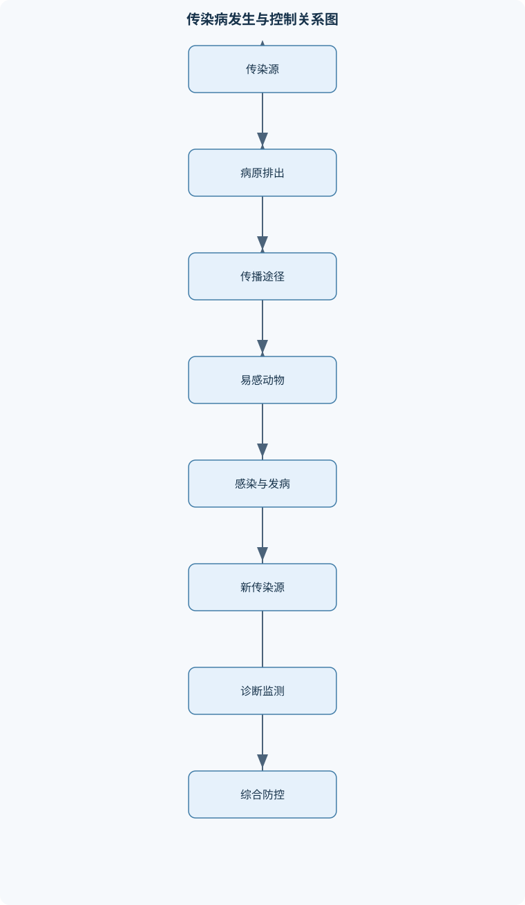
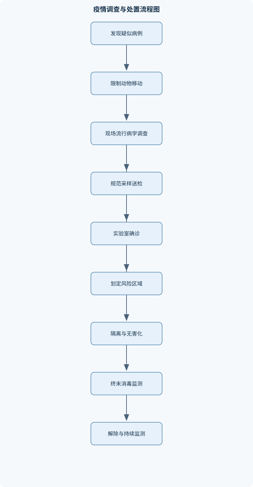

# 兽医传染病学

## 一、课程整体知识框架

### 课程边界与先修知识

本课程研究动物传染病的病原学、流行病学、发病机制、临床表现、病理变化、诊断、免疫预防、消毒灭源、疫情控制及公共卫生意义，重点覆盖畜禽和常见伴侣动物的重要传染病，并兼顾人畜共患病、外来动物疫病和规模化养殖场生物安全。课程边界包括传染病发生与传播的基本规律、病原检测与群体监测、典型疾病的综合判定及防控方案设计；不替代兽医微生物学、兽医免疫学、病理学、临床诊断学、动物卫生法规和药理学。先修知识包括微生物学与病毒学基础、动物解剖生理学、兽医病理学、免疫学、流行病学基本统计和实验室生物安全。涉及具体疫情处置时，应以现行国家动物疫病防治规定、官方诊断技术规范和当地兽医主管部门要求为准。





### 1. 学科对象、任务与边界

兽医传染病学研究病原体在动物个体和动物群体中的侵入、定植、复制、排出与传播规律，以及宿主产生临床疾病、病理损伤和免疫反应的过程。课程对象不仅包括出现明显症状的患病动物，还包括隐性感染动物、亚临床感染动物、持续感染动物、康复后仍排毒的动物和受到污染但尚未感染的环境。

“感染”是病原体进入宿主并在适宜部位存活、繁殖或持续存在，同时引起宿主反应的过程；感染不一定表现为临床疾病。“传染病”强调病原体能够在动物之间或动物与环境之间传播，并造成一定群体影响。“疾病”则是感染或其他因素导致机体结构、功能异常并出现临床或病理表现的状态。因此，病原学阳性不必然等于当前发病，也不必然等于动物正在排出具有感染性的活病原。

本课程形成“病原体—宿主—环境”三方面的分析框架。病原体方面关注分类、宿主范围、抗原性、环境抵抗力、排毒特点和致病机制；宿主方面关注种属、年龄、品种、免疫状态、营养和应激；环境方面关注密度、通风、温湿度、饲养方式、动物调运、媒介、饲料和人员车辆流动。传染病防控的基本目标，是减少传染源排毒，切断传播途径，并降低易感动物比例或提高其抵抗力。单一措施通常不能覆盖传播链的全部环节。

课程不替代兽医微生物学、兽医免疫学、病理学、临床诊断学、动物卫生法规和药理学。涉及高风险病原采样、运输、培养、动物扑杀、无害化处理和疫情解除时，必须服从现行规定、官方诊断技术规范和主管部门要求。

### 2. 传染病发生的基本规律

一个动物群体发生传播，通常需要传染源、传播途径和易感动物三个基本环节。传染源包括患病动物、隐性感染动物、持续感染动物、病原携带动物、部分康复动物以及某些野生动物。传播途径包括直接接触、飞沫、气溶胶、经口、经鼻、经皮肤损伤、媒介传播、机械传播和垂直传播。易感性受动物种类、年龄、遗传背景、免疫状态、营养、应激和既往感染影响。

外源性感染是病原体从动物群体外部进入宿主，例如引种、运输、野生动物接触、污染饲料或人员车辆带入。内源性感染是动物体内原有或长期存在的微生物，在免疫力下降、组织屏障破坏或应激条件下增殖并致病。混合感染是同一动物或同一群体同时或先后受到两种以上病原体感染，病原之间可能产生协同作用。例如免疫抑制性病毒可增加细菌性肺炎、肠炎或败血症的发生风险。混合感染会改变临床表现和死亡风险，不能仅依据一种病原的检出结果解释全部病变。

传播还可按时间和来源区分为水平传播与垂直传播。水平传播发生在同代动物之间，垂直传播则由亲代传给胚胎、胎儿或新生动物，包括经生殖细胞、胎盘、产道、乳汁等途径。持续感染动物可能长期或间歇性排毒，即使临床症状已经消失，仍可在引种、检疫和复养评估中具有重要意义。

传染病个体过程通常可分为潜伏期、前驱期、明显期和转归期。潜伏期是病原体进入机体至出现首个临床症状的时间，不等于病原体完全不能排出；部分疾病在潜伏期末即可传播。前驱期表现为精神沉郁、食欲下降、体温异常等非特异性症状。明显期出现具有一定诊断价值的临床综合征。转归期可能表现为康复、死亡、转为慢性、形成持续感染或留下后遗症。传染期应根据排毒时间界定，而不是简单等同于明显发病期。

### 3. 流行病学指标与传播动力学

观察期内新发病例数除以观察期开始时具有发病风险的动物数，得到发病率：

$$
P=\frac{\text{观察期内新发病例数}}{\text{观察期开始时的风险动物数}}
$$

这里的 $P$ 无量纲，通常表示为比例或百分比。感染率的分子是观察期内新发生感染的动物数，分母同样是风险动物数；感染可以没有临床症状。病例病死率为：

$$
CFR=\frac{\text{某病死亡动物数}}{\text{该病确诊或发病动物数}}
$$

群体死亡率为：

$$
MR=\frac{\text{观察期内死亡动物数}}{\text{群体总数}}
$$

例如，200头猪中30头发病、6头死亡，发病率为 $30/200=15\%$，病例病死率为 $6/30=20\%$，群体死亡率为 $6/200=3\%$。三者分母不同，不能因为死亡率低就推断发病率低，也不能因为发病率高就推断病死率高。

用简化的SIR模型表示群体状态时，$S$ 为易感动物数，$I$ 为具有传染性的动物数，$R$ 为移出传播链的动物数，$N=S+I+R$ 为群体总数。封闭群体中暂不计出生、死亡和迁入迁出，感染动物数量变化为：

$$
\frac{dI}{dt}=\beta\frac{SI}{N}-\gamma I
$$

其中，$\beta$ 是单位时间内有效接触并造成传播的平均速率，单位可表示为“每只动物每单位时间的有效传播接触数”；$\gamma$ 是感染动物离开传染状态的速率，单位为“每单位时间”，近似等于平均传染期 $d$ 的倒数。若 $\beta S/N>\gamma$，感染动物数在该时刻增加；若 $\beta S/N<\gamma$，感染动物数减少。

在完全易感群体中，基本再生数为：

$$
R_0=\frac{\beta}{\gamma}
$$

也可在简化条件下写成：

$$
R_0=a\times p\times d
$$

其中，$a$ 是每只动物每日有效接触数，单位为“次/只/日”；$p$ 是一次有效接触造成感染的概率，无量纲；$d$ 是平均传染期，单位为日。因此 $R_0$ 无量纲。若 $R_0>1$，单个输入病例在完全易感群体中可能造成传播；若 $R_0<1$，传播链平均趋于消退，但仍可能出现偶然的局部传播。

当前群体中的有效再生数为：

$$
R_e=R_0\frac{S}{N}
$$

当免疫、隔离或自然感染使 $R_e<1$ 时，传播链在平均意义上趋于中断。若疫苗完全阻止感染且免疫均匀，理论免疫比例阈值为：

$$
E_c=1-\frac{1}{R_0}
$$

例如 $R_0=4$ 时，理论阈值为 $1-1/4=75\%$。该结论依赖完全保护、免疫持久、群体均匀混合、无持续外源输入和参数稳定等假设。若疫苗保护不完全，则需要把保护效力纳入估算；若动物存在分群、频繁调运、免疫衰减或病原变异，实际所需覆盖率可能高于理论值。该公式不能作为现场疫情解除或免疫合格的单独依据。

### 4. 流行病学调查与监测

病例定义应分为疑似病例、临床病例和确诊病例。疑似病例通常依据动物种类、症状、流行病学联系或病理变化建立；临床病例需达到规定的症状或病理标准；确诊病例还需有符合要求的病原学、血清学或分子检测证据。病例定义必须稳定、可重复，并明确时间、地点、动物种类和检测标准。

被动监测依赖养殖场、动物医院、屠宰场或基层人员主动报告，成本较低但容易漏掉亚临床和偏远地区病例。主动监测由防疫人员按计划采样调查，能够估计感染分布，但需要明确抽样框、样本量、检测方法和质量控制。暴发调查应同时分析时间分布、空间分布、动物日龄、免疫史、调运史、人员车辆流动、饲料来源、饮水、野生动物接触和病死动物处理方式。

队列思路是按暴露情况将动物分为暴露组和未暴露组，再比较两组发病风险，适合暴露来源较清楚的场景。病例对照思路是先选择病例和未发病对照，再回顾两组的暴露差异，适合病例数量有限或潜伏期较长的情形。两种方法都必须注意选择偏倚、回忆偏倚、混杂因素和检测误差。

季节性可由病原、媒介和宿主共同决定。低温可能增强某些病原在环境中的存活，温暖季节可能增加媒介活动；高温、通风不足和密度增加可加重呼吸道疾病；饮水、饲料和昆虫变化可改变消化道或媒介性疾病风险。因此，“冬季病”或“夏季病”不是绝对分类，实际判断应结合病原稳定性、媒介密度、动物管理和免疫水平。

### 5. 临床、病理与实验室诊断

临床诊断从综合征入手，例如急性败血症、出血、呼吸困难、神经症状、繁殖障碍或严重腹泻。综合征不是某一种疾病的专属性状，发热、出血和死亡增加也可能由多种病原引起。鉴别诊断应依次比较宿主种类、年龄、潜伏期、传播速度、病死率、病变分布和免疫史，并主动考虑混合感染。

尸体剖检可发现器官大体病变，但高风险疾病或疑似炭疽尸体不能为寻找病变而盲目剖解。炭疽可表现为血液凝固不良、脾脏肿大、皮下胶冻样浸润等，肉眼表现并非绝对特异，且尸体处理可能增加芽孢污染和职业暴露风险。病理组织学能够观察组织结构、炎症类型、坏死和病原定位；病原学检测则需要结合病料部位、采样时机和样品质量。

病料采集应先记录动物编号、日龄、症状、免疫史、用药史和死亡时间，再按疾病选择全血、血清、鼻咽拭子、粪便、组织、脾脏、淋巴结、肺、肠道或胎儿组织。病原检测、血清学和病理学样品应分装，避免交叉污染。包装应防漏、防破损、可追溯，并在相应生物安全条件下运输。

细菌性疾病可进行分离培养、形态和生化鉴定、分子鉴定及药敏试验；病毒性疾病可采用抗原检测、核酸检测、病毒分离、细胞培养或适宜的鸡胚接种；抗体检测可用于判断既往感染、免疫反应或群体血清学变化。HA用于确定具有血凝活性的抗原稀释度，HI用于检测能抑制血凝的特异性抗体，二者检测目的不同。

诊断性能用敏感性和特异性表示：

$$
Se=\frac{\text{真实患病且检测阳性动物数}}{\text{真实患病动物总数}}
$$

$$
Sp=\frac{\text{真实未患病且检测阴性动物数}}{\text{真实未患病动物总数}}
$$

阳性预测值和阴性预测值还受患病率影响：

$$
PPV=\frac{Se\times Prev}{Se\times Prev+(1-Sp)\times(1-Prev)}
$$

低患病率群体中，即使特异性较高，阳性结果也可能包含较多假阳性。例如 $Se=95\%$、$Sp=98\%$、患病率为 $1\%$ 时，检测10000只动物，预计真阳性95只、假阳性198只，阳性预测值约为 $95/(95+198)=32.4\%$。因此筛查阳性通常需要复核，不能脱离患病率和检测目的直接确诊。

实时荧光PCR的Ct值受样品质量、提取效率、试剂体系和仪器影响，不能在未验证的情况下直接把不同平台的Ct值当作病原载量进行横向比较。核酸阳性可以表示病原遗传物质存在，但不一定表示存在活病原，也不一定说明动物当前具有传染性，必须结合临床、流行病学和必要的活病原证据解释。

### 6. 免疫预防与群体免疫

先天免疫包括皮肤黏膜屏障、吞噬细胞、补体、炎症反应和干扰素等；获得性免疫包括针对特定抗原的体液免疫和细胞免疫。主动免疫由感染或接种疫苗诱导，形成时间较慢但通常更持久；被动免疫来自母源抗体、免疫血清或其他抗体制剂，起效较快但持续时间有限。

疫苗可按制备方式分为灭活疫苗、减毒活疫苗、基因工程疫苗等；菌苗、类毒素和其他免疫制剂具有不同抗原来源与适用范围。免疫程序应综合目标疾病、动物日龄、母源抗体、疫苗适用范围、免疫途径、生产阶段、当地风险和产品要求制定。首免用于建立初始免疫，加强免疫用于提高抗体水平、扩大免疫覆盖或延长保护时间。

母源抗体可在幼龄阶段降低感染风险，也可能中和活疫苗抗原，使免疫建立延迟。因此，幼龄动物并非“越早接种越能立即获得完全保护”。免疫空白期是母源抗体下降而主动免疫尚未充分建立的阶段，需通过免疫程序、分群管理和降低暴露来控制风险。

免疫失败的原因可分为病原、动物和管理三类。病原因素包括抗原变异、感染剂量过高和免疫逃逸；动物因素包括母源抗体干扰、免疫抑制、营养不良和疾病状态；管理因素包括疫苗失活、冷链中断、稀释错误、接种途径不当、漏免和群体覆盖不足。抗体阳性并不必然代表当前感染，也可能来自疫苗或既往感染；抗体阴性也不必然代表完全没有保护，应结合检测窗口、细胞免疫和保护终点解释。

紧急免疫适用于某些具有明确疫苗保护效果、传播风险高且能够配合隔离和监测的场景，但不能替代病例报告、移动控制、病畜隔离和环境清除。紧急接种不能立即清除已经感染的动物，并可能影响后续血清学判读。

### 7. 消毒、隔离与牧场生物安全

消毒按时机可分为预防性消毒、随时消毒和终末消毒。有效消毒不是简单喷洒药液，而是“隔离污染源—机械清除—清洗—选择方法—充分接触—效果验证”的连续过程。粪便、血液、饲料残渣、泥土和有机物会消耗或屏蔽消毒剂，因此机械清除和清洗必须先于化学消毒。

物理方法包括热力、干燥、紫外线和辐照。化学方法包括氧化类、醛类、酚类、碱类和表面活性剂等。实际效果取决于病原耐受性、消毒剂浓度、温度、接触时间、表面性质、有机物负荷和覆盖范围。消毒剂必须接触目标表面并在有效浓度下维持足够时间，死角、裂缝、排水沟和难清洗设备常是失败点。

消毒效果可用对数降低值表示：

$$
LR=\log_{10}\left(\frac{D_0}{D_1}\right)
$$

其中，$D_0$ 为处理前污染量，$D_1$ 为处理后残留量，二者必须使用相同单位。若污染量由 $10^8$ 个单位降至 $10^2$ 个单位，则：

$$
LR=\log_{10}\left(\frac{10^8}{10^2}\right)=6
$$

表示降低六个数量级，残留量为原来的百万分之一。若处理前为 $10^4$ 个感染单位，达到 $LR=5$ 时，残留量的期望值为 $10^4/10^5=0.1$ 个感染单位，但这不等于绝对没有病原，也不能代替对覆盖率、采样误差和最低感染剂量的评价。

牧场应划分净区、缓冲区和脏区，实行单向物流，控制人员、车辆、饲料、器械、病死动物和粪污的交叉流动。引种应包括供种方健康记录审查、运输前检疫、到场隔离、分阶段采样、临床观察和入群评估。全进全出、分群饲养、专人专物、车辆清洗消毒和病死动物规范处置可减少年龄混合和病原循环。生物安全既依赖围栏、洗消设施等硬件，也依赖人员培训、记录、抽查和持续改进等软件管理。

### 8. 重要动物传染病与公共卫生框架

猪病模块围绕猪瘟、非洲猪瘟、猪繁殖与呼吸综合征、猪圆环病毒相关疾病、猪伪狂犬病、猪细小病毒病、猪肺疫、猪肺炎支原体感染、传染性萎缩性鼻炎、猪传染性胸膜肺炎、副猪嗜血杆菌病和沙门氏菌病展开。分析重点是区分出血性疾病、繁殖障碍、免疫抑制、呼吸道综合征和败血症。非洲猪瘟等烈性猪病的处置不能依赖单一喷雾消毒，必须结合移动控制、分区管理、病死动物处置、采样检测和官方疫情措施。

禽病模块包括新城疫、禽流感、传染性支气管炎、传染性喉气管炎、传染性法氏囊病、马立克氏病、鸡白痢、禽霍乱、鸭瘟、鸭病毒性肝炎和小鹅瘟。呼吸道症状、产蛋下降、神经症状和死亡增加可能由多种病原引起，应结合日龄、免疫程序、野鸟接触、病理变化和核酸或血清学检测进行判定。

反刍动物和马属动物模块包括口蹄疫、牛结核病、布鲁氏菌病、牛病毒性腹泻与黏膜病、牛传染性鼻气管炎、牛流行热、炭疽、羊痘、山羊传染性胸膜肺炎、蓝舌病、马鼻疽、马传染性贫血和马流感。口蹄疫具有多宿主和高传染性特点；牛结核病可结合结核菌素变态反应开展检疫；布鲁氏菌病重点关注繁殖障碍和人畜共患风险；炭疽尸体处理必须避免盲目剖检和开放式污染。

犬、猫、兔及其他动物模块包括狂犬病、犬瘟热、犬细小病毒病、犬传染性肝炎、猫泛白细胞减少症、猫传染性腹膜炎、兔病毒性出血症、兔球虫病和传染性肠炎，以及水貂、狐等经济动物疾病。狂犬病是神经嗜性人畜共患病，出现可疑暴露时应立即限制接触并依照规范开展动物、人员和样品管理；不能把人体暴露后的处理原则直接等同于动物治疗方案。

人畜共患病模块连接动物健康、食品安全、环境卫生和职业防护。狂犬病、炭疽、布鲁氏菌病、结核病、沙门氏菌病、致病性大肠杆菌病、弯曲菌病、钩端螺旋体病和动物源性流感均需关注动物—食品—环境—从业人员之间的暴露链。屠宰检验、样品安全、个人防护、病死动物无害化处理以及兽医机构和公共卫生机构的协同监测，构成“同一健康”框架下的实际工作内容。

## 二、章节和模块划分

### 核心知识覆盖清单

本清单用于检查正文是否覆盖本课程的主要知识模块：

- **传染病学基本概念与发生规律**：感染、传染病与疾病谱、传染源、传播途径和易感动物、内源性感染、外源性感染与混合感染、垂直传播、水平传播与持续感染、潜伏期、前驱期、明显期和转归期、发病率、感染率、病死率和死亡率、传染性、致病力、毒力和抗原性、疫源地、自然疫源地与地方流行性、散发、地方流行、流行和暴发、季节性、周期性和动物群体易感性变化。
- **流行病学调查与传播动力学**：病例定义与主动、被动监测、个体感染链和畜群传播链、传染源排毒方式与排毒量、直接接触、飞沫、气溶胶和经口传播、媒介传播、机械传播和垂直传播、畜群密度、动物调运和混群的影响、年龄、品种、免疫状态与易感性、暴露史、时间分布和空间分布分析、暴发调查的病例对照与队列思路、基本再生数、有效再生数和控制阈值。
- **临床、病理与实验室诊断**：临床诊断与鉴别诊断、流行病学诊断的证据整合、尸体剖检和典型病理变化、病理组织学检查与病原定位、病料采集、保存、包装和运输、细菌分离培养、鉴定和药敏试验、病毒分离、细胞培养和鸡胚接种、抗原抗体检测与血清学诊断、PCR、实时荧光PCR和测序分型、检测结果的敏感性、特异性和预测值。
- **免疫预防与群体免疫**：先天免疫与获得性免疫、主动免疫、被动免疫和母源抗体、疫苗、菌苗、类毒素和免疫制剂、灭活疫苗、减毒活疫苗和基因工程疫苗、免疫程序的制定原则、首免、加强免疫和免疫空白期、免疫失败的病原、动物和管理因素、抗体监测与免疫效果评价、紧急免疫接种的适用条件和局限、免疫抑制、抗原变异与突破感染。
- **消毒、隔离与牧场生物安全**：预防性消毒、随时消毒和终末消毒、机械清除、清洗和消毒的先后关系、热力、干燥、紫外线和辐照消毒、氧化类、醛类、酚类、碱类和表面活性剂、有机物、温度、浓度和接触时间的影响、净区、缓冲区、脏区与单向物流、人员、车辆、饲料和器械的风险控制、引种检疫、全进全出和分群饲养、病死动物、粪污和餐厨废弃物处置、生物安全措施的验证与持续改进。
- **猪的重要传染病**：猪瘟的流行病学、出血性病变和鉴别诊断、非洲猪瘟的病原特征、传播风险和疫情处置、猪繁殖与呼吸综合征的繁殖障碍和免疫抑制、猪圆环病毒相关疾病与继发感染、猪伪狂犬病的神经症状和繁殖障碍、猪细小病毒病的胚胎和胎儿感染、猪肺疫的急性败血症和纤维素性肺炎、猪气喘病与猪肺炎支原体感染、猪传染性萎缩性鼻炎和鼻甲骨变化、猪传染性胸膜肺炎、副猪嗜血杆菌病和沙门氏菌病。
- **禽类的重要传染病**：鸡新城疫的临床类型、病理变化和免疫监测、禽流感的病原分型、公共卫生风险和报告要求、鸡传染性支气管炎及其呼吸道和肾脏表现、鸡传染性喉气管炎与康复带毒问题、鸡传染性法氏囊病与免疫抑制、鸡马立克氏病的肿瘤性病变和免疫预防、鸡白痢与全血平板凝集筛查、禽霍乱的急性败血症和多杀性巴氏杆菌感染、鸭瘟、鸭病毒性肝炎和小鹅瘟、禽病的免疫程序、抗体监测与群体管理。
- **反刍动物与马属动物传染病**：口蹄疫的多宿主感染和高传染性、牛结核病的结核菌素变态反应、布鲁氏菌病的繁殖障碍和血清学检疫、牛病毒性腹泻与黏膜病、牛传染性鼻气管炎和繁殖障碍、牛流行热的媒介传播和季节性、炭疽的芽孢形成、人畜共患性和尸体处理、羊痘与山羊传染性胸膜肺炎、蓝舌病的媒介传播和血管损伤、马鼻疽、马传染性贫血和马流感。
- **犬、猫、兔及其他动物传染病**：狂犬病的神经嗜性、传播方式和暴露后处置原则、犬瘟热的多系统损伤和神经症状、犬细小病毒病的出血性肠炎、犬传染性肝炎与角膜水肿、猫泛白细胞减少症及其群体防控、猫传染性腹膜炎的免疫病理基础、兔病毒性出血症的急性败血症、兔球虫病与传染性肠炎的鉴别、水貂、狐和其他经济动物的传染病特点、伴侣动物免疫、隔离和接触者管理。
- **人畜共患病与公共卫生**：人畜共患病的定义和传播界面、狂犬病、炭疽、布鲁氏菌病和结核病、沙门氏菌病、致病性大肠杆菌病和弯曲菌病、钩端螺旋体病与水体和啮齿动物风险、禽流感和动物源性流感风险、动物、食品、环境和从业人员的暴露链、职业暴露、个人防护和样品安全、动物疫情与人类病例的协同监测、屠宰、无害化处理和食品安全控制点、兽医机构与公共卫生机构的联防联控。
- **疫情处置与综合防控方案设计**：疫情发现、初步核实和风险分级、病例报告、现场封锁和移动控制、病畜隔离、疑似动物管理和接触动物追踪、采样检测与实验室生物安全、扑杀、无害化处理和终末消毒、紧急免疫的适用边界、复养前风险评估和环境监测、疫情解除条件与持续监测、成本、可行性和动物福利的综合权衡、以传染源、传播途径和易感动物为核心的方案评估。


### 1. 模块一至三：基本概念、流行病学与诊断

第一章“传染病基本概念与发生规律”先建立感染、传染病、疾病谱、传染源、传播途径、易感动物、疫源地、自然疫源地、地方流行、散发、流行和暴发等概念。疾病谱应从隐性感染、亚临床感染、典型病例、非典型病例、慢性病例到死亡病例连续理解，而不是把“感染”和“发病”当作同义词。

第二章“流行病学调查与传播动力学”研究个体感染链和畜群传播链。课程将病例定义、主动监测、被动监测、时间分布、空间分布、年龄分布、免疫史和暴露史整合起来，并用SIR模型解释群体传播的理想条件和现实限制。模型适合说明传播方向和控制阈值，不适合直接替代复杂牧场的空间网络模型、分群模型和持续外源输入模型。

第三章“临床、病理与实验室诊断”按“临床综合征—流行病学—病理—病原—免疫学—分子检测”组织。诊断的关键不是寻找单一阳性结果，而是判断证据之间是否相互支持。检测阳性应说明样品、靶标、检测方法、采样时机和质量控制；检测阴性应考虑病料部位不当、病原量低、采样窗口不合适、抑制物和运输保存失误。

#### 代表性流程一：疫情初步调查与采样

**输入**为疑似病例、动物群体、现场布局、临床资料和动物移动记录；**输出**为稳定的病例定义、风险等级、采样计划和临时控制措施。

1. 记录动物种类、数量、日龄、发病时间、死亡时间、地点和移动史。
2. 建立疑似、临床和确诊病例定义，避免调查过程中随意改变标准。
3. 绘制时间线、空间分布、人员车辆路线和动物调运关系。
4. 计算发病率、病例病死率和群体死亡率，分别标明分母。
5. 排查传染源、传播途径和易感动物证据，重点调查引种、泔水、饲料、野生动物、人员和车辆。
6. 根据疾病类型选择全血、血清、拭子、粪便、组织或尸体样品，并按生物安全要求包装运输。
7. 根据检测结果、样品质量和流行病学证据更新风险判断。

终止条件是病例定义稳定、关键暴露链得到解释，且检测结果达到确诊或排除所需标准。按病例数计，资料整理和初步统计可近似为 $O(n)$；实验室检测、空间分析和追踪调查另行计算。

#### 代表性流程二：诊断鉴别与结果解释

**输入**为临床表现、病理变化、流行病学资料和初步检测结果；**输出**为按可能性排序的鉴别诊断清单及下一步检测组合。

1. 先确定主要综合征，如呼吸道、出血、神经、繁殖障碍或急性败血症。
2. 按宿主种类、年龄、潜伏期、传播速度和免疫史筛选候选疾病。
3. 区分特异性病变和非特异性病变，注意同一病原在不同年龄和免疫状态下可表现不同。
4. 检查混合感染和继发感染的可能性。
5. 选择能够区分候选疾病的最小检测组合，而不是无目的地检测所有病原。
6. 综合阳性和阴性结果，并结合检测敏感性、特异性、患病率和样品质量解释。
7. 同时提出隔离、移动控制和人员防护措施。

关键不变量是每个候选诊断都必须有流行病学、病理学或实验室证据支持。获得足以改变处置决策的证据后，完成本轮鉴别；若结果矛盾，则回到病例定义、采样质量和混合感染评估。

### 2. 模块四至五：免疫预防、消毒与生物安全

第四章“免疫预防与群体免疫”比较先天免疫、获得性免疫、主动免疫、被动免疫和母源抗体，解释灭活疫苗、减毒活疫苗、基因工程疫苗、菌苗和类毒素的基本差异。免疫程序包括首免、加强免疫、免疫空白期、抗体监测和免疫失败分析。评价免疫效果时，必须明确终点是防止感染、防止发病、降低排毒还是降低死亡，因为不同终点不能共用同一个疫苗保护效力 $VE$。

第五章“消毒、隔离与牧场生物安全”从污染源控制开始，依次说明机械清除、清洗、消毒、干燥、环境验证和持续改进。净区、缓冲区和脏区不是静态标签，而是与人员、车辆、饲料、器械、死猪和粪污路线相结合的风险管理系统。

#### 代表性流程三：免疫程序设计

**输入**为目标疾病、动物种类、日龄、母源抗体、疫苗属性、既往免疫记录和场内风险；**输出**为首免、加强免疫、监测和调整方案。

1. 确定疾病的传播方式、危害程度和免疫保护目标。
2. 评估日龄、母源抗体、既往免疫、临床健康状态和免疫抑制因素。
3. 核对疫苗适用动物、免疫途径、保存条件和产品要求。
4. 安排首免与加强免疫，明确接种对象、时间和记录方式。
5. 通过抗体或其他保护性指标评价群体反应，不能只抽查个别动物就代表全群。
6. 发生免疫失败时，按疫苗失活、接种操作、动物健康、免疫抑制、病原变异和暴露剂量逐项排查。
7. 在法规和产品要求范围内调整程序。

终止条件是免疫覆盖率、免疫反应和临床保护达到预设目标。疫苗必须来源合法、适用于目标动物，紧急免疫不能替代隔离和疫情报告。

#### 带语言标注的伪代码：消毒效果评价

```text
伪代码
输入：污染区域、目标病原、设施清单、清洗设备、消毒剂信息
输出：合格或不合格的清洗消毒记录

1. 限制人员、车辆和动物进入污染区域
2. 对每个区域执行：
      2.1 机械清除粪便、血液、饲料残渣和泥土
      2.2 使用清洁剂和水清洗表面
      2.3 检查裂缝、排水沟、设备底部和难以触及的死角
      2.4 按目标病原和设施材料选择物理或化学方法
      2.5 核对工作浓度、覆盖范围和接触时间
      2.6 完成处理并记录时间、人员和区域
      2.7 进行表面检查或规定的微生物学验证
      2.8 若结果不合格，则返工并重新验证
3. 当所有关键区域均合格且记录完整时结束
```

该流程的不变量是消毒剂必须真正接触目标表面，并在有效浓度下维持规定接触时间。其适用对象是环境、设施、车辆和器械，不等同于对活体动物直接使用化学消毒剂。

### 3. 模块六至九：按动物种类学习重要传染病

第六章“猪的重要传染病”以鉴别框架组织疾病。猪瘟和非洲猪瘟均可出现发热、出血、死亡增加等表现，不能仅凭肉眼病变确诊。猪繁殖与呼吸综合征、猪圆环病毒相关疾病常与繁殖障碍、呼吸道症状、消瘦和免疫抑制有关；猪伪狂犬病和猪细小病毒病重点联系神经症状、繁殖障碍以及胚胎和胎儿感染；猪肺疫、猪传染性胸膜肺炎、副猪嗜血杆菌病、猪肺炎支原体感染和沙门氏菌病则需结合急性败血症、纤维素性肺炎、浆膜炎、慢性咳嗽和肠道病变进行区分。

第七章“禽类的重要传染病”比较新城疫、禽流感、传染性支气管炎、传染性喉气管炎、传染性法氏囊病和马立克氏病。禽病诊断必须把日龄、免疫程序、抗体监测、野鸟接触、产蛋变化、呼吸道和神经症状结合起来。鸡白痢可采用全血平板凝集等筛查思路，但筛查结果仍需按规范复核和解释。

第八章“反刍动物与马属动物传染病”强调口蹄疫的多宿主和高传染性、牛结核病的变态反应检疫、布鲁氏菌病的繁殖障碍和人畜共患性、蓝舌病的媒介传播及血管损伤。炭疽尸体处理是安全重点，疑似时不得盲目剖检或开放式搬运。第九章“犬、猫、兔及其他动物传染病”强调狂犬病、犬瘟热、犬细小病毒病、猫泛白细胞减少症、猫传染性腹膜炎、兔病毒性出血症和兔球虫病的宿主差异、传播方式与群体管理。伴侣动物防控还需管理接触者、环境、同住动物和免疫记录。

### 4. 模块十至十二：公共卫生、疫情处置与方案设计

第十章“人畜共患病与公共卫生”以动物、食品、环境和从业人员的暴露链为主线。狂犬病、炭疽、布鲁氏菌病、结核病、沙门氏菌病、弯曲菌病、钩端螺旋体病和动物源性流感均要求同时考虑动物病例、职业暴露、样品安全和公共卫生报告。动物疫情与人类病例监测应尽量共享时间、地点、动物接触史和病原学信息，但动物资料不能不加区别地替代人体诊断。

第十一章“疫情处置”包括发现、初步核实、风险分级、报告、封锁、隔离、接触动物追踪、采样、实验室检测、扑杀或紧急免疫、无害化处理、终末消毒和持续监测。第十二章“综合防控方案设计”要求从传染源、传播途径和易感动物三个方面评估措施，并综合成本、可行性、动物福利、人员安全和法规要求。

#### 疫情处置流程

**输入**为疑似烈性传染病、检测结果、动物群体资料和场区布局；**输出**为隔离、报告、检测、处置、消毒和恢复生产方案。

1. 立即限制动物、人员、车辆和动物产品移动。
2. 按要求报告，由有资质机构采样和检测。
3. 划定疫点、疫区和受威胁区的风险边界。
4. 分别管理患病、疑似和假定健康动物。
5. 依据现行规定选择扑杀、无害化处理、紧急免疫或其他措施。
6. 完成追踪调查、污染源清除和终末清洁消毒。
7. 复养前进行风险评估、环境监测和人员培训。
8. 达到规定条件后逐步恢复，并持续监测异常死亡和临床症状。

具体封锁、扑杀、解除和复养条件必须服从现行法规与主管部门指令，不能由教材中的一般流程自行替代。

### 5. 代表性例题

#### 例题一：流行病学指标计算

**题干：**某猪群有200头猪，观察期内新发病例30头，其中死亡6头，求发病率、病例病死率和群体死亡率。

**分析：**三项指标的分母不同，必须先确定统计对象。

**解答：**

$$
P=\frac{30}{200}=15\%
$$

$$
CFR=\frac{6}{30}=20\%
$$

$$
MR=\frac{6}{200}=3\%
$$

**结果验证：**病例病死率不可能超过100%，群体死亡率低于病例病死率是因为分母包含未发病动物。三者不能互相替代。

**变式：**若观察期开始时已有20头病猪，则新发病例的发病率分母仍应是具有发病风险的动物数，不能机械使用观察期结束时总数。

#### 例题二：群体免疫阈值

**题干：**某传染病在完全易感猪群中的 $R_0=4$，疫苗完全阻止感染，理论上至少需要多少比例动物具有保护性免疫，才能使 $R_e<1$？

**分析：**使用完全保护、均匀混合和无外源输入的理想模型。

**解答：**

$$
E_c=1-\frac{1}{R_0}=1-\frac{1}{4}=0.75
$$

理论阈值为75%。

**结果验证：**免疫后易感比例为25%，因此：

$$
R_e=4\times0.25=1
$$

要使 $R_e$ 严格小于1，实际比例应略高于75%。

**变式：**若疫苗保护效力低于100%、免疫分布不均或存在持续输入病例，75%不能作为现场保证值，需提高覆盖并结合隔离、监测和移动控制。

#### 例题三：检测阳性预测值

**题干：**某检测方法 $Se=95\%$、$Sp=98\%$，在患病率为1%的群体中检测10000只动物，估计真阳性、假阳性和阳性预测值。

**分析：**先按患病率分出真实患病和未患病动物，再分别计算真阳性和假阳性。

**解答：**真实患病动物为100只，真阳性为：

$$
100\times0.95=95
$$

未患病动物为9900只，假阳性为：

$$
9900\times(1-0.98)=198
$$

阳性总数为 $95+198=293$，因此：

$$
PPV=\frac{95}{293}\approx32.4\%
$$

**结果验证：**假阳性多于真阳性，说明低患病率筛查中的阳性结果必须复核。

**变式：**若患病率升高，阳性预测值通常升高；若特异性下降，假阳性会增加，阳性预测值下降。

#### 例题四：消毒对数降低值

**题干：**某栏舍表面污染量由 $10^7$ 个感染单位降至 $10^2$ 个感染单位，求 $LR$ 和残留比例。

**解答：**

$$
LR=\log_{10}\left(\frac{10^7}{10^2}\right)=5
$$

残留比例为：

$$
\frac{10^2}{10^7}=10^{-5}
$$

即残留量为原污染量的十万分之一。

**结果验证：**降低5个数量级意味着污染量除以 $10^5$，与 $10^7/10^5=10^2$ 一致。

**变式：**若采样只覆盖清洁区域，所得 $LR$ 不能代表整个栏舍；还应检查死角、排水沟和设备底部。

#### 例题五：疑似急性出血性猪病

**题干：**某猪场出现发热、耳部和腹部发绀、呕吐、腹泻及死亡增加，如何处理？

**分析：**症状属于非特异性出血和败血症综合征，不能只凭临床表现确诊。

**解答：**

1. 将非洲猪瘟、猪瘟、猪丹毒、沙门氏菌病及严重混合感染列入鉴别。
2. 立即限制猪只、人员、车辆、饲料和死猪移动。
3. 调查引种、运输、泔水、饲料、车辆、人员和野生动物接触史。
4. 按要求采集全血、脾脏、淋巴结等样品，避免在高风险尸体上无防护剖检。
5. 结合核酸检测、病理变化和流行病学证据综合判定。
6. 依据确诊结果和主管部门要求实施隔离、处置、消毒和持续监测。

**结果验证：**处理方案同时覆盖传染源、传播途径和易感动物，没有把单项检测或肉眼病变当作确诊依据。

**变式：**若PCR阴性但样品质量差、采样部位不当或采样过早，不能立即排除感染，应复核病例定义和采样方案。

### 6. 实验与项目任务

#### 项目一：鸡群免疫效果监测

**输入数据：**鸡群数量、日龄、疫苗种类和批次、接种日期、接种途径、抽样编号、抗体检测结果、临床症状和死亡记录。

**步骤：**

1. 核对免疫记录、疫苗保存和接种操作。
2. 按群体和日龄分层抽样，记录每只样品的编号。
3. 检测相应抗体或保护性指标，设置质控和重复样品。
4. 计算群体抗体水平、阳性比例和离散程度。
5. 将检测结果与临床表现、产蛋变化和免疫时间结合解释。
6. 若结果异常，依次排查漏免、疫苗失活、母源抗体干扰、免疫抑制和采样误差。

**评价标准：**样品身份可追溯，抽样覆盖目标群体，质控合格，结果解释不把抗体阳性直接等同于当前感染，能够提出可执行的免疫程序调整。

**排错方法：**若全群抗体偏低，先检查冷链和接种流程；若个别样品异常，先复核编号、样品状态和重复检测；若抗体合格但仍发病，应调查病原变异、混合感染、免疫保护终点和暴露剂量。

#### 项目二：养殖场生物安全风险评估

**输入数据：**场区平面、猪只和人员流线、车辆路线、饲料来源、引种记录、死猪和粪污处理方式、清洗消毒记录及环境采样结果。

**步骤：**

1. 绘制净区、缓冲区和脏区边界。
2. 标出猪只、人员、车辆、饲料、器械、死猪和粪污的移动路线。
3. 识别交叉点、回流点、无法清洗表面和缺少责任人的控制点。
4. 评估引种、出猪台、运输车辆、泔水、动物源性饲料和野生动物接触风险。
5. 为每个高风险点设置隔离、清洗、消毒、停留、检测或禁止措施。
6. 通过现场观察、记录审查和环境采样验证执行效果。
7. 对不合格点制定整改期限，整改后复查。

**评价标准：**所有高风险路线均有明确责任人、操作标准和验证记录；净污流线不交叉或有可靠隔断；清洗消毒不只记录“已完成”，还应有覆盖、接触时间和效果证据。

**排错方法：**若环境检测仍阳性，先检查污染源是否持续输入，再检查机械清除、有机物负荷、消毒剂浓度、接触时间和死角；若检测阴性但临床仍异常，应调查采样代表性、病原检测窗口和未纳入的外源输入。

## 三、核心概念的详细解释

### 3.1 感染、传染病与疾病谱

感染是病原体进入动物机体后，在适宜部位存活、复制或持续存在，并引起宿主反应的过程。感染可以没有明显临床症状，也可以表现为亚临床感染、典型疾病、顿挫型感染、慢性感染、持续感染或死亡。传染病不仅要求病原体与宿主发生相互作用，还强调病原体能够通过一定途径在动物之间或动物与环境之间传播，并对个体或群体造成影响。

疾病谱是同一病原体感染不同动物，或同一动物在不同年龄、免疫状态、感染剂量和饲养条件下所呈现的全部临床结局。疾病谱的一端可能是无症状感染，另一端可能是急性败血症、严重器官损伤或死亡。因而，教材中所说的“典型症状”只能作为诊断线索，不能代替对具体病例的综合判定。

显性感染是出现可观察临床表现的感染，包括典型、非典型、温和型、顿挫型和消散型等表现。隐性感染没有明显临床症状，但动物仍可能发生病原复制、产生抗体或排出病原。亚临床感染通常指临床表现轻微或不易察觉，但可通过生产性能下降、病原检测或血清学检测发现。隐性感染和亚临床感染具有重要流行病学意义，因为其不易被发现，却可能维持传播链。

### 3.2 传染源、传播途径与易感动物

传染源是病原体能够在其中生存、繁殖并排出，从而使病原体传播给其他动物或污染环境的动物或其他生物。患病动物只是传染源的一部分。隐性感染动物、持续感染动物、康复后继续排毒的动物、病原携带动物以及某些野生动物，也可能成为传染源。判断一个动物是否具有传染源意义，关键不在于是否有症状，而在于是否排出具有传播能力的病原体。

排毒可通过呼吸道分泌物、唾液、鼻液、粪便、尿液、乳汁、精液、阴道分泌物、胎儿及胎膜、血液或皮肤损伤处进行。排毒量和排毒持续时间受病原种类、感染部位、感染阶段、免疫状态及继发感染影响。病原学阳性只说明样品中检出核酸、抗原或活病原，不能单独证明动物当前一定具有传染性。核酸残留、失活病原与具有感染能力的活病原必须加以区分。

传播途径可分为水平传播和垂直传播。水平传播发生在同代动物之间，包括直接接触、飞沫、气溶胶、经口、经鼻、经皮肤损伤、媒介传播和机械传播。直接接触常见于密集饲养、交配、咬伤或母仔接触；飞沫传播通常受距离、通风和分泌物粒径影响；气溶胶传播可在通风不良的舍内形成更远距离的传播。经口传播与污染饲料、饮水、粪便和环境密切相关。

生物媒介传播是病原体在媒介体内经历一定发育或增殖后传播，例如某些虫媒病毒；机械传播则是苍蝇、人员、车辆、器械或鞋靴携带病原，不要求病原体在媒介体内发育。垂直传播是亲代向胚胎、胎儿或新生动物传播，可经生殖细胞、胎盘、产道、乳汁或初乳发生。垂直传播能够使病原体跨越代际维持，持续感染动物在种畜禽群体中尤其值得重视。

易感动物是对某种病原体缺乏足够抵抗力、可能发生感染或发病的动物。易感性受动物种类、年龄、品种、遗传背景、母源抗体、主动免疫、营养状况、应激、免疫抑制和既往感染影响。易感动物不等于一定会发病；感染结局还取决于暴露剂量、病原毒力、侵入途径和机体防御能力。

### 3.3 内源性感染、外源性感染、混合感染与持续感染

外源性感染是病原体从动物群体外部进入动物体内，例如引种、调运、野生动物接触、污染饲料或饮水、人员车辆带入以及媒介传播。外源输入是许多养殖场暴发疫情的起点。调查外源性感染时，应同时追踪动物、人员、车辆、饲料、器械、病死动物、粪污和动物产品的移动。

内源性感染是动物体内原有的微生物，在宿主防御能力下降、组织屏障受损、营养不良、应激或其他病原影响下增殖并致病。内源性感染不表示病原一定来自正常菌群，也可能来自动物体内长期潜伏或持续存在的病原。外源性感染和内源性感染可以连续发生：外源病原先造成免疫抑制，随后原有条件致病菌增殖，形成继发感染。

混合感染是同一动物或同一群体同时或先后感染两种以上病原体。混合感染可表现为病原之间协同、拮抗或相互掩盖。例如免疫抑制性病毒会削弱宿主防御，使细菌性肺炎、肠炎或败血症更容易发生。混合感染时，一个病原的阳性结果不能自动解释全部临床表现和病理变化，应将病原检测、组织病理、病原定位及流行病学资料结合起来分析。

持续感染是病原体在宿主体内长期存在，动物可无症状或反复出现症状，并可能长期、间歇性或在特定应激条件下排毒。持续感染可由病原逃避免疫清除、进入免疫特权部位、整合或潜伏等机制形成。康复不等于完全清除病原，检疫、引种和复养评估中应将康复动物、带毒动物和抗体阳性动物分别解释。

### 3.4 传染病的个体发展阶段

潜伏期是病原体侵入机体至出现首个临床症状的时间。潜伏期内病原体可能已经复制并排出，因此潜伏期不等于绝对无传染性。前驱期是出现特异性症状之前的过渡阶段，常表现为精神沉郁、食欲下降、体温改变和生产性能下降。明显期出现较明确的临床综合征，如呼吸困难、腹泻、神经症状、繁殖障碍或出血。

转归期包括康复、死亡、慢性化、形成持续感染和留下后遗症。传染期应按照排毒和传播能力界定，可能早于明显发病期，也可能延长至临床康复之后。因此，隔离时间不能机械地按“症状消失”确定，而应考虑最长潜伏期、排毒持续时间、检测结果、病原特性及官方技术要求。

### 3.5 流行病学类型与流行规律

疫源地是病原体已经存在并能够引起传播的区域或场所。自然疫源地是病原体在自然条件下依靠野生动物、媒介和环境长期维持的区域，家养动物或人进入后可能发生感染。地方流行表示某种疾病在一定地区长期保持相对稳定的发生水平；散发是病例分散、数量较少且缺少明显连续传播证据；流行表示病例数超过该地区通常水平；暴发则常指在较短时间内出现集中病例，通常与共同暴露或快速传播有关。

季节性可由病原体、媒介、宿主和管理条件共同决定。低温、干燥或高温可能改变病原体在环境中的存活；蚊、蜱等媒介的密度和活动受季节影响；动物在冬季舍饲时密度增加，可能促进呼吸道传播；夏季高温、运输和饲料变化可能增加应激。季节性并不表示疾病只在某一季节发生，完善的生物安全、免疫水平和外源输入仍会改变实际流行规律。

### 3.6 临床、病理、流行病学与实验室诊断

临床诊断依据症状、体征、病程和群体表现提出初步判断，但发热、出血、腹泻、呼吸困难和神经症状均属于非特异性综合征。病理学诊断包括尸体剖检、组织病理学和病原定位。急性败血症可出现脾脏肿大、出血和血液凝固不良，但不同病原可产生相似病变，不能仅凭肉眼诊断。

流行病学诊断关注动物种类、日龄、来源、调运、接触史、免疫史、发病时间、空间分布、发病率、病死率和暴露因素。实验室诊断包括病原分离培养、病毒分离、抗原检测、抗体检测、PCR、实时荧光PCR和测序分型。病料采集必须根据疾病和病程选择组织、全血、拭子、粪便、胎儿组织或血清，并记录动物编号、采样部位、时间、症状和免疫史。

细菌分离培养可证明活病原存在，并可结合鉴定和药敏试验；病毒分离、细胞培养或鸡胚接种对样品质量和实验条件要求较高；核酸检测灵敏，但阳性结果未必代表活病原；血清学检测反映抗体反应，抗体可能来自疫苗、既往感染或当前感染。一次阴性结果也不能在采样过早、采样部位不当、样品降解或检测窗口不合适时排除感染。

### 3.7 免疫预防与群体免疫

先天免疫依靠皮肤、黏膜、吞噬细胞、补体和炎症反应提供快速防御；获得性免疫包括抗体介导的体液免疫和T细胞介导的细胞免疫。主动免疫由动物自身在感染或接种疫苗后产生，形成时间较慢但可能维持较长；被动免疫通过初乳、血清或免疫制剂获得，起效快但持续时间有限。

疫苗可按制备方式分为灭活疫苗、减毒活疫苗和基因工程疫苗等；菌苗用于细菌性病原，类毒素用于以毒素为主要致病因子的疾病。免疫程序应结合动物日龄、母源抗体、疫病风险、疫苗适用范围、免疫途径、群体管理和抗体监测制定。母源抗体可降低幼龄动物早期感染风险，也可能中和活疫苗抗原，导致首免失败或免疫建立延迟。

免疫失败可能来自疫苗运输或保存不当、稀释和接种错误、免疫覆盖率不足、母源抗体干扰、动物免疫抑制、营养不良、病原抗原变异以及免疫程序与实际暴露时间不匹配。抗体阳性不必然等于完全保护，抗体阴性也不必然等于完全无免疫，因为保护还与细胞免疫、抗体质量、采样时间和检测方法有关。

### 3.8 消毒、隔离与规模化养殖场生物安全

消毒的目标是降低环境、器械、车辆、人员和动物体表的病原污染量。预防性消毒按固定计划进行；随时消毒针对粪便、分泌物、排泄物和污染区域；终末消毒在动物转出、疫情结束或舍区清空后进行。机械清除、清洗和消毒必须依次安排。清扫只能减少污染量，不能代替杀灭病原；粪便、血液、饲料残渣和泥土中的有机物可能显著降低消毒效果。

物理消毒包括热力、干燥、紫外线和辐照。化学消毒剂可包括氧化类、醛类、酚类、碱类和表面活性剂类。消毒效果取决于病原耐受性、有效浓度、温度、接触时间、表面覆盖、有机物干扰及操作安全。消毒剂并非浓度越高越适合现场使用，必须依据合法产品要求和目标病原特性使用，并防止对动物、人员、设备和环境造成刺激或腐蚀。

生物安全不是简单喷洒消毒液，而是通过分区、隔离、单向物流和行为管理减少病原输入与扩散。净区、缓冲区和脏区应有明确边界；人员、车辆、饲料、器械、死畜禽和粪污的路线应尽量分开。引种应经过来源审查、运输前检疫、到场隔离、临床观察、分阶段检测和入群评估。全进全出、分群饲养、专人专物、车辆清洗消毒和病死动物规范处置，是降低场内循环的重要措施。

非洲猪瘟等病原的防控既需要依靠诊断、报告、移动控制和依法处置，也需要依靠养殖场持续生物安全。风险控制的核心是切断污染链，并通过机械清除、清洗、消毒、人员更衣、车辆管理和分区流线逐级降低污染量。任何单一环节失效，都可能使前面的措施失去效果。

### 3.9 重要动物传染病的综合识别框架

猪群出现发热、出血、发绀、呕吐、腹泻和死亡增加时，应将非洲猪瘟、猪瘟、猪丹毒、沙门氏菌病及其他败血症纳入鉴别，调查动物调运、泔水、饲料、车辆、人员和死猪处理，不能仅凭出血性病变确诊。猪群出现消瘦、呼吸困难、腹泻和淋巴结变化时，应考虑猪圆环病毒相关疾病、猪繁殖与呼吸综合征、支原体感染、胸膜肺炎和副猪嗜血杆菌病，并注意混合感染和继发感染。

禽群出现呼吸困难、产蛋下降、神经症状和死亡时，应区分新城疫、禽流感、传染性支气管炎、传染性喉气管炎以及细菌性败血症。鸡白痢可采用全血平板凝集等筛查方法，但结果需结合群体状况和进一步检测解释。禽流感具有重要公共卫生和动物卫生意义，疑似病例应按规定报告和采样。

反刍动物出现流产、死胎和繁殖障碍时，应考虑布鲁氏菌病、牛病毒性腹泻、牛传染性鼻气管炎以及其他繁殖道感染；牛结核病的筛查可依据结核菌素变态反应等规范方法。牛、羊出现水肿、黏膜损伤或血管性病变时，应结合蓝舌病、口蹄疫、炭疽及其他疾病鉴别。疑似炭疽的尸体可能出现血液凝固不良、脾脏肿大和皮下胶冻样浸润，不应为寻找病变而盲目剖检或开放式搬运。

犬猫传染病的判断同样需要结合年龄和免疫史。犬瘟热可造成呼吸、消化、皮肤和神经系统多器官损伤；犬细小病毒病常表现为出血性肠炎；犬传染性肝炎可出现肝损伤和角膜水肿；猫泛白细胞减少症具有高度传染性，需重视环境持久污染和群体隔离；狂犬病是神经嗜性人畜共患病，动物暴露和人员暴露后的处置必须按照公共卫生和动物卫生要求进行。

### 3.10 人畜共患病与疫情处置

人畜共患病是能够在动物与人之间自然传播的疾病。其风险界面包括动物饲养、诊疗、屠宰、食品加工、病死动物处理、实验室操作以及与野生动物和媒介接触。狂犬病、炭疽、布鲁氏菌病、结核病、沙门氏菌病、弯曲菌病、钩端螺旋体病和动物源性流感均需从动物、食品、环境和职业暴露链进行分析。

疫情处置的基本顺序是发现疑似病例后立即限制动物、人员、车辆和产品移动，按要求报告，建立病例定义，开展风险分区和接触动物追踪，再进行规范采样和实验室检测。根据病种、法规和检测结果实施隔离、扑杀、无害化处理、紧急免疫、清洗消毒和持续监测。复养不是一次性喷洒消毒，而是污染源清除、设施维修、分区清洗消毒、环境验证、人员培训和分批恢复的连续过程。具体封锁、扑杀、解除和复养条件必须服从现行规定及主管部门指令。

## 四、重要定义、公式、定理和推导

### 专业审校补充：关键定义与适用边界

传染源、储存宿主和传播媒介不是同一概念。传染源是当前能够排出具有传播能力病原体的动物或人，其判定重点是是否能造成传播；储存宿主是病原体在自然条件下长期维持、繁殖或循环的宿主，即使该宿主通常不表现明显疾病，也可能成为传染源。传播媒介是帮助病原体在宿主间转移的生物或其他载体，生物媒介中病原体可在其体内发育或增殖，机械媒介主要承担被动携带。一个物种可以同时承担多种角色，但不能仅因检出病原核酸就认定其为传染源；还需结合活病原、排毒部位、排毒时间、接触机会和传播证据。反刍动物炭疽病例、啮齿动物携带钩端螺旋体以及蚊媒传播的动物病毒性疾病，均应分别分析宿主、病原和媒介关系。该边界适用于流行病学调查、隔离对象确定和风险路线绘制，不替代具体疾病的官方病例定义。


### 4.1 主要流行病学指标

观察期内新发病例数除以观察期开始时具有发病风险的动物数，称为发病率：

$$
P=\frac{\text{观察期内新发病例数}}{\text{观察期开始时的风险动物数}}
$$

$P$ 无量纲，可表示为比例或百分比。分母应排除观察开始前已经患病、已经死亡或不再具有观察机会的动物。若某猪群有 $200$ 头动物，观察期内新发病例 $30$ 头，则：

$$
P=\frac{30}{200}=0.15=15\%
$$

感染率的计算形式与发病率相似，但分子是观察期内新感染动物数。感染动物可以没有临床症状，因此感染率通常不应直接用发病率替代。

病例病死率表示患病动物中死亡的比例：

$$
CFR=\frac{\text{某病死亡动物数}}{\text{该病确诊或发病动物数}}
$$

若上述病例中死亡 $6$ 头，则：

$$
CFR=\frac{6}{30}=20\%
$$

群体死亡率表示全体观察动物中因该病死亡的比例：

$$
MR=\frac{\text{某群体因该病死亡的动物数}}{\text{观察期内群体总数}}
$$

因此：

$$
MR=\frac{6}{200}=3\%
$$

发病率、病例病死率和群体死亡率的分母不同。高发病率不必然导致高病死率；低发病率疾病在特定条件下也可能具有很高的病例病死率。不能根据死亡率直接反推出发病率。

### 4.2 简化 SIR 模型及其推导

在封闭群体中，将动物分为易感动物 $S$、具有传染性的动物 $I$ 和移出传播链的动物 $R$，满足：

$$
N=S+I+R
$$

其中 $N$ 为群体总数。该模型暂不考虑出生、自然死亡、迁入、迁出和年龄结构变化，并假设动物之间接触相对均匀。

若 $\beta$ 表示单位时间内有效接触并造成传播的平均速率，感染动物对易感动物造成新感染的数量可写为：

$$
\beta\frac{SI}{N}
$$

因为 $S/N$ 表示群体中易感动物所占比例，$I$ 表示当前具有传染性的动物数。若 $\gamma$ 表示感染动物单位时间内离开传染状态的速率，则离开传染状态的动物数为 $\gamma I$。因此感染动物数量的变化为：

$$
\frac{dI}{dt}=\beta\frac{SI}{N}-\gamma I
$$

提取 $I$ 可得：

$$
\frac{dI}{dt}=I\left(\beta\frac{S}{N}-\gamma\right)
$$

当：

$$
\beta\frac{S}{N}>\gamma
$$

时，感染动物数量增加；当：

$$
\beta\frac{S}{N}<\gamma
$$

时，感染动物数量减少。这个结论只适用于封闭群体、均匀接触和参数在观察期内近似稳定的理想条件。现实中的猪场、禽场和牧场常具有分栏、年龄分层、人员流线、动物调运和空间聚集，不能把模型结果当作现场精确预测。

在完全易感群体中，$S/N=1$，基本再生数定义为：

$$
R_0=\frac{\beta}{\gamma}
$$

若传染期平均持续时间为 $d$，单位时间内每只动物的有效接触数为 $a$，一次有效接触造成感染的概率为 $p$，则在简化条件下：

$$
R_0=a\times p\times d
$$

其中 $a$ 的单位为“次/动物·时间”，$p$ 无量纲，$d$ 的单位为时间，故 $R_0$ 无量纲。$R_0>1$ 表示单个典型感染动物平均可能造成一代以上二代感染，但不意味着每个感染动物都会造成相同数量的传播。

当前群体中的有效再生数为：

$$
R_e=R_0\frac{S}{N}
$$

免疫、隔离、分群和降低接触频率均可使 $R_e$ 降低。当 $R_e<1$ 时，传播链在平均意义上趋于中断。若疫苗对感染具有完全保护、群体混合均匀且没有外源输入，理论免疫阈值为：

$$
1-\frac{1}{R_0}
$$

例如 $R_0=4$ 时：

$$
1-\frac{1}{4}=0.75
$$

即理论上需要 $75\%$ 的动物具有保护性免疫。若疫苗保护不完全、免疫衰减、抗原变异、群体混合不均或持续存在外源病例输入，实际所需覆盖率可能高于该值，不能将 $75\%$ 视为现场保证值。

### 4.3 诊断试验的敏感性、特异性与预测值

敏感性 $Se$ 是真实患病动物中检测阳性的比例：

$$
Se=\frac{\text{真阳性}}{\text{真阳性}+\text{假阴性}}
$$

特异性 $Sp$ 是真实未患病动物中检测阴性的比例：

$$
Sp=\frac{\text{真阴性}}{\text{真阴性}+\text{假阳性}}
$$

阳性预测值 $PPV$ 表示检测阳性的动物中真正患病的比例。设检测群体患病率为 $Prev$，则：

$$
PPV=
\frac{Se\times Prev}
{Se\times Prev+(1-Sp)\times(1-Prev)}
$$

阴性预测值为：

$$
NPV=
\frac{Sp\times(1-Prev)}
{(1-Se)\times Prev+Sp\times(1-Prev)}
$$

假设某检测方法 $Se=95\%$、$Sp=98\%$，在患病率 $1\%$ 的群体中检测 $10000$ 头动物。预计患病动物 $100$ 头，其中真阳性：

$$
100\times95\%=95
$$

未患病动物为 $9900$ 头，其中假阳性：

$$
9900\times2\%=198
$$

阳性结果总数为 $95+198=293$，所以：

$$
PPV=\frac{95}{293}\approx32.4\%
$$

这说明低患病率筛查中，阳性结果可能包含较多假阳性，需要结合复核检测、临床资料和流行病学证据。反之，低患病率条件下高特异性检测的阴性结果通常具有较高的排除价值，但一次阴性PCR仍不能排除采样时机不当、病料质量差或检测窗口未覆盖的感染。

在两次检测相互独立且每次敏感性均为 $Se$ 的理想条件下，两次均为阴性的概率为：

$$
(1-Se)^2
$$

但同一动物使用同一病料、同一采样部位和同一检测平台时，两次结果往往并不独立，重复检测的实际增益会小于理论值。

### 4.4 消毒效果的定量表达

设消毒前污染量为 $D_0$，消毒后残留量为 $D_1$，两者必须使用相同单位。对数降低值定义为：

$$
LR=\log_{10}\left(\frac{D_0}{D_1}\right)
$$

若污染量从 $10^8$ 个感染单位降至 $10^2$ 个感染单位，则：

$$
LR=\log_{10}\left(\frac{10^8}{10^2}\right)=6
$$

即污染量降低六个数量级，残留量为原来的百万分之一。若初始污染量为 $10^4$ 个感染单位，处理达到 $LR=5$，则理论残留量为：

$$
D_1=\frac{10^4}{10^5}=0.1
$$

这里的 $0.1$ 是平均或估计意义上的残留量，不等于环境中绝对不存在病原。实际风险还取决于最低感染剂量、采样误差、消毒覆盖率、有机物干扰和是否存在未处理死角。

消毒效果评价不能只看药液浓度，还应检查机械清除是否充分、表面是否完全润湿、接触时间是否达到要求、设备和车辆是否存在隐蔽污染点，以及过程记录和环境采样是否合格。清洗、消毒和验证是一个连续流程，任何一步缺失都可能使理论 $LR$ 无法在现场实现。

### 4.5 病原性相关定义

传染性表示病原体进入宿主并在宿主之间传播的能力；致病力表示病原体引起临床疾病的能力；毒力通常用于描述病原体造成疾病严重程度或损伤程度的相对强弱。在传统病原学表述中，致病力可与侵袭力和产毒素能力等因素相关，但三者不能简单等同。传播效率高的病原体不一定导致高病死率；病死率高的病原体也不一定具有最强的环境传播能力。

抗原性是病原体诱导机体产生特异性免疫反应并与相应抗体或免疫细胞发生反应的性质。基因型反映遗传序列关系，血清型反映抗原性和血清学交叉反应关系，二者不是同义概念。不能仅凭基因型名称推断疫苗保护范围，也不能仅凭一次抗体阳性判断当前感染。

### 4.6 血凝、血凝抑制与实时荧光 PCR

血凝试验，即 HA，利用某些病毒表面结构与红细胞结合并形成可见凝集的性质，用于确定样品是否具有血凝活性及其抗原稀释度。血凝抑制试验，即 HI，利用特异性抗体抑制病毒与红细胞结合的原理，检测血清中能够抑制血凝的抗体效价。HA主要用于确定试验所需抗原的血凝活性，HI主要用于判定血清抑制血凝的能力，二者目的不能混淆。

实时荧光PCR中的循环阈值 $Ct$ 是荧光信号达到设定阈值时所经历的循环数。在同一检测体系、同一仪器、相近样品质量和经过验证的线性范围内，$Ct$ 较低通常提示起始目标核酸量较高；但 $Ct$ 受采样部位、样品保存、核酸提取效率、抑制物、试剂体系和仪器参数影响，不能脱离验证条件直接比较不同实验室或不同批次的病原量。核酸阳性也不必然等于存在活病原或动物一定具有传染性。

### 4.7 免疫覆盖率与疫苗保护效力

设 $E$ 为具有有效保护性免疫的动物比例，$VE$ 为疫苗对特定终点的保护效力。疫苗效力必须明确终点：防止感染、防止发病、减少排毒、降低重症或降低死亡并不是同一个指标。不能把一种疫苗对发病的保护效力直接套用于防止感染或阻断传播。

若疫苗保护不完全，可用有效免疫比例近似表示为 $E\times VE$，但这只是简化表达，实际还需考虑接种时间、免疫衰减、群体混合、母源抗体、病原变异和免疫测量误差。紧急免疫可以降低易感动物比例或减轻后续传播，但不能立即清除已经感染的动物，也不能替代隔离、报告、移动控制和病原学确诊。娱乐注册

## 五、算法、流程和实现思路

### 方法与流程覆盖索引

下列方法或流程应在正文中说明输入、步骤、适用条件、结果检查和边界：

- 疫情初步调查流程：输入为疑似病例、动物群体和现场资料；输出为病例定义、风险等级和采样计划。步骤为（1）确认动物种类、数量、时间和地点；（2）建立疑似、临床和确诊病例定义；（3）绘制时间线、空间分布和动物移动图；（4）调查发病率、病死率、年龄、免疫史和暴露史；（5）列出传染源、传播途径和易感动物证据；（6）制定有生物安全包装和运输要求的采样方案；（7）根据实验室和流行病学结果更新判断。终止条件为病例定义稳定、关键暴露链可解释且检测结果达到确诊或排除要求。适用于群体性发病和突发疫情，不适用于未经评估的开放式现场剖检。复杂度可按病例数计为O(n)，但实验室检测和空间分析另行计算。
- 传染病鉴别诊断流程：输入为临床表现、病理变化和流行病学资料；输出为按可能性排序的鉴别诊断清单。步骤为（1）确定主要综合征；（2）按宿主、年龄、传播方式和潜伏期筛选疾病；（3）比较特异性病变和非特异性病变；（4）检查是否存在混合感染；（5）选择能区分候选疾病的最小检测组合；（6）结合阳性和阴性结果更新排序；（7）提出隔离和风险控制措施。关键不变量是每个候选诊断都必须能被至少一项流行病学、病理学或实验室证据支持。终止条件为获得足以改变处置决策的证据。
- 病料采集与实验室检测流程：输入为活体动物或死亡动物及疑似疾病类型；输出为可追溯、合格的检测样品和检测报告。步骤为（1）先记录个体编号、日龄、症状、用药和免疫史；（2）按疾病选择血液、鼻咽拭子、粪便、组织、脾脏、淋巴结、肺或胎儿组织；（3）将病料分为病原检测、血清学和病理学样品，避免交叉污染；（4）使用适宜的保存液、低温和防漏包装；（5）在相应生物安全条件下进行核酸、抗原、培养或抗体检测；（6）设置阴性、阳性和提取过程控制；（7）将结果与采样时间和样品质量一起解释。终止条件为样品身份、完整性和质控均合格。适用于常规诊断，不适用于未经授权的高风险病原操作。
- 免疫程序设计流程：输入为目标病、动物种类、日龄、母源抗体、疫苗属性和场内风险；输出为首免、加强免疫、监测和调整方案。步骤为（1）确定疾病危害和传播方式；（2）评估动物日龄、母源抗体和既往免疫；（3）核对疫苗适用动物、免疫途径和保存条件；（4）安排首免和加强免疫时间；（5）通过抗体或保护性指标监测群体反应；（6）分析免疫失败原因，包括疫苗失活、接种操作、免疫抑制和病原变异；（7）在兽医主管部门和产品说明要求下调整方案。终止条件为覆盖率、免疫反应和临床保护达到预设目标。适用边界是疫苗必须合法来源且适用于目标动物。
- 消毒效果评价流程：输入为污染区域、目标病原、污染量和消毒设施；输出为可验证的清洗消毒方案。步骤为（1）先隔离污染源并机械清除粪便、血液和有机物；（2）使用清洁剂和水完成表面清洗；（3）依据病原耐受性选择物理或化学方法；（4）确认工作浓度、覆盖范围和接触时间；（5）处理人员、车辆、器械和排水路径；（6）通过过程记录、表面检查或微生物学指标进行验证；（7）对不合格区域返工。关键不变量是消毒剂必须真正接触目标表面并维持有效接触时间。适用于环境和设施管理，不等同于对活体动物直接使用化学消毒剂。
- 非洲猪瘟等烈性猪病的场区风险评估流程：输入为猪场布局、动物流动、人员车辆、饲料、水源、死猪和粪污处理信息；输出为风险地图和控制点清单。步骤为（1）绘制净区、缓冲区和脏区；（2）标出人员、猪只、饲料、死猪、粪污和车辆路线；（3）识别交叉点、回流点和无法清洗的表面；（4）评估泔水、动物源性原料、引种、出猪台和运输车辆；（5）为每个关键点设置隔离、清洗、消毒、停留或检测措施；（6）用记录和抽查验证执行；（7）发现异常时立即限制移动并报告。终止条件为所有高风险路线均有责任人、操作标准和验证记录。适用于场区生物安全设计，不可将单一喷雾消毒视为完整防控。
- 疫情处置决策流程：输入为疑似烈性传染病、检测结果和动物群体信息；输出为隔离、报告、扑杀或免疫、消毒和恢复生产方案。步骤为（1）立即限制动物、人员、车辆和产品移动；（2）按规定报告并由有资质机构进行采样确诊；（3）建立疫点、疫区和受威胁区的风险边界；（4）隔离患病、疑似和假定健康动物；（5）依据现行规定选择扑杀、无害化处理、紧急免疫或其他措施；（6）实施终末清洁消毒和环境管理；（7）完成追踪调查、风险评估和持续监测；（8）达到法定条件后逐步恢复。适用边界是具体封锁、扑杀、解除和复养条件必须服从现行法规及主管部门指令。
- 暴发样本量与检测解释流程：输入为预期患病率、可接受误差、置信水平和检测性能；输出为采样数量和结果解释。步骤为（1）明确目标是发现感染、估计患病率还是证明无病；（2）确定群体大小、预期患病率和允许误差；（3）考虑群体聚集、分层和抽样设计效应；（4）结合Se和Sp修正检测结果；（5）记录未采样、失效样品和重复样品；（6）报告估计值、区间和限制。终止条件为样本覆盖目标群体且质量控制合格。适用于流行病学监测，不适合将便利抽样结果直接外推到整个地区。


### 5.1 疫情初步调查与风险分级流程

疫情调查的输入包括疑似病例、动物种类与数量、发病和死亡记录、免疫史、调运记录、人员车辆流线、饲料饮水来源及现场环境资料；输出包括病例定义、初步风险等级、隔离范围和采样计划。该流程适用于群体性发病和突发死亡，不适用于未经生物安全评估的开放式剖检或随意搬运高风险尸体。

第一步是确认基本事实：记录动物种类、日龄、品种、栏舍位置、首发时间、症状、死亡时间和近期生产性能变化。第二步是建立病例定义。疑似病例可按临床综合征和流行病学暴露确定；临床病例需增加体温、病理变化或特征性表现；确诊病例必须有符合规范的病原学、血清学或其他规定证据。病例定义应稳定、可重复，不能在看到检测结果后随意修改。

第三步是绘制时间线、空间分布和动物移动关系。若病例集中于新引入动物所在栏舍，应重点调查引种和隔离；若病例沿人员、车辆或器械路线分布，应调查机械传播；若病例具有明显季节性或与媒介活动同步，应考虑媒介传播。第四步是计算和比较发病率、病死率与死亡率，并按日龄、栏舍、免疫状态和生产阶段分层。分层可以发现总体平均值掩盖的高风险群体。

第五步是围绕传染源、传播途径和易感动物提出假设。传染源不应只列发病动物，还应包括隐性感染动物、持续感染动物、康复后排毒动物、野生动物和污染环境。传播途径应同时考虑直接接触、飞沫或气溶胶、经口、媒介、机械传播、垂直传播以及人员车辆和动物产品流动。第六步是在限制移动、隔离和个人防护条件下制定采样计划，并明确样品身份、采集时间、保存条件、包装和运输责任。

判断是否完成初步调查的终止条件是：病例定义能够稳定应用，主要暴露链具有可解释性，关键动物和环境样品已经覆盖，且现场已经采取与风险相称的移动控制措施。若仍存在持续新增病例、检测结果互相矛盾或外源输入未排除，应进入持续调查，而不能宣布风险解除。

### 5.2 传染病鉴别诊断流程

鉴别诊断的输入是临床表现、病理变化、流行病学资料和初步实验室结果，输出是按可能性和危害程度排序的候选疾病清单、最小检测组合及即时控制措施。

首先确定综合征，例如急性败血症、出血性疾病、呼吸道疾病、繁殖障碍、神经症状或严重肠炎。综合征不是病名，发热、出血、呼吸困难和死亡增加均可能由多种病原引起。其次按照宿主种类、年龄、生产阶段、传播速度、潜伏期、季节性、免疫状态和暴露史筛选候选病。再次比较特异性和非特异性证据：病变部位、病理组织学、病原定位、死亡率变化和群体分布应综合分析，不能凭一项肉眼病变确诊。

检测组合应服务于决策。例如猪群出现发热、发绀、呕吐腹泻和死亡增加时，应同时考虑非洲猪瘟、猪瘟、猪丹毒、沙门氏菌病及严重混合感染；首先限制移动并报告，再按照规范采集全血和组织样品。鸡群出现呼吸困难、产蛋下降和神经症状时，应将新城疫、禽流感、传染性支气管炎、传染性喉气管炎和细菌性败血症纳入鉴别，并结合免疫史、野鸟接触、气管和肺部病变及病原检测解释。

关键不变量是：每个候选诊断至少应有流行病学、临床病理或实验室证据之一支持；每个阴性结果都必须检查采样部位、采样时间、样品质量和检测窗口。终止条件不是“得到任意一个阳性结果”，而是获得足以改变隔离、报告、扑杀、免疫或治疗决策的证据。

### 5.3 病料采集、检测和结果解释流程

病料流程的输入是活体或死亡动物及其疑似疾病类型，输出是身份可追溯、质量合格并能支持决策的样品和报告。首先记录动物编号、日龄、症状、发病时间、用药史、免疫史和死亡时间。随后按检测目的分类：病原检测可选择全血、拭子、粪便或组织；血清学检测需要明确采血时间和是否接种过疫苗；病理学检查需要保持组织结构并防止污染。

病原检测、血清学和组织病理学样品应分开处理，避免同一器械在不同样品之间交叉污染。样品必须使用适宜的保存条件和防漏包装，并按相应生物安全要求运输。实验室应设置阴性对照、阳性对照、提取过程控制和扩增控制；若质控不合格，样品结果不能直接解释。

核酸阳性表示检出目标核酸，不必然代表存在活病原，也不必然证明动物正在排毒。抗体阳性可能来自疫苗、既往感染或当前感染，必须结合抗体变化、临床表现和病原检测。一次阴性 PCR 也不能在所有情况下排除感染，因为采样时间、部位、病原量、保存条件和抑制物都可能造成假阴性。重复检测的增益只有在采样和检测误差相对独立时才接近理论值；使用同一病料重复扩增，不能完全消除采样误差。

### 5.4 免疫程序设计与效果评价

免疫程序设计的输入包括目标疾病、动物种类、日龄、母源抗体、疫苗属性、场内风险、既往免疫和生产安排，输出是首免、加强免疫、监测和调整方案。首先明确疫苗希望降低的终点：感染、发病、排毒、重症或死亡。不同终点不能使用同一个保护效力 $VE$ 表示。

其次评估母源抗体和动物免疫状态。母源抗体能够降低幼龄动物早期感染风险，但也可能中和活疫苗抗原，使主动免疫建立延迟。因此，首免时间应综合日龄、母源抗体消退、暴露风险和产品要求确定。加强免疫用于维持或提高保护水平，但不能机械地以固定间隔套用到所有动物群体。

免疫失败的排查应依次覆盖疫苗因素、动物因素和管理因素。疫苗因素包括保存失效、运输温度异常、有效期和稀释操作问题；动物因素包括免疫抑制、营养不良、母源抗体干扰和潜伏感染；管理因素包括漏免、剂量或途径错误、群体覆盖不足和免疫后过早暴露。抗体监测可以评价群体免疫反应，但抗体水平不必然等于完全保护，也不能替代对临床、病原排出和实际暴发的观察。

### 5.5 消毒效果评价与场区生物安全流程

消毒流程的输入是污染区域、目标病原、设施材料、污染程度和现有设备，输出是经验证的清洗消毒方案。第一步是隔离污染源并机械清除粪便、血液、饲料残渣、泥土和其他有机物。机械清除主要降低污染量，不能等同于杀灭病原。第二步用清洁剂和水清洗表面，使消毒剂能够真正接触目标位置。第三步根据病原的环境抵抗力、表面材料和人员安全要求选择物理或化学方法。

消毒剂效果受浓度、温度、有机物、表面性质和接触时间共同影响。氧化类、碱类、醛类、酚类和表面活性剂各有适用范围，不能仅按名称判断现场效果。化学消毒剂必须按合法产品说明和现行技术要求使用，不应把不同制剂任意混合。人员、车辆、器械、鞋靴、排水路径和难以清洗的死角都应纳入风险评估。

消毒效果可用对数降低值表示：

$$
LR=\log_{10}\left(\frac{D_0}{D_1}\right)
$$

其中，$D_0$ 是处理前污染量，$D_1$ 是处理后残留量，二者必须使用相同单位。若污染量由 $10^8$ 个单位降至 $10^2$ 个单位，则：

$$
LR=\log_{10}\left(\frac{10^8}{10^2}\right)=6
$$

这表示污染量降低六个数量级，但不代表环境中绝对无病原。最终评价还需结合采样覆盖率、最低感染剂量、样品代表性和是否存在持续污染源。

场区实施时，应划分净区、缓冲区和脏区，建立人员、车辆、饲料、动物、死畜禽和粪污的单向流线。引种应包括来源审查、运输前检疫、到场隔离、分阶段检测和入群评估；不能以一次阴性结果代替完整隔离。全进全出、分群饲养、专人专物和死畜禽规范处置，均属于降低传播链效率的措施。非洲猪瘟等烈性猪病的防控不能简化为喷洒消毒剂，核心是减少污染输入、阻断交叉流动并持续验证关键节点。

### 5.6 疫情处置和复养决策流程

疫情处置的输入是疑似烈性传染病、检测结果和群体信息，输出是隔离、报告、移动控制、无害化处理、消毒、监测和复养方案。发现疑似病例后，应立即限制动物、人员、车辆和产品移动，按规定报告，由有资质机构采样确诊。随后建立疫点、疫区和受威胁区的风险边界，追踪接触动物及其移动路线。

具体采取扑杀、无害化处理、紧急免疫或其他措施，必须服从现行法规、官方技术规范和主管部门指令。紧急免疫可降低易感动物比例，但不能迅速清除已经感染的动物，也不能替代隔离和病原学调查。高风险尸体，尤其是怀疑炭疽时，不应为寻找病变而盲目剖检、搬运或开放式处理。

复养不是一次性喷药。应先清除污染源，完成分区清洗、消毒、设施维修、死角检查、环境监测和人员培训，再按要求进行风险评估和分阶段引入。复养期间若出现异常死亡、临床症状或检测阳性，应立即停止扩群并重新调查。解除疫情和恢复生产的条件必须以现行规定和持续监测结果为准。

### 5.7 常见笔试问题及解答思路

#### 问题一：感染、传染病和疾病有何区别？

感染强调病原体进入并在宿主体内存在、复制或持续存在；传染病强调这种感染能够通过一定途径传播并造成群体影响；疾病强调结构和功能异常及临床或病理表现。感染可无症状，病原阳性也不必然等于当前发病。

#### 问题二：为什么传染源不能等同于发病动物？

因为隐性感染动物、亚临床动物、持续感染动物、康复后排毒动物和部分野生动物也可能排出病原。判断传染源的核心是是否排出具有传播能力的病原，而不是是否出现明显症状。

#### 问题三：发病率、病死率和死亡率如何区分？

发病率分母是观察期开始时的风险动物数，病例病死率分母是确诊或发病动物数，死亡率分母是全体动物数。例如 200 头动物中新发 30 例、死亡 6 例，则发病率为 $30/200=15\%$，病死率为 $6/30=20\%$，死亡率为 $6/200=3\%$。

#### 问题四：为什么一次阴性 PCR 不能完全排除感染？

因为结果受采样时间、采样部位、病原量、保存运输、核酸提取和扩增抑制影响。应结合临床、流行病学、样品质量和必要的重复或替代部位采样进行判断。

#### 问题五：HA 和 HI 的用途有什么不同？

HA用于确定具有血凝活性的抗原及其滴度，为后续试验提供标准化抗原；HI用于检测血清中能够抑制血凝的特异性抗体效价。二者分别关注抗原的血凝活性和抗体的抑制能力。

#### 问题六：为什么母源抗体既有保护作用又可能影响免疫？

母源抗体可在幼龄动物早期中和病原，降低感染风险；同时也可能中和活疫苗抗原，使主动免疫反应减弱或延迟。因此免疫程序应结合母源抗体消退、日龄和现场风险确定。

#### 问题七：为什么清扫不能替代消毒？

清扫只能减少污染量，不能保证杀灭残留病原。粪便、血液和泥土中的有机物还可能降低消毒剂活性。规范流程应为机械清除、清洗、消毒、保持接触时间和效果验证。

#### 问题八：为什么怀疑炭疽时不应盲目剖检尸体？

炭疽芽孢可在环境中长期存留，剖检和搬运可能促进污染扩散并增加人畜共患风险。应限制接触和移动，按规定报告，由专业人员在适当防护和规范条件下采样、确诊和处置。

### 5.8 典型易错点

1. 把感染误写成“病原体单纯侵入机体”，忽略病原体在适宜部位存活、复制或持续存在以及宿主反应。  
2. 把传染期等同于明显发病期。部分动物在潜伏期末、亚临床期或康复后仍可排毒。  
3. 把病原核酸阳性等同于活病原存在和动物必然具有传染性。  
4. 把毒力、致病力、传染性和抗原性视为同义词。  
5. 把基因型直接当作血清型，并据此推断疫苗保护范围。  
6. 用同一个分母计算发病率、感染率、病死率和死亡率。  
7. 认为抗体阳性必然代表当前感染，忽略疫苗和既往感染的影响。  
8. 认为一次阴性检测即可排除感染。  
9. 只调查发病动物，不调查隐性感染动物、人员、车辆、饲料、死畜禽和粪污。  
10. 认为消毒就是喷洒药液，忽略清洗、有机物、接触时间和死角。  
11. 认为紧急免疫能够替代隔离、报告和移动控制。  
12. 认为高发病率必然伴随高病死率，忽略病原毒力、宿主免疫和管理条件。  
13. 将急性败血症、出血、呼吸困难或神经症状当作某一种疾病的专属性状。  
14. 忽略混合感染和继发感染，试图用一个阳性病原解释全部临床和病理表现。  
15. 把复养理解为一次终末消毒，而不进行环境监测、设施修复和分阶段恢复。  
16. 在法规、疫苗产品或官方技术规范变化后，仍机械照搬旧免疫程序和处置条件。

### 5.9 岗位任务与知识应用

#### 动物疫病防控与监测兽医

实际任务包括建立病例定义、开展主动和被动监测、调查发病率和死亡率、追踪动物移动、制定采样计划并解释检测结果。主要使用流行病学、临床鉴别、实验室诊断和疫情处置知识。产出包括调查报告、风险地图、采样清单和控制建议。验收标准是病例定义可重复、样品可追溯、关键暴露链有证据支持，且措施符合现行规定。

#### 规模养殖场兽医和生物安全管理人员

实际任务包括划分净区和脏区、设计人员车辆流线、审核引种隔离、管理全进全出、评估消毒效果和复盘生物安全漏洞。产出包括标准操作流程、风险点清单、消毒记录、培训记录和整改闭环。验收重点不是是否“喷过消毒剂”，而是关键路线是否被切断、清洗消毒是否达到规定要求、记录是否完整以及异常是否得到及时纠正。

#### 动物疫病诊断实验室检验人员

实际任务包括样品接收、身份核对、核酸或抗原检测、血清学试验、质量控制和报告审核。主要使用病料采集与保存、PCR结果解释、HA与HI原理、敏感性和特异性知识。产出为可追溯检测报告。验收标准包括质控合格、样品链条完整、结果解释不超出方法验证范围，并明确阳性或阴性结论的限制。

#### 动物检疫、无害化处理和公共卫生人员

实际任务包括引种检疫、运输环节风险控制、病死动物处置、职业暴露防护和人畜共患病协同监测。主要使用垂直传播、持续感染、炭疽、狂犬病、布鲁氏菌病、结核病和食品安全控制知识。产出包括检疫记录、暴露登记、处置记录和联防联控信息。验收标准是人员和环境风险均被纳入，样品与废弃物流向清楚，且未因不规范操作扩大污染。

### 5.10 面试问题与参考回答

#### 问题一：你如何判断一个病原阳性动物是否具有传染性？

参考回答：先确认检测对象是核酸、抗原还是活病原，再结合样品部位、采样时间、排毒规律、临床表现和接触动物情况判断。核酸阳性不能单独证明存在可传播的活病原，因此应依据疾病规范选择复检、活病原检测或群体流行病学证据。  
深入追问要点：说明采样误差、病原残留、持续感染和排毒窗口的区别。

#### 问题二：猪场发生急性死亡时，你到场后的前三项工作是什么？

参考回答：第一，限制动物、人员、车辆和产品移动；第二，核实病例时间、空间和暴露史，建立初步病例定义；第三，按生物安全要求报告并制定采样计划。不能先随意剖检、冲洗现场或转运病死猪。  
深入追问要点：说明疑似烈性猪病时如何划分区域、追踪接触动物和保存证据。

#### 问题三：如何解释低患病率群体中的阳性结果？

参考回答：阳性预测值不仅取决于敏感性和特异性，还取决于患病率。低患病率时，即使特异性较高，假阳性也可能占阳性结果较大比例，因此阳性结果通常需要复核和结合流行病学证据解释。  
深入追问要点：能够写出 $PPV$ 公式，并说明便利抽样不能代表整个地区。

#### 问题四：如果免疫后仍然暴发，你如何排查免疫失败？

参考回答：先查疫苗运输、保存、有效期、稀释和接种途径，再查覆盖率、漏免、免疫抑制、母源抗体和动物健康状况，最后考虑抗原变异、免疫后过早暴露和检测指标与保护终点不一致。  
深入追问要点：说明抗体水平正常也不必然代表完全阻断感染，并提出分层采样和群体监测。

#### 问题五：怎样评价一套猪场消毒制度是否有效？

参考回答：不能只看消毒记录，应检查污染源是否移除、清洗是否充分、消毒剂是否适用、浓度和接触时间是否达标、人员车辆路线是否交叉，以及表面检查或微生物学监测是否支持效果。  
深入追问要点：解释 $LR$ 的含义及其不能替代覆盖率和最低感染剂量评价的原因。

#### 问题六：如何处理怀疑炭疽的牛羊尸体？

参考回答：立即限制人员和动物接触，避免搬运、开放式处理和盲目剖检，按规定报告，由专业人员在适当防护和规范条件下采样、确诊并进行无害化处理，同时调查接触人员和同群动物。  
深入追问要点：说明芽孢污染、职业暴露和环境长期风险。

#### 问题七：发现同一群体同时检出病毒和细菌时，如何判断主次关系？

参考回答：不能简单把检出的第一个病原视为唯一病因。应比较病原定位、组织病理、排毒部位、时间顺序和群体分布，判断是否存在原发病、免疫抑制和继发感染，并结合病原量和临床改善情况综合评价。  
深入追问要点：举例说明免疫抑制性病毒如何增加细菌性肺炎或肠炎风险。

#### 问题八：为什么规模大、设施新不一定代表生物安全水平高？

参考回答：生物安全由硬件和软件共同决定。人员换鞋、车辆路线、病死动物转运、饲料进场、隔离执行和记录复核等细节可能成为主要漏洞；设施不能替代制度、培训、监督和持续验证。  
深入追问要点：要求提出一个可操作的整改闭环，包括发现问题、确定责任人、限定完成时间和复查指标。

## 六、概念之间的关系与对比

### 6.1 感染、发病、传染与带毒的比较

| 概念 | 核心含义 | 是否必有临床症状 | 是否必有传播能力 |
|---|---|---:|---:|
| 感染 | 病原体在宿主体内进入、存在、复制或持续 | 否 | 不一定 |
| 发病 | 感染或其他因素造成结构和功能异常 | 通常有可识别表现 | 不一定 |
| 传染 | 病原体能从一个来源传播到其他易感动物 | 不适用于单纯描述症状 | 需要有传播条件 |
| 带毒或携带 | 动物体内或体表存在病原或其遗传物质 | 可有可无 | 需进一步判断是否排出活病原 |
| 持续感染 | 病原体长期存在，可能长期或间歇性排出 | 可有可无 | 可能长期具有流行病学意义 |

因此，“检测阳性”“正在发病”和“能够传播”是三个不同判断。临床决策必须说明证据指向哪一层。

### 6.2 内源性感染与外源性感染

外源性感染强调病原从群体外进入，常见风险包括引种、调运、污染饲料、人员车辆、野生动物和媒介。内源性感染强调动物体内原有或长期存在的微生物在防御下降后致病。二者不是互相排斥的标签：外源病原造成免疫抑制后，可能诱发内源性条件致病菌增殖，形成连续或混合感染。

防控重点也不同。外源性感染应加强检疫、隔离、人员车辆管理和物资准入；内源性感染应改善营养、通风、密度、应激控制和基础疾病管理。若只封堵外部输入而忽略场内免疫抑制和环境污染，仍可能出现持续发病。

### 6.3 水平传播与垂直传播

水平传播发生在同代动物之间，主要涉及接触、飞沫、气溶胶、经口、媒介和机械传播。降低群体密度、分群饲养、改善通风、控制人员车辆和清除环境污染，通常可削弱水平传播。

垂直传播发生在亲代与胚胎、胎儿或新生动物之间，可通过生殖细胞、胎盘、产道、乳汁或初乳发生。其特点是病原可跨越代际并隐蔽进入后代群体，因此种畜禽检疫、繁殖群健康评估和新生动物隔离尤为重要。垂直传播并不排斥水平传播，同一疾病可能同时存在两种传播方式。

### 6.4 传染性、致病力、毒力和抗原性

| 概念 | 主要回答的问题 | 不能推出的结论 |
|---|---|---|
| 传染性 | 病原能否并多容易在宿主间传播 | 不能直接推出病死率高 |
| 致病力 | 感染后能否引起临床疾病 | 不能直接推出传播效率 |
| 毒力 | 造成组织损伤、重症或死亡的相对能力 | 不能简单等同于传染性 |
| 抗原性 | 能否诱导特异性免疫并与抗体反应 | 不能仅据此判断环境抵抗力 |

疾病控制需要同时考虑这些性质。例如某病原传染性强但临床病死率低，可能造成广泛传播；另一病原传播效率较低但毒力高，则重点可能是快速识别和严格处置。将四个概念混用，会导致错误的风险排序。

### 6.5 病原学诊断、血清学诊断与临床诊断

临床诊断依据症状、体征和生产性能变化，优点是快速，缺点是非特异性强。病理学诊断依据尸体剖检、组织学和病原定位，能够把组织损伤与病原联系起来，但病变可能受时间、治疗和混合感染影响。病原学诊断直接寻找病原、抗原或核酸，适合确认当前感染，但需要考虑样品质量和病原残留。血清学诊断检测抗体，适合评价既往暴露或免疫反应，但不能单独区分疫苗抗体、既往感染和当前感染。

流行病学诊断关注时间、空间、动物移动、暴露史和群体分布，能够发现单个样品无法显示的传播链。可靠判断通常是多种证据的交集，而不是任一方法的替代。

### 6.6 敏感性、特异性、阳性预测值和阴性预测值

敏感性 $Se$ 是真实患病动物中检测阳性的比例，特异性 $Sp$ 是真实未患病动物中检测阴性的比例。阳性预测值 $PPV$ 表示检测阳性动物中真正患病的比例，阴性预测值 $NPV$ 表示检测阴性动物中真正未患病的比例。$PPV$ 和 $NPV$ 受到患病率影响，不能只看 $Se$ 和 $Sp$。

在患病率为 $Prev$ 时：

$$
PPV=\frac{Se\times Prev}{Se\times Prev+(1-Sp)\times(1-Prev)}
$$

低患病率筛查中，假阳性可能占阳性结果较大比例；高风险暴发现场中，阴性结果也可能因采样窗口或样品质量不足而不能排除感染。因此，检测方法的适用价值取决于检测目的、群体风险和结果后的处置成本。

### 6.7 主动监测与被动监测

被动监测依赖养殖场、动物医院或基层人员主动报告异常病例，成本相对低，但容易漏掉轻症、隐性感染和未就诊动物。主动监测由防疫或兽医机构按照计划采样、访问和追踪，能够更系统地发现无症状感染和群体趋势，但需要更多人力、样品和质量控制。

两者应结合使用。被动监测适合发现突发死亡和严重临床异常，主动监测适合评估免疫水平、持续感染、引种风险和地区流行状况。便利抽样的结果不能直接外推到整个地区，除非抽样设计和代表性得到支持。

### 6.8 预防性、随时和终末消毒

预防性消毒是在没有明确疫情时，按照日常制度对圈舍、器械、人员和车辆进行处理；随时消毒是在出现病畜、污染物或可疑排毒时，及时处理污染点；终末消毒是在动物转出、疫情结束或栏舍空置后，对环境和设施进行全面清洁消毒。三者的目的和强度不同，但都必须建立在机械清除和清洗基础上。

终末消毒并不意味着污染风险自动归零。若排水沟、墙角、车辆底盘、饲料残渣和无法清洗的材料未处理，病原仍可能残留。消毒后的复养还需要环境监测、人员培训和分阶段恢复。

### 6.9 主动免疫、被动免疫与母源抗体

主动免疫由动物自身产生免疫应答，形成时间较慢，但通常具有较持久的记忆。被动免疫直接获得现成抗体，起效快但持续时间有限。母源抗体是被动免疫的重要形式，可保护新生动物，也可能干扰活疫苗建立主动免疫。

疫苗免疫的目标不只是提高抗体阳性率，还可能包括减少感染、排毒、重症和死亡。抗体监测应结合疫苗种类、采样时间、群体覆盖率和临床保护进行解释，不能把单一血清学指标等同于完全免疫。

### 6.10 紧急免疫与常规免疫

常规免疫是在风险可预测的情况下，按照动物日龄、生产阶段和疫病流行规律安排首免与加强免疫。紧急免疫是在暴露风险升高或疫情周边需要快速降低易感比例时采取的措施。紧急免疫可能缩短易感窗口，但不能清除已经感染的动物，也可能影响后续血清学调查和疫情判定。

因此，紧急免疫必须与隔离、移动控制、监测和报告结合，且要符合现行规定和疫苗适用条件。若场内存在持续外源输入、严重免疫抑制或疫苗与流行病原不匹配，单独扩大接种范围也不能保证传播中断。

### 6.11 疫源地、自然疫源地与地方流行

疫源地是病原体从传染源向易感动物传播并造成感染的区域，范围随传染源、传播途径和易感动物分布变化。自然疫源地是病原体在自然界的动物、媒介和环境系统中长期维持，通常不依赖家养动物持续存在的区域。地方流行强调某种疾病在特定地区长期或规律性出现，可能与自然疫源地、养殖结构、免疫水平和季节性有关。

地方性不等于风险低，散发也不等于传播已经停止。判断疫情状态应结合时间趋势、空间聚集、外源输入和持续监测，而不能只根据病例数量少作结论。

### 6.12 个体传播链与群体传播链

个体传播链关注一个动物从暴露、感染、排毒到康复或死亡的过程；群体传播链关注动物之间如何形成连续二代感染。个体层面的传染期、排毒量和临床表现，决定群体层面的传播速度和控制难度。

在简化模型中，$S$ 表示易感动物，$I$ 表示具有传染性的动物，$R$ 表示移出传播链的动物，且 $N=S+I+R$。感染动物变化可写为：

$$
\frac{dI}{dt}=\beta\frac{SI}{N}-\gamma I
$$

其中，$\beta$ 是单位时间有效接触并造成传播的平均速率，$\gamma$ 是感染动物离开传染状态的速率。若 $\beta S/N>\gamma$，感染动物数在平均意义上增加；若 $\beta S/N<\gamma$，则趋于减少。该模型假设封闭群体、均匀接触和参数稳定，不能直接替代存在分群、频繁调运、持续外源输入或媒介传播的现场模型。

### 6.13 传播控制三条路径

第一条路径是减少传染源排毒或缩短传染期，例如早期识别、隔离、规范处置和减少持续感染动物进入繁殖群。第二条路径是切断传播途径，例如分区、单向物流、清洗消毒、车辆管理、控制媒介和处理粪污。第三条路径是降低易感动物比例或提高抵抗力，例如合规免疫、改善营养、减少应激和降低混群密度。

三条路径必须形成组合。只接种疫苗而不控制污染输入，可能仍有突破感染；只消毒而不隔离排毒动物，可能持续污染环境；只扑杀而不追踪车辆、饲料和人员流动，可能再次引入病原。

### 6.14 典型动物传染病的鉴别关系

猪群急性出血、发热和死亡增加时，非洲猪瘟、猪瘟、猪丹毒、沙门氏菌病及其他败血症可出现重叠表现，不能仅凭耳部或腹部发绀确诊。仔猪断奶后消瘦、呼吸困难、腹泻和淋巴结变化，既可能涉及猪圆环病毒相关疾病，也可能存在猪繁殖与呼吸综合征、支原体、副猪嗜血杆菌或其他继发感染。

禽群呼吸困难、产蛋下降和神经症状，可见于新城疫、禽流感、传染性支气管炎、传染性喉气管炎或细菌性败血症。反刍动物出现急性死亡、出血和脾脏异常时，应优先考虑炭疽等高风险疾病，并先采取生物安全和报告措施。犬猫出现神经症状、出血性肠炎或多系统损伤时，也必须结合年龄、免疫史、接触史、病原检测和病理证据。典型表现只能建立鉴别框架，不能替代综合诊断。

## 七、典型例题和应用场景

### 专业审校补充：综合例题

题干：某犬舍有40只幼犬，观察期内发生疑似犬细小病毒病。调查发现，饲喂甲批次生肉的20只犬中有12只发病；未饲喂该批次的20只犬中有4只发病。实验室检测显示，发病犬中有10只检出病原核酸，未发病犬中有1只检出核酸。请计算两组发病风险、相对危险度，并判断生肉暴露是否可直接认定为传染源。
分析：发病风险比较只能说明暴露组与非暴露组的关联，不能单凭观察性资料证明因果。还需排查两组犬的日龄、免疫史、进舍时间、饮水、人员和器械是否不同。病原核酸阳性也不能单独证明生肉中存在活病原。
解答：第一步，计算暴露组发病风险：12÷20=0.60，即60%。第二步，计算未暴露组发病风险：4÷20=0.20，即20%。第三步，计算相对危险度：RR=0.60÷0.20=3.0，表示在本次观察资料中，暴露组发病风险约为未暴露组的3倍。第四步，计算风险差：0.60-0.20=0.40，即每100只处于类似条件的动物，暴露组比未暴露组多观察到约40例发病风险。结果验证：两组总病例数为16只，合计发病率为16÷40=40%，介于两组风险之间；若两组基线条件相近，RR大于1提示正向关联。结论：该批生肉是需要优先调查的共同暴露因素，但不能直接认定为传染源，因为犬舍内还可能存在病犬排毒、污染笼具、人员和器械交叉传播。应暂停相关饲喂和动物移动，按规范采集病犬、食物及环境样品，并结合时间先后和病原学结果判断。
变式：若未暴露组为0例发病，不能直接进行普通RR计算；应先核查样本量、观察期和病例定义，必要时采用连续性校正或精确方法，并说明估计不稳定，不能据此宣称风险无限大。


### 典型题型与应用覆盖索引

建议通过下列题型或应用检查概念是否能够迁移：

- 例题一：某猪群有200头动物，观察期内新发病例30头，其中死亡6头。求观察期发病率、病例病死率和群体死亡率。解：发病率=30/200=15%；病例病死率=6/30=20%；群体死亡率=6/200=3%。三者分母分别为风险群体、新发病例和全体动物，因此不能互相替代。
- 例题二：某传染病在完全易感猪群中的R0估计为4，若疫苗只能使接种动物免于感染，理论上至少需要多少比例动物具有保护性免疫才能使Re低于1？解：理论阈值为$1-1/R0=1-1/4=0.75$，即75%。若免疫保护不完全、免疫不均匀、存在外来病例输入或动物频繁调运，实际所需覆盖率应高于该理论值，不能将75%视为现场保证值。
- 例题三：某环境表面初始污染量为10^7个感染单位，清洗消毒后检测估计残留10^2个感染单位。求对数降低值和残留比例。解：$LR=\log_{10}(10^7/10^2)=5$，说明降低了5个数量级；残留比例为$10^2/10^7=10^{-5}$，即原污染量的十万分之一。该结果仍需结合最低感染剂量、采样误差和消毒覆盖率判断风险。
- 例题四：某检测方法Se为95%，Sp为98%，在患病率为1%的群体中检测10000头动物。估计真阳性、假阳性和阳性预测值。解：预计患病动物100头，真阳性为100×95%=95头；未患病动物9900头，假阳性为9900×2%=198头；阳性总数为293头；PPV=95/293≈32.4%。因此低患病率筛查中的阳性结果需要复核，不能直接作为确诊。
- 例题五：某猪场连续出现发热、耳部和腹部发绀、呕吐腹泻及死亡增加。解题要求为：先将非洲猪瘟、猪瘟、猪丹毒、沙门氏菌病和严重混合感染列入鉴别；再调查动物调运、泔水、饲料、车辆、人员和死猪处理；同时限制移动、报告疫情并按要求采集全血和组织样品；根据核酸检测、病理变化和流行病学证据综合判定。不能仅凭“发热加出血”作确诊，也不应在疑似高风险尸体上进行无防护剖检。
- 例题六：某鸡群出现呼吸困难、产蛋下降和神经症状，部分鸡死亡。解题要求为：首先区分新城疫、禽流感、传染性支气管炎、传染性喉气管炎和细菌性败血症；调查日龄、免疫程序、抗体监测、引种和野鸟接触；检查腺胃、肠道、气管和肺部病变；采用病原核酸、病毒分离或抗体检测进行确认。HA用于确定血凝抗原活性，HI用于检测特异性抑制血凝抗体，二者不能混为同一试验。
- 例题七：某仔猪群在断奶后出现消瘦、呼吸困难、腹泻和继发感染，部分猪有淋巴结肿大。解题要求为：将猪圆环病毒相关疾病、猪繁殖与呼吸综合征、猪肺炎支原体、猪胸膜肺炎和副猪嗜血杆菌病列入鉴别；比较年龄、群体发病率、肺部病变、淋巴结变化和免疫抑制证据；进行组织病理学、免疫组化或核酸检测；根据混合感染特点制定分群、通风、全进全出和免疫管理方案。
- 例题八：某养殖场发生急性死亡，牛尸体有血液凝固不良、脾脏肿大和皮下胶冻样浸润。解题要求为：炭疽应列为优先鉴别；立即限制尸体搬运、剖检和开放式处理，报告并由专业人员采样；依据规范进行病原学或免疫学检测；确诊或高度怀疑后实施隔离、疫区管理、无害化处理和相关动物免疫保护。此类尸体不应为寻找病变而盲目剖解，因为可能促进芽孢污染并增加人畜传播风险。
- 例题九：某场计划引入一批种猪。完整方案应包括供种场健康状态和检测记录审查、运输前检疫、到场隔离、分阶段采样、临床观察、病原学与血清学检测、专人专物管理以及隔离期结束后的入群评估。若检测结果不一致，应延长隔离并复检，不得仅凭一次阴性结果立即混群。
- 例题十：某场拟在疫情后复养。完整方案应先完成病原风险评估和污染源清除，再进行分区清洗、消毒、设施维修、死角检查、环境采样和人员培训；确认关键控制点合格后分批引入哨兵动物或按主管部门要求开展监测；若出现异常死亡、临床症状或检测阳性，应立即停止扩群并重新调查。复养不是一次性消毒，而是经验证的连续风险管理过程。


### 7.1 流行病学指标的计算与解释

#### 例题一：发病率、病死率与死亡率

某猪群观察期开始时有 $200$ 头猪，观察期内新发病例 $30$ 头，其中死亡 $6$ 头。求观察期发病率、病例病死率和群体死亡率。

**分析：**三个指标的分母不同。发病率反映风险动物中出现新病例的比例；病例病死率反映患病动物中死亡的比例；死亡率反映整个群体中死亡的比例。

**解答：**

观察期发病率为：

$$
P=\frac{30}{200}=0.15=15\%
$$

病例病死率为：

$$
CFR=\frac{6}{30}=0.20=20\%
$$

群体死亡率为：

$$
MR=\frac{6}{200}=0.03=3\%
$$

**结果验证：**病例死亡数 $6$ 头同时属于病例数 $30$ 头和全群动物数 $200$ 头，因此三个分母分别为 $200$、$30$ 和 $200$。发病率、病死率和死亡率不能互相替代。某病可以发病率高但病死率低，也可以发病率不高但病死率很高。

**变式：**若观察期开始时有 $200$ 头猪，但其中 $20$ 头已经患病，不属于新发病例风险动物，则发病率分母应为 $180$，结果为 $30/180=16.7\%$。这说明计算指标前必须明确分母的风险定义。

### 7.2 传播动力学与免疫覆盖率

#### 例题二：理论群体免疫阈值

某传染病在完全易感群体中的基本再生数为 $R_0=4$。假设疫苗能够使接种动物完全免于感染，且群体混合均匀、没有外源病例持续输入，理论上至少需要多少比例动物具有保护性免疫，才能使有效再生数低于 $1$？

**分析：**简化条件下：

$$
R_e=R_0\frac{S}{N}
$$

要使传播在平均意义上趋于中断，需要 $R_e<1$。若保护性免疫比例为 $E$，则易感比例近似为 $1-E$。

**解答：**

$$
4(1-E)<1
$$

$$
1-E<\frac{1}{4}
$$

$$
E>1-\frac{1}{4}=0.75
$$

因此，理论上需要超过 $75\%$ 的动物具有有效保护性免疫。

**结果验证：**若恰有 $75\%$ 动物受保护，则 $R_e=4\times0.25=1$，只能达到临界状态，不能保证传播下降，因此实际目标应高于理论阈值。

**边界与变式：**若疫苗对感染的保护效力仅为 $VE=80\%$，接种覆盖率为 $C$，则有效免疫比例可近似写为 $C\times VE$。在理想条件下应满足：

$$
R_0(1-CVE)<1
$$

代入 $R_0=4$、$VE=0.8$：

$$
4(1-0.8C)<1
$$

可得 $C>0.9375$，即覆盖率需超过约 $93.75\%$。这是理论推算，不考虑免疫衰减、母源抗体、群体分群、抗原变异和外源输入，不能作为任何具体疫苗的现场免疫程序。

### 7.3 检测结果的预测值

#### 例题三：低患病率群体中的阳性结果

某检测方法敏感性 $Se=95\%$，特异性 $Sp=98\%$，在患病率为 $1\%$ 的群体中检测 $10000$ 头动物。估计真阳性、假阳性和阳性预测值。

**分析：**先根据患病率划分真实患病和未患病动物，再利用敏感性和特异性计算检测结果。

**解答：**

真实患病动物数：

$$
10000\times1\%=100
$$

真阳性数：

$$
TP=100\times95\%=95
$$

真实未患病动物数：

$$
10000-100=9900
$$

假阳性率为 $1-Sp=2\%$，因此假阳性数：

$$
FP=9900\times2\%=198
$$

阳性预测值为：

$$
PPV=\frac{TP}{TP+FP}
=\frac{95}{95+198}
\approx32.4\%
$$

**结果验证：**检测阳性总数为 $293$，其中只有 $95$ 头是真阳性。低患病率筛查中，即使特异性达到 $98\%$，阳性结果仍可能包含较多假阳性。因此，阳性筛查结果通常需要结合复核检测、临床表现、流行病学资料及规定的确诊程序解释。

**变式：**如果在高风险疫点中患病率升高，阳性预测值会提高；如果在完全无疫情线索的低风险群体中筛查，阳性预测值可能进一步下降。阴性预测值同样受患病率影响，不能脱离目标群体讨论检测性能。

### 7.4 消毒效果与对数降低值

#### 例题四：污染量的数量级变化

某污染表面清洗消毒前估计有 $10^7$ 个感染单位，处理后残留量估计为 $10^2$ 个感染单位。求对数降低值和残留比例。

**解答：**

对数降低值为：

$$
LR=\log_{10}\left(\frac{D_0}{D_1}\right)
=\log_{10}\left(\frac{10^7}{10^2}\right)
=5
$$

残留比例为：

$$
\frac{D_1}{D_0}=\frac{10^2}{10^7}=10^{-5}
$$

因此，污染量降低了 $5$ 个数量级，处理后残留量约为原污染量的十万分之一。

**结果验证与边界：**$LR=5$ 不等于环境中绝对没有病原。实际评价还需考虑污染量估计误差、采样面积、表面死角、有机物、消毒剂覆盖情况、接触时间和病原最低感染剂量。机械清除、清洗和消毒是连续环节，不能仅凭喷洒消毒剂推断达到了理论降低值。

**变式：**若初始污染量为 $10^4$ 个感染单位，目标仍为 $LR=5$，则理论残留量为：

$$
D_1=\frac{10^4}{10^5}=0.1
$$

这是统计或平均意义上的期望残留量，不表示每个采样点都不存在病原，也不能替代现场验证。

### 7.5 典型病例的综合鉴别

#### 例题五：猪群急性发热、出血与死亡增加

某猪场连续出现发热、精神沉郁、呕吐、腹泻、耳部及腹部发绀，死亡数明显增加。近期曾有车辆进场和生猪调运。

**分析步骤：**

1. **确定综合征。**病例属于急性发热、败血症样表现和死亡增加的综合征，不能直接等同于某一个病名。
2. **建立鉴别清单。**应考虑非洲猪瘟、猪瘟、猪丹毒、沙门氏菌病以及其他细菌性败血症和混合感染。
3. **调查暴露史。**重点调查引种、调运、车辆、人员、饲料、泔水、死猪处理、野生动物接触及场区分区情况。
4. **采取即时措施。**限制猪只、人员、车辆和产品移动，隔离疑似动物，按规定报告，不在高风险尸体上随意剖检。
5. **制定采样方案。**根据官方技术规范，由具备条件的人员采集全血和适宜组织样品，记录动物编号、症状、发病时间和样品来源。
6. **综合判定。**将核酸或其他病原学结果与病理变化、群体传播速度和暴露链结合解释。单个阳性结果不能自动解释所有病变，单个阴性结果也不能在样品质量不合格时排除感染。

**结果验证：**只有当病例定义稳定、样品身份清楚、检测质控合格且流行病学证据相互支持时，才能形成可靠判断。封锁、扑杀、无害化处理和解除条件必须服从现行规定及主管部门要求。

**变式：**若只有一头猪死亡，其他猪无异常，则应优先扩大个体和群体调查，确认是否存在共同暴露、连续新增病例或外来输入，不能仅凭单个出血性尸体判断暴发。

### 7.6 禽群呼吸道症状与产蛋下降

#### 例题六：鸡群呼吸困难、产蛋下降和神经症状

某蛋鸡群出现呼吸困难、产蛋量下降，少数鸡有神经症状和死亡。鸡群近期免疫程序执行记录不完整，并存在野鸟进入风险。

**解题思路：**

首先将新城疫、禽流感、传染性支气管炎、传染性喉气管炎和细菌性败血症列入鉴别。其次调查日龄、发病时间、免疫途径、抗体监测、引种、野鸟接触、人员车辆和饲养密度。再次检查气管、肺、气囊、腺胃、肠道及神经系统相关病变，但不能把单一肉眼病变作为确诊依据。

HA用于确定具有血凝活性的抗原稀释度，为后续试验提供标准化抗原；HI用于检测血清中抑制血凝的抗体效价。两者用途不同。血清学结果还需结合免疫史，抗体阳性可能来自疫苗接种或既往感染。对禽流感等具有公共卫生和重大动物卫生意义的疾病，应按规定报告和送检，不能在普通条件下自行扩增或传播病原。

### 7.7 伴侣动物和人畜共患病应用

#### 例题七：犬只神经症状与咬伤暴露

一只未能确认免疫史的犬出现行为异常、吞咽困难和进行性神经症状，并咬伤人员。

处理重点不是立即进行未经防护的口腔检查或强行保定，而是：

1. 迅速限制动物、人员和其他动物接触；
2. 使用符合职业防护要求的方式进行隔离和转运；
3. 记录动物来源、免疫史、咬伤时间、暴露部位和接触者；
4. 按动物卫生和公共卫生程序报告、采样或处置；
5. 暴露人员由医疗机构进行规范的暴露后风险评估和处置；
6. 调查同群动物及可能的野生动物接触。

狂犬病属于人畜共患病，动物病例处置不能脱离人的暴露管理。动物核酸或抗原检测、临床表现和暴露史应综合解释，不能用人体资料未经区分地替代动物诊断。

### 7.8 引种、隔离与复养场景

#### 例题八：种猪引入方案

某场计划引入一批种猪。完整方案应包括供种场健康记录审查、运输前检疫、到场隔离、分阶段观察和检测、专人专物管理以及入群评估。

**步骤：**

1. 核查供种场疫病状况、既往检测记录、免疫记录和运输信息；
2. 到场后进入独立隔离区，不与原有猪群直接接触；
3. 记录每日体温、精神、采食、呼吸、粪便和繁殖相关表现；
4. 根据目标疫病和官方要求安排病原学、血清学或其他检测；
5. 对结果不一致、临床异常或样品质量不合格的动物延长隔离并复检；
6. 评估人员、器械、饲料和排水路线是否可能将污染带入生产区；
7. 只有在隔离观察、检测和生物安全评估均达到预设标准后，才考虑分阶段入群。

一次阴性检测不能证明动物绝对无感染。检测窗口、采样部位、样品质量和持续感染状态都会影响结果。

## 八、实验、实践和项目相关知识

### 专业审校补充：实践任务

任务：完成一个犬舍疑似犬细小病毒病的病例定义与暴露线索分析，不进行病原培养或未经批准的高风险操作。输入材料包括40只犬的编号、日龄、入舍日期、免疫记录、发病日期、呕吐腹泻表现、死亡信息、饲料批次、笼位、人员接触记录、环境清洁记录，以及经教学处理的核酸检测结果。
步骤：第一，预先写出疑似、临床和确诊病例定义，明确症状、时间范围和检测要求；第二，按犬只建立时间线，计算总体和分层发病率、病死率；第三，按照饲料批次、日龄、免疫状态、笼位和入舍时间制作二乘二表，计算发病风险、风险差和相对危险度；第四，绘制犬只、人员、器械和饲料的接触关系，区分共同暴露与动物间传播；第五，制定采样计划，写明采样对象、样品类型、采样时机、编号、保存运输和防交叉污染要求；第六，提出立即限制移动、分区护理、废弃物处理和人员防护措施。
输出：病例定义表、流行病学汇总表、暴露因素分析、采样与生物安全方案、初步控制建议和证据局限说明。评价标准：病例定义可重复；分母正确；能区分病原检出、感染、发病和死亡；至少提出一个替代解释；采样方案可追溯且不增加传播风险；控制措施覆盖传染源、传播途径和易感动物。排错方法：若发病率超过100%，检查分子是否重复计数或分母是否误用；若核酸阳性与症状不一致，核查采样时机、样品质量和既往感染；若某饲料批次关联很强，进一步检查其是否只供应给某一日龄或某一笼区，防止把年龄或空间混杂误判为饲料因果。


### 8.1 实验项目一：动物传染病暴发调查与病例定义

#### 项目目标

建立从现场信息收集、病例定义、流行病学描述到采样计划制定的完整流程。该项目不要求学生自行培养高风险病原体，重点是调查设计、证据整合和生物安全决策。

#### 输入数据

可使用经过脱敏和教学化处理的模拟数据，包括：

- 动物编号、种类、日龄、栏舍和生产阶段；
- 发病日期、死亡日期、临床表现和病理记录；
- 免疫史、引种史、调运史和用药记录；
- 人员、车辆、饲料、饮水、器械和病死动物移动记录；
- 实验室检测结果及样品质量信息。

#### 实施步骤

1. 按时间、地点和动物属性整理病例资料，形成发病时间线；
2. 建立疑似病例、临床病例和确诊病例定义；
3. 计算分层发病率、病例病死率和群体死亡率；
4. 比较不同栏舍、日龄、免疫状态和暴露史动物的风险；
5. 绘制动物、人员和车辆的移动关系表；
6. 提出传染源、传播途径和易感动物的证据；
7. 制定采样计划，写明样品种类、采样对象、采样时间、保存和运输要求；
8. 根据模拟检测结果更新病例分类和风险等级。

#### 评价标准

- 病例定义是否清楚、稳定且能重复应用；
- 指标分母是否正确；
- 是否区分感染、发病、排毒和死亡；
- 是否考虑隐性感染、持续感染和混合感染；
- 是否识别人员、车辆、饲料和病死动物等非动物传播因素；
- 采样方案是否覆盖不同病程和不同风险区域；
- 是否包含限制移动、个人防护和报告要求；
- 结论是否明确区分事实、推断和待检测证据。

#### 常见排错方法

若不同组的发病率无法比较，应检查各组起始风险动物数是否一致；若检测阳性与临床表现不符，应检查样品身份、采样时机和病原残留的可能性；若所有病例都集中在一个栏舍，应进一步核查该栏舍是否具有更高动物密度、不同饲料来源或独立人员流线，而不能直接断定栏舍内产生了病原。

### 8.2 实验项目二：清洗消毒流程与效果评价

#### 项目目标

评价清洗消毒是否真正降低环境污染风险，理解机械清除、清洗、消毒和验证之间的关系。项目可采用安全替代材料、教学模拟污染物或经批准的低风险指示系统，不应擅自使用高风险病原体。

#### 输入数据

- 污染区域平面和表面类型；
- 预设污染量或替代指示物检测值；
- 表面有机物情况；
- 清洗剂和消毒方法的适用范围；
- 处理前后采样结果；
- 接触时间、覆盖情况和操作记录。

#### 实施步骤

1. 将区域划分为清洁区、缓冲区和污染区，标明人员、器械和废弃物路线；
2. 先移除粪便、血液、饲料残渣和泥土等有机物；
3. 使用清洁剂和水完成表面清洗，并检查是否存在可见残留；
4. 根据目标病原的环境抵抗力和表面性质选择适宜的物理或化学方法；
5. 记录工作浓度、配制时间、覆盖范围和实际接触时间；
6. 对地面、墙角、排水沟、门把手、车辆踏板和器械连接处进行重点检查；
7. 处理后按固定位置采样，比较处理前后的污染指标；
8. 对不合格区域返工并记录原因。

#### 评价标准

对数降低值可用于描述污染量变化：

$$
LR=\log_{10}\left(\frac{D_0}{D_1}\right)
$$

其中，$D_0$ 为处理前污染量，$D_1$ 为处理后污染量，二者必须使用相同单位。若 $D_0=10^6$、$D_1=10^2$，则：

$$
LR=\log_{10}(10^4)=4
$$

评价不能只看 $LR$，还应检查是否存在漏洗、漏消毒、接触时间不足、消毒剂失效、有机物干扰和采样点不具代表性等问题。过程记录完整、关键表面覆盖充分、复核采样达到预设标准，才可认为流程具有可接受的执行质量。

#### 常见排错方法

若处理后仅个别死角仍为阳性，应先排查机械清除和润湿覆盖，而不是盲目提高消毒剂浓度；若所有采样点均阴性但后续仍有病例，应调查是否存在新的污染输入、采样点过少、检测方法灵敏度不足或动物本身持续排毒。消毒不能替代隔离和移动控制，也不能用于未经评估的活体动物体表处理。

### 8.3 实验项目三：血清学检测结果的综合解释

#### 项目目标

训练对 HA、HI、ELISA 或其他血清学检测结果的解释能力，重点区分抗体阳性、当前感染、疫苗免疫和群体免疫水平。

#### 实施步骤

1. 收集动物日龄、免疫日期、疫苗类型和采血日期；
2. 记录检测方法、质控结果和样品是否溶血、污染或保存不当；
3. 将抗体结果按栏舍、日龄和免疫批次分层；
4. 比较免疫前后抗体变化，并识别免疫空白或个体差异；
5. 对抗体阳性动物结合病原学检测和临床资料解释；
6. 对结果异常的样品复检或重新采样；
7. 形成群体免疫评价报告，提出免疫程序、操作质量和生物安全方面的改进点。

#### 评价标准与排错

抗体阳性可能源自疫苗、既往感染或母源抗体，不能直接等同于当前病原阳性。幼龄动物抗体较高但病原学阴性，可能是母源抗体；免疫后抗体普遍偏低，则应检查疫苗保存、稀释、接种途径、免疫抑制、母源抗体干扰和采血时间。若只有少数动物抗体异常，应检查个体免疫操作、样品编号和检测重复性。

### 8.4 传染病防控分析的伪代码

下面的伪代码用于教学中的病例分层和处置优先级判断，不执行真实疫情报告、采样或动物处置。

```python
# 输入：病例记录列表 records
# 每条记录包含：
# animal_id, clinical_signs, onset_day, death_day,
# exposure, lab_result, sample_quality

def classify_case(record):
    if record["lab_result"] == "positive" and record["sample_quality"] == "qualified":
        return "确诊病例"
    if record["clinical_signs"] and record["exposure"]:
        return "疑似病例"
    if record["clinical_signs"]:
        return "临床病例"
    return "非病例"

def estimate_priority(record):
    case_type = classify_case(record)

    if case_type == "确诊病例":
        return "高优先级：按规定报告并限制移动"
    if case_type == "疑似病例":
        return "高优先级：隔离、复核采样并调查接触动物"
    if case_type == "临床病例":
        return "中优先级：临床观察并开展鉴别诊断"
    return "常规监测"

def summarize(records):
    summary = {
        "确诊病例": 0,
        "疑似病例": 0,
        "临床病例": 0,
        "非病例": 0
    }

    for record in records:
        case_type = classify_case(record)
        summary[case_type] += 1

    return summary
```

**输入：**具有身份、症状、暴露史、检测结果和样品质量字段的病例记录。  
**输出：**病例分类、处置优先级和群体汇总。  
**关键不变量：**样品质量不合格时，不能仅凭“检测阳性”直接归入确诊病例；病例分类必须能够追溯到明确字段。  
**终止条件：**所有记录均完成分类，且缺失字段被单独标记。  
**适用条件：**教学数据整理和调查逻辑训练。该程序不能代替官方病例定义、实验室确诊和现场兽医决策。  
**复杂度：**若有 $n$ 条记录，每条记录只进行有限次判断，则时间复杂度为 $O(n)$，额外存储主要为汇总表，复杂度为 $O(1)$。实际检测、空间分析和样品质量评价不包含在该复杂度内。

### 8.5 综合项目：规模化养殖场生物安全风险评估

#### 项目任务

对一个具有生产区、隔离区、饲料入口、出猪台、病死动物暂存点和粪污处理区的养殖场进行风险评估，输出风险地图、关键控制点、责任分工和验证记录表。

#### 分析步骤

1. 绘制净区、缓冲区和脏区；
2. 标出猪只、人员、车辆、饲料、器械、病死动物和粪污路线；
3. 识别人员更衣、车辆进出、出猪台、隔离舍和排水沟等交叉点；
4. 评估引种、运输、泔水、动物源性饲料、野生动物和啮齿动物风险；
5. 为每个关键点制定隔离、清洗、消毒、停留、检测或禁止通行措施；
6. 设定过程指标，如人员进出记录完整率、车辆清洗消毒记录、病死动物转运闭环率和隔离动物检测完成率；
7. 通过现场抽查、记录审计和环境采样验证措施是否真正执行；
8. 对不合格项进行原因分析，区分设施缺陷、人员操作错误、培训不足和管理漏洞。

#### 验收标准

- 高风险路线均有明确责任人；
- 净污流线不发生无控制交叉；
- 引种和隔离流程可追溯；
- 病死动物、粪污和废弃物处理有闭环记录；
- 车辆和人员进入要求能够现场执行；
- 清洗消毒不仅有记录，还有覆盖和效果验证；
- 发现疑似病例时能够立即限制移动并启动报告流程；
- 复养或恢复生产前完成风险评估和持续监测。

生物安全的核心不是单一喷雾消毒，而是通过分区、隔断、减少污染量、多级控制和持续验证，使病原暴露降低到可接受水平。设施建设和人员行为必须同时纳入评价；任何一个环节存在回流、混群或记录造假，都可能使整体防控失效。

## 九、常见错误和易混淆内容

### 重点易错项核对清单

复习和回答问题时应逐项检查以下边界：

- 把感染、传染病和发病混为一谈；感染可以无临床症状，传染病强调病原与宿主相互作用形成的疾病状态。
- 把传染源等同于发病动物；隐性感染动物、持续感染动物、带毒动物和部分康复动物也可能排出病原。
- 认为传染期必然等于明显发病期；部分动物在潜伏期、亚临床期或康复后仍可能排毒。
- 把发病率、感染率、病死率和死亡率使用同一个分母。
- 把病原检出等同于活病原存在或动物一定具有传染性；核酸残留、非完整病毒和活病原需要区分。
- 把病原毒力、传染性和致病力视为同义词；传播效率高不一定意味着个体病死率高。
- 认为基因型名称可以直接代表血清型或疫苗保护范围。
- 认为一次阴性PCR即可排除感染；采样部位、采样时机、样品质量和检测窗口均会影响结果。
- 认为抗体阳性必然代表当前感染；抗体也可能来自疫苗接种或既往感染。
- 把HA和HI试验的目的混淆；HA侧重抗原血凝活性，HI侧重血清抑制血凝能力。
- 认为消毒就是喷洒消毒液；清除有机物、充分润湿、有效浓度、接触时间和覆盖死角同样关键。
- 忽略粪便、血液、饲料残渣和泥土对消毒剂效果的影响。
- 把机械清除当作杀灭病原；清扫主要减少污染量，不能替代消毒。
- 认为生物安全等于与外界完全隔绝；实际重点是划分区域、控制流线、减少污染输入并验证关键节点。
- 认为规模大、投资高或设施新就必然生物安全水平高；人员行为和物流细节可能形成主要漏洞。
- 把紧急免疫当作确诊和隔离的替代措施；紧急免疫不能立即消除已感染动物，也可能影响后续血清学解释。


### 1. 感染、传染病、发病与传染期不能混为一谈

感染是病原体进入动物体内，并在适宜部位存活、复制或持续存在，同时引起宿主反应的过程。感染可以没有明显症状，也可以表现为亚临床感染、典型疾病、慢性感染、持续感染或死亡。传染病强调病原体能够通过一定途径在动物之间或动物与环境之间传播，并造成个体或群体影响。发病则是感染导致机体结构、功能异常，出现临床或病理表现。

传染期也不等于整个发病期。传染期应按照动物排出具有传播能力的病原体的时间界定。有些动物在潜伏期末已经排毒，部分动物在临床症状消失后仍可持续或间歇性排毒。因此，不能把“潜伏期没有传染性”“明显发病期必然全程传染”“康复后一定不再排毒”作为普遍规律。

“显性感染”包括典型型、非典型型、温和型、顿挫型和消散型等临床表现；亚临床感染通常归入无明显临床表现的感染，不能简单与显性感染并列。实际分类还需结合疾病定义和诊断标准。

### 2. 传染源不等于发病动物

患病动物只是传染源的一部分。隐性感染动物、持续感染动物、病原携带动物、康复后仍排毒的动物以及某些野生动物，也可能成为传染源。判断动物是否具有传染源意义，关键是其是否能够排出具有传播能力的病原体，而不是是否出现发热、腹泻或死亡。

病原学阳性也不能直接等同于传染性。核酸检测可能检出残留核酸或失活病原，抗原检测也不能单独证明存在足量活病原。应结合采样部位、采样时间、排毒规律、临床表现、群体传播情况及必要的活病原证据综合解释。

### 3. 发病率、感染率、病死率和死亡率的分母不同

发病率 $P$ 是观察期内新发病例数除以观察期开始时的风险动物数；感染率是新感染动物数除以风险动物数；病例病死率 $CFR$ 是该病死亡动物数除以确诊或发病动物数；死亡率 $MR$ 是群体死亡动物数除以群体总数。它们的分母不同，不能互相替代。

例如，200 头猪中有 30 头发病、6 头死亡，则发病率为 $30/200=15\%$，病死率为 $6/30=20\%$，群体死亡率为 $6/200=3\%$。病死率高不表示发病率必然高；死亡率低也不表示疾病传播风险低，因为可能存在大量未死亡的感染动物。

### 4. 传染性、致病力、毒力和抗原性不是同义词

传染性表示病原体进入宿主并在宿主之间传播的能力；致病力表示引起临床疾病的能力；毒力通常用于描述造成损伤或严重疾病的相对程度。传播效率高的病原体不一定病死率高，病死率高的病原体也不一定最容易传播。

抗原性描述病原体诱导特异性免疫反应并与相应抗体发生反应的性质。基因型反映遗传序列关系，血清型反映抗原性和血清学交叉反应关系。不能仅凭基因型名称推断血清型，也不能仅凭基因型相近推断疫苗一定具有充分保护力。

### 5. 内源性感染、外源性感染与混合感染

外源性感染是病原体从群体外经引种、运输、人员车辆、饲料饮水、野生动物或媒介进入动物体内。内源性感染是动物体内原有或长期存在的微生物，在免疫力下降、组织屏障受损、营养不良或应激后增殖致病。两者可以连续发生。

混合感染是同一动物或同一群体同时或先后感染两种以上病原体。免疫抑制性病原可增加细菌性肺炎、肠炎或败血症的发生风险。检测出一种病原，不代表全部临床表现都由该病原单独造成；应分析原发感染、继发感染和条件致病菌之间的关系。

### 6. 垂直传播与水平传播

水平传播发生在同代动物之间，包括直接接触、飞沫、气溶胶、经口、经鼻、媒介传播和机械传播。机械传播是人员、车辆、鞋靴、器械或昆虫携带病原，不要求病原在媒介体内发育或增殖；生物媒介传播则通常涉及病原在媒介体内发育、增殖或完成一定阶段。

垂直传播是亲代向胚胎、胎儿或新生动物传播，可经生殖细胞、胎盘、产道、乳汁或初乳发生。制定种畜禽引种和繁殖群净化方案时，不能只检查成年动物是否有临床症状，还要考虑持续感染和亲代传播。

### 7. 潜伏期、隔离期与检疫期不能机械等同

潜伏期是病原体进入机体至出现首个临床症状的时间；潜伏期内不一定没有排毒。假定健康动物的隔离检疫时间，应根据目标疾病的潜伏期、排毒规律、检测窗口、动物来源和现行检疫要求确定，不能简单套用“一个最长潜伏期”，也不能把整个发病期作为所有疾病的统一隔离时间。

一次阴性检测不能自动排除感染。采样时机过早、采样部位不适宜、样品质量差、病原间歇性排出或检测方法敏感性不足，均可造成假阴性。若外源风险仍高，应继续隔离、复检或采用不同类型的证据进行确认。

### 8. 临床症状和综合征不是确诊依据

发热、出血、呼吸困难、腹泻、神经症状和急性死亡属于综合征，可能由多种病原导致。猪群出现发热、发绀、呕吐、腹泻和死亡增加时，应鉴别非洲猪瘟、猪瘟、猪丹毒、沙门氏菌病及混合感染；鸡群出现呼吸困难、产蛋下降和神经症状时，应同时考虑新城疫、禽流感、传染性支气管炎、传染性喉气管炎和细菌性败血症。

病理变化也有特异性和非特异性之分。急性败血症可出现出血、脾脏肿大和凝血异常，但不能仅凭肉眼病变确定病原。诊断必须整合宿主、年龄、免疫史、暴露史、时间空间分布、病理学和实验室结果。

### 9. 高风险尸体不能为“看病变”而盲目剖检

怀疑炭疽时，尸体可有血液凝固不良、天然孔出血、脾脏肿大或皮下胶冻样浸润等表现，但这些不是绝对专属性状。炭疽芽孢可在环境中长期存留，开放式剖检、搬运和不规范掩埋可能扩大污染并增加人畜共患风险。

正确原则是先限制接触、人员和尸体移动，做好个人防护并按规定报告，由具备条件的专业人员选择适当样品和检测方法。某些传统血清学或沉淀反应可作为辅助证据，但不能替代现行官方确诊程序，也不能以单一方法决定疫情处置。

### 10. HA、HI、ELISA 和 PCR 的用途不同

HA，即血凝试验，主要用于确定具有血凝活性的抗原稀释度或血凝滴度；HI，即血凝抑制试验，主要用于检测血清中能够抑制血凝的特异性抗体效价。HA不是抗体检测，HI也不是简单重复HA。

ELISA可用于检测抗原或抗体，具体含义取决于试剂设计。抗体阳性可能来自疫苗接种或既往感染，不必然表示当前存在活病原。实时荧光PCR检测的是目标核酸，$Ct$ 值受样品质量、提取效率、试剂体系和仪器影响，不能脱离验证范围直接比较不同实验室的病原量。

### 11. 敏感性、特异性与预测值不能混淆

敏感性 $Se$ 是真实患病动物中检测阳性的比例；特异性 $Sp$ 是真实未患病动物中检测阴性的比例。阳性预测值和阴性预测值还受患病率影响：

$$
PPV=\frac{Se\times Prev}{Se\times Prev+(1-Sp)(1-Prev)}
$$

在低患病率群体中，即使特异性较高，也可能出现较多假阳性。因此，筛查阳性往往需要复核、重复采样或采用不同原理的方法确认。两次阴性结果只有在采样和检测近似独立时，才可近似用 $(1-Se)^2$ 表示同时阴性的概率；若两次使用同一病料、同一采样错误和同一平台，实际增益会降低。

### 12. 清洗、消毒和灭源不是一回事

机械清除主要是降低污染量，不等于杀灭病原。粪便、血液、饲料残渣、泥土和有机物可遮挡病原或消耗消毒剂，因此通常应先清除污染物，再清洗，最后使用适宜的物理或化学方法消毒。

消毒效果取决于有效浓度、接触时间、温度、表面性质、有机物含量和覆盖死角。消毒剂分类不能代替现场评价：氧化类、醛类、碱类、酚类和表面活性剂的适用范围、抗有机物能力和安全性不同，不能随意混配，也不能把任何化学制剂直接用于动物体表或饲料饮水。

消毒效果可用对数降低值表示：

$$
LR=\log_{10}\left(\frac{D_0}{D_1}\right)
$$

若污染量由 $10^8$ 个单位降至 $10^2$ 个单位，则 $LR=6$。这表示降低六个数量级，并不等于环境中绝对没有病原，还需考虑最低感染剂量、采样误差和未处理区域。

### 13. 生物安全不等于“喷药”或“完全隔绝”

生物安全包括外部生物安全和内部生物安全。外部生物安全重点是防止病原输入，例如引种隔离、车辆人员管理、饲料和饮水风险控制、野生动物和媒介控制；内部生物安全重点是减少场内扩散，例如分区分群、净污道分离、人员单向流动、器械专用、全进全出、病死动物和粪污规范处理。

非洲猪瘟防控尤其强调减少污染输入和堵塞传播漏洞。病毒环境抵抗力较强，但传播仍依赖足量病原通过人员、车辆、猪只、猪肉制品、饲料、泔水和污染器械进入易感群体。生物安全的有效性取决于硬件设施、操作细节、人员培训、记录和现场验证，不能以一次喷雾或一次清洗代替完整体系。

### 14. 免疫预防不能替代疫情处置

主动免疫通常需要一定时间建立保护；被动免疫起效较快，但持续时间有限。母源抗体可保护幼龄动物，也可能中和活疫苗而推迟主动免疫建立。免疫失败可能与疫苗保存失效、接种途径错误、免疫抑制、母源抗体干扰、群体覆盖不足、操作漏接和病原抗原变异有关。

紧急免疫不能立即清除已经感染的动物，也不能替代隔离、报告、移动控制、采样检测和终末消毒。免疫程序必须结合动物种类、日龄、母源抗体、疫病风险、疫苗属性和现行规定制定。免疫抗体阳性还可能影响后续血清学判定，应提前设计监测方案。

### 15. 疾病名称、病原体和典型表现要对应

猪副伤寒主要涉及沙门氏菌；猪肺疫涉及多杀性巴氏杆菌；猪气喘病与猪肺炎支原体有关；猪水肿病通常与产毒性大肠杆菌相关。鸡白痢可采用规定的凝集试验进行群体筛查；牛结核病可采用结核菌素变态反应；布鲁氏菌病的筛查和确诊应按现行技术规范选择相应血清学方法。

这些对应关系用于建立鉴别框架，不能替代病原分离、核酸检测、血清学和病理证据。不同地区、不同时间和不同动物群体的官方检测要求可能调整，不能机械照搬旧版方法或把筛查结果直接等同于确诊。

## 十、笔试重点、题型和解题方法

### 专业审校补充：笔试题型

一、流行病学资料判读题：给出不同栏舍的动物数、新发病例数、死亡数和观察期，要求计算分层发病率、病例病死率、群体死亡率，并说明哪一指标适合比较发病风险。解题关键是先确定每个指标的事件和分母，再检查观察期和风险动物是否一致。常见失分点是把死亡数直接除以病例数后称为死亡率，或忽略分层分母不同造成的比较偏差。
二、病例定义与诊断证据题：给出某禽群呼吸道症状、产蛋下降、免疫史和核酸、抗体结果，要求分别写出疑似、临床和确诊病例定义，并制定最小鉴别检测组合。解题关键是将临床、流行病学、病理和实验室证据分层，说明抗体阳性可能来自免疫或既往感染，核酸阳性不必然代表活病原。常见失分点是把单项阳性直接等同确诊，或只列疾病名称而不说明如何区分。
三、疫情处置论述题：某猪场出现急性死亡并有跨栏舍传播，要求按发现、报告、移动控制、采样、隔离、无害化处理、终末消毒和复养评估写出处置流程。解题关键是先采取不依赖最终确诊的风险控制，再按照规范采样和更新病例分类，同时说明人员、车辆、饲料、死猪和粪污路线。常见失分点是先等待检测结果才隔离，随意剖检高风险尸体，或把喷洒消毒剂当作完整生物安全方案而未写机械清除、接触时间和效果验证。


### 1. 概念辨析题：以“感染链”和“分母”作为核心

#### 典型问题一：传染病传播必须具备哪些基本环节？各环节如何控制？

**解题思路：**先写出传染源、传播途径和易感动物，再逐一解释。

**参考答案：**传染源是能够排出病原体并造成传播的动物或其他生物；传播途径包括接触、飞沫、气溶胶、经口、媒介、机械和垂直传播；易感动物是缺乏足够特异性或非特异性抵抗力的动物。控制传染源可采用早期识别、隔离、规范处置和减少持续排毒动物；切断传播途径可采用分区、清洗消毒、人员车辆控制和粪污处理；保护易感动物可采用合规免疫、改善营养和减少应激。三类措施通常需要组合使用。

**易错点：**不能把发病动物等同于全部传染源，也不能认为消毒单独就能阻断存在持续排毒动物的传播链。

#### 典型问题二：区分发病率、病死率和死亡率。

**解题方法：**看到指标先写分子和分母，再代入数字，最后解释该指标回答的问题。若题目给出“新发病例”，优先考虑发病率；给出“病例中死亡多少”，考虑病死率；给出“全群死亡多少”，考虑死亡率。

### 2. 病程和流行病学题：区分潜伏期与传染期

#### 典型问题三：传染病个体发展经过哪些阶段？各阶段能否传播？

**参考答案：**通常分为潜伏期、前驱期、明显期和转归期。潜伏期是感染至出现首个症状的时间，部分疾病在潜伏期末即可排毒；前驱期症状不特异；明显期出现较明显临床表现；转归期可康复、死亡、慢性化、形成持续感染或继续排毒。是否具有传染性应根据排毒规律判断，不能由病程名称直接推断。

### 3. 传播动力学计算题

#### 典型问题四：已知 $R_0$，求理论免疫阈值。

若 $R_0=4$，理想条件下理论免疫比例为：

$$
1-\frac{1}{R_0}=1-\frac{1}{4}=75\%
$$

**验证与边界：**若保护效力低于 $100\%$，应考虑 $C\times VE$；若存在免疫衰减、群体混合不均、持续外源输入或病原变异，实际覆盖目标不能机械等同于 $75\%$。题目若要求“使 $R_e<1$”，应写“超过阈值”，而不是只写“等于阈值”。

### 4. 诊断学选择与分析题

#### 典型问题五：为什么一次阴性 PCR 不能完全排除感染？

**参考答案：**可能存在采样部位不当、采样时机过早或过晚、病原间歇性排出、样品保存运输不合格、核酸提取失败、抑制物干扰或检测靶标不匹配。应检查样品质量和过程质控，结合临床、流行病学、病理学和必要的重复或替代检测进行判断。

#### 典型问题六：解释 HA 与 HI 的区别。

HA用于确定具有血凝活性的抗原及其滴度，为HI试验选择适宜抗原量；HI用于检测血清中抑制血凝的特异性抗体效价。二者分别侧重抗原活性和抗体抑制能力，不能将HA阳性直接写成抗体阳性。

### 5. 诊断综合题：按“综合征—鉴别—采样—控制”作答

#### 典型问题七：猪群出现高热、发绀、呕吐、腹泻和死亡增加，如何处理？

**参考答案：**

1. 先将非洲猪瘟、猪瘟、猪丹毒、沙门氏菌病及混合感染列入鉴别；
2. 立即限制猪只、人员、车辆和产品移动，按规定报告；
3. 调查引种、调运、泔水、饲料、车辆、人员和死猪处理；
4. 建立疑似病例、临床病例和确诊病例定义；
5. 由具备条件的人员按规范采集全血和组织样品，避免高风险尸体随意剖检；
6. 结合核酸检测、病理变化和群体流行病学资料综合判定；
7. 根据确诊结果和主管部门要求实施隔离、扑杀或其他处置、无害化处理及终末消毒。

**得分关键：**不能只写“观察病变”或“使用抗生素”，应同时写出报告、移动控制、生物安全和实验室确诊。

### 6. 免疫预防题

#### 典型问题八：分析疫苗免疫失败的原因。

可从四个层面作答：病原因素包括抗原变异、感染剂量过高和病原持续输入；动物因素包括母源抗体、免疫抑制、营养不良和应激；疫苗因素包括失活、保存运输不当、适用范围不符和免疫原性不足；管理因素包括漏免、剂量和途径错误、接种操作不规范及免疫覆盖率不足。评价免疫效果不能只看一次抗体结果，还要结合群体覆盖率、抗体分布、临床保护和病原监测。

### 7. 消毒与生物安全题

#### 典型问题九：为什么必须先清洗后消毒？

粪便、血液、饲料残渣和泥土会遮挡病原、消耗消毒剂并降低其有效浓度。机械清除和清洗可显著降低初始污染量，使消毒剂真正接触目标表面。完整流程应包括隔离污染源、机械清除、清洗、干燥或适当预处理、选择合适消毒方法、维持有效浓度和接触时间，以及过程验证。

### 8. 人畜共患病与公共卫生题

#### 典型问题十：如何分析狂犬病、炭疽、布鲁氏菌病和结核病的公共卫生意义？

作答应包括病原宿主界面、传播方式、职业暴露、个人防护、样品安全、动物处置、食品或环境污染和部门协同。狂犬病重点关注咬伤和唾液暴露后的规范处置；炭疽重点关注尸体、芽孢污染和禁止无防护剖检；布鲁氏菌病重点关注流产物、胎膜和生殖道分泌物；结核病重点关注长期接触、气溶胶和检疫监测。具体处置必须遵守现行公共卫生和动物疫病管理要求。

### 9. 名词解释题的规范答法

名词解释不应只写一句同义词，建议采用“定义＋关键特征＋流行病学意义”的结构。

#### 例：持续感染

持续感染是病原体在动物体内长期存在，可持续或间歇性复制、排毒或诱发病变的状态。动物可能无明显症状，但仍具有传播意义，因此在引种、繁殖群管理、检疫和复养评估中必须重点排查。

#### 例：紧急免疫接种

紧急免疫接种是在疫情风险升高或已经发生传播时，针对特定易感动物采取的快速免疫措施。其作用是降低后续易感比例或减轻疾病危害，不能立即清除已感染动物，也不能替代隔离、报告、检测和移动控制。

### 10. 计算题、病例题和流程题的通用评分结构

计算题应写公式、变量含义、单位或比例、代入过程和结果解释。病例题应写主要综合征、至少三项鉴别、流行病学调查、采样检测和即时控制。流程题应写输入、步骤、输出、终止条件和适用边界。

例如，问“某场疫情后如何复养”，不能只写“彻底消毒后引种”。完整答案应包括污染源清除、分区清洗消毒、设施维修、死角检查、环境监测、人员培训、分批引入、持续观察和异常时停止扩群。复养是连续风险管理，不是一次性操作。

### 11. 常见面试问题及参考回答

#### 面试问题一：发现规模养殖场突然死亡增加，你首先做什么？

**参考答案：**先确认动物种类、数量、首发时间、死亡分布和临床综合征；立即限制动物、人员和车辆移动，保护现场并按规定报告；在生物安全条件下建立病例定义和采样计划。不能先大范围转群、出售动物或随意剖检尸体。

**深入追问要点：**应说明如何区分疫点和受威胁范围，如何记录调运、饲料、车辆和人员流线，以及如何在检测前实施风险相称的隔离。

#### 面试问题二：如何判断一个阳性 PCR 结果是否具有流行病学意义？

**参考答案：**检查样品身份、采样部位、采样时间、质控和检测靶标；结合临床症状、排毒部位、群体新增病例和接触史；必要时重复采样或采用其他方法确认。核酸阳性不必然等于活病原存在，也不必然表示动物当前具有同等传染性。

#### 面试问题三：如何设计一个猪场引种方案？

**参考答案：**审查供种群健康状态和检测记录，运输前检疫，到场后进入独立隔离区，实行专人专物和单向流线，按风险安排临床观察、病原学和血清学检测，隔离期结束后进行入群评估。检测结果不一致时应延长隔离并复检，不得凭一次阴性结果立即混群。

#### 面试问题四：发现免疫抗体水平不整齐，如何排错？

**参考答案：**先核对抽样代表性和检测质量，再检查疫苗批号、保存温度、稀释和使用时间；随后调查接种途径、剂量、漏免、人员操作和母源抗体；同时评估免疫抑制病原、日龄、营养和应激。最后结合临床保护和病原监测调整方案，而不是仅凭提高接种次数解决。

#### 面试问题五：如何评价一次消毒是否有效？

**参考答案：**检查污染物是否清除、表面是否清洗、消毒剂浓度和接触时间是否符合要求、是否覆盖死角、人员和车辆路线是否存在回流，并结合现场记录、表面检查和适宜的环境监测验证。没有清洗覆盖和过程验证的“喷洒记录”不能证明消毒有效。

#### 面试问题六：怀疑炭疽死亡动物时，为什么不能随意剖检？

**参考答案：**剖检可能使含菌血液和组织接触空气，促进芽孢形成并污染土壤、器械和人员，增加人畜共患风险。应限制搬运和接触，由专业人员按规范采样、检测、隔离和无害化处理。

#### 面试问题七：非洲猪瘟防控中最容易被忽视的环节是什么？

**参考答案：**常见漏洞包括车辆清洗消毒不彻底、人员和鞋靴跨区、死猪和粪污路线与净区交叉、饲料或动物源性原料风险、引种隔离不足以及记录与实际操作不一致。防控重点不是单一消毒，而是切断污染输入、降低环境污染量并验证每个关键节点。

#### 面试问题八：如何向养殖场解释混合感染？

**参考答案：**说明一种病原检出不能自动解释全部临床表现。应分析原发病原造成的组织损伤、免疫抑制和继发细菌感染之间的关系，并通过分层采样、病理定位和多病原检测判断主次。防控上既要处理原发传播链，也要改善通风、密度、营养和分群管理。

#### 面试问题九：如何处理动物狂犬病暴露事件？

**参考答案：**立即避免徒手接触和转移可疑动物，记录咬伤、抓伤或唾液接触经过，按规定报告并由专业机构评估动物和人员暴露风险。工作人员应使用个人防护，样品采集和动物处置须遵循生物安全和公共卫生流程。不能以观察动物是否“看起来正常”替代规范暴露后处置。

### 12. 岗位关联：知识如何转化为实际任务

#### 动物疫病监测与疫情调查人员

实际任务包括建立病例定义、调查时间和空间分布、追踪动物移动、估计发病率和死亡率、制定采样计划并撰写风险评估。使用的知识包括传播链、流行病学指标、诊断证据整合和疫情处置流程。产出应包括病例清单、流行病学调查表、风险地图、采样记录和处置建议。验收标准是病例身份可追溯、关键暴露链有证据支持、采样符合生物安全要求，且控制措施与风险等级相匹配。

#### 规模养殖场兽医和生物安全管理人员

实际任务包括设计净区、缓冲区和脏区，管理人员车辆进出、引种隔离、全进全出、病死动物和粪污处理，检查清洗消毒和免疫执行情况。使用的知识包括传染源控制、机械传播、免疫失败因素和消毒效果评价。产出包括生物安全流程、岗位操作记录、异常事件报告和整改闭环。验收标准不是“有制度”，而是人员能够按流程操作，关键路线无失控交叉，异常能够及时发现并纠正。

#### 动物疫病诊断实验室人员

实际任务包括样品接收、身份核对、分装、核酸或抗原检测、血清学检测、质控和结果解释。使用的知识包括敏感性、特异性、预测值、HA与HI原理、$Ct$ 限制和样品保存运输。产出包括检测原始记录、质控记录和规范报告。验收标准包括样品可追溯、阴阳性对照合格、结果解释不过度外推，并明确检测方法的适用范围和限制。

#### 动物检疫与屠宰卫生监督人员

实际任务包括产地检疫、运输环节风险控制、屠宰前后检查、异常动物和产品隔离、无害化处理以及人畜共患病暴露管理。使用的知识包括疾病鉴别、病理变化、食品安全控制点和职业防护。产出包括检疫记录、异常处置记录和风险报告。验收标准是可疑动物和产品得到隔离，流向可追溯，人员防护和样品处理符合要求，不能以肉眼正常或单一检测结果草率放行。

#### 伴侣动物临床兽医

实际任务包括犬猫疫苗管理、隔离观察、接触者追踪、犬瘟热、细小病毒病、狂犬病及猫泛白细胞减少症等疾病的鉴别诊断。使用的知识包括疾病谱、免疫程序、母源抗体、病原检测和公共卫生暴露评估。产出包括病历、隔离和免疫记录、检测解释及主人暴露风险告知。验收标准是临床诊断有证据链，传染病动物与易感动物得到合理分离，涉及狂犬病等人畜共患病时完成规范报告和风险沟通。

#### 动物公共卫生与联防联控人员

实际任务包括动物病例与人类暴露信息协同分析、职业暴露调查、样品和环境风险管理、动物疫情与人类病例的联合监测。使用的知识包括狂犬病、炭疽、布鲁氏菌病、结核病、禽流感、沙门氏菌病和钩端螺旋体病的传播界面。产出包括联合调查报告、暴露人员清单、风险沟通材料和控制建议。验收标准是动物、食品、环境和人员暴露链能够相互对应，信息报告及时，防护和处置措施覆盖现场实际风险。

## 十一、面试重点、追问方向和回答要点

### 专业审校补充：面试追问

问题一：为什么免疫抗体阳性仍不能直接证明动物当前具有保护力？参考回答：抗体检测结果受疫苗接种、既往感染、母源抗体、检测方法和采样时间影响；抗体存在不等于抗体水平达到保护阈值，也不一定代表阻断感染或排毒。应结合动物种属、疫苗类型、免疫日龄、抗体检测方法、临床表现和群体保护情况解释。深入追问：幼龄动物抗体阳性却发病怎么办？回答要点：考虑母源抗体干扰、免疫窗口、接种操作和免疫抑制，比较日龄分层抗体结果，并结合病原学检测和免疫程序评估，而不能仅凭一次抗体结果调整方案。
问题二：现场发现疑似人畜共患病时，为什么要同时管理动物、环境和暴露人员？参考回答：病原可能通过动物排泄物、分泌物、尸体、食品、水体或媒介进入环境，人员又可能将病原带入其他动物群体；只隔离患病动物而不控制环境和人员，传播链仍可能持续。应立即限制接触和移动，做好个人防护、样品安全、人员暴露登记，并按规范协同开展动物诊断和人的医学评估。深入追问：没有实验室确诊能否先采取措施？回答要点：对具有重大动物卫生或公共卫生风险的综合征，应依据风险原则先行隔离、报告和限制传播，但不得把初步怀疑写成确诊，后续必须通过合规采样和检测更新判断。





### 11.1 面试回答的总体逻辑

兽医传染病学面试不宜只罗列病名、症状和疫苗名称。较完整的回答应围绕“病原体—宿主—环境—传播链—证据—控制措施”展开。面对一个病例或疫情场景，通常按照以下顺序组织：

1. **先确认对象和综合征**：明确动物种类、日龄、生产阶段、主要症状、发病速度、死亡变化和是否涉及人畜共患风险。
2. **再提出鉴别诊断**：不能将发热、出血、呼吸困难、腹泻或神经症状直接等同于某一种疾病，应列出病原学和流行病学上合理的候选疾病。
3. **分析传播链**：分别说明传染源、传播途径和易感动物，追踪动物、人员、车辆、饲料、饮水、器械、病死动物、粪污及野生动物的流动。
4. **说明证据获取方式**：包括临床观察、病理剖检或组织病理学、病原学检测、血清学检测和流行病学调查，并说明样品质量和检测窗口的限制。
5. **先采取风险控制措施，再等待确诊**：对疑似烈性传染病，应立即限制移动、隔离、报告和做好个人防护，不能等实验室结果出来后才开始控制。
6. **提出分层防控方案**：分别处理传染源、传播途径和易感动物，并说明措施的适用条件、局限和验证方法。
7. **最后说明依据和边界**：具体封锁、扑杀、无害化处理、紧急免疫和疫情解除必须服从现行规定、官方技术规范及主管部门要求。

### 11.2 常见面试问题一：如何区分感染、传染病和发病？

**参考回答：**感染是病原体侵入动物机体后，在适宜部位存活、繁殖或持续存在并引起宿主反应的过程；感染可以没有明显症状。传染病强调病原体能够在动物之间或动物与环境之间传播，并造成一定群体影响。发病是感染或其他因素导致机体结构、功能异常，表现出临床或病理变化。因此，病原学阳性不必然代表动物已经发病，也不必然说明动物正在排出具有感染性的活病原。

**深入追问：为什么康复动物仍可能有流行病学意义？**

回答应指出：部分动物临床症状消失后仍可能持续或间歇性排毒，尤其是持续感染、慢性感染或带毒状态。判断其是否为传染源，关键是是否排出具有传播能力的病原，而不是是否仍然有症状。引种、复养和解除隔离时，不能只观察临床健康状态，还应结合规定的检测和监测要求。

### 11.3 常见面试问题二：如何解释传染病发生的三个基本环节？

**参考回答：**传染病传播通常需要传染源、传播途径和易感动物。传染源包括患病动物，也包括隐性感染动物、持续感染动物、康复后排毒动物、病原携带动物及某些野生动物。传播途径可包括直接接触、飞沫、气溶胶、经口、媒介传播、机械传播和垂直传播。易感动物受种属、年龄、免疫状态、母源抗体、营养、应激、密度和既往感染影响。

**深入追问：为什么只给全群接种疫苗仍可能暴发？**

回答应从三个方面回答：第一，疫苗覆盖率不足或个体未形成保护性免疫；第二，母源抗体、免疫抑制、接种操作错误、疫苗保存失效或免疫程序不合理导致免疫失败；第三，仍存在高强度外源输入、污染环境、持续感染动物、病原变异或混合感染。接种疫苗主要作用于易感动物环节，不能替代隔离、清洗消毒、移动控制和传染源管理。

### 11.4 常见面试问题三：发病率、感染率、病死率和死亡率有何区别？

**参考回答：**发病率 $P$ 是观察期内新发病例数除以观察期开始时的风险动物数；感染率的分子是观察期内新感染动物数，感染可以没有临床表现；病例病死率 $CFR$ 是某病死亡动物数除以该病确诊或发病动物数；群体死亡率 $MR$ 是某群体死亡动物数除以群体总数。四者分母和含义不同，不能互相替代。

**深入追问：某场发病率很高但死亡率很低，是否说明风险不大？**

不能直接这样判断。低死亡率可能说明病原致死性较低，也可能因为治疗、免疫或病例发现较早；高发病率仍可能造成生产性能下降、继发感染和持续排毒。如果病原为人畜共患病，个体死亡风险低也不代表职业暴露风险低。应结合排毒、传播速度、生产损失、公共卫生意义和持续感染情况判断。

### 11.5 常见面试问题四：如何处理猪群急性发热、发绀、出血和死亡增加？

**参考回答：**首先将非洲猪瘟、猪瘟、猪丹毒、沙门氏菌病以及其他败血症和混合感染列入鉴别诊断。立即限制猪只、人员、车辆和产品移动，按规定报告，避免在高风险尸体上进行无防护剖检。调查新引种、调运、泔水、饲料、车辆、人员、野猪或其他动物接触以及病死猪处理情况。根据规范采集全血、脾脏、淋巴结等适宜病料，在相应生物安全条件下进行核酸、抗原或其他规定检测，并结合病理和流行病学证据综合判定。

**深入追问：为什么不能仅凭“出血”确诊非洲猪瘟？**

因为出血是综合征，不是专属性状。猪瘟、猪丹毒、沙门氏菌病、严重败血症和某些混合感染也可出现出血、发热和死亡。肉眼病变只能用于建立鉴别框架，确诊需要符合规范的实验室证据与流行病学资料。

### 11.6 常见面试问题五：如何解释检测方法的敏感性、特异性和预测值？

**参考回答：**敏感性 $Se$ 是真实患病动物中检测阳性的比例，特异性 $Sp$ 是真实未患病动物中检测阴性的比例。阳性预测值 $PPV$ 还受检测群体患病率影响：

$$
PPV=\frac{Se\times Prev}{Se\times Prev+(1-Sp)\times(1-Prev)}
$$

其中 $Prev$ 为被检测群体中的患病率。低患病率筛查中，即使特异性较高，假阳性也可能占阳性结果的较大比例，因此阳性结果常需要复核。

**深入追问：一次阴性 PCR 能否排除感染？**

不能绝对排除。阴性结果可能受采样部位、采样时间、排毒间歇、样品保存、核酸提取效率、抑制物和检测方法敏感性影响。应结合临床和流行病学风险，必要时选择更合适的样品、重复采样或采用不同方法复核。重复检测的增益也不是无限的，因为同一采样误差和同一平台偏差可能使两次结果并不真正独立。

### 11.7 常见面试问题六：如何说明 HA、HI、ELISA 和 PCR 的区别？

**参考回答：**HA，即血凝试验，用于检测某些病原抗原与红细胞结合形成凝集的活性，常用于确定抗原稀释度。HI，即血凝抑制试验，检测血清中特异性抗体抑制血凝的能力，结果通常用于抗体效价或免疫监测。ELISA通过抗原—抗体反应和酶显色检测抗体或抗原，适用于批量检测，但需结合试剂盒设计和判定标准解释。PCR或实时荧光PCR检测目标核酸，能够提示样品中存在相应核酸，但不必然证明有活病原或动物一定具有传染性。

**深入追问：如何解释实时荧光 PCR 的 $Ct$ 值？**

在同一检测体系、相近样品质量和经过验证的线性范围内，$Ct$ 较低通常提示起始目标核酸量较高。但 $Ct$ 会受采样、保存、提取效率、抑制物、试剂和仪器影响，不应直接比较不同实验室或不同检测体系的数值，也不能只根据 $Ct$ 判断动物的传染性和病情严重程度。

### 11.8 常见面试问题七：如何制定养殖场免疫程序？

**参考回答：**先确定目标疾病的危害、传播方式、当地风险和生产阶段，再评估动物日龄、母源抗体、既往免疫、免疫抑制和疫苗适用范围。根据产品要求确定首免、加强免疫、免疫途径、保存条件和接种操作。之后通过抗体或其他保护性指标监测免疫反应，并结合临床发病、病原检测和生产性能评价效果。若失败，应从疫苗失活、接种覆盖率、操作误差、母源抗体干扰、免疫抑制和抗原变异等方面排查。

**深入追问：紧急免疫能否替代隔离和扑杀？**

一般不能。紧急免疫的作用是降低易感动物比例或减轻后续传播，不能立即清除已经感染的动物，也不能消除环境污染和外源输入。部分情况下还可能影响后续血清学判定。因此是否使用、使用范围和实施方式必须根据疾病、疫苗属性、疫情状态和主管部门要求决定。

### 11.9 常见面试问题八：如何评价一次清洗消毒是否有效？

**参考回答：**先隔离污染源并进行机械清除，再用清洁剂和水去除粪便、血液、饲料残渣和泥土，之后选择与目标病原和表面条件相适应的物理或化学方法。应确认有效浓度、覆盖范围、表面润湿和接触时间，并处理人员、车辆、器械、排水路径和死角。验证不能只看“喷过消毒液”，还应检查现场记录、清洁覆盖、关键点抽查和必要的环境微生物学指标。

消毒效果可用对数降低值表示：

$$
LR=\log_{10}\left(\frac{D_0}{D_1}\right)
$$

其中，$D_0$ 和 $D_1$ 必须使用相同单位，分别表示处理前和处理后的污染量。若污染量由 $10^8$ 降到 $10^2$，则 $LR=6$。但这不表示所有死角均已达到相同效果，也不能替代对有机物、接触时间和最低感染剂量的风险评估。

### 11.10 常见面试问题九：非洲猪瘟防控为什么既可防又难防？

**参考回答：**“可防”是因为传播需要污染来源和传播机会，场区可以通过引种隔离、人员车辆管理、净污分区、减少交叉流线、病死动物规范处置、清洗消毒和持续监测减少病原进入和扩散。“难防”是因为病原在环境和污染物中的耐受性较强，传播风险可能来自人员、车辆、器械、饲料、动物产品、泔水和死猪处理等多个细节；一处漏洞就可能造成再次输入。

**深入追问：为什么不能把防控重点简化为喷洒消毒剂？**

因为消毒剂只有在真正接触病原污染表面并维持有效浓度和时间时才能发挥作用。粪便、血液、泥土和饲料残渣会降低消毒效果；未经清洗的车辆底盘、轮胎、门把手、排水沟和器械死角也可能持续污染。非洲猪瘟防控需要硬件设施、人员行为、流线设计、污染量控制和效果验证共同构成多级屏障。

### 11.11 常见面试问题十：炭疽疑似尸体如何处置？

**参考回答：**急性炭疽疑似尸体可出现血液凝固不良、天然孔出血、脾脏肿大和皮下胶冻样浸润等表现，但这些表现不能替代规范确诊。应立即限制尸体搬运和开放式剖检，防止芽孢污染环境并增加人畜传播风险；工作人员需做好个人防护，按要求报告并由有资质人员进行采样和检测。确诊或高度怀疑后，应按照现行规定实施隔离、疫区管理、无害化处理、环境控制及相关动物和人员风险管理。

**深入追问：为什么不应为观察病变而盲目剖检？**

炭疽病原可形成抵抗力较强的芽孢。尸体暴露于空气、被切开或搬运不当，可能促进病原形成芽孢并污染土壤、器具和人员，增加长期环境风险。因此，安全处置和规范采样优先于完整剖检。

## 十二、与岗位技能和实际工作的关联

### 12.1 动物疫病防控与监测兽医

#### 主要任务

该岗位负责辖区或养殖场动物疫病监测、病例调查、风险分级、采样送检、免疫效果评价和疫情报告。面对群体性发病，不能只记录死亡数，还要建立病例定义，收集日龄、栏舍、免疫史、调运史、人员车辆流动和环境暴露资料，绘制时间分布和空间分布。

#### 使用的课程知识

需要综合使用传染源识别、传播途径分析、发病率和病死率计算、主动与被动监测、病例对照和队列思路、样品质量控制以及诊断结果解释。对于有公共卫生意义的疾病，还要识别人、动物、食品和环境之间的暴露链。

#### 工作产出与验收标准

产出包括疫情调查表、病例清单、风险地图、采样计划、检测结果解释和处置建议。验收时应重点检查：病例定义是否清楚；病例、疑似病例和确诊病例是否能区分；样品身份和运输是否可追溯；风险等级是否有证据支持；移动控制、隔离和报告是否及时；结论是否避免把单一检测结果过度解释为确诊。

### 12.2 规模养殖场兽医和生物安全经理

#### 主要任务

工作内容包括引种检疫、隔离观察、全进全出、分群饲养、免疫计划、人员车辆管理、净区和脏区划分、清洗消毒、病死动物及粪污处理、异常死亡调查和复养评估。

#### 使用的课程知识

需要理解外源性感染、机械传播、持续感染、垂直传播、免疫空白期、母源抗体、免疫失败和消毒影响因素。场区风险评估应将猪只、人员、车辆、饲料、水、器械、病死动物和粪污分别绘制流向，识别交叉点、回流点和无法有效清洁的表面。

#### 工作产出与验收标准

产出包括生物安全分区图、人员车辆进出流程、引种隔离方案、清洗消毒记录、免疫监测报告和整改闭环。验收不能只看是否建立制度，而要观察实际执行：净道和污道是否分开，人员是否按规定更衣和流转，车辆是否完成清洗消毒，病死动物是否及时规范处理，关键岗位是否经过培训，异常情况能否触发移动限制和报告。

### 12.3 动物疫病诊断实验室检验员

#### 主要任务

主要承担样品接收、身份核对、分装、核酸或抗原检测、病毒或细菌相关检测、血清学检测、质量控制和报告编制。样品处理应将病原检测、血清学和病理学材料分开，避免交叉污染。

#### 使用的课程知识

需要掌握病料采集和保存原则、细菌分离培养与鉴定、病毒分离的基本概念、PCR和实时荧光PCR的局限、HA和HI的区别、ELISA结果解释以及 $Se$、$Sp$、$PPV$ 和 $NPV$ 的含义。对于阴性结果，必须结合采样质量和检测窗口解释；对于低患病率群体中的阳性结果，应考虑复核和假阳性可能。

#### 工作产出与验收标准

产出包括样品接收记录、实验原始记录、阴阳性对照和过程质控记录、检测报告及结果解释。验收标准包括样品身份清楚、保存和运输合格、质控结果有效、报告术语准确、检测结果与临床和流行病学资料相互对应，并明确“检出病原核酸”不等于“已经证明存在活病原”。

### 12.4 兽医微生物与分子诊断技术员

#### 主要任务

该岗位更侧重病原分离、鉴定、核酸检测、分型、抗原抗体检测和实验数据整理。对细菌性疾病，应注意样品采集时机、污染控制、纯培养和鉴定结果；对病毒性疾病，应理解病毒分离、细胞培养、鸡胚接种和分子检测各自的适用边界。

#### 使用的课程知识

需要区分病原的基因型、血清型和抗原性，不能仅凭基因序列名称推断免疫保护范围。对实时荧光 PCR，需理解 $Ct$ 受样品和平台影响，不能脱离验证范围比较不同批次的数值。对血清学结果，还应区分疫苗抗体、既往感染抗体和急性感染中的抗体变化。

#### 工作产出与验收标准

产出包括病原鉴定记录、分型报告、检测方法验证资料和质量控制分析。验收标准是结果可重复、对照合格、样品和实验过程可追溯，报告中明确方法的敏感性、特异性、检测窗口和不能回答的问题。分子阳性但临床和流行病学不支持时，应提出复核或补充检测，而不是简单宣布暴发。

### 12.5 动物检疫与检验检疫人员

#### 主要任务

工作包括产地检疫、运输前后检查、引种检疫、屠宰前后检查、异常动物隔离、动物产品流向追踪和相关证明材料审核。对于繁殖动物，还要关注持续感染、垂直传播和种群净化风险。

#### 使用的课程知识

需要综合使用临床检查、流行病学资料、病原检测和血清学筛查。例如鸡白痢可结合全血平板或全血玻片凝集筛查，牛结核可采用结核菌素变态反应方法，布鲁氏菌病可采用符合规范的血清学方法。但任何筛查方法都应结合方法学性能、动物免疫史和复核要求解释，不能把一次筛查结果机械地当作所有情形下的最终结论。

#### 工作产出与验收标准

产出包括检疫记录、异常动物处置记录、样品送检单和风险报告。验收标准是动物身份、来源、去向和检测信息完整；疑似动物和接触动物得到合理隔离；检疫结论有证据链；涉及人畜共患病时，能够同步识别人员暴露和食品安全风险。

### 12.6 基层动物防疫与疫情调查人员

#### 主要任务

负责基层巡查、免疫组织、疫情发现、现场初步核实、采样协助、消毒指导、动物移动管理和群众沟通。现场调查常面对信息不完整、病例分散、动物数量多和人员防护条件有限等情况。

#### 使用的课程知识

需要将“先控制、后完善证据”的原则用于现场：发现疑似烈性传染病时，先限制移动、避免无防护接触和开放式剖检，再按规定报告和采样。调查时应记录首发时间、发病和死亡数量、动物来源、接触史、免疫史、饲料饮水、人员车辆和病死动物处理情况。

#### 工作产出与验收标准

产出包括现场调查表、病例时间线、接触动物清单、采样记录和初步风险报告。验收标准是信息真实、时间地点明确、样品编号对应、个人防护到位、异常情况及时上报，并能将调查结果转化为隔离、消毒、追踪和进一步检测措施。

### 12.7 伴侣动物医院临床兽医

#### 主要任务

负责犬猫传染病的临床诊断、隔离、采样、免疫管理和接触者风险沟通，常见对象包括狂犬病、犬瘟热、犬细小病毒病、犬传染性肝炎、猫泛白细胞减少症、猫传染性腹膜炎等。

#### 使用的课程知识

需要根据年龄、免疫史、接触史和临床综合征进行鉴别。幼犬出血性肠炎需考虑犬细小病毒病，也要排查寄生虫、细菌性肠炎和混合感染；猫幼龄动物白细胞减少、呕吐腹泻和死亡增加时，应考虑猫泛白细胞减少症及其他肠道疾病。神经症状和咬伤暴露则必须优先评估狂犬病风险。

#### 工作产出与验收标准

产出包括病历、隔离安排、检测申请、免疫记录、主人风险告知和接触动物追踪建议。验收标准是传染性动物不与易感动物混诊，采样和消毒流程清楚，涉及狂犬病等人畜共患病时及时完成规范报告和人员暴露评估，不能以动物当前“看起来正常”排除潜在风险。

### 12.8 动物公共卫生和人畜共患病监测人员

#### 主要任务

工作包括动物病例与人类暴露信息的协同分析、职业暴露调查、环境和食品风险评估、屠宰环节控制以及兽医机构与公共卫生机构之间的信息沟通。

#### 使用的课程知识

需要掌握狂犬病、炭疽、布鲁氏菌病、结核病、沙门氏菌病、致病性大肠杆菌病、弯曲菌病、钩端螺旋体病和动物源性流感的传播界面。分析时应把动物、食品、环境、水体、啮齿动物、媒介和从业人员纳入同一暴露链，区分直接接触、吸入气溶胶、经口暴露、伤口暴露和动物产品暴露。

#### 工作产出与验收标准

产出包括联合调查报告、暴露人员清单、风险沟通材料、样品和环境监测计划及控制建议。验收标准是动物病例与人员暴露时间和地点能够对应，个人防护和样品安全要求落实，屠宰和无害化处理环节有明确控制点，发现疑似人畜共患病时能够按规定进行联防联控。

### 12.9 屠宰企业兽医卫生监督人员

#### 主要任务

负责屠宰前检查、屠宰后检验、异常组织和动物产品隔离、病害产品无害化处理以及生产环境卫生监督。重点不是只识别肉眼病变，还要判断病变是否提示全身性感染、人畜共患病或食品安全风险。

#### 使用的课程知识

需要掌握败血症、炭疽、结核、布鲁氏菌病、沙门氏菌病等疾病的基本病理和传播风险，理解“急性出血”“脾脏肿大”“淋巴结病变”等表现的鉴别意义。对疑似炭疽等高风险情况，应避免随意剖检和搬运，按规定隔离、报告和采样。

#### 工作产出与验收标准

产出包括屠宰前后检验记录、异常产品处置记录、环境卫生记录和风险报告。验收标准是可疑动物和产品流向可追溯，污染区域得到隔离和规范处理，人员防护符合风险等级，不能仅凭外观正常或单项阴性结果放行高风险产品。

### 12.10 无害化处理与粪污管理技术人员

#### 主要任务

负责病死动物、胎衣、粪便、垫料、污水和污染器具的收集、转运、处理和记录，防止病原通过环境、人员、车辆和动物产品再次扩散。

#### 使用的课程知识

需要理解污染量控制、机械清除、清洗消毒、病原环境抵抗力、芽孢形成、媒介和机械传播。病死动物处置不仅是“把尸体运走”，还要控制运输路线、容器密闭、人员防护、车辆清洗消毒和处理后环境监测。

#### 工作产出与验收标准

产出包括无害化处理记录、车辆和容器消毒记录、粪污流向记录、异常泄漏报告和环境检查结果。验收标准是收集、运输、处理和清场全过程可追溯，运输路线不穿越清洁区，处理后无明显污染残留，发现泄漏或处理失败时能立即封控和返工。

### 12.11 兽药、疫苗和诊断试剂技术支持人员

#### 主要任务

为养殖场、动物医院或实验室提供产品适用范围、保存运输、免疫操作、检测流程和结果解释支持，不应以产品宣传替代疾病诊断和疫情处置。

#### 使用的课程知识

需要掌握疫苗类型、主动免疫和被动免疫、母源抗体、免疫空白期、免疫失败、检测方法学性能和交叉反应。对疫苗保护效力 $VE$，必须明确其针对的终点是防止感染、减少发病、降低排毒还是降低死亡，不能把不同终点混用。

#### 工作产出与验收标准

产出包括免疫和检测技术方案、培训记录、异常结果分析和现场改进建议。验收标准是产品适用动物、免疫途径、保存条件和检测解释准确；出现免疫失败或检测异常时，能从动物因素、病原因素、操作因素和管理因素共同排查，而不是简单归因于产品本身。

### 12.12 现场综合处置能力的最终评价

无论从事监测、养殖场、实验室、检疫、临床还是公共卫生工作，传染病学能力最终都应体现在以下闭环：

1. **发现异常**：能够识别群体发病、死亡增加、生产性能下降和人畜共患暴露。
2. **立即控制风险**：限制移动、隔离疑似动物、保护人员并防止污染扩散。
3. **建立证据链**：结合临床、流行病学、病理和实验室资料，而不是依赖单一症状或单一检测。
4. **实施分层措施**：同时处理传染源、传播途径和易感动物。
5. **验证执行效果**：检查免疫覆盖、环境清洁、消毒效果、检测质控和人员操作。
6. **形成可追溯记录**：使每个病例、样品、移动、处置和复养决定均能追溯。
7. **持续改进**：对复发、漏检、免疫失败、消毒失败和人员违规进行原因分析，修订流程并重新验证。

真正合格的岗位表现，不是能够背出更多病名，而是能在不确定信息下优先保护人员和动物安全，准确识别传播链，选择能够改变处置决策的证据，并将防控措施落实到可执行、可检查、可追溯的现场流程中。
