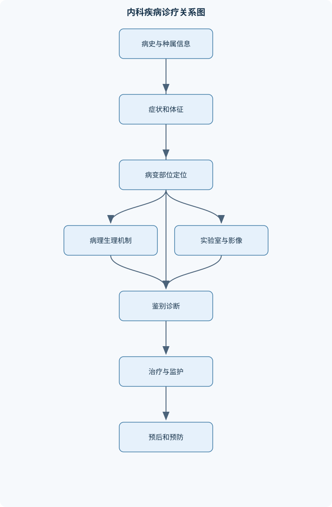
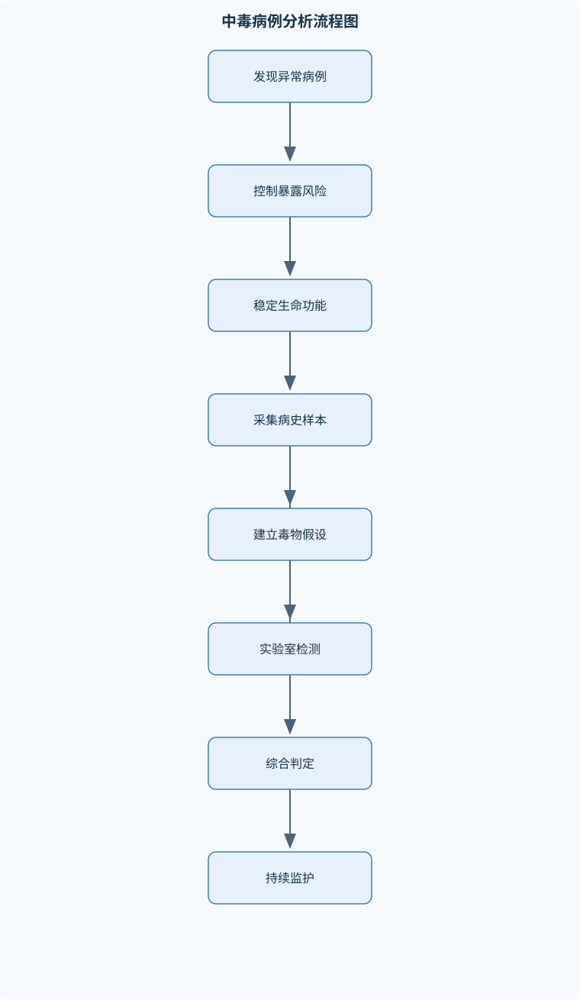

# 兽医内科学

## 一、课程整体知识框架

### 课程边界与先修知识

兽医内科学研究动物非传染性疾病及以个体诊疗为中心的综合性疾病，包括消化、呼吸、心血管、泌尿、血液、神经、肝胆、营养代谢、中毒和幼龄动物常见疾病的病因、发病机制、临床表现、诊断、鉴别诊断、治疗原则、预后判断与预防管理。课程对象以犬、猫、马、牛、羊、猪等常见家畜家禽伴侣动物为主，强调不同动物种属在解剖结构、正常生理、症状表达和检查方法上的差异。先修知识包括动物解剖学、生理学、生物化学、病理学、药理学、微生物学、寄生虫学、影像诊断基础和临床诊断学。课程边界不替代外科、产科、传染病学和寄生虫病学的专门教学，但应能够识别这些疾病并完成转诊、隔离或联合诊疗。





### 1. 课程对象、研究范围与学科边界

兽医内科学研究动物在不以手术为主要治疗手段的条件下发生的全身性和系统性疾病，核心任务是通过病史、临床表现、体格检查、实验室检查、影像学和必要的功能学检查，完成“发现问题—定位病变—分析病因—判断严重程度—制定治疗与管理方案—评价转归”的连续诊疗过程。研究对象包括犬、猫、马、牛、羊、猪等常见伴侣动物和家畜，既关注个体诊疗，也关注同群动物的饲养、营养、环境和管理因素。

内科疾病并不等于“没有病原体的疾病”。某些传染病、寄生虫病或外科疾病可首先表现为内科综合征，例如犬出现呕吐和腹泻时，既可能是胃肠炎、肝肾疾病或中毒，也可能是病毒性传染病或肠道异物；牛出现腹胀时，既可能是瘤胃臌气，也可能是胃肠扭转、腹腔占位或妊娠造成的腹围改变。因此，内科学的边界是诊疗方法和临床思维边界，而不是简单按照病因把疾病割裂开来。临床发现疑似传染病时，应完成必要的隔离和生物安全处置；发现需手术、产科或专门寄生虫学处理的病变时，应及时联合诊疗或转诊。

### 2. 以病理生理为主线的知识组织

课程内容可按四条相互联系的主线组织。

第一条是器官系统主线，包括消化、呼吸、心血管、泌尿、血液与造血、肝胆、神经等系统。每个系统均按照正常结构与功能、常见病因、发病机制、临床综合征、诊断方法、鉴别诊断、治疗原则和预后管理展开。第二条是病因主线，包括营养失衡、代谢异常、中毒、感染相关综合征、机械性阻塞、免疫和炎症反应、循环障碍及器官功能衰竭。第三条是临床表现主线，如咳嗽、呼吸困难、腹泻、黄疸、贫血、少尿、惊厥、腹胀和休克。第四条是临床决策主线，即先排除立即危及生命的异常，再完成定位和病因推理，最后形成治疗与监护计划。

疾病诊断应区分三个层次。症状诊断回答“动物表现出了什么综合征”，例如呼吸困难、黄疸或贫血；定位诊断回答“主要病变位于哪个器官、哪一解剖部位”，例如上呼吸道、肺实质、胸腔或心脏；病因诊断回答“为什么发生”，例如误食毒物、低灌注、尿路梗阻、营养缺乏或炎症性损伤。症状诊断可以在病因尚未明确时成立，但不能把症状名称直接当作最终病因。

### 3. 种属差异是诊疗解释的前提

不同动物的解剖结构、正常生理、行为表达和检查耐受性不同，不能将一种动物的参考范围或症状模式机械套用于另一种动物。体温记为 $T$，单位为摄氏度；心率记为 $HR$，单位为次/分；呼吸频率记为 $RR$，单位为次/分。$T$、$HR$ 和 $RR$ 的解释必须结合种属、年龄、体型、运动、疼痛、环境温度和应激状态。幼龄动物的体温调节、糖原储备和肾脏浓缩功能尚未成熟，轻度呕吐或腹泻也可能迅速发展为低血糖、低体温、脱水和酸中毒。

反刍动物的前胃结构使其具有反刍、嗳气和微生物发酵功能，因此左腹膨大、瘤胃音改变和反刍停止具有特殊诊断价值；犬猫没有瘤胃，不能套用反刍动物的腹部检查逻辑。马的咽部和软腭结构使吞咽障碍时鼻孔返流较突出，食管阻塞还可迅速继发吸入性肺炎。猪的群体饲养特点使呼吸道疾病、营养缺乏和中毒常表现为群体性问题。猫对洋葱等含硫化合物较敏感，犬猫还可能出现吞咽异物、尿道梗阻和慢性心脏病等伴侣动物常见问题。

### 4. 一般诊疗流程与证据等级

初诊时先评估气道、呼吸、循环、意识和体温，再进行系统病史采集和体格检查。严重呼吸困难、发绀、循环衰竭、持续抽搐、尿路完全梗阻、急性腹胀伴休克等情况，必须先处理生命危险，不能为了获得完整检查结果而延误氧合、循环支持或解除梗阻。

病史应结构化记录：动物种属、品种、年龄、性别和用途；发病时间和进展速度；采食、饮水、排便、排尿、反刍和运动变化；饲料、牧草、饮水和环境近期改变；群体中是否有相似病例；近期用药、疫苗、驱虫和既往病史；可能接触的农药、霉变饲料、药品和清洁剂。急性、群体性、同源暴露后的疾病更应考虑中毒、饲料问题或共同环境因素，但不能仅凭群体发病排除传染病。

实验室检查结果不能脱离样本质量和临床背景。红细胞压积记为 $PCV$，血红蛋白浓度记为 $Hb$，红细胞计数记为 $RBC$；贫血通常是 $PCV$、$Hb$ 或 $RBC$ 低于相应种属和实验室参考区间。白细胞计数记为 $WBC$，中性粒细胞、淋巴细胞和单核细胞等分类结果可提示炎症、应激或免疫反应，但不能单凭白细胞结果确定病因。阳性结果不自动等于确诊，阴性结果也不一定排除疾病；必须同时考虑患病先验概率、采样部位、样本保存、检测敏感度和特异度。

### 5. 诊疗中的基本生理关系

心血管疾病的解释可从血压和心输出量入手。收缩压记为 $SAP$，舒张压记为 $DAP$，平均动脉压记为 $MAP$。在心律相对规则、心率不过快或过慢的理想条件下：

$$
MAP \approx DAP+\frac{1}{3}(SAP-DAP)
$$

其中 $SAP-DAP$ 为脉压。该近似来自一个心动周期内舒张期通常长于收缩期的简化假设；在明显心律失常、极端心率、严重血管顺应性异常或测量误差较大时，不能把它当作精确计算值。

心输出量记为 $CO$，心率记为 $HR$，每搏量记为 $SV$，理想模型为：

$$
CO=HR\times SV
$$

$CO$ 的单位取决于 $SV$ 的单位；若 $HR$ 为次/分、$SV$ 为毫升/次，则 $CO$ 为毫升/分。该公式说明心输出量既受心率影响，也受每搏量影响。心力衰竭时，心肌收缩力下降、前负荷不足或过高、后负荷升高、心率异常均可使 $CO$ 下降。心率加快在短期内可能维持心输出量，但过快时会缩短心室充盈时间，反而降低每搏量。

左心功能障碍更容易造成肺静脉压升高和肺水肿，右心功能障碍更容易造成体静脉淤血、腹水和外周水肿，但这只是病理生理倾向，不是绝对规则。双侧心力衰竭、瓣膜病、心包疾病和严重低蛋白血症可造成表现重叠。水肿还受血浆胶体渗透压、毛细血管静水压、血管通透性和淋巴回流共同影响，因此不能仅凭水肿部位判断心脏病变。

泌尿系统诊疗需把尿量、灌注、肾实质和尿路通畅性结合起来。肾小球滤过率记为 $GFR$，尿量记为 $V$。少尿或无尿不能凭单次观察下结论，必须结合饮水、呕吐腹泻、输液量、脱水程度、膀胱充盈和尿路通畅性判断。急性肾损伤按病变部位可分为肾前性、肾性和肾后性：肾前性主要由肾灌注不足引起，肾性由肾实质损伤引起，肾后性由尿液排出受阻引起。持续低灌注可由肾前性发展为肾性，梗阻解除前后的改变也可能重叠。

### 6. 预后和治疗的综合判断

预后不是疾病名称的附属结论，而是根据病因可逆性、病变范围、器官储备、并发症、治疗反应和监测趋势作出的动态判断。可纠正的尿路梗阻、轻度脱水和早期营养缺乏，通常比持续低灌注、严重尿毒症、不可逆肝硬化或多器官衰竭具有更好的治疗潜力。单项指标恶化不一定代表整体预后确定恶化，必须观察精神状态、灌注、尿量、呼吸功、体温、血液生化和影像变化的趋势。

治疗原则通常包括四个层次：第一，去除或控制病因，如停止可疑饲料、解除梗阻、纠正营养失衡；第二，维持生命功能，如保持气道通畅、改善氧合、纠正低灌注和控制惊厥；第三，纠正水、电解质、酸碱和能量异常；第四，进行器官支持、营养管理、疼痛控制和连续监护。治疗方案必须结合动物种属、年龄、肝肾功能、脱水程度和并发症，不能将人医或其他动物的剂量直接移植。

## 二、章节和模块划分

### 核心知识覆盖清单

本清单用于检查正文是否覆盖本课程的主要知识模块：

- **内科诊疗总论**：问诊与病史结构化采集、种属年龄与饲养史分析、全身状态和生命体征评估、视诊触诊叩诊听诊、实验室检查结果判读、影像与内镜检查选择、症状诊断与病因诊断、鉴别诊断和预后判断、支持疗法与监护原则。
- **消化系统疾病**：咽炎与吞咽障碍、食道阻塞及其定位、前胃弛缓与瘤胃积食、瘤胃臌气及呼吸循环障碍、创伤性网胃腹膜炎、瓣胃阻塞与真胃疾病、皱胃左方和右方变位、胃肠炎的病因和病理生理、幼畜消化不良、腹泻脱水与酸碱紊乱、肝炎肝硬化与肝性脑病。
- **呼吸系统疾病**：鼻腔和上呼吸道屏障、喉炎与气管支气管炎、支气管肺炎、大叶性肺炎分期、间质性肺炎与肺气肿、肺水肿和呼吸衰竭、胸腔积液与气胸、咳嗽呼吸困难的定位、犬猫常见呼吸道综合征、猪呼吸道疾病综合征、听诊和影像学肺部判读。
- **心血管系统疾病**：心脏检查顺序、心音与心杂音判定、心肌炎的发病机制、心内膜炎和瓣膜病、心包疾病与心包积液、左心衰竭和右心衰竭、急性与慢性心力衰竭、肺水肿和体腔积液、循环性休克的识别、心电图与超声心动图基础、心源性呼吸困难鉴别。
- **泌尿系统疾病**：肾脏功能与尿液形成、急性肾损伤三部位分类、肾前性肾性肾后性差异、肾炎与肾病鉴别、肾衰竭和尿毒症、多尿少尿和无尿、膀胱炎与尿道炎、尿结石形成条件、尿液物理化学检查、尿沉渣显微镜检查、尿路梗阻和液体平衡管理。
- **血液与造血系统疾病**：贫血的定义和判定、失血性贫血、溶血性贫血、造血不良性贫血、营养性贫血、新生仔猪铁缺乏性贫血、红细胞形态学判读、白细胞变化与炎症、凝血障碍基础、输血前评估与监护、贫血病因追踪流程。
- **肝胆与代谢性疾病**：肝脏代谢和解毒功能、黄疸三种类型、肝功能实验室指标、肝性脑病机制、肝硬化临床特点、酮病与三种酮体、低血糖综合征、佝偻病和骨营养不良、青草搐搦与低镁血症、矿物质和维生素缺乏、营养代谢病群体性特点。
- **神经系统疾病**：神经系统定位诊断、意识障碍和昏迷、运动障碍与共济失调、惊厥和癫痫样发作、肝性脑病的神经表现、中毒性神经症状、脑膜脑炎综合征、脊髓病变定位、颅神经功能检查、神经系统影像和脑脊液检查。
- **中毒性疾病**：毒物暴露史采集、中毒的时间剂量和途径、中毒与传染病鉴别、有机磷中毒机制、亚硝酸盐中毒机制、氰化物中毒机制、食盐中毒与脑水肿、洋葱相关溶血性贫血、毒物样品采集和保存、解毒治疗与支持治疗、群体中毒的现场调查。
- **幼龄动物与综合内科急症**：幼畜消化不良、仔猪低血糖、新生动物体温调节障碍、幼龄动物脱水与酸中毒、犬细小病毒相关综合征识别、急性呼吸衰竭、急性肾损伤、急性腹胀和胃肠梗阻、休克初步处理、危重动物连续监护、病例记录与转诊标准。


### 1. 内科诊疗总论

本模块建立统一的病例分析方法。内容包括问诊与病史结构化采集、种属年龄和饲养史分析、全身状态及生命体征评估、视诊触诊叩诊听诊、实验室结果判读、影像与内镜选择、症状诊断、病因诊断、鉴别诊断、预后判断、支持疗法和监护原则。

体格检查应从整体到局部，从无创到有创。视诊观察姿势、步态、呼吸动作、腹围、黏膜颜色和意识；触诊判断疼痛、温度、肿胀、张力、器官轮廓和脉搏质量；叩诊利用不同组织对声音传导的差异识别含气、含液或实质性病变；听诊则关注心音、心杂音、呼吸音、胃肠音和瘤胃运动。检查结果必须和病程相联系，例如急性左腹膨大伴金属音和鼓音，和慢性腹围增大但无明显瘤胃体征的意义不同。

### 2. 消化系统疾病

咽炎和吞咽障碍应区分咽部疼痛、食道机械性阻塞及胃肠道反应。咽炎可由机械、温热、化学刺激引起，也可继发于口炎、鼻炎、喉炎及某些全身性疾病。动物常见头颈伸展、吞咽困难和流涎；马可出现饮水或饲料由鼻孔返流，犬猫可表现为干呕或反复吞咽。食道阻塞通常突然发生，伴流涎和咽下障碍；颈段阻塞可触及异物，胸段阻塞可见阻塞上方食道积液或波动。胃导管、影像和内镜的选择取决于阻塞部位、完全程度、动物状态及是否存在穿孔风险。

反刍动物前胃疾病应区分功能减弱、内容物滞留和气体快速积聚。前胃弛缓以瘤胃收缩力减弱、反刍减少和内环境改变为主；瘤胃积食表现为内容物大量滞留、腹围增大、瘤胃音减弱、叩诊偏浊和触诊内容物坚实；瘤胃臌气则是气体快速积聚，常见左腹高度膨隆、鼓音、张力增大和嗳气受阻。气体压迫膈肌并减少胸腔容积，同时压迫后腔静脉、减少静脉回流，因而可形成呼吸困难、发绀和循环衰竭。处理必须同时解除气体、恢复嗳气、纠正发酵或机械性病因并维持呼吸循环。

创伤性网胃腹膜炎常有持续性前胃弛缓、反复臌气、疼痛反应和炎症性血液学改变，单纯健胃促消化无效甚至恶化。瓣胃阻塞多表现为排便困难、粪便减少、脱水和前胃运动减弱，需与瘤胃积食和皱胃疾病结合判断。皱胃左方或右方变位应依据腹部听诊、叩诊、超声和全身状态综合定位，不能仅凭腹围变化作出结论。

胃肠炎可由饲料突变、腐败饲料、毒物、药物、感染或继发性器官疾病引起。呕吐、腹泻、腹痛、脱水、体温变化和精神沉郁反映消化道炎症及全身反应；死亡风险主要来自严重脱水和循环衰竭、酸碱与电解质紊乱、内毒素或炎症介质作用以及低血糖。幼龄动物消化不良还应结合饲养、哺乳、保温和群体发病情况判断。

肝炎、肝硬化和肝性脑病属于肝胆与消化代谢交叉领域。黄疸可分为溶血前性、肝细胞性和胆汁淤积性，必须结合贫血证据、胆红素类型、肝酶、胆道排出和影像学判断。肝性脑病源于肝脏清除氨等潜在神经毒性物质的能力下降，或门体分流使肠源性物质绕过肝脏进入体循环，临床可表现为行为改变、运动失调、流涎、惊厥和昏迷。

### 3. 呼吸系统疾病

呼吸系统疾病按病变部位可分为鼻腔和上呼吸道、喉与气管、支气管、肺实质、胸膜和胸腔疾病。鼻腔是过滤、加温、

## 三、核心概念的详细解释

### 1. 内科诊疗的证据链与种属差异

兽医内科诊疗不是把某一症状直接对应到某一种疾病，而是依次回答五个问题：动物表现了什么综合征，病变位于何处，病因属于哪一类，当前是否存在生命危险，以及治疗后如何评价反应。症状诊断如呼吸困难、贫血、黄疸、腹泻和少尿，不能替代定位诊断和病因诊断。诊断结论的可靠性取决于病史、体格检查、实验室结果、影像学和动态变化是否相互支持。

病史应包括种属、品种、年龄、性别、用途、病程、发病速度、采食饮水、排便排尿、反刍、运动、近期饲料或环境变化、用药和疫苗情况、群体中是否有相似病例，以及接触毒物或异物的可能性。急性、群体性、同源暴露后集中发生的病例，应优先考虑饲料、环境、管理和中毒因素；慢性、进行性、个体性病例则需重视器官退行性病变、肿瘤、慢性炎症、营养失衡和遗传因素。

体温记为 $T$，单位为摄氏度；心率记为 $HR$，单位为次/分；呼吸频率记为 $RR$，单位为次/分。$T$、$HR$ 和 $RR$ 必须按种属、年龄、体型、运动、疼痛、环境温度和应激状态解释。幼龄动物不能直接套用成年动物的阈值，因为其糖原储备、体温调节、肝脏糖异生和肾脏浓缩能力尚未成熟。同样，牛的反刍、嗳气和瘤胃运动，马的咽部及软腭结构，猫的尿道解剖特点，都决定了症状和检查结果具有种属特异性。

### 2. 消化系统疾病的定位思路

咽炎主要表现为吞咽疼痛或吞咽困难，常见头颈伸展、流涎和反复吞咽。机械性、温热性和化学性刺激可直接损伤咽部，口炎、鼻炎、喉炎及某些全身性疾病也可继发咽炎。病变波及喉部时，触诊敏感和咳嗽更明显。马发生咽部或食道问题时，饮水、饲料和唾液由鼻孔返流具有重要定位价值；犬、猫可出现干呕或反复吞咽，但这些表现也可见于胃肠道疾病，不能单独确诊咽炎。

食道阻塞通常突然发生，表现为流涎、咽下障碍和口鼻分泌物增多。颈段阻塞可在颈部触及异物或局部膨隆；胸段阻塞时，阻塞上方食道内积聚唾液和食物，可能出现波动感、反复吞咽及返流。胃导管探诊、颈部和胸部影像、造影及内镜的选择取决于阻塞部位、完全程度、异物性质和穿孔风险。检查过程中强行推进导管可能造成黏膜撕裂或穿孔，因此应以定位和安全性为前提。

反刍动物前胃疾病需区分运动障碍、内容物滞留、气体积聚和机械性炎症。前胃弛缓以瘤胃收缩力减弱、反刍减少、食欲下降和瘤胃内环境改变为主，若持续存在，可继发瘤胃壁损伤和中毒性瘤胃炎。瘤胃积食是内容物大量滞留，常见腹围增大、瘤胃音减弱、叩诊偏浊，触诊内容物坚实并可有捻粉样感觉。瘤胃臌气则以气体快速积聚为主，左腹高度膨隆、鼓音、张力增大、嗳气受阻，并可迅速造成呼吸和循环障碍。

瘤胃臌气的危险性可按以下因果链解释：气体积聚使腹压升高，膈肌向前方和上方移位，胸腔有效容积减少，肺扩张受限；同时后腔静脉及其他大静脉受压，静脉回流减少，心脏前负荷降低，最终出现心输出量下降、黏膜发绀、虚弱甚至倒地。因此处理不能只使用“健胃”措施，而应围绕解除气体、恢复嗳气、纠正发酵或机械性病因、维持呼吸循环四个方面展开。

创伤性网胃腹膜炎常表现为顽固性前胃弛缓、反复臌气、疼痛反应和炎症性血液学改变。若在没有明显饲料管理错误的情况下发生持续性前胃障碍，且一般促消化措施无效甚至加重，应考虑网胃异物和腹膜炎。瓣胃阻塞以内容物脱水、变硬和向真胃运送受阻为核心，排便减少或困难、脱水和前胃运动减弱较突出。皱胃左方或右方变位应结合听诊、叩诊、超声、粪便变化和全身循环状态判断，不能仅凭腹围变化诊断。

胃肠炎的表现包括呕吐、腹泻、腹痛、食欲下降、脱水和体温改变。其病因可为饲料突变、腐败饲料、药物、毒物、感染或肝肾等全身性疾病。死亡风险主要来自循环血容量下降、酸碱和电解质紊乱、低血糖、内毒素或炎症介质作用。幼龄动物发生腹泻时，脱水和低血糖进展更快，必须将保温、循环监护、体液和能量状态纳入整体判断。

### 3. 呼吸和心血管疾病的病理生理

呼吸困难定位应区分上呼吸道、肺实质、胸腔、心源性和全身性原因。吸气性困难更提示鼻腔、咽、喉或气管上段阻塞；呼气性困难常见于小气道阻塞和肺弹性回缩异常；吸气、呼气均困难可见于严重肺实质病变、胸腔疾病或心肺衰竭。肺部湿啰音提示气道或肺泡内存在液体、分泌物或炎性渗出，但不能单凭湿啰音区分支气管肺炎和肺水肿。胸腔积液可使肺音减弱、胸部叩诊浊音；气胸可使叩诊偏鼓、肺音减弱。严重呼吸困难时应先减少应激并保证氧合，再进行侵入性检查。

支气管肺炎多为斑片状分布，常伴发热、咳嗽、呼吸频率升高和湿啰音；其热型可呈弛张性变化。大叶性肺炎可按充血水肿期、红色肝变期、灰色肝变期和消散期理解。充血水肿期肺组织充血、含液增加、质地变实，镜下肺泡毛细血管扩张，肺泡内可见浆液和少量炎性细胞；红色肝变期肺组织呈红褐色，肺泡内充满纤维蛋白、红细胞和中性粒细胞；灰色肝变期红细胞逐渐分解，纤维蛋白和白细胞占优势，肺组织呈灰白色；消散期渗出物液化、吸收或咳出，肺组织逐渐恢复含气性。实际病例可出现不同区域处于不同阶段，治疗后也可能不典型。

肺气肿是肺泡内气体过多并过度扩张，导致肺弹性回缩能力下降；间质性肺气肿则是肺泡或细支气管破裂，空气进入肺间质并形成气泡。二者都可造成呼吸困难，但气体所在部位不同。肺水肿是液体进入肺间质或肺泡，常与左心衰、毛细血管通透性增加或严重炎症有关。不能把肺气肿、肺水肿、气胸和间质性肺气肿视为同一疾病。

心力衰竭是心脏不能维持满足组织需要的有效循环，通常同时包含低心输出量和静脉淤血。左心功能障碍更容易引起肺静脉压升高和肺水肿，右心功能障碍更容易导致体静脉淤血、腹水和外周水肿，但双侧衰竭、瓣膜病和慢性疾病可使表现重叠。心肌炎可由感染、毒性、免疫或代谢因素造成，炎症损伤心肌细胞后，收缩力下降、心律失常和传导障碍共同影响循环。

### 4. 泌尿、血液、肝胆和代谢疾病

急性肾损伤按病变部位分为肾前性、肾性和肾后性。肾前性主要是低灌注，如脱水、失血和休克；肾性是肾小球、肾小管、间质或血管本身损伤；肾后性是输尿管、膀胱或尿道排出受阻。三者可转化或重叠，例如长期低灌注可继发肾小管损伤，尿路梗阻持续存在也可导致肾实质损害。发现肌酐升高不能直接等同于原发性肾病，还应考虑脱水、肌肉损伤、药物、低灌注和尿路梗阻。

少尿和无尿必须结合饮水量、输液量、脱水程度、膀胱充盈及尿路通畅性判断。尿液检查包括颜色、透明度、气味、尿比重、酸碱度、蛋白、葡萄糖、酮体、胆红素和潜血等；有机沉渣包括红细胞、白细胞、上皮细胞、管型、结晶和微生物。离心沉渣必须结合采样方式、储存时间、尿比重和酸碱度解释，否则容易把污染或体外形成的结晶误判为病变。

贫血是单位体积血液中PCV、Hb或RBC低于相应种属和实验室参考区间的综合征。病因可分为失血、溶血、造血不足和红细胞生成原料缺乏。网织红细胞反应有助于区分再生性和非再生性贫血，但需考虑贫血发生时间，急性失血或溶血早期可能尚未出现明显再生反应。犬猫摄入洋葱等含硫化合物可造成氧化性红细胞损伤和溶血性贫血；新生仔猪在出生后数周易因铁储备低、铁需求高而发生营养性贫血。

黄疸可分为溶血前性、肝细胞性和胆汁淤积性。溶血前性常伴贫血、红细胞破坏增加和间接胆红素升高；肝细胞性与肝细胞摄取、结合或排泄功能受损有关；胆汁淤积性则与胆道阻塞或胆汁排出障碍有关。单凭黏膜黄色不能确定病变部位，必须结合胆红素类型、肝酶、胆汁排出、贫血证据和影像学。

酮体包括乙酰乙酸、β-羟丁酸和丙酮。能量摄入不足时，脂肪动员增加，肝脏将脂肪酸转化为酮体；当生成量超过组织利用和排出的能力时，可出现酮血症、酮尿症及酸碱失衡。不同检测方法对三种酮体的反应能力不同，检测结果不能机械互换。青草搐搦的核心是低镁血症，应与低钙血症、农药中毒和中枢神经疾病鉴别。佝偻病则发生于生长期动物，常与维生素D、钙或磷不足及其吸收利用障碍有关。

### 5. 神经、中毒和幼龄动物急症

神经系统定位应依次评估意识、行为、步态、姿势反应、脊髓反射、肌张力、颅神经和疼痛感觉。意识障碍可由脑实质病变、低血糖、低氧、尿毒症、肝性脑病和中毒造成；惊厥是临床表现，不等于原发性癫痫。肝性脑病可表现为行为改变、流涎、共济失调、按压头部、惊厥和昏迷；其机制与氨等肠源性物质清除不足或门体分流有关。

中毒诊断必须整合暴露可能性、时间关系、剂量和途径、群体发病、典型综合征、实验室结果以及对其他疾病的排除。有机磷抑制胆碱酯酶，引起乙酰胆碱蓄积，表现为流涎、流泪、呕吐、腹泻、瞳孔改变、肌颤、呼吸肌无力和意识障碍。亚硝酸盐使血红蛋白氧化为高铁血红蛋白，血液携氧能力下降，表现为发绀、虚弱、呼吸困难和突然死亡。氰化物主要损害细胞利用氧的过程；食盐中毒可伴脑水肿和神经症状。毒物检出不等于中毒确诊，因为污染、背景暴露和非致病浓度均可能造成误判。

幼龄动物更易出现低血糖、低体温、脱水和酸中毒。仔猪低血糖可表现为虚弱、站立困难、震颤、昏迷和死亡；应与低体温、贫血、感染和先天性疾病鉴别。犬细小病毒相关综合征可出现胃肠炎型和幼龄动物心肌受累型，但呕吐腹泻不能直接等同于该病，应结合隔离、生物安全和病原学检查。急性腹胀、严重呼吸困难、尿路完全梗阻、持续抽搐和循环衰竭均属于先稳定生命功能、后完善检查的急症。

## 四、重要定义、公式、定理和推导

### 专业审校补充：关键定义与适用边界

肝性脑病不是单纯“肝酶升高后的神经症状”，而是肝脏清除肠源性神经毒性物质的能力下降，或门体分流使这些物质绕过肝脏进入体循环后形成的神经功能障碍综合征。其严重程度与肝细胞功能、门体分流、胃肠道出血、便秘、脱水、感染及高蛋白负荷等因素共同有关。临床可见行为改变、嗜睡、定向障碍、流涎、步态异常、头抵墙、间歇性压迫性活动、震颤甚至昏迷，但这些表现并非特异，低血糖、尿毒症、中毒、癫痫和脑炎也可类似。血氨升高可支持判断，但受采血、保存和检测条件影响，不能单独作为确诊依据；血氨正常也不能完全排除间歇性或局灶性门体分流。诊断应把神经定位、肝功能证据、腹部影像和诱发因素结合起来。幼龄犬猫出现发育迟缓、间歇性神经症状或进食后加重时，应特别考虑先天性门体分流；成年动物则还需考虑慢性肝病和获得性门体侧支循环。


### 1. 重要定义与生理公式

心输出量记为 $CO$，单位通常为升/分；心率记为 $HR$，单位为次/分；每搏量记为 $SV$，单位为升/次。在理想模型下：

$$
CO=HR\times SV
$$

推导含义是：每分钟泵血量等于每分钟搏动次数乘以每次搏出的血量。心力衰竭时，心肌收缩力下降可使 $SV$ 减少；心率过快会缩短舒张充盈时间，也可能使 $SV$ 下降；因此单纯提高 $HR$ 不一定提高 $CO$。明显心律失常、瓣膜严重反流和心室充盈异常时，公式仍可作概念模型，但不能据此准确估计真实循环状态。

收缩压记为 $SAP$，舒张压记为 $DAP$，平均动脉压记为 $MAP$。脉压为：

$$
PP=SAP-DAP
$$

在心率和节律相对稳定、波形近似常规时：

$$
MAP\approx DAP+\frac{1}{3}PP
$$

合并可得：

$$
MAP\approx\frac{SAP+2DAP}{3}
$$

例如某动物测得 $SAP=120\ \text{mmHg}$、$DAP=75\ \text{mmHg}$，则 $PP=45\ \text{mmHg}$，$MAP\approx75+15=90\ \text{mmHg}$。该近似在明显心律失常、极端心率或动脉波形异常时误差增大，不能替代直接平均压力测量。

血液氧输送受血红蛋白浓度、血液氧饱和度和心输出量共同影响。因此，贫血动物即使肺部氧合尚可，也可能因携氧能力下降而出现虚弱、心动过速和组织缺氧。反之，亚硝酸盐中毒时血红蛋白被氧化为高铁血红蛋白，不能有效携带氧，临床表现不能简单按普通贫血解释。

### 2. 鉴别诊断与病例处理算法

#### 病例初诊流程

**输入：**患畜、主诉、现场信息和可获得的病史。  
**输出：**稳定性分级、问题清单、初步定位和优先鉴别诊断。  
**过程：**

1. 先评估气道、呼吸、循环、意识和体温，记录 $T$、$HR$、$RR$、黏膜颜色、毛细血管再充盈时间和脉搏质量。
2. 对发绀、严重呼吸困难、休克、持续抽搐、尿路完全梗阻和急性腹胀动物，先进行氧合、循环支持、解除梗阻或控制抽搐等生命支持。
3. 采集种属、年龄、病程、饲料、饮水、用药、群体病例和毒物暴露史。
4. 进行视诊、触诊、叩诊和听诊，建立“异常表现—可能部位—可能机制”的问题清单。
5. 按症状诊断、定位诊断、病因诊断三个层次提出鉴别顺序，再选择最能改变诊疗决策的检查。

**不变量：**任何检查和治疗均不能延误生命危险的识别。  
**终止条件：**已完成稳定性分级，并明确立即处理项目和下一步检查方向。  
**适用条件：**适用于犬、猫、马、牛、羊、猪等内科病例，但参考范围和检查耐受性须按种属调整。

#### 急性肾损伤分析流程

**输入：**少尿、无尿、氮质血症或肾功能指标异常。  
**输出：**肾前性、肾性、肾后性分类及连续监测计划。

1. 确认尿量变化，核对饮水、输液和体重变化，避免把记录误差当作少尿。
2. 触诊和超声评估膀胱充盈，优先排除尿道或膀胱出口梗阻。
3. 评估脱水、黏膜、脉搏、血压和循环灌注，寻找肾前性因素。
4. 检查尿比重、尿沉渣、蛋白和潜血，结合肾脏影像寻找肾实质损伤。
5. 动态复查尿量、体重、肌酐、尿素氮、电解质和酸碱状态。

**不变量：**必须先排除可逆性低灌注和尿路梗阻。  
**终止条件：**完成病变部位分类并建立动态观察指标。  
**复杂度说明：**该流程不是计算机算法，不能用固定时间或单项指标替代临床复评。

#### 贫血诊断流程

**输入：**PCV、Hb或RBC低于相应种属和实验室参考区间。  
**输出：**失血、溶血、造血不足或原料缺乏的病因方向。

1. 复核样本质量，排除稀释、溶血和标本处理错误。
2. 观察黏膜颜色、出血点、黑便、血尿、外伤和体腔积液，寻找失血证据。
3. 检查网织红细胞、红细胞大小和着色、红细胞碎片、球形红细胞及血液寄生虫等。
4. 结合胆红素、肝肾功能、凝血检查和影像判断溶血、慢性器官病变或隐匿性出血。
5. 根据再生性或非再生性分类提出可验证的病因假设。

**不变量：**不能只凭一次PCV判断病因。  
**终止条件：**确认贫血真实存在，完成再生性分类，并确定下一项最有价值的检查。

### 3. 代表性伪代码

```text
语言：伪代码

输入：动物病例 Case
输出：急诊优先级 Priority、问题清单 Problems、检查计划 Plan

1. 记录 Case.species、Case.age、Case.history
2. 评估 Airway、Breathing、Circulation、Consciousness、Temperature
3. 如果存在严重呼吸困难、发绀、休克、持续抽搐或完全尿路梗阻：
       Priority ← "立即稳定生命功能"
       Plan ← "先处理生命危险，再进行针对性检查"
   否则：
       Priority ← "常规或加急诊疗"
4. 进行视诊、触诊、叩诊、听诊
5. 建立 Problems：
       每个异常表现记录为
       {症状, 可能定位, 可能机制, 严重程度}
6. 对每个 Problems：
       排序依据 ← {致死风险、可逆性、证据强度、检查成本}
7. 选择能够改变治疗决策的检查，生成 Plan
8. 当出现新结果时：
       更新病因假设
       若假设与病史、体征、检查结果冲突：
           重新检查样本质量和种属适用性
           返回步骤4或步骤5
9. 当生命危险已控制且主要病变定位明确时：
       输出 Priority、Problems、Plan
```

该流程的不变量是先保证气道、呼吸和循环安全；终止条件不是“所有检查都完成”，而是已经能够安全处理当前危险并形成下一步可验证方案。

### 4. 典型题例与逐步解答

#### 例题一：牛突然左腹膨大并呼吸困难，叩诊鼓音

**题干：**某牛采食后突然左腹高度膨大，呼吸急促，瘤胃叩诊呈鼓音，触诊腹壁紧张。判断主要病变及危险机制。

**分析：**突然发生、左腹高度膨大、鼓音和腹壁张力增大提示气体快速积聚，而不是慢性腹腔占位。若伴瘤胃金属音和嗳气减少，更支持瘤胃臌气。

**解答：**

1. 主要病变为瘤胃臌气。
2. 气体积聚使腹压升高，膈肌前移，肺扩张受限。
3. 腔静脉受压，静脉回流减少，心输出量下降。
4. 处理原则包括解除气体积聚、恢复嗳气、纠正发酵或机械性原因、维持呼吸循环。
5. 不能仅凭左腹膨大排除瘤胃积食、胃肠扭转、腹腔占位和妊娠。

**结果验证：**解除气体后腹围和呼吸困难迅速改善，支持臌气判断；若解除气体后症状不缓解，应重新寻找扭转、腹膜炎或胸腔疾病。  
**变式：**若腹部叩诊浊音、内容物坚硬且发病较慢，应优先考虑瘤胃积食。

#### 例题二：猫少尿、呕吐且膀胱明显充盈

**题干：**猫精神沉郁、呕吐、少尿，触诊膀胱明显充盈。如何判断肾前性、肾性和肾后性问题？

**分析：**膀胱明显充盈提示尿液已经形成但排出受阻，肾后性梗阻优先级最高。呕吐和精神沉郁提示尿毒性和电解质紊乱风险。

**解答：**

1. 立即评估心率、脉搏、体温、意识和心律，警惕高钾血症和循环不稳定。
2. 确认尿道通畅性并进行影像检查，排查膀胱结石、尿道栓塞或其他梗阻。
3. 若解除梗阻后尿量恢复，支持肾后性病变。
4. 若梗阻持续时间较长，可能继发肾性损伤，因此不能把病因分类理解为互不重叠。
5. 连续监测尿量、肌酐、尿素氮、电解质、酸碱状态和膀胱变化。

**结果验证：**梗阻解除后氮质血症和临床状态逐渐改善，支持可逆性肾后性因素；若尿量持续不足，应进一步评估肾实质损伤和低灌注。  
**变式：**若膀胱空虚、明显脱水且近期腹泻，应先考虑肾前性低灌注。

#### 例题三：犬黏膜苍白并黄染，检查显示贫血

**题干：**犬出现黏膜苍白和黄染，PCV降低。如何区分失血性、溶血性和造血不足性贫血？

**分析：**苍白说明贫血或循环灌注不足，黄染提示胆红素增加，但二者合并并不自动等于溶血。需要网织红细胞、血涂片、出血证据和肝胆检查。

**解答：**

1. 检查体表、消化道、尿液和体腔是否有出血，结合影像寻找隐匿性出血。
2. 检查网织红细胞，判断骨髓是否产生代偿性反应。
3. 若再生反应明显、存在球形红细胞或氧化性损伤证据，支持溶血。
4. 若无明显再生反应，且伴慢性肾病、骨髓病变或营养缺乏，应考虑造血不足。
5. 结合胆红素类型、肝酶和胆道影像区分溶血前性与肝胆性黄疸。

**结果验证：**连续复查PCV和网织红细胞比单次结果更能判断病程。  
**变式：**急性失血或溶血早期可能尚未出现明显网织红细胞增加，不能据此立即排除失血或溶血。

#### 例题四：动物发热、咳嗽、呼吸急促并有湿啰音

**题干：**动物持续发热、咳嗽、$RR$升高，肺部有湿啰音。鉴别支气管肺炎、大叶性肺炎、肺水肿和胸腔积液。

**分析：**发热和咳嗽支持感染性炎症，但肺水肿和胸腔积液也可造成呼吸困难。需要结合心音、叩诊、黏膜、影像和病程。

**解答：**

1. 观察呼吸困难以吸气为主还是呼气为主。
2. 听诊肺野、气管和心脏，检查是否有心杂音或奔马律。
3. 肺部湿啰音和发热更支持肺实质炎症；局灶性肺实变可提示大叶性肺炎。
4. 双侧肺水肿可伴心脏病证据、肺静脉淤血或泡沫样分泌物。
5. 胸腔积液常使肺音减弱和叩诊浊音，需依靠胸部超声或影像确认。

**结果验证：**影像结果应与听诊和体温变化一致；若治疗后发热消退但呼吸困难加重，应重新评估液体负荷、心源性病变或胸腔积液。  
**变式：**大叶性肺炎不同区域可处于不同病理阶段，不能机械按颜色和病程一一对应。

#### 例题五：青嫩牧草后出现震颤和惊厥

**题干：**多头反刍动物采食青嫩牧草后出现肌肉震颤、步态不稳和惊厥。分析病因和现场调查重点。

**分析：**群体性、同源饲料暴露和神经肌肉兴奋性增高提示青草搐搦，核心机制是低镁血症，但低钙血症、农药中毒和其他神经疾病也需排除。

**解答：**

1. 记录牧草种类、生长阶段、采食时间、施肥和天气变化。
2. 比较发病动物与未发病动物的采食量、年龄、泌乳状态和补饲情况。
3. 采集血液评估镁、钙及酸碱状态，必要时检测可疑农药或饲料污染。
4. 检查体温、意识、瞳孔、流涎、肌颤分布和呼吸状态。
5. 现场首先减少应激并进行支持性处理，同时防止其他动物继续采食可疑牧草。

**结果验证：**群体停止暴露后不再出现新病例，且低镁证据与临床表现一致，支持营养代谢性原因。  
**变式：**若同时出现流涎、瞳孔改变和腹泻，应提高有机磷等中毒的优先级。

### 5. 实验与项目工作流程

#### 项目一：腹泻动物脱水与酸碱状态评估

**输入数据：**动物种属、年龄、体重、腹泻持续时间、体重变化、$T$、$HR$、$RR$、黏膜状态、皮肤回弹、眼球位置、尿量、血液生化和血气结果。  
**步骤：**

1. 按同一观察顺序记录精神状态、黏膜、脉搏和呼吸。
2. 根据体重变化、饮水和输液记录估计体液丢失趋势。
3. 将腹泻性丢失、呕吐、饮水不足和持续尿液丢失分别登记。
4. 对幼龄动物每次处理后重复评估血糖、体温和循环状态。
5. 将临床评分与实验室结果进行对照，形成动态记录。

**评价标准：**记录完整；严重程度分级前后一致；能识别循环不稳定、低血糖和酸碱异常；复评结果能够指导下一步处理。  
**排错方法：**若临床脱水表现与实验室结果矛盾，应检查采血时间、输液影响、样本溶血、体重记录和种属参考范围，而不是立即否定临床表现。

#### 项目二：中毒性疾病现场调查

**输入数据：**病例时间线、动物数量、饲料批次、饮水来源、环境暴露、临床综合征和可采集样品。  
**步骤：**

1. 先隔离动物、停止可疑饲料并保护人员，建立病例定义。
2. 绘制发病时间、地点、年龄和饲料来源的分布。
3. 记录毒物可能进入机体的途径、形式和接触时间。
4. 采集适当的血液、尿液、胃内容物、饲料和环境样品，分别标记并避免交叉污染。
5. 将检测结果与临床综合征、暴露量和群体分布结合解释。
6. 同时排除传染病、营养缺乏、机械性疾病和药物不良反应。

**评价标准：**现场风险得到控制；样品来源和时间清楚；病例定义可重复；检测结果与暴露和临床表现相互支持；提出预防再次暴露的管理措施。  
**排错方法：**毒物检出但动物无相应综合征时，应考虑背景暴露、样品污染或非致病浓度；检测阴性也不能在采样过晚、样本不当或毒物已代谢时完全排除中毒。

### 6. 常见易错点

1. 把症状诊断当作病因诊断，例如把腹泻直接等同于胃肠炎。
2. 只凭左腹膨大诊断瘤胃臌气，忽略积食、扭转和腹腔占位。
3. 将前胃弛缓、瘤胃积食和瓣胃阻塞视为同一疾病。
4. 认为左心衰必然只有肺水肿、右心衰必然只有腹水，忽略双侧衰竭和继发改变。
5. 发现肌酐升高就诊断原发性肾病，不排查低灌注和尿路梗阻。
6. 把少尿或无尿仅按尿量判断，不检查膀胱和尿路通畅性。
7. 把黄疸颜色直接当作病变定位依据。
8. 把网织红细胞暂时不升高解释为排除失血和溶血。
9. 将三种酮体名称当作酮病诊断，忽略能量负平衡和检测方法差异。
10. 把亚硝酸盐中毒理解为普通缺氧，忽略高铁血红蛋白机制。
11. 把有机磷中毒的流涎、腹泻和肌颤当作单纯胃肠炎。
12. 将毒物检出直接等同于中毒确诊。
13. 把大叶性肺炎病理分期机械套用到所有病例。
14. 忽略幼龄动物低血糖、低体温和脱水的快速进展。
15. 只记录单次体温、心率或尿量，不观察动态趋势。
16. 严重呼吸困难、休克或尿路梗阻时先追求完整检查，延误生命支持。

### 7. 常见笔试问题与解答思路

#### 问题一：说明瘤胃臌气的危险机制和处理原则

答题应先写气体积聚，再写膈肌受压、肺通气受限、静脉回流减少和心输出量下降，最后列出解除气体、恢复嗳气、纠正病因和维持呼吸循环四项原则。

#### 问题二：急性肾损伤按发生部位如何分类

应答肾前性、肾性和肾后性，并分别说明低灌注、肾实质损伤和尿液排出受阻；补充三者可重叠和相互转化。

#### 问题三：贫血有哪些主要病因分类

应写失血、溶血、造血不足和红细胞生成原料缺乏，并结合网织红细胞区分再生性和非再生性。

#### 问题四：黄疸分为哪三类，如何鉴别

答溶血前性、肝细胞性和胆汁淤积性；鉴别依据包括贫血、胆红素类型、肝酶、胆汁排出和影像。

#### 问题五：大叶性肺炎的病理分期

依次写充血水肿期、红色肝变期、灰色肝变期和消散期，并说明实际病变可混合存在。

#### 问题六：有机磷中毒的机制

有机磷抑制胆碱酯酶，使乙酰胆碱蓄积，出现腺体分泌增加、胃肠运动增强、肌颤、呼吸肌无力和中枢神经症状。

#### 问题七：尿结石形成的三个条件

应写尿液中成石物质过饱和、晶体成核和生长条件，以及尿液排出或黏膜清除障碍；饮水不足、尿液酸碱度改变、感染和梗阻可增加风险。

#### 问题八：心力衰竭的临床表现如何解释

用低心输出量和静脉淤血两条主线回答：前者造成虚弱、运动耐力下降和组织灌注不足，后者造成肺水肿、腹水或外周水肿；左右心衰表现可重叠。

### 8. 常见面试问题与参考回答要点

#### 问题一：遇到严重呼吸困难的动物先做什么？

先减少应激，评估气道、呼吸和循环，保证氧合，观察发绀和意识；生命危险稳定后再进行影像、血气或其他检查。深入追问时应说明上呼吸道阻塞、肺实质病变、胸腔疾病和心源性呼吸困难的定位依据。

#### 问题二：如何处理少尿动物？

先确认尿量记录可靠，检查膀胱是否充盈并排除尿路梗阻，再评估脱水和低灌注，随后结合尿比重、沉渣、肾功能指标和影像判断肾性损伤。追问时应说明梗阻解除后仍可继发肾实质损害。

#### 问题三：发现贫血后如何追踪病因？

先复核PCV、Hb和RBC，排除稀释及样本问题，再看网织红细胞和血涂片，寻找失血、溶血、慢性器官病变、骨髓病变及营养缺乏证据。追问时应强调急性病例早期可能尚无再生反应。

#### 问题四：如何判断是否为中毒？

综合暴露史、时间关系、群体发病、典型临床综合征、样品检测和鉴别诊断，不能只依靠单项毒物检测。追问时应说明样品保存、污染控制和检测浓度的解释边界。

#### 问题五：牛左腹膨大是否就是瘤胃臌气？

不是。应结合发病速度、叩诊音、瘤胃音、触诊张力、嗳气情况及全身循环表现鉴别瘤胃积食、胃肠扭转、腹膜炎和其他腹腔疾病。

#### 问题六：幼龄动物腹泻为什么危险？

幼龄动物糖原储备、肝脏糖异生、体温调节和肾脏浓缩能力不足，容易快速出现低血糖、低体温、脱水和酸中毒。追问时应提出动态监测体温、血糖、尿量和循环状态。

#### 问题七：怎样解释左心衰和右心衰的水肿差异？

左心功能障碍主要使肺静脉压升高，易出现肺水肿；右心功能障碍主要使体静脉压升高，易出现腹水和外周水肿。但双侧衰竭、瓣膜病和长期高压可造成表现重叠。

#### 问题八：怎样保证病例记录具有临床价值？

记录时间、种属、生命体征、异常表现、检查结果、处理措施和处理后的变化，区分观察事实与推断结论，并持续更新问题清单。追问时应说明转诊标准包括持续生命危险、诊断能力不足、需专门影像或外科处理以及监护条件不足。

### 9. 岗位关联与验收标准

小动物临床兽医需要完成问诊、体格检查、急症分级、检验和影像选择，产出结构化病历、鉴别诊断和监护计划；验收标准是生命危险识别及时、记录完整、诊断推理可追溯、复诊指标明确。

畜禽场和牧场兽医需要识别群体性营养代谢病、中毒和呼吸道综合征，结合饲料、环境、密度和管理资料完成现场调查；产出病例定义、风险区域、样品采集记录和防控措施；验收标准是能够控制继续暴露，并区分群体因素与个体疾病。

检验技术人员需要保证血液、尿液、饲料和毒物样品的采集、标记、保存和结果解释质量；验收标准是样本可追溯、质量控制合格，报告明确说明结果的支持意义和局限性，避免把阳性结果直接写成确诊。

影像与超声技术人员需要根据呼吸困难、腹胀、尿路梗阻和体腔积液等问题选择适当检查并描述解剖定位；验收标准是图像质量满足判读要求，报告描述病变部位、范围和严重程度，不超出影像证据进行病因推断。

急诊与重症监护人员需要连续监测 $T$、$HR$、$RR$、血压、意识、尿量、黏膜和实验室指标，及时识别休克、呼吸衰竭、急性肾损伤和电解质异常；验收标准是监测趋势完整、异常有记录、处理反应可评价，转诊时资料能够支持后续诊疗。

## 五、算法、流程和实现思路

### 方法与流程覆盖索引

下列方法或流程应在正文中说明输入、步骤、适用条件、结果检查和边界：

- 病例初诊流程：输入为患畜、主诉和现场信息；输出为稳定性分级、问题清单和初步鉴别诊断。过程为先评估气道、呼吸、循环、意识和体温，再采集种属年龄、病程、饲料、用药、群体发病和毒物暴露史，随后进行系统体格检查并建立问题清单。不变量是任何检查和治疗均不能延误对严重呼吸循环障碍的识别；终止条件是完成稳定性分级并确定需要立即处理的生命危险。适用于所有内科病例。
- 呼吸困难定位流程：输入为咳嗽、呼吸频率升高、呼吸用力或发绀；输出为上呼吸道、肺实质、胸腔、心源性或全身性病变的优先级。过程为观察吸气和呼气困难，听诊鼻腔、喉、气管和肺野，结合体温、黏膜颜色、心音、胸部叩诊及胸部影像，必要时进行血气或超声检查。不变量是先保证氧合和减少应激，再进行侵入性检查；终止条件是获得足以指导处理的解剖定位。
- 前胃疾病鉴别流程：输入为反刍减少、腹胀、排便减少或食欲下降；输出为前胃弛缓、瘤胃积食、瘤胃臌气、创伤性网胃腹膜炎或瓣胃阻塞的排序。过程为记录发病速度和饲料改变，观察左腹轮廓，进行瘤胃听诊、叩诊和触诊，检查粪便、体温、疼痛反应及脱水程度，必要时进行穿刺、超声或实验室检查。不变量是不能仅凭腹胀诊断瘤胃臌气；终止条件是明确主要病变部位、机械性梗阻可能性和是否存在呼吸循环危险。
- 急性肾损伤分析流程：输入为少尿、无尿、氮质血症或肌酐升高；输出为肾前性、肾性、肾后性及其严重程度判断。过程为确认尿量和膀胱状态，评估脱水、循环灌注和近期肾毒性暴露，检查尿液比重和沉渣，进行腹部超声或其他影像以排查梗阻，并动态复查肾功能指标。不变量是先排除可逆性尿路梗阻和低灌注；终止条件是完成病变部位分类并建立连续监测指标。
- 贫血诊断流程：输入为PCV或Hb降低；输出为失血、溶血、生成不足或原料缺乏的病因方向。过程为复核样本质量，观察黏膜和出血证据，检查红细胞形态和网织红细胞反应，结合血涂片、血液寄生虫检查、肝肾功能、凝血检查和影像学寻找出血灶。不变量是先确认贫血真实存在并排除稀释效应；终止条件是完成再生性分类并提出可验证的病因假设。
- 中毒诊断与处置流程：输入为突发神经、消化、呼吸或循环综合征及可疑暴露；输出为现场风险控制、毒物类别假设和样本检测计划。过程为隔离患畜和暴露源，记录时间、剂量形式和接触途径，先进行生命支持，再按规范采集胃内容物、血液、尿液、饲料或环境样本，结合特异性临床综合征和鉴别诊断解释检测结果。不变量是先保护人员和其他动物，不能因等待毒物检测而延误支持治疗；终止条件是临床表现、暴露证据和检测结果达到相互印证。
- 腹泻脱水评估流程：输入为腹泻动物；输出为脱水程度、循环风险、主要病变部位和检查优先级。过程为评估精神状态、眼球凹陷、黏膜湿润度、皮肤回弹、脉搏质量和体重变化，结合粪便性状、呕吐、体温及血液生化判断体液和酸碱异常，再按年龄、病程和群体情况选择粪便、血液或影像检查。不变量是幼龄动物和持续呕吐动物必须动态复评；终止条件是循环稳定、体液异常有明确监测指标且病因方向清晰。





### 1. 通用病例初诊与急症分级流程

病例初诊流程的输入是患畜、主诉、现场信息和可获得的病史，输出是稳定性分级、问题清单、初步定位和优先鉴别诊断。其核心不是先猜疾病名称，而是先判断动物是否能够安全等待进一步检查。

第一步评估气道、呼吸、循环、意识和体温。观察是否有气道阻塞、吸气或呼气困难、发绀、异常呼吸姿势、脉搏微弱、黏膜苍白或砖红、持续抽搐、严重低体温或高体温。第二步迅速确认种属、年龄、体型、病程和发病速度，因为幼龄动物的低血糖、低体温和脱水可快速恶化，反刍动物的腹胀可能在短时间内造成呼吸循环障碍。第三步采集结构化病史，包括采食饮水、排便排尿、反刍、饲料或牧草变化、用药、毒物接触、异物摄入、群体发病及近期运输或应激。第四步完成视诊、触诊、叩诊和听诊，建立“症状—定位—严重程度”的问题清单。第五步选择最能改变诊疗决策的检查，而不是一次性安排所有检查。

不变量是：任何检查和治疗都不能延误气道、氧合、循环支持、解除尿路梗阻或控制持续抽搐。终止条件是已经完成稳定性分级，明确立即处理的生命危险，列出至少一个主要定位和数个可验证的病因假设。若患畜不稳定，应先进行支持和监护，稳定后再扩大诊断范围。

可用如下伪代码表达初诊逻辑：

```text
输入：动物、主诉、现场资料
输出：稳定性分级、问题清单、初步鉴别诊断、下一步检查

1. 记录种属、年龄、体型、病程和发病速度
2. 评估气道、呼吸、循环、意识和体温
3. 如果存在气道阻塞、严重呼吸困难、休克、持续抽搐或完全尿路梗阻：
       标记为高危
       立即进行相应生命支持和监护
       同步采集不延误处理的最小必要样本
   否则：
       标记为暂稳定或低危
4. 采集饲料、用药、毒物暴露、群体发病和既往病史
5. 进行系统体格检查，生成症状和定位问题清单
6. 按“最危险、最可逆、最可能”排序鉴别诊断
7. 为每个主要假设指定一项能够支持或排除它的检查
8. 当生命危险已处理且检查结果足以指导下一步时结束初诊阶段
```

该流程适用于犬、猫、牛、羊、马和猪，但检查方式必须按种属调整。例如犬猫呼吸困难可优先结合胸部影像或胸部超声，反刍动物腹胀则必须同时评估瘤胃状态和嗳气障碍，马出现吞咽障碍时应特别注意鼻孔返流和吸入性肺炎风险。

### 2. 呼吸困难的定位流程

输入为咳嗽、呼吸频率升高、呼吸用力、张口呼吸、发绀或异常呼吸姿势，输出为上呼吸道、肺实质、胸腔、心源性或全身性病变的优先级。

先观察吸气期和呼气期。吸气困难更提示鼻腔、咽、喉或气管等上呼吸道病变；呼气困难更常见于小气道阻塞、支气管疾病或肺气肿；吸气和呼气均困难可见于严重肺实质病变、胸腔压迫、心力衰竭或全身性缺氧。随后听诊鼻腔、喉、气管和肺野：上呼吸道鼾声或喉鸣提示气流受限，湿啰音可提示气道内分泌物或肺泡渗出，但安静动物也可能听诊不明显；肺音明显减弱并伴叩诊浊音时，应考虑胸腔积液，伴异常鼓音时应考虑气胸。心音、脉搏质量、黏膜颜色和体温有助于区分心源性、炎症性和循环性原因。

若怀疑肺水肿，应结合心脏听诊、体腔积液、影像和循环状态判断，不能仅凭湿啰音诊断。若怀疑胸腔积液或气胸，胸部超声可帮助确认胸膜腔内液体或游离气体；但严重呼吸困难动物不应为了完成影像检查而强行摆位。必要时先进行低应激保定、氧合和监护。

### 3. 前胃疾病鉴别流程

输入为反刍减少、食欲下降、腹围增大、排便减少、腹痛或呼吸困难，输出为前胃弛缓、瘤胃积食、瘤胃臌气、创伤性网胃腹膜炎、瓣胃阻塞或皱胃疾病的排序。

第一步记录发病速度。数小时内快速出现左腹高度膨隆和呼吸困难，优先考虑瘤胃臌气；数日内逐渐采食减少、粪便减少并伴腹部充实，需考虑积食、瓣胃阻塞或皱胃疾病；反复发作、对一般促消化处理反应差且有疼痛表现，应考虑创伤性网胃腹膜炎。第二步观察腹部轮廓，左腹显著膨大提示气体或内容物异常，但不能仅凭外观确诊。第三步进行瘤胃听诊、叩诊和触诊：金属样或异常高调音、鼓音和高度紧张更支持臌气；积食时音减弱、叩诊偏浊、触诊内容物坚实；前胃弛缓主要表现为运动次数和力度均下降。第四步检查反刍、排便、脱水、疼痛反应、体温和黏膜循环。第五步根据情况选择瘤胃液检查、超声、腹腔影像或其他定位检查。

瘤胃臌气的处理逻辑必须包括四部分：解除气体积聚，恢复嗳气，纠正导致异常发酵或机械性阻塞的原发因素，维持呼吸循环功能。其生理推导为：气体增加使腹压上升，膈肌前移，肺扩张受限；大静脉受压使静脉回流下降，心脏前负荷和心输出量下降，最终出现呼吸困难、发绀和循环衰竭。治疗后仍需观察腹围、呼吸状态、脉搏质量、黏膜颜色和瘤胃运动，因为气体再次积聚说明原发原因尚未解决。

### 4. 急性肾损伤与少尿、无尿分析流程

输入为少尿、无尿、呕吐、氮质血症、肌酐升高或精神沉郁，输出为肾前性、肾性、肾后性分类、严重程度和连续监测方案。

先确认尿量是否真实减少。尿量记为 $V$，单位可按毫升/千克/小时记录，但解释必须结合饮水、输液、脱水程度、膀胱充盈和采集完整性。确认后检查膀胱是否充盈、尿道是否通畅，并询问近期脱水、失血、休克、肾毒性物质和用药史。膀胱明显充盈且排尿困难时，肾后性梗阻优先级高；膀胱空虚而动物存在脱水或低灌注，需考虑肾前性因素；持续异常并伴尿沉渣改变、管型或影像学肾实质异常，则支持肾性损伤。

理想条件下，肾小球滤过率记为 $GFR$，可反映滤过功能，但临床常用的肌酐等指标受肌肉量、时间进程、液体状态和实验室方法影响，不能把一次升高直接等同于原发性肾病。应动态记录尿量、体重、脱水征象、电解质、酸碱状态和肾功能指标。少尿或无尿动物中，先排除可逆性低灌注和尿路梗阻，再判断肾实质损伤，是流程中的关键不变量。

### 5. 贫血病因追踪流程

输入为PCV、Hb或RBC低于相应种属及实验室参考区间，输出为失血、溶血、造血不足或原料缺乏的病因方向。

首先复核样本质量，排除采血错误、溶血、凝集和液体稀释造成的假性变化。其次结合黏膜颜色、心率、呼吸频率、脉搏质量和精神状态判断贫血严重程度。再次寻找外出血，如创伤、消化道出血、尿血和寄生虫负荷；同时观察黄疸、血红蛋白尿、球形红细胞、红细胞碎片等溶血线索。最后检查网织红细胞反应、红细胞大小和着色、血涂片、胆红素、肝肾功能、凝血状态及影像学出血灶。

若贫血后网织红细胞增多，提示骨髓具有代偿反应，常见于失血或溶血；若贫血持续而网织红细胞反应不足，则需考虑骨髓生成障碍、慢性炎症、肾功能异常、营养缺乏或原料不足。幼龄仔猪出现苍白、虚弱和生长停滞时，应同时调查铁来源、母猪泌乳、垫料和群体管理，不能只依据年龄作出营养性贫血诊断。

### 6. 腹泻与脱水评估流程

输入为腹泻动物，输出为脱水程度、循环风险、主要病变部位和检查优先级。先记录粪便量、次数、颜色、是否含血或黏液，并区分小肠性和大肠性表现；同时询问呕吐、采食、饮水、体重变化、群体发病和近期饲料改变。随后评估精神状态、眼球位置、黏膜湿润度、皮肤回弹、脉搏质量和体重变化，再结合血液生化和酸碱结果判断体液丢失方向。

幼龄动物、持续呕吐动物和伴低体温或低血糖动物必须动态复评。脱水动物的处置目标不是单纯“止泻”，而是恢复有效循环、纠正水和电解质异常、识别并处理原发病因。腹泻伴发热、群体性发病或严重出血时，应同步考虑传染病、毒物和饲料问题，并采取必要的隔离与样本管理措施。

### 7. 代表性病例例题

#### 例题一：牛急性左腹膨大并呼吸困难

**题干：**牛突然出现左腹高度膨大，瘤胃叩诊呈鼓音，呼吸急促，黏膜颜色异常。

**分析：**突然发病、左腹膨隆、鼓音和呼吸循环异常构成瘤胃臌气的证据链。积食通常以内容物滞留、浊音和坚实触感为主，前胃弛缓以运动减弱为主，二者不能解释如此迅速的气体压迫，除非继发严重臌气。

**逐步解答：**先评估气道、呼吸和循环；随后确认瘤胃张力、嗳气是否受阻、心率和脉搏质量；立即围绕解除气体、恢复嗳气、纠正发酵或机械性原因和维持氧合循环处理。处理后复查腹围、呼吸频率、黏膜和瘤胃运动。

**结果验证：**若腹围下降、呼吸改善、脉搏增强并恢复嗳气，说明解除气体和支持措施有效；若反复膨胀，应继续寻找饲料发酵异常、食道阻塞或其他机械性原因。

**变式：**若腹围不对称但叩诊浊、触诊坚实、病程较长，应将瘤胃积食或瓣胃阻塞置于更高位置。

#### 例题二：猫少尿、呕吐且膀胱明显充盈

**题干：**猫精神沉郁、呕吐、少尿，腹部触诊膀胱明显充盈。

**分析：**膀胱充盈支持尿液排出受阻，肾后性急性肾损伤优先于单纯肾前性脱水或原发性肾实质损伤。

**逐步解答：**先确认是否完全梗阻及是否存在高钾、酸中毒、心律异常和循环不稳定；随后评估尿道通畅性、血液电解质、酸碱状态、肾功能指标和尿液；必要时行腹部超声排查膀胱、尿道及上尿路异常。解除梗阻后仍需监测尿量、体重、电解质和再梗阻情况。

**结果验证：**若解除梗阻后尿量恢复且氮质血症趋势改善，支持肾后性机制；若仍少尿或肾功能继续恶化，应考虑梗阻时间过长导致继发肾性损伤或合并肾前性低灌注。

**变式：**若膀胱空虚、严重脱水且近期持续呕吐，应先考虑肾前性因素，但仍需动态复查，不能凭一次尿量排除肾性损伤。

#### 例题三：犬黏膜苍白并黄染

**题干：**犬黏膜苍白并带黄色，PCV和Hb降低。

**分析：**贫血和黄疸同时存在，应优先考虑溶血，但也可能是失血后继发胆红素升高，或肝病与贫血并存。

**逐步解答：**先判断是否有外出血、心动过速、呼吸急促和循环不稳定；再检查网织红细胞、血涂片、胆红素、血红蛋白尿及凝血状态。网织红细胞增多支持再生性贫血，血涂片异常和血红蛋白尿支持溶血；若无再生反应，则考虑生成不足、慢性炎症、肾病或骨髓问题。

**结果验证：**贫血指标、胆红素和溶血证据相互一致时，溶血性贫血的可能性增加；若影像发现体腔积血而无明显溶血证据，则应转向失血性贫血。

**变式：**若黏膜仅黄染而PCV正常，应重点区分肝细胞性和胆汁淤积性黄疸，不能把黄疸直接归因于溶血。

#### 例题四：动物发热、咳嗽和湿啰音

**题干：**动物持续发热、咳嗽、呼吸频率升高，肺部听诊有湿啰音。

**分析：**支气管肺炎、大叶性肺炎、肺水肿和胸腔积液均可引起呼吸异常，但发热更支持炎症性疾病，湿啰音提示气道或肺泡内有分泌物或渗出。

**逐步解答：**观察吸气或呼气困难，检查心音、脉搏、黏膜和体温；叩诊判断肺实质实变或胸腔液体；胸部影像评估病变分布。斑片状支气管周围改变支持支气管肺炎，局部或大范围实变可见于大叶性肺炎，心脏异常和肺静脉淤血支持心源性肺水肿，叩诊浊音和肺音减弱提示胸腔积液。

**结果验证：**影像定位必须与发热、心脏检查和病程相符；单独湿啰音不能确定病因。

**变式：**若无发热但有心脏杂音和突发呼吸困难，应提高心源性肺水肿的优先级。

#### 例题五：牧草更换后反刍动物震颤和惊厥

**题干：**多个反刍动物采食青嫩牧草后出现肌肉震颤、步态不稳和惊厥。

**分析：**群体性、同源饲料暴露和神经肌肉兴奋性增高提示青草搐搦及低镁血症，但低钙、农药中毒和其他神经性疾病也需排除。

**逐步解答：**先控制继续采食可疑牧草，保护人员和动物安全，记录发病时间、牧草来源、施肥和施药情况；采集血液、牧草和环境样本，检查镁、钙及相关生化指标，并根据临床综合征进行毒物学检测。急性病例优先维持气道、呼吸和循环，避免因等待检测延误支持处理。

**结果验证：**群体病例与牧草暴露时间一致，且低镁证据与症状相符时，支持青草搐搦；若存在流涎、瞳孔改变、支气管分泌物增多等胆碱能表现，应提高有机磷等中毒的可能性。

**变式：**只有单个动物发病且无饲料共同暴露时，应扩大到个体性神经疾病、创伤和代谢病鉴别。

### 8. 实验与项目流程

#### 项目一：模拟呼吸困难病例的定位评价

**输入数据：**提供犬或猫的病史、$T$、$HR$、$RR$、黏膜颜色、呼吸相特征、心音和肺音，以及胸部影像或超声描述。

**步骤：**第一，记录种属、年龄和应激因素；第二，区分吸气困难、呼气困难和混合性困难；第三，将体格检查结果定位到上呼吸道、肺实质、胸腔或心脏；第四，提出至少三个鉴别诊断并为每项指定验证检查；第五，制定高危动物的先处理事项和复评指标。

**评价标准：**能否优先识别氧合危险；定位是否与呼吸相和听诊相符；是否区分肺水肿、肺炎、气胸和胸腔积液；是否说明影像检查的局限；监护指标是否包括$RR$、呼吸用力、黏膜颜色、意识和循环状态。

**排错方法：**若把所有湿啰音都判为肺炎，应重新核对体温、心脏检查和影像；若只依赖影像而忽略动物状态，应将急症分级重新置于流程首位；若把肺音减弱解释为肺炎，应检查叩诊和胸腔超声证据。

#### 项目二：群体性中毒现场调查

**输入数据：**同一圈舍或牧场多个动物在更换饲料后出现流涎、呕吐、呼吸困难或神经症状，提供饲料批次、发病时间、动物数量和现场照片描述。

**步骤：**第一，隔离患畜并停止可疑饲料，保护人员和其他动物；第二，建立病例定义，记录发病动物、未发病动物和暴露时间；第三，绘制时间线，比较饲料摄入与症状出现的关系；第四，按规范采集饲料、饮水、胃内容物、血液、尿液和环境样本；第五，同时进行传染病、代谢病和中毒鉴别；第六，将检测结果与暴露证据、临床综合征和群体分布综合解释。

**评价标准：**是否阻断继续暴露；样本是否有明确来源、时间和保存记录；是否设置未发病动物或未暴露样本作为比较；是否避免把毒物阳性直接等同于确诊；是否提出可执行的复查和监测计划。

**排错方法：**若只有单个样本阳性而群体暴露关系不成立，应考虑污染或背景暴露；若毒物检测阴性但暴露时间和综合征高度吻合，需检查采样部位、保存条件、检测范围及采样时机；若忽视传染病隔离，应立即补充生物安全措施。

## 六、概念之间的关系与对比

### 1. 症状诊断、定位诊断与病因诊断

症状诊断回答“发生了什么”，如腹泻、黄疸、贫血、呼吸困难和少尿；定位诊断回答“主要病变在哪里”，如上呼吸道、肺实质、胸腔、肾脏或尿道；病因诊断回答“为什么发生”，如机械性梗阻、炎症、低灌注、营养缺乏或毒物暴露。三者是递进关系，而不是互相替代。

例如“少尿”只是症状，“肾后性急性肾损伤”是部位和机制结合后的判断，“尿道梗阻导致尿液排出受阻并继发氮质血症”才进一步说明病因链。临床证据不足时可以暂时停留在症状或定位层面，但不能把症状名称伪装成最终病因。

### 2. 前胃弛缓、瘤胃积食与瘤胃臌气

| 项目 | 前胃弛缓 | 瘤胃积食 | 瘤胃臌气 |
|---|---|---|---|
| 核心改变 | 运动功能减弱 | 内容物大量滞留 | 气体快速积聚 |
| 发病特点 | 可急可慢 | 多与饲料和运送障碍有关 | 常为急性 |
| 腹部表现 | 可不明显 | 腹围增大，触感较实 | 左腹高度膨隆 |
| 听诊 | 瘤胃收缩减弱 | 音弱或消失 | 可有高调或金属样音 |
| 叩诊 | 不具特异性 | 偏浊 | 鼓音 |
| 主要危险 | 内环境紊乱、继发炎症 | 脱水、内容物腐败 | 膈肌受压、静脉回流受阻 |
| 鉴别关键 | 看运动和瘤胃液环境 | 看内容物量和质地 | 看气体、张力和呼吸循环障碍 |

三者可以相互继发。例如前胃弛缓可使内容物滞留并发展为积食，食道阻塞或异常发酵又可使臌气出现。但“腹部膨大”不是三者的共同诊断标准，必须结合病程、音响和触感。

### 3. 咽炎、食道阻塞与胃肠道疾病

咽炎以咽部疼痛、吞咽困难、流涎和头颈伸展为主，若波及喉部可出现咳嗽和触诊敏感。食道阻塞通常突然发生，伴明显流涎、咽下障碍和返流；颈段可触及阻塞物，胸段可能出现阻塞上方食道积液。胃肠道疾病可有呕吐、干呕和食欲下降，但通常还伴腹痛、腹泻、胃肠音改变或排便变化。

马的鼻孔返流对咽部和食道疾病具有较高定位价值，但犬猫的干呕和反复吞咽缺乏特异性，必须结合病史和影像。强行胃导管探诊可能损伤食道，出现明显阻力或疑似穿孔时应停止推进并改用影像或内镜定位。

### 4. 大叶性肺炎与支气管肺炎

大叶性肺炎通常呈相对连续的肺叶实变，病理过程可按充血水肿期、红色肝变期、灰色肝变期和消散期理解。充血水肿期肺组织充血、肿胀、含气量下降，切面可有较多浆液性或泡沫样液体；镜检可见肺泡毛细血管扩张充血，肺泡内有浆液和少量炎性细胞。红色肝变期肺叶颜色偏红褐、质地变实，肺泡内充满纤维蛋白、红细胞和中性粒细胞；灰色肝变期红细胞逐渐分解，纤维蛋白和白细胞占优势，肺组织呈灰褐色；消散期炎性渗出物被吸收、液化或排出，肺组织逐渐恢复含气性。

支气管肺炎通常以细支气管和周围肺泡的斑片状病变为主，病灶分布不一定连续。实际病例可受治疗、病程和混合感染影响，出现不同区域处于不同阶段，因此不能把临床体温曲线机械对应到某一组织学分期。

### 5. 肺气肿、间质性肺气肿、肺水肿与气胸

肺气肿是肺泡内气体过多和肺泡过度扩张，伴弹性纤维损伤；间质性肺气肿是肺泡或细支气管破裂后空气进入肺间质，并可融合形成较大气泡。两者的气体主要位于肺组织内部。肺水肿则是液体进入肺间质或肺泡，含气量下降，常伴湿啰音和呼吸困难。气胸是游离气体进入胸膜腔，使肺受到外部压迫，肺音可减弱，叩诊可呈鼓音。

肺气肿不能与气胸混为一谈：前者是肺内结构过度含气，后者是胸膜腔内异常气体；肺水肿也不能仅凭“呼吸困难”诊断，需结合心脏、影像和体液分布。血浆静水压、胶体渗透压、血管通透性和淋巴回流共同影响肺水肿形成，因此心源性与非心源性肺水肿的病因不同，但临床表现可能重叠。

### 6. 左心衰竭与右心衰竭

理想模型中，心输出量记为$CO$，心率为$HR$，每搏量为$SV$，则：

$$
CO=HR\times SV
$$

其中$CO$的单位通常为升/分钟，$HR$为次/分，$SV$为升/次。该关系说明心输出量受心率和每搏量共同影响，但实际动物中还受前负荷、后负荷、心肌收缩力、心律和瓣膜功能影响。心率过快并不一定增加$CO$，因为舒张期缩短可能使心室充盈减少。

左心功能障碍更容易造成肺静脉压升高、肺淤血和肺水肿；右心功能障碍更容易造成体静脉淤血、肝淤血、腹水和外周水肿。但双侧心衰、继发性肺高压和低蛋白血症可使表现重叠，因此“左心衰必然只有肺水肿、右心衰必然只有腹水”是错误的绝对化判断。

### 7. 肾炎、肾病与急性肾损伤

肾炎强调炎症性损伤，常伴尿沉渣异常、血尿、蛋白尿或管型；肾病可突出肾小球滤过、蛋白丢失、变性或代谢功能异常，不一定具有明显炎症性尿沉渣。急性肾损伤按病变部位分为肾前性、肾性和肾后性，三者在病程延长后可以重叠或相互转化。

肾前性主要是肾灌注不足，纠正循环后功能可能改善；肾性是肾实质损伤，持续时间较长或损伤严重时恢复较慢；肾后性是尿液排出受阻，解除梗阻是关键。肌酐升高只能说明滤过功能或清除能力发生变化，不能单凭一次结果确定原发肾病，必须结合脱水、肌肉量、输液、尿量和动态趋势。

### 8. 黄疸三类型

溶血前性黄疸由红细胞破坏增加、胆红素生成过多引起，常伴贫血、网织红细胞增多或其他溶血证据；肝细胞性黄疸由肝细胞摄取、结合、排泄或代谢功能受损引起，需结合肝酶、胆红素分型和肝功能指标；胆汁淤积性黄疸由胆汁排出受阻引起，应结合胆道影像、粪便和尿液变化判断。

黏膜黄染只能说明胆红素或相关色素增加，不能单凭颜色定位病变。贫血与黄疸同时存在时，溶血优先级提高，但仍应排查肝病、出血和混合性病变。

### 9. 贫血四类与再生性分类

贫血通常表现为PCV、Hb或RBC低于相应种属和实验室参考区间。病因可按失血、溶血、造血不足和红细胞生成原料缺乏分类。失血包括外出血和内出血；溶血包括免疫性、氧化性、机械性和感染相关破坏；造血不足可与骨髓、慢性炎症、肾功能异常或内分泌因素有关；原料缺乏常涉及铁、维生素和蛋白质供应不足。

网织红细胞反应用于判断骨髓是否正在代偿。再生性贫血更支持近期失血或溶血，非再生性贫血则需追踪生成障碍和原料问题。不同种属的网织红细胞成熟时间和解释方式有差异，不能把犬猫的判断标准直接套用于所有家畜。

### 10. 酮病、低血糖与营养代谢病

酮体包括乙酰乙酸、β-羟丁酸和丙酮。能量负平衡时脂肪动员增加，肝脏将脂肪酸转化为酮体；检测方法对三种酮体的反应能力不同，因此不同检测结果不能机械互换。酮体升高必须结合动物种属、泌乳或妊娠阶段、采食量、体况、血糖和酸碱状态解释。

幼龄动物低血糖与酮病的代谢背景不同。幼龄动物糖原储备少、糖异生能力有限，在禁食、腹泻、呕吐、低体温和感染时更易发生低血糖。营养代谢病常具有群体性、地区性、季节性和管理相关性，调查对象不能局限于单个动物，还应包括饲料配方、采食量、饮水、圈舍、生产阶段和同群发病率。

### 11. 中毒与传染病

中毒通常具有共同暴露、突然发病、短潜伏期、同群动物相继发病和症状谱较一致等特点，但这些特征不是绝对标准。传染病可能表现为群体发病和发热，中毒也可能造成发热、神经症状或消化道症状，因此必须综合暴露史、时间关系、传播方式、病理变化、实验室结果和流行病学资料。

有机磷中毒的核心是胆碱酯酶活性受抑，乙酰胆碱蓄积，表现为流涎、流泪、腹泻、呕吐、瞳孔改变、支气管分泌物增多、肌颤和呼吸衰竭。亚硝酸盐中毒的关键不是普通意义上的缺氧，而是血红蛋白被氧化为高铁血红蛋白，携氧能力下降。氰化物中毒主要妨碍细胞利用氧，食盐中毒可伴神经症状和脑水肿。毒物检出必须结合浓度、样本质量、采样时间和临床意义，阳性结果不能自动等同于中毒确诊。

### 12. 易错点、笔试问题与解答思路

#### 12.1 典型易错点

1. 把症状名称直接当作病因诊断。  
2. 只凭左腹膨大诊断瘤胃臌气，不做叩诊、听诊和触诊。  
3. 将前胃弛缓、瘤胃积食和瓣胃阻塞视为同一疾病。  
4. 把食道阻塞、咽炎和胃肠道疾病都归为吞咽困难。  
5. 将大叶性肺炎的病理分期机械套用于所有病例。  
6. 把湿啰音直接等同于肺炎。  
7. 认为左心衰和右心衰的体液分布绝不重叠。  
8. 发现肌酐升高就直接诊断原发性肾病。  
9. 把膀胱充盈与肾脏产尿功能混为一谈。  
10. 只凭黏膜黄染判断黄疸类型。  
11. 用三种酮体名称代替酮病诊断。  
12. 将亚硝酸盐中毒简单解释为“缺氧”。  
13. 把毒物检出结果直接当作确诊依据。  
14. 忽视幼龄动物低血糖、低体温和脱水的快速进展。  
15. 只记录单次尿量、体温或心率，不看动态趋势。  
16. 在呼吸衰竭、休克和尿路梗阻病例中先做完整检查，延误生命支持。  

#### 12.2 典型笔试问题

**问题一：说明瘤胃臌气的病理生理和处理原则。**  
解答应先写气体快速积聚和嗳气受阻，再推导腹压升高、膈肌受压、肺扩张受限、静脉回流下降和循环障碍，最后写解除气体、恢复嗳气、纠正原发病因和支持监护四部分。

**问题二：比较肾前性、肾性和肾后性急性肾损伤。**  
解答应按病变部位、常见原因、尿量和膀胱表现、尿液及影像学线索、可逆性和动态监测分别说明，并强调三者可以重叠。

**问题三：说明黄疸的三种类型及鉴别依据。**  
解答不能只写名称，应分别结合溶血证据、贫血、胆红素类型、肝酶、肝功能和胆道影像解释。

**问题四：贫血有哪些主要病因分类？如何进一步判断？**  
先写失血、溶血、造血不足和原料缺乏，再说明网织红细胞、血涂片、胆红素、凝血检查和影像学的作用。

**问题五：说明大叶性肺炎的病理分期。**  
应依次写充血水肿期、红色肝变期、灰色肝变期和消散期的肺脏颜色、质地、含气量及镜检变化，并补充实际病变可不典型或分区不同步。

**问题六：有机磷中毒的机制及临床表现是什么？**  
核心是胆碱酯酶受抑和乙酰胆碱蓄积，表现为腺体分泌增加、胃肠道兴奋、瞳孔改变、肌肉震颤和呼吸衰竭；处置应同时考虑人员防护、脱离暴露、生命支持和规范解毒。

**问题七：如何诊断中毒性疾病？**  
应按照暴露可能性、时间剂量和途径、群体性、临床综合征、样本检测及排除其他疾病的证据链回答，强调毒物检出不等于达到致病浓度。

**问题八：为什么幼龄动物容易发生低血糖、低体温和脱水？**  
应从糖原储备少、糖异生能力弱、体表面积相对大、体温调节不成熟、肾脏浓缩能力有限和呕吐腹泻后代偿能力差等方面推导。

### 13. 典型面试问题与回答要点

**问题一：遇到严重呼吸困难的动物，您先做什么？**  
参考答案：先观察气道和呼吸动作，减少应激，给予适当氧合和监护，评估循环和意识；在动物相对稳定后再进行影像或侵入性检查。追问时应说明吸气困难和呼气困难的定位差异，以及胸腔积液、气胸和肺水肿的基本鉴别。

**问题二：如何区分瘤胃积食和瘤胃臌气？**  
参考答案：结合发病速度、左腹轮廓、瘤胃音、叩诊音、触诊张力和呼吸循环表现。积食偏向内容物滞留、浊音和坚实触感，臌气偏向气体积聚、鼓音、高度张力和呼吸障碍。追问时应说明两者可以继发。

**问题三：猫少尿而膀胱充盈时，最重要的风险是什么？**  
参考答案：尿路梗阻及其导致的高钾、酸碱紊乱、心律失常和急性肾损伤。追问时应说明确认尿道通畅性、检查电解质和酸碱状态、动态记录尿量和避免延误解除梗阻。

**问题四：如何解释犬的贫血和黄疸同时存在？**  
参考答案：优先考虑溶血，但必须排除出血后胆红素升高以及肝病合并贫血。追问时应提出网织红细胞、血涂片、胆红素、血红蛋白尿和影像学检查。

**问题五：毒物检测阳性是否可以直接确诊？**  
参考答案：不能。必须结合暴露时间、样本来源、浓度、临床综合征、群体分布和其他疾病排除结果。追问时应说明样本污染、背景暴露和采样时机不当均可能造成误判。

**问题六：如何处理幼龄动物腹泻？**  
参考答案：先判断低血糖、低体温、脱水和循环风险，再根据粪便特征、群体情况和病程选择检查；同时重视保温、体液和能量支持，并识别需要隔离的传染病可能。追问时应说明不能套用成年动物的耐受程度。

**问题七：如何判断肺水肿与肺炎？**  
参考答案：肺炎更常伴发热和炎症证据，肺水肿需结合心脏异常、肺静脉淤血、体腔积液或其他循环证据；两者均可出现湿啰音，必须结合影像和病程。追问时应说明非心源性肺水肿可能不伴明显心脏病。

**问题八：群体动物同时发病时，您如何展开调查？**  
参考答案：先控制继续暴露和人员风险，再建立病例定义、绘制时间线、比较暴露组和未暴露组、规范采样，并同步排查传染病和营养代谢病。追问时应说明检测结果要与流行病学和临床证据相互印证。

### 14. 岗位任务、知识使用与验收标准

小动物临床兽医需要完成问诊、急症分级、体格检查、检验影像选择、鉴别诊断和复诊计划。主要使用呼吸、消化、心血管、泌尿、血液和中毒诊疗知识，产出结构化病历、问题清单、检查申请和监护记录；验收标准是生命危险识别及时，诊断推理可追溯，检查结果解释不超出证据范围。

畜禽场和牧场兽医需要处理群体性营养代谢病、中毒、呼吸道综合征和饲料相关疾病。主要使用群体调查、前胃疾病、营养代谢、中毒和生物安全知识，产出病例定义、暴露调查、样品记录、风险控制和复查报告；验收标准是能够阻断继续暴露，区分群体因素与个体病因，并提出可执行的管理改进措施。

兽医检验技术人员需要处理血液、尿液、粪便、饲料和毒物样品，保证采样、标记、保存和检测质量。主要使用贫血分类、尿液沉渣、肝肾功能和毒物证据解释知识，产出规范检验报告；验收标准是样本来源可追溯、质量问题有说明、阳性结果注明支持意义和局限。

影像与超声技术人员需要服务于呼吸困难、腹胀、尿路梗阻、体腔积液和心脏疾病定位。主要使用胸部和腹部解剖、肺部影像、心脏超声及泌尿系统定位知识，产出病变部位、范围和严重程度描述；验收标准是图像质量满足判读要求，报告区分影像所见与病因推断。

急诊与重症监护人员需要连续监测$T$、$HR$、$RR$、血压、意识、黏膜、尿量、电解质和肾功能趋势，识别休克、呼吸衰竭、急性肾损伤和严重代谢紊乱。主要使用急症分级、体液平衡、循环生理和连续监护知识，产出监护记录、异常响应记录和转诊资料；验收标准是异常变化能够及时发现，处理反应能够量化评价，转诊信息完整且不遗漏关键病程。

## 七、典型例题和应用场景

### 专业审校补充：综合例题

题干：一头围产期奶牛产后第4天，采食量下降，反刍减少，粪便量减少，精神沉郁，呼吸中有类似丙酮气味，但体温基本正常。检查发现眼球轻度凹陷，瘤胃收缩减弱，未见明显左腹高度膨大。实验室提示血糖偏低，血液中β-羟丁酸升高。要求判断主要问题，说明其与低钙血症、皱胃左方变位和严重脱水的鉴别思路，并提出处理与复查原则。

分析：产后能量需求迅速增加，而采食量下降会形成负能量平衡。机体动员脂肪，游离脂肪酸进入肝脏后生成乙酰乙酸、β-羟丁酸和丙酮；当生成量超过组织利用和肝脏代谢能力时，出现酮病。低血糖、酮体升高和丙酮气味支持能量代谢紊乱，但不能仅凭气味确诊。低钙血症常突出肌无力、站立困难、耳温降低、瘤胃弛缓和循环改变；皱胃左方变位更常见采食下降、排便减少及特征性腹部听叩诊异常；严重脱水则应有循环灌注不足、体重下降和尿量减少等证据，且可继发酮病。

逐步解答：第一步确认生命稳定性，检查体温、心率、呼吸、黏膜、脉搏、站立能力和脱水程度。第二步核对产后日龄、产犊难产、胎衣排出、乳量变化、日粮能量密度和同群发病情况。第三步进行血糖、β-羟丁酸、肝功能相关指标、电解质和钙状态评估，必要时结合尿酮或乳酮结果。第四步通过左腹听诊、叩诊、直肠检查和超声等判断皱胃位置及其他腹腔病变。第五步处理原则是纠正能量负平衡和脱水，改善采食与瘤胃功能，同时寻找并处理子宫炎、乳房炎、难产后并发症等诱因；若存在低钙或明显酸碱、电解质紊乱，应按监测结果进行纠正，不能把所有产后厌食都归为酮病。结果验证：复查采食量、反刍、粪便、体温、血糖和β-羟丁酸，若临床状态恢复且酮体下降，支持判断成立；若持续恶化或腹部定位异常，应重新评估皱胃疾病、严重肝病和感染。变式：若该牛同时卧地不起、四肢冰冷、心音减弱且血糖并未明显下降，应优先提高低钙血症和循环障碍的诊断排序，而不能用丙酮气味解释全部表现。


### 典型题型与应用覆盖索引

建议通过下列题型或应用检查概念是否能够迁移：

- 牛突然左腹膨大、呼吸困难、瘤胃叩诊呈鼓音：要求按发病速度、腹部视诊、听诊叩诊触诊和循环表现完成瘤胃臌气判断，说明其造成呼吸循环障碍的因果链，并写出解除气体、恢复嗳气、纠正病因和支持监护四部分处理原则。
- 奶牛食欲下降、反刍减少、粪便减少且腹部不明显膨大：要求比较前胃弛缓、瘤胃积食、瓣胃阻塞和创伤性网胃腹膜炎，依据体温、疼痛反应、瘤胃音、粪便及病程提出检查顺序。
- 犬突发流涎、吞咽困难和反复干呕：要求区分咽炎、食道阻塞和胃肠道疾病，说明问诊重点、颈段与胸段食道阻塞的表现差异，以及胃导管、影像和内镜的选择依据。
- 动物持续咳嗽、发热、呼吸频率升高，肺部听诊有湿啰音：要求在支气管肺炎、大叶性肺炎、肺水肿和胸腔积液之间进行定位性鉴别，并解释体温、听诊、胸部叩诊和影像结果的组合意义。
- 牛出现发热、咳嗽和呼吸困难，病程呈阶段性变化：要求描述大叶性肺炎各病理阶段的肺脏眼观和镜检特点，并说明临床分期与组织病理分期不能简单一一对应。
- 猫少尿、呕吐、精神沉郁，膀胱明显充盈：要求按肾前性、肾性、肾后性流程判断尿路梗阻可能，列出立即确认的生命危险、必要检查和连续监测指标。
- 犬黏膜苍白、黄染，血液检查显示贫血：要求区分失血性、溶血性和造血不足性贫血，结合网织红细胞、血涂片、胆红素和出血证据完成病因推理。
- 仔猪出生后数周出现精神沉郁、虚弱和生长停滞：要求比较铁缺乏性贫血、低血糖、低体温和感染性疾病，说明年龄、饲养管理、黏膜颜色、血液学和群体资料的诊断价值。
- 反刍动物采食大量青嫩牧草后出现肌肉震颤、步态不稳和惊厥：要求从青草搐搦和低镁血症角度进行病因分析，列出需要排除的低钙、农药中毒和神经系统疾病，并设计现场调查要点。
- 多个动物在同一饲料更换后同时出现流涎、呕吐、呼吸困难或神经症状：要求按中毒性疾病流程进行现场风险控制、病例定义、样本采集、鉴别诊断和结果解释，不直接以单项毒物检测作为唯一依据。


### 1. 例题一：牛急性左腹膨大、呼吸困难的前胃疾病鉴别

#### 题干

一头成年牛采食后数小时内出现左侧腹围明显增大，站立不安，反刍停止，呼吸频率升高，张口呼吸，左腹叩诊呈鼓音，瘤胃听诊可闻及异常高调音，触诊时腹壁张力明显增加。要求判断最可能的疾病，说明呼吸循环障碍的形成机制，并提出处理原则。

#### 分析

最重要的信息不是“腹胀”本身，而是发病速度、腹胀位置、叩诊音、腹壁张力和呼吸循环表现。数小时内快速发生的左腹高度膨隆，伴鼓音和紧张，支持瘤胃臌气。瘤胃积食也可腹围增大，但通常以内容物滞留为主，叩诊较浊，触诊可感到坚实内容物；前胃弛缓主要是收缩运动减弱，腹围不一定高度膨大；瓣胃阻塞多以排便困难、脱水和前胃运动减弱为突出表现。

其病理生理链条为：

$$
\text{产气增加或嗳气受阻}
\rightarrow \text{瘤胃气体快速积聚}
\rightarrow \text{腹压升高}
\rightarrow \text{膈肌前移、肺扩张受限}
\rightarrow \text{呼吸困难}
$$

同时，升高的腹压可压迫后腔静脉，减少静脉回流，使心脏前负荷和心输出量下降，进一步导致虚弱、黏膜发绀、脉搏变弱，严重时发生循环衰竭。心输出量记为 $CO$，心率记为 $HR$，每搏量记为 $SV$，理想模型中：

$$
CO=HR\times SV
$$

该公式只说明影响心输出量的基本关系，不代表临床上可以仅凭心率判断循环是否改善。瘤胃臌气时，静脉回流下降会使$SV$降低；代偿性心率升高不一定能够恢复$CO$。

#### 逐步解答

1. 先将病例列为高危急症，评估气道、呼吸、循环、意识和黏膜颜色。
2. 通过左腹视诊、叩诊和触诊确认气体积聚的可能性，同时排除腹腔积液、胃肠扭转和其他腹围增大原因。
3. 处理原则包括解除气体积聚、恢复嗳气、纠正原发原因和维持呼吸循环。
4. 若为泡沫性臌气，应重点考虑饲草、豆科牧草或发酵内容物形成稳定泡沫；若为游离气体性臌气，应考虑食道阻塞、吞咽障碍或瘤胃运动异常。
5. 记录$T$、$HR$、$RR$、黏膜颜色、脉搏质量和腹围变化，判断处理是否有效。

#### 结果验证与变式

若排气后左腹迅速回缩、呼吸困难减轻、黏膜颜色改善，说明气体积聚确实是主要危险因素；若排气后仍持续疼痛、前胃弛缓和腹胀，应继续寻找创伤性网胃腹膜炎、机械性阻塞或严重发酵失衡。若病例为慢性腹围增大、无明显鼓音且呼吸困难不突出，则不能套用瘤胃臌气诊断，应重新考虑妊娠、腹腔占位、积液或慢性消化道疾病。

### 2. 例题二：犬流涎、吞咽困难和反复干呕

#### 题干

一只犬进食骨性食物后突然大量流涎、反复吞咽并出现干呕，偶尔咳嗽。检查时精神紧张，颈部触诊有局部疼痛。要求区分咽炎、食道阻塞和胃肠道疾病，并确定检查顺序。

#### 分析与解答

突然发生且与进食异物直接相关，首先考虑食道阻塞。咽炎可出现吞咽疼痛、流涎、头颈伸展和反复吞咽，但通常有咽部刺激、口腔炎症或上呼吸道疾病背景；胃肠道疾病多伴呕吐、腹痛、食欲下降，而不是持续性咽下障碍。干呕并不等于胃部疾病，食道异物刺激也可引起类似表现。

检查顺序应为：

1. 观察呼吸是否受压迫，确认有无发绀、吸气困难和气道危险。
2. 检查口腔、咽部及颈部，判断是否能安全发现或触及异物。
3. 通过胃导管探诊判断是否存在阻塞，但不可用暴力推进，以免造成食道撕裂或穿孔。
4. 根据动物状态选择颈部和胸部影像；不透射线异物可直接显示，其他异物可能需要造影。
5. 必要时以内镜确定异物位置、黏膜损伤和是否能够安全取出。
6. 术前或侵入性操作前评估脱水、吸入性肺炎和食道穿孔风险。

颈段阻塞较容易触及局部异物；胸段阻塞可能表现为阻塞上方食道积液、反复吞咽和返流。马发生食道障碍时鼻孔返流更典型，不能将犬的表现直接套用于马。若出现咳嗽、发热或肺部湿啰音，还要警惕误吸后支气管肺炎。

#### 结果验证与变式

如果影像显示食道内异物且钡剂不能通过，食道阻塞的证据增强；若影像未发现阻塞，但咽部红肿、触诊疼痛而食道通畅，则咽炎更可能。若主要表现为腹痛、频繁呕吐、腹部影像显示胃肠道内容物异常，则应转向胃肠道疾病。影像阴性不能排除软性异物，必须结合病史、内镜或动态观察解释。

### 3. 例题三：持续咳嗽、发热和湿啰音的呼吸困难定位

#### 题干

一头牛持续咳嗽，$T$升高，$RR$增加，肺部听诊出现湿啰音。胸部叩诊部分区域浊音，动物表现为呼吸用力。要求在支气管肺炎、大叶性肺炎、肺水肿和胸腔积液之间进行鉴别。

#### 分析与解答

支气管肺炎常表现为发热、咳嗽和斑片状肺部听诊异常，病变可由支气管向周围肺泡扩展；大叶性肺炎病变较集中，临床表现可能更急、更重，并可经历充血水肿期、红色肝变期、灰色肝变期和消散期。实际病例中不同肺叶可处于不同阶段，治疗也会使病理分期不典型，不能机械根据某一体征确定阶段。

肺水肿可出现呼吸困难和湿啰音，但应结合心脏听诊、循环状态和体腔积液判断。若无明显发热而有心脏异常、黏膜发绀或静脉淤血，心源性肺水肿的可能性上升。胸腔积液则主要位于肺外，常见呼吸音减弱、叩诊浊音和胸部超声显示液性暗区；湿啰音并不是胸腔积液的特异性表现。

检查顺序为：先评估氧合和应激风险，再进行肺野听诊和胸部超声，必要时结合胸部影像、血液学和血气分析。影像学用于确认病变部位、范围和分布模式；血液学中的白细胞变化只能支持炎症或应激，不能单独区分细菌性肺炎和其他原因。

#### 结果验证与变式

若病变呈肺泡实变、体温升高且肺部听诊有支气管呼吸音，肺炎可能性较高；若双侧肺野出现弥漫性间质或肺泡改变，同时有心脏异常和静脉淤血，应提高对肺水肿的警惕；若胸腔液体明显、肺叶受压回缩，则胸腔积液优先。若叩诊浊音仅局限于实变区域，不能直接等同于胸腔积液。

### 4. 例题四：猫少尿、呕吐和膀胱充盈

#### 题干

一只猫出现呕吐、精神沉郁和少尿，腹部触诊发现膀胱明显充盈。要求按肾前性、肾性和肾后性分析，并列出立即处理的危险、必要检查和监测指标。

#### 分析与解答

膀胱明显充盈且少尿，首先要排除尿道或膀胱出口梗阻，即肾后性急性肾损伤。肾前性主要由脱水、失血、休克或严重低灌注引起；肾性由肾小球、肾小管、间质或血管损伤引起；肾后性由尿液排出受阻造成。三者可重叠：持续梗阻会继发肾实质损伤，严重脱水也可使肾前性损害转为肾性损害。

第一优先级是评估循环、心律、电解质和膀胱张力，确认是否存在完全梗阻、严重高钾血症、酸碱失衡、低体温或心律失常。随后检查尿液物理性质、尿液比重、尿沉渣、血液生化和腹部超声。尿量记为$V$，少尿或无尿不能仅凭一次观察判断，必须结合饮水、输液量、脱水程度、膀胱状态和动态记录。解除梗阻后仍无尿，需重新评估肾灌注和肾实质损伤。

#### 结果验证与变式

若解除梗阻后尿量恢复、膀胱缩小且氮质血症逐步改善，支持肾后性因素为主；若膀胱不充盈、明显脱水且补充循环容量后尿量改善，肾前性因素可能更大；若膀胱不充盈、尿沉渣异常、尿液浓缩能力下降且指标持续恶化，应考虑肾性损伤。单次肌酐升高不能直接证明是原发性肾病。

### 5. 例题五：犬黏膜苍白并黄染的贫血分类

#### 题干

一只犬出现虚弱、黏膜苍白并带黄色，实验室检查显示PCV和Hb降低。要求区分失血性贫血、溶血性贫血、造血不足性贫血和营养性贫血，并说明检查顺序。

#### 分析与解答

贫血通常指循环血液中PCV、Hb或RBC低于相应种属和实验室参考区间。先确认样本质量，排除采血、溶血或稀释造成的假象；再根据网织红细胞反应区分再生性和非再生性。再生性贫血提示骨髓正在代偿，常见失血和溶血；非再生性贫血可见慢性炎症、肾功能障碍、骨髓疾病、营养缺乏或严重内分泌异常。

病因追踪顺序包括：

1. 观察皮肤、黏膜、粪便、尿液和体腔是否有出血证据。
2. 检查网织红细胞、红细胞大小和染色变化。
3. 结合血涂片寻找红细胞形态异常、寄生性或免疫相关线索。
4. 检查胆红素、肝功能和血浆颜色，判断是否存在溶血。
5. 根据病史检查洋葱等潜在氧化性食物、药物和毒物暴露。
6. 必要时进行凝血检查、腹部影像、骨髓评估或消化道出血调查。

黄疸可分为溶血前性、肝细胞性和胆汁淤积性。贫血伴黄疸并不自动等于溶血，还要结合网织红细胞、血涂片、胆红素类型和肝胆影像。犬猫摄入洋葱等含硫化合物后，可发生氧化性红细胞损伤和溶血性贫血，但确诊仍需结合摄入史及实验室证据。

#### 结果验证与变式

网织红细胞增多、血涂片有氧化性改变、胆红素升高且无明显出血，支持溶血；网织红细胞增多并有腹腔或消化道出血证据，支持失血；网织红细胞不足且病程慢性，需考虑造血不足、慢性疾病或营养问题。若黄疸明显而无贫血证据，应优先评估肝细胞性和胆汁淤积性原因。

### 6. 例题六：同一饲料更换后多只动物同时发病

#### 题干

某养殖群在更换饲料后同时出现流涎、呕吐、呼吸困难和神经症状，部分动物倒地。要求设计中毒性疾病的诊断与现场处置流程。

#### 分析与解答

群体同时发病、时间关系集中且与饲料更换相关，支持共同暴露，但不能仅凭这一点确定某种毒物。诊断应由暴露可能性、时间剂量关系、临床综合征、群体分布、样本检测和其他疾病排除共同构成证据链。

现场步骤为：

1. 保护人员，隔离患畜，停止继续使用可疑饲料和饮水源。
2. 建立病例定义，记录发病动物数量、发病时间、症状组合、死亡情况和空间分布。
3. 采集剩余饲料、饮水、呕吐物或胃内容物、血液、尿液及环境样品，分别标记来源、时间和保存条件。
4. 先进行气道、呼吸、循环和意识评估，不能等待检测结果后才进行支持治疗。
5. 根据综合征建立有机磷、亚硝酸盐、氰化物、食盐或霉变饲料等鉴别方向。
6. 结合检验结果判断是否达到致病意义，排除样本污染、背景暴露和偶然检出。
7. 完成暴露源控制、死亡动物调查和后续复查。

有机磷中毒的核心是胆碱酯酶活性受抑，乙酰胆碱蓄积，可出现流涎、流泪、腹泻、呕吐、瞳孔改变、肌颤和呼吸障碍。亚硝酸盐中毒的核心是血红蛋白氧化为高铁血红蛋白，使血液携氧能力下降；氰化物中毒则主要影响细胞利用氧的过程。食盐中毒可伴神经症状和脑水肿。不同毒物的临床表现可能重叠，必须结合暴露史和样品证据。

## 八、实验、实践和项目相关知识

### 专业审校补充：实践任务

案例项目：围产期奶牛采食下降与酮病综合判读。输入材料包括一份连续3天的个体病历、产后日龄、日粮和采食记录、体温、心率、反刍时间、粪便量、脱水体征、左腹听叩诊记录，以及血糖、β-羟丁酸、血钙、电解质、肝功能指标和必要的腹部超声图像。若使用动物资料，须采用规范临床检查和动物福利要求，不人为诱发疾病。

步骤：一是先完成稳定性分级，标记卧地不起、循环灌注不足、严重低钙或明显腹腔急症等优先问题；二是把异常分成“能量代谢”“矿物质紊乱”“胃肠定位”“感染或产后并发症”四组；三是比较低血糖与酮体升高、低钙表现、皱胃变位体征及脱水证据是否相互支持；四是绘制病程时间线，区分原发问题和继发性采食下降；五是提出处理优先级和24小时动态监测项目，但不在缺少种属、体重、制剂和监测条件时擅自填写药物剂量；六是根据复查结果修正鉴别诊断。

输出应包括结构化病历、问题清单、前三位鉴别诊断、每一诊断的支持证据与反证、检查顺序、监护表和复评结论。评价标准：能否识别负能量平衡与酮体形成的因果链，占30%；能否区分酮病、低钙、皱胃变位和脱水，占25%；检查是否具有改变决策的价值，占20%；是否按时间记录动态变化并区分事实和推断，占15%；是否提出重新评估和转诊条件，占10%。排错方法：若血糖、酮体和临床表现矛盾，先核对采样时间、样本保存和仪器质量控制；若腹部检查阴性，不能排除早期或非典型皱胃病变；若酮体下降但采食和精神仍恶化，应寻找感染、严重肝病、低钙或机械性胃肠病，而不能仅凭单项指标判定治愈。


### 1. 实验项目：腹泻动物脱水、酸碱和循环状态综合评估

#### 实验目的

建立从临床表现到实验室数据的综合判断方法，区分单纯轻度脱水、循环灌注不足和可能存在的酸碱失衡。实验对象可使用临床病例资料、模拟病历或经规范伦理审批的动物观察资料，不应为了教学目的诱发严重脱水或休克。

#### 输入数据

记录动物种属、年龄、体重、病程、呕吐和腹泻次数、饮水情况、精神状态、眼球位置、黏膜湿润度、皮肤回弹、脉搏质量、$T$、$HR$、$RR$、体重变化、PCV、总蛋白、电解质、血糖和酸碱指标。幼龄动物必须单独解释，因为低血糖、低体温和代谢性酸中毒可能进展较快。

#### 实验步骤

1. 先完成气道、呼吸、循环、意识和体温评估。
2. 通过体格检查估计脱水程度，但不得把某一体征作为绝对标准。
3. 结合体重变化判断体液丢失趋势；体重变化应注明测量时间和称量条件。
4. 采集血液进行PCV、总蛋白、血糖、电解质和酸碱分析。
5. 按时间顺序复测$HR$、$RR$、黏膜、脉搏、尿量和精神状态。
6. 记录处理前后变化，区分“指标改善”和“暂时性代偿”。

#### 评价标准

评价重点不是单个数值是否落在某一区间，而是临床表现、实验室数据和动态趋势是否一致。循环灌注改善应表现为脉搏质量改善、精神状态恢复、黏膜循环时间缩短、尿量逐渐恢复和相关实验室指标向稳定方向变化。若$HR$下降但精神恶化、脉搏变弱或尿量继续减少，不能简单判定为好转。幼龄动物若出现低血糖、低体温或持续呕吐，应提高监护等级。

#### 排错方法

若PCV升高但动物表现并不符合脱水，应考虑采血误差、个体参考差异或其他影响血液浓缩的因素；若PCV不高，也不能排除脱水，尤其在失血、低蛋白血症或已接受液体处理时。若酸碱结果与临床表现冲突，应检查样本延迟、空气暴露、抗凝剂比例和仪器质量控制，并结合病程重新分析。

### 2. 实验项目：尿路梗阻与急性肾损伤的定位分析

#### 实验目的

训练从尿量、膀胱状态、体液灌注、尿液检查和影像学资料中区分肾前性、肾性和肾后性问题，建立急性肾损伤的动态监测方案。

#### 输入数据

收集患畜种属、年龄、饮水和输液量、排尿时间与尿量、呕吐腹泻、近期肾毒性暴露、膀胱触诊、尿液颜色、尿液比重、尿液$pH$、尿沉渣、肌酐、尿素氮、电解质和腹部超声资料。尿液有机沉渣可包括红细胞、白细胞、上皮细胞、管型、结晶和微生物，但必须结合采样方式、尿液比重和$pH$解释。

#### 实验步骤

1. 首先确认“少尿或无尿”是否真实，排除未观察到排尿、尿液收集遗漏和膀胱空虚。
2. 触诊或超声评估膀胱充盈程度，检查是否有尿道或输尿管梗阻线索。
3. 询问脱水、低灌注、失血和近期肾毒性暴露。
4. 检查尿液比重和沉渣，观察是否存在管型、红细胞、白细胞、结晶或异常上皮细胞。
5. 进行腹部超声，观察肾脏轮廓、肾盂、输尿管和膀胱。
6. 动态记录尿量、体重、$HR$、$T$、黏膜、肌酐、电解质和酸碱变化。

#### 评价标准

如果膀胱明显充盈、排尿困难或无尿，必须优先排除肾后性梗阻；若膀胱不充盈而有明显脱水和低灌注，应考虑肾前性因素；若低灌注纠正后肾功能仍恶化，且尿沉渣和影像提示肾实质损伤，则肾性因素更可能。三种类型不是互相排斥的固定标签，持续梗阻和长时间低灌注可发生继发性肾损伤。

#### 排错方法

肌酐升高不能单独定位病变，也可能受脱水、肌肉量、时间进展和实验室误差影响。膀胱不充盈不能排除上尿路梗阻或肾性无尿；尿沉渣发现结晶也不能直接证明结石造成梗阻，因为结晶可受尿液保存和温度影响。若临床状态与检查结果不一致，应优先复核尿量记录、采样时间和超声图像质量。

### 3. 实践项目：牛前胃疾病现场鉴别与记录

#### 项目任务

对出现反刍减少、排便减少、腹胀或采食下降的反刍动物，完成现场病史采集、前胃检查、初步鉴别和转诊判断。

#### 输入资料与步骤

记录饲料组成、近期饲料更换、精粗比变化、饮水、群体发病、病程和既往治疗。观察左腹轮廓，进行瘤胃听诊、叩诊和触诊，检查反刍、粪便、体温、疼痛反应、脱水和呼吸循环状态。将病例按前胃弛缓、瘤胃积食、瘤胃臌气、创伤性网胃腹膜炎、瓣胃阻塞和皱胃疾病排序。

前胃弛缓以瘤胃收缩力减弱和反刍减少为主；瘤胃积食以内容物滞留、腹围增大、叩诊偏浊和触诊坚实为主；瘤胃臌气以快速左腹膨隆、鼓音、腹壁紧张和呼吸循环障碍为主；创伤性网胃腹膜炎常有疼痛、顽固性前胃弛缓和炎症性血液学改变；瓣胃阻塞以排便困难、脱水和瓣胃内容物干硬为突出表现。

#### 评价标准与产出

项目产出包括结构化病历、问题清单、疾病排序、紧急程度、拟进行检查和转诊建议。验收时应检查：是否区分了运动障碍、内容物滞留和气体积聚；是否记录发病速度和饲料变化；是否评估了呼吸循环危险；是否避免仅凭左腹膨大诊断瘤胃臌气；是否提出了需要排除的机械性梗阻和外科疾病。

#### 排错方法

若不同学生对同一病例判断不一致，应逐项复核观察证据，而不是要求使用唯一疾病名称。腹围增大可能来自瘤胃积食、臌气、妊娠、腹腔积液或占位；没有鼓音和呼吸循环障碍时，不能仅凭左腹外观作出瘤胃臌气诊断。若一般促消化处理后病情恶化，应重新评估创伤性网胃腹膜炎、瓣胃阻塞、皱胃变位或其他需要联合诊疗的病变。

### 4. 实践项目：群体性中毒现场调查

#### 项目任务

模拟同一批饲料更换后多个动物同时出现流涎、呕吐、呼吸困难或神经症状的现场，完成风险控制、病例定义、样品采集、鉴别诊断和结果解释。

#### 项目步骤

第一阶段保护人员和动物，停止使用可疑饲料，标记饲料批次和储存位置。第二阶段建立病例定义，例如“在某时间段内接触同一饲料并出现流涎、呕吐、呼吸困难、肌颤或意识异常的动物”。第三阶段制作时间线和空间分布表，比较发病动物、未发病动物、采食量和暴露时间。第四阶段按规范采集饲料、饮水、血液、尿液、胃内容物和环境样品，并记录来源、采样时间、保存条件和交接过程。第五阶段结合有机磷、亚硝酸盐、氰化物、食盐和霉变饲料等方向进行鉴别。

#### 评价标准

项目合格的标志包括：继续暴露已被阻断；工作人员和其他动物风险得到控制；样品具有清晰的编号和来源；临床处置没有等待检测结果才开始；诊断结论同时考虑暴露、时间关系、综合征、群体分布和检测结果；对“检出毒物但浓度不足以解释疾病”的情况能够保留审慎判断。

#### 排错方法

若只有一只动物发病而其他同批动物正常，不能简单否定饲料因素，也要调查个体采食量、体重、既往疾病和其他暴露。若检测结果阴性，也不能立即排除中毒，可能与采样时间、样本类型、保存不当或检测范围有关。若检测到某种物质，应判断其是否达到致病意义，避免把背景污染或非致病浓度误认为病因。

### 5. 临床岗位中的综合应用

小动物临床兽医需要将吞咽困难、呕吐、腹泻、贫血、呼吸困难和尿路梗阻等症状转化为问题清单，并形成检查优先级、处理原则和复诊指标。实际产出是病历、鉴别诊断、检查申请、治疗记录和转诊摘要，验收标准是急症识别及时、记录可追溯、诊断结论与证据相称。

畜禽场兽医和牧场疾病管理人员需要处理群体性呼吸道疾病、营养代谢病和中毒。实际任务包括饲料与环境调查、病例定义、发病率和死亡情况记录、样品采集、暴露控制和复查。验收标准是能够阻断继续暴露，区分传染性疾病、管理性疾病和中毒性疾病，并提出能够执行的管理改进措施。

兽医检验技术人员需要完成血液、尿液、毒物和饲料样品的质量控制与结果解释。重点知识包括PCV、Hb、RBC、WBC、尿沉渣、胆红素、肾功能和毒物检测局限性。报告应说明样本质量、检出结果、临床支持意义和不能推断的内容，不能把单项阳性直接写成疾病确诊。

急诊与重症监护人员需要连续监测$T$、$HR$、$RR$、血压、意识、黏膜、尿量和实验室趋势，及时识别休克、呼吸衰竭、严重低血糖、尿路梗阻和急性肾损伤。验收标准是异常变化有时间记录，处理反应有客观指标，转诊资料包含病史、检查、已实施处理和动态变化。

## 九、常见错误和易混淆内容

### 重点易错项核对清单

复习和回答问题时应逐项检查以下边界：

- 把课程资料中的题目线索当作疾病定义或诊断标准；教材应以病因、机制、症状和证据链组织内容。
- 将食道阻塞、咽炎和胃肠道疾病都归为吞咽困难，而忽略发病突然性、阻塞部位、鼻孔返流和触诊定位。
- 只凭左腹膨大诊断瘤胃臌气，忽略瘤胃积食、腹腔占位、胃肠扭转和妊娠等鉴别方向。
- 把前胃弛缓、瘤胃积食、瓣胃阻塞视为同一疾病，未区分运动障碍、内容物滞留和解剖部位。
- 将大叶性肺炎的病理分期机械套用于每一病例，忽略病变可呈斑片状、混合期和治疗后不典型表现。
- 把肺气肿、间质性肺气肿、肺水肿和气胸混淆；四者的气体或液体所在部位、叩诊和影像表现不同。
- 以左心衰必然导致肺水肿、右心衰必然导致腹水的绝对规则替代病理生理分析；双侧衰竭和继发改变可使表现重叠。
- 把肾炎和肾病混为一谈；肾炎强调炎症性损伤，肾病可突出变性、蛋白丢失和功能异常，必须结合尿液和全身表现。
- 发现肌酐升高就直接诊断原发性肾病，忽略低灌注、尿路梗阻、肌肉损伤、脱水和时间动态。
- 将黄疸的颜色表现当作病变定位依据，忽略溶血证据、胆红素分型、肝酶和胆道影像。
- 用三种酮体名称替代酮病诊断；酮体升高必须结合能量负平衡、临床表现、物种和检测方法解释。
- 将亚硝酸盐中毒误解为普通缺氧；其关键机制是血红蛋白氧化为高铁血红蛋白，组织利用氧的能力因此受损。
- 把有机磷中毒的流涎、腹泻、瞳孔改变和肌颤仅归因于胃肠炎或神经病，忽略胆碱能危象和暴露史。
- 把毒物检出等同于中毒确诊；样本污染、背景暴露和非致病浓度均可能导致误判。
- 忽视幼龄动物低血糖、低体温和脱水的快速进展，使用成年动物的症状阈值和预后判断。
- 只记录单次体温、心率或尿量，不进行动态趋势监测，因而漏掉休克、急性肾损伤和治疗反应。


### 1. 将症状、定位诊断和病因诊断混为一谈

“腹泻”“黄疸”“贫血”“呼吸困难”“少尿”属于临床综合征或症状诊断，不能直接作为最终疾病名称。腹泻可以由胃肠炎、肝病、胰腺疾病、中毒或传染病引起；黄疸需要进一步判断是溶血前性、肝细胞性还是胆汁淤积性；少尿则可能来自肾前性灌注不足、肾性实质损伤或肾后性尿路梗阻。

规范推理应分三步：第一，确认动物表现了什么综合征；第二，确定病变主要位于哪个器官或解剖部位；第三，结合病史和检查结果分析病因。例如猫少尿且膀胱明显充盈，应先将尿路梗阻列为高优先级问题，而不能看到肌酐升高就直接诊断原发性肾病。

### 2. 忽略种属、年龄和应激状态

体温记为 $T$，单位为摄氏度；心率记为 $HR$，单位为次/分；呼吸频率记为 $RR$，单位为次/分。三者的异常判断必须结合动物种属、年龄、体型、运动、疼痛、环境温度和保定应激。幼龄动物的糖原储备、体温调节、肾脏浓缩能力和肝脏糖异生能力尚未成熟，因此轻度腹泻或短时间禁食也可能迅速发展为低血糖、低体温、脱水和酸中毒。

反刍动物的反刍、嗳气和瘤胃运动具有特殊诊断价值，不能用犬猫的腹部检查方式替代。马发生咽部或食道疾病时，鼻孔返流尤其重要；猫发生下泌尿道阻塞时，即使膀胱尚未明显充盈，也不能排除早期或间歇性梗阻。不同实验室参考区间也不能机械互换。

### 3. 把前胃弛缓、瘤胃积食和瘤胃臌气视为同一种病

前胃弛缓的核心是运动功能减弱，表现为反刍减少、瘤胃收缩力下降和瘤胃内环境改变；瘤胃积食的核心是内容物大量滞留，腹围增大、听诊音减弱、叩诊偏浊，触诊可感到内容物坚实；瘤胃臌气的核心是气体快速积聚，常见左腹高度膨隆、鼓音、腹壁张力增大和嗳气受阻。

三者可以相互继发，但病理过程不同。瘤胃臌气的危险性来自气体压迫膈肌并减少胸腔有效容积，同时压迫静脉、降低静脉回流，最终造成呼吸困难和心输出量下降。心输出量记为 $CO$，心率记为 $HR$，每搏量记为 $SV$，理想模型为：

$$
CO=HR\times SV
$$

在瘤胃臌气时，静脉回流下降可使$SV$降低，代偿性心率升高并不等于循环已经恢复。因此不能只记录心率，而应同时观察黏膜颜色、脉搏质量、呼吸状态和意识。

### 4. 仅凭左腹膨大诊断瘤胃臌气

左腹膨大还可见于瘤胃积食、妊娠、腹腔积液、腹腔占位、胃肠扭转或其他腹部疾病。诊断瘤胃臌气至少应综合发病速度、腹部轮廓、叩诊音、触诊张力、瘤胃听诊、嗳气情况及呼吸循环状态。数小时内快速出现左腹高度膨隆、鼓音、紧张和呼吸困难，支持瘤胃臌气；慢性腹围增大且无鼓音，则不能套用这一结论。

创伤性网胃腹膜炎常表现为顽固性前胃弛缓、反复臌气、疼痛反应和炎症性血液学改变。若没有明显饲料管理错误，却持续出现前胃功能障碍，且一般促消化措施无效或病情恶化，应考虑网胃异物、腹膜炎或其他机械性病变。

### 5. 将吞咽困难、咽炎和食道阻塞混为一谈

咽炎通常表现为吞咽疼痛、流涎、头颈伸展和反复吞咽，病因可为机械性、温热性或化学性刺激，也可继发于口炎、鼻炎、喉炎和全身性疾病。食道阻塞通常突然发生，常见流涎、咽下障碍、口鼻分泌物增多和反复干呕。

颈段食道阻塞可能在颈部触及异物或局部膨隆；胸段阻塞时，阻塞上方食道可积聚唾液和食物，可能出现波动感。马可出现饲料和饮水由鼻孔返流，反刍动物可能继发瘤胃臌气。胃导管、影像学和内镜的选择要依据阻塞部位、异物性质、完全程度和穿孔风险，不能强行推进导管。

### 6. 机械地套用大叶性肺炎的病理分期

大叶性肺炎可按充血水肿期、红色肝变期、灰色肝变期和消散期理解。充血水肿期肺组织充血、肿胀，含气量下降，切面可有浆液性或泡沫样液体；红色肝变期肺组织呈暗红色，质地变实，肺泡内充满纤维蛋白、红细胞和炎性细胞；灰色肝变期红细胞逐渐崩解，纤维蛋白和白细胞增多，肺组织呈灰褐色；消散期渗出物液化、分解并被吸收或排出，肺组织逐步恢复含气性。

这些阶段是病理演变模型，实际病例可能出现不同肺叶处于不同阶段，也可能因治疗、病原性强弱和动物种属差异而不典型。临床上的发热、咳嗽和呼吸困难不能简单与某一病理阶段一一对应。

### 7. 混淆肺气肿、间质性肺气肿、肺水肿和气胸

肺气肿是肺泡内气体过多并过度扩张，肺弹性降低；间质性肺气肿是肺泡或细支气管破裂后空气进入肺间质，形成或融合为较大气泡；肺水肿是液体进入肺间质或肺泡，主要造成气体交换障碍；气胸则是胸膜腔内出现气体，使肺受到压迫。

四者的气体或液体所在部位不同，叩诊、听诊和影像表现也不同。肺水肿可有湿啰音和肺泡性阴影，但湿啰音不能单独证明病因为心源性；气胸常见肺音减弱和胸膜腔游离气体；肺气肿可表现为肺过度充气和膈肌位置改变。必须结合病史、循环状态和影像学定位。

### 8. 把左心衰和右心衰理解为绝对规则

左心功能障碍更容易导致肺静脉压升高和肺水肿，右心功能障碍更容易导致体静脉淤血、腹水和外周水肿，但这不是不可改变的绝对规则。双侧心力衰竭、肺高压、心包疾病和继发性器官改变可使表现重叠。

心力衰竭的表现应从“低心输出量”和“静脉淤血”两条线分析。低心输出量可造成虚弱、运动耐力下降、四肢发凉和肾灌注下降；静脉淤血则可造成肺水肿、腹水、胸腔积液或外周水肿。不能仅凭“有咳嗽”或“有腹水”就分别诊断左心衰或右心衰。

### 9. 把肾炎、肾病、肾衰竭和尿毒症混为一谈

肾炎强调肾组织的炎症性损伤，常伴尿沉渣异常、蛋白尿和全身炎症表现；肾病可突出肾小球屏障损伤、蛋白丢失或肾实质功能异常，不一定具有明显炎症表现。肾衰竭是肾脏维持排泄、调节体液和酸碱平衡能力明显下降的功能状态；尿毒症则是肾功能高度衰竭后代谢产物和毒性物质蓄积，引起全身中毒综合征。

急性肾损伤按部位分为肾前性、肾性和肾后性。肾前性主要来自低灌注，肾性来自肾实质损伤，肾后性来自尿液排出受阻。持续低灌注可转化为肾实质损伤，梗阻时间延长也可造成肾性损害，因此三者可能重叠。发现肌酐升高时，应结合脱水、近期药物或毒物暴露、尿量、膀胱状态、尿液比重和影像学动态判断。

### 10. 仅凭尿量判断少尿或无尿

少尿和无尿必须结合饮水、脱水程度、输液情况、膀胱充盈、尿路是否通畅以及连续监测结果解释。单次尿量减少可能是低灌注、采样不完整、暂时性应激或膀胱排空障碍，不能直接等同于肾衰竭。少尿动物若膀胱明显充盈，应首先排除尿道或输尿管阻塞；膀胱不充盈则需考虑肾前性或肾性原因，也要确认是否真正产生了尿液。

### 11. 把黄疸颜色当作病因定位

黄疸可分为溶血前性、肝细胞性和胆汁淤积性。溶血前性黄疸常伴贫血、红细胞破坏和胆红素生成增加；肝细胞性黄疸与肝细胞损伤及摄取、结合、排泄胆红素能力下降有关；胆汁淤积性黄疸与胆道排出受阻有关。黏膜或巩膜发黄只能说明胆红素代谢异常，不能单独定位病变。

判断时要结合贫血证据、胆红素类型、肝酶、胆汁排出情况、尿液变化和肝胆影像。肝性脑病也不能仅凭“黄疸加神经症状”诊断，还要考虑氨等潜在神经毒性物质蓄积、门体分流及其他中毒和脑部疾病。

### 12. 把三种酮体名称当作酮病诊断

酮体包括乙酰乙酸、β-羟丁酸和丙酮。不同检测方法对三者的反应能力不同，因此检测结果不能机械互换。酮体升高应结合能量负平衡、采食量下降、泌乳或妊娠状态、体况、血糖和肝功能解释。仅检测到一种酮体并不能独立证明一定存在临床酮病。

### 13. 把贫血等同于失血

贫血是单位容积循环血液中红细胞计数、红细胞压积或血红蛋白低于相应种属和实验室参考区间的综合征。病因可分为失血、溶血、造血不足和红细胞生成原料缺乏。应先复核样本质量并排除稀释效应，再结合网织红细胞、红细胞形态、血涂片、胆红素、凝血功能和出血证据分类。

再生性贫血提示骨髓对红细胞减少作出代偿，常见于近期失血或溶血；非再生性贫血可见于骨髓损伤、慢性炎症、肾功能障碍、营养缺乏或造血抑制。犬猫摄入含硫食物后可发生氧化性红细胞损伤和溶血性贫血，但必须结合暴露史、血涂片和溶血证据，不能只凭食物史下结论。

### 14. 混淆常见中毒机制

有机磷中毒的核心是抑制胆碱酯酶，使乙酰胆碱在突触和神经肌肉接头处蓄积，形成流涎、流泪、腹泻、呕吐、瞳孔改变、支气管分泌物增加、肌颤、无力和呼吸衰竭等胆碱能综合征。亚硝酸盐中毒的关键不是普通缺氧，而是血红蛋白被氧化为高铁血红蛋白，降低携氧能力。食盐中毒可导致高渗状态和脑水肿，表现为神经症状。氰化物中毒则主要干扰细胞对氧的利用，进展可非常迅速。

毒物检测阳性不等于中毒确诊。必须同时考虑暴露时间、剂量和途径、群体发病、典型综合征、样品质量、检测方法和检出量是否具有致病意义。

### 15. 忽略幼龄动物的快速恶化

幼畜消化不良是胃肠道蠕动、分泌、消化和吸收障碍的综合征，不能只用“腹泻”概括。仔猪低血糖常与出生后能量摄入不足、保温不良、母乳不足或群体管理问题有关；新生动物低体温又会进一步抑制吸吮、消化和代谢，形成恶性循环。仔猪生长数周后出现苍白、虚弱和生长停滞，还要鉴别铁缺乏性贫血、低血糖、低体温和感染性疾病。

## 十、笔试重点、题型和解题方法

### 专业审校补充：笔试题型

题型一：病例分析题。给出产后奶牛采食下降、反刍减少、丙酮气味、血糖降低和β-羟丁酸升高的资料，要求分析负能量平衡和酮体形成机制，并与低钙血症、皱胃变位和产后感染鉴别。解题关键是先做稳定性评估，再按“病程—症状—实验室—定位检查”建立证据链，说明三种酮体及其来源，最后提出处理原则和动态复查指标。常见失分点是把酮病等同于“血糖低”，忽略低钙、感染和机械性疾病；只列疾病名称而不写支持证据；把单次β-羟丁酸结果当作全部诊断依据。

题型二：综合判断题。给出犬或猫出现行为异常、流涎、步态不稳和间歇性意识改变，同时存在慢性肝病或门体分流线索，要求解释肝性脑病机制并列出鉴别诊断。解题关键是说明肠源性物质经肝脏清除不足或绕过肝脏进入体循环，结合血糖、血氨、肝功能、腹部影像和神经系统检查判断。常见失分点是把血氨升高视为唯一确诊条件；忽略低血糖、尿毒症、中毒和脑炎；没有写出诱发因素如脱水、便秘、胃肠道出血和感染。

题型三：论述题。要求说明酸碱失衡在幼龄动物腹泻中的判读流程。解题关键是先结合脱水、灌注、呼吸代偿和病程，再解释血液酸碱指标、电解质和乳酸的关系，区分代谢性酸中毒与呼吸性代偿，强调结果必须结合种属、年龄、采样和时间动态。常见失分点是只背“腹泻等于代谢性酸中毒”；忽略呕吐、低灌注和乳酸变化可能造成混合性紊乱；不检查样本延迟、空气暴露和抗凝剂比例；把一个异常数值直接等同于病因。


### 1. 名词解释题：写“定义—核心机制—主要表现”

名词解释不宜只写病名的同义改写，应至少包含对象、病理本质和临床意义。例如：

**心力衰竭**：由于心脏泵血功能不能满足机体需要，造成心输出量下降和静脉淤血的综合征。其临床表现由低灌注和淤血共同形成，可出现虚弱、运动耐力下降、肺水肿、腹水或外周水肿。

**肝性脑病**：肝脏清除氨等潜在神经毒性物质的能力下降，或门体分流使肠源性物质绕过肝脏进入体循环，导致中枢神经功能障碍的综合征。

**尿毒症**：肾功能高度衰竭后，代谢产物和毒性物质蓄积，并伴水、电解质和酸碱平衡紊乱，引起全身中毒表现的综合征。

### 2. 填空题：先判断题目要求的是分类、机制还是过程

“急性肾损伤按发生部位分为哪三类”应答肾前性、肾性和肾后性；“三种酮体”应答乙酰乙酸、β-羟丁酸和丙酮；“尿液有机沉渣”应包括红细胞、白细胞、上皮细胞、管型、结晶和微生物等。

遇到“治疗原则”类空格，应按病理过程组织，而不是罗列药名。例如瘤胃臌气应围绕解除气体、恢复嗳气、纠正病因和维持呼吸循环；胃肠炎应围绕控制病因、纠正脱水和酸碱紊乱、保护胃肠功能、监测并发症展开。具体药物是否适用必须结合动物种属、病因、禁忌证和当地规范，不能只写孤立药名。

### 3. 简答题一：黄疸的三种类型及鉴别

#### 参考答题思路

先写三类：溶血前性、肝细胞性和胆汁淤积性。再分别说明机制和证据。

1. 溶血前性：红细胞破坏增加，胆红素生成超过肝脏处理能力，常伴贫血和溶血证据。
2. 肝细胞性：肝细胞损伤导致胆红素摄取、结合或排泄异常，常伴肝酶变化和肝功能异常。
3. 胆汁淤积性：胆汁排出受阻，胆红素反流入血，可见胆道扩张或其他影像学异常。

结尾必须强调：不能仅凭黏膜黄色定位，必须结合贫血、胆红素分型、肝酶、尿液和肝胆影像。

### 4. 简答题二：大叶性肺炎充血水肿期的变化

#### 参考答题思路

眼观上，肺组织充血、肿胀、含气量下降，颜色较深，切面可见浆液性或泡沫样液体。镜检上，肺泡毛细血管扩张充血，肺泡壁增厚，肺泡腔内有浆液、少量纤维蛋白和炎性细胞，部分肺泡仍可见空气。随后可向红色肝变期发展，但不同肺叶可处于不同阶段，不能把病理分期机械等同于临床病程。

### 5. 简答题三：仔猪低血糖的病因和症状

#### 参考答题思路

病因包括出生后采乳不足、母猪泌乳不足、同窝竞争、低温增加能量消耗、疾病导致摄食减少以及肝脏糖原储备和糖异生能力不足。临床表现可由低血糖和低体温共同解释，包括虚弱、精神沉郁、吸吮无力、离群、体温降低、震颤、运动失调、昏迷，严重时死亡。

答题时应指出幼龄动物的病情进展快，诊断必须结合日龄、保温、哺乳情况、同窝动物表现、血糖和体温，不能只根据精神沉郁诊断低血糖。

### 6. 简答题四：中毒性疾病的诊断方法

#### 参考答题思路

按照证据链作答：

1. 采集暴露史：毒物种类、时间、剂量形式、接触途径和饲料或环境变化。
2. 判断群体关系：是否同批饲料、同一水源或同一环境暴露，是否多人畜同时发病。
3. 分析临床综合征：有机磷的胆碱能表现、亚硝酸盐的高铁血红蛋白相关缺氧、食盐中毒的神经症状等。
4. 进行基础检查，评估贫血、酸碱紊乱、肝肾损伤和呼吸循环状态。
5. 按规范采集血液、尿液、胃内容物、饲料、饮水和环境样品。
6. 结合检测结果解释，判断检出物是否达到致病意义。
7. 同时排除传染病、代谢病、机械性疾病和药物不良反应。

### 7. 简答题五：有机磷中毒的发病机制

有机磷化合物抑制胆碱酯酶，使乙酰胆碱不能及时分解，在胆碱能突触处蓄积。毒蕈碱样作用导致流涎、流泪、呕吐、腹泻、支气管分泌增加和瞳孔改变；烟碱样作用导致肌颤、肌无力，严重时呼吸肌麻痹；中枢神经系统受累可出现兴奋、抽搐、意识障碍和昏迷。处理原则是先保护人员和患畜、维持气道和呼吸循环，再依据规范进行特异性和支持性处理，不能等待毒物检测结果才开始生命支持。

### 8. 病例题：猫少尿、呕吐且膀胱明显充盈

#### 题干

猫出现少尿、呕吐和精神沉郁，触诊膀胱明显充盈，血液检查提示氮质血症。

#### 分析与解答

膀胱明显充盈提示尿液排出受阻，肾后性急性肾损伤应优先考虑。氮质血症不能直接证明原发性肾实质病变，因为尿路梗阻和严重脱水均可造成相关指标升高。

处理顺序为：先评估心率、呼吸、意识、黏膜、体温和循环；确认尿道是否完全梗阻；评估血钾、酸碱状态和心律；在安全条件下解除梗阻；记录尿量、膀胱大小、肾功能指标和电解质动态。若解除梗阻后出现尿量明显增加，还要警惕梗阻后利尿和体液、电解质快速变化。

变式是膀胱不充盈但少尿，此时应重新考虑肾前性低灌注、肾性损伤、采样记录错误或严重脱水，不能继续沿用尿路梗阻结论。

### 9. 病例题：贫血伴黄疸的病因推理

#### 题干

犬黏膜苍白并黄染，PCV和Hb降低，血涂片出现红细胞形态异常，动物近期可能接触含硫食物。

#### 分析与解答

贫血与黄疸同时存在时，应重点鉴别失血、溶血和肝细胞性疾病。若有网织红细胞增多、红细胞氧化性损伤或其他溶血证据，支持再生性溶血性贫血；若有外出血、腹腔积血或凝血异常，支持失血；若贫血不明显再生且伴肝功能异常，则需考虑造血不足或肝病。

变式为PCV降低但无黄疸，仍不能排除溶血，因为黄疸受溶血程度、肝脏处理能力和检查时间影响；变式为黄疸但PCV正常，则应进一步考虑肝细胞性或胆汁淤积性黄疸。

### 10. 病例题：持续咳嗽、发热和湿啰音

#### 题干

动物持续咳嗽，$T$升高，$RR$加快，肺部听诊有湿啰音。

#### 分析与解答

发热和湿啰音支持炎症性气道或肺实质病变，但不能排除肺水肿。应比较支气管肺炎、大叶性肺炎、肺水肿和胸腔积液。支气管肺炎常呈斑片状分布，支气管周围改变较突出；大叶性肺炎可有较完整肺叶的实变和阶段性病理演变；肺水肿需结合心脏听诊、循环状态和影像；胸腔积液则常见肺音减弱、叩诊浊音和胸膜腔液体证据。

检查顺序应先保证氧合和减少应激，再根据稳定程度选择胸部影像、超声、血气或其他检查。

### 11. 面试题：如何处理严重呼吸困难动物？

#### 参考答案

先观察气道是否通畅、呼吸姿势、吸气或呼气困难、黏膜颜色、意识和脉搏质量。优先减少应激、改善氧合、提供适当保定和监护，再根据初步定位判断是上呼吸道、肺实质、胸腔、心源性还是全身性疾病。严重病例不能先追求完整问诊或复杂影像，而应同步采集不延误处理的最小必要信息。

#### 深入追问要点

若吸气困难，应重点考虑上呼吸道；呼气困难常提示小气道或肺气肿；肺音明显减弱并伴叩诊浊音可考虑胸腔积液，伴异常鼓音可考虑气胸。湿啰音不能单独证明病因是心源性肺水肿。

### 12. 面试题：如何区分瘤胃积食和瘤胃臌气？

#### 参考答案

瘤胃积食是内容物滞留，发病通常相对缓慢，触诊内容物坚实，叩诊偏浊，瘤胃音减弱；瘤胃臌气是气体快速积聚，左腹高度膨隆、鼓音、张力增大、嗳气受阻，并可迅速出现呼吸循环障碍。

#### 深入追问要点

两者可相互继发。若动物出现呼吸困难、黏膜发绀和脉搏微弱，应优先解除气体和维持循环，不能等待所有实验室结果完成后再处理。

### 13. 面试题：肌酐升高是否等于原发性肾病？

#### 参考答案

不等于。肌酐升高提示肾小球滤过功能下降或与其相关的代谢变化，但低灌注、脱水、尿路梗阻、肾实质损伤及时间动态均可造成升高。应结合尿量、膀胱状态、脱水和循环灌注、尿液比重、尿沉渣、近期肾毒性暴露和影像学进行肾前性、肾性和肾后性分类。

#### 深入追问要点

持续低灌注可由肾前性转为肾性；尿路梗阻解除后仍可能持续肾实质损伤，因此必须动态复查。

### 14. 面试题：如何解释毒物检测阳性？

#### 参考答案

阳性结果只说明样品中检出了某种物质，不能自动等同于中毒确诊。应核对样品来源和质量，判断采样时间、保存条件、检测方法和检出量，并与暴露史、群体发病、临床综合征和其他检查结果相互印证。

#### 深入追问要点

若检测到的物质在环境中普遍存在，或浓度低于已知致病范围，应保留鉴别诊断；若检测阴性，也要考虑采样过晚、样本不合适、保存不当或检测范围有限。

### 15. 面试题：如何判断贫血属于再生性还是非再生性？

#### 参考答案

先确认PCV、Hb或RBC确实低于相应参考区间，并排除样本稀释和采样误差。再结合网织红细胞、红细胞大小和染色特点、血涂片、胆红素、出血证据和溶血证据判断。网织红细胞反应增强通常提示骨髓正在代偿失血或溶血；反应不足则需考虑慢性炎症、肾病、骨髓损伤和营养性因素。

#### 深入追问要点

急性失血早期不一定立即出现明显网织红细胞增多，因此必须结合病程，而不能用单次结果排除失血。

### 16. 面试题：如何鉴别咽炎和食道阻塞？

#### 参考答案

咽炎多为吞咽疼痛和咽部刺激，常见流涎、头颈伸展和反复吞咽；食道阻塞通常突然发生，常有进食异物史、持续流涎、干呕和咽下障碍。颈段阻塞可触及异物，胸段阻塞可有阻塞上方食道积液或波动感。必要时选择胃导管、影像和内镜，但必须注意穿孔风险。

#### 深入追问要点

若伴咳嗽、发热和呼吸困难，应进一步考虑食道损伤、吸入性肺炎或气道受压，不能只停留在“吞咽困难”的症状诊断。

### 17. 面试题：为什么幼龄动物更容易迅速恶化？

#### 参考答案

幼龄动物糖原储备少、糖异生能力不足，体温调节和肾脏浓缩功能尚未成熟，体液储备相对有限。因此腹泻、呕吐、禁食和环境低温可同时造成低血糖、低体温、脱水和酸中毒，且这些异常会相互加重。

#### 深入追问要点

监护不能只记录一次体温或精神状态，应连续观察$T$、$HR$、$RR$、黏膜、体重、血糖、尿量和补液反应。

### 18. 面试题：心力衰竭的临床表现如何从机制解释？

#### 参考答案

心力衰竭可由低心输出量和静脉淤血共同解释。低心输出量导致虚弱、运动耐力下降、肾灌注减少和四肢末端发凉；左心功能障碍更易造成肺静脉压升高和肺水肿；右心功能障碍更易造成体静脉淤血、腹水和外周水肿。但双侧衰竭、肺高压和心包疾病会造成表现重叠。

#### 深入追问要点

$CO=HR\times SV$是理想模型，不能仅凭心率判断心输出量。心率增快可能是代偿，也可能缩短舒张充盈时间并使心功能进一步恶化。

### 19. 面试题：如何设计群体性中毒调查？

#### 参考答案

先保护人员和动物，停止可疑饲料或水源使用；建立病例定义；记录发病时间、动物分布、采食量和临床综合征；采集饲料、饮水、血液、尿液、胃内容物和环境样品；同时开展传染病、营养代谢病和其他中毒的鉴别；根据暴露证据、临床表现、检测结果和群体关系综合判断。

#### 深入追问要点

同批动物未全部发病不能排除中毒，可能与采食量、个体敏感性和暴露时间不同有关。检测阴性也不能单独排除中毒，必须检查采样和保存流程。

### 20. 面试题：什么情况下应转诊或联合诊疗？

#### 参考答案

出现持续或严重呼吸困难、气道阻塞、完全尿路梗阻、急性腹胀伴循环障碍、持续抽搐、严重贫血、难以纠正的休克、疑似胸腹腔穿孔、复杂心脏病或需要内镜、影像介入和手术处理的疾病时，应及时转诊或联合诊疗。疑似传染病还应立即采取隔离和生物安全措施。

#### 深入追问要点

转诊资料应包括种属年龄、病程、生命体征趋势、已完成检查、样本和结果、已实施处理、治疗反应、当前风险及需要重点排查的问题，而不是只写“病情严重”。

### 21. 岗位关联：临床兽医、场兽医和检验人员的考查重点

小动物临床兽医的实际任务是处理呕吐、腹泻、呼吸困难、贫血和尿路梗阻等病例，使用病史采集、急症分级、影像定位、血液学和尿液分析知识，产出病历、鉴别诊断、检查申请和监护计划。验收标准是生命危险识别及时，处理顺序合理，结论与证据相称。

畜禽场或牧场兽医的实际任务是调查群体性腹泻、呼吸道综合征、营养代谢病和中毒，使用群体流行病学、饲料调查、前胃疾病、中毒诊断和营养知识，产出病例定义、风险控制方案、采样记录和复查报告。验收标准是能够阻断继续暴露，并区分传染性、营养性、管理性和中毒性因素。

检验技术人员的实际任务是处理血液、尿液、饲料和毒物样品，使用PCV、Hb、RBC、WBC、尿沉渣、肝肾功能和毒物检测解释知识，产出可追溯的检验报告。验收标准是样品质量合格、结果解释有边界、阳性不被直接写成确诊，并能及时提示危急值。

影像和超声技术人员的实际任务是定位肺部实变、胸腔积液、气胸、腹腔病变、尿路梗阻和心脏结构异常，使用解剖、影像和超声基础知识，产出病变部位、范围和严重程度描述。验收标准是图像质量满足判读，报告区分“影像所见”和“病因推断”。

急诊与重症监护人员的实际任务是连续监测$T$、$HR$、$RR$、血压、意识、黏膜、尿量、电解质和肾功能趋势，使用休克、呼吸衰竭、急性肾损伤、低血糖和体液平衡知识，产出监护记录、异常响应记录和转诊摘要。验收标准是异常变化能够及时发现，处理反应能够客观评价，转诊信息完整。

## 十一、面试重点、追问方向和回答要点

### 专业审校补充：面试追问

问题一：一只犬出现进食后间歇性行为异常、流涎和步态不稳，你如何判断是否为肝性脑病？参考回答：先评估气道、呼吸、循环、血糖和意识，排除低血糖、中毒、癫痫、尿毒症和颅内病变；随后询问发作与进食、便秘、脱水、胃肠道出血及用药的关系，检查肝功能、血氨、血液生化、尿液和腹部影像，寻找慢性肝病或门体分流证据。血氨只能作为证据之一，不能单独确诊。深入追问要点：若血氨正常但症状反复，应说明血氨受采样和发作间期影响，仍需结合影像、病史和动态复查；若出现昏迷或持续抽搐，应先进行生命支持而不是等待全部检查结果。

问题二：产后奶牛采食下降、反刍减少且β-羟丁酸升高，是否可以直接诊断酮病？参考回答：不能直接依据单项指标确诊。应结合产后阶段、采食和泌乳变化、低血糖或正常血糖状态、酮体类型、脱水、瘤胃和皱胃定位、血钙、电解质以及感染证据进行综合判断。酮病反映能量代谢失衡，可能是原发性，也可能由皱胃变位、子宫炎、乳房炎或其他疾病继发。深入追问要点：若酮体下降但采食、反刍和体温未改善，应重新寻找原发病；若卧地、低体温、心音减弱或站立困难，应优先评估低钙和循环障碍，而不能把所有表现归因于酮病。


### 1. 内科病例的总体诊疗逻辑

#### 常见面试问题

**问题：面对一只病情复杂的动物，内科诊疗应如何开始？**

**参考回答：**  
首先进行稳定性评估，而不是立即猜测疾病名称。依次检查气道、呼吸、循环、意识和体温，判断是否存在严重呼吸困难、发绀、休克、持续抽搐、完全尿路梗阻、急性腹胀或低血糖等立即危及生命的异常。稳定后再系统采集种属、年龄、病程、饲养、采食饮水、排便排尿、用药、毒物暴露、群体发病和既往病史，并完成视诊、触诊、叩诊、听诊。之后建立问题清单，分别提出症状诊断、定位诊断和病因诊断，按照“最危险、最可逆、最可能”的原则安排检查和处理。

#### 深入追问要点

面试时应明确说明，检查不能延误生命支持。呼吸困难动物应先减少应激并保证氧合，尿路完全梗阻动物应先确认膀胱和尿道通畅性，严重瘤胃臌气动物应先解除气体压迫，持续抽搐动物应优先控制神经兴奋和维持通气。体温记为$T$，单位为摄氏度；心率记为$HR$，单位为次/分；呼吸频率记为$RR$，单位为次/分。三者必须结合种属、年龄、体型、疼痛和应激解释，不能把单次异常值直接等同于某种疾病。

### 2. 呼吸困难的定位与鉴别

#### 常见面试问题

**问题：如何区分上呼吸道疾病、肺实质疾病、胸腔疾病和心源性呼吸困难？**

**参考回答：**  
先观察呼吸困难发生在吸气期、呼气期还是两期均存在。吸气困难伴鼻腔、喉或气管杂音，提示上呼吸道气流受限；呼气困难常见于小气道阻塞、支气管疾病和肺气肿；吸气和呼气均明显受限，可见于严重肺炎、肺水肿、胸腔积液、气胸或心力衰竭。肺部湿啰音可提示气道分泌物或肺泡渗出，但不能单独区分肺炎和肺水肿。肺音减弱伴叩诊浊音时，应考虑胸腔积液；肺音减弱并伴异常鼓音时，应考虑气胸。心脏听诊、脉搏质量、黏膜颜色、体温和胸部影像可进一步判断心源性或炎症性病变。

#### 深入追问要点

左心功能障碍可造成肺静脉压升高和肺水肿，右心功能障碍更易造成体静脉淤血、腹水和外周水肿，但双侧心力衰竭、肺高压和心包疾病会导致表现重叠。心力衰竭的基本生理关系可用

$$
CO=HR\times SV
$$

表示，其中$CO$为心输出量，单位可表示为单位时间内的血液体积；$HR$为心率，单位为次/分；$SV$为每搏量，单位为单位心搏排出的血液体积。该式是理想模型，不能据此认为心率越快心输出量一定越高，因为心率过快会缩短心室充盈时间，降低$SV$。严重呼吸困难时，应先保证氧合和减少应激，再进行影像或侵入性检查。

### 3. 反刍动物前胃疾病的临床推理

#### 常见面试问题

**问题：如何鉴别前胃弛缓、瘤胃积食、瘤胃臌气、创伤性网胃腹膜炎和瓣胃阻塞？**

**参考回答：**  
前胃弛缓的核心是运动功能减弱，表现为反刍减少、瘤胃收缩力下降和瘤胃内环境改变；瘤胃积食的核心是内容物大量滞留，腹围增大、瘤胃音减弱、叩诊偏浊，触诊可感到内容物坚实；瘤胃臌气起病急，左腹高度膨隆，叩诊鼓音，触诊张力大、弹性下降，并可迅速出现呼吸循环障碍。创伤性网胃腹膜炎常见顽固性前胃弛缓、周期性臌气、疼痛反应和炎症性血液学变化，且一般促消化处理效果差。瓣胃阻塞多表现为排便困难、粪便减少、脱水和前胃运动减弱，需结合病程和影像或其他检查定位。

#### 深入追问要点

瘤胃臌气的危险性来自两个方面：气体使膈肌前移，减少肺扩张空间；腹压升高压迫静脉回流，使心脏前负荷下降。因而处理应包括解除气体积聚、恢复嗳气、纠正泡沫性发酵或食道阻塞等原发原因，并持续监测呼吸、黏膜颜色、脉搏、意识和腹围。不能只凭左腹膨大诊断瘤胃臌气，还要排除积食、腹腔占位、妊娠、胃肠扭转和腹腔积液。

### 4. 少尿、无尿和急性肾损伤

#### 常见面试问题

**问题：猫出现少尿、呕吐和精神沉郁，膀胱明显充盈，应如何处理？**

**参考回答：**  
首先把尿路梗阻列为高优先级问题，同时评估循环、意识、心律和电解质异常。少尿或无尿可按肾前性、肾性和肾后性分类：肾前性主要由脱水、失血或循环灌注不足引起；肾性由肾实质损伤引起；肾后性由尿液排出受阻引起。膀胱明显充盈支持排出受阻，但仍需结合尿道通畅性、腹部影像和膀胱状态判断。确认并解除梗阻后，应复查尿量、肾功能指标、电解质、酸碱状态和心电变化，防止过快或不适当的液体处理造成进一步损害。

#### 深入追问要点

尿量记为$V$，但少尿或无尿不能仅凭一次记录下结论，必须结合饮水、脱水、输液量、膀胱充盈和尿路通畅性。肌酐升高也不能直接证明原发性肾病，因为低灌注、尿路梗阻、脱水、时间动态和肌肉损伤均可能影响结果。尿液检查应包括颜色、透明度、比重、酸碱度、蛋白、潜血和有机沉渣；有机沉渣包括红细胞、白细胞、上皮细胞、管型、结晶和微生物，必须结合采样方式和尿液浓度解释。

### 5. 贫血的分类与病因追踪

#### 常见面试问题

**问题：发现动物PCV或Hb降低后，如何判断贫血原因？**

**参考回答：**  
先复核样本质量，并排除输液后血液稀释等假性降低。贫血可按病因分为失血、溶血、造血不足和红细胞生成原料缺乏四类。随后结合网织红细胞反应判断是否存在骨髓代偿：有再生反应时，优先考虑近期失血或溶血；无明显再生反应时，应考虑慢性炎症、肾功能异常、骨髓疾病、营养缺乏或红细胞生成受抑。血涂片可观察红细胞大小、着色、形态异常、寄生虫或溶血相关改变，同时结合胆红素、脾脏和肝脏检查、凝血功能和影像寻找出血灶。

#### 深入追问要点

贫血不是一种独立病因，而是综合征。犬猫摄入洋葱等含硫物质可发生氧化性红细胞损伤和溶血性贫血；新生仔猪在生长快速、铁储备有限且外界补充不足时，容易发生铁缺乏性贫血。黄疸伴贫血时，应区分溶血前性黄疸与肝细胞性或胆汁淤积性黄疸，不能仅凭黏膜黄色定位病变。

### 6. 黄疸、肝病和肝性脑病

#### 常见面试问题

**问题：如何区分溶血前性、肝细胞性和胆汁淤积性黄疸？**

**参考答案：**  
溶血前性黄疸由红细胞破坏增加和胆红素生成增多引起，通常伴贫血、血涂片异常或其他溶血证据；肝细胞性黄疸与肝细胞损伤、摄取和转化胆红素能力下降有关，应结合肝酶、胆汁酸、凝血功能、低白蛋白和影像学判断；胆汁淤积性黄疸由胆汁排出受阻引起，需重点检查胆道、胆囊和肝外胆管。三类黄疸可能重叠，必须综合胆红素类型、肝酶、贫血证据、粪尿变化和影像结果。

肝性脑病是肝脏清除氨等潜在神经毒性物质的能力下降，或门体分流导致肠源性物质绕过肝脏进入体循环而引起的神经综合征。动物可出现行为改变、流涎、运动失调、意识障碍、惊厥甚至昏迷。

#### 深入追问要点

肝硬化病例可能有食欲下降、体重减轻、腹水、黄疸、凝血障碍和肝性脑病，但临床表现受病程、门静脉高压和残余肝功能影响，不能用单一指标判断严重程度。肝功能检查应区分肝细胞损伤指标和肝脏合成功能指标，不能仅凭某一种肝酶升高诊断肝衰竭。

### 7. 中毒性疾病的诊断与处置

#### 常见面试问题

**问题：如何判断动物是中毒，而不是传染病或普通胃肠炎？**

**参考回答：**  
中毒诊断依靠证据链：是否存在可疑暴露，暴露与发病之间的时间关系是否合理，是否有多个动物接触同源物后同时发病，临床综合征是否符合某一毒物的作用特点，实验室检测是否支持，以及是否能够排除传染病、营养病、器官衰竭和机械性疾病。首先控制暴露源、保护人员和其他动物，再进行生命支持，同时按规范采集饲料、饮水、血液、尿液、胃内容物和环境样品。

#### 深入追问要点

有机磷中毒属于胆碱能危象，可出现流涎、泪液增多、呕吐、腹泻、瞳孔改变、肌颤和呼吸障碍；亚硝酸盐中毒的关键机制是血红蛋白被氧化为高铁血红蛋白，导致携氧能力下降；氰化物中毒影响细胞利用氧的过程；食盐中毒可伴脑水肿和神经症状。毒物检出不能自动等于中毒确诊，因为还要考虑样本污染、背景暴露和浓度是否达到致病意义。不能因等待毒物检测而延误支持治疗。

### 8. 幼龄动物与急危重症

#### 常见面试问题

**问题：为什么幼龄动物比成年动物更容易在腹泻或呕吐后迅速恶化？**

**参考答案：**  
幼龄动物糖原储备较少，肝脏糖异生能力、体温调节能力和肾脏浓缩能力尚未成熟，体液和能量储备也相对有限。因此相同程度的呕吐、腹泻或禁食，可能更快造成低血糖、低体温、脱水、酸碱失衡和循环衰竭。诊疗时应同时评估保温、血糖、灌注、体液丢失和感染或中毒可能，不能按成年动物的病程和症状严重程度估计风险。

#### 深入追问要点

仔猪出生后数周出现虚弱和生长停滞，应比较铁缺乏性贫血、低血糖、低体温和感染性疾病，结合群体资料、黏膜颜色、PCV、Hb、血糖、体温和饲养管理判断。犬出现呕吐腹泻时，应识别犬细小病毒相关综合征的可能，但不能仅凭症状确诊，也不能忽略中毒、异物、肝肾疾病和其他传染病。危重动物应连续记录意识、黏膜、脉搏、$T$、$HR$、$RR$、尿量和实验室趋势。

### 9. 影像、检验与结果解释

#### 常见面试问题

**问题：如何避免过度解读实验室和影像结果？**

**参考答案：**  
任何结果都必须放回临床问题中解释。阳性结果不等于确诊，阴性结果也不一定能排除疾病。解释时要考虑患病概率、样本质量、采样时机、检测方法、敏感度和特异度，以及结果是否与病史和体格检查相符。影像可以较好地显示病变位置、范围和形态，但通常不能单独证明病因。例如肺部实变可见于肺炎、肺水肿、出血或肿瘤，需要结合体温、心脏检查、病程和实验室结果。

#### 深入追问要点

尿液沉渣中的结晶不必然代表尿结石，必须结合尿液比重、酸碱度、结晶类型、临床症状和影像学。胸部湿啰音不必然代表肺炎，胸腔积液和肺水肿也可能改变听诊。单次白细胞计数不能单独确定感染病因，需结合分类计数、炎症证据、体温和病程。

### 10. 转诊、隔离与联合诊疗

#### 常见面试问题

**问题：哪些情况应立即转诊或联合外科、产科、传染病和寄生虫病专业人员？**

**参考答案：**  
严重呼吸困难、气道阻塞、完全尿路梗阻、急性腹胀伴循环障碍、持续抽搐、严重贫血、难以纠正的休克、疑似胸腹腔穿孔、复杂心脏病、需要内镜或手术取异物的病例，应尽早转诊或联合诊疗。疑似传染病时，应先隔离动物、限制人员和器械交叉使用，并按生物安全流程处理。怀疑寄生虫病、产科疾病或需要外科处理的腹部病变时，内科兽医应完成初步稳定和定位，同时提供完整转诊资料。

#### 深入追问要点

转诊资料应包括种属、年龄、病程、发病速度、生命体征趋势、主要症状、体格检查、已完成的实验室和影像结果、样本信息、已实施处理、治疗反应、当前风险和待解决问题。只写“病情严重”或“怀疑某病”不能满足临床沟通要求。

## 十二、与岗位技能和实际工作的关联

### 1. 小动物临床兽医

#### 实际任务

小动物临床兽医常处理呕吐、腹泻、咳嗽、呼吸困难、贫血、黄疸、少尿、尿路梗阻、惊厥和中毒等综合征。工作重点不是记忆症状与疾病的一一对应关系，而是迅速完成稳定性评估、建立问题清单、选择检查并解释结果。犬猫呼吸困难时，需要区分上呼吸道、肺实质、胸腔和心源性原因；猫少尿时，需要优先排查下泌尿道梗阻；犬吞咽障碍时，需要区分咽部炎症、食道异物和胃肠道疾病。

#### 需要使用的知识与产出

需要使用病史结构化采集、心肺听诊、血液学、尿液检查、胸腹部影像、心脏超声和急诊监护知识。主要产出包括病历、问题清单、鉴别诊断、检查申请、处理记录、复诊计划和转诊摘要。验收标准包括：高危情况识别及时；检查顺序符合病情优先级；结论没有超过证据范围；治疗后有明确的动态评价指标；主人或饲养者能够获得清楚的观察和复诊要求。

### 2. 畜禽场兽医与牧场疾病管理兽医

#### 实际任务

畜禽场和牧场兽医面对的不仅是单个动物，还包括同群动物的发病模式、饲料、饮水、密度、通风、温度、运输、应激和卫生管理。牛羊群体出现反刍减少、腹胀、消瘦或产奶量下降时，应考虑前胃功能障碍、营养代谢病、饲料突变和中毒；猪群出现咳嗽、呼吸困难和生长停滞时，应结合猪舍通风、密度、混群、免疫状况和呼吸道屏障判断；多个动物在同一饲料更换后发病，则必须调查饲料和环境暴露。

#### 需要使用的知识与产出

需要使用群体病例定义、流行病学调查、营养代谢病、中毒诊断、呼吸道疾病综合征、饲料分析和生物安全知识。主要产出包括现场调查表、发病时间线、病例分布记录、饲料和环境样品清单、风险控制方案、复查报告及管理改进建议。验收标准包括：能够及时停止可疑饲料或水源；能够保护人员和未发病动物；样本来源、时间和保存过程完整；能够区分传染性、营养性、管理性和中毒性因素；措施具有可执行性并能通过后续发病情况评价效果。

### 3. 兽医检验技术人员与实验室诊断人员

#### 实际任务

检验人员需要处理血液、血清、尿液、粪便、饲料、饮水和毒物样品。贫血病例中，应复核PCV、Hb和RBC的真实性，观察红细胞形态和网织红细胞反应；炎症病例中，应结合WBC及分类计数，但不能仅凭白细胞结果确定感染病因；肾脏病例中，应将肌酐等功能指标与尿液比重、尿沉渣和动态尿量结合；黄疸病例中，应区分胆红素、肝细胞损伤指标和胆汁排出障碍。

#### 需要使用的知识与产出

主要产出是具有可追溯性的检验报告，包括样本类型、采样时间、保存条件、检测项目、结果、参考区间、质量问题和解释边界。验收标准是样本标识与申请单一致，溶血、脂血、污染和保存不当等问题有说明；危急结果能够及时通知临床人员；阳性结果不会被直接表述为确诊；尿沉渣、毒物检测和红细胞形态均能结合临床背景解释。

### 4. 兽医影像与超声技术人员

#### 实际任务

影像人员需要为呼吸困难、肺炎、肺水肿、胸腔积液、气胸、腹胀、尿路梗阻、体腔积液和心脏疾病提供定位依据。检查前应了解动物当前是否稳定，严重呼吸困难时应减少保定和摆位时间；疑似尿路梗阻时，腹部超声可协助观察膀胱、肾脏、输尿管和腹腔异常；疑似心力衰竭时，心脏超声可评价心腔、瓣膜、心包和收缩舒张功能。

#### 需要使用的知识与产出

产出应包括检查条件、图像质量、病变部位、范围、形态、与周围结构的关系以及可能的鉴别方向。验收标准是报告区分“观察到的影像表现”和“推测的病因”，不能将肺部实变直接写成某种感染，也不能将尿液中结晶直接写成已形成结石。检查选择还要考虑动物种属、体型、耐受性和检查风险。

### 5. 急诊与重症监护人员

#### 实际任务

急诊人员需要处理急性呼吸衰竭、休克、严重脱水、低血糖、急性肾损伤、尿路梗阻、急性腹胀、中毒和持续抽搐。工作重点是连续监测，而非依赖一次性检查。应记录$T$、$HR$、$RR$、黏膜颜色、脉搏质量、意识、血压、尿量、血糖、电解质和肾功能变化，观察处理后趋势。

#### 需要使用的知识与产出

主要产出包括急诊分级记录、监护表、异常响应记录、治疗反应评价和转诊资料。验收标准是监测项目和时间点清楚，异常值有复核和处理记录，处理前后变化能够比较，少尿、呼吸频率持续升高、心律异常或意识恶化能够及时升级处置。体液处理必须结合灌注、脱水、尿量、心肺状态和电解质，不能仅依据单一指标大量补液。

### 6. 动物营养与饲料技术人员

#### 实际任务

营养与饲料技术人员需要识别饲料突变、能量负平衡、矿物质缺乏、维生素缺乏、霉变饲料和不合理精粗比造成的疾病风险。反刍动物酮病应结合能量负平衡、采食量、生产阶段和三种酮体，即乙酰乙酸、β-羟丁酸和丙酮进行解释；青草搐搦应考虑低镁血症，并与低钙、农药中毒和神经系统疾病鉴别；幼龄动物骨骼异常应考虑维生素D、钙、磷和日照等因素。

#### 需要使用的知识与产出

主要产出包括饲料风险评估、营养调整方案、群体监测指标和异常病例追踪记录。验收标准是建议能够对应具体饲料和管理问题，调整后有采食量、生产性能、临床症状和实验室指标的复查，不能把群体性代谢病简单归因于单一营养素而忽略饲料摄入、吸收、应激和继发疾病。

### 7. 兽药企业技术服务与动物保健顾问

#### 实际任务

技术服务人员需要根据不同种属、年龄、生产阶段和疾病综合征，向养殖场或临床人员解释诊疗原则、用药风险、监护指标和转诊条件。面对腹泻、呼吸道疾病、中毒或营养代谢病时，应先帮助使用者判断是否存在需要紧急转诊、隔离、采样或停止暴露的情况，而不能把所有问题都转化为单一产品推荐。

#### 需要使用的知识与产出

产出包括病例调查表、现场培训材料、风险评估、随访记录和技术报告。验收标准是建议符合动物种属和病因假设，说明适用边界和监测要求，不以未确认病因为前提进行泛化处理；涉及药物时，应遵循当地法规、标签和兽医处方要求，并关注禁忌、相互作用、药物残留、动物福利和疗效评价。

### 8. 动物福利、临床护理与转诊管理人员

#### 实际任务

护理人员需要识别疼痛、呼吸窘迫、脱水、低体温、低血糖、意识障碍和排尿异常，协助完成低应激保定、保温、氧合、饮食和排泄观察。对幼龄动物、重症动物和中毒动物，应提高观察频率，防止症状迅速恶化而未被记录。

#### 需要使用的知识与产出

主要产出包括护理记录、饮水采食记录、排尿排便记录、生命体征趋势、异常事件报告和转诊交接表。验收标准是动物状态变化有连续记录，异常情况能够及时报告，护理措施不加重呼吸困难、误吸、低体温或循环负担，转诊时能够准确传递病史、检查结果、已实施处理和当前风险。
