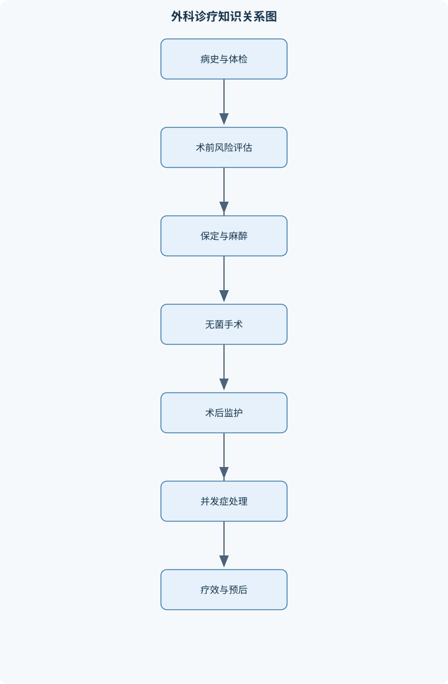
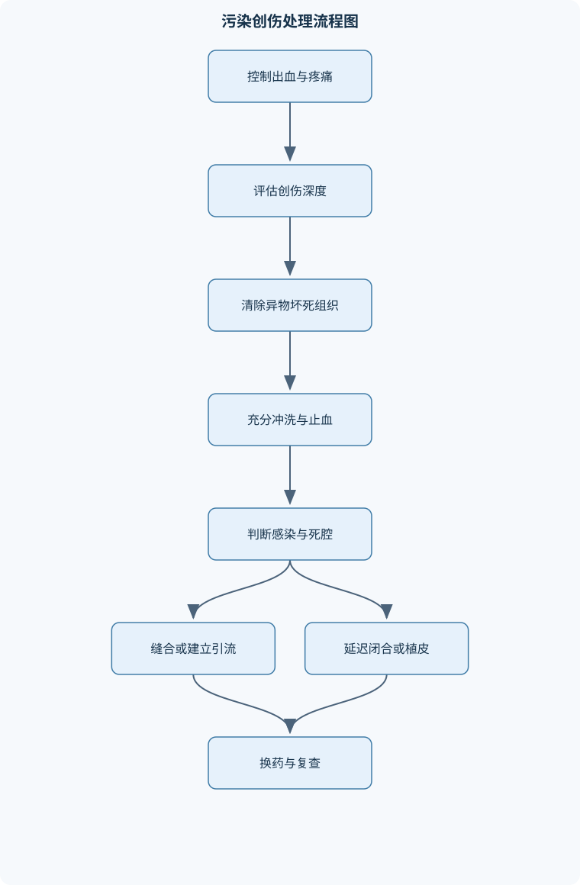

# 兽医外科学

## 一、课程整体知识框架

### 课程边界与先修知识

《兽医外科学》研究动物外科疾病的病因、病理、临床诊断、麻醉与保定、无菌操作、手术基本技术、创伤与感染处理，以及常见器官、眼、骨关节和肿瘤疾病的外科治疗。课程对象包括伴侣动物、经济动物和实验动物，但不同物种的解剖结构、行为反应、麻醉风险、保定方式和术后管理必须分别说明。先修知识包括动物解剖学、生理学、病理学、药理学、微生物学、影像诊断学和临床诊断学。课程边界不替代专科眼科、骨科、肿瘤科和重症医学的完整训练；涉及具体药物选择、麻醉浓度、抗菌药物使用和手术适应证时，应以动物种属、体重、生命体征、实验室检查、当地法规及兽医处方规范为前提。





### 1. 学科对象、任务与知识边界

兽医外科学研究动物外科疾病的发生原因、病理变化、临床诊断、麻醉保定、手术技术、创伤修复、感染控制及术后管理。外科疾病并不等同于“必须立即手术的疾病”，而是指诊断或治疗过程中可能需要外科操作、器械操作、组织修复或外科监护的疾病。手术既可以用于治疗，如切除坏死组织、修复骨折和解除胃肠道阻塞；也可以用于诊断，如活组织采样；还可以用于改善动物生产性能、动物福利或实验研究条件。

课程的核心逻辑是：先判断疾病是否需要外科干预，再确认动物能否耐受保定和麻醉，随后选择手术通路与技术，最后通过疼痛控制、感染预防、营养支持和功能康复促进恢复。任何手术方案都必须同时回答五个问题：病变在哪里，病变造成了什么功能障碍，手术能否改变病程，手术风险是否可接受，术后能否完成持续护理。

本课程以伴侣动物、经济动物和实验动物为对象，但不能把某一物种的解剖、剂量或操作方式直接套用于其他物种。犬猫通常需要较精细的气道管理、静脉通路和术后疼痛观察；牛等大动物可能需要站立保定、局部或区域麻醉，但其体型、瘤胃内容物、反刍和倒卧风险会影响麻醉与手术安排；实验动物除疾病治疗外，还必须遵守实验方案、动物福利和设施生物安全要求。小型啮齿动物体温调节能力弱、体重小、液体丢失快，监护和器械尺度也不同。

本课程建立在动物解剖学、生理学、病理学、药理学、微生物学、影像诊断学和临床诊断学基础上。课程不替代专科眼科、骨科、肿瘤科及重症医学训练。具体药物选择、麻醉浓度、抗菌药物使用和手术适应证，必须结合动物种属、年龄、体重、生命体征、实验室检查、合并疾病、当地法规和兽医处方规范决定。

### 2. 从术前判断到术后恢复的主线

术前阶段首先进行病史调查和体格检查。病史包括发病时间、症状变化、采食饮水、排便排尿、运动能力、既往疾病、过敏或麻醉史、近期用药和可能的毒物或异物暴露。体格检查应记录精神状态、呼吸模式、心肺听诊、脉搏质量、黏膜颜色、$CRT$、脱水和疼痛表现，并测量$T$、$HR$和$RR$。其中，$CRT$以秒计，但低温、外周血管收缩、贫血和黏膜色素会降低其可靠性，不能单独用于判断循环状态。

实验室检查通常包括血常规、血液生化、必要时的凝血、尿液和血气评估。检查目的不是机械地“做全套化验”，而是寻找会改变麻醉或手术计划的异常，例如贫血影响供氧，低蛋白影响组织修复和药物分布，肾功能异常影响液体及药物管理，凝血障碍增加出血风险。术前风险评估的终点不是简单给动物贴上低、中、高风险标签，而是形成可执行的计划：哪些异常需要先纠正，哪些检查需要补充，采用何种保定和麻醉，安排哪些监护项目，出现意外时如何处理。

手术计划应明确术者、助手、麻醉人员、器械人员和保定人员的分工；确定手术通路、体位、无菌范围、所需器械、可能并发症和术后护理。禁食、营养支持、导尿、胃肠减压等准备不能一概而论。呕吐或胃肠梗阻动物存在反流和误吸风险，急诊手术不能因为等待“完整禁食”而延误解除危及生命的病变；幼龄、衰弱或低血糖风险动物则需避免过度禁食。

术后管理包括气道和循环恢复观察、疼痛评估、切口检查、体温管理、饮水和营养安排、排尿排便观察、感染监测以及活动限制。术后发热、精神沉郁、切口红肿或渗出并不具有单一病因，需要结合手术类型、时间进程、生命体征和实验室结果判断。感染预防不等于术后常规使用抗菌药物，关键在于无菌操作、充分止血、清除坏死组织、减少死腔、合理引流和及时识别感染。

### 3. 麻醉、监护和手术安全的统一原则

保定的目的包括控制动物运动、暴露手术部位、避免动物自伤和保护工作人员。方法有缰绳牵引、站立保定、卧倒保定、捆绑、器械保定和化学保定。保定强度应与动物性情、疼痛程度、手术部位和麻醉状态相匹配。牛的头部、前肢和后肢保定方式不同，倒牛操作还要考虑腹部受压、呼吸受限和人员逃生通道。犬猫的化学保定虽然能减少挣扎，但可能造成呼吸抑制、低血压、反流、体温下降或药物相互作用，因此不能把化学保定当作没有风险的“安静处理”。

麻醉通常分为诱导、维持和苏醒三个阶段。全身麻醉使动物意识、痛觉和部分反射受到抑制；局部麻醉通过阻断局部神经传导产生感觉消失；传导麻醉是在神经干或神经丛附近阻断冲动；硬膜外麻醉则将局麻药等作用于硬膜外腔，影响相应节段的感觉和运动。不同物种的脊柱解剖、神经分布和体位条件不同，区域麻醉不能仅凭人体解剖资料推断。

吸入麻醉的可控性与血液—气体分配特性有关。麻醉药在血液中的溶解度越低，肺泡分压越快接近吸入气体分压，诱导和苏醒通常越快。其推导链条为：吸入气体进入肺泡，肺泡分压升高；肺泡与血液之间发生分配；血液溶解度越低，血液“储存”药物的能力越弱；更多药物分压迅速传递至脑组织，因此麻醉变化较快。但实际速度还受肺泡通气量、心输出量、麻醉回路、分流和动物肺部疾病影响。

$MAC$是最低肺泡有效浓度，表示在规定实验条件下使约半数受试动物达到特定麻醉终点所需的肺泡麻醉药浓度。$MAC$越小通常表示效能越强，但不能将其当作个体动物的固定手术浓度，因为年龄、体温、合并用药、疼痛刺激和疾病状态都会改变需求。麻醉深度应综合眼睑反射、角膜反射、肌肉张力、眼球位置、呼吸模式、$HR$、$MAP$和刺激反应判断。单一反射可能受物种、药物组合或眼病影响。

麻醉监护至少包括气道通畅、呼吸频率和模式、氧合、通气、心率、脉搏、血压、体温、黏膜灌注、麻醉设备和苏醒状态。$P_aO_2$为动脉血氧分压，单位为mmHg或kPa，解释时必须结合吸入氧浓度和采血条件；$P_aCO_2$为动脉血二氧化碳分压，主要反映肺泡通气，升高通常提示通气不足，但也应排除采样和呼吸周期影响；$MAP$为平均动脉压，单位为mmHg，是器官灌注的重要指标，但必须结合脉搏、黏膜、$CRT$和尿量解释。出现异常时应先确认气道、传感器、管路和氧源，再判断麻醉过深、疼痛刺激、失血、低体温、原发疾病或设备故障，不能只根据一个数值加深或减浅麻醉。

### 4. 创伤、感染与组织修复

创伤是外力、热、化学、咬伤、挤压或医源性因素造成的组织连续性和功能损害。可按开放性与闭合性、机械力性质、损伤深度、污染程度和是否合并神经血管损伤分类。开放性创伤要观察出血、组织缺损、异物、污染、疼痛、肿胀、坏死和深部结构暴露，同时评估全身休克、感染和运动功能。

创伤反应包括局部血管变化、炎症细胞聚集、渗出、疼痛和组织水肿，也可能发展为发热、循环障碍和全身炎症反应。伤口可分为清洁、清洁污染、污染和感染，不能把所有开放性创口都直接归为感染。清创的逻辑是先控制出血和疼痛，再检查神经、血管、肌腱、腔体和骨组织，去除异物及失活组织，充分冲洗，判断死腔和污染程度，最后决定一期闭合、延迟闭合、开放换药或引流。

一期愈合要求创缘存活、对合良好、死腔小、污染受控且没有持续感染。组织缺损明显、血供不足、张力过大、死腔存在或感染未控制时，强行缝合可能形成脓肿、裂开和深部感染，应依靠肉芽组织填充和上皮覆盖，转为二期愈合或延迟闭合。脓肿是相对局限的脓腔，治疗重点是判断是否成熟并建立通畅引流；蜂窝织炎在疏松结缔组织内弥漫扩展，边界不清，全身反应可能更明显，不能简单按脓肿切开。

### 5. 腹部、泌尿生殖系统、骨科、跛行、眼科与肿瘤

犬猫腹部手术常根据病变位置选择腹正中线或腹侧壁通路。腹正中线切口需依次处理皮肤、皮下组织、腹白线或相关筋膜层，切开腹膜时应避免损伤腹腔脏器。胃切开主要用于不能通过保守方法解决的胃内异物、胃腔内容物取出或局部病变处理；风险包括污染、出血、切口渗漏、胃壁血供损伤和术后胃肠功能障碍。小肠切开和吻合要保持肠壁血供、减少污染、恢复腔道连续性并避免狭窄；肠套叠整复时应先判断肠管活力，不能为追求整复而强行牵拉坏死肠段。

膀胱切开适用于膀胱内结石、异物、部分肿物或需要直接处理的腔内病变。操作重点是隔离尿液、减少污染、保护输尿管口和尿道，关闭膀胱壁时使缝线不暴露于膀胱腔内，以减少结石形成和黏膜刺激。膀胱壁内翻缝合的基本原则是保证密闭、减少腔内异物和避免腔道明显狭窄。去势及卵巢子宫切除术还需关注血管结扎、残端安全、腹腔污染和术后疼痛。

骨折可按开放性或闭合性、完全或不完全、横断、斜形、螺旋、多段和粉碎等分类。检查应包括肢体外观、疼痛、异常活动、肿胀、开放创口、远端脉搏和神经功能，并用相互垂直的影像学体位判断骨折部位、移位和关节受累。固定方式包括外固定、内固定和支架固定。髓内针适用于部分长骨骨折，其优势是位于骨髓腔内、可抵抗弯曲力，但对旋转和轴向稳定的控制可能不足，靠近关节、骨髓腔不规则、开放性严重污染或软组织损伤明显时需谨慎选择，不能视为所有长骨骨折的通用方法。

骨折愈合通常经历血肿机化、原始骨痂形成和骨痂改造塑形三个阶段。稳定固定、良好血供、适度断端接触和感染控制有利于愈合；过度活动、固定不良、感染、严重软组织损伤、营养不良和全身疾病可造成延迟愈合或不愈合。固定后能活动不等于已经愈合，必须结合疼痛、负重、固定状态和复查影像判断。

跛行是运动系统或神经系统异常导致的步态和负重改变。支跛以患肢负重期缩短、着地时间减少为主，悬跛以患肢摆动障碍、抬举困难或步幅异常为主。诊断应按站立观察、行走和小跑观察、逐肢比较、关节活动、肌腱韧带及蹄部检查、神经学检查、影像学检查的顺序进行。脊柱和腰荐部疾病、周围神经损伤可产生类似骨科跛行，疼痛最明显的位置也不一定是原发病灶。

眼科检查先进行低刺激观察，再检查眼睑、结膜、角膜、瞳孔和眼球位置，随后进行泪液分泌试验、眼内压测定和荧光素染色。荧光素进入角膜上皮缺损处，提示角膜溃疡或其他上皮破损；角膜穿孔、严重外伤和眼内压异常需要及时处理。结膜充血和分泌物不能直接等同于结膜炎，因为角膜溃疡、葡萄膜炎、青光眼和异物也可表现为红眼。眼科保定应减少眼球压迫和挣扎，必要时结合镇痛或适宜的化学保定。

肿瘤是细胞异常增殖并形成相对自主性组织的病变。良性肿瘤常膨胀性生长、边界较清、活动度较大；恶性肿瘤可浸润周围组织、形成坏死溃疡并通过淋巴或血液转移。但外观只能用于风险判断，不能替代细针采样、细胞学和组织病理学。肿瘤评估包括病史、局部和区域淋巴结检查、影像学分期、细胞学或组织病理学。切除方案需考虑局部边界、组织层次、功能保留、淋巴结状态和远处转移；必要时结合放射治疗、药物治疗或姑息性手术。术后应以切缘、局部复发、淋巴结和远处器官情况进行随访。

## 二、章节和模块划分

### 核心知识覆盖清单

本清单用于检查正文是否覆盖本课程的主要知识模块：

- **外科学总论与围手术期管理**：外科学与外科手术学的概念、外科疾病的诊断与治疗目标、术前病史和体格检查、实验室检查与麻醉风险评估、手术计划与人员分工、病畜禁食营养和特殊准备、术后疼痛感染与营养管理、围手术期并发症预防。
- **动物保定与手术安全**：保定的目的和基本原则、缰绳牵引与器械保定、站立保定与卧倒保定、牛的头部和四肢保定、犬猫化学保定的风险、保定对手术暴露的影响、动物福利与人员生物安全、保定失败时的应急处置。
- **无菌术、手术器械与基本操作**：无菌术与无菌屏障、手术人员刷手和穿戴、手术区域皮肤准备、高压蒸汽灭菌原理与验证、化学消毒与气体灭菌的适用边界、手术器械分类与正确传递、组织切开与锐性分离、钝性分离止血和缝合、引流与手术创闭合。
- **兽医麻醉与麻醉监护**：麻醉前评估与麻前用药目的、诱导麻醉维持麻醉和苏醒、全身麻醉与局部麻醉、传导麻醉和硬膜外麻醉、吸入麻醉的肺泡摄取机制、最低肺泡有效浓度的含义、气管插管与麻醉机连接、麻醉深度与反射变化、呼吸循环体温和肾功能监护、麻醉意外识别与复苏流程。
- **创伤、组织修复与外科感染**：损伤的病因和分类、开放性创伤的临床表现、创伤局部与全身反应、一期和二期愈合条件、影响创伤愈合的因素、清洁污染和感染伤口、清创术的目的与步骤、脓肿疖痈和蜂窝织炎、败血症与脓血症的鉴别、引流和感染控制原则。
- **腹部与泌尿生殖系统手术**：犬猫腹部手术通路选择、腹正中线切口层次、腹侧壁切口的解剖基础、胃切开术适应证与风险、小肠切开和肠管吻合原则、肠套叠整复的操作要点、膀胱切开术适应证、膀胱壁内翻缝合原则、去势术和卵巢子宫切除术、腹腔污染与术后监护。
- **四肢疾病与骨科基础**：骨折的病因和分类、开放性与闭合性骨折、骨折的临床检查和影像学诊断、骨折整复的基本原则、外固定内固定与支架固定、髓内针的结构和适用条件、骨折愈合的三个阶段、影响骨折愈合的全身因素、骨折固定并发症、犬猫常见四肢疾病。
- **跛行诊断、关节疾病与风湿病**：跛行的定义和分类、支跛与悬跛的区别、静态和运动状态观察、跛行定位的阶梯式检查、关节触诊和被动运动、神经性跛行与骨科跛行鉴别、脊柱和腰荐部疾病导致的运动障碍、风湿病的变态反应机制、风湿性肌炎和关节炎、跛行诊断中的影像与实验室检查。
- **兽医眼科学基础与常见眼病**：眼球功能结构与保护结构、眼睑结膜和角膜检查、泪液分泌试验、眼内压测定与青光眼筛查、荧光素染色检查、直接和间接检眼镜、结膜炎的病因和临床表现、角膜炎与角膜溃疡鉴别、眼部外伤和角膜穿孔、眼科检查中的保定与镇痛。
- **外科肿瘤学与综合病例分析**：肿瘤的定义和发生机制、良性与恶性肿瘤的临床区别、肿瘤局部浸润和转移途径、肿瘤病史和体格检查、细针采样和组织病理学、影像学分期与手术规划、肿瘤切除边界的原则、手术放射和药物综合治疗、术后复发与转移监测、外科病例记录和预后沟通。


### 1. 外科学总论与围手术期管理

本模块先讲外科学、外科手术学和外科疾病的关系，再建立“诊断—风险评估—计划—

## 三、核心概念的详细解释

### 1. 外科学总论与围手术期管理

外科学研究动物疾病中需要通过切开、切除、修复、引流、固定、重建或器械介入进行诊断和治疗的部分；外科手术学则进一步研究手术通路、组织处理、器械使用、麻醉、无菌、缝合和术后管理。外科疾病不等于“必须立即手术”的疾病。只有当手术能够解除梗阻、清除坏死组织、控制感染、恢复结构或取得诊断材料，且预期收益高于麻醉和手术风险时，外科干预才具有合理性。

术前评估应从病史、体格检查、实验室检查、影像学资料和拟行手术五方面建立闭环。病史需要记录发病时间、症状进展、采食饮水、排便排尿、既往麻醉和用药情况。体格检查应包括精神状态、疼痛、脱水、心肺听诊、脉搏质量、黏膜颜色、$CRT$、$T$、$HR$和$RR$。$CRT$受低温、血管收缩、贫血和黏膜色素影响，只能作为外周灌注的辅助指标。实验室检查的价值在于发现会改变手术计划的异常，例如贫血影响氧运输，低蛋白影响药物分布和创伤修复，肾功能异常影响液体管理，凝血异常增加出血风险。

手术计划必须写明术者、助手、麻醉人员、器械人员和保定人员的分工，确定体位、保定、麻醉、切口、器械、无菌范围、可能并发症、术后护理和应急措施。幼龄、衰弱、低血糖风险动物不宜机械套用长时间禁食；胃肠梗阻或频繁呕吐动物存在反流和误吸风险，急诊手术不能因等待常规禁食而延误。犬猫通常需要可靠气道管理和精细疼痛观察；牛等大动物可采用站立保定和区域麻醉，但必须考虑瘤胃内容物、反刍、倒卧和踢蹬风险；实验动物还必须符合设施动物福利、实验方案和生物安全要求。

术后管理包括苏醒期气道观察、疼痛评估、体温维持、切口检查、饮水和营养、排尿排便、活动限制和感染监测。切口红肿、发热或精神沉郁不能单独诊断感染，应结合手术后时间、渗出液性质、生命体征和实验室结果判断。

### 2. 保定、动物福利与手术安全

保定是按照动物行为和手术需要限制其运动，以暴露术部、避免自伤并保护工作人员。理想保定应满足安全、有效、可逆、尽量少应激和不妨碍呼吸循环。站立保定适合部分牛的腹壁、乳房和四肢操作；卧倒保定可提供更充分的暴露，但增加反流、呼吸受限、肌肉压迫和挣扎损伤风险。犬猫化学保定不能替代术前风险评估，疼痛、气道异常、心肺疾病和高龄均会提高风险。

牛的头部保定应防止突然摆头和角部伤害；前肢、后肢保定需避开踢蹬方向并保持操作者退路。倒牛前应评估妊娠、腹胀、呼吸状态和骨关节疾病。保定失败时，首先停止刺激、保持气道和人员退避，重新评估固定点、动物疼痛和设备是否失效；不能通过持续加大束缚力解决本质上的疼痛或恐惧。

### 3. 无菌术、器械与基本操作

无菌术的目标不是使环境“绝对无菌”，而是建立并维持从灭菌器械、手术人员、术部皮肤到无菌铺巾的屏障，降低微生物进入创面的机会。手术人员应完成手部清洁、规范刷手、穿无菌手术衣和戴无菌手套；术部准备包括剪毛、清除污物、皮肤消毒和铺巾。皮肤消毒不能替代对坏死组织、异物和感染灶的处理。

高压蒸汽灭菌利用高温饱和蒸汽凝结释放潜热，使微生物蛋白质变性。有效性取决于温度、压力、暴露时间、蒸汽接触、包装和装载量，不能把某一温度和时间机械用于所有设备。化学消毒适合部分不能耐热的物品，但受有机物、浓度、接触时间和材料相容性影响；气体灭菌可处理热敏物品，却需控制残留和通风，不能用于未经验证的场景。

器械传递应保持器械尖端和工作端不指向人员，传递前确认使用方向和功能。锐性分离利用刀、剪等切断组织，切面清楚、牵拉损伤较小，适用于层次明确且需精确切开的组织；钝性分离利用组织间隙和钝器分开组织，适合天然间隙，但在血管神经密集区可能造成撕裂。止血可通过压迫、结扎、电凝或其他方式完成，选择取决于血管口径、组织位置和设备条件。

创口闭合的前提是组织有活力、污染受控、止血充分、死腔可处理、张力可接受。引流用于排出血液、脓液、渗出液或防止死腔积液，但引流物本身可能成为细菌进入通道，必须保持通畅、固定和记录。

### 4. 麻醉与监护

全身麻醉是通过药物使动物产生可逆性意识丧失、痛觉减退、肌肉松弛和反射抑制；局部麻醉只阻断特定区域的感觉传导。传导麻醉是在神经干或神经周围阻断感觉传入；硬膜外麻醉则将局部麻醉作用于硬膜外腔附近的神经根，适用于相应尾部、会阴或后肢区域，但必须考虑解剖差异、凝血状态和感染风险。

麻醉过程包括诱导、维持和苏醒。气管插管可保持气道通畅、供氧并连接麻醉回路，但插管过深、气囊压力不当或插管刺激可造成并发症。麻醉深度不能由单一眼睑反射或角膜反射判断，应综合肌肉张力、眼球位置、呼吸模式、对刺激反应、$HR$、$MAP$和手术刺激。不同物种、药物组合和眼科疾病会改变反射表现。

监护包括呼吸、循环、氧合、通气、体温、疼痛和肾灌注。$P_aO_2$表示动脉血氧分压，单位可为mmHg或kPa，必须结合吸入氧浓度和采血条件解释；$P_aCO_2$主要反映肺泡通气，升高常提示通气不足，但还需排除采样错误。$MAP$是器官灌注的重要指标，不能脱离脉搏、黏膜、$CRT$和尿量解释。麻醉中呼吸变浅、血压下降、反射消失和低体温，可能来自麻醉过深、通气不足、循环抑制、设备故障或原发疾病，处理前应先检查气道、管路、传感器和氧源。

### 5. 创伤、组织修复与外科感染

创伤是机械、热、化学、电或其他因素导致组织连续性、结构或功能受损。开放性创伤应评估出血、污染、异物、皮肤和肌肉活力、神经血管完整性、腱和骨的损伤，以及是否存在腔体穿透。创伤局部反应包括血管收缩、炎症、渗出、细胞清除和肉芽组织形成；严重创伤还可引起疼痛、休克、低体温和全身炎症反应。

一期愈合要求创缘存活、对合良好、死腔小、污染受控且无持续感染。组织缺损、张力过大、血供不足、坏死或感染明显时，创面需依靠肉芽组织填充、收缩和上皮覆盖，属于二期愈合；部分创面可先开放处理，待污染和感染控制后延迟闭合。

外科感染强调感染灶与创伤、手术伤口、组织坏死或需要外科处理的病变有关。脓肿是相对局限的脓腔，常有包膜或肉芽组织边界，治疗重点是判断是否成熟并建立有效引流；蜂窝织炎在疏松结缔组织内弥漫扩展，边界不清，全身反应可能更明显，不能简单切开一个“脓腔”解决。疖是毛囊及其周围组织的局限性化脓性炎症；脓血症强调感染灶或脓液相关病原体进入血流并形成全身性病理反应；败血症是感染导致的失调性全身反应和器官功能障碍，二者不能混为同一概念。

### 6. 腹部、泌尿生殖系统与骨科手术

犬猫腹腔手术常选择腹正中线通路，因为白线血管较少、解剖层次明确且可提供较广暴露。切开腹壁时应依次识别皮肤、皮下组织、腹白线或腹直肌鞘、腹膜，避免盲目深切损伤腹腔器官。腹侧壁切口可用于特定区域，但需结合肌层、血管、神经和手术目标选择。

胃切开适用于胃内异物、无法通过内镜取出的腔内病变或需要直接处理的局限性病变，前提是动物能够耐受麻醉且不存在更适合的替代方案。小肠切开或吻合需保护肠系膜血供，避免过度牵拉，切除坏死段后保证吻合口无张力、无明显狭窄并且密闭。肠套叠整复应先判断肠管活力；不能为追求整复而强行牵拉已经坏死或脆弱的肠段。腹腔污染时应隔离污染源、减少肠内容物扩散、清除明显污染并加强术后监护。

膀胱切开适用于膀胱结石、异物及部分腔内病变。操作需保护输尿管口和尿道，避免尿液污染腹腔。膀胱壁关闭应保证密闭、减少腔内异物并防止明显狭窄；内翻缝合的原则是使缝线不暴露于膀胱腔内，以减少黏膜刺激和结石形成风险。去势及卵巢子宫切除术应重点控制血管、保护残端、避免腹腔污染并完成术后疼痛和切口管理。

骨折可按开放性、部位、完整性、骨折线形态和粉碎程度分类。检查包括疼痛、异常活动、肿胀、开放创口、远端血供和神经功能，影像学通常需要相互垂直的体位以判断移位和关节受累。外固定适合部分稳定性要求较低或需要减少手术创伤的病例；内固定可提供更准确的复位和稳定；支架固定适合某些复杂骨折或需要保护软组织的情况。髓内针主要抵抗弯曲力，但对旋转和轴向稳定的控制可能不足，靠近关节、骨髓腔不规则、开放性污染严重或软组织损伤明显时需谨慎。

骨折愈合经历血肿机化、原始骨痂形成和骨痂改造塑形。稳定固定、良好血供、适度断端接触和感染控制有利于愈合；固定松动、过度活动、感染、营养不良和全身疾病可导致延迟愈合或不愈合。

### 7. 跛行、眼病与肿瘤

跛行是运动系统或神经系统异常导致的步态和负重改变。支跛主要表现为患肢负重期缩短、着地时间减少；悬跛主要表现为摆动期障碍、抬举困难或步幅异常。定位应由整体到局部、由静态到动态、由低刺激检查到影像学检查，依次观察站立、行走、小跑、关节活动、肌腱韧带、蹄部和神经功能。神经性跛行常伴本体感觉异常、拖足、反射改变或脊柱疼痛，不能只按骨科疾病处理。

眼科检查应先观察眼睑、眼球位置、分泌物和瞳孔，再进行泪液分泌、眼内压和荧光素检查。荧光素可进入角膜上皮缺损处，阳性支持角膜溃疡或其他上皮破损。结膜炎常有结膜充血、水肿和分泌物，但角膜溃疡、葡萄膜炎、青光眼和异物也可表现为红眼，必须鉴别。疑似角膜溃疡时应先确认角膜完整性，再决定治疗方向。

肿瘤是异常细胞增殖形成的相对自主性组织。良性肿瘤多呈膨胀性生长、边界较清、活动度较大；恶性肿瘤可浸润、固定、坏死、溃疡并经淋巴或血液转移，但外观不能确诊。细针采样适合初步细胞学判断，组织病理学可评价组织结构、分化和切缘。影像学分期用于判断局部侵犯、区域淋巴结和远处转移。手术边界必须结合肿瘤类型、位置、组织层次、功能保留和分期结果制定；广泛转移或无法完整切除时，姑息性手术、放射治疗和药物治疗的目标可转为减轻疼痛、控制出血或改善功能。

## 四、重要定义、公式、定理和推导

### 专业审校补充：关键定义与适用边界

骨折愈合方式取决于固定稳定性、骨折端间隙和局部血供，不能把“骨痂多少”作为所有固定方式的统一疗效标准。相对稳定的固定允许骨折端存在受控的微动，通常经血肿机化、软骨性或纤维性骨痂形成，再逐渐矿化和改造，影像上可见骨痂。绝对稳定固定使骨折端几乎无相对运动、间隙很小且血供条件允许时，可发生直接骨愈合，主要依靠骨单位跨越骨折线重建，外显骨痂可能很少；因此骨痂少不必然代表愈合失败。两者不是简单的优劣关系：固定方式须结合骨折形态、部位、动物体型与年龄、软组织损伤、污染及术后护理能力选择。开放性骨折还需同时评估创口污染、骨和软组织活力及感染控制，不能仅因骨折对位良好便判定治疗充分。愈合评估应结合疼痛、负重、异常活动、连续影像中的骨折线与骨性连接变化，以及固定物状态；不同骨骼、物种和固定构型的恢复速度不同，不宜套用统一时间表。若持续疼痛、断端活动、植入物松动或感染征象出现，应重新评估稳定性、血供和感染，而非仅等待骨痂增多。


### 1. 麻醉与监护中的公式和推导

#### 最低肺泡有效浓度

$MAC$表示在规定实验条件下，使约半数受试动物达到特定麻醉终点所需的肺泡麻醉药浓度。其数值越小，通常表示药物效能越强，但不能单独决定临床麻醉深度，因为个体年龄、体温、疼痛刺激、合并用药和疾病状态均会改变需求。

吸入麻醉药的肺泡分压接近吸入气体分压的速度，与血液和麻醉药之间的分配特性有关。血液中溶解度较低时，较少药物被血液“带走”，肺泡分压上升较快，诱导和苏醒通常较快。其推导条件是：通气相对稳定、回路工作正常、肺泡通气和心输出量没有剧烈变化。低通气、分流、循环异常、肥胖、低体温和严重肺病都会使这一推论偏离实际。

#### 氧合、通气和循环指标

$P_aO_2$的单位为mmHg或kPa，表示动脉血氧分压；$P_aCO_2$的单位同样为mmHg或kPa，主要反映肺泡通气。若二氧化碳产生量相对稳定，肺泡通气下降会使$P_aCO_2$升高；但采样延迟、气泡、呼吸周期和设备误差都可能造成假异常。

$MAP$常用近似关系表示为：

$$
MAP \approx \frac{SBP+2DBP}{3}
$$

其中$SBP$为收缩压，$DBP$为舒张压，单位均为mmHg。该近似假定心率处于常见范围、舒张期约占一个心动周期的较大部分。心动过速、严重心律失常或脉压波形异常时，不能机械套用。$MAP$反映平均灌注趋势，但必须与脉搏、黏膜、$CRT$、体温和尿量共同解释。

### 2. 创伤愈合与清创决策流程

#### 清创流程

**输入：**受伤时间、创口长度和深度、污染程度$C$、异物、组织活力、出血、神经血管状态、感染表现和全身状态。  
**输出：**一期闭合、延迟闭合、开放换药、引流或转诊方案。

1. 先控制明显出血和疼痛，评估气道、呼吸和循环。
2. 检查远端脉搏、感觉、运动、肌腱、关节腔和体腔是否受累。
3. 清除表面污物和异物，使用适宜冲洗方法降低污染负荷。
4. 识别颜色异常、无收缩、无出血或质地脆弱的失活组织，并逐步清除。
5. 评估死腔、张力、污染和组织血供。
6. 若创缘存活、污染受控、无感染且可无张力对合，可考虑一期闭合；否则采用引流、开放管理或延迟闭合。
7. 记录创口长度$d$、深度、解剖参照点、组织损伤和复查计划。

不变量是不能为了“尽快缝合”而保留坏死组织、异物或未控制感染。若存在深部结构损伤、进行性全身反应或无法建立有效引流，应转入更高等级处理。

#### 例题一：开放性污染创伤

**题干：**犬后肢创口长$6\ \text{cm}$，受伤约$10$小时，创内有泥沙和部分灰白色组织，周围肿胀，尚无明显脓液，远端脉搏存在。是否立即一期缝合？

**分析：**受伤时间较长、存在异物和失活组织，创口不满足清洁、血供良好和无感染的条件。

**解答：**先控制疼痛和出血，检查神经血管与肌腱；随后清除泥沙和明显失活组织，充分冲洗，评估死腔和污染程度$C$。若清创后仍有组织活力不确定、死腔大或污染明显，应开放管理或放置引流，待复查确认感染受控和肉芽组织形成后再延迟闭合。

**结果验证：**若术后渗出减少、无恶臭、体温和精神状态稳定、创面出现健康肉芽组织，说明处理方向合理；若肿胀扩展、疼痛加重或出现脓性分泌物，应重新评估残余异物、坏死组织和引流是否通畅。

**变式：**若创口仅受伤$1$小时、污染轻、创缘鲜活且可无张力对合，可在充分清洁和检查深部结构后考虑一期闭合。

### 3. 围手术期评估算法

```text
输入：种属、年龄、体重、病史、体格检查、实验室结果、影像资料、拟行手术
输出：风险分层、补充检查、麻醉监护和术后计划

1. 核实诊断、手术必要性和可替代方案
2. 评估气道、呼吸、循环、脱水、疼痛、感染和凝血
3. 若发现危及生命且可逆的异常：
      先纠正或延期择期手术
4. 根据物种和性情选择保定及气道方案
5. 根据手术部位选择通路、麻醉方式和监护指标
6. 预判出血、污染、低体温、反流和苏醒风险
7. 明确人员分工、器械、应急设备和术后护理
8. 若关键风险已控制或风险被明确接受，则进入手术
9. 否则延期、转诊或选择替代治疗
```

不变量是任何未解释的危及生命异常都必须在择期手术前处理或记录其风险接受依据。若评估$n$项信息，基础清单核对复杂度可记为$O(n)$；这只是工作量描述，不代表手术风险可以由一个数字完全表示。

#### 例题二：麻醉中异常

**题干：**犬全身麻醉中出现呼吸变浅、$HR$下降、$MAP$降低、肌肉张力消失和体温下降。应如何判断？

**分析：**多个指标同时异常，可能是麻醉过深，也可能由低体温、低氧、通气不足、循环抑制或设备故障引起，不能只凭反射消失下结论。

**解答：**先确认气道通畅、气管导管位置、氧源、麻醉回路和监护传感器；再检查$P_aO_2$、$P_aCO_2$或替代性通气指标，判断氧合和通气；随后评价脉搏、黏膜、$CRT$和血压波形。若设备正常且通气、氧合下降，应改善通气并重新评估麻醉浓度；若循环灌注不足，应按监护结果进行循环支持；同时主动保温并持续记录。

**结果验证：**处理后呼吸幅度、血压、脉搏质量、黏膜和体温趋势改善，才说明干预有效。单次$HR$回升不能证明器官灌注已恢复。

**变式：**若呼吸突然消失而气道压力异常升高，应优先排查导管扭折、阻塞或回路故障，而不是立即归因于麻醉过深。

### 4. 骨折与跛行分析

#### 跛行定位流程

**输入：**站立姿势、行走或小跑表现、患肢负重、关节活动、肌腱韧带和蹄部检查、神经学检查、影像资料。  
**输出：**最可能的患肢、解剖区域、鉴别诊断和进一步检查方案。

1. 先观察静态站立和左右肢负重。
2. 再观察行走、小跑和转弯，区分支跛与悬跛。
3. 从蹄部、远端关节逐步向近端检查。
4. 比较双侧关节活动度、疼痛反应和肿胀。
5. 检查肌腱、韧带、脊柱和腰荐部。
6. 若有拖足、本体感觉异常或反射改变，优先考虑神经定位。
7. 根据定位选择X线、超声或其他影像学检查。

不变量是疼痛部位不等于病变原发部位；恐惧、保定、镇痛和对侧代偿都会影响结果。若检查$k$个区域，基础流程可近似为$O(k)$。

#### 例题三：股骨骨折固定选择

**题干：**幼犬股骨中段闭合性斜形骨折，软组织损伤较轻，影像显示明显移位。比较外固定、髓内针和内固定。

**分析：**股骨位于大腿深部，外固定难以同时获得良好对线和稳定；斜形骨折存在剪切和轴向滑移，单纯髓内针对旋转和轴向稳定的控制可能不足。

**解答：**应根据骨折长度、骨髓腔形态、动物年龄、软组织状态和术者条件选择稳定内固定方案。髓内针可抵抗弯曲，但常需与其他方式联合以控制旋转和轴向力；外固定在股骨中段通常不如内固定实用。术中应尽量保护骨膜和血供，术后限制剧烈活动并通过疼痛、负重和复查影像判断愈合。

**结果验证：**复查应观察骨折线、骨痂、内固定位置、肢体轴线和并发症，而不能以“动物能走路”单独判定愈合。

**变式：**若为严重开放性粉碎骨折且软组织污染显著，首要目标转为清创、感染控制和保护血供，固定方案需根据创面和骨段稳定性重新设计。

### 5. 腹部、眼科和肿瘤病例分析

#### 例题四：膀胱结石

**题干：**犬影像提示膀胱内多个结石，存在排尿困难但无明显腹膜炎。说明膀胱切开要点。

**分析：**结石位于膀胱腔内，若不能通过更低创伤方式处理，可考虑膀胱切开。主要风险是尿液污染、黏膜损伤、输尿管口损伤和术后漏尿。

**解答：**选择合适腹部通路后，将膀胱温和牵出并隔离，切口避开重要结构，取出结石并检查膀胱腔及尿道通畅性。关闭膀胱壁时要求密闭、减少腔内异物，内翻缝合可使缝线不暴露于膀胱腔内，但不能造成明显狭窄。术后观察排尿、腹痛、尿液外漏和感染表现。

**结果验证：**无进行性腹痛、腹围增大、尿液性腹腔积液和排尿障碍，结合复查结果，才可认为术后恢复良好。

**变式：**若存在尿道完全阻塞或膀胱破裂，应先处理危及生命的尿路和腹膜问题，不能按普通择期结石手术安排。

#### 例题五：红眼和角膜混浊

**题干：**猫出现眼睑痉挛、流泪、结膜充血和角膜混浊。如何鉴别？

**分析：**结膜炎可有充血和分泌物，但眼睑痉挛和角膜混浊提示角膜病变、葡萄膜炎或眼内压异常，不能直接诊断为结膜炎。

**解答：**先低刺激观察眼睑和眼球，再进行泪液检查、荧光素染色和眼内压测定。荧光素在角膜上皮缺损处着色，阳性支持溃疡；眼内压异常可提示青光眼或低眼压相关疾病。若怀疑角膜穿孔、深部溃疡或眼内异物，应减少压迫和挣扎，及时转入专科处理。

**结果验证：**诊断必须能解释疼痛程度、角膜透明度、荧光素结果和眼内压，而不是只依据“红眼”。

**变式：**若荧光素阴性但眼内压异常、瞳孔改变和剧烈疼痛明显，仍不能排除眼内疾病。

### 6. 实验与项目工作流程

#### 项目一：无菌流程验证

**输入数据：**手术器械类别、包装方式、灭菌设备状态、装载量、化学指示结果、记录时间和污染事件。  
**步骤：**

1. 按器械耐热性和包装要求分类。
2. 检查器械清洁程度、关节打开状态和包装完整性。
3. 按设备适用程序装载，避免过密。
4. 完成物理参数、化学指示和必要的生物学验证记录。
5. 开包时检查包装完整性、干燥性和指示变化。
6. 记录掉落、湿包、无菌手套接触非无菌面等事件。

**评价标准：**灭菌参数达到设备规定范围，包装完整干燥，指示结果符合要求，污染事件有隔离和纠正记录；不能仅凭“器械看起来干净”判定无菌。

**排错方法：**若指示异常，检查装载过密、蒸汽接触、设备维护和包装材料；若湿包，检查冷凝水、装载和干燥程序；若无菌屏障破坏，立即更换或重新处理相关物品。

#### 项目二：犬跛行定位记录

**输入数据：**静态照片或视频、步态观察、关节活动角度、疼痛反应、神经学结果和影像资料。  
**步骤：**

1. 在低应激环境观察站立。
2. 直线行走、小跑和转弯，记录负重和摆动异常。
3. 从蹄部至近端逐关节触诊并比较对侧。
4. 记录每项检查的部位、动作和反应。
5. 结合神经学检查区分骨科与神经性原因。
6. 依据定位选择X线或超声。

**评价标准：**记录能明确患肢、检查动作、阳性结果和鉴别诊断；结论必须与步态和解剖定位相互支持。

**排错方法：**若同一检查重复结果不一致，应先排除恐惧、保定和镇痛影响；若局部疼痛与影像不一致，应考虑牵涉痛、代偿或影像范围不足，而不是强行选择单一诊断。

### 7. 常见易错点、笔试与面试要点

#### 具体易错点

1. 把所有开放性创伤都视为感染，忽略清洁污染、污染和感染的区别。  
2. 把清创理解为冲洗，遗漏出血控制、异物清除和组织活力评估。  
3. 认为所有污染创伤都应立即缝合。  
4. 用单一眼睑或角膜反射判断麻醉深度。  
5. 只监测$HR$和$RR$，忽略氧合、通气、$MAP$、体温和设备状态。  
6. 把髓内针视为所有长骨骨折的通用固定方法。  
7. 将骨折后能负重等同于骨性愈合。  
8. 将疼痛最明显的位置直接等同于跛行病灶。  
9. 把结膜充血和分泌物直接诊断为结膜炎。  
10. 疑似角膜溃疡时未经荧光素检查便作出治疗判断。  
11. 把肿块活动度当作良恶性确诊依据。  
12. 把脓肿、蜂窝织炎、脓血症和败血症混为一类。  
13. 将高压蒸汽灭菌的某一时间温度机械套用于所有设备。  
14. 只关注手术切口而忽略营养、疼痛、排尿和苏醒期管理。

#### 常见笔试问题及解答思路

1. **为什么一期愈合需要哪些条件？**  
   从组织活力、创缘对合、污染、死腔、张力和感染六方面解释，并说明任一关键条件失败都可能转为延迟或二期愈合。

2. **脓肿和蜂窝织炎如何鉴别？**  
   比较病变边界、脓腔、包膜、波动感、扩散方式和引流策略，指出深部脓肿未必有典型波动感。

3. **麻醉监护重点是什么？**  
   按气道、呼吸、循环、体温、疼痛和肾灌注组织，说明每一系统的指标及异常不能单独解释。

4. **髓内针有哪些优缺点？**  
   说明抵抗弯曲力的优势，以及旋转、轴向稳定不足和靠近关节、开放性污染等限制。

5. **犬猫腹正中线切口为何常用？**  
   从白线血管较少、层次清楚、暴露范围较大和关闭方式解释，同时说明个体解剖和手术目标可能改变选择。

6. **角膜溃疡如何检查？**  
   先低刺激观察，再进行荧光素检查，并结合眼内压、泪液和疼痛表现鉴别青光眼、葡萄膜炎和结膜炎。

7. **良性与恶性肿瘤如何区别？**  
   比较生长方式、边界、活动度、浸润和转移，但强调最终性质需细胞学或组织病理学确认。

8. **术前风险评估的终点是什么？**  
   不是简单分级，而是形成可执行的检查、纠正、麻醉、保定、监护、应急和术后计划。

#### 常见面试问题及参考答案

1. **动物麻醉中血压下降，你先做什么？**  
   先确认传感器和测量方法，再检查气道、通气、麻醉深度和循环状态，依据趋势进行分层处理，而不是只增加某一种支持措施。追问要点：如何区分设备错误、麻醉过深和失血。

2. **污染创伤能否马上缝合？**  
   只有在组织有活力、污染和感染受控、无明显死腔且可无张力闭合时才考虑；否则应清创、引流、开放或延迟闭合。追问要点：如何判断组织活力和何时复查。

3. **牛站立保定失败怎么办？**  
   先停止操作并保证人员撤离，评估动物疼痛、固定点和环境，再重新设计保定或采用适当麻醉；不能持续加大束缚。追问要点：如何防止踢蹬和倒卧并发症。

4. **为什么不能只凭肿块外观决定手术范围？**  
   外观不能可靠反映浸润深度和转移，需通过采样和影像分期制定切除边界。追问要点：细针采样和组织病理学各自的局限。

5. **眼睛红且有分泌物，是否先按结膜炎处理？**  
   不应直接下结论，应先排查角膜溃疡、异物、葡萄膜炎和青光眼。追问要点：荧光素和眼内压检查的先后及保定安全。

6. **髓内针为什么不是所有股骨骨折的首选？**  
   它主要控制弯曲，可能不能充分控制旋转和轴向移位，骨折形态、骨髓腔和软组织状态会限制使用。追问要点：如何选择联合固定或替代固定。

7. **术后动物不进食应关注什么？**  
   评估疼痛、恶心、肠道功能、感染、低体温、药物影响和原发病，而不是简单强行喂食。追问要点：何时需要营养支持或进一步检查。

8. **如何向动物主人解释肿瘤预后？**  
   说明目前证据、尚未确定的部分、分期和病理结果对方案的影响，区分治愈性、控制性和姑息性目标。追问要点：如何解释复发、转移监测和复诊节点。

### 8. 岗位关联与产出标准

小动物临床兽医主要完成术前评估、腹部和软组织手术、麻醉监护、创口管理及病例沟通；验收标准是病历完整、手术记录可追溯、监护数据连续、并发症识别及时。大动物临床兽医需掌握站立保定、区域麻醉、创伤处理和群体生产条件下的术后管理；验收标准是人员安全、动物应激受控、术部暴露充分并能完成复诊记录。

外科专科医师重点负责复杂腹腔、骨科和肿瘤病例，产出包括手术方案、影像与病理整合、术中记录和预后沟通；验收标准是适应证明确、通路和边界合理、风险预案完整。麻醉与重症监护人员负责气道、氧合、通气、循环、体温、疼痛和复苏，验收标准是监护趋势连续、异常响应有记录、设备故障可排查。眼科、骨科和肿瘤岗位分别要求完成规范检查、定位、采样、分期和随访；不能仅凭单一症状、单张影像或外观作出超出证据范围的诊断。

## 五、算法、流程和实现思路

### 方法与流程覆盖索引

下列方法或流程应在正文中说明输入、步骤、适用条件、结果检查和边界：

- 术前风险评估流程：输入为病史、种属年龄、体重、临床症状、体格检查、实验室结果和拟行手术；输出为手术风险分层、补充检查清单和麻醉计划。过程为核实诊断与手术必要性，评估气道、呼吸、循环、脱水、疼痛和感染，识别并纠正可逆异常，再制定保定、麻醉、监护和术后护理方案。不变量是任何未解释的危及生命异常必须在进入择期手术前得到处理或记录为风险接受依据；终止条件是关键风险已控制或确定不能安全手术并转为延期、转诊或替代方案。适用于择期和急诊手术的结构化准备；复杂度可按检查项目数记为$O(n)$，其中$n$为待评估信息项数量。
- 无菌手术流程：输入为手术部位、手术器械、人员、消毒灭菌条件和无菌用品；输出为维持无菌屏障的手术过程及污染事件记录。过程为清洁环境、器械灭菌、人员刷手穿戴、动物术部剪毛清洁消毒、铺无菌巾、无菌传递、限制污染源并在污染时更换或隔离受污染物品。不变量是无菌物品接触无菌区域、无菌手套不接触非无菌表面；终止条件是切口关闭、敷料固定、器械和纱布清点完成。适用于所有无菌手术；按器械和操作环节数量计，流程检查复杂度为$O(n)$。
- 创伤清创与闭合决策流程：输入为受伤时间、创口类型、污染程度、组织活力、异物、出血、感染表现和全身状态；输出为清创、引流、开放管理、延迟闭合或一期闭合方案。过程为控制出血和疼痛，评估神经血管及深部结构，冲洗并移除异物和明显坏死组织，判断是否存在死腔与感染，选择缝合、引流或开放换药，并安排复查。不变量是不能为追求闭合而保留坏死组织、异物或未控制的感染；终止条件是创面达到可安全闭合的条件，或已建立通畅引流和持续换药计划。适用于软组织开放性损伤；若创面包含多个解剖层次，按创面区域数和组织层次数计，决策复杂度约为$O(n)$。
- 跛行定位分析流程：输入为静态姿势、步态视频或现场观察、疼痛诱发反应、关节活动度、神经学检查和影像学资料；输出为最可能的患肢、解剖区域、鉴别诊断和进一步检查计划。过程为观察站立与行走，区分支跛和悬跛，比较左右肢负重，逐关节检查，进行肌腱韧带和蹄部检查，再根据定位选择X线、超声或其他影像。若出现脊髓或周围神经体征，转入神经定位流程。不变量是每一步检查结果必须与患肢和解剖定位对应，不能将疼痛部位直接等同于病变原发部位；终止条件是定位证据足以支持治疗，或需要进一步影像、采样和转诊。适用于犬猫和大动物的基础跛行诊断；若检查$k$个区域，基础流程复杂度为$O(k)$。
- 麻醉监护与异常响应流程：输入为麻醉动物的意识、反射、HR、RR、呼吸末气体、血压、体温、黏膜和脉搏信息；输出为麻醉深度调整、通气循环支持或复苏措施。过程为按固定时间间隔记录数据，先确认传感器和气道通畅，再判断通气、氧合、循环和体温异常，区分麻醉过深、疼痛刺激、设备故障和原发疾病，随后采取减少麻醉、改善通气、补充氧气、循环支持或启动复苏的措施。不变量是先检查设备与气道，再把监测异常归因于药物或疾病；终止条件是生命体征恢复稳定，或进入标准化心肺复苏流程。适用于全身麻醉和恢复期；每个监测周期按监测指标数量$m$计，数据检查复杂度为$O(m)$。





### 1. 术前风险评估与手术计划流程

术前风险评估的输入包括动物种属、年龄、体重、性别、病史、当前症状、体格检查、实验室结果、影像资料、拟行手术及术后护理条件；输出包括手术必要性判断、风险分层、补充检查清单、保定与麻醉方案、监护项目和应急预案。该流程适用于犬猫、牛等大动物及实验动物，但风险解释必须结合物种差异。犬猫通常需要可靠的气道管理和连续监护；牛可能适合站立保定和区域麻醉，但反刍、瘤胃内容物、倒卧及踢蹬会改变风险；小型实验动物体温下降快、血容量小，监护设备和保温措施必须按体型调整。

具体步骤如下：

1. **核实诊断和手术目标。** 明确病变位置、造成的功能障碍、是否存在梗阻、坏死、出血、感染或无法通过保守治疗解决的结构性问题。手术目标可以是治愈、解除危急障碍、获得病理诊断、改善功能或缓解疼痛。
2. **评估生命支持系统。** 检查气道、呼吸、循环、体温、疼痛、脱水、意识和尿量。$HR$以次/分钟计，$RR$以次/分钟计，$T$以摄氏度计；这些指标必须结合种属、年龄、疼痛和麻醉阶段解释，不能使用单一绝对值判断安全性。
3. **识别可逆异常。** 低血容量、明显脱水、低体温、严重贫血、低血糖、凝血异常、呼吸困难和未控制的感染，可能需要在择期手术前纠正或进一步检查。急诊手术不能为了等待完整检查而延误解除致命梗阻，但应记录风险并同步进行支持。
4. **制定人员、通路、麻醉和监护计划。** 术者负责手术决策，助手负责暴露和牵开，麻醉人员负责气道、麻醉深度、呼吸循环和苏醒，器械人员维护无菌传递，保定人员负责动物位置和人员安全。
5. **确定术后管理。** 预先安排疼痛评估、切口观察、感染监测、营养、排尿排便、活动限制和复诊。若术后护理条件不足，手术可行性和预后必须重新评估。

流程不变量是：任何未解释的危及生命异常都不能被“手术本身”掩盖；手术计划必须说明异常如何处理。终止条件是关键风险已经控制，或已明确不能安全手术并转为延期、替代治疗或转诊。若将待评估的信息项数量记为$n$，结构化审查的基本复杂度可记为$O(n)$；这表示检查项目随信息数量线性增加，不代表临床风险本身可以用一个数学分数完全表示。

#### 伪代码：术前风险评估

```python
def preoperative_assessment(case):
    """
    输入:
        case: 包含species, history, examination, lab, imaging,
              procedure, postoperative_resources等字段的病例记录
    输出:
        plan: 手术必要性、风险问题、补充检查、麻醉监护和术后安排
    """
    plan = {
        "surgical_goal": None,
        "risk_problems": [],
        "additional_tests": [],
        "anesthesia_monitoring": [],
        "postoperative_care": [],
        "decision": None
    }

    plan["surgical_goal"] = identify_surgical_goal(case)

    vital_abnormalities = assess_airway_breathing_circulation(case)
    plan["risk_problems"].extend(vital_abnormalities)

    if has_uncontrolled_life_threat(case):
        plan["decision"] = "先稳定生命支持，必要时转入急诊处理"
        plan["anesthesia_monitoring"] = choose_monitoring(case)
        return plan

    plan["additional_tests"] = select_tests_that_change_management(case)
    plan["anesthesia_monitoring"] = choose_monitoring(case)
    plan["postoperative_care"] = plan_postoperative_care(case)

    if can_perform_safely(case, plan):
        plan["decision"] = "在完成已列明准备后实施"
    else:
        plan["decision"] = "延期、改变方案或转诊"

    return plan
```

该伪代码中的函数不是自动替代兽医判断的程序，而是病例记录的结构化框架。评价标准包括：是否核实了手术目标，是否识别气道和循环危险，是否列出改变决策的补充检查，是否明确监护和术后安排。排错时应先检查病例输入是否缺少种属、体重、生命体征或拟行手术，而不能在信息不完整时直接输出“低风险”。

### 2. 无菌手术与器械管理流程

无菌手术流程的输入是手术部位、器械、包装、灭菌方法、人员、术部皮肤状况和无菌用品；输出是维持无菌屏障的操作过程、污染事件记录和术后器械清点。其核心不是追求抽象的“绝对无菌”，而是减少微生物进入切口的机会。

操作顺序为：

1. 清洁手术环境，限制无关人员和不必要的走动。
2. 按器械材质和耐受条件选择高压蒸汽灭菌、化学消毒或气体灭菌。高压蒸汽依赖温度、压力、蒸汽接触和暴露时间，不能把某一温度和时间机械套用于所有设备；包装、装载量和设备验证同样影响效果。
3. 手术人员完成手部清洁、刷手、穿无菌衣和戴无菌手套。无菌手套一旦接触非无菌表面，应更换或采取隔离措施。
4. 动物术部剪毛、清除污物、进行皮肤消毒并铺设无菌巾。皮肤消毒不能替代坏死组织清除和深部感染处理。
5. 传递器械时保持工作端方向安全，避免器械尖端指向人员；器械助手应确认器械完整、锋利度和功能。
6. 出现污染时立即暂停相关操作，判断污染范围，隔离或更换污染物品，必要时重新消毒、重新铺巾或更换手套。
7. 切口关闭后完成纱布、器械和针线清点，固定敷料并记录污染事件。

该流程的不变量是无菌物品只接触无菌区域，无菌手套不接触非无菌表面，污染不能被“看不见”当作不存在。终止条件是切口关闭、清点完成、敷料固定和污染记录完成。

### 3. 创伤清创、引流与闭合决策流程

输入包括受伤时间、创口位置和大小、污染程度$C$、组织活力、异物、出血、神经血管损伤、死腔、感染表现和动物全身状态；输出为一期闭合、延迟闭合、开放管理、引流或进一步转诊方案。$C$在本课程中区分清洁、清洁污染、污染和感染，不能把所有开放性创伤都直接称为感染。

具体步骤为：

1. 先控制大出血、疼痛和休克风险，确认气道、呼吸和循环稳定。
2. 检查远端脉搏、感觉、运动功能及肌腱、关节、骨骼和体腔是否受累。
3. 清除表面污物和可见异物，充分冲洗；冲洗的作用是降低污染负荷，但不能代替清除坏死组织。
4. 按组织颜色、出血反应、质地和收缩能力评估活力，去除明确失活组织，同时尽量保留可存活组织。
5. 判断是否存在脓腔、死腔、异物、持续污染和感染。局限脓肿需要建立通畅引流；蜂窝织炎则为疏松结缔组织的弥漫性炎症，不能简单切开一个小口后即视为处理完成。
6. 创缘存活、污染受控、止血充分、死腔小且可无张力对合时，才考虑一期闭合。若感染、坏死、严重污染或组织缺损明显，应开放换药、引流或延迟闭合。
7. 安排复查，观察渗出、疼痛、肿胀、发热、裂开和肉芽组织形成。

一期愈合要求创缘存活、对合良好、死腔小、污染受控且无持续感染；二期愈合依靠肉芽组织填充、收缩和上皮覆盖。若缝合只是为了“尽快闭口”，却保留坏死组织或感染，可能形成脓肿、裂开和深部感染。

### 4. 麻醉监护与异常响应流程

输入包括意识、眼睑反射、角膜反射、肌肉张力、眼球位置、$HR$、$RR$、呼吸末气体、$P_aO_2$、$P_aCO_2$、血压、黏膜、脉搏和$T$；输出为麻醉深度调整、气道和通气支持、循环支持、保温或复苏措施。

监护时应按固定时间间隔记录趋势，而不能只看单个瞬间数值。$P_aO_2$以mmHg或kPa计，评价氧合时必须注明吸入氧浓度和采血条件；$P_aCO_2$以mmHg或kPa计，主要反映肺泡通气，但需排除采样和呼吸周期因素；$MAP$以mmHg计，是器官灌注的重要参考，必须结合脉搏、黏膜、$CRT$和尿量解释。

异常处理顺序为：

1. 先检查传感器、导线、袖带位置、采样管和麻醉机。
2. 检查气道是否通畅、气管导管是否移位或阻塞、呼吸回路是否漏气。
3. 判断异常主要属于氧合、通气、循环、麻醉过深、疼痛刺激、低体温或原发疾病。
4. 根据原因采取减少麻醉、改善气道和通气、补充氧气、循环支持、保温、止痛或启动复苏。
5. 记录干预时间、措施、反应和后续趋势，苏醒期继续观察气道、体温、疼痛、出血和切口。

麻醉深度不能由单一反射决定。眼睑反射和角膜反射会受物种、药物组合、眼病和手术刺激影响；适宜手术期还要结合肌肉张力、呼吸模式、血压、心率和对刺激反应。终止条件是生命体征恢复稳定，或病情进入标准化心肺复苏流程。

### 5. 典型病例例题与逐步解答

#### 例题一：犬胃内异物

**题干：**犬持续呕吐、腹痛，影像学提示胃内异物，伴脱水和精神沉郁。如何制定方案？

**分析：**需要区分单纯胃炎、胃出口梗阻、穿孔和腹膜炎。胃内异物若无法安全排出并造成持续梗阻，可构成胃切开适应证，但必须先评估循环、脱水、误吸和腹腔污染风险。

**解答：**

1. 复核病史、呕吐性质、排便情况和异物摄入时间。
2. 检查黏膜、脉搏、$CRT$、$T$、$HR$、$RR$及脱水程度。
3. 结合影像判断异物位置、胃壁完整性和是否存在游离气体。
4. 纠正可逆的循环和脱水异常，制定气道保护和麻醉监护计划。
5. 选择腹正中线通路，逐层进入腹腔并隔离胃部，避免胃内容物污染腹腔。
6. 取出异物后检查胃壁活力和有无穿孔，必要时处理污染和引流。
7. 术后观察呕吐、腹痛、体温、切口、胃肠功能和腹膜炎迹象。

**结果验证：**呕吐减少、腹痛缓解、循环稳定、无持续腹腔污染，且复查未提示切口裂开或腹膜炎，说明计划达到阶段性目标。若发现胃壁坏死或穿孔，原计划必须升级为污染控制和更严密的术后监护，不能按单纯胃切开结束。

#### 例题二：膀胱结石

**题干：**犬影像学显示膀胱内多个结石，排尿困难但尚未出现严重尿毒症表现。说明膀胱切开和闭合原则。

**分析：**需要先判断尿道是否阻塞、膀胱是否破裂、结石是否位于膀胱腔内以及能否通过其他方式处理。膀胱切开时重点是尿液隔离、保护输尿管口和避免缝线长期暴露于腔内。

**解答：**

1. 评估排尿、膀胱张力、肾功能和酸碱、电解质情况。
2. 明确结石数量、位置及尿道通畅性。
3. 选择腹正中线通路，暴露膀胱后用湿润材料隔离周围组织。
4. 在适宜部位切开膀胱，取出结石并冲洗，检查是否有残留结石。
5. 避免损伤输尿管口和膀胱颈。
6. 采用能保证密闭并减少腔内异物的闭合方式；内翻缝合可使缝线不暴露于膀胱腔内，但不能造成明显腔道狭窄。
7. 关闭腹壁前检查止血、尿液污染和膀胱完整性。

**结果验证：**术后能排尿、无进行性腹胀或尿液漏出、切口无尿性渗出，且复查未见残留结石或持续阻塞。若术后少尿伴腹胀，应鉴别尿液渗漏、肾功能异常和再次阻塞，而不能只归因于疼痛。

#### 例题三：开放性污染创伤

**题干：**牛后肢有受伤数小时的污染创口，边缘发黑，局部肿胀并有恶臭渗出。能否立即缝合？

**分析：**受伤时间较长、坏死和恶臭提示感染或组织失活，不能为了缩短处理时间而一期闭合。还要排查肌腱、关节、骨和神经血管损伤。

**解答：**

1. 先控制出血、评估全身状态和疼痛。
2. 检查远端血供、运动和感觉，判断是否进入关节或深部腔隙。
3. 清除异物和明显失活组织，进行充分冲洗。
4. 对局限脓腔建立有效引流；对弥漫性蜂窝织炎采取开放管理和持续复查。
5. 评估死腔和组织缺损，必要时延迟闭合。
6. 制定换药、引流观察和复诊计划，监测体温、精神、食欲、局部肿胀和渗出。

**结果验证：**创面渗出减少、恶臭消失、肉芽组织健康、全身反应改善，才说明感染控制有效。若肿胀继续扩散、体温升高或精神恶化，应重新检查深部感染和全身感染，而不是反复简单缝合。

#### 例题四：股骨骨折固定选择

**题干：**犬股骨中段斜形骨折，影像学显示明显移位，皮肤完整但软组织肿胀。比较外固定、内固定和髓内针。

**分析：**股骨位于深部，单纯外固定通常难以提供理想控制；斜形骨折有轴向滑移和旋转风险，髓内针虽能抵抗弯曲，但单独使用可能不能充分控制旋转和轴向力。

**解答：**

1. 通过相互垂直的影像体位确认骨折位置、长度、关节是否受累及骨片数量。
2. 检查皮肤、远端血供、神经功能和软组织损伤。
3. 评估动物年龄、骨髓腔形态、骨折稳定性及术后护理条件。
4. 外固定适用于部分远端或可获得良好力学控制的骨折，但股骨深部和大动物负重可能限制其效果。
5. 内固定可直接恢复排列并控制旋转，适合需要较强稳定性的移位骨折，但需保护骨膜和软组织血供。
6. 髓内针适合部分长骨骨折，主要抵抗弯曲；若骨折存在明显旋转和轴向不稳定，常需联合其他固定方式。
7. 术后限制活动并按临床负重和复查影像调整康复计划。

**结果验证：**骨折排列和固定稳定，疼痛逐步减轻，负重恢复且影像显示骨痂形成，才支持愈合。术后能短暂负重并不等于骨折已经愈合。

#### 例题五：红眼和角膜混浊

**题干：**猫出现眼红、流泪和角膜混浊。如何鉴别结膜炎、角膜溃疡和青光眼？

**分析：**红眼不是单一疾病。应先进行低刺激观察，再检查眼睑、结膜、角膜、瞳孔和眼球位置，随后根据安全顺序进行泪液、眼内压和荧光素检查。

**解答：**

1. 观察眼睑痉挛、分泌物、眼球突出或缩小、瞳孔反应和疼痛。
2. 检查是否有异物、角膜混浊、血管新生或深部缺损。
3. 进行泪液分泌评估。
4. 测量眼内压，异常升高支持青光眼方向，但需结合眼球疼痛、瞳孔和角膜表现。
5. 进行荧光素染色；染料进入角膜上皮缺损处，阳性支持角膜溃疡或其他上皮破损。
6. 若角膜穿孔或严重外伤，应避免增加眼球压力，及时采取保护和转诊措施。

**结果验证：**结膜炎通常以结膜充血、分泌物和眼睑刺激为主，但必须排除角膜和眼内疾病；角膜溃疡应有荧光素相关证据；青光眼则需结合眼内压和眼内结构表现。单凭“红眼”不能完成诊断。

### 6. 实验与项目流程

#### 项目一：模拟无菌手术流程评价

**输入数据：**手术器械清单、灭菌方式、包装状态、术部准备记录、人员穿戴记录、污染事件和清点结果。

**步骤：**

1. 对器械按耐热性和污染程度分类。
2. 制定灭菌或消毒路线，记录包装和装载条件。
3. 模拟刷手、穿衣、戴手套、铺巾和器械传递。
4. 设置一次手套接触非无菌表面的污染事件，要求操作者识别并纠正。
5. 完成切口关闭模拟、器械清点和记录。

**评价标准：**灭菌方法与器械相容；无菌屏障建立完整；污染事件被及时识别；器械、纱布和针线数量一致；记录能够追溯人员、时间和处理措施。

**排错方法：**若污染未被发现，回查手套、铺巾和器械传递路径；若灭菌失败，检查包装、装载量、蒸汽接触和设备验证，而不是只增加暴露时间；若清点不符，应暂停结束流程并逐项复核。

#### 项目二：跛行定位与影像选择

**输入数据：**动物种属、静态站姿、行走和小跑表现、患肢负重情况、关节活动度、肌腱韧带触诊、蹄部或趾部检查、神经学结果和影像资料。

**步骤：**

1. 先在静态状态比较左右肢负重和姿势。
2. 再观察行走、小跑及转弯，判断支跛或悬跛。
3. 由远端到近端逐区域触诊和被动活动。
4. 若出现本体感觉异常、肌力下降或脊柱疼痛，转入神经定位。
5. 根据定位选择X线、超声或进一步检查，不对所有区域盲目拍摄。

**评价标准：**能指出最可能患肢和解剖区域；每项阳性结果均能与定位联系；能列出骨折、关节病、软组织损伤及神经性跛行的鉴别；影像选择与问题相匹配。

**排错方法：**若左右肢判断矛盾，重新观察直线行走和转弯；若触诊疼痛范围过大，考虑恐惧、保定和代偿；若影像正常但跛行持续，应重新检查软组织、神经系统和脊柱腰荐部。

### 7. 具体易错点

1. 把外科疾病等同于必须立即手术的疾病，忽视诊断性手术、保守治疗和手术风险。
2. 把所有开放性创伤都视为感染，忽略清洁、清洁污染、污染和感染的区分。
3. 把冲洗等同于清创，遗漏异物、失活组织、深部结构和死腔处理。
4. 认为所有污染创伤都应立即缝合，忽视感染、坏死和引流需要。
5. 把脓肿和蜂窝织炎视为同一种病变；脓肿相对局限，蜂窝织炎弥漫扩展。
6. 把败血症、脓血症和毒血症混用，未区分病原体播散、转移性脓肿和毒素作用。
7. 只用眼睑反射或角膜反射判断麻醉深度，忽略物种、药物和手术刺激影响。
8. 只监测$HR$和$RR$，忽视氧合、通气、$MAP$、体温、尿量和设备状态。
9. 把$CRT$异常直接等同于休克，忽略低温、血管收缩、贫血和色素影响。
10. 把髓内针视为所有长骨骨折的通用固定方式，忽略旋转和轴向稳定不足。
11. 认为骨折后能负重就代表骨折已愈合，忽视骨痂形成和影像学证据。
12. 将最疼痛的位置直接当作跛行原发病灶，忽视神经牵涉、代偿和保定因素。
13. 把结膜充血和分泌物直接诊断为结膜炎，遗漏角膜溃疡、葡萄膜炎和青光眼。
14. 疑似角膜溃疡时未经荧光素检查就采用可能延误角膜修复的治疗方案。
15. 仅凭肿块活动度、边界或表面形态判断良恶性，忽略细胞学、组织病理学和分期。
16. 把高压蒸汽灭菌的某一温度和时间机械套用于所有器械，忽略包装、装载和设备验证。
17. 将犬猫的保定、麻醉和术后观察直接套用于牛或小型实验动物，忽视解剖、行为和体温调节差异。
18. 把术后不进食简单归因于“正常反应”，未检查疼痛、恶心、感染、低体温和胃肠功能。

### 8. 常见笔试问题及解答思路

#### 问题一：术前风险评估包括哪些内容？

**解答思路：**按病史、体格检查、实验室检查、影像资料、手术类型和术后条件展开；重点说明气道、呼吸、循环、脱水、疼痛、感染和凝血风险，并提出异常纠正和监护计划。不能只写“分为低、中、高风险”。

#### 问题二：为什么一期愈合需要严格条件？

**解答思路：**说明一期愈合依赖存活创缘、良好对合、充分止血、死腔小、污染受控和无持续感染。若组织缺损、张力大、血供差或感染明显，应转为开放、引流或延迟闭合。

#### 问题三：脓肿与蜂窝织炎如何鉴别？

**解答思路：**比较病变边界、脓腔和包膜、波动感、扩散方式及全身反应。脓肿重点是建立有效引流；蜂窝织炎为弥漫性组织炎症，边界不清，需处理扩散感染和全身状态。

#### 问题四：麻醉监护重点监测哪些系统？

**解答思路：**从呼吸、循环、中枢神经、体温、肾灌注和设备状态组织答案。说明$P_aO_2$评价氧合，$P_aCO_2$反映通气，$MAP$反映灌注参考，但均需结合采样条件和临床表现。

#### 问题五：髓内针的优点和局限是什么？

**解答思路：**优点是位于骨髓腔内、对抗弯曲力；局限是对旋转和轴向稳定控制可能不足，且受骨折位置、骨髓腔形态、开放性损伤和关节附近位置限制。最后说明应根据力学需求选择联合或替代固定。

#### 问题六：跛行诊断为什么要由整体到局部？

**解答思路：**先通过静态和动态观察确认患肢，再通过逐关节、肌腱、韧带、蹄部和神经学检查定位。疼痛最明显处不一定是原发病灶，影像检查应建立在定位基础上。

#### 问题七：结膜炎、角膜溃疡和青光眼如何鉴别？

**解答思路：**先说明红眼和分泌物缺乏特异性，再按眼睑、结膜、角膜、瞳孔、眼内压和荧光素检查展开。荧光素阳性提示角膜上皮缺损，眼内压升高支持青光眼方向，但最终需结合完整眼科检查。

#### 问题八：良性和恶性肿瘤的临床区别是什么？

**解答思路：**良性肿瘤多膨胀性生长、边界清楚、活动度较大；恶性肿瘤可浸润、固定、坏死、溃疡和转移。必须强调这些是临床提示而非确诊依据，最终需依靠细胞学或组织病理学，并结合影像分期制定手术边界。

### 9. 面试问题、参考答案与深入追问

#### 问题一：麻醉中动物血压下降，你先做什么？

**参考答案：**先确认血压设备、袖带和传感器是否可靠，再检查气道和呼吸，结合麻醉深度、脉搏、黏膜、$CRT$、体温和出血情况判断原因，然后采取减少麻醉、改善通气、循环支持或止血等措施。

**追问要点：**不能把所有低血压都归因于麻醉过深；还要考虑低血容量、出血、心功能异常、设备误差和体位影响。

#### 问题二：如何处理污染严重的开放性创伤？

**参考答案：**先稳定全身状态并控制出血，检查神经血管和深部结构，清除异物和失活组织，充分冲洗，判断死腔和感染，再决定引流、开放管理、延迟闭合或一期闭合。

**追问要点：**一期闭合的前提是污染受控、组织有活力、无明显死腔和无持续感染，而不是单纯依据受伤时间。

#### 问题三：犬猫和牛的手术保定有什么差别？

**参考答案：**犬猫多采用卧位并结合气道管理，需防止挣扎、低体温和气道问题；牛可根据术部选择站立保定或卧倒保定，重点防止踢蹬、突然倒卧、反流和瘤胃内容物造成的风险。

**追问要点：**牛保定失败时应先停止刺激、撤离危险区域并重新设计固定，不能持续增加束缚。

#### 问题四：发现肿块后是否可以直接切除？

**参考答案：**应先进行病史和体格检查，评估生长速度、边界、活动度、局部淋巴结和远处病灶，必要时进行细针采样、组织病理学和影像分期，再决定切除范围和是否需要综合治疗。

**追问要点：**若直接切除导致切缘不足，可能增加复发风险并使后续扩大切除更困难。

#### 问题五：术后动物持续不进食怎么办？

**参考答案：**评估疼痛、恶心、体温、感染、胃肠功能、腹腔污染、药物影响和原发病是否控制，结合排便排尿和生命体征决定进一步检查、止痛调整或营养支持。

**追问要点：**不能只依赖强行喂食；胃肠梗阻、腹膜炎和严重疼痛时强行进食可能增加风险。

#### 问题六：如何判断跛行来自神经系统而非骨关节？

**参考答案：**除观察负重和关节活动外，还应检查本体感觉、脊髓反射、肌力、脊柱和腰荐部疼痛。出现步态协调障碍、姿势反应异常或肌力分布不符合单一关节病变时，应转入神经定位。

**追问要点：**局部疼痛阳性不能排除神经性疾病，因为保定和代偿可造成假阳性。

#### 问题七：角膜混浊时如何保证检查安全？

**参考答案：**先低刺激观察，避免强行分开眼睑和压迫眼球；检查眼睑、结膜、角膜和瞳孔，按适当顺序进行泪液、眼内压和荧光素检查。疑似穿孔时应减少眼球压力并及时转诊。

**追问要点：**化学保定需结合疼痛和全身状况，不能因追求检查完整而加重眼部损伤。

#### 问题八：你如何向主人解释手术风险和预后？

**参考答案：**区分已知事实、当前推测和仍需病理或影像确认的部分，说明手术目标、主要风险、替代方案、术后护理和复发或转移可能。对肿瘤病例还应区分治愈性、控制性和姑息性目标。

**追问要点：**沟通应避免绝对保证；应明确复诊节点、异常表现和需要立即联系兽医的情况。

### 10. 岗位任务、知识使用与验收标准

小动物临床兽医的实际任务包括术前评估、软组织手术、麻醉监护、创口管理和主人沟通。使用的知识包括腹部解剖、无菌术、缝合、创伤修复、疼痛评估和影像解读；产出是完整病历、手术记录、麻醉记录、术后医嘱和复诊计划；验收标准是适应证明确、监护连续、污染事件可追溯、并发症识别及时。

大动物临床兽医需要完成牛的站立或卧倒保定、区域麻醉、创伤清创、四肢和蹄部检查以及群体条件下的术后管理。产出包括保定风险评估、现场操作记录、感染控制方案和复查记录；验收标准是人员退路明确、动物应激和挣扎受控、术部暴露充分、术后功能和生产影响得到记录。

麻醉与重症监护岗位负责气道管理、麻醉维持、氧合和通气监测、循环支持、体温管理、疼痛控制和复苏。其产出为连续监护记录、异常响应记录和苏醒评估；验收标准是设备异常能被排查，生命体征趋势可追溯，异常处理与原因相匹配。

兽医眼科岗位需要完成眼睑、结膜、角膜、泪液、眼内压、荧光素和眼底检查，产出为结构化眼科记录、初步定位和转诊建议；验收标准是检查顺序安全，未将红眼简单等同于结膜炎，角膜溃疡和青光眼等危险病变能及时识别。

骨科与康复岗位需要完成骨折分类、影像定位、固定方案比较、术后负重和复查计划，产出为固定选择依据、复查影像评价和康复限制；验收标准是固定方式与骨折力学需求相符，能识别松动、感染、延迟愈合和不愈合。

肿瘤临床岗位需要完成肿块检查、细针采样或活检安排、影像分期、切缘规划、术后病理整合和复发转移随访。产出包括分期记录、治疗目标说明、病理结果解释和主人沟通记录；验收标准是不能仅凭外观判定良恶性，治疗方案与切缘、转移状态和动物整体状况相符。

## 六、概念之间的关系与对比

### 1. 外科疾病、外科手术学与围手术期管理

外科疾病回答“病变是什么、是否需要外科干预”；外科手术学回答“如何通过通路、器械和组织操作处理病变”；围手术期管理回答“动物能否安全接受手术，以及如何降低麻醉、感染、疼痛和恢复风险”。三者不是相互替代的概念。即使手术技术正确，若术前脱水未纠正、无菌屏障破坏或术后疼痛未控制，整体治疗仍可能失败。

### 2. 保定、麻醉与动物福利的关系

保定和麻醉共同限制动物运动，但作用不同。保定主要控制位置和行为，麻醉主要降低意识、疼痛和反应。轻度操作可使用牵引或器械保定，疼痛明显或操作时间较长时需考虑镇痛和麻醉；然而化学保定并不自动消除呼吸、循环和体温风险。理想方案是在满足暴露和安全的前提下减少挣扎、恐惧、疼痛和不必要的束缚。犬猫、牛和小型实验动物在气道、倒卧、体温和应激方面差异明显，不能采用统一模式。

### 3. 无菌术、消毒、灭菌与感染控制

消毒是减少或灭活病原微生物，灭菌则要求达到更彻底的微生物控制目标；无菌术是通过人员、器械、术部和环境屏障减少微生物进入创面的综合方法。灭菌失败会增加污染风险，但灭菌成功也不能抵消术部坏死、异物、死腔和手术人员操作造成的污染。外科感染控制因此包括灭菌、皮肤准备、组织活力维护、止血、引流、清创和术后观察。

高压蒸汽适合耐热耐湿器械；化学消毒适合部分材料，但容易受有机物和接触时间影响；气体灭菌适合部分热敏物品，却需要控制残留和通风。选择依据不是“哪种方法最强”，而是器械材料、污染性质、包装、设备验证和操作场景。

### 4. 锐性分离、钝性分离与组织损伤

锐性分离切面清楚，适合层次明确、需要精确保护组织的操作；钝性分离利用天然间隙，适合疏松组织，但在血管神经密集区可能撕裂组织。二者不是按器械名称机械区分，而是按组织结构、血供、神经血管分布和手术目的选择。错误地用钝力分离致密粘连，可能造成出血和组织坏死；在疏松组织中反复锐性切割，则可能增加不必要损伤。

### 5. 一期愈合、二期愈合与延迟闭合

| 类型 | 主要条件 | 组织修复方式 | 主要风险 |
|---|---|---|---|
| 一期愈合 | 创缘存活、污染受控、死腔小、张力低 | 创缘直接对合，肉芽组织较少 | 感染被封闭、裂开 |
| 二期愈合 | 组织缺损、污染或感染明显，不能安全缝合 | 肉芽组织填充、收缩、上皮覆盖 | 修复时间长、瘢痕和功能影响 |
| 延迟闭合 | 先开放观察和控制污染，待创面改善后闭合 | 先形成健康肉芽组织，再闭合 | 需要持续换药和复查 |

一期和二期不是“好”与“坏”的绝对对立。对严重污染创伤，二期或延迟闭合可能比强行一期缝合更安全。闭合方式应由组织活力、感染程度、死腔、张力和护理条件决定。

### 6. 脓肿、蜂窝织炎、败血症与脓血症

脓肿是局限性脓液积聚，常有相对明确的腔隙和包膜；蜂窝织炎是在疏松结缔组织内弥漫扩展的炎症，边界不清。脓肿的核心治疗是判断成熟程度并建立有效引流，蜂窝织炎则需要控制扩散、寻找深部感染并监测全身反应。

败血症强调感染引起的全身性失调和器官功能风险；脓血症通常强调感染灶或脓液相关病原体播散并形成远处脓性病变。二者均不能仅凭局部肿胀判断。高热、低体温、精神沉郁、循环异常、呼吸改变和尿量下降等全身表现，需要结合感染证据和器官功能评估。

### 7. 麻醉深度、麻醉阶段与麻醉监护

麻醉诱导是从清醒进入可控麻醉状态，维持麻醉是保持适宜手术条件，苏醒是逐步恢复意识、呼吸和保护性反射。麻醉深度不是由某个反射单独决定。眼睑反射可能在不同物种和药物组合下变化，角膜反射消失也可能提示过深麻醉或受到局部眼部因素影响。

$MAC$表示规定实验条件下使约半数受试动物达到特定麻醉终点所需的肺泡麻醉药浓度。$MAC$越小通常表示效能越强，但不等于临床上必须维持某一固定深度，也不能替代血压、呼吸、疼痛刺激和肌肉张力监测。吸入麻醉药血液溶解度较低时，肺泡分压通常更快接近吸入气体分压，诱导和苏醒可能较快；但通气量、心输出量、回路结构和疾病状态会改变这一过程。

### 8. 支跛、悬跛与神经性运动障碍

支跛主要表现为负重期缩短、患肢着地时间减少或承重回避；悬跛主要表现为摆动期障碍、抬肢困难或步幅异常。区分二者有助于缩小骨、关节、肌腱和神经系统的鉴别范围，但不能单凭步态完成诊断。

骨科跛行通常需要结合局部疼痛、肿胀、活动受限和影像变化；神经性跛行则可能伴随本体感觉异常、反射改变、肌力下降或脊柱疼痛。疼痛最明显部位并不一定是原发病灶，必须将静态、动态、局部和神经学结果相互验证。

### 9. 结膜炎、角膜炎、角膜溃疡与青光眼

结膜炎主要累及结膜，可见充血、分泌物和眼睑刺激；角膜炎累及角膜，常见混浊、血管新生和疼痛；角膜溃疡存在角膜上皮或更深层缺损，荧光素可在缺损处着色；青光眼则与眼内压异常升高及眼内结构损伤相关，可出现疼痛、角膜水肿、瞳孔异常和视力受损。

这些疾病可以同时存在，且都可能表现为红眼。因此，检查顺序必须从低刺激观察开始，逐步进行角膜、荧光素和眼内压检查。角膜穿孔或严重外伤时，检查本身也可能增加风险，保定、镇痛和转诊时机应优先考虑眼球保护。

### 10. 良性肿瘤、恶性肿瘤与治疗目标

| 对比项目 | 良性肿瘤 | 恶性肿瘤 |
|---|---|---|
| 生长方式 | 多为膨胀性生长 | 可浸润性生长 |
| 边界和活动度 | 常较清楚、活动度较大 | 可边界不清、固定 |
| 组织破坏 | 通常局部压迫为主 | 可坏死、溃疡、侵袭邻近组织 |
| 转移 | 少见或不典型 | 可经淋巴或血液转移 |
| 手术策略 | 常可局部切除 | 需评估切缘、淋巴结和远处分期 |
| 诊断依据 | 仍需细胞学或病理学 | 仍需细胞学或病理学 |

这些差异是临床提示，不是外观确诊标准。肿瘤治疗目标可分为治愈性、疾病控制和姑息性。局限、可切除且无远处转移的病变可能以完整切除为目标；已有局部淋巴结转移时，可能需要手术结合放射或药物治疗；广泛转移或无法安全切除时，应评估姑息性手术、疼痛控制和生活质量。

### 11. 胃切开、肠切开、肠吻合与膀胱切开的对比

胃切开主要用于处理胃内异物、部分腔内病变或需要直接进入胃腔的情况，重点是防止胃内容物污染腹腔和评估胃壁活力。小肠切开和肠吻合除污染控制外，还需判断肠管血供、蠕动、颜色和壁完整性；坏死肠段不能仅靠吻合恢复。肠套叠整复时应先判断肠管活力，不能为追求整复而强行牵拉坏死肠段。

膀胱切开重点是尿液隔离、保护输尿管口和避免缝线暴露于腔内。胃肠道和膀胱手术都要求防止内容物污染，但污染性质和术后并发症不同：胃肠内容物可引起严重腹膜污染，尿液污染则需要关注尿液漏出、腹腔刺激和排尿功能。手术通路、缝合方式和术后监护不能相互替代。

### 12. 外固定、内固定、支架固定与髓内针

外固定通过体外装置维持骨折排列，创伤相对较小、便于调整，但可能受到关节活动、敷料污染和动物咬咬损伤影响。内固定可直接恢复排列并控制旋转和轴向力，但需要手术暴露，可能损伤软组织和骨血供。支架固定适合某些复杂骨折、开放性损伤或需要跨越不稳定区域的情况。

髓内针位于骨髓腔内，主要抵抗弯曲力；其对旋转和轴向稳定的控制可能不足。骨折靠近关节、骨髓腔不规则、开放性污染严重或软组织损伤明显时，髓内针的适用性下降。固定选择必须同时考虑骨折形态、动物体型和年龄、骨血供、软组织状况、术后护理以及预期负重。

### 13. 骨折愈合与固定并发症

骨折愈合依次经历血肿机化、原始骨痂形成和骨痂改造塑形。稳定性、血供、断端接触、感染控制、营养和全身疾病共同影响这一过程。固定过松会造成异常活动和延迟愈合；固定过紧可能压迫软组织和血供；感染会破坏骨痂形成并导致窦道、松动或不愈合。

骨折复查不能只观察动物是否能走路，还应结合疼痛、负重、固定装置状态、肿胀、感染迹象和影像变化。延迟愈合是愈合进程慢于预期，不等于永久不能愈合；不愈合则需要进一步分析稳定性、血供、感染和生物学环境。

### 14. 理想模型与现实限制

教材中的流程通常假设信息完整、器械可用、人员分工明确、动物能够配合且术后护理充分；现实中可能存在急诊、资源不足、动物攻击性、设备故障、主人无法持续护理和不同物种解剖差异。因此，算法和流程的价值在于防止遗漏关键步骤，而不是替代临床判断。

例如，术前检查项目数量增加并不一定使风险评估更准确；只有能够改变麻醉、手术或术后管理的检查才具有实际价值。影像学正常也不等于软组织或神经系统正常；细针采样未显示恶性细胞也不等于完全排除肿瘤；单次血压、单次$CRT$或单个反射结果也不能独立决定治疗。临床结论必须建立在物种、时间进程、症状组合、检查可靠性和治疗反应的综合证据上。

## 七、典型例题和应用场景

### 专业审校补充：综合例题

题干：一只成年犬的胫骨远端发生闭合性短斜骨折。初次影像显示骨折端明显移位，未见关节面受累；手术固定后，早期复查时疼痛减轻、患肢逐渐负重，但影像上的骨痂不明显。主人据此认为骨折没有愈合。请分析固定机制，并说明如何判断愈合及何时需要重新评估。

分析：关键不是把骨痂作为孤立指标，而是先判断固定构型提供的是相对稳定还是接近绝对稳定，再结合临床功能、连续影像和固定物状态解释。短斜骨折的稳定性还取决于固定是否控制旋转、剪切和轴向负荷；“闭合”并不等同于软组织和骨膜血供完全正常。

逐步解答：第一，核对手术记录和影像，确认骨折位置、对位、固定物完整性及是否存在关节受累。第二，结合固定构型判断愈合模式。若构型实现高稳定、骨折间隙很小，可能以直接骨愈合为主，影像骨痂不显著并不能单独证明失败；若主要依赖相对稳定，则通常预期出现逐渐成熟的骨痂。第三，复查患肢疼痛、负重、肿胀、局部温度和异常活动，并比较连续影像中骨折线、骨性连接及植入物位置的变化。第四，核查是否有感染、反复过度负重、固定松动或软组织损伤等不利因素。若症状持续改善、稳定性可靠且连续影像显示骨性连接进展，可继续按既定方案复查和限制活动；若疼痛加重、负重倒退、出现异常活动、切口渗液或固定物移位，应尽快重新检查并评估感染、稳定性及血供。

结果验证：本病例不能仅凭“骨痂少”诊断不愈合。判断须把固定机制与临床和连续影像证据对应起来；一次影像只能提供阶段性信息。

变式：若复查发现骨折端仍有明显活动且内固定物松动，即使患肢偶尔负重，也应优先怀疑稳定性不足或愈合障碍，进一步排查感染和软组织问题，不能仅延长观察期。


### 典型题型与应用覆盖索引

建议通过下列题型或应用检查概念是否能够迁移：

- 犬胃内异物病例的术前计划：根据呕吐、腹痛、影像学和脱水表现，完成风险分层，说明胃切开适应证、腹中线通路、麻醉监护重点、污染控制和术后观察指标；答案应区分诊断确认、手术必要性和围手术期支持。
- 膀胱结石病例的手术流程设计：根据结石位置和尿路阻塞程度确定膀胱切开适应证，绘制耻骨前腹中线通路，说明膀胱牵出、切口选择、尿液隔离、内翻缝合和缝线不得暴露于膀胱腔内的原因。
- 开放性污染创伤的清创决策：给定受伤时间、创口污染、坏死组织和局部血供，判断能否一期闭合，依次写出止血、检查深部结构、清创、冲洗、引流、延迟闭合和复查计划。
- 股骨骨折的诊断与固定比较：根据X线正侧位片判断骨折部位、移位和开放性，比较外固定、内固定和髓内针的适用条件，并分析血供、稳定性、动物年龄和术后负重对愈合的影响。
- 犬跛行定位病例：给定静态姿势、行走和小跑表现、关节活动度、蹄部检查及脊柱神经学结果，按照由整体到局部的顺序定位病变，并列出关节疾病、软组织损伤、骨折和神经性跛行的鉴别依据。
- 红眼和角膜混浊病例：按眼睑、结膜、角膜、瞳孔和眼内压的顺序完成检查，说明荧光素阳性对角膜上皮缺损的意义，并鉴别结膜炎、角膜炎、角膜溃疡和青光眼。
- 皮下肿块病例：根据肿块生长速度、活动度、边界、溃疡和局部淋巴结情况制定采样与分期计划，比较良性与恶性肿瘤的外科策略，并说明为什么不能仅凭外观确定肿瘤性质。
- 麻醉中异常病例：给定麻醉动物出现呼吸变浅、血压下降、反射消失和体温降低，要求先验证气道和监护设备，再判断麻醉过深或循环问题，提出分层处理和苏醒期观察指标。


### 1. 术前风险评估与围手术期计划

#### 例题一：犬胃内异物的术前计划

**题干：**一只犬持续呕吐、腹痛和食欲废绝，影像学提示胃内存在不能自行排出的异物。动物精神沉郁，轻度脱水，心率增快，拟行胃切开术。请制定术前评估和手术计划。

**分析：**本病例的核心问题不是“发现异物后立即切开胃”，而是依次确认异物是否造成持续性梗阻、是否存在胃壁坏死或穿孔、动物能否耐受麻醉，以及术后能否完成胃肠道护理。呕吐和脱水会影响循环稳定性，胃内容物增加反流和误吸风险。若伴有腹膜炎、低体温、严重电解质异常或休克，必须先进行复苏和支持，急诊手术则应在支持治疗与手术准备之间同步推进。

**逐步解答：**

1. 询问呕吐持续时间、是否排便、是否可能摄入骨头、玩具或其他异物，记录既往疾病和用药情况。
2. 进行体格检查，记录意识、疼痛、脱水、黏膜颜色、$CRT$、$T$、$HR$、$RR$、腹部触诊和心肺听诊。$HR$和$RR$必须结合犬的年龄、疼痛和应激状态解释，不能仅凭一次升高诊断休克。
3. 完成血常规和血液生化，重点评价贫血、白细胞变化、肝肾功能、电解质、酸碱状态和脱水程度；必要时进行腹部影像学复查。
4. 制定气道管理和麻醉监护计划。胃内容物潴留时，应把反流、误吸、低血压、低体温和苏醒期呕吐列为重点风险。
5. 选择腹正中线通路，逐层进入腹腔后检查胃、肠管、腹膜和其他器官，切开前用隔离材料保护腹腔，减少胃内容物流入腹腔。
6. 切开胃壁后取出异物，观察胃壁活力和出血情况，清除污染物；关闭胃壁时保证密闭，避免明显狭窄和缝线暴露造成刺激。
7. 术后持续观察呕吐、腹痛、体温、切口、腹膜炎表现、排便和进食恢复情况。若出现进行性腹痛、腹胀、循环恶化或切口异常渗出，应重新评估胃肠道渗漏和感染。

**结果验证：**完整答案应同时包含诊断确认、麻醉风险、污染控制、手术通路、胃壁活力判断和术后监护。只写“胃切开取出异物”而未说明反流误吸、脱水和腹腔污染控制，不能构成完整计划。

**变式：**若动物出现游离腹腔气体、严重腹膜炎或胃壁局部坏死，应把穿孔修复、污染控制、腹腔冲洗或引流以及更严密的术后监护纳入方案；若异物已经进入小肠，则手术重点转为肠管活力判断、肠切开或肠段切除吻合，不能直接套用胃切开流程。

### 2. 膀胱结石与尿路手术设计

#### 例题二：膀胱切开术的适应证和缝合原则

**题干：**犬反复排尿困难，影像学发现膀胱内有多个结石，存在持续性尿路刺激，但目前没有明显休克。请说明膀胱切开术的主要步骤及缝合时为什么不能让缝线暴露在膀胱腔内。

**分析：**膀胱切开适用于部分膀胱结石、异物、腔内病变或需要直接取样的情况。术前仍应确认结石位置、尿道是否阻塞、肾功能和水合状态。若存在尿道完全阻塞，解除阻塞和稳定生命体征优先于择期安排。

**逐步解答：**

1. 检查排尿情况、膀胱充盈程度、脱水、疼痛、氮质血症和尿液性质，必要时评估尿培养或结石成分分析的需求。
2. 选择腹正中线通路，按皮肤、皮下组织、腹白线或腹正中相关组织层次进入腹腔，避免无计划地损伤腹壁血管和腹腔脏器。
3. 将膀胱轻柔牵出，用湿润无菌材料隔离膀胱与腹腔，防止尿液和结石碎屑污染腹腔。
4. 选择避开主要血管、输尿管口和明显病变区域的切口，吸除或隔离尿液，取出结石并检查膀胱黏膜及腔内是否还有残留物。
5. 关闭膀胱壁时要求密闭、组织对合适当、避免腔道明显变窄，并采用使缝线尽量位于膀胱壁内或浆膜面而不暴露于腔内的缝合原则。缝线长期暴露在尿液中可能成为结晶附着和结石形成的核心，也可持续刺激膀胱黏膜。
6. 关闭前检查有无渗漏，清理腹腔污染，术后监测排尿、血尿、腹痛、腹胀、发热和尿液渗漏迹象。

**结果验证：**答案必须说明“尿液隔离—保护输尿管口—取净腔内异物—密闭缝合—缝线不暴露”的因果关系。只背诵某种缝合法名称而不解释其目的，不能说明手术原则。

**变式：**若结石位于尿道而非膀胱，膀胱切开不能直接解决阻塞；若膀胱壁存在肿物，则应结合组织采样、病理检查和切除范围判断，不能把所有腔内占位都当作普通结石处理。

### 3. 开放性创伤的清创与闭合决策

#### 例题三：污染创伤能否一期缝合

**题干：**一只犬被锐器划伤后约数小时就诊，前肢近端有不规则裂创，创口内混有泥沙，边缘部分组织颜色暗淡，局部肿胀但尚无明显脓液。请判断是否立即一期闭合。

**分析：**开放性创伤不等于已经感染，但受伤时间、污染程度、组织活力、异物、死腔、出血和深部结构损伤共同决定闭合方式。强行缝合坏死组织、异物或未控制的感染，会把污染封闭在组织内，形成脓肿、蜂窝织炎或创口裂开。

**逐步解答：**

1. 先控制动物疼痛和保定，评估出血、远端脉搏、感觉运动功能、肌腱和关节是否受损。
2. 清除创口周围被毛和表面污物，按无菌原则保护创面；必要时通过影像或探查判断是否存在异物和深部腔隙。
3. 对明显出血进行压迫或结扎，去除异物和无活力组织。组织活力应结合颜色、出血、质地、收缩反应和血供综合判断，不能只凭颜色决定。
4. 采用适宜方式冲洗，冲洗的目的在于降低污染负荷并带走碎屑，不能以冲洗替代清创。
5. 若创面污染轻、组织有活力、止血充分、没有死腔且能无张力对合，可考虑一期闭合；若污染明显、组织活力可疑或存在死腔，应采用引流、开放管理或延迟闭合。
6. 术后记录创面大小、污染程度、清除组织和闭合方式，安排复查，观察红肿范围、渗出性质、疼痛和全身反应。

**结果验证：**判断依据必须围绕“污染是否受控、组织是否存活、是否有死腔和感染、能否无张力闭合”展开。不能以受伤时间单独决定，也不能把所有污染创口都立即缝合。

**变式：**若局部形成边界清楚、中央有液化坏死的脓腔，应重点建立通畅引流；若红肿范围弥漫、边界不清、全身反应明显，更符合蜂窝织炎，不能仅切开一个局部小口后结束处理。

### 4. 骨折诊断与固定选择

#### 例题四：股骨骨折的固定方法比较

**题干：**幼年犬发生股骨中段闭合性斜骨折，影像学显示断端明显移位，无明显开放创口。请比较外固定、内固定、支架固定和髓内针的适用性。

**分析：**股骨位于深部，单纯外固定往往难以同时控制骨折断端、髋膝关节运动和旋转力，因此不能只因操作简单就优先选择。固定方法应结合骨折部位、形态、动物体型、年龄、软组织状态、血供和术后护理条件。

**逐步解答：**

1. 检查患肢肿胀、疼痛、异常活动、远端脉搏和神经功能，并拍摄相互垂直的影像学体位，判断骨折线、移位、粉碎程度和是否累及关节。
2. 外固定适合部分远端、较稳定且能有效控制关节运动的骨折；对股骨中段通常暴露和固定效果有限。
3. 内固定可直接恢复长度、轴线和旋转关系，适合需要较强稳定性的股骨骨折，但手术暴露可能影响软组织和骨血供。
4. 支架固定可用于复杂骨折、严重软组织损伤或需要减少骨折区进一步剥离的情况，但需要严格管理针道和装置稳定性。
5. 髓内针主要抵抗弯曲力，对旋转和轴向力控制可能不足；斜骨折存在轴向滑移和旋转趋势，单独使用髓内针未必充分，可能需要联合固定。
6. 术后根据疼痛、负重、肿胀、固定状态和复查影像判断愈合。能走路不等于骨折已经愈合。

**结果验证：**合理答案应解释每种固定方式控制的力学因素，而不是只列优缺点。骨折愈合需要血供、稳定性、适度断端接触和感染控制共同支持。

**变式：**若为开放性粉碎骨折，重点转为清创、感染控制和保护软组织；若骨折靠近关节，髓内针的适用性进一步下降；若动物体型较大或术后无法限制活动，应提高对固定强度和并发症的要求。

### 5. 跛行、眼病和麻醉异常的综合病例

#### 例题五：犬跛行定位

**题干：**犬站立时左前肢间歇性减重，行走时步幅缩短，小跑时表现加重；肩、肘、腕关节活动度均有限制但未发现明显骨性摩擦，脊柱检查未见明显神经体征。请设计检查流程。

**解答：**先观察静态姿势和左右肢负重，再进行行走和小跑观察，区分支跛和悬跛。随后从趾部、掌部、腕、肘、肩逐级触诊和被动运动，比较对侧肢体；检查肌腱、韧带和局部软组织，最后根据最稳定的疼痛定位选择X线、超声或其他影像。若出现本体感觉异常、反射异常或脊柱疼痛，应转入神经学定位。疼痛最明显处不能直接等同于原发病灶，因为保定、代偿负重和神经牵涉都可能影响结果。

**变式：**若行走时患肢摆动困难、抬举不足而负重期改变不明显，应考虑悬跛或神经性运动障碍；若触诊没有明显疼痛但出现本体感觉缺失，更应优先排查神经系统。

#### 例题六：红眼和角膜混浊

**题干：**猫出现眼睑痉挛、结膜充血和角膜混浊。如何鉴别结膜炎、角膜溃疡和青光眼？

**解答：**先在低刺激条件下观察眼睑、分泌物、眼球位置、瞳孔和角膜透明度，避免强行撑开眼睑造成损伤。随后进行泪液分泌试验、荧光素染色和眼内压检查，必要时使用直接或间接检眼镜。荧光素在角膜上皮缺损处着色，支持角膜溃疡或其他上皮破损；眼内压升高支持青光眼，但需结合瞳孔、疼痛和眼球状态解释。结膜炎通常以结膜充血、分泌物和眼睑刺激为主，但不能仅凭这些表现排除角膜和眼内疾病。

**变式：**若怀疑角膜穿孔或严重眼外伤，应减少接触和压迫，优先保护眼球并及时转诊；不能在未确认角膜完整性前机械套用所有眼部治疗方案。

### 6. 肿瘤性质判断与外科策略

#### 例题七：皮下肿块的诊断和分期

**题干：**犬肩部皮下发现一个逐渐增大的肿块，质地不均，边界部分不清，近期表面出现溃疡，同侧浅表淋巴结稍大。请制定诊疗计划。

**解答：**先记录肿块的部位、长宽高、活动度、疼痛、表面溃疡和周围组织关系，测量时注明解剖参照点和方向。检查区域淋巴结和全身状态，必要时进行胸腹部影像学分期。细针采样可初步判断细胞类型和炎症性质，组织病理学用于评价组织结构、分化程度、浸润和切缘。手术范围应在病理和影像分期基础上确定，不能仅凭“活动度大就是良性”或“表面溃疡就是恶性”作结论。

**结果验证：**完整方案必须包括采样、分期、局部切除边界、淋巴结处理和术后复发与转移监测。若已经广泛转移或无法实现合理切除，应讨论控制性或姑息性目标，而非承诺治愈。

### 7. 麻醉监护异常的判断流程

#### 例题八：麻醉中呼吸变浅和血压下降

**题干：**全身麻醉动物出现呼吸变浅、血压下降、眼睑反射消失、体温降低。请说明处理顺序。

**解答：**

1. 先确认监护设备、袖带位置、传感器接触和读数是否可靠。
2. 检查气道是否通畅、气管插管是否移位或阻塞、呼吸回路是否脱落，确认供氧和麻醉机工作状态。
3. 综合评估$RR$、呼吸幅度、$P_aO_2$和$P_aCO_2$。$P_aO_2$反映动脉氧合，必须结合吸入氧浓度和采血条件；$P_aCO_2$主要反映肺泡通气，升高常提示通气不足，但也需排除采样误差。
4. 将眼睑反射消失与呼吸、血压、肌肉张力和刺激反应综合判断，不能单凭反射认为麻醉过深。
5. 若提示麻醉过深，应在保证手术需求的前提下调整麻醉并改善通气；若循环灌注不足，应评估出血、低容量、心功能和血管张力，采取相应支持。
6. 低体温需排除环境、麻醉抑制、体腔暴露和灌注异常等因素，采用渐进保温并防止烫伤。
7. 若出现无脉搏、严重氧合障碍或循环崩溃，应立即进入标准化复苏流程。

**结果验证：**处理顺序必须是“设备与气道—呼吸和氧合—循环—麻醉深度—体温—复苏”，不能先把所有异常都归因于麻醉药物。

### 8. 常用临床决策流程

#### 创伤清创与闭合流程

**输入：**受伤时间、污染程度、创口位置和大小、组织活力、异物、出血、神经血管状态、死腔、感染表现及全身状态。  
**输出：**一期闭合、延迟闭合、开放管理、引流或进一步探查方案。

**过程：**

1. 保定、镇痛和人员防护；
2. 控制出血并检查远端循环、感觉和运动；
3. 评估创口深度、关节腔、腱、神经和血管；
4. 去除异物和明显坏死组织；
5. 冲洗并重新评估污染；
6. 根据组织活力、感染和死腔选择闭合或引流；
7. 制定复查和术后护理计划。

**不变量：**不能为了闭合而保留坏死组织、异物、未控制的感染或明显死腔。  
**终止条件：**创面达到可安全闭合的条件，或已经建立通畅引流和持续换药计划。若以创面区域数和组织层次数量记为$n$，流程检查复杂度可近似表示为$O(n)$。

#### 跛行定位流程

**输入：**站立姿势、行走和小跑表现、关节活动度、局部疼痛、蹄部或趾部检查、神经学检查和影像资料。  
**输出：**最可能患肢、解剖区域、鉴别诊断和进一步检查计划。

**过程：**整体观察→静态比较→动态观察→逐肢触诊→关节被动运动→肌腱韧带检查→神经学检查→选择影像。每一步都必须记录左右差异和检查诱发的反应。若发现本体感觉、反射或脊柱相关异常，应转入神经定位，而不是继续把所有表现归于骨科疾病。检查$k$个解剖区域时，基础流程复杂度约为$O(k)$。

#### 麻醉监护异常响应流程

**输入：**意识和反射、$HR$、$RR$、呼吸末气体、血压、$T$、黏膜、脉搏、氧合和通气信息。  
**输出：**麻醉调整、气道处理、通气支持、循环支持、保温或复苏措施。

**过程：**固定时间间隔记录数据，先验证设备与气道，再判断氧合、通气、循环和体温，区分麻醉过深、疼痛刺激、出血、设备故障和原发疾病，采取分层处理并记录反应。终止条件是生命体征稳定，或已进入复苏流程。

```python
def triage_anesthesia(record):
    """
    输入：麻醉记录，包含气道、设备、HR、RR、血压、T、氧合和通气信息
    输出：优先处理顺序和复评项目
    """
    actions = []

    if not record["monitor_verified"]:
        actions.append("检查传感器、袖带、采样管路和监护设备")
        return actions

    if not record["airway_patent"]:
        actions.append("立即处理气道并确认供氧")
        return actions

    if record["oxygenation_abnormal"] or record["ventilation_abnormal"]:
        actions.append("评估插管、回路和呼吸支持")
    
    if record["blood_pressure_low"] or record["pulse_poor"]:
        actions.append("评估出血、低容量、心功能和麻醉相关循环抑制")
    
    if record["temperature_low"]:
        actions.append("采取受控保温并持续复测")
    
    if record["reflexes_depressed"] and record["respiration_shallow"]:
        actions.append("综合判断麻醉深度，避免只依据单一反射")
    
    actions.append("记录干预后变化并重新评估")
    return actions
```

该伪代码的输入是结构化监护记录，输出是处理优先级，不包含具体药物剂量。其不变量是先验证设备和气道，再解释生理异常；终止条件是异常恢复或转入复苏。它不能替代不同物种、不同麻醉组合和不同手术刺激下的临床判断。

## 八、实验、实践和项目相关知识

### 专业审校补充：实践任务

输入材料：使用犬胫骨骨折教学模型或匿名化病例资料，提供受伤经过、患肢检查记录、两次不同时间点的正位与侧位影像、固定方式说明、切口情况及复查时的负重和疼痛记录。不得仅依据单张影像作结论；如使用模型，应标明其不代表真实骨组织愈合。

步骤：一，按时间顺序整理病史和检查资料，记录动物种属、骨折部位、闭合或开放、软组织状况及是否累及关节。二，在正侧位影像上标注骨折线、移位、骨折端接触、骨痂、固定物位置和可能的松动或断裂；说明影像是否足以观察目标区域。三，依据固定构型判断主要提供相对稳定还是高度稳定，并写出预期愈合表现，避免用骨痂多少作单一判据。四，将连续影像与疼痛、负重、肿胀、异常活动和切口情况逐项对应，列出支持正常进展和提示并发症的证据。五，形成下一步方案：继续限制活动并安排复查，或因疼痛加重、固定物变化、感染征象等启动进一步影像、采样或转诊评估。方案必须说明由谁复查、记录哪些指标及何种变化触发提前复诊；不指定未经个体评估的药物剂量。

输出：一份病例分析表，包括解剖定位、影像描述、固定机制、临床与影像证据整合、主要鉴别问题、复查计划和升级处理条件；另附一段面向动物主人的解释，说明现有证据能支持什么、尚不能确定什么。

评价标准：骨折定位和影像描述准确；能区分直接骨愈合与骨痂参与的愈合倾向；不把骨痂少等同于失败，也不把能负重等同于完全愈合；处理建议与感染、稳定性及动物功能相符；记录具有可复查性。

排错方法：若正侧位投照不充分或固定物遮挡关键区域，应标记影像局限并补充合适检查，不能臆测骨折线消失；若症状与影像不一致，应核对时间点、镇痛或活动影响，并检查固定物和软组织；若把病例模型上的演示现象当成临床证据，应重新区分教学模拟与患者资料。


### 1. 无菌术与器械灭菌实践

#### 实验目标

建立从器械清洁、包装、灭菌、无菌传递到污染记录的完整流程，理解无菌术不是单纯“给器械消毒”，而是维持无菌屏障。实验对象可包括常用金属器械、耐热容器、无菌巾和模拟手术台。

#### 输入材料与条件

输入包括待处理器械、清洁用品、适宜的包装材料、灭菌设备、无菌手套、手术衣、铺巾、标签和灭菌效果监测材料。不同材料必须先确认是否耐热、耐湿和耐压；不能把热敏器械直接放入高压蒸汽灭菌流程，也不能把包装过紧、装载过满的器械视为已经可靠灭菌。

#### 实验步骤

1. 按器械污染程度进行分类，拆开可拆卸结构，去除血液、组织和其他有机物。
2. 清洗后检查器械关节、齿槽和腔隙是否仍有残留物；清洁不充分会降低后续灭菌效果。
3. 选择合适包装，标记器械类别、处理日期和操作者，避免包装破损或密封不良。
4. 按设备适用范围装载，保持蒸汽能够接触器械和包装内部；不能只依据某一固定温度或时间机械套用所有设备。
5. 结合物理参数、化学指示和适用的生物学验证评价灭菌过程。高压蒸汽灭菌有效性依赖温度、压力、蒸汽接触、暴露时间、包装和装载量，某一次参数达标也不能证明所有位置都获得同等处理。
6. 灭菌完成后检查包装完整性、潮湿、破损和指示变化。包装破损、受潮或储存条件不合格时，应按受污染物品处理。
7. 进行模拟器械传递和铺巾操作，记录无菌手套是否接触非无菌表面、器械尖端是否越过无菌区以及发生污染后的纠正措施。

#### 评价标准

评价重点包括：器械清洁是否彻底，包装和装载是否合理，灭菌过程是否有记录，灭菌后包装是否完整，人员刷手和穿戴是否规范，污染事件是否被及时识别和记录。不能以“器械看起来干净”作为无菌合格依据。

#### 常见排错方法

- 灭菌指示未改变：检查设备运行、装载位置、包装材料和暴露条件，不得直接把器械投入手术。
- 包装内部潮湿：检查装载过密、冷凝水、干燥阶段和器械材质，受潮包装不能按无菌物品使用。
- 手术中手套接触非无菌表面：立即停止传递，隔离污染物，更换手套或重新铺设受污染区域。
- 器械关节仍有组织残留：重新清洗和检查，不能用灭菌代替清洁。
- 不能耐热器械需要处理：依据材料适用范围选择化学或气体灭菌，并考虑残留、通风、接触时间和设备验证，不能将任意化学品称为“灭菌”。

### 2. 创伤清创、引流与闭合实践项目

#### 项目目标

使用模拟创伤模型或经过规范处理的教学材料，训练创伤评估、止血、清创、冲洗、引流和闭合决策。项目不以“把创口缝起来”为唯一目标，而以恢复组织活力、减少污染、消除死腔和建立可持续护理方案为目标。

#### 输入数据

每组获得一份病例卡，包括动物种属、年龄和体重范围、受伤时间、创口长度与深度、污染物、出血情况、组织颜色和质地、远端循环、是否存在肌腱或关节损伤、体温和精神状态。创口长度$d$应注明单位和测量方向，例如沿创缘最大距离测量，不能把不同方向的数据混为一谈。

#### 实施步骤

1. 先进行动物福利和人员安全评估，选择适合的保定和镇痛方式。
2. 记录创口外观、渗出物、污染、坏死组织、异物、死腔和周围红肿范围。
3. 模拟控制出血和检查远端神经血管功能，必要时安排影像或探查。
4. 去除异物和明显失活组织，按组织层次处理，避免过度切除有活力组织。
5. 使用适宜冲洗方式降低污染负荷，记录冲洗前后创面变化。
6. 判断属于清洁、清洁污染、污染还是感染。清洁分类不是依据“创口是否开放”单独决定；开放创伤可在处理后达到不同污染等级。
7. 选择一期闭合、延迟闭合、开放管理或引流。存在未控制感染、坏死组织、明显死腔或组织张力过大时，不应追求立即闭合。
8. 设计术后换药、切口复查、引流观察和活动限制方案，明确出现何种情况需要重新探查或扩大检查。

#### 评价标准

项目评价包括：创伤分级是否有证据，清创是否保留有活力组织，是否检查深部结构，冲洗是否被错误地当作清创，闭合选择是否符合污染和组织活力，是否设计了复查节点。脓肿应重点评价是否存在局限性脓腔和通畅引流；蜂窝织炎应评价红肿扩展、边界不清和全身反应，不能把两者按同一切开方式处理。

#### 排错方法

- 冲洗后仍有恶臭、坏死或异物：说明清创不充分，需重新检查创面。
- 缝合后肿胀加重、疼痛明显或渗出增加：排查死腔、引流不畅、感染和缝合张力。
- 创口边缘发黑：结合出血和组织质地重新判断血供，不能仅凭外观立即全部切除。
- 动物出现发热、沉郁或循环异常：评估局部感染是否进展为全身炎症反应、败血症或脓血症，不能仅更换外敷料后观察。
- 引流物突然减少但肿胀增大：考虑引流管阻塞、位置不当或腔内积液，需检查通畅性。

### 3. 跛行定位与影像选择实践

#### 实践任务

对犬猫或大动物病例进行站立、行走、小跑和逐肢检查，形成“患肢—解剖区域—鉴别诊断—进一步检查”的记录。大动物站立观察时要特别注意安全距离、踢蹬方向和保定方式；犬猫则要减少恐惧和疼痛造成的假性跛行。

#### 步骤与输入

输入包括步态视频或现场观察、静态姿势、负重改变、关节活动度、局部温度和肿胀、蹄部或趾部情况、肌腱韧带检查及神经学表现。先整体观察，再由低刺激检查逐渐进入局部触诊，最后选择X线、超声或其他影像。相互垂直的影像体位有助于判断骨折移位和关节受累，但正常X线不能排除所有软组织、早期骨病或神经病变。

#### 评价标准与排错

合格记录应说明支跛或悬跛的依据，指出左右肢负重差异，记录诱发疼痛的动作，并解释为什么选择某种影像。若单次触诊阳性却无法与步态和解剖定位对应，应重复观察或改变检查顺序。若出现本体感觉、反射或脊柱异常，必须把神经性跛行纳入鉴别，而不能仅凭关节疼痛继续进行骨科治疗。

### 4. 眼科基础检查实践

#### 实践目标与步骤

训练低刺激观察、眼睑和结膜检查、角膜透明度观察、泪液分泌试验、荧光素染色、眼内压测定及检眼镜使用。顺序应由非接触观察到低刺激接触，再进行必要的仪器检查；疑似角膜溃疡、穿孔或严重外伤时，保定和镇痛应优先保护眼球。

记录内容包括眼睑闭合、分泌物性质、结膜充血、水肿、角膜混浊和新生血管、瞳孔反应、眼球位置、荧光素结果和眼内压。荧光素阳性提示角膜上皮缺损，但不能单独说明溃疡深度或感染原因；眼内压异常也必须结合疼痛、瞳孔和眼底表现解释。

#### 评价标准

不能把“红眼加分泌物”直接记录为结膜炎。合格报告应至少讨论结膜炎、角膜炎或角膜溃疡、眼内异物、葡萄膜炎和青光眼等鉴别。检查中若动物挣扎，应记录保定对结果可靠性的影响，并说明是否需要复查或转诊。

### 5. 骨折固定与术后随访项目

#### 项目设计

选取不同骨折类型的影像资料，要求学生完成骨折分类、开放性判断、骨折稳定性分析和固定方案比较。输入包括骨折部位、骨折线形态、移位、粉碎程度、软组织损伤、动物年龄和体型、预期活动量及术后护理条件。

#### 操作步骤

1. 通过正侧位或相互垂直影像确定骨折位置和关节关系。
2. 记录断端移位、角度、短缩、旋转和粉碎情况。
3. 评价血供、软组织和感染风险。
4. 比较外固定、内固定、支架和髓内针能够控制的弯曲、旋转和轴向力。
5. 制定术后限制活动、切口观察、固定装置检查和复查影像计划。
6. 依据疼痛、负重、异常活动、固定松动和影像中骨痂变化判断愈合趋势。

#### 验收标准

不能把“动物开始负重”作为唯一成功标准。项目报告应说明骨折愈合的血肿机化、原始骨痂形成和改造塑形阶段，指出固定不良、感染、血供破坏、营养不良和过早活动如何导致延迟愈合或不愈合。若出现固定装置松动、针道渗出、进行性疼痛或断端异常活动，应重新评估稳定性和感染，而不是单纯增加活动量。

### 6. 肿瘤病例记录与预后沟通项目

#### 输入与实施

输入包括肿块部位、大小、增长速度、活动度、边界、溃疡、疼痛、区域淋巴结和全身状态。记录肿块尺寸时使用$d$并注明单位、测量方向和解剖参照点。项目要求完成病史、体格检查、细针采样或组织采样计划、影像分期、手术边界分析和术后随访设计。

#### 评价标准

合格产出应明确区分临床怀疑与病理确诊，说明细胞学适合初步判断哪些问题、组织病理学能补充哪些结构和切缘信息，并分析影像学对局部浸润和远处转移的作用。手术方案需说明是治愈性、控制性还是姑息性目标，不能在未完成分期前承诺切除即可治愈。

#### 沟通排错方法

沟通时应说明已知证据、尚未确定的部分、不同检查结果对方案的影响、复发与转移监测内容以及生活质量目标。若主人把肿块活动度理解为“肯定良性”，应解释良恶性最终需要细胞学或组织病理学依据；若主人要求扩大切除，也应说明切除范围还受功能保留、解剖位置、转移情况和术后护理能力限制。

## 九、常见错误和易混淆内容

### 重点易错项核对清单

复习和回答问题时应逐项检查以下边界：

- 把外科感染等同于所有细菌感染；外科感染强调感染病灶需要外科处理或发生于创伤、手术伤口及其邻近组织。
- 把波动感作为所有肿胀的依据；波动感支持液体性脓腔，但深部脓肿、蜂窝织炎、血肿和肿瘤可能没有典型波动。
- 将清创术理解为简单冲洗；清创还包括控制出血、去除异物和失活组织、评估深部结构以及决定闭合方式。
- 认为所有污染创伤都应立即缝合；未控制感染、存在坏死组织、死腔或严重污染时，强行闭合可能造成脓肿和裂开。
- 用单一反射判断麻醉深度；眼睑反射、角膜反射和眼球位置会受物种、药物组合、眼病和手术刺激影响。
- 把麻醉监护只限定为心率和呼吸；血压、氧合、通气、体温、黏膜灌注、尿量和麻醉设备状态同样重要。
- 把锐性分离和钝性分离按器械名称死记；应结合组织层次、血管神经分布、组织损伤和手术目的选择分离方式。
- 把骨折复位后能活动误认为已经愈合；骨痂形成和重塑需要时间，固定稳定性和适度功能恢复必须由复查影像及临床表现共同判断。
- 把髓内针视为适用于所有长骨骨折的固定方法；骨折形态、骨髓腔直径、关节附近位置、开放性损伤和软组织状态都会限制其应用。
- 将跛行最疼痛的位置直接作为病变部位；疼痛可由代偿负重、神经牵涉、关节被动活动或保定造成，必须结合步态和定位检查。
- 把结膜充血和分泌物直接诊断为结膜炎；角膜溃疡、葡萄膜炎、青光眼和眼内异物也可出现红眼，需进行荧光素和眼内压等检查。
- 疑似角膜溃疡时未经检查便使用含有可能延缓角膜修复成分的方案；眼科用药必须先明确角膜完整性和感染风险。
- 把肿块活动度和表面形态当作良恶性确诊依据；临床外观只能用于风险判断，细胞学或组织病理学才是性质判断的重要依据。
- 把败血症、脓血症和毒血症混为同一概念；应分别说明病原体播散、转移性脓肿和毒素进入血液所造成的病理过程。
- 将教材中的消毒时间和温度机械套用于所有灭菌设备；实际流程应依据灭菌方式、器械包装、装载量、设备验证和适用规范执行。


### 1. 将外科疾病、外科感染和细菌感染混为一谈

外科疾病是一个治疗学分类，指诊断或治疗过程中可能需要切开、切除、修复、引流、固定或其他器械操作的疾病，并不等于所有病例都必须立即手术。外科感染则强调感染发生在创伤、手术切口、皮下组织、关节、骨或其他需要外科处理的部位，或感染病灶本身存在坏死、脓腔、异物和死腔等结构问题。单纯存在细菌并不自动构成外科感染；反之，已经形成脓腔的感染也不能仅靠全身抗菌治疗替代引流和清除病灶。

### 2. 把所有开放性创伤都当作感染伤口

开放性创伤的污染程度取决于受伤时间、污染物性质、组织活力、异物、血供和局部环境，不能仅凭“皮肤破裂”判断为感染。清洁、清洁污染、污染和感染应分别记录。早期、污染轻、组织活力良好且无死腔的创口，可能经过充分清创后一期闭合；受伤时间长、组织坏死、异物残留、脓性分泌物或明显感染时，则应考虑开放管理、引流或延迟闭合。

### 3. 把清创术理解为冲洗创面

清创包括控制出血、检查深部结构、去除异物、切除失活组织、清除血凝块和污染物、充分冲洗、评估死腔及决定闭合方式。冲洗只能减少游离污染物，不能使坏死组织恢复活力，也不能替代脓腔切开引流。清创过程中若为了扩大闭合范围而保留坏死组织，术后容易发生感染、脓肿、裂开或持续性窦道。

### 4. 混淆脓肿、蜂窝织炎、疖和痈

脓肿是相对局限的脓液积聚，常有脓腔和不同程度的包膜，成熟后可出现波动感；但深部脓肿、厚壁脓肿或早期脓肿可能没有典型波动。蜂窝织炎是在疏松结缔组织内弥漫扩展的炎症，边界不清、肿胀疼痛和全身反应通常更明显，不能简单当作脓肿穿刺。疖多与毛囊及其周围组织的局限性化脓有关，多个疖融合或炎症范围较广时可形成痈。治疗选择必须根据病灶结构决定，不能只根据局部“肿大”统一处理。

### 5. 混淆败血症、脓血症和毒血症

败血症强调感染引起的全身性炎症和器官功能障碍，临床上需要结合感染证据、体温、循环、呼吸、意识、尿量及实验室结果判断。脓血症通常强调化脓性病灶或病原体播散，并可能形成转移性脓肿。毒血症则突出毒素或毒性产物进入血液后引起的全身反应。三者可以在同一病例中相互关联，但病理过程和治疗重点并不完全相同，答题时不能用一个词替代全部概念。

### 6. 认为所有污染创伤都应立即缝合

一期闭合的前提包括创缘存活、污染受控、止血充分、死腔小、无明显感染和缝合张力适宜。若存在脓液、坏死组织、异物、严重污染、组织缺损或血供不足，强行闭合会把污染物封存在深部，增加脓肿和裂开风险。延迟一期闭合是在感染风险下降、创面清洁并出现可靠肉芽组织后再闭合；二期愈合则依靠肉芽组织填充、创缘收缩和上皮覆盖完成修复。

### 7. 把麻醉深度交给单一反射判断

眼睑反射、角膜反射、肌肉张力、眼球位置、呼吸模式、$HR$、$MAP$和对刺激反应必须综合解释。不同物种、麻醉药组合、眼病、神经功能和手术刺激都会改变反射表现。角膜反射消失并不必然表示达到理想手术期，反射保留也不一定表示麻醉过浅。若麻醉动物出现呼吸变浅、$MAP$下降、肌肉松弛明显和体温下降，应先检查气道、设备和监测信号，再综合判断麻醉过深、循环抑制或原发疾病。

### 8. 把麻醉监护缩减为心率和呼吸频率

$HR$和$RR$只能反映部分状态。麻醉监护还应包括气道通畅、氧合、通气、$MAP$、脉搏质量、黏膜灌注、$T$、麻醉回路、呼吸末气体以及苏醒期意识和反射。$P_aO_2$主要反映氧合，需结合吸入氧浓度和采血条件；$P_aCO_2$主要反映肺泡通气，升高通常提示通气不足，但也要排除采样和设备误差。$MAP$下降时不能只看数字，还要结合脉搏、黏膜颜色、$CRT$和尿量判断器官灌注。

### 9. 将吸入麻醉药的挥发性与麻醉强度混为一谈

吸入麻醉药在血液中的溶解度越低，肺泡分压通常越快接近吸入气体分压，因此诱导和苏醒往往较快；但这一结论受通气量、心输出量、麻醉回路和疾病状态影响。$MAC$表示规定实验条件下达到特定麻醉终点所需的肺泡浓度，数值较小通常说明效能较强，不能直接等同于临床麻醉深度，也不能单独决定个体动物的麻醉浓度。

### 10. 将锐性分离和钝性分离按器械名称死记

锐性分离的核心是用刀、剪等切断组织，适合层次清楚、需要精确切开的区域，通常能减少不必要的牵拉。钝性分离利用组织天然间隙或钝器分开组织，适用于疏松组织和某些解剖间隙，但在血管、神经密集区可能造成撕裂、出血和隐匿性损伤。选择分离方式应考虑组织层次、血管神经位置、手术目标和组织保护要求，而不是只背诵“哪种器械对应哪种分离”。

### 11. 把骨折复位或开始负重当作骨折愈合

骨折愈合经历血肿机化、原始骨痂形成和骨痂改造塑形。动物能够短暂负重，可能只是疼痛减轻或对侧肢体代偿，并不代表骨折已经牢固愈合。复查应结合局部疼痛、异常活动、固定装置稳定性、针道或切口情况及影像学骨痂变化判断。固定过松、感染、血供破坏、过早负重、营养不良和严重软组织损伤均可导致延迟愈合或不愈合。

### 12. 把髓内针视为所有长骨骨折的通用固定方法

髓内针位于骨髓腔内，主要抵抗弯曲力，但对旋转和轴向移位的控制可能不足。骨折靠近关节、骨髓腔不规则、骨折粉碎严重、开放性污染明显或软组织损伤严重时，髓内针的适用性受到限制。固定方式应根据骨折位置、形态、动物体型和年龄、骨血供、软组织状态、术后护理条件及预期负重综合选择。

### 13. 将最疼痛的部位直接等同于跛行病变部位

跛行定位应从整体到局部、从静态到动态、从低刺激检查到影像学检查。支跛主要表现为负重期缩短，悬跛主要表现为肢体摆动或抬举障碍，但同一病例可同时存在两种成分。关节被动运动、肌腱韧带触诊、蹄部检查、脊柱检查和神经学检查必须相互印证。疼痛也可能来自代偿负重、神经牵涉、保定应激或被动活动造成的二次刺激。

### 14. 把红眼和分泌物直接诊断为结膜炎

结膜炎常见结膜充血、水肿、分泌物和眨眼增多，但角膜溃疡、角膜炎、眼内异物、葡萄膜炎和青光眼也可表现为红眼。检查应先观察眼睑、结膜、角膜、瞳孔和眼球位置，再进行泪液分泌试验、眼内压测定和荧光素染色。荧光素进入角膜上皮缺损处，阳性提示角膜表面存在缺损；眼内压异常则需要结合瞳孔、疼痛和眼底等情况鉴别青光眼或其他眼内疾病。

### 15. 疑似角膜溃疡时未经检查就使用不合适的眼部方案

角膜上皮缺损尚未排除前，不能仅凭“红眼”进行经验性处理。某些可能延缓角膜修复或掩盖病情的方案会增加深部溃疡和角膜穿孔风险。眼科保定还必须避免直接压迫眼球；动物挣扎明显时，应优先考虑疼痛控制和安全的保定或化学保定，而不是强行扒开眼睑。

### 16. 仅凭肿块活动度和表面形态判断良恶性

良性肿瘤常呈膨胀性生长、边界较清和活动度较大，恶性肿瘤可表现为固定、浸润、坏死、溃疡、快速增大和转移，但这些只是临床提示。细针采样可提供细胞学信息，组织病理学可评价组织结构、浸润情况和切缘；影像学有助于判断局部范围和远处转移。肿块外观不能代替病理诊断，也不能单独决定切除边界。

### 17. 机械套用灭菌温度、压力和时间

高压蒸汽灭菌的效果取决于温度、压力、暴露时间、蒸汽接触、包装和装载量，不能把某一固定时间直接套用于所有设备。化学消毒受有机物、接触时间、浓度和材料相容性影响；环氧乙烷等气体灭菌适用于部分热敏物品，但需要控制残留、通风和设备验证。灭菌是否合格应结合设备运行记录、化学指示和适用的验证流程判断，而不是只看一次设定参数。

## 十、笔试重点、题型和解题方法

### 专业审校补充：笔试题型

一、概念辨析题。题目方向：比较绝对稳定与相对稳定条件下的骨折愈合，解释为什么高度稳定固定后可能没有明显骨痂。解题关键：从骨折端相对运动、间隙、血供和愈合组织过程说明差异，并指出固定方式须服务于骨折形态和组织条件；直接骨愈合可缺少显著外骨痂，不能因此单独判定失败。常见失分点：把“骨痂越多越好”当成普遍规律；把两种愈合方式说成仅由内固定或外固定的器械名称决定；忽略感染和血供。

二、影像与病程综合题。题目方向：给出开放性骨折术后连续影像、患肢负重变化和切口渗出情况，要求判断愈合进展并提出鉴别和复查计划。解题关键：先确认种属、骨折位置和影像质量，再比较骨折线、骨性连接、骨痂和固定物变化；结合疼痛、负重、肿胀、切口及全身状态，区分愈合延迟、固定失稳和感染等可能。开放性损伤需单独评价污染与软组织状态，不能只看骨对位。常见失分点：依据单张片子作确定诊断；把术后渗出一概视为感染或完全忽略；没有提出能区分鉴别诊断的复查证据。

三、方案论证题。题目方向：针对不同部位和形态的骨折，论证固定选择与术后管理，并说明哪些情况需要转诊或改变方案。解题关键：按骨折稳定需求、动物体型与年龄、关节邻近程度、开放性、软组织和血供、术后护理条件逐项分析；说明固定应控制哪些方向的异常运动，并将复查影像、疼痛和功能纳入验证。常见失分点：只罗列固定器械名称而不解释适用条件；认为复位良好就等于生物学愈合条件充分；不考虑动物无法配合活动限制或出现感染时的升级处理。


### 1. 名词解释题：外科感染、保定、第一期愈合和$MAC$

#### 题目一：什么是外科感染？

**解题方法：**先写定义，再写病变特点和治疗原则。

**参考答案：**外科感染是发生于创伤、手术切口、皮下组织、骨、关节或其他外科部位，并且因脓腔、坏死组织、异物、死腔或组织破坏而可能需要切开、清创、引流或其他外科处理的感染。其治疗不能只关注病原体，还要控制感染源、改善引流、清除失活组织并评估全身反应。

#### 题目二：什么是第一期愈合？其成立条件是什么？

**参考答案：**第一期愈合是创缘直接对合后，经过较少肉芽组织形成而完成的修复方式。条件包括创缘有活力、对合良好、污染和感染受控、止血充分、死腔小、组织张力适宜和血供良好。若存在坏死、明显污染、感染、组织缺损或过大张力，则不能强行追求第一期愈合。

#### 题目三：什么是$MAC$？如何解释其大小？

**参考答案：**$MAC$是最低肺泡有效浓度，表示在规定实验条件下，使约半数受试动物达到特定麻醉终点所需的肺泡麻醉药浓度。$MAC$数值较小通常表示效能较强，但不能直接决定某一动物的临床麻醉深度，因为年龄、体温、药物联合、疼痛刺激、疾病状态和监护条件都会影响麻醉反应。

### 2. 简答题：麻醉监护的重点系统

#### 题目四：简述全身麻醉期间的重点监护内容

**参考答案与答题顺序：**

1. **气道：**确认气管导管位置、通畅性和连接可靠，观察是否有漏气、阻塞或误吸风险。
2. **呼吸：**监测$RR$、呼吸幅度、胸廓运动、氧合和通气；必要时结合$P_aO_2$与$P_aCO_2$解释。
3. **循环：**监测$HR$、脉搏质量、心电活动、$MAP$、黏膜颜色和$CRT$，并结合尿量判断器官灌注。
4. **麻醉深度：**综合眼睑反射、角膜反射、肌肉张力、眼球位置、呼吸模式和手术刺激反应。
5. **体温：**连续观察$T$，采取保温或降温措施，并区分麻醉抑制、环境影响和原发疾病。
6. **苏醒期：**观察气道、吞咽反射、意识恢复、疼痛、低体温、出血和切口状态。

答题时不能只写“监测心率和呼吸”，还应说明设备故障、气道阻塞和麻醉过深必须鉴别，不能将所有异常直接归因于药物。

### 3. 比较题：脓肿与蜂窝织炎

#### 题目五：比较脓肿和蜂窝织炎的病理特点及处理原则

| 项目 | 脓肿 | 蜂窝织炎 |
|---|---|---|
| 病变范围 | 相对局限 | 在疏松组织内弥漫扩展 |
| 结构 | 常有脓腔和包膜 | 通常无清楚脓腔，边界不清 |
| 触诊 | 成熟时可有波动感 | 多为弥漫性硬肿、疼痛 |
| 全身反应 | 取决于病灶大小和位置 | 常较明显 |
| 处理重点 | 成熟后建立有效引流、清除坏死和异物 | 评估扩散范围、控制感染、寻找是否已形成脓腔 |

**解题关键：**不能把“没有波动感”理解为绝对没有脓肿，也不能把蜂窝织炎统一按脓肿切开。深部影像学、穿刺和病程变化可能帮助判断结构。

### 4. 病例题：开放性污染创伤

#### 题目六：一只犬后肢有受伤数小时的污染创口，创缘部分发黑，创内有泥沙和死腔。是否立即缝合？请说明处理步骤。

**逐步解答：**

1. 先控制出血、疼痛和动物挣扎，评估远端脉搏、感觉、运动和肌腱神经损伤。
2. 检查创口深度、异物、组织活力、关节腔或骨暴露情况。
3. 去除泥沙、异物和明显失活组织，必要时扩大探查范围，不能只清洁表面。
4. 充分冲洗并重新评估组织活力和污染程度。
5. 若存在明显坏死、死腔或感染风险，不宜立即密闭；可采用开放管理、引流或延迟闭合。
6. 建立复查计划，观察肿胀、渗出、疼痛、发热和肉芽组织形成。

**结果验证：**答案必须说明“不能为追求闭合而保留坏死组织”，并且要写出深部结构评估、引流或延迟闭合。只写“清洗后缝合”不完整。

### 5. 病例题：犬胃内异物

#### 题目七：胃内异物何时考虑胃切开？术中最重要的风险是什么？

**参考答案：**当异物不能自行排出、造成持续梗阻或胃壁损伤，并且通过内科处理不能安全解决时，可考虑胃切开。术前需评估脱水、电解质、胃内容物潴留、反流误吸、胃壁活力和腹膜污染。术中要隔离胃壁和腹腔，减少胃内容物流出；取出异物后检查胃壁和邻近肠管活力，密闭关闭胃壁，并在术后监测呕吐、腹痛、腹膜炎、体温和进食恢复。

### 6. 病例题：膀胱结石

#### 题目八：膀胱切开时为什么要求缝线不暴露于膀胱腔内？

**逐步解答：**

1. 膀胱腔内存在尿液和矿物质，外露缝线可成为结晶附着和结石形成的核心。
2. 缝线直接接触黏膜可能产生持续机械刺激和炎症。
3. 因此关闭膀胱壁时要保证密闭、组织对合适当、避免明显狭窄，并尽量使缝线位于膀胱壁内或浆膜面。
4. 术后仍需监测尿液渗漏、血尿、排尿困难和腹痛，不能因切口关闭而忽视尿路功能。

### 7. 病例题：股骨骨折固定

#### 题目九：如何比较外固定、内固定和髓内针？

**参考答案：**外固定创伤相对较小、可调节，但可能受到敷料污染、动物啃咬和关节活动限制影响；内固定能够直接恢复排列并控制旋转和轴向力，但需要手术暴露，可能损伤软组织和骨血供；髓内针主要抵抗弯曲力，对旋转和轴向力控制可能不足。选择时应结合骨折部位、移位、粉碎程度、开放性、软组织损伤、动物年龄体型和术后护理条件。不能仅凭“能插入骨髓腔”就认为适合使用髓内针。

### 8. 病例题：跛行定位

#### 题目十：犬右前肢跛行，静态时偶尔抬肢，运动时负重期缩短，肩关节活动受限，但神经学检查正常。如何定位？

**解题步骤：**

1. 先观察站立、行走和小跑，比较左右前肢负重。
2. 根据负重期缩短，判断以支跛成分为主。
3. 检查趾部、爪垫、掌部、腕关节、肘关节和肩关节，按由远端到近端或由整体到局部的顺序逐步定位。
4. 肩关节活动受限且疼痛反应一致时，肩部软组织、关节或骨性病变列为主要鉴别。
5. 正常神经学检查降低周围神经和脊髓病变的可能性，但不能完全排除，应结合脊柱检查和影像学。
6. 根据定位选择相应的X线、超声或其他检查，不能把一次触诊阳性直接当作确诊。

### 9. 病例题：红眼和角膜混浊

#### 题目十一：如何鉴别结膜炎、角膜溃疡和青光眼？

**参考答案：**先观察眼睑、结膜、角膜透明度、瞳孔和眼球位置，再进行泪液分泌、荧光素和眼内压检查。结膜炎通常以结膜充血、水肿和分泌物为主，角膜不一定有上皮缺损；角膜溃疡可有疼痛、眯眼、角膜混浊和荧光素着色；青光眼常伴明显疼痛、瞳孔异常、角膜水肿和眼内压升高。三者可同时存在，因此红眼不能直接等同于结膜炎。

### 10. 肿瘤综合分析题

#### 题目十二：发现皮下肿块后，如何制定外科方案？

**答题框架：**

1. 记录病史：出现时间、生长速度、是否疼痛、是否破溃和既往治疗。
2. 体格检查：测量$d$，注明单位、方向和解剖参照点；检查边界、活动度、深度、皮肤状态和区域淋巴结。
3. 采样：根据肿块性质选择细针采样、切取活检或完整切除后的组织病理学。
4. 分期：使用适宜影像学评估局部浸润、淋巴结和肺等远处器官。
5. 确定目标：区分治愈性切除、疾病控制和姑息性手术。
6. 设计切除边界：考虑肿瘤性质、组织层次、功能保留、切缘、淋巴结和术后重建。
7. 随访：观察切缘、局部复发、淋巴结和远处转移。

### 11. 常见面试问题与参考回答

#### 面试问题一：术前发现动物明显脱水，是否应该立即手术？

**参考回答：**先判断手术的紧迫性和脱水对循环、肾功能及麻醉的影响。择期手术应优先纠正可逆异常；急诊梗阻、穿孔或持续出血不能机械等待完全恢复，应在复苏、实验室检查和手术准备同步进行的条件下处理。  
**深入追问要点：**说明如何结合黏膜、脉搏、$MAP$、尿量、血液生化和病程判断，而不是只凭皮肤弹性。

#### 面试问题二：保定失败时最先做什么？

**参考回答：**立即停止刺激，确保人员退避和动物气道安全，判断失败原因是疼痛、恐惧、设备松脱、暴露不足还是方法不适合，然后重新设计保定或采用适宜的化学保定。不能持续加大束缚力。  
**深入追问要点：**大动物要说明踢蹬方向、操作者退路和倒卧风险；犬猫要说明气道和化学保定风险。

#### 面试问题三：麻醉中$MAP$下降如何处理？

**参考回答：**先确认袖带、传感器和读数可靠，再检查气道、通气、麻醉深度、出血、循环容量和体温。若与麻醉过深有关，应由麻醉人员调整麻醉支持；若存在低血容量、心律异常或严重疾病，应针对病因进行循环支持和进一步评估。  
**深入追问要点：**不能只写“加快输液”，必须先区分设备误差、麻醉抑制、出血和原发性循环病变。

#### 面试问题四：为什么不能仅凭单张X线片判断骨折？

**参考回答：**单一投照角度可能遗漏移位、旋转、关节受累或骨折线，通常需要相互垂直的投照并结合体格检查和软组织状态。影像还不能完全替代对远端血供、神经功能和开放创口的检查。  
**深入追问要点：**说明骨折固定方式还需考虑动物年龄、骨血供、软组织损伤和术后护理。

#### 面试问题五：犬出现跛行，是否直接拍影像？

**参考回答：**应先观察静态和动态步态，区分支跛与悬跛，完成逐肢触诊、关节活动、肌腱韧带和神经学检查，再根据定位选择影像学。影像检查应回答明确问题，不能替代临床定位。  
**深入追问要点：**说明疼痛最明显位置不一定是原发病灶，脊柱和神经疾病可模拟骨科跛行。

#### 面试问题六：如何处理红眼病例？

**参考回答：**先进行低刺激观察，检查眼睑、结膜、角膜、瞳孔和眼球位置，再按条件完成泪液、荧光素和眼内压检查。必须优先排除角膜溃疡、穿孔、青光眼和眼内异物，保定时避免压迫眼球。  
**深入追问要点：**说明荧光素阳性提示角膜上皮缺损，不能仅凭分泌物诊断结膜炎。

#### 面试问题七：肿块边界清楚、活动度大，是否可以判断为良性？

**参考回答：**只能说临床上更支持膨胀性、相对局限的病变，不能确诊良性。仍需结合细针采样、组织病理学和必要的影像分期。恶性肿瘤早期也可能边界较清楚，良性肿瘤也可能因位置特殊而固定。  
**深入追问要点：**说明采样结果、切缘和分期如何改变手术计划。

#### 面试问题八：术后切口红肿是否就是感染？

**参考回答：**不一定。术后早期轻度红肿可能是正常炎症反应，也可能是血肿、浆液肿、缝线反应、裂开或感染。应结合时间进程、疼痛、渗出液性质、体温、精神状态、切口张力和实验室结果判断。  
**深入追问要点：**说明感染切口的处理重点是寻找脓腔、清除坏死、引流和控制污染，而不是单纯增加抗菌药物。

### 12. 岗位关联、实际任务与验收标准

#### 小动物临床兽医

实际任务包括犬猫术前评估、腹部和软组织手术、麻醉监护、创口换药和主人沟通。需要使用病史采集、腹部解剖、无菌术、胃肠及泌尿手术原则、疼痛和感染判断知识。产出包括完整术前记录、麻醉记录、手术记录、术后医嘱和复诊计划。验收标准是适应证明确、风险记录完整、器械和纱布清点可追溯、监护数据连续、术后异常能够及时识别。

#### 大动物临床兽医

实际任务包括牛等大动物的站立保定、局部或区域麻醉、创伤处理、四肢疾病和生产相关外科操作。需要掌握动物行为、踢蹬和倒卧风险、瘤胃和反刍对麻醉的影响、四肢解剖及术后群体管理。产出包括保定方案、人员安全安排、术部处理记录和复查计划。验收标准是人员退路明确、动物应激和挣扎受控、术部充分暴露、麻醉和保定未造成额外损伤。

#### 兽医麻醉与重症监护人员

实际任务包括术前风险识别、气道管理、麻醉维持、氧合和通气监护、循环支持、体温管理、疼痛评估及复苏。需要综合解释$HR$、$RR$、$MAP$、$P_aO_2$、$P_aCO_2$、$T$和麻醉反射。产出包括麻醉计划、连续监护记录、异常事件记录和苏醒交接记录。验收标准是异常出现后先排查设备和气道，再按呼吸、循环、麻醉深度和原发病因分层处理。

#### 兽医骨科与康复人员

实际任务包括跛行定位、骨折分类、影像判读、固定方式比较和术后康复。产出应包括患肢定位、影像学描述、固定方案、负重和活动计划及复查标准。验收标准是不能只写“骨折已复位”或“动物能走”，还要说明排列、固定稳定性、疼痛、感染、骨痂和功能恢复证据。

#### 兽医眼科人员

实际任务包括眼睑、结膜、角膜、泪液、眼内压和荧光素检查，并识别角膜溃疡、穿孔、青光眼和眼内炎症风险。产出包括检查顺序、阳性和阴性结果、保定方式及转诊或复查计划。验收标准是低刺激检查优先、避免压迫眼球、疑似角膜缺损时完成荧光素检查，并且不以红眼和分泌物直接替代诊断。

#### 兽医肿瘤临床人员

实际任务包括肿块病史和体格检查、采样、影像分期、切除边界设计、术后病理整合及预后沟通。产出包括肿块尺寸$d$及参照点、细胞学或病理学计划、局部分期、治疗目标和随访节点。验收标准是区分临床怀疑与病理确诊，说明切缘、复发和转移监测，不在证据不足时承诺治愈。

#### 动物医院护理和生物安全人员

实际任务包括术部准备、器械清点、无菌屏障维护、苏醒期观察、切口护理、废弃物处理和人员防护。需要掌握无菌术、消毒灭菌边界、动物保定、疼痛和感染观察。产出包括器械和纱布清点记录、污染事件记录、护理观察表和交接记录。验收标准是无菌物品不接触非无菌表面，污染事件及时隔离和报告，苏醒期气道、体温、疼痛和切口异常有连续记录。

## 十一、面试重点、追问方向和回答要点

### 专业审校补充：面试追问

问题一：骨折固定后影像上的骨痂不明显，是否说明治疗失败？参考回答：不能单凭骨痂量判断。先核对固定构型、骨折端间隙和稳定性；高度稳定且间隙很小的固定可主要经直接骨愈合，外显骨痂可能较少。随后结合连续影像、疼痛、负重、异常活动、固定物状态和感染征象判断。任何结论都应限定于该动物、该骨折部位和当前复查阶段。深入追问：若患肢负重改善但固定物周围出现透亮区或位置改变，回答要点是不能以功能改善抵消固定物异常，应评估松动、感染及骨折端稳定性，并结合连续影像和临床检查决定进一步检查或转诊。

问题二：开放性骨折的治疗目标是否只包括骨折复位和固定？参考回答：不是。还要评估并处理创口污染、异物、失活软组织、骨和神经血管损伤及全身状态；清创、冲洗、覆盖或引流方案应由组织活力、污染和死腔决定。固定计划须与软组织处理及复查护理协调，不能为了闭合创口保留坏死组织，也不能因骨折已固定便忽视感染。深入追问：如果清创后创口不能无张力闭合，回答要点是依据污染、组织缺损和引流条件选择开放管理、延迟闭合或重建，并说明持续复查和感染升级处理条件，不以立即缝合为唯一目标。


### 1. 外科病例回答的总原则：先判断，再计划，最后落实

面试回答外科病例时，应按照“病变判断—手术必要性—风险评估—保定与麻醉—无菌与手术技术—术后管理—并发症预案”的顺序展开。不能一听到“异物、骨折、肿块或脓肿”就直接回答“手术切除”。完整答案必须说明病变是否已经造成梗阻、坏死、感染、出血、功能障碍或持续疼痛，以及手术是否能够改变病程。

术前风险评估的输入包括种属、年龄、体重、病史、临床症状、体格检查、实验室结果、影像资料和拟行手术；输出应包括风险问题、补充检查、保定方式、麻醉计划、监护重点和术后护理安排。评估过程首先核实诊断和手术目标，然后检查气道、呼吸、循环、脱水、疼痛、体温和感染，最后判断哪些异常需要先纠正。任何未解释的危及生命异常都不能被“手术本身”掩盖；若关键风险不能控制，应延期、采用替代治疗或转诊。

犬猫通常需要可靠的气道管理、静脉通路和连续监护，且疼痛、恐惧和低体温会显著影响麻醉安全。牛等大动物可采用站立保定和局部或区域麻醉，但需要考虑踢蹬、倒卧、反刍、瘤胃内容物和体位对呼吸循环的影响。实验动物除治疗目的外，还必须考虑实验方案、动物福利、设施生物安全和小体型动物体温下降快、血容量小等特点。不同物种的解剖结构、行为和麻醉风险不能直接套用。

### 2. 常见面试问题一：如何进行术前风险评估？

#### 参考答案

先核实诊断和手术适应证，明确手术是为了治愈、解除梗阻、控制感染、修复结构、取得病理材料，还是缓解疼痛。随后询问发病时间、症状进展、采食饮水、排便排尿、既往疾病、用药和既往麻醉史。体格检查应包括意识、疼痛、脱水、呼吸模式、心肺听诊、脉搏、黏膜颜色、$CRT$、$T$、$HR$和$RR$。其中$T$的单位是摄氏度，$HR$为次/分钟，$RR$为次/分钟；这些指标必须结合种属、年龄、疼痛和麻醉阶段解释，不能用单次异常值独立决定是否手术。

实验室检查重点寻找会改变手术和麻醉计划的异常，例如贫血影响氧运输，低蛋白影响药物分布和组织修复，肾功能异常影响液体和药物管理，凝血异常增加出血风险。急诊动物不能为了等待“所有检查正常”而延误解除致命梗阻，但必须记录风险，进行同步支持并准备相应的复苏措施。

#### 深入追问要点

若动物存在脱水、低体温、低血糖、低血容量或严重电解质异常，应说明哪些问题可先纠正，哪些问题需要在急诊手术中同步处理。不能仅给出“低风险、中风险、高风险”的标签，还应说明风险如何改变保定、麻醉、监护和术后护理。

### 3. 常见面试问题二：保定的目的是什么？保定失败如何处理？

#### 参考答案

保定的目的包括控制动物运动、暴露术部、防止动物自伤、保护工作人员并减少应激。方法包括缰绳牵引、站立保定、卧倒保定、捆绑、器械保定和化学保定。保定强度应与动物种属、行为、疼痛程度、手术部位和麻醉状态相匹配，不能把强力束缚作为解决疼痛和恐惧的唯一办法。

犬猫化学保定要考虑气道、呼吸循环、年龄、疼痛和既往疾病。牛的头部、前肢和后肢保定方向不同，操作者必须避开角部和踢蹬范围；倒牛前还应评估妊娠、腹胀、呼吸状态和骨关节疾病。保定失败时，应先停止操作、保持人员撤离通道和动物气道安全，检查固定点、器械、疼痛、恐惧和环境刺激，再重新设计保定或采用适当麻醉。

#### 深入追问要点

站立保定有利于部分腹壁、乳房和四肢操作，但术部暴露和动物突发运动可能受限；卧倒保定暴露较好，却增加反流、呼吸受限、压迫性损伤和挣扎风险。回答时应将安全、动物福利和手术暴露同时考虑。

### 4. 常见面试问题三：怎样说明无菌术和灭菌方法的边界？

#### 参考答案

无菌术的目标是建立并维持无菌屏障，减少微生物进入手术创面的机会。流程包括环境清洁、器械灭菌、人员刷手和穿戴、术部剪毛与清洁消毒、铺设无菌巾、无菌传递、污染事件识别和术后清点。无菌物品不得接触非无菌表面；无菌手套被污染后应更换或隔离污染区域。

高压蒸汽灭菌依靠高温饱和蒸汽凝结释放热量，使微生物蛋白质变性。其有效性取决于温度、压力、暴露时间、蒸汽接触、包装和装载量，不能把某一个固定温度或时间机械套用于所有设备。化学消毒适用于部分不能耐热的物品，但会受有机物、浓度、接触时间和材料相容性影响。气体灭菌适合某些热敏物品，但必须考虑残留、通风、包装和设备验证。消毒不能替代灭菌，也不能靠增加消毒液浓度弥补清洁和流程错误。

#### 深入追问要点

手术污染不仅来自器械，还可能来自人员衣物、动物皮肤、空气、术部毛发、手套、缝线和吸引装置。若器械、纱布数量或污染状态不清，应在关闭切口前完成清点和核对。

### 5. 常见面试问题四：如何判断麻醉深度和监护异常？

#### 参考答案

麻醉深度不能由单一眼睑反射或角膜反射判断，应综合眼球位置、肌肉张力、呼吸模式、对刺激反应、$HR$、$MAP$、体温和手术刺激。不同物种、麻醉组合、眼病和神经功能会改变反射表现。适宜手术期和过深麻醉之间不存在适用于所有动物的绝对反射界线。

监护内容包括气道通畅、氧合、通气、循环、体温、麻醉设备和苏醒期状态。$P_aO_2$是动脉血氧分压，单位通常为mmHg或kPa，用于评价氧合；必须结合吸入氧浓度、通气状态和采血条件。$P_aCO_2$是动脉血二氧化碳分压，主要反映肺泡通气，升高常提示通气不足，但要排除采样和呼吸周期因素。$MAP$为平均动脉压，单位为mmHg，用于评价器官灌注，必须结合脉搏质量、黏膜颜色、$CRT$和尿量解释。

若出现呼吸变浅、血压下降、反射消失和体温降低，首先检查传感器、麻醉回路、气道和气管插管，再判断麻醉过深、通气不足、循环抑制、失血、疼痛刺激或原发病变化。处理时可根据病因调整麻醉、改善氧合和通气、支持循环、保温，并在必要时启动标准化复苏流程。

#### 深入追问要点

吸入麻醉药血液—气体分配系数较低时，肺泡分压通常较快接近吸入气体分压，诱导和苏醒往往较快；但通气量、心输出量、回路、疾病状态和吸收组织都会影响实际速度。$MAC$表示在规定实验条件下约半数动物达到特定麻醉终点所需的肺泡浓度，数值越小通常表示效能越强，但不能单独决定临床麻醉深度。

### 6. 常见面试问题五：创伤清创和闭合如何决策？

#### 参考答案

先控制出血和疼痛，检查神经、血管、肌腱、关节和骨等深部结构，再评估受伤时间、污染程度、异物、组织活力、死腔和感染表现。清创不只是冲洗，还包括移除异物、切除失活组织、清除血凝块、保护有活力组织、充分冲洗和决定引流或闭合方式。

一期愈合要求创缘存活、对合良好、死腔小、污染受控、止血充分、无持续感染且缝合张力适宜。若坏死组织、异物、明显感染、严重污染、血供不足或死腔未处理，应采用开放管理、引流或延迟一期闭合。脓肿是相对局限的脓腔，重点是建立有效引流并处理包膜和异物；蜂窝织炎在疏松组织内弥漫扩展、边界不清，不能简单按脓肿切开。

#### 深入追问要点

开放性创伤不等于感染伤口。污染程度应根据受伤时间、污染物、组织活力和感染表现分类。若强行闭合未控制的感染，可能形成脓肿、窦道、切口裂开或深部感染。

### 7. 常见面试问题六：如何处理胃肠道和膀胱外科病例？

#### 参考答案

胃切开常用于不能自行排出的胃内异物、部分腔内病变或需要直接进入胃腔的情况。术前应评估呕吐、脱水、反流误吸风险、胃壁活力和腹膜污染。进入腹腔后应检查胃和肠管，切开胃壁前用隔离材料保护腹腔，取出异物后检查胃壁活力、止血和污染，并确保关闭严密。

小肠切开或吻合必须判断肠管血供、颜色、蠕动、壁完整性和坏死范围；不能为追求整复而强行牵拉坏死肠管。肠套叠整复后若肠管活力不足，可能需要切除和吻合。膀胱切开适用于部分膀胱结石、异物或腔内病变。操作时应隔离尿液和结石碎屑，保护输尿管口，关闭膀胱壁时保持密闭并使缝线不暴露于膀胱腔内，以减少黏膜刺激和结石附着。

#### 深入追问要点

胃肠内容物污染和尿液污染都需要隔离，但病理后果不同。胃肠污染可迅速引起严重腹膜炎；膀胱手术则重点关注尿液渗漏、排尿功能和尿路感染。术后应监测呕吐、腹痛、腹胀、发热、排便、排尿和进行性循环异常。

### 8. 常见面试问题七：如何比较骨折固定方法？

#### 参考答案

先根据开放性、闭合性、完全性、骨折线形态、移位、关节是否受累、软组织损伤和血供情况分类，再通过相互垂直的影像学体位确定骨折位置和排列。固定目标是恢复合理的解剖关系，控制异常活动，保护血供并允许适度功能恢复。

外固定创伤相对小、便于调整，但可能受到关节活动、敷料污染和动物咬损影响。内固定可直接控制排列、旋转和轴向力，但需要手术暴露，可能损伤软组织和骨血供。支架固定适合部分复杂或开放性骨折。髓内针主要抵抗弯曲力，对旋转和轴向稳定控制可能不足，靠近关节、骨髓腔不规则、污染严重或软组织损伤明显时应谨慎选择。

骨折愈合经历血肿机化、原始骨痂形成和改造塑形。稳定固定、良好血供、适度断端接触和感染控制有利于愈合；固定松动、过度活动、感染、营养不良和严重软组织损伤可造成延迟愈合或不愈合。

#### 深入追问要点

“动物能走路”不等于骨折已经愈合。必须结合疼痛、负重、固定状态、异常活动、感染迹象和复查影像判断。若出现针道渗出、固定松动、疼痛加重或断端活动，应重新评估感染和稳定性。

### 9. 常见面试问题八：如何进行跛行定位？

#### 参考答案

跛行定位应遵循由整体到局部、由静态到动态、由低刺激到高刺激的顺序。先观察站立姿势和左右肢负重，再观察行走和小跑，判断支跛或悬跛。支跛主要表现为患肢负重期缩短、着地时间减少；悬跛主要表现为患肢摆动困难、抬举异常或步幅改变。

随后逐肢检查蹄部、关节、肌腱、韧带和骨骼，比较左右两侧关节活动度、肿胀、热痛和疼痛反应，并进行神经学检查。必要时根据定位选择X线、超声或其他影像。脊柱、腰荐部和周围神经疾病也可能导致运动障碍，不能把疼痛最明显处直接等同于原发病灶。

#### 深入追问要点

恐惧、保定、镇痛、对侧肢体代偿和重复检查都会影响疼痛反应。单次触诊阳性只能作为定位线索，必须与步态、关节活动、神经学结果和影像资料对应。

### 10. 常见面试问题九：红眼、分泌物和角膜混浊如何鉴别？

#### 参考答案

检查顺序应从低刺激、非接触性观察开始，观察眼睑、眼球位置、结膜充血、分泌物、角膜透明度、瞳孔和疼痛表现，再进行泪液分泌试验、眼内压测定和荧光素染色。荧光素进入角膜上皮缺损处，可提示角膜溃疡或其他上皮破损。眼内压异常可支持青光眼等疾病的进一步判断，但必须结合眼科表现解释。

结膜炎常表现为结膜充血、分泌物和眼睑痉挛，但角膜炎、角膜溃疡、葡萄膜炎、青光眼和眼内异物也可以出现红眼。疑似角膜溃疡时，应先明确角膜完整性，不能未经检查便采用可能延缓角膜修复或掩盖病情的治疗方案。严重外伤、角膜穿孔或眼压明显异常时，应减少眼球压迫和挣扎，及时采取保护和转诊措施。

### 11. 常见面试问题十：如何回答肿瘤病例和预后问题？

#### 参考答案

先记录肿块出现时间、增长速度、大小、边界、活动度、疼痛、溃疡和区域淋巴结情况，再进行细针采样、组织病理学和必要的影像学分期。良性肿瘤多呈膨胀性生长、边界较清和活动度较大；恶性肿瘤可能浸润、固定、坏死、溃疡并发生淋巴或血液转移，但这些只是临床提示，不能代替细胞学或组织病理学。

切除方案应考虑局部浸润深度、切缘、功能保留、淋巴结和远处转移。局限且可切除的病变可能以完整切除为目标；有局部转移者可能需要手术结合放射或药物治疗；广泛转移或无法安全切除者可考虑姑息性手术、疼痛控制和生活质量管理。沟通时应区分治愈性、疾病控制和姑息性目标，明确哪些信息已经确定、哪些需要等待病理或分期结果，并说明复发、转移和复诊监测计划。

#### 深入追问要点

肿块活动度大并不等于良性，固定也不必然等于恶性。细针采样适合初步判断细胞性质，但可能受取样位置、细胞脱落程度和肿瘤异质性影响；组织病理学可进一步评价组织结构、浸润和切缘，但仍需结合取样是否完整和分期资料解释。

## 十二、与岗位技能和实际工作的关联

### 1. 小动物临床兽医

#### 实际任务

小动物临床兽医常处理胃肠道异物、膀胱结石、创伤、软组织肿块、跛行和常见眼病。工作流程包括病史调查、体格检查、实验室和影像评估、术前风险分层、手术通路选择、麻醉监护、无菌操作和术后沟通。

犬胃内异物病例中，产出应包括胃切开适应证、反流和误吸风险、腹正中线通路、胃内容物污染控制、胃壁关闭和术后观察指标。膀胱结石病例中，应记录结石位置、尿路阻塞情况、膀胱切开通路、输尿管口保护、缝线不暴露于腔内的理由以及尿液渗漏监测计划。验收标准是病历能说明“为什么做、怎么做、风险是什么、术后看什么”，而不是只记录手术名称。

### 2. 大动物临床兽医和养殖场兽医

#### 实际任务

大动物岗位需要完成站立保定、头部和四肢保定、局部或区域麻醉、创伤处理、跛行定位和群体条件下的术后管理。牛的保定方案必须说明操作者站位、踢蹬和角部风险、倒卧可能性以及动物福利要求。站立操作时要确保术部暴露和动物突然移动时的撤离路线；倒牛前要评估腹胀、妊娠、呼吸状态和骨关节疾病。

跛行管理的产出应包括静态和动态观察记录、患肢定位、支跛或悬跛判断、关节和蹄部检查、神经学鉴别及影像计划。验收标准是不能把最痛部位直接当作原发病灶，也不能只记录“跛行阳性”，而应形成可复核的定位依据和复查安排。

### 3. 兽医外科专科医师

#### 实际任务

外科专科医师负责复杂腹腔手术、骨折固定、组织重建、感染病灶处理和肿瘤切除。其核心产出包括术前风险—收益分析、手术通路设计、器械和人员分工、术中关键节点、并发症预案、术后护理和病理结果整合。

胃肠道手术中，应能区分胃切开、小肠切开、肠吻合和肠段切除的适应条件，重点判断组织活力和腹腔污染。骨科病例中，应根据骨折形态、开放性、软组织、动物年龄和术后护理能力比较外固定、内固定、支架和髓内针，而不是将某一固定方式当作通用方案。验收标准是手术方案能够解释稳定性、血供、污染控制和功能恢复之间的关系。

### 4. 兽医麻醉与重症监护人员

#### 实际任务

工作内容包括术前麻醉风险评估、气道管理、诱导与维持、氧合和通气监护、循环支持、体温管理、疼痛评估、麻醉设备检查和苏醒期交接。连续记录应包括意识和反射、气道、呼吸模式、$HR$、$RR$、$MAP$、黏膜灌注、$T$、必要时的$P_aO_2$和$P_aCO_2$，并注明单位和采样条件。

异常处理的验收标准是先检查设备、传感器和气道，再判断通气、氧合、循环、麻醉深度和原发病变化。麻醉记录不能只有零散的心率和呼吸频率，还应显示异常发生时间、干预措施、动物反应和苏醒状态。恢复期必须继续观察气道阻塞、低体温、疼痛、低血压、呕吐和切口出血。

### 5. 兽医眼科岗位

#### 实际任务

眼科岗位需要完成眼睑、结膜、角膜、瞳孔、泪液分泌、眼内压、荧光素和检眼镜检查，并对角膜炎、角膜溃疡、结膜炎、青光眼、眼部外伤和角膜穿孔进行鉴别。检查记录应写明先后顺序、动物保定方式、是否存在眼球压迫、荧光素结果和眼内压结果。

验收标准是先完成低刺激观察，再逐步进行接触性检查；疑似角膜损伤时，不能仅凭红眼和分泌物诊断结膜炎，也不能在未确认角膜完整性前选择可能延误角膜修复的方案。眼部外伤、明显疼痛、眼压异常或角膜穿孔风险病例，应及时采取保护措施并安排专科处理。

### 6. 兽医骨科与康复岗位

#### 实际任务

骨科岗位负责骨折分类、影像学定位、固定方式比较、术后负重管理和康复复查。病例产出应包括骨折位置、开放或闭合状态、移位、关节受累、软组织损伤、固定稳定性和复查影像计划。

验收标准不是“已经复位”或“能够行走”，而是要记录断端排列、固定装置状态、疼痛变化、负重恢复、感染迹象和骨痂变化。若出现固定松动、针道渗出、疼痛加剧、异常活动或影像显示骨痂不足，应排查感染、血供障碍和稳定性不足，并调整康复计划。

### 7. 兽医肿瘤临床岗位

#### 实际任务

肿瘤岗位需要完成肿块病史、局部和区域淋巴结检查、细针采样或组织采样计划、影像分期、切除边界设计、病理结果解释和预后沟通。记录肿块长度或距离时使用$d$，单位可为mm或cm，并注明解剖参照点和测量方向，避免不同复诊记录无法比较。

验收标准是明确区分临床怀疑、细胞学结果、组织病理学结果和影像学分期。手术计划应说明治愈性、控制性或姑息性目标，不能仅凭肿块活动度、表面光滑或生长速度判断良恶性。术后随访应关注切缘、局部复发、区域淋巴结、远处转移和动物生活质量。

### 8. 动物医院外科护理和器械管理岗位

#### 实际任务

护理和器械人员负责动物保定配合、术部准备、刷手穿戴、器械传递、纱布和器械清点、污染事件记录、苏醒期护理、切口观察、疼痛和体温监测以及感染控制。器械管理还包括根据材质和耐热性选择高压蒸汽灭菌、化学消毒或气体灭菌，并确认包装、装载和设备运行条件符合要求。

验收标准是无菌物品不接触非无菌表面，污染器械及时隔离，切口关闭前完成清点，苏醒期记录连续。若动物出现低体温、呼吸异常、疼痛加重、切口渗血、脓性分泌物或意识恢复异常，应立即报告并记录发生时间、观察依据和采取的措施。

### 9. 动物实验设施兽医

#### 实际任务

实验设施兽医需要在实验方案、动物福利、生物安全和围手术期医学之间建立联系。工作包括术前健康评估、物种适宜的保定和麻醉、无菌操作、疼痛和应激管理、术后观察、异常终点识别以及实验记录审核。小型啮齿动物体温调节能力弱、体重小、液体丢失快，器械尺度、保温和监护方式必须与犬猫或大动物区分。

验收标准包括实验动物身份和分组可追溯、手术和麻醉记录完整、疼痛和恢复情况有连续观察、异常情况及时报告，并且任何技术操作都不得超出批准的实验方案和设施生物安全要求。

### 10. 影像诊断和生物安全管理岗位

#### 实际任务

影像岗位需要根据临床定位选择X线、超声或其他影像方式，描述骨折位置、移位、关节受累、软组织肿块、腹腔异常和尿路病变。影像结果不能脱离病史和体格检查，也不能把一张正常影像解释为所有软组织、神经或早期感染均正常。

生物安全管理岗位则负责动物、人员、器械、废弃物和污染区域的风险控制。产出包括污染分级、隔离措施、消毒和灭菌流程、人员防护、锐器处理及异常事件记录。验收标准是将一般清洁、消毒、灭菌和感染病灶处理区分开来，并能根据物种、病原风险、器械材质和手术类型选择相应的防护和处理流程。
