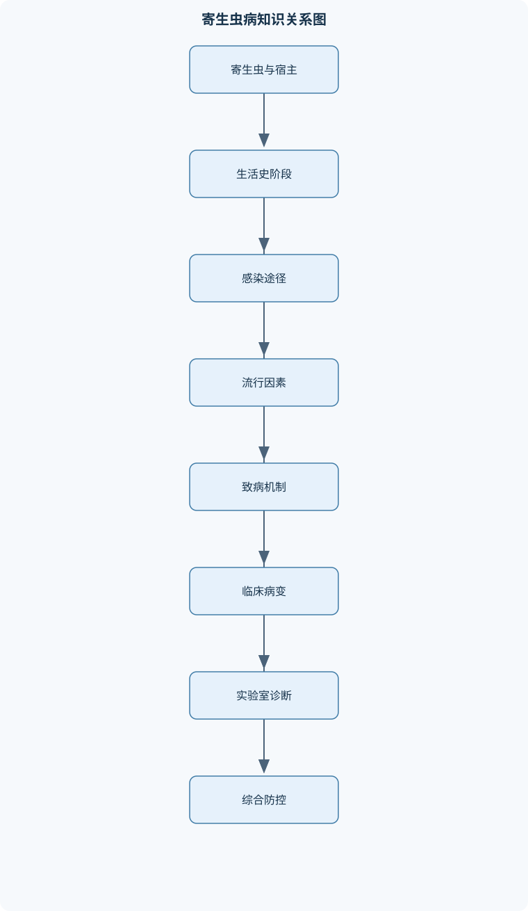
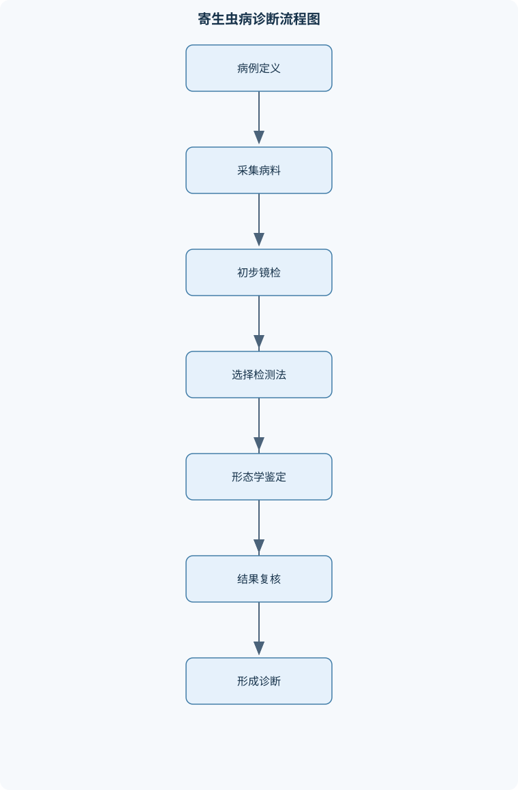

# 兽医寄生虫学

## 一、课程整体知识框架

### 课程边界与先修知识

《兽医寄生虫学》研究寄生虫的形态结构、分类鉴定、生活史、宿主关系、流行病学、致病机制、宿主免疫、临床表现、病理变化、实验室诊断、治疗原则与综合防控。课程对象覆盖原虫、吸虫、绦虫、线虫、棘头虫以及蜱、螨、昆虫等节肢动物寄生虫，并按猪、牛羊、马、禽、犬猫、兔、家蚕和蜜蜂等动物类别讨论重要寄生虫病，同时纳入弓形虫病、日本血吸虫病、囊尾蚴病、棘球蚴病、旋毛虫病等人畜共患病。课程边界不包括病毒、细菌、真菌等非寄生性病原体的系统学、完整药理学和一般传染病学。先修知识包括动物解剖学、组织学、生理学、免疫学、病理学、微生物学、动物临床诊断学、动物生产与环境卫生学，以及显微镜使用、粪便检查和基本统计学知识。





### 1. 学科对象、研究边界与核心问题

兽医寄生虫学研究寄生虫及其与动物宿主之间的关系，内容包括寄生虫的形态结构、分类鉴定、生活史、传播规律、致病机制、宿主免疫、临床表现、病理变化、实验室诊断、治疗原则和综合防控。寄生虫病的判断不能只依据某一个虫卵、某一种临床症状或一次阴性检查，而应将“宿主—寄生虫—环境—传播途径—时间”作为一个连续系统分析。

“寄生”是不同物种之间的一种长期或阶段性关系，寄生者从宿主获得营养、栖息场所或发育条件，并可能对宿主造成损害。寄生虫是处于这种关系中的生物；寄生虫病则是寄生虫感染后引起宿主功能障碍、组织损伤、生产性能下降或死亡的临床与病理状态。无症状携带并不等于没有感染，也不必然等于已经发生寄生虫病。

按照寄生部位，寄生虫可分为内寄生虫和外寄生虫。吸虫、绦虫、线虫、原虫等主要寄生于消化道、血液、组织或脏器内；蜱、螨、虱、蚤等主要位于体表或皮肤内。按照对寄生生活的依赖程度，可分为专性寄生虫和兼性寄生虫。专性寄生虫必须在宿主体内或体表完成全部或部分生活史；兼性寄生虫通常可营腐生生活，但在特定条件下能够侵入动物并造成损害。机会致病寄生虫可在免疫功能正常时维持低水平或隐性感染，宿主免疫抑制、营养不良或受到其他疾病影响时才大量增殖并发病。

### 2. 宿主关系与生活史框架

终末宿主（HS）是寄生虫成虫或有性生殖阶段所在的宿主；中间宿主（IH）是寄生虫幼虫或无性生殖阶段发育所必需的宿主；保虫宿主（PH）能够长期维持寄生虫并向其他动物传播；贮藏宿主（AH）使感染阶段在体内保持感染性，但通常不继续发育。一个动物在不同寄生虫的生活史中可能承担不同角色，不能仅凭动物种类固定判断其为终末宿主或中间宿主。

直接发育史只需要一个宿主，寄生虫的感染性阶段从一个宿主排出后，可直接感染同种或适宜宿主。例如，部分线虫虫卵在外界发育为感染性虫卵后，经口进入新宿主。间接发育史需要中间宿主或媒介，寄生虫必须在其中完成幼虫发育、无性繁殖或增殖。例如，吸虫常需螺类作为第一中间宿主，某些种类还需鱼、虾或水生植物完成后续传播环节；犬心丝虫则需要蚊在传播前参与幼虫发育。

寄生虫生活史中应区分三个阶段。感染阶段（PP）是能够进入宿主并建立感染的阶段，如吸虫囊蚴、日本血吸虫尾蚴、球虫孢子化卵囊和某些线虫感染性幼虫；诊断阶段（DS）是可在粪便、血液、皮肤或组织中检出的阶段；致病阶段是造成主要组织损伤或功能障碍的阶段。三个阶段可以相同，也可以不同。例如，猪蛔虫感染阶段为感染性虫卵，幼虫移行阶段造成肝肺损伤，成虫阶段则可能导致营养掠夺、肠阻塞或胆道阻塞，粪便中检出的则是成虫产生的虫卵。

### 3. 传播途径、流行病学与风险链

寄生虫可经口、经皮、经胎盘、经媒介、经呼吸道或接触传播。经口感染常见于摄入感染性虫卵、卵囊、囊蚴、囊尾蚴或含有幼虫的中间宿主；经皮感染要求感染阶段能够主动穿透皮肤，如日本血吸虫尾蚴；经胎盘传播可使胎儿或新生幼体在出生前获得感染；经媒介传播则依赖蚊、蜱、白蛉等节肢动物叮咬或取食。

流行病学分析包括感染源、传播途径、易感动物、环境条件和流行时间。粪便中含有虫卵或卵囊的动物是许多消化道寄生虫病的重要感染源。温度、湿度、氧气、水体、牧场植被、圈舍卫生和中间宿主密度决定感染阶段能否形成并积累。球虫卵囊排出后通常还需在适宜温度、湿度和氧气条件下孢子化，因此及时清除新鲜粪便和降低环境湿度，可以减少具有感染性的卵囊；但对于已经完成孢子化的卵囊，单纯清除新鲜粪便并不足以消除风险。

基本再生数 $R_0$ 表示在完全易感群体中，一个感染单位平均造成的继发感染数。寄生虫病中的 $R_0$ 不是固定常数，它受到宿主密度、感染期长短、排卵量、中间宿主或媒介数量、环境存活时间和防控措施影响。当 $R_0>1$ 时，传播具有维持或扩大的可能；当有效再生数因治疗、免疫或环境控制降至 $1$ 以下时，传播链才可能逐渐衰减。该概念适用于群体传播分析，不能直接用来判断单个动物的病情严重程度。

感染强度 $I$ 指单个宿主携带的寄生虫数量或负荷。粪便虫卵数、卵囊数可以间接反映部分肠道寄生虫的排出水平，但不能直接等同于体内成虫数量。EPG 表示每克粪便中的虫卵数，OPG 表示每克粪便中的卵囊数，FEC 表示粪便虫卵或卵囊计数。所有结果必须注明动物种类、样本质量、采样时间、检测方法、计数单位、稀释倍数和计数体积。虫卵排出具有间歇性、宿主免疫会抑制产卵、虫体尚未成熟或药物已抑制排卵时，低计数或阴性结果均不能单独排除感染。

### 4. 致病机制与宿主免疫

寄生虫致病作用主要包括营养掠夺、机械损伤、毒性或代谢产物作用、血液损失、组织移行和免疫病理。钩虫或捻转血矛线虫吸血并损伤黏膜，可造成贫血、低蛋白血症、消瘦和黑色粪便；姜片吸虫附着在肠黏膜表面，可引起炎症、出血、水肿、溃疡和吸收障碍；棘头虫吻突和吻钩刺入肠壁，可导致局部坏死、穿孔甚至腹膜炎；蛔虫幼虫经肝、心、肺移行时可造成肝脏乳斑和呼吸道症状，成虫期则主要表现为肠道竞争、阻塞或异位移行。

宿主防御包括先天免疫、体液免疫和细胞免疫。肠道线虫感染时，二型辅助性免疫反应可促进白细胞介素等效应因子释放，增强黏液分泌、肠蠕动和组织排出；肥大细胞参与肠黏膜反应，B淋巴细胞产生抗体并影响虫体附着、活动和清除。免疫反应既可降低再次感染风险，也可能引起超敏反应、肉芽肿、纤维化和组织功能障碍。日本血吸虫虫卵沉积于肝脏和肠壁后，宿主对虫卵抗原产生细胞免疫反应，形成肉芽肿；肉芽肿有助于隔离抗原，同时也会造成纤维化和门静脉系统病变。

寄生虫可通过抗原变异、免疫抑制、抗原伪装和表面抗原更新逃避免疫。因而抗体阳性只能说明曾经发生过免疫识别，不能单独证明当前仍存在高负荷活动性感染。诊断时应将抗体结果与病原学检测、临床表现、病理变化和采样时间结合解释。

### 5. 形态学、分类鉴定与实验室基础

寄生虫鉴定首先依据形态学，再结合生活史、宿主和寄生部位进行判断。双名法中属名在前且首字母大写，种名在后且首字母小写，书写时通常使用斜体。形态鉴定不能只看虫体大小，还要观察结构组合及其比例关系。

原虫常见阶段包括滋养体（T）、包囊（C）、卵囊和孢子阶段。滋养体代谢活跃、活动性强但通常抵抗外界能力较弱；包囊或卵囊更适于环境传播。吸虫通常具有口吸盘和腹吸盘，消化系统为不完全消化管，排泄系统含焰细胞和原肾管；多数吸虫雌雄同体，但血吸虫雌雄异体。绦虫无消化道和体腔，依靠体表吸收营养，虫体通常由头节、颈部和节片组成；头节负责附着，颈部产生新节片，孕节含有成熟生殖系统和虫卵。线虫不分节，具有完整消化道和角皮，常依据口部结构、食道类型、交合刺、尾部形态、阴门位置和虫卵特征鉴定。棘头虫具有可伸缩吻突和吻钩，吻突刺入肠壁是其重要致病结构。

病料采集应遵循“部位正确、数量适宜、时间明确、保存恰当、编号可追溯”的原则。粪便适合检查虫卵、卵囊和部分幼虫；抗凝血适合血液原虫和微丝蚴检查；皮肤刮取、胶带或耳道取样适合螨和外寄生虫检查；组织、肠内容物、胆管和肉品适合成虫、囊体或组织幼虫检查。形态学结果与分子检测结果不一致时，应检查样本混杂、寄生虫发育阶段、引物适用范围和形态鉴定依据，不能简单以某一种检测方法为绝对标准。

## 二、章节和模块划分

### 核心知识覆盖清单

本清单用于检查正文是否覆盖本课程的主要知识模块：

- **寄生虫学总论与宿主关系**：寄生、寄生虫与寄生虫病的定义和边界、内寄生虫、外寄生虫、专性寄生虫与兼性寄生虫、终末宿主、中间宿主、保虫宿主和贮藏宿主、宿主特异性、宿主转换与机会致病寄生虫、感染阶段、诊断阶段与致病阶段、直接发育史和间接发育史、经口、经皮、经胎盘、经媒介和经呼吸道感染、寄生虫双名法与分类鉴定原则、寄生虫病的经济损失和公共卫生意义。
- **生活史、流行病学与免疫**：虫卵、幼虫、囊蚴、囊尾蚴、卵囊和滋养体等阶段、发育史中蜕皮、移行、裂殖生殖与配子生殖、感染源、传播途径、易感动物和流行季节、环境温度、湿度、水体、牧场和中间宿主对传播的影响、基本再生数和感染强度的概念、寄生虫引起的营养掠夺、机械损伤、毒素作用和免疫病理、先天免疫、体液免疫和细胞免疫在抗寄生虫中的作用、肠道线虫清除中的二型辅助性免疫、肥大细胞和抗体、寄生虫的抗原变异、免疫抑制、抗原伪装和表面抗原更新、年龄抗性、获得性免疫和再次感染风险。
- **寄生虫形态学与实验室基础**：原虫的滋养体、包囊、卵囊和孢子阶段、吸虫的吸盘、消化系统、排泄系统和雌雄同体或雌雄异体特征、绦虫的头节、颈部、节片、孕节和中绦期、线虫的唇、口囊、食道、交合刺、尾翼膜和阴门、棘头虫的吻突、吻钩、颈部和假体腔、蜱、螨、虱、蚤和蝇类的口器及发育类型、虫卵大小、形状、卵壳、卵盖、胚胎和表面纹饰、显微镜下虫体、虫卵、卵囊和幼虫的鉴别要点、病料采集、保存、编号、镜检和质量控制、形态学鉴定与分子检测结果的互相验证。
- **原虫性寄生虫病**：球虫的裂殖生殖、配子生殖和卵囊孢子化、鸡柔嫩艾美耳球虫及禽球虫病的肠道病变、兔肝球虫和肠球虫的病理变化及鉴别、弓形虫的终末宿主、无性阶段和组织包囊、弓形虫病与流产、脑炎、肺炎和先天感染的关系、巴贝斯虫和泰勒虫的蜱媒传播及红细胞内寄生、利什曼原虫的白蛉传播和网状内皮系统病变、组织滴虫病的盲肠炎、肝炎和肝脏坏死灶、隐孢子虫、肉孢子虫和新孢子虫的宿主关系、血液原虫涂片、粪便卵囊检查和血清学诊断。
- **吸虫及吸虫病**：吸虫虫卵、毛蚴、胞蚴、雷蚴、尾蚴和囊蚴的发育顺序、肝片吸虫的反刍动物胆管寄生和陆生螺中间宿主、大片吸虫、歧腔吸虫与肝片吸虫的形态和生活史鉴别、姜片吸虫的猪和人感染及水生植物传播、华支睾吸虫的淡水螺、淡水鱼虾和胆道寄生、日本血吸虫的雌雄异体、尾蚴经皮感染和静脉寄生、东毕吸虫的水体传播和门静脉系统病变、并殖吸虫的囊蚴感染及肺部或异位寄生、禽前殖吸虫和后睾吸虫的中间宿主及生殖系统病变、吸虫病的粪便沉淀、毛蚴孵化、皮肤感染风险与综合防控。
- **绦虫、棘头虫与组织幼虫病**：绦虫无消化道、无体腔和体表吸收营养的结构基础、圆叶目与假叶目的头节、节片、生殖孔和虫卵差异、囊尾蚴、棘球蚴、多头蚴和链尾蚴的形态特征、猪带绦虫成虫与猪囊尾蚴病的双向公共卫生关系、棘球蚴病的犬科终末宿主和反刍动物中间宿主、羊脑多头蚴病的神经症状和脑内囊体定位、犬复孔绦虫的蚤类中间宿主和肛门瘙痒、马绦虫的螨类中间宿主和回盲部病变、棘头虫吻突刺入肠壁造成的机械损伤和腹膜炎、肉品检验、犬粪污染控制和屠宰环节防控。
- **线虫及线虫病**：线虫不分节、具有完整消化道和角皮的基本结构、卵生、卵胎生、胎生、感染性虫卵和感染性幼虫、直接型和间接型发育史以及第一至第五期幼虫、猪蛔虫幼虫移行、乳斑肝和肠道阻塞、牛新蛔虫的胎盘感染、乳汁感染和幼犊发病、钩虫经皮感染、吸血致贫血和黑色粪便、捻转血矛线虫的真胃寄生和严重贫血、毛圆科线虫、食道口线虫和毛尾线虫的鉴别、肺线虫的蚯蚓贮藏宿主和幼虫检查、马圆线虫、胃线虫、马蛔虫和犬猫蛔虫的主要病变。
- **节肢动物寄生虫与媒介性疾病**：蜱的硬蜱和软蜱形态、发育和吸血行为、蜱传播巴贝斯虫、泰勒虫和其他病原的媒介机制、螨的疥螨、蠕形螨和皮刺螨及其皮肤病变、蚤、虱、虻、蚊和白蛉的生活史与传播作用、犬疥螨病的接触传播、皮肤刮取和显微镜诊断、犬心丝虫的蚊媒传播、肺动脉病变和右心衰竭、羊狂蝇蛆病的鼻腔寄生和季节性流行、马胃蝇蛆病的口腔附着、胃内寄生和消化道损伤、禽皮刺螨对产蛋、贫血和幼禽死亡的影响、媒介控制、环境治理和宿主保护的联合策略。
- **猪、牛羊、马和禽的寄生虫病**：猪球虫病、姜片吸虫病、棘头虫病和消化道线虫病、猪蛔虫病的肝肺移行、临床表现和粪便检查、牛羊球虫病的年龄相关性和肠道病变、牛羊肝吸虫、歧腔吸虫和东毕吸虫的流行条件、牛羊消化道线虫的混合感染和贫血消瘦综合征、羊肺线虫病的幼虫分离和呼吸道症状、马圆线虫病的动脉栓塞与疝痛机制、马胃蝇蛆病和胃线虫病的诊断与预防、禽蛔虫、毛细线虫、绦虫和胃线虫病、禽球虫、组织滴虫、前殖吸虫和后睾吸虫病。
- **犬猫、兔、家蚕和蜜蜂寄生虫病**：犬猫蛔虫病、钩虫病和复孔绦虫病、犬心丝虫病的微丝蚴、成虫和心肺病变、犬猫外寄生虫病的皮肤损伤和继发感染、兔肝球虫和肠球虫的临床病理联系、家蚕微粒子病的胚种传播、食下传播和检疫意义、家蚕蝇蛆病、蒲螨病和其他寄生性害虫、蜜蜂微孢子虫病的中肠病变和显微诊断、蜜蜂马氏管变形虫病的马氏管病变、大蜂螨和小蜂螨的寄生部位及蜂群危害、经济动物寄生虫病的群体监测和生物安全。
- **诊断、治疗原则与综合防控**：临床症状、流行病学、病理剖检和病原学证据的整合、粪便直接涂片、沉淀、漂浮和定量计数方法、贝尔曼幼虫分离法和肺线虫幼虫鉴定、血液涂片、集虫法、抗原检测和抗体检测、皮肤刮取、胶带法、耳道取样和节肢动物鉴定、组织压片、病理切片、肉品检验和分子检测、驱虫药选择的靶标、虫种、发育阶段和宿主安全性、轮换或联合用药、耐药监测、休药期和用药记录、粪便生物热处理、病死动物无害化和水体污染控制、牧场轮牧、清洁饮水、中间宿主控制和媒介综合治理。


### 1. 寄生虫学总论与宿主关系

本模块建立全课程的基本语言和判断规则，重点解释寄生、寄生虫、寄生虫病、宿主、感染源、感染阶段和诊断阶段之间的关系。学习时应围绕“寄生虫在哪个宿主体内、以什么阶段存在、如何离开、如何进入下一个宿主”展开，而不是孤立记忆虫名。

例如，某虫在犬体内完成成虫期并产生虫卵，犬就是终末宿主；猪摄入虫卵后形成组织幼虫，猪是中间宿主。若人摄入含有组织幼虫的猪肉，可能发生肠道成虫感染；若人直接摄入虫卵，也可能发生组织幼虫感染。两种暴露的感染阶段不同，疾病类型和公共卫生意义也不同。

### 2. 生活史、流行病学与免疫

本模块按原虫、吸虫、绦虫、线虫和节肢动物比较生活史。原虫需区分滋养体、包囊、卵囊和孢子阶段；吸虫通常涉及虫卵、毛蚴、胞蚴、雷蚴、尾蚴和囊蚴；线虫常经历L1至L5并在蜕皮过程中发育；节肢动物则需区分卵、幼虫、若虫和成虫，或完全变态中的幼虫、蛹和成虫。

由生活史可以直接推导防控重点：若寄生虫需要中间宿主，单纯治疗终末宿主不能阻断传播，还必须降低中间宿主数量或阻断终末宿主摄食中间宿主；若感染阶段存在于水生植物，控制饮水污染不能代替禁止生食或生喂水生植物；若依赖蜱或蚊传播，仅降低宿主体内虫负荷而不控制媒介，仍可能出现再感染。

### 3. 寄生虫形态学与实验室基础

本模块以显微镜下可观察结构为主线，结合虫卵大小、形状、卵壳、卵盖、胚胎、表面纹饰和内容物进行鉴定。吸虫卵多采用沉淀方法提高检出率；多数线虫卵和球虫卵囊可根据比重选择适宜的漂浮方法；肺线虫和部分幼虫则可采用贝尔曼幼虫分离法。方法选择取决于目标阶段的密度、结构和活性，不能把沉淀法或漂浮法机械地用于所有寄生虫。

形态学诊断应设置质量控制。阴性对照可用于发现试剂或环境污染，重复制片可减少取样误差，阳性对照或已知形态资料可帮助确认识别标准。虫卵阴性只能说明“在本次样本、方法和观察范围内未检出”，不能直接表述为“动物没有感染”。

### 4. 原虫性寄生虫病

原虫模块包括球虫、弓形虫、巴贝斯虫、泰勒虫、利什曼原虫、组织滴虫、隐孢子虫、肉孢子虫和新孢子虫。球虫生活史通常包括裂殖生殖、配子生殖和卵囊孢子化。禽球虫病的病变与虫种和肠段相关，鸡柔嫩艾美耳球虫主要造成盲肠黏膜损伤、出血和坏死；兔肝球虫主要引起胆管周围病变、肝脏结节和消化功能障碍。

弓形虫以猫科动物为终末宿主，可形成卵囊；在中间宿主体内可出现速殖子、缓殖子和组织包囊。妊娠动物感染时，需重点考虑流产、胎儿损伤和先天感染。巴贝斯虫和泰勒虫均与蜱传播相关，但其寄生细胞、临床表现和实验室特点并不完全相同，血涂片应结合红细胞形态、虫体位置、贫血和黄疸程度分析。隐孢子虫、新孢子虫和肉孢子虫则应结合宿主范围、感染阶段和组织定位判断。

### 5. 吸虫及吸虫病

吸虫模块按生活史和寄生部位组织。肝片吸虫主要寄生于反刍动物胆管，感染阶段为附着在水生植物或其他载体上的囊蚴；其传播与适宜螺类、湿润牧场和水草摄食有关。大片吸虫、歧腔吸虫与肝片吸虫的鉴别，需同时比较成虫形态、虫卵特点、中间宿主和终末宿主。

姜片吸虫可感染猪和人，传播链常包括粪便污染水体、扁卷螺、水生植物和生食或生喂。猪出现腹泻与便秘交替、消瘦、贫血和发育不良时，应结合池塘养殖和水生植物饲喂史考虑该病。日本血吸虫雌雄异体，尾蚴在疫水中主动经皮进入宿主，成虫寄生于肠系膜静脉和门静脉系统；虫卵沉积引起的肉芽肿和纤维化可造成慢性肝肠病变。并殖吸虫通过囊蚴感染，主要涉及肺部或异位组织；禽前殖吸虫和后睾吸虫则需结合中间宿主及禽类生殖系统或胆道病变鉴别。

### 6. 绦虫、棘头虫与组织幼虫病

绦虫无消化道，依靠体表吸收宿主营养。圆叶目绦虫通常具有吸盘，有些还具小钩；假叶目绦虫头节形态、生殖孔位置和虫卵结构不同。囊尾蚴、棘球蚴、多头蚴和链尾蚴属于不同类型的中绦期，形态和中间宿主不能混用。

猪带绦虫具有典型的双向公共卫生关系。人摄入含囊尾蚴的生或未熟猪肉，可在小肠发育为成虫；人摄入虫卵后，则可能形成组织囊尾蚴病。棘球蚴病以犬科动物为重要终末宿主，反刍动物常作为中间宿主，犬粪污染环境是人畜暴露的重要环节。羊脑多头蚴寄生于脑组织，可导致转圈、运动失调等神经症状。犬复孔绦虫依赖蚤等中间宿主，马绦虫常与螨类中间宿主和回盲部病变相关。棘头虫吻突刺入肠壁，重症时可导致穿孔和腹膜炎，因此屠宰检验和粪便污染控制具有重要意义。

### 7. 线虫及线虫病

线虫具有不分节虫体、完整消化道和角皮。发育方式可为卵生、卵胎生或胎生，感染阶段可能是感染性虫卵、L3或其他幼虫期。猪蛔虫幼虫经肝、心、肺移行后返回肠道，因而可同时出现肝脏乳斑、咳嗽、消瘦、肠道阻塞或胆道阻塞。牛新蛔虫可经胎盘或乳汁感染幼犊，发病年龄和传播方式与猪蛔虫不同。

钩虫通过经皮或经口感染，成虫吸血并损伤肠黏膜，重度感染可出现贫血、低蛋白血症和黑色粪便。捻转血矛线虫寄生于真胃，贫血和消瘦可能十分突出；毛圆科线虫、食道口线虫和毛尾线虫则需根据寄生部位、虫卵形态、腹泻程度和病理变化鉴别。肺线虫可依赖蚯蚓等贮藏宿主，幼虫分离对诊断有价值。马圆线虫还可能因幼虫移行造成肠系膜动脉病变和疝痛；犬猫蛔虫、胃线虫和马蛔虫则分别体现不同宿主的生活史适应。

### 8. 节肢动物寄生虫与媒介性疾病

蜱包括硬蜱和软蜱，区别涉及体壁、盾板、口器和吸血方式。蜱既可直接造成失血、皮肤损伤和毒素作用，也可作为巴贝斯虫、泰勒虫等病原的生物性媒介。只有当病原在媒介体内完成必要发育或增殖时，才能将其视为生物性传播媒介，而不能把所有机械携带者都等同于中间宿主。

疥螨、蠕形螨和皮刺螨所处皮肤部位不同，表现可包括剧痒、脱毛、结痂、皮肤增厚和继发感染。诊断常采用深部或浅部皮肤刮取、胶带法和显微镜检查。犬心丝虫由蚊传播，成虫寄生于肺动脉和右心系统，慢性病例可出现咳嗽、运动不耐受、肺动脉高压和右心衰竭。羊狂蝇蛆寄生于鼻腔，马胃蝇蛆幼虫附着于口腔或胃黏膜，禽皮刺螨则可导致贫血、产蛋下降和幼禽死亡。防控必须联合宿主保护、媒介控制、环境治理和病原监测。

### 9. 不同动物的重点寄生虫病

猪的重点包括球虫病、姜片吸虫病、棘头虫病、猪蛔虫病和消化道线虫病；牛羊重点包括球虫病、肝片吸虫病、歧腔吸虫病、东毕吸虫病、消化道线虫病和肺线虫病；马重点包括圆线虫病、胃蝇蛆病、胃线虫病和马蛔虫病；禽重点包括球虫病、组织滴虫病、蛔虫病、毛细线虫病、绦虫病、胃线虫病、前殖吸虫病和后睾吸虫病。

犬猫重点包括蛔虫病、钩虫病、复孔绦虫病、心丝虫病和螨病；兔重点包括肝球虫病和肠球虫病；家蚕重点包括微粒子病、蝇蛆病和蒲螨病；蜜蜂重点包括微孢子虫病、马氏管变形虫病、大蜂螨病和小蜂螨病。经济动物的寄生虫病常以群体生产性能下降为主要后果，防控应关注种源、养殖密度、批次管理、生物安全和群体监测，而不能只对个别症状明显动物进行处理。

### 10. 诊断、治疗原则与综合防控

寄生虫病综合诊断流程为：先确认动物种类、年龄、症状和群体范围；再记录季节、饲养方式、水源、牧场、中间宿主、媒介和既往用药；随后按病变部位采集粪便、血液、皮肤、组织或节肢动物样本；先进行直接镜检或涂片，再根据目标虫种选择沉淀、漂浮、幼虫分离、卵囊计数、血清学、抗原检测或分子检测；最后将结果与生活史和病理变化对应。

一个可复用的诊断伪代码如下：

```text
输入：动物信息、临床表现、流行病学资料、病料
输出：最可能诊断、鉴别诊断、复检方案

记录宿主种类、年龄、群体、季节、水源和媒介暴露
根据病变部位采集粪便、血液、皮屑、组织或节肢动物
若怀疑消化道寄生虫：
    选择直接涂片、沉淀、漂浮或定量计数
若怀疑幼虫或肺线虫：
    选择贝尔曼幼虫分离
若怀疑血液寄生虫：
    制备血涂片，必要时进行浓集或抗原检测
将检出阶段与寄生虫生活史比较
若形态、临床和流行病学一致：
    输出最可能诊断
否则：
    增加重复采样、分子检测或其他病因鉴别
终止条件：获得一致病原证据，或连续规范检测阴性后转入非寄生虫病调查
```

治疗原则包括明确虫种和发育阶段、评价宿主安全性、遵守批准标签和兽医处方、考虑休药期、记录用药过程，并通过治疗后复检评价效果。轮换或联合用药不能替代耐药监测；低剂量、频繁且缺乏依据的用药会增加选择压力。综合防控应同时处理动物、粪便、环境、中间宿主、媒介和人员暴露，常包括粪便生物热处理、病死动物无害化、清洁饮水、轮牧、降低圈舍湿度、中间宿主控制、媒介治理和肉品检验。

### 11. 代表性推理例题

#### 例题一：池塘养猪与姜片吸虫病

**题干：**猪群长期在池塘边饲养，粪便直接排入水体，猪经常采食水生植物，出现腹泻与便秘交替、消瘦和贫血。应优先考虑何种寄生虫病？

**分析与解答：**水体粪便污染可使虫卵进入池塘；适宜螺类参与幼虫发育；水生植物可携带囊蚴；猪采食水生植物后感染。肠道成虫可造成黏膜损伤、炎症和吸收障碍，因此出现腹泻与便秘交替、消瘦和贫血。应优先采用粪便沉淀检查，并同时调查螺类和水生植物。防控不能只驱虫，还要停止生喂可疑水生植物并处理粪便污染。

#### 例题二：猪蛔虫病的阶段性病变

**题干：**仔猪出现咳嗽，剖检见肝脏乳斑，数周后出现消瘦和肠道内蛔虫。

**分析与解答：**感染性虫卵经口进入后，幼虫穿过肠壁，经门静脉到达肝脏，再经心脏到达肺部，穿过肺泡后沿气管上行并被吞咽，返回小肠发育为成虫。肝脏乳斑和咳嗽对应幼虫移行期；消瘦、肠道阻塞或胆道阻塞对应成虫期。粪便虫卵检查对成熟雌虫存在时更有意义，幼虫移行早期阴性不能排除感染。

#### 例题三：日本血吸虫传播链

**题干：**动物有疫水接触史，出现贫血、腹水和慢性肝脏病变，组织中发现门静脉系统成虫。

**分析与解答：**尾蚴是感染阶段，经皮主动侵入；成虫寄生于肠系膜静脉和门静脉系统；虫卵随粪便排出并进入水体，毛蚴感染适宜螺类后继续发育。虫卵沉积于组织可引起肉芽肿和纤维化。防控需同时进行粪便无害化、疫水管理、螺类控制和避免动物接触疫水，单独治疗动物不能切断全部传播环节。

#### 例题四：球虫OPG结果解释

**题干：**取5 g粪便加液稀释至100 mL，计数室共计数0.2 mL液体，观察到80个卵囊。求OPG。

**解答：**总悬液中的卵囊数估计为：

$$80\times\frac{100}{0.2}=40000$$

样本质量为5 g，因此：

$$OPG=\frac{40000}{5}=8000$$

结果为每克粪便约8000个卵囊。该结果只能表示本次样本、方法和时间条件下的卵囊排出水平，不能直接等同于肠道内寄生虫数量，也不能单独决定临床严重程度。若计数室体积、稀释倍数或样本质量改变，计算式必须同步改变。

#### 例题五：犬心丝虫病的诊断逻辑

**题干：**犬长期咳嗽、运动耐量下降，影像学提示肺动脉异常和右心扩大，有蚊媒暴露史。

**分析与解答：**蚊吸血时摄入微丝蚴，幼虫在蚊体内发育后经叮咬传播给犬，成虫最终寄生于肺动脉和右心系统。微丝蚴检查反映循环期幼虫，抗原检测主要反映雌成虫相关抗原，单次阴性不能完全排除低虫负荷、感染早期或检测时间不合适。应结合临床表现、媒介史、血液检查、抗原或抗体结果及影像学资料综合判断，并安排适宜时间复检。

### 12. 实验与项目工作流程

#### 实验一：粪便寄生虫综合检查

**输入数据：**新鲜粪便、动物编号、采样时间、动物种类和已知临床表现。  
**步骤：**先记录编号和样本质量；分样进行直接涂片、沉淀或漂浮；疑似肺线虫时另取样本进行贝尔曼分离；显微镜下记录虫卵、卵囊或幼虫形态及数量；必要时重复采样。  
**评价标准：**结果必须包含目标阶段、形态依据、检测方法、样本质量、计数单位和阴阳性判断；无法区分的虫卵应保留为“疑似类别”，不能强行定种。  
**排错方法：**若阴性但临床高度怀疑，应检查样本是否不新鲜、虫体是否尚未产卵、方法是否与虫卵密度相符以及是否存在间歇排卵；若背景杂质过多，应重新制样并设置对照。

#### 实验二：放牧牛羊线虫病群体监测项目

**输入数据：**动物编号、年龄、体况、贫血评分、牧场分区、季节、EPG或FEC结果和既往驱虫记录。  
**步骤：**按年龄和牧场分层采样；同步记录体况、黏膜颜色、腹泻和生产性能；采用适宜的粪便计数方法测定排卵水平；选择需要处理的动物或群体；治疗后在符合药物起效时间的窗口复检；比较治疗前后结果，并记录疑似耐药。  
**评价标准：**不能只看群体平均EPG，应结合个体贫血、体况和生产性能；复检时间、方法和样本量必须一致；异常结果应有重复样本或替代检测支持。  
**排错方法：**若治疗后结果仍高，应区分复检过早、再感染、药物覆盖虫种不匹配、给药操作问题和耐药；若平均值下降但个别动物恶化，应进行个体化复查，避免用群体均值掩盖重症动物。

## 三、核心概念的详细解释

### 1. 寄生关系、寄生虫与寄生虫病

寄生是两个物种之间的一种长期或阶段性生存关系。寄生虫从宿主获得营养、栖息场所或完成发育所需的生理条件，而宿主通常受到不同程度的组织损伤、营养消耗、免疫负担或生产性能下降。寄生虫病是寄生虫感染已经导致宿主出现临床症状、病理变化、功能障碍、生产性能下降或死亡的状态。感染、带虫和发病不是同义词：动物可以存在寄生虫而无明显症状，也可能因虫体数量少但定位关键、毒力较强或宿主处于幼龄、妊娠、营养不良状态而发生严重疾病。

内寄生虫主要生活在消化道、血液、组织和脏器内，包括原虫、吸虫、绦虫、线虫和棘头虫；外寄生虫位于体表、毛囊、皮肤角质层或皮下组织，包括蜱、螨、虱、蚤以及部分蝇类幼虫。专性寄生虫必须依赖宿主完成全部或部分生活史，兼性寄生虫通常可以营腐生生活，但在特定条件下侵入动物并造成损害。机会致病寄生虫在免疫功能正常时可维持低水平感染，宿主免疫抑制、营养不良或伴发其他疾病时则可能迅速增殖。

### 2. 宿主类型与宿主特异性

终末宿主（HS）是寄生虫成虫或有性生殖阶段寄生的宿主，判断依据是寄生虫在该宿主体内所处的发育阶段，而不是寄生虫是否“最终离开”该宿主。中间宿主（IH）是寄生虫幼虫或无性生殖阶段发育所必需的宿主。保虫宿主（PH）能够长期维持寄生虫，并向易感动物或人传播。贮藏宿主（AH）使感染阶段在体内保持感染性，但通常不继续发育，其他宿主摄食该动物后可获得感染。

同一种动物在不同生活史中可能承担不同宿主角色。例如，犬科动物可作为棘球绦虫的终末宿主，也可作为某些原虫的保虫宿主；人可作为猪带绦虫的终末宿主，也可因摄入虫卵而成为囊尾蚴的中间宿主。宿主特异性取决于寄生虫识别宿主细胞、免疫环境、体温、组织受体、消化条件和宿主行为等因素。宿主转换通常要求寄生虫在不同宿主中完成连续而互补的发育阶段；若某一环节缺失，生活史即可中断。

### 3. 感染阶段、诊断阶段与致病阶段

感染阶段（PP）是能够进入适宜宿主并建立感染的阶段，如肝片吸虫囊蚴、日本血吸虫尾蚴、孢子化球虫卵囊、猪蛔虫感染性虫卵和某些线虫感染性幼虫。诊断阶段（DS）是能够在粪便、血液、皮肤、组织或其他病料中被检出的阶段，如虫卵、卵囊、幼虫、微丝蚴、成虫片段或组织包囊。致病阶段是造成主要组织损伤的阶段，可能与感染阶段或诊断阶段不同。

猪蛔虫经口感染性虫卵进入体内后，幼虫经肝脏、心脏和肺移行，可造成肝脏乳斑和呼吸道症状；重新吞咽后，成虫寄生于小肠，造成营养掠夺、肠道阻塞，偶尔可进入胆道。此时感染阶段是感染性虫卵，幼虫期是重要致病阶段，成虫产出的虫卵是主要诊断阶段。球虫卵囊排出后并不一定立即具有感染性，许多种类必须在外界完成孢子化；因此“粪便中发现卵囊”和“动物摄入具有感染性的卵囊”在时间上并不等同。

### 4. 生活史与传播途径

直接发育史只需要一个宿主，寄生虫排出的阶段经外界发育后可直接感染新的适宜宿主。间接发育史需要中间宿主或媒介，寄生虫必须在其中完成幼虫发育、无性增殖或必要的形态转变。吸虫通常经历虫卵、毛蚴、胞蚴、雷蚴、尾蚴和囊蚴等阶段，但不同类群可有变异。毛蚴主动进入螺类后，依次在体内发育并增殖，尾蚴离开螺体后可形成囊蚴或直接侵入终末宿主。血吸虫尾蚴不形成囊蚴，而是主动穿透皮肤。

经口传播包括摄入感染性虫卵、卵囊、囊蚴、囊尾蚴或感染中间宿主；经皮传播要求感染阶段具有主动穿透皮肤的能力；经胎盘传播可使胎儿或新生幼体在出生前获得感染；经媒介传播依赖蚊、蜱、白蛉等节肢动物取食。媒介与中间宿主不能完全等同：媒介强调传播作用，生物性媒介还必须支持寄生虫完成必要发育或增殖。

吸虫的生活史能够直接推导防控重点。若寄生虫必须经螺类发育，仅处理终末宿主粪便不能完全切断传播，还需控制螺类或避免终末宿主接触污染水体。若感染阶段附着于水生植物，控制饮水污染仍不足以防止感染，还必须禁止生食或生喂可能带有囊蚴的植物。日本血吸虫经尾蚴皮肤感染，因此粪便无害化、螺类控制、避免动物接触疫水必须联合实施。

### 5. 流行病学与感染强度

寄生虫病的流行由感染源、传播途径、易感宿主和环境条件共同决定。感染源可包括带虫动物、病死动物、污染粪便、受污染水体、带虫中间宿主和媒介。温度、湿度、氧气、牧场植被、水体类型、圈舍清洁程度和中间宿主密度影响感染阶段的形成与存活。年龄、营养状况、免疫水平、饲养密度和既往用药决定宿主易感性。

感染强度 $I$ 指单个宿主所携带的寄生虫数量或负荷；群体感染率表示被感染动物数占受检动物数的比例。感染强度与病情有关，但不总是线性关系。少量棘头虫刺入肠壁即可造成严重腹膜炎，而大量低致病性虫卵可能只导致轻度症状。粪便虫卵数或卵囊数是排出水平指标，不能直接等同于体内成虫数量，且会受产卵阶段、排卵间歇、粪便含水量、采样时间和检测方法影响。

基本再生数 $R_0$ 表示在完全易感群体中，一个感染单位平均造成的继发感染数。简化条件下，可将其理解为

$$
R_0 \approx \beta \times c \times D
$$

其中，$\beta$ 是单次有效接触导致传播的概率，$c$ 是单位时间内有效接触次数，$D$ 是感染性维持时间。对于需要媒介或中间宿主的寄生虫，还应把媒介密度、媒介感染率、寄生虫在媒介中的发育成功率和媒介叮咬率纳入 $\beta$ 或 $c$。该式是概念模型，不适用于直接计算复杂寄生虫病的实际传播值；现实中宿主年龄结构、季节变化、超散布和环境异质性都会使参数随时间改变。

### 6. 形态结构与分类鉴定

原虫常见滋养体（T）、包囊（C）、卵囊和孢子阶段。滋养体代谢活跃、运动性强但抵抗外界能力弱；包囊通常耐受环境并参与传播。球虫经历裂殖生殖、配子生殖和卵囊孢子化，禽球虫可在肠上皮内造成出血、坏死和肠壁增厚。弓形虫的终末宿主为猫科动物，其他动物可形成组织包囊；妊娠动物感染可导致流产、死胎或先天感染。

吸虫通常具有吸盘、分枝或管状消化系统、排泄系统和体壁。焰细胞属于排泄系统，不属于消化系统。多数吸虫雌雄同体，但血吸虫雌雄异体，雌雄成虫常呈合抱状态，寄生于肠系膜静脉和门静脉系统。绦虫无消化道，虫体由头节、颈部和节片组成，依靠体表吸收营养；孕节内含大量生殖结构和虫卵。圆叶目与假叶目在头节形态、生殖孔位置和虫卵结构上存在差异。

线虫不分节，具有完整消化道和角皮，通常经历卵、L1、L2、L3、L4、L5和成虫等阶段，并通过蜕皮完成发育。线虫可为卵生、卵胎生或胎生，感染阶段可能是感染性虫卵或感染性幼虫。棘头虫没有完整消化道，具有可伸缩吻突和吻钩，吻突刺入肠壁可造成机械损伤、溃疡甚至腹膜炎。

节肢动物鉴定应观察体节、附肢、口器、足、翅和发育类型。硬蜱有背盾板，软蜱通常无明显背盾板；疥螨在角质层内挖掘隧道，蠕形螨主要寄生于毛囊和皮脂腺，皮刺螨可造成皮肤炎症和贫血。蚤为完全变态，虱为不完全变态；蚊、蜱和白蛉可作为媒介传播血液原虫或线虫。

### 7. 致病机制与宿主免疫

寄生虫致病作用主要包括营养掠夺、机械损伤、毒素或代谢产物作用、免疫病理和继发感染。钩虫吸血并损伤肠黏膜，重度感染可出现贫血、低蛋白血症和黑色粪便；捻转血矛线虫寄生于真胃，主要造成失血、胃腺损伤和严重贫血；肝片吸虫在胆管内寄生，可导致胆管炎、胆管纤维化和慢性消瘦。日本血吸虫成虫本身和虫卵均有致病意义，虫卵周围形成肉芽肿和纤维化，可损伤肠道、肝脏及门静脉系统。

先天免疫包括皮肤和黏膜屏障、吞噬细胞、补体、炎症介质和嗜酸性粒细胞。肠道线虫感染常诱导二型辅助性免疫反应，涉及细胞因子、B淋巴细胞、抗体、肥大细胞和黏液分泌增加，促进蠕动、排虫和组织修复。免疫反应也可能造成超敏反应和肉芽肿，因而宿主免疫既能限制寄生虫，也可能参与病理损伤。

寄生虫可通过抗原变异、表面抗原更新、抗原伪装、分子模拟和免疫抑制逃避免疫清除。抗体阳性只能说明曾经发生过免疫识别或感染暴露，不能单独证明当前存在高负荷活动性感染；必须结合病原检测、临床表现、采样时间和治疗史解释。年龄抗性和获得性免疫可降低再次感染后的虫负荷，但某些寄生虫具有持续感染、组织包囊或免疫逃避能力，因此再次感染风险仍然存在。

### 8. 重要动物寄生虫病及鉴别重点

猪群中，姜片吸虫病与池塘、水生植物、扁卷螺和粪便污染密切相关，可出现腹泻与便秘交替、消瘦、贫血和生长迟缓，虫卵检查宜优先采用沉淀方法。猪蛔虫病可见幼虫移行造成的肝脏乳斑和肺部症状，成虫期主要表现为消化障碍、肠阻塞或胆道损伤。猪棘头虫可因吻突刺入肠壁导致局部坏死和腹膜炎。

牛羊寄生虫病常呈混合感染。肝片吸虫主要寄生于胆管，东毕吸虫成虫位于门静脉系统，捻转血矛线虫主要造成真胃失血和贫血。放牧线虫病的判断不能只看腹泻或单次EPG，还应结合黏膜贫血、体况、年龄、季节、牧场污染和既往驱虫记录。羊肺线虫可引起咳嗽、呼吸困难，幼虫分离有助于诊断。

马圆线虫幼虫移行可损伤肠系膜动脉并诱发血栓、缺血和疝痛；马胃蝇幼虫附着于口腔或胃黏膜，可造成局部损伤；马绦虫常需螨类中间宿主，回盲部感染可与肠道炎症和阻塞有关。禽球虫按种类和肠段造成不同程度的出血、坏死和消瘦；组织滴虫主要造成盲肠炎和肝脏坏死灶；前殖吸虫和后睾吸虫可损伤禽类生殖系统或胆道系统。

犬猫常见蛔虫、钩虫和复孔绦虫。犬心丝虫经蚊传播，成虫寄生于肺动脉和右心，可导致肺动脉病变、运动不耐受和右心衰竭；微丝蚴与成虫的诊断对象不同，单次阴性不能排除早期或低虫血症。兔肝球虫可造成胆管周围结节、胆管炎和腹泻。家蚕微粒子病可经胚种和食下传播，防控重点在种源检疫和群体生物安全；蜜蜂微孢子虫主要损伤中肠，大蜂螨和小蜂螨可削弱蜂群并影响幼蜂发育。

## 四、重要定义、公式、定理和推导

### 专业审校补充：关键定义与适用边界

寄生虫学中必须区分潜隐期、前潜伏期、潜伏期和显露期。潜隐期是感染后至出现临床症状的时间；前潜伏期是感染后至寄生虫达到可检出阶段的时间；潜伏期通常指感染后至出现症状的时间；显露期则是病原体或其产物能够被常规方法检出的阶段。前潜伏期与显露期不一定相同：例如动物已发生组织移行或免疫损伤，但尚未排出虫卵，粪便检查可以阴性。相反，某些动物在症状不明显时已经排卵并可检出虫卵。由此可知，检测阴性只能限定为“在本次采样时间、样本类型和方法条件下未检出”，不能直接等同于未感染。诊断计划应根据生活史选择采样时间，并在必要时重复采样或改用血液、组织、抗原、抗体或核酸检测。还应区分感染强度与致病性：低虫量但寄生于关键组织或引发强烈免疫反应时，也可能造成明显病变；高虫卵排出量则不必然等同于当前临床严重程度。


### 1. 粪便虫卵或卵囊计数公式

若计数时将样品质量为 $m$ 克的粪便稀释至总体积 $V$ 毫升，从中取出计数体积 $v$ 毫升，计数到虫卵或卵囊数为 $n$，则每克粪便计数值可表示为

$$
\mathrm{FEC}=\frac{nV}{mv}
$$

其中，FEC可具体记录为EPG或OPG；$n$ 为计数到的虫卵或卵囊数，单位为“个”；$V$ 和 $v$ 的单位均为毫升，$m$ 的单位为克，因此结果单位为“个/克”。

例如，取 $4$ 克粪便制成总体积 $60$ 毫升悬液，取其中 $1.5$ 毫升进行计数，发现 $30$ 个卵囊，则

$$
\mathrm{OPG}=\frac{30\times60}{4\times1.5}=300
$$

结果为 $300$ 个/克。若计数室只使用了其中一部分腔室，还必须把腔室体积或所占比例纳入换算。所有结果应同时记录动物编号、动物种类、采样时间、样本质量、稀释倍数、计数体积、检测方法和单位。

该公式成立的前提是样品充分混匀、虫卵或卵囊在悬液中近似均匀分布，且计数体积具有代表性。粪便含水量差异、虫卵沉降、卵囊聚集、计数数量过少以及不同方法的回收率都会影响结果。因此，FEC或OPG适合估计排出水平和群体监测，不等于体内成虫数，也不能单独作为病情严重程度的判定依据。

### 2. 感染率、感染强度与平均负荷

设受检动物总数为 $N$，检出感染的动物数为 $n$，则表观感染率为

$$
P=\frac{n}{N}\times100\%
$$

若第 $i$ 只动物携带寄生虫数为 $I_i$，感染动物数为 $n$，感染动物的平均感染强度为

$$
\bar I=\frac{\sum_{i=1}^{n}I_i}{n}
$$

若将未感染动物也纳入平均，则得到群体平均负荷

$$
\bar I_{\mathrm{group}}=\frac{\sum_{i=1}^{N}I_i}{N}
$$

两者不能混用。感染动物平均强度描述“已经感染的动物有多重”，群体平均负荷则同时受到感染率和感染强度影响。寄生虫呈聚集分布时，少数动物可能携带大部分虫体，群体平均值会掩盖重症个体，因此监测应结合个体体况、贫血评分、生产性能和临床表现。

### 3. 检测效能与阴性结果的边界

诊断敏感度定义为

$$
\mathrm{Se}=\frac{\mathrm{TP}}{\mathrm{TP}+\mathrm{FN}}
$$

诊断特异度定义为

$$
\mathrm{Sp}=\frac{\mathrm{TN}}{\mathrm{TN}+\mathrm{FP}}
$$

其中，TP为真正阳性，FN为假阴性，TN为真正阴性，FP为假阳性。敏感度主要反映检测发现真实感染的能力，特异度主要反映排除非感染样本的能力。

粪便检查出现阴性结果，可能是动物尚未进入产卵阶段、排卵具有间歇性、样本不新鲜、虫卵密度低、方法与虫卵比重不匹配或样品处理不当。因而阴性结果只能说明“本次样本和本次方法未检出”，不能直接推出“动物没有感染”。若临床和流行病学证据仍然强，应重复采样，改用沉淀、漂浮、幼虫分离、血液检测、抗原检测、抗体检测或分子检测。

### 4. 生活史推导防控策略

设某寄生虫生活史依次经过终末宿主、环境、中间宿主和感染阶段。若感染必须依赖中间宿主，则阻断终末宿主排卵只能减少环境污染，不能消除已经存在的中间宿主；若终末宿主继续摄食中间宿主，传播仍可维持。因此防控至少应同时作用于以下环节：

1. 减少终末宿主排出虫卵或卵囊；
2. 及时清除和无害化处理粪便；
3. 控制中间宿主或媒介；
4. 阻止终末宿主摄食感染性中间宿主；
5. 对易感动物进行针对性监测和规范治疗。

这一推导解释了为什么棘球蚴病不能只给反刍动物处理，还必须控制犬粪污染、禁止犬摄食患病脏器并加强屠宰检验；也解释了为什么姜片吸虫病不能只清洁饮水，还必须控制水生植物和扁卷螺相关传播环节。

### 5. 球虫卵囊孢子化与环境控制

球虫卵囊从宿主体内排出后，通常需要适宜温度、湿度和氧气完成孢子化。设新鲜卵囊数为 $O_0$，在一段时间内完成孢子化的比例为 $s$，则理论上具有感染性的卵囊数近似为

$$
O_{\mathrm{inf}}=O_0s
$$

该式仅表示概念关系，$s$ 会随温度、湿度、氧气、时间和虫种改变，不能作为现场精确预测公式。清除新鲜粪便可降低 $O_0$，降低舍内湿度和改善通风可降低 $s$ 或延长孢子化所需时间；但已完成孢子化的卵囊具有较强环境抵抗力，单纯清除新鲜粪便不足以消除感染风险，还需要清洁、干燥、分群、降低饲养密度和减少饲料饮水污染。

### 6. 线虫发育与临床病变的因果链

线虫发育通常包括卵、L1、L2、L3、L4、L5和成虫。若感染性阶段为L3，动物摄入或皮肤接触L3后，幼虫可能在组织中移行、蜕皮并最终到达特定寄生部位。猪蛔虫的因果链为：

$$
\text{感染性虫卵}
\rightarrow
\text{肠内孵化}
\rightarrow
\text{肝脏移行}
\rightarrow
\text{肺部移行}
\rightarrow
\text{咽部吞咽}
\rightarrow
\text{小肠成虫}
$$

由此可推得，幼虫期主要表现为肝脏乳斑和呼吸道症状，成虫期主要表现为营养障碍、腹痛、肠阻塞或胆道阻塞。该推导不适用于所有线虫；鞭虫和部分直接发育线虫不经过典型肝肺移行，不能把所有线虫病都解释为同一路线。

### 7. 驱虫与综合防控的判定原则

驱虫药选择必须同时考虑目标虫种、寄生部位、发育阶段、宿主种类、年龄、生理状态、制剂批准范围和当地休药期要求。不能把“广谱”作为唯一标准，也不能假定一种药物同时对所有虫种、所有发育阶段和所有宿主都有效。治疗效果评价应考虑药物起效时间、虫卵排出延迟、再感染和检测方法差异；驱虫后立即检出虫卵或虫体残片，不一定表示治疗失败。

综合防控应形成“病原定位—针对性治疗—粪便和病死动物无害化—中间宿主或媒介控制—环境管理—治疗后复检—耐药监测”的闭环。若治疗后仍有高水平排卵，应依次排查复检过早、给药操作错误、目标虫种不匹配、再感染和耐药。轮换或联合用药不能脱离药物作用机制和当地监测结果，低剂量、频繁或无指征用药会增加选择压力。人畜共患寄生虫还必须同时控制动物、食品、环境和人员暴露，单独治疗患病动物不能完全消除公共卫生风险。

## 五、算法、流程和实现思路

### 方法与流程覆盖索引

下列方法或流程应在正文中说明输入、步骤、适用条件、结果检查和边界：

- 寄生虫病综合诊断流程：输入为动物种类、年龄、临床症状、流行病学、病理变化和病料；输出为病原学诊断、鉴别诊断和证据等级。过程为一，确认病例定义和采样对象；二，记录宿主、饲养方式、季节、水源、媒介和既往用药；三，按病变部位采集粪便、血液、皮屑、组织或节肢动物；四，先用直接镜检或涂片获得快速结果，再选择沉淀、漂浮、幼虫分离、卵囊计数、血清学或分子检测；五，将检测到的阶段与生活史对应；六，结合对照样本和重复检测排除污染；七，形成最可能诊断、鉴别诊断和复检计划。适用条件是有规范采样和可靠形态学或分子学依据；终止条件是获得与临床和生活史一致的病原证据，或连续规范检测仍为阴性并转入其他病因调查。
- 粪便寄生虫检查流程：输入为新鲜粪便和目标寄生虫类型；输出为虫卵、卵囊或幼虫的定性和必要时定量结果。过程为一，记录动物编号和采样时间；二，去除大颗粒杂质并分成直接涂片、沉淀或漂浮等检测份；三，针对比重较大的吸虫卵和棘头虫卵优先采用沉淀法，针对多数线虫卵和球虫卵囊可选择适宜比重的漂浮液；四，针对肺线虫或类圆线虫幼虫采用贝尔曼法；五，镜检多个视野并记录虫卵形态、数量和发育阶段；六，必要时重复采样或采用定量计数。关键不变量是样本编号、质量和稀释倍数在全过程保持可追溯；终止条件为达到规定镜检量或完成计数体积。适用边界是虫卵排出具有间歇性、某些虫种尚未产卵或粪便已严重污染时，阴性结果不能排除感染。
- 贝尔曼幼虫分离流程：输入为新鲜粪便、纱布、漏斗、清水和收集管；输出为沉降幼虫及其形态鉴定结果。过程为一，将样品松散包裹在纱布中；二，使样品与温水接触，利用幼虫主动向温暖液体迁移的特性；三，经过规定时间收集漏斗下端沉液；四，离心或静置浓缩；五，取沉渣镜检并区分幼虫口腔、食道、尾部和鞘膜特征。适用条件是幼虫具有活性且样本新鲜；限制是死亡幼虫、固定不当样本和某些不主动迁移的虫种不适合本法。
- 血液寄生虫诊断流程：输入为发热、贫血、黄疸或蜱媒暴露动物的抗凝血；输出为红细胞内外寄生虫或微丝蚴的检测结果。过程为一，在体温升高或虫血症较高的时间采血；二，制备薄血涂片并规范染色；三，低倍定位血膜、油镜观察红细胞形态和寄生虫；四，若虫体数量低，采用浓集或差速离心提高检出率；五，结合血常规、血红蛋白、血涂片和媒介史判断；六，必要时用抗原、抗体或核酸检测确认。适用边界是虫血症具有时间波动，单次阴性涂片不能完全排除感染。
- 寄生虫病防控决策流程：输入为病原生活史、宿主群体、传播途径、环境条件、药物敏感性和生产目标；输出为治疗、环境控制、宿主管理和监测组合方案。过程为一，确定必须处理的感染阶段；二，判断传播是经口、经皮、媒介还是接触；三，选择对目标虫种和阶段有效且对宿主风险可接受的药物；四，隔离或分群治疗并规范处理粪便和病死动物；五，清除中间宿主、媒介和污染源；六，安排治疗后复检并记录疗效和疑似耐药；七，根据复检结果调整方案。适用条件是已完成病原学或流行病学定位；终止条件是临床改善、病原负荷下降、环境污染风险受控并完成复发监测。





### 1. 寄生虫病综合诊断流程

寄生虫病诊断应把宿主信息、流行病学线索、临床症状、病理变化和病原学证据整合起来，不能以单一症状或一次阴性检查作为结论。该流程的输入包括动物种类、年龄、性别、生理状态、饲养方式、发病时间、临床表现、病理剖检结果、既往驱虫记录和待检病料；输出包括最可能诊断、鉴别诊断、证据强度以及是否需要复检。

#### 1.1 分步流程

第一步是明确病例和采样对象。应记录动物编号、群体规模、发病率、死亡率、发病日龄、是否为新引入动物，以及临床表现是否集中于某一年龄段。幼龄动物腹泻、贫血、消瘦和生长迟缓，常提示球虫或消化道线虫，但这些表现也可能由营养、细菌性肠炎或饲料问题造成，因此只能作为初筛线索。

第二步是重建传播链。应询问粪便处理方式、饮水来源、是否接触池塘或湿地、是否采食水生植物、生肉或野生动物，牧场是否存在螺、蚯蚓、蜱、蚊、白蛉、蚤和螨，以及近期是否进行驱虫。若猪粪直接排入池塘，猪又采食水生植物，则应重点考虑需要水生螺和水生植物参与的吸虫生活史；若犬有蚊媒暴露和慢性心肺症状，则应考虑心丝虫传播链。

第三步是按寄生部位和传播途径采集病料。消化道寄生虫主要采集新鲜粪便，血液原虫采集抗凝血并制备血涂片，外寄生虫采集皮屑、毛发、耳道分泌物或虫体，组织幼虫病则根据病变部位采集肌肉、脑、肝、肺或囊体。每份样本必须有动物编号、采样时间、样本类型、保存条件和检测方法记录。

第四步是选择与目标虫种匹配的方法。虫卵密度较大、卵壳较厚或比重较大的吸虫卵和棘头虫卵，通常优先采用沉淀法；多数线虫卵和球虫卵囊可根据目标虫种和漂浮液比重选择漂浮法；肺线虫或部分幼虫应采用贝尔曼幼虫分离法；血液原虫可采用薄血涂片、浓集方法、抗原检测或核酸检测；螨和虱应采用皮肤刮取、胶带法或直接镜检。

第五步是把检出阶段放回生活史中解释。粪便中发现虫卵，说明相关寄生虫已经达到排卵阶段，但不能据此判断其感染时间，也不能直接等同于当前病情严重程度。血液中未发现微丝蚴，也不能完全排除成虫感染，因为虫血症可能具有时间波动，且动物可能处于感染前期或微丝蚴数量较低阶段。

第六步是进行证据分级。与临床症状、病变部位和生活史均一致的病原学结果，证据较强；仅有抗体阳性而无病原检出时，只能说明曾经感染或接触过抗原，不能单独证明当前为活动性感染；仅有虫卵检出而病变不符时，应考虑无症状带虫、污染或虫卵形态误判。

#### 1.2 终止条件与阴性结果解释

当获得与动物种类、传播方式、寄生部位和病变相一致的病原证据，并且重复或替代检测结果相互支持时，可形成工作诊断。若连续规范采样和检测仍为阴性，应转入其他病因调查，但不能简单写成“排除寄生虫病”。未排卵阶段、间歇排卵、样本保存不当、采样部位错误、虫卵数量过低以及检测方法不匹配，都可造成假阴性。

### 2. 粪便检查与定量计数流程

#### 2.1 定性检查

粪便检查的输入为新鲜粪便，输出为虫卵、卵囊或幼虫的形态学鉴定结果。采样时应避免只取地面受污染的粪便表面，最好采集直肠样本或新鲜排出的多个部位。样本需保持编号一致，并记录动物种类、采样时间和保存条件。

直接涂片适用于快速观察滋养体、部分虫卵和卵囊，但检出率受样本量限制。沉淀法利用虫卵或卵囊沉降，将适用于比重较大、卵壳厚或不宜漂浮的虫卵集中于沉渣中。漂浮法利用虫卵与漂浮液之间的密度差，使适宜虫卵集中在液面附近。两种方法不是可以任意互换的固定步骤，必须根据虫种、卵壳结构和目标阶段选择。

#### 2.2 FEC、EPG与OPG的解释

EPG表示每克粪便中的虫卵数，OPG表示每克粪便中的卵囊数，FEC则是粪便虫卵或卵囊计数的总称。计数结果至少应注明样本质量、稀释倍数、计数室体积、动物种类、采样时间和检测方法。

若计数室中观察到 $n$ 个卵囊，样本质量为 $m$ 克，制备后总体积为 $V$ 毫升，实际观察体积为 $v$ 毫升，稀释或浓缩修正系数为 $k$，则估算值可写为：

$$
\mathrm{OPG}=\frac{n}{m}\times\frac{V}{v}\times k
$$

其中，$n$ 为实际计数的卵囊数，$m$ 的单位为克，$V$ 和 $v$ 的单位必须一致，$k$ 为方法规定的校正系数。该公式只有在样本混匀、计数体积准确、卵囊在样本中分布近似均匀时才具有估计意义。若粪便含水量差异很大、卵囊分布不均或只观察极少视野，计算结果的随机误差会明显增加。

OPG或EPG反映的是排出水平，不等同于体内成虫数量，也不一定与临床严重程度线性相关。宿主免疫、虫种产卵能力、排卵间歇性、肠道蠕动、混合感染和采样时间均会影响结果。治疗前后比较时，必须尽量保持动物群体、采样方法、样本质量和复检时间一致。

### 3. 贝尔曼幼虫分离与血液寄生虫检查

贝尔曼法适用于新鲜样本中具有活动能力、能够向温暖液体迁移的幼虫。操作时将松散包裹的粪便置于温水中，使幼虫主动离开粪便并沉降至漏斗下端，再收集沉液进行浓缩和镜检。鉴定时观察幼虫口腔、食道比例、尾部形态、鞘膜和原始生殖结构。样本过旧、幼虫死亡、温度不适或目标虫种不具有明显迁移行为时，阴性结果解释受限。

血液寄生虫检查适用于出现发热、贫血、黄疸、血红蛋白下降或蜱媒暴露史的动物。应尽可能在虫血症较高或临床症状明显时采血，制备薄血涂片并规范染色。镜检时先低倍定位血膜，再以高倍观察红细胞形态、寄生虫数量和位置。若虫体数量低，可结合浓集法、抗原检测、抗体检测或核酸检测。巴贝斯虫主要观察红细胞内寄生形态；泰勒虫的判断还需结合淋巴结变化、宿主种类和蜱媒暴露史。非寄生性溶血也可造成发热、贫血和黄疸，因此不能仅凭临床表现作出血液原虫诊断。

### 4. 综合防控决策流程

综合防控的输入包括寄生虫生活史、感染阶段、宿主群体结构、环境条件、中间宿主或媒介密度、既往用药及生产目标；输出为治疗、环境治理、宿主管理、监测和复检的组合方案。

首先确定必须控制的阶段。若球虫卵囊需在外界孢子化，应重点清除新鲜粪便、降低湿度并避免饲料和饮水受污染；若吸虫依赖螺类和水生植物，则必须同时处理粪便污染、水体、中间宿主和水生植物饲喂；若是蜱媒血液原虫，则仅治疗动物不能阻断传播，还需降低媒介暴露。

药物选择应依据目标虫种、寄生部位、发育阶段、宿主年龄和生理状态，以及制剂批准范围、休药期和当地规范执行。不能把“广谱”理解为对所有虫种和阶段均有效，也不能脱离处方和标签讨论具体剂量。治疗后应在合理窗口复检，区分药物起效延迟、残留虫卵、再感染、给药失败和耐药。

### 5. 常见易错点与纠错依据

1. 把终末宿主理解为寄生虫最后离开的宿主。纠正依据是成虫或有性生殖阶段所在的宿主才是终末宿主。  
2. 把保虫宿主和贮藏宿主混为一谈。保虫宿主可维持并传播寄生虫，贮藏宿主通常只保存感染性阶段。  
3. 认为感染阶段、诊断阶段和致病阶段必然相同。猪蛔虫的感染阶段是感染性虫卵，幼虫移行和成虫寄生分别造成不同病变。  
4. 认为所有吸虫均为雌雄同体。血吸虫为雌雄异体，雌雄成虫常呈合抱状态。  
5. 把焰细胞归入消化系统。焰细胞属于吸虫的排泄系统。  
6. 把所有吸虫幼虫阶段都机械写成同一顺序。多数吸虫有虫卵、毛蚴、胞蚴、雷蚴、尾蚴和囊蚴，但不同类群存在变异。  
7. 认为日本血吸虫的感染阶段是囊蚴。日本血吸虫尾蚴直接经皮侵入，不形成典型囊蚴。  
8. 认为球虫卵囊排出后立即具有感染性。许多卵囊需要在外界完成孢子化。  
9. 把绦虫节片当作独立个体。节片属于虫体的一部分，头节残留时可继续产生新的节片。  
10. 认为所有线虫都经肝肺移行。蛔虫常有肝肺移行，但鞭虫和部分直接发育线虫并不经过典型肺移行。  
11. 把粪便虫卵阴性等同于没有感染。未产卵、间歇排卵、样本过少和方法不当均可造成假阴性。  
12. 把高EPG或OPG直接等同于重症。病情还取决于虫种致病性、宿主年龄、免疫状态、混合感染和贫血程度。  
13. 把媒介和中间宿主完全等同。媒介强调传播；生物性媒介还必须支持寄生虫发育或增殖。  
14. 把抗体阳性作为活动性感染的唯一证据。抗体可能在病原清除后持续存在。  
15. 把驱虫后立即检出虫卵判为治疗失败。应考虑虫卵排出延迟、检测窗口和再感染。  
16. 认为反复使用同一药物一定能提高防控效果。无指征、低剂量或频繁用药可能增加耐药选择压力。  

### 6. 常见笔试问题及解答思路

#### 问题一：如何判定终末宿主和中间宿主？

**解答思路：**先确认寄生虫在宿主体内的发育阶段，再判断是否发生有性生殖。成虫或有性生殖阶段所在宿主为HS，幼虫或无性生殖阶段发育所需宿主为IH，不能依据宿主大小或寄生虫是否最终排出作判断。

#### 问题二：为什么猪蛔虫病可同时出现肝脏乳斑、咳嗽和肠阻塞？

**解答思路：**感染性虫卵经口进入后，幼虫经肠壁、肝脏、心脏和肺移行，造成肝脏乳斑和呼吸道症状；幼虫被吞咽后回到小肠发育为成虫，成虫造成营养掠夺、肠道阻塞，严重时可进入胆道。

#### 问题三：为什么日本血吸虫病防控必须避免接触疫水？

**解答思路：**虫卵随粪便进入水体，毛蚴感染螺类并发育，尾蚴从螺体释放后可主动穿透皮肤。因而必须同时处理粪便污染、螺类、水体和动物或人员的疫水暴露。

#### 问题四：为什么吸虫卵常采用沉淀法而不是简单漂浮法？

**解答思路：**许多吸虫卵体积较大、卵壳较厚且比重较高，不易在常用漂浮液中稳定上浮；沉淀法可将其集中在沉渣中，提高与目标虫种相适应的检出机会。

#### 问题五：如何解释“粪便中有卵囊但动物没有明显症状”？

**解答思路：**应考虑低强度感染、宿主已形成部分免疫、卵囊处于排出阶段或检出的是非主要致病虫种。还需结合年龄、体况、腹泻、生产性能、卵囊数量和病理变化判断是否已经发病。

#### 问题六：猪带绦虫为何具有双向公共卫生风险？

**解答思路：**人摄入含囊尾蚴的未熟猪肉，可成为成虫的终末宿主；人摄入虫卵后，幼虫可在人体组织中形成囊尾蚴，使人成为异常中间宿主。因此必须同时控制猪肉检验、人粪污染和食品卫生。

#### 问题七：为什么钩虫感染可出现贫血和黑色粪便？

**解答思路：**钩虫附着于肠黏膜吸血并造成持续性微量出血，重度感染时可引起贫血、低蛋白血症；血液经消化后使粪便颜色变深，单纯止泻不能消除病因。

#### 问题八：治疗后EPG仍高，如何分析？

**解答思路：**依次排查复检过早、给药操作错误、药物未覆盖目标虫种或发育阶段、动物再次感染和耐药。应核对动物编号、给药记录、检测方法和复检时间，必要时采用替代病原学方法。

### 7. 常见面试问题、参考答案与追问要点

#### 问题一：接诊一群腹泻、消瘦动物时，如何开展寄生虫病调查？

**参考答案：**先按年龄、饲养区和症状分层，记录水源、粪便处理、牧场、媒介和驱虫史；随后采集新鲜粪便，按目标虫种选择直接涂片、沉淀、漂浮或幼虫分离，并将结果与体况、贫血和病理剖检结合。  
**追问要点：**说明一次阴性不能排除感染；应考虑重复采样、混合感染和非寄生性疾病。

#### 问题二：如何防控放牧牛羊消化道线虫？

**参考答案：**进行分区和季节性粪便监测，同时评估体况、黏膜颜色和生产性能；根据风险实施合理驱虫、轮牧、污染草场管理和治疗后复检，避免全群无差别、频繁用药。  
**追问要点：**解释如何识别再感染与耐药，并说明EPG不能替代个体临床评估。

#### 问题三：犬有慢性咳嗽、运动不耐受和右心扩大，如何考虑心丝虫？

**参考答案：**结合蚊媒暴露史，检查成虫相关抗原、微丝蚴和心肺影像；不同检测反映不同阶段，单次微丝蚴阴性不能完全排除成虫感染。  
**追问要点：**说明需要评估肺动脉和右心负荷，并按规范诊疗流程处理，不能仅依据咳嗽使用驱虫药。

#### 问题四：发现蜱后，如何判断是否存在蜱媒寄生虫病？

**参考答案：**先鉴定蜱的形态和宿主暴露情况，再结合发热、贫血、黄疸、血小板变化和血涂片，必要时采用抗原、抗体或核酸检测。  
**追问要点：**强调蜱的存在只能证明暴露风险，不能单独证明动物已经感染某种血液原虫。

#### 问题五：为什么兔肝球虫会出现肝脏白色结节？

**参考答案：**球虫在胆管上皮细胞内进行发育和繁殖，造成胆管上皮损伤、炎症及周围结缔组织增生，病变可沿胆管分布。  
**追问要点：**应将肝脏病变、幼兔腹泻、腹围增大和粪便卵囊相互印证，并与细菌性肝炎鉴别。

#### 问题六：如何向养殖场解释“控制粪便污染”为什么重要？

**参考答案：**粪便可携带虫卵、卵囊或毛蚴，是许多寄生虫传播链的起点。及时清粪、粪便无害化和避免污染饲料饮水，可减少感染阶段积累。  
**追问要点：**说明对吸虫还必须控制螺类、水生植物和水体，对媒介性疾病还必须控制蜱、蚊等媒介。

#### 问题七：如何评价驱虫药是否有效？

**参考答案：**不能仅看临床症状，也不能在治疗后立即凭一次粪检下结论。应结合治疗前后相同方法的EPG、OPG或FEC变化、临床改善、体况和生产性能，并排查再感染和采样误差。  
**追问要点：**说明疑似耐药时需要规范的治疗效果评价和记录，而不是自行增加用药量。

#### 问题八：遇到形态学和分子检测结果不一致怎么办？

**参考答案：**先核对样本编号、污染可能、形态学关键特征、引物或检测靶标适用范围，再进行重复采样和替代方法验证。分子阳性不应脱离样本质量和临床背景解释，形态学相似虫种也不能只凭低倍观察区分。  
**追问要点：**说明最终结论应给出证据等级和不确定性，而不是强行选择一个结果。

### 8. 岗位任务、知识应用与验收标准

动物疫病预防控制岗位的实际任务包括制定采样方案、开展群体监测、分析季节性和宿主因素、识别传播链并提出防控建议。使用的知识包括生活史、宿主关系、流行病学、FEC或OPG解释和媒介控制。验收标准是样本有完整追溯信息，结果注明方法和单位，结论能与流行病学和病理证据相互支持。

兽医实验室岗位主要进行粪便、血液、皮肤和组织样本的寄生虫检验，产出包括形态学鉴定记录、定量结果、阳性或阴性报告以及复检建议。验收标准包括样本编号不混淆、对照有效、镜检过程可追溯、报告注明检测边界，阴性结果不超出方法实际能排除的范围。

规模化养殖场兽医岗位需要根据动物年龄、生产阶段、牧场分区和既往用药记录制订群体防控方案。产出包括监测表、分群处理记录、环境治理记录和治疗后复检结果。验收标准不是单纯“全群用药”，而是感染负荷下降、临床和生产指标改善、粪便和水源污染风险降低，并能发现疑似耐药或再感染。

宠物诊疗岗位重点处理犬猫蛔虫、钩虫、复孔绦虫、心丝虫、疥螨和耳道寄生虫。应结合粪便、血液、皮肤和媒介暴露检查，向饲主解释人畜共患风险、环境清洁和复检必要性。验收标准是诊断证据与临床表现一致，治疗和环境管理相互配合，且不把单一抗体阳性或一次阴性结果作为唯一依据。

屠宰检疫和食品安全岗位关注猪囊尾蚴、旋毛虫、棘球蚴等组织寄生虫，实际任务包括肉品检查、病变记录、阳性样本处置和风险环节追踪。其产出应能连接动物来源、屠宰批次、检验结果和后续处理，验收标准是检验流程规范、阳性或疑似样本有复核和隔离记录，并能追溯到养殖、运输和屠宰环节。

## 六、概念之间的关系与对比

### 1. 感染、带虫、寄生虫病与病原学阳性

“感染”表示寄生虫已经进入宿主并建立了相应关系；“带虫”强调宿主携带寄生虫，但不一定有明显症状；“寄生虫病”则要求感染已经引起功能障碍、组织损伤、生产性能下降或死亡。病原学阳性只能证明在所检样本和所检时间点发现了寄生虫或其阶段，不能自动证明该寄生虫就是当前全部临床症状的原因。

例如，成年动物粪便中检出少量球虫卵囊，可能属于低水平带虫；幼龄动物出现严重腹泻、脱水和肠黏膜损伤，并且卵囊数量和病理变化相符时，才更支持球虫病。相反，若症状集中于呼吸系统，而粪便中仅有少量非致病性虫卵，则应继续寻找肺线虫、细菌、病毒或环境性因素，不能把所有异常虫卵都作为病因。

### 2. 感染阶段、诊断阶段和致病阶段对比

| 概念 | 判断标准 | 典型例子 | 诊断意义 |
|---|---|---|---|
| 感染阶段PP | 能进入宿主并建立感染 | 肝片吸虫囊蚴、日本血吸虫尾蚴、孢子化卵囊 | 用于分析传播和切断环节 |
| 诊断阶段DS | 能在病料中被检出 | 虫卵、卵囊、幼虫、微丝蚴、成虫 | 决定采样部位和检测方法 |
| 致病阶段 | 主要造成组织损伤或功能障碍 | 蛔虫移行幼虫、吸血性线虫成虫、血吸虫虫卵及成虫 | 用于解释临床和病理表现 |

三者的关系可以通过猪蛔虫说明：感染性虫卵经口进入，幼虫经肝肺移行造成乳斑和咳嗽，成虫在小肠寄生造成营养掠夺和阻塞，粪便中则主要检出成虫产出的虫卵。若只知道“粪便有虫卵”，便无法解释全部病变，必须将检出阶段与生活史联系起来。

### 3. 终末宿主、中间宿主、保虫宿主和贮藏宿主对比

| 宿主类型 | 主要依据 | 寄生虫阶段 | 在防控中的重点 |
|---|---|---|---|
| 终末宿主HS | 有成虫或有性生殖 | 成虫、有性阶段 | 减少排卵、控制粪便和感染源 |
| 中间宿主IH | 幼虫或无性阶段必须发育 | 幼虫、无性阶段 | 控制螺、鱼、蚤、螨等 |
| 保虫宿主PH | 可长期维持并传播 | 可为不同阶段 | 监测野生动物和无症状带虫动物 |
| 贮藏宿主AH | 保持感染性但通常不继续发育 | 感染性幼虫或囊体 | 防止终末宿主摄食或接触 |

同一动物不能脱离具体寄生虫生活史被固定归类。例如犬可作为棘球绦虫的HS，羊可作为其IH；犬也可能在其他寄生虫生活史中充当PH。判断宿主角色时，应回答三个问题：寄生虫在该宿主体内处于什么阶段？是否完成有性生殖？是否必须依赖该宿主才能继续发育？

### 4. 直接发育史与间接发育史

直接发育史通常只需要一个宿主，感染阶段从外界进入同种或适宜宿主，常见于部分线虫。防控重点是减少粪便污染、提高圈舍卫生、降低感染性虫卵或幼虫在环境中的积累。

间接发育史需要中间宿主或媒介。吸虫常需螺类，犬复孔绦虫需蚤类，马绦虫需螨类，犬心丝虫需蚊参与幼虫发育。间接发育史的防控不能只处理终末宿主。若中间宿主仍然存在，终末宿主继续摄食或被叮咬，治疗后仍可能再感染。

### 5. 感染强度、排卵量与临床严重程度

感染强度$I$表示单个宿主携带的寄生虫数量或负荷；EPG和OPG表示粪便中排出的虫卵或卵囊水平。二者有关但不等同。排卵量受寄生虫性别比例、产卵能力、宿主免疫、肠道蠕动和采样时间影响，因此不能用一个计数值精确反推体内成虫数量。

临床严重程度还取决于寄生部位和损伤机制。少量虫体若位于胆管、血管、脑或心肺系统，可能造成明显症状；大量位于低损伤部位的虫体，症状反而可能较轻。钩虫吸血、捻转血矛线虫造成贫血、棘头虫吻突刺入肠壁和血吸虫虫卵引起肉芽肿，均说明“虫体数量”必须与寄生部位和致病机制共同解释。

### 6. 吸虫、绦虫、线虫和棘头虫的结构与诊断对比

| 类群 | 结构特征 | 主要生活史特点 | 粪便检查侧重点 |
|---|---|---|---|
| 吸虫 | 多数扁平，具有吸盘；有消化系统和排泄系统 | 常需螺类，幼虫阶段复杂 | 大型、厚壳或有卵盖虫卵常适合沉淀 |
| 绦虫 | 有头节、颈部和节片；无消化道，体表吸收营养 | 常有囊尾蚴、棘球蚴等中绦期 | 观察虫卵、孕节或节片，必要时结合组织检查 |
| 线虫 | 不分节，有完整消化道和角皮 | 可直接或间接发育，常有L1至L5 | 根据虫卵结构选择漂浮，幼虫可用贝尔曼法 |
| 棘头虫 | 吻突和吻钩发达，刺入肠壁 | 常需节肢动物中间宿主 | 重点观察厚壳虫卵和吻钩相关形态 |

吸虫的焰细胞属于排泄系统；绦虫因无消化道而依靠体表吸收；线虫有完整消化道，不能据“线状”外观与其他虫类混同；棘头虫的机械损伤与吻突刺入肠壁直接相关。形态鉴定必须同时观察大小、形状、卵壳、卵盖、表面纹饰、胚胎状态和寄生部位。

### 7. 经口、经皮、经胎盘和经媒介传播对比

经口传播需要动物摄入感染性虫卵、卵囊、囊蚴、囊尾蚴或感染的中间宿主，防控重点是饲料、饮水、肉品和粪便管理。经皮传播要求感染阶段能够主动穿透皮肤，日本血吸虫尾蚴属于代表，防控重点是避免接触疫水。经胎盘传播意味着感染可在出生前建立，防控需要关注种畜、妊娠期和幼龄动物。经媒介传播则依赖蚊、蜱或白蛉等节肢动物，必须同时控制动物感染和媒介密度。

不同传播途径不能用同一种措施替代。控制饮水污染不能完全防止含囊蚴水生植物造成的感染；治疗血液原虫感染动物也不能单独阻断蜱媒传播；清除新鲜粪便对球虫有帮助，但不能消除已经孢子化并在环境中存活的卵囊。

### 8. 机械损伤、营养掠夺、吸血、毒素作用和免疫病理

机械损伤是虫体直接摩擦、堵塞、穿刺或迁移造成的损害，如棘头虫吻突刺入肠壁、蛔虫团块造成肠阻塞、马圆线虫幼虫移行引起血管损伤。营养掠夺是虫体消耗宿主营养，常见于大量肠道绦虫或线虫感染。吸血是钩虫、捻转血矛线虫等导致贫血的重要机制。

代谢产物和分泌物可引起炎症或变态反应，但不能把所有临床症状都归因于“毒素”。血吸虫病的严重病变常与虫卵沉积及宿主免疫反应形成的肉芽肿有关，属于感染因素与免疫病理共同作用的结果。宿主免疫一方面可降低再感染和虫体负荷，另一方面也可能造成组织损伤。

### 9. 先天免疫、获得性免疫与免疫逃避

先天免疫包括皮肤屏障、黏膜屏障、吞噬细胞、补体和炎症反应；获得性免疫包括抗体、T淋巴细胞和记忆反应。肠道线虫清除常涉及二型辅助性免疫、B淋巴细胞、肥大细胞和黏液分泌增强。抗体可影响虫体附着、运动或繁殖，但并不保证完全清除。

寄生虫可通过抗原变异、表面抗原更新、抗原伪装和免疫抑制延长在宿主体内的存活时间。因而抗体阳性不必然代表当前高负荷感染；年龄抗性和获得性免疫也不等同于永久免疫，再次暴露时仍可能感染，尤其是在免疫抑制、营养不良和高污染环境中。

### 10. 单一治疗与综合防控的关系

单一治疗主要降低当前动物体内的寄生虫负荷，综合防控则同时处理感染源、传播途径、易感宿主、环境和中间宿主或媒介。对直接发育线虫，驱虫若不配合粪便处理和牧场管理，动物仍会迅速再感染；对吸虫，若不控制螺类、水体或水生植物，治疗后仍会重新摄入囊蚴；对棘球蚴病，犬粪污染、屠宰副产品和反刍动物摄食之间的链条必须同时切断。

因此，防控效果的评价应包括临床改善、病原负荷下降、环境污染降低、再感染率变化和生产性能恢复。个体治疗、群体管理、食品安全和人畜共患病防控不是相互替代，而是同一传播系统中的不同环节。

## 七、典型例题和应用场景

### 专业审校补充：综合例题

题干：一批放牧绵羊出现消瘦、乏力、眼结膜苍白和下颌间隙水肿，部分羊粪便稀软，但没有明显咳嗽。近期多雨，羊群连续在同一牧地放牧，曾进行多次驱虫但未做治疗后复检。要求判断最需要优先排查的寄生虫病，设计诊断流程，并说明为何不能仅凭粪便虫卵数决定治疗对象。

分析：贫血、低蛋白血症表现和湿润牧地提示吸血性胃线虫，首先考虑捻转血矛线虫；但毛圆科线虫、肝片吸虫、营养性贫血和慢性失血性疾病也需鉴别。捻转血矛线虫寄生于真胃，成虫吸血并损伤黏膜，严重时可出现苍白、消瘦和下颌水肿。其虫卵与部分消化道线虫虫卵形态相近，常规粪便虫卵检查通常只能提示线虫卵，不能可靠区分虫种。

逐步解答：第一步，按贫血程度、体况和年龄分层，记录放牧地、降雨、既往用药和用药后时间；同时采集抗凝血评估红细胞压积或其他贫血指标，并采集新鲜粪便。第二步，进行粪便定量检查，获得每克粪便虫卵排出水平，但将结果标记为“线虫卵”而非直接写成捻转血矛线虫。第三步，对代表性样本进行粪便培养和感染性幼虫鉴定，结合幼虫形态区分捻转血矛线虫与其他线虫；若条件允许，可增加分子检测。第四步，检查眼结膜颜色、下颌水肿、体况和死亡率，判断贫血及低蛋白血症是否与临床严重程度一致。第五步，根据确证或高度疑似结果，在确认药物适用宿主、目标虫种、制剂许可范围和休药要求后实施群体管理，并在适宜时间复检粪便排卵变化。

结果验证：若贫血明显、线虫幼虫鉴定支持捻转血矛线虫，且治疗后虫卵排出显著下降、临床指标改善，则证据链较完整。若虫卵数高但贫血轻，可能是耐受性、采样时机或混合感染问题；若虫卵数低而贫血重，应考虑前潜伏期、近期用药、低排卵虫群、肝片吸虫或非寄生性失血。变式：若羊群出现咳嗽和呼吸困难而贫血不明显，应优先增加贝尔曼幼虫分离和肺部线虫鉴别，不能把所有线虫卵阳性都解释为真胃吸血虫感染。


### 典型题型与应用覆盖索引

建议通过下列题型或应用检查概念是否能够迁移：

- 生活史推理题：某猪群在池塘边饲养，粪便直接排入水体，猪长期采食水生植物，出现腹泻与便秘交替、消瘦和贫血。要求从感染阶段、中间宿主、水生植物和临床病变四方面推断姜片吸虫病，并说明粪便沉淀检查和切断粪便污染、水生植物饲喂的理由。
- 猪蛔虫病病例题：依据仔猪咳嗽、肝脏乳斑、肠道成虫和粪便虫卵，完整解释幼虫移行路线，并区分幼虫期肺部症状与成虫期肠道症状。
- 血吸虫病病例题：给出水体接触史、贫血、腹水和门静脉系统雌雄合抱虫体，要求推断经皮感染途径、尾蚴感染阶段、成虫寄生部位和肉芽肿形成的免疫病理机制。
- 球虫病定量题：根据粪便计数室中的卵囊数量、稀释倍数、计数体积和样本质量计算每克粪便卵囊数，并说明该数值不能直接等同于肠道内成虫数量。
- 血液原虫鉴别题：针对发热、贫血、黄疸和蜱暴露动物，比较巴贝斯虫、泰勒虫和非寄生性溶血病的采样时机、血涂片特点、淋巴结检查和鉴别诊断依据。
- 绦虫生活史题：以猪带绦虫为例，分别说明人作为终末宿主和猪作为中间宿主时的感染阶段、寄生部位及公共卫生风险，并解释生食猪肉和人粪污染分别导致的疾病。
- 线虫综合鉴别题：比较捻转血矛线虫、仰口线虫、毛圆科线虫和毛尾线虫的寄生部位、主要病变、贫血或腹泻特点以及粪便检查方法。
- 犬心丝虫病例题：根据犬的慢性咳嗽、运动不耐受、右心扩大和肺动脉病变，建立蚊媒传播链，说明微丝蚴和成虫的诊断差异，并设计分期检查流程。
- 兔肝球虫病例题：根据幼兔腹泻、腹围增大、肝脏沿胆管分布的白色结节和粪便卵囊，推断斯氏艾美耳球虫感染，并解释胆管周围结缔组织增生的病理基础。
- 综合防控设计题：为放牧牛羊群制定春季线虫病防控方案，要求包括粪便监测、贫血和体况评估、轮牧、污染草场管理、驱虫药选择、治疗后复检和耐药风险控制。


### 1. 猪群池塘饲养与姜片吸虫病的生活史推理

#### 题干

某猪场购入仔猪后饲养两个月，部分猪出现食欲减退、腹泻与便秘交替、腹胀、腹痛、贫血、消瘦和生长不良。猪舍靠近池塘，粪便直接排入池塘，猪还经常采食池塘中的水生植物，既往未进行驱虫。问：最可能涉及哪类寄生虫？应从哪些环节进行诊断和防控？

#### 分析

该病例不能只根据“腹泻”判断。应依次分析宿主、环境、感染阶段和传播链：

1. 猪是姜片吸虫成虫的终末宿主之一，成虫主要寄生于小肠。
2. 姜片吸虫生活史需要淡水螺作为第一中间宿主，尾蚴离开螺体后在水生植物等基质上形成囊蚴。
3. 猪摄食含囊蚴的水生植物后感染，因此池塘、水生植物和粪便污染共同构成传播条件。
4. 成虫吸附于肠黏膜，可造成机械刺激、炎症、出血、水肿、溃疡和吸收障碍；严重时可出现营养不良和贫血。
5. 粪便检查应优先选择沉淀法，因为吸虫卵相对较重，直接漂浮可能降低检出效果。

#### 解答与结果验证

最可能的诊断是姜片吸虫病。验证证据包括：猪群有水体暴露和水生植物摄食史；粪便直接进入池塘，能够污染中间宿主生活环境；临床表现符合小肠吸虫造成的消化障碍和营养损失；粪便沉淀物中若发现具有吸虫特征的虫卵，可进一步支持诊断。必要时结合剖检，在小肠内观察大型叶片状虫体。

防控不能只给猪驱虫。应停止将未经处理的水生植物喂猪，避免猪接触污染池塘；粪便应集中收集并进行无害化处理；改善饮水和饲料卫生；根据当地流行情况控制中间宿主，并在治疗后于适宜时间复检。若只驱虫而继续让猪摄食被囊蚴污染的水生植物，仍会发生再感染。

#### 变式

若猪不接触池塘，也不采食水生植物，但出现消瘦和腹泻，姜片吸虫的可能性下降，应转而鉴别猪蛔虫、毛尾线虫、消化道线虫、球虫、细菌性肠炎和营养性疾病。若粪便检查阴性，也不能立即排除吸虫病，因为动物可能处于未排卵阶段、虫卵排出不均匀，或样本和方法不合适。

### 2. 猪蛔虫病的幼虫移行与病变定位

#### 题干

一批仔猪出现咳嗽和呼吸急促，剖检发现肝脏表面有数量较多的白色斑点，部分猪小肠内有成虫，粪便中检出蛔虫卵。请解释各阶段病变，并说明如何避免将肝肺期和成虫期混为一谈。

#### 分析

猪蛔虫感染阶段为具有感染性的虫卵。虫卵经口进入后，幼虫孵出并穿过肠壁，经门静脉到达肝脏，再经血液循环到达心脏和肺。幼虫穿过肺泡后沿气管上行，被动物吞咽回到小肠并发育为成虫。

#### 逐步解答

1. **肝脏病变：**幼虫经过肝实质时造成机械性损伤和炎症反应，愈合后可形成白色纤维化斑点，常称为乳斑肝。
2. **肺部症状：**幼虫穿过肺组织可引起局灶性出血、炎症和咳嗽。此时粪便中未必已经有虫卵，因为虫体尚未发育为产卵成虫。
3. **小肠病变：**成虫在小肠内争夺营养，数量过多时可形成团块，导致肠道堵塞；少数虫体可进入胆道，引起胆道阻塞或炎症。
4. **粪便虫卵：**检出虫卵说明至少有部分虫体已完成发育并达到产卵阶段，但不能说明所有症状都由成虫造成。

#### 结果验证与变式

若只有咳嗽和肺部病变而没有粪便虫卵，应考虑蛔虫幼虫移行期，也应鉴别肺线虫、细菌性肺炎和其他呼吸道疾病。若有乳斑肝、小肠成虫和虫卵，则幼虫期与成虫期均可能存在。防控上，圈舍粪便管理和定期监测同样重要；仅处理成虫而不清除环境中的感染性虫卵，仔猪仍可能再次感染。

### 3. 日本血吸虫病的经皮传播与免疫病理

#### 题干

牛群长期在有螺类分布的水沟附近放牧，部分动物出现消瘦、贫血、腹泻和腹水。剖检发现门静脉系统内有雌雄合抱虫体，肝脏可见多发结节样病灶。请说明感染阶段、成虫寄生部位和肝脏病变的形成机制。

#### 分析

日本血吸虫的生活史包括虫卵、毛蚴、胞蚴、尾蚴和成虫等阶段。毛蚴进入适宜螺类后，在螺体内进行无性发育，尾蚴释放到水中。尾蚴能够主动穿透动物皮肤，因此水体接触是关键传播环节。

#### 逐步解答

1. **感染阶段：**尾蚴。它不是囊蚴，不能把日本血吸虫与经口摄入囊蚴的吸虫混淆。
2. **侵入过程：**尾蚴接触皮肤后脱去尾部，穿透皮肤进入血管或淋巴循环，随后移行至肝门静脉系统。
3. **成虫定位：**成虫主要寄生于肠系膜静脉和门静脉系统，雌雄虫常呈合抱状态。
4. **病变机制：**虫卵随血流沉积于肝脏等组织，虫卵抗原诱导以细胞免疫为主的炎症反应，形成肉芽肿；长期反复损伤可导致纤维化、门静脉高压、腹水和肝功能障碍。
5. **诊断：**可结合粪便检查、毛蚴孵化、血清学或组织病理学检查。单次阴性不能完全排除感染，尤其在排卵量低或样本不合格时。

#### 结果验证与变式

若动物仅有贫血而无水体暴露，应鉴别钩虫、捻转血矛线虫、慢性失血和营养性疾病。若发现尾蚴感染性阶段而无成虫，可能处于感染早期。防控必须同时进行粪便无害化、避免动物接触疫水、控制中间宿主和开展流行监测；只处理成虫不能阻断水体中的尾蚴传播。

### 4. 球虫病的卵囊计数与结果解释

#### 题干

从一只兔采集粪便 $4\ \mathrm{g}$，加稀释液制成总体积 $40\ \mathrm{mL}$ 的悬液。取其中 $0.5\ \mathrm{mL}$ 进行计数，观察到卵囊 $125$ 个。假设样本混匀良好，计算每克粪便卵囊数，并说明该结果的局限性。

#### 逐步解答

设：

- $n=125$，为计数体积内观察到的卵囊数；
- $V_s=40\ \mathrm{mL}$，为粪便悬液总体积；
- $V_c=0.5\ \mathrm{mL}$，为实际计数体积；
- $m=4\ \mathrm{g}$，为粪便质量；
- $D=1$，表示除总体积换算外没有额外稀释倍数。

则：

$$
\mathrm{OPG}=\frac{n\times V_s\times D}{V_c\times m}
$$

代入数值：

$$
\mathrm{OPG}
=\frac{125\times40\times1}{0.5\times4}
=2500\ \text{个卵囊/g}
$$

因此，本样本的估计结果为 $2500\ \mathrm{OPG}$。

#### 结果验证

计数体积占总体积的比例为 $0.5/40=1/80$，所以计数到的 $125$ 个卵囊应估算为全管约 $10000$ 个；这些卵囊来自 $4\ \mathrm{g}$ 粪便，$10000/4=2500\ \mathrm{个/g}$，与公式结果一致。

OPG反映粪便中卵囊排出水平，不等于肠道内球虫数量，也不必然等于病情严重程度。卵囊排出存在时间波动，粪便含水量、取样时间、混匀程度和检测方法都会影响结果。幼兔若有腹泻、脱水、贫血或肝脏胆管结节，即使OPG不高，也不能仅凭计数排除严重球虫病。

#### 变式

若额外将悬液再稀释 $5$ 倍后计数，应将 $D$ 取为 $5$。若只取一小块未混匀粪便进行计数，公式形式不变，但结果代表性下降，必须重新均匀制样或增加平行计数。

### 5. 犬心丝虫病的媒介传播链与分期诊断

#### 题干

一只犬长期生活在蚊虫较多的环境中，逐渐出现运动耐力下降、慢性咳嗽和呼吸困难。检查发现肺动脉扩张、右心负荷增加。请说明感染链，并区分成虫、微丝蚴和抗原检测的诊断意义。

#### 分析与解答

犬心丝虫需要蚊作为生物性媒介。蚊叮咬感染犬时摄入微丝蚴，幼虫在蚊体内完成必要发育；蚊再次叮咬易感犬时，将感染性幼虫接种入皮肤。幼虫随后在犬体内迁移和发育，成虫主要寄生于肺动脉及相关心血管部位。

成虫长期存在可造成肺动脉内膜损伤、血管阻力升高、右心负荷增加，严重时发展为右心衰竭。微丝蚴检测反映成虫繁殖后释放的幼虫，但感染早期、微丝蚴数量低、雄虫感染或微丝蚴周期性变化均可导致检测阴性。成虫抗原检测可提示雌性成虫成分，但阳性结果也需要结合临床和影像学解释。单一阴性血液检查不能完全排除感染，应根据感染时间、采血时机和检测方法安排复查。

#### 结果验证与变式

若犬有咳嗽但无蚊媒暴露，应鉴别气管疾病、肺炎、心脏病和其他肺寄生虫。若微丝蚴阳性但成虫抗原阴性，应考虑检测窗口、方法学差异或其他微丝蚴感染，不能直接下结论。防控必须包括宿主监测、媒介控制、环境积水治理和规范的兽医处置，不能只依赖治疗已经感染的犬。

### 6. 线虫定量流程的参考伪代码

下列伪代码用于根据计数结果计算EPG或OPG，不负责判断虫种，也不替代实验室质量控制。

```python
def calculate_per_gram(counted_number, total_volume_ml,
                       counted_volume_ml, feces_mass_g,
                       extra_dilution=1):
    """
    输入：
        counted_number：计数体积内观察到的虫卵或卵囊数，单位为个
        total_volume_ml：粪便悬液总体积，单位为 mL
        counted_volume_ml：实际观察的悬液体积，单位为 mL
        feces_mass_g：粪便质量，单位为 g
        extra_dilution：计数前额外稀释倍数，无量纲
    输出：
        每克粪便的估计计数，单位为 个/g
    """
    if counted_number < 0:
        raise ValueError("计数不能为负数")
    if total_volume_ml <= 0 or counted_volume_ml <= 0:
        raise ValueError("体积必须大于零")
    if feces_mass_g <= 0 or extra_dilution <= 0:
        raise ValueError("粪便质量和稀释倍数必须大于零")

    result = (counted_number * total_volume_ml *
              extra_dilution) / (counted_volume_ml * feces_mass_g)
    return result
```

其不变量是样本质量、总体积、计数体积和额外稀释倍数必须来自同一份样本记录。若样本没有充分混匀、计数室装液不完整或卵囊聚集，计算结果即使数学上正确，也不能认为具有可靠的生物学代表性。

### 7. 典型岗位应用场景

#### 7.1 兽医实验室寄生虫检验

实际任务包括接收并编号粪便、血液、皮屑、组织和节肢动物样本，选择沉淀、漂浮、贝尔曼分离、血涂片、组织压片或分子检测方法，形成病原学报告。使用的知识包括虫卵形态、感染阶段与诊断阶段的区别、生活史推理和阴性结果解释。产出应包括样本信息、检测方法、观察结果、鉴定依据、结果限制和复检建议。验收重点是样本可追溯、阳性和阴性对照适当、形态判读有依据、单位和稀释倍数完整。

#### 7.2 规模化养殖场群体监测

实际任务包括按年龄、栏舍、牧场分区和季节采集样本，记录EPG、OPG、贫血、体况、腹泻和生产性能，分析混合感染与再感染风险。不能只报告群体平均值，还要识别高负荷个体和重症动物。产出包括监测表、风险分区、干预措施、治疗后复检结果和疑似耐药记录。验收标准是采样具有代表性，治疗前后方法和时间窗口合理，结果可追溯，并能区分治疗失败、再感染、方法不匹配和耐药。

#### 7.3 屠宰检疫与人畜共患病控制

实际任务包括检查肌肉、肝脏、肺脏和其他组织中的囊尾蚴、棘球蚴或旋毛虫相关病变，结合肉品来源、动物饲养史和检验结果进行风险处置。使用的知识包括中间宿主和终末宿主关系、组织幼虫病形态、犬粪污染链以及食品传播风险。验收标准是可疑组织取样充分、阳性结果有复核依据、病变和生活史相符，并将动物、食品、环境和人员暴露环节同时纳入风险判断。

## 八、实验、实践和项目相关知识

### 专业审校补充：实践任务

案例实验：放牧反刍动物贫血与消化道线虫的综合诊断。输入材料包括不同体况和贫血程度的绵羊或模拟样本资料、新鲜粪便、抗凝血、动物年龄与放牧记录、近期驱虫记录、显微镜、粪便定量装置、幼虫培养材料、血液学检测结果和记录表。步骤如下：一，核对编号，按年龄、牧地和临床严重程度分层，记录眼结膜颜色、体况、下颌水肿、腹泻和死亡情况；二，采集并分装粪便，一份用于定量虫卵检查，一份用于培养后幼虫鉴定，另取血液评估贫血；三，将“线虫卵计数”与幼虫鉴定结果分开记录，不能把形态相近的线虫卵直接定种；四，比较虫卵排出量、贫血程度、体况和既往用药史，形成捻转血矛线虫、其他消化道线虫、肝片吸虫及非寄生性贫血的鉴别表；五，针对最可能病因提出治疗、牧地管理、分群、粪便监测和治疗后复检方案，但不填写未经条件限定的具体药物剂量；六，模拟治疗后复检，判断疗效不足、再感染、用药不当和耐药的可能性。

输出包括样本登记表、每克粪便虫卵结果、幼虫鉴定记录、贫血与体况分层图、鉴别诊断报告和综合防控流程。评价标准为：样本编号全程一致；临床指标与病原学证据相互印证；能说明常规虫卵检查的定种局限；能解释阴性结果边界；防控方案同时覆盖宿主、牧地、污染和复检。排错时，若全组无虫卵，应检查样本是否处于未排卵阶段、镜检量是否不足及近期是否用药；若虫卵数异常高，应检查混匀、计数室重复计数和换算记录；若幼虫培养失败，应排查样本新鲜度、培养湿度、时间和目标虫种是否适合该方法；若贫血与虫卵结果不一致，应增加肝片吸虫、营养性贫血、慢性失血和血液寄生虫的鉴别。


### 1. 实验一：粪便寄生虫综合检查与定量评价

#### 1.1 实验目的

本实验用于比较直接涂片、沉淀法、漂浮法和贝尔曼幼虫分离法的适用范围，训练学生根据虫卵密度、卵壳结构、目标阶段和生活史选择方法，并正确报告EPG、OPG或定性结果。实验不以“发现任何虫卵”为唯一目标，而强调样本质量、方法匹配和结果解释。

#### 1.2 输入材料与数据

输入包括新鲜粪便样本、编号标签、称量工具、筛网、离心管、适宜的沉淀或漂浮介质、显微镜、计数室、贝尔曼装置和记录表。记录表至少包括动物种类、编号、年龄、采样时间、粪便质量、处理体积、检测方法、镜检视野数量和计数结果。

#### 1.3 操作步骤

1. 核对编号，观察粪便是否过度干燥、混入垫料或明显腐败。
2. 取定量样本制成均匀悬液，保留一部分进行直接涂片。
3. 对疑似吸虫卵、棘头虫卵或大型厚壳虫卵，优先采用沉淀法；对适合漂浮的线虫卵或球虫卵囊，选择与目标虫种相匹配的漂浮液。
4. 若怀疑肺线虫或其他能主动迁移的幼虫，使用新鲜样本进行贝尔曼分离，收集沉液后镜检。
5. 记录虫卵或卵囊的形状、颜色、卵壳、卵盖、胚胎状态和每个视野的数量。
6. 对计数结果按样本质量、总体积和计数体积换算，并注明单位。
7. 对形态不典型、数量极少或临床不相符的结果进行重复采样或采用替代检测。

#### 1.4 评价标准

合格结果应满足：样本编号与记录一致；方法选择有生活史依据；显微镜下鉴定至少记录关键形态；定量结果注明EPG或OPG、动物种类、采样时间、样本质量和检测方法；阴性结果注明检测范围和局限性。不能把“未观察到虫卵”直接写成“无寄生虫感染”。

#### 1.5 排错方法

若所有样本均为阴性，应检查样本是否失活、镜检量是否不足、漂浮液密度是否合适，以及目标寄生虫是否尚未排卵。若结果异常偏高，应检查计数室是否重复计数、悬液是否混匀、稀释倍数是否记录错误。若出现大量杂质，应重新过滤或制备样本，但不能将杂质误判为虫卵。若贝尔曼法未见幼虫，应排查样本是否不新鲜、温度条件不适、等待时间不足或目标虫种并不适合主动迁移。

### 2. 实验二：血液原虫和蜱媒寄生虫的诊断演练

#### 2.1 实验目的

本实验模拟发热、贫血、黄疸和蜱暴露动物的检查流程，比较血涂片、浓集方法、抗原检测和分子检测的证据特点，理解巴贝斯虫、泰勒虫以及非寄生性溶血病之间的鉴别逻辑。

#### 2.2 输入资料

输入包括抗凝血样本、动物种类和年龄、发热时间、蜱暴露史、黏膜颜色、血常规结果、血涂片、淋巴结或脾脏相关资料，以及必要的对照样本。实验记录中应区分采样时间、样本类型和检测平台，不能把不同动物或不同日期的结果混写。

#### 2.3 操作步骤

1. 选择发热期或虫血症可能较高的时间采血，制备薄血涂片并规范染色。
2. 先用低倍镜观察血膜分布和厚薄，再用高倍或油镜检查红细胞内外异常结构。
3. 记录红细胞大小、形态、寄生虫位置、数量和是否存在成簇或环状结构。
4. 若涂片阴性而临床高度怀疑，采用浓集方法或其他经验证的检测方式提高检出率。
5. 将血涂片结果与贫血程度、黄疸、血小板变化、淋巴结表现和蜱暴露史结合。
6. 对难以区分的虫体，采用抗原或核酸检测进行验证，不能仅凭一个模糊视野下的形态作出最终判断。
7. 形成“最可能诊断—鉴别诊断—支持证据—不足证据—复检计划”的报告。

#### 2.4 评价标准与排错

评价重点包括血膜质量、染色是否均匀、观察区域是否充分、形态描述是否具体、阴性结果是否考虑虫血症波动，以及是否排除非寄生性溶血原因。若血膜过厚，红细胞重叠会造成虫体漏检；若染色过深，细胞内结构难以分辨；若采血时间不合适，单次阴性不能排除感染。若动物已严重贫血但未见虫体，应结合浓集、抗原或核酸检测，并检查是否存在失血、免疫性溶血或其他病因。

### 3. 项目一：放牧牛羊消化道线虫综合监测

#### 3.1 项目设计

项目输入为牛羊群的动物编号、年龄、体况、贫血评分、牧场分区、季节、腹泻情况、生产性能、EPG结果、既往驱虫记录和药物使用情况。项目输出为风险分层、需要重点处理的动物或群体、治疗后复检结果、环境管理方案和疑似耐药分析。

#### 3.2 实施步骤

1. 按年龄、牧场分区和体况分层采样，避免只抽取最健康或最虚弱的动物。
2. 同步记录眼结膜或可用黏膜的贫血表现、体况评分、腹泻、被毛和增重情况。
3. 对粪便进行定量检查，记录EPG及检测方法。
4. 将EPG与贫血、体况和生产性能联合判断；不能用群体平均EPG替代个体临床评估。
5. 根据虫种、发育阶段、宿主安全性和当地合规要求选择防控措施，药物使用必须依照适用标签和兽医处方。
6. 配合轮牧、降低污染草场利用、清洁饮水、粪便管理和避免过度放牧。
7. 在合理的治疗后窗口复检，比较治疗前后的结果。
8. 对治疗后仍有高EPG的动物，区分复检过早、再感染、给药失败、虫种覆盖不足和耐药。

#### 3.3 评价标准

项目完成的最低标准包括：采样分层有记录；每个结果可追溯到动物和牧场分区；EPG单位和方法明确；治疗前后采样条件具有可比性；对重度贫血和体况恶化动物进行个体复查；防控方案同时包含宿主管理、环境管理和监测，而不是只列驱虫措施。

#### 3.4 常见失败原因

若治疗后EPG下降不明显，不能立即判定耐药。首先确认复检是否过早，药物是否覆盖目标虫种，给药量是否按动物实际体重和批准要求执行，是否存在呕吐、漏服或群体竞争。其次检查动物是否在治疗后再次进入高污染牧场。只有在方法、时间和操作均可靠，并经重复检测仍显示疗效不足时，才应将疑似耐药纳入重点调查。

### 4. 项目二：犬猫及家庭环境外寄生虫风险评估

#### 4.1 项目对象与输入

项目对象为有瘙痒、脱毛、皮屑、结痂、耳道分泌物或肛门周围不适的犬猫。输入包括动物年龄、生活环境、接触动物、是否外出、季节、皮肤病变分布、既往处理记录、皮肤刮取物、胶带样本、耳道样本和发现的蜱蚤螨虫体。

#### 4.2 实施步骤

1. 先判断病变是局部还是全身，区分耳道、腹部、肘部、趾间、背部和尾根等不同分布。
2. 根据疑似虫种选择深部或浅部皮肤刮取、胶带法、耳道取样或直接观察。
3. 记录虫体的体形、足的数量和排列、口器、体表结构及其在样本中的位置。
4. 同时检查环境中的寝具、缝隙、活动区域和接触动物，评估再感染来源。
5. 将寄生虫证据与继发性细菌或真菌感染、过敏性皮炎和内分泌性皮肤病进行鉴别，但不把非寄生性病原体作为本课程的系统研究对象。
6. 形成个体处理、环境治理、接触动物管理和复查安排的组合方案。

#### 4.3 评价标准与排错

若皮肤刮取阴性，不能单独排除疥螨等外寄生虫感染，因为采样部位、刮取深度和虫体数量都会影响结果。应根据病变边缘、腹部、肘部或其他典型区域重复采样，并结合胶带法或治疗反应进行综合判断。若动物症状改善但环境未经处理，出现复发时应优先考虑再暴露。若发现蚤，应同时评估其作为犬复孔绦虫中间宿主的意义，不能只把蚤看作造成瘙痒的体表害虫。

### 5. 项目三：屠宰环节囊虫和棘球蚴风险控制

#### 5.1 项目流程

输入包括动物来源、饲养方式、屠宰批次、肝肺和肌肉等组织的检验记录，以及犬只接触屠宰副产品的情况。操作时按规定部位观察、触检和切开可疑组织，记录囊体数量、大小、位置、囊液和囊壁特征，并对可疑样本进行复核。

#### 5.2 结果解释

发现囊尾蚴或棘球蚴提示动物可能作为相应绦虫的中间宿主。若犬可摄食未煮熟的感染内脏，犬可能成为终末宿主并通过粪便排出虫卵；若人或动物接触受污染环境，可能形成新的感染。因而屠宰检验的产出不仅是“合格或不合格”，还应包括副产品无害化、犬只管理、粪便污染控制和环境暴露风险。

#### 5.3 验收标准

可疑组织必须有完整记录和明确处置；不能把囊体外观与其他囊肿简单混同；阳性结果应结合形态或进一步检验确认；副产品不得被犬自由摄食；犬粪污染区域应纳入清理和监测。该项目体现了人畜共患寄生虫病必须同时控制动物、食品、环境和人员暴露四个环节。

## 九、常见错误和易混淆内容

### 重点易错项核对清单

复习和回答问题时应逐项检查以下边界：

- 把终末宿主误认为寄生虫最终离开宿主的宿主；终末宿主的判定依据是成虫或有性生殖阶段所在位置。
- 把感染阶段、诊断阶段和致病阶段混为一谈；同一寄生虫的三个阶段可能并不相同。
- 把吸虫幼虫阶段顺序写错；常见顺序为虫卵、毛蚴、胞蚴、雷蚴、尾蚴和囊蚴，但不同类群可有变异。
- 认为所有吸虫都雌雄同体；血吸虫属于雌雄异体，且雌雄成虫常呈合抱状态。
- 把焰细胞归入消化系统；焰细胞属于排泄系统，依靠原肾管排出代谢产物。
- 把绦虫的节片误认为独立个体；节片是虫体的一部分，头节残留时仍可继续产生新节片。
- 认为所有线虫都经肺移行；蛔虫常有肝肺移行，而鞭虫和部分直接发育线虫可不经过肺。
- 把粪便虫卵阴性等同于没有感染；未产卵阶段、间歇排卵、样本不新鲜和检测方法不匹配均可造成假阴性。
- 把高粪便虫卵数直接等同于严重临床病；宿主免疫、虫种致病性、混合感染和贫血程度必须共同评价。
- 把球虫卵囊排出后立即视为具有感染性；许多球虫卵囊需要在外界完成孢子化。
- 将吸虫的沉淀法和线虫的漂浮法随意互换；方法选择取决于虫卵密度、卵壳结构和目标虫种。
- 把媒介和中间宿主完全等同；媒介主要强调传播，生物性媒介还需支持寄生虫发育或增殖。
- 把宿主抗体阳性作为活动性感染的唯一证据；抗体可能在病原清除后持续存在。
- 忽视混合感染和抗药性；反复使用同一药物或低剂量暴露可造成选择压力。
- 将临床用药药名、剂量和休药期脱离动物种类、制剂批准范围与当地法规讨论；教材应强调按标签和兽医处方执行。
- 把家蚕微粒子病、蜂螨病等经济动物疾病仅按个体治疗处理；群体性疾病必须纳入种源、蜂群或蚕期、环境和生物安全管理。


### 1. 宿主类型、感染阶段与生活史概念混淆

#### 1.1 终末宿主不是“最后离开寄生虫的宿主”

终末宿主（HS）的判定依据是寄生虫成虫或有性生殖阶段所在的宿主，而不是寄生虫最终从哪个宿主排出。例如，人可作为猪带绦虫的终末宿主，因为成虫寄生于人的小肠；猪则是中间宿主，因为囊尾蚴在猪肌肉内发育。若人误食猪带绦虫虫卵，人又可成为囊尾蚴的中间宿主。因此，宿主角色必须结合具体寄生虫和具体发育阶段判断，不能把某种动物固定称为某一种宿主。

保虫宿主（PH）能够维持寄生虫并向其他易感宿主传播；贮藏宿主（AH）主要使感染阶段保持感染性，通常不继续发育。两者都可能成为传播链中的“来源”，但功能不同。媒介宿主或生物媒介（HV）也不能与中间宿主完全等同：只有当寄生虫在节肢动物体内完成必要发育或增殖时，媒介才具有生物学意义，而不是单纯机械携带。

#### 1.2 感染阶段、诊断阶段和致病阶段不能互换

感染阶段（PP）是能进入适宜宿主并建立感染的阶段；诊断阶段（DS）是能够在粪便、血液、皮肤或组织中被检出的阶段；致病阶段是造成主要组织损伤的阶段。猪蛔虫的感染阶段是感染性虫卵，幼虫移行期主要造成肝脏乳斑和肺部症状，成虫期可能造成营养掠夺、肠阻塞或胆道阻塞，粪便中检出的则是成虫产生的虫卵。若把“虫卵检出”直接解释为“虫卵正在造成病变”，就是把三个阶段混为一谈。

肝片吸虫的感染阶段为囊蚴，而日本血吸虫的感染阶段为尾蚴。前者通常经口摄入，后者可主动穿过皮肤。吸虫幼虫的一般顺序为虫卵、毛蚴、胞蚴、雷蚴、尾蚴和囊蚴，但不同类群存在变异，不能机械地把所有吸虫都套入完全相同的发育顺序。

### 2. 形态学判断中的典型错误

#### 2.1 将吸虫、绦虫、线虫和棘头虫混为一类

吸虫通常为背腹扁平的叶片状或线状虫体，具有吸盘、消化系统和排泄系统；焰细胞属于排泄系统，不属于消化系统。多数吸虫雌雄同体，但血吸虫为雌雄异体，雌雄成虫常在血管内合抱。不能根据“吸虫一般雌雄同体”推断所有吸虫均如此。

绦虫具有头节、颈部和节片，通常无消化道、无体腔，依靠体表吸收营养。节片不是独立个体，头节残留时仍可继续产生新节片。圆叶目绦虫的虫卵常具有较厚的胚膜或特殊结构，假叶目绦虫虫卵常有卵盖，鉴定时需结合虫卵、孕节和中绦期形态。

线虫不分节，具有完整消化道和角皮，可见口囊、交合刺、尾翼膜、阴门等结构。线虫并非都经过肺移行；蛔虫常有肝肺移行，而鞭虫和部分直接发育线虫不经过肺。棘头虫以吻突和吻钩刺入肠壁，主要造成机械损伤、炎症甚至肠穿孔和腹膜炎。

#### 2.2 只看虫卵颜色或大小，不观察整体结构

虫卵鉴定不能只凭“较大”“较黄”或“有卵盖”。应综合观察大小范围、形状、卵壳厚薄、卵盖、表面纹饰、胚胎状态、内容物以及宿主和寄生部位。吸虫卵较重，常适合沉淀法；多数线虫卵和球虫卵囊可根据目标虫种选择适宜比重的漂浮法。检测方法不匹配时，阴性结果不能排除感染。

### 3. 流行病学与传播链中的错误推理

#### 3.1 认为控制终末宿主就能阻断所有传播

若寄生虫需要中间宿主，单纯治疗终末宿主或处理其粪便不能完全阻断传播。姜片吸虫还需要淡水螺和水生植物参与；华支睾吸虫需要淡水螺及淡水鱼虾；棘球绦虫的传播还涉及犬科终末宿主和反刍动物中间宿主。防控必须根据生活史同时处理粪便污染、中间宿主、感染性植物或肉品以及终末宿主摄食行为。

水生植物传播囊蚴时，控制饮水污染也不能完全解决问题。猪若继续生食或生喂可能带囊蚴的水生植物，仍可感染姜片吸虫。相反，日本血吸虫尾蚴经皮感染，避免接触疫水是关键，不能把“禁止生食水生植物”当作主要控制措施。

#### 3.2 把排出后阶段立即视为具有感染性

许多球虫卵囊排出后还需在适宜温度、湿度和氧气条件下完成孢子化，才具有较强感染性。因此，“粪便中有卵囊”和“环境中已有感染性卵囊”不是完全相同的概念。及时清除新鲜粪便、降低圈舍湿度能够减少卵囊孢子化和积累，但对已经孢子化的卵囊不能仅靠清粪解决。

### 4. 临床、病理与实验室诊断中的错误

#### 4.1 用一个症状直接确定病原

腹泻、贫血、消瘦、咳嗽、黄疸和皮肤瘙痒均缺乏特异性。钩虫和捻转血矛线虫可造成吸血性贫血，但贫血也可能由失血、营养缺乏或血液原虫引起；犬慢性咳嗽和右心扩大提示心丝虫病可能性，但仍需结合蚊媒暴露、抗原、微丝蚴和影像或病理证据。诊断应将宿主年龄、季节、饲养方式、传播途径、病变部位和病原学结果整合。

#### 4.2 把粪便虫卵阴性等同于没有寄生虫

假阴性可由未达到产卵期、间歇排卵、虫卵数量低、样本不新鲜、保存不当、采样部位不合适或方法不匹配造成。血液原虫也可能因虫血症具有时间波动而在单次涂片中未被检出。规范做法是重复采样，或改用浓集、抗原、抗体、核酸、组织检查等方法。

#### 4.3 把高EPG或OPG直接等同于严重病情

EPG是每克粪便中的虫卵数，OPG是每克粪便中的卵囊数，均受采样时间、粪便含水量、检测方法、排卵规律和宿主免疫影响。EPG或OPG反映排出水平，不等于体内成虫数，也不等于组织损伤程度。评价病情时还应结合贫血评分、体况、腹泻程度、生产性能、病理变化和混合感染。

#### 4.4 将抗体阳性作为活动性感染的唯一证据

抗体可能在寄生虫已被清除后仍持续存在，尤其不能单独说明当前虫体负荷。血清学结果应结合抗原、虫卵、卵囊、虫体、核酸、临床症状和采样时间解释。抗体阴性也不能完全排除感染，幼龄感染早期或免疫反应不足时可能尚未产生可检出抗体。

### 5. 治疗和防控中的错误

#### 5.1 认为一种驱虫药能杀灭所有阶段和所有虫种

驱虫药的选择需考虑目标虫种、寄生部位、发育阶段、宿主种类、安全范围、制剂批准范围、休药期和当地法规。对成虫有效的药物不一定对幼虫、组织期或虫卵有效；所谓“广谱”也不等于对所有寄生虫和所有阶段均有效。教材讨论治疗原则时应避免脱离动物种类和批准标签给出具体剂量。

#### 5.2 治疗后立即复检并据此判定失败

药物起效、虫体死亡、虫卵停止排出和粪便中残留虫卵之间存在时间差。治疗后短期仍检出虫卵或虫体残片，不一定表示失败。若结果持续异常，应排查复检过早、给药错误、虫种不匹配、再感染和耐药。反复使用同一药物或低剂量暴露会增加耐药选择压力。

#### 5.3 只治疗个体，不处理群体和环境

寄生虫病常以群体形式传播。猪蛔虫、球虫和消化道线虫需要粪便和圈舍管理；吸虫需要控制水体、中间宿主和水生植物；犬复孔绦虫需要同时控制蚤；棘球蚴病需要防止犬摄食未检验内脏。家蚕微粒子病和蜜蜂螨病还必须纳入种源、群体、环境和生物安全管理，不能仅按单个动物用药处理。

## 十、笔试重点、题型和解题方法

### 专业审校补充：笔试题型

题型一：寄生虫生活史与诊断窗口综合题。题目方向：给出动物感染时间、临床表现、粪便阴性和近期放牧或水体暴露史，要求判断动物可能处于何种发育阶段，并选择粪便、血液、组织或幼虫检查方法。解题关键是先区分感染阶段、致病阶段和诊断阶段，再用前潜伏期、排卵时间和采样部位解释阴性结果。常见失分点包括把“未检出虫卵”写成“没有感染”，把潜伏期与前潜伏期混为一谈，或忽略感染尚未进入产卵阶段。

题型二：寄生虫形态与鉴别诊断表格题。题目方向：比较捻转血矛线虫、毛圆科线虫、仰口线虫和毛尾线虫的寄生部位、摄食方式、主要病变、粪便检查局限和临床表现。解题关键是按“形态或生活史—寄生部位—致病机制—临床结果—适宜检测方法”建立因果链；例如吸血导致贫血，黏膜损伤可导致低蛋白血症，虫卵形态相近时需要幼虫培养或其他确认方法。常见失分点是只罗列虫名和症状，不解释病变机制；把所有线虫卵都当作可凭普通粪便镜检定种；把腹泻、消瘦等非特异症状当成单一诊断依据。

题型三：群体防控方案论证题。题目方向：针对同一牧场反复发生线虫病或同一禽舍球虫病，要求设计监测、治疗、环境控制、复检和耐药判断流程。解题关键是先确定传播环节和感染阶段，再分别控制宿主排出、环境污染、中间宿主或媒介、易感动物暴露和药物选择；方案必须包含治疗前基线、治疗后复检、样本记录和失败原因排查。常见失分点包括只写轮换用药而不验证耐药，只写降低虫卵数而不处理牧场或舍内污染，把治疗后立即检出虫卵视为必然失败，以及忽略宿主种属、年龄、生产阶段和休药要求。


### 1. 概念辨析题

#### 题型一：判断终末宿主、中间宿主、保虫宿主和贮藏宿主

**典型问题：**“寄生虫成虫或有性生殖阶段寄生的宿主称为什么？”  
**解题方法：**先抓“成虫或有性生殖阶段”这一限定，答案为终末宿主。若题干强调“幼虫或无性生殖阶段发育所需”，选中间宿主；强调“维持并向其他宿主传播”，选保虫宿主；强调“感染阶段保持感染性但通常不发育”，选贮藏宿主。不要根据“最终离开宿主”理解终末宿主。

#### 题型二：判断双名法和分类名称

属名在前，首字母大写；种名在后，通常小写。书写时应注意属名和种名共同构成种名，不能把种名写在前，也不能把属名写成小写。若题干说“种名在前、属名在后”，应判为错误。

### 2. 生活史和感染途径题

#### 题型三：吸虫幼虫阶段排序

**典型问题：**“吸虫幼虫阶段的一般发育顺序是什么？”  
**解题方法：**按“虫卵—毛蚴—胞蚴—雷蚴—尾蚴—囊蚴”排序，再结合具体虫种修正。肝片吸虫感染阶段为囊蚴，通常经口摄入；日本血吸虫感染阶段为尾蚴，主动经皮侵入；不能将二者混淆。

#### 题型四：依据传播途径推断防控重点

若题干出现生食肉品、感染性虫卵、卵囊或囊蚴，应先考虑经口传播；若出现疫水接触和尾蚴，应考虑经皮传播；若出现蚊、蜱、白蛉叮咬，应建立媒介传播链；若出现妊娠母畜和胎儿感染，应考虑经胎盘传播。解答时应写出“感染阶段—进入途径—寄生部位—防控措施”的完整链条。

### 3. 形态与病理题

#### 题型五：比较四类蠕虫结构

答题宜采用“结构—功能—病变”的顺序。吸虫有吸盘和排泄系统；绦虫无消化道，靠体表吸收；线虫有完整消化道和角皮；棘头虫有吻突和吻钩，刺入肠壁。若题目问“焰细胞属于哪个系统”，答案是排泄系统；若问“绦虫为什么依靠体表吸收”，应联系无消化道的结构基础解释。

#### 题型六：猪蛔虫病的幼虫移行

应按“感染性虫卵经口进入—肠壁—门静脉—肝—心—肺—气管—吞咽—小肠成虫”的顺序作答。肝脏乳斑和咳嗽主要对应幼虫移行期；营养掠夺、肠阻塞和胆道阻塞主要对应成虫期。若只写“猪蛔虫寄生于小肠”，就无法解释肝肺病变，属于得分不完整。

### 4. 病例分析题

#### 题型七：池塘养猪、水生植物和腹泻贫血病例

**解题思路：**

1. 提取流行病学线索：猪粪入池塘、池塘有水生植物、猪摄食水生植物、未驱虫。
2. 判断感染阶段：姜片吸虫囊蚴附着于水生植物，经口进入猪体。
3. 判断寄生部位：成虫主要寄生于小肠。
4. 解释症状：机械损伤、黏膜炎症出血水肿、消化吸收障碍，导致腹泻与便秘交替、贫血、消瘦和发育不良。
5. 选择检查方法：粪便沉淀检查吸虫卵，必要时结合剖检观察小肠成虫。
6. 设计防控：停止饲喂可疑水生植物，处理猪粪，控制螺类和污染水体，治疗后复检。

若只写“腹泻所以是球虫病”，没有解释水生植物和吸虫生活史，不能形成完整诊断。

#### 题型八：日本血吸虫病

答题必须包含尾蚴、经皮感染、雌雄异体、肠系膜静脉和门静脉系统寄生，以及虫卵沉积引发的肉芽肿和纤维化。肉芽肿主要属于免疫复合物和细胞免疫参与的炎症损伤范畴，考试中常按Ⅳ型超敏反应相关机制理解，但作答不能只写“虫体有毒”，应说明虫卵抗原刺激宿主免疫反应，导致局部炎症、肉芽肿和组织纤维化。

### 5. 定量计算题

#### 题型九：EPG或OPG计算

若计数结果为 $n$ 个虫卵或卵囊，样本质量为 $m$ g，检出的样本比例、稀释倍数和计数室换算系数合并为 $K$，则可写为：

$$
\text{每克计数}=\frac{n\times K}{m}
$$

其中，$n$ 为实际计数数目，$K$ 为由稀释倍数、取样体积和计数室体积确定的无量纲换算系数，$m$ 的单位为 g，结果单位为个/g。若题目已经给出“每个计数室对应的换算倍数”，应直接使用题设系数，不能重复放大。计算后必须注明是EPG还是OPG，并说明结果受粪便含水量、采样时间和方法影响，不能直接等同于体内虫体数。

### 6. 综合鉴别题

#### 题型十：捻转血矛线虫、钩虫、毛圆科线虫和毛尾线虫

答题可按“寄生部位—主要病变—临床表现—检查方法”比较：

- 捻转血矛线虫寄生于反刍动物真胃，吸血明显，常造成严重贫血、低蛋白血症和消瘦。
- 钩虫附着于小肠黏膜并吸血，可出现贫血、低蛋白血症和黑色粪便。
- 毛圆科线虫多累及胃或小肠，不同种类可造成胃黏膜炎、腹泻和营养障碍。
- 毛尾线虫寄生于盲肠和结肠，前端插入黏膜，可造成黏膜损伤、出血和腹泻。

若粪便中线虫卵形态相近，不能仅凭普通虫卵检查完成种属鉴定，应结合宿主、寄生部位、幼虫培养、成虫形态或分子检测。

### 7. 面试与实践问答

#### 面试题一：如何判断一个动物是终末宿主？

**参考答案：**观察寄生虫在该动物体内是否完成成虫发育或有性生殖，而不是看寄生虫是否最终离开该动物。  
**深入追问要点：**同一动物在不同生活史中角色可变化；猪带绦虫中，人可为终末宿主，猪为中间宿主，但人摄入虫卵后又可成为中间宿主。

#### 面试题二：粪便虫卵阴性能否排除寄生虫感染？

**参考答案：**不能。未达到产卵期、间歇排卵、样本不新鲜、采样错误和方法不匹配均可造成假阴性。  
**深入追问要点：**应重复采样，结合沉淀、漂浮、幼虫分离、血清学、抗原或核酸检测，并将结果放回生活史解释。

#### 面试题三：如何解释高EPG但动物症状不重？

**参考答案：**EPG只表示单位质量粪便中的虫卵排出水平，不等于体内成虫数和组织损伤程度。宿主年龄、免疫状态、虫种致病性、混合感染和采样时间都会影响临床表现。  
**深入追问要点：**应结合体况、贫血评分、生产性能、病理变化和重复计数，不能只依据群体平均值决定治疗。

#### 面试题四：为什么球虫防控不能只依赖药物？

**参考答案：**卵囊可在环境中积累并孢子化，拥挤、潮湿和粪便污染会持续形成感染压力。必须同时清粪、降低湿度、改善密度和通风，并根据病原学结果进行针对性处理。  
**深入追问要点：**治疗后仍有症状时，应区分再感染、药物不匹配、用药操作问题和其他肠道疾病。

#### 面试题五：犬出现慢性咳嗽和运动不耐受，如何排查心丝虫病？

**参考答案：**先询问蚊媒暴露和预防史，再结合体格检查、血常规、心肺影像、成虫抗原检测和微丝蚴检查。成虫抗原主要反映雌成虫相关抗原，微丝蚴检查受虫血症和感染阶段影响，单次阴性不能完全排除。  
**深入追问要点：**还应鉴别肺部感染、心脏病、气管疾病和其他肺血管病变，治疗方案必须依据动物状态和规范处方执行。

#### 面试题六：如何设计放牧牛羊线虫病监测？

**参考答案：**按年龄、牧场分区和季节分层采样，记录EPG或FEC、贫血评分、体况、腹泻、生产性能和既往驱虫史；治疗后在适宜窗口复检，并比较同方法、同单位的结果。  
**深入追问要点：**若治疗后仍高，应排查复检过早、再感染、给药错误、虫种覆盖不足和耐药，不能直接增加药量。

#### 面试题七：如何防控棘球蚴病？

**参考答案：**防止犬摄食未检验或未煮熟的反刍动物内脏，屠宰副产品必须无害化；管理犬粪，减少牧场、饲料和水源污染；对相关动物进行检疫和监测。  
**深入追问要点：**该病的传播链涉及犬科终末宿主、反刍动物中间宿主、人和环境，不能只治疗有囊体的中间宿主。

#### 面试题八：治疗后病原负荷下降但群体仍不断出现新病例，如何分析？

**参考答案：**说明治疗可能降低了个体负荷，但传播源、媒介、中间宿主或环境污染仍未控制。应重新绘制传播链，检查粪便处理、水体、牧场、蚊蜱蚤螨密度和再暴露行为。  
**深入追问要点：**综合防控应包括治疗、分群或隔离、环境治理、媒介控制、无害化处理、复检和耐药监测。

### 8. 岗位关联与实践验收标准

#### 8.1 兽医实验室和动物疫病监测岗位

实际任务包括粪便、血液、皮肤和组织样本的接收、编号、保存、镜检、定量计数及结果复核。需要运用虫卵形态学、生活史、采样原则、沉淀法、漂浮法、贝尔曼法和血液寄生虫诊断知识。产出应包括可追溯的检验记录、虫种或虫卵阶段判断、计数单位、质量控制结果和必要的复检建议。验收标准是编号无误、样本链完整、方法与目标虫种匹配、结果有形态依据，阴性结果不作过度解释。

#### 8.2 规模化养殖场兽医与生物安全岗位

实际任务包括群体发病调查、粪便监测、贫血和体况评估、驱虫计划制定、治疗后复检、圈舍清洁和环境风险评估。需要将寄生虫生活史与饲养方式、水源、牧场、中间宿主和媒介联系起来。产出包括群体风险分层、治疗和环境控制方案、用药记录、复检数据及疑似耐药报告。验收标准不是单次EPG下降，而是临床改善、病原负荷下降、再感染风险降低、休药期和用药记录合规。

#### 8.3 动物卫生监督、屠宰检疫和食品安全岗位

实际任务包括检查肌肉、肝脏、肺脏等组织中的囊尾蚴、棘球蚴和其他寄生虫病变，追踪动物来源和副产品去向。需要运用中绦期形态、终末宿主—中间宿主关系、肉品检验和人畜共患病传播链知识。产出包括检验判定、可疑样本复核、阳性批次处置建议和犬只、屠宰副产品管理措施。验收标准是可疑病变记录完整、处置有依据、感染性副产品不进入犬只食物链，并能提出降低人员和环境暴露的措施。

#### 8.4 宠物医院临床与检验岗位

实际任务包括犬猫粪便检查、皮肤刮取、耳道取样、血液寄生虫检测以及犬心丝虫和复孔绦虫等疾病的风险评估。需要综合临床症状、年龄、生活方式、蚊蜱蚤暴露史和检测结果。产出应包括鉴别诊断、复检计划、环境和同群动物管理建议。验收标准是不能用一次阴性结果排除感染，不能把抗体阳性单独当作活动性感染证据，也不能脱离标签、宿主安全性和法规要求讨论具体用药。

#### 8.5 家蚕、蜜蜂及其他经济动物防控岗位

实际任务包括种源检疫、群体监测、病死个体处置、蜂群或蚕期管理、环境消毒和寄生性害虫控制。家蚕微粒子病具有胚种传播和食下传播风险，蜜蜂微孢子虫病、大蜂螨和小蜂螨则涉及群体传播和蜂群生产性能下降。产出应包括群体监测记录、阳性群体隔离或淘汰建议、环境和器具管理方案。验收标准是把病原检测、种源管理、群体生物安全和环境治理结合起来，而不是只对个体进行临时治疗。

## 十一、面试重点、追问方向和回答要点

### 专业审校补充：面试追问

问题一：为什么同一群动物中粪便虫卵数与临床贫血程度可能不一致？

参考回答：粪便虫卵数反映的是采样时的排出水平，不等于体内虫体总数或组织损伤程度。动物可能处于未产卵阶段、排卵间歇期，或近期接受过驱虫；样本还会受到粪便含水量、混匀程度和方法回收率影响。另一方面，捻转血矛线虫等吸血性线虫即使虫量不极高，也可能因持续失血造成严重贫血和低蛋白血症；动物年龄、营养、免疫状态和混合感染也会改变临床表现。因此应联合贫血指标、体况、临床评分、粪便检测、幼虫鉴定和治疗后复检解释结果。

深入追问：若虫卵数低但贫血严重，应如何处理？回答要点：核对采样和近期用药史，重复采样并考虑幼虫期感染、低排卵虫群、肝片吸虫、血液寄生虫、营养性贫血和慢性失血；不能仅依据一次低虫卵结果排除寄生虫病。

问题二：如何判断驱虫后仍有虫卵是再感染、药物无效还是复检过早？

参考回答：应建立治疗前基线，记录动物种属、药物适用范围、给药操作、处理对象、采样时间和牧地或舍内暴露。治疗后在合理时间用相同或可比方法复检，并观察临床指标和虫卵排出变化。若虫卵短期内仍存在，但检测时间过早、成虫残留或虫卵排出存在延迟，不能立即判定失败；若按规范操作后虫卵下降不充分，应排查剂量或给药错误、目标虫种或阶段不匹配、呕吐或摄入不足、再感染和耐药。若同一群体中只有部分动物持续高排卵，还应考虑个体摄入差异和聚集分布。

深入追问：如何减少耐药选择压力？回答要点：以病原学和群体监测为依据，避免无指征的频繁用药；保留适当未处理动物形成易感虫群，结合牧地轮换、粪便管理和降低再感染；治疗后复检并记录疗效，发现异常时先排查操作和再感染，再开展规范的耐药评估。


### 1. 面试回答的总体组织方法

兽医寄生虫学面试不宜只背诵虫名、宿主和症状。较完整的回答应沿着“宿主与场景—生活史—感染阶段—寄生部位—致病机制—诊断证据—防控环节”的顺序展开。遇到病例题时，先判断动物种类、年龄、饲养方式和流行季节，再分析是否存在水体、牧场、粪便污染、蚊蜱蚤、螺类、蚯蚓、淡水鱼虾或生肉等关键暴露因素，最后说明如何用病原学证据验证。

面试中应主动区分感染、带虫和发病。检出虫卵或抗体只能说明存在相应证据，不能自动等同于当前高负荷感染或寄生虫病。应结合临床表现、病理变化、虫体数量、宿主年龄、混合感染和检测时间解释结果。若检测阴性，也应说明未排卵、间歇排卵、样本质量差、虫体尚未达到诊断阶段或方法选择不当等可能原因。

### 2. 生活史与宿主关系类问题

#### 问题一：如何区分终末宿主、中间宿主、保虫宿主和贮藏宿主？

**参考答案：**终末宿主（HS）是寄生虫成虫或有性生殖阶段所在的宿主；中间宿主（IH）是幼虫或无性生殖阶段发育所必需的宿主；保虫宿主（PH）能够长期维持寄生虫并向其他易感宿主传播；贮藏宿主（AH）使感染阶段保持感染性，但通常不继续发育。判断宿主角色必须结合具体寄生虫和发育阶段，不能把某种动物固定归为某一类宿主。

例如，犬科动物可作为棘球绦虫的终末宿主，反刍动物作为中间宿主；人可作为猪带绦虫的终末宿主，也可能因摄入虫卵而成为囊尾蚴的中间宿主。

**深入追问要点：**

1. 终末宿主的“终末”不是指寄生虫最后离开该宿主，而是指成虫或有性生殖阶段所在位置。
2. 媒介与中间宿主不完全相同。生物性媒介除传播外，还需支持寄生虫完成必要发育或增殖。
3. 判断贮藏宿主时，应强调“保持感染性但通常不继续发育”。
4. 一个动物在不同寄生虫生活史中可以承担不同角色。

#### 问题二：请解释感染阶段、诊断阶段和致病阶段的区别。

**参考答案：**感染阶段（PP）能够进入适宜宿主并建立感染；诊断阶段（DS）能够在粪便、血液、皮肤或组织中被检出；致病阶段是造成主要组织损伤和临床表现的阶段。三个阶段可能相同，也可能不同。

猪蛔虫的感染阶段是感染性虫卵，幼虫经肝脏和肺移行时造成乳斑肝和呼吸道症状，成虫在小肠内可引起营养掠夺、肠阻塞或胆道阻塞，粪便中检出的则是成虫产生的虫卵。因此，发现虫卵只能证明有产卵成虫，不能说明虫卵本身正在造成肝肺病变。

**深入追问要点：**

- 日本血吸虫感染阶段是尾蚴，主要经皮主动侵入；肝片吸虫感染阶段是囊蚴，通常经口摄入。
- 球虫卵囊排出后往往还要孢子化，排出阶段不一定立即具有感染性。
- 未检出虫卵不能排除幼虫期感染、组织寄生或尚未产卵感染。

### 3. 病例分析与鉴别诊断类问题

#### 问题三：猪群出现腹泻与便秘交替、贫血、消瘦，且猪舍靠近池塘并采食水生植物，如何分析？

**参考答案：**应优先考虑姜片吸虫病，但不能只凭症状下结论。姜片吸虫需要淡水螺参与发育，尾蚴在水生植物上形成囊蚴，猪摄入水生植物后感染。成虫寄生在小肠，可造成机械性损伤、肠黏膜炎症、出血、水肿、溃疡和吸收障碍，因此可出现腹泻与便秘交替、营养不良和贫血。

诊断时应采集新鲜粪便，优先采用沉淀法寻找较重的吸虫卵，必要时结合剖检观察小肠成虫。防控不能只给药，还要停止用污染水体中的水生植物喂猪，防止粪便进入池塘，处理猪粪并控制中间宿主。

**深入追问要点：**

- 若没有水体或水生植物暴露，应降低姜片吸虫的诊断优先级，鉴别猪蛔虫、毛尾线虫、球虫和细菌性肠炎。
- 若粪便阴性，应考虑未排卵、间歇排卵或样本、方法不适合。
- 只控制饮水污染不能完全解决水生植物携带囊蚴的问题。

#### 问题四：如何解释猪蛔虫病中的乳斑肝和咳嗽？

**参考答案：**猪蛔虫感染性虫卵经口进入后，幼虫孵出并穿过肠壁，经门静脉到达肝脏，再经血液循环到达心脏和肺。幼虫在肝实质内移行和修复后可形成白色纤维化斑点，即乳斑肝；在肺内移行时可造成炎症、出血和咳嗽。幼虫穿过肺泡后沿气管上行，被吞咽回小肠发育为成虫。成虫主要造成营养消耗，严重时形成团块导致肠阻塞，少数可进入胆道。

**深入追问要点：**

- 幼虫移行期不一定能在粪便中检出虫卵。
- 粪便有虫卵说明部分虫体已达到产卵成虫阶段。
- 乳斑肝还应与其他造成肝纤维化或炎症的病变结合鉴别，不能仅凭外观确诊。
- 防控需同时处理圈舍粪便、感染性虫卵和易感仔猪。

#### 问题五：犬出现慢性咳嗽、运动不耐受和右心扩大，如何建立犬心丝虫病诊断流程？

**参考答案：**犬心丝虫经蚊叮咬传播。幼虫在蚊体内完成必要发育后进入犬体内，逐渐发育为成虫，成虫主要位于肺动脉及相关血管系统，可造成血管内膜损伤、肺动脉压力升高和右心负荷增加，严重时出现右心衰竭。微丝蚴是血液中的诊断阶段之一，成虫抗原检测可用于提示成虫感染，但不同检测方法反映的阶段不同。

诊断应结合蚊媒暴露史、临床表现、体格检查、血液检测、必要时影像学评估和复检。单次微丝蚴阴性不能完全排除感染，因为虫血症可能波动，也可能存在仅有成虫而微丝蚴数量低的情况。

**深入追问要点：**

- 抗原阳性提示相关成虫抗原，但需结合临床和其他检测结果解释。
- 不能把犬心丝虫与普通肠道线虫的粪便虫卵检查混为一谈。
- 防控必须包含宿主检测、媒介控制和规范预防管理，不能只处理已经出现心肺损伤的个体。
- 具体药物、使用条件和休药期应按批准标签、兽医处方及当地管理要求执行。

### 4. 诊断技术与质量控制类问题

#### 问题六：如何选择粪便寄生虫检查方法？

**参考答案：**方法选择取决于目标寄生虫、虫卵或卵囊的密度、比重、结构和发育阶段。直接涂片适合快速观察，但样本量小，阴性不能排除感染；沉淀法适合密度较大、卵壳较厚或不易漂浮的吸虫卵和棘头虫卵；漂浮法适用于许多线虫卵和球虫卵囊，但需选择与目标阶段相适应的漂浮液；肺线虫等幼虫可采用贝尔曼法分离。

结果记录必须包括动物编号、采样时间、样本类型、检测方法、样本质量、稀释倍数和计数单位。EPG表示每克粪便虫卵数，OPG表示每克粪便卵囊数，两者都不能直接等同于体内成虫数量。

**深入追问要点：**

- 粪便虫卵阴性可能由样本不新鲜、排卵间歇、感染尚未达到产卵期或方法不匹配造成。
- 高EPG或OPG应结合贫血、体况、腹泻和生产性能解释。
- 定量结果必须注明方法，否则不同方法之间不宜直接比较。
- 疑似混合感染时，应结合形态、培养、幼虫鉴定或分子检测复核。

#### 问题七：血液原虫检查中，为什么单次阴性涂片不能完全排除感染？

**参考答案：**巴贝斯虫、泰勒虫及其他血液寄生虫的虫血症可能随病程、发热时间和治疗情况变化。采血时间不当、寄生虫数量低、涂片制作或染色质量不佳，都可能造成漏检。应结合发热、贫血、黄疸、蜱暴露史、血常规和血涂片结果；必要时采用浓集、抗原、抗体或核酸检测，并安排复检。

**深入追问要点：**

- 贫血和黄疸也可由非寄生性溶血、营养性疾病或其他感染引起。
- 血涂片观察应区分红细胞内外寄生虫及细胞形态变化。
- 既往用药可能降低虫血症，使镜检敏感性下降。
- 结果必须注明采血时间、样本类型和检测方法。

#### 问题八：如何解释抗体阳性？

**参考答案：**抗体阳性表示动物曾经接触过相关抗原或发生过免疫应答，但不必然代表当前仍有高负荷活动性感染。抗体可能在病原清除后持续存在，也可能因交叉反应、母源抗体或既往暴露而阳性。因此应结合病原检测、临床表现、病理变化、抗体变化趋势和采样时间综合判断。

**深入追问要点：**

- 幼龄动物应考虑母源抗体干扰。
- 人畜共患病风险评估不能只看抗体结果，应结合动物排虫、食品和环境暴露。
- 抗体阴性也不能完全排除感染，尤其在感染早期或免疫反应不足时。
- 需要明确检测目标是当前病原、既往暴露还是群体免疫水平。

### 5. 防控、用药与耐药类问题

#### 问题九：寄生虫病综合防控为什么不能只依赖驱虫药？

**参考答案：**驱虫药主要降低动物当前体内的寄生虫负荷，但不能自动清除环境中的虫卵、卵囊、囊蚴、中间宿主和媒介。直接发育线虫需要结合粪便处理、圈舍卫生和牧场管理；吸虫病需要控制螺类、水体和感染性水生植物；媒介性疾病需要降低蚊、蜱、白蛉等媒介密度；棘球蚴病还需要防止犬摄食未处理的屠宰副产品。

综合防控应包括病原定位、针对性治疗、环境治理、群体监测、治疗后复检和耐药评估。治疗效果不能在给药后立即依据一次粪便结果判定，应考虑药物起效时间和虫卵排出延迟。

**深入追问要点：**

- 药物选择需考虑虫种、发育阶段、宿主安全性、制剂批准范围和休药期。
- 轮换或联合用药不能替代准确诊断，低剂量和无指征用药会增加耐药选择压力。
- 治疗后仍有虫卵，应排查复检过早、再感染、给药操作错误、虫种覆盖不足和耐药。
- 经济动物群体不能只看平均EPG，应结合个体贫血、体况和生产性能。

#### 问题十：如何设计放牧牛羊线虫病的监测和干预？

**参考答案：**先按年龄、牧场分区和季节分层采样，记录体况、黏膜颜色、腹泻、死亡和生产性能；再进行粪便虫卵计数，并结合贫血评分判断个体风险。治疗对象和时间应根据病原学结果、临床风险和群体生产目标确定。治疗后在适宜窗口复检，比较治疗前后结果，并记录疑似耐药。

管理措施包括轮牧、降低污染草场使用强度、清洁饮水、减少过度放牧、及时处理粪便和规范使用驱虫药。不能仅根据群体平均EPG决定所有动物都用药，因为平均值可能掩盖重症个体，也可能导致不必要的药物选择压力。

**深入追问要点：**

- 贫血明显而EPG不高时，应考虑捻转血矛线虫的间歇排卵、混合感染或非寄生性贫血。
- 治疗后结果不降，应区分复检时间错误和耐药。
- 采样方法、样本量、计数单位和时间必须保持可比。
- 方案验收包括临床改善、死亡率下降、生产性能恢复和再感染风险控制。

## 十二、与岗位技能和实际工作的关联

### 1. 动物疫病预防控制与流行病学监测岗位

#### 1.1 主要工作任务

该岗位需要调查寄生虫病发生的动物、环境和时间分布，建立感染源、传播途径和易感动物之间的联系。具体任务包括采集粪便、血液、皮屑和组织样本，记录动物年龄、饲养方式、牧场分区、水源、媒介密度、螺类分布、既往驱虫和生产性能，分析EPG、OPG、贫血、体况及发病率。

监测时不能把一次阳性结果直接解释为群体严重暴发，也不能把一次阴性结果解释为不存在寄生虫病。应按动物群体、年龄和暴露条件分层，并根据生活史判断感染季节和关键传播环节。

#### 1.2 应用知识与工作产出

需要运用生活史、宿主关系、感染阶段、诊断阶段、流行条件、基本再生数 $R_0$ 和感染强度 $I$ 等知识。$R_0$表示完全易感群体中一个感染单位平均造成的继发感染数，受宿主密度、排卵量、环境存活时间、中间宿主和媒介数量影响；它不是某个牧场固定不变的常数。$I$表示单个宿主携带的寄生虫数量或负荷，与病情相关但不一定线性对应。

产出包括监测报告、风险分区、采样结果、病例定义、传播链分析和防控建议。验收标准是样本编号和数据可追溯，方法和单位明确，结果有阳性、阴性和不确定结果的解释，防控建议能够对应具体传播环节。

### 2. 兽医实验室寄生虫形态学、血清学和分子检测岗位

#### 2.1 实际任务

实验室人员需要完成粪便直接涂片、沉淀、漂浮、定量计数、贝尔曼幼虫分离、血液涂片、皮肤刮取、胶带法、耳道取样、组织压片和病理样本检查。对疑难样本，还需结合抗原、抗体或核酸检测。形态学结果与分子结果不一致时，应回查样本编号、污染可能、形态鉴定、引物或检测靶标适用性，不能简单以其中一种结果替代另一种。

#### 2.2 质量控制和验收

合格报告必须写明动物种类、样本类型、采样时间、检测方法、镜检范围、计数单位和结果解释。发现虫卵时应记录形态特征和数量范围；发现血液原虫时应注明涂片、染色和观察条件；发现皮肤寄生虫时应描述取样部位和虫体形态。

质量控制包括阳性和阴性对照、重复检查、样本保存检查和污染排查。对于粪便虫卵阴性，应确认动物是否处于排卵期、样本是否新鲜、是否采用了适合的检测方法。对于抗体阳性，应在报告中提示其不能单独证明当前活动性感染。

### 3. 动物卫生监督、屠宰检疫与食品安全岗位

#### 3.1 主要工作任务

屠宰检疫需要检查肌肉、肝脏、肺脏及其他可疑组织中的囊尾蚴、棘球蚴和相关寄生虫病变，结合动物来源、饲养方式、犬只接触史和屠宰副产品去向判断传播风险。检验人员需要识别囊体、囊液、囊壁、钙化和纤维化等特征，并对可疑病变进行记录和复核。

#### 3.2 与课程知识的对应关系

该岗位直接使用绦虫生活史、中绦期形态、终末宿主与中间宿主关系以及人畜共患病传播链知识。犬摄食感染的屠宰副产品后，可能成为终末宿主并通过粪便污染环境；人和反刍动物接触污染环境或摄入相关感染阶段后，可能形成新的感染。因此，检疫不能只判断一块组织是否异常，还要追踪副产品、犬只和环境污染。

#### 3.3 产出和验收标准

产出包括检验记录、可疑样本复核结果、批次风险判断、病变组织处置建议以及犬只和副产品管理建议。验收标准是病变部位记录完整，阳性或可疑样本有明确处置依据，感染性组织不进入犬只食物链，人员操作符合生物安全要求，并能够提出降低食品、环境和人员暴露的措施。

### 4. 规模化猪场、牛羊场和禽场兽医岗位

#### 4.1 猪场工作

猪场常见任务包括仔猪腹泻和生长迟缓调查、猪蛔虫病的肝肺移行评估、球虫和消化道线虫监测、姜片吸虫风险排查，以及粪便、圈舍和饮水管理。猪蛔虫防控必须关注环境中感染性虫卵的长期积累；姜片吸虫防控则要关注池塘、螺类和水生植物。不能将所有腹泻都归于寄生虫，也不能只依靠一次驱虫处理。

#### 4.2 牛羊场工作

牛羊场需要重点监测消化道线虫、捻转血矛线虫、肝片吸虫、东毕吸虫、球虫和肺线虫。对放牧羊群，应同步记录贫血、体况、腹泻和生产性能，不能用平均EPG替代个体风险评估。羊肺线虫疑似病例需要根据呼吸道症状、放牧环境和蚯蚓等贮藏宿主情况，选择适宜的幼虫检查方法。

#### 4.3 禽场工作

禽场需要关注球虫、组织滴虫、蛔虫、毛细线虫、绦虫、胃线虫、前殖吸虫、后睾吸虫和禽皮刺螨。球虫防控的重点是减少新鲜粪便污染、控制垫料湿度和降低孢子化卵囊积累；禽皮刺螨则需要处理禽舍、栖架和环境缝隙，同时监测产蛋下降、贫血和幼禽死亡。若只处理患病个体而不处理群体环境，往往会出现持续再感染。

### 5. 宠物医院和动物诊疗机构岗位

#### 5.1 临床任务

犬猫诊疗中常见任务包括蛔虫、钩虫、复孔绦虫、犬心丝虫、疥螨、蠕形螨、耳道寄生虫和蚤蜱感染的筛查与鉴别。应询问年龄、免疫和营养状况、外出史、蚊蜱蚤暴露、是否捕食生肉或啮齿动物，以及家庭中是否有幼儿、老年人或免疫功能低下者。

#### 5.2 检验与沟通要求

粪便阴性不能完全排除感染，尤其在幼虫期、间歇排卵或虫体数量较低时；皮肤刮取阴性也需要结合取样深度、病变部位和复检安排。犬心丝虫应根据成虫抗原、微丝蚴和心肺表现综合判断。复孔绦虫病例还必须处理蚤类中间宿主，否则仅清除成虫节片不能阻止再感染。

治疗沟通应说明药物选择取决于虫种、发育阶段、动物种类、体重、生理状态、制剂批准范围和休药或管理要求。不能脱离标签和兽医处方提供不适用的具体剂量。验收标准是诊断证据、治疗记录、复检计划和环境控制建议完整。

### 6. 家蚕、蜜蜂及其他经济动物岗位

#### 6.1 家蚕

家蚕微粒子病具有胚种传播和食下传播特点，防控重点在于种源检疫、病蚕和蚕具处理、蚕期环境管理及群体监测。不能只对出现症状的个体进行临时处理，因为病原可通过种源和群体环境持续传播。产出应包括种源检测记录、阳性批次处置、饲养环境管理和生物安全措施。

#### 6.2 蜜蜂

蜜蜂微孢子虫病可造成中肠功能障碍、消化吸收下降和蜂群生产力降低；马氏管变形虫病主要涉及马氏管病变；大蜂螨和小蜂螨可寄生于蜂体或蜂群繁殖环节，造成幼虫发育不良、蜂群衰弱和生产性能下降。监测时应采用群体采样，结合显微检查、蜂群数量、幼虫状态和生产性能判断，不能只检查一只成蜂后代表整个蜂群。

验收标准包括采样具有代表性、蜂群和养殖器具记录完整、阳性群体及时分区管理、病死和弱群得到规范处理，并能将寄生虫检测与蜂场生物安全结合起来。

### 7. 动物药品技术服务与耐药监测岗位

#### 7.1 实际任务

技术服务人员需要根据虫种、寄生部位、发育阶段和动物种类提出防控建议，协助养殖场进行治疗前后粪便计数、临床评价和用药记录。发现治疗后EPG或OPG仍高时，需区分复检过早、再感染、给药错误、目标虫种不敏感、药物覆盖阶段不匹配和耐药。

#### 7.2 评价指标

治疗效果不能只看一次计数下降。应比较同一动物或可比群体治疗前后的结果，保持采样方法、样本类型和计数单位一致，并结合临床症状、贫血、体况和生产性能。若结果下降有限但环境污染和再感染明显，不能立即归为耐药；若规范治疗、复检时间合适、给药操作正确且重复出现低效，才应进一步开展耐药调查。

产出包括用药记录、治疗后复检报告、疑似耐药分析和环境治理建议。验收标准是药物使用符合批准范围和当地管理要求，休药期记录完整，未以低剂量或无指征用药扩大选择压力。

### 8. 人畜共患病防控与公共卫生岗位

#### 8.1 主要任务

人畜共患寄生虫防控需要同时分析动物、食品、环境和人员暴露四个环节。重点疾病包括弓形虫病、日本血吸虫病、囊尾蚴病、棘球蚴病、旋毛虫病、华支睾吸虫病和并殖吸虫病等。实际工作包括动物监测、屠宰检验、肉品安全评估、犬粪污染控制、水体风险调查和健康宣教。

#### 8.2 工作产出与边界

产出可以是风险评估报告、传播链分析、动物和食品检验结果、环境治理方案和重点人群防护建议。回答公共卫生问题时，应明确动物资料不能不加区别地直接代替人体诊断，动物感染结果也不能自动等同于人的感染结果。需要根据具体宿主、感染阶段、暴露方式和检测对象分别解释风险。

综合防控的验收标准是：动物感染源得到识别和管理，肉品和屠宰副产品处置符合要求，犬粪和水体污染风险下降，人员暴露环节得到控制，并有持续监测和复发预警机制。
