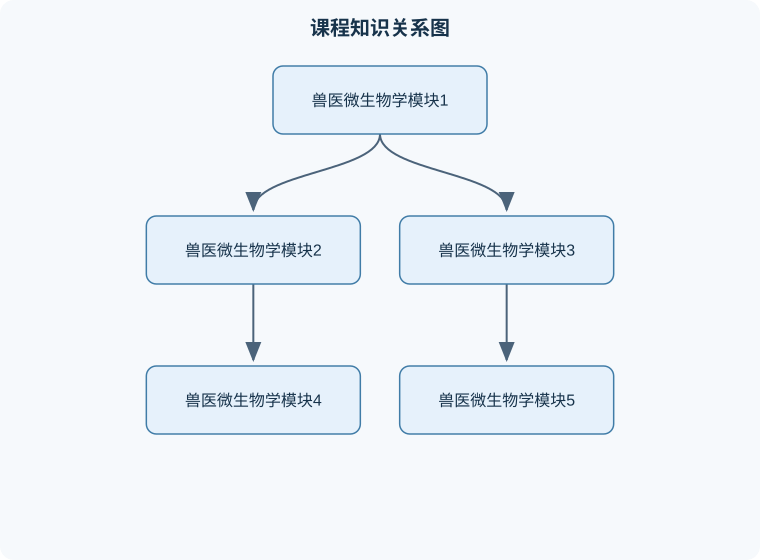

# 兽医微生物学

## 一、课程整体知识框架

### 课程边界与先修知识

本课程系统讲授与动物疾病、动物源食品安全和人兽共患病相关的兽医微生物学。内容边界包括细菌、病毒、真菌、支原体、衣原体、立克次体和螺旋体的形态结构、生理特性、遗传变异、致病机制、免疫防御、流行病学、实验室诊断、消毒灭菌和生物安全。重点覆盖畜禽常见病原体及其规范检验流程，包括病料采集、运输、分离培养、鉴定、血清学检测、核酸检测和结果判定。课程不替代临床诊疗、兽药处方、官方疫情处置规程或实验室生物安全审批。先修知识包括普通生物学、细胞生物学、生物化学、动物解剖生理学、免疫学、病理学和基础统计学；学习者应理解细胞结构、核酸与蛋白质合成、抗原抗体反应、无菌操作和基本显微镜技术。





### 1. 课程对象、任务与基本概念

兽医微生物学研究与动物疾病、动物产品安全和人兽共患病有关的微生物，包括细菌、病毒、真菌、支原体、衣原体、立克次体、寄生虫中的微小病原体及其毒素、抗原和核酸等。课程的核心任务不是简单记忆病原体名称，而是建立“病原体特征—宿主易感性—传播途径—组织损伤—临床表现—实验室证据—防控措施”的因果链。

“病原体”是能够在一定条件下导致宿主发生感染或疾病的生物因子；“感染”表示病原体进入宿主并在体内存活、增殖或诱导特异性反应，不一定表现为临床疾病；“疾病”则是感染或毒性损伤达到一定程度后出现的功能障碍和组织病变。病原体是否致病，取决于病原体的毒力和数量、进入门户、宿主年龄与免疫状态、组织屏障完整性以及环境应激等因素。因此，分离到某种微生物并不自动等于该微生物是致病原因，必须结合病料来源、病变部位、数量优势、重复检出、毒力特征和阴性对照等证据判断。

兽医微生物学还具有明显的群体医学特征。同一病原体在不同动物种、品种、年龄和饲养条件下可产生不同结果；一个养殖场内的发病率、死亡率和病死率也不能混用。发病率通常表示一定时间内新发病例占易感动物群体的比例；死亡率表示死亡动物占群体总数的比例；病死率表示死亡病例占病例总数的比例。三者的分母不同，比较时必须明确观察时间、群体范围和病例定义。

### 2. 兽医微生物学的研究层次与证据链

课程内容可按四个层次组织：

1. **形态与结构层次**：观察微生物的大小、形态、排列、荚膜、芽孢、鞭毛、细胞壁结构和包膜。
2. **生理与遗传层次**：分析营养要求、需氧性、温度和酸碱度范围、生化反应、毒力基因、抗原变异和耐药机制。
3. **宿主—病原互作层次**：解释黏附、侵入、定植、免疫逃逸、毒素损伤、炎症反应和组织嗜性。
4. **诊断与防控层次**：根据病例资料选择采样部位、实验方法、质量控制和结果解释，并将结果用于隔离、消毒、免疫、用药决策和风险管理。

一个可靠的实验室结论通常由多类证据共同构成：临床与剖检病变提供流行病学背景，直接镜检提供快速线索，培养或细胞培养提供病原体分离证据，抗原检测和核酸检测提供特异性证据，毒力检测解释致病性，血清学检测反映宿主暴露或免疫状态。任何单一结果都可能受到采样错误、污染、隐性感染、疫苗抗体或交叉反应的影响。

### 3. 第一模块：细菌学基础与分类鉴定

细菌是具有细胞结构、能独立进行基本代谢和繁殖的原核微生物。其细胞通常缺乏成形细胞核，但具有细胞膜、细胞质、核糖体和染色体；部分细菌还具有荚膜、鞭毛、菌毛、芽孢或特殊分泌系统。革兰染色反映细胞壁结构差异：革兰阳性菌肽聚糖层较厚，通常染成紫色；革兰阴性菌肽聚糖层较薄并具有外膜，通常染成红色。革兰染色结果受菌龄、脱色时间、固定方式和培养条件影响，不能脱离质量控制解释。

球菌的排列方式、溶血特征和酶反应具有鉴别价值。葡萄球菌多呈葡萄串状排列，通常无芽孢和鞭毛，可在普通培养基和血琼脂上生长。金黄色葡萄球菌常形成湿润、光滑、隆起的菌落，部分菌株呈金黄色并可出现β溶血；凝固酶、耐热核酸酶和甘露醇反应可作为辅助鉴定指标，但单项阳性不能替代完整鉴定。葡萄球菌可引起乳腺炎、脓肿、关节炎和败血症，也可通过溶血素、肠毒素、凝固酶、蛋白A及多种扩散酶增强致病能力。蛋白A与免疫球蛋白Fc段结合的特点，可能干扰调理吞噬，但其表达具有菌株和宿主来源差异。

链球菌通常呈链状或双球状排列，营养要求较高，多在含血培养基上生长。血琼脂上的溶血可分为α溶血、β溶血和γ溶血：α溶血表现为菌落周围草绿色改变，β溶血表现为透明溶血环，γ溶血表示无明显溶血。溶血类型是表型观察，不等同于毒力强弱；不同动物种和不同菌株之间不能仅凭溶血型判断致病性。链球菌的黏附、荚膜、M蛋白、脂磷壁酸、链激酶、链道酶及溶血素等共同参与致病。

革兰阴性菌中，多杀性巴氏杆菌常与禽霍乱等疾病相关。急性病例的新鲜血液或组织涂片可见两极着色的短杆菌，但这一现象只具有提示作用。分离培养时应选择适合的富营养培养基并设置纯培养和阴性对照；菌落形态、染色、氧化酶、吲哚、糖发酵、血清学或核酸检测需综合判定。慢性病例病原数量可能低，直接镜检阴性不能排除感染。

肠杆菌科细菌通常可在选择鉴别培养基上生长。大肠杆菌在含乳糖培养基上常形成可发酵乳糖的有色菌落，但菌落颜色只能说明代谢表型，不能直接证明其具有毒力。三糖铁琼脂、尿素酶、吲哚、甲基红、VP和柠檬酸盐等试验需要结合培养基质量、接种量和培养时间解释。仔猪水肿病的病原学确诊，关键不是仅分离大肠杆菌，而是证明分离株具有相关黏附因子和志贺毒素等毒力特征，并将检测结果与肠道病变及流行病学相互印证。

细菌鉴定的边界在于：培养阴性可能由采样晚、病料不合适、运输延迟或先期抗菌药物造成；培养阳性可能来自正常菌群、环境污染或继发感染。因而，病原学报告应区分“检出”“分离”“鉴定”“具有相关毒力特征”和“支持其为主要致病因”这几个层级。

### 4. 第二模块：病毒学、支原体及其他无细胞壁病原体

病毒没有独立的完整细胞结构，通常由核酸和蛋白衣壳组成，部分病毒具有包膜。病毒必须进入活细胞，利用宿主细胞系统复制，因此不能用普通细菌培养基培养。病毒感染过程包括吸附、进入、脱壳、核酸复制、蛋白合成、装配和释放；不同病毒在细胞嗜性、复制部位和致病机制上存在差异。

病毒诊断可采用病原分离、抗原检测、核酸检测和血清学检测。鸡传染性法氏囊病的实验室诊断应采集法氏囊等病变明显组织，进行规范研磨、澄清和必要的无菌处理，再根据实验室条件选择鸡胚、细胞培养、抗原检测或核酸检测。鸡胚接种后的死亡时间和胚体病变可提供线索，但不能单独作为病毒种属判定依据；需要结合特异性抗体、免疫学方法或核酸检测确认。细菌培养阴性只能排除在所用条件下检出该类细菌，不能单独证明病毒感染。

支原体缺乏细胞壁，形态可变，对影响细胞壁合成的药物天然不敏感；其培养要求较高，菌落常较小，且容易被常规细菌污染掩盖。衣原体和立克次体也具有细胞内寄生特征，采样部位、运输条件和细胞内定位会影响检出率。对这些病原体进行鉴定时，应避免把“不能在普通培养基生长”误认为“必然是病毒”。

### 5. 第三模块：真菌与条件致病微生物

真菌是真核微生物，具有细胞核和细胞器，细胞壁主要含几丁质和葡聚糖，细胞膜含麦角固醇等成分。酵母样真菌以出芽等方式繁殖，霉菌形成菌丝和孢子。真菌病常与潮湿环境、皮肤屏障破坏、长期用药、免疫抑制和饲料霉变有关。

真菌诊断包括病料直接镜检、真菌培养、菌落及显微结构观察、必要的抗原或分子检测。直接镜检可发现菌丝、孢子或酵母样细胞，但阴性不能完全排除感染，因为病料取样深度和真菌分布不均会影响结果。培养得到的环境真菌还必须结合组织侵袭证据、病灶部位和数量优势判断其意义。霉菌毒素中毒属于毒素暴露问题，不能简单等同于活真菌侵入感染；检测饲料、组织和临床病变时应分别设定证据标准。

### 6. 第四模块：微生物的致病机制与宿主防御

感染通常经历暴露、进入、黏附、定植、侵袭或毒素作用、免疫应答和清除或持续感染等阶段。毒力是病原体造成损伤的能力，常由黏附因子、荚膜、侵袭酶、毒素、免疫调节因子和抗吞噬结构共同决定。毒力不是固定不变的绝对属性，可能因菌株、宿主、感染剂量和环境条件而变化。

先天免疫包括皮肤和黏膜屏障、胃肠道酸性环境、吞噬细胞、补体、干扰素和炎症反应。适应性免疫包括抗体介导的体液免疫和T细胞介导的细胞免疫。抗体可中和毒素、阻断黏附、促进吞噬或介导补体反应；细胞免疫对细胞内病原体和病毒感染尤其重要。免疫反应也可能造成组织损伤，例如过强炎症、免疫复合物沉积或细胞因子失衡。

病原检测与免疫学检测回答的问题不同。PCR阳性通常表示样本中存在目标核酸，不能单独证明病原仍具有活性；抗体阳性通常表示曾感染、接种疫苗或发生母源抗体转移，不能直接证明当前存在病原复制。判断现症感染需要结合配对血清、抗体滴度变化、病原检测和临床过程。

### 7. 第五模块：流行病学、传播与生物安全

传播链包括传染源、传播途径、易感动物和适宜环境。直接接触、飞沫与气溶胶、饮水饲料、污染器械、人员和车辆、媒介动物以及垂直传播均可能参与传播。病原体在环境中的存活时间受温度、湿度、有机物、紫外线和消毒剂作用影响。消毒剂浓度、接触时间、作用温度和有机物负荷共同决定消毒效果，不能仅以“喷过消毒剂”判断已经达到灭活要求。

样本采集是实验室诊断的关键环节。急性死亡动物应优先采集病变明显且未腐败的组织；慢性病例可增加多部位采样和重复采样。采样器具、容器、标签和运输温度必须满足目标病原的要求。样本标签至少应包括动物种类、日龄、群体、临床表现、采样部位、采样时间和检测项目。涉及疑似高致病性或人兽共患病原时，应遵守相应生物安全和样本转运要求，不得在不具备条件的场所擅自扩增培养。

### 8. 第六模块：微生物诊断技术与结果评价

诊断流程可概括为“病例定义—采样设计—直接检测—分离培养或扩增—特异性鉴定—毒力或耐药分析—质量控制—综合报告”。每一步都必须有明确目的。例如，直接镜检追求快速提示，培养追求获得活菌和纯培养物，PCR追求快速特异检出，血清学追求评价暴露或免疫反应。

评价二分类检测时，设真阳性为 $TP$、假阳性为 $FP$、真阴性为 $TN$、假阴性为 $FN$，则：

$$
\text{敏感度}=\frac{TP}{TP+FN}
$$

$$
\text{特异度}=\frac{TN}{TN+FP}
$$

$$
\text{阳性预测值}=\frac{TP}{TP+FP}
$$

$$
\text{阴性预测值}=\frac{TN}{TN+FN}
$$

这些指标均为无量纲比例或百分比。敏感度和特异度主要描述检测方法在给定参照标准下的性能；阳性预测值和阴性预测值还受到群体患病率影响。低患病率群体中，即使特异度较高，阳性结果也可能包含较多假阳性。因此，群体筛查阳性结果通常需要采用不同原理的确认试验复核。

### 9. 第七模块：免疫预防、抗感染与耐药性

疫苗通过诱导特异性免疫降低感染、发病或排毒风险，但免疫保护受抗原匹配、免疫程序、母源抗体、营养、应激和免疫抑制等影响。免疫后抗体阳性不必然等于完全阻断感染；评价疫苗应同时观察临床保护、死亡率、排毒量、病变和群体传播。

抗菌药物选择应建立在病原鉴定、药物敏感性、感染部位、动物种类、药代动力学、食品动物用药限制和休药要求基础上。药敏试验结果是体外条件下的抑菌表现，不能机械地等同于临床必然治愈。耐药可由药物选择压力、耐药基因突变或质粒等可移动遗传元件传播形成。实验室报告应说明检测方法、判读标准适用范围和菌株来源，不能将某一类药物的耐药结果外推到全部药物。

### 10. 第八模块：兽医微生物学的综合应用

综合应用包括动物疫病诊断、养殖场监测、食品微生物安全、兽药敏感性分析、疫苗与诊断试剂研发、疫情调查和实验室质量管理。一个完整的诊断结论应回答四个问题：检测到了什么；样本是否具有代表性；检测结果是否

## 二、章节和模块划分

### 核心知识覆盖清单

本清单根据本课程的章节划分整理，用于检查正文是否覆盖各个核心模块：

- **1. 课程模块之间的知识关系**。
- **2. 病原微生物的基本特征与分类依据**。
- **3. 病原体致病与宿主反应**。
- **4. 样本采集、保存与实验室诊断**。
- **5. 检测结果的定量解释与综合判断**。
- **6. 典型综合应用与常见错误**。
- **7. 本章核心结论与岗位应用**。


### 1. 课程模块之间的知识关系

兽医微生物学的八个模块虽然可分别学习，但其知识并不是彼此孤立的。学习顺序应遵循“认识病原体—理解致病机制—掌握实验室检测—评价检测证据—实施防控”的逻辑。前两个模块主要回答“微生物是什么、如何分类和生存”；第三、四模块解释“微生物如何进入动物体内并造成损伤”；第五、六模块解决“如何从病料中检出和鉴定病原”；第七、八模块则将检测结果用于流行病学调查、药敏分析、疫苗评价和生物安全管理。

课程知识关系可概括为：

```text
模块1：基本概念与分类
          ├──> 模块2：细菌、病毒、真菌等病原体特征
          │             └──> 模块4：致病机制与宿主免疫
          └──> 模块3：生长、培养和遗传变异
                        └──> 模块5：样本采集与实验室诊断
模块5 ───> 模块6：结果评价、病因判断和质量控制
模块6 ───> 模块7：流行病学监测、药敏与耐药分析
模块7 ───> 模块8：防控、疫苗、食品安全和岗位应用
```

这种关系说明，单纯记忆某一病原体的形态、培养特征或临床表现是不充分的。例如，知道某菌为革兰阴性杆菌，只能提供初步分类线索；还需要结合氧需求、培养特征、生化反应、毒力因子、病料来源和组织病变，才能判断其是否可能是致病菌。又如，检测到病毒核酸，能够说明样本中存在相应核酸序列，但不能直接证明样本中存在具有感染性的完整病毒，也不能单凭阳性结果确定动物当前正在发病。

### 2. 病原微生物的基本特征与分类依据

#### 2.1 细菌、病毒和真菌的结构差异

细菌是原核微生物，具有细胞膜、细胞质、核糖体和拟核，部分细菌具有细胞壁、荚膜、鞭毛、菌毛或芽孢。细胞壁结构决定了许多染色和药物反应差异。革兰阳性菌的肽聚糖层通常较厚，革兰阴性菌具有较薄的肽聚糖层和外膜。革兰染色结果会受到菌龄、固定、脱色时间和培养条件影响，因此只能作为鉴定流程中的一个环节。

病毒没有完整的细胞结构，通常由核酸和蛋白质衣壳组成，部分病毒还具有包膜。病毒缺乏独立进行蛋白质合成和能量代谢的完整系统，必须在易感活细胞内复制。因此，病毒病原学检查常涉及细胞培养、抗原检测、核酸检测或血清学检测，而普通细菌培养不能替代病毒检测。包膜病毒通常对干燥、热、脂溶剂和部分消毒处理较敏感，但实际灭活效果仍取决于有机物、接触时间、温度和表面清洁程度。

真菌是真核微生物，具有细胞核，细胞壁主要含几丁质和葡聚糖等成分。酵母多以单细胞形式存在，霉菌则可形成菌丝和孢子。真菌感染常与皮肤屏障破坏、长期用药、免疫抑制、饲养环境潮湿或饲料霉变有关。观察到真菌结构并不等于证明其造成了疾病，仍需结合病变部位、组织侵袭性和重复检出结果。

#### 2.2 病原体分类与鉴定的层次

微生物鉴定可分为四个层次：

1. **形态学层次**：观察球菌、杆菌、弧菌、螺旋体、菌丝、芽孢或包膜等结构。
2. **生理生化层次**：分析需氧性、营养要求、糖发酵、酶反应、温度和酸碱度适应范围。
3. **抗原与遗传层次**：检测血清型、毒力基因、耐药基因或特异性核酸序列。
4. **病因学层次**：将检出结果与动物临床表现、组织病变、流行病学联系和对照结果结合。

不同层次回答的问题不同。革兰染色主要回答“细菌细胞壁和形态有什么特点”；培养和生化试验主要回答“是否能分离到活菌以及其表型特征是什么”；核酸检测回答“样本中是否存在目标遗传物质”；病因学判断则回答“该微生物是否是当前疾病的主要原因”。这四个问题不能互相替代。

### 3. 病原体致病与宿主反应

#### 3.1 感染建立的连续过程

病原体致病通常不是单一因素造成的，而是黏附、定植、侵入、增殖、免疫逃逸和组织损伤连续发生的结果。病原体首先需要到达适宜的进入门户，例如呼吸道、消化道、生殖道、皮肤损伤处或吸血节肢动物叮咬部位。随后，病原体通过黏附素、菌毛、表面蛋白或包膜蛋白与宿主细胞受体结合。

成功黏附后，病原体可能局部定植，也可能穿过上皮屏障进入血液或淋巴系统。荚膜可减少吞噬，蛋白酶可破坏组织成分，抗原变异可降低特异性免疫识别，某些细菌还能形成生物被膜，从而增强对抗体、吞噬细胞和抗菌药物的耐受。病毒则可通过抑制宿主抗病毒反应、改变细胞周期或诱导细胞死亡造成损伤。

宿主反应同样参与疾病形成。炎症反应有助于清除病原体，但炎症过度会造成组织水肿、血管通透性升高、发热、渗出和器官功能障碍。因而临床症状往往是病原体直接损伤与宿主免疫损伤共同作用的结果。例如，呼吸道病原可直接破坏纤毛上皮，同时引起炎性渗出，导致咳嗽、呼吸困难和继发细菌感染。

#### 3.2 毒力、致病性与感染剂量

“致病性”表示某种微生物导致疾病的能力，通常强调物种或菌株层面的性质；“毒力”表示特定菌株在一定宿主和条件下造成损伤的程度。毒力不是固定不变的，可能受到毒力基因、质粒、噬菌体、培养条件、宿主免疫状态和感染剂量影响。

感染剂量可用进入宿主并能够引起感染的病原体数量表示，但不能简单地认为剂量越高，疾病一定越严重。病原体进入部位、毒力类型、宿主年龄和免疫状态同样重要。幼龄动物、妊娠动物、应激动物或存在营养不良的动物，可能对较低数量的病原体也表现出明显症状。

常见考法是要求区分“检出病原体”和“证明病原体致病”。完整回答应包括：病料是否来自病变部位，病原体是否在相同疾病病例中重复检出，是否存在明显的数量优势，是否能排除污染和正常定植，是否具有相应毒力特征，以及实验结果能否与临床和剖检表现相互印证。

### 4. 样本采集、保存与实验室诊断

#### 4.1 采样设计的基本原则

采样首先要明确检测目的。若目的是分离活菌，应优先采集未受污染且病变明显的新鲜组织；若目的是检测病毒核酸，应根据病程选择病毒载量较高的分泌物、组织或拭子；若目的是调查抗体，应采集血清并记录免疫史、日龄和既往感染情况；若目的是监测群体传播，应同时考虑病例动物、接触动物、健康对照和环境样本。

样本信息至少应包括动物种类、日龄或生产阶段、群体来源、临床表现、死亡时间、用药史、免疫史、采样部位、采样时间和拟开展的检测项目。采样容器、保存温度和运输时间应与检测目标相适应。病料腐败、反复冻融、保存液不合适或样本量不足，都会降低结果可靠性。

采样应避免把外部污染当作病原来源。例如，从肠内容物中分离到某种细菌，只能说明该菌存在于肠内容物，不能直接证明其侵入肠壁并造成腹泻。若要判断侵袭性肠道感染，应结合肠黏膜病变、组织定位、毒力因子和动物临床表现。

#### 4.2 实验室诊断流程

一个适用于常见细菌性疾病的分析流程如下。

**输入**：病例资料、病料样本、检测目的和实验室安全等级。  
**输出**：病原体检出或分离结果、质量控制结论、病因学解释和必要的复检建议。

**过程**：

1. 核对样本编号、来源、采样部位、保存状态和病例信息。
2. 根据病原类别选择直接镜检、培养、抗原检测、核酸检测或血清学方法。
3. 设置阳性对照、阴性对照、空白对照或培养基无菌性对照。
4. 对可疑菌落进行纯化，避免混合菌群干扰鉴定。
5. 结合染色、菌落形态、生化反应、抗原或核酸结果确认身份。
6. 根据病变部位、病原数量、重复检出和流行病学资料评价病因关系。
7. 若对照异常、样本污染或结果与临床严重矛盾，暂停结论并复核采样、试剂和操作记录。

**不变量**：在流程任何阶段，样本编号和来源必须保持可追溯；对照不合格时，不得把同批检测结果作为有效证据发布。  
**终止条件**：完成必要的鉴定和质控，且结果能够支持预先设定的检测目的；若证据不足，则输出“需补充采样或进一步确认”，而不是强行给出确定病因。  
**适用条件**：适用于一般兽医诊断实验室的常见病原分析；疑似高风险或人兽共患病原时，应先完成风险评估并按相应生物安全流程转送。  
**复杂度说明**：若将样本数量记为 $n$，每份样本需进行固定数量的检测项目，则基础操作量大致为 $O(n)$；若进行两两菌株比较或群体传播关系分析，计算量可能增加到 $O(n^2)$，需要采用分层或聚类方法降低分析负担。

### 5. 检测结果的定量解释与综合判断

#### 5.1 菌落计数示例

若对样品进行十倍系列稀释，取稀释度为 $10^{-4}$ 的样液接种 $0.1\ \mathrm{mL}$，培养后计数得到 86 个菌落，则原样中的菌落形成单位浓度为：

$$
N=\frac{C\times D}{V}
$$

其中，$N$ 表示原样浓度，单位为 $\mathrm{CFU/mL}$；$C$ 表示平板菌落数；$D$ 表示稀释倍数的倒数对应的还原倍数，此处为 $10^4$；$V$ 表示接种体积，单位为 $\mathrm{mL}$。

代入数据：

$$
N=\frac{86\times 10^4}{0.1}
=8.6\times10^6\ \mathrm{CFU/mL}
$$

该计算成立的前提是菌落来源于分散的活菌，平板计数处于可计数范围，培养条件适合目标菌生长，并且没有明显的融合菌落、污染菌落或移液误差。若两个平行平板计数差异过大，应先检查混匀、移液和培养过程，不能机械取平均值。

#### 5.2 四格表与检测性能

评价检测方法时，设真阳性为 $TP$、假阳性为 $FP$、真阴性为 $TN$、假阴性为 $FN$。敏感度表示在确有感染的样本中检出阳性的能力：

$$
\text{敏感度}=\frac{TP}{TP+FN}
$$

特异度表示在没有目标感染的样本中检出阴性的能力：

$$
\text{特异度}=\frac{TN}{TN+FP}
$$

若某方法检测 100 份已由参照方法确认的样本，其中感染样本 40 份，检测出 36 份阳性；未感染样本 60 份，其中 3 份出现假阳性，则：

$$
\text{敏感度}=\frac{36}{40}=90\%
$$

$$
\text{特异度}=\frac{57}{60}=95\%
$$

阳性预测值为

$$
\text{阳性预测值}=\frac{36}{36+3}\approx92.3\%
$$

阴性预测值为

$$
\text{阴性预测值}=\frac{57}{57+4}\approx93.4\%
$$

预测值会受到群体患病率影响。养殖场暴发期与常规健康群体中，即使使用同一检测方法，阳性结果的病因学意义也可能不同。因此，低患病率群体中的筛查阳性通常需要复检或采用不同原理的确认方法。

### 6. 典型综合应用与常见错误

#### 6.1 奶牛群体出现乳房炎

若多个乳区出现肿胀、乳汁异常和产奶量下降，应分别采集患病乳区乳样，记录采样前是否使用过抗菌药物，并设置必要的环境或健康对照。实验室可先进行直接镜检和培养，再根据菌落特征、染色、生化反应或核酸结果鉴定。若分离到葡萄球菌，应进一步判断其是否来自乳腺深部病变、挤奶设备或皮肤污染，不能仅因乳样阳性就断定所有病例均由同一菌株引起。

若药敏结果显示某菌株对某药物体外敏感，仍需结合感染部位药物分布、乳房组织病变、脓肿或生物被膜、动物妊娠和泌乳状态，以及食品动物用药限制进行规范决策。药敏结果不能替代兽医临床判断，也不能据此自行增加剂量或延长疗程。

#### 6.2 仔猪腹泻与大肠杆菌检出

大肠杆菌可存在于健康动物肠道中，因此从粪便中分离到大肠杆菌并不等于诊断大肠杆菌病。病因判断应重点关注发病日龄、腹泻严重程度、脱水、肠道病理变化、菌株数量优势和黏附素或肠毒素等毒力特征。若仅有普通大肠杆菌培养阳性而无相应毒力证据，结论应表述为“检出大肠杆菌，病因关系需结合毒力检测和病理资料进一步判断”。

#### 6.3 疑似病毒性呼吸道疾病

若动物群体出现发热、咳嗽、鼻液和呼吸困难，应根据病程采集呼吸道拭子、分泌物或新鲜病变组织，同时记录免疫史和混合感染情况。核酸阳性说明检测到目标序列，若要证明存在活病毒或病毒在病变中发挥主要作用，还需结合病毒分离、抗原定位、病理变化和重复样本结果。血清抗体阳性可能反映疫苗接种、既往感染或母源抗体，不能单独作为当前感染的充分证据。

#### 6.4 常见概念错误

- 把感染、定植、污染和疾病混为一谈；
- 把“未检出”解释为“绝对不存在”；
- 把抗体阳性解释为当前存在活病原；
- 把核酸阳性解释为一定存在具有感染性的病原体；
- 把某一菌株的耐药性外推到同种所有菌株；
- 只依据菌落颜色或溶血现象直接定种；
- 忽略病程、用药史和样本运输条件；
- 对照异常时仍发布检测结果；
- 将单个病死动物的结果直接代表整个养殖群体；
- 只报告实验室现象，不说明结果能否支持病因判断。

### 7. 本章核心结论与岗位应用

兽医微生物学的核心不是“分离出什么就报告什么”，而是建立可验证的证据链。完整判断至少应回答四个问题：样本中检测到了什么，样本是否具有代表性，检测结果是否有效，该微生物是否能够解释临床和病理表现，以及结果应当如何转化为防控行动。

在动物疫病诊断岗位中，应重点掌握采样、纯化、鉴定、质控和报告边界；在养殖场监测岗位中，应掌握病例定义、群体采样、发病率和病死率计算以及传播途径分析；在食品安全岗位中，应掌握菌落计数、污染来源追踪和耐药风险评价；在兽药和诊断试剂研发岗位中，应掌握抗原变异、检测限、敏感度、特异度和交叉反应评价；在实验室质量管理岗位中，应确保样本、试剂、仪器、人员和结果全过程可追溯。

最终报告应将事实、解释和建议分开书写。例如，“病料中检出某病原体核酸”属于检测事实；“该病原体可能与呼吸道病变有关”属于依据临床和病理资料作出的解释；“建议补充采集新鲜病变组织并进行确认检测”属于工作建议。三者不能混写。只有在明确方法边界、证据强弱和生物安全要求的基础上，兽医微生物学结果才具有可靠的诊断和防控价值。

## 三、核心概念的详细解释

### 1. 病原体、感染、疾病与致病性的因果关系

兽医微生物学研究的对象包括细菌、病毒、真菌、支原体、衣原体、立克次体以及由这些微生物产生的毒素、抗原和核酸。判断某种微生物是否为病原体，不能只看“是否分离到”，而要建立完整证据链：病原体是否存在于适宜病变部位，是否与临床症状和组织损伤相符，是否能在多只患病动物中重复检出，是否具有相应毒力特征，以及健康对照动物中是否缺乏或显著减少。

“感染”是病原体进入宿主并存活、增殖或诱导特异性免疫反应的状态；“疾病”是感染、毒素作用或免疫损伤达到一定程度后产生的功能障碍和组织病变。感染可以无临床症状，疾病也不一定意味着病原体仍然存在。例如，动物感染某病毒后可能已经清除病毒，但免疫反应仍可造成组织损伤；动物接种疫苗后可能检测到抗体，却不代表发生了自然感染。

致病性是某类微生物在一定宿主中引起疾病的能力，毒力则是具体菌株或毒株造成损伤的程度。致病结果取决于病原体的侵入数量、黏附和侵入能力、毒素或免疫逃逸机制，也取决于宿主种类、年龄、免疫状态、营养状况、屏障完整性和环境应激。因此，同一微生物在成年动物和幼龄动物、单个动物和高密度群体中的表现可能不同。

### 2. 细菌的结构、分类与鉴定逻辑

细菌是没有成形细胞核、但具有细胞膜、细胞质、核糖体和染色体的原核微生物。细胞壁决定形态稳定性、染色特征和部分药物敏感性。革兰阳性菌肽聚糖层通常较厚，染色后呈紫色；革兰阴性菌肽聚糖层较薄并具有外膜，通常呈红色。革兰染色受菌龄、固定、脱色和培养条件影响，结果必须结合阳性和阴性对照解释。

细菌的附属结构具有不同作用：荚膜可减少吞噬或帮助黏附；鞭毛参与运动；菌毛和黏附素参与定植；芽孢是部分细菌在不利环境中的休眠结构，耐热和耐干燥能力通常强于营养体。支原体缺乏典型细胞壁，不能按普通革兰染色结果判断，其培养和药物选择也与有细胞壁的细菌不同。

鉴定细菌通常采用“形态初筛—培养特征—生化反应—特异性检测—致病性评价”的顺序。形态和染色可缩小范围，菌落颜色、溶血、气味和生长速度提供表型线索，生化试验分析糖发酵、酶活性和代谢产物，核酸或质谱等方法可提高鉴定准确性。但任何单一表型都不是绝对标准。

#### 葡萄球菌与链球菌的比较

葡萄球菌多为革兰阳性球菌，常呈葡萄串状排列；在液体培养物或脓汁中也可呈双球或短链。其通常无芽孢和鞭毛，部分菌株具有荚膜或黏液层，能在普通培养基和血琼脂上生长。金黄色葡萄球菌菌落常湿润、光滑、隆起，部分菌株呈黄色并出现明显β溶血，但菌落颜色受菌株和培养条件影响，不能单独作为定种依据。凝固酶、耐热核酸酶、甘露醇利用和分子检测可作为辅助证据。

葡萄球菌可引起乳腺炎、脓肿、关节炎和败血症，也可通过溶血素、肠毒素、凝固酶、蛋白A、透明质酸酶等因素造成组织损伤或促进扩散。蛋白A可与多种哺乳动物免疫球蛋白的Fc段结合，从而影响调理吞噬，但其表达具有菌株差异，不能把某一结构的存在直接等同于必然致病。

链球菌通常为革兰阳性球菌或卵圆形菌，常呈链状或成双排列，营养要求较高，多在含血培养基上生长。血琼脂上的溶血分为α溶血、β溶血和γ溶血：α溶血为菌落周围草绿色改变，β溶血为透明溶血环，γ溶血为无明显溶血。溶血类型是表型，不能简单等同于毒力强弱。链球菌的致病相关因素包括脂磷壁酸、荚膜、M蛋白、溶血素、链激酶、链道酶和透明质酸酶等。

### 3. 革兰阴性杆菌与典型动物疾病诊断

大肠杆菌是肠道正常菌群的重要成员，但某些致病型可引起仔猪腹泻、水肿病、禽类败血症或其他感染。鉴定大肠杆菌不能只根据“从肠道分离到大肠杆菌”，因为正常定植菌也可能被分离。应结合病变部位、菌量优势、血清型或黏附因子、毒素基因和临床表现进行判断。

麦康凯培养基可用于选择性分离肠杆菌并区分乳糖发酵。典型乳糖发酵菌落常呈红色，但颜色还受培养时间、培养基状态和菌株代谢差异影响。纯培养物可进行革兰染色、三糖铁反应、尿素酶、吲哚、甲基红、VP及枸橼酸盐利用等试验。IMViC结果常用于辅助区分大肠杆菌与部分近缘菌，但不同菌株存在变异，不能脱离完整鉴定体系。

仔猪水肿病的诊断重点不是“分离到大肠杆菌”，而是证明所分离菌株具有相应黏附因子和志贺毒素，尤其要结合毒力基因检测与临床病理证据。F18等黏附因子有助于细菌定植，志贺毒素可造成血管内皮损伤和水肿。若仅培养到普通大肠杆菌而未检出相关毒力因子，不能直接确诊。

### 4. 病毒的基本特征与诊断边界

病毒通常由核酸和蛋白质衣壳组成，部分病毒外有包膜。病毒缺乏完整的独立代谢系统，必须在活细胞内复制，因此不能用普通细菌培养基进行繁殖。病毒的宿主范围、组织嗜性和致病性与受体分布、复制酶系统、免疫逃逸及宿主免疫状态有关。

病毒检测方法回答的问题不同。PCR或其他核酸扩增阳性表示样本中存在目标核酸，不能单独证明病毒具有感染性；病毒分离可证明存在具有复制能力的病毒，但受样本保存、细胞状态和病毒含量影响；抗原检测速度较快，但灵敏度可能受样本质量和病程影响；抗体阳性说明曾感染、接种疫苗或接受母源抗体，不能单独证明当前发病。

传染性法氏囊炎的实验室诊断应围绕法氏囊等靶组织进行。采样时应选择病变明显且未腐败的组织，并同时考虑脾、肾等相关材料。病料预处理必须避免细菌污染和反复冻融造成病毒失活。病毒分离、抗原检测、免疫学检测和核酸检测应设置阴性、阳性及过程对照。剖检病变只能提供初步支持，特异性检测阳性且与病变和群体流行情况相符，才能形成较可靠结论。

### 5. 真菌、支原体及混合感染的识别

真菌为真核微生物，常具有细胞壁和细胞膜，酵母样真菌以出芽或分裂繁殖，丝状真菌形成菌丝和孢子。真菌感染可表现为皮肤、呼吸道或内脏病变。直接镜检可观察菌丝、孢子或酵母样细胞，培养可观察菌落形态，但真菌在环境中广泛存在，必须排除采样污染，并结合组织侵入、炎症反应和重复检出判断病原意义。

支原体缺少细胞壁，菌落常较小，培养要求特殊，普通革兰染色价值有限。由于其缺乏细胞壁，针对细胞壁合成的药物类别不适合作为判断依据。衣原体和立克次体具有细胞内寄生特点，样本采集、保存和细胞内定位对诊断十分重要。

混合感染在养殖动物中常见。一个样本中检出多个微生物时，应区分“共存”“继发感染”和“真正协同致病”。应将每种微生物的组织定位、数量、毒力特征、病变吻合度和时间顺序纳入分析，不能把检出名单直接当作病因名单。

### 6. 传播链、生物安全与样本质量

传播链包括传染源、传播途径、易感动物和适宜环境。传播途径可分为直接接触、飞沫或气溶胶、污染饲料和饮水、人员与车辆、器械、媒介动物以及垂直传播。控制措施必须作用于传播链的具体环节，例如隔离患病动物、减少人员流动、改善通风、清除有机物后消毒、控制媒介和执行全进全出。

样本质量是诊断可靠性的前提。急性死亡动物应优先采集新鲜、病变明显且未腐败的组织；慢性病例可进行多部位和重复采样。样本标签应包括动物种类、日龄、群体、临床表现、采样部位、采样时间和检测项目。不同检测目的对样本要求不同：培养需要尽量保持活菌，核酸检测重视防止降解和交叉污染，血清学检测需要明确采血时间和免疫史。

涉及疑似高风险或人兽共患病原时，应在符合条件的实验室按规定开展操作。未经风险评估，不应擅自培养、扩增或进行动物接种。动物试验不是常规鉴定的首选，只有在科学必要、替代方法不足、伦理审查和生物安全条件具备时，才可按批准方案开展。

## 四、重要定义、公式、定理和推导

### 专业审校补充：关键定义与适用边界

支原体的关键诊断边界是“无细胞壁”与“检出证据不等于病因确证”。支原体细胞膜含固醇，形态具有多形性，革兰染色通常不能提供可靠分类依据；凡以细胞壁合成作为作用靶点的抗菌药物，对支原体不具备可由该机制推定的活性，因此不能因细菌性疾病经验而直接推断其有效性。支原体可定植于呼吸道、生殖道或乳腺，鼻腔、咽拭子或环境样本中检出核酸，可能代表定植、污染、残留核酸或活动性感染。病因判断至少应综合采样部位、临床和病理表现、病原载量或组织定位、纯培养或特异性核酸结果、同群病例及阴性对照。PCR阳性而培养阴性，不能直接判断为活菌感染；培养阴性也不能完全排除感染，因为样本运输、既往用药、病原数量和培养条件均会影响结果。报告应分别写明“检出支原体核酸”“分离到支原体”和“证据支持其为致病因素”，三者不可混用。


### 1. 群体流行病学指标

设观察期开始时易感动物数为 $N$，观察期内新发病例数为 $C$，死亡动物数为 $D$，其中死亡病例数为 $D_c$，则：

$$
\text{发病率}=\frac{C}{N}\times 100\%
$$

$$
\text{死亡率}=\frac{D}{N}\times 100\%
$$

$$
\text{病死率}=\frac{D_c}{C}\times 100\%
$$

三个指标的分母不同。若一个猪群有 $1000$ 头猪，观察期内新发病例 $200$ 头，死亡 $20$ 头，且死亡均发生在病例中，则发病率为 $20\%$，死亡率为 $2\%$，病死率为 $10\%$。若死亡动物中有部分并非该病病例，病死率必须使用该病病例中的死亡数，不能直接用总死亡数代替。

### 2. 诊断试验的四格表指标

将检测结果与参照标准比较，定义真阳性为 $TP$、假阳性为 $FP$、真阴性为 $TN$、假阴性为 $FN$。则：

$$
\text{敏感度}=\frac{TP}{TP+FN}
$$

敏感度回答“真实患病动物中有多少被检出”；特异度为：

$$
\text{特异度}=\frac{TN}{TN+FP}
$$

特异度回答“真实未患病动物中有多少被正确排除”。阳性预测值和阴性预测值分别为：

$$
\text{阳性预测值}=\frac{TP}{TP+FP}
$$

$$
\text{阴性预测值}=\frac{TN}{TN+FN}
$$

阳性预测值还受患病率影响。设患病率为 $P$，敏感度为 $Se$，特异度为 $Sp$，则阳性预测值可写为：

$$
PPV=\frac{SeP}{SeP+(1-Sp)(1-P)}
$$

当患病率很低时，分母中的假阳性项可能不容忽视，因此筛查阳性结果通常需要用不同原理的确认试验复核。

### 3. 菌落计数与稀释计算

若样品经连续十倍稀释，取稀释倍数为 $10^{-d}$ 的稀释液，接种体积为 $V$ mL，培养后计数为 $C$ 个菌落，则原始样品中的菌落形成单位浓度为：

$$
\text{CFU/mL}=\frac{C}{V\times 10^{-d}}
$$

例如，取 $10^{-5}$ 稀释液 $0.1$ mL 接种，计数为 $86$ 个菌落，则：

$$
\text{CFU/mL}=\frac{86}{0.1\times 10^{-5}}
=8.6\times 10^7
$$

该计算假设每个可见菌落来源于一个可培养单位，稀释均匀，培养条件适合目标菌生长，且平板菌落数处于可计数范围。若菌落融合、平板过密、存在抑制剂或目标菌不可培养，计算值只能作为近似估计。

### 4. 代表性诊断流程与不变量

#### 流程一：细菌性疾病的分层鉴定

**输入**：临床资料、病变组织、无菌采样器具、培养基和对照菌株。  
**输出**：病原体鉴定结果、证据等级及局限性说明。

**步骤**：

1. 明确病例定义，记录动物种类、年龄、症状、发病时间和用药史。
2. 选择病变最明显且污染最少的部位采样。
3. 进行直接涂片、革兰染色或其他适宜染色，记录形态、排列和炎症背景。
4. 选择适合的培养基和培养条件，设置培养基空白对照。
5. 挑取不同形态菌落进行纯化，避免混合菌落直接鉴定。
6. 对纯培养物进行生化、抗原、核酸或质谱鉴定。
7. 对具有临床意义的菌株检测毒力因子或耐药表型。
8. 将实验结果与病变、流行病学和阴性对照综合解释。

**不变量**：每一步都必须保留样本身份和对照关系；纯化前不得把混合培养物的结果当作单一菌种结果；检出病原不等于已经证明致病。  
**终止条件**：获得与临床和病理证据一致的纯培养物及特异性确认结果，或明确报告“证据不足”。  
**适用边界**：对严格细胞内寄生病原、不可培养病原或已使用大量抗菌药物的病例，需要增加核酸、抗原或组织定位方法。

#### 流程二：病毒性疾病的综合检测

**输入**：急性期病料、血清、临床和剖检资料。  
**输出**：病毒核酸、抗原、病毒分离或抗体证据及综合判定。

**步骤**：

1. 根据组织嗜性选择法氏囊、脾、肾、呼吸道或其他靶组织。
2. 采样后分装，分别用于核酸、抗原和病毒分离，避免反复冻融。
3. 对病料进行规范预处理，设置提取空白和阳性对照。
4. 先用快速抗原或核酸方法筛查，再用不同原理的方法确认。
5. 如需病毒分离，应使用适宜细胞系统或规定的胚胎系统，并记录接种时间和观察结果。
6. 将病原阳性结果与病变、群体发病和免疫史进行比对。
7. 对抗体检测，必要时比较急性期与恢复期血清，观察抗体变化而非单次阳性。

**不变量**：每一份样本的编号、组织来源和检测目的保持一致；阴性对照必须无扩增、无特异反应；核酸阳性不得直接写成“活病毒阳性”。  
**终止条件**：获得至少一种特异性证据，并且结果与临床和病理资料相容。  
**适用边界**：接种疫苗后、母源抗体存在或存在环境污染时，单次抗体或核酸阳性尤其需要谨慎解释。

#### 流程三：问题分析伪代码

```text
输入：病例资料、样本集合S、检测项目集合T
输出：诊断结论R及证据说明E

1. 定义病例：记录宿主、时间、症状、病变和免疫史
2. 对每个样本s∈S：
       检查标签、保存条件和污染风险
       若样本不合格：
           标记为“不适合解释”，提出重新采样
       否则：
           选择与病原类型匹配的检测项目
           执行阴性对照、阳性对照和过程控制
3. 汇总每项检测结果：
       区分“病原存在”“病原可培养”“抗体存在”“毒力因子存在”
4. 比较结果与临床、病理、流行病学是否一致
5. 若至少两类证据一致且主要反证不存在：
       R = “支持该病原为主要病因”
   否则若仅有单一弱证据：
       R = “检出该病原，但病因证据不足”
   否则：
       R = “未检出或结果不支持，需考虑采样和检测局限”
6. 输出R、E、样本局限、建议的确认步骤
```

该流程的核心不变量是“检测结果必须保留其原始问题”。例如，PCR检测回答的是目标核酸是否存在，培养回答的是目标微生物是否在规定条件下可被分离，抗体检测回答的是宿主是否产生过相应免疫反应，三者不能互相替换。

### 5. 典型例题及解答

#### 例题一：葡萄球菌的综合鉴定

**题干**：从化脓性乳腺炎病灶分离到革兰阳性球菌，呈葡萄串状排列，在血琼脂上形成湿润菌落并有β溶血。如何进一步判断其临床意义？

**分析**：形态和溶血提示葡萄球菌，但不能仅凭此确定金黄色葡萄球菌，也不能仅凭菌落颜色证明致病。

**解答**：

1. 对可疑菌落进行纯化，确认不是混合菌落。
2. 进行凝固酶、耐热核酸酶和甘露醇利用等辅助试验。
3. 使用可靠的种属鉴定方法确认菌种。
4. 结合乳腺组织炎症、脓液中菌量、重复采样结果判断病原意义。
5. 必要时检测毒力因子和药物敏感性。

**结果验证**：若纯培养物鉴定为金黄色葡萄球菌，病灶中大量存在且与组织病变一致，阴性对照合格，则支持其为主要病原；若仅在皮肤表面少量检出，而深部病灶阴性，则不能直接归因。

**变式**：若凝固酶阴性，不能立即排除葡萄球菌感染，应考虑凝固酶阴性葡萄球菌、检测条件异常或样本混合，并结合其他鉴定结果。

#### 例题二：仔猪水肿病的确诊思路

**题干**：断奶后仔猪出现神经症状和眼睑水肿，从肠道分离到乳糖发酵型革兰阴性杆菌。是否可以直接确诊？

**分析**：不能。大肠杆菌可为正常菌群，必须证明菌株具有与水肿病相关的定植和毒力特征。

**解答**：

1. 采集病变适宜部位，优先考虑小肠相关材料并设置污染控制。
2. 在选择性培养基上分离，挑取可疑菌落并纯化。
3. 进行革兰染色和基础生化鉴定。
4. 检测黏附因子，如F18等相关标志。
5. 检测志贺毒素相关基因或产物。
6. 将毒力检测结果与年龄、临床症状、病理变化和群体发病情况结合。

**结果验证**：若纯培养物鉴定为大肠杆菌，并检出相符的黏附因子和志贺毒素，而病变与临床表现一致，才支持确诊。只有乳糖发酵阳性而毒力检测阴性时，应报告为“分离到大肠杆菌，但水肿病证据不足”。

**变式**：若毒力基因阳性但动物无相应病变，应考虑定植、样本污染、无表达或病因另有其人。

#### 例题三：传染性法氏囊炎的诊断

**题干**：20日龄鸡群出现精神沉郁、腹泻和法氏囊肿大，如何进行微生物学确诊？

**分析**：临床和剖检只能初步提示，必须证明存在传染性法氏囊病病毒相关抗原、核酸或具有复制能力的病毒，并排除主要混淆因素。

**解答**：

1. 采集法氏囊、脾和肾等病变组织，记录免疫史。
2. 病料分装，一部分用于核酸或抗原检测，一部分用于病毒分离。
3. 对病料进行规范预处理并设置细菌污染控制。
4. 采用特异性抗原检测、核酸检测或适宜的病毒分离方法。
5. 使用已知抗体进行免疫学确认，或使用不同原理的检测方法复核。
6. 结合病变、群体发病和疫苗接种情况综合判定。

**结果验证**：特异性检测阳性、对照合格、病变相符且无更合理病因时，支持确诊。单纯抗体阳性不等同于当前发病。

**变式**：若核酸阳性但病变轻微，应考虑疫苗株、残留核酸或亚临床感染，需要进行株型、组织定位或动态检测。

#### 例题四：菌落计数

**题干**：样品进行十倍系列稀释，取 $10^{-5}$ 稀释液 $0.1$ mL 接种，培养后计数 $86$ 个菌落，估算原始样品的菌落形成单位浓度。

**解答**：

$$
\text{CFU/mL}=\frac{86}{0.1\times10^{-5}}
=8.6\times10^7
$$

**结果验证**：单位为 CFU/mL，而不是“个/mL”；若同时有相邻稀释度，应比较其计数是否近似符合十倍稀释关系。若平板过密或菌落融合，则该结果不宜作为可靠定量值。

**变式**：若接种体积为 $1$ mL，其他条件不变，则结果为 $8.6\times10^6$ CFU/mL，说明接种体积必须写清楚。

#### 例题五：检测结果的预测值

**题干**：某检测方法敏感度为 $95\%$、特异度为 $98\%$，在患病率为 $1\%$ 的群体筛查中，阳性结果是否可直接视为患病？

**解答**：

取 $P=0.01$、$Se=0.95$、$Sp=0.98$：

$$
PPV=\frac{0.95\times0.01}
{0.95\times0.01+0.02\times0.99}
$$

$$
PPV\approx\frac{0.0095}{0.0293}\approx32.4\%
$$

因此，阳性结果只有约三分之一可能是真阳性，不能直接视为确诊，应采用确认试验并结合临床资料。

**结果验证**：低患病率时，假阳性总数可能超过真阳性；这并不表示检测方法没有价值，而是说明筛查与确诊的用途不同。

### 6. 实验与项目工作流程

#### 实验一：革兰阳性球菌的分离与鉴定

**输入数据**：疑似化脓性病灶样本、血琼脂平板、革兰染色试剂、凝固酶等辅助试剂、已知对照菌株。  
**步骤**：

1. 核对样本标签和病料来源，记录采样时间及是否使用抗菌药。
2. 无菌接种并分离培养，设置培养基空白。
3. 观察菌落形态、溶血和纯度。
4. 对可疑菌落进行革兰染色。
5. 纯化后开展辅助生化或特异性鉴定。
6. 汇总形态、培养和鉴定证据，报告菌种及解释边界。

**评价标准**：培养基空白无生长；染色对照符合预期；纯培养物形态一致；鉴定结果与生化反应和样本来源相符；报告区分“检出”与“致病证据充分”。

**排错方法**：若革兰染色杂乱，应检查菌龄、涂片厚度和脱色步骤；若多个菌落形态混杂，应重新纯化；若生化结果矛盾，应检查培养基有效性、接种纯度和菌种鉴定方法，而不是强行选择符合预期的结果。

#### 实验二：养殖场疑似呼吸道病原的综合调查

**输入数据**：患病和健康动物的样本、群体发病记录、免疫史、环境信息。  
**步骤**：

1. 先定义病例和对照，记录发病率、死亡率、病死率及用药史。
2. 从急性病例采集呼吸道拭子、病变组织或适宜分泌物，同时采集少量健康对照样本。
3. 对细菌开展培养和鉴定，对病毒开展抗原或核酸检测，必要时进行血清学动态检测。
4. 比较患病组与对照组的检出率、菌量或核酸信号，并结合组织病变。
5. 对主要病原进行毒力、耐药或株型分析。
6. 输出病原证据、传播风险、采样局限和后续防控建议。

**评价标准**：病例定义清楚；样本具有代表性；阳性和阴性对照合格；检测结果与病变和群体数据一致；报告注明检测方法及其不能回答的问题。

**排错方法**：若所有样本均阴性，应检查采样时间、样本保存、病原靶组织和既往用药；若健康对照也大量阳性，应考虑定植、疫苗株或环境污染；若不同方法结果矛盾，应检查靶标、抑制物、交叉反应和检测限。

### 7. 常见易错点

1. 把“分离到微生物”直接等同于“该微生物致病”；应结合病变、数量、定位和毒力证据。
2. 把感染、疾病和带菌状态混为一谈；感染可以无症状。
3. 将革兰染色颜色作为绝对分类依据，忽略菌龄、脱色和培养条件。
4. 仅凭金黄色葡萄球菌的菌落颜色或β溶血确诊。
5. 把链球菌β溶血简单等同于毒力最强。
6. 认为麦康凯上的红色菌落必然是致病性大肠杆菌。
7. 只检测大肠杆菌种属，不检测黏附因子和毒素。
8. 把PCR阳性写成“活病毒或活菌阳性”。
9. 把抗体阳性写成“当前感染”，忽略疫苗和母源抗体。
10. 把疫苗接种后抗体反应误判为自然感染。
11. 把敏感度和阳性预测值混用；预测值受患病率影响。
12. 忽略样本采集部位，使用腐败组织或非靶组织进行病原推断。
13. 混合培养物未经纯化就开展生化鉴定。
14. 只报告药敏结果，不说明菌株来源、检测方法和判读条件。
15. 将体外药敏结果直接等同于临床治疗必然成功。
16. 消毒前不清除有机物，只增加消毒剂用量而不考虑接触时间。
17. 用人体资料或成人动物资料直接推断另一动物种的易感性。
18. 为了得到预期结果而删除矛盾样本，造成选择性报告。

### 8. 常见笔试问题及解答思路

1. **为什么分离到病原体不能直接确诊？**  
   应答要点：正常菌群、定植和污染均可能造成阳性；需结合病变、组织定位、菌量优势、重复检出和毒力证据。

2. **革兰染色的分类基础是什么？**  
   应答要点：细胞壁结构和肽聚糖层差异；同时说明结果受菌龄、固定和脱色影响。

3. **如何鉴定金黄色葡萄球菌？**  
   应答要点：革兰阳性球菌、葡萄串状、血琼脂生长和溶血只是线索，还需纯化、凝固酶等辅助试验及特异性确认。

4. **为什么仔猪水肿病必须检测毒力因子？**  
   应答要点：大肠杆菌可为正常菌群，只有具有相关黏附和志贺毒素特征的菌株才具有较强病因解释力。

5. **PCR阳性与病毒分离阳性有什么区别？**  
   应答要点：PCR说明目标核酸存在，病毒分离更接近证明具有复制能力，但两者都需结合样本质量和临床证据。

6. **敏感度、特异度和阳性预测值如何区别？**  
   应答要点：敏感度针对真实患病者，特异度针对真实未患病者，预测值针对检测结果；预测值受到患病率影响。

7. **如何设计疑似传染性法氏囊炎的诊断？**  
   应答要点：采集法氏囊等靶组织，进行病毒特异性核酸、抗原或分离检测，设置对照，并结合病变和免疫史。

8. **如何评价一次养殖场病原检测？**  
   应答要点：看病例定义、采样代表性、检测方法匹配、对照、结果重复性、阴性证据和病原与病变的吻合程度。

### 9. 常见面试问题与参考回答

#### 问题一：你如何判断一个检出结果是否具有病因学意义？

参考回答：我会先确认样本来源和质量，再判断病原是否位于病变组织、是否有数量优势、是否能在病例中重复检出，并结合毒力因子、病理变化和群体流行情况。若只有环境样本或单次低水平核酸阳性，我会报告为“检出”，不直接报告为主要病因。  
深入追问要点：说明如何设置健康对照、如何处理混合感染，以及如何区分定植和污染。

#### 问题二：PCR阳性但培养阴性，你如何解释？

参考回答：可能是病原已失活、样本中含量低、培养条件不适宜、既往用药抑制生长，或PCR检测到残留核酸。应复核采样部位、保存条件、扩增对照和抑制物，并采用第二靶标、抗原检测或组织定位进行确认。  
深入追问要点：明确不能把培养阴性简单解释为“没有病原”，也不能把PCR阳性简单解释为“仍有活病原”。

#### 问题三：养殖场发生混合感染时如何确定主要病原？

参考回答：按时间顺序、组织定位、病变吻合度、病原载量、毒力特征和病例—对照差异排序，必要时进行重复采样和动态检测。主要病原应能解释主要临床和病理表现，而不是检测名单中出现次数最多者。  
深入追问要点：说明继发感染和机会感染的判断依据。

#### 问题四：如何避免样本污染？

参考回答：从采样部位、器具、容器、人员操作、分区流程和阴性对照多环节控制。培养和核酸检测应分开处理，建立样本流向记录，发现阴性对照异常时暂停解释并排查污染源。  
深入追问要点：说明环境污染、交叉污染和本底菌群的区别。

#### 问题五：如何向养殖场解释“PCR阳性不等于发病”？

参考回答：PCR检测的是目标核酸，不直接反映病原活性、数量是否达到致病水平或是否造成组织损伤。因此需要把结果与临床、病理、样本部位和群体检出率结合，并在必要时增加培养、抗原、组织定位或动态检测。  
深入追问要点：说明疫苗株和母源抗体如何影响解释。

#### 问题六：如何评价药敏试验报告？

参考回答：先确认菌种和菌株来源，再核对检测方法、培养条件、判读标准适用范围，最后结合感染部位、动物种类、药物暴露和食品动物管理要求解释。体外敏感不保证体内必然成功，耐药结果也不能无依据外推到全部药物。  
深入追问要点：说明混合培养物、菌株纯度和重复试验的重要性。

#### 问题七：如果检测结果与临床判断冲突，你会怎么做？

参考回答：不立即否定任一方，先检查病例定义、采样时间、样本质量、检测对照和方法适配性，再考虑病原变异、混合感染或非感染性疾病。必要时重新采样，并采用不同原理的方法确认。  
深入追问要点：说明何时应报告“证据不足”而不是强行给出病原名称。

#### 问题八：如何在生物安全前提下开展动物病原研究？

参考回答：先进行风险评估，明确病原危险性、传播途径、人员暴露和废弃物处理要求，再选择具备相应条件的实验室和经批准的操作方案。涉及高风险病原时，不在不具备条件的场所进行扩增培养或动物接种。  
深入追问要点：说明人员培训、样本转运、灭活验证和应急报告的重要性。

### 10. 与岗位任务的关联

#### 动物疫病诊断技术岗位

实际任务包括采样方案设计、病原分离、核酸或抗原检测、结果复核和诊断报告编写。需要掌握宿主—病原关系、样本质量控制、培养与分子检测原理以及敏感度和特异度的解释。产出包括检测原始记录、质控记录和综合报告；验收标准是样本可追溯、对照合格、方法适配、结果可重复且报告明确区分检出证据与病因结论。

#### 养殖场实验室或疾病监测岗位

实际任务包括群体发病率监测、病例—对照采样、重点病原筛查和疫情趋势分析。需要掌握传播链、发病率与病死率计算、疫苗免疫史解释和混合感染判断。产出包括场群监测表、异常报告和采样建议；验收标准是病例定义统一、分母清楚、样本具有代表性、阳性结果经过确认且防控建议与证据强度匹配。

#### 兽药或诊断试剂研发岗位

实际任务包括菌株收集、毒力因子检测、方法学评价、检测限和特异性分析。需要掌握微生物培养、核酸检测、四格表指标、对照设计及方法边界。产出包括试验方案、验证数据和产品性能报告；验收标准是输入样本明确、阳性和阴性对照完整、重复性可接受、交叉反应得到评估，且结论不超出试验数据支持范围。

#### 食品和动物产品微生物安全岗位

实际任务包括原料、加工环境和成品中的微生物监测，污染溯源和纠偏验证。需要掌握菌落计数、稀释计算、指示菌与致病菌的区别、采样代表性和消毒效果评价。产出包括检测记录、趋势分析和风险控制报告；验收标准是单位和稀释倍数准确、样本链完整、异常结果有复核、整改措施能够针对污染环节。

#### 实验室质量与生物安全岗位

实际任务包括标准操作流程维护、人员培训、设备和培养基质量控制、废弃物处理及偏差调查。需要掌握对照设置、污染排查、样本追踪和风险分级。产出包括质量记录、偏差调查报告和改进措施；验收标准是流程可追溯、异常能及时隔离、对照异常时不发布无效结果，并能通过原因分析防止同类问题重复发生。

## 五、算法、流程和实现思路

### 方法与流程覆盖索引

下列方法或流程应在正文中说明输入、步骤、适用条件、结果检查和边界：

- 1. 兽医微生物学问题分析的通用流程
- 2. 细菌性疾病的分离鉴定流程
- 3. 诊断流程的伪代码实现
- 4. 典型综合例题
- 5. 实验与项目工作流
- 6. 常见笔试、面试与岗位应用


### 1. 兽医微生物学问题分析的通用流程

兽医微生物学诊断不是把所有检测方法全部使用一遍，而是根据病例定义、病原体类别、病料性质和检测目的选择证据链。通用输入包括动物种类、日龄、临床表现、发病时间、群体规模、死亡情况、免疫史、用药史、剖检病变和待检样本；输出应包括病原体是否被检出、检测结果是否可信、是否足以支持病因判断，以及后续防控建议。

#### 输入、过程与输出

1. **建立病例定义**：明确“疑似病例”“临床病例”和“实验室确诊病例”的判定条件。例如，单纯出现腹泻只能构成临床综合征，不能直接等同于某一种细菌感染。
2. **提出鉴别诊断**：按照动物种类、年龄、病变部位和传播特点列出细菌、病毒、真菌、寄生虫、毒素及非感染性因素。
3. **设计采样方案**：优先采集病变明显、病程早期、尚未腐败且未接受抗菌药物影响的样本。急性死亡动物可采集病变组织、血液或内容物；慢性病例应考虑多部位采样和重复采样。
4. **进行直接检测**：镜检、抗原检测或核酸检测可快速提供线索，但应明确其只能证明形态、抗原或核酸的存在，不能自动证明病原具有活性或必然致病。
5. **进行分离或特异性确认**：细菌可采用选择性或鉴别培养后纯化鉴定；病毒通常需要细胞培养、鸡胚或分子检测等适宜方法；真菌则需结合菌落形态、显微结构和特异性检测。
6. **评价致病性和流行病学一致性**：比较病原检测结果与病变部位、菌量优势、毒力基因、病例—对照样本和群体传播情况。
7. **完成质量控制和报告**：检查阴性对照、阳性对照、培养基或试剂状态、样本标签和运输记录。对照异常时不得直接发布结果。

流程的不变量是：每一个阳性结果都必须能够追溯到具体样本和检测方法；每一个病因结论都必须同时考虑实验室证据和临床病理证据。终止条件是已取得足以支持或排除主要鉴别诊断的证据，且质量控制合格。该流程适用于常规病例诊断、群体监测和疫情调查，但不替代高风险病原检测所需的生物安全审批和专业实验室条件。

### 2. 细菌性疾病的分离鉴定流程

以革兰阳性球菌或革兰阴性杆菌为例，细菌诊断通常采用“初步观察—分离培养—纯化—表型鉴定—特异性检测—病因评价”的分层方法。

#### 具体过程

- **初步观察**：记录病料颜色、气味、脓性或坏死性特征；涂片后进行适宜染色，观察革兰反应、菌体形态、排列、荚膜或两极着色等。镜检只能提供快速线索。
- **分离培养**：根据预期病原选择普通培养基、血琼脂、选择性培养基或其他适宜培养系统。培养条件包括温度、气体环境、培养时间和培养基质量，均应由实验室经验证的操作规范确定。
- **纯化**：从形态典型且与病变相关的单菌落中挑取菌体，重新分离，直至获得形态一致的纯培养物。混合菌落不能直接用于生化或毒力判断。
- **表型鉴定**：结合菌落形态、溶血、氧化酶、过氧化氢酶、糖发酵、尿素酶、吲哚、MR、VP和三糖铁等试验。单项结果仅为辅助证据，不能脱离整组反应解释。
- **特异性检测**：可检测种属特异抗原、毒力基因、耐药基因或特异核酸。核酸阳性证明目标序列存在，不代表样本中一定有活菌。
- **病因评价**：判断分离菌是否位于病变部位、是否占优势、是否在多只患病动物中重复出现、是否具有与疾病相符的毒力特征，并与健康对照或背景菌群比较。

### 3. 诊断流程的伪代码实现

下面的伪代码用于表达实验室决策逻辑，不直接替代具体病原的标准操作规程。

```text
输入：病例资料 Case，样本集合 Samples，检测项目集合 Tests
输出：诊断报告 Report

1. 若 Case.动物种类、病程或采样部位缺失：
       标记“信息不足”，暂停病因性结论
2. 对每个样本 Sample：
       检查标签、容器、运输条件和污染风险
       若样本不合格：
           记录不合格原因，必要时申请重新采样
3. 根据病例资料建立鉴别诊断集合 Differential
4. 对每个鉴别诊断 D：
       选择与 D 匹配的直接检测、培养或特异性检测
       设置阳性对照、阴性对照和空白对照
       执行检测并记录原始结果
5. 若阴性对照阳性或阳性对照失效：
       标记本批次无效，不解释样本结果
6. 对每个阳性结果：
       检查样本部位、病变一致性、重复检出情况和污染可能
       若只有核酸或抗原阳性：
           报告为“检出目标成分”，不直接写成“确诊感染”
7. 综合临床、病理、实验室和流行病学证据
8. 若证据相互支持：
       输出“支持某病原相关感染”及证据等级
   否则：
       输出“检出但病因关系未确定”或“未检出”
9. 记录方法、样本、对照、局限性和建议
10. 终止并生成可追溯报告
```

该算法的时间复杂度不能简单用数学规模表示，因为主要耗时取决于培养周期、复核次数、样本数量和检测方法；其质量核心是证据链完整，而不是检测项目越多越好。

### 4. 典型综合例题

#### 例题一：金黄色葡萄球菌相关乳腺炎的判断

**题干**：乳房肿胀并有脓性分泌物，涂片见革兰阳性球菌，血琼脂上出现溶血菌落。能否直接判定为金黄色葡萄球菌乳腺炎？

**分析**：革兰阳性球菌和溶血只能缩小范围，乳房及皮肤本身可能存在葡萄球菌定植。必须进行纯化、种属鉴定，并确认分离菌与乳腺病变之间的关系。

**逐步解答**：先检查样本是否来自未污染的乳腺病灶；再观察菌落和溶血特征，进行过氧化氢酶、凝固酶、耐热核酸酶或种属特异性检测；同时评估菌量优势、乳腺组织病变和同群其他病例。若纯培养物鉴定为金黄色葡萄球菌，且在病变乳汁中大量、重复检出，与组织学炎症相符，才能支持其为病因。

**结果验证**：阴性对照应无相同菌落，培养基应无污染；来自健康乳区的对照样本不应出现同等优势菌量。  
**变式**：若只检出少量凝固酶阴性葡萄球菌，且病变不典型，应报告为背景菌或机会致病菌，不能直接作为主要病原。

#### 例题二：断奶仔猪水肿病的病原确认

**题干**：断奶后仔猪出现神经症状和眼睑水肿，从肠道分离到大肠杆菌，是否即可确诊？

**分析**：大肠杆菌可为正常肠道菌群，必须确认其致病型和毒力因子。重点是检测与黏附和志贺毒素相关的遗传特征，并结合病变部位。

**逐步解答**：采集新鲜小肠病变部位及内容物，分离并纯化大肠杆菌；革兰染色确认其为革兰阴性杆菌；用生化反应和特异性方法鉴定种属；检测相关黏附因子，如F18等；检测志贺毒素相关基因或毒素表达证据。若分离菌同时具有与水肿病相符的黏附和毒素特征，且病变和群体发病情况一致，才支持产志贺毒素大肠杆菌相关疾病。

**结果验证**：应设置已知阳性和阴性对照，排除只检出普通大肠杆菌的情况。  
**变式**：若毒力基因阴性但临床症状明显，应考虑其他病原、毒素或混合感染，不能依据菌种名称确诊。

#### 例题三：禽霍乱的微生物学诊断

**题干**：鸡群急性死亡，怀疑禽霍乱，如何组织诊断？

**分析**：急性病例应优先使用新鲜、未腐败病料进行直接检查和分离培养；慢性病例可能出现菌量下降，需增加培养和特异性鉴定。

**逐步解答**：采集肝、脾、心血或其他新鲜病变组织；进行适宜染色，观察是否有符合特征的两极着色短杆菌；在适合的培养条件下分离菌落；挑取可疑菌落纯化；结合菌落、染色、生化和种属特异性检测鉴定；必要时检测毒力相关特征。最终将病原结果与肝脾坏死、败血症表现和群体急性死亡相互印证。

**结果验证**：腐败病料中可能有大量继发菌，应比较不同器官的分离结果；单纯镜检阳性不能替代纯培养和特异性鉴定。  
**变式**：若慢性病例培养阴性而核酸阳性，应报告目标核酸检出，并结合样本质量判断是否需要重新采样。

#### 例题四：传染性法氏囊炎的检测方案

**题干**：幼龄鸡出现法氏囊肿大、出血或萎缩，怎样区别传染性法氏囊炎与细菌性败血症？

**分析**：该病属于病毒性疾病，诊断重点是病变组织采样、病毒特异性检测和细菌排查。法氏囊病变具有提示价值，但不能单独作为确诊依据。

**逐步解答**：采集病变明显的法氏囊，并可同时采集脾、肾等组织；在符合生物安全要求的条件下进行病料预处理；采用经过验证的病毒抗原、抗体或核酸检测；必要时进行病毒分离后再作特异性鉴定；平行进行细菌分离，以判断是否存在继发感染。若病毒特异性检测阳性，且与典型病变和群体流行过程一致，可支持诊断。

**结果验证**：应排除疫苗株或母源抗体对结果的影响；抗体阳性并不必然表示当前病毒复制。  
**变式**：若病毒检测阳性但法氏囊病变不典型，应考虑隐性感染、疫苗相关信号或混合感染。

#### 例题五：检测方法性能的计算

**题干**：某检测方法与参照标准比较，得到 $TP=45$、$FN=5$、$TN=90$、$FP=10$。计算敏感度、特异度、阳性预测值和阴性预测值。

**解答**：敏感度为
$$
\frac{TP}{TP+FN}=\frac{45}{45+5}=90\%
$$
特异度为
$$
\frac{TN}{TN+FP}=\frac{90}{90+10}=90\%
$$
阳性预测值为
$$
\frac{TP}{TP+FP}=\frac{45}{45+10}\approx81.8\%
$$
阴性预测值为
$$
\frac{TN}{TN+FN}=\frac{90}{90+5}\approx94.7\%
$$

其中四个计数均为样本数，无单位。该计算假设参照标准定义明确，且每个样本均能归入四格表。结果验证为四格表总数 $45+5+90+10=150$，阳性样本数为 $60$，阴性样本数为 $90$。变式是改变群体患病率：即使敏感度和特异度保持不变，阳性预测值也会随患病率变化，因此筛查阳性常需确认试验。

### 5. 实验与项目工作流

#### 实验一：细菌分离鉴定与污染排查

**输入数据**：患病动物病变组织、健康对照样本、培养基、染色试剂、已知对照菌株和样本登记信息。  
**步骤**：核对样本和标签；同时接种病例样本、健康对照和空白培养基；观察菌落形态；进行染色和基础生化试验；挑选单菌落纯化；记录每一步的时间、操作者和结果。  
**评价标准**：培养基空白无生长；阳性对照表现符合预期；阴性对照无目标菌；病例样本具有可重复的纯培养和与病变相符的鉴定结果。  
**排错方法**：若所有平板均生长杂菌，检查无菌操作和培养基灭菌；若阳性对照不生长，检查培养基、温度和菌株活性；若病例样本阴性，考虑采样过晚、抗菌药物影响、病料腐败或病原不适合该培养条件。

#### 实验二：核酸检测方法的质量评价

**输入数据**：已知阳性样本、阴性样本、提取空白、扩增阴性对照和扩增阳性对照。  
**步骤**：统一提取核酸；设置提取空白和扩增对照；检测目标核酸及必要的内源性质量控制；记录阳性、阴性和无效结果；对边界结果进行重复或采用不同原理方法确认。  
**评价标准**：阴性对照不得出现目标信号，阳性对照应处于方法允许范围，样本质量控制应合格；重复检测结果应具有一致性。  
**排错方法**：阴性对照阳性提示污染，应暂停解释并分区排查；阳性对照阴性提示试剂、扩增系统或操作失败；样本内控阴性提示抑制物或核酸提取失败，不能简单报告为阴性。

### 6. 常见笔试、面试与岗位应用

#### 常见笔试问题及解答思路

1. **为什么分离到病原体不等于确诊？**  
   应从定植、污染、隐性感染、样本来源和病变一致性解释，并提出重复检出、病原量、毒力特征和对照证据。

2. **革兰染色结果受哪些因素影响？**  
   应说明菌龄、固定、脱色、培养条件和试剂质量；指出染色结果必须配合对照。

3. **如何区别感染与疾病？**  
   感染强调病原体存在或特异性反应，疾病强调功能障碍和病变；二者可能不同时出现。

4. **为什么PCR阳性不能直接证明病原有活性？**  
   核酸可来自活菌、死菌或残留成分，应结合培养、抗原、临床过程和重复采样判断。

5. **为什么血清学阳性不能直接证明当前感染？**  
   抗体可由疫苗、既往感染或母源抗体产生；需结合配对血清、滴度变化和病原检测。

6. **敏感度和阳性预测值有何区别？**  
   敏感度以真实患病者为分母，阳性预测值以检测阳性者为分母；后者明显受患病率影响。

7. **为什么纯培养是细菌鉴定的重要条件？**  
   混合菌落会造成生化反应和毒力检测相互干扰，无法确定结果属于哪个菌株。

8. **如何解释药敏试验结果？**  
   药敏反映体外条件下的抑菌表现，不能脱离药物到达感染部位的能力、动物种类、感染部位和判读标准直接推断临床疗效。

#### 面试问题、参考答案与追问要点

1. **发现样本阳性后你先做什么？**  
   参考答案：先核对样本、方法和对照，再判断阳性是否与病变一致。追问应说明如何排除污染及何时复检。

2. **如何处理阴性结果与临床高度不符的情况？**  
   参考答案：检查采样部位、病程、运输、抑制因素和检测靶标，必要时重新采样并采用互补方法。追问要区分“未检出”和“没有病原”。

3. **你如何设计病例—对照采样？**  
   参考答案：病例组选择符合统一病例定义的患病动物，对照组选择同场、同年龄或同批次但无症状动物，并统一记录免疫史和用药史。追问应说明如何控制混杂因素。

4. **培养结果出现多种菌落怎么办？**  
   参考答案：分别记录形态，按病变相关性和优势程度挑取单菌落纯化，不能将混合培养物直接用于结论。追问应说明如何判断污染与混合感染。

5. **如何评价一个新诊断试剂？**  
   参考答案：明确参照标准，评价敏感度、特异度、重复性、交叉反应和不同样本类型的适用性。追问应说明低患病率场景下阳性预测值的变化。

6. **群体中只有少数动物阳性，是否可以排除暴发？**  
   参考答案：不能。应考虑采样时间、样本代表性、检测敏感度、疫苗影响和群体中不同感染阶段。追问应提出分层采样和重复监测。

7. **如何向养殖场解释“检出病原但未必是病因”？**  
   参考答案：区分定植、污染和致病感染，说明还需要病变一致性、菌量、毒力和群体证据。追问应说明报告措辞如何避免过度结论。

8. **实验室质量控制最重要的环节是什么？**  
   参考答案：样本可追溯、对照有效、操作分区、原始记录完整和异常结果可复核。追问应说明阴性对照阳性时不得发布同批结果。

## 六、概念之间的关系与对比

### 1. 感染、定植、污染与疾病

| 概念 | 核心含义 | 是否必然有病变 | 主要判断依据 |
|---|---|---:|---|
| 定植 | 微生物在宿主表面或体内存留并繁殖 | 否 | 部位、菌量、宿主状态 |
| 感染 | 病原体进入并在宿主体内存活、增殖或诱导特异性反应 | 否 | 病原检测、免疫反应和时间关系 |
| 污染 | 微生物来自环境、器具、人员或非目标部位 | 否 | 空白对照、样本来源和重复性 |
| 疾病 | 感染或毒性、免疫损伤导致功能异常和组织病变 | 通常有 | 临床、剖检、组织学及实验室证据 |

关系上，定植可能发展为感染，感染可能发展为疾病，但三者不是同义词。污染则是诊断过程中的外源干扰，不能被当作宿主感染。对于肠道、皮肤和呼吸道样本，正常菌群尤其容易造成“检出即病因”的错误。

### 2. 镜检、培养、核酸、抗原与抗体检测的对比

| 方法 | 主要回答的问题 | 优点 | 局限 |
|---|---|---|---|
| 镜检 | 是否存在符合特征的微生物形态 | 快速、成本较低 | 灵敏度和特异性有限，难以定种 |
| 培养 | 是否存在可存活并能在条件下生长的微生物 | 可获得活菌并进行药敏 | 耗时，受样本质量和培养条件影响 |
| 核酸检测 | 是否存在目标遗传物质 | 快速、特异性较高 | 不证明活性，易受污染影响 |
| 抗原检测 | 是否存在目标抗原 | 可反映病原成分 | 灵敏度和交叉反应需评价 |
| 抗体检测 | 宿主是否产生特异性免疫反应 | 适合暴露和免疫评价 | 不能单独区分疫苗、既往感染和当前感染 |

这些方法不是互相替代关系，而是回答不同问题。急性暴发可先用直接检测获得快速线索，再用培养或特异性检测确认；群体监测可结合抗体和核酸；慢性感染则需要考虑抗体持续时间和重复采样。

### 3. 敏感度、特异度与预测值的关系

敏感度描述方法在参照标准阳性样本中检出阳性的能力；特异度描述参照标准阴性样本中检出阴性的能力。阳性预测值回答“检测阳性者中有多少确实患病”，阴性预测值回答“检测阴性者中有多少确实未患病”。

当患病率较低时，少量假阳性可能占全部阳性结果的较大比例，因此阳性预测值下降；当患病率较高时，阴性结果中假阴性的影响可能增加。由此，群体筛查常强调较高敏感度，确诊或排除则需要结合较高特异度的确认方法。不能把某一检测方法在一个群体中的预测值直接外推到另一个患病率不同的群体。

### 4. 葡萄球菌与链球菌的对比

| 特征 | 葡萄球菌 | 链球菌 |
|---|---|---|
| 常见排列 | 葡萄串状，也可成双或短链 | 链状或成双 |
| 培养要求 | 多可在普通培养基生长 | 多数营养要求较高，常需血液或血清 |
| 血琼脂表现 | 部分菌株有明显β溶血 | 可表现α、β或γ溶血 |
| 常用辅助试验 | 过氧化氢酶、凝固酶、耐热核酸酶 | 溶血类型、抗原分群及相关生化试验 |
| 主要致病方式 | 化脓、毒素、黏附和免疫逃逸 | 黏附、荚膜、M蛋白、溶血素和扩散酶 |
| 解释边界 | 皮肤和乳腺定植可能造成假性病因判断 | 黏膜正常菌群和溶血表型不能直接决定毒力 |

葡萄球菌与链球菌均可引起化脓性疾病，但其排列、培养特征和辅助鉴定方法不同。溶血并不是单独的毒力等级；“β溶血”等描述只能说明红细胞破坏表型，必须结合菌株、宿主和病变解释。

### 5. 细菌性疾病与病毒性疾病诊断的对比

细菌性疾病通常可以通过直接涂片、分离培养、纯化、生化鉴定和药敏分析建立证据链；病毒性疾病通常缺乏常规细菌培养所需的独立代谢系统，需要细胞、鸡胚、抗原或核酸检测等方法。细菌培养阳性强调活菌存在，但也可能反映定植；病毒核酸阳性强调目标序列存在，但可能来自失活病毒或残留核酸。

例如，疑似禽霍乱时，急性病例可重点采集新鲜病料进行镜检和细菌分离，再结合纯培养和特异性鉴定；疑似传染性法氏囊炎时，应重点采集法氏囊等病变组织进行病毒特异性检测，并平行排查细菌。两者均需结合剖检和群体资料，不能只凭一种实验结果下结论。

### 6. 毒力因子、耐药性与致病性的关系

毒力因子是帮助微生物黏附、侵入、扩散、逃避免疫或造成组织损伤的结构或产物。具有毒力基因不等于一定产生同等程度的疾病，因为基因表达受菌株背景、环境条件和宿主因素影响。耐药性则描述微生物对某种抗菌药物的敏感性下降，不能直接等同于毒力增强；耐药菌可以低毒，敏感菌也可以高毒。

诊断报告应分别记录病原鉴定、毒力相关检测和药敏结果，避免把“检出耐药基因”写成“必然临床治疗失败”，也避免把“检出毒力基因”写成“单独足以确诊”。最终结论应说明检测对象、样本来源、方法边界和证据强度。

### 7. 实验室结果与群体流行病学的关系

单个动物的阳性结果说明该动物样本中存在目标成分；群体防控则需要进一步分析病例比例、死亡比例、病死率、时间分布、空间分布、接触关系和免疫覆盖情况。发病率的分母是观察期内易感群体或规定群体，病死率的分母是病例数，死亡率的分母是群体总数。若不明确分母，数字比较没有意义。

实验室结果还需考虑样本代表性。若只采集死亡动物，可能高估重症病原；若只采集存活动物，可能漏掉急性死亡病例。病例组、接触动物组和健康对照组的联合采样，通常比单点阳性更能支持传播链和防控决策。

### 8. 常见易错点及纠正

1. 把感染、疾病和定植当作同义词；应分别说明病原存在、临床表现和宿主表面存留。
2. 看到革兰阳性球菌就直接写成葡萄球菌；应结合排列、培养和辅助试验。
3. 把β溶血等同于“必然高毒”；溶血只是表型。
4. 把从肠道分离到大肠杆菌直接等同于致病；必须检测毒力特征并结合病变。
5. 把PCR阳性写成“分离到活菌”；核酸检测与培养概念不同。
6. 把抗体阳性写成“当前感染”；需考虑疫苗和母源抗体。
7. 忽略样本部位；病变组织中的优势菌比环境表面菌更有病因价值。
8. 混合菌落未经纯化就进行生化鉴定；结果可能来自不同菌。
9. 只依据单项生化试验定种；应采用组合证据。
10. 将药敏结果等同于临床疗效；药物分布、感染部位和宿主状态会改变结果。
11. 忽视阴性对照；阴性对照阳性时同批检测通常不能解释。
12. 不区分发病率、死亡率和病死率；必须先确认分母。
13. 用人体疾病资料直接替代动物资料；动物种类、易感性和免疫反应可能不同。
14. 把未检出写成不存在；阴性可能由采样、运输、病程或检测限造成。
15. 用“检出病原”替代完整病因结论；应说明证据支持程度和局限性。
16. 在缺乏适宜条件时擅自培养高风险病原；应依照生物安全和样本转运要求处理。

## 七、典型例题和应用场景

### 专业审校补充：综合例题

题干：某奶牛群出现咳嗽、流鼻液和生长迟缓，少数牛反复发生肺炎。对3头急性病例采集鼻咽拭子和肺组织，对2头无症状牛采集鼻咽拭子。结果为：急性病例鼻咽拭子中有2份支原体特异性PCR阳性，肺组织中有1份阳性；无症状牛鼻咽拭子有1份阳性。所有阴性对照正常，阳性对照正常。肺组织细菌培养分离到多种条件致病菌，支原体培养未成功。请判断证据强度并设计后续流程。

分析：鼻咽部检出只能证明该部位存在目标核酸，因为无症状牛也可阳性；肺组织阳性比鼻咽拭子更接近病变部位，但仍需排除污染、残留核酸和混合感染。支原体培养阴性不能单独否定感染，尤其在样本量少、运输不当或培养条件不适配时。

逐步解答：第一步，核对病例定义、发病时间、既往抗菌药物使用、采样深度和样本保存条件。第二步，对肺组织病变区进行独立重复取样，并设置采样空白；优先检测病变组织，而不是仅增加健康动物鼻拭子数量。第三步，对纯化核酸进行靶标复核，确认扩增信号满足阳性对照、阴性对照和重复检测要求；必要时采用不同靶标或另一种原理的方法确认。第四步，将支原体结果与组织病理、病原在病变部位的定位及其他分离菌的毒力证据结合。第五步，若条件允许，对新鲜、未受污染的病变材料采用适配的支原体培养和种属鉴定；若无法培养，应在报告中注明“检出核酸但未获得活菌分离”。

结果验证：无症状牛鼻咽拭子阳性说明群体中可能存在定植或隐性感染，降低了单纯鼻拭子阳性的病因解释力度；急性病例肺组织阳性且与肺炎病变一致，则支持力度明显增强，但多种细菌同时存在时仍不能把支原体自动认定为唯一病原。变式：若肺组织PCR阴性而鼻拭子多份阳性，应优先考虑采样部位、病程、病原分布和抑制物影响，不能仅凭鼻拭子阳性宣布肺炎由支原体引起；若肺组织培养阳性并经种属确认，且组织病变定位一致，则活菌感染证据进一步增强。


### 典型题型与应用覆盖索引

建议通过下列题型或应用检查概念是否能够迁移：

- 1. 典型例题一：从分离结果判断金黄色葡萄球菌感染
- 2. 典型例题二：仔猪水肿病的微生物学确诊
- 3. 典型例题三：禽霍乱的诊断证据链
- 4. 典型例题四：传染性法氏囊炎的病毒学诊断
- 5. 典型例题五：检测方法性能的计算与解释
- 6. 代表性诊断算法与伪代码
- 7. 常见笔试问题及解答思路
- 8. 常见面试问题、参考答案与追问要点
- 9. 兽医微生物学的岗位应用


### 1. 典型例题一：从分离结果判断金黄色葡萄球菌感染

#### 题干

某奶牛乳房出现局部肿胀，乳汁呈絮状并含脓性凝块。无菌采集乳样后，在血琼脂上分离出革兰阳性球菌，菌体多呈葡萄串状排列，菌落湿润、隆起，周围有明显溶血。请说明应如何进一步鉴定，并判断哪些证据可以支持其为乳腺炎病原。

#### 分析

革兰阳性球菌、葡萄串状排列和血琼脂生长提示葡萄球菌属，但不能仅凭形态直接确定为金黄色葡萄球菌。菌落颜色和溶血可作辅助依据，仍需纯化培养、凝固酶、耐热核酸酶或其他种属特异性方法。由于葡萄球菌也可能定植于皮肤和乳头表面，病因判断还必须考虑样本采集是否污染、乳汁中菌量是否占优势、是否能在多个患病乳区重复分离，以及分离结果是否与乳腺组织炎症相符。

#### 逐步解答

1. 对原始乳样涂片进行革兰染色，观察革兰阳性球菌的形态和排列。
2. 从血琼脂上挑取形态一致的可疑菌落进行纯化，避免混合菌落造成生化结果错误。
3. 观察纯培养物的溶血表现，并进行过氧化氢酶试验，以区分葡萄球菌与多数链球菌。
4. 进行凝固酶试验、耐热核酸酶试验和适宜的种属鉴定。凝固酶阳性可支持金黄色葡萄球菌判断，但不能脱离培养纯度和对照结果解释。
5. 结合乳样中菌量、乳房病变、体细胞变化、重复采样结果和同群其他病例判断病因相关性。
6. 若需治疗，应进一步进行药物敏感性试验，并结合动物种类、感染部位、药物在乳腺中的分布及食品动物用药要求解释，不能仅凭体外敏感结果决定临床方案。

#### 结果验证与边界

若仅从乳头表面采样并分离到少量葡萄球菌，不能确诊乳腺炎由其引起；若从乳腺深部乳样或病变组织中重复分离同一菌株，且该菌在培养物中占优势，病变与感染部位一致，则病因证据明显增强。金黄色菌落并非所有菌株都呈金黄色，β溶血也不是金黄色葡萄球菌的绝对特征。

#### 变式

若分离到链状排列的革兰阳性球菌，应转向链球菌属鉴别，重点观察血琼脂溶血类型、过氧化氢酶结果、培养要求和种属特异性检测。若乳样培养阴性，不能立即排除感染，还要检查采样时机、运输条件、抗菌药物使用史和样本是否来自真正病变部位。

---

### 2. 典型例题二：仔猪水肿病的微生物学确诊

#### 题干

断奶后仔猪出现眼睑和头部水肿，部分动物突然死亡。剖检发现胃壁和肠系膜水肿。请设计确诊流程，并说明为什么不能只根据大肠杆菌分离结果下结论。

#### 分析

仔猪水肿病与特定毒力型大肠杆菌有关，病因判断的关键不是“是否存在大肠杆菌”，而是确认分离菌具有与疾病相符的黏附因子和志贺毒素等毒力特征。大肠杆菌可作为正常肠道菌群存在，因此从肠内容物中分离到普通大肠杆菌的证据强度有限。

#### 逐步解答

1. 采集急性病例的十二指肠或空肠黏膜、肠内容物以及有明显病变的组织；同时设置健康或未发病接触动物样本。
2. 在麦康凯培养基等适宜培养基上分离革兰阴性杆菌，挑取典型乳糖发酵菌落进行纯化。
3. 通过革兰染色、三糖铁、吲哚、尿素酶、柠檬酸盐及其他生化试验确认其为大肠杆菌样菌株。三糖铁中常见的酸性斜面、酸性底部和产气现象可作为辅助特征，但必须以实验室验证的组合反应为准。
4. 对纯培养物检测血清型相关抗原、黏附因子和毒力基因。常见的判定思路是检测与断奶仔猪小肠黏附相关的菌毛因子，并确认是否存在编码志贺毒素的基因或其表达证据。
5. 将病理表现、菌株在病变部位的优势分布、毒力检测结果与健康对照比较。
6. 只有当分离菌的毒力特征与疾病综合征一致时，才能支持产志贺毒素大肠杆菌导致水肿病的判断。

#### 结果验证

PCR检出毒力基因说明目标序列存在，若要说明毒素实际表达，还应结合适宜的表达或毒素检测方法。血清型结果不能替代毒力检测；同一血清型内可能存在毒力差异。若只从粪便中分离到大肠杆菌而未检测到相应毒力因子，不能据此确诊。

#### 变式

若病料在使用抗菌药物后采集，培养阴性而毒力基因检测阳性，可能表示病原已被抑制但核酸仍残留，也可能是样本污染或检测到非致病菌携带的相关序列，应重新采样并采用不同原理的方法确认。

---

### 3. 典型例题三：禽霍乱的诊断证据链

#### 题干

鸡群突然出现精神沉郁、呼吸困难和死亡。急性死亡鸡剖检可见肝脏散在坏死灶。怀疑禽霍乱，请写出微生物学诊断流程。

#### 解答

1. **病料选择**：急性死亡动物优先采集心血、肝脏、脾脏和骨髓等相对新鲜的病料；慢性病例应增加病变组织和分离培养样本。
2. **直接镜检**：用新鲜病料制片，进行瑞氏染色或美蓝染色，观察短小革兰阴性杆菌及可能出现的两极着色。两极着色是提示性特征，不是单独确诊依据。
3. **分离培养**：接种适宜的血液或血清类培养基，观察淡灰白色、光滑、湿润或露滴样小菌落。培养条件应根据实验室验证的操作规范执行。
4. **纯化与鉴定**：挑取可疑单菌落重新划线纯化，进行革兰染色、氧化酶、吲哚、尿素酶及糖发酵等鉴定试验，并可结合种属特异性核酸检测。
5. **病因确认**：将分离结果与急性败血症表现、肝脾病变、群体发病情况和健康对照结果相结合。若需要进行毒力评价，应采用经批准且符合生物安全要求的替代性方法，不在普通教学环境中随意进行动物攻击试验。
6. **报告**：分别报告“检出疑似或确证的多杀性巴氏杆菌”“样本来源”“使用方法”“质量控制情况”和“病因判断的证据强度”。

#### 结果验证与边界

腐败病料中可能出现大量继发细菌，单纯分离到巴氏杆菌样菌株不能自动证明其为病因。若镜检、培养、特异性检测和病变部位一致，且多只急性病例重复检出，证据更充分。慢性病例中直接镜检可能阴性，不能据此排除感染。

---

### 4. 典型例题四：传染性法氏囊炎的病毒学诊断

#### 题干

20日龄肉鸡出现精神沉郁、羽毛蓬松和腹泻，剖检见法氏囊肿大、出血或后期萎缩。请设计实验室确诊方案，并指出细菌培养在此病例中的作用。

#### 分析

传染性法氏囊炎由传染性法氏囊病病毒引起，属于病毒性疾病。细菌培养主要用于排除继发细菌感染或发现并发病原，不能作为该病毒的直接分离方法。病毒检测应围绕病变组织、病毒分离和特异性确认展开。

#### 逐步解答

1. 采集法氏囊、脾脏、肾脏等病变明显且可能含毒量较高的组织，并记录日龄、免疫史和发病时间。
2. 将组织在无菌条件下制备匀浆，进行适当澄清和预处理。预处理方法必须与后续检测兼容，避免抗菌物质、温度或反复冻融破坏检测对象。
3. 可采用经验证的病毒核酸检测作为快速方法，同时设置提取阴性对照、阳性对照和扩增阴性对照。
4. 如需病毒分离，可在符合条件的实验室中使用适宜的鸡胚或细胞系统进行分离，观察接种后的死亡、组织变化或细胞病变。
5. 对分离物进行琼脂扩散、免疫荧光、ELISA、中和试验或核酸检测等特异性鉴定。
6. 结合典型临床病变、病毒特异性检测阳性和细菌培养结果综合判断。细菌培养阴性不能单独证明病毒感染，细菌培养阳性也不能排除病毒感染。

#### 结果验证

若PCR阳性而病毒分离阴性，可能是样本中存在失活病毒或核酸残留，也可能受运输和保存影响；若病毒分离阳性但特异性鉴定阴性，则需考虑非目标病毒、交叉污染或培养系统异常。接种疫苗可能影响抗体检测解释，因此抗体阳性必须结合免疫史和病原核酸或病毒分离结果。

---

### 5. 典型例题五：检测方法性能的计算与解释

#### 题干

以参照标准为依据评价一种动物传染病核酸检测方法。结果如下：真阳性 $TP=45$，假阴性 $FN=5$，真阴性 $TN=90$，假阳性 $FP=10$。求敏感度、特异度、阳性预测值和阴性预测值，并说明这些指标如何用于实际诊断。

#### 逐步计算

敏感度表示参照标准阳性样本中被检出的比例：

$$
\text{敏感度}=\frac{TP}{TP+FN}
=\frac{45}{45+5}
=\frac{45}{50}=90\%
$$

特异度表示参照标准阴性样本中被正确排除的比例：

$$
\text{特异度}=\frac{TN}{TN+FP}
=\frac{90}{90+10}
=\frac{90}{100}=90\%
$$

阳性预测值表示检测阳性样本中真正阳性的比例：

$$
\text{阳性预测值}=\frac{TP}{TP+FP}
=\frac{45}{45+10}
=\frac{45}{55}\approx81.8\%
$$

阴性预测值表示检测阴性样本中真正阴性的比例：

$$
\text{阴性预测值}=\frac{TN}{TN+FN}
=\frac{90}{90+5}
=\frac{90}{95}\approx94.7\%
$$

#### 结果验证与边界

四项指标均为无量纲比例。敏感度和特异度在参照标准、病例定义和样本构成不变时具有相对稳定的评价意义；阳性预测值和阴性预测值会随群体患病率改变。低患病率筛查中，即使特异度达到90%，阳性结果仍可能需要第二种原理的确认试验。计算时必须检查四个计数之和是否等于总样本数，即 $45+5+90+10=150$。

#### 变式

若将检测用于高患病率疫情现场，阳性预测值通常会提高，但阴性结果的排除能力可能发生变化。若检测目的为早期筛查，通常更重视漏检风险；若检测目的为最终确诊，通常更重视特异性和确认试验。

---

### 6. 代表性诊断算法与伪代码

#### 输入、输出和适用条件

输入为病例资料、样本信息、检测项目和质量控制结果；输出为病原检出结论、病因解释、结果限制和后续建议。该流程适用于常规细菌、病毒和混合感染诊断，不适用于未经审批的高风险病原扩增培养。

```text
输入：病例资料 Case，样本集合 Samples，检测方法集合 Methods
输出：报告 Report

1. 检查 Case 是否包含动物种类、日龄、临床表现、病程、免疫史和用药史
2. 若关键资料缺失：
       Report 标记“病因判断受限”
3. 对每个 Sample：
       检查标签、采样部位、采样时间、运输条件和样本完整性
       若样本不合格：
           记录“不合格原因”，不进入病因性结论
4. 根据病例综合征选择直接检测、培养、核酸或血清学方法
5. 每批检测均检查阳性对照、阴性对照和空白对照
6. 若对照不合格：
       暂停解释，查找污染、试剂或设备原因
7. 若检测阳性：
       判断检测对象是活体病原、抗原、核酸还是抗体
       结合病变部位、菌量优势和重复检出情况评价病因相关性
8. 若检测阴性：
       检查病程、采样部位、检测限、运输和既往用药
       必要时重新采样或改用不同原理的方法
9. 输出：
       病原检测结果、证据强度、质量控制状态、方法局限和建议
终止条件：主要鉴别诊断已有充分证据，且质量控制合格
```

该算法的不变量是样本身份可追溯、检测对照可解释、阳性结果不被直接等同于病因结论。其复杂度不以计算机运行时间衡量，主要取决于样本数量、病原类别、检测周期和生物安全条件。

### 7. 常见笔试问题及解答思路

#### 问题一：为什么从病料中分离到病原体不等于确诊？

答题应说明定植、污染、继发感染和无症状携带均可能产生阳性结果；需要结合病变部位、优势菌、重复检出、毒力因子和阴性对照。

#### 问题二：如何区别感染、疾病和定植？

感染强调病原进入并存活或诱导免疫；疾病强调功能障碍和组织损伤；定植强调微生物在宿主表面或特定部位存在但不一定造成损伤。

#### 问题三：革兰染色结果受哪些因素影响？

应回答菌龄、固定方法、脱色时间、染液质量、培养基和操作规范。老龄菌或脱色过度可能导致染色不典型，因此需要已知对照。

#### 问题四：为什么PCR阳性不能直接证明病原具有活性？

PCR检测的是目标核酸，死菌或灭活病毒也可能保留核酸。若要证明活性，应结合培养、病毒分离、抗原表达或连续样本变化。

#### 问题五：如何解释抗体阳性？

抗体阳性可能来自自然感染、疫苗接种或母源抗体。需要结合免疫史、年龄、配对血清滴度变化及病原直接检测。

#### 问题六：为什么药敏试验不能完全替代临床疗效评价？

体外抑菌结果未必反映药物在感染部位的浓度、组织穿透、宿主免疫、病程和混合感染。药敏结果应与动物种类、感染部位和规范用药要求结合。

#### 问题七：发病率、死亡率和病死率有什么区别？

发病率以观察群体或易感动物为分母，死亡率以群体总数为分母，病死率以病例数为分母。计算前必须明确时间范围和病例定义。

#### 问题八：为什么诊断时需要病例组和对照组？

对照可以判断某病原是否为背景菌群或普遍存在的定植菌，帮助比较阳性率、菌量和毒力特征，减少把偶然检出误判为病因的风险。

### 8. 常见面试问题、参考答案与追问要点

#### 问题一：发现培养基阴性对照长菌，如何处理？

参考答案：暂停解释该批培养结果，隔离受污染培养基和相关样本，检查无菌操作、培养基灭菌、接种环和培养箱，必要时重新制备培养基并重做质控。

追问要点：不能只挑选“看起来正常”的阳性结果；应追溯同批样本、培养基批号和操作人员。

#### 问题二：PCR阳性、培养阴性，如何解释？

参考答案：可能存在死菌或残留核酸，也可能是运输条件、抗菌药物或培养条件不适宜造成培养失败。应检查内参、阴性对照、样本保存和靶标特异性，并考虑重复采样或采用第二种检测原理。

追问要点：不能简单判定PCR错误，也不能把PCR阳性写成活菌感染。

#### 问题三：如何判断某分离菌是污染菌还是病原菌？

参考答案：比较样本部位、菌量优势、纯培养情况、重复采样结果、患病与健康动物检出率、病理改变和毒力特征。采样部位若为皮肤或环境，污染可能性较高；病变深部重复检出则证据增强。

追问要点：还需结合采样过程、运输时间和是否使用抗菌药物。

#### 问题四：如何设计禽群疫情采样？

参考答案：先定义病例，再按临床轻重、死亡与存活、不同栏舍或日龄分层采样，同时采集病变组织、接触动物和健康对照，记录免疫史、用药史和时间地点。

追问要点：只采死亡动物可能高估重症病原，只采健康动物则可能漏掉急性死亡病例。

#### 问题五：为什么细菌鉴定要先纯化？

参考答案：混合菌落中不同细菌的生化反应可能相互干扰，导致错误鉴定、错误药敏和错误毒力判断。纯培养物能保证检测对象明确。

追问要点：形态一致不一定代表同一菌株，必要时仍需重新划线和特异性确认。

#### 问题六：如何报告“不检出”？

参考答案：应写明检测对象、样本、方法、检测限或适用范围、质控状态和采样时间，并说明“不检出”只表示在该样本和方法条件下未检测到，不等于动物绝对没有感染。

追问要点：病程、样本部位、运输和药物史都会影响阴性结果。

#### 问题七：遇到疑似人兽共患病原怎么办？

参考答案：立即按实验室生物安全和报告流程处理，限制样本操作范围，使用适宜的防护、包装和转运方式，不能在不具备条件的普通实验室擅自培养扩增。

追问要点：风险沟通应同时面向实验室人员、动物饲养者和相关管理人员。

#### 问题八：如何评价一项新诊断试剂？

参考答案：应设计已知阳性、已知阴性、交叉反应样本、重复性样本和不同病程样本，评价敏感度、特异度、重复性、检测限、抗干扰能力和与参照方法的一致性。

追问要点：评价结果必须注明参照标准和样本来源，不能把单一小样本结果外推到所有动物种类。

### 9. 兽医微生物学的岗位应用

#### 兽医临床检验岗位

实际任务包括病料接收、涂片染色、细菌分离、核酸检测、药敏试验和结果报告。使用的知识包括病原体结构、培养条件、采样原则、质量控制和结果解释。产出为可追溯的检测报告；验收标准是样本信息完整、对照合格、鉴定证据充分、结果与样本来源一致。

#### 养殖场疾病监测岗位

实际任务包括群体采样、病例定义、病原筛查、免疫效果评价和疫情趋势分析。使用的知识包括传播链、感染率计算、疫苗抗体解释和混合感染分析。产出为监测报告、风险分区和采样建议；验收标准是分母明确、样本具有代表性、阳性结果经复核且防控措施与证据强度匹配。

#### 诊断试剂研发岗位

实际任务包括靶标选择、引物或抗体评价、交叉反应测试、检测限和重复性验证。使用的知识包括抗原抗体反应、核酸检测、四格表指标和阴阳性对照设计。产出为方法验证报告和性能数据；验收标准是方法边界清楚、重复性稳定、假阳性和假阴性原因得到分析。

#### 动物产品安全岗位

实际任务包括乳品、肉品、蛋品及加工环境的微生物监测和污染溯源。使用的知识包括指示菌与致病菌区别、菌落计数、样本代表性、消毒效果和耐药性风险。产出为检测记录、趋势报告和纠偏方案；验收标准是单位和稀释倍数正确、样本链完整、异常结果经过复核。

## 八、实验、实践和项目相关知识

### 专业审校补充：实践任务

开展“非致病替代菌表面消毒效果验证”实验，训练消毒、采样、菌落计数和结果边界判断。输入材料包括经批准的低风险教学菌株或灭活替代材料、标准化载体片、待评价消毒剂、与消毒剂相容的中和剂、无菌采样液、培养基、阳性回收对照、消毒剂毒性对照和空白对照。不得使用未知高风险病原或未经批准的临床病料。

步骤：一，将相同数量的替代菌液均匀加载于载体片，设置未处理阳性对照和无菌空白。二，按预定接触时间和标签规定条件处理实验组，记录温度、湿度、接触时间、消毒剂批次及配制信息。三，处理结束后立即加入经验证有效的中和剂，避免消毒剂继续作用造成假性高效。四，对载体进行标准化洗脱和定量培养，记录每个平板的菌落数；同一处理至少设置独立重复。五，比较处理前回收量与处理后回收量，计算对数降低值：$$L=\log_{10}N_0-\log_{10}N_t$$，其中$N_0$为阳性对照的可回收菌量，$N_t$为处理后可回收菌量，单位为CFU/载体。六，依据预先规定的实验室判定方案报告效果，不把一次实验结果外推为对所有病原、所有表面和所有有机负荷条件均有效。

输出包括原始计数表、对照结果、对数降低值、重复性评价、消毒条件和局限性说明。评价标准为：阳性对照可回收且重复间差异可解释；空白无目标菌生长；中和剂本身不抑制替代菌；消毒剂毒性对照能够排除残留抑制造成的假阴性；处理条件完整可追溯；结论区分“在本试验条件下有效”和“普遍灭菌”。排错方法：空白阳性时排查培养基、洗脱液和操作污染；阳性对照过低时检查接种均匀性与回收效率；处理组全部阴性但中和剂对照异常时优先怀疑残留消毒剂；重复差异很大时检查载体表面干燥、接触时间和采样一致性。


### 1. 实验一：革兰阳性球菌的分离、鉴定与结果评价

#### 实验目的

通过培养、染色、菌落观察和基础生化试验，建立葡萄球菌与链球菌的鉴别思路，理解“形态提示—培养特征—生化确认—病因评价”的证据链。

#### 输入材料

输入包括经规范处理的教学菌株或经批准的低风险样本、血琼脂培养基、革兰染色试剂、过氧化氢酶试剂、适宜的凝固酶或其他鉴定试验材料，以及阳性、阴性对照。不得使用来源不明的临床高风险样本进行无防护操作。

#### 实验步骤

1. 观察培养物的菌落大小、颜色、表面、边缘和溶血情况。
2. 挑取单菌落制片，进行革兰染色，记录球菌排列方式。
3. 进行过氧化氢酶试验。出现气泡可支持葡萄球菌方向，但必须排除菌落中血琼脂成分或操作污染的干扰。
4. 对葡萄球菌样分离物进行凝固酶等辅助试验；对链球菌样分离物记录α、β或γ溶血，并结合种属鉴定方法。
5. 对所有结果填写原始记录，注明培养时间、培养条件、对照结果和异常现象。
6. 由至少两名操作者独立复核菌落和染色记录，必要时重新纯化。

#### 评价标准

- 菌落观察记录完整，未把颜色或溶血单独作为定种依据。
- 革兰染色对照正常，菌体形态和排列记录清楚。
- 所有生化试验均有对照。
- 混合菌落经过纯化后再进行鉴定。
- 结论区分“葡萄球菌样分离物”“金黄色葡萄球菌支持性鉴定”和“病因学确诊”，不越过证据范围。

#### 排错方法

若染色结果全部呈红色，应检查脱色时间、菌龄和固定过程；若对照异常，应重做整批染色。若过氧化氢酶结果不典型，应重新挑取新鲜纯菌落，避免从血琼脂带入红细胞。若生化反应互相矛盾，应检查菌落纯度、培养时间和试剂有效性，而不是从单项阳性结果强行下结论。

---

### 2. 实验二：病料中大肠杆菌样菌株的鉴定与毒力评价

#### 实验目的

理解肠道中常见大肠杆菌与致病性大肠杆菌的区别，掌握培养鉴定不能替代毒力检测的原因。

#### 输入数据与材料

输入包括模拟或经批准处理的仔猪肠道病料记录、麦康凯培养基、三糖铁培养基、吲哚和尿素酶等生化试验、种属鉴定方法及毒力基因检测体系。样本需包含患病动物和健康或未发病接触动物，以便比较。

#### 实验步骤

1. 记录动物日龄、临床表现、发病时间、用药史和采样部位。
2. 在适宜选择性培养基上分离菌落，观察乳糖发酵表现。
3. 挑取典型菌落进行纯化和革兰染色。
4. 进行三糖铁、吲哚、尿素酶及其他组合生化鉴定。
5. 对纯培养物检测黏附因子和毒力相关靶标。若检测到毒力基因，应结合扩增对照、阴性对照和靶标特异性评价。
6. 比较患病组与对照组的检出率、菌量优势和毒力特征。
7. 将结果与肠道病变、临床表现和群体传播情况综合判断。

#### 评价标准

鉴定结果应包括菌种证据和毒力证据两部分。仅有典型菌落和生化反应，最多支持大肠杆菌样菌株；只有当毒力因子与临床综合征相符，并且病变部位重复检出时，才可形成较强病因判断。PCR阳性需确认扩增曲线或条带符合质控要求，不能以非特异扩增作为阳性。

#### 排错方法

若麦康凯上菌落颜色不典型，应考虑培养基状态、菌株代谢差异和培养时间；若生化反应矛盾，应重新纯化。若毒力基因检测阳性而临床表现不一致，应检查样本混杂、基因携带但不表达、病例定义错误和对照选择。若所有样本均阳性，应考虑目标菌为群体背景菌，必须比较菌量、毒力谱和病变部位。

---

### 3. 实验三：病毒性疾病的综合诊断模拟

#### 项目背景

以禽群法氏囊病样病例为模拟对象，训练从临床病变、样本采集到病毒特异性检测的完整流程。该项目采用经批准的教学材料、灭活样本或非致病替代材料，不在普通教学条件下开展未知高风险病毒扩增。

#### 输入与步骤

1. 输入病例资料：日龄、临床表现、死亡情况、免疫史、剖检病变和群体分布。
2. 设计采样方案：优先选择法氏囊、脾脏和肾脏等病变明显组织，并记录采样部位和时间。
3. 进行样本质量评价：检查是否腐败、是否混入消毒剂、是否有标签和运输记录。
4. 采用核酸检测、抗原检测或经过批准的病毒分离方法。
5. 采用不同原理的特异性检测确认，例如免疫学检测与核酸检测相互验证。
6. 设置未感染对照、阳性对照和提取空白对照。
7. 根据结果撰写报告，区分“检出病毒核酸”“检出病毒抗原”“分离到活病毒”和“支持该病毒引起当前疾病”。

#### 评价标准

报告必须同时包含临床病变、实验室结果、质量控制和解释边界。若仅核酸阳性，应注明不能据此证明病毒仍具有感染性；若抗体阳性，应结合免疫史；若细菌培养阳性，应分析其是继发感染还是主要病因。项目验收要求所有样本均可追溯，阳性与阴性对照符合预期，结论不超过证据支持范围。

#### 排错方法

若阳性对照阴性，应检查试剂、扩增体系和仪器；若阴性对照阳性，应考虑交叉污染并作废该批结果；若内参失败，应判断抑制物或提取失败。若病毒检测与剖检病变不一致，应复核采样部位、病程、免疫史和是否存在混合感染。

---

### 4. 项目：养殖场呼吸道疾病的病例—对照调查

#### 项目目标

建立一个小型群体调查，分析病原检出与临床呼吸道症状、日龄、栏舍、免疫史和用药史之间的关系。项目不追求把单一阳性结果直接定为病因，而是训练证据整合能力。

#### 输入数据

每只动物至少记录动物编号、种类、日龄、栏舍、是否咳嗽或呼吸困难、体温或其他规定指标、免疫史、近期用药史、采样部位、病原检测结果和是否死亡。病例定义应在采样前确定，例如将具有连续呼吸道症状并伴有相应肺部病变的动物列为临床病例。

#### 实施步骤

1. 将动物分为病例组、接触但无症状组和相对健康对照组。
2. 对各组采用一致的采样方法，避免只对病例采集深部样本而对照只采集环境样本。
3. 同时进行细菌培养、病毒核酸检测或其他适宜检测，并记录检测方法及质控状态。
4. 计算各组阳性比例，必要时计算发病率、死亡率和病死率，但必须明确分母和观察时间。
5. 比较病原检出与病变部位、菌量优势、日龄和免疫史的关系。
6. 对阳性样本进行重复检测或采用不同原理的确认试验。
7. 形成报告：病例定义、采样框架、实验结果、可能传播链、证据局限和可执行的控制措施。

#### 评价标准

项目质量不以“阳性率越高越好”为标准，而以病例定义一致、样本代表性充分、对照合理、实验室质控合格和结论可追溯为标准。若某病原在病例组和健康组均普遍检出，应谨慎判断其可能是定植菌、背景感染或群体暴露标志；若病原只在病变深部和病例组优势检出，且与病理结果一致，病因相关性增强。

#### 排错方法

若不同栏舍采样比例差异过大，应进行分层解释，避免把采样偏倚误认为传播差异。若病例组阳性率低，检查病程是否过晚、样本是否错误、运输是否延迟和动物是否已用药。若多个病原同时阳性，应依据病变部位、菌量、毒力特征和时间关系判断主次，不能把所有阳性病原都列为同等病因。

---

### 5. 实验室质量控制与报告规范

#### 对照体系

细菌培养应包括培养基无菌性检查和已知对照；核酸检测应包括阳性对照、阴性对照、提取空白和必要的内参；免疫学检测应设置适宜的阳性和阴性对照。对照失败时，结果不能按正常批次解释。

#### 样本追踪

样本从采集、包装、运输、接收、分装、检测到保存或销毁，均应有唯一编号和记录。标签至少应包括动物种类、日龄或阶段、个体或群体编号、采样部位、采样时间、临床表现和检测项目。样本信息不完整时，应限制报告结论，而不是凭经验补写。

#### 报告内容

规范报告应包括：

- 样本来源与采样部位；
- 检测方法和检测对象；
- 检测结果及单位或定性判定；
- 阳性、阴性和空白对照情况；
- 是否分离到活微生物；
- 是否检测到毒力因子或耐药相关特征；
- 对结果的病因学解释；
- 检测限、采样偏倚、疫苗抗体或既往用药等限制；
- 对复核、补充采样或群体监测的建议。

“未检出”只能表示在规定样本、方法和条件下未检出目标，不应写成“完全不存在”；“检出”也不应直接写成“已确诊”，除非临床、病理、实验室和流行病学证据共同支持该结论。

## 九、常见错误和易混淆内容

### 重点易错项核对清单

复习和回答问题时应逐项检查以下边界：

- 1. 病原体、感染、定植与疾病不能混为一谈
- 2. 葡萄球菌与链球菌的鉴别不能只凭“球菌”二字
- 3. 金黄色葡萄球菌的菌落颜色不是绝对标准
- 4. 葡萄球菌蛋白A、荚膜与抗体作用容易被误解
- 5. 链球菌的溶血类型不等于致病力排序
- 6. 革兰染色结果受实验条件影响
- 7. 大肠杆菌病的确诊不能停留在“分离到大肠杆菌”
- 8. 病毒性疾病不能用细菌培养思路诊断
- 9. 禽霍乱诊断中，镜检、培养和病因结论要分层表述
- 10. PCR、抗原、抗体和培养结果回答的问题不同
- 11. 发病率、死亡率和病死率的分母不同
- 12. 药敏结果、耐药基因和临床疗效不能画等号
- 13. 采样污染、混合感染与共感染需要区分
- 14. 质量控制异常时不能发布正常结果


### 1. 病原体、感染、定植与疾病不能混为一谈

“检出微生物”只说明样本中存在该微生物或其成分，不等于已经证明其为致病因。动物皮肤、鼻腔、肠道和乳腺开口处常存在正常菌群或条件致病菌。只有当微生物位于与疾病相符的病变部位，具有较高数量或明显优势，并且其毒力特征、组织损伤和流行病学资料相互支持时，才能提高病因判断的可信度。

“感染”强调病原体进入宿主并存活、增殖或诱导特异性免疫反应；“定植”强调微生物在宿主表面或局部存在，不一定造成组织损伤；“疾病”则要求出现功能障碍、临床症状或病理改变。例如，从健康动物粪便中分离到大肠杆菌通常不能诊断大肠杆菌病；从仔猪十二指肠黏膜病变部位分离出具有相应黏附因子和志贺毒素基因的大肠杆菌，病因学意义明显增强。

### 2. 葡萄球菌与链球菌的鉴别不能只凭“球菌”二字

葡萄球菌和链球菌均可表现为革兰阳性球菌，但排列方式、培养特征和酶试验不同。葡萄球菌多呈葡萄串状，通常过氧化氢酶阳性；链球菌多呈链状或成双排列，通常过氧化氢酶阴性。脓汁或液体培养物中的葡萄球菌有时也可呈双球或短链，因此排列方式只能作初筛，不能作为绝对依据。

血琼脂上的溶血类型也不能单独完成鉴定。β溶血表示菌落周围出现透明溶血环，α溶血表现为草绿色改变，γ溶血表示无明显溶血。溶血类型是表型，不等于毒力等级；某些高致病菌株可不呈典型溶血，某些非主要病原也可出现溶血。因此，鉴定应结合纯培养、过氧化氢酶、凝固酶、生化反应和特异性检测。

### 3. 金黄色葡萄球菌的菌落颜色不是绝对标准

金黄色葡萄球菌菌落可呈金黄色、灰白色、白色或其他色调，颜色受到菌株、培养基、培养时间和环境条件影响。典型菌落常湿润、光滑、隆起，部分菌株有β溶血，但“黄色菌落加溶血”只能构成初步提示。凝固酶、耐热核酸酶、甘露醇利用或种属特异性检测可提供更多证据。

葡萄球菌产生凝固酶并不等于该菌株一定是当前病例的病原；凝固酶阴性葡萄球菌也可能在特定动物和特定组织中致病。判断乳腺炎时尤其要排除乳头表面污染，并比较患病乳区、健康乳区和环境样本的结果。

### 4. 葡萄球菌蛋白A、荚膜与抗体作用容易被误解

葡萄球菌蛋白A可与多种哺乳动物免疫球蛋白的Fc段结合，影响调理吞噬和免疫识别。它不是“能与所有抗体任何部位结合”，也不能据此推断动物已经产生保护性抗体。荚膜或黏液层可帮助细菌抵抗吞噬、黏附组织或形成生物被膜，但是否表达、表达量多少以及对疾病的贡献存在菌株差异。

不能把某一个毒力因子直接等同于完整致病性。α毒素、凝固酶、耐热核酸酶、透明质酸酶、葡激酶和肠毒素的作用不同，有些促进组织损伤，有些促进扩散，有些与食物中毒有关。病因结论应建立在菌株、宿主、病变和检测结果的综合分析上。

### 5. 链球菌的溶血类型不等于致病力排序

“β溶血菌一定最强、γ溶血菌一定无害”是常见错误。β溶血提示红细胞完全溶解，但毒力还取决于荚膜、M蛋白、黏附因子、溶血素、链激酶、链道酶和宿主易感性。γ溶血仅表示在所用培养条件下没有明显溶血，不代表菌株绝对无致病性。

链球菌的溶血素O对氧敏感，溶血素S相对耐氧；不能把两者写成“一个只在动物体内产生、一个只在培养基上产生”。链球菌抗原也有属特异、群特异和型特异层次，抗原分类与溶血分类不是同一套分类标准，不能互相替代。

### 6. 革兰染色结果受实验条件影响

菌龄较大的细菌、固定过度、脱色不足或脱色过度，都可能导致假性革兰反应。培养基、培养时间、涂片厚度和染液质量也会影响结果。革兰阴性菌不能仅凭“红色”立即定种，革兰阳性菌也不能仅凭“紫色”直接判断为某一属。

遇到形态与培养结果不一致时，应检查染色对照、培养物纯度、菌龄和操作过程，并重新制片。阴性结果不应被解释为“样本中完全没有该菌”，因为病料可能已被抗菌药物处理，或病原数量低于检测能力。

### 7. 大肠杆菌病的确诊不能停留在“分离到大肠杆菌”

大肠杆菌是肠道常见菌，普通大肠杆菌与致病型大肠杆菌在形态和许多基础生化反应上可以相似。仔猪水肿病的病因判断，重点是确认与疾病相符的黏附因子和志贺毒素，特别是产志贺毒素大肠杆菌及其相应毒力特征，而不是简单记录“麦康凯平板出现红色菌落”。

麦康凯培养基上的乳糖发酵菌落、革兰阴性杆菌、三糖铁反应和IMViC结果，只能支持大肠杆菌样菌株的鉴定。血清型也不能替代毒力检测；同一血清型内可能存在毒力差异。PCR检出毒力基因说明目标核酸存在，若需讨论毒素表达，还应采用适宜的表达或毒素检测方法。

### 8. 病毒性疾病不能用细菌培养思路诊断

传染性法氏囊炎由病毒引起，常规细菌平板培养阴性不能单独确诊，只能帮助排除明显的细菌因素。病毒不能在普通细菌培养基上繁殖，必须根据病原特点选择细胞培养、适宜鸡胚、抗原检测、免疫学检测或核酸检测。

采集法氏囊、脾脏、肾脏等组织时，应考虑病变严重程度、病程和样本保存。组织研磨、澄清和无菌处理的目的是减少细菌污染并获得适宜检材，但处理条件不能破坏目标病毒。鸡胚死亡时间、尿囊膜或尿囊液变化只能提供线索，最终还需通过抗原、抗体或核酸等特异性方法确认。

### 9. 禽霍乱诊断中，镜检、培养和病因结论要分层表述

禽多杀性巴氏杆菌在急性病例中可从新鲜病料涂片观察到两极着色的短杆菌，但两极着色不是该菌绝对特征，也可能受到染色条件影响。慢性病例病原数量较少，单纯镜检容易漏检，应进行适宜培养和特异性鉴定。

可疑菌落的形态、革兰染色、培养特征和生化反应应结合解释。动物接种试验不是常规诊断的首选，也不应在缺乏伦理审查、生物安全条件和必要专业资质时自行实施。现代诊断更强调规范采样、纯培养、特异性核酸或抗原检测以及病例—病理—流行病学证据的结合。

### 10. PCR、抗原、抗体和培养结果回答的问题不同

PCR阳性通常说明样本中存在目标核酸，不能单独证明病原仍具有感染性；培养阳性说明在适宜条件下分离到活微生物，但也不能自动证明其为致病因；抗原阳性说明样本中存在目标抗原；抗体阳性说明动物曾经接触抗原、接种疫苗或接受母源抗体，不能直接证明当前感染。

检测阴性也有边界。样本采集过晚、病料部位错误、运输温度不当、病原数量低于检测限、既往用药或试剂抑制均可导致假阴性。因此，报告中应区分“本样本未检出”和“动物不存在感染”。

### 11. 发病率、死亡率和病死率的分母不同

设观察期内新发病例数为 $C$，观察开始时或规定期间内的易感动物数为 $N$，死亡动物数为 $D$，病例总数为 $C$，则在定义明确且分母适用时：

$$
\text{发病率}=\frac{C}{N}\times 100\%
$$

$$
\text{死亡率}=\frac{D}{N}\times 100\%
$$

$$
\text{病死率}=\frac{D}{C}\times 100\%
$$

三个指标的分母分别对应易感群体、总群体和病例群体。若将死亡数除以病例数却称为死亡率，或将死亡数除以全群数却称为病死率，就会导致流行病学解释错误。比较不同猪舍或不同批次时，还要说明观察时间、病例定义和群体规模。

### 12. 药敏结果、耐药基因和临床疗效不能画等号

药敏试验是在规定培养条件下观察药物对分离菌的抑制情况，结果不能机械外推为动物一定治愈。感染部位药物浓度、组织屏障、动物免疫状态、病灶是否脓肿、给药途径和用药依从性都会影响疗效。

检测到耐药基因提示潜在耐药机制，但基因是否表达、表达程度及其对特定药物的影响仍需结合表型药敏。对一种药物耐药也不能外推为对所有药物耐药。食品动物还必须考虑适用法规、休药要求和食品安全，课程答题中不应随意写出未经依据的具体剂量。

### 13. 采样污染、混合感染与共感染需要区分

采样器具、人员皮肤、环境表面和运输容器都可能引入污染菌。污染菌常表现为低数量、无病变部位一致性、重复样本不一致或健康对照中同样常见。混合感染则可能存在多个真实病原，不能因检出一种病原就忽略另一种。

分析混合感染时，应比较各病原与主要病变的空间一致性、数量优势、毒力特征、病程先后和病例—对照差异。报告可以指出“检出多个病原”，但只有证据充分时才能进一步说明主要病原、协同因素或继发感染。

### 14. 质量控制异常时不能发布正常结果

阴性对照出现扩增、培养基无菌性检查出现菌落、阳性对照未检出或内参失败，均说明该批检测存在解释障碍。此时应暂停报告，检查试剂、器材、环境、操作顺序、交叉污染和设备状态，必要时重新提取、重新培养或重新检测。

实验记录必须保证样本编号、采样部位、检测方法、批次、操作者和对照结果可追溯。没有完整记录时，即使结果看似合理，也不能将其作为强证据使用。

## 十、笔试重点、题型和解题方法

### 专业审校补充：笔试题型

1. 诊断边界论述题：题目方向为“支原体PCR阳性、培养阴性时能否诊断活动性感染”。解题关键是区分定植、污染、残留核酸和活菌感染，说明无细胞壁导致的培养与染色特点，并按采样部位、病变定位、对照、重复检测和流行病学证据建立分层结论。常见失分点是把PCR阳性直接写成确诊，把培养阴性写成完全排除，或忽略无症状动物鼻咽部阳性这一背景结果。

2. 消毒效果计算与判读题：题目方向为给出处理前后可回收菌量，要求计算对数降低值并评价对照。解题关键是使用$L=\log_{10}N_0-\log_{10}N_t$，先统一菌量单位，再检查阳性、空白和中和剂对照是否合格；若对照不合格，应判定本次效果结论无效，而不是继续计算并发布。常见失分点包括把百分比降低与对数降低混淆、忽略中和剂、把消毒写成灭菌，以及在未说明表面类型和有机负荷时过度外推。

3. 病毒与细菌混合感染分析题：题目方向为动物群体出现呼吸道症状，同时检测到病毒核酸和多种细菌，要求设计证据链。解题关键是按照病例定义、病程和采样部位，分别判断病毒核酸、活菌分离、组织病理和病原定位的证据强度，并考虑病毒造成的上皮损伤可能改变继发细菌感染风险。常见失分点是把所有检出微生物都列为同等病原，只写检测方法而不说明对照和样本质量，或把核酸阳性直接等同于存在具有传播能力的活病毒。


### 1. 名词解释题：病原体、感染、疾病和毒力

#### 常见题目

说明病原体、感染、疾病、致病性和毒力之间的关系。

#### 解题方法

先分别定义，再说明因果链。可写为：病原体是能够在一定条件下造成感染或疾病的生物因子；感染是病原体进入宿主并存活、增殖或诱导免疫反应；疾病是感染或毒性、免疫损伤造成临床和病理异常；致病性是引起疾病的能力，毒力是具体菌株造成损伤程度的相对强弱。最后补充宿主、剂量、侵入门户和环境会改变结果。

#### 易失分点

不能写成“检出病原体就一定发病”，也不能把感染和疾病当作同义词。应明确无症状感染、定植和带菌状态的存在。

### 2. 比较题：葡萄球菌与链球菌

#### 常见题目

比较葡萄球菌属和链球菌属的形态、培养和鉴别要点。

#### 参考作答

葡萄球菌多为革兰阳性球菌，常呈葡萄串状排列，通常过氧化氢酶阳性，较易在普通培养基和血琼脂生长；链球菌多呈链状或成双排列，通常过氧化氢酶阴性，营养要求较高，多需含血培养基。葡萄球菌的鉴别可结合凝固酶、耐热核酸酶和甘露醇利用；链球菌可结合溶血类型、抗原分类及种属特异性检测。两者均可能引起化脓性疾病，不能仅凭溶血或排列方式判断致病性。

#### 变式

若题目给出“革兰阳性球菌、葡萄串状、过氧化氢酶阳性”，应先答“提示葡萄球菌属”，再说明需纯化和进一步鉴定，不能直接写成某一确定种。

### 3. 诊断设计题：疑似禽霍乱

#### 题目

送检一只疑似禽霍乱的病鸡，设计微生物学诊断流程。

#### 解题步骤

1. 记录临床症状、死亡速度和剖检病变，明确急性或慢性病例。
2. 急性病例采集新鲜病料进行涂片和适宜染色，观察是否有两极着色的短杆菌。
3. 从病变组织或适宜病料进行分离培养，挑取可疑菌落纯化。
4. 对纯培养物进行革兰染色、菌落和生化特征分析，并采用适宜的抗原或核酸检测确认。
5. 结合病料来源、病变部位、重复检出和群体发病情况作病因判断。
6. 记录阴性对照、培养基质量和样本运输情况，形成分层报告。

#### 结果验证

镜检阳性只能作快速提示；培养阳性需要确认纯度和种属；特异性检测阳性也要结合临床和病理。不能把任何一个单项结果直接写成最终确诊。

### 4. 综合题：仔猪水肿病的确诊

#### 题目

断奶仔猪出现眼睑和头部水肿，如何用微生物学方法确诊？

#### 逐步作答

首先采集十二指肠或空肠黏膜、肠内容物和病变组织，并设置适当对照。然后在适宜选择性培养基上分离大肠杆菌样菌株，挑取典型菌落纯化，进行革兰染色、三糖铁和常用生化试验。对纯培养物检测与断奶仔猪肠道黏附有关的菌毛因子，以及志贺毒素相关基因或毒素。最后将毒力检测结果与水肿病理表现、菌株在病变部位的优势分布和健康对照结果结合，判断是否为产志贺毒素大肠杆菌所致。

#### 结果验证

仅从粪便分离到大肠杆菌不能确诊；麦康凯平板菌落颜色不能证明毒力；血清型不能替代毒力因子检测；PCR检出毒力基因也不能在没有临床和病理证据时单独完成病因归属。

### 5. 病毒诊断题：传染性法氏囊炎

#### 题目

某鸡群疑似传染性法氏囊炎，写出实验室诊断流程。

#### 解题步骤

1. 结合日龄、临床表现和剖检病变作初步判断。
2. 无菌采集法氏囊等主要病变组织，必要时同时采集脾脏、肾脏等相关组织。
3. 对病料进行适宜的无菌预处理，减少细菌污染，并保留一部分样本用于核酸或抗原检测。
4. 根据实验室条件选择适宜病毒分离系统或直接进行特异性抗原、抗体和核酸检测。
5. 用免疫学方法或核酸检测确认是否存在传染性法氏囊病病毒相关抗原或核酸。
6. 结合细菌培养结果、阴性对照、样本质量和群体流行病学资料作最终报告。

#### 易错点

“细菌培养阴性”不能单独证明病毒感染；鸡胚死亡也不能单独证明目标病毒；抗体阳性要考虑疫苗免疫和母源抗体。

### 6. 计算题：发病率、死亡率和病死率

#### 题干

某鸡群有 $500$ 只易感鸡，观察期内新发病例 $80$ 只，其中死亡 $20$ 只。计算发病率、死亡率和病死率。

#### 解答

发病率：

$$
\frac{80}{500}\times100\%=16\%
$$

死亡率：

$$
\frac{20}{500}\times100\%=4\%
$$

病死率：

$$
\frac{20}{80}\times100\%=25\%
$$

#### 结果验证

三者分母依次是易感群体、群体总数和病例数。死亡率与病死率数值不同并不矛盾，因为两者回答的问题不同。若题目未说明 $500$ 只是否为观察期内易感动物，必须在答案中写明计算假设。

### 7. 诊断性能题：四格表指标

#### 题干

某检测方法与参照标准比较，得到 $TP=90$、$FN=10$、$TN=180$、$FP=20$。求敏感度、特异度、阳性预测值和阴性预测值。

#### 解答

敏感度：

$$
\frac{90}{90+10}=90\%
$$

特异度：

$$
\frac{180}{180+20}=90\%
$$

阳性预测值：

$$
\frac{90}{90+20}=81.82\%
$$

阴性预测值：

$$
\frac{180}{180+10}=94.74\%
$$

#### 结果验证

敏感度和特异度主要反映方法相对于参照标准的性能；阳性预测值和阴性预测值还受到受检群体患病率影响。不能由阳性预测值直接推断该方法的固定特异度。

### 8. 结果解释题：PCR阳性但培养阴性

#### 题目

某组织样本PCR阳性、细菌培养阴性，如何解释？

#### 参考答案

可能原因包括样本中存在已死亡细菌或残留核酸、病原数量低于培养要求、动物此前使用过抗菌药物、培养条件不适合目标菌、样本运输或保存不当，以及PCR污染。应检查阴性和阳性对照、提取空白、样本质量和抑制情况，并结合病变部位、病程、重复采样和必要的其他方法复核。

#### 不能写成

“PCR比培养准确，所以肯定存在活菌”，或“培养阴性，所以PCR一定是假阳性”。两种检测方法回答的问题不同。

### 9. 选择题和判断题的排除方法

遇到“某一特征绝对决定病原”的选项，如“β溶血一定是强毒株”“PCR阳性必然是活菌”“分离到大肠杆菌即可确诊”，通常需要警惕。判断时应问三个问题：该特征是否具有特异性；样本是否来自病变部位；是否有对照和重复证据。

遇到诊断流程题，应按“病例定义—采样—直接检测—分离或扩增—特异性确认—病因评价—质量控制”的顺序组织答案。若题目要求报告，应增加样本来源、方法边界和结果解释，而不是只罗列试验名称。

### 10. 面试问题一：从乳样分离到葡萄球菌，如何判断是否为乳腺炎病原？

#### 参考答案

应先确认采样是否无菌、样本是否来自乳腺深部，随后进行纯化和种属鉴定。还要观察该菌是否在患病乳区重复检出、是否数量占优势、是否与乳腺炎症和乳汁异常相符，并与健康乳区或环境样本比较。若只从乳头表面分离到少量葡萄球菌，不能直接诊断。

#### 深入追问要点

若培养阴性，应考虑既往用药、采样时机、运输和病原数量；若多种细菌同时检出，应依据病变部位、数量优势和重复性判断主次。药敏结果只能辅助治疗决策，不能代替病因判断。

### 11. 面试问题二：如何解释抗体阳性？

#### 参考答案

抗体阳性表示动物曾接触相应抗原，来源可能是自然感染、疫苗接种或母源抗体。解释时必须结合免疫史、日龄、抗体滴度变化、临床表现和病原检测。单份血清抗体阳性通常不能证明当前正在感染。

#### 深入追问要点

若需要判断近期感染，可考虑配对血清中抗体变化，但仍要结合病原检测和时间关系。幼龄动物的母源抗体可能干扰免疫评价，也可能影响疫苗免疫效果。

### 12. 面试问题三：PCR阳性是否等于确诊？

#### 参考答案

不等于。PCR阳性说明样本中存在目标核酸，不能单独说明病原存活、复制或导致当前疾病。确诊还需结合样本部位、病变、临床表现、检测对照、重复性以及必要时的培养、抗原或毒力检测。

#### 深入追问要点

如果阴性对照扩增，应暂停解释并排查污染；如果内参失败，应考虑抑制物或提取失败，不能把该结果报告为阴性。

### 13. 面试问题四：如何判断大肠杆菌是正常菌群还是致病菌？

#### 参考答案

应比较采样部位、菌量优势、病变一致性、病例与健康对照差异，以及菌株是否携带与疾病相符的黏附因子、毒素或侵袭相关因子。肠内容物中普通大肠杆菌的检出通常不能单独证明致病。

#### 深入追问要点

即使检测到毒力基因，也要考虑基因是否属于目标菌株、检测是否有污染，以及临床综合征是否匹配。病原学结论应说明证据强度，而不是简单写“阳性即确诊”。

### 14. 面试问题五：革兰染色结果与培养结果矛盾怎么办？

#### 参考答案

先检查菌龄、培养物纯度、涂片厚度、固定和脱色过程，再检查染色对照是否正常。必要时从纯培养物重新制片和染色，并结合菌落形态、生化结果和特异性检测重新判断。

#### 深入追问要点

不能为了迎合预期诊断而修改观察结果。若菌体处于衰老或受损状态，革兰反应可能不典型，报告中应说明限制。

### 15. 面试问题六：如何评价一份阴性结果？

#### 参考答案

阴性结果只能说明在给定样本、方法、检测限和实验条件下未检出目标。应核查样本是否取自病变部位、是否在合适病程采集、是否使用过药物、运输保存是否合格，以及阳性和阴性对照是否正常。

#### 深入追问要点

若临床和病理证据很强而首次检测阴性，可进行补充采样、重复检测或采用不同原理的方法，但不能在没有证据时把阴性改写成阳性。

### 16. 面试问题七：如何处理混合感染？

#### 参考答案

先分别确认每个检出病原的真实性，再分析其与病变、病程和群体传播的关系。比较不同病原在病例组和健康组的分布、数量优势、毒力特征及时间先后，区分主要病原、继发病原和背景定植菌。

#### 深入追问要点

防控措施应同时考虑主要病原和促成因素，例如免疫抑制、通风不良、饲养密度和生物安全缺口。不能因为检出病毒就排除细菌继发感染，也不能把所有阳性结果视为同等重要。

### 17. 面试问题八：检测批次对照异常时怎么办？

#### 参考答案

应暂停发布该批结果，隔离相关样本和试剂记录，检查扩增污染、培养基无菌性、试剂有效性、设备状态、操作顺序和样本编号。完成原因分析后重新检测，并记录偏差、纠正措施和复核结果。

#### 深入追问要点

如果阴性对照阳性，优先考虑污染；如果阳性对照阴性，优先考虑试剂、设备或操作失败；如果内参失败，优先考虑提取失败或抑制。不能只挑选“看起来符合预期”的孔位发布结果。

### 18. 岗位关联：诊断技术岗位的考查重点

诊断技术人员的实际任务包括接收样本、核对信息、完成培养或分子检测、维护对照体系和撰写报告。需要使用采样代表性、细菌鉴定、病毒检测、四格表评价和结果边界等知识。产出包括原始记录、检测结果和诊断报告；验收标准是样本编号可追溯、质控合格、方法与病原适配、阳性和阴性解释准确。

### 19. 岗位关联：养殖场疾病监测岗位的考查重点

该岗位需要完成病例定义、群体采样、发病率与病死率计算、疫苗免疫史调查和传播链分析。产出包括监测表、异常预警和防控建议；验收标准是分母明确、采样覆盖合理、病例与健康对照可比较、实验室结果与现场观察相互印证。

### 20. 岗位关联：食品和动物产品安全岗位的考查重点

实际任务包括原料和环境样品采集、指示菌或致病菌检测、污染环节分析和整改验证。需要掌握培养基选择、稀释和计数、污染来源追踪以及消毒效果评价。产出包括检测记录、趋势报告和纠偏验证材料；验收标准是单位、稀释倍数、样本批次和判定条件准确，异常结果有复核和追踪措施。

### 21. 岗位关联：研发与质量管理岗位的考查重点

研发岗位关注检测限、特异度、交叉反应、重复性和稳定性；质量管理岗位关注标准操作流程、设备校准、试剂批次、人员资质和偏差调查。产出包括方法验证报告、质量记录和纠正预防措施。验收标准是结论不超出验证范围，所有对照和原始数据可追溯，异常情况能够形成闭环处理。

## 十一、面试重点、追问方向和回答要点

### 专业审校补充：面试追问

1. 问题：为什么支原体感染的实验室诊断不能主要依靠革兰染色和普通细菌培养？参考回答：支原体缺乏细胞壁，形态多变，革兰染色缺少稳定的分类价值；其营养和培养条件具有特殊性，普通培养基阴性不能排除感染。应根据动物种属、感染部位和病例类型选择适宜样本，并结合特异性核酸、抗原、培养或组织定位结果解释。鼻咽部阳性还要排除定植和污染，报告必须说明证据范围。深入追问：若PCR阳性而培养阴性，如何处理？回答要点：核对采样和运输、重复提取或采用不同靶标确认，检查阴阳性对照，结合病变组织和病程判断，不能仅凭一个PCR结果决定病因或治疗。

2. 问题：接收疑似人兽共患病原样本时，实验室最重要的工作顺序是什么？参考回答：先核对动物种类、临床信息、样本部位和运输状态，进行风险识别和分级；在具备相应条件与审批前提下限制不必要的开启、培养和扩增，采用合适的个人防护、密闭包装、样本追踪和废弃物处置流程；若超出本实验室能力，应按规定转交具备条件的专业机构。结果解释还应保留不确定性，及时开展人员暴露和环境污染风险评估。深入追问：若阴性对照出现阳性信号怎么办？回答要点：立即暂停同批结果发布，隔离相关样本和试剂，排查扩增区与样本区交叉污染、气溶胶和移液错误，重新设置对照并复核；不能挑选其中“看起来可信”的阳性结果单独报告。


### 1. 兽医微生物学的核心认识：从“检出病原”到“判断病因”

#### 常见面试问题

**问题：分离到一种微生物，是否就能说明它是该病的病原？**

**参考答案：**不能。应结合病料来源、病变部位、微生物数量和优势程度、临床表现、组织病理变化、毒力特征、重复检出结果以及健康对照结果进行综合判断。皮肤、鼻腔、肠道和环境中常有正常菌群或条件致病菌，从这些部位分离到微生物只能说明其存在，不能自动证明其导致了疾病。

**深入追问要点：**

1. 若微生物只在病变深部组织中检出，而在健康对照中不检出，病因学意义通常较强。
2. 若病原只在环境表面或正常腔道中检出，应优先考虑定植、污染或背景菌群。
3. 若存在混合感染，应按照病变部位、菌量、毒力因子、感染时间和宿主状态判断主次。
4. 若核酸阳性而培养阴性，可能表示存在残留核酸、病原已失活、样本中活菌数量低，或培养条件不适宜。

### 2. 葡萄球菌与链球菌的鉴别

#### 常见面试问题

**问题：如何鉴别葡萄球菌和链球菌？**

**参考答案：**首先进行革兰染色和形态观察。葡萄球菌通常为革兰阳性球菌，多呈葡萄串状排列；链球菌通常为革兰阳性球菌或卵圆形菌，多呈链状或成双排列。随后可进行过氧化氢酶试验：葡萄球菌通常为阳性，链球菌通常为阴性。还需结合血琼脂上的溶血特征、菌落形态、营养要求和进一步的生化或特异性检测。形态和单项酶试验只能初筛，不能单独完成种属鉴定。

**深入追问要点：**

- 脓汁或液体培养物中的葡萄球菌有时呈双球或短链，因此不能机械地以排列方式定种。
- β溶血只能说明红细胞出现明显溶解，不能直接等同于高毒力。
- 金黄色葡萄球菌菌落颜色可因菌株和培养条件不同而变化，不能只凭“金黄色”判定。
- 乳腺炎样本中若分离到葡萄球菌，还要排除乳头表面污染和采样过程污染。

### 3. 金黄色葡萄球菌致病性与毒力因子

#### 常见面试问题

**问题：金黄色葡萄球菌有哪些主要致病相关因子？它们分别有什么作用？**

**参考答案：**金黄色葡萄球菌的致病性与多种结构和产物共同有关。荚膜或黏液层可降低吞噬效率并促进黏附；蛋白A可结合多种哺乳动物免疫球蛋白的Fc段，干扰调理吞噬；凝固酶可促使纤维蛋白形成，有助于局部包裹；溶血素可损伤红细胞及其他细胞；耐热核酸酶可分解细胞外核酸，帮助菌体在脓性分泌物中扩散；透明质酸酶、葡激酶等可促进组织扩散。部分菌株还产生肠毒素等毒性产物。

**深入追问要点：**

1. 单个毒力因子的存在不能代替完整病因判断。
2. 蛋白A的免疫球蛋白结合特性不表示动物已经产生保护性抗体。
3. 金黄色葡萄球菌可导致乳腺炎、脓肿、关节炎和败血症，但临床表现受动物种类、感染部位和宿主免疫状态影响。
4. 抗菌药物选择应结合药敏、感染部位、药物分布和食品动物用药限制，不能仅凭菌种名称决定。

### 4. 链球菌分类和溶血现象

#### 常见面试问题

**问题：链球菌如何按溶血能力分类？溶血类型能否直接代表致病力？**

**参考答案：**在血琼脂上，α溶血表现为菌落周围草绿色改变，属于红细胞不完全溶解或血红蛋白改变；β溶血表现为透明溶血环，提示红细胞明显或完全溶解；γ溶血表现为无明显溶血。溶血类型有助于初步分类，但不能简单地把β溶血等同于“最强致病力”，也不能把γ溶血等同于“绝对无害”。致病性还取决于荚膜、M蛋白、脂磷壁酸、溶血素、链激酶、链道酶、宿主易感性和感染部位。

**深入追问要点：**

- 溶血素O对氧敏感，溶血素S相对稳定；两者的表达和检测条件不同。
- 抗原分类和溶血分类是不同分类体系，不能相互替代。
- 链球菌的生长营养要求通常较高，血琼脂上的小型菌落和弱生长不能直接判定为非致病菌。
- 需要结合纯培养、酶试验、血清学或分子鉴定进行确认。

### 5. 仔猪水肿病和产志贺毒素大肠杆菌

#### 常见面试问题

**问题：如何用微生物学方法确诊仔猪水肿病？**

**参考答案：**首先根据断奶后仔猪出现眼睑、头部或胃肠壁水肿等表现建立临床疑似诊断。采集急性病例的十二指肠或空肠黏膜、肠内容物及相关病变组织，在适宜的选择性培养基上分离大肠杆菌样菌株。挑取可疑菌落纯化后，进行革兰染色、三糖铁、生化反应和必要的血清学鉴定。三糖铁和常用生化试验只能说明其具有大肠杆菌样表型，最终确诊还应检测与疾病相关的黏附因子和志贺毒素，尤其要确认是否具有与仔猪水肿病相符的毒力特征。

**深入追问要点：**

1. 从粪便中分离到大肠杆菌不能直接诊断大肠杆菌病，因为大肠杆菌可属于正常肠道菌群。
2. 血清型不能替代毒力因子检测，同一血清型内也可能存在毒力差异。
3. 毒力基因核酸阳性说明目标序列存在；若需判断毒素表达，应采用适宜的表达或毒素检测方法。
4. 诊断应结合病变部位、菌株优势程度、病例组与对照组差异以及群体发病情况。

### 6. 禽多杀性巴氏杆菌感染的诊断思路

#### 常见面试问题

**问题：送检一只疑似禽霍乱的病死鸡，你如何安排微生物学诊断？**

**参考答案：**应先核对临床资料和死亡时间，优先选择新鲜、未腐败的病死鸡。急性病例可采集心血、肝、脾、骨髓等病料进行涂片，采用适宜染色观察是否有两极着色的短杆菌。随后在适宜培养基上分离培养，观察是否形成淡灰白色、光滑、边缘整齐、露滴样的小菌落。可疑菌落应纯化后进行革兰染色、生化鉴定和必要的特异性检测。慢性病例或培养结果不典型时，应扩大采样部位并结合病理、分子检测和流行病学资料。高风险或疑似重要动物疫病样本必须在具备相应条件的实验室处理，不能在不具备条件的场所擅自扩增培养。

**深入追问要点：**

- 急性死亡后的病料应尽快采集，腐败会造成杂菌增殖和目标菌减少。
- 两极着色是提示性形态，不是独立确诊依据。
- 分离培养阴性不能立即排除感染，需检查病程、运输、培养条件和既往用药史。
- 不应把动物接种试验作为常规首选；优先采用规范的体外鉴定和特异性检测，涉及高风险病原时必须遵守生物安全要求。

### 7. 传染性法氏囊炎的病毒学诊断

#### 常见面试问题

**问题：如何确诊鸡传染性法氏囊炎？细菌培养是否是主要方法？**

**参考答案：**传染性法氏囊炎由传染性法氏囊病病毒引起，确诊应以临床和剖检病变为线索，以病毒或病毒核酸的特异性检测为依据。采集法氏囊、脾、肾等病变明显且病毒含量可能较高的组织，在适宜条件下进行无菌处理。可根据实验室条件采用病毒分离、抗原检测、免疫学检测或核酸检测。细菌培养主要用于排除或识别继发性细菌感染，不是确诊该病毒病的核心方法。结果解释必须结合免疫史，因为疫苗接种和母源抗体可能影响血清学结果。

**深入追问要点：**

1. 临床症状和法氏囊病变可支持初步判断，但不能独立完成病原学确诊。
2. 抗原、核酸和抗体检测回答的问题不同：抗原或核酸提示病原成分存在，抗体提示暴露或免疫反应。
3. 鸡胚或细胞培养等病毒分离工作应由具备相应设施和操作规范的实验室完成。
4. 阳性结果需结合样本部位、病程、疫苗史和阴性对照解释。

### 8. PCR、培养和血清学结果的区别

#### 常见面试问题

**问题：PCR阳性、培养阳性和抗体阳性分别说明什么？**

**参考答案：**PCR阳性通常表示样本中存在目标核酸，不能单独证明病原仍具有活性，也不能自动证明其造成了疾病。培养阳性表示在规定条件下获得了可生长的活微生物，但仍需结合病变部位和临床资料判断其是否为病原。抗体阳性表示动物曾接触过抗原，可能来自自然感染、疫苗接种或母源抗体，不能直接证明当前存在病原复制。判断现症感染需要综合病原检测、临床病程、配对血清抗体变化、疫苗史和流行病学资料。

**深入追问要点：**

- “未检出”不等于“绝对不存在”，还要考虑检测限和采样代表性。
- 低患病率群体中，阳性预测值可能下降，即使检测方法特异度较高，也可能出现较多假阳性。
- 重复检测或采用不同原理的确认试验可提高结论可靠性。
- 报告中应区分“检出目标成分”“分离到活菌”“支持病因判断”等不同表述。

### 9. 敏感度、特异度和预测值的解释

#### 常见面试问题

**问题：为什么不能只用敏感度和特异度评价检测方法在实际群体中的表现？**

**参考答案：**敏感度和特异度主要描述检测方法相对于参照标准的性能。设真阳性为 $TP$、假阳性为 $FP$、真阴性为 $TN$、假阴性为 $FN$，则敏感度为

$$
\text{敏感度}=\frac{TP}{TP+FN}
$$

特异度为

$$
\text{特异度}=\frac{TN}{TN+FP}
$$

阳性预测值为

$$
\text{阳性预测值}=\frac{TP}{TP+FP}
$$

阴性预测值为

$$
\text{阴性预测值}=\frac{TN}{TN+FN}
$$

敏感度和特异度通常不直接随群体患病率改变，但阳性预测值和阴性预测值会受到患病率影响。低患病率群体中，假阳性在全部阳性结果中所占比例可能增加，因此筛查阳性通常需要确认试验。

**深入追问要点：**

- 参照标准本身不可靠时，性能评价也会受到影响。
- 样本选择偏倚可能造成敏感度和特异度被高估。
- 检测方法适用于临床诊断还是群体筛查，评价标准和阈值可能不同。
- 不应把实验室性能指标直接等同于现场防控效果。

### 10. 抗菌药物敏感性和耐药性

#### 常见面试问题

**问题：药敏试验显示敏感，是否可以保证临床治愈？**

**参考答案：**不能保证。药敏试验反映的是特定体外条件下菌株对药物的抑制或杀灭表现，临床疗效还受到药物在感染部位的分布、给药途径、宿主免疫状态、感染严重程度、脓肿或生物被膜、混合感染以及用药依从性的影响。食品动物还需考虑适用动物种类、药物残留和休药要求。耐药结果也不能随意外推到全部药物或全部同类药物，报告应注明检测方法和判读条件。

**深入追问要点：**

1. 耐药可能由染色体突变、质粒或其他可移动遗传元件传播形成。
2. 抗菌药物使用压力可促进耐药菌选择，但耐药基因存在不必然意味着所有药物均无效。
3. 药敏结果应与病原鉴定、感染部位和临床资料一起解释。
4. 不得依据经验随意调整剂量或延长疗程，应遵守兽医处方和适用的用药规范。

### 11. 采样设计和样本代表性

#### 常见面试问题

**问题：为什么说“采样比检测本身更容易决定结果质量”？**

**参考答案：**检测方法只能分析送到实验室的样本。如果采样部位错误、样本量不足、病程过晚、样本已经腐败、运输温度不适宜或动物已经接受抗菌药物，实验室即使操作正确，也可能得到假阴性或难以解释的结果。采样应根据病原类别和疾病阶段设计，急性死亡动物优先采集新鲜病变组织；慢性病例应考虑多部位和重复采样；群体调查应同时设置病例组、接触组和必要的健康对照。

**深入追问要点：**

- 样本标签应包含动物种类、日龄、群体、临床表现、采样部位、采样时间和检测项目。
- 病毒、细菌、真菌和抗体检测对样本类型及保存条件的要求不同。
- 只采集死亡动物可能高估重症病原，只采集存活动物又可能遗漏急性死亡病例。
- 高风险病原样本的包装、运输和接收必须符合生物安全要求。

### 12. 生物安全和实验室质量控制

#### 常见面试问题

**问题：遇到疑似高风险或人兽共患病原时，首要处理原则是什么？**

**参考答案：**首要原则是控制暴露和防止扩散，而不是急于培养或扩大检测。应暂停不必要的操作，隔离样本和污染物，核对病例信息，按照实验室生物安全制度联系具备相应条件的专业机构，采用合适的包装、运输和检测方式。涉及动物、人和环境风险时，还应及时启动规范的报告、消毒和人员防护流程。

**深入追问要点：**

- 阴性对照阳性时，不能发布同批核酸检测结果；应排查污染并重新检测。
- 阳性对照阴性时，应检查试剂、设备、保存条件和操作流程。
- 培养基出现无菌性问题时，相关批次结果应暂停解释。
- 所有样本应从接收、分装、检测到保存或销毁保持可追溯。

### 13. 常见易错点集中辨析

#### 概念和病因判断类

1. 把感染、定植和疾病当作同义词；应分别说明病原存在、局部存留和组织功能障碍。
2. 把分离到病原写成“已经确诊”；病因结论必须结合病变和流行病学证据。
3. 把PCR阳性写成“有活菌”；核酸检测不能代替培养。
4. 把抗体阳性写成“当前感染”；必须排除疫苗抗体和母源抗体。
5. 把未检出写成“完全不存在”；阴性结果受采样和检测限影响。
6. 把所有混合感染病原都写成同等致病；应判断主次和协同关系。

#### 鉴定和实验操作类

7. 只凭革兰染色定种；染色只能提供初步分类线索。
8. 只凭菌落颜色鉴定金黄色葡萄球菌；颜色受菌株和培养条件影响。
9. 把β溶血等同于高毒力；溶血是表型，不是完整毒力评价。
10. 未经纯化就进行生化试验；混合菌会造成相互干扰。
11. 把大肠杆菌从粪便中分离出来就诊断大肠杆菌病；必须检查毒力因子和病变部位。
12. 把血清型当作毒力型；血清学分类和毒力特征不是同一概念。
13. 忽视病例采样时间；病原载量可能随病程变化。
14. 忽视动物种类差异；人体资料不能不加区别地替代动物资料。
15. 忽略抗菌药物使用史；用药会导致培养阴性或菌量下降。
16. 只看阳性结果而不看阴性对照；对照异常时同批结果可能无效。
17. 将药敏结果直接等同于临床疗效；药代动力学和宿主状态同样重要。
18. 用单个动物样本代表整个养殖群；群体监测需要分层和代表性采样。

### 14. 常见笔试综合问题的回答框架

#### 病毒性疾病诊断题

回答应依次写出临床和剖检初诊、采样部位、样本无菌处理、病毒分离或核酸检测、抗原或抗体确认、对照设置和判定边界。不能把细菌培养写成病毒病的主要确诊方法。

#### 细菌性疾病诊断题

回答应包含病料选择、直接镜检、培养基和培养条件、可疑菌落纯化、革兰染色、生化鉴定、毒力因子检测、药敏和病因学评价。若题目涉及高风险病原，应补充生物安全和规范转运要求。

#### 流行病学计算题

先写清楚分子和分母，再代入数据。发病率的分母是规定观察期内的易感群体或规定群体，病死率的分母是病例数，死亡率的分母是群体总数。计算后应说明观察时间、群体范围和病例定义。

#### 检测评价题

先列出 $TP$、$FP$、$TN$、$FN$，再选择敏感度、特异度、阳性预测值或阴性预测值的公式。结果应写成比例或百分比，并说明预测值受到群体患病率影响。

## 十二、与岗位技能和实际工作的关联

### 1. 动物疫病诊断技术岗位

#### 典型工作任务

该岗位通常承担样本接收、病例信息核对、病料分装、直接镜检、细菌分离、核酸检测、免疫学检测、结果复核和报告编制。工作对象可能包括单个病死动物、养殖场群体样本、动物产品样本和环境样本。

#### 使用的课程知识

需要综合运用病原体分类、细菌形态和培养特征、病毒学诊断、样本代表性、毒力因子、四格表评价、药敏结果解释和质量控制知识。诊断人员不仅要回答“检测到什么”，还要说明“样本是否合适”“检测是否有效”“结果能否支持病因判断”。

#### 主要产出和验收标准

主要产出包括样本接收记录、原始检测记录、质控记录、检测报告和必要的补充采样建议。验收标准包括：

- 样本编号、来源和采样部位可追溯；
- 培养基、试剂和仪器质控合格；
- 阳性、阴性和空白对照设置合理；
- 报告区分病原成分检出、活菌分离和病因结论；
- 对阴性结果说明检测范围和可能限制；
- 对高风险样本未发生违规操作和交叉污染。

### 2. 养殖场疾病监测与生物安全岗位

#### 典型工作任务

实际工作包括建立病例定义、登记发病和死亡情况、开展分栏舍采样、分析时间和空间分布、调查免疫史和用药史、识别可能传播途径，并提出隔离、清洁消毒、人员和车辆管理等措施。

#### 使用的课程知识

需要使用传染源、传播途径、易感动物和环境因素的知识，区分发病率、死亡率和病死率，理解疫苗接种与抗体检测的关系，并根据病例组、接触组和健康对照组的检测结果判断传播风险。消毒评价还要考虑消毒剂浓度、接触时间、温度、有机物负荷和表面清洁程度，不能仅以“喷洒过消毒剂”判断有效。

#### 主要产出和验收标准

产出包括群体监测表、异常预警、采样计划、传播链分析和整改验证报告。验收标准是病例定义统一、分母明确、采样覆盖合理、实验室结果与现场病变一致、风险等级与控制措施相匹配。若检测结果与现场情况矛盾，应优先复核采样和样本运输，而不是简单否定其中一方。

### 3. 兽医检验与食品动物产品安全岗位

#### 典型工作任务

包括饲料、饮水、环境、乳汁、肉品及其他动物产品的微生物检测，重点关注污染指示菌、条件致病菌和重要食源性病原。还要进行污染来源追踪、加工环节监测和清洁消毒效果验证。

#### 使用的课程知识

需要掌握无菌采样、稀释和菌落计数、纯培养鉴定、病原与指示菌的区别、食品动物用药残留风险和耐药性传播风险。检测时必须明确样品质量、稀释倍数、计数范围、单位和报告限。若样品中存在大量有机物或背景菌群，应谨慎解释消毒和污染检测结果。

#### 主要产出和验收标准

主要产出为检测记录、批次合格判定、污染趋势分析、纠偏建议和复核结果。验收标准包括样本批次和运输记录完整，计数单位和稀释倍数准确，异常结果有复核，污染源分析能追溯到人员、设备、原料、环境或工艺环节，整改后能够通过重复检测验证效果。

### 4. 兽药敏感性与抗耐药管理岗位

#### 典型工作任务

包括从临床样本中分离病原菌，进行药物敏感性检测，整理耐药表型和耐药基因信息，协助兽医制定合理用药和复查方案。该岗位还可能承担养殖场耐药趋势监测和重点菌株保存。

#### 使用的课程知识

需要掌握纯培养和菌种确认、药敏方法的适用条件、耐药基因与耐药表型的关系、感染部位、动物种类和药物分布等知识。药敏结果是体外证据，不能脱离临床病程和药物法规要求单独使用。

#### 主要产出和验收标准

产出包括菌株鉴定结果、药敏报告、耐药趋势分析和复查建议。验收标准是菌株来源清楚、纯度合格、检测方法和判读条件明确、报告不把一个药物的耐药外推到全部药物，且对食品动物给出与休药和残留风险相容的规范建议。

### 5. 疫苗、诊断试剂和微生物研发岗位

#### 典型工作任务

包括菌株或病毒材料收集、抗原或核酸靶标筛选、培养和纯化、检测方法建立、交叉反应评价、重复性评价、稳定性研究以及临床样本验证。

#### 使用的课程知识

研发人员需要掌握病原结构、抗原变异、宿主免疫反应、毒力因子、培养条件、核酸扩增、免疫学检测和诊断性能评价。建立检测方法时，应明确其用途是筛查、确诊、监测还是研究，不同用途对敏感度、特异度、检测限和周转时间的要求不同。

#### 主要产出和验收标准

产出包括方法学验证方案、原始数据、性能评价报告和操作流程。验收标准包括阳性和阴性样本来源明确，交叉反应得到评估，重复性和稳定性有数据支持，检测限表达清楚，结果解释不超过试验设计能够支持的范围。若使用核酸检测，还应评估抑制物、提取效率和污染风险。

### 6. 实验室质量管理与生物安全岗位

#### 典型工作任务

包括标准操作流程维护、人员培训、培养基和试剂管理、仪器状态检查、样本链追踪、偏差调查、废弃物处理和事故预防。对疑似高风险病原，还要进行风险评估、样本分级和转运协调。

#### 使用的课程知识

需要使用微生物实验基本原理、对照设计、污染来源分析、样本保存条件、消毒灭活因素和实验室风险控制知识。质量管理人员必须能够区分前处理错误、检测过程错误和结果解释错误，并根据证据确定纠正措施。

#### 主要产出和验收标准

产出包括质控记录、偏差调查报告、纠正预防措施、培训记录和生物安全检查表。验收标准是：

- 关键操作有书面流程并得到执行；
- 试剂、培养基和仪器状态可追溯；
- 对照异常时能够阻止无效结果发布；
- 样本和废弃物处理符合风险等级；
- 偏差原因分析具体到采样、运输、试剂、设备或人员环节；
- 纠正措施能够通过复测或现场检查验证有效。

### 7. 现场综合判断能力的最终要求

无论从事诊断、监测、研发还是质量管理，核心工作能力都可以归纳为四个连续问题：

1. **检测到了什么？**明确微生物、抗原、核酸、抗体、毒力因子或耐药表型。
2. **样本是否具有代表性？**检查采样部位、病程、运输、保存和群体覆盖。
3. **结果能否支持病因判断？**结合临床、病理、流行病学和对照证据。
4. **结果如何转化为行动？**提出复核、补充采样、隔离、消毒、免疫、规范用药或进一步监测措施。

合格的兽医微生物学工作者不能只会操作仪器或背诵病原名称，还必须能够识别证据强弱、说明方法边界、发现异常结果并保证生物安全。最终报告应做到事实与推断分开、阳性与确诊分开、实验室证据与临床结论分开，并使其他工作人员能够依据报告采取安全、合理和可追溯的措施。
