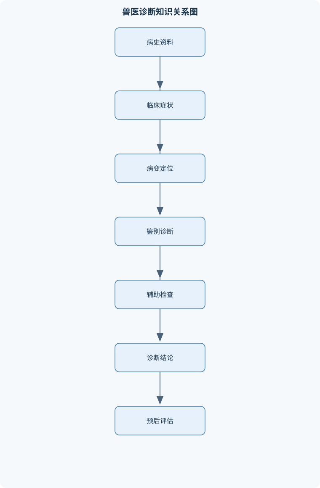
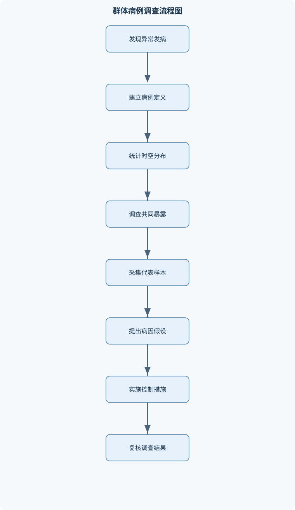

# 兽医诊断学

## 一、课程整体知识框架

### 课程边界与先修知识

兽医诊断学研究畜禽及伴侣动物疾病的资料采集、临床检查、症状与综合征识别、鉴别诊断、实验室检查、影像学检查、病理学检查、传染病与群体性疾病调查及诊断结论表达。课程重点是从病史和临床表现推断病变部位、病理过程与可能病因，并利用血液、尿液、粪便、分泌物、病原学、免疫学、影像学和病理学证据进行验证。先修知识包括动物解剖学、生理学、病理学、微生物学、寄生虫学、免疫学、药理学、流行病学和动物保定与采样基础。课程不替代专科内科学、外科学、产科学和传染病学，而是提供跨系统的诊断方法与证据整合框架。正常体温、心肺听诊区、肺叩诊区等数值适用于相应动物种类、年龄、环境和检查条件，不能脱离个体基线及临床状态机械判定。





### 1. 课程定位与证据链

兽医诊断学研究如何从动物的病史、行为、体征、实验室结果、影像学表现和病理学改变，逐步判断疾病的病变部位、病理过程、可能病因及发展结局。它不是某一器官系统的专科治疗学，也不以背诵疾病名称替代诊断，而是建立一条可追溯的证据链：

$$
\text{资料采集}\rightarrow \text{异常识别}\rightarrow \text{病变定位}\rightarrow \text{病理机制推断}\rightarrow \text{鉴别诊断}\rightarrow \text{检查验证}\rightarrow \text{诊断表达与预后评估}
$$

资料采集包括动物登记、主诉、疾病史、生活史、环境史、群体发病资料和既往治疗史。异常识别要求区分症状与体征：症状是疾病引起的机能紊乱或主观表现，体征是检查者能够观察、触摸、叩诊、听诊或测量到的客观异常。呼吸困难、食欲下降、跛行属于临床表现；肺部湿啰音、黏膜苍白、体温升高和心脏杂音属于可记录的体征。

诊断是对疾病本质的判断，至少应说明病变部位、病理过程和可能病因。病因诊断回答“由什么引起”，病理诊断回答“发生了什么组织或器官损害”，临床诊断则整合病史、症状和检查结果。例如“肺炎”主要是病理过程和部位，“细菌性支气管肺炎”进一步加入病因推断；若病原学尚未证实，应写为“疑似”或“临床诊断”，不能把推测写成确诊。

### 2. 症状、体征、综合征与诊断层级

按表现范围，症状可分为全身症状和局部症状。发热、精神沉郁、食欲减退、脱水和消瘦多反映全身状态；咳嗽、腹胀、跛行、尿淋漓和心脏杂音则有较强的局部定位意义。按诊断价值，可分为主要症状和次要症状。主要症状对建立诊断或缩小鉴别范围具有较大作用，但“主要”并不等于“特异”；发热是许多感染性和非感染性疾病的主要表现，却不能单独确定病因。

典型症状能够反映某类疾病的临床特征；示病症状具有较高特异性，但现实中很少有完全排他的表现。即使某体征常被视为示病症状，也要核对动物种类、病程、检查质量和相似疾病。固定症状在疾病过程中较稳定地出现，偶然症状则受个体、病程或并发症影响。综合征候群是多个症状按一定规律同时或先后出现的组合，例如呼吸困难、咳嗽、鼻液、肺部异常呼吸音和发热可构成呼吸道综合征，但综合征仍需进一步确定感染性、心源性、胸膜性或中毒性原因。

诊断过程不是从一个症状直接跳到疾病名称，而是建立问题清单。例如犬出现“咳嗽”，问题清单应包括：咳嗽持续时间、干湿性质、诱发因素、是否伴呼吸困难、发热、鼻液、运动不耐受、心脏杂音及影像学肺部改变。问题清单越接近病理机制，鉴别诊断越有价值。

### 3. 预后与临床不确定性

预后是对疾病发展趋势和可能结局的估计，不能只写“好”或“坏”。应结合生命危险、恢复时间、复发可能、生产性能、繁殖价值、传播风险和治疗资源，分为良好、谨慎、可疑和不良等判断。幼龄动物、严重脱水、持续低氧、进行性神经症状和重要器官衰竭通常使预后变差，但单一体征不能替代综合评估。

理想模型假定病史完整、样本合格、检测性能稳定且疾病表现典型；临床现实常有记忆偏差、样本污染、治疗后病原量下降、潜伏期和混合感染。因此阴性结果不能自动排除疾病。只有在病例定义、采样部位、采样时机、检测方法和样本质量均适合时，阴性结果才具有较强排除意义。

### 4. 问诊、病史与病历书写

动物登记至少包括种类、品种、性别、年龄、体重或体尺、用途、编号、来源和饲养单位。年龄影响正常体温、心率、免疫状态和疾病谱；用途影响生产损失及风险评价；编号是样本链和群体调查可追溯性的基础。

疾病史应建立时间线。记录首发异常时间、症状出现顺序、持续时间、加重或缓解因素、同群动物情况、治疗和免疫时间。时间用 $t$ 表示，单位可为小时、日或周。问诊不能只记录“最近发病”，而应追问“最早出现的异常是什么”“发病前是否换料、转群、运输、引种或接触患病动物”。若饲养者记忆不确定，应区分“原始陈述”“检查者推测”和“尚未确认”。

生活史包括饲料种类和改变、饮水、饲养密度、通风、温湿度、垫料、运动、繁殖和分娩情况。环境史包括新动物引入、人员和车辆流动、野生动物接触、虫媒、污水、饲料储存及消毒措施。既往史包括疾病、用药、免疫、手术、驱虫和过敏反应，但不应把饲养者提供的药物名称直接视为规范治疗记录。

急症问诊应优先获取影响即时处置的信息：是否呼吸困难、意识改变、严重出血、持续呕吐或腹胀、尿闭、毒物暴露和近期用药。群体病例则优先记录病例定义、群体规模、发病数、死亡数、首发日期、共同暴露和采样对象。

### 5. 一般临床检查与生命体征

接近动物时应先观察其反应、逃避方向和攻击风险，再选择适合的保定方式，避免因过度刺激改变呼吸、心率和体温。视诊顺序可为远距离整体观察、近距离头颈与黏膜、胸腹部、四肢和排泄物。应记录姿势、意识、行为、步态、呼吸方式、体况、被毛、体表肿物和疼痛反应。

体温记为 $T$，单位为摄氏度（°C）。正常范围必须同时注明动物种类、年龄、环境、运动状态、测量部位和方法，不能把某一物种的范围用于另一物种。连续测量时，体温变化量为：

$$
\Delta T=T_{t_2}-T_{t_1}
$$

其中 $t_1$、$t_2$ 为规定时间点。热型应根据固定时间连续测量的最高值、最低值和波动幅度判断。稽留热表现为持续升高且日内波动较小；弛张热波动较大但通常不降至正常；间歇热具有明确无热期。药物、昼夜节律、运动和环境温度均可改变热型，因此热型只能作为辅助证据。

脉搏记为 $P$，通常单位为次/分钟，必须同时记录强度、节律和左右对称性。脉搏快不等同于心脏原发病，也可见于发热、疼痛、低血容量和应激。呼吸频率记为 $R$，单位为次/分钟，应记录深度、节律、胸腹式呼吸及呼吸困难时相。黏膜颜色、湿润度和毛细血管再充盈时间可帮助评价灌注、贫血、低氧和脱水，但应排除色素沉着、黄染、药物和环境光影响。

体况评价应结合肌肉量、脂肪储备、骨突显露程度和病程。消瘦可由摄入不足、吸收障碍、慢性消耗、寄生虫、内分泌异常或肿瘤造成；恶病质通常伴明显肌肉分解和慢性疾病表现。脱水需综合眼球凹陷、皮肤弹性、黏膜湿润度、脉搏质量、尿量和实验室结果，不能只凭单项体征。水肿是组织间液增多，可与静脉回流障碍、低蛋白血症、炎症、淋巴阻塞或钠水潴留有关。休克表现为组织灌注不足，可能出现精神沉郁、黏膜异常、脉搏弱、四肢末端低温和尿量减少；危及生命时应先处理气道、呼吸、循环和严重出血，再完成完整检查。

### 6. 物理学检查方法

视诊应有固定顺序，避免只观察最明显的异常。触诊评价温度、湿度、硬度、弹性、大小、边界、活动度、波动感和疼痛。肿物的硬度和边界可提示实性、囊性、炎症性或浸润性改变，但不能仅凭触感确定良恶性。叩诊所得浊音、清音和鼓音反映组织含气量、密度及界面条件。肺实变、胸腔积液常使叩诊趋向浊音；过度含气可出现鼓音；腹部含气器官可出现鼓音，但位置和范围必须结合动物体型与解剖定位。

听诊应记录声音的部位、强度、时相、持续时间、对称性及随呼吸或体位的变化。阳性结果可增加某一诊断的支持度，阴性结果也可能排除候选诊断，但前提是检查区域、环境噪声、动物配合度和检查者经验适当。同一异常由不同检查者重复获得，可信度通常高于一次主观观察；观察者之间的差异应通过统一定位、固定时间和规范描述减少。

### 7. 呼吸系统诊断

吸气性呼吸困难主要提示鼻腔、咽喉、喉或气管等上呼吸道阻力增加；呼气性呼吸困难常提示细支气管狭窄、肺弹性下降或呼气受阻；吸气和呼气均困难的混合型表现可见于严重肺换气障碍、心源性肺循环淤血、中毒、贫血或腹内压升高。胸式呼吸增强可提示腹腔疼痛或膈肌运动受限，腹式呼吸增强可见于胸部疼痛或胸壁运动受限，但必须结合其他体征。

肺泡呼吸音增强可由气流增快、肺组织代偿性通气或肺实质病变早期引起；减弱可由胸腔积液、气胸、胸壁增厚、疼痛、肺气量下降或传导受阻造成。支气管呼吸音在外周肺区出现，可能提示肺实变后传导增强。干啰音多与气道内分泌物黏稠或管腔狭窄有关，湿啰音与液体分泌物和气流通过有关，捻发音常提示肺泡或细小气道开放异常，胸膜摩擦音提示胸膜表面粗糙，但不能单独确定病因。

胸部定位应联合叩诊和听诊：同一区域出现叩诊浊音并伴异常呼吸音，病变定位可信度增加；水平浊音支持胸腔积液可能，鼓音支持过度含气可能。肺炎、胸腔积液、气胸、肺不张和胸壁病变可互相模拟，最终仍需结合影像学、血液检查和胸腔液分析。

### 8. 心血管系统诊断

心搏动是心脏收缩传至胸壁的表现，心悸则常指动物或检查者感到心搏增强或异常。第一心音 $S1$ 与房室瓣关闭和心室收缩相关，第二心音 $S2$ 与半月瓣关闭和心室舒张开始相关。$S1$ 与 $S2$ 之间为收缩期，$S2$ 与下一次 $S1$ 之间为舒张期。

早搏是提前出现的异常心搏，阵发性心动过速表现为突然发生、持续一段时间后可能突然终止的快速心律。应记录心律是否规则、脉搏是否与心搏一致以及是否存在脉搏短绌。心脏相对浊音区和绝对浊音区的改变可提示心脏大小或周围含气、含液状态变化，但叩诊受体型和操作者影响较大。

心内器质性杂音通常较持续，音质粗糙或尖锐，常有固定最佳听取点和传导方向；功能性杂音可与发热、贫血、血流速度增快或心脏扩张有关，常较柔和并随基础状态改善，但“柔和”不能绝对排除器质性病变。收缩期杂音可提示房室瓣闭锁不全或动脉口狭窄；舒张期杂音可提示房室口狭窄或动脉瓣闭锁不全，最终定位必须结合听诊点、传导、心音变化和超声心动图。

颈静脉阳性波动提示右心回流或三尖瓣功能异常的可能；阴性波动属于正常静脉充盈变化。心电图主要评价心率、节律、传导和电活动，不能单独准确判断瓣膜结构；超声心动图可观察心腔、瓣膜、血流和收缩功能，适合验证器质性病变。

### 9. 消化系统与反刍动物诊断

采食障碍可由口腔疼痛、吞咽困难、食管阻塞、胃肠疾病、发热、疼痛或代谢异常造成。反刍减少提示前胃动力或全身状态异常；嗳气受阻可导致瘤胃气体积聚；呕吐与反流需区分，前者伴主动腹肌收缩，后者多为被动排出。

牛瘤胃检查应记录蠕动性质、次数、强度和持续时间。常用连续两分钟观察，健康成年牛瘤胃蠕动可约为 $2\sim5$ 次/2分钟，每次约持续 $15\sim30$ 秒，但年龄、采食时间、饲料和个体差异会影响结果。前胃弛缓以蠕动次数减少、强度降低、反刍和采食下降为主；瘤胃鼓气以左腹膨大、鼓音和呼吸循环受压为主；瘤胃积食以内容物增多、腹围改变、蠕动减弱和排粪减少为主。三者可相互转化，不能只凭腹围诊断。

腹痛应结合姿势、踢腹、磨牙、出汗、腹壁紧张、粪便和肠音评价。急性胃肠炎可伴精神沉郁、脱水、腹泻、发热或体温下降，血常规变化受病程、感染性质和脱水程度影响，不能用单一白细胞变化区分所有病因。肝胆疾病需区分溶血性、实质性和阻塞性黄疸：溶血性黄疸源于胆红素生成过多，实质性黄疸源于肝细胞处理或排泄障碍，阻塞性黄疸源于胆道阻塞，临床上可混合存在。

### 10. 泌尿、神经与运动系统诊断

频尿是排尿次数增加，常伴单次尿量减少；多尿是一定时间内总尿量实际增加；少尿和无尿分别表示尿量减少及几乎无尿形成或排出。尿闭、尿潴留主要强调排出受阻，尿淋漓表现为少量、断续或不自主滴尿。比较尿量时应记录体重、观察时间和饮水条件，尿量记为 $V$，单位可为毫升或升。

血尿是尿中存在完整红细胞或出血，血红蛋白尿主要源于血管内溶血，尿潜血试纸可对红细胞、血红蛋白或肌红蛋白产生反应，因此不能将尿潜血阳性直接等同于泌尿道出血。胆色素尿提示胆红素排泄异常，脓尿提示尿液中炎性细胞或脓性成分增加，均需结合沉渣和影像。

中枢性瘫痪常伴肌张力和腱反射增强，肌萎缩早期不明显；外周性瘫痪常伴肌张力降低、腱反射减弱或消失及较快肌萎缩。截瘫指两侧后肢或相应部位运动障碍，定位仍需结合感觉、脊髓节段和脑神经体征。痉挛、震颤、搐搦和强直分别反映不同程度的肌肉或神经兴奋异常。跛行定位需观察静止、起步、转弯和运动后变化，并结合关节、骨、肌肉、肌腱及神经检查。

### 11. 实验室、影像和病理学检查

血液采集前应明确检测目的，选择合适抗凝剂和容器，避免溶血、凝集、稀释和延迟分离。红细胞、白细胞和血小板应结合物种参考区间、年龄和应激解释。红细胞压积记为 $PCV$，表示红细胞在全血中的体积比例；脱水可使其相对升高，贫血可使其降低。血红蛋白记为 $Hb$，降低提示贫血等可能，升高也可见于血液浓缩。白细胞计数记为 $WBC$，必须结合分类计数、炎症阶段、应激和物种差异。

尿液物理检查包括颜色、透明度、气味、比重和沉淀，化学检查包括蛋白、葡萄糖、酮体、胆红素、潜血等，显微镜检查可观察细胞、管型、晶体和微生物。粪便、皮肤刮取物、耳道分泌物、鼻液、阴道分泌物和胸腹腔液的采集部位必须与临床问题匹配。病原检测要区分培养、抗原、抗体和核酸检测：抗体阳性可能代表既往暴露或免疫，核酸阳性可能代表现存核酸、污染或定植，均需结合临床表现和样本质量。

检测性能可用敏感度和特异度表示：

$$
Se=\frac{\text{真阳性数}}{\text{所有患病个体数}}
$$

$$
Sp=\frac{\text{真阴性数}}{\text{所有未患病个体数}}
$$

阳性预测值 $PPV$ 表示检测阳性者实际患病的概率，阴性预测值 $NPV$ 表示检测阴性者实际未患病的概率。$PPV$ 和 $NPV$ 受患病率影响，不能把敏感度或特异度直接当成个体确诊概率。群体调查中的相对风险为：

$$
RR=\frac{\text{暴露组发病风险}}{\text{未暴露组发病风险}}
$$

$RR$ 用于群体暴露比较，不等同于个体诊断。

X射线适合观察骨骼、肺部含气改变、胸腹部轮廓及部分异物；超声适合评价软组织、液体、心脏和腹部器官；内镜可直接观察腔道黏膜并取样。细胞学适合快速判断炎症、出血和肿瘤细胞特征，组织病理学则评价组织结构和病变性质。任何辅助检查都必须回答一个临床问题，不能因“检查越多越好”而忽略假阳性、假阴性、费用和动物应激。

### 12. 传染病、生物安全与群体诊断

传染病病例定义应明确动物种类、时间、地点、症状组合和必要检测条件。传播链包括传染源、传播途径和易感动物；隐性感染者虽无明显症状，仍可能在一定时期排出病原。隔离、人员分区、物资管理、清洁消毒、废弃物处理、车辆控制和个人防护共同构成生物安全屏障。动物源性疾病调查还要保护接触人员，避免徒手接触分泌物、血液和病理材料。

群体调查要明确分子和分母。发病率常表示一定时期内新发病例占观察群体的比例；死亡率表示死亡动物占群体的比例；病死率表示死亡病例占病例数的比例。三者不能混用。调查应按时间、地点和动物群体分层，绘制发病曲线，调查饲料、饮水、通风、密度、引种、免疫、人员和车辆。仔猪呼吸道症状需区分细菌性肺炎、病毒性疾病、混合感染和通风、密度等管理因素；禽产蛋下降还应考虑感染、营养、应激和生殖系统疾病；免疫抑制表现需结合病原、年龄和继发感染判断。

### 13. 综合病例分析与诊断报告

综合病例应从主诉建立问题清单，再按器官系统和病理机制排序鉴别诊断。每项假设至少对应一条支持证据或反对证据。检查项目的先后顺序应遵循“先危及生命、后定位病变；先低风险高信息量、后高成本或侵入性检查”的原则。

诊断报告应包括动物信息、主诉、病史时间线、客观检查结果、异常与阴性发现、初步定位、鉴别诊断、检查项目和结果、诊断结论、预后、隔离或复诊建议及剩余不确定性。若病原学尚未完成，可写“临床疑似某病，依据为……；需通过……验证”，不能把检测阳性、既往抗体阳性或单个体征直接写成最终确诊。

## 二、章节和模块划分

### 核心知识覆盖清单

本清单用于检查正文是否覆盖本课程的主要知识模块：

- **诊断学基本概念与证据思维**：症状与体征的分类、主要症状与次要症状、典型症状与示病症状、综合征候群的构成、诊断与鉴别诊断、病因诊断与病理诊断、预后的分类与依据、理想模型与临床不确定性。
- **问诊、病史与病历书写**：动物登记项目及诊断价值、疾病史的时间线采集、生活史与饲养管理调查、环境史与群体暴露调查、既往治疗和免疫史、发病率与死亡率信息、病历的客观记录原则、急症与群体病例的优先问诊。
- **一般临床检查与生命体征**：接近和保定动物的安全原则、视诊与行为状态评估、体温及热型判读、脉搏的频率、强度与节律、呼吸频率、深度与节律、黏膜颜色与毛细血管再充盈、体况、消瘦与恶病质、水肿、脱水与休克识别。
- **物理学检查方法**：视诊的系统观察顺序、触诊的温度、硬度和疼痛评估、叩诊的浊音、清音和鼓音、听诊器官功能声音的方法、体表肿物与含气器官检查、腹部和胸部检查的定位、阳性与阴性检查结果的证据价值、检查结果的重复性和观察者差异。
- **呼吸系统诊断**：吸气性和呼气性呼吸困难、混合性呼吸困难及病理机制、胸式呼吸与腹式呼吸、肺脏叩诊区及异常叩诊音、肺泡呼吸音增强与减弱、支气管呼吸音和捻发音、干湿啰音及胸膜摩擦音、胸腔积液、气胸和肺实变的鉴别。
- **心血管系统诊断**：心搏动与心悸、第一心音和第二心音、心律不齐、早搏和阵发性心动过速、心脏绝对浊音区与相对浊音区、心内器质性与功能性杂音、缩期杂音与舒期杂音、颈静脉阴性波动和阳性波动、心电图与超声心动图的诊断作用。
- **消化系统与反刍动物诊断**：采食障碍与吞咽障碍、反刍、嗳气和呕吐异常、瘤胃蠕动音的性质与频率、前胃弛缓、瘤胃鼓气和瘤胃积食、腹痛、腹胀和粪便改变、急性胃肠炎的全身反应、肝胆疾病与三类黄疸、异嗜、消瘦和营养代谢线索。
- **泌尿、神经与运动系统诊断**：频尿、多尿、少尿和无尿、尿闭、尿潴留与尿淋漓、血尿、血红蛋白尿和尿潜血、胆色素尿与脓尿、中枢性与外周性瘫痪、痉挛、震颤、搐搦和强直、步态异常与跛行定位、肾脏和尿路结石的临床鉴别。
- **临床实验室与辅助诊断**：血液样品采集与抗凝剂选择、红细胞、白细胞和血小板评价、炎症、贫血和脱水的实验室线索、尿液物理性和化学性检查、粪便、皮肤和分泌物检查、细菌、病毒、寄生虫检测原则、血清学和分子检测的证据解释、X射线、超声和内镜检查、细胞学与组织病理学诊断。
- **传染病、生物安全与群体诊断**：传染病病例定义、病原体与临床综合征对应、传播链和隐性感染者、隔离、消毒与生物安全屏障、禽畜群体发病曲线、病例率、死亡率和病死率、现场采样与送检流程、呼吸道、产蛋下降和免疫抑制性疾病鉴别、动物源性疾病与人员防护。
- **综合病例分析与诊断报告**：从主诉建立问题清单、按器官系统建立鉴别诊断、病变定位与病理机制推断、检查项目的必要性和先后顺序、阳性与阴性结果的联合解释、诊断假设的证据更新、预后与生产经济价值评估、诊断报告和会诊意见书写。


### 1. 临床诊断流程

**输入：**动物登记、主诉、病史、生活史、环境史和初步体征。  
**输出：**问题清单、病变定位、鉴别诊断、检查计划和诊断报告。  
**过程：**安全接近与登记→采集时间线→评价意识、$T$、$P$、$R$、黏膜和脱水→按系统视诊、触诊、叩诊、听诊→列出异常和阴性发现→提出病理机制→选择区分性检查→更新诊断排序。  
**不变量：**每项诊断假设至少有一项支持或反对证据。  
**终止条件：**获得确诊、临床诊断或暂定诊断，并明确剩余不确定性。急症时先处理气道、呼吸、循环和严重出血。

```text
# 兽医病例证据整合伪代码
输入：病例资料 Case
输出：诊断排序 Differential、检查计划 Plan、诊断结论 Conclusion

登记(Case.动物种类, 年龄, 性别, 编号)
建立时间线(Case.首发时间, 症状顺序, 用药, 暴露)
若存在危及生命表现：
    执行快速生命评估(气道, 呼吸, 循环, 出血)
    记录已完成的支持性处置
检查一般状态(T, P, R, 黏膜, 脱水, 体况)
按器官系统生成问题清单
对每个候选诊断 d：
    记录支持证据(d)
    记录反对证据(d)
    记录尚未验证的关键预测(d)
选择能区分候选诊断且风险可接受的检查
获取结果后：
    检查样本链和样本质量
    更新每个候选诊断的支持程度
若证据充分：
    输出确诊或临床诊断
否则若需要继续检查：
    输出暂定诊断和下一步计划
否则：
    输出主要鉴别诊断及不确定性
```

该流程不适合机械计算复杂度，因为耗时取决于动物状态、病例复杂度、检查资源和样本运输条件。终止不能理解为“所有检查都做完”，而是当前证据已经足以支持安全处置或作出明确诊断层级。

### 2. 呼吸困难鉴别流程

输入为呼吸频率、深度、节律、呼吸方式、吸气或呼气困难、鼻液、咳嗽、叩诊和听诊结果。先判断是否低氧或循环不稳定，再区分上呼吸道、肺实质、胸膜、心源性、血源性、中毒性和腹压增高性原因。至少需要两类相互独立的定位证据，例如“呼气困难+弥漫性哮鸣音”支持小气道病变，“呼吸音减弱+水平浊音”支持胸腔积液，但均不能直接确定病原。

### 3. 前胃疾病鉴别流程

输入为采食、反刍、嗳气、腹围、瘤胃蠕动、排粪和饲料变化。先观察左腹部外形与叩诊音，再连续两分钟记录蠕动次数、强度和持续时间，随后触诊内容物和疼痛，询问突然换料、饮水不足、异物暴露和运输应激。瘤胃鼓气强调气体积聚及呼吸循环受压；积食强调内容物增多和排空障碍；前胃弛缓强调动力不足。不能只凭“左腹膨大”诊断鼓气。

### 4. 样本采集与送检流程

输入为待验证的临床问题和动物信息；输出为合格、匹配、可追溯的样本。步骤为明确检测目的和采样时机→选择代表性病例与必要对照→按无菌或防污染要求采样→选择合适容器和抗凝剂→记录动物、部位、时间、处理史→按要求保存运输→核对实验室接收状态。样本链包括采样动物、样本种类、采样时间、保存条件、运输过程和检测项目。样本身份不清、容器不当、延迟运输或抗菌药影响均可造成假阴性。

### 5. 代表性例题与逐步解答

#### 例题一：左腹部膨大伴呼吸急促

**题干：**成年牛左腹部明显膨大，反刍减少，呼吸急促，左腹部叩诊呈鼓音。问最先考虑什么，如何鉴别？

**分析：**腹胀、鼓音和呼吸急促提示气体积聚可能，但积食、肠道胀气、腹水和妊娠也可改变腹围。

**解答：**  
第一步询问发病时间、采食、排粪、饮水、换料和异物暴露。  
第二步观察左腹膨大范围，听诊瘤胃蠕动并记录两分钟次数、强度和持续时间。  
第三步判断是否有呼吸循环受压，如黏膜异常、脉搏改变和明显呼吸困难。  
第四步若鼓音明显、瘤胃气体积聚并压迫胸腹腔，优先考虑瘤胃鼓气；若内容物增多、蠕动减弱、排粪减少而鼓音不突出，应考虑瘤胃积食；若有异物暴露、疼痛和持续发热，应排除创伤性网胃病。

**结果验证：**治疗或减压反应不能单独作为病因确诊，仍需结合病史、触诊和必要影像或内容物检查。  
**变式：**若左腹膨大但叩诊不呈鼓音，应扩大至腹水、妊娠、肠道内容物增加和腹腔肿物。

#### 例题二：连续高热且日内波动小

**题干：**动物连续三天体温升高，每天早晚测量，日内变化较小，期间使用过退热药。如何判读？

**分析：**固定时间测量能够建立曲线，但退热药会人为降低体温，不能直接按曲线名称归类。

**解答：**  
第一步记录每个时间点的 $T$，计算相邻时间的 $\Delta T$。  
第二步标记给药时间、剂量信息是否可靠及环境变化。  
第三步观察每日最高值、最低值和是否降至个体正常基线。  
第四步在药物影响较小且测量条件一致时，若高热持续、日内波动小，可称为稽留热倾向。  
第五步结合呼吸、黏膜、血常规、影像和病原学区分肺炎、全身感染及非感染性炎症。

**结果验证：**停药后的连续曲线比单次体温更有价值。  
**变式：**若每天有明确正常体温期，应考虑间歇热倾向，但仍需排除给药和测量间隔造成的假象。

#### 例题三：犬咳嗽、呼吸急促和肺后下部异常音

**题干：**犬咳嗽、呼吸频率增快，肺后下部听到湿啰音。如何组织鉴别？

**分析：**湿啰音提示气道或肺泡内存在液体性分泌物，但肺炎、肺水肿、支气管疾病和吸入性损伤均可出现。

**解答：**  
先判断吸气、呼气还是混合性困难，观察胸腹式呼吸和黏膜颜色。  
再比较双侧肺区叩诊音，判断异常是否局限。  
随后记录湿啰音是否随咳嗽改变，并检查心音、心率和是否有心脏杂音。  
若伴发热、脓性鼻液和局灶性肺部改变，肺炎可能上升；若伴心脏异常、呼吸困难和弥漫性湿啰音，应考虑心源性肺水肿；若有呕吐或麻醉史，应考虑吸入性损伤。  
胸部影像、血液检查和必要病原学检查用于验证。

**结果验证：**仅凭咳嗽和湿啰音不能确诊某一疾病。  
**变式：**若肺后下部呼吸音减弱且叩诊水平浊音，应优先考虑胸腔积液，而不是直接诊断肺炎。

#### 例题四：尿频、努责和少量血尿

**题干：**动物频繁排尿，每次仅少量，排尿时努责，尿液呈红色。如何鉴别？

**分析：**频尿不等于多尿，红色尿液可由红细胞、血红蛋白或肌红蛋白造成。

**解答：**  
先记录排尿次数、估计每次量和总量，区分频尿与多尿。  
检查膀胱充盈度、尿道通畅性和是否存在尿潴留。  
进行尿液比重、潜血、沉渣和必要影像学检查。  
若沉渣有完整红细胞，支持血尿；若潜血阳性但缺乏红细胞，应考虑血红蛋白尿或肌红蛋白尿；若膀胱过度充盈且排出困难，应警惕尿道阻塞。  
结合疼痛、结晶、结石或膀胱壁改变区分膀胱炎、尿道结石和膀胱病变。

**结果验证：**尿潜血阳性只能说明存在可被试纸反应的血红素类成分，不能确定出血部位。  
**变式：**若总尿量增加而次数也增加，应优先讨论多尿及其原因，而非单纯膀胱炎。

#### 例题五：黄疸伴贫血

**题干：**患畜黏膜黄染并伴贫血，如何区分三类黄疸？

**分析：**黄疸机制可能重叠，贫血使溶血性机制上升，但不能排除肝细胞损伤和继发性胆道障碍。

**解答：**  
先确认红细胞、$Hb$ 和 $PCV$ 的变化，并检查血涂片、溶血证据和胆红素分型。  
若贫血、溶血和胆红素生成增加证据充分，优先考虑溶血性黄疸。  
若肝细胞损伤指标异常、凝血或蛋白合成功能异常，考虑实质性黄疸。  
若胆汁排出受阻、胆道扩张或粪尿颜色改变，考虑阻塞性黄疸。  
最后用腹部超声等影像检查定位肝胆结构。

**结果验证：**若同时存在溶血和肝损伤，应写为混合性机制，不能强行归入单一类型。  
**变式：**无贫血但有胆道扩张时，阻塞性机制的优先级高于溶血性机制。

### 6. 实验与项目

#### 项目一：牛前胃疾病的重复性检查

**输入数据：**同一批成年牛的采食、反刍、排粪、左腹外形、两分钟瘤胃蠕动次数、强度、持续时间和叩诊结果。  
**步骤：**两名检查者在相近时间、相同保定条件下独立记录；间隔后重复一次；按统一表格记录阳性与阴性发现；将“前胃弛缓、鼓气、积食、其他”作为分组结果。  
**评价标准：**记录项目完整；时间单位统一；同一动物编号可追溯；两名检查者对次数、强度和主要分类的一致性较高；任何分类都必须有至少两项支持证据。  
**排错方法：**若结果差异大，检查是否受采食后时间、运动、惊吓、保定、听诊位置或术语理解影响；重新统一“弱、中、强”的描述标准，不能简单用多数意见掩盖原始差异。

#### 项目二：群体呼吸道疾病现场调查

**输入数据：**畜群总数、日新增病例、死亡数、年龄、栏舍、通风、密度、引种、免疫和用药记录。  
**步骤：**建立病例定义；按日统计病例和死亡；绘制发病曲线；按栏舍和年龄分层；选择代表性病例及必要对照采集呼吸道样本和血液；记录样本链；同时调查细菌性、病毒性、混合感染及环境因素。  
**评价标准：**病例定义前后一致；发病率、死亡率和病死率的分子分母清楚；样本来自代表性动物；送检目的明确；报告区分事实、推测和待验证假设；采取隔离、人员分区和防护措施。  
**排错方法：**若病原检测阴性，检查采样时机、采样部位、抗菌药影响、保存温度和运输时间；若不同栏舍结果差异大，重新核对分层数据，防止把选择性采样误认为群体规律。

### 7. 易错点

1. 把症状、综合征、疾病名称和病因混为一谈。  
2. 把示病症状当作绝对证据。  
3. 把正常体温当作脱离物种、年龄和环境的固定常数。  
4. 用一次体温判断稽留热、弛张热或间歇热。  
5. 将频尿误判为多尿。  
6. 将血尿、血红蛋白尿和尿潜血阳性视为同一概念。  
7. 只凭左腹膨大诊断瘤胃鼓气。  
8. 将肺泡呼吸音减弱直接等同于肺炎。  
9. 把收缩期杂音直接等同于某一瓣膜疾病。  
10. 把功能性杂音视为必然无害。  
11. 把群体性发病直接判定为传染病。  
12. 把抗体阳性直接等同于现症感染。  
13. 忽略采样时机、保存条件和样本污染。  
14. 只记录阳性结果，不记录可靠的阴性发现。  
15. 把检测阴性直接视为排除疾病。  
16. 把预后只理解为生死，不评价恢复、生产和传播风险。  
17. 急症中机械执行完整顺序，延误生命支持。  
18. 将人体正常值或疾病表现未经区分地套用于动物。

### 8. 常见笔试问题及解答思路

#### 问题一：说明建立诊断的基本步骤

先写资料采集，再写一般检查和系统检查；随后列出异常体征，进行病变定位和病理机制分析；建立鉴别诊断，选择能区分候选诊断的检查；最后整合证据并说明预后和不确定性。答案不能只写“问诊、检查、治疗”，治疗不是诊断流程的替代。

#### 问题二：比较前胃弛缓、瘤胃鼓气和瘤胃积食

应从病史、腹围、叩诊音、瘤胃蠕动、内容物和排粪比较。前胃弛缓突出动力下降；鼓气突出气体积聚和左腹鼓音；积食突出内容物增加、排空障碍和排粪减少。最后说明三者可相互转化，不能单凭一个体征判断。

#### 问题三：解释三类黄疸及其机制

溶血性黄疸是胆红素生成过多，实质性黄疸是肝细胞处理或排泄障碍，阻塞性黄疸是胆道排出受阻。应补充贫血、肝功能指标、胆红素分型和影像学的验证方法，并说明混合性黄疸存在。

#### 问题四：比较器质性和功能性心脏杂音

器质性杂音常持续、音质较粗糙，有固定听取点和传导；功能性杂音常与发热、贫血或血流改变有关，可能较柔和并随基础状态改善。答案应强调不能只凭声音强弱定性，需结合心电图和超声。

#### 问题五：解释吸气性、呼气性和混合性呼吸困难

吸气性主要定位上呼吸道，呼气性主要提示细支气管狭窄或肺弹性下降，混合性提示严重肺换气障碍、心源性淤血、中毒、贫血或腹压升高。应说明定位必须结合叩诊和听诊。

#### 问题六：说明频尿、多尿、少尿、无尿和尿闭的区别

频尿看次数，多尿看总量，少尿和无尿看形成量，尿闭和尿潴留强调排出障碍。应补充膀胱充盈度、尿道通畅性和肾功能检查，避免把排尿次数替代尿量测定。

#### 问题七：解释检测结果的阳性预测值

$PPV$ 是检测阳性者实际患病的概率，受患病率、检测特异度、样本质量和病例定义影响。患病率低时，即使检测性能较好，阳性结果也可能包含较多假阳性，因此不能把阳性直接写成确诊。

#### 问题八：群体呼吸道疾病应如何调查

先建立病例定义，再统计发病率、死亡率和病死率；按时间、地点、年龄和栏舍分层；调查引种、免疫、通风、密度、饲料和人员流动；采集代表性病例样本；区分感染性与管理性因素；最后根据结果采取隔离和生物安全措施。

### 9. 常见面试问题及参考回答要点

#### 问题一：遇到呼吸困难动物，第一步做什么？

参考回答：先判断气道、呼吸和循环是否稳定，减少刺激并安全保定，观察黏膜和意识，必要时优先完成生命支持，再进行系统定位。追问时应说明不能先强行完成全部检查而延误低氧或休克处理。

#### 问题二：如何判断一次检测结果是否可信？

参考回答：核对病例定义、采样部位、时间、样本量、容器、保存、运输、检测方法和是否用药；再比较结果与临床表现是否一致。追问时应指出阴性结果在采样过晚或样本降解时排除价值有限。

#### 问题三：如何向养殖场解释“病原阳性”？

参考回答：阳性说明检出相关抗原、抗体或核酸，不自动等于病原正在造成临床疾病。还需结合症状、病变、样本部位、检测类型和对照样本，区分感染、暴露、定植和污染。

#### 问题四：牛左腹胀大是否一定是瘤胃鼓气？

参考回答：不一定。需结合叩诊音、瘤胃蠕动、内容物、排粪、呼吸循环受压、饲料变化和必要影像检查，鉴别积食、肠胀气、腹水、妊娠和腹腔肿物。

#### 问题五：如何记录病历才能便于会诊？

参考回答：按动物身份、主诉、时间线、客观检查、阳性与阴性发现、样本链、检查结果、鉴别诊断和诊断结论记录；把饲养者原话与医生推断分开，并标明尚未确认的内容。

#### 问题六：如何区别血尿和血红蛋白尿？

参考回答：结合尿液外观、离心后上清、显微镜红细胞、潜血反应和血液溶血证据判断。完整红细胞支持血尿，潜血阳性而沉渣缺少红细胞时需考虑血红蛋白尿或肌红蛋白尿。

#### 问题七：急性群体发病时怎样选择采样动物？

参考回答：选择具有典型早期症状、未充分用药、病程不同阶段的代表性病例，必要时采集无症状接触动物或对照；同时记录编号、时间、部位和处理史。不能只采集最严重或已经死亡很久的动物。

#### 问题八：如何评价自己的诊断结论？

参考回答：检查每项结论是否有支持证据，是否解释主要体征，是否存在未排除的危险鉴别，检查结果是否与病史和病变定位一致，并明确确诊、临床诊断或暂定诊断的层级。追问时应说明诊断排序可随新证据更新，而不是一次确定后拒绝修正。

### 10. 岗位关联

动物医院临床兽医的实际任务是问诊、体格检查、开具和解释辅助检查、形成诊断报告及复诊记录；使用病史时间线、系统检查、实验室和影像证据；产出为病例记录、鉴别诊断和会诊意见；验收标准是身份可追溯、体征客观、检查目的明确、结论与证据匹配。

规模养殖场兽医负责群体发病监测、病例定义、发病率和死亡率统计、采样送检及生物安全措施；产出为现场调查表、发病曲线、采样清单和控制建议；验收重点是分子分母清楚、样本代表性合格、措施可执行并能追踪效果。

动物疫病防控与检疫人员负责现场流行病学调查、隔离、消毒、风险分区和人员防护；使用传播链、病例定义、相对风险和样本链知识；验收标准是调查过程可追溯、人员防护到位、病例分类一致、报告事实与推断分开。

兽医实验室检验人员负责样本接收、质量判断、检测、结果审核和异常结果反馈；使用抗凝剂选择、样本保存、$Se$、$Sp$、$PPV$ 和 $NPV$ 的解释原则；验收标准是样本身份完整、质控合格、结果报告准确且注明检测限制。

兽医影像与病理诊断人员负责获取和解释X射线、超声、内镜、细胞学及组织病理学证据；必须将影像或组织改变与临床定位联系起来；验收标准是部位、范围、性质和取样质量描述清楚，不能仅给出脱离临床背景的形态名称。

生物安全管理人员负责人员、车辆、物资、饲料、隔离区和废弃物流程；使用传播链和屏障管理原则；产出为风险评估、操作规程、培训记录和整改报告；验收标准是关键节点明确、违规可追踪、隔离与消毒措施能够实际执行。

## 三、核心概念的详细解释

### 1. 诊断学的对象、证据链与诊断层级

兽医诊断学的对象是畜禽及伴侣动物的异常状态及其发生机制。诊断不等于给出一个疾病名称，而是根据资料判断病变部位、病理过程、可能病因及发展结局。完整证据链为：

$$
\text{资料采集}\rightarrow\text{异常识别}\rightarrow\text{病变定位}\rightarrow\text{机制推断}\rightarrow\text{鉴别诊断}\rightarrow\text{检查验证}\rightarrow\text{诊断表达}
$$

症状是疾病导致的机能紊乱或异常表现；体征是检查者能够观察、触摸、叩诊、听诊或测量到的客观变化。例如“食欲下降”属于症状，“黏膜苍白”属于体征；“呼吸困难”是临床表现，不能直接作为病因诊断。综合征候群是多个症状和体征按一定规律同时或先后出现的组合，例如呼吸困难、咳嗽、鼻液、发热和肺部异常音可以构成呼吸道综合征，但仍需鉴别感染性、心源性、胸膜性及中毒性原因。

全身症状反映机体整体反应，如发热、精神沉郁、脱水、消瘦；局部症状主要反映患病器官，如腹胀、跛行、尿淋漓。主要症状对定位或缩小鉴别范围作用较大，次要症状则提供辅助信息。典型症状能够反映某类疾病的临床特征；示病症状具有较高提示性，但不能脱离动物种类、病程、检查质量和相似疾病而被视为绝对证据。固定症状在疾病过程中较稳定地出现，偶然症状只在特定病程、个体或并发症条件下出现。

临床诊断通常分为症状诊断、病理诊断、病因诊断和综合诊断。症状诊断只描述表现，如“呼吸困难”；病理诊断描述病变及过程，如“肺炎”；病因诊断说明致病因素，如“细菌性肺炎”；综合诊断则将部位、病理过程、病因和严重程度合并表达。病原学尚未证实时，应使用“疑似”“考虑”或“临床诊断”，不能把推测写成确诊。

### 2. 病史、问诊与病历的诊断价值

病史调查是向饲养者、管理人员或动物主人了解疾病发生、发展、治疗和既往状态的过程，必要时必须结合现场调查。问诊不是简单记录“有无某症状”，而是建立可核对的时间线。时间用 $t$ 表示，单位可以是小时、日或周，应记录首发异常、症状出现顺序、病情加重点、用药时间、免疫时间、转群、换料、运输和环境改变。

动物登记至少应包括种类、品种、性别、年龄、体重或体尺、用途、编号、来源和饲养单位。年龄会影响正常体温、免疫状态和疾病谱；用途关系到生产损失和经济预后；编号是个体记录、群体统计和样本链追踪的基础。

生活史调查应包括饲料种类与更换、饮水、饲养密度、通风、温湿度、垫料、运动、接触动物、引种和运输。环境史应关注共同暴露，包括饲料批次、饮水源、人员、车辆、器械、昆虫和野生动物。既往史应记录疫苗、驱虫、用药、手术、慢性病及治疗反应。群体病例还要记录畜群规模、发病数、死亡数、日龄结构和空间分布。

病历必须区分事实、饲养者推测和兽医解释。例如“昨日开始不食”是原始陈述；“可能因换料导致”是推测；“疑似前胃动力下降”是临床判断。阴性发现同样需要记录，如“未见咳嗽”“无颈静脉阳性波动”，因为可靠的阴性结果可以降低某些鉴别诊断的可能性。

### 3. 一般检查、生命体征与休克识别

一般检查应先保障人员和动物安全。接近动物时要观察其警觉性、攻击性、逃避行为和呼吸状态；保定强度应与检查目的相适应，避免因过度挣扎改变体温、心率和呼吸频率。急症动物先评估气道、呼吸、循环、意识和严重出血，再完成系统检查。

体温用 $T$ 表示，单位为摄氏度（°C）。正常范围不能脱离动物种类、年龄、环境、运动、应激和测量部位。一次升高只能说明当时体温高于该动物的参考基线，不能单独判定感染。连续测量并绘制曲线后，才可讨论热型。日内波动较小为稽留热倾向，波动较大但不降至正常为弛张热倾向，有明确无热期为间歇热倾向；药物、昼夜节律和测量误差均可改变热型。

脉搏频率用 $P$ 表示，通常为次/分钟。除频率外，应记录强度、节律、充盈程度和左右对称性。呼吸频率用 $R$ 表示，单位同为次/分钟，应同时记录深度、节律、鼻翼运动、胸腹式呼吸和呼吸困难时相。吸气困难常提示上呼吸道阻力增加；呼气困难常提示细支气管狭窄或肺弹性下降；吸、呼气均困难可见于严重肺换气障碍、心源性肺淤血、贫血、中毒及腹内压增高。

黏膜颜色、湿润度和毛细血管再充盈时间可反映循环状态。苍白提示贫血、血管收缩或灌注不足；发绀提示严重氧合障碍；黄染提示胆红素蓄积；充血可见于发热、炎症或循环改变。脱水应结合眼球凹陷、皮肤弹性、黏膜湿润度、脉搏质量、尿量和实验室结果判断，不能仅凭皮肤回弹时间下结论。休克和虚脱可能由失血、急性心力衰竭、严重脱水、感染性血管扩张或过敏反应引起，通常表现为精神沉郁、末梢灌注差、脉搏弱、黏膜异常和尿量下降。

### 4. 视诊、触诊、叩诊与听诊的联合定位

视诊应按照意识与行为、体况、姿势和步态、呼吸、腹部轮廓、皮肤被毛、排泄物和局部肿胀的顺序进行。触诊可评价温度、湿度、硬度、波动感、压痛、肿物边界、淋巴结和器官大小。检查疼痛时应逐步增加刺激，比较左右对称部位，并记录动物反应而不夸大主观判断。

叩诊音主要包括浊音、清音和鼓音。含气量减少或实变趋向浊音；正常含气肺组织多为清音；过度含气或空腔内气体增多可出现鼓音。叩诊必须定位、对比和重复，不能把单一区域的音调变化直接等同于具体疾病。胸腔积液常出现具有液平面的浊音，气胸可出现过清音或鼓音，但胸壁厚度、动物姿势和肺顺应性都会影响结果。

听诊应记录声音的部位、时相、强度、音质、传导范围和左右差异。阳性结果可以支持病变定位，阴性结果也有排除价值，但前提是检查区域、动物状态和听诊条件合适。观察者之间可能因经验、保定、环境噪声和听诊器性能不同而产生差异，因此异常结果应尽可能重复并与其他方法交叉验证。

### 5. 呼吸系统诊断

呼吸系统诊断首先判断是否存在低氧或进行性呼吸衰竭，再区分吸气、呼气或混合性困难。胸式呼吸增强常提示腹部疼痛或膈肌运动受限；腹式呼吸增强可见于胸部疼痛或肺部换气障碍；混合式呼吸困难提示病变较重或定位不明确。

肺部叩诊与听诊应联合解释。肺实变或肺组织含气量减少时，叩诊趋向浊音；胸腔积液可形成液平面浊音；气胸或肺过度充气可出现过清音或鼓音。肺泡呼吸音增强可见于代偿性通气增加、发热或肺实变周围通气增强；减弱或消失可见于胸腔积液、气胸、胸壁增厚、疼痛、肺不张或严重气流受阻。

支气管呼吸音出现在肺野外周时，常提示正常肺泡组织被实变组织替代或声音传导条件改变。捻发音多与肺泡或小气道内液体、肺泡重新开放有关；干啰音常提示气道内分泌物或管腔狭窄；湿啰音提示液体通过气道。胸膜摩擦音提示胸膜表面粗糙并随呼吸相互摩擦。上述声音只能说明病理过程，不能单独确定病原体。

### 6. 心血管系统诊断

心音时相必须先确定。$S_1$ 为第一心音，主要标志房室瓣关闭和收缩期开始；$S_2$ 为第二心音，主要标志半月瓣关闭和舒张期开始。$S_1$ 与 $S_2$ 之间为收缩期，$S_2$ 与下一次 $S_1$ 之间为舒张期。心杂音的时相、最佳听取点、传导方向和强度应同时记录。

收缩期杂音常见于房室瓣闭锁不全或动脉口狭窄；舒张期杂音常见于房室口狭窄或动脉瓣闭锁不全，但仅凭时相不能最终定位。器质性杂音通常持续存在，音质较粗糙或尖锐，具有相对固定的最佳听取点和传导；功能性杂音可因发热、贫血、心脏扩张或血流速度增加而出现，常较柔和且随基础状态变化。功能性并不等于绝对无害，仍需查明原因。

心搏动增强可见于心脏收缩力增加、胸壁变薄或心脏负荷变化；心搏动减弱可见于心包积液、胸腔积液、肺气肿、肥胖或心肌收缩力下降。心脏相对浊音区和绝对浊音区的变化可提示心脏大小或周围含气、含液组织改变，但叩诊受体型和胸壁影响较大。颈静脉阳性波动提示右心回流或三尖瓣功能异常的可能，需结合心音、脉搏和超声心动图判断。

### 7. 消化、泌尿、神经与运动系统诊断

反刍动物应重点记录采食、反刍、嗳气、排粪、左腹部轮廓和瘤胃蠕动。正常成年牛瘤胃蠕动可约为每2分钟2至5次，每次约持续15至30秒，但具体结果受饲后时间、饲料、应激和个体差异影响。前胃弛缓以蠕动次数减少、强度减弱、采食和反刍下降为主；瘤胃鼓气以左腹膨大、鼓音、嗳气障碍及呼吸循环受压为主；瘤胃积食以内容物增加、腹围改变、蠕动减弱、排粪减少和饲料史异常为主。三者可相互转化，不能只凭腹围诊断。

腹痛、腹胀、粪便量和性状改变应结合全身反应。急性胃肠炎可出现精神沉郁、脱水、体温变化、白细胞计数改变和电解质紊乱，血常规表现受病程、病因和治疗影响，不能机械规定为单一模式。黄疸分为溶血性、肝实质性和阻塞性三类，分别对应胆红素生成过多、肝细胞处理障碍和胆道排泄受阻，临床上可混合存在。

必须区分多尿、频尿、少尿和无尿。多尿是单位时间尿量实际增加；频尿是排尿次数增加而单次尿量减少；少尿是尿量低于该动物在相同条件下的预期水平；无尿是尿液形成极少或没有。尿闭和尿潴留通常表示肾脏仍可能形成尿液，但排出受阻。血尿、血红蛋白尿和肌红蛋白尿在外观上可相似，应结合离心、显微镜和化学检查鉴别。

中枢性瘫痪常伴肌张力和腱反射增强，肌萎缩出现较晚；外周性瘫痪常伴肌张力下降、腱反射减弱或消失及较快肌萎缩。两侧后肢瘫痪可称截瘫，但该词描述分布，不说明病因。步态异常和跛行定位必须综合负重、疼痛、关节活动、肌肉萎缩、感觉反应和神经反射，不能把所有后肢无力都归为脊髓疾病。

### 8. 实验室、影像、病理与群体诊断

血液样本应根据检测目的选择抗凝剂或促凝管。血常规需综合评价红细胞、血红蛋白、红细胞压积（$PCV$）、白细胞及分类、血小板。$PCV$ 受脱水、贫血、失血、溶血和采样误差影响；$Hb$ 降低提示贫血等可能，升高可见于血液浓缩；$WBC$ 必须结合分类计数、应激反应、炎症阶段和物种差异解释。

尿液检查包括颜色、透明度、气味、比重、酸碱度、蛋白、葡萄糖、酮体、胆红素、潜血和沉渣。粪便、皮肤刮取物、分泌物和呼吸道样本应根据病变部位、病程和检测目的选择。病原学阴性可能由采样部位不当、抗菌药影响、病原量低、保存不良或检测窗口不合适造成。

X射线主要反映组织对射线吸收差异，投射结果受管电压、管电流、曝光时间、焦片距离、动物体位、呼吸相和组织厚度影响。超声适合评价软组织、液体、器官结构和动态运动；内镜可直接观察腔道表面并取样；细胞学适合评价细胞类型和炎症、肿瘤线索；组织病理学能够观察组织结构和病变分布，但取样必须具有代表性。

群体诊断要建立一致的病例定义，明确分子、分母和观察时间。发病率描述新发病例在风险群体中的比例；死亡率描述一定时间内死亡动物占群体的比例；病死率描述病例中死亡者所占比例。多只动物同时发病不必然意味着传染病，中毒、饲料错误、营养缺乏和环境应激也可造成群体性疾病。调查应结合时间、地点、动物群体、共同暴露、免疫史和传播链，并执行隔离、消毒、人员防护和样本链管理。

## 四、重要定义、公式、定理和推导

### 专业审校补充：关键定义与适用边界

兽医诊断结论应区分病变定位、临床诊断、病因诊断和病原学确诊四个层级。病变定位回答“哪里异常”，如胸腔、肺实质或上呼吸道；临床诊断回答“最符合哪种疾病过程”，通常依据病史、体征和辅助检查综合作出；病因诊断进一步说明感染性、创伤性、代谢性、中毒性或管理性原因；病原学确诊则要求在合适样本中检出病原体，且结果与临床表现、病变和流行病学相符。病原体阳性不必然等于致病，因为可能代表定植、既往暴露、污染或无症状感染；病原体阴性也不能自动排除疾病，尤其当采样部位、采样时机、保存运输、治疗史或检测敏感度不合适时。诊断报告应分别写明观察事实、推断依据、证据强度和剩余不确定性。反例是仅凭呼吸道拭子检出某病原体就写成“该病原体导致肺炎”；若影像和病理病变不支持，结论只能表述为“检出该病原体，致病关联仍需结合病变和其他证据判断”。


### 1. 体征变化与诊断推导

体温变化量可表示为：

$$
\Delta T=T_{t_2}-T_{t_1}
$$

其中，$T_{t_1}$ 和 $T_{t_2}$ 是同一动物或群体在两个规定时间点测得的体温，单位均为 °C。计算前提是测量方法、部位、环境和时间尽可能一致。$\Delta T$ 只能表示变化方向和幅度，不能单独证明感染。若早晚测量时间不同、动物刚运动或刚接受退热处理，变化量的病理意义会降低。

群体发病率、死亡率和病死率分别可表示为：

$$
\text{发病率}=\frac{\text{观察期内新发病例数}}{\text{同期有患病风险的动物数}}\times100\%
$$

$$
\text{死亡率}=\frac{\text{观察期内死亡动物数}}{\text{同期观察群体数}}\times100\%
$$

$$
\text{病死率}=\frac{\text{观察期内因该病死亡的病例数}}{\text{同期该病病例数}}\times100\%
$$

三者分母不同。若100只动物中有20只发病、4只死亡，则发病率为20%，死亡率为4%；若4只死亡均属于20例病例，病死率为20%。若观察时间、分母范围或病例定义改变，数值不能直接比较。

### 2. 检测性能与概率解释

敏感度和特异度定义为：

$$
Se=\frac{TP}{TP+FN}
$$

$$
Sp=\frac{TN}{TN+FP}
$$

其中，$TP$ 为真阳性，$FN$ 为假阴性，$TN$ 为真阴性，$FP$ 为假阳性。$Se$ 衡量患病动物被检出阳性的能力，$Sp$ 衡量未患病动物被判为阴性的能力。二者是检测方法在特定病例定义、样本条件和研究群体中的性能指标，不等于个体患病概率。

阳性预测值和阴性预测值为：

$$
PPV=\frac{TP}{TP+FP}
$$

$$
NPV=\frac{TN}{TN+FN}
$$

当群体患病率升高时，通常 $PPV$ 增大；当患病率降低时，即使检测方法的 $Se$ 和 $Sp$ 不变，阳性结果中假阳性的比例也可能上升。因此筛查低患病率群体时，阳性结果常需复核；排除疾病时，必须确认检测敏感度、样本质量和采样时机足够。

相对风险为：

$$
RR=\frac{a/(a+b)}{c/(c+d)}
$$

其中，暴露组有 $a$ 例病例、$b$ 例非病例，未暴露组有 $c$ 例病例、$d$ 例非病例。$RR>1$ 表示暴露组发病风险较高，$RR=1$ 表示未见风险差异，$RR<1$ 表示暴露组风险较低。$RR$ 用于群体调查和风险比较，不能直接证明某一只动物的病因，也不能替代病原学或病理学确诊。

### 3. 临床诊断流程与伪代码

**输入**：动物登记、主诉、病史、一般检查和系统检查结果。  
**输出**：问题清单、病变定位、鉴别诊断、检查计划和暂定诊断。  
**不变量**：每个诊断假设至少对应一项支持证据或反对证据；阴性结果必须注明检查质量和适用范围。  
**终止条件**：已有足够证据形成确诊、临床诊断或暂定诊断，并明确剩余不确定性。

```python
def clinical_diagnosis(case):
    register = verify_identity(case["animal"])
    history = build_timeline(case["history"])
    safety = assess_emergency(case["vital_signs"])

    if safety["airway_or_breathing_critical"] or safety["circulation_critical"]:
        perform_life_support_assessment()
        rapid_tests = choose_rapid_tests(case)

    findings = general_examination(case)
    system_findings = system_examination(case)
    problem_list = extract_problems(history, findings, system_findings)

    candidates = generate_differentials(problem_list)
    candidates = rank_by_location_mechanism_and_history(candidates)

    plans = []
    for diagnosis in candidates:
        plans.append(select_discriminating_tests(diagnosis, case))

    results = perform_appropriate_tests(plans)
    updated = update_diagnoses(candidates, results)

    return {
        "identity": register,
        "problems": problem_list,
        "differentials": updated,
        "remaining_uncertainty": describe_limits(results)
    }
```

该流程不要求所有动物接受全部检查。急症优先保证生命；稳定病例则优先选择能够区分候选疾病的检查，减少无目的采样和结果误读。

### 4. 代表性例题一：热型判读

**题干**：某犬连续3日每天8时和20时测量体温。第一日为40.2°C和40.4°C，第二日为40.1°C和40.5°C，第三日为40.0°C和40.3°C，期间未使用退热药。判断热型并说明限制。

**分析**：每日最高值与最低值的差异较小，且体温持续高于该犬的个体参考基线。

**解答**：先计算每日波动。第一日 $\Delta T=0.2$°C，第二日 $\Delta T=0.4$°C，第三日 $\Delta T=0.3$°C。日内波动总体较小，且没有恢复至正常水平，因此属于稽留热倾向。结果只能作为辅助证据，还需结合测量部位、环境、病程及抗感染药物使用情况，并通过呼吸检查、血常规、影像和病原学检查寻找病因。

**结果验证**：若随后出现连续无热期，则原有“稽留热倾向”需修订为其他热型；若测量时间不一致或动物测温前剧烈运动，结论可靠性下降。

**变式**：若每日最低体温降至个体正常范围，但最高体温仍升高，应考虑间歇热倾向，而不是稽留热。

### 5. 代表性例题二：左腹膨大鉴别

**题干**：牛左腹明显膨大，叩诊呈鼓音，瘤胃蠕动减弱，反刍减少并出现呼吸急促。应首先考虑什么，如何排除相似疾病？

**分析**：左腹膨大和鼓音提示气体增多；呼吸急促说明腹压可能已经影响胸腔和循环。

**解答**：首先考虑瘤胃鼓气。应立即评估呼吸和循环危险，随后记录饲料突然改变、采食豆科饲草、吞咽障碍和嗳气情况。通过左腹视诊、触诊、叩诊和听诊确认气体分布及瘤胃动力。瘤胃积食通常表现为内容物增多、排粪减少和腹围改变，但叩诊未必为明显鼓音；前胃弛缓主要是动力和消化功能下降，左腹膨大及鼓音不一定突出。若有金属异物暴露、持续腹痛或姿势异常，还应排除创伤性网胃病及其他腹胀原因。

**结果验证**：若解除气体后呼吸迅速改善，支持鼓气导致的机械性压迫；若腹胀持续且排粪明显减少，应继续评价积食、肠道阻塞或腹腔其他病变。

**变式**：单纯左腹膨大而叩诊浊音，不能直接诊断鼓气，应考虑积食、腹水、妊娠或其他腹腔占位。

### 6. 代表性例题三：心杂音和颈静脉波动

**题干**：牛在心脏听诊时于收缩期发现杂音，并伴颈静脉阳性波动。如何解释？

**分析**：先确定杂音发生在 $S_1$ 与 $S_2$ 之间，再结合静脉回流表现定位右心系统异常。

**解答**：收缩期杂音提示房室瓣闭锁不全或动脉口狭窄的可能。颈静脉阳性波动提示心房收缩或心室收缩时静脉血反流，三尖瓣闭锁不全应列为重要鉴别诊断。还需记录最佳听取点、杂音传导、心律、脉搏、心音强弱及是否存在心力衰竭表现。最终应以超声心动图评价瓣膜结构、血流方向和反流程度。

**结果验证**：若超声显示三尖瓣反流，且听诊和静脉体征一致，则诊断证据加强；若仅有柔和收缩期杂音而无结构异常，应考虑功能性杂音，但仍需寻找贫血、发热或心脏扩张原因。

**变式**：舒张期杂音不能直接写成某种瓣膜病，应根据最佳听诊点和超声证据进一步定位。

### 7. 代表性例题四：频尿、血尿与尿闭

**题干**：犬频繁努责排尿，每次仅排出少量红色尿液，膀胱触诊明显充盈。应如何区分频尿、血尿和尿闭？

**分析**：排尿次数增加而单次尿量减少是频尿；红色尿液提示血尿、血红蛋白尿或肌红蛋白尿；膀胱充盈说明尿液可能形成但排出受阻。

**解答**：首先确认总尿量和每次尿量，不能把频尿误认为多尿。其次检查膀胱大小、张力和疼痛，评价尿道通畅性。进行尿液比重、潜血、沉渣和必要的影像学检查，以鉴别膀胱炎、尿道结石、尿道阻塞和膀胱肿物。若膀胱持续充盈而几乎不能排尿，应优先处理尿路梗阻风险。尿潜血阳性只说明含有血红素相关反应，不能单独确定出血部位。

**结果验证**：显微镜见完整红细胞支持血尿；若尿液潜血阳性而红细胞很少，应考虑血红蛋白尿或肌红蛋白尿，并结合血液检查。

**变式**：总尿量增加且排尿次数也增加才支持多尿伴频尿；仅次数增加而总量不增加属于频尿。

### 8. 代表性例题五：黄疸与贫血

**题干**：患畜黏膜黄染，同时红细胞和血红蛋白下降。如何在三类黄疸之间进行鉴别？

**分析**：黄疸机制包括胆红素生成过多、肝细胞处理障碍和胆道排泄受阻。贫血使溶血性机制的优先级上升，但不能排除混合性病变。

**解答**：首先检查红细胞形态、网织红细胞反应、血涂片和溶血证据；若有贫血、红细胞破坏增加和间接胆红素增多，支持溶血性黄疸。若肝细胞损伤指标异常、凝血功能改变或肝脏结构异常，应考虑肝实质性黄疸。若胆汁排出受阻、胆囊或胆管扩张、直接胆红素升高，则支持阻塞性黄疸。三种机制可同时存在，因此需结合生化、影像和病理结果。

**结果验证**：单凭黏膜黄染不能完成分类；若贫血在输血或纠正脱水后仍进展，应重新评估持续性溶血、肝损伤或慢性失血。

**变式**：无贫血并不完全排除溶血，早期溶血或再生反应尚未出现时，需重复检测并结合病史。

### 9. 实验与项目一：前胃疾病临床定位

**输入数据**：牛的采食量、反刍次数、嗳气情况、左腹轮廓、叩诊音、瘤胃2分钟蠕动次数及粪便量。  
**步骤**：  
1. 记录采食、反刍、排粪和饲料更换时间。  
2. 观察左腹部轮廓，比较左右两侧。  
3. 在固定位置听诊2分钟，记录次数、强度和持续时间。  
4. 进行触诊和叩诊，判断内容物、气体和压痛。  
5. 结合呼吸、脉搏、脱水及腹痛判断严重程度。  
6. 必要时进行瘤胃内容物、影像或金属异物相关检查。

**评价标准**：记录必须包括时间、部位、单位和检查条件；不能只写“蠕动弱”而不写次数和持续时间；诊断结论必须说明支持证据和需要排除的急腹症。

**排错方法**：若不同检查者结果差异大，应统一听诊位置、时间和记录格式；若动物刚进食或剧烈运动，应在状态稳定后复查；若仅有腹围变化而缺少叩诊和动力资料，不得直接判定瘤胃鼓气。

### 10. 实验与项目二：群体呼吸道疾病调查

**输入数据**：畜群总数、日龄、发病和死亡记录、免疫史、通风密度、引种及混群信息、代表性病例样本。  
**步骤**：  
1. 建立病例定义，例如规定发热并伴咳嗽或呼吸困难者为临床病例。  
2. 统计分层发病率、死亡率和病死率，明确分子、分母和观察时间。  
3. 按日期绘制发病曲线，按栏舍、日龄和来源比较分布。  
4. 调查通风、密度、粉尘、温湿度、饲料、免疫和共同暴露。  
5. 选择未用药或刚发病的代表性病例采集呼吸道样本和血液。  
6. 根据样本质量和检测结果区分细菌性、病毒性、混合感染及非感染性管理因素。  
7. 执行隔离、人员分区、器械管理、消毒和持续监测。

**评价标准**：病例定义在同一阶段保持一致；样本具有代表性且样本链完整；报告区分观察事实、诊断推断和控制建议；措施应明确责任区域和复评时间。

**排错方法**：若病原学阴性，先检查采样部位、病程、抗菌药影响、保存温度和运输时间；若同批动物集中发病，不应立即认定为传染病，还需排除通风失效、饲料霉变、粉尘刺激和中毒；若检测阳性但临床不符，应考虑既往暴露、定植或污染，并进行复核。

### 11. 常见笔试与面试的诊断表达要点

常见笔试题要求根据症状建立鉴别诊断。回答“呼吸困难的病因”时，应按上呼吸道、肺实质、胸膜、心源性、血源性、中毒性和腹压增高分类，并说明如何用呼吸时相、叩诊音、听诊音和影像区分。回答“前胃三种疾病区别”时，应同时写腹部外形、叩诊音、蠕动、反刍、排粪和病史，不能只列疾病名。回答“器质性与功能性杂音”时，应写持续性、音质、传导、基础病和超声验证。回答“外周性瘫痪特点”时，应写肌张力下降、腱反射减弱或消失、肌萎缩较快，并注明仍需结合感觉和节段定位。

常见面试问题包括：“如何处理呼吸困难动物？”参考回答应先保证安全，快速评估气道、呼吸和循环，再按呼吸时相和体征定位；深入追问时，应说明何种情况需要暂停常规检查并优先支持生命。“如何解释阴性病原学结果？”应回答阴性结果只有在采样部位、时机、保存、检测性能均适合时才有排除价值；深入追问应包括抗菌药、混合感染和样本代表性。“如何调查群体性发病？”应回答先建立病例定义，再按时间、地点、动物群体描述，调查共同暴露并采集代表性样本；深入追问应说明中毒、营养和管理因素也可造成群体发病。

岗位工作中的验收标准必须与诊断学证据链一致。临床兽医的产出是可追溯病历、问题清单、鉴别诊断和检查计划；规模养殖场兽医的产出是病例定义、发病统计、发病曲线、采样清单和控制记录；实验室人员的产出是样本接收记录、质控结果和限制条件明确的检测报告；影像和病理人员的产出是部位、范围、形态和取样质量清楚的报告。任何岗位都不能仅以“写出疾病名称”作为合格标准，必须说明结论由哪些证据支持、哪些不确定性仍然存在。

## 五、算法、流程和实现思路

### 方法与流程覆盖索引

下列方法或流程应在正文中说明输入、步骤、适用条件、结果检查和边界：

- 临床诊断流程：输入为动物登记、主诉、病史和初步体征；输出为问题清单、初步定位、鉴别诊断和检查计划。过程为动物安全接近与登记→采集疾病史、生活史和环境史→评估意识、体温、脉搏、呼吸、黏膜和脱水→按系统进行视诊、触诊、叩诊和听诊→列出异常体征及其时间关系→按病变部位和病理机制建立鉴别诊断→选择能区分候选诊断的检查→整合结果并记录诊断依据。不变量是每个诊断假设都必须对应至少一项支持或反对证据；当急症危及生命时，先完成维持生命和必要的快速检查，再补充系统检查。终止条件是已有足够证据作出确诊、临床诊断或暂定诊断，并明确剩余不确定性。复杂度不适用，实际耗时取决于动物状态、病例复杂度和检查资源。
- 问诊时间线算法：输入为饲养者陈述和群体记录；输出为按时间排序的发病、治疗、死亡和暴露事件。过程为确定首发异常时间→记录症状出现顺序和持续时间→标记用药、免疫、转群、饲料和环境变化→核对个体与群体病例→区分事实、推测和记忆不确定内容→形成时间线并提出病因线索。不变量是每条事件必须有时间或相对顺序，且原始陈述与医生解释分开记录。终止条件是首发事件、关键暴露、临床恶化和当前状态均已记录。
- 呼吸系统鉴别流程：输入为呼吸频率、呼吸方式、呼吸困难时相、鼻液、咳嗽、肺叩诊和听诊结果；输出为上呼吸道、肺实质、胸膜、心源性、血源性、中毒性或腹内压增高性分类。过程为先判断是否存在危及生命的缺氧→观察吸气和呼气哪一时相更困难→比较胸式、腹式和混合式呼吸→划定异常肺区→联合叩诊音和呼吸音→检查心脏及黏膜颜色→根据病史安排血液、影像、病原学或胸腔液检查。不变量是定位结论必须与至少两类不同体征相互支持。终止条件是形成优先级明确的鉴别诊断并完成必要采样。
- 前胃疾病鉴别流程：输入为食欲、反刍、嗳气、腹围、瘤胃蠕动次数和粪便情况；输出为前胃弛缓、瘤胃鼓气、瘤胃积食及其他消化道疾病的排序。过程为评估左腹部外形和叩诊音→听诊并记录2分钟蠕动次数、强度和持续时间→触诊内容物和疼痛→询问饲料、饮水、突然换料和异物暴露→检查排粪、脱水和呼吸循环受压→必要时进行金属探测、腹腔影像或瘤胃内容物检查。不变量是不得只凭腹围变化诊断，必须同时评价动力和内容物特征。终止条件是确定主要病变部位及需要排除的急腹症。
- 样本采集与送检流程：输入为待验证的临床问题和动物信息；输出为合格、可追溯并与检测目的匹配的样本。过程为明确检测目的和采样时机→选择代表性病例与对照→按无菌或防污染要求采样→选择合适容器和抗凝剂→记录动物、部位、时间和处理史→按检测要求保存与运输→核对接收状态→解释结果并与临床表现比对。不变量是样本身份、采样时间和保存条件全程可追溯；终止条件是实验室确认样本合格或明确拒收原因。复杂度主要由样本数量和运输距离决定。
- 群体性疾病调查流程：输入为发病动物清单、畜群规模、时间地点和共同暴露信息；输出为病例定义、流行病学描述、可能传播途径和控制重点。过程为建立初步病例定义→统计发病、死亡和病死情况→按时间、地点和动物群体分层→绘制发病曲线和群体分布→调查饲料、饮水、人员、车辆、引种和免疫→采集病例与必要对照样本→提出传染性、中毒性、营养性和管理性假设→执行隔离、采样和生物安全措施→根据新证据修订假设。不变量是病例定义在同一阶段保持一致，且分子、分母和观察时间明确。终止条件是传播链得到合理解释或调查转入持续监测阶段。
- 诊断证据更新流程：输入为初始诊断概率和连续获得的检查结果；输出为更新后的诊断排序。过程为列出候选疾病→记录每项检查在各候选疾病下的预期结果→获取实际结果并评估样本质量→将支持证据、反对证据和不确定结果分别记录→重新排序候选疾病→决定继续检查、开始规范处置或结束诊断。不变量是阴性结果只有在检测敏感度、采样时机和样本质量足够时才具有排除价值；终止条件是某一诊断获得充分证据，或剩余候选疾病不影响当前安全处置。





### 1. 临床诊断总流程

#### 1.1 输入、输出与基本原则

临床诊断流程的输入包括动物登记资料、主诉、疾病史、生活史、环境史、群体发病资料和初步检查结果。输出不是单一疾病名称，而应包括问题清单、病变部位判断、病理机制假设、鉴别诊断排序、检查计划和诊断结论。诊断结论应区分确诊、临床诊断、疑似诊断和暂不能确定的状态。

基本流程为：

1. **安全接近与分诊**：先判断是否存在气道阻塞、严重呼吸困难、循环衰竭、持续抽搐、大出血或严重创伤。存在危及生命的问题时，先进行必要的支持和快速检查，不能机械等待完整问诊。
2. **确认身份与基线**：记录种类、品种、性别、年龄、体重、用途、编号及饲养单位，明确体温 $T$、脉搏 $P$、呼吸频率 $R$ 的测量条件。
3. **建立病史时间线**：以 $t$ 表示时间，记录首发异常、症状出现顺序、加重或缓解时间、用药、免疫、换料、运输、转群及接触史。
4. **完成一般检查**：观察意识和行为，检查体温、脉搏、呼吸、黏膜颜色、毛细血管再充盈时间、体况、脱水、水肿和疼痛反应。
5. **建立问题清单**：将“咳嗽”“不食”“尿频”“跛行”等主诉改写为可分析的问题，如持续时间、诱因、伴随体征、严重程度和系统定位。
6. **按系统完成物理学检查**：根据问题清单进行视诊、触诊、叩诊和听诊，并记录阳性及可靠的阴性结果。
7. **定位与机制推断**：判断异常主要位于上呼吸道、肺实质、胸膜、心脏、前胃、肠道、泌尿道、神经系统或运动系统，并推测阻塞、炎症、出血、积液、动力障碍、组织破坏等病理过程。
8. **选择区分性检查**：优先选择能够区分候选诊断的检查，而不是无目的地堆积项目。
9. **整合证据并表达结论**：说明支持证据、反对证据、样本或检查限制及剩余不确定性。

不变量是：每一个鉴别诊断都必须有支持或反对证据；每一项检查都必须对应一个待解决的问题；病因推断不能超过现有证据的强度。终止条件是获得足以支持确诊或临床诊断的证据，或者剩余候选诊断已不影响当前安全处置。

#### 1.2 伪代码实现

```text
输入：动物资料 A，主诉 C，病史 H，初步体征 E
输出：问题清单 Q，鉴别诊断 D，检查计划 P，诊断结论 R

1. 若存在危及生命征象：
       先完成气道、呼吸、循环和严重出血的快速评估
       进行必要的紧急处置和最低限度检查
2. 核对 A，建立时间线 H
3. 记录体温 T、脉搏 P、呼吸频率 R、黏膜和脱水状态
4. 将 C 和 E 转化为问题清单 Q
5. 对每个问题：
       判断涉及的器官系统
       判断可能的病理过程
       记录支持证据和反对证据
6. 按病变部位和机制形成鉴别诊断 D
7. 对 D 中每个候选诊断：
       预测其应出现的阳性和阴性检查结果
       选择最能区分候选诊断的检查，形成 P
8. 获取检查结果，先评价样本质量和检查可靠性
9. 更新 D 的排序，记录确诊、疑似或不能确定的理由
10. 若证据充分，输出 R；否则补充检查或进入动态观察
```

算法的复杂度不宜用计算机程序的固定阶数表示，因为实际耗时取决于病情危急程度、动物配合程度、病例复杂性和检查资源。其质量评价应采用证据可追溯性、检查必要性、结论与证据匹配程度以及漏诊风险等标准。

### 2. 问诊时间线与病历记录流程

#### 2.1 操作步骤

问诊时先确定“什么时候开始”，再确定“发生了什么”。应按以下顺序记录：

1. 首发异常的绝对时间或相对时间；
2. 症状出现的先后顺序；
3. 症状持续时间和变化趋势；
4. 发病前后的饲料、饮水、温湿度、通风、运输、转群和混群变化；
5. 既往免疫、驱虫、用药、手术及治疗反应；
6. 同群动物发病、死亡和恢复情况；
7. 当前状态及已经采取的措施。

病历中应将“主人陈述”“检查事实”和“兽医解释”分栏或分句书写。例如：“饲养员称昨晚开始不食”是原始陈述；“今日采食量下降约一半”是现场观察或记录；“考虑前胃动力下降”是诊断推断。三者不能混写为确定事实。

#### 2.2 急症和群体病例的优先顺序

急症病例优先记录危及生命的信息，包括呼吸困难程度、黏膜颜色、循环状态、意识和出血情况。群体病例优先记录发病动物数、观察群体总数、死亡数、发病起止时间、动物日龄和共同暴露。发病率可表示为：

$$
\text{发病率}=\frac{\text{规定观察期内新发病例数}}{\text{同期有发病风险的动物数}}\times100\%
$$

死亡率为：

$$
\text{死亡率}=\frac{\text{规定观察期内死亡动物数}}{\text{同期观察群体总数}}\times100\%
$$

病死率为：

$$
\text{病死率}=\frac{\text{某病病例中的死亡数}}{\text{该病病例总数}}\times100\%
$$

三者分母不同，不能互换。若观察期间有引入、淘汰或转群，必须注明分母变化和统计时间。

### 3. 呼吸困难的定位算法

#### 3.1 输入与判断顺序

输入包括 $R$、呼吸深度、吸气或呼气困难的时相、胸式或腹式呼吸、鼻液、咳嗽、肺叩诊音和听诊音。输出为上呼吸道、肺实质、胸膜、心源性、血源性、中毒性或腹压增高性分类。

判断步骤如下：

1. 先观察是否有发绀、张口呼吸、不能卧卧、意识改变等严重缺氧表现；
2. 吸气困难明显时，优先考虑鼻腔、咽喉、喉或气管上段阻力增加；
3. 呼气困难明显时，考虑细支气管狭窄、气道内分泌物增加或肺弹性下降；
4. 吸气和呼气均困难时，考虑肺换气障碍、肺水肿、广泛肺炎、心源性淤血、贫血、中毒或腹内压升高；
5. 肺区叩诊浊音与呼吸音改变位于同一区域时，定位可信度增加；
6. 水平浊音提示胸腔液体可能，鼓音或过清音提示过度含气可能，但均需结合体位和影像学；
7. 心脏听诊、脉搏、黏膜颜色和体温用于区分心源性、循环性及感染性原因。

不变量是定位结论至少由两类不同证据支持，例如“叩诊浊音加湿啰音”比单独听到湿啰音更有定位价值。阴性听诊不能完全排除肺病，因为浅呼吸、胸壁增厚、疼痛、胸腔积液和动物挣扎均可影响声音传导。

### 4. 前胃疾病鉴别流程

#### 4.1 现场检查步骤

输入包括采食、反刍、嗳气、腹围、左腹叩诊音、瘤胃蠕动、排粪、饮水和近期饲料变化。正常牛瘤胃蠕动可参考每 2 分钟约 2 至 5 次、每次持续约 15 至 30 秒，但必须结合动物年龄、饲料结构、采食状态和检查条件解释，不能把范围当作绝对常数。

检查顺序为：

1. 观察左腹部轮廓和呼吸是否受压；
2. 听诊并记录 2 分钟蠕动次数、强度、节律和持续时间；
3. 触诊腹壁张力、内容物性质和疼痛；
4. 叩诊判断鼓音、浊音或混合音；
5. 询问突然换料、精料过多、饮水不足、异物暴露和运输史；
6. 检查反刍、嗳气、排粪、脱水及循环变化；
7. 必要时进行金属异物检查、瘤胃内容物评价或影像学检查。

不变量是不能只凭腹围变化诊断瘤胃鼓气。瘤胃鼓气的核心是左腹膨大、鼓音和内容物产气或排气障碍，严重时因膈肌受压出现呼吸困难；瘤胃积食主要表现为内容物增多、腹围改变、蠕动减弱、排粪减少；前胃弛缓主要表现为动力降低、反刍减少和消化功能下降。三者可相互转化，也可继发于全身性疾病。

### 5. 样本采集与送检流程

#### 5.1 标准流程

1. 明确检测目的：病原学、血液学、尿液分析、血清学、分子检测、细胞学或组织病理学；
2. 选择有代表性的病例，必要时同时选择未发病对照；
3. 根据检测目的选择采样部位、容器和抗凝剂；
4. 采样前记录动物编号、病程、用药和采样时间；
5. 遵守无菌和防污染要求；
6. 立即标记样本，填写样本链；
7. 按检测要求保存、运输并记录温度和时间；
8. 实验室接收时核对身份、数量、容器、溢漏和保存状态；
9. 解释结果时同时考虑临床表现、样本质量和检测性能。

抗凝剂选择必须与检测项目匹配。例如血常规通常需要适合细胞形态保存的抗凝条件；凝血检测要求使用能保持凝血系统状态的专用抗凝体系；血清学检测通常不应将抗凝血浆与血清概念混用。具体选择应以检测项目和实验室要求为准，不能仅凭“有血就能检验”处理。

样本链至少包括采样动物、样本种类、采样部位、采样时间、保存条件、运输过程和检测项目。样本身份缺失时，即使检测结果数值正常，也不能视为完整有效的诊断证据。

### 6. 证据更新与检查结果解释

#### 6.1 检测性能的应用边界

敏感度为：

$$
Se=\frac{\text{真阳性数}}{\text{所有患病个体数}}
$$

特异度为：

$$
Sp=\frac{\text{真阴性数}}{\text{所有未患病个体数}}
$$

阳性预测值 $PPV$ 表示检测阳性者实际患病的概率，阴性预测值 $NPV$ 表示检测阴性者实际未患病的概率。$PPV$ 和 $NPV$ 会随被检群体患病率变化；在低患病率群体中，即使检测特异度较高，阳性结果也可能包含较多假阳性。相反，在高患病率群体中，阴性结果的排除作用可能下降。

解释结果应按以下顺序：

1. 检测对象是否与临床问题对应；
2. 样本是否采自正确部位；
3. 采样时机是否处于病原量或抗体变化的适宜阶段；
4. 是否受到用药、运输、保存和污染影响；
5. 阳性结果代表现症感染、既往暴露、定植还是污染；
6. 阴性结果是否足以排除该病。

### 7. 代表性病例分析与验证

#### 例题一：左腹膨大、反刍减少、呼吸急促的牛

**题干**：一头牛突然出现左腹部膨大、反刍减少和呼吸急促，左腹叩诊呈鼓音。

**分析**：左腹膨大提示前胃或肠道容积增加；鼓音提示气体增多；呼吸急促提示腹压已经影响膈肌或循环。应优先考虑瘤胃鼓气，但还需排除肠道胀气、瘤胃积食、创伤性网胃病及其他腹腔病变。

**解答步骤**：询问换料、精料、采食和排粪；听诊瘤胃蠕动；触诊腹壁张力；观察呼吸受压程度；必要时进行金属异物检查和影像学检查。

**结果验证**：若腹围迅速增大、鼓音明显、排气障碍且呼吸受压，支持瘤胃鼓气；若内容物明显增多、蠕动弱、排粪少而鼓音不突出，则更支持积食。

**变式**：若左腹不明显膨大但持续发热、磨牙和腹壁疼痛，应提高创伤性网胃病或腹膜炎的优先级，不能继续仅按鼓气处理。

#### 例题二：犬咳嗽、呼吸急促、肺后下部异常音

**分析**：应先区分吸气性、呼气性或混合性呼吸困难，再判断异常音是湿啰音、干啰音、捻发音还是支气管音。

**解答步骤**：记录 $R$ 和呼吸深度；检查黏膜和循环；比较双侧肺区叩诊音；进行胸部影像学检查；根据发热、心脏听诊和病史区分支气管炎、肺炎、肺水肿和胸腔疾病。

**验证**：局部浊音伴湿啰音和发热支持肺实质炎症；双侧弥漫性湿音并有心脏异常时需考虑肺水肿；叩诊浊音呈水平界面时需排查胸腔积液。

**变式**：若咳嗽主要在运动后发生、无发热且心脏杂音明显，心源性原因的优先级上升，但仍需影像或超声验证。

#### 例题三：尿频、努责、少量血尿

**分析**：尿频是排尿次数增加，不等于多尿。应区分膀胱炎、尿道结石、尿道阻塞、尿潴留和膀胱肿物。

**解答步骤**：记录每次尿量和总尿量；触诊膀胱充盈度；检查尿道通畅性；进行尿液比重、化学检查和沉渣检查；必要时进行超声或X射线检查。

**验证**：膀胱刺激症状伴沉渣炎性改变支持膀胱炎；膀胱过度充盈、排尿困难和尿量减少提示尿道阻塞或尿潴留；潜血阳性只能说明存在血红蛋白或红细胞相关反应，不能单独定位出血部位。

**变式**：若尿量实际增加但排尿次数不明显增加，应转向多尿的病因分析，而不是继续按膀胱炎解释。

#### 例题四：黏膜黄染并伴贫血

**分析**：需要在溶血性、肝实质性和阻塞性黄疸之间鉴别，并警惕混合机制。

**解答步骤**：检查红细胞、$PCV$、$Hb$、血涂片和溶血证据；检测胆红素相关指标和肝功能指标；通过超声观察胆道和肝脏；结合发病时间、药物、毒物和感染史判断。

**验证**：贫血、红细胞破坏和溶血证据明显时支持溶血性机制；肝酶异常及肝脏影像改变支持肝实质性损害；胆道扩张或阻塞影像支持阻塞性机制。

**变式**：若同时存在贫血和胆道扩张，不能强行归为单一类型，应写为混合性黄疸可能。

#### 例题五：后肢无力、肌萎缩、腱反射减弱

**分析**：肌张力下降、腱反射减弱和较快肌萎缩提示外周神经、神经根或下运动神经元病变，但也需排除肌肉病和代谢性疾病。

**解答步骤**：检查感觉、疼痛反应、脊髓节段、脑神经和步态；比较左右对称性；结合影像、肌肉酶和电生理资料定位。

**验证**：外周性损害通常有肌张力下降、腱反射减弱或消失；中枢性损害更常见肌张力和反射增强，但脊髓急性损伤早期可能出现反射改变，不能只依靠单项体征。

**变式**：若伴有意识改变、头部倾斜或脑神经异常，应将病变定位扩展至脑部，而不是局限于后肢神经。

### 8. 实验与项目工作流程

#### 8.1 呼吸道群体病例调查项目

**输入数据**：畜群规模、发病和死亡记录、日龄、栏舍、免疫史、通风和密度资料，代表性病例及对照样本。

**步骤**：建立病例定义；计算发病率、死亡率和病死率；按时间、栏舍和日龄分层；绘制发病曲线；调查饲料、饮水、人员、车辆和引种；采集呼吸道样本和血液；结合病原学、血液学和影像结果修订假设。

**评价标准**：病例定义前后一致；分子、分母和观察时间明确；样本覆盖早期、典型和重症病例；样本链完整；报告区分传染性、管理性、中毒性和营养性解释。

**排错方法**：阴性结果首先检查采样时机、部位、用药和运输；阳性结果与临床不符时排查定植、污染和既往暴露；发病曲线呈同一时间集中暴发时，除传染病外还必须检查共同饲料、通风和毒物暴露。

#### 8.2 瘤胃疾病检查项目

**输入数据**：采食量、反刍、嗳气、排粪、左腹外形、叩诊音及 2 分钟瘤胃蠕动记录。

**步骤**：固定同一检查时间和站立姿势；记录蠕动次数、强度和持续时间；结合触诊和叩诊判断气体及内容物；询问换料和饮水；将结果与健康个体或既往基线比较。

**评价标准**：每次记录均注明检查时间、动物状态和持续时长；不能只写“蠕动弱”，还应写次数、强度和持续时间；诊断结论同时包含病变部位、机制和主要证据。

**排错方法**：动物剧烈挣扎时重新安静后复查；进食后短时间内蠕动变化不能直接作为病理判断；腹围增大但叩诊不呈鼓音时，应排查积食、腹水、妊娠和其他腹腔病变。

## 六、概念之间的关系与对比

### 1. 症状、体征、综合征与诊断

| 概念 | 含义 | 例子 | 诊断边界 |
|---|---|---|---|
| 症状 | 疾病引起的机能紊乱或表现 | 食欲下降、咳嗽、跛行 | 不能直接等同于病因 |
| 体征 | 检查者可观察、测量或听取的客观异常 | 发热、黏膜苍白、湿啰音 | 需考虑检查条件和观察者差异 |
| 综合征 | 多个症状和体征按规律组合 | 呼吸道综合征、前胃动力障碍表现 | 可缩小范围但通常不能完成病因诊断 |
| 病理诊断 | 说明病变部位和病理过程 | 肺炎、胃肠炎 | 可能尚未确定病原 |
| 病因诊断 | 说明致病因素 | 细菌性肺炎、寄生虫性肠炎 | 必须有相应证据支持 |
| 综合诊断 | 综合部位、机制、病因和严重程度 | 临床疑似细菌性支气管肺炎 | 证据不足时应使用“疑似”或“考虑” |

“示病症状”只能表示提示性较强，不能理解为绝对排他。例如颈静脉阳性波动提示右心或三尖瓣功能异常的可能，但仍需结合心音、脉搏和超声心动图。

### 2. 主要症状与次要症状、典型表现与示病表现

主要症状是对建立诊断或缩小鉴别范围作用较大的表现，不一定具有特异性。发热可能是主要症状，却可见于感染、炎症、中毒和肿瘤。次要症状不能独立决定诊断，但可帮助判断病程和严重程度。

典型症状反映某类疾病常见的临床模式；示病症状的特异性通常更高。二者都受动物种类、年龄、病程、治疗和并发症影响。一个体征越依赖观察者、越容易受检查条件改变，其证据强度越不能脱离重复检查和其他资料单独解释。

### 3. 预后与诊断的关系

诊断回答“是什么病、在哪里、发生了什么”；预后回答“将向什么方向发展、可能达到什么结局”。诊断明确并不意味着预后一定良好。预后应综合：

- 生命危险，如低氧、休克、严重出血和器官衰竭；
- 可逆性，如功能性障碍与不可逆组织破坏；
- 病程速度，如急剧恶化通常比稳定慢性过程风险高；
- 治疗反应和复发风险；
- 生产性能、繁殖价值和传播风险；
- 动物种类、年龄、基础病和管理条件。

因此“暂时存活”不等于预后良好，“病原已检出”也不等于必然死亡。

### 4. 呼吸系统体征的对比

#### 4.1 吸气困难、呼气困难与混合性困难

吸气困难主要提示吸气期气道阻力增加，常需考虑上呼吸道狭窄；呼气困难常提示细支气管狭窄、气体排出受阻或肺弹性下降；混合性呼吸困难常见于广泛肺实质病变、肺循环淤血、严重贫血、中毒和腹内压升高。

胸式呼吸增强可见于腹部疼痛或腹腔病变；腹式呼吸增强可见于胸部疼痛、胸膜病变或肺部扩张受限。呼吸方式只能用于定位线索，不能单独确定疾病。

#### 4.2 叩诊音与听诊音的联合

| 组合 | 可能提示 | 限制 |
|---|---|---|
| 浊音加呼吸音减弱 | 肺实变、胸腔积液、胸壁改变 | 需判断是否有水平界面 |
| 浊音加支气管音 | 肺组织实变且气道传导增强 | 不能单独确定感染病因 |
| 鼓音或过清音 | 过度含气、气胸或局部气体积聚 | 体位和叩诊力度会影响结果 |
| 湿啰音 | 气道或肺泡内液体、分泌物 | 心源性和炎症性原因均可出现 |
| 捻发音 | 肺泡或小气道开放时的异常声音 | 需结合呼吸周期和分布 |
| 胸膜摩擦音 | 胸膜表面炎性摩擦 | 胸腔积液增多后可能消失 |

异常呼吸音和叩诊改变位于同一区域时，病变定位更可靠；若两者不一致，应考虑多部位病变、体位变化或检查误差。

### 5. 瘤胃弛缓、鼓气与积食

| 项目 | 前胃弛缓 | 瘤胃鼓气 | 瘤胃积食 |
|---|---|---|---|
| 核心机制 | 动力降低 | 气体生成或排出障碍 | 内容物大量滞留 |
| 腹部表现 | 可不明显 | 左腹明显膨大 | 腹围增大，可不呈明显鼓音 |
| 叩诊 | 多无特异性 | 鼓音突出 | 可呈浊音或混合音 |
| 蠕动 | 次数和强度降低 | 初期可增强，后期受抑 | 减弱或消失 |
| 反刍与嗳气 | 减少 | 嗳气障碍，反刍减少 | 反刍减少，排粪减少 |
| 主要危险 | 消化功能下降、继发全身病 | 膈肌和循环受压 | 脱水、毒血症和继发胀气 |

三者不是互相排斥的静态分类。前胃弛缓可继发积食，积食可继发产气，严重鼓气又可因循环和呼吸受压造成全身症状。

### 6. 心脏杂音与心音异常

心音时相中，$S1$ 与 $S2$ 之间为收缩期，$S2$ 与下一次 $S1$ 之间为舒张期。收缩期杂音可提示房室瓣闭锁不全或动脉口狭窄；舒张期杂音可提示房室口狭窄或动脉瓣闭锁不全。但杂音时相不能替代最佳听诊点、传导方向和超声证据。

器质性杂音通常较持续，音质粗糙或尖锐，可有明确传导，并与瓣膜、心室或大血管结构改变有关。功能性杂音常较柔和、暂时，可与发热、贫血、心脏扩张或血流速度变化有关。功能性并不等于无害，因为其背后疾病可能仍需处理；器质性杂音也可能因血流减少而暂时变弱。

心音减弱可见于胸壁增厚、肥胖、肺气体增多、心包积液、胸腔积液、心肌收缩力下降和严重循环衰竭。心浊音区变小可与肺过度含气、心脏体积减小或心脏被积气肺组织覆盖有关；解释时必须结合叩诊方法、动物体型和影像检查。

### 7. 黄疸与尿液异常的对比

#### 7.1 三类黄疸

| 类型 | 主要机制 | 伴随线索 | 主要鉴别依据 |
|---|---|---|---|
| 溶血性黄疸 | 胆红素生成超过肝脏处理能力 | 贫血、红细胞破坏 | $PCV$、$Hb$、血涂片和溶血证据 |
| 肝实质性黄疸 | 肝细胞摄取、结合或排泄障碍 | 肝功能异常、全身症状 | 肝酶、胆红素及影像 |
| 阻塞性黄疸 | 胆道排出受阻 | 胆汁淤积、胆道扩张 | 超声和胆道相关指标 |

三类机制可同时存在，不能只凭黏膜黄染作出单一分类。

#### 7.2 排尿障碍

多尿是单位时间尿量实际增加，尿量 $V$ 必须注明体重、观察时间和饮水条件；频尿是排尿次数增加而单次尿量减少。尿闭或尿潴留表示肾脏可能仍在形成尿液，但排出受到阻碍；无尿提示尿液形成严重减少或停止。尿淋漓是少量、断续或不自主排尿，可能与膀胱、尿道或神经控制异常有关。

血尿是尿中存在完整红细胞或出血成分；血红蛋白尿主要与红细胞破坏后游离血红蛋白有关；尿潜血是化学反应提示血红素相关活性，不能单独区分完整红细胞、游离血红蛋白和肌红蛋白，必须结合离心、显微镜和病史解释。

### 8. 中枢性与外周性瘫痪

| 特征 | 中枢性瘫痪 | 外周性瘫痪 |
|---|---|---|
| 病变位置 | 脑或脊髓运动通路 | 神经根、周围神经或下运动神经元 |
| 肌张力 | 多增强 | 多降低 |
| 腱反射 | 多增强 | 减弱或消失 |
| 肌萎缩 | 早期不明显 | 较快、较明显 |
| 感觉改变 | 可有，取决于通路 | 常与受累神经分布一致 |
| 定位重点 | 脑神经、脊髓节段和长束征 | 神经分布、肌肉和反射弧 |

急性脊髓损伤早期可能出现反射降低，随后才出现反射增强，因此不能凭一次检查绝对区分。两侧对称性瘫痪描述的是分布范围，不等于已经确定病变位于中枢或外周。

### 9. 检测阳性、阴性与病因判断

检测阳性不一定等于现症感染，可能代表既往暴露、疫苗反应、定植、污染或无致病意义的携带。检测阴性也不一定排除疾病，尤其是在采样过早、采样部位不合适、动物已使用抗感染药、病原分布不均或样本保存不当时。

常见错误包括：

1. 把一次体温升高直接判定为感染；
2. 将正常体温范围当作固定常数；
3. 把频尿当作多尿；
4. 把尿潜血阳性等同于泌尿道出血；
5. 只凭左腹膨大诊断瘤胃鼓气；
6. 只凭咳嗽诊断某一种肺病；
7. 把肺泡呼吸音减弱直接等同于肺炎；
8. 把心脏杂音时相直接等同于某一瓣膜疾病；
9. 把功能性杂音理解为绝对无害；
10. 把群体发病直接判定为传染病；
11. 把病原学阳性直接等同于致病感染；
12. 忽视采样时机和样本保存；
13. 只记录阳性发现而不记录可靠阴性发现；
14. 把预后只写成“能否存活”，忽略生产、繁殖、复发和传播风险。

### 10. 常见笔试问题与解答思路

#### 问题一：建立诊断的基本步骤是什么？

应答顺序为资料采集、一般检查、系统检查、异常归纳、病变定位、机制推断、鉴别诊断、选择检查、综合判断和预后评估。每一步都应说明其输入和输出，不能只罗列名称。

#### 问题二：如何鉴别前胃弛缓、瘤胃鼓气和瘤胃积食？

应围绕腹部外形、叩诊音、蠕动次数与强度、反刍、嗳气、排粪和饲料史比较，并说明三者可相互转化，不能只依据一个体征。

#### 问题三：病理性肺泡呼吸音增强或减弱有什么意义？

增强可能与肺组织代偿性通气增加或呼吸音传导改变有关；减弱可见于胸腔积液、气胸、肺气肿、胸壁增厚、疼痛和浅呼吸。必须结合叩诊和影像定位。

#### 问题四：心内器质性和功能性杂音如何区别？

比较持续性、音质、传导、最佳听诊点、基础病和超声证据。发热或贫血造成的杂音可随病因纠正而减弱，但不能仅凭强弱变化排除器质性病变。

#### 问题五：黄疸有哪三类，如何判断？

回答溶血性、肝实质性和阻塞性，并分别说明机制、贫血或肝功能线索、胆道影像依据，同时指出混合性黄疸的可能。

#### 问题六：如何解释 $Se$、$Sp$、$PPV$ 和 $NPV$？

先写出定义，再说明 $Se$ 和 $Sp$ 是检测性能指标，$PPV$ 和 $NPV$ 受群体患病率影响，最后强调检测结果必须结合临床前概率和样本质量。

#### 问题七：外周性瘫痪有哪些特点？

应答包括肌张力下降、腱反射减弱或消失、肌萎缩较快，并结合感觉、神经分布和脊髓节段进行定位，不能把“后肢无力”直接写成外周性瘫痪。

#### 问题八：群体动物同时出现呼吸道症状时如何调查？

先建立病例定义，计算发病率、死亡率和病死率；再按时间、地点、日龄和栏舍分层，调查通风、密度、免疫、引种和共同暴露，最后采集代表性样本并区分传染性、管理性、中毒性和营养性因素。

### 11. 常见面试问题与参考回答

#### 问题一：遇到严重呼吸困难动物，第一步做什么？

参考回答：先保证人员和动物安全，快速评估气道、呼吸和循环，观察黏膜颜色、意识和呼吸方式；危及生命时先进行必要支持，再完成详细问诊和影像检查。追问要点是不能因等待完整检查而延误低氧或休克处理。

#### 问题二：病原学阴性是否能排除传染病？

参考回答：不能直接排除。应检查采样部位、病程、抗感染药、样本保存、运输和检测方法，并结合临床综合征及群体流行病学资料。追问时应说明必要时重复采样或采用不同检测方法。

#### 问题三：如何判断尿频还是多尿？

参考回答：记录排尿次数、每次尿量和规定时间内总尿量。次数多但单次少是频尿；总量实际增加才是多尿。追问时应说明饮水量、体重和观察时间必须一并记录。

#### 问题四：心脏收缩期杂音能否直接诊断瓣膜病？

参考回答：不能。应确认杂音位于 $S1$ 与 $S2$ 之间，再结合最佳听取点、传导方向、脉搏、颈静脉波动和超声心动图判断。追问要点是贫血、发热和心脏扩张也可能造成收缩期功能性杂音。

#### 问题五：群体发病是否一定是传染病？

参考回答：不一定。共同饲料、饮水污染、霉菌毒素、通风不良、营养缺乏和管理错误均可引起群体性疾病。应通过病例定义、时间分布、共同暴露和病原学证据综合判断。

#### 问题六：如何保证样本可追溯？

参考回答：每份样本都应关联动物编号、种类、采样部位、采样时间、保存条件、运输过程和检测项目，并在交接时核对容器和标签。追问时应说明身份缺失或保存条件不明的样本应标记限制，不能无条件解释为阴性。

#### 问题七：如何向动物主人解释“疑似诊断”？

参考回答：说明目前最支持的疾病、支持证据、尚未排除的疾病、计划检查和可能变化，避免把推测说成确诊。追问要点是应同时说明复诊节点、危险信号和暂定预后。

#### 问题八：怎样评价一份诊断报告是否合格？

参考回答：看身份是否完整、病史时间线是否清楚、体征是否客观、检查目的是否明确、样本链是否完整、结论是否与证据匹配，以及是否说明阴性结果和剩余不确定性。报告不能只写疾病名称而没有依据。

### 12. 岗位任务、知识应用与验收标准

临床兽医的实际任务是完成个体检查、建立鉴别诊断、选择实验室和影像检查并解释结果；主要使用病史时间线、系统定位、样本链和证据更新知识；产出为病历、检查计划和诊断报告；验收标准是结论有依据、危险优先级明确、复诊和不确定性记录完整。

规模养殖场兽医的任务是监测群体发病、统计病例、调查共同暴露、组织采样和执行生物安全措施；产出为病例定义、发病曲线、采样清单和控制记录；验收标准是分子分母清楚、样本具有代表性、措施责任明确并可复评。

兽医实验室检验人员的任务是样本接收、质量判断、检测、质控和结果审核；使用抗凝剂选择、样本链、$Se$、$Sp$、$PPV$ 和 $NPV$ 的解释原则；产出为检测报告和限制说明；验收标准是样本身份完整、质控合格、结果与样本状态相符。

影像与病理诊断人员的任务是描述病变部位、范围、形态和性质，并与临床问题对应；产出为影像、细胞学或组织病理学报告；验收标准是描述客观、定位清晰、取样质量合格，不能把形态学所见直接扩大为未经证实的病因诊断。

动物疫病防控和生物安全人员的任务是病例定义、隔离、消毒、人员防护、传播链调查和风险分区；产出为现场调查报告、风险评估、整改记录和持续监测结果；验收标准是人员、动物、物资、车辆和废弃物的关键节点均有记录，措施能够实际执行并评价效果。

## 七、典型例题和应用场景

### 专业审校补充：综合例题

题干：一只成年犬突然出现呼吸急促、精神沉郁和不愿活动。检查时张口呼吸，黏膜发绀，胸部两侧腹侧听诊音减弱，背侧呼吸音相对清晰，叩诊腹侧呈浊音。无明显咳嗽史，三天前曾从高处跌落。请判断主要病变部位，列出鉴别诊断，并说明检查顺序。
分析：首先，发绀和张口呼吸提示存在严重氧合障碍，应先进行安全保定和快速生命评估，不能为了完成全面问诊而延误处理。胸部腹侧听诊音减弱、叩诊浊音且背侧相对清晰，提示胸腔腹侧可能有液体聚集；跌落史增加血胸、创伤性胸腔积液和气胸的可能，但不能仅凭病史确定病因。若为气胸，叩诊通常更趋向鼓音或过清音，且患侧呼吸音减弱；本例浊音使胸腔积液或血液积聚优先级更高。
逐步解答：第一步，记录呼吸频率、呼吸努力、黏膜颜色、心率、脉搏质量和意识状态，判断是否存在循环衰竭或进行性缺氧。第二步，重复比较左右胸壁的听诊和叩诊区域，确认异常是否具有水平分界或随体位改变。第三步，在动物能够耐受的前提下进行胸部影像或床旁超声；超声若见胸膜腔无回声液性区、肺叶漂浮或肺尖端征象，支持胸腔积液；若见胸膜滑动消失并出现肺点，需考虑气胸。第四步，若有液体且采样安全，采集胸腔液，观察颜色、浑浊度、细胞成分和必要的生化、细胞学或病原学指标，以区分血液、炎性渗出液、乳糜液和其他液体。第五步，结合红细胞计数、总蛋白、凝血或外伤证据判断是否为血胸，并检查肋骨、肺和心脏损伤。
结果验证：若影像显示腹侧液体、胸腔穿刺液呈血性且病史支持外伤，最合理的暂定诊断是创伤相关血胸，仍需评估出血是否持续及是否存在肺挫伤。若影像未见液体而发现肺实变，应转向肺炎或肺挫伤；若双侧弥漫性肺水肿并伴心脏异常，则需考虑心源性肺水肿。变式：若同一犬无跌落史，胸腔液呈乳白色，细胞学见大量小淋巴细胞，则应将乳糜胸列为优先诊断，并进一步寻找胸导管、纵隔或肿瘤性病变；不能因“液体呈白色”直接写成感染。


### 典型题型与应用覆盖索引

建议通过下列题型或应用检查概念是否能够迁移：

- 牛出现左腹部膨大、反刍减少和呼吸急促：完整解答应先记录采食、排粪和发病时间，进行左腹部视诊、听诊、触诊和叩诊；若左腹部鼓音明显、瘤胃蠕动受抑且腹压影响呼吸，优先考虑瘤胃鼓气，再用金属异物线索、饲料改变和必要影像检查排除创伤性网胃病及其他腹胀原因。
- 病畜持续高热且每日温差小：完整解答应绘制连续体温曲线，确认测量时间和是否使用退热或抗感染药物；在排除药物和环境干扰后判为稽留热倾向，并结合呼吸、血常规、胸部听诊和病原学检查区分肺炎、全身感染及其他高热性疾病。
- 犬出现咳嗽、呼吸急促和肺后下部异常音：完整解答应区分吸气与呼气困难，判断呼吸方式，比较肺区叩诊音，识别支气管音、湿啰音或捻发音，再结合胸部影像和血液检查判断支气管炎、肺炎、肺水肿或胸腔疾病，不能仅凭咳嗽直接诊断某一种疾病。
- 牛心脏听诊发现收缩期杂音并伴颈静脉阳性波动：完整解答应确定杂音位于S1与S2之间，记录最佳听取点和传导方向，检查心律、心音、脉搏和静脉波动试验；颈静脉阳性波动提示三尖瓣闭锁不全可能，但仍需超声心动图确认瓣膜结构和反流。
- 动物出现尿频、努责和少量血尿：完整解答应先区分频尿与多尿，检查膀胱充盈和尿道通畅性，进行尿液沉渣、潜血、比重和影像学检查；膀胱炎、尿道结石、尿道阻塞和膀胱肿物均需鉴别，不能把尿潜血阳性直接等同于泌尿系统出血部位。
- 患畜黏膜黄染并伴贫血：完整解答应建立溶血性黄疸、肝实质性黄疸和阻塞性黄疸的鉴别表，检查红细胞、血红蛋白、血涂片、胆红素分型、肝功能指标及胆道影像；若贫血和溶血证据充分，优先考虑溶血性机制，但需警惕肝损伤造成的混合性黄疸。
- 一批仔猪同时出现发热和呼吸道症状：完整解答应先建立病例定义并统计发病率、死亡率和病程，调查引种、免疫、通风、密度和混群史，按代表性病例采集呼吸道样本和血液；鉴别细菌性肺炎、病毒性呼吸道病、混合感染和非感染性管理因素，并依据生物安全要求进行隔离和送检。
- 动物后肢无力、肌肉萎缩且腱反射减弱：完整解答应定位外周神经、神经根或下运动神经元病变，检查感觉、脊髓节段、脑神经和疼痛反应；结合病史和影像排除脊髓压迫、外周神经损伤、肌肉病和代谢性疾病，不能仅以‘瘫痪’作为最终诊断。


### 1. 临床综合诊断流程

兽医临床诊断的输入包括动物登记资料、主诉、疾病史、生活史、环境史、群体发病资料及初步检查结果；输出应包括问题清单、病变定位、病理机制假设、鉴别诊断排序、检查计划和诊断结论。诊断结论应区分确诊、临床诊断、疑似诊断和暂不能确定，不能把症状名称直接当作病因诊断。

#### 1.1 诊断步骤及不变量

1. **安全接近和急症分诊**：先观察意识、呼吸、体位、黏膜颜色、出血和攻击性。若存在气道阻塞、严重呼吸困难、循环衰竭、持续抽搐或大出血，应先完成维持生命所必需的快速评估和处置。
2. **确认动物身份和基线**：记录种类、品种、性别、年龄、体重、用途、编号、来源及饲养单位。体温用 $T$ 表示，脉搏频率用 $P$ 表示，呼吸频率用 $R$ 表示；三者均必须注明测量条件。
3. **建立病史时间线**：记录首发异常时间、症状出现顺序、持续时间、加重或缓解时间、用药、免疫、换料、运输、转群及接触史。时间用 $t$ 表示，单位可以是小时、日或周。
4. **完成一般检查**：观察精神状态、行为、体况、姿势、步态、毛被、黏膜、脱水、水肿和疼痛反应。
5. **按系统进行物理学检查**：根据问题清单选择视诊、触诊、叩诊和听诊，并记录阳性结果及可靠的阴性结果。
6. **进行病变定位和机制推断**：判断主要病变位于上呼吸道、肺实质、胸膜、心脏、前胃、肠道、泌尿道、神经系统或运动系统，再推断炎症、阻塞、积液、出血、动力障碍、组织破坏或功能衰竭等过程。
7. **选择区分性检查**：检查项目应能回答明确问题，例如“是否存在胸腔积液”“是否有尿路阻塞”“是否为溶血性黄疸”，而不是无目的地堆积检测。
8. **整合证据并表达结论**：分别记录支持证据、反对证据、样本或方法限制及剩余不确定性。

诊断过程的不变量是：每个鉴别诊断至少有一项支持或反对证据；每项检查都对应一个待解决的问题；阴性结果只有在采样部位、采样时机、样本质量和检测方法合适时才具有排除意义。终止条件是获得足以支持某一诊断的证据，或剩余诊断不影响当前安全处置。

#### 1.2 临床诊断伪代码

```text
输入：动物资料A、主诉C、病史H、初步体征E
输出：问题清单Q、鉴别诊断D、检查计划P、诊断结论R

1. 检查是否存在气道、呼吸、循环或严重出血危险
2. 若存在危险：
       先进行快速评估和必要的生命支持
3. 核对动物身份，记录T、P、R及测量条件
4. 将主诉和体征转化为问题清单Q
5. 建立按时间排序的病史H
6. 对每个问题：
       判断器官系统
       判断可能的病理过程
       记录支持证据和反对证据
7. 按病变部位和机制形成鉴别诊断D
8. 为每个候选诊断预测可能出现的检查结果
9. 选择最能区分候选诊断的检查，形成P
10. 获取结果并先评价样本质量
11. 更新D的排序，记录确诊、临床诊断或不确定结论
12. 若证据不足，补充检查或进行动态观察
```

该流程不适合用固定的计算复杂度表示，因为耗时取决于动物病情、配合程度、病例复杂性和检查资源。评价重点是诊断依据是否可追溯、检查顺序是否合理、急症优先级是否正确以及诊断表达是否超过证据强度。

### 2. 例题一：牛左腹部膨大、反刍减少和呼吸急促

#### 题干

一头成年牛突然出现左腹部膨大、采食减少、反刍停止，呼吸急促。左侧腹部叩诊呈鼓音，瘤胃蠕动音减弱。请提出初步诊断，并说明还需如何鉴别。

#### 分析

左腹部膨大提示瘤胃或邻近腹腔器官体积增加，但不能仅凭腹围变化诊断瘤胃鼓气。鼓音说明局部含气量增加；反刍减少和蠕动减弱说明前胃动力受到影响；呼吸急促可能来自腹压升高后膈肌运动受限，也可能提示全身性疾病。需要排除瘤胃鼓气、瘤胃积食、前胃弛缓、创伤性网胃病、肠道胀气及其他腹腔占位性改变。

#### 逐步解答

1. 询问发病时间、突然换料、精粗饲料比例、霉变饲料、豆科牧草、饮水、异物暴露及同群动物情况。
2. 观察站立姿势、腹式或胸式呼吸、黏膜颜色和循环状态，判断是否存在严重呼吸循环受压。
3. 观察左腹部轮廓，分别检查上、中、下部位的叩诊音。
4. 听诊瘤胃，记录两分钟内蠕动次数、强度和每次持续时间。成年牛瘤胃蠕动可参考约 $2$ 至 $5$ 次/2分钟，每次约持续 $15$ 至 $30$ 秒，但必须结合个体、采食状态和检查条件解释。
5. 触诊瘤胃内容物的充盈程度、硬度和疼痛反应。
6. 若左腹显著膨大、鼓音明显，并伴呼吸循环受压，优先考虑瘤胃鼓气；若内容物明显增多、腹围改变、排粪减少且蠕动减弱，应考虑瘤胃积食；若动力低下、反刍和采食持续下降而腹部膨大不突出，应考虑前胃弛缓。
7. 若有明显疼痛、弓背、磨牙、体温变化或网胃区压痛，应增加创伤性网胃病的鉴别。
8. 必要时进行腹部超声、金属异物相关检查、瘤胃内容物检查或其他影像学检查。

#### 结果验证

若解除气体或处理原发因素后腹围和呼吸迅速改善，且瘤胃动力逐步恢复，支持瘤胃鼓气造成的机械性压迫；若腹围变化不明显但内容物大量积聚、排粪减少，则更支持瘤胃积食。若处理后仍持续疼痛或全身状态恶化，原先的“单纯鼓气”判断需要重新评价。

#### 变式

若患牛左腹膨大但叩诊以浊音为主，不能继续沿用瘤胃鼓气的判断，应考虑积食、腹腔积液、妊娠、腹腔占位或其他不含大量气体的改变。若同时出现高热和群体性采食下降，则应将全身感染、饲料中毒和管理性因素纳入鉴别。

### 3. 例题二：持续高热且日内波动较小

#### 题干

某犬连续三日体温升高，每天上午和下午均测量，日内波动较小。动物精神沉郁，食欲下降。请判断热型，并说明如何避免误判。

#### 分析

热型的判断依赖连续、定时、可比较的体温记录。稽留热是体温持续升高而日内波动较小的表现；弛张热的波动较大但通常不降至正常；间歇热则有明确的无热期。热型只能作为辅助证据，不能直接等同于某种病因。

#### 逐步解答

1. 统一测量时间、测量部位和测量方法，记录每次 $T$ 值及动物当时的活动和环境。
2. 记录是否使用退热药、抗感染药、镇静药或其他可能影响体温的处理。
3. 绘制连续体温曲线，比较每日最高值、最低值和波动幅度。
4. 若持续高于个体参考基线且日内变化小，判定为稽留热倾向。
5. 结合精神状态、黏膜、呼吸、心率、血常规和影像学检查，区分肺部感染、全身感染、免疫性炎症、组织坏死或其他非感染性原因。
6. 若病原学检测阴性，应检查采样时间、采样部位、样本保存和既往用药，而不能仅凭一次阴性结果排除感染。

#### 结果验证

若停药后体温仍按相同时间规律持续升高，并且不同测量人员获得相近结果，热型判断更可靠。若体温只在动物剧烈挣扎、运输或高温环境后升高，应优先考虑应激或环境影响，而不能直接认定为发热。

#### 变式

若体温每日明显升高后又降至参考范围，且无热期持续时间明确，则更符合间歇热倾向；若每日波动较大但仍不回到正常范围，则符合弛张热倾向。若动物已使用退热药，体温曲线受到人为干扰，报告中必须注明。

### 4. 例题三：咳嗽、呼吸急促和肺后下部异常音

#### 题干

一只犬出现咳嗽、呼吸急促，肺后下部听到异常呼吸音。请说明如何判断病变位置，并鉴别支气管炎、肺炎、肺水肿和胸腔疾病。

#### 分析

呼吸困难的时相具有定位意义。吸气困难多提示上呼吸道阻力增加；呼气困难多提示细支气管狭窄或肺弹性下降；吸气和呼气均困难可见于严重肺换气障碍、心源性肺循环淤血、贫血、中毒或腹压升高。听诊必须与叩诊、黏膜颜色、心脏检查和影像学联合解释。

#### 逐步解答

1. 观察犬是吸气困难、呼气困难还是混合性困难，记录胸式、腹式或混合式呼吸。
2. 记录呼吸频率 $R$、深度、节律、鼻液、咳嗽性质和运动耐量。
3. 比较双侧肺区的肺泡呼吸音，注意增强、减弱、支气管呼吸音、干啰音、湿啰音、捻发音及胸膜摩擦音。
4. 进行肺部叩诊。肺实变或胸腔积液使叩诊趋向浊音；过度含气可出现鼓音；气胸也可能改变叩诊音。
5. 若湿啰音、捻发音和肺区叩诊异常位于相应区域，支持肺实质病变；若心音异常、脉搏改变或肺门区域影像异常，应考虑心源性肺水肿。
6. 若肺泡呼吸音整体减弱、叩诊呈水平浊音或鼓音，应考虑胸腔积液或气胸，并进行胸部超声或X射线检查。
7. 结合血液检查、胸部影像及必要的病原学检查，区分支气管炎、肺炎、肺水肿和胸膜疾病。

#### 结果验证

支气管炎可以有咳嗽和干啰音，但不一定出现明显肺实变影像；肺炎更常有发热、湿啰音、局灶性肺部影像改变；肺水肿需结合心脏检查和影像分布；胸腔疾病更常表现为肺音传导减弱、叩诊改变和胸腔液体或气体证据。上述规律是鉴别线索，不是绝对诊断标准。

#### 变式

若犬主要是呼气困难、呼气延长且听到弥漫性干啰音，应优先考虑小气道狭窄或支气管病变；若吸气困难明显并伴喉部异常音，应优先检查上呼吸道；若黏膜苍白而肺部听诊不突出，应将贫血等血源性缺氧原因纳入鉴别。

### 5. 例题四：收缩期心脏杂音和颈静脉阳性波动

#### 题干

一头牛心脏听诊发现收缩期杂音，同时可见颈静脉阳性波动。请解释检查结果，并说明如何进一步确认。

#### 分析

心音时相中，$S1$ 与 $S2$ 之间为收缩期，$S2$ 与下一次 $S1$ 之间为舒张期。收缩期杂音可见于房室瓣闭锁不全、动脉口狭窄、心室流出道异常或高流量状态。颈静脉阳性波动提示右心房收缩期血液反流或静脉回流受阻的可能，三尖瓣闭锁不全是重要鉴别，但不能据此直接确诊。

#### 逐步解答

1. 确认杂音发生在 $S1$ 和 $S2$ 之间，并记录强度、音质、持续时间和最佳听取点。
2. 检查杂音是否向颈部、胸骨或其他区域传导。
3. 同时记录心率、心律、脉搏强度、心音清晰度及是否存在早搏。
4. 观察颈静脉充盈和波动，区分正常静脉波动、阴性波动和与心搏同步的阳性波动。
5. 检查体温、黏膜、运动耐力、水肿和腹围，判断是否存在右心衰竭或全身性疾病。
6. 进行心电图评价心律，使用超声心动图观察瓣膜结构、心腔大小、血流方向和反流情况。
7. 只有在临床表现、听诊时相、最佳听取点及超声证据相互支持时，才能较有把握地作出瓣膜性心脏病诊断。

#### 结果验证

若超声显示三尖瓣收缩期反流，且与颈静脉阳性波动和相应听诊结果一致，则支持三尖瓣闭锁不全。若杂音随贫血、发热或高循环状态改善而减弱，且超声未见结构性异常，应考虑功能性杂音，但仍需结合基础病评价其临床意义。

#### 变式

若为舒张期杂音，应考虑房室口狭窄或动脉瓣闭锁不全；若心浊音区域增大，可能提示心脏扩张、心包积液或其他原因；若心浊音区域变小，可见于肺过度含气、气胸等使心脏被含气组织覆盖的情况，必须结合胸部叩诊和影像检查。

### 6. 例题五：尿频、努责和少量血尿

#### 题干

一只犬频繁排尿，每次尿量少，排尿时努责，尿液呈淡红色。请区分频尿、多尿、尿闭、尿潴留和血尿，并提出检查计划。

#### 分析

频尿是排尿次数增加而单次尿量减少；多尿是一定时间内总尿量实际增加。尿闭或尿潴留表示肾脏可能仍能形成尿液，但尿液排出受到阻碍；无尿则提示尿液形成严重减少或停止。尿液呈红色不等于已确定出血部位，需区分完整红细胞、血红蛋白、肌红蛋白及化学试纸反应。

#### 逐步解答

1. 记录排尿次数、每次估计尿量及规定时间内总尿量，不能只根据排尿次数判断多尿。
2. 触诊膀胱大小、张力和疼痛，检查尿道通畅性及是否存在尿潴留。
3. 进行尿液物理性检查，包括颜色、透明度、气味和比重。
4. 进行化学检查，关注潜血、蛋白、葡萄糖、胆色素等项目。
5. 进行尿沉渣显微镜检查，观察红细胞、白细胞、上皮细胞、管型、结晶和微生物。
6. 若出现尿闭、膀胱高度充盈、精神沉郁或呕吐，应视为急症，优先解除排出障碍并评估肾功能。
7. 使用超声或X射线检查膀胱、尿道和肾脏，鉴别尿道结石、膀胱结石、膀胱炎、肿物和上尿路病变。

#### 结果验证

若排尿次数增加、每次尿量少、膀胱不持续充盈且尿沉渣有白细胞和细菌，支持下尿路炎症；若膀胱明显充盈、排尿困难并发现结石，需优先考虑尿路阻塞。若尿液离心后上清液仍呈红褐色而显微镜下红细胞少，应考虑血红蛋白尿或肌红蛋白尿，不能简单写成血尿。

#### 变式

若动物总尿量增加但排尿次数未明显增加，应考虑多尿；若排尿次数增加但总尿量没有增加，应考虑频尿。若出现胆色素尿，应结合黄疸、肝功能和胆道影像，而不能把所有深色尿液都归为血尿。

### 7. 例题六：黏膜黄染并伴贫血

#### 题干

一头患畜可见黏膜黄染，同时精神沉郁、贫血。请按黄疸机制建立鉴别诊断。

#### 分析

黄疸可按机制分为溶血性、实质性和阻塞性。溶血性黄疸由红细胞大量破坏、胆红素生成增加引起；实质性黄疸由肝细胞摄取、转化或排泄障碍引起；阻塞性黄疸由胆道阻塞导致胆汁排出受阻。三种机制可同时存在，不能机械地认为某一病例只属于一种类型。

#### 逐步解答

1. 检查黏膜黄染程度、尿液颜色和粪便颜色，记录病程及用药、植物毒素、寄生虫和输血史。
2. 检查红细胞计数、$PCV$、$Hb$、血涂片和溶血迹象。$PCV$ 反映红细胞在全血中所占体积比例，但会受脱水、贫血和采样误差影响；$Hb$ 降低可提示贫血，升高也可见于血液浓缩，不能单独确定病因。
3. 检查胆红素及肝功能相关指标，判断肝细胞损伤和胆汁排泄情况。
4. 通过腹部超声观察肝脏、胆囊和胆道是否存在扩张、结石、炎症或占位。
5. 若贫血、红细胞破坏和胆红素生成增加证据充分，优先考虑溶血性机制；若肝酶异常和肝实质影像改变突出，考虑实质性机制；若胆道扩张、胆汁排出障碍和粪便颜色改变明显，考虑阻塞性机制。
6. 若多种证据同时存在，应写成“混合性黄疸可能”，而不是强行归入单一类型。

#### 结果验证

诊断必须与贫血程度、尿液、粪便、肝功能和影像结果相互印证。仅凭黏膜黄染不能确定黄疸类型；仅凭尿液颜色也不能确定病变位于肝脏还是胆道。

#### 变式

若黄疸明显但无贫血，不能因此排除肝实质性或阻塞性病变；若贫血而无黄疸，应考虑失血、造血障碍或其他贫血机制，不应把所有贫血都解释为溶血。

### 8. 群体性呼吸道疾病调查应用

一批仔猪同时出现发热、咳嗽和呼吸急促时，应先建立病例定义，例如“在规定观察期内出现发热并伴咳嗽或呼吸频率异常的仔猪”。随后统计畜群规模、病例数、死亡数和观察时间，计算病例率、死亡率和病死率。若某暴露组发病风险为 $R_1$，未暴露组发病风险为 $R_0$，相对风险为：

$$
RR=\frac{R_1}{R_0}
$$

其中，$RR$ 仅用于群体关联分析，不等同于个体确诊。计算时必须明确分子、分母、暴露定义和观察区间。

调查顺序为：绘制按日期的发病曲线；比较栏舍、日龄、来源和饲养密度；调查引种、混群、免疫、通风、粉尘、饲料和人员车辆流动；采集刚发病且未充分用药的代表性病例样本；必要时设置未发病动物或不同栏舍动物作为比较。鉴别范围包括细菌性肺炎、病毒性呼吸道疾病、混合感染、通风不良、粉尘刺激、氨气刺激和饲料或管理因素。

### 9. 临床诊断中的常见易错点

1. 把呼吸困难、腹胀、跛行等症状直接写成疾病名称。
2. 把示病症状视为绝对证据，忽视病程、物种和相似疾病。
3. 将正常体温、脉搏和呼吸频率当作脱离种类、年龄和环境的固定常数。
4. 用一次体温判断稽留热、弛张热或间歇热。
5. 把频尿和多尿混为一谈，不记录单次尿量和总尿量。
6. 把尿液红色直接等同于血尿，忽略血红蛋白尿和肌红蛋白尿。
7. 把黄疸三种机制绝对分开，忽略混合性黄疸。
8. 只凭心脏杂音强弱判断器质性或功能性，忽略时相、最佳听取点和超声。
9. 只凭左腹膨大诊断瘤胃鼓气，不检查叩诊音、蠕动和内容物。
10. 把肺泡呼吸音减弱直接等同于肺炎，忽视胸腔积液、气胸和胸壁因素。
11. 把群体性发病直接判定为传染病，未排除中毒、饲料错误和环境应激。
12. 忽视采样时机、样本保存、运输和抗菌药对病原检测的影响。
13. 把检测阳性直接等同于现症感染，未区分既往暴露、定植和污染。
14. 把一次检测阴性作为排除疾病的充分依据。
15. 只记录阳性结果，不记录可靠的阴性发现。
16. 将预后只理解为生死，不评价恢复时间、生产性能、繁殖价值、复发风险和传播风险。
17. 在危及生命的急症中机械等待完整的系统检查。
18. 将病史中的饲养者推测直接写成客观事实。

### 10. 常见笔试问题与解答思路

#### 问题一：建立诊断的基本步骤是什么？

应按“资料采集—异常识别—病变定位—病理机制推断—鉴别诊断—检查验证—诊断表达”的顺序回答，并说明急症时先处理气道、呼吸和循环。每一项检查都要写明目的，结论要区分确诊、临床诊断和疑似诊断。

#### 问题二：如何鉴别前胃弛缓、瘤胃鼓气和瘤胃积食？

应从腹围、叩诊音、瘤胃蠕动、反刍、嗳气、排粪、内容物充盈程度和饲料史进行比较。瘤胃鼓气以含气量增加和左腹鼓音为主；瘤胃积食以内容物增多、排粪减少和动力下降为主；前胃弛缓以动力低下和消化功能下降为主。三者可相互转化，不能只根据一个体征判断。

#### 问题三：器质性和功能性心内杂音有何特点？

器质性杂音多较持续，音质粗糙或尖锐，常有明确最佳听取点和传导方向，并伴心腔、瓣膜或血流结构改变。功能性杂音可见于发热、贫血、高循环状态或心脏扩张，常较柔和并随基础状态变化，但“柔和”不等于一定无害，最终应结合超声和基础病判断。

#### 问题四：如何解释病理性肺泡呼吸音增强和减弱？

肺泡呼吸音增强可见于邻近肺组织代偿性通气增加、肺实质炎症早期或呼吸加深；减弱可见于胸腔积液、气胸、肺过度含气、胸壁增厚、疼痛、肺实变或呼吸浅表。必须联合叩诊音、异常音分布和影像学结果，不能孤立解释。

#### 问题五：排尿障碍包括哪些表现？

应区分频尿、多尿、少尿、无尿、尿闭、尿潴留和尿淋漓。回答中要写排尿次数、单次尿量、总尿量、膀胱充盈度、尿道通畅性和肾脏形成尿液的能力。频尿不等于多尿；尿闭或尿潴留不等于无尿。

#### 问题六：外周性瘫痪有哪些特点？

外周性瘫痪通常表现为肌张力下降、腱反射减弱或消失、肌肉萎缩较快，并可伴感觉障碍。中枢性瘫痪常伴肌张力和腱反射增强、肌萎缩不明显。实际定位仍需结合病变节段、感觉、脑神经和疼痛反应。

#### 问题七：三类黄疸如何鉴别？

溶血性黄疸强调红细胞破坏和贫血；实质性黄疸强调肝细胞处理、转化和排泄障碍；阻塞性黄疸强调胆道受阻和胆汁排出障碍。应结合血常规、胆红素、肝功能、尿液、粪便和肝胆影像，不能仅凭颜色判断。

#### 问题八：病原学阴性结果能否排除传染病？

不能直接排除。应审查病例定义、采样部位、采样时机、样本质量、保存运输、既往用药和检测方法的敏感度。只有这些条件适合且检测具有足够排除能力时，阴性结果才有较强价值。

### 11. 常见面试问题与参考回答

#### 问题一：遇到呼吸困难动物，首先做什么？

参考回答：先保证人员和动物安全，快速判断气道、呼吸和循环是否受到威胁，观察呼吸时相、黏膜颜色和意识状态；危及生命时先进行必要支持，再完成系统检查。深入追问时，应说明吸气困难偏向上呼吸道阻力，呼气困难偏向小气道或肺弹性问题，但不能只凭呼吸时相确定病因。

#### 问题二：如何调查一批动物同时发病？

参考回答：先建立病例定义，明确分子、分母和观察时间，再按时间、地点、日龄和来源描述病例，调查共同暴露并采集代表性病例和必要对照样本。深入追问时，应指出传染病、中毒、营养缺乏、饲料错误和通风不良均可造成群体性发病。

#### 问题三：如何解释样本检测阴性？

参考回答：先评价样本是否来自正确部位、是否在合适病程采集、是否受药物影响、保存运输是否符合要求，再结合检测方法性能和临床表现解释。深入追问时，应说明混合感染和样本代表性不足也可导致阴性。

#### 问题四：听到心脏杂音后如何处理？

参考回答：先确定杂音发生在收缩期还是舒张期，再记录最佳听取点、传导方向、音质、持续时间和心律，检查脉搏及颈静脉波动，最后用超声心动图确认结构和血流改变。深入追问时，应说明功能性杂音不能仅凭音量大小判定。

#### 问题五：尿液呈红色是否就是血尿？

参考回答：不是。应结合离心后上清液、尿沉渣和化学检查区分完整红细胞、血红蛋白、肌红蛋白及其他色素。深入追问时，还应检查膀胱、尿道和肾脏，不能仅凭颜色确定出血部位。

#### 问题六：如何判断一次阳性检测是否代表现症感染？

参考回答：结合临床综合征、病原检测部位、病原量、样本质量、既往免疫和暴露史判断。阳性结果可能表示现症感染，也可能是既往暴露、定植或污染。深入追问时，应说明必要时采用重复采样、配对血清或组织病理证据进行验证。

#### 问题七：采样时最重要的原则是什么？

参考回答：先明确检测目的，再选择代表性病例和合适部位，遵守无菌或防污染要求，使用相配的容器和保存条件，并完整记录样本链。深入追问时，应说明样本身份、采样时间、处理史、保存温度和运输过程缺一不可。

#### 问题八：如何向动物主人或养殖人员说明不确定诊断？

参考回答：应区分已观察到的事实、目前最可能的诊断、仍需排除的疾病和下一步检查，避免使用“已经确诊”等超过证据强度的表述。深入追问时，应说明还需解释预后、传播风险、复诊条件和出现哪些变化时必须立即复查。

## 八、实验、实践和项目相关知识

### 专业审校补充：实践任务

任务：完成“急性呼吸困难动物的胸腔病变定位与证据整合”案例项目。输入材料包括一只犬或猫的登记资料、发病时间线、呼吸频率和呼吸方式、黏膜颜色、心率、左右胸部听诊与叩诊记录、胸部影像或超声图像、血常规结果，以及必要时的胸腔液外观和细胞学描述。步骤如下：第一，先写出急症风险分级，指出哪些表现要求优先完成气道、呼吸和循环评估。第二，将资料按“事实—定位—病理机制—鉴别诊断”整理，至少比较胸腔积液、气胸、肺实变和心源性肺水肿。第三，绘制胸部异常区域示意图，标明听诊、叩诊和影像结果是否位于同一区域。第四，为每项鉴别诊断列出支持证据、反对证据和最能区分它的下一项检查。第五，若需要采样，填写动物编号、样本类型、采样部位、采样时间、处理史、容器、保存和送检目的。第六，提交一份诊断报告，结论必须区分暂定诊断与已证实事实，并写明复查触发条件。
输出包括检查记录表、病变定位图、鉴别诊断矩阵、样本链记录和不超过一页的诊断报告。评价标准：急症优先级占20%；定位能否由至少两类体征相互支持占25%；鉴别诊断是否包含替代解释占20%；样本与检测目的是否匹配占15%；报告是否避免把病原学或影像结果过度解释占20%。排错方法：若听诊差异不稳定，应统一动物体位、听诊点和记录时间后复查；若影像与体征冲突，应检查拍摄体位、图像质量和病程阶段，不得任意选择支持原假设的结果；若胸腔液检测阴性但临床仍高度怀疑，应复核采样量、保存运输、既往治疗和采样部位；若病原体阳性而病变不符，应排查污染、定植或既往暴露。


### 1. 实验一：牛前胃疾病的临床检查与鉴别

#### 1.1 实验目的

通过对牛进行安全保定、病史采集、左腹部视诊、触诊、叩诊和瘤胃听诊，建立前胃弛缓、瘤胃鼓气和瘤胃积食的鉴别依据。实验重点不是记忆固定数值，而是训练把腹部外形、叩诊音、动力、内容物和全身状态联合解释。

#### 1.2 输入资料和器材

输入包括牛的种类、年龄、性别、饲养方式、采食和反刍记录、排粪情况、换料史、饮水情况及既往疾病史。器材包括听诊器、体温计、计时工具、记录表、必要的安全保定设施和常规防护用品。若需进行辅助检查，应另行准备超声或其他符合操作要求的设备。

#### 1.3 操作步骤

1. 记录动物编号、年龄、体况、采食、反刍、嗳气、排粪和发病时间。
2. 在安全位置观察站立姿势、腹部轮廓、呼吸方式和黏膜颜色。
3. 记录体温 $T$、脉搏 $P$ 和呼吸频率 $R$，并注明环境和保定状态。
4. 观察左腹部上、中、下区域是否膨大，比较两侧腹部外形。
5. 在固定的腹部区域进行叩诊，记录鼓音、清音或浊音及其分布。
6. 听诊瘤胃至少两分钟，记录蠕动次数、强度、音质和每次持续时间。
7. 触诊瘤胃充盈度、内容物硬度和疼痛反应。
8. 结合排粪、脱水、呼吸循环受压和全身状态提出鉴别诊断。
9. 若表现不典型，提出下一步辅助检查及其目的，而不是强行作出确定诊断。

#### 1.4 输入数据示例

| 指标 | 记录结果 |
|---|---|
| 发病时间 | 更换精饲料后数小时 |
| 左腹外形 | 明显膨大 |
| 叩诊 | 左腹上部鼓音 |
| 瘤胃蠕动 | 2分钟内次数减少，强度低 |
| 反刍 | 明显减少 |
| 排粪 | 减少 |
| 呼吸 | 频率增加，腹压影响明显 |

#### 1.5 评价标准

合格记录必须包括病史时间线、左腹部检查区域、叩诊音分布、瘤胃蠕动次数和持续时间、反刍及排粪情况。诊断表达应写为“优先考虑瘤胃鼓气，需排除瘤胃积食、前胃弛缓和创伤性网胃病”，并说明支持证据。不能只写“腹胀，所以是瘤胃鼓气”。

#### 1.6 排错方法

若不同操作者记录的蠕动次数差异很大，应统一听诊时间、区域和计数标准。若动物剧烈挣扎导致呼吸和心率升高，应在安全条件下短暂稳定后复查。若叩诊音受腹壁厚度、内容物和体位影响，应与触诊、听诊和影像结果联合解释。若治疗或排气后症状不改善，应重新检查是否存在机械性阻塞、创伤性网胃病或其他腹腔疾病。

### 2. 实验二：尿液检查与排尿障碍鉴别

#### 2.1 实验目的

通过排尿次数、单次尿量、膀胱状态、尿液物理性检查、化学检查和尿沉渣分析，区分频尿、多尿、血尿、尿潜血、尿潴留和尿路阻塞。

#### 2.2 输入数据和样本要求

输入包括动物编号、种类、性别、年龄、饮水量、用药史、排尿次数、每次尿量和总尿量。比较尿量时，必须注明体重、观察时间区间和饮水条件；符号 $V$ 表示尿量，单位可为毫升或升。尿液样本应记录采集时间、采集方式、保存条件和检测时间，避免因放置过久造成细胞破坏、细菌增殖或结晶改变。

#### 2.3 操作步骤

1. 观察动物排尿姿势、努责、排尿时间、尿流是否连续以及是否有尿淋漓。
2. 在规定时间内记录排尿次数和每次尿量，计算观察期总尿量 $V$。
3. 触诊膀胱，判断充盈度、张力和疼痛；同时评估尿道是否可能阻塞。
4. 记录尿液颜色、透明度、气味和比重。
5. 按检测要求进行潜血、蛋白、葡萄糖、胆色素等化学项目。
6. 对尿液沉渣进行显微镜检查，观察红细胞、白细胞、上皮细胞、管型、结晶和微生物。
7. 将结果与临床表现结合，区分下尿路炎症、结石、尿道阻塞、肾脏疾病和全身性代谢异常。
8. 若出现尿闭、膀胱高度充盈、精神沉郁、呕吐或循环异常，应立即升级为急症处理流程。

#### 2.4 评价标准

实验记录应区分排尿次数和总尿量，不能以“经常排尿”替代尿量测定。尿潜血阳性必须结合尿沉渣解释；若化学试纸阳性而红细胞少，应考虑血红蛋白或肌红蛋白。报告应写明样本质量、检测方法和不能解释的因素。

#### 2.5 排错方法

若样本颜色异常，先排除容器污染、药物和色素食物影响。若沉渣未见红细胞而潜血阳性，应复核样本保存和试纸有效性，并考虑血红蛋白尿或肌红蛋白尿。若动物排尿困难但膀胱不充盈，应考虑尿量形成不足、膀胱收缩障碍或观察误差，不能直接诊断尿道阻塞。

### 3. 项目实践：仔猪群体性呼吸道疾病调查

#### 3.1 项目输入和目标

输入为畜群规模、日龄结构、栏舍布局、发病和死亡记录、饲料和饮水信息、免疫及用药记录、通风和密度资料。项目输出为病例定义、发病率和死亡率统计、发病曲线、共同暴露分析、采样计划、鉴别诊断及生物安全改进方案。

#### 3.2 项目实施步骤

1. **建立病例定义**：例如规定观察期内出现发热并伴咳嗽、鼻液或呼吸频率异常者为疑似病例；出现特定实验室证据者可定义为确诊病例。
2. **统一统计口径**：明确畜群总数、病例数、死亡数和观察区间。病例率、死亡率和病死率必须分别说明分母。
3. **绘制发病曲线**：按日期记录新发病例，判断点源暴露、持续暴露或动物间传播的可能模式，但发病曲线不能单独确定病因。
4. **分层比较**：按栏舍、日龄、来源、免疫状态、饲养密度和通风条件比较发病差异。
5. **调查共同暴露**：检查引种、混群、车辆、人员、器械、饲料、饮水、粉尘、氨气和温湿度。
6. **选择代表性样本**：优先采集刚发病、未充分用药、临床表现典型的病例；必要时采集未发病动物或不同栏舍动物作为比较。
7. **执行生物安全措施**：设置清洁区、缓冲区和污染区，规范人员流动、器械使用、样本包装和废弃物处理。
8. **整合检查结果**：区分细菌性、病毒性、混合感染及非感染性管理因素。
9. **持续监测**：记录控制措施实施后新发病例、死亡和临床症状变化，评价措施效果。

#### 3.3 评价标准

病例定义在同一调查阶段必须保持一致；统计数据的分子和分母明确；样本具有代表性且样本链完整；报告区分事实、推断和建议；控制措施应明确责任人、区域、时间和复评指标。不能仅凭“多只动物同时发病”就认定为传染病。

#### 3.4 排错方法

若病原学阴性，检查是否在用药后采样、是否采错部位、样本是否降解以及运输是否延误。若检测阳性但临床不一致，应考虑定植、既往暴露和污染，并进行复核。若不同栏舍均同时发病，应重点排查共同饲料、饮水、通风和毒物暴露；若病例呈逐步扩散，则应进一步分析动物、人员和物资传播链。

### 4. 项目实践：综合病例诊断报告

#### 4.1 项目要求

选择一个具有多个系统表现的病例，例如“犬咳嗽伴呼吸急促和心脏杂音”或“牛黄疸伴贫血和尿色改变”，完成从主诉到诊断报告的全过程。报告必须包括动物登记、主诉、病史时间线、一般检查、系统检查、问题清单、鉴别诊断、检查计划、结果解释、预后和不确定性。

#### 4.2 报告结构

1. **基本资料**：种类、品种、性别、年龄、体重、编号、用途和来源。
2. **主诉和病史**：区分饲养者原始陈述、客观观察和兽医推断。
3. **问题清单**：将表现改写为可分析问题，例如“持续多久”“是否与运动相关”“是否伴发热或黏膜改变”。
4. **病变定位**：说明最可能的器官或组织，并列出支持定位的至少两类不同证据。
5. **鉴别诊断**：按优先级列出候选疾病，逐项记录支持和反对证据。
6. **检查计划**：说明每项血液、尿液、粪便、病原学、影像学或病理学检查要解决的问题。
7. **结果解释**：结合样本质量、检测性能和临床背景解释阳性与阴性结果。
8. **结论和预后**：区分确诊、临床诊断和疑似诊断，并评价生命危险、恢复时间、复发风险、生产性能或传播风险。
9. **复诊条件**：说明哪些临床变化提示应立即复查或升级检查。

#### 4.3 评分和验收标准

报告合格的最低标准包括：身份可追溯；病史有时间顺序；体征使用客观语言；鉴别诊断与证据对应；检查项目有明确目的；样本链完整；结论不过度推断；预后包含不确定性和现实影响。若报告只写“肺炎”“尿路感染”而没有病变定位、证据和鉴别过程，不能视为完整诊断报告。

### 5. 岗位关联与实际产出

#### 5.1 动物医院临床兽医

实际任务包括接诊、急症分诊、问诊、系统检查、采样、影像和实验室结果解释。使用的知识包括病史时间线、症状与体征分类、呼吸和心血管定位、尿液及血液检查、证据更新和预后表达。产出包括病历、问题清单、鉴别诊断、检查计划、诊断报告和复诊记录。验收标准是身份和样本链完整、危险优先级明确、结论与证据匹配、阴性结果和剩余不确定性有记录。

#### 5.2 规模养殖场兽医

实际任务包括群体监测、病例定义、发病率和死亡率统计、发病曲线绘制、共同暴露调查、代表性采样及生物安全执行。产出包括现场调查表、群体病例清单、采样清单、流行病学分析和控制措施记录。验收标准是分子分母清楚、病例定义一致、样本具有代表性、措施有责任区域并能通过后续监测评价。

#### 5.3 兽医实验室检验人员

实际任务包括样本接收、拒收判断、样本处理、血液和尿液检测、病原学与免疫学检测、质控和结果审核。使用的知识包括抗凝剂选择、样本链、样本保存、检测敏感度 $Se$、特异度 $Sp$、阳性预测值 $PPV$ 和阴性预测值 $NPV$。产出为检测报告、质控记录和限制说明。验收标准是身份完整、样本状态明确、质控合格、结果与方法相符、报告注明不能解释的因素。

#### 5.4 影像与病理诊断人员

实际任务包括获取和解释X射线、超声、内镜、细胞学和组织病理学证据。使用的知识包括胸腹部定位、肺部叩诊和听诊与影像的对应关系、取样部位选择及病理过程判断。产出为影像报告、细胞学报告或组织病理学报告。验收标准是部位、范围、形态、严重程度和取样质量描述清楚；形态学所见不能未经证实地扩大为具体病因。

#### 5.5 动物疫病防控和生物安全人员

实际任务包括现场流行病学调查、隔离、消毒、风险分区、人员防护、传播链分析和持续监测。使用的知识包括病例定义、群体统计、相对风险、样本链和生物安全屏障。产出包括现场调查报告、风险评估、隔离记录、消毒记录和整改报告。验收标准是动物、人员、车辆、物资、饲料和废弃物等关键节点有记录，防护措施可执行，报告明确区分事实和推断。

## 九、常见错误和易混淆内容

### 重点易错项核对清单

复习和回答问题时应逐项检查以下边界：

- 把症状、疾病名称和病因混为一谈；呼吸困难是症状或综合表现，不是单一病因诊断。
- 把示病症状理解为绝对证据；即使某体征高度特异，也应核对检查质量、病程和其他疾病的模仿表现。
- 把体温正常范围当作固定常数；动物种类、年龄、应激、运动、环境和测量部位均会影响结果。
- 用一次体温或一次听诊结果判定热型和心肺疾病；热型和异常音需要连续观察及多项证据支持。
- 把稽留热、弛张热、间歇热和回归热仅按名称记忆，忽略每日测量时间、用药影响和病程阶段。
- 把频尿误判为多尿；必须同时记录排尿次数、每次尿量和总尿量。
- 把血尿、血红蛋白尿和尿潜血混为一类；尿液外观、显微镜检查和化学反应的含义不同。
- 把黄疸三种机制绝对分开；溶血、肝细胞损伤和胆道阻塞可同时存在。
- 把心脏杂音的时相直接等同于具体瓣膜疾病；还需结合最佳听取点、传导和超声检查。
- 把功能性杂音一定视为无害；贫血、心脏扩张或全身疾病仍可能造成严重后果。
- 只凭左腹膨大诊断瘤胃鼓气；积食、腹水、肠道胀气和妊娠等也可改变腹围。
- 将肺泡呼吸音减弱直接等同于肺炎；胸腔积液、气胸、胸壁增厚、疼痛和上呼吸道狭窄也可造成传导减弱。
- 忽视病原学采样时机和样本保存；阴性结果可能源于采样部位不当、抗菌药影响或样本降解。
- 把群体中多只动物发病直接判定为传染病；中毒、饲料错误、营养缺乏和环境应激也可造成群体性疾病。
- 把检测阳性直接等同于现症感染；应区分暴露、残留抗体、定植、污染和真正致病感染。
- 只记录检查异常而不记录阴性发现；阴性结果有助于排除鉴别诊断，但前提是检查方法和采样质量可靠。


### 1. 把症状、体征、综合征和疾病名称混为一谈

“呼吸困难”“食欲下降”“跛行”是临床表现；“黏膜苍白”“肺部湿啰音”“心脏收缩期杂音”是检查者获得的体征；呼吸困难、咳嗽、鼻液、发热和肺部异常音按规律组合时，可称为呼吸道综合征；“肺炎”“膀胱炎”“前胃弛缓”则是对病变部位和病理过程的诊断。症状通常不能直接等同于病因，例如呼吸困难可由上呼吸道阻塞、肺实质病变、胸腔积液、心源性肺水肿、贫血、中毒或腹内压升高引起。

答题或书写病历时，应按“表现—定位—机制—病因”的层级表达。例如，较完整的结论是“存在呼吸困难，初步定位于肺实质，考虑炎症性换气障碍，需通过胸部影像、血液检查和病原学检查鉴别细菌性肺炎、病毒性肺病及心源性肺水肿”。若病原学尚未证实，应使用“考虑”“疑似”或“临床诊断”，不能把推测写成确诊。

### 2. 把示病症状当作绝对证据

示病症状的含义是提示性较强，而不是任何情况下都排他。某一体征的诊断价值取决于动物种类、年龄、病程、检查方法、观察者经验及其他疾病是否能够产生类似表现。例如颈静脉阳性波动支持右心房或三尖瓣区血流异常，但也必须结合心音、脉搏、静脉充盈状态和超声心动图；左腹部膨大和鼓音支持瘤胃鼓气，却不能排除瘤胃积食、肠道胀气、腹水或其他腹腔病变。

可靠的诊断应至少满足以下条件：体征确实存在且重复检查一致；体征与病史时间线相符；检查部位和方法正确；其他候选疾病不能更好地解释全部表现。单一阳性体征只应作为初步证据，不能代替证据链。

### 3. 把参考范围当作固定常数

体温 $T$、脉搏频率 $P$ 和呼吸频率 $R$ 均受动物种类、年龄、体型、运动、应激、环境温度、测量部位和测量方法影响。所谓正常值只能在明确适用对象和检查条件后使用。幼龄动物、运动后动物或强烈挣扎的动物，可能出现暂时性体温和心肺频率升高；寒冷、虚脱和循环衰竭又可能使体温降低。

一次测量只能说明某一时刻的状态，不能据此判断热型、病程或预后。若比较同一动物或群体的变化，应用 $\Delta T$ 表示规定时间内的体温变化量，并注明测量间隔、时间段和是否使用退热药。连续测量时应尽量固定时间和方法，避免把昼夜节律、环境变化或保定应激误判为疾病进展。

### 4. 混淆稽留热、弛张热和间歇热

热型必须建立在连续、相对固定条件下的体温记录基础上。稽留热表现为体温持续升高，日内波动相对较小；弛张热表现为体温有明显波动，但通常仍高于个体参考水平；间歇热有较清楚的无热期。不能只根据“今天高、明天低”就判断为间歇热，也不能忽视抗感染药、退热药、昼夜节律、采食和运动的影响。

解题时应写出推导过程：先记录多个时间点的 $T$，再比较每日最高值、最低值及波动幅度，随后排除药物和环境干扰，最后结合病程和其他症状作辅助判断。热型本身不能确定病因，持续高热还需结合血常规、炎症指标、呼吸道检查、尿液检查或病原学检查。

### 5. 把呼吸频率异常直接等同于肺炎

呼吸频率升高只说明呼吸负荷或代偿需求增加。发热、疼痛、贫血、酸碱失衡、运动、应激、心脏病、肺炎、胸腔积液、中毒和腹压升高均可导致呼吸加快。判断呼吸系统病变应同时记录呼吸深度、节律、吸气或呼气是否困难、胸式或腹式呼吸、鼻液、咳嗽、黏膜颜色及肺部听诊和叩诊结果。

吸气困难更支持上呼吸道阻力增加；呼气困难常提示细支气管狭窄或肺弹性下降；吸气和呼气均困难可见于严重肺实质病变、胸腔疾病、心源性肺循环障碍、中毒或腹压增高。若叩诊浊音与异常呼吸音位于同一区域，定位可信度增加，但仍不能仅凭体征确定感染病原。

### 6. 混淆肺泡呼吸音减弱与肺炎

肺泡呼吸音减弱不只见于肺炎，还可见于胸腔积液、气胸、胸壁增厚、严重疼痛、肥胖、肺过度充气和听诊传导受阻。肺炎早期或病变较深时，肺泡呼吸音甚至可能不明显改变。肺组织实变时，局部可出现支气管呼吸音、湿啰音或捻发音，并可能伴叩诊浊音；但这些表现仍需结合发热、咳嗽、鼻液、血液检查和胸部影像。

叩诊音的解释也不能绝对化：含气量减少或组织实变使叩诊趋向浊音，胸腔积液可形成受体位影响的水平浊音，气胸或局部过度含气可出现鼓音。胸部定位应结合动物体位、呼吸动作和胸壁厚度，不能照搬另一动物种类的叩诊区域。

### 7. 混淆心音、心音时相和心脏杂音

第一心音 $S1$ 与第二心音 $S2$ 之间为收缩期，$S2$ 与下一次 $S1$ 之间为舒张期。收缩期杂音常见于房室瓣闭锁不全或动脉口狭窄，舒张期杂音常见于房室口狭窄或动脉瓣闭锁不全，但时相不能单独确定具体瓣膜病变，还需记录最佳听诊点、传导方向、音质、强度、脉搏改变和超声结果。

器质性杂音通常较持续，音质可粗糙、尖锐或具有传导性，常伴心脏结构改变；功能性杂音多较柔和、短暂，可随发热、贫血、心排出量或心脏负荷变化而改变。但“功能性”不等于“无害”，贫血、心脏扩张和全身疾病仍可能造成严重循环后果。心音减弱还可由心包积液、胸腔积液、肥胖、胸壁增厚、心肌收缩力下降或休克引起。

### 8. 混淆瘤胃弛缓、瘤胃积食和瘤胃鼓气

三者可以相互转化，但核心病理表现不同。前胃弛缓以瘤胃动力下降、反刍减少、食欲下降和消化功能减退为主；瘤胃鼓气以左腹明显膨大、鼓音、嗳气受阻和呼吸循环受压为主；瘤胃积食以内容物增多、腹围改变、内容物触感异常、蠕动减弱和排粪减少为主。

成年牛瘤胃蠕动通常可记录为约 $2$ 至 $5$ 次/2分钟，每次持续约 $15$ 至 $30$ 秒，但该数值受饲后时间、饲料、个体和检查方法影响，不能机械套用。鉴别时必须同时评价腹部外形、叩诊音、瘤胃蠕动次数和强度、反刍、嗳气、粪便、脱水和呼吸循环受压情况。只凭左腹膨大诊断瘤胃鼓气，是常见错误。

### 9. 混淆频尿、多尿、少尿、无尿和尿潴留

多尿是单位时间总尿量增加，频尿是排尿次数增加但每次尿量减少；二者可以同时存在，也可以分别出现。少尿是尿量下降，无尿是尿液形成极少或几乎没有；尿闭或尿潴留则可能仍在形成尿液，但排出受到阻塞或膀胱排空障碍。尿淋漓表示尿液不自主、断续或少量滴出，并不能直接说明肾脏功能。

分析排尿障碍时，应同时记录排尿次数、单次尿量、规定时间内总尿量 $V$、饮水情况、膀胱充盈度、尿道通畅性、肾区疼痛和尿液性质。尿频伴努责和少量血尿可见于膀胱炎、尿道结石、尿道阻塞早期或膀胱肿物；若膀胱高度充盈而排尿失败，应优先考虑排出障碍，而不能简单称为少尿。

### 10. 混淆血尿、血红蛋白尿和尿潜血

血尿是完整红细胞进入尿液；血红蛋白尿是红细胞破坏后血红蛋白进入尿液；尿潜血是化学反应检测到血红素活性，可能来自完整红细胞、游离血红蛋白或肌红蛋白。三者不能仅凭尿液红色外观区分。

判断时应结合尿液离心后上清颜色、显微镜沉渣、血涂片、血常规、肌肉损伤表现和溶血证据。尿潜血阳性不能直接定位出血部位，也不能直接等同于泌尿道出血。血红蛋白降低、红细胞破坏和黄疸并存时，应考虑溶血；剧烈运动、肌肉损伤或横纹肌损害时，还需鉴别肌红蛋白尿。

### 11. 把三类黄疸绝对分开

溶血性黄疸由红细胞破坏增加、胆红素生成过多引起；实质性黄疸由肝细胞摄取、转化或排泄障碍引起；阻塞性黄疸由胆道阻塞导致胆汁排出受阻。实际病例可同时存在多种机制，例如严重感染既造成溶血，又损伤肝细胞和胆道排泄。

鉴别应按“贫血和溶血证据—肝细胞损伤证据—胆道阻塞证据”展开，检查红细胞、血红蛋白、血涂片、胆红素、肝功能相关指标及肝胆影像。十二指肠出血时，粪便可呈黑色、柏油样，提示上消化道出血，但粪便颜色还会受到饲料、铁剂和其他消化道病变影响，不能只凭颜色确定出血部位。

### 12. 混淆中枢性瘫痪和外周性瘫痪

按范围，瘫痪可分为单瘫、偏瘫、截瘫和四肢瘫等；按神经定位，又可区分中枢性和外周性。中枢性损害常伴肌张力增高、腱反射增强或异常反射，早期肌萎缩不明显；外周性损害常伴肌张力下降、腱反射减弱或消失，并出现较快、较明显的肌萎缩。

两侧后肢无力常称截瘫，但“截瘫”只是范围描述，不能替代脊髓节段、神经根、外周神经、肌肉或代谢性疾病的定位。应进一步检查感觉、疼痛反应、脊髓反射、脑神经、排尿排便和步态，并结合影像学、血液生化或肌肉检查。

### 13. 把检测阳性等同于现症感染

检测阳性可能表示现症感染，也可能代表既往暴露、残留抗体、定植、污染或无致病意义的核酸残留。病原检测必须与临床综合征、样本部位、病程、病原量和样本质量结合解释。血清学阳性尤其需要考虑抗体产生时间、母源抗体和免疫史。

敏感度和特异度描述检测性能，分别为：

$$
Se=\frac{\text{真阳性数}}{\text{所有患病个体数}}
$$

$$
Sp=\frac{\text{真阴性数}}{\text{所有未患病个体数}}
$$

$Se$ 和 $Sp$ 受病例定义、样本质量、检测方法和病程影响。阳性预测值 $PPV$ 与阴性预测值 $NPV$ 还受被检群体患病率影响。因此，低患病率群体中即使检测特异度较高，阳性结果也可能包含较多假阳性；阴性结果也只有在采样和检测条件适合时才有排除价值。

### 14. 把群体性发病直接判定为传染病

同一批动物同时发病，既可能是传染病，也可能是饲料中毒、饮水污染、营养错误、通风不良、温度骤变或管理性应激。群体调查应建立病例定义，明确分子、分母和观察时间，分别计算发病率、死亡率和病死率，不能把三者混用。

调查顺序应为：确定病例定义；按时间、地点、日龄、栏舍和来源分层；绘制发病曲线；调查引种、混群、饲料、饮水、车辆、人员、免疫和环境；采集代表性病例及必要对照样本；根据证据比较传染性、中毒性、营养性和管理性假设。病原学阴性时，先检查采样部位、采样时机、药物影响、保存和运输，而不是立即否定传染病。

### 15. 忽视采样和样本链

样本链应记录采样动物、编号、样本种类、采样部位、采样时间、采样者、保存条件、运输过程、接收状态和检测项目。抗凝剂必须与检测目的匹配；血液学检查常需使用适合全血细胞分析的抗凝条件，凝血检测则不能用会干扰凝血过程的样本。抗凝剂比例错误、溶血、脂血、污染、延迟分离和温度不当，均可导致结果失真。

送检前先问清楚“要验证什么”。若要判断急性呼吸道病原，应优先采集病变部位和合适时机的样本；若要评价组织结构，则需要适宜的细胞学或组织病理学材料。样本不合格时，实验室报告应说明拒收或解释限制，不能为了得到一个数值而忽略样本质量。

### 16. 忽略阴性发现、观察者差异和检查重复性

诊断记录不仅要写异常，还要写可靠的阴性发现，例如“未见颈静脉阳性波动”“两侧肺区未闻及湿啰音”“膀胱未明显充盈”。阴性结果在检查方法可靠、病变处于可检出阶段且观察范围充分时，才有排除价值。

视诊、触诊、叩诊和听诊存在观察者差异。动物挣扎、环境噪声、体位改变和检查者经验都会影响结果。对关键体征应重复检查、比较左右两侧、固定体位和记录检查条件。一次听诊未听到杂音，不等于不存在心脏病；一次未闻及啰音，也不能完全排除肺部病变。

### 17. 把预后只理解为生死

预后评价应包括短期存活、恢复时间、复发风险、器官功能、生产性能、繁殖价值、传播风险、治疗成本和长期护理需求。严重脱水、持续低氧、进行性神经症状、重要器官衰竭和无法控制的传播风险通常提示谨慎或不良预后，但预后必须结合治疗反应和动态变化。

对生产动物，即使能够存活，也可能因产奶量、增重、繁殖力或群体传播风险下降而具有不良经济预后。对伴侣动物，还应考虑疼痛控制、生活质量、长期用药和护理能力。预后应写明依据和不确定性，不能只写“预后良好”或“预后不良”。

### 18. 笔试和病例分析的通用排错流程

遇到“根据症状判断疾病”类题目，建议按以下顺序组织答案：

1. 先提取主诉及关键体征，不急于写疾病名称；
2. 将表现分为全身、局部、主要和次要表现；
3. 判断病变部位和病理过程；
4. 列出至少两至三种可解释主要表现的候选诊断；
5. 写出支持证据、反对证据和需要补充的检查；
6. 根据危险性和可逆性安排检查优先级；
7. 用“初步考虑”“需排除”“检查证实后确诊”等措辞表达结论；
8. 说明一个关键阴性结果或样本限制，显示对不确定性的认识。

常见失分原因包括只写疾病名称、把症状当病因、没有鉴别诊断、忽略动物种类差异、只写阳性结果、不写检查目的，以及把病原学阳性直接当作现症感染。

## 十、笔试重点、题型和解题方法

### 专业审校补充：笔试题型

1. 病例综合分析题：给出犬猫呼吸困难、胸部叩诊音改变和影像描述，要求判断病变定位并建立鉴别诊断。解题关键是先分辨吸气性、呼气性或混合性困难，再把听诊音、叩诊音、黏膜颜色、心脏检查和影像结果联合解释，最后提出能区分胸腔积液、气胸、肺实变和心源性肺水肿的检查。常见失分点是只写“肺炎”或“呼吸困难”，忽略胸膜和心脏病变；把叩诊浊音直接等同于某一种病因；没有先说明急症分诊。

2. 样本质量与检测结果解释题：给出某群体呼吸道样本病原检测阳性或阴性，同时提供采样时间、用药史和临床表现，要求评价结果能否支持诊断。解题关键是说明样本代表性、采样部位、病程阶段、保存运输、既往用药和检测性能，并区分病原检出、感染、发病和致病因果。常见失分点是把阳性结果直接写成确诊，把阴性结果写成完全排除；不核对样本是否来自病例；不考虑定植、污染或抗菌药影响。

3. 群体调查计算与论证题：给出畜群规模、观察期内新发病例数、死亡数及病例中的死亡数，要求计算发病率、死亡率和病死率，并提出调查流程。解题关键是先明确每个指标的分子、分母和观察时间，再按时间、栏舍、日龄或来源分层，结合病例定义、共同暴露和采样计划解释结果。常见失分点是混淆死亡率与病死率；分母使用错误；只计算百分比而不说明病例定义和观察期；看到群体集中发病就直接断定为传染病，未排除饲料、通风、密度和中毒因素。


### 1. 名词解释题

#### 1.1 症状、综合征候群、诊断和预后

**症状**是疾病导致的机能紊乱或异常表现；在现代临床记录中，应与可观察、可测量的体征区分。  
**综合征候群**是若干症状和体征按一定规律同时或先后出现的组合，可用于定位和建立鉴别范围，但通常不是最终病因诊断。  
**诊断**是对疾病本质的判断，至少应涉及病变部位、病理过程和可能病因。  
**预后**是对疾病发展趋势和可能结局的估计，需结合生命危险、恢复时间、复发、生产性能、繁殖价值和传播风险。

解题时不要只背一句话，应补充边界。例如“呼吸困难”是症状，不是某一种疾病；“肺炎”是病理诊断，若病原体尚未证实，不能直接写“某菌感染”。

#### 1.2 稽留热、早搏、呼吸困难和尿潜血

**稽留热**是体温持续升高且日内波动相对较小的热型，必须建立在连续测温基础上，并排除药物、环境和昼夜影响。  
**早搏**是提前发生的异位心搏，常表现为节律不规则，需结合代偿间歇、脉搏缺失和心电图判断。  
**呼吸困难**是呼吸过程费力或不能满足机体需要的异常状态，应说明吸气性、呼气性或混合性，并结合病变定位。  
**尿潜血**是化学检测发现血红素活性，可由红细胞、游离血红蛋白或肌红蛋白引起，不能直接等同于血尿。

### 2. 填空题和选择题的概念辨析

填空题常考“分类—定义—机制”的对应关系。黄疸应按溶血性、实质性和阻塞性记忆，并写清胆红素生成、肝细胞处理和胆道排泄的关系；水肿可按发生机制或病变范围分类，回答时要说明液体在组织间隙异常蓄积以及静脉压、血浆胶体渗透压、毛细血管通透性和淋巴回流的影响。

排尿障碍题应区分频尿、多尿、少尿、无尿、尿闭、尿潴留和尿淋漓；不能把所有“排尿异常”都写成肾病。瘫痪题应先判断范围，再判断中枢或外周定位。呼吸节律题应说明异常节律可能与呼吸中枢、严重缺氧、代谢紊乱或疼痛有关，不能将所有呼吸不规则都归因于肺炎。

选择题遇到绝对化表述，如“一定”“完全排除”“所有阳性均为感染”，通常应保持警惕。正确判断必须检查动物种类、病程、样本质量和检测前概率。

### 3. 简答题一：建立诊断的基本步骤

#### 题目

简述建立动物疾病诊断的基本步骤。

#### 解题思路

答案应形成完整流程，而不是罗列检查名称。

#### 参考答案

1. 确认动物种类、年龄、性别、用途、编号和体重等登记信息；
2. 采集主诉、疾病史、生活史、环境史、既往治疗和群体发病资料；
3. 建立首发异常、症状顺序、用药和暴露的时间线；
4. 进行一般检查，记录意识、体温 $T$、脉搏 $P$、呼吸频率 $R$、黏膜、脱水和体况；
5. 按器官系统进行视诊、触诊、叩诊和听诊；
6. 将异常表现转化为问题清单，判断病变部位和病理过程；
7. 建立鉴别诊断，分别列出支持证据和反对证据；
8. 选择能区分候选疾病的实验室、病原学、影像学或病理学检查；
9. 评价样本质量和检测限制，整合阳性与阴性结果；
10. 写出确诊、临床诊断、疑似诊断或暂不能确定的结论，并进行预后评价和复诊安排。

#### 结果验证

若答案只有“问诊、检查、化验、诊断”四项，说明流程过于粗略；合格答案必须体现病史时间线、病变定位、鉴别诊断、检查目的和诊断表达层级。

### 4. 简答题二：牛瘤胃蠕动和三种前胃疾病鉴别

#### 题目

说明成年牛瘤胃蠕动音的观察内容，并鉴别前胃弛缓、瘤胃鼓气和瘤胃积食。

#### 参考答案

观察内容包括蠕动音的性质、频率、强度和持续时间。成年牛可将瘤胃蠕动记录为约 $2$ 至 $5$ 次/2分钟，每次持续约 $15$ 至 $30$ 秒，但应注明饲后时间、个体差异和检查方法。不能只记录“有”或“无”。

前胃弛缓的核心是动力下降，表现为反刍减少、食欲下降、瘤胃蠕动次数和强度下降、粪便减少或改变，腹围变化不一定显著。瘤胃鼓气的核心是气体不能正常排出，表现为左腹明显膨大、叩诊鼓音、嗳气障碍，严重时因膈肌受压而呼吸急促、静脉回流受阻。瘤胃积食的核心是内容物过多或排空障碍，表现为腹部充盈、内容物触诊异常、瘤胃蠕动减弱、排粪减少和脱水，叩诊不一定呈典型鼓音。

鉴别必须结合采食和换料史、饮水、反刍、嗳气、排粪、腹部触诊、呼吸循环状态，必要时进行影像、金属异物检查或瘤胃内容物检查。

### 5. 简答题三：器质性与功能性心内杂音

#### 题目

比较心内器质性杂音和功能性杂音的特点。

#### 参考答案

器质性杂音由瓣膜、心脏孔道、心室或大血管结构异常造成，通常较持续，音质可粗糙、尖锐或具有传导性，常伴心腔扩大、心音改变、脉搏异常、静脉回流障碍或运动耐量下降。收缩期杂音和舒张期杂音的意义不同，但最终定位需结合最佳听诊点、传导方向和超声心动图。

功能性杂音通常没有明确瓣膜结构破坏，多与发热、贫血、心排出量增加、心脏扩张或全身状态改变有关，常较柔和、短暂，并可能随基础状态改善而减弱。但功能性杂音不代表一定无临床意义，必须查找造成血流动力学改变的原发疾病。

#### 易错点

不能把“杂音变弱”直接解释为病情好转，也不能仅凭响度判断器质性或功能性。低流量、心肌收缩力下降或检查条件改变，也可能使器质性杂音减弱。

### 6. 简答题四：呼吸困难的定位和鉴别

#### 题目

如何根据呼吸困难的表现判断可能的病变部位？

#### 参考答案

先判断是否有缺氧或生命危险，再观察呼吸困难的时相。吸气困难主要提示鼻腔、咽喉、喉和气管等上呼吸道阻力增加；呼气困难多提示细支气管狭窄或肺弹性下降；吸气和呼气均困难可见于严重肺实质病变、胸膜疾病、心源性肺循环障碍、贫血、中毒或腹内压升高。

随后观察胸式、腹式或混合式呼吸，比较左右胸廓运动，检查鼻液、咳嗽、黏膜颜色、肺叩诊音和听诊音。肺组织实变或含气量减少时叩诊趋向浊音，胸腔积液可出现水平浊音，气胸或过度含气可出现鼓音。最终需结合胸部影像、血液检查、心脏检查及胸腔液分析，不能仅凭呼吸方式确定病因。

### 7. 简答题五：三类黄疸的鉴别

#### 题目

简述溶血性、实质性和阻塞性黄疸的发生机制及鉴别方法。

#### 参考答案

溶血性黄疸由红细胞破坏增加，胆红素生成超过肝脏处理能力引起；实质性黄疸由肝细胞摄取、转化或排泄障碍引起；阻塞性黄疸由胆道阻塞、胆汁排出受阻引起。临床上可出现混合性黄疸。

鉴别时先检查贫血、血红蛋白、红细胞形态和溶血证据；再评价肝细胞损伤和处理胆红素的能力；最后结合胆汁成分、粪尿改变和肝胆影像判断胆道是否阻塞。黏膜黄染本身只能说明胆红素代谢异常，不能独立确定黄疸类型。

### 8. 简答题六：排尿障碍的四类表现

#### 题目

列举并解释常见排尿障碍。

#### 参考答案

第一，频尿，指排尿次数增加而单次尿量减少；常见于膀胱或尿道刺激。第二，多尿，指单位时间总尿量 $V$ 增加，需结合饮水和体重判断，不能以排尿次数代替。第三，少尿或无尿，提示尿液形成减少、肾功能严重受损或排出障碍，但必须检查膀胱和尿道。第四，尿闭、尿潴留或尿淋漓，主要反映尿液排出障碍或膀胱排空异常。

还应鉴别血尿、血红蛋白尿、肌红蛋白尿、胆色素尿和脓尿。检查项目包括膀胱触诊、尿液物理性和化学性检查、沉渣检查、肾功能评价和必要的影像学检查。

### 9. 简答题七：急性胃肠炎的实验室线索

#### 题目

急性胃肠炎可能出现哪些血常规变化？如何解释？

#### 参考答案

急性胃肠炎可因炎症、应激、脱水、出血和病原体类型不同而出现白细胞计数及分类变化。炎症和应激可出现白细胞总数变化、中性粒细胞比例改变；脱水可造成血液浓缩，使红细胞压积 $PCV$、血红蛋白 $Hb$ 等相对升高；胃肠道出血或持续炎症又可能导致贫血。严重病例还需关注电解质、酸碱平衡、血糖和肾前性氮质血症等变化。

不能根据单项白细胞计数直接确定病原体，也不能把脱水导致的 $PCV$ 升高误判为红细胞生成增加。应结合粪便性状、呕吐或腹泻持续时间、脱水程度、腹痛、体温、病原学检查和动态复查解释。

### 10. 简答题八：阴性检测结果的诊断价值

#### 题目

病原学检测阴性是否可以排除传染病？为什么？

#### 参考答案

不能一概排除。阴性结果的排除价值取决于病例定义、采样部位、采样时间、病原量、既往用药、样本保存与运输、检测方法的 $Se$ 以及实验室质控。若动物已使用抗菌药、样本采自非病变部位、病程过晚或样本降解，阴性结果可能是假阴性。

解释阴性结果时，应先评价样本链和样本质量，再结合临床综合征、群体发病曲线和其他检查。若疾病风险仍高，可重复采样、改采病变部位、采用不同检测方法或检查配对血清变化。阴性结果必须与其他证据联合解释。

### 11. 病例题：仔猪群体呼吸道症状

#### 题干

一批仔猪在转群后数日出现咳嗽、呼吸急促和发热，部分动物生长迟缓。请设计诊断思路。

#### 分析

转群是重要时间线事件，可能造成应激、混群传播、通风改变和免疫状态变化。症状构成呼吸道综合征，但尚不能判断病毒性、细菌性、混合感染或管理性疾病。

#### 逐步解答

1. 建立病例定义，如“转群后出现咳嗽或呼吸急促，并伴体温异常”；
2. 统计畜群规模、发病数、死亡数和病程，明确发病率、死亡率和病死率的分母；
3. 按日龄、栏舍、来源和转群时间分层，绘制发病曲线；
4. 调查密度、通风、粉尘、温湿度、免疫、引种、混群和既往用药；
5. 选择刚发病且未充分用药的代表性病例，采集呼吸道样本、血液及必要的剖检材料；
6. 结合肺部听诊、胸部影像、血常规和病原学，鉴别细菌性肺炎、病毒性呼吸道病、混合感染和非感染性管理因素；
7. 同步采取隔离、分区、器械专用、人员防护和消毒措施。

#### 结果验证

若病原学阳性但所有动物无相应病变，应考虑定植、残留核酸或污染；若结果阴性，应检查采样时机、部位和保存。若同一栏舍集中发病而其他栏舍正常，应重点调查通风、密度、饲料和局部暴露，不能只依据“同批动物发病”认定传染病。

### 12. 病例题：犬尿频、努责和少量血尿

#### 题干

犬频繁排尿，每次仅少量，伴排尿努责和红色尿液。请分析可能疾病及检查顺序。

#### 解题步骤

首先区分频尿和多尿：本例每次尿量少，支持频尿，而不是总尿量增加。其次检查膀胱充盈度和尿道通畅性，判断是否存在尿路阻塞。再次进行尿液比重、化学检查和沉渣检查，评价潜血、红细胞、白细胞、结晶和细菌等。必要时进行腹部超声或X射线，鉴别膀胱炎、尿道结石、尿道阻塞、膀胱结石和膀胱肿物。

“尿潜血阳性”不能直接说明出血发生在膀胱，也不能排除血红蛋白尿和肌红蛋白尿。若膀胱高度充盈并持续努责，应将尿道阻塞作为优先危险问题处理；若膀胱不充盈而有明显频尿和疼痛，则更支持下尿路炎症或刺激。

### 13. 病例题：黏膜黄染并伴贫血

#### 题干

一头动物黏膜黄染，精神沉郁，血液检查提示贫血。如何进行鉴别？

#### 参考答案

贫血与黄疸并存使溶血性黄疸优先级升高，但不能排除肝实质损伤或混合性黄疸。应检查红细胞、$Hb$、$PCV$、红细胞形态、溶血迹象、胆红素分型、肝功能相关指标及肝胆影像。

若有红细胞破坏、贫血进展和溶血证据，支持溶血性机制；若肝细胞损伤指标异常、肝脏影像改变明显，支持实质性黄疸；若胆管扩张、胆汁排出受阻或胆囊异常，支持阻塞性黄疸。若多组证据同时存在，应表达为“混合性黄疸可能”，而不是强行归入单一类型。

### 14. 病例题：后肢无力、肌萎缩和腱反射减弱

#### 题干

动物后肢无力，病程中出现肌肉萎缩，腱反射减弱。如何定位？

#### 参考答案

肌张力下降、腱反射减弱和较快肌萎缩支持下运动神经元、神经根或外周神经病变，即外周性瘫痪倾向。但仍需鉴别肌肉疾病、神经肌肉接头疾病、脊髓节段病变和代谢性疾病。

检查步骤包括：观察步态和负重；检查浅深部感觉、疼痛反应和脊髓反射；评价膀胱排尿、尾部功能和其他肢体；检查脑神经以排除更高位病变；根据定位选择脊柱影像、外周神经检查、肌肉酶学或组织学检查。不能仅写“后肢瘫痪”，因为该表述没有说明病变范围和神经定位。

### 15. 代表性实验或项目一：连续体温与热型判读

#### 15.1 输入数据

输入为同一动物或同一群体在固定时间测得的体温序列：

| 时间 | $T$（°C） | 用药或环境记录 |
|---|---:|---|
| 第1日早晨 | 记录值 | 是否用药、环境温度 |
| 第1日晚间 | 记录值 | 采食、运动、应激 |
| 第2日早晨 | 记录值 | 退热或抗感染处理 |
| 第2日晚间 | 记录值 | 临床状态 |
| 第3日早晨 | 记录值 | 是否出现无热期 |

#### 15.2 操作步骤

1. 固定测量部位、时间和工具；
2. 每次记录动物状态、运动、采食和用药；
3. 计算每日最高值、最低值及 $\Delta T$；
4. 绘制体温随 $t$ 变化的曲线；
5. 判断日内波动是否较小、是否明显波动、是否出现无热期；
6. 将热型与呼吸、黏膜、血常规和病程结合解释。

#### 15.3 评价标准

测量条件一致；时间线完整；能区分热型描述和病因诊断；能指出药物和环境对曲线的影响；不能只凭单日两次测量下结论。

#### 15.4 排错方法

若曲线突然下降，应先查退热药、抗感染药和测量误差；若同一时段不同动物结果差异很大，应查应激、测量部位和工具；若体温正常但临床仍严重，应考虑低体温、免疫抑制、休克或非发热性疾病，不能据此排除严重病变。

### 16. 代表性实验或项目二：群体呼吸道疾病现场调查

#### 16.1 输入数据

输入包括畜群总数、发病数、死亡数、日龄、栏舍、引种和转群时间、免疫记录、饲料和饮水信息、通风与密度记录，以及代表性病例样本。

#### 16.2 操作步骤

1. 明确病例定义，并规定观察时间；
2. 统计发病率、死亡率和病死率，写清分子和分母；
3. 按时间、地点、日龄、来源和栏舍分层；
4. 绘制发病曲线，判断点源暴露、连续传播或共同管理因素的可能性；
5. 调查人员、车辆、饲料、饮水、引种、混群和免疫；
6. 选择刚发病、未充分用药且具有代表性的病例采样；
7. 记录样本链，按检测目的选择病原学、血清学、血液学、影像或病理检查；
8. 根据证据比较传染性、毒物性、营养性和管理性假设；
9. 采取隔离、人员分区、器械管理、消毒和持续监测；
10. 复评发病曲线和新发病例，判断措施是否有效。

#### 16.3 评价标准

病例定义前后一致；群体统计的分母明确；样本具有代表性；样本链完整；调查报告区分事实、推测和控制建议；控制措施明确到责任区域和复评时间。

#### 16.4 排错方法

病原学阴性时，检查采样时机、部位、抗菌药影响、保存和运输；阳性但临床不符合时，考虑定植、既往暴露、残留核酸或污染；若发病集中于同一饲料批次或栏舍，应补充调查中毒、通风和管理因素。

### 17. 面试题一：如何接近和检查一只呼吸困难动物？

#### 参考答案

先观察动物意识、姿势、呼吸方式、黏膜颜色和是否存在攻击性，避免强行保定加重缺氧。随后快速评估气道、呼吸和循环，必要时先提供支持，再进行胸部视诊、叩诊和听诊。根据吸气或呼气困难判断初步定位，结合心脏检查、血液检查和胸部影像形成鉴别诊断。

#### 深入追问要点

若出现黏膜发绀、开放口呼吸、意识下降或严重挣扎，应优先处理生命危险，不能为了完成全部听诊而延误处置。吸气困难不等于一定是喉部疾病，仍需结合胸部和全身检查。

### 18. 面试题二：如何解释病原学阴性结果？

#### 参考答案

先检查病例是否符合检测目标，再审核采样部位、时间、样本质量、保存运输、既往用药和实验室质控。若这些条件不理想，阴性结果不能排除疾病。应根据临床风险决定是否重复采样、改变采样部位、采用其他检测方法或进行病理学检查。

#### 深入追问要点

应说明检测的 $Se$、病原量变化、混合感染和样本代表性；不能把阴性结果简单写成“无感染”。

### 19. 面试题三：如何鉴别频尿与多尿？

#### 参考答案

频尿是次数增加、单次尿量减少；多尿是规定时间内总尿量 $V$ 增加。必须记录每次尿量、总尿量、饮水量、体重和观察时间，不能用排尿次数替代尿量。还要检查膀胱、尿道、尿液性质和肾功能。

#### 深入追问要点

若动物频繁努责但膀胱高度充盈，应优先考虑尿道阻塞或尿潴留；若总尿量增加且饮水明显增多，应进一步评价肾脏、内分泌和代谢因素。

### 20. 面试题四：如何鉴别瘤胃鼓气和瘤胃积食？

#### 参考答案

观察左腹外形并进行叩诊、触诊和听诊。鼓气以左腹膨大、鼓音、嗳气受阻和呼吸循环受压为核心；积食以内容物增多、触诊充盈、蠕动减弱、排粪减少和脱水为主。还要询问饲料、饮水、突然换料和异物暴露史。

#### 深入追问要点

不能只凭腹围变化判断。前胃弛缓可继发鼓气或积食，需综合评价动力、内容物和全身状态。

### 21. 面试题五：如何评价心脏杂音？

#### 参考答案

先确定杂音发生于收缩期还是舒张期，再记录最佳听诊点、传导方向、音质、强度、持续性及与脉搏的关系。结合心音、心律、颈静脉、运动耐量和超声心动图，判断器质性病变或功能性血流改变。

#### 深入追问要点

杂音强度不能单独判断严重程度；功能性杂音仍需寻找贫血、发热、心脏扩张等基础疾病；器质性杂音减弱也可能是低心排出量或心肌收缩力下降。

### 22. 面试题六：如何判断外周性瘫痪？

#### 参考答案

重点检查肌张力、腱反射、肌肉体积、感觉和疼痛反应。肌张力下降、腱反射减弱或消失、较快肌萎缩支持外周神经、神经根或下运动神经元病变。随后结合脊髓节段、脑神经、步态、排尿及影像学检查进一步定位。

#### 深入追问要点

“后肢瘫痪”只是范围描述，不能直接说明外周性；还要排除肌肉病、神经肌肉接头病、脊髓压迫和代谢性疾病。

### 23. 面试题七：一批动物同时发病时如何调查？

#### 参考答案

先建立病例定义，统计发病率、死亡率和病死率，再按时间、地点和动物群体分层，绘制发病曲线。调查引种、混群、饲料、饮水、人员、车辆、免疫、通风和密度，选择代表性病例和必要对照采样，区分传染性、毒物性、营养性和管理性原因。

#### 深入追问要点

同批发病不等于传染病；中毒和管理失误也可造成共同暴露。病例定义必须前后一致，样本链必须完整。

### 24. 面试题八：如何安排检查项目的先后顺序？

#### 参考答案

先处理危及生命且可逆的问题，再选择能够改变诊断排序或处置方案的检查。检查顺序应考虑急迫性、信息增益、侵入性、成本、动物应激和样本稳定性。例如严重呼吸困难动物先进行快速呼吸循环评估和必要影像，再补充病原学；疑似尿道阻塞时先检查膀胱充盈和尿道通畅性，而不是先进行复杂血清学。

#### 深入追问要点

每项检查都应对应一个具体问题，并预先说明阳性和阴性结果将如何改变诊断或处置。不能为了“检查全面”而堆积不影响决策的项目。

### 25. 岗位关联与考查重点

#### 25.1 动物医院临床兽医

实际任务包括问诊、一般检查、系统定位、采样、影像和实验室结果解释，以及诊断报告和复诊记录。重点使用病史时间线、鉴别诊断、生命危险分诊、尿液和血液检查、心肺定位及预后表达。主要产出为可追溯病历、问题清单、检查计划和诊断结论。验收标准是动物身份和样本链完整，体征客观，结论与证据匹配，急症优先级正确，并明确剩余不确定性。

#### 25.2 规模养殖场兽医

实际任务包括群体监测、发病率和病死率统计、病例定义、现场采样、发病曲线绘制和生物安全措施执行。重点使用流行病学调查、传播链、样本代表性、呼吸道和消化道综合征鉴别。产出为现场调查表、分层统计、采样清单、控制措施和复评记录。验收标准是分子分母明确，病例定义一致，样本能够代表发病群体，控制措施责任和复评时间清楚。

#### 25.3 动物疫病防控与检疫人员

实际任务包括隔离、风险分区、消毒、人员防护、现场流行病学调查和动物源性疾病风险沟通。重点使用传染病病例定义、隐性感染者、传播链、群体发病曲线和样本链。产出为调查报告、隔离记录、风险评估和防控建议。验收标准是事实、推断和建议分开，人员与动物防护措施可执行，关键接触环节可追踪。

#### 25.4 兽医实验室检验人员

实际任务包括样本接收、质量评价、抗凝和保存条件审核、检测、质控和报告审核。重点使用红细胞、白细胞、血小板评价，尿液和粪便检查，病原学、血清学及分子检测的证据边界，以及 $Se$、$Sp$、$PPV$ 和 $NPV$。产出为检测报告、质控记录和限制说明。验收标准是样本身份完整、检测条件合格、异常结果复核、报告注明样本和方法限制。

#### 25.5 兽医影像与病理诊断人员

实际任务包括X射线、超声、内镜、细胞学和组织病理学检查。重点使用胸腹部定位、含气与积液的影像差异、取样部位选择及病理过程描述。产出为影像、细胞学或组织病理学报告。验收标准是病变部位、范围、形态、严重程度和样本质量清楚，不能把形态学改变未经证实地直接写成具体病因。

#### 25.6 生物安全管理人员

实际任务包括人员、车辆、物资、饲料、隔离区和废弃物的流程管理。重点使用传播链、屏障、污染控制、隔离和消毒原则。产出为风险评估、操作记录、培训记录和整改报告。验收标准是关键节点明确、违规可追踪、隔离和消毒措施能在现场执行，并能通过新发病例和环境管理记录评价效果。

## 十一、面试重点、追问方向和回答要点

### 专业审校补充：面试追问

问题一：面对一只出现呼吸困难的动物，你如何安排诊断流程？参考回答：先保持环境安静并评估气道、呼吸和循环，观察意识、黏膜颜色、呼吸努力和体位；若存在严重缺氧或循环不稳定，先完成必要的快速支持和最低限度检查。状态允许后，再采集发病时间、外伤、误吸、用药和接触史，区分吸气性、呼气性或混合性困难，比较胸部听诊与叩诊，随后选择影像、超声、血液或胸腔液检查。结论应写明病变定位、优先鉴别和尚未解决的问题，而不是直接报出病名。深入追问：如果检查过程中动物明显恶化怎么办？回答要点是立即暂停非必要操作，重新评估气道、呼吸和循环，优先处理危及生命的问题，并在状态稳定后补充诊断资料。

问题二：如何解释“病原学阳性但临床表现不典型”的结果？参考回答：阳性结果只能说明样本中检出目标成分，是否为致病因素还要核对样本部位、采样质量、病程、既往治疗、动物群体背景和组织病变。应考虑定植、无症状感染、既往暴露、污染或交叉反应，并将结果与临床体征、影像、病理和流行病学证据整合。若结果会改变防疫措施，可通过重复采样、选择更具代表性的样本或进行组织病理关联来验证。深入追问：阴性结果是否可以排除疾病？回答要点是不能一概而论，只有在检测敏感度合适、样本质量可靠、采样时机适当且未受治疗影响时，阴性结果才具有较强排除价值；否则应明确写为“本次样本未检出”，而不是“排除该病”。


### 1. 面试回答的总体结构：从主诉到可验证结论

兽医诊断学面试不宜直接报出疾病名称。较完整的回答应遵循“先分诊、再定位、后鉴别、最后验证”的顺序：

1. **先判断紧急程度**：是否存在气道阻塞、严重呼吸困难、循环衰竭、休克、持续抽搐、尿闭或严重出血。
2. **确认动物和病史**：种类、年龄、性别、体重、用途、编号、发病时间、用药、免疫、饲料和环境变化。
3. **建立问题清单**：将“咳嗽”“不食”“腹胀”“尿频”“跛行”等主诉转化为可分析的问题。
4. **进行病变定位**：判断异常主要位于呼吸道、心血管、前胃、肠道、泌尿道、神经系统或运动系统。
5. **说明病理机制**：例如阻塞、炎症、积液、出血、动力下降、组织破坏或功能衰竭。
6. **列出有优先级的鉴别诊断**：每项诊断均需有支持证据、反对证据或待验证问题。
7. **提出检查计划**：说明检查目的、采样时机、样本类型和结果如何改变诊断排序。
8. **表达诊断级别和不确定性**：区分确诊、临床诊断、疑似诊断和暂不能确定，不能把推测写成病原学确诊。

回答中应将观察事实、临床推断和处置建议分开。例如，“左腹部膨大、叩诊鼓音、瘤胃蠕动减弱”是事实；“考虑瘤胃鼓气并伴前胃动力下降”是推断；“优先降低腹压并进行进一步检查”是处置建议。

### 2. 病史调查和病例记录

#### 2.1 常见面试问题：病史调查应询问哪些内容？为什么？

**参考答案：**

病史调查应包括动物登记、疾病史、生活史、环境史、既往治疗史和群体发病资料。动物登记包括种类、品种、性别、年龄、体重、用途、编号、来源和饲养单位，用于判断参考范围、疾病风险、生产价值及样本可追溯性。

疾病史应按时间线询问首发异常时间、症状出现顺序、病情变化、是否复发、死亡或淘汰情况。时间用 $t$ 表示，可按小时、日或周记录。生活史包括饲料、饮水、换料、转群、运输、运动和接触动物；环境史包括通风、温湿度、密度、垫料、人员、车辆、器具、野生动物和昆虫暴露；既往史包括免疫、驱虫、用药、手术和治疗反应。群体病例还应记录畜群规模、发病数、死亡数、病程和空间分布。

询问这些内容的目的，是把临床表现与暴露因素、病程阶段和传播方式联系起来。例如突然换料后多头反刍动物同时出现腹胀，更支持共同饲料或管理因素；同一栏舍内病例逐日增加，则需要调查传染性传播和人员、器械、空气或粪口传播链。

**深入追问要点：**

- 不能只问“有没有发热”，还应问发热开始时间、测量方法、测量次数、用药影响和同群动物情况。
- 不能把饲养者的推测直接写成事实，应分别记录“主人陈述”“检查所见”和“兽医判断”。
- 急症病例先问影响处置的问题，如呼吸困难持续时间、是否突然发生、是否有误吸、外伤、毒物或尿闭；详细饲养史可在生命危险降低后补充。
- 病历中必须记录可靠的阴性结果，例如未见咳嗽、无颈静脉阳性波动或未发现膀胱过度充盈，因为阴性证据有助于降低某些鉴别诊断的可能性。

#### 2.2 常见面试问题：如何判断病史是否可靠？

**参考答案：**

应比较多个信息来源，核对时间顺序、用药记录、死亡记录、饲料批次和群体数据。病史中的事实、推测和记忆不确定性必须分开。若饲养者只说“几天前开始”，应进一步追问首次减少采食、首次咳嗽、首次异常粪便或首次死亡的相对顺序。

**深入追问要点：**

病史不可靠并不意味着放弃病史，而是降低其证据权重，并通过连续体温、重复体格检查、现场观察、影像和实验室检查进行校正。若接受过抗菌药、退热药或激素治疗，还应记录药物名称、开始时间、疗程和最后一次使用时间，因为治疗会影响体温、白细胞和病原检测结果。

### 3. 一般检查、生命体征与急症分诊

#### 3.1 常见面试问题：如何接近和检查一只呼吸困难动物？

**参考答案：**

首先保证人员和动物安全，避免强行驱赶或长时间保定导致呼吸恶化。远距离观察意识、站立或卧地姿势、呼吸方式、张口呼吸、鼻翼扇动、发绀、黏膜颜色和运动耐受。随后快速评估气道、呼吸和循环，确认是否存在严重缺氧、休克或即将衰竭的表现。

在动物能够耐受的前提下，记录呼吸频率 $R$、呼吸深度、节律、吸气和呼气困难的时相，以及胸式、腹式或混合式呼吸。再进行鼻腔、喉部、气管、肺部和心脏检查，必要时安排胸部影像、血液检查、血气或胸腔液检查。危及生命时，支持呼吸和循环的优先级高于完整问诊。

**深入追问要点：**

- 吸气困难主要提示上呼吸道阻力增加；呼气困难常提示细支气管狭窄或肺弹性下降；吸气和呼气均困难可见于严重肺实质病变、胸膜疾病、心源性肺循环障碍、贫血、中毒或腹内压升高。
- 不能仅凭呼吸频率升高诊断肺炎，因为发热、疼痛、应激、贫血、心脏病和代谢性疾病也可导致呼吸加快。
- 肺泡呼吸音减弱不等于肺炎，也可见于胸腔积液、气胸、胸壁增厚、肥胖、疼痛或听诊传导受阻。
- 检查时需记录动物姿势和应激程度，因为挣扎会改变 $R$、脉搏和黏膜状态。

#### 3.2 常见面试问题：怎样识别休克或虚脱？

**参考答案：**

休克是组织灌注不足及细胞氧供不能满足需要的危重状态，可能由大失血、严重脱水、急性心力衰竭、血管扩张或感染性过程引起。应观察意识、体温、脉搏强度和节律、黏膜颜色、毛细血管再充盈、四肢温度、呼吸状态和尿量。脉搏频率 $P$ 增快而脉搏细弱、黏膜苍白或发绀、毛细血管再充盈异常、精神沉郁和体温下降均提示严重循环问题，但必须结合动物种类和病程判断。

**深入追问要点：**

不能用单一指标排除休克。早期代偿期可能体温尚正常、精神尚可；晚期则可能出现低体温、意识障碍和脉搏难以触及。急症处理应先稳定气道、呼吸和循环，同时寻找出血、脱水、心源性和感染性原因。

### 4. 呼吸、心血管和胸部定位

#### 4.1 常见面试问题：如何鉴别胸腔积液、气胸和肺实变？

**参考答案：**

应将呼吸方式、叩诊音、听诊音和影像学结合起来。胸腔积液常使液体所在区域叩诊呈浊音，液面可能随体位变化，肺泡呼吸音在液体覆盖区域减弱；气胸可使叩诊音偏鼓或过清，患侧呼吸音减弱；肺实变使含气肺组织减少，病变区叩诊趋向浊音，可能听到支气管呼吸音、湿啰音或捻发音。

叩诊异常和听诊异常若位于同一解剖区域，定位可信度增加，但仍不能仅凭体征确定病因。应根据病情选择X射线、超声或胸腔液检查。严重呼吸困难动物不应为了完成叩诊而长时间强行变换体位。

**深入追问要点：**

胸腔积液、肺实变和胸壁增厚都可能产生浊音，因此必须结合病史、呼吸音传导和影像。气胸的听诊减弱也可能与肥胖、疼痛或保定姿势有关，单项阴性听诊不能排除胸膜病变。

#### 4.2 常见面试问题：怎样解释收缩期和舒张期心脏杂音？

**参考答案：**

先确定杂音与心音的时相关系。$S1$ 表示第一心音，$S2$ 表示第二心音；$S1$ 与 $S2$ 之间为收缩期，$S2$ 与下一次 $S1$ 之间为舒张期。收缩期杂音可见于房室瓣闭锁不全或动脉口狭窄；舒张期杂音可见于房室口狭窄或动脉瓣闭锁不全。但时相只能提供初步定位，最终还要结合最佳听诊点、传导方向、心音变化、脉搏和超声心动图。

器质性杂音通常较持续，音质可能粗糙或尖锐，常伴心腔扩张、瓣膜改变、异常血流或其他心脏体征；功能性杂音多较柔和、暂时，可能与发热、贫血、心排血量改变或心脏扩张有关。功能性并不等于无害，必须寻找造成血流动力学改变的基础病。

**深入追问要点：**

- 颈静脉阳性波动提示右心回流或三尖瓣区异常的可能，但必须排除静脉充盈、保定和胸腔压力因素。
- 心音减弱可见于心包积液、胸腔积液、肥胖、肺气肿或心肌收缩力下降；心浊音区变小可见于肺过度含气、气胸等情况。
- 心电图主要评价心律、传导和部分心肌电活动；超声心动图更适合评价瓣膜、心腔、收缩功能和血流反流，二者不能相互替代。

### 5. 消化系统、黄疸与前胃疾病

#### 5.1 常见面试问题：如何鉴别前胃弛缓、瘤胃鼓气和瘤胃积食？

**参考答案：**

应同时评价左腹部外形、叩诊音、瘤胃蠕动、内容物性质、反刍、嗳气、排粪、脱水和呼吸循环状态。成年牛瘤胃蠕动可按每2分钟记录，正常约为2至5次，每次持续约15至30秒；具体判断必须结合动物状态、测量方法和个体差异。

- **前胃弛缓**：主要表现为瘤胃动力下降，蠕动次数减少、强度降低、持续时间缩短，伴食欲下降、反刍减少和消化功能减弱。它既可为前胃原发性功能障碍，也可继发于全身性疾病。
- **瘤胃鼓气**：核心是气体快速积聚，左腹部明显膨大，叩诊呈鼓音，可因腹压升高压迫膈肌而出现呼吸困难和循环障碍。
- **瘤胃积食**：核心是内容物过多或难以排出，腹围改变、蠕动减弱、排粪减少，触诊可提示内容物充实或性状异常，叩诊不一定呈典型鼓音。

病史中应询问突然换料、精粗饲料比例、饮水、采食过量、异物暴露和同群发病。必要时进行金属探测、腹部影像、瘤胃内容物检查或其他辅助检查。

**深入追问要点：**

三者可能相互转化，不能以单一腹围或单次听诊作出结论。左腹膨大还需排除肠道胀气、腹水、妊娠及其他腹腔病变。若伴呼吸困难、倒地或循环障碍，应先处理危及生命的腹压问题。

#### 5.2 常见面试问题：如何根据黄疸表现进行定位？

**参考答案：**

黄疸可按机制分为溶血性、肝实质性和阻塞性。溶血性黄疸由红细胞破坏增加、胆红素生成过多引起，常伴贫血和溶血证据；肝实质性黄疸源于肝细胞摄取、结合、代谢或排泄功能障碍；阻塞性黄疸源于胆道受阻，胆汁不能正常进入肠道。临床上三种机制可重叠，不能绝对分开。

鉴别应结合黏膜黄染程度、贫血、红细胞和血红蛋白、血涂片、胆红素分型、肝功能指标、粪便和尿液变化，以及肝胆影像。若动物黄疸同时存在贫血和溶血证据，优先考虑溶血机制，但仍需警惕继发性肝损伤和混合性黄疸。

**深入追问要点：**

不能把溶血性黄疸简单称为“肝后性黄疸”，因为其主要机制是胆红素生成过多，通常归入肝前性机制。十二指肠或上消化道出血可使粪便颜色变深或呈黑色，但粪便颜色还会受到饲料、铁剂和肠道通过速度影响，必须结合其他检查。

### 6. 泌尿、神经和运动系统

#### 6.1 常见面试问题：如何区分频尿、多尿、尿闭和尿潴留？

**参考答案：**

必须同时记录排尿次数、每次尿量和规定时间内总尿量。尿量用 $V$ 表示，单位可为毫升或升，比较时必须注明体重、观察时间区间和饮水条件。

- **频尿**：排尿次数增加，但每次尿量通常减少，常见于膀胱或尿道刺激。
- **多尿**：规定时间内实际尿量增加，不能用排尿次数代替。
- **尿闭或尿道阻塞**：肾脏可能仍形成尿液，但尿液不能正常排出，常伴努责、疼痛、膀胱充盈和尿淋漓。
- **尿潴留**：膀胱内有尿但排出能力不足，可能与神经、膀胱收缩或尿道阻力有关。
- **无尿**：尿液形成严重受损或肾前、肾性、肾后因素导致几乎没有尿液生成和排出，需要与完全性尿道阻塞鉴别。

检查包括膀胱充盈度、尿道通畅性、肾区疼痛、尿液物理和化学性质、沉渣、尿比重及必要的超声或X射线检查。

**深入追问要点：**

血尿、血红蛋白尿和尿潜血不能混为一谈。尿潜血阳性可能表示完整红细胞、游离血红蛋白或肌红蛋白反应，需结合离心后上清液颜色和显微镜检查。尿液阳性结果也不能单独确定出血部位。

#### 6.2 常见面试问题：如何鉴别中枢性和外周性瘫痪？

**参考答案：**

中枢性瘫痪常伴肌张力升高、腱反射增强、肌萎缩不明显，病变可位于脑或脊髓；外周性瘫痪常伴肌张力下降、腱反射减弱或消失以及较快出现肌萎缩，病变可位于神经根、周围神经、神经肌肉接头或肌肉。两者都应结合感觉、疼痛反应、脊髓节段、脑神经和括约肌功能进行定位。

两侧对称的后肢瘫痪可描述为截瘫，但“截瘫”只是分布形式，不是病因诊断。还需排除脊髓压迫、外周神经损伤、肌肉疾病、代谢性疾病和中毒。步态异常和跛行应进一步区分神经性、骨关节性、肌肉性和疼痛性原因。

**深入追问要点：**

肌萎缩速度受病程、神经损伤程度和活动量影响，不能单凭是否消瘦完成定位。若有震颤、痉挛、搐搦或强直，应记录发生诱因、意识状态、发作持续时间和恢复情况，以区分中枢性异常、代谢紊乱、疼痛反应和药物或毒物作用。

### 7. 实验室、影像与病理结果解释

#### 7.1 常见面试问题：如何解释血常规异常？

**参考答案：**

红细胞、血红蛋白（Hb）和红细胞压积（PCV）应联合解释。PCV表示红细胞在全血中所占体积比例，降低可提示贫血，升高可见于血液浓缩；Hb降低支持贫血可能，升高也可能由血液浓缩造成。脱水可使PCV和Hb相对升高，不能据此判断红细胞真实生成增加。

白细胞计数（WBC）应结合分类计数、炎症阶段、应激、药物影响和物种差异解释。急性炎症可能出现白细胞变化，但病毒性疾病、骨髓抑制、应激性白细胞改变和严重感染也可产生不同模式。血小板减少要考虑消耗、破坏、生成不足、脾脏因素和采血后聚集等可能。

**深入追问要点：**

采样质量会影响结果。溶血、脂血、凝块、抗凝剂比例不当、延迟分离和保存条件不适宜均可造成假性异常。实验室结果必须与黏膜、脱水、出血、发热、感染和临床病程相互验证。

#### 7.2 常见面试问题：病原学检测阳性或阴性应怎样解释？

**参考答案：**

检测结果必须结合病例定义、检测对象、样本部位、采样时间、样本保存、既往用药和检测方法的 $Se$ 与 $Sp$。敏感度为：

$$
Se=\frac{\text{真阳性数}}{\text{所有患病个体数}}
$$

特异度为：

$$
Sp=\frac{\text{真阴性数}}{\text{所有未患病个体数}}
$$

阳性预测值 $PPV$ 表示检测阳性者实际患病的概率，阴性预测值 $NPV$ 表示检测阴性者实际未患病的概率；二者受被检群体患病率影响。低患病率群体中，即使检测特异度较高，阳性结果也可能包含较多假阳性；高患病率群体中，阴性结果的排除能力可能下降。

**深入追问要点：**

阳性不一定等于现症感染，可能代表既往暴露、残留抗体、定植、污染或非致病性携带。阴性也不一定排除疾病，可能是采样过早或过晚、采样部位不当、样本降解、抗菌药影响或病原量低。应根据临床问题选择复采、平行检测、配对血清、病理检查或组织样本。

#### 7.3 常见面试问题：如何评价X射线、超声、内镜和病理检查？

**参考答案：**

X射线适合评价骨骼、胸腹部含气结构、肺部密度变化和部分异物；超声适合观察软组织、液体、心脏、腹腔器官和运动状态；内镜可直接观察腔道黏膜并取得样本；细胞学和组织病理学分别从细胞和组织结构层面评价炎症、肿瘤、坏死和其他病变。

检查结果必须回答临床问题。例如胸部影像应说明病变部位、范围、密度、分布和对心脏、胸膜的影响，而不是只写“肺部异常”。病理报告应说明取材部位、组织结构改变、炎症类型、坏死、增生或肿瘤特征，并结合临床资料谨慎推断病因。

**深入追问要点：**

影像学或病理学所见通常证明“发生了什么形态改变”，不一定能单独证明“由什么病原造成”。取样不具代表性、病变处于早期、治疗后组织改变减轻或样本处理不当，都可能导致阴性或非特异性结果。

### 8. 传染病、生物安全与群体性疾病调查

#### 8.1 常见面试问题：如何调查一批动物同时发病？

**参考答案：**

首先建立病例定义，明确纳入标准、观察时间和分母。随后统计病例数、畜群规模、发病率、死亡率和病死率，并按时间、地点、日龄、品种、栏舍和来源分层。发病率用于描述一定观察期间新发病例在易感群体中的比例；死亡率以群体为分母，病死率以病例为分母，三者不能混用。

接着调查引种、运输、混群、饲料、饮水、通风、密度、人员、车辆、器械、免疫和用药。依据传播方式和共同暴露情况，提出传染性、饲料中毒、营养缺乏、环境应激和管理失误等假设。采样应选择具有代表性的发病动物、早期病例、死亡病例和必要的健康对照，并完成样本链记录。

**深入追问要点：**

同批动物同时发病不等于传染病。共同饲料、饮水污染、通风障碍、粉尘、温度骤变和营养错误都可产生群体性病例。隔离、人员分区、器械专用、消毒和个人防护应在调查早期实施，不能等病原学结果全部返回后才开始。

#### 8.2 常见面试问题：如何理解隐性感染者和传播链？

**参考答案：**

隐性感染者可能没有明显临床症状，但能够携带或排出病原体，成为传播链中的重要环节。防止其传播不能只隔离有症状动物，还要根据疾病特点、潜伏期和排毒期，对暴露群体进行隔离、监测和必要检测。

传播链至少包括传染源、传播途径和易感动物。传播途径可涉及空气飞沫、直接接触、粪口、血液、器械、人员、车辆、饲料、水源和媒介生物。生物安全的目的，是在关键环节切断病原进入、扩散和输出的路径。

**深入追问要点：**

隔离区、人员流线、车辆路线、物资进入、废弃物处理和清洁消毒必须形成屏障，而不是只写“加强消毒”。消毒前应完成清除有机物和清洗，否则有机物可能降低消毒效果。动物源性疾病调查还要明确人员防护、暴露记录和职业健康管理。

### 9. 诊断报告、预后与沟通

#### 9.1 常见面试问题：如何写一份合格的诊断报告？

**参考答案：**

诊断报告应包括动物身份、主诉、病史摘要、一般检查、系统检查、实验室和影像结果、鉴别诊断、诊断结论、预后、处置建议和复评计划。结果部分应尽量客观描述，如“左后肺区叩诊浊音、湿啰音、呼吸音增强”，而不是直接写“肺炎”。

诊断结论应注明证据等级。例如“根据发热、咳嗽、肺区湿啰音和影像学肺实变，作出肺炎的临床诊断；病原学尚未证实，病因暂不能确定”。若只能确定症状或综合征，应如实写明，不应为了完整而虚构病因。

**深入追问要点：**

报告中应保留阴性检查结果、样本质量、采样时间、检测限制和未解决问题。会诊意见应区分观察事实、解释、建议和复查条件，避免把“需要排除”写成“已经确诊”。

#### 9.2 常见面试问题：预后应考虑哪些因素？

**参考答案：**

预后不仅是“能否存活”，还包括康复时间、复发风险、永久性器官损伤、生产性能、繁殖价值、传播风险、治疗成本和动物福利。评估时应考虑病变部位、严重程度、病程阶段、生命体征、脱水和休克、重要器官功能、是否存在并发症、治疗反应以及群体控制条件。

例如轻度、局限且治疗反应良好的疾病，生命预后和功能预后可能较好；持续低氧、严重脱水、进行性神经症状、重要器官衰竭或群体中传播风险高时，预后应更谨慎或不良。预后结论应说明依据和复评条件，不能只写“良好”或“恶劣”。

### 10. 面试中的常见失分点

#### 10.1 诊断层级混乱

把“呼吸困难”当作疾病，把“肺炎”直接当作病因，把某种病原阳性直接等同于现症感染，均属于诊断层级混乱。正确表达应区分症状、综合征、病理诊断、病因诊断和综合诊断。

#### 10.2 只列疾病名称，不说明鉴别依据

回答“咳嗽有哪些疾病”时，不能只罗列肺炎、支气管炎、心脏病和寄生虫病。应说明区分依据，如发热、咳嗽性质、呼吸困难时相、听诊音、叩诊音、心脏杂音、影像和病原学结果。

#### 10.3 把单项阳性或阴性结果绝对化

阳性结果需考虑污染、定植、既往暴露和交叉反应；阴性结果需考虑采样时机、样本质量、治疗影响和检测敏感度。面试回答应主动说明这些边界，体现证据思维。

#### 10.4 忽视动物种类和检查条件

正常体温、脉搏、呼吸、心音听诊点、肺部叩诊区和瘤胃蠕动均有物种、年龄、体型和环境条件。不能把某一动物的参考范围机械应用于另一动物，也不能把人体临床资料直接套用于动物。

#### 10.5 急症中机械执行完整流程

严重呼吸困难、尿闭、休克、持续抽搐和大出血时，应先处理气道、呼吸、循环和严重疼痛等危及生命的问题，再完成详细问诊和系统检查。完整检查不等于固定顺序，安全和生命优先级决定顺序。

## 十二、与岗位技能和实际工作的关联

### 1. 动物医院临床兽医

#### 1.1 主要任务

动物医院临床兽医需要完成接诊分诊、病史采集、一般检查、系统定位、采样、实验室和影像检查安排、结果解释、诊断报告、治疗反应评价及复诊管理。面对犬猫等伴侣动物时，应特别重视主人对症状的主观描述、动物在医院环境中的应激、既往用药和家庭暴露；面对大型动物时，还要考虑保定安全、检查位置、生产价值和现场操作条件。

#### 1.2 所用诊断学知识

主要使用以下知识：

- 将主诉转化为问题清单；
- 区分症状、体征、综合征和诊断；
- 通过呼吸时相、叩诊音和听诊音进行胸部定位；
- 通过心音、心杂音、脉搏和颈静脉表现判断心血管问题；
- 通过排尿次数、单次尿量和总尿量区分频尿与多尿；
- 通过瘤胃动力、腹部外形和叩诊鉴别前胃疾病；
- 根据PCV、Hb、WBC和尿液检查结果提出病理机制假设；
- 根据样本质量和检测性能解释病原学结果；
- 根据生命危险、康复可能和功能损失进行预后评估。

#### 1.3 主要产出与验收标准

产出包括完整病历、问题清单、鉴别诊断、检查计划、样本链、诊断报告和复诊记录。验收标准包括：

1. 动物身份、采样时间和检查条件完整；
2. 病史按时间线记录，事实和推断分开；
3. 体温 $T$、脉搏 $P$、呼吸频率 $R$ 及其测量条件明确；
4. 阳性和可靠阴性结果均有记录；
5. 每项检查都有明确目的；
6. 诊断结论不超过证据强度；
7. 急症优先级和安全措施正确；
8. 预后说明生命、功能、复发和复诊条件。

### 2. 规模养殖场兽医

#### 2.1 主要任务

规模养殖场兽医面对的核心问题通常不是单个动物，而是群体中发病、死亡、生产性能下降和传播风险。实际工作包括建立病例定义，统计发病率、死亡率和病死率，绘制发病曲线，调查饲料、饮水、通风、密度、免疫、引种、运输和人员车辆，组织代表性采样，实施隔离和生物安全措施，并根据复评结果调整措施。

#### 2.2 所用诊断学知识

需要把个体临床表现与群体流行病学信息结合起来。例如一批仔猪出现发热和呼吸道症状时，不能只为每头动物列疾病名称，而应按日龄、栏舍、来源和发病时间分层，区分细菌性肺炎、病毒性呼吸道病、混合感染、通风不良、粉尘刺激和饲料问题。

群体调查中，病例定义应保持一致，分子、分母和观察时间必须明确。相对风险可用于比较暴露组和未暴露组：

$$
RR=\frac{\text{暴露组发病风险}}{\text{未暴露组发病风险}}
$$

$RR$ 是群体调查指标，不等同于个体确诊。若暴露组发病风险为 $a/n_1$，未暴露组发病风险为 $b/n_0$，则：

$$
RR=\frac{a/n_1}{b/n_0}
$$

其中，$a$ 和 $b$ 分别为两组病例数，$n_1$ 和 $n_0$ 分别为两组观察总数。若两组病例定义、观察时间或分母不一致，比较就会失去意义。

#### 2.3 主要产出与验收标准

产出包括现场调查表、病例定义、发病曲线、分层统计、采样清单、样本链、生物安全方案和效果复评报告。验收标准包括：

- 发病、死亡和病死数据的分子分母清楚；
- 病例定义在同一调查阶段保持一致；
- 样本能够代表早期、典型、重症和死亡病例；
- 既调查传染性因素，也排除中毒、营养、通风和管理因素；
- 隔离、清洁、消毒、人员流线和器械管理具有责任人和执行记录；
- 复评时能比较新发病例、死亡和生产性能变化。

### 3. 动物疫病防控与检疫人员

#### 3.1 主要任务

此类岗位负责现场疫情核查、病例分类、隔离、检疫、风险分区、人员和车辆管理、样本采集、送检、生物安全和动物源性疾病风险沟通。工作中既要识别临床综合征，也要防止由于单个阳性样本、非特异症状或不完整病史而作出过度结论。

#### 3.2 所用诊断学知识

需要掌握传染源、传播途径和易感动物的传播链概念，识别隐性感染者和潜伏期动物。现场调查应记录动物、人员、车辆、物资、饲料、水源、器械、废弃物和媒介生物之间的接触关系。病例定义必须包括临床、流行病学和必要的实验室标准。

隔离措施应覆盖整个可能传播期，而不是只隔离表现出症状的动物。生物安全措施应形成屏障：清洁区与污染区分开，人员流线和车辆路线分开，器械尽量专用，废弃物按风险处理，进入和离开均有记录。消毒不能替代清除粪便、分泌物和有机物；清洗、干燥和适宜消毒步骤缺一不可。

#### 3.3 主要产出与验收标准

产出包括现场调查报告、病例分类表、隔离记录、采样送检记录、人员防护记录、消毒记录和风险沟通材料。验收标准包括：

- 事实、推断和控制建议分开；
- 样本采集动物、部位、时间、容器、保存和运输可追溯；
- 现场人员能够说明防护用品的使用和脱卸顺序；
- 隔离范围与潜伏期、排毒期和接触范围相适应；
- 检测阳性结果与临床、流行病学和样本质量联合解释；
- 对动物源性疾病明确人员暴露风险和报告流程。

### 4. 兽医实验室检验人员

#### 4.1 主要任务

实验室人员负责样本接收、身份核对、质量评价、前处理、检测、质控、结果审核和异常结果反馈。实验室诊断的可靠性从采样前就开始，样本不合格时，即使仪器运行正常，也不能产生可靠结论。

#### 4.2 所用诊断学知识

血液样本应根据检测目的选择合适抗凝剂，防止凝固、溶血、细胞形态改变或检测干扰。应检查样本是否有凝块、明显溶血、脂血、标签错误、容器不符、保存温度不当和运输延迟。尿液、粪便、皮肤刮取物、分泌物和组织样本也必须根据检测项目选择容器、保存方式和送检时机。

实验室人员还需解释检测性能。$Se$ 和 $Sp$ 描述方法在特定条件下区分患病和未患病个体的能力；$PPV$ 和 $NPV$ 则受被检群体患病率影响。报告不应只写“阳性”或“阴性”，还应注明检测对象、样本类型、采样时间、方法限制和必要的临床关联。

#### 4.3 主要产出与验收标准

产出包括样本接收记录、拒收或限用说明、检测结果、质量控制记录、复核记录和正式报告。验收标准包括：

1. 样本身份、动物编号和检测项目一致；
2. 样本链完整，采样和接收时间可追踪；
3. 质控结果合格后才解释临床样本；
4. 不合格样本明确说明原因；
5. 异常或与临床严重不符的结果进行复核；
6. 报告区分检测所见、临床意义和不能排除的情况；
7. 对阳性结果考虑污染、定植、既往暴露和交叉反应；
8. 对阴性结果考虑采样时机、样本质量和检测敏感度。

### 5. 兽医影像与超声检查人员

#### 5.1 主要任务

影像岗位负责X射线、超声、内镜等检查的准备、动物保定、图像获取、质量判断和报告撰写。检查前应明确临床问题，例如“是否存在胸腔积液”“肺部病变是否为局灶性或弥漫性”“是否存在尿路结石或膀胱过度充盈”，而不是进行没有目的的拍片或扫查。

#### 5.2 所用诊断学知识

X射线图像受投射方向、动物体位、曝光条件、组织厚度、运动和呼吸时相影响。图像质量不合格时，不能把技术伪影当作病变。超声图像还受探头频率、接触、毛发、气体和操作者经验影响。影像发现应与体格检查定位相互验证，例如肺部叩诊浊音、湿啰音和影像实变位于同一区域时，定位可信度增加。

报告应描述部位、范围、密度或回声、边界、分布、与周围结构关系及严重程度。影像学可以支持胸腔积液、气胸、肺实变、心腔扩张、膀胱结石和腹腔器官改变，但通常不能单凭影像确定病原体。

#### 5.3 主要产出与验收标准

产出为合格影像、检查记录和影像报告。验收标准包括：

- 动物身份和投射方向正确；
- 图像覆盖目标区域且质量足以解释；
- 报告采用客观形态描述；
- 明确病变部位、范围和严重程度；
- 说明主要鉴别诊断和必要的补充检查；
- 对技术限制、体位限制和无法评价的区域作出说明。

### 6. 兽医病理诊断人员

#### 6.1 主要任务

病理岗位包括细胞学、组织病理学和必要的尸体剖检观察。重点不只是描述“炎症”或“坏死”，还要判断病变分布、急慢性、组织反应类型和取样是否具有代表性，并与临床症状、病原学和影像结果整合。

#### 6.2 所用诊断学知识

组织病理学能够回答组织发生了何种结构改变，如坏死、变性、炎症、增生、纤维化或肿瘤性改变；细胞学可帮助识别炎症细胞、异常细胞和部分感染线索。但病理所见不一定直接等同于病因。病变可能由多种病原、毒物、缺血或免疫过程造成，病因仍需结合病原检测、特殊染色、免疫学或分子方法。

尸体剖检或组织取样时应记录动物身份、死亡时间、用药史、病程和采样部位。组织取样要覆盖典型病变与相邻相对正常组织，并根据检测目的分别保存用于组织病理、病原学或分子检测的样本。

#### 6.3 主要产出与验收标准

产出包括剖检记录、组织取样清单、细胞学报告和组织病理学报告。验收标准包括：

- 病变部位和组织来源明确；
- 样本固定、保存和运输符合检测目的；
- 描述与诊断结论相互对应；
- 区分形态学诊断和病因学诊断；
- 说明样本局限、取样偏差和需要补充的检测；
- 能将病理结果与临床表现和群体资料整合。

### 7. 兽药企业技术服务与诊断支持人员

#### 7.1 主要任务

技术服务人员常参与养殖场病例调查、实验室结果解释、产品使用后的疗效评价、用药前风险分析和客户技术沟通。其工作不能把诊断过程简化为推销某种药物，而应先确认病例定义、病变机制、样本质量和处置目标。

#### 7.2 所用诊断学知识

需要判断临床表现是否支持细菌性、病毒性、寄生虫性或非感染性过程，理解抗菌药使用可能对病原学采样造成的影响，区分治疗失败、诊断错误、剂量或给药问题、耐药、混合感染和管理因素。对群体病例，应将发病率、死亡率、病死率、生产性能和复发情况纳入评价。

#### 7.3 主要产出与验收标准

产出包括现场诊断支持报告、采样建议、疗效观察记录、复评数据和风险沟通材料。验收标准包括：

- 诊断假设和证据来源清楚；
- 不将产品反应直接当作病原学确诊；
- 对未解决的鉴别诊断作出说明；
- 疗效评价包含临床症状、死亡、复发、生产性能和不良反应；
- 建议符合动物种类、生产用途、生物安全和规范用药要求；
- 与实验室、临床兽医和养殖管理人员保持信息闭环。

### 8. 各岗位共同的职业能力底线

无论岗位不同，兽医诊断工作都应满足以下共同要求：

1. **安全优先**：保护动物、人员和环境，急症先处理生命危险。
2. **证据可追溯**：动物身份、样本、时间、保存和检测过程完整。
3. **事实与推断分开**：观察到什么、推断什么、还缺什么证据必须分别表达。
4. **避免单项决定**：单一症状、单次体温、一次听诊或单项阳性检测都不能脱离背景下结论。
5. **重视阴性结果**：可靠的阴性检查有助于排除鉴别诊断，但必须确认检查能力和采样质量。
6. **承认不确定性**：临床诊断可以是阶段性结论，应根据新证据更新。
7. **关注实际后果**：预后不仅涉及死亡，还涉及康复、生产、繁殖、传播、成本和动物福利。
8. **形成闭环**：诊断报告、采样送检、处置措施、复查和群体监测应相互衔接。
