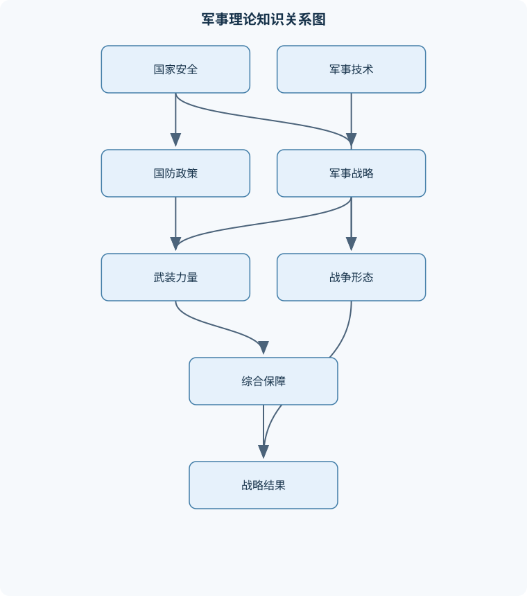
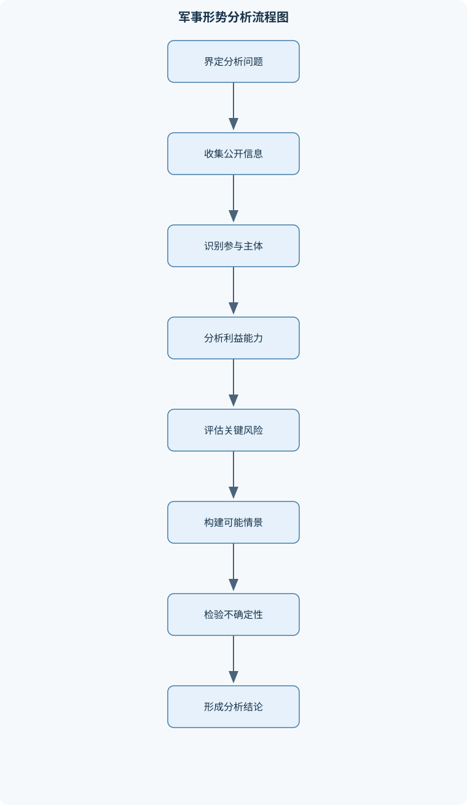

# 军事理论

## 一、课程整体知识框架

### 课程边界与先修知识

本课程研究战争与国防的基本规律、军事思想演变、国家安全与战略环境、武装力量建设、战争形态和军事技术发展。内容覆盖中国古代军事思想、马克思主义军事理论及其中国化发展、人民战争思想、国防政策与国防动员、国际战略格局、中国周边安全环境、精确制导与隐身伪装、侦察预警与电子对抗、指挥信息系统以及现代高技术战争。课程重点是概念辨析、理论联系实际、战略判断和案例分析，不承担具体武器操作、作战指挥、战术实施或军事训练任务。先修知识包括中国历史与世界史基础、政治学和国际关系常识、国家安全基本概念、科学技术常识以及基本的信息检索和图表分析能力。涉及现行政策、法规、军队编制和技术性能时，应以相应适用时间内的正式文件和公开权威资料为准。





### 课程对象与研究范围

《军事理论》研究战争与国防的基本概念、一般规律及其历史和现实表现，关注战争如何产生、受何种政治目的制约、军事力量如何建设和运用，以及技术变化怎样影响战争形态。课程不是武器操作、作战指挥、战术实施或军事训练教材，而是以概念辨析、历史理解、战略分析和公开案例研究为主要方法，帮助建立分析军事问题的基本框架。

战争是有组织的暴力冲突，但不能仅以交战行动解释战争。分析战争须同时考察政治目的、参与主体、社会基础、力量结构、战略指导、技术条件和保障能力。战争行动可能产生超出初始设想的政治、经济和社会后果，因此军事手段既受政治目的约束，也会反过来影响政治选择。由此可以推出：判断战争或军事行动是否“成功”，不能只看局部交战结果，还要检查其是否实现了政治目标、代价是否可承受、是否具备合理的终止条件，以及是否引发更大的安全风险。

国防是国家为防备和抵抗侵略、维护国家主权、安全、发展利益而开展的防卫活动及相关建设。国力是国家综合能力，军事力量是国防力量的重要组成部分，武装力量则是依法组织、承担军事任务的实体。四者不能互换使用：例如，经济实力和科技能力可以支撑国防建设，但它们本身不等于武装力量；武装力量的规模也不能单独代表一国国防能力。国防政策说明国家防卫的基本目标和原则，国防建设则将这些原则转化为力量、制度、基础设施和保障能力。

课程的知识结构由历史理论、国家安全、力量建设和军事技术四条线索交织构成。历史理论帮助解释军事思想如何在特定政治、经济和技术条件下形成；国家安全分析把国家利益、威胁、风险和战略环境纳入同一视野；力量建设研究武装力量、后备力量、国防动员及综合保障如何形成；军事技术分析则考察信息获取、指挥控制、精确制导、伪装隐身和军事航天等因素如何改变作战系统。任何一条线索都不能脱离其他线索单独解释现实军事能力。

### 由概念到战略判断的分析层次

军事问题可以按不同层次拆解。战略层次关注国家或政治集团的总体目标、长期力量配置、战争与和平的关系；战役层次连接战略目标与一系列较大规模军事行动；战术层次处理局部行动及其具体方法。层次之间存在因果联系，但不能混为一谈：战术上的局部优势不必然带来战役胜利，战役胜利也不必然实现战略目标。分析一个案例时，应明确讨论的是哪一层次，并说明该层次的结果怎样影响其他层次。

对战略环境的判断应先界定时间范围和分析尺度，再识别主体、利益、能力和相互关系。国家综合国力可记为 $W$，它通常涉及经济、科技、政治、军事、社会动员和国际影响等因素。$W$ 是用于组织分析的综合变量，不是可以把不同指标直接相加而得到的固定分数；指标口径、权重和观察时点 $T$ 都会影响判断。军事力量或作战能力可记为 $P$，分析 $P$ 时须区分兵力规模、装备质量、人员训练、指挥控制、保障能力和作战环境。仅依据公开装备数量推断实际作战能力，容易忽略训练、可用率、协同和补给等关键条件。

信息优势可记为 $I$，包括获取、传输、处理、共享和保护信息的能力。较强的 $I$ 有助于减少决策迟滞、提高协同质量，但不意味着战场完全透明，也不意味着必然获胜。信息可能有误、过时、遭到干扰或无法转化为行动；感知和通信链条中的瓶颈也可能抵消局部技术优势。系统整体效能可记为 $S$，强调感知、通信、指挥、决策、行动与保障等环节之间的协同。局部装备性能优异，并不自动使 $S$ 提高；若关键链路不兼容、不可靠或缺少保障，系统整体仍可能失效。

安全风险可记为 $R$，通常依据威胁发生的可能性及其后果严重程度作定性或半定量评估。评估时还须记录脆弱性、暴露程度和应对能力，不能把风险简化为单一威胁清单。不同风险的等级比较须采用一致的尺度，并说明资料、假设和不确定性。战略判断始终具有时间条件：国际关系、政策、军事组织和技术都会变化，因此结论须说明观察时点 $T$，不能将某一时点的格局描述为恒定排名。

### 战争规律、力量关系与模型边界

战争规律是对战争中反复出现的关系及其条件的概括，不是脱离情境、可以机械套用的行动处方。军事辩证分析要求同时考察力量的数量与质量、整体与局部、行动与保障、客观条件与主观指导。人员素质、组织指挥和精神因素能够影响装备效能，但不能替代技术装备；先进装备也不能脱离人员训练、维修、通信和补给独立发挥作用。实际能力是多种条件共同作用的结果，不能由单一因素决定。

“战争是政治的继续”意味着战争目标、行动规模和终止条件须服从政治目的。政治目标与军事手段脱节，可能造成战术行动持续扩大却无法形成可接受的政治结果。保存自己与消灭敌人是相互关联的分析要求：评估方案时，应同时考虑预期任务收益、力量损耗、后续保障和升级风险，不能仅以短期打击效果衡量价值。积极防御也体现目的与行动方式的区别：总体目的可以是防御性的，但在具体条件允许时，防御并不排斥主动机动、局部反击或争取有利态势。把积极防御等同于消极等待，是对概念的误读。

在特定的理想化兵力消耗模型中，可用兰彻斯特平方律说明数量与单位效能可能如何共同影响消耗关系。设双方有效兵力分别为 $x(t)$ 和 $y(t)$，单位为“兵力单位”；设双方单位兵力对对方造成有效损耗的系数分别为 $a$ 和 $b$，单位为“兵力单位／时间”。在目标明确、视距交战、兵力同质、作用连续且不计补给、地形和增援的假设下，可写为：

$$
\frac{\mathrm{d}x}{\mathrm{d}t}=-b\,y,\qquad
\frac{\mathrm{d}y}{\mathrm{d}t}=-a\,x
$$

其中 $t$ 表示时间；负号表示兵力随交战消耗而减少。将第一式乘以 $a x$、第二式乘以 $b y$ 并相减，可得守恒量：

$$
a x^2-b y^2=\text{常数}
$$

因此初始力量满足 $a x_0^2>b y_0^2$ 时，模型给出一方具有理论优势的条件，其中 $x_0,y_0$ 为初始有效兵力。若双方数量以“人”计，$a,b$ 的单位须相应解释为每单位时间的有效损耗率；实际应用中更适宜把兵力换成明确口径的抽象有效兵力单位。此结果只说明在模型假设下，数量与单位效能共同影响消耗趋势，不是现实战争预测公式。若双方兵力异质、目标不明、交战间断，或地形、士气、补给、增援和技术适应显著改变损耗，模型结论便不能直接外推。该模型可用于解释集中力量和质量差异的重要性，不能据此规划现实行动。

### 从理论到案例的证据要求

军事案例分析须区分事实描述、因果解释和价值判断。事实描述说明公开资料中发生了什么；因果解释说明哪些因素可能导致结果，并须考虑替代解释；价值判断则依据明确标准讨论正当性、代价或政策后果。把三者混写，容易将推测当成事实，或以结果倒推当时必然如此。比较不同战争时，应统一比较政治目的、战争性质、力量结构、技术条件、作战样式、保障条件和结果，同时检查时代、地域、任务和资料口径差异。单个战例不能证明普遍规律；可迁移的结论必须同时说明成立条件和不可迁移之处。

公开军事信息的可靠性也须分级判断。分析者应检查来源身份、发布时间、信息是否独立、内部是否一致、能否交叉验证，并分别标记事实、推断和传闻。多个来源若都转述同一未经证实的信息，不构成真正的独立印证。涉及军力数据时，还需考察统计口径、时效性、保密性和可比性。信息融合提高的是综合判断的基础，不会自动保证结论真实；只有将不确定性保留下来，判断才不会因过度确定而误导后续分析。

## 二、章节和模块划分

### 核心知识覆盖清单

本清单用于检查正文是否覆盖本课程的主要知识模块：

- **国防与国家安全基础**：国防的基本概念与类型、国家安全的构成领域、国防政策与防御性质、国防利益与国家发展、国防职能与国防责任、武装力量基本构成、国防动员的内涵、国防后备力量作用。
- **中国古代军事思想**：中国古代军事思想形成条件、先秦军事思想主要流派、孙武军事思想基本范畴、战争与政治关系认识、谋略制胜与因势用兵、治军思想与军队管理、古代战争正义观、古代兵器与战争形态变化。
- **马克思主义军事理论**：战争起源与社会根源、战争本质与政治目的、战争性质与正义性判断、物质与精神因素关系、人民群众与战争力量、战争规律与主观指导、军事辩证法基本方法、战争发展与技术影响。
- **中国化军事理论**：毛泽东军事思想概念、毛泽东军事思想形成发展、人民战争基本含义、人民军队建设思想、积极防御战略思想、保存自己消灭敌人、集中优势各个歼灭、主动性灵活性计划性。
- **国防建设与军事战略**：国防建设总体关系、军队革命化现代化正规化、国防科技工业体系、国防动员组织机制、预备役与后备力量、军事战略的层次结构、战略威慑与危机管控、军民融合与综合保障。
- **国际战略格局与安全环境**：国际战略格局概念、权力分布与战略关系、综合国力构成因素、传统安全与非传统安全、大国关系与战略竞争、地区安全机制、中国周边安全环境、核威慑与军备控制。
- **侦察预警与信息对抗**：军事侦察基本任务、光电与红外探测、雷达探测基本原理、地面传感器应用、预警体系与信息融合、通信对抗基本概念、雷达对抗基本概念、反侦察与信息安全。
- **精确制导与军事伪装**：精确制导技术概念、制导与导航区别、自主制导与寻的制导、卫星制导基本特点、飞航式与弹道式飞行、隐身技术目标特征、雷达红外声学特征控制、伪装与反伪装关系。
- **指挥信息系统与军事航天**：指挥自动化系统构成、指挥控制与情报分系统、通信与综合保障分系统、信息融合与辅助决策、系统可靠性与生存性、军用卫星主要类型、卫星侦察与通信导航、网络化指挥体系边界。
- **现代高技术战争**：高技术战争基本含义、战争要素信息化、作战空间多域化、体系对体系对抗、非对称作战特点、战争消耗与综合保障、典型战争案例分析、高技术战争发展趋势。


### 模块一：国防与国家安全基础

本模块先区分国防、国家安全、国防利益、国力、军事力量与武装力量。国家安全涵盖政治、军事、经济、科技、社会、信息及其他相互关联的领域；各领域可能相互支撑，也可能因资源竞争或风险传导而产生张力。国防是维护国家安全的重要手段，但不能替代国家安全的其他政策工具。国防利益涉及主权、安全和发展所需条件，其具体内容须放在特定历史与政策语境中判断。

国防类型的分析应说明分类依据，例如按防卫对象、国家政策取向或力量组织方式划分；不同教材语境下分类标准可能不同，不宜把某一套分类误认为唯一法定分类。防御性质的国防政策，体现国家防卫目标、对外政策和安全环境等因素的综合作用。判断政策性质不能只看某项武器或单次行动，而应考察正式政策表述、法律制度、力量建设目的和行动背景。国防职能包括抵御外来侵略、维护国家统一和安全、支撑国家发展等；国防责任由国家机关、武装力量、社会组织和公民依法依规承担，主体不同，责任形式也不同。

武装力量是国防力量的重要组成，应按适用时期的正式制度和公开权威资料理解其组织构成，避免将历史编制或旧称直接套用于现行制度。国防动员是国家将平时资源和组织能力依法转化为应对安全需要的准备与行动，涉及人员、物资、交通、通信、医疗、工业和社会组织等方面。国防后备力量为常备力量提供补充，并支撑持续防卫能力；其效能取决于组织基础、训练管理、装备保障和动员机制，不能只用名册人数衡量。风险评估可将威胁、脆弱性、发生可能性和后果纳入同一矩阵，用统一等级比较处置优先级；该方法适用于宏观安全分析，不代替专业安全审查。

### 模块二：中国古代军事思想

中国古代军事思想在国家形成、战争实践、政治制度和生产技术发展的历史条件下逐步形成。先秦思想并非单一学派：不同文本从战争目的、治军方法、国家治理和用兵谋略等方面提出观点，既有相互竞争，也有相互吸收。理解古代军事思想须结合其时代背景、文本语境和后世解释，不能把古代概念未经辨析地直接等同于现代战略术语。

孙武军事思想的重要分析范畴包括战争与国家政治的关系、对战争条件的比较判断、谋略运用、因势制宜和治军。其核心启示不是“计谋可以替代一切”，而是决策应重视信息、条件比较、行动成本和目标；谋略若脱离真实力量与环境约束，就不能仅凭文字推演保证成功。因势用兵强调根据敌我、地形、时机和行动条件调整方案，体现的是对情势变化的认识，并非鼓励无原则地改变目标。

古代治军思想关注纪律、赏罚、训练、组织和将领责任。治军成效须通过制度和执行形成，单靠道德劝诫或严厉惩罚都不能保证军队能力。古代战争正义观与当时的政治伦理相连，判断具体战争须区分统治者宣称的理由、战争实际目的和社会后果，不能只依据口号。兵器和交通技术的变化会改变军队组织、作战方式和国家动员要求；但技术出现不等同于立即改变整个战争体系，技术传播、生产能力、训练和制度适应共同决定其影响。

### 模块三：马克思主义军事理论

马克思主义军事理论将战争置于社会历史关系中考察，重点分析战争的社会根源、政治目的、阶级和国家关系，以及经济基础与军事力量之间的联系。战争起源不能简化为某个个人的性格或单一事件；分析须追问社会矛盾、利益冲突、政治决策和国际关系如何共同作用。战争的本质与战争的具体性质也应区分：前者讨论战争作为政治冲突的基本属性，后者须结合参战主体、目标、社会背景和行为加以判断。

战争性质与战争手段不是同一概念。判断战争是否正义，不能只看采用了何种军事方式，也不能仅凭一方的自我表述；人民参与、社会动员与战争正义性之间存在条件关系，但并非可以机械画等号。物质因素与精神因素共同作用：装备、经济和组织提供物质条件，人员意志、纪律、认知和社会支持影响力量的形成与运用。精神因素不能抹去物质约束，物质优势也不会自动转化为政治胜利。

战争规律与主观指导的关系，是客观条件限定行动可能性，正确认识和利用条件则影响行动效果。军事辩证法要求分析矛盾双方及其变化，识别主要矛盾、局部条件、行动时机和相互转化，不把某一经验抽象成无条件法则。技术进步改变力量构成、信息速度和行动范围，但技术作用受组织、训练、保障和对手适应影响。由此，分析战争发展既要看到技术带来的新能力，也要考察战争政治属性和不确定性是否仍然存在。

### 模块四：中国化军事理论

中国化军事理论是在具体历史实践中形成和发展的军事理论体系。毛泽东军事思想是其中的重要组成部分，涵盖人民军队建设、人民战争、战略指导和战争方法等内容。研究其形成发展，应联系当时的政治任务、社会结构、力量对比和战争条件，既理解理论的历史针对性，也避免将特定时期的具体办法不加条件地移用于不同环境。

人民战争强调依靠人民、组织人民并使军事斗争与社会力量相结合。其成立条件不是装备优劣本身，而包括战争的政治性质、社会基础、组织能力、群众参与方式和持续保障。人民战争思想中的人民军队建设，强调政治方向、组织纪律、群众关系和军事能力之间的统一；人民群众是战争力量的重要来源，但动员必须依赖组织、制度和实际利益联系，不能把“群众支持”当作无需论证的假设。

积极防御以防御性战略目的为基础，同时允许在具体条件下采取主动行动。战略上藐视敌人、战术上重视敌人，要求既不因对手强大而丧失行动意志，也不轻视局部风险和实际困难。保存自己与消灭敌人相统一，要求方案同时评估任务效果、力量损耗和后续保障；集中优势、各个歼灭的思想，强调把有限资源用于创造局部有利条件，但其适用取决于态势、行动能力和风险，不是数量优势必然转化为胜利的公式。主动性、灵活性与计划性相互依赖：计划须基于判断，灵活调整须有目标和约束，主动权也不能脱离现实能力。

### 模块五：国防建设与军事战略

国防建设包括武装力量建设、国防科技工业、动员体系、后备力量、基础设施和综合保障等方面。各部分相互依赖：装备研制离不开科研、生产和维修体系，军事力量持续运行离不开人员、能源、运输和医疗保障，动员能力也须在平时通过制度和资源准备形成。所谓建设质量，不能仅用单项装备指标或规模描述，应检查体系能否适应任务、环境和持续时间要求。

革命化、现代化、正规化是军队建设中的不同维度：革命化涉及政治方向和根本宗旨，现代化涉及能力与技术发展，正规化涉及制度、纪律和组织运行。三者不是相互替代的选项。军事战略处于国家安全与军事行动之间，战略层次涉及总体目标和力量运用方向，战役、战术层次则分别连接较大规模行动和局部方法。威慑的可信度可记为 $D$，它取决于能力、意志、沟通和对手认知的共同作用，不能由武器数量单独决定。战略威慑还须与危机管控并行：威慑意在影响对手选择，沟通与风险控制则旨在避免误判和冲突升级。

国防动员、预备役和其他后备力量应依据适用时期的正式制度理解。军民协同的国防保障强调国家防卫需要与经济社会资源之间的组织衔接，但不同领域的责任边界、信息安全和法律约束仍须明确。国防科技工业的综合能力不只表现为研制新装备，也包括供应链稳定、质量控制、维护更新和技术转化。评估建设项目时，应说明任务需求、资源投入、协同关系和验收指标，避免以单项技术参数代替系统效能。

### 模块六：国际战略格局与安全环境

国际战略格局描述一定时期内主要行为体的力量分布、相互关系和规则安排。格局不是固定的国家排名，应注明观察时点 $T$、指标和分析尺度；军事、经济、科技、政治影响力可能呈现不同分布。国际关系中的力量变化也不自动意味着冲突，仍需考察各方利益、制度安排、沟通机制和风险认知。综合国力变量 $W$ 用于归纳多类能力，不应伪装成精确、无争议的单一分数。

传统安全问题主要涉及国家间军事和政治安全，非传统安全问题可能涉及公共卫生、跨国犯罪、能源、网络、环境、难民流动等跨领域风险。两者在现实中可能交织，例如非传统风险可以影响社会稳定和国家关系，而军事危机也可能造成经济与人道后果。大国关系和战略竞争须同时分析合作、竞争、约束和危机管控，不能把复杂关系压缩为单一对抗叙事。地区安全机制通过沟通、规则和协商降低误判风险，其效能取决于成员承诺、议题范围和执行能力。

中国周边安全环境分析应以地理联系、国家利益、力量互动、地区机制和跨国风险为结构，而不是罗列事件。建立主体—利益—能力关系表后，可区分结构性因素、突发变量和未知信息，再比较不同情景的触发条件及后果。核威慑与军备控制涉及能力、意志、沟通和对手认知，威慑稳定性还受误判、危机沟通和技术变化影响。军备控制的分析须区分政治承诺、法律义务、核查机制和实际执行；相关制度的内容与适用范围应按具体时期和正式文件判断。

### 模块七：侦察预警与信息对抗

侦察强调获取特定信息，监视强调持续观察，预警强调对潜在危险提前告警，情报则包括信息加工、评估与判断。四者相互联系但不等同。光电传感器依靠目标反射或发射的电磁辐射工作，可见光观测受照明和能见度影响，红外观测反映热辐射差异，也会受背景、天气和传感器性能限制。雷达通过发射和接收电磁波识别目标，其探测效果受传播条件、目标特征、杂波和系统参数影响。地面传感器可补充局部观测，但覆盖范围和信息质量受部署环境及维护条件限制。

多源预警通过融合不同传感器的信息提高覆盖和交叉验证能力。融合不是简单叠加：时间不同步、坐标或数据标准不一致、传感器误报和共享来源重复，都可能造成错误结论。信息分析须保留来源、时间和置信程度，并区分观测数据与推断。通信对抗涉及通信链路受干扰、被监测或遭到欺骗等问题；雷达对抗则关注雷达探测与反探测、干扰和抗干扰关系。本模块限于公开原理与体系分析，不涉及具体干扰参数或操作方法。

反侦察与信息安全旨在降低敏感信息被未授权获取、篡改或滥用的风险，涵盖制度管理、人员意识、通信保护和系统运行保障。安全不能依赖单一技术措施；访问控制、数据完整性、备份恢复和组织流程须共同发挥作用。信息可靠性评估可按来源、时间、独立性、内部一致性和交叉验证逐项检查，最终输出分级可信判断，而不是把不确定信息强行归为真或假。

### 模块八：精确制导与军事伪装

制导是根据目标或预定轨迹信息调整飞行器运动的过程，导航是确定自身位置、速度或姿态并提供路线信息的过程。导航可以为制导提供状态信息，但二者不是同义词。自主制导主要依靠预先输入的信息和机载系统完成控制；寻的制导利用目标相关信号进行跟踪，效果取决于目标特征、传感器性能和环境。卫星导航可提供位置和时间信息，其可用性和精度受信号接收、遮挡、干扰与系统完整性影响，不能概括为必然抗干扰或精度不变。

飞航式飞行器通常依靠气动升力在大气中持续飞行；弹道式飞行器主要经历动力段和后续弹道飞行，具体轨迹还受设计和任务约束。电视、激光、卫星和自动寻的制导在信息来源、环境依赖、控制方式和易受影响条件上不同。“发射后不管”不是所有制导方式的共同性质，是否需要持续照射、更新或通信须依据具体制导原理判断。

隐身技术的目标是降低雷达、红外、可见光或声学等特征，使被探测、识别或跟踪的概率降低，而不是让目标完全不可探测。不同特征控制之间可能存在工程权衡，例如一种外形或材料设计对某传感方式有利，不代表对所有传感方式都有效。伪装通过改变外观、信号或行为特征降低识别概率；反伪装则结合多源观测、模式分析和持续核查提高识别能力。两者的效果均受环境、时间和观察方式影响。

### 模块九：指挥信息系统与军事航天

指挥信息系统通常包含指挥控制、情报处理、通信、信息管理和综合保障等功能。其价值在于支持信息汇集、态势理解、决策协同和行动衔接，而不是以自动化取代全部指挥判断。信息融合须处理数据格式、时间基准、来源可靠性和冲突信息；辅助决策可以展示选项和风险，但决策责任及政治、法律约束不能交给算法隐去。

系统可靠性是系统在规定条件和时间内完成规定功能的能力，系统生存性关注受到干扰、故障或破坏后维持关键功能或恢复的能力。二者相关但不相同。冗余设计可提高部分环节的容错性，却不能消除共同原因故障、通信断裂或数据标准冲突。分析体系时，可沿感知、传输、处理、决策、行动和保障链条识别依赖关系及关键瓶颈；结论须停留在公开资料允许的系统层次，不推导具体设施位置或攻击方案。

军用卫星按任务可涉及侦察、通信、导航、气象和预警等类别；不同类别提供的服务和数据性质不同。卫星系统扩展了观测、通信和定位能力，但依赖地面设施、链路、轨道条件和用户终端。网络化指挥可以提升信息共享和协同速度，也会增加对通信连续性、数据安全和系统兼容性的依赖。信息优势 $I$ 能提高体系运行条件，却不能消除信息错误、通信中断和决策不确定性。

### 模块十：现代高技术战争

高技术战争是军事技术、组织方式和战争形态相互作用下的战争现象，不宜简单等同于使用先进武器。战争要素信息化意味着侦察、通信、指挥、火力和保障越来越依赖信息获取与处理；作战空间多域化则反映陆、海、空、天、电磁和网络等领域之间的关联扩大。多域联动不等于所有领域均可无缝协同，实际效果仍受组织、通信、规则和资源制约。

体系对体系对抗强调传感器、指挥控制、行动力量和保障之间的整体关系。若通信链路、数据标准或维修保障成为瓶颈，单个高性能节点未必转化为 $S$ 的提升。非对称作战反映交战各方在目标、手段、能力或作战方式上的差异，不等于装备较弱一方必然占优；其效果取决于政治目标、组织条件、环境适应和对手反制。战争消耗与综合保障的重要性上升，经济基础、供应链、运输、维修和人员补充都可能影响持续能力。

高技术条件下，战争相关空间可能超出直接交战区域，经济、信息、社会和外交因素可与军事行动相互影响。精确打击、信息对抗和远程行动并未消除战争不确定性，也不能单独解释战争结果。案例研究应按政治目的、战争阶段、信息条件、力量运用、保障体系和结果等维度组织材料，分别陈述事实、解释因果并说明判断边界。比较结论须注明时代与任务差异，避免把单一战例归结为某种武器或一次行动的必然效果。

## 三、核心概念的详细解释

### （一）国防、国家安全与国家综合能力

国防是国家为防备和抵抗侵略、制止武装颠覆、维护国家主权、安全、发展利益而开展的防卫活动及其相关建设。国防既包括武装力量建设，也包括政治、经济、科技、教育、外交、交通、通信和社会动员等方面的准备。国防不是军队单独承担的事务，而是国家整体安全能力的综合体现。

国防、国力、军事力量和武装力量必须严格区分。国力是国家在经济、科技、政治、军事、社会动员和国际影响等方面形成的综合能力，可记为 $W$；军事力量或作战能力可记为 $P$，是国防能力的重要组成，但不等同于全部国防能力；武装力量则是依法组织、承担军事任务的实体。经济实力能够为国防提供资源，科技能力能够改进装备和保障，但经济、科技本身不能直接等同于军队或武装力量。

国家安全是国家处于没有危险、能够持续维护核心利益和发展条件的状态及能力。现代国家安全具有整体性和系统性，至少涉及政治安全、军事安全、经济安全、科技安全、网络与信息安全、社会安全、生态安全、资源安全、公共卫生安全和海外利益安全等领域。传统安全主要关注军事冲突、领土争端和武装威胁；非传统安全则更多表现为网络攻击、恐怖活动、跨国犯罪、传染病、能源供应中断、重大灾害和供应链风险。二者并非彼此替代，而是相互交织。例如，关键基础设施遭受网络攻击，可能同时影响经济运行、社会秩序和军事指挥。

安全风险可记为 $R$。风险不是威胁本身，而是威胁通过一定脆弱性造成损害的可能性及其后果。风险评估至少要考察威胁、发生可能性、暴露程度、系统脆弱性、后果严重程度和应对能力。某项威胁即使后果严重，若发生可能性极低且防护能力较强，其综合风险未必最高；反之，后果中等但频繁发生、暴露面广的事件，也可能成为优先处置对象。

国防利益是国家在防卫安全、维护统一、保障发展和保护人民生命财产安全过程中形成的基本利益。国防利益与国家发展利益相互联系：没有安全环境，经济和社会发展难以持续；没有稳定的经济、科技和社会基础，国防建设也难以维持。因此，国防建设不能脱离国家发展水平，也不能以牺牲长期发展能力为代价追求孤立的军事指标。

国防政策反映国家对安全环境、战争与和平、国防目标和力量使用原则的总体认识。防御性的国防政策，强调国防建设和军事力量运用的根本目的在于防卫国家主权、安全和发展利益，而不是以对外扩张为基本目的。防御性不等于没有威慑能力，也不等于面对威胁只能被动等待；必要的防卫准备、危机管控和有限度的反制行动，均可能服务于防御性战略目标。

### （二）国防职能、武装力量与国防动员

国防职能主要包括保卫国家主权、领土完整和安全，维护国家发展利益，遏制和应对武装威胁，参与应急救援和灾害处置，以及承担与国家安全相关的其他任务。不同国家的法律制度和组织体系存在差异，因此讨论武装力量构成、国防机构和动员机制时，必须注明适用的制度和时间条件，不能把某一时期、某一国家的组织安排当作普遍规律。

武装力量通常包括现役力量、后备力量以及依法承担军事任务的其他组织形态。军队是武装力量的主体，但武装力量的完整能力还依赖预备役、民兵、国防科研生产体系、交通运输体系、医疗救援体系和社会动员体系。国防后备力量是常备力量的重要补充和国防潜力的重要载体，作用不只体现在人员补充，还包括专业技术、装备器材、交通运输、医疗救护和地方保障等方面。

国防动员是国家为应对战争威胁、重大安全危机或其他紧急状态，依法对人力、物力、财力、科技、信息、交通和社会组织等资源进行统筹调配的活动。动员不是简单征集人员或物资，而是一个由平时准备、预警转换、组织实施和恢复调整构成的系统过程。其核心难点在于：既要提高应急响应速度，又要避免平时资源配置失衡；既要满足安全需要，又要遵守法律程序、保护公民权益并维持社会正常运行。

### （三）中国古代军事思想的基本范畴

中国古代军事思想是在国家形成、战争频繁、社会分工发展和兵器技术变化的条件下逐渐形成的。先秦时期的政治制度变迁、诸侯竞争和军事组织发展，推动了战争经验的系统总结。春秋战国时期出现了大量讨论战争性质、军队建设、谋略运用和治军原则的著作，形成了具有系统性的军事思想传统。

先秦军事思想并非单一流派。儒家重视政治教化、仁义与治国秩序，强调战争应受政治伦理约束；法家重视国家权力、法令、组织和赏罚，强调以制度提高动员与治理能力；道家关注因势、顺势和避免过度用兵；兵家则集中讨论战争规律、战略谋略、军队组织和作战指导。不同思想之间既有差异，也相互影响，不能简单归结为“只讲谋略”或“只讲道德”。

孙武军事思想的重要特点，是把战争视为政治、力量、信息、组织和环境共同作用的复杂活动。其基本范畴包括慎战、全胜、因势、奇正、虚实、形势、先胜和治军。所谓“慎战”，不是否定军事力量，而是强调战争代价高、后果复杂，必须在政治目的、力量条件和风险可控的基础上决定是否用兵。所谓“因势”，是根据敌我力量、地形、时间、民心、组织和行动条件变化调整方案，而不是机械重复固定方法。

谋略制胜并不等于欺骗万能。谋略只有在政治目标清晰、信息判断相对可靠、组织执行能力足够、对手存在可利用弱点时，才可能转化为实际效果。若缺乏后勤、训练和指挥协同，再精巧的计划也可能因执行失败而失效。古代治军思想普遍重视纪律、训练、赏罚、将帅责任和军民关系，这说明军队战斗力从来不只是兵器数量的函数。

古代战争形态受到生产力和技术水平制约。战车、步兵、骑兵、弓弩、城防器械以及早期火器的变化，都会影响编制、机动、攻防方式和后勤需求。技术进步可以扩大行动范围和杀伤能力，但不能独立决定战争结局。任何技术都必须嵌入组织、训练、指挥和保障体系，才能形成稳定能力。

### （四）马克思主义军事理论与战争规律

马克思主义军事理论把战争放在社会历史条件中考察，认为战争不是脱离社会关系的自然现象，而是社会矛盾发展到一定阶段、通过有组织暴力解决政治冲突的表现。战争的产生与生产方式、阶级关系、国家利益和政治权力密切相关。研究战争起源，不能只观察战场上的直接冲突，还要分析冲突背后的经济、政治和社会结构。

“战争是政治的继续”揭示了战争与政治的内在关系。战争通常服务于一定政治目的，军事行动的目标、规模、方式和终止条件都应服从政治需要。由此可以推出三个判断：第一，战术上的局部胜利不等于战略成功；第二，扩大军事行动不一定能够更好地实现政治目的；第三，战争必须有可解释的政治目标和可执行的终止条件。若军事手段造成的政治、经济和社会代价超过其预期收益，即使取得若干战场胜利，也可能构成战略失败。

战争性质与战争手段需要区分。战争性质主要依据政治目的、社会关系和历史正当性判断；战争手段则指动员方式、作战方式、组织形式和技术条件。正义战争不必然自动采用人民战争形式，人民战争也不能仅凭群众参与就判断其政治性质。人民战争需要明确的政治基础、广泛的社会支持、有效的组织领导、相应的动员能力和适合具体条件的战略战术。

马克思主义军事理论强调人民群众在战争中的作用，但并不否认武器装备、组织制度和科学技术的重要性。人与武器是相互联系的两个方面：人员素质、政治目的、组织指挥和精神因素，决定装备能否被正确运用；先进装备又能够扩大人员能力、提高行动速度和打击效果。把人的作用绝对化，会忽略技术和物质基础；把武器作用绝对化，则会忽略训练、维护、指挥、后勤和适应环境的要求。

战争规律具有客观性，但军事指导具有能动性。客观规律不因主观意愿而改变，例如力量对比、资源约束、信息不完备和时间压力始终会影响行动结果；但指挥者可以通过调查研究、组织动员、集中优势、改变部署和争取主动来创造有利条件。所谓认识和运用规律，不是预先知道唯一结果，而是在不确定条件下识别主要矛盾、估计多种可能并及时修正行动。

### （五）中国化军事理论与人民战争思想

中国化军事理论是在中国革命、建设和改革的具体实践中形成和发展的军事理论成果。其核心问题包括：如何认识战争与政治的关系，如何建设人民军队，如何依靠人民形成战争力量，如何在力量不对称条件下保存自己、发展自己并逐步改变敌我关系，如何把战略主动性、灵活性和计划性统一起来。

人民战争不是单纯的群众数量优势，也不是装备落后条件下的权宜之计。其基本含义是，在一定政治目标和社会基础上，依靠人民群众的广泛支持和有组织参与，形成军队、地方和社会力量相结合的战争体系。人民战争的成立条件包括政治目标具有群众基础，组织领导能够统一行动，动员机制能够持续运转，军队与人民保持密切联系，以及战略战术能够适应具体环境。

人民军队建设思想强调政治方向、组织纪律、官兵关系、军民关系、训练教育和作风建设。军队战斗力既取决于装备和编制，也取决于政治可靠性、组织执行力、指挥效能、纪律性和保障能力。现代条件下，人民军队建设还必须重视信息化、专业化、体系化和联合协同，但这些要求不能替代政治建设和组织建设。

积极防御强调战略目的的防御性与行动方式的主动性相统一。防御的根本目标是保卫国家和人民，而不是主动进行扩张；积极则意味着不消极等待，可以根据敌我条件采取机动、反击、局部进攻和有利决战。由此可见，“防御”回答的是为什么行动，“积极”回答的是怎样争取主动，二者不能相互替代。

“保存自己、消灭敌人”体现了作战效果的双重约束。军事行动不能只计算对对方造成的损害，还要计算自身损失、后续保障、人员补充、政治影响和升级风险。保存自己不是回避斗争，消灭敌人也不是无限扩大行动。二者必须统一于政治目标和可持续的力量运用之中。

“集中优势、各个歼灭”反映了局部力量对比的重要性。总体力量较弱的一方，可以通过选择时间、地点和方向，把分散力量集中到关键局部，形成相对优势；但这种方法需要准确判断对手部署、保持行动隐蔽性、具备机动和保障条件，并防止对方迅速集中反制。若无法形成局部优势，或者集中行动导致其他方向失去必要防护，理论原则就不能机械套用。

战争指导中的主动性、灵活性和计划性相互依存。主动性要求争取控制行动节奏和关键条件；灵活性要求根据敌情、地形、时间和任务变化调整方案；计划性要求行动具有目标、阶段、资源和风险安排。只有主动而无计划，可能变成冒险；只有计划而无灵活性，可能陷入僵化；只有灵活而无政治目标，则可能失去方向。

### （六）国际战略格局与安全环境

国际战略格局是一定时期内主要行为体之间的力量分布、利益关系、制度安排和战略互动结构。它不是各国军力的简单排名，也不是静态不变的等级表。分析格局必须注明观察时点 $T$、分析尺度和指标体系。经济规模、科技能力、军事力量、政治稳定、社会动员、外交影响和联盟关系，都可能影响一国的综合国力 $W$，但不同因素之间不能在没有说明权重的情况下直接相加。

大国关系、地区安全机制、经济相互依赖和军事同盟共同塑造安全环境。安全困境表现为：一方为提高自身安全而增强军事能力，可能被另一方理解为威胁，从而引发对方扩军和对抗，最终使双方都感到更不安全。降低安全困境需要透明沟通、危机管控、风险隔离、军备控制和地区合作，但这些机制并不能消除所有利益冲突。

核威慑的可信度可记为 $D$，取决于能力、意志、沟通和对手认知的共同作用。拥有武器数量不等于具备稳定威慑；如果能力无法有效运用、意志表达不清、沟通渠道中断或对手误判，威慑可能失效。核威慑还受到误判、意外升级、军备竞赛和扩散风险的制约，因此必须与危机管控、军备控制和战略稳定问题结合分析。

### （七）侦察预警、信息对抗与信息可靠性

军事侦察是通过人员、设备和技术手段获取与军事决策有关的信息。监视强调持续、重复和有规律的观察；预警强调在危险或行动发生前提供及时告警；情报则是在信息基础上进行加工、评估、关联和判断。四者存在联系，但不能混为一谈。一次观测结果只是原始信息，只有经过时间核对、来源评估和多源比对，才可能形成较可靠的情报判断。

可见光探测依赖目标反射或发射的可见光信息，通常具有较好的图像直观性，但受光照、天气、遮挡和伪装影响。红外探测利用目标与背景之间的热辐射差异，能够在一定程度上弥补夜间可见光不足，但受温度对比、湿度、距离和背景热源影响。雷达通过发射电磁波并接收回波判断目标距离、方向和运动特征，具有全天候和远距离探测优势，但可能受到地形遮挡、杂波、电子干扰和目标特征控制影响。地面传感器具有部署灵活、持续观察和近距离感知等特点，但覆盖范围、供电、通信和抗破坏能力可能限制其效果。

多源信息融合不是简单地把多个传感器结果相加。融合前应检查时间同步、空间基准、数据格式、来源独立性和误差范围；融合时要区分相互印证与共同错误；融合后还要保留不确定性。多个传感器若受到同一环境因素影响，表面上一致的结果也可能共同偏差。因此，信息优势 $I$ 包括获取、传输、处理、共享和保护能力，而不是“掌握的信息数量”或“战场完全透明”。

通信对抗和雷达对抗属于信息对抗的重要内容。其一般对象包括通信链路、雷达探测链路、导航信号和信息处理过程。研究这些问题应停留在原理层面，重点分析干扰、欺骗、压制、抗干扰、频谱管理和链路恢复之间的关系，不涉及具体武器操作或现实目标攻击。反侦察和信息安全则强调降低暴露、保护数据、控制访问、识别异常和恢复系统功能。信息安全不仅是加密问题，还包括身份认证、权限管理、设备安全、人员操作和应急恢复。

### （八）精确制导、隐身伪装与军事技术边界

导航回答“我在哪里、应向何处运动”，制导回答“如何根据目标和任务修正运动轨迹”。导航可以独立于目标存在，制导通常需要根据预定路线、外部指令、目标特征或自身传感器进行轨迹控制。二者经常结合使用，但不能把导航等同于制导。

自主制导主要依靠载体自身设备和预先设定的信息完成运动修正；寻的制导则利用目标反射或发射的某种能量特征进行跟踪。电视、红外、激光、雷达和卫星等制导方式在信息来源、环境依赖、发射后控制、抗干扰能力和精度稳定性方面存在差异。所谓“发射后不管”不是所有自动寻的制导方式的共同特点，因为目标特征变化、背景干扰、传感器视场和链路条件仍会影响其效果。卫星制导能够利用空间信号提供定位和时间基准，但其可用性取决于信号接收、遮挡、干扰、系统完整性和终端条件，并不天然意味着精度恒定或绝对抗干扰。

隐身技术的目标是降低目标在雷达、红外、可见光、声学和电磁等方面的可探测特征，从而延迟发现、识别和跟踪。隐身不是“完全不可探测”，而是通过外形设计、材料处理、热管理、噪声控制和行动方式降低被发现概率。不同探测手段对应不同特征，降低一种特征不一定能够同时降低其他特征。伪装则通过改变外观、特征、行为或背景关系来降低被识别概率。隐身强调降低可探测性，伪装强调降低被发现或被正确识别的可能性，二者可相互配合，但都存在技术和环境边界。

### （九）指挥信息系统、军事航天与体系效能

指挥信息系统通常由信息获取、通信传输、指挥控制、情报处理、辅助决策和综合保障等部分构成。其运行链条可概括为“感知—传输—处理—决策—行动—反馈”。任何一个环节出现严重瓶颈，都可能使局部先进性能无法转化为系统整体效能 $S$。

信息融合有助于减少重复观测、发现关联关系、提高态势理解能力；辅助决策能够提供方案比较、风险提示和资源配置支持。但系统输出不是客观事实的自动复制，仍受数据质量、模型假设、算法偏差、通信时延和人员判断影响。因此，辅助决策不能替代人的责任判断，也不能把系统建议直接视为必然正确的行动命令。

系统可靠性强调在规定条件和时间内持续完成任务的能力；系统生存性强调在受到破坏、干扰或部分失效后仍能维持关键功能，或能够恢复功能。冗余、备份、分布式结构、故障隔离和应急恢复可以提高生存性，但不能消除共同原因故障、数据标准冲突和人员误操作。体系分析应寻找关键依赖和单点瓶颈，而不是只比较单台设备性能。

军用卫星可按任务分为侦察、通信、导航、气象和预警等类型。卫星系统能够扩大观测范围、提高通信覆盖和提供时间定位服务，但依赖轨道、地面站、通信链路、用户终端和维护保障。网络化指挥提高了共享和协同速度，同时增加了对通信连续性、数据安全、系统兼容性和电磁环境的依赖。

### （十）现代高技术战争

高技术战争不是先进武器的简单集合，而是技术、组织、战略、保障和战争形态共同变化的结果。其主要特征包括战争要素信息化、作战空间多域化、体系与体系对抗、非对称作战、综合保障重要性上升以及战争相关空间扩大。

战争要素信息化，意味着侦察、通信、指挥、火力和保障越来越依赖信息获取、传输、处理和保护。作战空间多域化，意味着陆、海、空、天、电磁和网络等领域相互影响，但多域联动不等于各领域能够自动无缝协同，仍受组织机制、通信条件、法律规则和资源配置制约。

体系对体系对抗强调整体能力 $S$。若传感器性能很高，但通信不稳定、数据标准不统一、决策流程迟缓或后勤保障不足，局部优势就可能无法转化为体系优势。非对称作战表示交战双方在目标、能力、手段或作战方式上存在明显差异，并不意味着力量较弱一方必然获胜。其效果取决于政治目标、社会基础、环境适应、组织能力和对手反制。

现代战争的直接交战空间可能相对集中，但经济、外交、社会、信息、供应链和国际舆论等相关空间不断扩大。战争消耗包括人员、装备、弹药、能源、维修、运输、通信和财政资源。持续作战能力取决于综合保障和国家经济基础，不能只看前线即时火力。案例分析应区分事实描述、因果解释和价值判断，并同时考察政治目的、战争阶段、力量结构、技术条件、信息优势、后勤保障和战争结果。

## 四、重要定义、公式、定理和推导

### 专业审校补充：关键定义与适用边界

国防动员是国家依据安全需要，将平时建设和社会资源依法、有组织地转入应急或战争状态的国防活动，核心不只是“征集人员”或“调用物资”，而是国家政治、经济、科技、交通、医疗、信息和社会组织等力量的统筹转换。其基本链条包括需求提出、动员决策、任务分解、资源征集、组织编组、运输保障、使用管理和复员恢复。国防动员能力可作概念表示：M＝F(Rs，Or，Tr，Gv，Rv)，其中M为动员能力，Rs为资源可用性，Or为组织协调能力，Tr为交通与通信保障，Gv为治理和法规执行能力，Rv为恢复能力；这些变量没有统一物理单位，不能直接相加。动员规模必须服从政治目的、任务需求、承受能力和法律程序，不能把资源数量等同于实际保障能力。动员还存在“转换损耗”：平时资源并非都能立即转化为有效能力，人员训练、设备适配、信息核验、运输时间和社会运行影响都会造成约束。因此，国防动员既要评估应急响应速度，也要评估持续供给、社会稳定和战后恢复，适用于宏观国防建设与案例分析，不用于具体行动部署。


### （一）安全风险的定性模型

安全风险可用一个简化关系表示：

$$
R \approx L \times C
$$

其中，$R$ 表示风险等级，$L$ 表示威胁发生的可能性，$C$ 表示后果严重程度。$L$ 可以采用低、中、高等定性等级，$C$ 也可以采用相同或相近尺度。该式不是精确的自然科学定律，而是帮助比较风险优先级的分析工具。

若进一步考虑脆弱性 $V$ 和应对能力 $A$，可写成概念模型：

$$
R \approx f(L,C,V,A)
$$

其中，$V$ 越高，风险通常越大；$A$ 越强，风险通常越低。由于各因素难以用统一单位测量，不能在没有定义量表和权重的情况下直接计算。其适用边界是宏观安全评估、课堂案例分析和风险排序，不适用于替代专业工程安全审查或实时指挥判断。

风险评估流程如下：首先确定时间范围 $T$ 和分析对象；其次列出威胁及其可能作用路径；再次评估暴露程度、脆弱性和后果；然后按统一等级形成风险矩阵；最后比较预防、减缓和恢复措施。每项风险记录必须同时包含威胁、脆弱性和后果，不能只写“存在威胁”。若资料不足，应保留未知项，而不能把未知直接当作低风险。

### （二）综合国力、军事能力与体系效能

国家综合国力可记为：

$$
W = F(E,K,P_o,M,S_d,G,I_n)
$$

其中，$E$ 表示经济能力，$K$ 表示科技能力，$P_o$ 表示政治组织能力，$M$ 表示军事能力，$S_d$ 表示社会动员能力，$G$ 表示治理能力，$I_n$ 表示国际影响力。该式仅表示多因素函数关系，不表示这些因素可以直接相加，也不规定固定权重。观察时点为 $T$，因为经济、技术、政策和国际关系都会随时间变化。

军事力量或作战能力 $P$ 可分析为：

$$
P = F(N,Q,T_r,C_2,L,E_n)
$$

其中，$N$ 为有效兵力规模，$Q$ 为装备与技术质量，$T_r$ 为训练水平，$C_2$ 为指挥控制能力，$L$ 为后勤保障能力，$E_n$ 为作战环境适应能力。$N$ 的单位可以是人员、平台或其他有效作战单元，但必须说明统计口径；其他变量通常需要采用等级、评分或分类描述。该模型说明，兵力规模增加不必然导致 $P$ 等比例增加，装备质量也不能脱离训练、维修和保障独立发挥作用。

体系整体效能可概念化为：

$$
S = F(s_1,s_2,\ldots,s_n,\Gamma)
$$

其中，$s_i$ 表示感知、通信、指挥、行动、保障等局部环节，$\Gamma$ 表示环节之间的协同关系。若系统存在关键瓶颈，也可用近似的“短板”关系说明：

$$
S \lesssim \min(s_1,s_2,\ldots,s_n)
$$

这不是所有系统都严格遵循的数学定理，而是用于说明：某一关键环节过弱时，整体能力可能受其限制。若通信链路中断，即使传感器和行动单元性能很高，信息也可能无法及时转化为决策和行动。

### （三）威慑可信度的构成

威慑可信度可记为：

$$
D = F(C_a,W_i,G_c,R_o)
$$

其中，$C_a$ 表示实际能力，$W_i$ 表示采取行动的意志，$G_c$ 表示沟通和信号传递能力，$R_o$ 表示对手对前三项的认知。$D$ 不是武器数量的简单函数。若具备能力但对手不相信其意志，威慑效果可能有限；若意志强烈但能力不足，威慑也可能缺乏可信基础；若信号含混或沟通渠道中断，误判和升级风险可能增加。

威慑分析应区分威慑目标、威慑对象、威慑手段、可信信号和危机管控机制。不能把“拥有某种武器”直接推导为“必然形成有效威慑”，也不能把威慑成功简单归因于一次对抗没有发生，因为对手行为还可能受到外交、经济、国内政治和第三方因素影响。

### （四）简化兰彻斯特平方律

在特定理想条件下，设双方有效兵力分别为 $x(t)$ 和 $y(t)$，单位时间内双方单位兵力对对方的有效作用系数分别为 $a$ 和 $b$，则可建立微分方程：

$$
\frac{dx}{dt}=-b\,y
$$

$$
\frac{dy}{dt}=-a\,x
$$

其中，$t$ 为时间；$x,y$ 的单位是有效兵力单位；$a,b$ 的单位是“每单位时间、每单位对方兵力造成的有效损耗”。负号表示兵力随交战消耗而减少。

对第一式两边乘以 $2ax$，对第二式两边乘以 $2by$，得到：

$$
2ax\frac{dx}{dt}=-2abxy
$$

$$
2by\frac{dy}{dt}=-2abxy
$$

两式左端相减，右端相等，因此：

$$
\frac{d}{dt}\left(ax^2-by^2\right)=0
$$

于是得到守恒关系：

$$
ax^2-by^2=ax_0^2-by_0^2
$$

其中，$x_0,y_0$ 是交战开始时的初始有效兵力。该结果说明，在模型假设成立时，兵力数量的平方和单位作用系数共同影响理论优势，集中兵力和单位效能提高都可能显著改变力量关系。

例如，设一方初始有效兵力 $x_0=100$，另一方 $y_0=80$，单位作用系数分别为 $a=1$ 和 $b=1.2$。则守恒量为：

$$
K=ax_0^2-by_0^2
=1\times100^2-1.2\times80^2
$$

$$
K=10000-1.2\times6400
=10000-7680=2320
$$

因为 $K>0$，在双方持续交战、没有增援且满足模型假设的条件下，理论上第一方具有优势。若假设第一方最终保留兵力而第二方减为零，令 $y=0$，则：

$$
x^2=2320
$$

$$
x\approx48.2
$$

这表示模型预测第一方可能保留约 $48.2$ 个等效兵力单位。这里的“小数兵力”只是连续模型的数学结果，不表示现实中存在半个人员或半个平台。

该模型必须满足以下条件：双方目标明确；交战关系主要表现为直接作用；兵力相对同质；作用连续；单位作用系数在分析期间近似不变；没有补给、增援、撤退、地形、天气、士气、指挥失误和非线性武器效应。现实战争通常不满足这些条件，因此模型只能用于解释“数量平方效应”和“单位效能差异”，不能直接预测战争结果。

边界反例包括：一方拥有远程探测能力而另一方无法有效接触，双方不再是简单的视距交战；一方后勤中断导致有效兵力快速下降，$x$ 或 $y$ 不再只由交战损耗决定；地形使一方无法同时发挥全部兵力，实际有效兵力与名义兵力不同；士气或政治目标变化导致部队主动停止行动，连续消耗假设失效。

### （五）精确制导与导航的概念判别

制导系统可抽象为根据位置误差、速度误差或目标状态误差修正运动轨迹。若当前位置为 $\mathbf r$，期望位置为 $\mathbf r_d$，则位置误差可表示为：

$$
\mathbf e(t)=\mathbf r_d(t)-\mathbf r(t)
$$

其中，$\mathbf r$ 和 $\mathbf r_d$ 是位置向量，单位通常为米；$\mathbf e$ 是误差向量。系统根据误差及其变化趋势调整运动状态。该表达式只是控制原理的抽象描述，不代表具体武器控制程序。

导航主要提供自身位置、速度、时间和航向等信息；制导则利用这些信息以及目标或航路信息形成修正指令。自主制导依靠自身设备和预设信息，外部指令制导依赖通信链路，寻的制导依赖目标特征，卫星制导依赖外部空间信号。不同方式可能组合使用，不能以单一标签判断其全部性能。

### （六）军事形势分析与案例比较流程

军事形势分析的输入包括时间范围、参与主体、利益目标、力量结构、公开事件和不确定信息；输出为结构化的形势判断。基本步骤是：

1. 界定问题、时间 $T$ 和分析尺度。
2. 区分已确认事实、合理推断和未经证实的说法。
3. 建立“主体—利益—能力—关系”表。
4. 分析经济、政治、军事、科技、社会和外交等关键变量。
5. 识别结构性因素、突发变量和未知信息。
6. 构造至少两种可能情景，说明触发条件和主要风险。
7. 对每个结论标明证据、假设和不确定性。

不变量是：任何结论都必须能够回溯到事实、推理步骤或明确假设。终止条件是主要变量均已记录，未知信息已明确标注，且结论没有超出公开资料能够支持的范围。该流程适用于战略研究和课堂案例分析，不适用于实时行动指挥。

军事案例比较的输入是两个或多个公开案例；比较维度包括政治目的、战争性质、力量结构、技术条件、作战样式、保障条件和结果。比较时必须先统一概念和时间口径，再检查时代、地域、任务和力量结构差异。若某一结论只在特定条件下成立，应写成“在该条件下可能产生的影响”，而不能扩展为普遍规律。

### （七）作战体系结构的公开资料分析流程

体系结构分析的输入是任务目标和系统构成，输出是感知、通信、指挥、行动和保障之间的依赖关系、可能瓶颈及能力边界。分析步骤如下：

1. 将系统分解为感知、传输、处理、决策、行动和保障环节。
2. 标明每个环节的输入、输出和依赖条件。
3. 检查数据标准、通信连续性、时间同步和权限管理。
4. 识别单点故障、共同原因故障和关键瓶颈。
5. 评估冗余、备份、抗毁性和恢复能力。
6. 进行情景扰动分析，例如通信延迟、传感器误差或保障中断。
7. 输出体系能力边界，不推导具体设施位置、薄弱目标或攻击方案。

评价标准包括：链条是否完整，局部能力与整体效能是否区分，故障影响是否有因果解释，未知信息是否明确，结论是否停留在公开资料允许的层次。常见排错方法是重新检查概念边界：若把传感器数量直接当作信息优势，把网络连接数量直接当作体系能力，或把单个设备性能直接当作系统效能，均应回到“感知—传输—处理—决策—行动—保障”链条重新分析。

## 五、算法、流程和实现思路

### 方法与流程覆盖索引

下列方法或流程应在正文中说明输入、步骤、适用条件、结果检查和边界：

- 军事形势分析流程：输入为时间范围、参与主体、利益目标、力量结构和公开事件；先界定问题，再区分事实与判断，建立主体—利益—能力关系表，识别关键变量和可能情景，最后给出证据、假设、风险与不确定性说明；输出为结构化形势判断；终止条件是主要变量均有来源或明确标注未知；适用战略研究和课堂案例分析，不用于实时行动指挥。
- 国防风险评估流程：输入为威胁清单、发生可能性、影响范围、暴露程度和应对能力；按统一等级描述可能性与后果，形成风险矩阵，识别高风险组合，比较预防、减缓和恢复措施，进行敏感性复核；输出风险排序和处置优先级；不变量是每项风险都必须同时记录威胁、脆弱性和后果；适用于宏观安全评估，不能替代专业安全审查。
- 军事案例比较流程：输入为两个或多个战争案例；统一比较政治目的、战争性质、力量结构、技术条件、作战样式、保障条件和结果，区分相关性与因果性，检查时代和地域差异，提炼可迁移规律及不可迁移条件；输出比较表和结论；终止条件是每个结论均能回溯到案例事实或明确假设。
- 作战体系结构分析流程：输入为任务目标和系统构成；将系统拆分为感知、通信、指挥、决策、行动和保障环节，绘制依赖关系，查找单点故障和关键瓶颈，评估冗余、抗毁性与恢复能力，最后进行情景扰动分析；输出体系脆弱点和能力边界；适用于公开资料教学分析，不涉及具体设施位置或攻击方案。
- 信息可靠性评估流程：输入为多来源情报或公开信息；检查来源、时间、独立性、内部一致性和可交叉验证程度，分别标记事实、推断与传闻，比较相互矛盾的解释，保留不确定性；输出分级可信判断；终止条件是关键结论至少完成一次独立交叉检验；适用于预警和战略研究训练。
- 简化兰彻斯特模型分析流程：输入为双方初始有效兵力、单位作用系数和模型假设；建立微分方程，计算或比较守恒量，观察兵力变化趋势，进行参数敏感性分析，并说明模型不包含地形、士气、补给、增援和非线性效应；输出理论趋势而非现实预测；复杂度为常数时间的参数计算，数值积分时复杂度取决于时间步数；仅适用于军事数学入门。





### 5.1 军事形势与国家安全分析流程

军事形势分析不是对事件进行简单罗列，而是把时间、主体、利益、能力、行动和结果组织成可检验的解释框架。输入包括分析时点 $T$、参与主体、公开事件、相关利益、力量结构和已知约束；输出是结构化判断、可能情景、风险及不确定性说明。其适用范围是战略研究、国防教育和公开案例分析，不用于实时行动指挥，也不用于推导具体目标、设施位置或攻击方案。

具体步骤如下。

1. **界定问题与时间范围。** 先说明分析的是战争起因、战略环境、国防风险，还是某项军事技术的影响；同时写明观察时点 $T$。国际格局和技术条件会变化，脱离时间的“强弱判断”通常缺乏意义。
2. **区分事实、推断与评价。** 事实是能够由公开材料相互印证的事件或状态；推断是根据事实建立的因果解释；评价则涉及利益、合法性、正当性和代价。三者混写会把观点伪装成事实。
3. **建立主体—利益—能力矩阵。** 对每个主体记录安全目标、政治目标、经济利益、军事能力、外交关系和约束条件。国家综合国力 $W$ 不应被处理为固定总分；军事力量或作战能力 $P$ 也不能只用兵力和装备数量表示。
4. **识别关键变量和因果链。** 分析“威胁—脆弱性—后果—应对能力”的联系，区分结构性因素、突发事件和尚未确定的变量。安全风险 $R$ 至少要同时说明发生可能性和后果严重程度。
5. **建立情景。** 至少提出基准情景、风险上行情景和缓和情景，说明每种情景成立所需的条件，而不是把某一种预测写成必然结局。
6. **进行敏感性复核。** 改变一个关键假设，例如通信是否持续、外部支持是否存在、经济制裁是否扩大，观察结论是否改变。若结论对一个未经证实的假设极其敏感，应降低结论强度。
7. **输出结论及边界。** 结论应包括主要判断、依据、假设、未知信息和可能反例。终止条件是主要变量已经逐项记录，关键判断至少完成一次独立交叉检验。

可用如下伪代码表达其逻辑：

```python
def analyze_situation(time_point, actors, events):
    facts = classify_and_crosscheck(events)
    matrix = {}

    for actor in actors:
        matrix[actor] = {
            "interests": identify_interests(actor, facts),
            "capabilities": assess_capabilities(actor, facts),
            "constraints": identify_constraints(actor, facts)
        }

    risks = assess_risks(matrix, facts)
    scenarios = build_scenarios(matrix, risks, time_point)
    conclusions = sensitivity_review(scenarios)

    return {
        "facts": facts,
        "actor_matrix": matrix,
        "risks": risks,
        "scenarios": scenarios,
        "conclusions": conclusions,
        "uncertainties": list_unknowns(facts, matrix)
    }
```

该伪代码的输入是时间点、主体和事件，输出是事实分类、主体矩阵、风险、情景与结论。其不变量是：未经核实的信息不能直接作为确定事实；每项风险都必须关联威胁、脆弱性和后果；每项结论都必须能回溯到事实或明确假设。若采用程序实现，遍历主体和事件的基础复杂度通常为 $O(n+m)$，其中 $n$ 为主体数，$m$ 为事件或信息条目数；交叉验证、关系匹配和情景组合可能使复杂度增加，因此军事分析的主要困难通常不是计算速度，而是资料质量、指标可比性和因果识别。

### 5.2 国防风险评估流程

国防风险评估用于宏观安全研究、国防动员规划和综合保障分析。输入包括威胁清单、发生可能性、暴露程度、系统脆弱性、后果范围和现有应对能力；输出是风险排序、优先处置方向和残余风险。它不能替代法律审查、工程安全审查或具体单位的保密评估。

可采用五步法：

1. **列出风险事件。** 例如关键通信中断、重要物资供应受阻、网络信息泄露、自然灾害影响交通运输等。
2. **分解风险机制。** 明确威胁如何通过脆弱性导致后果。例如，通信中断并不等于指挥必然失效，还要考察是否存在备用链路、离线预案和人工接替能力。
3. **统一等级。** 可能性和后果必须采用一致尺度，如低、中、高，并说明判定依据，不能对不同风险使用不同标准。
4. **形成风险矩阵。** 典型的半定量方法可写为
   $$R \sim L \times C,$$
   其中 $L$ 表示发生可能性等级，$C$ 表示后果严重程度等级，$R$ 是排序用的相对风险值。该式不是自然科学定律，等级相乘只适合同一评价尺度下的比较，不能据此声称真实损失已经被精确计算。
5. **比较处置方案。** 方案可以分为预防、减缓、应急响应和恢复重建；同时记录成本、实施时间、法律条件、可能副作用和剩余风险。

不变量是每项风险必须同时记录“威胁—脆弱性—后果—应对能力”。排错时，若评估表只写“某国构成威胁”而没有说明暴露对象、影响路径和后果，就说明风险尚未完成结构化。

### 5.3 作战体系结构的公开资料分析流程

体系分析的对象不是某一武器，而是感知、通信、指挥、决策、行动和保障之间的依赖关系。输入是抽象任务目标和公开可知的系统构成；输出是能力链条、关键瓶颈、冗余程度、抗毁性和恢复能力的判断。分析必须停留在系统和功能层面，不涉及具体设施位置、网络参数或攻击步骤。

第一步，把系统划分为六类功能：侦察预警负责发现和持续观察；通信负责传输；指挥控制负责组织信息和发布任务；决策负责比较方案；行动力量负责实施任务；综合保障负责补给、维修、人员和能源。第二步，记录各环节之间的依赖关系。第三步，检查单点故障、共同原因故障、数据标准冲突和链路瓶颈。第四步，考察冗余、替代路径、离线运行和恢复时间。第五步，设置抽象扰动，例如“部分传感器不可用”或“通信延迟增加”，观察整体效能 $S$ 是否显著下降。

该方法可解释为什么高性能传感器不必然带来信息优势 $I$：如果数据不能传输、格式不能兼容或决策机构无法及时处理，局部性能就不能转化为系统能力。相反，冗余和标准化有助于提升系统生存性，但不能消除所有共同原因故障。

### 5.4 信息可靠性评估与多源融合

侦察、监视、预警和情报不是同义词。侦察强调获取信息，监视强调持续观察，预警强调在风险形成前提供告警，情报则包括资料加工、关联、评估和判断。光电、红外、雷达和地面传感器具有不同的观测对象、时间分辨率、环境适应性和盲区。多源融合不是把多个读数简单相加，而是比较时间同步、空间对应、来源独立性、测量误差和相互矛盾的解释。

可靠性评估可按“来源—时间—独立性—内部一致性—交叉验证—结论强度”进行。来源可靠不等于本条信息必然正确；多个来源若共同依赖同一原始数据，也不能视为真正独立。对矛盾信息应保留不同假设，而不是强行选择最符合预期的一项。

### 5.5 简化兰彻斯特模型及其边界

在高度理想化的视距交战模型中，设双方有效兵力分别为 $x(t)$ 和 $y(t)$，单位兵力对对方的有效作用系数分别为 $a$ 和 $b$，则可写为

$$
\frac{dx}{dt}=-by,\qquad \frac{dy}{dt}=-ax.
$$

其中 $t$ 为时间，单位取决于模型设定；$x,y$ 是有效兵力数量，通常以人或等效作战单元计；$a,b$ 表示单位时间内的平均有效作用能力，单位为“对方兵力单位/己方兵力单位·时间”。对第一式两边乘以 $2ax$，对第二式两边乘以 $2by$，相减可得守恒关系：

$$
a x^2-b y^2=a x_0^2-b y_0^2,
$$

其中 $x_0,y_0$ 是初始有效兵力。推导步骤是：  
第一，写出双方损耗率；第二，分别乘以使交叉项相同的因子；第三，相减并识别导数；第四，积分得到初始状态与任意时刻之间的关系。

这个模型只假设目标明确、作用连续、兵力同质、交战环境相对开阔，且不考虑地形、士气、补给、增援、隐蔽、电子干扰、指挥迟滞和任务差异。因此它只能说明数量平方与单位效能共同影响理论消耗关系，不能预测现实战争结果。

**例题一。** 双方初始有效兵力为 $x_0=100$、$y_0=80$，$a=1$、$b=1.2$。比较理论优势。  
**分析：** 先确认平方律假设，再计算守恒量。  
**解答：**
$$
K=ax_0^2-by_0^2
=1\times100^2-1.2\times80^2
=10000-7680=2320.
$$
$K>0$ 表示在该模型中，按设定参数的一方具有理论剩余优势。  
**验证：** 若只比较数量，会得到 $100>80$；若只比较系数，会忽略兵力规模；守恒量同时考虑二者。  
**变式：** 若 $b$ 增至 $1.6$，则
$$
K=10000-1.6\times6400=-240,
$$
理论优势发生反转，说明质量参数的变化可能抵消数量优势。实际中仍须加入地形、训练、保障和任务条件。

**例题二。** 某案例中装备先进的一方因通信不稳定而无法共享目标信息，另一方装备较少但具有较强社会动员和地理适应能力。如何判断双方能力？  
**解答：** 不能直接以装备数量决定 $P$。应分别考察人员训练、指挥控制、信息获取、后勤、维修、地理条件和政治目标。先进装备可能提高局部性能，但通信瓶颈会降低 $I$，进而使系统整体效能 $S$ 无法同步提升。另一方的社会动员可能增强补充、隐蔽和持续保障，但不意味着装备弱势必然转化为优势。结论应写成“双方优势作用于不同环节，结果取决于体系协同和任务条件”。

**例题三。** 给出可见光、红外和雷达三类观测结果，要求判断是否可以直接确认目标。  
**解答：** 可见光通常依赖照明和视线条件；红外反映热辐射差异，可能受背景温度和天气影响；雷达通过电磁波回波获得距离、方向等信息，可能受地物、频段和干扰影响。若三者在时间、位置和运动规律上相互支持，可信度可以提高；若数据时间不同步或均来自同一错误源，不能简单相加为“真实”。验证方法是检查时间戳、观测独立性和替代解释。

**例题四。** 某国采取防御性国防政策，却在受到威胁时进行局部主动行动，是否矛盾？  
**解答：** 不矛盾。防御性主要说明国防政策的政治目的和总体性质，积极防御说明在总体防御目标下不排斥主动机动、局部反击和有利行动。判断关键是行动目的、规模、条件和终止标准，而不是把所有先行动作都定义为进攻性战略。若行动超出防卫目标并追求扩张，则需要重新分析其政治性质。

**例题五。** 某指挥系统传感器性能很高，但通信链路不稳定、数据格式不统一。找出主要瓶颈。  
**解答：** 沿“感知—传输—处理—决策—行动—保障”链条检查。传感器解决的是感知问题，通信不稳定会造成信息延迟、丢失和不同步；格式不统一会增加处理和融合成本；二者共同限制决策质量。因此瓶颈在传输与处理接口，而非传感器本身。改进方向应包括数据标准、链路冗余、时间同步和故障切换，不应直接推导具体部署或攻击方案。

### 5.6 实验与项目工作流

#### 项目一：公开案例的战略环境分析

**输入数据：** 某一公开资料充分的地区安全案例、明确的观察时点、参与主体、公开事件和可核实的经济或军事背景资料。  
**步骤：**  
1. 制作主体—利益—能力矩阵；  
2. 按政治、军事、经济、科技、社会和外交因素分类；  
3. 区分事实、推断和价值判断；  
4. 提出基准、升级和缓和三种情景；  
5. 对关键假设进行敏感性检验。  

**评价标准：** 时间边界清楚；概念使用准确；没有把国力 $W$ 当作固定分数；每项因果判断有事实依据；明确未知信息和替代解释；没有把战术结果直接等同于战略成功。  
**排错方法：** 若结论只依靠单一事件，应补充结构性因素；若出现“必然”“完全”“绝对”等词，应检查是否忽略不确定性；若不同主体的能力采用不同尺度，应重新统一指标口径。

#### 项目二：军事信息系统的功能链条分析

**输入数据：** 公开描述的侦察、通信、指挥、决策和保障功能，不涉及敏感参数或具体目标。  
**步骤：**  
1. 将功能划分为感知、传输、处理、决策、行动和保障；  
2. 记录每一环节的输入、输出和依赖；  
3. 设置“传感器减少”“通信延迟”“数据标准冲突”等抽象扰动；  
4. 观察信息优势 $I$ 和系统效能 $S$ 的变化方向；  
5. 提出冗余、标准化、人工接替和恢复能力改进方案。  

**评价标准：** 能区分局部性能和系统性能；能指出单点故障与共同原因故障；改进方案具有功能上的可操作性；不涉及现实设施位置、网络攻击细节或具体作战部署。  
**排错方法：** 若把“联网”当作“协同”，应检查数据兼容和决策流程；若把“信息多”当作“信息真”，应重新评估来源、时效和交叉验证；若忽略保障环节，应补充能源、维修、运输和人员因素。

### 5.7 常见笔试问题及解答思路

1. **为什么国防、国力、军事力量和武装力量不能混用？**  
   解答应先分别定义，再说明包含关系：国防是国家防卫活动，国力是综合能力，军事力量是国防力量的重要组成，武装力量是依法组织的军事实体，四者对象和范围不同。

2. **为什么战争是政治的继续？**  
   应从政治目的、军事手段和终止条件三步论证：战争由政治矛盾和利益冲突推动，军事行动服务于政治目标，行动规模与结束方式受政治目的约束；局部军事胜利不必然等于战略成功。

3. **积极防御与消极防御有何区别？**  
   核心是总体目的与行动方式的统一。积极防御在防御性战略目标下保有主动性、灵活性和计划性，不等于等待挨打。

4. **人民战争的判断依据是什么？**  
   不能只看装备多少或群众参与数量，还要考察战争性质、政治基础、组织条件、社会动员和人民军队的骨干作用。

5. **人与武器在战争中的关系是什么？**  
   武器提供物质条件，但需要人员素质、组织指挥、训练和保障才能转化为能力；人的作用不能替代先进装备，装备也不能脱离人独立发挥作用。

6. **侦察、监视、预警和情报有什么区别？**  
   应分别从获取、持续观察、提前告警和加工判断四个功能说明，并指出它们在实际体系中可以连接，但概念不能互换。

7. **为什么高技术战争不等于远程精确打击？**  
   高技术战争还包括信息对抗、网络与空间支撑、体系协同、综合保障、非对称行动和政治心理影响，精确打击只是可能存在的一个方面。

8. **如何解释体系对体系对抗？**  
   应沿感知、通信、指挥、行动和保障链条说明系统耦合；局部节点性能提升若不能通过链路和组织转化为整体能力，就不能直接提高 $S$。

### 5.8 常见面试问题、参考答案与追问要点

1. **如何分析一项新的军事技术？**  
   参考答案：先说明技术解决的功能问题，再分析其对感知、通信、指挥、行动和保障的影响，最后讨论成本、可靠性、对抗性和法律边界。  
   追问要点：能否区分实验室性能、部队可用性和体系效能；能否说明技术优势的适用条件。

2. **如何判断一个国家的综合国力？**  
   参考答案：以 $W$ 作为分析变量，从经济、科技、政治、军事、社会动员和国际影响等维度综合判断，并注明时间 $T$、指标口径和不确定性。  
   追问要点：为什么不能简单加总；军事规模与实际能力如何区分。

3. **如何处理相互矛盾的公开信息？**  
   参考答案：检查来源、时间、独立性、内部一致性和交叉证据，分别保留事实、推断和传闻，不强行选择符合预期的信息。  
   追问要点：多个媒体是否一定代表多个独立来源；信息过时会如何影响结论。

4. **你如何理解国防动员？**  
   参考答案：国防动员是对人力、物力、财力、科技、交通、信息和社会组织进行依法统筹的系统过程，包含平时准备、预警转换、组织实施和恢复调整。  
   追问要点：如何平衡应急速度、社会正常运行和公民权益。

5. **如何看待网络化指挥体系？**  
   参考答案：它能够提高信息共享和协同速度，但会增加对链路连续性、数据安全、标准兼容和人工接替的依赖。  
   追问要点：通信中断时如何评价系统生存性；冗余是否能消除所有故障。

6. **为什么隐身不是完全不可探测？**  
   参考答案：隐身是降低雷达、红外、声学等特征和被发现概率，特征控制受探测距离、频段、环境和观测角度影响，不是消除所有信号。  
   追问要点：伪装与隐身有什么相同和不同；反侦察为何需要持续更新。

7. **如何解释非对称作战？**  
   参考答案：它强调交战双方在目标、手段、能力或组织方式上的不对称，不等于弱者必胜；效果取决于政治目的、社会基础、地理环境、组织能力和对手适应。  
   追问要点：装备劣势是否可以由动员优势完全弥补；如何避免单一战例类推。

8. **如何评价一次战争的成败？**  
   参考答案：同时考察政治目标是否实现、军事行动是否有效、代价是否可承受、后续保障是否持续、风险是否扩大以及是否具备合理终止条件。  
   追问要点：战术胜利为何可能导致战略失败；怎样区分事实结论和价值判断。

### 5.9 岗位关联与成果验收

国防教育与军事理论教师的实际任务是解释概念、组织案例和纠正常见误读，主要使用战争与政治关系、国防政策、军事思想和技术边界知识；产出可以是课程讲义、案例题和课堂分析表；验收标准是定义准确、层次清楚、事实与观点分开、没有把教学内容写成武器操作指南。

安全研究人员和地区事务分析人员需要整理主体、利益、能力与风险，使用战略环境、国际格局、国家安全和风险评估方法；产出是形势研判、风险矩阵和情景报告；验收标准包括时间边界明确、证据可追溯、假设显式、结论具有不确定性说明。

国防动员与综合保障人员关注人力、物力、交通、医疗、能源、维修和社会组织的转换能力，使用国防动员、后备力量、综合保障和系统可靠性知识；产出是资源清单、响应流程和恢复方案；验收标准是职责明确、程序合法、资源可核查、预案包含替代路径和恢复条件。

国防科技与装备论证人员需要判断技术性能能否转化为体系效能，使用精确制导、侦察预警、电子对抗、信息融合和体系分析知识；产出是需求论证、技术比较和风险评估；验收标准是区分单项指标与系统指标，说明环境依赖、抗干扰、维修保障和生命周期成本。

军事新闻与国防公共传播人员需要准确解释战争、国防政策和军事技术，使用概念辨析、信息可靠性评估和案例比较方法；产出是新闻稿、专题解读和事实核查表；验收标准是避免夸大、避免把推断写成事实、注明时间条件，并不泄露敏感信息。

## 六、概念之间的关系与对比

### 6.1 国防、国家安全、国力、军事力量和武装力量

| 概念 | 核心对象 | 主要范围 | 不能替代的概念 |
|---|---|---|---|
| 国防 | 国家防卫活动及建设 | 政治、军事、经济、科技、社会等 | 不等于军队数量 |
| 国家安全 | 国家核心利益及其安全状态和能力 | 传统与非传统安全多个领域 | 不等于没有任何风险 |
| 国力 $W$ | 国家综合能力 | 经济、科技、政治、军事、动员、国际影响 | 不是固定分数 |
| 军事力量或能力 $P$ | 军事任务实施能力 | 兵力、装备、训练、指挥、保障、环境 | 不等于装备总量 |
| 武装力量 | 依法组织的军事实体 | 军队及依法承担军事任务的力量 | 不等于全部国防能力 |

这些概念具有层次联系：国力 $W$ 为国防提供资源，国防建设把资源转化为军事力量、后备力量、制度和保障，武装力量承担其中部分军事任务，国家安全则是评估这些能力是否维护核心利益的更大框架。反例是，一个国家经济强大但动员机制薄弱，不能据此推出其短期军事能力必然强；一个国家武装力量规模较大，也不能据此推出其国防体系在通信、后勤和社会承受力方面完整。

### 6.2 国防政策、军事战略、战役与战术

国防政策回答国家为何建设和使用国防力量，军事战略回答总体目标、方向、力量配置和战争准备，战役连接战略目标与较大规模行动，战术处理局部行动方法。四者具有从政治原则到具体行动的层次关系，但不能用低层次结果替代高层次判断。

“防御性国防政策”“积极防御”和“消极防御”也不能混为一谈。防御性国防政策首先是政治性质和基本目的；积极防御是战略指导原则，强调总体防御与行动主动相统一；消极防御则是缺少主动谋划、被动等待的状态。由此可以推导：防御性并不排斥必要的威慑、机动、反击和危机管控，但这些手段必须受总体政治目标、比例原则和终止条件约束。

### 6.3 战争性质、战争手段与人民战争

战争性质回答战争服务于什么政治目的、是否具有正当性及其社会基础；战争手段回答如何组织力量、如何动员群众和如何进行斗争。二者相关但不同。正义战争不自动等于人民战争，人民战争也不能仅凭群众参与或装备劣势判断。人民战争需要政治前提、组织条件、社会基础、人民军队骨干和相应的战略战术体系。

“保存自己，消灭敌人”体现军事行动中目的与代价的统一关系。只追求局部打击效果，可能忽视人员、装备、后勤和升级风险；只强调保存自己，又可能无法完成政治任务。因此，评价方案时应同时考虑任务收益、力量损耗、后续保障和风险扩散。

### 6.4 人与武器、物质因素与精神因素

武器装备提供战争的物质条件，人员素质、组织纪律、政治目的、士气和指挥能力影响物质条件如何转化为实际能力。二者不是简单相加关系。先进装备若缺乏训练、维修、数据链和补给，可能无法形成有效能力；人员意志和组织能力也不能无限弥补射程、机动、防护和探测能力的物质限制。

这一关系可用于解释为什么公开装备数量不能直接推断 $P$。更合理的分析是把 $P$ 拆为兵力规模、装备质量、人员训练、指挥控制、保障能力和环境适应性，再观察这些要素是否能够协同。精神因素能够改变持续行动和承受压力的能力，但不能被写成不受物质条件约束的万能变量。

### 6.5 侦察、监视、预警、情报与信息优势

侦察偏重主动获取，监视偏重持续观察，预警偏重提前告警，情报偏重加工、评估和判断，信息优势 $I$ 则是更高层次的综合能力，包括获取、传输、处理、共享和保护。拥有大量信息不等于拥有 $I$；若信息过时、互相矛盾、无法共享或没有安全保护，信息数量反而可能增加决策负担。

光电、红外、雷达和地面传感器的互补关系也不能简单表述为“传感器越多越准确”。可见光受光照和遮挡影响，红外依赖热辐射差异并受背景和天气影响，雷达受频段、地物和干扰影响，地面传感器则可能具有部署位置固定、覆盖范围有限等特点。融合的价值来自时间同步、空间对应、来源独立和模型校验，而不是机械相加。

### 6.6 制导、导航、飞行方式与隐身伪装

导航解决“自身在哪里、如何沿既定路线运动”；制导解决“如何根据目标、路线或外部指令修正运动”。二者可以结合，但概念不同。卫星制导依赖定位信号和接收条件，不必然抗干扰且精度不会在所有环境中保持不变。自动寻的制导依据目标特征进行跟踪，仍受目标特征、天气、背景和干扰影响，因此“发射后不管”不是所有制导方式的共同性质。

飞航式飞行通常强调在较大范围内依靠升力和动力持续运动，弹道式飞行则具有明显的抛物线或分段弹道特征；二者是运动方式概念，不能直接等同于某一具体武器类别。精确制导提高命中概率或任务可控性，但效果仍受目标识别、环境、链路、抗干扰和毁伤评估影响。

隐身与伪装都旨在降低被发现、识别或跟踪的概率，但作用机制不同。隐身更多控制雷达、红外、声学等可观测特征，伪装还包括外形、色彩、遮蔽、示假和行动规律控制。隐身不是完全不可探测，伪装也不是永久有效；反侦察和反伪装构成动态对抗，任何一方的效果都取决于观测手段、环境和时间。

### 6.7 电子对抗、信息安全与系统生存性

电子对抗主要围绕电磁频谱中的侦察、干扰和反干扰展开，信息安全则更广泛地关注信息的机密性、完整性、可用性和身份可信。二者存在交叉，但不能互换：电磁干扰可能造成通信不可用，数据篡改则属于信息完整性问题，人员误操作又可能成为组织和管理问题。

系统生存性包括抗毁、抗干扰、冗余、恢复和持续运行能力。冗余可以降低单点故障影响，但不能消除共同原因故障；网络化可以提高协同速度，也会增加链路依赖。评价系统时，应区分设备可靠性、链路可用性、数据可信度、人员接替能力和恢复时间，不能用“已联网”直接替代“已形成体系能力”。

### 6.8 战略威慑、威胁、风险与危机管控

威胁是可能造成损害的能力、意图或行为，风险 $R$ 是威胁通过脆弱性造成后果的可能性及严重程度，威慑则是通过能力、意志、沟通和对手认知影响其决策。威慑可信度 $D$ 不能仅由武器数量决定，还取决于能力是否可用、意志是否被对手相信、信号是否清晰以及升级风险是否可控。

危机管控的目标不是制造绝对安全，而是降低误判、误算和意外升级概率。军事沟通、外交渠道、透明度安排和风险约束机制可能减少冲突升级，但不能消除根本利益矛盾。核威慑、军备控制与战略稳定之间也不是简单的“武器越多越稳定”关系，稳定性还受预警时间、指挥控制、误判概率和政治关系影响。

### 6.9 传统安全、非传统安全与综合安全

传统安全通常聚焦军事冲突、领土争端和武装威胁；非传统安全包括网络攻击、恐怖活动、跨国犯罪、灾害、公共卫生、能源与供应链风险。二者相互交织：关键基础设施遭受网络破坏，可能同时引发经济、社会和军事影响；地区冲突又可能导致难民、粮食和能源风险。

综合安全并不意味着所有问题都军事化。恰当的方法是依据风险来源选择政策工具：军事威胁需要防卫和威慑，网络风险需要技术防护与制度治理，灾害风险需要应急管理和社会动员，外交冲突需要沟通和规则机制。把所有安全问题都归结为军事问题，会忽略国家安全的整体性。

### 6.10 高技术战争、信息化战争与体系对抗

高技术战争强调先进技术、组织方式和战争形态的综合作用；信息化战争强调信息获取、处理、传输和共享对战争过程的深度影响；体系对体系对抗则强调感知、指挥、行动和保障的整体耦合。三者有关联，但不互为同义词。高技术并不保证信息真实，信息优势 $I$ 也不等于绝对透明，体系优势 $S$ 更不能由单个节点性能直接推出。

现代战争的作战空间呈多域化趋势，陆、海、空、天、电磁和网络相互影响；但多域并不等于无缝协同，仍受组织边界、通信条件、法律规则和资源配置限制。非对称作战反映能力、目标和手段的差异，不等于弱者天然占优。战争消耗越来越依赖经济基础、工业能力、供应链、运输、维修、人员补充和社会承受力，因此战争结果通常是政治目标、战略判断、组织动员、技术条件和综合保障共同作用的结果。

### 6.11 八个综合辨析题的压缩答案

1. **“装备先进的一方必胜”是否正确？** 不正确。装备要经过训练、指挥、通信、维修和保障才能转化为 $P$ 与 $S$。  
2. **“防御就是不主动行动”是否正确？** 不正确。积极防御允许在总体防御目的下采取有条件的主动行动。  
3. **“信息越多，决策越正确”是否正确？** 不正确。信息还要满足及时、准确、可共享、可保护和可解释。  
4. **“隐身就是不可探测”是否正确？** 不正确。隐身只是降低特征和被发现概率。  
5. **“人民战争就是群众人数多”是否正确？** 不正确。还必须考察政治性质、组织条件、社会基础和军队骨干作用。  
6. **“威慑能力只由武器数量决定”是否正确？** 不正确。还取决于可用能力、意志、沟通和对手认知。  
7. **“高技术战争就是精确打击”是否正确？** 不正确。信息对抗、体系破击、保障和政治影响同样重要。  
8. **“单个战例可以证明普遍规律”是否正确？** 不正确。必须检查时间、地域、任务、力量结构和技术条件的可比性。

### 6.12 关系网络的总体结论

可以把课程核心关系概括为一条连续链条：国家利益影响国防政策，国防政策规定军事战略方向，军事战略通过武装力量、后备力量和国防动员转化为能力；侦察预警、通信、指挥、行动和保障共同决定信息优势 $I$ 与系统效能 $S$；政治目的、战争性质、社会基础和技术条件共同影响战争过程与结果。

但这条链条不是机械决定论。国力 $W$ 强不等于每个时期的军事能力 $P$ 都强；信息优势 $I$ 不等于必然获胜；威慑可信度 $D$ 不等于武器数量；风险 $R$ 也不会因拥有军事实力而自动消失。所有战略判断都必须注明时间 $T$、分析层次、事实依据、关键假设和适用边界。

## 七、典型例题和应用场景

### 专业审校补充：综合例题

题干：某地区拟评估一次突发安全事件下的国防动员准备程度。现有四类资源：甲类医疗机构数量较多，但跨区域转运能力有限；乙类交通企业车辆充足，但缺少统一调度接口；丙类通信企业技术能力较强，但备用电源覆盖不足；丁类后备人员登记完整，但专业训练水平差异较大。请判断该地区是否“资源充足”，并提出优先改进方向。分析：不能把库存数量直接等同于动员能力。应按“资源—组织—转换—持续—恢复”链条检查资源能否在规定时间内转化为可用能力。第一步，列出任务需求，包括医疗救治、人员转运、通信保障和专业岗位补充；第二步，分别检查资源可用性、调度机制、人员资格、通信连续性和持续保障；第三步，识别瓶颈。甲类的主要问题不是数量，而是转运和跨区协同；乙类的问题是车辆与调度系统脱节；丙类的问题是通信能力受能源保障限制；丁类的问题是登记信息不能替代专业训练。第四步，判断优先级：若通信和调度不能稳定运行，其他资源难以形成协同，因此应先完善统一调度接口、备用通信和跨部门联络机制，再补强医疗转运能力，最后依据岗位需求开展后备人员分类训练与资格复核。结果验证：分别假设车辆数量增加一倍、通信备用电源不变，若整体响应仍受调度和通信限制，则说明数量增加没有消除体系瓶颈；再假设通信恢复但人员训练不足，若专业岗位仍无法及时补充，则说明动员链条仍不完整。结论是该地区属于“资源基础存在但转换能力不足”，不能简单判定为准备充分。变式：若事件持续时间从二十四小时延长至两周，应增加食品、燃料、维修、人员轮换和社会基本服务维持等指标；短时应急可接受的方案，不一定具备长期动员能力。


### 典型题型与应用覆盖索引

建议通过下列题型或应用检查概念是否能够迁移：

- 概念辨析题：给出“防御性国防政策”“积极防御”和“消极防御”三个表述，要求分别定义、比较目标与手段，并说明为什么总体防御不排斥局部主动行动。
- 理论应用题：某案例中一方装备优势明显但组织协同和后勤保障不足，另一方装备较弱但社会动员和地理适应性较强；要求用人与武器辩证关系分析双方能力，不能直接以装备数量判定结局。
- 战略环境分析题：给出某地区多国力量、经济联系、军事同盟和非传统安全威胁资料；要求建立主体—利益—能力矩阵，区分结构性因素、突发变量和未知信息，形成三种可能情景。
- 军事技术判断题：比较电视制导、激光制导、卫星制导和自动寻的制导在信息来源、发射后控制、环境依赖和抗干扰方面的差异，并指出“发射后不管”不是所有制导方式的共同性质。
- 侦察预警案例题：给出可见光、红外、雷达和地面传感器的观测结果；要求判断各传感器的优势、盲区和互补关系，说明多源融合为什么不能简单等同于信息真实。
- 体系对抗分析题：某指挥系统拥有高性能传感器，但通信链路不稳定、数据标准不一致；要求按感知—传输—处理—决策链条找出瓶颈，并提出不涉及具体作战部署的系统改进方向。
- 兰彻斯特模型计算题：设双方初始有效兵力分别为100和80，单位作用系数分别为1和1.2，在平方律假设下比较理论优势；要求先写出假设，再计算守恒量或等效力量，最后说明结果不考虑地形、士气、补给和增援。
- 战争案例综合题：选取一场公开资料充分的高技术战争，按政治目的、战争阶段、信息优势、火力与机动、保障体系和战争结果六个维度分析，并区分事实描述、因果解释与价值判断。


### 7.1 军事理论综合分析的基本流程

军事理论题不能只凭术语对应选项。较完整的分析应依次回答四个问题：第一，讨论对象属于国防、国家安全、军事力量、武装力量、军事战略、战役还是战术；第二，题目要求解释概念、判断因果，还是比较案例；第三，结论依赖哪些时间、政治、技术和组织条件；第四，是否存在反例或不能由材料推出的结论。

军事形势分析流程的输入包括观察时点 $T$、参与主体、公开事件、利益目标、力量结构和约束条件；输出为主体—利益—能力关系表、风险判断、可能情景及不确定性说明。流程如下：

1. 界定问题和时间范围，避免把不同阶段的战略环境混为一谈。
2. 将材料区分为事实、推断和价值判断。事实是可被材料直接支持的陈述；推断是依据事实作出的因果解释；价值判断涉及正当性、合法性或代价。
3. 建立主体—利益—能力矩阵。主体可以是国家、国际组织、社会组织或非国家行为体；利益包括安全、政治、经济和发展利益；能力不仅包括军事力量，还包括经济、科技、外交、社会动员和保障能力。
4. 识别威胁、脆弱性、暴露程度、可能性和后果，形成安全风险 $R$ 的定性或半定量判断。
5. 构造基准、恶化和缓和三类情景，并说明每种情景成立的必要条件。
6. 改变一个关键假设进行敏感性复核。若通信持续性、外部支持或社会动员能力的改变会完全推翻结论，则应降低结论确定性。
7. 输出主要结论、证据、未知变量、适用范围和可能反例。

该流程的不变量是：每一个重要判断都必须能够追溯到事实或明确假设，不能把装备数量直接当作军事能力 $P$，也不能把信息数量直接当作信息优势 $I$。流程适合课堂案例研究和公开资料分析，不适合实时作战指挥。

### 7.2 作战体系结构分析流程

体系结构分析用于解释为什么单个先进装备并不必然带来系统整体效能 $S$ 的提升。输入是任务目标、系统组成、信息流和保障条件；输出是感知、传输、处理、决策、行动和保障链条中的关键瓶颈、单点故障与恢复能力判断。

具体步骤是：

1. 将系统拆分为感知、通信、信息处理、指挥决策、行动执行和综合保障六个环节。
2. 对每个环节记录输入、输出、依赖关系和失效后果。
3. 检查数据格式、通信连续性、权限配置、人员训练和维修补给是否匹配。
4. 识别单点故障。例如，多个传感器均依赖同一通信链路时，传感器数量增加并不能消除链路故障。
5. 检查冗余是否真正独立。两个设备若共享同一电源、软件、通信协议或人员，可能受到共同原因故障影响。
6. 设置情景扰动，如信息延迟、部分传感器失效、数据标准不兼容或保障中断，观察系统是否能够降级运行。
7. 输出系统优势、瓶颈、抗毁性和恢复能力，不推导具体设施位置或攻击方案。

判断体系能力时，应区分局部性能和整体效能。高分辨率传感器只能改善某一环节；若通信传输不稳定、数据不能融合或指挥决策迟缓，整体效能 $S$ 仍可能较低。网络化指挥提高了共享和协同速度，也增加了对链路连续性、数据安全和系统兼容性的依赖。

### 7.3 简化兰彻斯特平方律的教学应用

在理想化的视距交战模型中，设双方有效兵力分别为 $x(t)$ 和 $y(t)$，单位时间内单个兵力对对方的有效作用系数分别为 $a$ 和 $b$。模型写为：

$$
\frac{dx}{dt}=-by,\qquad \frac{dy}{dt}=-ax
$$

其中，$t$ 是时间，单位可取分钟或小时；$x$、$y$ 是无量纲的有效兵力数量；$a$、$b$ 的单位是“每单位时间、每个敌方有效兵力造成的己方兵力损失比例”。负号表示兵力随交战消耗而减少。

对两式进行消元，可得守恒关系：

$$
a x^2-b y^2=a x_0^2-b y_0^2
$$

$x_0$ 和 $y_0$ 表示初始有效兵力。该结论只适用于目标明确、开阔环境、兵力同质、持续瞄准、作用连续、没有增援和补给影响的条件。它不能处理地形、士气、训练差异、机动、火力射程差异、通信中断、非线性毁伤和政治约束，因此只能解释“数量平方与单位效能共同影响理论趋势”，不能预测真实战争结果。

**例题一：平方律比较。**  
设甲方初始有效兵力为 $100$，乙方为 $80$；甲方单位作用系数为 $a=1$，乙方为 $b=1.2$。判断理想模型下哪一方具有理论优势。

**分析与解答：**

1. 先写明平方律假设，不把计算结果解释为现实战果。
2. 计算守恒量：
   $$
   C=a x_0^2-b y_0^2
   =1\times100^2-1.2\times80^2
   =10000-7680=2320
   $$
3. $C>0$，表示在该模型参数下，甲方的初始等效力量较大。
4. 结果验证：若乙方数量增加到约 $91.3$，则
   $$
   1\times100^2-1.2\times91.3^2\approx0
   $$
   双方理论优势接近均衡。
5. 变式：若乙方因地形适应、训练或火力条件提高，使 $b$ 从 $1.2$ 增加到 $1.6$，则
   $$
   C=10000-1.6\times6400=-240
   $$
   理论优势方向改变。这说明数量优势不能脱离单位效能分析，但也不能把 $b$ 当作容易精确测量的现实常数。

### 7.4 典型概念和案例题

#### 例题二：积极防御与消极防御的辨析

**题干：**有人认为“实行防御性国防政策，就只能被动等待，不能采取主动行动”。判断该说法并解释原因。

**分析：**题目混淆了战略目的与行动方式。防御性国防政策回答的是国防建设和力量运用的根本目的；积极防御则是在总体防御目的下，根据敌我、时间、空间和任务条件采取主动机动、局部反击或有利行动。

**解答：**该说法错误。防御性不等于消极等待，积极防御强调战略目的的防御性与行动方式的主动性相统一。行动是否符合防御性，不能只看是否先行动，而要看政治目的、行动范围、必要性、比例性及其是否服务于维护国家安全。需要注意，积极防御也不意味着任何主动行动都合理；行动仍须受法律、政治目标和风险控制约束。

**结果验证：**若一个行动扩大了无关冲突、缺乏明确政治目标并造成不可承受的升级风险，则不能仅凭“主动”二字证明其符合积极防御。  
**变式：**将题目改为“防御性国防政策等于没有威慑能力”，同样错误。威慑可信度 $D$ 还取决于能力、意志、沟通和对手认知。

#### 例题三：人与武器关系分析

**题干：**某方装备性能明显领先，但训练不足、通信不稳定、维修能力较弱；另一方装备较旧，却拥有较好的组织协同、地理适应性和持续保障。能否据此直接判断后者必胜？

**分析：**应从人员、武器、组织、指挥、保障和环境共同分析，不能从一个因素跳到战争结论。

**解答：**不能直接判断后者必胜。先进装备能够提高感知、火力或机动能力，但必须经过人员训练、通信协同、维护保障和正确指挥才能转化为实际能力。装备较弱一方的组织和环境适应性可能提高其有效作战能力，但其人员补充、火力不足和长期消耗也可能形成限制。最终结论必须考察政治目标、作战时间、地形、外部支持、后勤持续性和战争承受力。

**结果验证：**分别改变一个条件：若装备领先方恢复通信和维修能力，结论可能改变；若装备较弱方的补给线中断，其组织优势也可能无法维持。  
**变式：**把题目改成“武器重要但不是唯一决定因素”，应回答为正确，但要补充“人员不能替代装备，装备也不能脱离人员和体系独立发挥作用”。

#### 例题四：侦察、监视、预警与情报的区别

**题干：**可见光设备发现目标轮廓，红外设备发现热异常，雷达获得距离和速度信息，地面传感器报告局部震动。是否可以据此认定目标身份和行动意图？

**分析：**四种观测结果属于不同传感器的原始或初步信息，不能直接等同于完整情报。

**解答：**不能直接认定。可见光适合获得形状、颜色和细节，但受光照、天气和遮挡影响；红外依赖目标与背景的热辐射差异，可能受温度和环境影响；雷达具有较强的距离和速度测量能力，但可能受到地物杂波和电磁干扰影响；地面传感器对局部活动敏感，却可能难以确定目标类别。只有经过时间对齐、坐标统一、来源可靠性评估和相互印证，才能形成较有价值的情报判断。

**结果验证：**如果四种传感器均依赖同一错误位置参数，它们“相互一致”也不能证明结论真实。  
**变式：**若只有雷达数据而没有光电或红外数据，应降低身份识别结论的确定性，而不是把距离和速度直接解释为目标属性。

#### 例题五：精确制导方式比较

**题干：**比较卫星制导、激光制导和自动寻的制导在信息来源、发射后控制、环境依赖和抗干扰方面的差异。

**解答步骤：**

1. 卫星制导主要利用外部导航信号修正位置，适合依赖坐标信息的任务；其效果受信号可用性、接收条件、系统完整性和干扰影响。
2. 激光制导依赖目标或目标区域的激光照射与反射信息，精度可能较高，但受能见度、遮挡、照射连续性和目标特征影响。
3. 自动寻的制导由载荷传感器获取目标特征并进行跟踪，可能具有较强的末段自主性，但受目标特征、背景、天气和对抗措施影响。
4. “发射后不管”不是所有制导方式的共同性质。某些系统需要持续外部照射、数据链修正或中途更新，不能仅凭“精确制导”推断其完全自主。
5. 制导与导航也不同：导航解决自身位置、速度和航迹确定；制导则根据目标和任务要求生成修正方向。一个系统可以同时使用导航和制导，但二者功能不能互换。

**结果验证：**若环境从晴朗变为低能见度，激光制导的有效性可能下降；若导航信号受干扰，卫星制导的可用性可能下降；若目标特征变化，自动寻的性能也可能下降。  
**变式：**将“卫星制导必然抗干扰且精度恒定”作为判断题，结论应为错误。

#### 例题六：高技术战争案例分析

**题干：**选择一个公开资料较充分的现代战争案例，从政治目的、战争阶段、信息优势、火力与机动、综合保障和战争结果六个方面分析，说明为什么不能把结果归因于某一种武器。

**解答框架：**

1. 先说明案例的时间范围和分析层次，避免把战略结果与局部战术行动混在一起。
2. 说明各方政治目的和战争性质，判断军事行动是否服务于政治目标。
3. 按战争阶段分析侦察预警、通信、指挥、行动和保障的变化。
4. 讨论信息优势 $I$ 的来源、限制和转化条件，说明信息是否及时、准确、可共享、可保护。
5. 分析火力和机动对作战过程的影响，同时考察维修、运输、能源、人员补充和经济承受力。
6. 区分事实描述、因果解释和价值判断。事实不等于因果，时间先后也不等于必然因果。
7. 结论应说明哪些因素具有迁移性，哪些因素依赖特定地理、政治、技术和组织条件。

**结果验证：**至少提出一个反事实问题，例如“若通信链路中断，信息优势还能否转化为行动优势”，并检查结论是否仍然成立。  
**变式：**将“精确打击决定战争胜负”改为“精确打击是影响战争过程的因素之一”，后者更符合体系对抗和综合保障的分析要求。

### 7.5 常见易错点与笔试解题思路

#### 常见易错点

1. 把国防、国力、军事力量和武装力量当作同义词。
2. 把国家安全仅理解为军事安全，忽视经济、科技、网络、社会和生态等领域。
3. 把防御性国防政策理解为没有威慑和反制能力。
4. 把积极防御误解为单纯防守。
5. 把战争正义性与人民战争机械等同。
6. 把人民战争简单理解为群众数量多。
7. 认为先进武器能够自动转化为战争胜势。
8. 把战略、战役和战术三个层次混用。
9. 把侦察、监视、预警和情报视为同一概念。
10. 把隐身技术理解为完全不可探测。
11. 把自动寻的理解为发射后完全不受环境和干扰影响。
12. 把卫星制导理解为必然精确、稳定和抗干扰。
13. 把信息优势 $I$ 等同于战场透明和必然获胜。
14. 把单一传感器的观测结果当作完整真实情报。
15. 把高技术战争等同于远程精确打击。
16. 用单个案例证明普遍规律，忽略时代、地域、任务和力量结构差异。
17. 把国际战略格局理解为固定的实力排名。
18. 把公开装备数量直接等同于军事能力 $P$。

#### 常见笔试问题

**问题一：为什么说战争是政治的继续？**  
解答应先说明战争的政治目的，再说明军事行动、规模和终止条件必须服从政治目标，最后指出战术胜利不等于战略成功。

**问题二：如何理解人与武器的辩证关系？**  
应说明武器是重要物质因素，人员素质、组织指挥和精神因素决定装备能否有效运用；二者不能相互替代。

**问题三：积极防御为什么不等于消极防御？**  
应区分战略目的和行动方式，说明总体防御可以包含主动机动、局部反击和有利行动。

**问题四：国防动员为什么是系统工程？**  
应从人力、物力、财力、科技、交通、信息和社会组织等资源的统筹转换解释，指出动员还要兼顾法律程序、社会运行和恢复调整。

**问题五：为什么信息优势不等于战争胜利？**  
应从信息错误、过时、干扰、链路瓶颈、决策迟滞和行动保障不足等方面展开。

**问题六：隐身和伪装有什么共同点与区别？**  
共同点是降低被发现、识别或锁定的概率；隐身侧重控制雷达、红外、声学等特征，伪装还包括外形、颜色、遮蔽、欺骗和行为管理。二者都不是绝对不可探测。

**问题七：为什么现代战争强调体系对抗？**  
应说明感知、通信、指挥、行动和保障相互依赖，单节点优势可能受数据标准、通信可靠性和维修能力限制。

**问题八：如何使用兰彻斯特平方律？**  
必须先写出同质兵力、开阔交战、连续作用、无增援和无地形影响等假设，再计算守恒量，最后说明结果仅用于理论趋势分析。

### 7.6 面试问题、参考答案与追问要点

**问题一：你如何分析一项国防政策？**  
参考答案：先界定政策目标和适用时间，再分析安全环境、国家利益、力量结构、法律制度和实施条件，最后评估政策效果与风险。  
追问要点：不能只复述政策表述；应说明政策目标如何转化为国防建设、动员和风险管控。

**问题二：如果公开资料中的军力数据相互矛盾，你怎么办？**  
参考答案：检查来源性质、发布时间、统计口径、独立性和内部一致性，区分库存量、可用量、部署量和训练水平，不把无法验证的数字作为精确结论。  
追问要点：应保留不确定性，并说明结论对数据变化是否敏感。

**问题三：先进传感器是否一定提高体系效能 $S$？**  
参考答案：不一定。只有当通信、数据标准、处理能力、人员训练和保障条件同步匹配时，局部性能才可能转化为整体效能。  
追问要点：举出链路瓶颈、共同原因故障和数据无法共享等反例。

**问题四：如何解释非对称作战？**  
参考答案：它强调交战双方在目标、能力、手段和作战方式上的不对称，不等于装备弱的一方必然取胜；效果取决于政治目标、组织条件、环境适应和对手反制。  
追问要点：避免把非对称简单等同于某一种战术或某一类武器。

**问题五：如何判断威慑是否可信？**  
参考答案：威慑可信度 $D$ 取决于能力、意志、沟通和对手认知的共同作用，不能只按武器数量判断。  
追问要点：能力若不能实际使用，意志若没有可信沟通，对手认知若不同，威慑效果都可能下降。

**问题六：怎样评价一次预警判断？**  
参考答案：看是否及时、准确、可解释、可交叉验证，是否明确标记不确定性，并检查预警是否真正转化为合理决策。  
追问要点：预警命中不必然说明方法完全正确，还要检查是否存在漏报、误报和偶然一致。

**问题七：高技术战争是否会减少人员作用？**  
参考答案：技术改变人员作用的方式，但不能取消人员作用。装备操作、组织指挥、伦理判断、维修保障和政治决策仍由人和组织承担。  
追问要点：说明技术越复杂，对训练、维护、协同和决策质量的要求可能越高。

**问题八：如何向非军事专业人员解释国家安全？**  
参考答案：国家安全是维护国家核心利益和持续发展条件的状态与能力，既包括军事防卫，也包括政治、经济、科技、网络、社会、生态和公共卫生等领域。  
追问要点：强调各领域相互影响，不能用单一军事指标替代整体安全判断。

## 八、实验、实践和项目相关知识

### 专业审校补充：实践任务

项目任务：开展一次虚拟国防动员能力评估，不涉及真实单位、设施位置或现实行动方案。输入材料包括：一份虚构地区的行政区划和人口分类表；医疗、交通、通信、能源、工业和后备人员资源表；各资源的数量、可用率、专业资格、转换时间和持续保障时间；三种事件情景，如短时自然灾害、重要基础设施中断和持续性公共安全危机；另提供若干缺失、重复或口径不一致的数据。实施步骤：第一，明确任务目标、时间范围和资源统计口径，区分库存量、可调用量和实际可用量。第二，建立“任务—资源—责任—时限—保障”矩阵，说明每项任务需要哪些资源以及资源之间的依赖关系。第三，绘制动员流程，从需求确认、决策授权、任务下达、资源征集到使用和恢复，标记信息延迟、运输瓶颈、人员资质不足和共同原因故障。第四，对三种情景分别评估响应速度、持续时间、替代方案和社会运行影响。第五，改变一个关键变量，例如通信中断、燃料供应下降或专业人员可用率降低，比较评估结果是否改变。输出包括资源分类表、动员流程图、主要瓶颈清单、三种情景评估表、优先改进顺序和不确定性说明。评价标准：概念边界占20%，是否区分国防动员与普通资源统计占20%，因果链条和瓶颈识别占25%，情景与敏感性分析占20%，数据口径和边界说明占15%。排错方法：若只按资源总量排名，应改查可用率和转换时间；若把登记人数当作有效后备力量，应补充专业资格、训练状态和轮换能力；若结论忽略民生影响，应增加基本公共服务维持指标；若数据矛盾，应核对时间、单位和统计口径，不得直接取平均值。


### 8.1 项目一：公开资料军事形势与安全风险分析

#### 项目目标

本项目训练学生使用公开资料建立结构化战略分析，而不是搜集材料后进行观点堆积。项目对象可以是某地区安全环境、国防动员案例、国际安全事件或公开战争案例。不得涉及具体设施位置、人员隐私、攻击方案和实时行动建议。

#### 输入数据

输入至少包括：

- 明确的时间范围 $T$；
- 参与主体及其公开身份；
- 公开事件的时间、地点和性质；
- 各主体的政治、安全和经济利益；
- 可观察的军事、经济、科技、外交和社会变量；
- 可能性、后果、脆弱性和应对能力等风险信息。

资料整理时应建立字段：来源类型、发布时间、直接事实、推断内容、可信程度和相互印证情况。不同来源的同一数字若统计口径不同，不得直接横向相加。

#### 实施步骤

1. 提出一个可回答的问题，例如“某地区安全风险由哪些结构性因素和突发因素共同形成”。
2. 绘制主体—利益—能力矩阵，分别记录国家综合国力 $W$ 的构成因素和军事能力 $P$ 的可观察条件。
3. 将事实、推断和价值判断分栏记录。
4. 对每项风险记录威胁、脆弱性、暴露程度、发生可能性和后果严重程度。
5. 建立基准、风险上升和缓和三种情景。
6. 选取至少两个关键变量进行敏感性复核，例如外部支持变化、通信中断、经济联系减少或危机沟通恢复。
7. 形成结论，明确已知事实、合理推断、未知信息和适用边界。

#### 评价标准

- **问题界定，占 15%：**时间、主体、分析层次清楚。
- **材料处理，占 20%：**事实与观点分离，资料具有时间和口径意识。
- **关系分析，占 25%：**能够解释利益、能力、约束和风险之间的联系。
- **情景构造，占 20%：**情景有条件、有差异，不把预测写成必然结局。
- **边界说明，占 20%：**明确不确定性、反例和不可由材料推出的结论。

#### 排错方法

若报告变成事件流水账，应重新检查是否缺少主体—利益—能力矩阵；若只讨论军事装备，应补充经济、科技、外交、社会动员和综合保障；若结论过于确定，应检查是否把推断写成事实；若风险排序混乱，应统一可能性和后果的等级尺度；若不同来源数字差异过大，应先核对时间、口径和定义，而不是强行取平均值。

### 8.2 项目二：多源侦察预警与信息融合实验

#### 项目目标

本实验通过模拟数据理解可见光、红外、雷达和地面传感器的互补性，重点考察信息融合的条件和局限，不进行真实目标侦测、设备架设或军事操作。

#### 输入数据

准备四类匿名化、非敏感的时间序列记录：

- 可见光记录：时间、亮度、轮廓清晰度和遮挡程度；
- 红外记录：时间、热异常强度和背景温度；
- 雷达记录：时间、距离、径向速度和信号置信度；
- 地面传感器记录：时间、震动强度和传感器状态。

另设部分缺失、时间错位、误报和重复记录，用于检验学生是否能够识别数据质量问题。

#### 实施步骤

1. 对各传感器数据进行时间统一和异常值标记。
2. 分别统计每类传感器的有效观测时段、误报情况和盲区。
3. 不直接合并原始数值，而是先把观测转化为“存在、可能存在、无法判断”等状态。
4. 对同一时间窗口内的多源结果进行交叉验证，记录一致、冲突和缺失。
5. 形成目标存在性判断，并为每条判断附上证据来源和不确定性。
6. 设置扰动实验：删除一种传感器、增加时间延迟或改变误报率，比较判断结果变化。
7. 写出传感器互补关系和信息融合边界。

#### 评价标准

- 时间对齐和数据清洗是否正确；
- 是否区分原始观测、融合结果和最终推断；
- 是否说明每种传感器的优势、盲区和环境依赖；
- 是否记录冲突信息，而不是只保留支持结论的数据；
- 是否通过扰动实验检验结论稳定性；
- 是否避免把多源一致简单等同于真实。

#### 排错方法

若所有传感器结果被直接相加，应改为按时间、空间和语义统一后再比较；若同一来源的重复记录被当作独立证据，应降低其权重；若时间戳不一致，应先处理延迟问题；若红外异常被直接解释为特定目标，应补充背景温度和其他可能原因；若雷达距离数据与可见光位置冲突，应检查坐标系统、测量时刻和传感器误差，而不是随意删除冲突数据。

### 8.3 项目三：指挥信息系统的体系瓶颈分析

#### 项目任务

构造一个抽象的指挥信息系统，包括感知节点、通信链路、信息处理模块、决策模块、行动执行模块和综合保障模块。系统只使用虚拟名称和虚构参数，不对应现实设施或真实军事部署。

#### 实施步骤

1. 列出各模块的输入、输出、处理时间和依赖关系。
2. 记录通信中断、数据标准不一致、处理能力不足、人员缺训和维修延迟等故障情景。
3. 画出模块依赖表，标记单点故障和共同原因故障。
4. 比较增加传感器、增加通信冗余、统一数据格式和改善维修保障四种改进方向。
5. 评估每种改进对信息优势 $I$、系统整体效能 $S$、成本和恢复能力的影响。
6. 输出瓶颈排序和适用边界，不提出具体攻击路径。

#### 评价标准与排错

评价重点不是“节点越多越好”，而是系统是否能够在部分失效时继续完成基本功能、是否具有可恢复性、数据是否能被正确解释、保障是否能够持续。若学生只按设备数量排序，应重新检查系统链条；若把冗余设备全部视为独立，应审查它们是否共享电源、软件、链路和人员；若忽视维修和补给，应将综合保障加入体系模型。

### 8.4 项目成果与岗位关联

国防教育与军事理论教学岗位通常需要把复杂概念转化为准确、可讲授的案例，产出包括课程讲义、案例题和概念辨析材料，验收标准是概念边界清晰、事实与判断分离、没有把局部战例夸大为普遍规律。

国际安全与地区事务分析岗位需要跟踪主体、利益、能力和风险变化，产出包括形势研判、风险矩阵和情景报告，验收标准是注明时间 $T$、资料不确定性和判断依据，并能解释结论对关键变量的敏感性。

预警情报与信息分析岗位需要处理多源信息、识别异常和评估可信度，产出包括信息分级、交叉验证记录和预警摘要，验收标准是区分观测、推断和传闻，保留冲突信息，不把传感器数量或信息数量直接等同于信息优势 $I$。

国防动员与综合保障岗位需要分析人力、物力、交通、医疗、通信和社会组织的转换能力，产出包括动员资源清单、流程表和恢复方案，验收标准是能够同时说明平时准备、应急转换、组织实施和恢复调整，并兼顾法律程序与社会正常运行。

国防科技与装备论证岗位需要从系统角度评价技术性能，产出包括需求分析、体系适配性评估和保障性论证，验收标准是同时考察人员训练、通信接口、维修、供应链、抗毁性和全寿命保障，不能只比较单项参数。

军事新闻与国防公共传播岗位需要向公众准确解释战争、国防政策和军事技术，产出包括事实核查稿、术语解释和风险沟通材料，验收标准是避免夸大战果、渲染确定性或把技术能力解释为必然胜负，并清楚区分事实、推断、评价和未知信息。

## 九、常见错误和易混淆内容

### 重点易错项核对清单

复习和回答问题时应逐项检查以下边界：

- 把国防、国力、军事力量和武装力量当作同义词；国防是国家防卫活动，国力是综合能力，军事力量是国防力量的重要组成，武装力量是依法组织的军事实体。
- 把战争正义性、人民战争和群众参与机械等同；人民战争需要政治前提、组织条件和社会基础，不能仅凭兵力规模或装备水平判断。
- 把积极防御误解为单纯防守；积极防御强调战略目的的防御性与行动方式的主动性相统一。
- 把武器装备作用绝对化；装备性能必须通过人员训练、指挥体系、后勤保障、维修能力和作战环境转化为实际能力。
- 把战略、战役和战术混用；战略解决总体方向和长期目标，战役连接战略与具体行动，战术处理局部行动和方法。
- 把军事侦察、监视、预警和情报混为一谈；侦察强调获取信息，监视强调持续观察，预警强调提前告警，情报还包括加工、评估和判断。
- 认为自动寻的制导一经发射就完全不受外界影响；寻的方式仍受目标特征、环境条件、传感器性能和干扰影响。
- 认为卫星制导必然抗干扰且精度不变；其效果依赖信号可用性、接收条件、系统完整性和抗干扰措施。
- 把隐身理解为完全不可探测；隐身是降低特征信号和被发现概率，不是消除所有探测可能。
- 把高技术战争等同于远程精确打击；现代战争还包括信息对抗、体系破击、网络与空间支撑、后勤保障和政治心理影响。
- 用单个战例证明普遍规律；案例结论必须检查时代、地域、任务、力量结构和技术条件的可比性。
- 把国际战略格局当作固定排名；战略格局是多主体互动关系，必须注明时间、指标和分析尺度。
- 把公开资料中的数字直接当作真实能力；军力数据可能存在统计口径、时效性、保密性和可比性问题。
- 把战争结果简单归因于某一种武器或某一次行动；战争结局通常由政治目的、战略判断、组织动员、力量运用、经济基础和外部环境共同影响。


### 9.1 国防、国家安全、国力、军事力量与武装力量的区分

**国防**是国家为防备和抵抗侵略、维护主权、安全和发展利益而开展的防卫活动及相关建设，范围包括军事、政治、经济、科技、教育、外交、交通、通信和社会动员等方面。**国家安全**关注国家核心利益、发展条件和社会整体安全状态，既包括军事安全，也包括政治、经济、科技、网络、生态、资源、公共卫生和海外利益安全等领域。

**国力**是国家综合能力，可用 $W$ 表示。$W$ 通常由经济、科技、政治、军事、社会动员和国际影响等因素共同构成，但不能把这些因素简单相加为一个固定分数。**军事力量或作战能力**可用 $P$ 表示，分析时应包括兵力规模、装备质量、人员训练、指挥控制、后勤保障和作战环境。**武装力量**则是依法组织、承担军事任务的实体。由此可见，经济实力不是武装力量，武装力量也不能代表全部国防能力。

常见错误是把“国防强大”直接等同于“武器数量多”。装备只有经过人员训练、指挥协同、维修补给和组织制度的转化，才可能形成有效的 $P$。同样，国家综合国力 $W$ 较强，也不意味着所有时期、所有方向上的军事能力都同样强。

### 9.2 积极防御、消极防御与防御性国防政策

**防御性国防政策**说明国防建设和军事力量运用的根本目的在于维护国家主权、安全和发展利益，而不是以对外扩张为基本目标。它属于国家政策和战略方向的概念。

**积极防御**强调战略目的的防御性与行动方式的主动性相统一。总体目标是防御，但在具体条件下可以采取机动、反击、局部主动行动或有利决战。**消极防御**则容易表现为单纯等待、缺乏主动判断和行动准备。把积极防御理解成“只能防守”，是典型错误。

判断某项行动是否符合积极防御，不能只看行动形式是否具有进攻性，而应依次考察：第一，行动服务于什么政治和战略目标；第二，是否具有必要的防卫目的；第三，行动规模和持续时间是否与目标相称；第四，是否有利于降低整体安全风险。由此可见，局部主动行动不必然改变总体防御性质。

### 9.3 战略、战役、战术与战术结果、战略结果

**战略**解决国家或政治集团的总体目标、战争方向、力量配置和长期行动原则；**战役**连接战略目标与具体军事行动，通常涉及较大范围、较长阶段或多种力量协同；**战术**处理局部行动的方法和具体运用。

三者不是简单的规模大小关系，更重要的是目标层次不同。局部战术成功只说明某一行动取得优势，不能直接推出战役胜利；战役胜利也不能自动等同于战略胜利。判断战争成败，还必须检查政治目的是否实现、代价是否可承受、后续保障是否持续，以及是否产生了新的安全风险。

### 9.4 战争本质、战争性质与战争手段

马克思主义军事理论认为，战争是政治的继续，是以有组织暴力解决一定政治矛盾的特殊社会现象。**战争本质**回答战争在社会关系中的根本属性；**战争性质**主要判断战争的正义性、进步性或侵略性；**战争手段**则包括武装斗争、经济压力、信息行动、外交行动和社会动员等。

不能把战争性质与作战方式混为一谈。战争手段先进、装备精良，并不能证明战争具有正义性；采用群众动员方式，也不能脱离具体政治目标、社会基础和组织条件单独判断其性质。正义战争与人民战争存在联系，但二者不是同义词：正义战争强调战争目的和社会性质，人民战争还要求广泛社会基础、组织动员条件和人民军队骨干作用。

### 9.5 人民战争、群众参与和装备因素

人民战争不是“参加人数多”或“装备较弱的一方作战”这么简单。判断是否属于人民战争，需要考察战争的政治性质、群众利益基础、组织领导、动员机制、武装力量结构和军民关系。装备优劣不是决定是否采用人民战争的前提。

“人是战争胜负的决定因素”也不能理解为武器装备无关紧要。人的因素包括政治觉悟、组织纪律、训练水平、指挥能力、战斗意志和创造性；武器因素包括火力、机动、防护、通信和保障能力。二者是辩证统一关系：人员素质不能无限替代技术装备，先进装备也不能脱离人员和组织独立发挥作用。

### 9.6 “保存自己，消灭敌人”与单纯追求打击效果

“保存自己，消灭敌人”要求同时评估任务收益、人员和装备损耗、后续保障、行动风险以及可能的升级后果。只计算局部摧毁数量，忽略自身损耗和后续能力，是片面理解。

在理想化兰彻斯特平方律中，若双方有效兵力为 $x$、$y$，单位有效作用系数为 $a$、$b$，可写为：

$$
\frac{dx}{dt}=-by,\qquad \frac{dy}{dt}=-ax
$$

并得到：

$$
a x^2-b y^2=a x_0^2-b y_0^2
$$

其中，$x_0$、$y_0$ 是初始有效兵力，$t$ 是时间，$a$、$b$ 表示单位时间内的有效作用能力。该模型假设兵力同质、目标明确、作用连续、视距交战、没有补给和增援，也不考虑地形、士气、隐蔽、通信中断和非线性决策。它只能用于说明集中优势和质量差异的理论关系，不能预测真实战争结果。

### 9.7 侦察、监视、预警与情报的区别

**侦察**强调主动获取有关目标、环境和活动的信息；**监视**强调对特定区域、对象或指标进行持续或周期性观察；**预警**强调在危险或突发事件发生前提供告警；**情报**则是在信息基础上进行加工、比较、评估和判断后的成果。

可见光、红外、雷达和地面传感器的观测结果并不具有相同性质。可见光通常依赖目标与背景的光学差异，夜间和恶劣天气条件下可能受限；红外利用温度和辐射差异，受目标热特征、天气和背景温度影响；雷达通过电磁波回波探测目标，具有一定全天候能力，但可能受到地物杂波、距离、角度和电子干扰影响；地面传感器接近目标或布设区域时具有持续观察优势，但覆盖范围和抗破坏能力有限。

多源信息融合也不等于信息必然真实。多个传感器可能共享同一错误来源、存在时间不同步、坐标不一致或识别算法偏差。信息融合应检查来源独立性、时间一致性、空间对应关系和相互印证程度。

### 9.8 制导与导航、自动寻的与“发射后不管”

**导航**回答“载体现在处于什么位置、应沿什么路线运动”；**制导**回答“如何根据目标或预定轨迹修正运动，使载体接近目标或达到指定位置”。导航可以为制导提供位置和速度信息，但二者不能互换。

制导方式可按信息来源区分。卫星制导依赖外部导航信号，具有覆盖范围广、适合远距离定位等特点，但效果受信号可用性、接收条件、系统完整性和干扰影响。自主制导主要利用载体自身传感器和预先设定的信息，不依赖持续外部指令，但初始误差可能累积。寻的制导利用目标辐射、反射或其他特征进行跟踪，受目标特征、天气、背景和干扰影响。

“自动寻的制导一经发射只与目标有关”是错误表述。寻的过程仍受环境、传感器性能、目标特征变化和干扰条件影响；有些系统还需要中段更新、外部指示或发射前目标信息。“发射后不管”不是所有制导方式的共同特征。

### 9.9 隐身、伪装与不可探测

隐身技术的目标是降低目标的可探测性和被识别概率，通常涉及雷达、红外、可见光、声学和电磁辐射等特征控制。隐身不是使目标完全消失，而是在特定探测手段、角度、距离和环境条件下减少特征暴露。

伪装强调通过外形、颜色、背景融合、假目标和活动控制等方式降低被发现、识别和判断的概率。隐身更多体现为对目标特征的系统控制，伪装既可以采用技术手段，也可以采用组织和行为方式。二者都不是绝对有效，反侦察也不是简单地“取消”侦察，而是增加侦察难度、延迟发现、降低识别准确性和破坏情报链条。

### 9.10 信息优势、指挥自动化与体系效能

信息优势 $I$ 包含信息获取、传输、处理、共享和保护能力。信息多不等于信息优势强；信息必须及时、准确、相关、可理解并能转化为决策和行动。通信中断、数据格式不一致、权限冲突和信息过载都可能使信息优势无法形成。

系统整体效能可记为 $S$。$S$ 不是各单个装备性能的简单相加，而取决于感知、通信、指挥、行动和保障的协同关系。高性能传感器如果不能稳定传输数据，或数据无法进入决策流程，其局部性能就不能充分转化为 $S$。

“网络化指挥等于完全透明”也是错误的。网络化可以提高信息共享和协同速度，但仍存在信息误差、链路中断、系统被干扰、权限控制和决策迟滞等问题。系统还应具备降级运行、冗余和恢复能力；冗余若依赖同一电源、同一软件或同一通信链路，也可能发生共同原因故障。

### 9.11 国际战略格局、综合国力与威慑可信度

国际战略格局不是固定的国家排名，而是特定时间 $T$ 下各主要行为体在权力、利益、联盟、制度和安全关系上的结构。分析时要说明时间范围、指标口径和分析尺度。只列举经济总量或军费数字，不能完整反映综合国力 $W$。

威慑可信度可记为 $D$，通常取决于能力、意志、沟通和对手认知的共同作用。拥有武器并不等于具有可靠威慑；能力是否可用、政治意志是否明确、信号是否被对手正确理解，都会影响 $D$。核威慑还涉及核力量生存性、指挥控制、危机稳定、误判风险和军备控制，不能只用核武器数量判断。

### 9.12 高技术战争、非对称作战与体系对抗

高技术战争不是先进武器的简单集合，而是技术、组织、作战样式和保障方式共同变化的战争形态。其特点包括战争要素信息化、作战空间多域化、信息对抗突出、体系对体系对抗增强、战争消耗加大和综合保障重要性上升。

精确打击只是高技术战争的一部分。现代战争还涉及侦察预警、通信指挥、电子对抗、网络与空间支撑、后勤保障、社会动员和政治心理影响。非对称作战表示交战双方在能力结构、目标选择、行动方式或技术条件上存在差异，并不意味着装备较弱一方必然获胜。其效果取决于政治目标、组织能力、地理环境、社会基础、反制能力和持续保障。

## 十、笔试重点、题型和解题方法

### 专业审校补充：笔试题型

一、国防动员概念辨析题。题目方向：比较国防动员、应急管理、经济动员和后备力量建设的联系与区别，并说明为什么“动员资源越多，国防动员能力越强”不一定成立。解题关键：先界定国防动员的国家防卫属性和依法组织特征，再从对象、目标、启动条件、组织方式和恢复要求进行比较；指出资源可用性、组织协调、转换速度、持续保障和社会承受能力共同决定实际效果。常见失分点：把国防动员等同于临时征用，把后备力量等同于全部动员资源，只写资源数量而不写组织和保障条件。二、国防动员案例分析题。题目方向：给出医疗、交通、通信、能源和后备人员资料，要求判断动员链条中的主要瓶颈并提出分阶段改进方案。解题关键：按照需求提出、任务分解、资源征集、组织编组、运输保障、持续运行和恢复重建的顺序分析，区分单点故障与共同原因故障，并说明改进措施服务于何种任务和时间尺度。常见失分点：将局部设备性能直接当作体系能力；忽略通信、能源、维修和人员轮换；提出超出材料支持范围的确定性结论。三、军事技术与战略效应综合题。题目方向：分析侦察预警、精确制导、指挥信息系统或电子对抗技术如何影响现代战争，并判断技术优势为何不能自动转化为战略胜利。解题关键：从感知、传输、处理、决策、行动和保障链条说明技术作用，进一步联系政治目的、战争性质、人员训练、体系抗毁性、后勤持续性和对手反制；明确技术提高的是某些环节的能力，不会消除信息不完整、误判和战略不确定性。常见失分点：把高技术战争写成单纯远程打击，把精确制导写成必然命中，把信息优势等同于决策正确，或只谈武器性能而不分析体系和政治约束。


### 10.1 概念辨析题

**题目：国防、国力、军事力量和武装力量是否可以互换使用？**

**解题思路：** 先分别定义，再说明包含关系和功能差异。国防是国家防卫活动及相关建设；国力 $W$ 是国家综合能力；军事力量或作战能力 $P$ 是国防能力的重要组成；武装力量是依法组织、承担军事任务的实体。最后用反例说明：经济实力能够支撑国防，但不等于武装力量；武装力量规模较大，也不能单独证明国防体系完善。

**得分要点：** 定义准确、层次清楚、能说明“不能互换”的原因。

**变式：** 若题目把国家安全与国防并列，应指出国防是国家安全体系的重要组成和保障手段，国家安全范围更广。

### 10.2 判断积极防御性质的题目

**题目：防御性国防政策是否排斥局部主动行动？**

**逐步解答：**

1. 防御性国防政策规定的是国家防卫的根本目的和基本方向。
2. 积极防御要求战略目的的防御性与行动方式的主动性统一。
3. 在受到威胁或必须维护安全利益的条件下，局部机动、反击和主动争取有利态势，可以服务于总体防御目标。
4. 因此，不能把“防御”理解为消极等待，也不能只根据行动外形判断战略性质。

**结果验证：** 若某行动脱离防卫目的、无限扩大目标并造成更大安全风险，则不能仅以“主动行动”之名证明其符合积极防御。

### 10.3 战争本质与战争性质题

**题目：为什么不能把战争正义性与人民战争简单等同？**

**分析：** 战争正义性主要考察战争目的、政治性质和社会后果；人民战争则还需考察群众基础、组织动员、人民军队骨干作用和军民关系。二者可能相互联系，但判断标准不同。

**参考答案：** 正义战争不必然采用人民战争的全部组织形式；人民战争也不能仅凭群众参与人数判断，必须结合政治目标、社会基础和组织条件。装备优劣同样不是判断人民战争的首要标准。

**常见失分原因：** 把“人民”理解为人数，把“正义”理解为作战方式，忽略政治性质与组织条件。

### 10.4 人与武器辩证关系题

**题目：某方装备先进但训练不足、通信不稳定、保障薄弱，另一方装备较弱但组织严密、熟悉环境，能否直接判断前者必胜？**

**解题步骤：**

1. 说明装备质量只是军事能力 $P$ 的一个因素。
2. 将训练、指挥、通信、后勤、环境适应和人员意志纳入分析。
3. 判断先进装备能否转化为持续的行动能力和体系效能 $S$。
4. 说明另一方的组织、动员和环境适应可能弥补部分装备差距，但不能推出其必然获胜。
5. 最终结论应是：不能只凭装备数量或单项性能判断战争结果，必须综合考察力量结构和任务条件。

**变式：** 若题干增加补给中断、信息优势丧失或外部支援变化，应重新评估，不可沿用原结论。

### 10.5 侦察预警技术比较题

**题目：比较可见光、红外、雷达和地面传感器的优势与局限。**

**参考作答：**

| 手段 | 主要信息来源 | 主要优势 | 主要局限 |
|---|---|---|---|
| 可见光 | 目标与背景的光学差异 | 图像直观、识别能力较强 | 受光照、遮挡和天气影响 |
| 红外 | 温度和热辐射差异 | 可在一定程度上弥补夜间观测不足 | 受热背景、天气和目标热特征影响 |
| 雷达 | 电磁波回波 | 可提供距离、方位等信息，适合较大范围探测 | 受杂波、干扰、地形和目标特征影响 |
| 地面传感器 | 振动、压力、声学或其他局部信号 | 可持续观察特定区域 | 覆盖有限，易受环境和破坏影响 |

**结论：** 多源融合可以提高互补性，但必须检查时间同步、坐标统一、来源独立性和数据质量，不能将多源数据简单等同于真实情况。

### 10.6 制导、导航与隐身判断题

**题目：下列说法是否正确：“卫星制导必然抗干扰，自动寻的制导一经发射就完全不受外界影响，隐身目标不可探测。”**

**解题方法：** 对每个判断分别拆分技术条件。

- 卫星制导依赖导航信号和接收条件，可能受到遮挡、干扰、信号失锁和系统误差影响，因此“必然抗干扰”错误。
- 自动寻的制导依赖目标特征和传感器工作条件，可能受天气、背景、目标特征变化和干扰影响，因此“完全不受外界影响”错误。
- 隐身技术只是降低特征暴露和被发现概率，不是消除所有探测可能，因此“不可探测”错误。

**评分标准：** 不仅要判断对错，还要写出具体影响条件，否则属于只给结论、缺少论证。

### 10.7 兰彻斯特平方律计算题

**题目：** 双方初始有效兵力分别为 $x_0=100$ 和 $y_0=80$，单位有效作用系数分别为 $a=1$ 和 $b=1.2$。在平方律假设下比较理论优势。

**逐步解答：**

1. 写出模型假设：兵力同质、目标明确、连续作用、视距交战，不考虑补给、增援、地形、士气、通信和非线性行动。
2. 计算守恒量：

$$
a x_0^2-b y_0^2
=1\times 100^2-1.2\times 80^2
$$

$$
=10000-7680=2320
$$

3. 守恒量为正，表示在该理想模型中，第一方具有理论上的等效优势。
4. 也可比较等效平方力量：第一方为 $1\times100^2=10000$，第二方为 $1.2\times80^2=7680$。
5. 结果验证：两种计算方式方向一致。

**边界说明：** 该结果只说明理想模型下的数学趋势，不能预测真实战争结局。若存在地形遮蔽、远程火力差异、士气变化、后勤中断或增援，模型结论可能失效。

**变式：** 若 $a$、$b$ 的含义交换，必须重新写方程，不能沿用原计算；若题目给出的是总兵力而非有效兵力，也不能直接代入。

### 10.8 体系对抗案例题

**题目：某指挥系统拥有高性能传感器，但通信链路不稳定、数据格式不统一、决策人员无法及时理解信息。应如何分析？**

**参考答案：**

1. 在感知环节，传感器性能较强，说明局部获取能力可能较好。
2. 在传输环节，通信不稳定造成信息丢失和延迟。
3. 在处理环节，数据标准不统一，导致信息难以融合。
4. 在决策环节，人员无法理解信息，说明技术输出未能转化为可用判断。
5. 在体系层面，局部传感器优势被链路和决策瓶颈抵消，系统整体效能 $S$ 不一定高。
6. 改进方向应包括统一数据规范、提高链路冗余、完善人机协同和训练降级运行能力，但不应据此推导具体作战部署或攻击方案。

### 10.9 战略环境综合题

**题目：面对地区多国力量、经济联系、军事同盟和非传统安全威胁资料，如何形成战略判断？**

**解题步骤：**

1. 标注观察时间 $T$，避免把不同时期的力量关系混合。
2. 建立主体—利益—能力矩阵，区分各方安全目标、经济利益、军事能力和外交约束。
3. 将结构性因素与突发变量分开，例如地缘关系是结构性因素，突发事件是短期变量。
4. 评估安全风险 $R$，同时记录威胁、脆弱性、暴露程度、可能性和后果。
5. 构建基准、恶化和缓和三种情景。
6. 对关键假设进行敏感性复核。
7. 输出结论时区分事实、推断、价值判断和未知信息。

**结果要求：** 不能只写“局势复杂”或“竞争加剧”，而应说明复杂性来自哪些主体关系、利益冲突和能力约束。

### 10.10 案例比较与材料分析题

**题目：如何分析一场公开资料充分的高技术战争？**

应按统一维度比较：政治目的、战争性质、战争阶段、信息获取与指挥体系、火力与机动、后勤保障、社会动员、外部环境和战争结果。分析时分三层表达：

- **事实描述：** 发生了什么，使用了什么力量和技术。
- **因果解释：** 为什么某种技术或组织方式产生了某种影响。
- **价值判断：** 如何评价战争目的、代价和后果。

不能用单一武器或一次行动解释全部结果。若两个案例的政治目标、地理环境、时间条件和力量结构明显不同，比较时应明确说明结论只能部分迁移。

### 10.11 常见面试问题与参考回答

#### 问题一：你如何理解国防与国家安全的关系？

**参考回答：** 国家安全是更广泛的整体状态和能力，涵盖政治、军事、经济、科技、网络、生态、资源和社会等领域；国防是维护国家主权、安全和发展利益的重要防卫活动及相关建设。国防既是国家安全的重要组成，也是国家安全体系中的重要保障手段。二者不能互相替代。

**深入追问要点：** 若出现网络攻击，应说明其可能同时影响网络安全、经济安全、社会安全和军事安全，不能只按传统军事事件处理。

#### 问题二：为什么积极防御不等于消极等待？

**参考回答：** 积极防御要求总体防御目的与行动主动性相统一。在防御目标下，可以通过主动准备、机动、反击和争取有利态势来降低风险。消极等待则缺乏主动识别和塑造条件的能力。

**深入追问要点：** 应进一步说明行动规模、政治目标和升级风险，不能把任何主动行动都解释为积极防御。

#### 问题三：如何评价“武器决定战争胜负”？

**参考回答：** 武器装备是重要因素，但不是脱离人的因素、组织结构和保障条件而独立发挥作用。人员训练、指挥控制、通信协同、维修补给和环境适应决定装备能否转化为实际能力。因此，应使用系统视角分析 $P$ 和 $S$。

**深入追问要点：** 举例说明高性能传感器若通信不稳定、数据不兼容，可能无法提升整体效能。

#### 问题四：信息优势 $I$ 是否意味着必然获胜？

**参考回答：** 不意味着。$I$ 包括获取、传输、处理、共享和保护信息的能力，信息可能错误、过时、遭受干扰或无法转化为行动。政治目标、力量运用、保障和社会承受力仍会影响战争结果。

**深入追问要点：** 应说明信息优势与决策速度、协同质量有关，但不等于战场绝对透明。

#### 问题五：怎样区分侦察、监视、预警和情报？

**参考回答：** 侦察强调获取信息，监视强调持续观察，预警强调提前告警，情报是在信息基础上进行加工、评估和判断的成果。实际体系中四者可以衔接，但功能和时间要求不同。

**深入追问要点：** 若多个传感器结果冲突，应从时间同步、来源独立性、空间对应和数据质量进行复核。

#### 问题六：你如何理解隐身技术？

**参考回答：** 隐身是通过降低雷达、红外、可见光、声学或电磁等特征，降低被发现、识别和跟踪概率。它不是绝对不可探测，效果依赖探测手段、方向、距离、环境和目标自身状态。

**深入追问要点：** 应区分“降低探测概率”“降低识别概率”和“降低跟踪稳定性”，不能笼统说成“消失”。

#### 问题七：为什么现代战争强调体系对体系？

**参考回答：** 现代战争中的感知、通信、指挥、火力、机动和保障相互依赖，单一节点性能难以决定整体结果。体系对抗关注能否持续获取信息、形成决策、组织行动并维持保障，也关注对方体系的瓶颈和恢复能力。

**深入追问要点：** 可用“高性能传感器—不稳定链路—数据不兼容—决策迟滞”的链条说明局部优势如何被体系瓶颈抵消。

#### 问题八：怎样避免从单个案例得出过度结论？

**参考回答：** 应检查案例的政治目标、战争性质、时间、地域、力量结构、技术条件和保障条件，区分事实相关性与因果关系。案例可以说明某种机制在特定条件下如何发挥作用，但不能自动证明该机制在所有战争中都成立。

**深入追问要点：** 需要进行反事实检验：如果去掉某项技术、改变后勤条件或改变外部支持，结论是否仍然成立。

#### 问题九：威慑可信度由什么决定？

**参考回答：** 威慑可信度 $D$ 不只取决于武器数量，还取决于能力是否真实可用、政治意志是否明确、信号是否清晰以及对手如何理解这些信号。威慑还受指挥控制、力量生存性、危机沟通和误判风险影响。

**深入追问要点：** 应说明威慑与危机管控并不矛盾，稳定沟通可以减少误判和意外升级。

#### 问题十：国防动员的核心难点是什么？

**参考回答：** 国防动员不是简单征集人员和物资，而是对人力、物力、财力、科技、交通、信息和社会组织进行依法统筹。核心难点是平时准备与应急转换的衔接、资源配置与社会正常运行的平衡，以及动员效率与程序规范的统一。

**深入追问要点：** 可进一步讨论后备力量质量、专业技术人员储备、交通通信保障和动员后的恢复能力。

### 10.12 岗位关联与能力验收

军事理论课程所形成的分析能力，可对应以下岗位任务：

| 岗位方向 | 实际任务 | 主要使用知识 | 典型产出 | 验收标准 |
|---|---|---|---|---|
| 国防教育与课程教学 | 解释国防政策、军事思想和安全形势 | 概念辨析、军事思想、国家安全 | 教案、案例讲义、答疑材料 | 概念准确，事实、推断和评价分开 |
| 安全研究与战略分析 | 研判主体关系、利益冲突和风险变化 | 战略环境、综合国力 $W$、风险 $R$ | 形势分析报告、情景矩阵 | 注明时间 $T$，说明假设和不确定性 |
| 国防动员与后备力量管理 | 评估人力、物资、交通和专业力量准备 | 国防动员、后备力量、综合保障 | 资源清单、动员评估、流程方案 | 资源分类清楚，程序和责任边界明确 |
| 预警情报与信息分析 | 汇总多源信息并判断可靠性 | 侦察、预警、信息融合、反侦察 | 信息评估报告、风险提示 | 标明来源质量、时间、独立性和矛盾信息 |
| 国防科技与装备论证 | 分析技术性能如何转化为体系能力 | 精确制导、隐身伪装、指挥信息系统 | 需求分析、方案比较、效能评估 | 不只比较单项参数，说明系统依赖和适用边界 |
| 应急管理与综合保障 | 组织资源调度、恢复和持续保障 | 国防动员、体系分析、风险评估 | 应急预案、保障评估、复盘报告 | 覆盖预防、响应、恢复，明确瓶颈和替代方案 |
| 国防公共传播 | 向公众解释军事事件和技术影响 | 战争理论、高技术战争、信息可靠性 | 新闻解读、问答材料、风险沟通稿 | 不夸大、不煽动，清晰区分事实和判断 |
| 军工项目与质量管理 | 管理技术、组织和保障之间的接口 | 体系对抗、系统可靠性、综合保障 | 项目评审、风险清单、质量报告 | 能识别单点故障、共同原因故障和验收条件 |

岗位能力的共同验收标准，是能否把概念转化为可检验的分析：明确输入和时间范围，区分事实与推断，说明因果链条，识别风险和不确定性，并避免把公开数据、单个案例或局部技术性能夸大为整体结论。

## 十一、面试重点、追问方向和回答要点

### 专业审校补充：面试追问

问题一：为什么国防动员不能只看物资和人员数量？参考回答：国防动员的核心是把社会资源按照任务需求及时转化为可持续的国防能力。数量只是资源基础，还必须具备明确的授权机制、统一调度、专业资格、交通通信、维修补给、人员轮换和恢复安排。登记在册的人员不等于立即可用的专业力量，仓库存量也不等于能够在规定时间内送达并投入使用的保障能力。评价动员时，应区分资源拥有量、可调用量、实际可用量和持续保障量。深入追问：如果资源总量不变，怎样提高动员能力？回答要点：可以通过完善信息登记和分类标准、缩短决策与调度链路、开展跨部门协同演练、补足备用通信和能源、提高专业训练与设备兼容性来减少转换损耗；同时要评估这些措施对社会正常运行和恢复能力的影响。

问题二：高技术是否会改变战争规律？参考回答：高技术会改变战争的表现形式、力量组合、作战空间和信息处理速度，但不会取消战争的政治属性，也不会消除人与武器、进攻与防御、战争目的与战争代价之间的基本关系。先进传感器、精确制导和网络化指挥能够提高发现、定位、协同和打击效率，但其效果受情报质量、通信连续性、人员训练、后勤保障、体系抗毁性和对手反制影响。技术优势只有在政治目标明确、组织体系匹配和持续保障可靠时，才可能转化为战略效果。深入追问：为什么信息优势仍可能导致错误决策？回答要点：信息可能存在时延、欺骗、重复、偏差和来源依赖，数据数量增加也不等于判断质量提高；若模型假设错误、权限配置不当或决策者过度相信自动化结果，信息优势反而可能放大误判。因此应保留人工复核、交叉验证和不确定性表达，并将技术判断放回政治目的、战略风险和战争终止条件中评价。


### 11.1 面试回答的基本结构

军事理论面试通常不是考查术语背诵，而是考查能否准确界定概念、说明因果关系、联系现实条件并控制结论边界。回答综合性问题时，可以采用“概念界定—理论依据—条件分析—现实联系—边界说明”的结构。

首先，明确题目讨论的是国防、国家安全、军事力量、武装力量、战略、战役、战术，还是某项军事技术。其次，说明概念的核心内涵和与相邻概念的区别。再次，分析政治目的、力量结构、组织条件、技术条件、保障能力和时间变量 $T$。如果题目涉及国家综合国力 $W$、军事力量或作战能力 $P$、信息优势 $I$、安全风险 $R$、威慑可信度 $D$ 或系统整体效能 $S$，应说明这些变量是分析工具，不是可以脱离口径直接比较的固定分数。最后，指出结论的适用范围，避免把单个案例或局部性能推广为普遍规律。

回答中应区分事实、解释和评价。事实是材料能够直接支持的内容；解释是根据事实推断因果关系；评价则涉及正当性、合法性、代价和政策取舍。三者混在一起，容易造成“把判断说成事实”或“用价值结论代替原因分析”的问题。

### 11.2 国防、国家安全与战略判断类问题

#### 问题一：国防、国家安全、国力、军事力量和武装力量有什么区别？

**参考答案：**国防是国家为防备和抵抗侵略、维护主权、安全和发展利益而开展的防卫活动及相关建设，范围不限于军事领域。国家安全是国家核心利益和发展条件免受严重威胁，并具有持续维护这种状态与能力的综合概念。国力是国家综合能力，可记为 $W$，通常包括经济、科技、政治、军事、社会动员和国际影响等因素。军事力量或作战能力可记为 $P$，是国防能力的重要组成，但不能代表全部国防。武装力量是依法组织、承担军事任务的实体。

**深入追问：为什么经济实力不能直接等同于军事能力？**

回答应指出，经济实力主要提供资源基础，必须经过国防工业、人员训练、组织制度、指挥控制、维修补给和战略规划等环节，才能转化为实际军事能力。即使经济规模较大，如果后勤体系、装备可用率或组织协同不足，$P$ 和 $S$ 也可能低于表面判断。

#### 问题二：为什么总体防御不等于消极防守？

**参考答案：**总体防御强调国防政策和战略目的具有防御性质，核心是维护主权、安全和发展利益；积极防御则强调在这一总体目的下，可以依据威胁方向、力量对比和行动条件采取主动机动、局部反击、有利决战或其他必要行动。防御性回答“为了什么”，主动行动回答“如何行动”，二者不在同一逻辑层次。

**深入追问：如何判断一次主动行动是否仍具有防御性质？**

应考察四点：一是政治和战略目标是否为防卫性目标；二是行动是否针对现实威胁并具有必要性；三是行动规模、范围和持续时间是否与目标相称；四是行动是否有助于降低整体风险，而不是制造更大、不可控的升级风险。不能仅凭行动形式具有进攻性，就断言其战略性质发生改变。

#### 问题三：如何理解“战争是政治的继续”？

**参考答案：**战争不是脱离社会关系的纯军事事件，而是政治目的通过武装暴力实现的特殊方式。战争的起因、目标、规模、手段和终止条件都受到政治目的制约。由此可以推出，战术上的局部胜利不等于战略成功；只有当军事行动有助于实现政治目标，且代价、风险和后续影响处于可承受范围内，才能较完整地评价行动成效。

**深入追问：政治目的与军事行动是否只有单向关系？**

不是。政治目的制约军事行动，但军事行动造成的伤亡、经济负担、国际反应和社会影响，也可能反过来改变政治选择。因此，战略判断不能只问“能否取得军事优势”，还要问“军事优势将带来什么政治后果”“是否存在可接受的终止条件”。

#### 问题四：如何理解人民战争思想，为什么不能把它等同于人多或装备弱？

**参考答案：**人民战争强调战争的政治性质、社会基础、群众动员、组织领导和人民军队骨干作用。是否采用人民战争，不能简单由装备优劣决定；即使装备较弱，如果缺乏正当的政治目标、群众基础和有效组织，也不能自动形成人民战争。相反，技术条件变化也不会使人民群众、组织动员和政治支持失去作用，只是其表现形式和保障方式会发生变化。

**深入追问：人民群众的作用能否替代先进装备？**

不能。人的因素包括政治立场、组织能力、训练水平、纪律、意志和创造性；武器装备则影响火力、机动、防护、感知和远程行动能力。二者是辩证统一关系。人员素质不能无限替代技术短板，先进装备也必须经过训练、保障和正确指挥才能转化为实际能力。

### 11.3 战略环境、威慑与国防建设类问题

#### 问题五：如何分析复杂国际战略环境？

**参考答案：**首先明确分析时点 $T$ 和空间范围；其次识别国家、国际组织和非国家行为体等主体；再次建立主体—利益—能力关系表，区分安全利益、政治利益、经济利益和发展利益；然后分析军事同盟、经济联系、地区机制、传统安全威胁和非传统安全风险；最后提出基准、恶化和缓和三种情景，并说明每种情景所依赖的条件。

综合国力 $W$ 不能被简化成单一排名。军事力量 $P$ 也不能仅依据装备数量判断，还要考察训练、指挥、保障、可用率和作战环境。战略格局不是固定排名，而是特定时间和分析尺度下的互动关系。

**深入追问：公开数据不完整时如何避免误判？**

应记录数据的时间、统计口径、来源独立性和可比性，区分已确认事实、合理推断和未知信息。对关键结论进行交叉检验和敏感性分析。如果结论高度依赖某一个未经证实的数字，应降低表述确定性，使用“可能”“在某条件下”而不是绝对判断。

#### 问题六：威慑可信度由什么决定？

**参考答案：**威慑可信度可记为 $D$，至少取决于能力、意志、沟通和对手认知四个方面。能力是能否实施有效反制或承担行动的基础；意志关系到是否愿意使用能力；沟通影响对手能否理解底线和可能后果；对手认知则决定威慑信号是否被正确解释。武器数量只是能力的一部分，不能单独代表 $D$。

**深入追问：为什么过度威慑可能增加风险？**

如果威慑信号含糊、行动承诺过度或缺乏危机管控机制，对手可能误判意图，采取先发制人的行动，导致风险 $R$ 上升。因此，威慑需要与沟通、透明度、危机管控和升级控制相结合，不能只追求展示力量。

#### 问题七：国防动员的重点是什么？

**参考答案：**国防动员是国家在战争威胁、重大安全危机或其他紧急状态下，依法统筹人力、物力、财力、科技、信息、交通和社会组织资源的系统活动。其重点不只是征集人员和物资，还包括平时准备、预警转换、资源调配、专业力量补充、交通通信保障、医疗救援和战后恢复。

**深入追问：国防动员如何兼顾安全需求与社会正常运行？**

应坚持依法动员、分级响应、精准配置和持续评估。动员方案要明确资源优先级、替代方案和恢复机制，避免过度占用民生资源、关键产业和公共服务能力。评价动员效果时，既看响应速度，也看持续保障能力、社会承受力和恢复效率。

### 11.4 军事技术与体系对抗类问题

#### 问题八：如何比较制导与导航？

**参考答案：**导航解决“自身在哪里、应向哪里运动”的定位和路径问题；制导解决“如何使运动对象按照预定目标或轨迹运动”的控制问题。卫星制导通常依赖外部定位信号，具有覆盖范围广、使用方便等特点，但可能受到遮挡、信号干扰、接收条件和系统完整性的影响。自主制导主要依靠自身测量和计算，外部依赖较少，但误差可能随时间积累。寻的制导依靠目标特征获取和修正运动方向，效果受目标特征、环境、传感器性能和干扰影响。

“发射后不管”不是所有制导方式的共同性质。是否需要持续照射、外部指令、目标信息更新或中途修正，取决于具体制导体制，不能凭名称作绝对判断。

**深入追问：为什么精确制导不等于必然命中？**

精度还取决于目标识别、定位误差、环境条件、传感器性能、链路稳定性、干扰、目标机动和系统可靠性。精确制导提高了命中概率和打击效率，但不能消除不确定性，也不能解决政治目的错误、情报错误或后勤不足等战略问题。

#### 问题九：如何理解隐身与反隐身的关系？

**参考答案：**隐身技术通过控制雷达、红外、可见光、声学等特征，降低被发现、识别和跟踪的概率。它不是使目标完全不可探测，而是改变探测距离、发现概率和识别难度。反隐身则通过多波段、多站点、多类型传感器和信息融合，提高对低特征目标的发现与判断能力。二者是持续对抗关系，不存在一种技术永久压倒另一方的结论。

**深入追问：为什么多传感器融合不等于信息必然真实？**

不同传感器可能受到共同环境影响，也可能出现时间不同步、坐标不一致、数据冲突和误报。融合算法只能提高综合判断质量，不能消除原始观测错误。必须检查来源独立性、时间一致性、空间对应关系和交叉验证结果。

#### 问题十：为什么现代战争强调体系对体系？

**参考答案：**现代军事能力不是单个武器性能的简单相加，而是感知、通信、信息处理、指挥决策、行动执行和综合保障相互连接的整体。体系对体系对抗关注的是整体效能 $S$、抗毁性、冗余、恢复能力和持续保障能力。高性能传感器如果缺乏稳定通信，或数据标准不一致、维修补给不足，就难以转化为整体优势。

**深入追问：信息优势 $I$ 是否等于战争胜势？**

不等于。信息优势包括获取、传输、处理、共享和保护信息的能力，但信息可能错误、过时、遭到干扰，或者无法及时转化为行动。信息优势需要与组织决策、火力机动、人员训练和保障能力结合，才能改善 $S$。

### 11.5 综合案例分析的回答方法

面对一场公开资料较充分的战争或安全事件，应按六个维度回答：

1. **政治目的：**各方希望维护、改变或争取什么利益。
2. **战争性质：**区分防卫、侵略、内战、反恐行动、地区冲突等性质，不能只看军事手段。
3. **力量结构：**比较兵力、装备、人员训练、指挥控制、社会动员和外部支持。
4. **技术与信息：**分析侦察预警、通信、电子对抗、精确制导、网络和空间支撑的作用。
5. **保障条件：**考察工业基础、运输、补给、维修、人员补充和经济承受力。
6. **结果与边界：**区分战术结果、战役结果和战略结果，说明哪些结论可迁移，哪些只适用于该案例。

回答案例时，不能把战争结果归因于某一种武器或某一次行动。应先描述事实，再提出因果解释，最后说明价值判断和不确定性。若两个案例的政治目标、地理环境、技术水平和力量结构不同，就不能仅凭表面相似进行类比。

## 十二、与岗位技能和实际工作的关联

### 12.1 国防教育与军事理论教学

国防教育与军事理论教师的实际任务包括课程设计、概念讲解、案例选择、课堂讨论、试题编写和学生答案评价。该岗位需要使用国防与国家安全基础、古代军事思想、马克思主义军事理论、中国化军事理论、国防政策和现代高技术战争等知识。

教学产出可以是概念辨析讲义、案例分析题、课堂讨论提纲、风险矩阵和体系分析练习。验收标准包括：概念定义准确；国防、国力、军事力量和武装力量不混淆；战略、战役和战术层次清楚；现实政策和组织安排注明适用时间；案例中事实、推断和评价分开；不涉及具体武器操作、作战指挥或敏感行动方案。

面对学生提出“装备先进就一定获胜”这类观点，教师应引导其分析人员训练、指挥控制、维修保障、社会动员和作战环境，说明武器是重要因素但不是唯一因素。面对“防御就是不主动行动”的观点，应解释防御性战略目的与主动行动方式可以统一。

### 12.2 军事战略与安全研究

战略与安全研究人员的主要任务是分析国际战略格局、周边安全环境、大国关系、地区安全机制、传统和非传统安全风险，并提出情景判断。工作中需要使用主体—利益—能力矩阵、风险评估流程、信息可靠性评估流程和案例比较流程。

典型产出包括形势研判报告、专题研究报告、风险清单、情景推演材料和政策选项比较。验收标准是注明观察时点 $T$，区分事实和推断，说明关键假设，列出未知信息，避免把不完整的公开数据当作确定能力。对国家综合国力 $W$ 的分析，应采用多维指标并说明口径；对军事力量 $P$ 的判断，应同时考察规模、质量、训练、组织、保障和环境。

研究人员还应注意风险 $R$ 的定义。风险不是威胁数量，而是威胁通过脆弱性造成不利后果的可能性及严重程度。报告应同时说明威胁、暴露程度、脆弱性、后果和应对能力，并对预防、减缓和恢复措施进行比较。

### 12.3 国防动员与后备力量管理

国防动员和后备力量管理人员承担资源调查、动员计划、预案编制、专业力量登记、交通通信协调、应急转换和恢复评估等任务。该岗位需要理解国防动员的组织机制、预备役与后备力量作用、军民协同保障以及社会资源的持续利用。

实际工作中，不能只统计人员数量，还要记录专业结构、地域分布、装备器材、交通条件、医疗能力、通信条件和可持续保障能力。后备力量的价值不仅在于补充兵员，还在于提供工程、通信、医疗、运输、维修和信息技术等专业能力。

项目验收应包括四个方面：第一，动员对象和资源清单是否完整；第二，预警、转换、执行和恢复流程是否衔接；第三，关键资源是否有替代方案；第四，动员是否遵循法律程序并兼顾社会正常运行。若预案只写“迅速调集资源”，却没有说明资源来源、权限、运输、维护和恢复机制，说明方案不具备可执行性。

### 12.4 国际安全与地区事务分析

国际安全与地区事务分析人员主要处理地区冲突、军事同盟、战略竞争、核威慑、军备控制、跨国犯罪、恐怖活动、难民问题和供应链风险。该岗位要求把军事因素放在政治、经济、外交、社会和技术因素的共同结构中分析。

工作产出可以是地区安全简报、主体关系图表、风险预警清单、情景报告和会议背景材料。验收标准包括：明确地区范围和时间点；列出主要主体及其利益；区分结构性因素和突发变量；说明传统安全与非传统安全之间的相互影响；避免将战略格局写成静态排名。

分析核威慑和军备控制时，不能只比较核武器数量或技术性能，还应考察生存能力、指挥控制、沟通机制、危机稳定性、误判风险和军控安排。威慑可信度 $D$ 的变化可能受到政治意志、信息沟通和对手认知影响，因此不能将其简化为武器数量函数。

### 12.5 预警情报与信息分析

预警情报与信息分析人员的实际任务包括多源信息收集、来源评估、时间校准、矛盾信息处理、异常识别、风险分级和预警报告编制。需要掌握军事侦察、监视、预警、情报加工、光电与红外探测、雷达探测、地面传感器、通信对抗、雷达对抗和反侦察等基本概念。

侦察强调获取信息，监视强调持续观察，预警强调提前告警，情报则包含信息加工、评估和判断。四者不能混为一谈。对可见光、红外、雷达和地面传感器的信息，应分别记录探测对象、工作条件、覆盖范围、盲区、时间精度和可能误差，再进行多源融合。

预警报告的验收标准是：每项关键判断都标明时间、来源质量和可信等级；事实、推断和传闻分开；矛盾信息不被简单删除；至少完成一次独立交叉检验；对误报、漏报和信息延迟的可能后果进行说明。信息优势 $I$ 的提高，必须体现为更及时、更准确、更可共享且更可保护的信息，而不是单纯增加信息数量。

### 12.6 国防科技与装备论证

国防科技与装备论证人员负责需求分析、技术方案比较、系统效能评估、可靠性分析、质量管理和全寿命保障。该岗位需要运用精确制导、导航、隐身伪装、传感器、指挥信息系统、军事航天和高技术战争等知识。

论证时不能只比较最大射程、分辨率、速度或精度等单项参数。应进一步考察使用环境、操作人员、通信链路、数据标准、维修条件、能源供应、训练成本、抗干扰能力、可用率和升级能力。系统整体效能 $S$ 取决于各环节协同，局部性能提升如果受到链路瓶颈或保障不足限制，未必带来整体收益。

装备方案的验收可包括：需求是否对应任务；指标是否可测量；环境条件是否明确；系统接口是否兼容；故障是否有冗余和降级模式；维修与备件是否可持续；测试结果是否能够复现；是否识别共同原因故障。对隐身技术，应明确其目标是降低特征和被发现概率，而不是承诺完全不可探测。对卫星导航，应说明信号可用性、接收条件、系统完整性和抗干扰边界。

### 12.7 军工企业项目与质量管理

军工项目与质量管理人员需要协调需求、研发、生产、试验、供应链、维修和交付。军事理论中的体系对抗思想可以帮助项目人员避免“只看单件产品、不看系统接口”的错误。

实际任务包括编制需求分解表、识别关键技术风险、建立接口控制文件、分析供应链依赖、组织阶段评审和进行故障复盘。产出可以是项目风险清单、质量审查报告、测试方案、接口问题闭环表和保障评估报告。

验收标准不应只看产品是否达到实验室指标，还要检查在真实任务条件下是否能够接入指挥信息系统，是否能够在通信不稳定、部分设备故障、维修延迟和人员更替条件下维持基本功能。分析系统可靠性时，要区分独立冗余与表面冗余：如果两个设备共享同一电源、数据接口或软件模块，其故障可能同时发生，不能简单视为两套独立能力。

### 12.8 应急管理与综合保障

应急管理和综合保障人员处理灾害救援、重大事故、公共安全事件、资源调度、交通组织、医疗救援、通信恢复和灾后重建。军事理论中的国防动员、风险评估、体系结构分析和综合保障思想，可以用于解释为什么应急响应不能只依赖某个单一部门或单项设备。

实际工作应围绕“预防—准备—响应—恢复”展开。预防阶段识别风险 $R$ 和薄弱环节；准备阶段配置人员、物资、通信和交通资源；响应阶段按照优先级调度并保持信息共享；恢复阶段修复基础设施、补充物资并复盘流程。

验收标准包括：风险清单是否覆盖威胁、脆弱性和后果；关键资源是否有替代来源；通信中断时是否存在降级方案；部门之间是否明确权限和接口；响应结束后是否能够恢复社会正常运行。若预案只强调快速处置，却没有考虑持续补给、人员轮换和设备维修，则不具备综合保障能力。

### 12.9 军民协同与国防经济研究

军民协同与国防经济研究人员需要分析经济基础、科技创新、产业链、供应链、交通体系、信息基础设施和社会组织对国防能力的支撑作用。国防经济不是单纯计算军费规模，而是研究资源配置、工业基础、科技转化、战略储备和长期可持续性。

工作产出包括产业链风险报告、国防科技创新分析、军民资源协同方案和综合保障评估。验收标准是明确资源的平时用途与应急用途，分析关键节点、替代供应商、运输能力和恢复时间，并说明经济活动与安全需求之间的平衡关系。

研究中应避免两个极端：一是把经济规模直接等同于军事能力；二是只看军事投入而忽略教育、科技、交通、通信和社会动员。国家综合国力 $W$ 是多要素共同作用的分析变量，不能由单项经济指标或单一装备数量替代。

### 12.10 军事新闻与国防公共传播

军事新闻与国防公共传播人员负责解释军事事件、技术发展、国防政策和安全风险。该岗位需要准确使用战争理论、军事战略、信息优势、高技术战争和风险沟通知识。

新闻或传播材料应首先核实事件时间、主体、行动性质和公开证据；随后区分事实陈述、专家解释和价值评价；最后说明尚不确定的部分。对于精确打击、隐身、电子对抗、卫星系统和网络化指挥等技术，不能使用“绝对精准”“完全隐身”“百分之百瘫痪”等未经条件限定的表达。

验收标准包括：不夸大技术性能；不把局部战果写成战略胜利；不把单个战例写成普遍规律；不泄露具体设施位置、行动细节或敏感技术参数；能够向非专业公众解释风险、能力和边界。高技术战争的传播重点不应只放在远程火力，还应说明信息获取、体系协同、综合保障、经济承受力和政治后果。

### 12.11 岗位能力的共同评价标准

不同岗位虽然任务不同，但都应具备以下共同能力：

1. **概念准确。** 能区分国防、国家安全、国力、军事力量、武装力量、战略、战役和战术。
2. **时间明确。** 对政策、组织、技术性能和战略格局注明观察时点 $T$。
3. **证据分层。** 将事实、推断、传闻和价值判断分开处理。
4. **因果完整。** 不把武器数量、单次行动或单个传感器直接等同于战争结果。
5. **体系意识。** 沿感知、通信、处理、决策、行动和保障链条分析 $S$。
6. **风险意识。** 对安全风险 $R$ 同时分析威胁、脆弱性、可能性和后果。
7. **边界清楚。** 说明结论适用于何种政治、组织、技术和环境条件。
8. **表达审慎。** 不把信息优势 $I$、威慑可信度 $D$ 或军事能力 $P$ 表述为绝对优势，不以不完整数据制造确定结论。

真正能够迁移到实际工作的军事理论能力，不是记住多少名词，而是能否把国家利益、国防政策、军事力量、技术条件、社会动员和综合保障放入同一分析框架，并据此形成有依据、有条件、有边界、可复核的判断。
