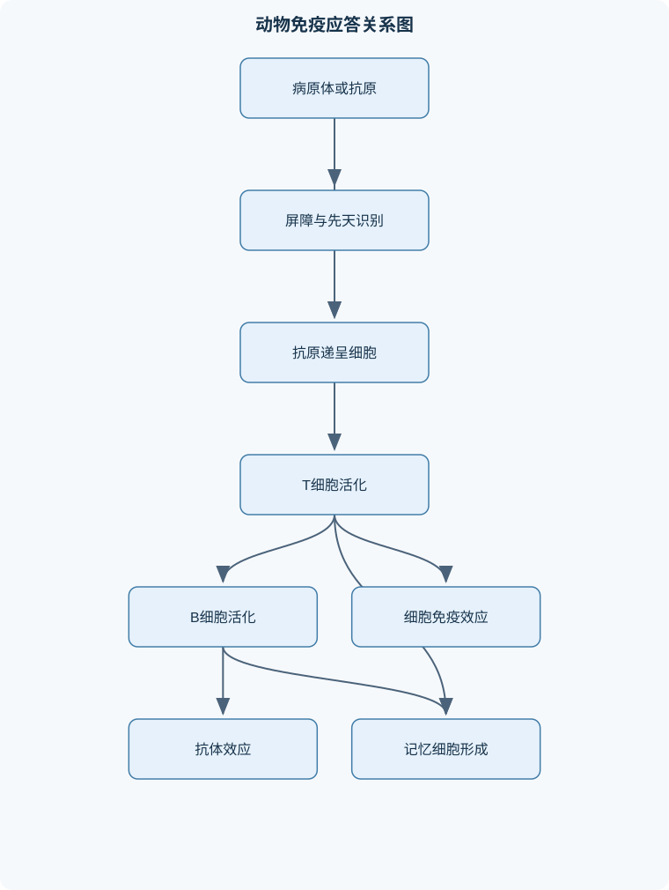
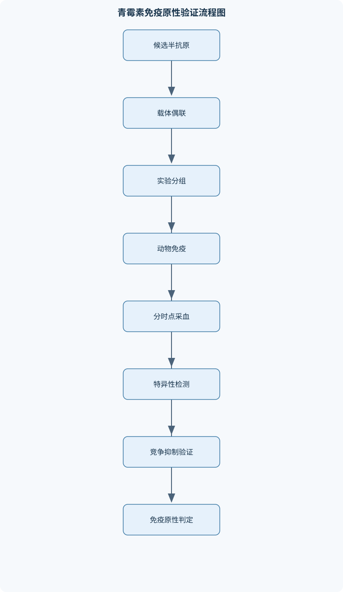

# 动物免疫学

## 一、课程整体知识框架

### 课程边界与先修知识

《动物免疫学》研究动物机体免疫系统的组成、结构与功能，抗原和抗体的分子基础，先天性免疫与适应性免疫，免疫应答的诱导、调节和效应，补体、细胞因子、超敏反应、免疫耐受、抗感染免疫、抗肿瘤免疫、免疫预防及常用免疫学检测方法。课程对象通常应具备动物生物化学、细胞生物学、分子生物学、动物生理学和微生物学基础。课程重点限于动物免疫学的一般原理及其在疫病防控、疫苗评价、免疫诊断和动物生产中的应用，不替代具体动物疾病的临床诊疗规范，也不展开药物剂量和特定疫苗产品说明。





### 1. 学科对象、基本问题与知识主线

动物免疫学研究动物机体如何识别异物或异常成分，如何启动并调节免疫应答，以及如何通过细胞、抗体、补体和组织屏障清除病原体、限制损伤并形成免疫记忆。免疫系统的功能不能简单概括为“杀灭病原体”，其基本功能至少包括免疫防御、免疫自稳和免疫监视三方面。免疫防御针对细菌、病毒、寄生虫及其毒素等外来因素；免疫自稳负责清除衰老或损伤细胞、维持组织内环境；免疫监视则识别部分异常转化细胞和持续感染细胞。免疫反应过弱可导致感染易感和免疫失败，反应过强或失去特异性则可能造成超敏反应、自身免疫和组织损伤。

课程的逻辑主线是“免疫系统组成—抗原识别—免疫应答—免疫效应—免疫调节—应用评价”。抗原（Ag）进入动物体内后，先受到皮肤、黏膜、分泌物、吞噬细胞和补体等先天性防线限制；能够持续存在的抗原由抗原递呈细胞（APC）摄取、加工并递呈给淋巴细胞。B细胞通过B细胞抗原受体（BCR）识别天然抗原，T细胞通过T细胞抗原受体（TCR）识别抗原肽与主要组织相容性复合体（MHC）形成的复合物。随后，淋巴细胞在共刺激分子和细胞因子参与下克隆扩增，形成抗体、效应T细胞和记忆细胞。抗体、补体、吞噬细胞、自然杀伤细胞（NK）和细胞毒性T细胞（CTL）共同执行清除作用。

动物免疫学的对象不是单一物种。哺乳动物和禽类在免疫器官、抗体类别、母源抗体转移方式、淋巴组织分布和疫苗接种程序方面存在差异。因此，人体免疫学中的机制可作为一般原理，但不能不加区别地套用于所有动物。例如，哺乳动物的骨髓是主要造血和B细胞发育场所，胸腺负责T细胞成熟；禽类的法氏囊是B细胞发育的重要中枢免疫器官，哈德氏腺与眼部黏膜免疫密切相关。具体动物的免疫学判断应同时考虑物种、年龄、组织部位、病原类型和实验条件。

### 2. 三个阶段和三个层次

免疫应答通常可按时间分为诱导、反应和效应三个阶段。诱导阶段包括抗原进入、捕获、加工、递呈以及淋巴细胞初始识别；反应阶段包括T细胞和B细胞的克隆选择、增殖和分化；效应阶段包括抗体中和、调理吞噬、补体激活、CTL杀伤、NK细胞介导的细胞毒作用及炎症细胞募集。抗原清除后，效应细胞数量下降，部分细胞转变为记忆细胞，部分通过凋亡消退。

免疫系统又可按功能分为屏障层、先天性免疫层和适应性免疫层。屏障层包括完整皮肤、呼吸道和消化道黏膜、黏液、纤毛运动、胃肠道酸性环境及正常微生物群。先天性免疫依靠模式识别受体（PRR）识别病原体相关分子模式（PAMP）或损伤相关分子模式（DAMP），反应速度快但特异性和记忆性有限。适应性免疫依靠BCR和TCR进行抗原特异性识别，初次反应较慢，但具有克隆扩增、免疫记忆和更强的再次应答能力。

### 3. 关键比较与因果关系

先天性免疫和适应性免疫并非彼此独立。病原体被巨噬细胞或树突状细胞摄取后，PRR信号可诱导炎症因子、趋化因子和共刺激分子表达，从而决定后续T细胞分化方向；适应性免疫产生的抗体又可通过Fc受体增强吞噬，并可启动补体。因此，免疫应答的结果取决于病原特征、抗原剂量、进入途径、组织环境、宿主营养和免疫状态等共同因素。

T细胞充分活化可表示为三个必要条件：

$$
\text{T细胞活化} = \text{第一信号}+\text{第二信号}+\text{分化信号}
$$

第一信号是TCR识别抗原肽-MHC复合物；第二信号通常由CD28与APC上的共刺激分子结合产生；第三类信号来自白细胞介素（IL）、干扰素（IFN）等细胞因子，决定T细胞向Th1、Th2、Th17、Treg或CTL方向分化。该表达式是机制上的“必要条件组合”，不是可进行简单数值加法的定量公式。若只有第一信号而缺乏适当共刺激，T细胞可能进入无能或耐受状态；若炎症信号持续过强，则可能造成组织损伤。

免疫学检测结果也必须结合对照解释。常用的阳性判定可抽象为：

$$
\text{样本信号} - \text{背景信号} > \text{判定界值}
$$

其中样本信号可为ELISA中的光密度（OD），背景信号通常来自空白孔或阴性对照。OD无固定的生物学单位，不能脱离同批次空白、阴性和阳性对照直接比较。敏感性和特异性分别描述检测发现真实阳性和排除真实阴性的能力：

$$
\text{敏感性}=\frac{TP}{TP+FN}\times100\%
$$

$$
\text{特异性}=\frac{TN}{TN+FP}\times100\%
$$

式中，$TP$为真阳性，$FN$为假阴性，$TN$为真阴性，$FP$为假阳性。两式适用于已有可靠参照分类的检测评价，不等同于某个动物个体患病的概率，也不能仅凭抗体阳性判断现症感染或保护性免疫。

## 二、章节和模块划分

### 核心知识覆盖清单

本清单用于检查正文是否覆盖本课程的主要知识模块：

- **免疫学绪论与动物免疫系统概览**：免疫的基本概念与三项基本功能、免疫识别、免疫应答、免疫效应与免疫记忆、先天性免疫和适应性免疫的比较、中枢免疫器官与外周免疫器官、哺乳动物骨髓和胸腺的免疫功能、禽类法氏囊和哈德氏腺的免疫功能、淋巴结、脾脏和黏膜相关淋巴组织、免疫细胞的谱系来源与功能分工。
- **抗原、免疫原性与抗原识别**：抗原性、免疫原性和免疫反应性的定义、完全抗原、半抗原和载体效应、抗原表位的线性表位与构象表位、B细胞表位与T细胞表位的差异、影响免疫原性的异源性、分子大小和化学复杂性、抗原加工易感性与物理状态对免疫原性的影响、胸腺依赖性抗原与非胸腺依赖性抗原、细菌抗原、病毒抗原、毒素和类毒素、同种异型抗原、异嗜性抗原和交叉抗原、佐剂的作用原理及其适用边界。
- **免疫球蛋白与抗体**：免疫球蛋白的基本结构和链间连接、可变区、恒定区、高变区和互补决定区、Fab、Fc、铰链区及其生物学功能、木瓜蛋白酶和胃蛋白酶酶切片段的差异、IgG的结构、分布和主要效应、IgM的五聚体结构、早期应答和补体激活、IgA与分泌型IgA的黏膜免疫功能、IgE介导的过敏反应和抗寄生虫作用、IgD作为成熟B细胞表面受体的意义、抗体的中和、调理、凝集、沉淀、补体激活和ADCC作用。
- **免疫细胞、受体与细胞因子**：T细胞、B细胞和浆细胞的分化功能、CD4阳性辅助性T细胞和CD8阳性细胞毒性T细胞、TCR-CD3复合物和BCR复合物、CD4、CD8、CD28、CTLA-4和CD40L、树突状细胞、巨噬细胞和B细胞的抗原递呈功能、中性粒细胞、嗜酸性粒细胞、嗜碱性粒细胞和肥大细胞、NK细胞与抗体依赖性细胞介导的细胞毒作用、白细胞介素、干扰素、肿瘤坏死因子和集落刺激因子、趋化因子的定向募集作用、细胞因子的自分泌、旁分泌和短暂分泌特点。
- **抗原加工、递呈与淋巴细胞活化**：专职抗原递呈细胞的定义和类型、外源性抗原的内吞、内体降解和MHCⅡ类分子递呈、内源性抗原的蛋白酶体降解和MHCⅠ类分子递呈、TAP、内质网、Ii链和恒定链相关递呈机制、抗原肽-MHCⅠ复合物与CD8阳性T细胞识别、抗原肽-MHCⅡ复合物与CD4阳性T细胞识别、T细胞活化的第一信号、第二信号和细胞因子信号、B细胞对天然抗原的BCR识别、T细胞依赖性B细胞活化与CD40-CD40L作用、交叉递呈、脂类抗原递呈和滤泡树突状细胞功能。
- **先天性免疫与补体系统**：皮肤、黏膜和体液屏障、模式识别受体与病原体相关分子模式、吞噬细胞的趋化、吞噬、吞噬体成熟和杀菌、NK细胞识别异常细胞的基本机制、干扰素介导的抗病毒状态、补体系统的组成、酶原性质和级联放大、经典途径、旁路途径和凝集素途径、C3转化酶、C5转化酶和膜攻击复合物、C3b调理、C3a和C5a炎症介质作用、补体调节蛋白及补体过度激活的组织损伤。
- **适应性免疫应答与免疫调节**：免疫应答的致敏、反应和效应阶段、T细胞克隆选择、扩增和效应分化、Th1、Th2、Th17和Treg的主要功能、CD8阳性细胞毒性T细胞的靶细胞识别、穿孔素-颗粒酶途径和Fas-FasL途径、B细胞克隆扩增、浆细胞和记忆B细胞形成、生发中心反应、体细胞高频突变和亲和力成熟、抗体类别转换及其细胞因子调控、初次免疫应答与再次免疫应答的差异、免疫应答终止、AICD、被动细胞死亡和免疫调节。
- **免疫耐受、超敏反应与自身免疫**：免疫耐受的定义和抗原特异性、中枢耐受与外周耐受、T细胞删除、无能、抑制和Treg调节、B细胞受体编辑、无能和克隆删除、低剂量与高剂量抗原诱导耐受的条件、Ⅰ型超敏反应的IgE、肥大细胞和嗜碱性粒细胞机制、Ⅱ型超敏反应的抗体依赖性细胞损伤、Ⅲ型超敏反应的免疫复合物沉积和补体损伤、Ⅳ型超敏反应的T细胞和巨噬细胞介导机制、青霉素半抗原化及其可能引发的四型超敏反应。
- **动物抗感染免疫与抗肿瘤免疫**：机体抗细菌感染的屏障、吞噬和补体机制、细胞外细菌感染的抗体、调理和补体效应、细胞内细菌感染的Th1、IFN-γ和巨噬细胞活化、抗病毒感染的干扰素、NK细胞和细胞毒性T细胞、黏膜分泌型IgA的局部中和作用、抗寄生虫感染中的IgE、嗜酸性粒细胞和肥大细胞、抗体依赖性细胞介导的细胞毒作用、肿瘤抗原、MHCⅠ表达和免疫逃逸、CD8阳性T细胞、NK细胞和巨噬细胞的抗肿瘤作用、免疫损伤与病原体清除之间的平衡。
- **疫苗、免疫预防与动物群体免疫**：天然主动免疫、天然被动免疫和人工免疫、人工主动免疫与人工被动免疫的特点、活疫苗、灭活疫苗、亚单位疫苗和重组疫苗、多价疫苗、联苗和黏膜免疫疫苗、抗原剂量、佐剂和接种途径对免疫应答的影响、母源抗体对幼龄动物免疫接种的干扰、疫苗质量、保存运输和接种操作对免疫效果的影响、动物遗传、营养、应激和环境因素造成的免疫失败、病原血清型差异和免疫逃逸导致的保护失败、免疫效果评价中的抗体、细胞免疫和保护性攻毒指标。
- **免疫学检测与实验设计**：抗原抗体反应的特异性、可逆性和比例关系、凝集反应、沉淀反应和补体结合反应、酶联免疫吸附试验的固相结合和信号判读、免疫荧光和免疫组织化学的基本原理、免疫印迹用于抗原组分分析、流式细胞术检测细胞表面标志和细胞因子、中和试验和抗体保护性评价、抗体效价、敏感性、特异性和阳性判定界值、青霉素免疫原性验证的对照、免疫和检测设计、动物免疫学实验中的随机化、重复、阴阳性对照和结果解释。


### 1. 免疫学绪论与动物免疫系统概览

本模块首先界定免疫识别、免疫应答、免疫效应和免疫记忆。免疫识别是受体与抗原决定簇或病原模式发生选择性结合；免疫应答是由识别引起的细胞、分子和组织反应；免疫效应是最终的中和、吞噬、裂解、杀伤或炎症反应；免疫记忆是初次应答后形成的长期细胞群，使再次暴露时潜伏期缩短、反应强度提高。

免疫器官分为中枢和外周两类。骨髓和胸腺属于哺乳动物主要中枢免疫器官，前者产生血细胞并支持B细胞发育，后者提供T细胞选择和成熟环境。禽类法氏囊参与B细胞发育，哈德氏腺与眼部和上呼吸道黏膜免疫有关。淋巴结过滤淋巴液并促进局部抗原递呈，脾脏过滤血液、清除血源性抗原和衰老红细胞，黏膜相关淋巴组织则监视呼吸道、消化道和泌尿生殖道抗原。造血干细胞分化为髓系和淋巴系谱系；B细胞、T细胞、浆细胞、NK细胞、巨噬细胞、树突状细胞、中性粒细胞和嗜酸性粒细胞因受体、定位和效应分子不同而承担不同任务。

### 2. 抗原、免疫原性与抗原识别

抗原性是物质与相应抗体或T细胞受体发生特异性反应的性质；免疫原性是诱导特异性免疫应答的能力；免疫反应性通常指抗原被既有抗体或效应淋巴细胞识别的能力。完全抗原同时具有免疫原性和免疫反应性。半抗原通常能够与特异性抗体结合，但分子量小或结构简单，单独不能有效诱导免疫应答；与载体蛋白偶联后，载体提供T细胞帮助，半抗原决定簇则形成特异性识别目标。

抗原表位可以是连续氨基酸构成的线性表位，也可以由蛋白折叠后空间上接近的残基形成构象表位。B细胞可识别天然抗原表面的空间结构，T细胞通常识别经加工形成的抗原肽-MHC复合物。因此，蛋白质变性可能破坏构象表位，却暴露线性表位；同一抗原在抗体检测和T细胞检测中的主要表位不一定相同。

异源性、分子大小、化学复杂性、抗原加工易感性、物理状态、给药途径和剂量共同影响免疫原性。一般而言，结构越复杂、与宿主差异越大、能够被APC摄取和加工的物质越容易诱导应答，但这不是绝对规律。胸腺依赖性抗原（TD-Ag）通常需要T细胞帮助，可诱导类别转换、亲和力成熟和记忆细胞形成；非胸腺依赖性抗原（TI-Ag）可通过重复表位或先天性受体直接强烈刺激B细胞，但记忆和亲和力成熟通常较弱。细菌表面多糖、病毒蛋白、毒素和类毒素的免疫学性质不同，不能仅按“病原体”这一名称判断其应答方式。

佐剂通过形成抗原储存、增强局部炎症、促进APC成熟或提供先天性免疫信号来增强应答。佐剂不是抗原替代物，也不保证产生保护性免疫；过强炎症可能造成局部损伤，某些佐剂还会改变Th细胞分化方向。适用边界应根据动物物种、接种途径、抗原性质、安全要求和目标免疫类型判断。

### 3. 免疫球蛋白与抗体

免疫球蛋白（Ig）由重链和轻链组成，链间通过二硫键连接。可变区包含高变区和互补决定区（CDR），决定抗原结合特异性；恒定区决定类别和效应功能。Fab是抗原结合片段，Fc参与补体结合以及与吞噬细胞、NK细胞和肥大细胞上的Fc受体结合；铰链区提供一定柔性，使抗体适应不同抗原间距。

木瓜蛋白酶主要将抗体切为两个Fab片段和一个Fc片段，Fab仍能结合抗原但缺乏完整Fc效应；胃蛋白酶在铰链区下方切割，保留可同时结合两个抗原决定簇的F(ab')2片段，而Fc被破坏。该差异可用于解释抗体的结合功能与效应功能如何被实验性分离。

IgM常以五聚体形式存在，初次应答早期出现，具有较强凝集和补体激活能力；IgG主要分布于血液和组织液，具有中和、调理、补体激活和ADCC等功能；IgA在黏膜和分泌液中发挥作用，分泌型IgA由二聚体IgA、J链和分泌片组成，主要阻断病原体黏附和局部中和；IgE与肥大细胞和嗜碱性粒细胞结合，参与Ⅰ型超敏反应及抗寄生虫防御；IgD主要作为成熟B细胞表面受体之一。实际抗体类别、亚类和母源抗体转移方式具有物种差异，不能将所有动物的Ig分类完全等同。

抗体不是直接“吞噬”或“杀死”所有病原体。中和是阻断病毒、毒素或黏附分子与靶细胞结合；调理是抗体Fc段与吞噬细胞Fc受体结合，促进吞噬；凝集和沉淀分别适用于颗粒性和可溶性抗原；补体激活可导致调理、炎症和膜攻击复合物（MAC）形成；ADCC则由效应细胞通过Fc受体识别已被抗体包被的靶细胞。

### 4. 免疫细胞、受体与细胞因子

B细胞识别天然抗原后可分化为浆细胞和记忆B细胞，浆细胞大量分泌抗体。CD4阳性T细胞主要通过细胞因子和接触依赖信号辅助其他细胞，CD8阳性CTL则识别抗原肽-MHCⅠ复合物并杀伤靶细胞。TCR-CD3复合物负责信号传递，BCR复合物负责B细胞抗原识别和活化。CD4、CD8参与MHC限制性识别，CD28提供共刺激，CTLA-4传递抑制信号，CD40L与B细胞CD40结合，是T细胞依赖性抗体应答的重要环节。

树突状细胞擅长启动初始T细胞应答，巨噬细胞兼具吞噬、抗原递呈和炎症效应，B细胞也可递呈其BCR摄取的抗原。中性粒细胞快速吞噬和释放杀菌物质；嗜酸性粒细胞在寄生虫防御和部分超敏反应中重要；嗜碱性粒细胞和肥大细胞可在IgE交联后释放组胺等介质。NK细胞能识别MHCⅠ表达降低或应激配体增加的异常细胞，并可通过Fc受体参与ADCC。

细胞因子包括IL、IFN、TNF和CSF等，趋化因子负责定向募集白细胞。细胞因子作用具有自分泌、旁分泌和短暂分泌特点，效应取决于受体表达、浓度、作用时间和组织环境。不能把某一种细胞因子固定归于单一细胞来源，也不能把体外高浓度效应直接等同于动物体内效应。

### 5. 抗原加工、递呈与淋巴细胞活化

外源性蛋白抗原通常被APC内吞或吞噬，在内体和吞噬溶酶体中降解；MHCⅡ分子在内质网合成时与不变链结合，防止错误装载，随后在内体中去除相关片段并装载抗原肽，最终递呈给CD4阳性T细胞。内源性抗原通常在细胞质中被泛素化并经蛋白酶体降解，肽段由TAP转运进入内质网，与MHCⅠ装配后经高尔基体到达细胞表面，供CD8阳性T细胞识别。

该规律可按以下步骤判断：先确定抗原来源，再确定加工区室，随后确定MHC类别和识别细胞，最后判断效应。病毒感染细胞和肿瘤细胞内合成的异常蛋白通常走MHCⅠ-CTL通路；灭活蛋白疫苗和细菌外毒素常走MHCⅡ-CD4通路。但外源性抗原可通过交叉递呈进入MHCⅠ途径，脂类抗原可由特殊递呈分子呈递，不能把“外源性”与“MHCⅡ”绝对等同。

B细胞通过BCR识别天然抗原，随后内吞抗原并将肽段递呈给辅助性T细胞。T细胞依赖性B细胞活化需要BCR信号、CD40-CD40L信号和细胞因子信号，之后发生克隆扩增、生发中心反应、体细胞高频突变、亲和力成熟和类别转换。类别转换改变重链恒定区，通常不改变原有抗原结合特异性，但会改变组织分布和效应功能。

### 6. 先天性免疫与补体系统

先天性免疫包括皮肤、黏膜、吞噬细胞、NK细胞、干扰素和补体。PRR识别PAMP后诱导炎症介质和抗病毒基因表达。吞噬细胞经历趋化、黏附、吞噬、吞噬体成熟、与溶酶体融合及杀菌过程；氧依赖和氧非依赖机制共同参与病原清除。Ⅰ型干扰素可使邻近细胞进入抗病毒状态，但不能保证完全阻断病毒复制。

补体主要成分包括C1至C9及相关调节蛋白，通常以酶原形式存在，通过级联放大产生效应。经典途径由抗原-抗体复合物启动，旁路途径可在特定病原体表面直接放大C3沉积，凝集素途径由识别病原糖结构的分子启动。三条途径都形成C3转化酶，裂解C3为C3a和C3b；随后形成C5转化酶，产生C5a和C5b。C3b主要发挥调理作用，C3a和C5a参与炎症，C5b至C9形成MAC。

补体过度激活可导致血管通透性增加、白细胞募集、旁观者组织损伤和免疫复合物相关炎症。宿主通过补体调节蛋白限制级联反应，因此补体缺陷可能增加感染易感，调节失衡则可能造成组织损伤。补体检测中，单纯总补体水平下降不能直接确定某一途径缺陷，需结合功能试验、临床表现和其他免疫指标分析。

### 7. 适应性免疫应答与免疫调节

T细胞经克隆选择后扩增并分化。Th1偏向促进巨噬细胞活化和细胞内病原清除，Th2与体液免疫、嗜酸性粒细胞和IgE反应相关，Th17参与黏膜防御和中性粒细胞募集，Treg通过抑制性细胞因子、细胞接触和消耗生长因子等方式限制过度免疫。上述功能是倾向性概括，实际分化取决于抗原、细胞因子、组织和时间。

CTL识别靶细胞抗原肽-MHCⅠ复合物后形成免疫突触，主要通过穿孔素-颗粒酶途径和Fas-FasL途径诱导靶细胞凋亡。凋亡不同于补体造成的直接膜破裂；CTL也可与靶细胞分离后继续杀伤其他靶细胞。B细胞在生发中心中发生亲和力成熟和类别转换，初次应答通常先出现IgM，潜伏期较长、峰值较低；再次应答依赖记忆细胞，潜伏期缩短、抗体峰值较高、亲和力提高，并可主要产生IgG、IgA或IgE等类别转换抗体。

抗原清除后，细胞因子减少，效应细胞通过AICD或被动细胞死亡（PCD）减少，免疫反应终止。终止不是“免疫系统关闭”，而是效应细胞、抑制受体、Treg和组织修复共同恢复稳态。

### 8. 免疫耐受、超敏反应与自身免疫

免疫耐受是对特定抗原的特异性低反应或无反应，不等于所有免疫功能降低。中枢耐受发生于胸腺和骨髓，包括自身反应性T细胞删除、B细胞受体编辑和克隆删除；外周耐受包括无能、抑制、调节性T细胞作用及缺乏共刺激条件下的功能沉默。低剂量或高剂量抗原均可能诱导耐受，但结果取决于剂量、给药途径、抗原持续时间、炎症背景和动物年龄，不能仅按剂量高低作绝对判断。

Ⅰ型超敏反应以IgE、肥大细胞和嗜碱性粒细胞为核心，通常表现为速发反应；Ⅱ型由针对细胞或组织抗原的抗体介导，可通过补体裂解、吞噬清除或ADCC造成损伤；Ⅲ型由免疫复合物沉积并激活补体，引起血管和组织炎症；Ⅳ型由T细胞、巨噬细胞和炎症因子介导，通常具有迟发特点。

青霉素等小分子可作为半抗原，与红细胞或组织蛋白共价结合后形成完整抗原。药物相关红细胞损伤可表现为药物吸附于红细胞后被抗体识别、药物-抗体复合物沉积于红细胞表面，或诱导针对红细胞膜抗原的自身抗体。三者在抗原位置、抗体结合对象、补体参与程度和脾脏吞噬清除方式上不同，仅凭“用药后贫血”不能完成机制分型。

### 9. 动物抗感染免疫与抗肿瘤免疫

抗细菌免疫首先依靠屏障和吞噬。细胞外细菌可被抗体调理，随后由吞噬细胞通过Fc受体和补体受体摄取；补体还可促进炎症和部分细菌裂解。细胞内细菌则需要Th1细胞产生IFN-γ，增强巨噬细胞杀菌能力，抗体对已进入细胞质或吞噬细胞内部的病原体作用有限。

抗病毒免疫具有明显时序性。黏膜分泌型IgA可阻断病毒黏附和进入；血液中的IgM和IgG可中和游离病毒并促进清除；感染早期的干扰素限制复制，NK细胞快速杀伤异常细胞，随后CTL清除表达病毒抗原肽-MHCⅠ的感染细胞。抗病毒免疫若过强，也可能造成组织损伤，因此保护性免疫与免疫病理必须同时评价。

抗寄生虫免疫常涉及IgE、嗜酸性粒细胞、肥大细胞和ADCC。抗肿瘤免疫则依赖肿瘤抗原递呈、MHCⅠ表达、CTL、NK细胞和巨噬细胞。肿瘤可通过降低抗原表达、下调MHCⅠ、产生免疫抑制因子或形成免疫抑制微环境逃避免疫监视。病原清除并不必然意味着组织恢复，免疫效应与炎症损伤之间需要保持平衡。

### 10. 疫苗、免疫预防与动物群体免疫

天然主动免疫来自自然感染后的自身应答，天然被动免疫来自母源抗体或其他自然获得的抗体；人工主动免疫通过接种疫苗诱导自身应答，人工被动免疫通过输入抗体获得立即但通常短暂的保护。活疫苗、灭活疫苗、亚单位疫苗和重组疫苗在复制能力、安全性、免疫持续时间和免疫途径方面不同，不能脱离动物日龄、病原特点和管理条件比较优劣。多价疫苗和联苗可覆盖多个抗原，但可能引入抗原竞争或免疫程序复杂性；黏膜疫苗更有利于诱导局部分泌型IgA，但局部抗体结果不能直接替代血清抗体结果。

疫苗效果受抗原剂量、佐剂、接种途径、保存运输、配制和操作影响。幼龄动物的母源抗体可提供早期保护，也可能中和疫苗抗原而干扰主动免疫。动物遗传背景、营养、应激、免疫抑制疾病、环境卫生、接种覆盖率和病原血清型差异都可能导致免疫失败。评价疫苗不能只看抗体，应结合抗体滴度变化、细胞免疫、病原排出、临床保护和必要的规范性攻毒指标。

### 11. 免疫学检测与实验设计

凝集反应适合颗粒性抗原或包被颗粒，沉淀反应适合可溶性抗原；二者都受抗原抗体比例影响，抗原过量或抗体过量均可能出现低反应，即比例区效应。补体结合反应依赖补体消耗和指示系统，判读时必须设置抗原、抗体、补体和指示红细胞等对照。

ELISA通过固相吸附抗原或抗体，经过特异性结合、酶标记物结合和底物显色产生OD信号。免疫荧光利用荧光标记抗体定位抗原，免疫组织化学将免疫识别与组织形态结合，免疫印迹用于按分子量分离后分析抗原组分，流式细胞术可检测细胞表面标志、细胞群比例和部分细胞因子。中和试验更接近抗体的功能性保护，但需严格控制病原、细胞、血清稀释和结果判定条件。

实验设计应包括明确问题、合理分组、随机化、足够重复、阴性与阳性对照、空白对照和预先确定的判定标准。检测到抗体不等于检测到保护性免疫，检测到免疫反应也不等于动物已经清除病原体。青霉素免疫原性验证应至少比较空白组、载体蛋白组、青霉素单独组和青霉素-载体偶联物组，并通过竞争抑制或拆分抗原等方法排除载体抗体和非特异性吸附。

### 12. 代表性分析流程与伪代码

#### 流程一：抗原递呈路径判定

**输入**：抗原来源、抗原类型、APC或感染细胞信息。  
**输出**：主要加工区室、MHC类别、识别细胞及效应类型。  
**步骤**：

1. 判断抗原是在细胞外摄取，还是在细胞内合成。
2. 外源性蛋白通常进入内体-溶酶体和MHCⅡ通路；内源性蛋白通常进入蛋白酶体-TAP-MHCⅠ通路。
3. 判断是否存在交叉递呈、脂类抗原递呈或其他特殊路径。
4. 根据MHC类别确定主要识别细胞：MHCⅠ主要由CD8阳性T细胞识别，MHCⅡ主要由CD4阳性T细胞识别。
5. 检查共刺激和细胞因子条件，区分效应性活化与耐受。

不变量是抗原来源、加工路径和MHC限制关系必须前后一致；终止条件是形成稳定抗原肽-MHC复合物并完成表面递呈。该流程适合疫苗、病毒感染和肿瘤抗原分析，不适合把所有抗原强行归入单一路径。

#### 流程二：补体途径判读

**输入**：血清、病原体、抗原抗体复合物及补体功能信息。  
**输出**：激活途径、关键转化酶和主要效应。  
**步骤**：

1. 判断是否存在能启动经典途径的抗原-抗体复合物。
2. 判断病原表面是否促进旁路途径C3沉积。
3. 判断是否存在可被凝集素识别的病原糖结构。
4. 追踪C3转化酶、C5转化酶、C3b调理、C5a趋化和MAC形成。
5. 结合调节蛋白和补体消耗情况解释组织损伤或检测异常。

三条途径最终均汇聚于C3活化和终末攻击阶段；补体效应停止的条件包括病原清除、调节蛋白抑制或底物耗竭。

#### 流程三：免疫检测结果判定

```text
语言：伪代码

输入：空白值B、阴性对照N、阳性对照P、样本重复值S、判定界值C
输出：阳性、阴性、可疑或重做

若 B、N、P 不满足本实验预设质量控制范围：
    输出“实验无效，重新实验”
否则：
    对每个样本计算平均信号 M
    计算背景校正值 R = M - B
    检查重复孔差异是否超过预设允许范围
    若重复孔不一致：
        输出“样本需复测”
    否则若 R >= C：
        输出“阳性，结合临床和其他指标解释”
    否则若 R 接近 C：
        输出“可疑，建议复检或采用其他方法确认”
    否则：
        输出“阴性，不能排除窗口期或检测灵敏度限制”
```

该流程的复杂度主要为每个样本一次平均和一次比较，若有$n$个样本，计算量为$O(n)$；但实验质量不由计算复杂度决定，关键在于对照合格、重复性良好、界值来源合理以及样本采集时间适当。

### 13. 代表性例题

#### 例题一：外源性与内源性抗原递呈

**题干**：某动物感染病毒，病毒蛋白在感染细胞内合成；另给动物注射灭活蛋白疫苗。分别说明两种抗原的加工区室、MHC类别和主要识别细胞。

**分析**：病毒蛋白属于细胞内合成的内源性抗原，灭活蛋白疫苗通常是细胞外摄取的外源性抗原。

**解答**：病毒蛋白先经泛素化和蛋白酶体降解，肽段由TAP转运至内质网，与MHCⅠ结合后递呈给CD8阳性CTL；灭活蛋白被APC内吞，在内体或吞噬溶酶体中降解，与MHCⅡ结合后递呈给CD4阳性T细胞。若灭活疫苗被树突状细胞交叉递呈，则部分外源性抗原也可进入MHCⅠ通路。

**结果验证**：检测细胞表面抗原肽-MHCⅠ或MHCⅡ复合物，并分别观察CTL杀伤或CD4细胞因子反应。

**变式**：若抗原为脂类，应考虑特殊脂类递呈分子，不能直接套用蛋白抗原的两条经典路径。

#### 例题二：初次和再次免疫应答

**题干**：某动物第0天首次免疫，第28天加强免疫。首次免疫后第7天抗体较低，第14天IgM升高；加强免疫后第7天IgG快速升高。解释原因。

**分析**：首次应答需要初始淋巴细胞活化和克隆扩增，潜伏期较长；加强免疫依赖记忆细胞。

**解答**：首次应答早期通常先产生IgM，抗体峰值较低、持续时间较短；生发中心反应后形成类别转换和记忆B细胞。再次免疫时，记忆B细胞迅速增殖，产生高亲和力、类别转换后的IgG，因此潜伏期缩短、峰值较高。

**结果验证**：比较两次应答的潜伏期、峰值、持续时间和抗体亲和力。单独测血清IgG不能完整代表细胞免疫。

**变式**：若加强免疫后抗体仍低，应排查母源抗体、免疫抑制、疫苗保存和接种操作，而不能仅归因于动物“没有免疫力”。

#### 例题三：青霉素免疫原性验证

**题干**：设计实验判断青霉素是否具有免疫原性。

**分析**：青霉素作为小分子半抗原，关键是验证其是否与载体偶联后能诱导针对青霉素决定簇的特异性应答。

**解答步骤**：

1. 设置空白组、载体蛋白组、青霉素单独组、青霉素-载体偶联物组，并设置必要的佐剂对照。
2. 按相同动物条件、相同免疫程序和相同采样时间进行免疫。
3. 以青霉素相关抗原包被ELISA板，检测特异性抗体。
4. 用载体蛋白单独包被检测载体抗体，排除载体反应。
5. 进行竞争抑制实验，若游离青霉素或相关决定簇能抑制抗体结合，支持反应具有青霉素特异性。
6. 必要时检测特异性淋巴细胞反应，区分抗体反应与细胞免疫反应。

**结果验证**：只有偶联物组出现可重复、可抑制、且不能由载体单独解释的特异性反应，才能说明偶联后的青霉素具有免疫原性。该结果不等于其一定产生保护性免疫。

**变式**：若青霉素单独组也出现弱阳性，首先排查非特异性吸附、佐剂效应和检测抗原结构差异。

#### 例题四：补体途径判断

**题干**：抗体包被细菌、无特异性抗体但表面易沉积C3的细菌，以及含可识别糖结构的病原体，分别主要启动哪条补体途径？

**解答**：抗体包被细菌主要启动经典途径；无抗体但能促进C3沉积的细菌主要通过旁路途径放大；含可识别糖结构的病原体可启动凝集素途径。三者最终都形成C3转化酶并裂解C3，随后形成C5转化酶，产生C5a炎症效应和C5b至C9的MAC。C3b主要负责调理。

**结果验证**：检测途径特异性功能、C3裂解产物和终末补体活性。单一补体总量正常不能排除某条途径功能障碍。

**变式**：若存在补体调节蛋白过度表达，可能出现病原体未被有效清除但组织损伤较轻的结果。

#### 例题五：超敏反应分型

**题干**：动物用药后出现红细胞减少，可能为药物吸附于红细胞膜后被抗体识别、药物-抗体复合物沉积，或产生针对红细胞膜的抗体。如何分析？

**解答**：先确认暴露史、起病时间、红细胞表面是否有药物或免疫球蛋白、补体是否沉积，并检测血清中相关抗体。若药物吸附于红细胞后形成新抗原，属于抗体针对药物-细胞复合结构；若循环中的药物-抗体复合物沉积，可伴补体激活和血管内炎症；若抗体直接识别红细胞膜抗原，则更接近针对细胞表面抗原的Ⅱ型机制。脾脏巨噬细胞介导的吞噬可导致血管外清除，补体强烈激活也可能导致血管内裂解。

**结果验证**：应结合直接或间接抗球蛋白检测、补体沉积、药物暴露对照和红细胞寿命变化，不能只凭贫血程度分型。

**变式**：若症状主要发生在再次用药后数分钟，并伴全身瘙痒和呼吸道表现，应另行考虑IgE介导的Ⅰ型超敏反应，而非仅按溶血机制解释。

### 14. 实验与项目流程

#### 项目一：抗原递呈路径验证

**输入数据**：外源性蛋白抗原、感染细胞或肿瘤细胞、APC、MHCⅠ/MHCⅡ和CD4/CD8检测体系。  
**步骤**：

1. 将外源性抗原加入APC培养体系，设置无抗原、无APC和抗原加工抑制相关对照。
2. 以流式细胞术或免疫检测观察MHCⅡ相关递呈，检测CD4细胞活化标志或细胞因子。
3. 对内源性抗原模型检测MHCⅠ相关递呈和CD8细胞杀伤。
4. 设置交叉递呈条件，比较普通外源性递呈和MHCⅠ相关信号。
5. 对每组设置生物学重复和阴阳性对照。

**评价标准**：对照合格；重复间差异在预设范围内；外源性抗原主要诱导MHCⅡ-CD4反应，内源性抗原主要诱导MHCⅠ-CD8反应；交叉递呈结果需有独立证据支持。

**排错方法**：若所有组均无信号，检查细胞活性、抗原浓度、抗体或试剂有效性；若阴性对照也阳性，排查非特异性染色和交叉污染；若CD4/CD8结果混乱，检查抗原来源、MHC表达和细胞群纯度。

#### 项目二：动物群体疫苗免疫失败排查

**输入数据**：免疫程序、动物日龄和批次、疫苗身份与有效期、冷链记录、接种途径、抗体检测结果、疾病发生资料、病原分型和群体覆盖率。

**步骤**：

1. 核对疫苗批号、有效期、保存温度、稀释和使用时间。
2. 核对实际接种剂量、途径、器械和操作人员记录。
3. 按日龄和批次比较抗体水平，评估母源抗体干扰。
4. 调查营养、应激、免疫抑制性疾病和环境卫生。
5. 对发病动物进行病原检测和血清型分析，排查疫苗株与流行株不匹配。
6. 复核检测方法、阴阳性对照、采样时间和判定界值。

**评价标准**：每项判断均有记录或检测证据；能够区分疫苗因素、宿主因素、病原因素、操作因素和评价因素；提出的纠正措施能够通过复查抗体、病原和临床保护进行验证。

**排错方法**：抗体低但无发病时，优先复核采样时间、母源抗体和检测方法；抗体高但仍发病时，重点检查血清型差异、抗体是否具有中和功能、病原暴露剂量和细胞免疫状态；同群部分动物阳性、部分阴性时，调查接种覆盖率、个体健康状况和操作均一性。

## 三、核心概念的详细解释

### 1. 免疫系统的功能、层次与动物种属差异

免疫系统具有免疫防御、免疫自稳和免疫监视三项基本功能。免疫防御是识别并清除细菌、病毒、寄生虫、毒素等外来因素；免疫自稳是清除衰老、损伤或异常代谢产物，维持组织内环境；免疫监视是识别并限制部分持续感染细胞和异常转化细胞。三者并非彼此独立：同一种炎症反应既可能清除病原体，也可能因持续过强而造成组织损伤。

免疫应答可按时间分为诱导、反应和效应三个阶段。诱导阶段包括抗原进入、捕获、加工、递呈及淋巴细胞初始识别；反应阶段包括淋巴细胞克隆选择、增殖和分化；效应阶段包括抗体中和、调理吞噬、补体激活、细胞毒性T细胞（CTL）杀伤和炎症细胞募集。抗原清除后，效应细胞大部分凋亡，少部分转化为记忆细胞，使再次暴露时的反应更快、更强。

免疫防线可分为屏障、先天性免疫和适应性免疫三个层次。皮肤、角化上皮、黏液、纤毛、胃肠道化学环境和正常微生物群构成第一道屏障。先天性免疫依靠模式识别受体（PRR）识别病原体相关分子模式（PAMP）或损伤相关分子模式（DAMP），反应迅速，但通常不能针对某一抗原形成高度特异的长期记忆。适应性免疫依靠B细胞抗原受体（BCR）和T细胞抗原受体（TCR）进行特异性识别，具有克隆扩增、效应分化和免疫记忆等特征。

动物免疫学不能简单等同于人体免疫学。哺乳动物骨髓是造血和B细胞发育的重要场所，胸腺是T细胞成熟的中枢免疫器官；禽类法氏囊是B细胞发育的重要中枢免疫器官，哈德氏腺与眼部及上呼吸道黏膜免疫密切相关。淋巴结主要过滤淋巴液并组织局部免疫应答，脾脏过滤血液、清除衰老血细胞并参与对血源性抗原的应答，黏膜相关淋巴组织则负责呼吸道、消化道和泌尿生殖道的局部防御。不同动物的抗体亚类、母源抗体转移途径、淋巴组织结构和疫苗接种程序均可能不同，因此具体判断必须结合物种、年龄、组织部位和病原类型。

### 2. 抗原、免疫原性与抗原表位

抗原（Ag）是能够被特异性抗体、BCR或TCR识别，或能与相应抗体、效应淋巴细胞发生特异性反应的物质。抗原性通常指与特异性抗体或免疫细胞发生反应的能力；免疫原性是诱导机体产生特异性抗体或效应淋巴细胞的能力；免疫反应性是抗原与相应抗体或免疫细胞结合、反应的能力。二者不能混为一谈。

完全抗原同时具有免疫原性和免疫反应性，例如许多异源性蛋白。半抗原通常只有免疫反应性而缺少足以诱导免疫应答的结构，青霉素、小分子化学物质和部分药物可表现为半抗原。半抗原与载体蛋白共价结合后，载体提供足够的分子大小和T细胞辅助条件，半抗原决定簇则提供特异性识别结构，形成可能具有免疫原性的半抗原—载体偶联物。载体效应说明：抗体是否针对半抗原产生，不能仅凭对载体蛋白的抗体升高判断。

抗原表位是抗原分子中被抗体、BCR或TCR实际识别的局部结构。B细胞表位通常位于天然抗原表面，可识别线性表位或由空间折叠形成的构象表位；蛋白质变性可能破坏构象表位，但线性表位有时仍可保留。T细胞表位通常是抗原加工后形成的短肽，必须与MHCⅠ或MHCⅡ分子结合后才能被TCR识别。因此，B细胞识别天然抗原，T细胞主要识别抗原肽-MHC复合物。

影响免疫原性的主要因素包括异源性、分子大小、结构复杂性、抗原加工易感性、物理状态、进入途径、剂量和宿主遗传背景。一般而言，结构越复杂、与宿主差异越大且易被抗原递呈细胞加工的分子，免疫原性越强；但这不是绝对规律。低剂量或高剂量抗原在特定条件下均可能诱导耐受，抗原剂量必须结合给药途径、持续时间、佐剂和宿主状态分析。

胸腺依赖性抗原（TD-Ag）通常为蛋白质，需要T细胞帮助，能够诱导生发中心反应、类别转换、亲和力成熟和记忆细胞形成。非胸腺依赖性抗原（TI-Ag）常具有高度重复的多糖或脂多糖结构，可交联大量BCR，主要诱导较快的抗体反应，但记忆和亲和力成熟通常较弱。佐剂可通过形成抗原储库、增强局部炎症、激活PRR、促进APC成熟或改变抗原递呈方式来增强免疫应答；佐剂不能替代抗原特异性，也不能保证产生保护性免疫。

### 3. 免疫球蛋白的结构与效应

免疫球蛋白（Ig）由两条相同的重链和两条相同的轻链组成，链间及链内二硫键维持其结构。可变区决定抗原结合特异性，其中互补决定区（CDR）形成抗原结合部位；恒定区决定抗体类别及其与补体、吞噬细胞、NK细胞或肥大细胞的相互作用。Fab是抗原结合片段，Fc是参与Fc受体结合和部分补体激活的可结晶片段，铰链区影响抗体分子的柔性。

木瓜蛋白酶从铰链区上方切割抗体，通常形成两个Fab片段和一个Fc片段；胃蛋白酶从铰链区下方切割，形成保持双价结合能力的F(ab')₂片段，并将Fc降解为小片段。二者的差别可用于解释抗体结合能力和效应功能的实验变化。

IgM常以五聚体形式存在于分泌状态，具有较强的凝集和补体激活能力，是初次体液免疫应答中通常最早出现的抗体类别。IgG主要分布于血液和组织液，具有中和、调理、补体激活和ADCC等作用；在许多哺乳动物中，IgG可通过胎盘或初乳等途径参与幼仔早期被动免疫，但不同动物的转移方式并不相同。IgA在黏膜和外分泌液中发挥重要作用，分泌型IgA通常为二聚体IgA、J链和分泌片组成的复合物，可中和病原体并阻断其黏附。IgE可通过Fc段结合肥大细胞和嗜碱性粒细胞，参与Ⅰ型超敏反应和抗寄生虫防御。IgD主要作为成熟B细胞表面的抗原受体之一，血清中含量通常较低。

抗体并不一定直接杀死病原体。中和是抗体阻断病毒、毒素或微生物黏附受体；调理是抗体Fc段与吞噬细胞Fc受体结合，促进吞噬；凝集和沉淀可使颗粒性或可溶性抗原形成较大复合物；补体激活可导致调理、炎症和膜攻击；ADCC是NK细胞等效应细胞通过Fc受体识别已被抗体包被的靶细胞并诱导其死亡。

### 4. 免疫细胞、受体和细胞因子

B细胞经抗原刺激和辅助性T细胞帮助后，可分化为浆细胞和记忆B细胞。浆细胞大量分泌抗体，记忆B细胞在再次遇到相同抗原时迅速应答。CD4阳性辅助性T细胞通过细胞因子和接触依赖信号调节巨噬细胞、B细胞和其他免疫细胞；CD8阳性CTL主要杀伤表达相应抗原肽-MHCⅠ复合物的靶细胞。

TCR与CD3构成T细胞受体复合物，TCR负责识别，CD3负责将识别信号传入细胞。BCR由膜型免疫球蛋白和信号转导分子组成，可直接识别天然抗原。CD4或CD8分别增强T细胞与MHCⅡ或MHCⅠ的结合；CD28与APC上的共刺激分子结合，促进初始T细胞活化；CTLA-4具有抑制性调节作用；CD40L与B细胞表面CD40结合，是T细胞依赖性B细胞活化、类别转换和生发中心反应的重要信号。

树突状细胞（DC）最适于启动初始T细胞应答；巨噬细胞既能吞噬和杀菌，也能递呈抗原并分泌炎症介质；B细胞可递呈其BCR捕获的抗原。中性粒细胞主要参与急性炎症和吞噬杀菌；嗜酸性粒细胞参与寄生虫防御和部分过敏反应；嗜碱性粒细胞和肥大细胞可释放组胺等介质；NK细胞通过识别异常低MHCⅠ表达、应激配体或抗体包被的靶细胞发挥杀伤作用。

细胞因子包括白细胞介素（IL）、干扰素（IFN）、肿瘤坏死因子（TNF）、集落刺激因子（CSF）和趋化因子等。其作用通常具有自分泌、旁分泌和短暂分泌特点，效果取决于受体分布、浓度、持续时间和组织环境。趋化因子主要形成浓度梯度，指导白细胞定向迁移，不能简单理解为一般性炎症因子。

### 5. 抗原加工、递呈与淋巴细胞活化

外源性蛋白抗原通常被APC通过内吞或吞噬摄取，在内体或吞噬溶酶体中降解为抗原肽。MHCⅡ分子在内质网合成时与不变链结合，防止其结合内源性肽；随后进入内体，与抗原肽交换并运输至细胞表面，供CD4阳性T细胞识别。

内源性抗原通常来源于病毒感染细胞或肿瘤细胞内部合成的异常蛋白。这些蛋白经泛素化后被蛋白酶体降解，肽段由TAP转运进入内质网，与新合成的MHCⅠ分子结合，经高尔基体到达细胞表面，供CD8阳性T细胞识别。外源性抗原也可能通过交叉递呈进入MHCⅠ途径，因此“外源性必然对应MHCⅡ”只是常规规律而非绝对规则。

T细胞充分活化需要三个层次的信号：第一信号是TCR识别抗原肽-MHC；第二信号是CD28等共刺激受体与APC相应配体结合；第三信号由细胞因子环境决定分化方向。第一信号存在而共刺激不足时，T细胞可能无能、耐受或删除。B细胞则可先通过BCR识别天然抗原，再将抗原内化、加工并通过MHCⅡ递呈给辅助性T细胞，CD40-CD40L及细胞因子共同促进其增殖和抗体类别转换。

### 6. 先天性免疫与补体系统

吞噬细胞的基本过程包括趋化、黏附、吞噬、吞噬体形成、吞噬体成熟、与溶酶体融合以及活性氧、活性氮、溶酶体酶和抗菌分子介导的杀菌。抗体和补体片段可通过调理作用增强这一过程。干扰素可诱导邻近细胞进入抗病毒状态，降低病毒复制相关蛋白的合成并增强异常细胞识别。

补体由多种血浆蛋白和膜结合调节蛋白组成，许多成分以酶原形式存在，通过级联裂解产生放大效应。经典途径通常由抗原—抗体复合物启动；旁路途径可在病原体表面直接发生C3沉积和放大；凝集素途径由识别病原体糖结构的凝集素启动。三条途径最终均汇聚于C3转化酶形成、C3裂解、C5活化及膜攻击复合物（MAC）形成。

C3b主要参与调理和补体受体介导的清除，C3a和C5a可促进炎症，C5a还具有趋化作用；C5b至C9形成MAC，对部分敏感细胞膜造成穿孔。补体调节蛋白可限制补体在宿主细胞表面的过度活化。调节不足或补体持续激活可能造成血管通透性增加、细胞损伤和免疫复合物相关炎症。

### 7. 适应性免疫、免疫调节与免疫记忆

T细胞活化后经历克隆扩增和效应分化。Th1主要促进巨噬细胞活化并增强细胞内病原体清除；Th2与B细胞帮助、嗜酸性粒细胞和寄生虫防御及部分过敏反应相关；Th17促进黏膜和中性粒细胞反应；Treg通过抑制性细胞因子、细胞接触和代谢调节限制过强免疫反应。Th1、Th2、Th17和Treg不是固定不变的标签，细胞功能会受到细胞因子环境和组织条件影响。

CTL通过TCR识别靶细胞表面的抗原肽-MHCⅠ复合物，在免疫突触处释放穿孔素和颗粒酶，或通过Fas-FasL通路诱导靶细胞凋亡。该过程主要是程序性死亡，不等同于补体MAC造成的膜裂解。效应CTL与靶细胞分离后仍可杀伤其他靶细胞。

B细胞在生发中心内发生体细胞高频突变和亲和力选择，形成亲和力成熟；类别转换改变重链恒定区，通常不改变原有抗原结合特异性，因此同一抗原特异性可从IgM转换为IgG、IgA或IgE。初次应答潜伏期较长，IgM通常先出现，峰值较低且持续较短；再次应答依靠记忆细胞，潜伏期缩短，抗体水平更高，亲和力提高，并常以类别转换后的抗体为主。

### 8. 免疫耐受与超敏反应

免疫耐受是免疫系统对特定抗原产生的特异性低反应或无反应状态，不等同于全身免疫功能抑制。中枢耐受发生于胸腺和骨髓，主要通过高亲和力自身反应性T细胞或B细胞的删除、受体编辑等方式建立。外周耐受包括无能、克隆删除、Treg抑制和免疫抑制性组织环境。低剂量或高剂量抗原均可能诱导耐受，但结果取决于抗原持续时间、递呈细胞状态、共刺激水平和宿主年龄。

Ⅰ型超敏反应主要由IgE、肥大细胞和嗜碱性粒细胞介导，首次暴露导致致敏，再次暴露时抗原交联细胞表面IgE，诱导脱颗粒和炎症介质释放。Ⅱ型超敏反应由针对细胞或组织抗原的抗体介导，可通过补体裂解、吞噬清除或ADCC造成损伤。药物作为半抗原吸附于红细胞膜、与红细胞形成药物—抗体—细胞复合物，或诱导抗体直接识别红细胞膜抗原，均可能导致药物相关溶血。Ⅲ型超敏反应由可溶性免疫复合物沉积、补体激活和中性粒细胞炎症造成组织损伤。Ⅳ型超敏反应主要由T细胞、巨噬细胞和相关炎症细胞介导，通常起病较迟。

### 9. 抗感染、抗肿瘤免疫和免疫预防

细胞外细菌感染首先受到皮肤、黏膜、补体和吞噬细胞限制；适应性阶段主要依靠抗体中和毒素、调理吞噬和补体激活。细胞内细菌则更依赖Th1细胞分泌IFN-γ并增强巨噬细胞杀菌能力，抗体对已进入细胞内的细菌作用有限。病毒感染中，干扰素和NK细胞较早发挥作用，抗体主要阻断细胞外病毒和病毒入侵，CTL负责清除表达病毒抗原的感染细胞。黏膜分泌型IgA可阻断病原体黏附；寄生虫防御常涉及IgE、肥大细胞和嗜酸性粒细胞，但免疫反应过强也可能造成组织损伤。

肿瘤细胞可通过表达异常抗原、改变MHCⅠ水平或产生免疫抑制信号逃避免疫监视。CTL、NK细胞和活化巨噬细胞均可参与抗肿瘤作用，但肿瘤抗原异质性、抗原呈递下降和免疫抑制微环境会削弱清除效果。

天然主动免疫来自自然感染后产生的免疫应答，天然被动免疫来自母体抗体转移；人工主动免疫通过疫苗诱导自身产生免疫，人工被动免疫直接给予抗体或免疫血清。活疫苗通常可诱导较强和较持久的免疫，但安全性和适用对象需严格评估；灭活、亚单位和重组疫苗安全性及抗原组成不同，常需佐剂和加强免疫。免疫效果受抗原剂量、途径、保存运输、接种操作、母源抗体、动物遗传和营养状况、应激、免疫抑制以及病原血清型差异共同影响。

### 10. 免疫学检测的核心概念

抗原—抗体反应具有特异性、可逆性和比例关系。抗原或抗体过量都可能产生前带或后带现象，使可见沉淀或凝集减弱，因此检测结果不能脱离稀释度和对照解释。凝集反应适用于颗粒性抗原，沉淀反应适用于可溶性抗原，补体结合反应依赖补体消耗和指示系统。ELISA通过固相吸附、特异性结合、酶标记物反应和底物显色产生光密度（OD）信号；OD值必须结合空白、阴性和阳性对照判读。免疫荧光显示抗原或抗体在细胞和组织中的定位，免疫组织化学提供组织结构背景，免疫印迹用于分析抗原组分，流式细胞术可依据荧光标志分析细胞表面分子、细胞群体和部分细胞因子表达。中和试验比单纯结合抗体检测更接近功能性保护，但仍需结合动物种属、病原株和实验条件解释。

## 四、重要定义、公式、定理和推导

### 专业审校补充：关键定义与适用边界

母源抗体转移既是新生动物早期保护的重要机制，也是疫苗免疫评价中的关键边界。不同动物的转移途径不能混用：反刍动物和猪的胎盘屏障通常限制大分子免疫球蛋白跨胎盘转移，初乳摄取是新生期获得母源抗体的主要途径；马和犬、猫可有一定程度的胎盘转移，但初乳仍具有重要作用；禽类主要通过卵黄向胚胎转移IgY。母源抗体可中和疫苗抗原、加速抗原清除，导致幼龄动物自身抗体应答降低，但其影响取决于抗体浓度、疫苗抗原形式、接种途径和个体吸收差异。因而“接种后抗体低”不能直接判定为免疫失败。评价时应同时记录动物日龄、初乳摄取或卵黄来源、接种前母源抗体水平、免疫后采样时间和检测抗原。母源抗体下降后存在可免疫窗口，但窗口并非所有个体同步出现；群体免疫程序需在早期保护与主动免疫建立之间折中。血清母源抗体、黏膜抗体和自身产生的抗体还应通过时间序列或特异性标志加以区分。


### 1. 免疫原性与半抗原—载体效应的推导

判断一种物质是否具有完整免疫原性，可按以下逻辑推导：

1. 该物质是否能被BCR、TCR或抗体特异性识别；若不能，则缺乏抗原性。
2. 被识别后，是否能够被APC摄取、加工并递呈；若不能有效递呈，T细胞帮助可能不足。
3. 是否能够提供足够的分子大小、异源性、重复结构或危险信号；若缺乏这些条件，可能仅有反应原性。
4. 是否存在共刺激和适宜细胞因子环境；若只有抗原识别而无共刺激，可能诱导无能或耐受。
5. 是否能形成抗体、效应T细胞或记忆细胞；只有达到这一结果，才可称为在该实验条件下具有免疫原性。

半抗原与载体偶联后，载体提供T细胞表位和递呈基础，半抗原提供B细胞识别的特异性决定簇。若免疫后只检测到抗载体抗体，不能证明产生了抗半抗原抗体；应使用半抗原偶联物、游离半抗原竞争或改变载体的检测体系进行特异性验证。

### 2. T细胞活化的必要条件

T细胞活化可写为机制性表达式：

$$
\text{充分活化}=\text{抗原肽-MHC识别}+\text{共刺激}+\text{分化性细胞因子}
$$

式中第一项表示TCR与抗原肽-MHC复合物结合；第二项主要表示CD28与APC共刺激分子结合；第三项表示IL、IFN等细胞因子塑造分化方向。该式不是数值相加公式，而是三个必要条件的并列表示。第一项缺失时，T细胞不能获得抗原特异性；第一项存在但第二项不足时，可能形成无能或耐受；三项均充分时，才更可能发生增殖、效应分化和记忆形成。

T细胞活化判定流程如下：

```text
输入：T细胞、APC、抗原
若不存在抗原肽-MHC识别：
    输出：无特异性活化
否则若缺乏共刺激：
    输出：无能、耐受或删除倾向
否则：
    检查细胞因子环境
    判断Th1、Th2、Th17、Treg或CTL分化方向
    输出：效应T细胞和记忆T细胞
终止条件：抗原清除、抑制信号增强或效应细胞凋亡
```

该流程适用于感染、疫苗和自身免疫分析，但不能据此断定所有细胞因子只由一种细胞产生，也不能用单个表面标志完全替代功能验证。

### 3. 补体途径的统一推导

三条补体途径的共同终点可概括为：

$$
\text{起始识别}\rightarrow \text{C3转化酶}\rightarrow \text{C3裂解}\rightarrow \text{C5转化酶}\rightarrow \text{MAC}
$$

经典途径的起始条件是抗原—抗体复合物存在；旁路途径可在病原体表面直接放大C3沉积；凝集素途径的起始条件是凝集素识别病原体糖结构。三条途径虽起点不同，但均生成C3转化酶，随后产生C3b、C3a、C5a和C5b等效应分子。C3b偏重调理，C3a和C5a偏重炎症，其中C5a还促进趋化，C5b至C9形成MAC。

补体效应不能简单等同于“病原体全部被裂解”。某些病原体对MAC不敏感，补体仍可通过调理和炎症募集发挥作用；宿主细胞表面的调节蛋白也会限制补体损伤。因此，实验中观察不到溶血，并不等于补体完全没有激活。

### 4. 抗体效价、敏感性和特异性

抗体效价通常定义为仍能达到预设阳性标准的最高稀释倍数。例如样本按2倍系列稀释，1∶8、1∶16和1∶32为阳性，1∶64为阴性，则效价为1∶32。效价不是抗体的绝对质量浓度，且必须说明检测方法、判定界值、反应时间和抗原类型。

诊断检测中的敏感性和特异性可表示为：

$$
\text{敏感性}=\frac{TP}{TP+FN}\times100\%
$$

$$
\text{特异性}=\frac{TN}{TN+FP}\times100\%
$$

其中，$TP$为真阳性，$FN$为假阴性，$TN$为真阴性，$FP$为假阳性。敏感性反映检测发现实际阳性样本的能力，特异性反映排除实际阴性样本的能力。二者受判定界值影响，不能脱离参照标准单独评价。某检测方法敏感性高而特异性不足时，适合作为筛查工具，但阳性结果可能需要用更具特异性的方法复核。

ELISA结果判读应先检查空白、阴性和阳性对照，再进行背景扣除、重复孔一致性检查，最后将样本OD与预设界值比较。若对照不合格，应判定本次实验无效，而不是强行解释样本结果。单次抗体阳性只能说明存在相应反应性，不能自动等同于现症感染、保护性免疫或病原清除。

### 5. 免疫应答曲线的比较方法

对初次和再次免疫应答，可比较潜伏期、峰值、持续时间、抗体类别和亲和力。若以时间为$t$，抗体浓度为$C(t)$，则曲线的峰值为：

$$
C_{\max}=\max C(t)
$$

潜伏期是从抗原刺激到抗体浓度超过预设检测界值的时间；持续时间是抗体浓度高于该界值的时间区间。这里的“界值”必须由检测方法和对照确定，不同实验不能直接比较未经标准化的OD值。

再次应答通常具有更短潜伏期、更高峰值、更长持续时间和更高平均亲和力，但抗体曲线只反映体液免疫的一部分，不能单独代表CTL、Th1反应或黏膜保护。母源抗体、采样时间和检测抗原差异也可能使曲线出现偏差。

## 五、算法、流程和实现思路

### 方法与流程覆盖索引

下列方法或流程应在正文中说明输入、步骤、适用条件、结果检查和边界：

- 外源性抗原递呈分析流程：输入为外源性蛋白抗原和抗原递呈细胞，输出为抗原肽-MHCⅡ复合物及其识别细胞；过程为抗原摄取、吞噬体或内体形成、与溶酶体融合、蛋白降解、MHCⅡ合成及转运、抗原肽装载、细胞表面递呈和CD4阳性T细胞识别；不变量是抗原肽来源于细胞外摄取物且主要受MHCⅡ限制；终止条件为形成稳定复合物并完成表面递呈；适用于分析细菌外毒素、灭活疫苗和蛋白质疫苗；不适用于将所有外源性抗原简单归为MHCⅡ递呈，因为部分抗原可发生交叉递呈。
- 内源性抗原递呈分析流程：输入为感染细胞或肿瘤细胞内合成的异常蛋白，输出为抗原肽-MHCⅠ复合物及CD8阳性T细胞识别；过程为泛素化标记、蛋白酶体降解、肽段经TAP转运、MHCⅠ装配和抗原肽装载、经高尔基体运输至细胞表面、CTL识别并形成免疫突触；不变量是靶细胞必须表达相应MHCⅠ和抗原肽；终止条件为靶细胞被诱导凋亡或抗原表达下降；适用于病毒感染和肿瘤抗原分析；不适用于解释单纯细胞外蛋白的常规递呈。
- T细胞活化判定流程：输入为T细胞、抗原递呈细胞和抗原；输出为无应答、耐受或效应性T细胞；依次检查TCR是否识别抗原肽-MHC、CD28等共刺激是否存在、细胞因子环境是否支持分化、增殖和克隆扩增是否发生；若第一信号缺失则不激活，若第一信号存在而第二信号缺失则倾向无能或耐受，若两类信号均充分则进入效应和记忆分化；终止条件为抗原清除、抑制信号增强或效应细胞凋亡；适用于疫苗、感染和自身免疫分析。
- 补体途径判读流程：输入为血清、病原体或抗原抗体复合物；输出为补体激活类型和效应；先判断是否存在特异性抗体复合物，再判断病原体表面是否直接促进C3沉积，随后分别追踪C3转化酶、C5转化酶、C3b调理、C5a趋化和MAC形成；不变量是三条途径均汇聚到C3活化和终末攻击阶段；终止条件为病原体清除、补体调节蛋白抑制或底物耗竭；适用于解释溶菌、调理、炎症和免疫复合物清除。
- 超敏反应分型流程：输入为暴露史、起病时间、主要受累组织和免疫效应分子；先判断是否为抗体介导，再区分IgE介导的速发反应、针对细胞或组织抗原的抗体反应、免疫复合物沉积和T细胞介导的迟发反应；随后核对肥大细胞、补体、中性粒细胞、巨噬细胞或效应T细胞是否为主要损伤执行者；输出为Ⅰ至Ⅳ型分类及机制解释；适用于药物过敏、溶血、血清病样反应和接触性皮炎鉴别；仅凭临床表现不能替代实验室确证。
- 疫苗免疫失败排查流程：输入为免疫程序、疫苗批次、动物群体信息、抗体结果和疾病发生资料；依次核查疫苗身份与有效期、冷链和配制、剂量与途径、接种覆盖率、母源抗体、动物营养和应激、免疫抑制疾病、病原血清型及检测方法；输出为疫苗因素、宿主因素、病原因素、操作因素或评价因素；不变量是每一项结论都应有记录或检测支持；终止条件为找到可纠正的主要限制因素或完成分层验证；适用于动物群体免疫效果调查。
- 免疫原性验证实验流程：输入为候选半抗原、载体蛋白、实验动物和检测方法；设置空白、载体、半抗原单独、半抗原-载体偶联物以及必要的佐剂对照，进行规范免疫和分时点采样，采用抗原包被的ELISA检测特异性抗体，并用竞争抑制、偶联物拆分抗原或细胞反应实验验证特异性；输出为候选物是否具有免疫原性及其抗体反应强度；关键控制是排除载体抗体、佐剂非特异性效应和检测板吸附差异；适用于青霉素等半抗原研究，不直接等同于保护性免疫评价。
- 免疫学检测结果判读流程：输入为样本信号值、空白值、阴性对照、阳性对照和预设判定界值；先检查空白和对照是否合格，再进行背景扣除、重复孔一致性检查和样本与界值比较，最后结合敏感性、特异性、抗体滴度和临床背景解释；输出为阴性、阳性、可疑或需复检；终止条件为质量控制不合格时停止判读并重新实验；适用于ELISA、免疫荧光和凝集试验；不应将单次阳性结果直接解释为保护性免疫或现症感染。


### 1. 外源性抗原递呈的判定流程

**输入**：外源性蛋白抗原、吞噬细胞或树突状细胞、待识别的T细胞。  
**输出**：抗原肽-MHCⅡ复合物、CD4阳性T细胞识别结果及后续辅助性免疫效应。

外源性抗原递呈的基本过程不是“抗原进入细胞后直接贴在MHCⅡ上”，而是包含摄取、降解、装载和表面表达等连续步骤。

1. 抗原首先通过吞噬、受体介导的内吞或大胞饮进入APC，形成吞噬体或内体。
2. 内体逐渐酸化，并与溶酶体融合。蛋白抗原在蛋白酶、肽酶作用下被切割成一定长度的抗原肽。
3. MHCⅡ分子在内质网中合成。其肽结合槽在运输早期由不变链占据，以防止内质网中的其他肽段非特异性装载。
4. MHCⅡ分子进入内体后，不变链被逐步降解，抗原肽在辅助分子参与下装入MHCⅡ肽结合槽。
5. 稳定的抗原肽-MHCⅡ复合物经囊泡运输至细胞表面。
6. CD4阳性T细胞以TCR识别抗原肽-MHCⅡ复合物，CD4与MHCⅡ结合并增强信号。若APC同时提供CD28与共刺激分子的结合以及适当细胞因子，T细胞才可能充分活化。

该流程的不变量是：抗原肽主要来源于细胞外摄取物，递呈分子主要为MHCⅡ，识别细胞主要为CD4阳性T细胞。其边界是交叉递呈：部分外源性抗原可由树突状细胞转移至MHCⅠ途径，进而激活CD8阳性T细胞。因而“外源性抗原必然只能进入MHCⅡ途径”是错误判断。

### 2. 内源性抗原递呈的判定流程

**输入**：病毒感染细胞、肿瘤细胞或其他能够在细胞内合成异常蛋白的细胞。  
**输出**：抗原肽-MHCⅠ复合物、CD8阳性CTL识别及靶细胞清除结果。

1. 细胞内异常蛋白或病毒蛋白被泛素化标记。
2. 蛋白酶体将其切割为较短肽段。
3. 肽段通过抗原加工相关转运体TAP进入内质网。
4. MHCⅠ重链与β2-微球蛋白装配，符合长度和结合特征的抗原肽装入肽结合槽。
5. 稳定的抗原肽-MHCⅠ复合物经高尔基体运输到细胞表面。
6. CD8阳性T细胞通过TCR识别该复合物，CD8分子与MHCⅠ结合，促成免疫突触形成。
7. CTL释放穿孔素和颗粒酶，或通过Fas与FasL相互作用，诱导靶细胞凋亡。

该流程的关键条件是靶细胞表达相应MHCⅠ、抗原肽能够被加工并装载，且CTL具有相应TCR。MHCⅠ递呈并不意味着靶细胞一定立即死亡；还需要足够的TCR信号、黏附分子和效应细胞功能。病毒可通过降低MHCⅠ表达、阻断TAP或改变抗原加工过程逃避免疫识别，肿瘤细胞也可能通过类似机制降低被CTL识别的概率。

### 3. T细胞活化与免疫结局判定

T细胞活化可按“第一信号—第二信号—分化信号—克隆扩增—效应终止”逐步分析。

- **第一信号**：TCR识别抗原肽-MHC复合物，决定抗原特异性。
- **第二信号**：CD28等共刺激受体与APC上的相应配体结合，决定初始T细胞是否获得充分活化条件。
- **分化信号**：IL、IFN、TGF等细胞因子构成局部环境，影响Th1、Th2、Th17、Treg或CTL方向。
- **扩增阶段**：活化T细胞表达生长和存活相关分子，进入克隆性增殖。
- **效应阶段**：形成辅助性T细胞、CTL和记忆T细胞。
- **终止阶段**：抗原减少、抑制性受体增强、细胞因子撤除以及AICD共同促使应答消退。

```text
输入：T细胞、APC、抗原及组织细胞因子环境
检查1：TCR是否识别抗原肽-MHC复合物
若否：输出“无特异性活化”
若是，检查2：是否存在CD28等共刺激信号
若否：输出“无能、耐受或删除倾向”
若是，检查3：细胞因子环境是否支持效应分化
根据环境输出：Th1、Th2、Th17、Treg或CTL倾向
检查4：是否发生增殖和克隆扩增
若否：输出“信号不足或功能受抑”
若是：输出“效应T细胞和记忆T细胞”
终止条件：抗原清除、抑制信号占优势或效应细胞凋亡
```

该流程适用于分析疫苗接种、病原感染和自身免疫，但不能把某一种细胞因子绝对归属于单一细胞，也不能用一个表面标志替代功能实验。

### 4. 补体途径的统一分析流程

**输入**：血清、病原体、抗原抗体复合物以及宿主补体调节状态。  
**输出**：补体激活途径、C3和C5裂解情况、调理、炎症及膜攻击效应。

第一步判断是否存在能结合C1的抗原-抗体复合物。若存在，优先考虑经典途径。若没有特异性抗体，但病原体表面有利于C3片段沉积并缺少有效调节，则考虑旁路途径。若病原体表面具有可被凝集素识别的糖结构，则考虑凝集素途径。

三条途径虽然起始识别不同，但均形成C3转化酶。C3被裂解为C3a和C3b后，C3b参与调理并加入转化酶形成C5转化酶。C5裂解产生C5a和C5b，C5a主要参与炎症和趋化，C5b依次募集C6、C7、C8和C9形成MAC。可用下列机制链概括：

$$
\text{识别启动}\rightarrow \text{C3转化酶}\rightarrow \text{C3a+C3b}
\rightarrow \text{C5转化酶}\rightarrow \text{C5a+C5b}
\rightarrow \text{C5b-9}
$$

这不是浓度计算公式，而是三条途径共享的因果顺序。补体调节蛋白可促进转化酶失活、裂解C3b或限制MAC形成，因此补体激活与组织损伤之间并非简单的线性关系。

### 5. 超敏反应分型流程

**输入**：暴露史、起病时间、受累组织、抗体类别、免疫复合物及主要效应细胞。  
**输出**：Ⅰ至Ⅳ型超敏反应的机制分类。

1. 先判断损伤是否由抗体介导。若不是，应重点考虑T细胞介导的Ⅳ型反应。
2. 若为抗体介导，再判断是否有IgE、肥大细胞和嗜碱性粒细胞参与。存在速发脱颗粒时，倾向Ⅰ型。
3. 若抗体直接针对细胞表面或基底膜抗原，考虑Ⅱ型；损伤执行可由补体、吞噬或ADCC完成。
4. 若主要是可溶性抗原-抗体复合物沉积，并伴随补体和中性粒细胞炎症，考虑Ⅲ型。
5. 若起病相对迟缓，主要由Th1、Th17、CTL或巨噬细胞介导，考虑Ⅳ型。

药物相关反应不能仅根据“药物过敏”三个字分类。青霉素等小分子可与红细胞膜蛋白共价结合形成半抗原决定簇，也可能形成药物-蛋白复合物。抗体可直接识别被药物修饰的红细胞，也可识别吸附在红细胞表面的药物，或识别可溶性药物-蛋白复合物并造成免疫复合物损伤。具体类型必须结合抗原位置、抗体类别、补体参与和细胞清除方式分析。

### 6. 疫苗免疫失败排查流程

**输入**：免疫程序、疫苗批次、储运记录、接种记录、动物群体信息、抗体结果和发病资料。  
**输出**：疫苗、宿主、操作、病原或评价因素中的主要限制因素。

排查应按以下顺序进行：

1. 核对疫苗名称、批次、有效期、外观、配制时间和保存条件。
2. 检查冷链是否连续，冻干疫苗复溶和灭活疫苗混匀是否符合要求。
3. 核对接种剂量、途径、针具或滴眼滴鼻操作，以及实际覆盖率。
4. 分析动物日龄、母源抗体、营养、寄生虫负担、应激和免疫抑制性疾病。
5. 判断接种后采样时间是否适合。过早采样可能尚未达到峰值，过晚采样可能已发生抗体下降。
6. 比较疫苗抗原与现场病原的血清型、抗原型和保护性表位。
7. 检查检测方法、抗原包被、阴阳性对照、重复孔一致性和判定界值。
8. 必要时同时检测抗体、病原核酸或抗原、细胞免疫指标和临床保护结果。

“抗体低”并不自动说明疫苗无效；“抗体高”也不自动说明动物一定受保护。抗体功能、病原型别、暴露剂量、黏膜免疫和细胞免疫均可能影响实际保护。

### 7. 半抗原免疫原性验证实验

**目的**：判断候选半抗原是否在与载体蛋白偶联后诱导针对半抗原决定簇的特异性免疫应答。  
**输入**：候选半抗原、载体蛋白、偶联物、实验动物、佐剂和ELISA等检测体系。  
**输出**：免疫原性判断及反应特异性证据。

建议设置以下基本组别：

- 空白处理组：评价基础背景；
- 佐剂组：观察佐剂本身造成的非特异性影响；
- 载体蛋白组：判断抗体是否主要针对载体；
- 半抗原单独组：判断半抗原缺乏载体时的反应；
- 半抗原-载体偶联物组：检测完整免疫原的效果；
- 必要时设置已知阳性免疫原组，评价实验体系是否正常。

免疫后按预先确定的时间点采血，使用偶联物、载体蛋白和半抗原竞争体系分别包被或竞争。若偶联物组抗体升高，但载体蛋白也能强烈抑制反应，说明主要反应可能针对载体；若游离半抗原或含半抗原决定簇的竞争物能明显抑制结合，而载体蛋白抑制作用有限，才支持抗体针对半抗原决定簇。

实验的关键不是单纯获得较高OD，而是排除三类假阳性：载体抗体造成的反应、佐剂诱导的非特异性结合，以及偶联物在检测板上的吸附差异。OD值必须结合空白、阴性和阳性对照解释，不能把检测信号直接等同于保护性免疫。

### 8. 免疫学检测结果判读流程

对于ELISA、免疫荧光、凝集试验或免疫印迹，统一采用“质量控制—背景校正—重复性—界值比较—生物学解释”的顺序。

若以ELISA为例，常见背景校正可表示为：

$$
OD_{\text{校正}}=OD_{\text{样本}}-OD_{\text{空白}}
$$

其中OD为光密度，不能脱离同板空白、阴性和阳性对照解释。若重复孔差异超过预设允许范围，应先检查移液、洗板、温育和边缘孔效应，再决定是否复测。若阳性对照未达到预设范围或阴性对照背景过高，则整板结果应判为无效。

抗体效价是仍达到阳性判定标准的最高稀释倍数。例如1∶8、1∶16和1∶32阳性，而1∶64阴性，则效价为1∶32。效价不能直接换算为抗体质量浓度，也不能单独证明动物已经获得保护。检测敏感性与特异性分别为：

$$
\text{敏感性}=\frac{TP}{TP+FN}\times100\%
$$

$$
\text{特异性}=\frac{TN}{TN+FP}\times100\%
$$

其中，$TP$是真阳性，$FN$是假阴性，$TN$是真阴性，$FP$是假阳性。改变判定界值会影响两者，筛查和确证的界值选择目的不同。

## 六、概念之间的关系与对比

### 1. 先天性免疫与适应性免疫

| 比较方面 | 先天性免疫 | 适应性免疫 |
|---|---|---|
| 识别基础 | PRR识别PAMP和DAMP | BCR、TCR识别特异性抗原 |
| 反应速度 | 通常较快 | 初次应答较慢，再次应答较快 |
| 特异性 | 识别模式，范围有限 | 克隆特异性高 |
| 主要成分 | 屏障、补体、吞噬细胞、NK细胞 | B细胞、抗体、T细胞、记忆细胞 |
| 记忆特点 | 传统上记忆有限，部分训练性改变存在 | 形成稳定的抗原特异性记忆 |
| 主要风险 | 过强炎症和旁观者损伤 | 超敏反应、自身免疫和免疫复合物损伤 |

二者不是相互替代关系。先天性免疫决定抗原进入后的早期控制，也通过细胞因子和共刺激分子影响适应性应答；抗体和T细胞又能增强吞噬、补体激活和感染细胞清除。

### 2. 抗原性、免疫原性与免疫反应性

抗原性强调“能否被特异性识别和结合”，免疫原性强调“能否诱导免疫应答”，免疫反应性强调“能否与相应抗体或效应细胞发生反应”。完全抗原同时具备这些性质；半抗原通常具有反应原性，但单独不足以诱导完整免疫应答。

半抗原与载体结合后，载体提供分子大小、加工和T细胞帮助条件，半抗原则形成B细胞识别的决定簇。由此可见，载体抗体升高不能直接证明半抗原具有免疫原性，必须用竞争抑制或不同包被抗原比较反应特异性。

### 3. B细胞识别与T细胞识别

| 比较方面 | B细胞或BCR | T细胞或TCR |
|---|---|---|
| 识别对象 | 天然抗原、可溶性抗原或细胞表面结构 | 抗原肽-MHC复合物 |
| 是否必须加工 | BCR识别天然构象时不要求先加工 | 通常必须加工并递呈 |
| 结构表位 | 可识别线性或构象表位 | 主要识别加工后的肽表位 |
| 主要结果 | 浆细胞、抗体和记忆B细胞 | 辅助、细胞毒、调节和记忆T细胞 |
| MHC限制 | 不以MHC限制为主要条件 | 具有MHC限制性 |

B细胞可直接结合天然抗原，但要形成高质量、类别转换后的抗体反应，通常需要滤泡辅助性T细胞参与。T细胞则不能仅凭“看见”完整蛋白而被激活，必须识别由MHC呈递的抗原肽。

### 4. MHCⅠ递呈与MHCⅡ递呈

MHCⅠ主要存在于多数有核细胞，递呈细胞内合成的抗原，主要被CD8阳性T细胞识别，结果通常是感染细胞或肿瘤细胞被杀伤。MHCⅡ主要由专职APC表达，递呈细胞外摄取并加工的抗原，主要被CD4阳性T细胞识别，结果包括巨噬细胞活化、B细胞辅助和炎症调节。

这种对应关系是“通常规律”，不是绝对排他。树突状细胞的交叉递呈可把外源性抗原递呈到MHCⅠ途径；某些炎症条件也会改变细胞的MHC表达。因此，判断递呈途径时应同时观察抗原来源、加工区室、细胞类型和实验条件。

### 5. 不同免疫球蛋白的结构与功能

| 类别 | 主要结构或分布 | 主要功能 |
|---|---|---|
| IgM | 初次应答早期，分泌型多为五聚体 | 凝集和经典途径补体激活能力较强 |
| IgG | 血清和组织中常见，单体 | 中和、调理、补体激活和ADCC |
| IgA | 血清中可为单体，分泌型含J链和分泌片 | 黏膜中和、阻断黏附和免疫排斥 |
| IgE | 与肥大细胞、嗜碱性粒细胞Fc受体结合 | Ⅰ型超敏反应和抗寄生虫免疫 |
| IgD | 主要作为成熟B细胞表面受体 | 参与B细胞抗原识别和活化调节 |

IgM五聚体具有多个潜在结合位点，但实际结合受抗原密度、空间位阻和构象影响，不能简单把理论价数等同于实际功能。血清IgA与分泌型IgA也不能混为一谈；后者含J链和分泌片，适应黏膜环境，主要发挥局部作用。

### 6. 抗体效应机制之间的差异

- **中和**：抗体阻断病毒、毒素或黏附分子与细胞受体结合，不一定杀死病原体。
- **调理**：抗体Fc段与吞噬细胞Fc受体结合，增强病原体摄取和吞噬。
- **凝集**：多价抗原与抗体交联形成较大聚集物，便于清除。
- **沉淀**：可溶性抗原与抗体形成不溶性或较大复合物。
- **补体激活**：主要由抗体复合物触发经典途径，也可与其他途径协同。
- **ADCC**：靶细胞表面抗体的Fc段被NK细胞等效应细胞识别，随后释放杀伤分子。

ADCC不能与所有NK细胞杀伤等同。NK细胞可通过识别异常的MHCⅠ表达状态直接杀伤细胞；ADCC则要求靶细胞先被抗体包被，并依赖效应细胞Fc受体参与。

### 7. 初次应答与再次应答

初次应答通常经历较长潜伏期，IgM较早出现，抗体峰值较低，持续时间相对较短。再次应答依靠记忆B细胞和记忆T细胞，潜伏期缩短，抗体峰值升高，持续时间延长，常出现类别转换和更高亲和力。

若以时间$t$和抗体浓度$C(t)$表示抗体曲线，其峰值为：

$$
C_{\max}=\max C(t)
$$

潜伏期是抗体浓度超过预设检测界值的最早时间，持续时间是浓度维持在界值以上的时间区间。该分析要求采样时间足够覆盖应答过程，且各时间点采用同一检测方法、同一抗原和同一判定标准。抗体曲线不能单独代表细胞免疫、黏膜免疫或实际保护。

### 8. 胸腺依赖性抗原与非胸腺依赖性抗原

TD-Ag通常为蛋白质，B细胞结合抗原后将抗原肽递呈给辅助性T细胞，经CD40-CD40L及细胞因子信号获得充分帮助。因此，TD-Ag容易形成生发中心反应、体细胞高频突变、亲和力成熟、类别转换和记忆细胞。

TI-Ag常含有高度重复结构，可交联大量BCR，在缺乏充分T细胞帮助时也能诱导抗体反应。其反应往往较快，但类别转换、亲和力成熟和长期记忆通常较弱。幼龄动物、免疫抑制动物或脾脏功能受损动物对某些TI-Ag的应答可能尤其有限。

### 9. 四型超敏反应的比较

| 类型 | 主要免疫分子 | 起始和效应特点 | 典型机制 |
|---|---|---|---|
| Ⅰ型 | IgE、肥大细胞、嗜碱性粒细胞 | 速发，伴介质释放 | 脱颗粒、血管通透性增加、平滑肌收缩 |
| Ⅱ型 | IgG或IgM、补体、吞噬细胞、NK | 针对细胞或组织表面抗原 | 裂解、吞噬、ADCC或受体功能改变 |
| Ⅲ型 | 免疫复合物、补体、中性粒细胞 | 可溶性复合物沉积后炎症 | 血管炎样损伤和组织炎症 |
| Ⅳ型 | T细胞、巨噬细胞、CTL | 迟发，非抗体主导 | 细胞因子炎症或靶细胞杀伤 |

同一药物可通过不同抗原形式诱发不同类型反应，因此不能只根据药物名称分类。判断时要结合起病时间、抗原所在部位、主要抗体类别和损伤执行细胞。

### 10. 细胞毒性T细胞与NK细胞

CTL具有抗原特异性，必须通过TCR识别靶细胞表面的抗原肽-MHCⅠ复合物。识别后形成免疫突触，释放穿孔素和颗粒酶，或通过Fas-FasL途径诱导凋亡。一个CTL在完成杀伤后可与靶细胞分离，再作用于其他靶细胞。

NK细胞属于先天性免疫的重要效应细胞，不要求事先通过特异性TCR识别某一抗原肽。其功能受激活和抑制信号平衡影响，尤其可识别异常MHCⅠ表达。若靶细胞被IgG包被，NK细胞还可通过Fc受体参与ADCC。因此，CTL偏向抗原特异性杀伤，NK细胞偏向快速识别异常细胞，但二者都可产生细胞毒作用。

### 11. 免疫耐受与免疫抑制的区别

免疫耐受是针对特定抗原的特异性低反应或无反应，并不等同于整个免疫系统功能下降。中枢耐受发生在胸腺和骨髓，可通过克隆删除、受体编辑等方式去除高反应性淋巴细胞；外周耐受则通过无能、抑制性受体、Treg和克隆删除等机制维持。

免疫抑制通常指免疫系统整体或某一功能模块受抑，例如营养不良、应激、感染或药物造成的广泛反应下降。Treg不是简单地“抑制所有免疫反应”，而是在维持自身耐受、限制过度炎症和恢复免疫平衡中发挥作用。其具体效应取决于细胞因子、组织环境和靶细胞类型。

### 12. 抗细菌、抗病毒和抗寄生虫免疫

细胞外细菌首先受到皮肤、黏膜、补体和吞噬细胞限制，随后由抗体中和、凝集、调理和补体激活加强清除。细胞内细菌则可躲避抗体直接作用，宿主需要通过Th1细胞产生的IFN-γ增强巨噬细胞杀菌能力。因而抗体对胞内细菌的直接清除能力有限，但仍可阻断细菌进入新细胞或促进感染细胞外阶段的清除。

抗病毒免疫具有明显时序性：干扰素首先诱导邻近细胞进入抗病毒状态，NK细胞在早期清除部分感染细胞，随后CTL针对病毒抗原肽-MHCⅠ复合物进行特异性杀伤，抗体则在病毒进入细胞前发挥中和作用。黏膜分泌型IgA可阻断病毒黏附和进入，但局部IgA水平不能直接替代血清IgG评价。

抗寄生虫免疫常涉及IgE、肥大细胞和嗜酸性粒细胞。抗体可包被寄生虫表面，嗜酸性粒细胞通过Fc受体参与脱颗粒；肥大细胞释放介质，促进局部血流、黏液分泌和蠕动。不过，反应过强也可能造成组织损伤和超敏反应。

### 13. 疫苗保护与抗体阳性的区别

疫苗接种产生抗体，说明机体发生了某种体液免疫反应；但保护性免疫还取决于抗体是否针对关键保护性表位、是否具有中和或调理功能、是否达到适宜部位和浓度，以及细胞免疫和免疫记忆是否充分。

免疫失败可由以下因素共同造成：疫苗抗原含量或稳定性不足，冷链和配制不当，接种途径错误，覆盖率不足，母源抗体干扰，动物营养不良或应激，免疫抑制性疾病，病原血清型不匹配，以及检测时间或方法不适合。实际任务中应将这些因素分别记录、分层验证，不能只凭一次抗体检测结果归因于疫苗质量。

### 14. 免疫学知识与岗位任务的对应

动物疫病防控人员需要根据物种、日龄、母源抗体、病原类型和群体风险制定免疫程序，产出接种记录、抗体监测结果和免疫失败排查报告，验收重点是记录完整、采样时间合理、检测对照合格并能提出可验证的纠正措施。

兽医实验室检测人员需要完成样本接收、血清学检测、抗体效价或阳性率判定，并审查空白、阴性、阳性和重复孔。产出应包括原始记录、质量控制结论和结果解释；验收标准不是单纯获得阳性信号，而是实验有效、判定界值明确、结论与检测能力边界一致。

疫苗研发和质量评价人员需要比较抗原形式、佐剂、接种途径、免疫程序及不同动物的抗体和细胞免疫反应。除检测抗体外，还应结合中和试验、细胞免疫和必要的保护性评价，避免把结合抗体直接等同于保护。

免疫诊断试剂研发人员需要验证抗原特异性、敏感性、特异性、重复性、线性范围和稳定性，尤其要排查交叉反应、非特异性吸附和批间差异。试剂只有在对照体系稳定、判定界值可解释、结果与参照方法具有合理一致性时，才具备进一步应用价值。

## 七、典型例题和应用场景

### 专业审校补充：综合例题

题干：某养兔场在春季出现部分幼兔接种疫苗后抗体阴性，但同批成年兔抗体升高。现有资料显示：幼兔分别在30日龄和45日龄接种，部分幼兔未能确认初乳摄取情况；检测在末次接种后第7天进行；疫苗为注射用灭活蛋白抗原。要求判断抗体阴性的可能原因，并设计最合理的复核方案。

分析：不能仅凭第7天抗体阴性认定疫苗无效。幼兔可能存在母源抗体干扰，也可能处于初次应答潜伏期；此外还需排除采样、检测和接种操作因素。成年兔抗体升高只能说明其在本条件下产生了可检测的体液应答，不能证明幼兔获得了同等保护。

解答：第一步，按个体建立记录，区分30日龄首免、45日龄首免和是否完成加强免疫，并核对疫苗保存、复溶、接种途径、剂量记录及接种人员。第二步，在首次接种前或尽可能接近首次接种时采血，检测幼兔母源抗体；若首免前已有较高抗体，说明母源抗体干扰具有可能，但不能据此证明所有阴性个体原因相同。第三步，将采样时间延后至完成加强免疫后，并设置多个时间点，比较抗体是否出现上升，而不是只看第7天。第四步，检测阳性、阴性和空白对照，确认ELISA体系有效；必要时用不同抗原或中和相关方法复核，但结合抗体不能自动等同于保护性抗体。第五步，比较同一窝、不同窝及不同初乳摄取记录的动物，判断个体差异是否与母源抗体或早期营养有关。若加强免疫后仍无应答，还应排查免疫抑制性疾病、营养不良和严重应激。

结果验证：若首免前母源抗体高，随后逐渐下降，加强免疫后抗体升高，最符合母源抗体暂时干扰；若所有组均无抗体且阳性对照异常，应先判定检测或疫苗体系无效；若只有部分个体无应答，应优先考虑个体接种、母源抗体和健康状态差异。变式：若幼兔抗体升高但仍发生呼吸道疾病，应进一步检查病原是否与疫苗抗原匹配、是否存在黏膜免疫不足或混合感染，不能仅依据血清抗体否定疫苗保护。


### 典型题型与应用覆盖索引

建议通过下列题型或应用检查概念是否能够迁移：

- 外源性和内源性抗原递呈比较题：给出细菌外毒素、病毒感染细胞和肿瘤细胞三个情境，分别判断抗原来源、加工区室、MHC类别、识别细胞和最终效应，并说明交叉递呈可能改变常规判断的条件。
- 抗体类别综合题：根据血清抗体含量、初次免疫早期抗体、黏膜抗体、母乳或初乳抗体、补体激活能力和肥大细胞结合性，逐项判断对应的Ig类别，并解释结构与功能之间的关系。
- 初次与再次免疫应答计算式分析题：给出两次免疫后的时间-抗体浓度数据，要求确定潜伏期、峰值、持续时间和主要抗体类别；说明抗体浓度曲线只能反映体液免疫的一部分，不能单独代表细胞免疫保护。
- 细胞毒性T细胞机制题：给出病毒感染细胞表达病毒抗原肽-MHCⅠ复合物的情境，依次写出TCR识别、CD8辅助、免疫突触形成、穿孔素和颗粒酶途径、Fas-FasL途径以及效应细胞重复杀伤的完整过程。
- 补体激活题：给出抗体包被细菌、无抗体细菌和含甘露糖结构的病原体三种情境，分别判断经典、旁路或凝集素途径，列出C3转化酶、C5转化酶和主要效应产物。
- 青霉素免疫原性实验设计题：要求设计半抗原-载体偶联物免疫动物的分组、采血时间、抗原包被方案、阴阳性对照、竞争抑制验证和结果判定；重点说明如何证明检测到的是针对青霉素决定簇的反应而非针对载体的抗体。
- 动物抗细菌感染论述题：以细胞外细菌和细胞内细菌为两个分支，分别说明屏障、补体、吞噬、抗体、Th1细胞、IFN-γ和巨噬细胞活化的时序关系，并指出抗体对胞内细菌清除能力的限制。
- 动物抗病毒感染论述题：以黏膜入侵、血液传播和细胞内复制为三个阶段，分别说明分泌型IgA、IgG和IgM、干扰素、NK细胞以及CTL的作用边界。
- Ⅱ型超敏反应鉴别题：给出药物诱导红细胞减少的三种机制，要求区分药物吸附于红细胞膜、抗体与药物-红细胞复合物结合以及抗体直接针对红细胞膜抗原，并说明补体、吞噬和脾脏清除在其中的作用。
- 疫苗免疫失败案例题：给出幼龄动物接种后抗体低、同群仍发病的资料，要求从母源抗体、冷链、接种途径、病原血清型、免疫抑制疾病和检测时间六个方面建立排查矩阵，并提出可验证的复查项目。
- 黏膜免疫案例题：给出禽类滴鼻点眼或经口免疫的情境，分析局部淋巴组织、哈德氏腺、分泌型IgA和全身抗体应答之间的联系，并指出局部抗体结果不能直接替代血清抗体结果。
- 单克隆抗体制备流程题：从免疫动物、脾细胞制备、骨髓瘤细胞融合、选择培养、抗体筛选、有限稀释克隆化到冻存和质量评价，说明每一步的输入、输出和主要质量控制点。


### 1. 外源性抗原与内源性抗原递呈的综合判断

#### 题干

某动物分别出现以下三种情况：

1. 细菌外毒素被树突状细胞摄取；
2. 病毒在呼吸道上皮细胞内复制；
3. 肿瘤细胞合成异常蛋白并表达于细胞内。

要求判断三类抗原的来源、加工途径、主要MHC类别、识别细胞及主要免疫效应。

#### 分析与解答

细菌外毒素通常属于细胞外进入的蛋白抗原。树突状细胞通过受体介导的内吞、吞噬或大胞饮摄取抗原，抗原在内体和吞噬溶酶体内被降解为抗原肽。MHCⅡ分子在内质网合成后，先由不变链占据肽结合槽，防止其他肽段误装载；随后MHCⅡ进入内体，抗原肽在辅助分子参与下装载并转运到细胞表面。抗原肽-MHCⅡ复合物主要由CD4阳性T细胞识别。若同时存在共刺激信号和适当细胞因子，CD4阳性T细胞可分化为辅助性T细胞，促进B细胞产生抗体、增强巨噬细胞功能或调节炎症。

病毒在上皮细胞内复制时，病毒蛋白属于内源性抗原。病毒蛋白可被泛素化后送入蛋白酶体降解，形成的肽段经TAP转运至内质网，与MHCⅠ分子结合，经高尔基体运输到细胞表面。CD8阳性CTL通过TCR识别抗原肽-MHCⅠ复合物，并利用穿孔素-颗粒酶途径或Fas-FasL途径诱导感染细胞凋亡。感染早期，Ⅰ型干扰素还可诱导邻近细胞进入抗病毒状态，NK细胞则可识别部分MHCⅠ表达异常的细胞。

肿瘤细胞内合成的异常蛋白通常也进入MHCⅠ递呈途径，由CD8阳性CTL识别。若肿瘤细胞降低MHCⅠ表达，CTL识别可能减弱，但NK细胞对“自身MHCⅠ缺失”或异常应激信号的识别可能增强。肿瘤相关巨噬细胞、抗体和补体也可能参与效应，但其作用取决于肿瘤微环境和抗原表达情况。

#### 结果验证与边界

判断不能只依据抗原“来自细胞内还是细胞外”。某些外源性抗原可由树突状细胞发生交叉递呈，进入MHCⅠ途径并激活CD8阳性T细胞；某些细胞内抗原也可在细胞死亡后被邻近APC摄取，转入MHCⅡ途径。因此，实际判断还应考虑抗原递呈细胞类型、抗原摄取方式和组织炎症状态。

### 2. 抗体类别与功能的综合题

#### 题干

某动物接受蛋白抗原初次免疫后，早期血清中出现一种能有效凝集抗原、可启动补体的抗体；数周后再次免疫，血清中出现高亲和力、持续时间较长的抗体。另一动物的呼吸道分泌物中检测到具有黏膜保护作用的抗体。分别判断主要抗体类别并解释原因。

#### 逐步解答

初次免疫早期首先出现的通常是IgM。IgM由五个单体通过J链等结构连接形成五聚体，理论上具有多个抗原结合位点，因此在抗原密度适宜时具有较强的凝集能力。IgM也是补体经典途径的重要激活抗体，但其实际作用受到抗原排列、空间位阻和抗体构象的影响，不能把理论结合价直接等同于实际效力。

再次免疫时，记忆B细胞迅速增殖并分化。由于生发中心反应已经发生，B细胞可能经历体细胞高频突变和亲和力选择，因而产生更高亲和力的类别转换抗体。在多数哺乳动物的一般性判断中，血清中主要表现为IgG。IgG可中和毒素和病毒，促进调理吞噬，部分亚类能够激活补体，并可通过Fc受体募集吞噬细胞或NK细胞。

呼吸道、消化道和泌尿生殖道分泌物中的主要黏膜抗体为分泌型IgA。分泌型IgA通常由二聚体IgA、J链和分泌片组成，能够抵抗部分蛋白酶降解，并通过中和病原体、阻断黏附和促进免疫排斥发挥作用。血清IgA与分泌型IgA不能混为一谈，检测部位不同，所反映的免疫状态也不同。

#### 变式

若题目问“初乳中保护幼龄动物的抗体”，不能机械套用一个固定答案。不同物种的母源抗体转移方式不同：有的主要通过胎盘转移，有的主要通过初乳或乳汁获得。因此必须结合物种和抗体转移部位判断。母源抗体可提供早期保护，但也可能中和疫苗抗原，降低幼龄动物主动免疫的应答。

### 3. 补体途径判读题

#### 题干

有三种感染情境：

- 甲：细菌表面已有特异性IgM或IgG抗体结合；
- 乙：没有特异性抗体，但细菌表面能够稳定沉积C3b；
- 丙：病原体表面含有可被凝集素识别的糖结构。

要求判断主要补体激活途径、共同关键步骤和主要效应。

#### 解答

甲主要启动经典途径。抗体与抗原结合形成免疫复合物后，C1复合物识别抗体恒定区，引发后续蛋白酶级联，形成经典途径的C3转化酶。C3被裂解为C3a和C3b，C3b参与调理和形成C5转化酶，随后C5被裂解，C5b启动C5b至C9的膜攻击复合物形成。

乙可启动旁路途径。旁路途径不要求预先存在特异性抗体，C3在液相中不断发生低水平活化，产生的C3b若沉积在缺乏有效调节机制的病原体表面，就可与其他因子形成旁路C3转化酶，并进一步放大C3b沉积。该途径特别适合解释先天性免疫阶段的补体放大。

丙主要启动凝集素途径。血浆凝集素识别病原体表面的特定糖结构，激活相关丝氨酸蛋白酶，随后形成与经典途径功能相似的C3转化酶。

三条途径最终都汇聚到“C3活化—C5活化—终末攻击”这一共同阶段。C3b主要参与调理，C3a和C5a参与炎症，C5a还具有较强趋化作用，能够促进中性粒细胞等效应细胞募集。MAC可破坏部分敏感病原体的膜，但并非所有病原体都容易被MAC裂解。即使不发生明显溶菌，调理和炎症募集仍可能发挥重要作用。

### 4. 细胞毒性T细胞杀伤机制题

#### 题干

某病毒感染细胞表面表达病毒抗原肽-MHCⅠ复合物。请说明CTL从识别靶细胞到诱导其死亡的过程，并解释CTL为何能够连续杀伤多个靶细胞。

#### 解答

第一步，CTL通过TCR识别靶细胞表面的病毒抗原肽-MHCⅠ复合物，CD8分子与MHCⅠ结合，增强识别稳定性和信号传递。第二步，CTL与靶细胞通过黏附分子形成免疫突触，使杀伤颗粒定向释放，减少对周围细胞的非特异性损伤。第三步，CTL可释放穿孔素和颗粒酶。穿孔素有助于形成膜通道或促进颗粒酶进入，颗粒酶激活细胞内凋亡相关通路，诱导靶细胞程序性死亡。第四步，CTL还可通过FasL与靶细胞Fas结合，启动死亡受体介导的凋亡通路。

CTL杀伤通常以靶细胞凋亡为主，而不是补体介导的直接膜裂解。完成一次脱颗粒和靶细胞死亡诱导后，CTL可与靶细胞分离，并在恢复效应能力后再次识别其他具有相应抗原肽-MHCⅠ复合物的细胞，因此具有连续杀伤能力。

#### 结果验证

若靶细胞缺乏相应MHCⅠ、抗原肽加工受阻或CTL缺少共刺激和效应功能，杀伤可能减弱。检测靶细胞死亡时，应区分凋亡、坏死和补体介导裂解，不能仅凭细胞数量减少就断定发生了CTL特异性杀伤。

### 5. 青霉素半抗原免疫原性分析题

#### 题干

设计实验验证青霉素是否能够产生免疫原性。要求说明实验分组、免疫材料、检测方法、对照和结果判定。

#### 解答思路

青霉素本身分子量较小，通常作为半抗原。它与动物体内蛋白质共价结合后，可形成半抗原-载体偶联物。载体提供T细胞辅助和足够的分子复杂性，青霉素相关结构提供特异性识别决定簇。

建议设置以下组别：

1. 空白对照组：接受相同操作和佐剂，但不含抗原；
2. 载体蛋白组：接受载体蛋白和佐剂；
3. 青霉素单独组：接受未偶联青霉素，必要时配合相同佐剂；
4. 青霉素-载体偶联物组：接受经确认的偶联物和佐剂；
5. 佐剂对照组：用于识别佐剂本身造成的非特异性影响；
6. 阳性免疫对照组：使用已知可诱导抗体反应的完整抗原，用于检查动物和免疫操作是否有效。

按统一程序免疫并在免疫前及多个免疫后时间点采血。可采用ELISA检测血清抗体，但包被抗原应至少设置不同类型：青霉素-蛋白偶联物、单独载体蛋白和另一种不相关蛋白偶联物。若只有偶联物包被孔信号升高，而载体蛋白包被孔信号不相应升高，提示反应可能与青霉素决定簇有关。

进一步验证可采用竞争抑制实验。将待测血清与游离青霉素、载体蛋白、青霉素-载体偶联物分别预孵育，再加入包被抗原。如果青霉素相关结构能够明显抑制结合，而单独载体蛋白抑制作用较弱，说明抗体具有针对青霉素相关决定簇的特异性。若只有载体蛋白能够抑制，则检测到的主要是抗载体抗体。

#### 结果边界

检测到特异性抗体只能证明产生了免疫反应，不能直接证明动物获得保护。还需要根据研究目的检测细胞反应、抗体亲和力、与天然蛋白加合物的结合能力，必要时评价其生物学效应。实验中还要排除偶联物吸附效率不同、板上非特异性吸附、佐剂影响和血清背景造成的假阳性。

### 6. 细菌感染中的先天性和适应性免疫

#### 场景分析

细菌首先受到皮肤、黏膜、黏液、纤毛运动和正常微生物群的阻挡。突破屏障后，巨噬细胞、树突状细胞和中性粒细胞通过PRR识别细菌PAMP，释放趋化因子和炎症介质，促进血管通透性增加和效应细胞募集。补体旁路和凝集素途径可在无特异性抗体时启动，C3b沉积在细菌表面，增强吞噬细胞通过补体受体摄取细菌。

对于细胞外细菌，抗体可中和毒素、阻断黏附、促进调理并激活补体。IgM适合初期补体激活，类别转换后的IgG可在血液和组织中发挥持续作用。对于具有荚膜的细菌，单纯吞噬可能受阻，抗体和C3b调理尤为重要。

对于细胞内细菌，抗体难以直接进入细胞内清除病原体。吞噬细胞摄取细菌后，若不能有效杀灭，可能形成持续感染。此时Th1细胞产生的IFN-γ可增强巨噬细胞杀菌能力，细胞免疫比单纯体液免疫更关键。若免疫反应过强，也可能引起肉芽肿、组织坏死或慢性炎症，因此病原清除与组织损伤之间需要保持平衡。

### 7. 疫苗免疫失败的应用排查

疫苗免疫失败应按照疫苗、宿主、操作、病原和评价方法五类因素排查。

#### 疫苗因素

核对疫苗身份、批次、有效期、抗原形式、保存条件、稀释液和配制时间。活疫苗对温度和光照通常更敏感，灭活疫苗则可能受到抗原降解、乳化状态和佐剂分散性的影响。不能仅依据“已经接种”推断抗原有效到达动物体内。

#### 宿主因素

调查动物日龄、品种、营养、寄生虫感染、免疫抑制性疾病和应激。幼龄动物可能存在母源抗体，母源抗体既能保护幼龄动物，也可能结合并中和疫苗抗原。营养不良、运输、拥挤和高温等因素可削弱免疫应答。

#### 操作因素

检查接种途径、剂量、针具或喷雾设备、接种覆盖率和个体间操作一致性。黏膜疫苗的局部免疫结果不能简单用血清抗体替代；注射疫苗的血清抗体升高也不一定表示黏膜保护充分。

#### 病原因素

比较疫苗抗原与流行病原的血清型、基因型或保护性表位。抗体水平较高但动物仍发病时，应检查是否为病原变异、暴露剂量过大、感染部位不匹配或细胞免疫不足。

#### 评价因素

核对采样时间、检测方法、对照、判定界值和抗体类型。免疫后过早采样可能尚未达到峰值，过晚采样可能已经下降；抗体检测阴性也不能排除细胞免疫或局部黏膜免疫存在。

## 八、实验、实践和项目相关知识

### 专业审校补充：实践任务

任务：设计一次“动物群体母源抗体与主动免疫建立”调查，不进行病原攻毒。输入材料包括同一养殖群体的动物种属、日龄、窝别或批次、初乳摄取记录、接种日期和疫苗类型、接种前后血清样本、必要时的黏膜样本、健康和应激记录，以及经验证的抗体检测体系。

步骤：第一，按窝别和接种程序建立个体编号，记录种属、日龄、性别、体况、初乳或卵黄来源及接种途径。第二，在首免前、首免后、加强免疫后分别采样；各时间点尽量保持一致，避免把不同日龄的结果直接横向比较。第三，检测血清特异性抗体，设置空白、阴性、阳性和平行孔；若研究黏膜免疫，可另测局部分泌物，但不得用其结果替代血清结果。第四，比较母源抗体初始水平、下降趋势和加强免疫后的升高情况，按个体而非只按群体平均值分析。第五，将低应答个体与冷链、接种操作、健康状况和初乳记录进行对应，形成原因分类。

输出：个体时间序列表、分组统计表、对照合格记录、低应答原因排查矩阵，以及对免疫窗口和加强免疫时点的谨慎结论。评价标准：记录完整；不同动物种属的母源抗体途径未混淆；采样时间明确；检测对照合格；结论区分母源抗体干扰、主动免疫不足、操作因素和检测因素；未把抗体阳性直接表述为保护。

排错：若所有样本信号偏低，检查抗原包被、二抗、底物和仪器；若所有孔偏高，检查封闭、洗涤和血清稀释；若阳性对照不合格，停止解释样本；若平行孔差异大，检查加样、边缘孔蒸发和样本混匀；若个体差异异常大，复核编号、窝别、接种记录和样本冻融情况。


### 1. ELISA检测动物血清特异性抗体

#### 实验目的

利用抗原固定在固相载体表面，通过抗原-抗体特异性结合和酶促显色，检测动物血清中是否存在特异性抗体，并可在一定条件下估计抗体效价。

#### 输入与分组

输入包括已知抗原、待测血清、阴性血清、阳性血清、空白孔、酶标二抗、洗涤液、底物和终止液。每个样本应设置平行孔。空白孔不加入血清，用于估计试剂和底物本底；阴性对照用于估计非特异性背景；阳性对照用于检查包被抗原、二抗和显色体系是否正常。

#### 基本步骤

1. 将适宜浓度的抗原包被于固相板，封闭未结合区域。
2. 加入待测血清、阴性对照和阳性对照，设置适当孵育条件。
3. 充分洗涤，去除未结合成分。
4. 加入能识别动物免疫球蛋白的酶标二抗。
5. 再次洗涤，加入底物显色。
6. 在规定时间内加入终止液并读取OD值。
7. 先检查空白、阴性和阳性对照，再进行背景扣除、平行孔一致性检查和样本判定。

#### 结果判读

若以阴性对照均值加上预设倍数的标准差作为界值，可表示为：

$$
C=\overline{OD}_{\text{阴性}}+k s_{\text{阴性}}
$$

其中，$C$为判定界值，$\overline{OD}_{\text{阴性}}$为阴性对照OD均值，$s_{\text{阴性}}$为阴性对照标准差，$k$为预先规定的系数。该公式只能用于同一实验体系和已验证的判定方案，不能任意套用到不同抗原、不同批次或不同检测平台。

样本OD高于界值可判为阳性，接近界值的样本宜判为可疑并复检。对照不合格时，本次实验不能解释样本结果。单次阳性只能说明存在相应抗体反应，不能直接证明现症感染、病原清除或保护性免疫。

#### 排错方法

若所有孔信号均低，检查抗原包被、酶标二抗活性、底物和孵育条件；若所有孔信号均高，检查封闭、洗涤和血清稀释；若平行孔差异大，检查加样准确性、边缘孔蒸发和板面污染；若阳性对照阴性，优先判定体系失效，而不是解释样本阴性。

### 2. 免疫荧光或免疫组织化学检测抗原定位

#### 实验目的

利用特异性抗体标记组织或细胞中的目标抗原，观察抗原在细胞、组织或病灶中的分布位置。该方法能够回答“抗原是否存在”和“位于何处”，但不能仅凭荧光强度推断抗原绝对含量。

#### 输入

输入包括组织切片或细胞样本、针对目标抗原的一抗、荧光或酶标二抗、阴性对照、阳性组织对照和显微成像系统。若使用间接免疫荧光，二抗必须能够识别一抗来源物种的免疫球蛋白。

#### 步骤

1. 固定样本并进行必要的包埋、切片或细胞贴壁处理。
2. 根据抗原性质进行抗原修复或通透处理。
3. 封闭非特异性结合位点。
4. 加入一抗并孵育。
5. 洗涤后加入标记二抗。
6. 再次洗涤并进行荧光或显色观察。
7. 比较阳性对照、阴性对照和实验样本的信号位置、形态和背景。

#### 评价标准

阳性信号应具有合理的组织定位、细胞定位和形态分布，并且在省略一抗或使用无关一抗的阴性对照中显著降低。若只在高背景区域出现弱信号，不能直接判为阳性。固定过度可能遮蔽表位，通透不足可能导致胞内抗原无法显示，二抗交叉反应则可能产生假阳性。

### 3. 抗体效价和中和能力的比较实验

#### 实验目的

区分“能与抗原结合的抗体”与“能够阻断病原体或毒素生物学作用的抗体”。结合抗体检测可使用ELISA或凝集试验，中和能力则需要相应的中和体系评价。

#### 操作设计

将血清按连续倍比稀释，分别进行结合抗体检测和中和试验。抗体效价定义为仍达到预设阳性标准的最高稀释倍数。例如1∶8、1∶16和1∶32仍为阳性，而1∶64为阴性，则效价为1∶32。效价必须注明检测方法、抗原类型和判定标准。

中和试验应设置病毒或毒素单独对照、细胞或受体系统对照、已知阳性血清对照以及不同稀释度的待测血清。若样本血清能够使预设的细胞保护或毒性抑制指标达到标准，则判为具有相应中和能力。

#### 结果解释

ELISA效价高而中和能力低，可能说明抗体主要结合非保护性表位，或结合能力较强但功能阻断不足；ELISA信号不高而中和能力存在，可能与抗体亚类、抗原构象、检测抗原和中和关键表位差异有关。因此，不能把结合抗体浓度直接当作保护性抗体水平。

### 4. 流式细胞术分析免疫细胞群

#### 实验目的

利用细胞表面或胞内标志物，对T细胞、B细胞、NK细胞、巨噬细胞等进行定量分析，并可结合细胞因子染色评估功能状态。

#### 基本流程

输入为经过处理的单细胞悬液、荧光标记抗体、活死细胞染料和流式检测设备。首先排除碎片和聚集体，再排除死细胞，随后根据物种和抗体特异性识别CD3、CD4、CD8、B细胞标志或NK细胞标志。若检测细胞因子，通常需要刺激、固定、通透和胞内染色。

#### 质量控制

需要设置未染色对照、单染补偿对照、同型对照或荧光减一对照，并保持不同样本的仪器电压、染色时间和细胞数量具有可比性。不同动物物种的CD分子表达和抗体交叉反应性可能不同，不能直接照搬其他物种的抗体组合。流式阳性比例反映的是标志物表达，不等于细胞已经发挥相应功能，功能判断还需结合细胞因子释放、增殖或杀伤实验。

### 5. 动物群体免疫效果评价项目

#### 项目目标

评价某动物群体接种后是否形成一致、持久且与目标病原保护相关的免疫状态，同时排查个体间差异和免疫失败原因。

#### 项目设计

首先按照物种、日龄、批次、免疫程序和健康状况进行分层。采样时应预先规定抽样数量、采样时间和样本标识，避免只抽取健康或易采样个体。检测内容可包括：

- 血清特异性抗体阳性率和抗体效价；
- 必要时的中和抗体；
- 黏膜样本中的分泌型IgA；
- 细胞免疫指标，如T细胞亚群或抗原刺激后的细胞因子反应；
- 病原核酸或抗原检测；
- 临床发病、死亡、生产性能和群体内传播资料。

#### 评价标准

评价不能只看平均抗体水平，还应观察群体内离散程度、低应答个体比例、抗体变化趋势和临床保护结果。若抗体水平整体升高且发病减少，说明免疫程序可能有效，但仍需结合病原检测和流行株匹配情况。若平均值较高而个别动物持续发病，应进一步检查接种覆盖率、个体免疫抑制、采样误差和病原血清型。

#### 排错矩阵

| 现象 | 优先排查因素 | 可验证项目 |
|---|---|---|
| 群体抗体普遍低 | 疫苗失活、冷链或采样过早 | 核对记录，复采样，检测阳性对照和疫苗保存条件 |
| 只有幼龄动物抗体低 | 母源抗体干扰、免疫系统尚未成熟 | 测定母源抗体下降曲线，比较不同接种时间 |
| 抗体高但仍发病 | 血清型不匹配、非中和抗体、细胞免疫不足 | 中和试验、病原分型、细胞免疫检测 |
| 同群个体差异很大 | 接种覆盖率、操作不均一、个体健康差异 | 核对接种记录，按个体复查病原和健康状况 |
| 结果重复性差 | 样本保存、检测板操作或判定界值问题 | 检查样本冻融次数、平行孔差异和对照合格性 |

### 6. 免疫学检测结果判读伪代码

```text
输入：
    样本信号值、空白对照、阴性对照、阳性对照、
    平行孔结果、预设判定界值

输出：
    阳性、阴性、可疑、需复检或实验无效

过程：
    1. 检查空白对照是否处于允许范围
    2. 检查阴性对照是否低于背景上限
    3. 检查阳性对照是否达到预设阳性范围
    4. 若任一关键对照不合格：
           输出“实验无效”，终止判读
    5. 计算每个样本的平行孔均值
    6. 检查平行孔差异是否超过允许范围
    7. 对样本信号进行背景扣除
    8. 将校正后的信号与判定界值比较
    9. 若明显高于界值：
           输出“阳性”
       若明显低于界值：
           输出“阴性”
       若接近界值或重复孔不一致：
           输出“可疑，需复检”

终止条件：
    对照合格且所有样本完成判定，
    或发现对照不合格并停止本轮解释。
```

该流程的不变量是：任何样本判定都必须建立在有效的空白、阴性和阳性对照基础上。流程适用于ELISA、部分免疫荧光和凝集试验的基本判读，但不同检测方法的界值、背景扣除方式和重复性标准需要预先验证。它不能把抗体阳性直接解释为现症感染，也不能用结合抗体结果替代中和能力、细胞免疫或实际保护评价。

## 九、常见错误和易混淆内容

### 重点易错项核对清单

复习和回答问题时应逐项检查以下边界：

- 不能把抗原性、免疫原性和免疫反应性当作同义词；半抗原通常具有反应原性但本身缺乏完整免疫原性。
- 不能简单认为所有外源性抗原只进入MHCⅡ途径；交叉递呈可使部分外源性抗原进入MHCⅠ相关途径。
- 不能把抗原递呈细胞等同于所有能表达MHC分子的细胞；专职APC还需要有效摄取、加工、共刺激和初始T细胞激活能力。
- 不能把CD4阳性和CD8阳性T细胞功能绝对化；CD4细胞可参与细胞毒作用和炎症调节，CD8细胞也可分泌细胞因子。
- 不能把IgM的抗原结合价与实际功能简单等同；五聚体理论上具有多个结合位点，但空间位阻和抗原密度会影响实际结合。
- 不能把血清IgA与分泌型IgA混为一谈；分泌型IgA含J链和分泌片，主要定位于黏膜和外分泌液。
- 不能认为所有抗体都能直接杀死病原体；抗体常通过中和、调理、补体激活或募集效应细胞发挥作用。
- 不能把补体经典途径理解为唯一的抗体依赖途径；旁路途径和凝集素途径可以在没有特异性抗体时启动。
- 不能把NK细胞和K细胞当作完全相同概念；NK细胞可不依赖抗体识别异常细胞，ADCC则依赖效应细胞的Fc受体与靶细胞表面抗体结合。
- 不能把所有细胞死亡都称为细胞裂解；CTL可通过颗粒酶和Fas-FasL诱导靶细胞凋亡，凋亡与补体介导的膜破裂不同。
- 不能把Treg简单定义为抑制所有免疫反应；其作用是维持外周耐受并限制过度炎症，具体效应受细胞因子和组织环境影响。
- 不能仅凭抗体升高判断疫苗保护或现症感染；应结合抗体类别、滴度变化、细胞免疫、病原检测和临床保护结果。
- 不能把母源抗体一概视为有害；母源抗体可提供早期保护，但也可能中和疫苗抗原，影响主动免疫建立。
- 不能将活疫苗和灭活疫苗简单按优劣排序；应根据安全性、免疫持续时间、接种途径、动物日龄和病原特点选择。
- 不能把免疫失败只归因于疫苗质量；宿主遗传、营养、应激、免疫抑制、病原变异和操作误差均可能参与。
- 不能用来源资料中的不规范或过时表述替代现代概念，例如将所有辅助性T细胞统称为Th2，或把某一类细胞因子固定归于单一细胞来源。


### 1. 抗原性、免疫原性与免疫反应性不能混为一谈

抗原性是物质能够被特异性抗体、BCR或TCR识别并发生结合或反应的性质；免疫原性是物质能够诱导机体产生特异性抗体或效应淋巴细胞的能力；免疫反应性通常强调抗原与相应抗体或免疫细胞发生特异性反应的能力。完全抗原兼有免疫原性和免疫反应性，半抗原通常只有免疫反应性而缺乏完整免疫原性。

青霉素等小分子物质本身分子量较小，通常难以单独诱导充分的T细胞依赖性免疫应答，但可与体内蛋白质共价结合形成半抗原—载体复合物。此时，半抗原决定抗体识别的特异性，载体蛋白提供足够的分子大小和T细胞帮助条件。实验中若只检测到抗载体蛋白抗体，不能证明动物已经产生了针对青霉素决定簇的免疫反应，必须设置竞争抑制或不同包被抗原进行特异性验证。

### 2. 抗原表位与抗原加工途径不能混淆

B细胞和抗体通常识别天然抗原表面的表位，包括线性表位和构象表位。构象表位依赖蛋白质的空间折叠，变性、还原或固定可能破坏其结构。T细胞通常不直接识别完整天然抗原，而是识别抗原加工后形成的抗原肽-MHC复合物。

外源性蛋白抗原通常经内吞、内体或吞噬溶酶体降解，与MHCⅡ结合并递呈给CD4阳性T细胞；内源性抗原通常经蛋白酶体降解、TAP转运并与MHCⅠ结合，递呈给CD8阳性T细胞。这里的“通常”不能改写成“必然”。树突状细胞可对部分外源性抗原进行交叉递呈，使其进入MHCⅠ途径并激活CD8阳性T细胞；细胞死亡后释放的内源性抗原也可能被其他APC摄取并进入MHCⅡ途径。

### 3. 专职抗原递呈细胞不等于所有表达MHC分子的细胞

几乎所有有核细胞都可表达MHCⅠ，但这并不意味着它们都能有效激活初始T细胞。专职APC包括树突状细胞、巨噬细胞和B细胞。它们除表达相应MHC分子外，还具有抗原摄取、加工、共刺激分子表达和细胞因子分泌等能力。

树突状细胞通常最擅长启动初始T细胞应答；巨噬细胞既可递呈抗原，也可在IFN-γ作用下增强吞噬和杀菌；B细胞可通过BCR高效摄取特异性天然抗原，再将加工后的肽段以MHCⅡ递呈给辅助性T细胞。不能因为某个细胞表达MHCⅡ，就直接认定其具有与树突状细胞相同的初始T细胞激活能力。

### 4. T细胞活化不是只有抗原识别一个条件

T细胞充分活化至少需要三个方面的信号。第一信号是TCR识别抗原肽-MHC复合物；第二信号通常来自CD28与APC共刺激分子的结合；第三类信号来自局部细胞因子环境，决定T细胞的分化方向。只有第一信号而没有适当共刺激，可能导致无能、耐受或删除，而不是正常增殖。

CD4、CD8也不能被理解为绝对的功能标签。CD4阳性细胞主要承担辅助和免疫调节作用，但部分CD4细胞也可表现细胞毒功能；CD8阳性细胞主要识别MHCⅠ并执行细胞毒作用，但也能产生IFN-γ等细胞因子。判断细胞功能时，应结合TCR识别对象、细胞因子、效应分子及靶细胞类型。

### 5. 抗体类别的结构和功能易被机械记忆

IgM通常是初次体液免疫应答早期出现的抗体，五聚体结构使其在适宜抗原密度下具有较强的凝集能力和补体激活能力。但“五聚体具有多个结合位点”不等于任何情况下都能同时结合多个抗原，实际结合受空间位阻、抗原排列和抗体构象影响。

IgG主要分布于血清和组织液，可发挥中和、调理、补体激活及ADCC等作用；IgA尤其是分泌型IgA主要定位于黏膜和外分泌液，含J链和分泌片，能够中和病原体、阻断黏附并促进黏膜排斥；IgE可结合肥大细胞和嗜碱性粒细胞，参与Ⅰ型超敏反应和抗寄生虫免疫；IgD主要作为成熟初始B细胞表面的抗原受体之一。血清IgA与分泌型IgA不能混为一谈，初乳中抗体类别也必须结合具体动物的母源抗体转移方式判断。

### 6. 抗体不是直接“杀死”所有病原体

抗体的主要作用包括中和、调理、凝集、沉淀、激活补体和介导ADCC。中和抗体可阻断病毒与细胞受体结合，或中和毒素；调理作用是抗体Fc段与吞噬细胞Fc受体结合，促进吞噬；补体激活可产生C3b调理、C3a和C5a炎症效应以及MAC介导的膜损伤；ADCC则由携带Fc受体的效应细胞识别被抗体包被的靶细胞。

因此，检测到结合抗体并不等同于检测到保护性抗体。判断保护作用时还要考虑抗体是否识别关键保护性表位、是否具有中和或调理能力、是否达到感染部位，以及细胞免疫是否参与。

### 7. 补体三条途径的起点不同，但共同汇聚于C3

经典途径通常由抗原—抗体复合物启动，旁路途径可在无特异性抗体时于病原体表面发生C3沉积和放大，凝集素途径由凝集素识别病原体表面特定糖结构启动。三条途径最终都形成C3转化酶，继而裂解C3并形成C5转化酶，最后可形成由C5b至C9组成的MAC。

不能把经典途径等同于唯一的抗体依赖途径，也不能把补体效应等同于病原体全部裂解。部分病原体对MAC不敏感，但仍可通过C3b调理和C5a趋化受到限制。宿主细胞表面的补体调节蛋白也会限制自身组织损伤。

### 8. NK细胞、K细胞和ADCC不能完全等同

NK细胞是先天性免疫细胞，能够在不依赖预先产生特异性抗体的情况下识别部分MHCⅠ表达降低、应激配体升高或异常信号增强的细胞。ADCC强调“抗体依赖”：抗体先结合靶细胞，随后NK细胞等效应细胞通过Fc受体识别抗体Fc段并杀伤靶细胞。因而NK细胞可以参与ADCC，但NK细胞本身不等于ADCC。

CTL则通过TCR识别靶细胞表面的抗原肽-MHCⅠ复合物，具有抗原特异性。CTL和NK细胞都能杀伤靶细胞，但识别条件、特异性和激活机制不同。

### 9. 细胞毒作用不能都称为细胞裂解

CTL主要通过穿孔素—颗粒酶途径和Fas-FasL途径诱导靶细胞凋亡。颗粒酶进入靶细胞后激活半胱天冬酶等凋亡通路；Fas与FasL结合后也可启动凋亡信号。补体MAC造成的膜通透性改变和细胞裂解，与CTL诱导的程序性细胞死亡不同。

在答题时应写出“识别—免疫突触—效应分子—凋亡—效应细胞分离并再次杀伤”的完整链条，而不能只写“CTL释放穿孔素杀死靶细胞”。CTL通常可与已受损靶细胞分离，再识别和杀伤其他靶细胞。

### 10. Treg不是“抑制所有免疫反应的细胞”

Treg的核心作用是维持外周耐受、限制自身免疫和控制过度炎症，而不是无条件抑制一切免疫反应。其机制包括分泌抑制性细胞因子、消耗局部IL-2、通过CTLA-4等分子降低APC共刺激能力，以及直接影响效应T细胞和B细胞功能。Treg的作用受组织部位、抗原持续时间、细胞因子环境和感染阶段影响。

如果题目要求说明Treg机制，应同时写明其生理意义和边界：Treg不足可能导致自身免疫和炎症失控，Treg过强或肿瘤局部Treg积累又可能削弱抗感染和抗肿瘤免疫。

### 11. 四型超敏反应的分类依据是主要效应机制

Ⅰ型超敏反应以IgE、肥大细胞和嗜碱性粒细胞为核心，通常起病较快；Ⅱ型超敏反应由针对细胞或组织抗原的抗体介导，可通过补体、吞噬或ADCC造成损伤；Ⅲ型超敏反应由免疫复合物沉积、补体激活和炎症细胞募集引起；Ⅳ型超敏反应主要由T细胞和巨噬细胞介导，通常起病较迟。

药物诱导红细胞减少时，不能只记“属于Ⅱ型”而忽略具体机制。常见分析包括：药物吸附在红细胞膜上，抗体针对药物—红细胞复合结构；药物与可溶性蛋白或红细胞成分形成免疫复合物后沉积并引发损伤；药物改变红细胞膜结构，使免疫系统将其识别为异常。三者均可能表现为抗体介导性溶血，但抗原形成方式和检测策略不同。

### 12. 初次与再次免疫应答不能只比较抗体浓度

初次应答通常潜伏期较长，IgM较早出现，峰值相对较低，持续时间较短；再次应答依靠记忆B细胞和记忆T细胞，潜伏期缩短，峰值较高，持续时间较长，抗体亲和力通常提高，并可主要产生类别转换后的抗体。

若题目给出时间—抗体浓度数据，可定义峰值：

$$
C_{\max}=\max C(t)
$$

其中，$C(t)$表示时间$t$时的抗体浓度，浓度单位必须与实验方法一致，例如质量浓度、国际单位或经标准化的相对信号值。若使用ELISA的OD值，只能在同一批次、同一抗原、同一条件和对照合格时进行相对比较，不能把不同实验的OD值直接当作抗体浓度。

### 13. 疫苗免疫失败不能只归因于疫苗质量

疫苗免疫失败应从疫苗、宿主、病原、操作和评价五个方面排查。疫苗因素包括抗原含量不足、失活或降解、保存运输温度不当、批次异常；宿主因素包括年龄、遗传背景、营养、应激、母源抗体和免疫抑制性疾病；病原因素包括血清型差异、抗原变异和暴露剂量过高；操作因素包括接种途径、剂量、覆盖率和配制错误；评价因素包括采样时间不合理、检测方法不适用和界值设置不当。

抗体低而无发病，可能是采样过早、检测窗口不合适或保护主要依赖细胞免疫；抗体高而仍发病，可能是血清型不匹配、抗体无中和能力、病原暴露量过高或存在免疫逃逸。抗体结果必须和病原检测、临床表现、细胞免疫及必要的保护性评价结合。

### 14. 免疫学检测中的阳性不等于现症感染

ELISA、免疫荧光、凝集和免疫印迹检测到的是抗原、抗体或特定反应性，不同检测对象对应不同解释。抗体阳性可能表示既往感染、疫苗免疫、母源抗体或交叉反应；抗原阳性可能提示当前存在相应抗原，但也要考虑采样部位、检测窗口和非特异性反应。

ELISA判读必须先检查空白、阴性对照、阳性对照和重复孔一致性。若质量控制不合格，应判定本次实验无效，不能强行解释样本。敏感性与特异性分别为：

$$
\text{敏感性}=\frac{TP}{TP+FN}\times100\%
$$

$$
\text{特异性}=\frac{TN}{TN+FP}\times100\%
$$

其中$TP$、$FN$、$TN$和$FP$分别为真阳性、假阴性、真阴性和假阳性。改变判定界值会改变敏感性与特异性的平衡，不能脱离参照标准讨论检测性能。

### 15. 动物种属差异不能被忽略

哺乳动物骨髓是重要的造血和B细胞发育场所，胸腺是T细胞成熟的重要中枢免疫器官；禽类法氏囊是B细胞发育的重要中枢免疫器官，哈德氏腺与眼部及上呼吸道黏膜免疫密切相关。不同动物的抗体亚类、母源抗体转移方式、黏膜淋巴组织和疫苗程序可能不同。

因此，人体或某一动物的免疫学结论不能不加区别地套用到所有动物。尤其在解释初乳抗体、母源抗体、Ig亚类和疫苗接种时间时，必须注明物种、日龄、组织部位和检测样本类型。

## 十、笔试重点、题型和解题方法

### 专业审校补充：笔试题型

1. 黏膜免疫综合论述题：给出经口、鼻内或眼部接种后局部抗体升高而血清抗体变化不明显的情境，要求说明黏膜屏障、局部淋巴组织、分泌型IgA、浆细胞定位和免疫排斥的关系。解题关键是区分血清IgA与含J链和分泌片的分泌型IgA，说明局部中和和阻断黏附不等于全身免疫增强。常见失分点是把所有黏膜抗体都写成IgG，或用血清抗体阴性否定局部保护。

2. 流式细胞术结果判读题：给出动物外周血细胞的前向散射、侧向散射及两种荧光标志的分群图，要求判断淋巴细胞、粒细胞和单核细胞的大致区域，并分析CD4、CD8或B细胞标志变化。解题关键是先用未染色、单色和同型或合理阴性对照确定背景，再进行补偿、设门和双ts细胞排除；表面标志只能支持细胞群鉴定，不能单独证明细胞功能。常见失分点是把荧光强度直接当作细胞数量、忽略补偿和活细胞门，或将相关性写成因果性。

3. 超敏反应机制鉴别题：给出动物在再次接触某抗原后数分钟出现瘙痒、红斑和呼吸异常，或数小时至数天后出现局部炎症的资料，要求区分Ⅰ型与Ⅳ型超敏反应，并补充Ⅱ型、Ⅲ型的鉴别依据。解题关键是结合起病时间、效应细胞和免疫分子：Ⅰ型以IgE、肥大细胞和嗜碱性粒细胞脱颗粒为主；Ⅳ型以抗原特异性T细胞、巨噬细胞或其他炎症细胞介导的迟发反应为主；Ⅱ型强调针对细胞或组织抗原的抗体，Ⅲ型强调免疫复合物沉积和补体炎症。常见失分点是只凭“过敏”二字分类，或把所有组织损伤都归因于补体。





### 1. 免疫应答过程简答题

#### 常见题目

“何为免疫应答？免疫应答分为哪些基本过程？”

#### 解题结构

先定义：免疫应答是机体免疫系统识别抗原后发生的一系列特异性生理和病理反应。随后按诱导、反应、效应三个阶段作答。

诱导阶段包括抗原进入、捕获、加工、递呈和淋巴细胞初始识别；反应阶段包括B细胞和T细胞克隆选择、增殖、分化以及浆细胞、效应T细胞和记忆细胞形成；效应阶段包括抗体中和、调理、补体激活、CTL杀伤、NK细胞作用和炎症细胞募集。最后补充抗原清除后效应细胞减少，部分细胞形成记忆细胞，完成应答终止。

#### 易失分点

只写“抗原进入—抗体产生—病原清除”过于简单；没有写T细胞、记忆细胞和应答终止，不能体现完整过程。

### 2. 细胞毒性T细胞杀伤机制题

#### 常见题目

“简述CTL杀伤病毒感染细胞的机制。”

#### 逐步作答

1. 病毒感染细胞合成病毒蛋白，病毒蛋白经蛋白酶体降解。
2. 抗原肽经TAP转运并与MHCⅠ结合，形成抗原肽-MHCⅠ复合物。
3. CTL通过TCR识别该复合物，CD8与MHCⅠ结合，形成免疫突触。
4. CTL释放穿孔素和颗粒酶，或通过Fas-FasL途径启动靶细胞凋亡。
5. 靶细胞死亡后，CTL与其分离并可继续杀伤其他靶细胞。
6. 说明该过程具有MHCⅠ限制性和抗原特异性。

#### 深入追问

若问“NK细胞与CTL有何不同”，应回答：CTL需要TCR识别特异性抗原肽-MHCⅠ，属于适应性免疫；NK细胞可依据MHCⅠ缺失、应激配体和抑制性、激活性受体平衡进行先天性识别，也可参与ADCC。

### 3. 抗原、半抗原和载体效应题

#### 常见题目

“为什么青霉素本身通常不能充分诱导免疫应答？如何使其产生免疫原性？”

#### 解题方法

先指出青霉素等小分子通常作为半抗原，具有抗原反应性，但单独缺乏完整免疫原性。随后说明其可与载体蛋白共价偶联形成半抗原—载体复合物。载体蛋白提供分子量、结构复杂性和T细胞表位，半抗原提供特异性B细胞识别决定簇。B细胞通过BCR识别偶联物上的半抗原并摄取载体蛋白，递呈载体来源肽段给CD4阳性T细胞，获得帮助后发生增殖、类别转换、亲和力成熟并形成记忆细胞。

#### 边界说明

偶联成功不等于一定产生保护性免疫。还要考虑偶联比例、构象是否保留、给药途径、佐剂、动物遗传背景和检测抗原是否能反映天然暴露状态。

### 4. 青霉素免疫原性验证实验设计题

#### 题目要求

“利用免疫学方法设计实验，验证青霉素是否产生了免疫原性。”

#### 推荐分组

至少设置空白或未免疫组、佐剂组、载体蛋白组、青霉素单独组、青霉素—载体偶联物组；若条件允许，可加入已知阳性免疫原对照。各组动物、性别、日龄和基础状态应尽量匹配，免疫程序、采血时间和样本处理应保持一致。

#### 检测和判定

可采用以青霉素或其稳定的特异性偶联抗原作为包被抗原的ELISA检测特异性抗体，并设置载体蛋白包被孔，以区分抗载体抗体。若偶联物组对青霉素相关抗原呈现明显高于载体组和青霉素单独组的信号，说明存在免疫原性证据。还应使用游离青霉素、青霉素—无关载体偶联物或竞争性抗原进行抑制试验。只有当信号能被青霉素相关竞争物选择性抑制，且不能完全由载体蛋白竞争解释时，才能较有力地证明反应针对青霉素决定簇。

#### 结果验证

若仅有载体组阳性，说明主要是抗载体反应；若青霉素单独组和偶联物组均阴性，可能是偶联失败、检测抗原不合适或半抗原决定簇未被保留；若偶联物组阳性但竞争抑制不特异，应排查非特异性吸附和佐剂效应。

### 5. 先天性免疫与获得性免疫抗细菌论述题

#### 推荐答题框架

先写屏障：皮肤、黏膜、黏液、纤毛、正常菌群、胃肠道化学环境。细菌突破屏障后，PRR识别PAMP，诱导巨噬细胞、树突状细胞和上皮细胞产生炎症因子、趋化因子和抗菌分子。

随后按细菌生活部位分支。细胞外细菌主要依靠补体、抗体、调理吞噬和中性粒细胞清除。C3b促进调理，C5a促进炎症细胞趋化，IgM和部分IgG可激活经典途径，抗体还可中和毒素和阻断黏附。细胞内细菌则更依赖Th1细胞产生的IFN-γ激活巨噬细胞，增强吞噬体与溶酶体融合及胞内杀菌能力。

最后说明适应性免疫不是替代先天性免疫，而是在先天性免疫提供炎症环境和APC共刺激的基础上形成；免疫反应过强也可能造成组织损伤，因此需要Treg和抗炎机制限制。

### 6. 免疫球蛋白综合选择题

#### 常见判断

初次体液免疫最早出现的抗体通常是IgM；黏膜分泌物中的主要保护性抗体通常是分泌型IgA；再次免疫后血清中常见高亲和力类别转换抗体多为IgG；与肥大细胞和嗜碱性粒细胞结合并参与Ⅰ型超敏反应的是IgE；成熟初始B细胞表面可表达IgD。

#### 解题方法

不要只背字母，应从“结构—部位—时间—效应”四个维度判断。题干出现“初次、最早、补体、凝集”，优先考虑IgM；出现“黏膜、分泌物、局部中和”，考虑分泌型IgA；出现“再次、亲和力提高、血清持续”，考虑IgG；出现“过敏、肥大细胞、寄生虫”，考虑IgE。

### 7. 四型超敏反应鉴别题

#### 解题步骤

第一步判断主要效应分子是抗体还是T细胞；第二步判断抗体是否为IgE；第三步判断抗体针对的是细胞表面抗原还是可溶性抗原；第四步判断是否有免疫复合物沉积；若主要由T细胞、巨噬细胞和迟发炎症完成，则考虑Ⅳ型。

Ⅱ型可进一步写出三种损伤机制：抗体和补体介导裂解，抗体和吞噬细胞介导清除，抗体结合靶细胞后由NK细胞等通过ADCC杀伤。Ⅲ型则应突出可溶性免疫复合物沉积、补体激活和中性粒细胞炎症。Ⅳ型不能写成“抗体介导”，其核心是致敏T细胞再次遇到抗原后产生细胞因子或直接杀伤。

### 8. 补体途径综合题

#### 常见题目

“抗体包被细菌、无抗体细菌和含特定糖结构的病原体分别激活哪条补体途径？写出主要效应。”

#### 解题方法

抗体包被细菌优先判断经典途径；无抗体但病原表面可促进C3沉积和放大的情形，判断旁路途径；含有可被凝集素识别的糖结构时，判断凝集素途径。随后统一写出三条途径均形成C3转化酶、裂解C3、形成C5转化酶并产生C3b、C3a、C5a和MAC。

答题时应区分功能：C3b主要调理，C3a和C5a参与炎症，C5a具有明显趋化作用，C5b至C9形成MAC。若题目问“补体激活一定导致溶血吗”，答案是否定的，补体还可调理和募集炎症细胞，且不同病原体对MAC敏感性不同。

### 9. 疫苗免疫失败案例题

#### 常见题目

“幼龄动物接种疫苗后抗体低，同群仍有动物发病，如何排查？”

#### 排查矩阵

首先查疫苗身份、有效期、批次、保存运输和配制记录；其次查接种剂量、途径、器械、接种覆盖率和操作均一性；再次查动物日龄、母源抗体、营养、应激和免疫抑制性疾病；随后查流行病原的血清型、基因型或抗原变异；最后复核采样时间、血清学方法、空白和阴阳性对照以及判定界值。

#### 结果解释

抗体低可能由母源抗体干扰、采样过早、免疫失败或检测方法不适用造成；抗体高仍发病，需考虑抗体缺乏中和能力、病原血清型不匹配、暴露剂量过高或细胞免疫不足。应提出可验证措施，例如重新采样、检测病原、复核冷链、比较不同检测方法和检查免疫抑制因素，而不能仅凭现象断定疫苗失效。

### 10. 免疫学检测结果判读题

#### 解题流程

先检查空白、阴性和阳性对照是否符合实验要求；再检查重复孔之间的差异；必要时进行背景扣除；随后将样本信号与预设界值比较；最后结合敏感性、特异性、采样时间、动物免疫史和临床背景作出结论。

若样本信号接近界值，应报告可疑或建议复检，而不是强行归为阳性或阴性。若阳性对照不合格，即使样本出现高OD，也不能认为实验有效。若检测的是抗体，只能说明样本中存在相应反应性，不能直接判断当前感染或保护性免疫。

### 11. 面试题：如何解释抗体阳性但动物仍发病？

#### 参考答案

抗体阳性可能只代表结合抗体存在，不一定具有中和、调理或补体激活能力；还可能存在病原血清型不匹配、抗原变异、抗体滴度不足、暴露剂量过高、采样时间不当或细胞免疫不足。应结合病原检测、抗体滴度动态变化、中和试验、临床资料和必要的细胞免疫指标综合判断。

#### 深入追问要点

若抗体水平高但中和能力低，应优先考虑抗体靶向非保护性表位或检测抗原与天然病原抗原构象不同；若血清抗体高而黏膜感染仍发生，应分析分泌型IgA和局部免疫是否充分。

### 12. 面试题：如何判断一次ELISA实验是否有效？

#### 参考答案

先检查空白、阴性对照和阳性对照是否达到预设质量控制要求，再检查重复孔一致性、板内背景和边缘孔效应。对照不合格时，本次实验应判定无效并查找原因，包括包被、洗涤、加样、酶结合物、底物或仪器问题。

#### 深入追问要点

不能只看样本OD值。OD值必须结合空白、阴性和阳性对照解释，同一实验中还要注意批内比较和判定界值适用范围。

### 13. 面试题：如何设计半抗原免疫原性验证实验？

#### 参考答案

设置空白、佐剂、载体蛋白、半抗原单独、半抗原—载体偶联物以及必要的阳性对照。统一动物条件和免疫程序，分时点采血，采用针对半抗原相关结构的ELISA检测，并设置载体包被孔区分抗载体反应。利用游离半抗原、偶联物或无关结构进行竞争抑制，验证信号是否真正由半抗原决定簇引起。

#### 深入追问要点

需要区分“产生抗体”和“产生保护性免疫”。半抗原免疫原性实验通常只能证明特异性免疫反应，不能自动证明对天然药物过敏或动物保护作用。

### 14. 面试题：如何说明Treg的作用？

#### 参考答案

Treg通过抑制效应T细胞、降低APC共刺激能力、竞争性消耗IL-2以及分泌抑制性细胞因子等途径维持外周耐受，限制自身免疫和过度炎症。Treg不是单纯抑制所有免疫反应，而是在感染和组织损伤达到一定程度后帮助恢复免疫平衡。

#### 深入追问要点

Treg不足可导致自身免疫和炎症失控；在肿瘤微环境中，Treg过度积累又可能抑制抗肿瘤免疫。因此必须结合组织环境和疾病阶段解释其作用。

### 15. 面试题：如何区分CTL和NK细胞？

#### 参考答案

CTL通过TCR特异性识别抗原肽-MHCⅠ复合物，属于适应性免疫，形成通常需要抗原刺激和克隆扩增；NK细胞属于先天性免疫，主要依据激活性与抑制性受体信号、MHCⅠ表达异常和细胞应激状态识别靶细胞，也能通过Fc受体参与ADCC。二者均可使用穿孔素和颗粒酶等机制杀伤细胞，但识别条件不同。

### 16. 面试题：动物群体免疫监测的实际任务是什么？

#### 参考答案

任务包括制定抽样方案、核查免疫记录、采集和保存血清、检测抗体或其他免疫指标、分析阳性率和效价分布，并结合日龄、批次、饲养区和接种途径识别群体差异。产出包括检测原始记录、质量控制结果、群体免疫评价和免疫失败排查报告。

#### 验收标准

抽样具有代表性，样本信息完整，检测对照合格，结果能够区分抗体存在与保护性免疫，异常群体能够提出复核项目，而不是只给出“合格”或“不合格”的笼统结论。

### 17. 面试题：如何评价一种疫苗的免疫效果？

#### 参考答案

不能只测单一时间点的抗体。应根据疫苗类型和病原特点，比较免疫前后抗体变化、抗体效价或滴度、抗体持续时间、必要时的中和能力、细胞免疫指标和记忆应答。若条件和规范允许，再结合保护性评价或病原排出减少等指标。

#### 深入追问要点

抗体升高不一定等于保护；黏膜疫苗还需关注局部分泌型IgA和局部免疫细胞；细胞内病原体或病毒感染的保护可能高度依赖Th1和CTL，不能用血清抗体单独代表全部免疫效果。

### 18. 面试题：如何处理同一群动物抗体结果差异很大的情况？

#### 参考答案

先核对个体接种记录、接种覆盖率、接种途径和操作均一性；再检查个体日龄、母源抗体、营养、应激、疾病状态和免疫抑制因素；同时复核采样、样本保存、检测重复性和界值。若差异仍存在，应按个体和亚群分层分析，而不是仅报告群体平均值。

### 19. 面试题：如何解释母源抗体的双重作用？

#### 参考答案

母源抗体能够在幼龄动物主动免疫尚未成熟时提供早期保护，尤其可通过初乳、乳汁或其他物种特有的转移方式进入幼龄动物体内。但母源抗体也可能中和疫苗抗原，阻碍幼龄动物自身B细胞和T细胞建立主动免疫。因此，免疫程序需要结合物种、日龄、母源抗体水平、疫苗类型和暴露风险设计。

### 20. 岗位关联：知识如何转化为实际产出

动物疫病防控技术人员主要使用免疫应答时序、母源抗体、疫苗类型、抗体监测和免疫失败排查知识，产出免疫程序、抽样方案、抗体监测报告和改进措施；验收标准是程序与动物种属和日龄相符，记录可追溯，结论有检测依据。

兽医实验室检测人员主要使用抗原抗体反应、ELISA、凝集、免疫荧光、免疫印迹、敏感性、特异性和质量控制知识，产出检测报告和原始记录；验收标准是对照合格、重复性可接受、判定界值明确，且不把单次阳性直接解释为保护或现症感染。

动物疫苗研发和质量评价人员主要使用抗原递呈、佐剂作用、类别转换、黏膜免疫、细胞免疫和保护性评价知识，产出候选疫苗免疫原性数据、抗体和细胞免疫分析、稳定性及免疫程序比较结果；验收标准是能够区分结合抗体、功能性抗体和实际保护，并能说明实验局限。

免疫诊断试剂研发人员主要使用抗原表位、交叉反应、敏感性、特异性、判定界值和竞争抑制验证知识，产出包被抗原选择、对照体系、性能评价和批间一致性资料；验收标准是阳性和阴性样本区分明确，非特异性背景受控，结果具有重复性和可解释性。

## 十一、面试重点、追问方向和回答要点

### 专业审校补充：面试追问

1. 问题：为什么同一群幼龄动物接种相同疫苗后，抗体水平可能差异很大？
参考回答：差异可能来自母源抗体水平不同、初乳摄取或禽类卵黄抗体转移不同、日龄和免疫成熟度不同，也可能与营养、应激、免疫抑制性疾病、接种操作和检测时间有关。母源抗体既能提供早期保护，也可能中和疫苗抗原，因此抗体低不能直接等同于免疫失败。判断时应结合接种前抗体、加强免疫后变化、健康记录和检测对照。
深入追问：如何区分母源抗体干扰和疫苗本身失效？回答要点：比较接种前后时间序列；核对阳性对照、疫苗保存和接种记录；若加强免疫后出现上升，更支持暂时性母源抗体干扰；若全群始终无应答且体系对照异常，应优先排查检测或疫苗问题。

2. 问题：为什么检测到病原特异性抗体，仍不能直接断定动物受到保护？
参考回答：抗体检测可能只反映结合能力，不一定具有中和、调理或补体激活能力；保护还取决于抗体亲和力、类别、定位、黏膜分泌型IgA、细胞免疫、病原抗原变异和暴露剂量。对于细胞内病原体，Th1和CTL可能比血清结合抗体更关键。因此应明确检测抗原、抗体类别、采样时间和判定界值，必要时结合中和能力、细胞免疫或病原排出等保护相关指标。
深入追问：若抗体水平高但动物仍发病，优先怎样分析？回答要点：先核对病原是否与疫苗抗原匹配，再检查感染部位和黏膜免疫是否不足、是否存在混合感染或过高暴露剂量，并排除检测抗体仅为非保护性结合抗体。


### 1. 如何概括动物免疫学的基本功能和免疫应答过程

#### 参考回答

动物免疫系统的基本功能包括免疫防御、免疫自稳和免疫监视。免疫防御是识别并清除细菌、病毒、寄生虫及其毒素等外来因素；免疫自稳是清除衰老、损伤或异常细胞，维持组织内环境；免疫监视是识别并限制部分持续感染细胞和异常转化细胞。免疫反应过弱会增加感染风险，反应过强或特异性失控则可能引起超敏反应、自身免疫和组织损伤。

免疫应答可分为诱导、反应和效应三个阶段。诱导阶段包括抗原进入、被抗原递呈细胞摄取、加工和递呈，以及淋巴细胞的初始识别；反应阶段包括T细胞和B细胞的克隆选择、增殖和分化；效应阶段包括抗体中和、调理吞噬、补体激活、CTL杀伤、NK细胞介导的细胞毒作用和炎症细胞募集。抗原减少后，效应细胞大多凋亡，少数形成记忆细胞。

#### 深入追问与回答要点

- **追问：先天性免疫和适应性免疫是否完全独立？**  
  不能。先天性免疫通过PRR识别PAMP或DAMP，诱导炎症因子、趋化因子和共刺激分子表达，从而影响适应性免疫的启动和分化；适应性免疫产生的抗体又能通过Fc受体增强吞噬，并启动补体。
- **追问：为什么不能把免疫反应简单理解为“杀死病原体”？**  
  免疫系统还负责维持组织稳态和清除异常细胞；而且抗感染过程中产生的炎症也可能损伤宿主组织，最终结果取决于病原清除和组织损伤之间的平衡。
- **追问：动物免疫学与一般人体免疫学有什么区别？**  
  基本机制具有共性，但不同动物在免疫器官、抗体亚类、母源抗体转移途径、黏膜淋巴组织和疫苗程序方面存在差异，不能不加区别地套用同一结论。

### 2. 如何区分抗原性、免疫原性和免疫反应性

#### 参考回答

抗原性是物质能够被特异性抗体、BCR或TCR识别并发生特异性反应的性质；免疫原性是物质诱导机体产生特异性抗体或效应淋巴细胞的能力；免疫反应性强调抗原与相应抗体或免疫细胞发生结合和反应的能力。完全抗原兼有免疫原性和免疫反应性，半抗原通常具有反应原性，但本身缺乏完整免疫原性。

半抗原分子较小或结构条件不足，单独存在时通常不能有效诱导T细胞依赖性免疫应答。它与载体蛋白共价偶联后，载体可提供足够的分子大小、加工和T细胞帮助条件，半抗原决定簇则提供特异性识别结构。因此，半抗原—载体偶联物可能成为完整免疫原。

#### 深入追问与回答要点

- **追问：青霉素为什么可以引起免疫反应？**  
  青霉素等小分子可作为半抗原，与体内蛋白质共价结合形成新的抗原决定簇。该复合物可被BCR识别，并经加工后获得T细胞帮助，从而产生针对青霉素相关决定簇的抗体或细胞反应。
- **追问：检测到抗载体蛋白抗体能否证明青霉素具有免疫原性？**  
  不能。必须排除载体本身引起的抗体反应。检测体系应包括青霉素—载体偶联物、载体蛋白、青霉素相关抗原或竞争抑制条件，并比较信号是否被游离半抗原或相应偶联物特异性抑制。
- **追问：半抗原与载体结合后，抗体特异性一定只针对半抗原吗？**  
  不一定。抗体可能同时针对半抗原、载体或偶联后形成的新构象，因此必须通过分组和竞争实验进行区分。

### 3. 如何比较外源性抗原和内源性抗原的递呈途径

#### 参考回答

外源性抗原通常来自细胞外，通过内吞、吞噬或受体介导摄取进入内体或吞噬体，在溶酶体中降解为抗原肽。MHCⅡ分子在内质网合成后由不变链保护，进入内体后装载抗原肽，最终递呈给CD4阳性T细胞。其主要结果是辅助B细胞、增强巨噬细胞功能和调节炎症。

内源性抗原通常是在细胞内合成的病毒蛋白、肿瘤异常蛋白或其他异常蛋白。它们经泛素化和蛋白酶体降解，肽段由TAP转运至内质网，与MHCⅠ结合后经高尔基体运输至细胞表面，由CD8阳性CTL识别并诱导靶细胞凋亡。

#### 深入追问与回答要点

- **追问：外源性抗原是否必然只能走MHCⅡ途径？**  
  不是。树突状细胞可对部分外源性抗原进行交叉递呈，使其进入MHCⅠ途径并激活CD8阳性T细胞。
- **追问：为什么病毒感染细胞通常由CTL识别？**  
  病毒蛋白在感染细胞内合成，属于内源性抗原，主要经MHCⅠ递呈。CTL通过TCR识别抗原肽-MHCⅠ复合物后形成免疫突触，并通过穿孔素-颗粒酶或Fas-FasL途径诱导靶细胞凋亡。
- **追问：MHCⅠ表达下降会造成什么后果？**  
  CTL识别可能减弱，病毒或肿瘤细胞因而逃避免疫监视；但MHCⅠ缺失或降低也可能增强NK细胞对异常细胞的识别。

### 4. T细胞充分活化需要哪些信号

#### 参考回答

T细胞充分活化至少需要三类信号。第一信号是TCR识别抗原肽-MHC复合物，决定抗原特异性；第二信号通常由CD28与APC上的共刺激分子结合产生，决定初始T细胞是否获得充分活化条件；第三类信号来自IL、IFN等细胞因子，决定T细胞向Th1、Th2、Th17、Treg或CTL方向分化。

若第一信号缺失，T细胞不会产生相应的特异性活化；若第一信号存在而共刺激不足，则可能出现无能、耐受或删除；若炎症和共刺激长期过强，则可能导致免疫病理损伤。活化后还要经历克隆扩增、效应分化和记忆形成，不能把短暂的受体结合直接等同于完整免疫应答。

#### 深入追问与回答要点

- **追问：CD28和CTLA-4有什么功能差异？**  
  CD28通常促进共刺激和初始活化，CTLA-4具有抑制性调节作用，可限制持续或过强的T细胞反应。
- **追问：Treg的主要作用是什么？**  
  Treg通过抑制性细胞因子、细胞接触、竞争生长因子以及影响APC共刺激等方式限制免疫反应，维持外周耐受。Treg不是简单地“关闭所有免疫”，其效果依赖组织和细胞因子环境。
- **追问：CD4阳性细胞是否只具有辅助功能？**  
  不是。多数CD4阳性T细胞发挥辅助和调节作用，但部分细胞可表现细胞毒作用；判断功能应结合细胞因子、效应分子和靶细胞，而不能只看CD标志。

### 5. 如何解释CTL杀伤靶细胞的机制

#### 参考回答

CTL首先通过TCR识别靶细胞表面的抗原肽-MHCⅠ复合物，CD8与MHCⅠ结合增强识别信号。随后，CTL与靶细胞形成免疫突触，建立稳定的细胞接触。主要杀伤途径有两条：

1. **穿孔素-颗粒酶途径**：CTL释放细胞毒性颗粒，穿孔素促进颗粒酶进入靶细胞，颗粒酶激活半胱天冬酶等凋亡通路，诱导靶细胞程序性死亡。
2. **Fas-FasL途径**：CTL表面的FasL与靶细胞Fas结合，启动死亡受体信号，诱导靶细胞凋亡。

CTL通常不需要自身死亡，完成一次杀伤后可以与靶细胞分离，再攻击其他表达相应抗原的细胞。CTL诱导的凋亡与补体MAC导致的膜破裂不同，不能把所有细胞死亡都称为裂解。

#### 深入追问与回答要点

- **追问：CTL为什么具有抗病毒和抗肿瘤作用？**  
  病毒感染细胞和肿瘤细胞都可能在MHCⅠ上递呈异常抗原肽，CTL可据此识别并清除异常细胞。
- **追问：如果靶细胞没有相应MHCⅠ，CTL还能有效杀伤吗？**  
  通常不能形成足够的特异性TCR信号；此时NK细胞可能发挥补偿性识别作用，但二者的受体和识别规则不同。
- **追问：CTL杀伤一定有利吗？**  
  不一定。若感染细胞位于关键组织，过度或持续的CTL反应可能造成组织损伤，因此需要在病原清除和免疫病理之间保持平衡。

### 6. 如何比较IgM、IgG、IgA、IgE和IgD

#### 参考回答

IgM通常是初次体液免疫应答早期出现的抗体，分泌型IgM常呈五聚体结构，具有较强的凝集和补体激活能力。IgG主要存在于血清和组织液，参与中和、调理吞噬、补体激活和ADCC，也是再次免疫应答中常见的主要抗体类别。IgA尤其是分泌型IgA主要定位于黏膜和外分泌液，分泌型IgA含二聚体IgA、J链和分泌片，可中和病原体并阻断其黏附。IgE可结合肥大细胞和嗜碱性粒细胞，参与Ⅰ型超敏反应和抗寄生虫免疫。IgD主要作为成熟初始B细胞表面的抗原受体之一。

抗体类别转换主要改变重链恒定区，不必改变原有抗原结合特异性，因此同一B细胞克隆可由产生IgM转为产生IgG、IgA或IgE，从而改变效应功能。

#### 深入追问与回答要点

- **追问：为什么IgM理论结合价高，但实际结合能力不能只看数字？**  
  抗原密度、空间位阻、抗体构象和结合方向都会影响实际占位，理论结合位点数不等于所有位点都能同时结合。
- **追问：血清IgA与分泌型IgA有何区别？**  
  血清IgA主要存在于循环中；分泌型IgA通常含J链和分泌片，定位于黏膜表面和外分泌液，耐受部分蛋白酶并发挥局部防御。
- **追问：初乳抗体一定是同一种免疫球蛋白吗？**  
  不能脱离物种判断。不同动物的母源抗体转移方式不同，初乳中的主要抗体类别及其对幼龄动物的保护意义也可能不同。

### 7. 补体三条途径如何启动并汇聚

#### 参考回答

经典途径通常由抗原—抗体复合物启动；旁路途径可在缺乏特异性抗体时，利用病原体表面促进C3沉积和放大；凝集素途径由凝集素识别病原体表面的特定糖结构启动。三条途径起点不同，但都形成C3转化酶，导致C3裂解，随后形成C5转化酶并进入终末通路。

C3b主要发挥调理作用，促进吞噬细胞通过补体受体识别病原体；C3a和C5a参与炎症介导，其中C5a还具有趋化作用；C5b至C9形成MAC，可使部分敏感病原体发生膜损伤。补体还受调节蛋白控制，因此未观察到明显溶血不等于补体没有被激活。

#### 深入追问与回答要点

- **追问：补体经典途径是否一定需要IgG？**  
  经典途径可由适合的抗原—抗体复合物启动，抗体类别和空间排列会影响激活效率，不能简单归纳为单一抗体类别。
- **追问：为什么补体激活可能造成宿主组织损伤？**  
  过量C3a、C5a和终末攻击产物可增强炎症、募集白细胞并损伤自身细胞；正常情况下需要调节蛋白限制级联反应。
- **追问：补体检测结果如何解释？**  
  需要结合样本质量、补体活性保存、对照、检测方法和临床背景。单项补体水平不能独立说明病原是否被清除或疾病是否由补体介导。

### 8. Ⅰ至Ⅳ型超敏反应如何鉴别

#### 参考回答

Ⅰ型超敏反应以IgE、肥大细胞和嗜碱性粒细胞为核心，通常起病较快，抗原再次暴露时可发生脱颗粒和介质释放。Ⅱ型超敏反应由针对细胞或组织抗原的抗体介导，可通过补体裂解、吞噬清除或ADCC造成损伤。Ⅲ型超敏反应由免疫复合物沉积引起，补体激活和中性粒细胞募集是重要损伤环节。Ⅳ型超敏反应主要由T细胞和巨噬细胞介导，通常起病较迟，属于细胞免疫性损伤。

药物可作为半抗原，与红细胞膜蛋白结合后引起不同类型的抗体反应：药物吸附于红细胞表面后，抗体可直接识别药物-红细胞复合结构；药物与血浆蛋白或红细胞相关成分形成免疫复合物后，复合物可结合红细胞并介导清除；也可能诱导针对红细胞膜抗原的自身抗体。具体机制必须结合抗体特异性、补体、吞噬及脾脏清除证据判断。

#### 深入追问与回答要点

- **追问：仅凭起病快慢能否完成分型？**  
  不能。起病时间可提供线索，但必须结合主要免疫效应分子、受累组织和实验室结果。
- **追问：Ⅲ型超敏反应为什么会损伤血管和组织？**  
  免疫复合物沉积后激活补体，产生炎症介质并募集中性粒细胞；中性粒细胞释放的酶和活性物质可能损伤周围组织。
- **追问：Ⅳ型超敏反应为什么不是抗体直接介导？**  
  其主要执行者是抗原特异性T细胞、巨噬细胞或细胞毒性T细胞，损伤通常需要一定时间形成，不属于单纯的抗体-抗原结合效应。

### 9. 如何分析动物疫苗免疫失败

#### 参考回答

疫苗免疫失败应从疫苗、宿主、病原、操作和评价五个方面排查。疫苗因素包括抗原含量、效价、稳定性、有效期、批次和佐剂状态；操作因素包括冷链、稀释配制、接种剂量、途径、器械和覆盖率；宿主因素包括日龄、母源抗体、遗传差异、营养、应激和免疫抑制性疾病；病原因素包括血清型差异、抗原变异和暴露剂量；评价因素包括采样时间、检测方法、判定界值及是否仅检测结合抗体。

分析时不能只问“抗体是否升高”，而应进一步判断抗体是否具有中和或调理功能，细胞免疫是否充分，病原是否与疫苗抗原匹配，检测对照是否合格，以及群体中是否存在接种不均一。

#### 深入追问与回答要点

- **追问：抗体低但动物未发病，如何解释？**  
  可能是采样过早或过晚、检测方法不适合、保护主要依赖细胞免疫或黏膜免疫，也可能是实际暴露不足，不能直接认定免疫失败。
- **追问：抗体高但仍然发病，如何排查？**  
  检查抗原血清型是否匹配、抗体是否具有中和能力、感染剂量和感染途径是否异常，以及是否存在免疫抑制或细胞免疫不足。
- **追问：幼龄动物接种后抗体不升高，首先考虑什么？**  
  需要重点检查母源抗体干扰、接种日龄、疫苗保存运输、接种覆盖率和检测时间，同时结合动物健康状况分析。

### 10. 如何设计青霉素免疫原性验证实验

#### 参考回答

实验目的不是简单观察抗体是否升高，而是证明青霉素相关决定簇能否诱导特异性免疫应答。可设置以下基本组别：

1. 空白或未免疫组；
2. 佐剂对照组；
3. 载体蛋白组；
4. 青霉素或半抗原单独组；
5. 青霉素—载体偶联物组；
6. 必要时设置偶联物加佐剂组和已知阳性免疫原组。

按统一的免疫程序进行分时点采血，采用以青霉素相关偶联抗原包被的ELISA检测特异性抗体。检测时应同时以载体蛋白包被孔和无关蛋白包被孔评价抗载体反应及非特异性结合。进一步可进行竞争抑制：加入游离青霉素、青霉素相关偶联物或不同载体偶联物，观察信号是否按预期下降。若信号仅在载体包被体系中升高，可能主要是抗载体抗体；若能被青霉素相关竞争物特异性抑制，才更支持针对青霉素相关决定簇的反应。

#### 深入追问与回答要点

- **追问：为什么必须设置载体蛋白组？**  
  因为偶联物中的载体本身具有免疫原性，可能诱导大量抗载体抗体。
- **追问：为什么要设置青霉素单独组？**  
  用于判断半抗原单独是否能够诱导可检测的免疫反应，并与偶联物组进行比较。
- **追问：检测到高ELISA信号是否等于青霉素具有保护性免疫原性？**  
  不等于。ELISA主要说明结合反应，还需结合竞争抑制、细胞反应、功能性抗体或相关保护性评价，才能进一步判断免疫学意义。

### 11. 如何回答“先天性免疫和适应性免疫共同抗细菌”的问题

#### 参考回答

细菌进入机体后，皮肤、黏膜、黏液、纤毛、胃肠道化学环境和正常微生物群首先构成屏障。突破屏障后，PRR识别细菌PAMP，诱导巨噬细胞、树突状细胞和其他先天性免疫细胞产生炎症因子和趋化因子。补体通过经典、旁路或凝集素途径激活，产生C3b调理、C3a和C5a炎症介质以及可能的MAC作用。中性粒细胞和巨噬细胞在趋化作用下到达感染部位，完成吞噬、吞噬体成熟和杀菌。

对细胞外细菌，抗体可中和毒素、阻断黏附、促进调理和补体激活；对细胞内细菌，抗体作用受限，Th1细胞产生的IFN-γ可增强巨噬细胞杀菌能力。树突状细胞递呈抗原并启动T细胞，B细胞在辅助性T细胞帮助下发生克隆扩增、类别转换和记忆形成。最终结果取决于细菌数量、毒力、进入部位、宿主免疫状态以及炎症损伤程度。

#### 深入追问与回答要点

- **追问：抗体能否有效清除所有细胞内细菌？**  
  不能。抗体主要作用于细胞外阶段，进入细胞内的细菌需要细胞免疫和活化巨噬细胞参与。
- **追问：补体为什么既能保护又能损伤？**  
  适度补体激活可调理和清除病原体，过强或失控的激活则可造成炎症和宿主组织损伤。
- **追问：为什么免疫反应不能无限增强？**  
  过度炎症会导致血管通透性增加、组织损伤和器官功能障碍，因此必须通过抗炎因子、补体调节蛋白、Treg和效应细胞凋亡终止应答。

### 12. 常见检测方法如何选择和判读

#### 参考回答

凝集反应适用于颗粒性抗原或包被颗粒的抗原抗体反应，结果直观，但受抗原抗体比例影响；沉淀反应适用于可溶性抗原，通常需要接近适宜比例形成可见沉淀；补体结合反应反映抗原抗体复合物对补体的消耗，实验条件和对照要求较高。

ELISA依靠抗原或抗体在固相表面的特异性结合，通过酶促底物显色获得OD信号。判读时必须先检查空白、阴性和阳性对照，再进行背景扣除、重复孔一致性检查，并按照预设界值判断。免疫荧光可定位抗原或抗体分布，免疫组织化学可结合组织结构观察，免疫印迹可分析抗原组分，流式细胞术可检测细胞表面标志、细胞内因子或细胞群比例。中和试验更接近功能性保护评价，但操作条件、细胞系统和判读标准必须明确。

#### 深入追问与回答要点

- **追问：OD值越高是否一定表示保护性越强？**  
  不一定。OD反映检测体系中的结合信号，可能受抗体亲和力、抗原包被、背景和检测条件影响，不能替代中和、调理或细胞免疫评价。
- **追问：空白和阴性对照不合格怎么办？**  
  应停止本次结果判读，检查试剂、洗涤、包被、污染、温育和操作误差后重新实验，不能通过人为调整界值强行解释。
- **追问：敏感性和特异性如何取舍？**  
  筛查通常更重视敏感性，减少漏检；确证通常更重视特异性，减少假阳性。但最终选择必须结合病原、样本类型、参照标准和检测用途。

## 十二、与岗位技能和实际工作的关联

### 1. 动物疫病防控与免疫监测技术人员

#### 主要任务

岗位核心任务包括制定或执行动物群体免疫程序、开展免疫抗体监测、调查免疫覆盖率、分析免疫失败并提出改进措施。工作对象可能包括不同年龄、不同生产阶段和不同健康状态的动物，因此不能仅按一个固定程序处理所有群体。

#### 使用的免疫学知识

需要综合使用初次和再次免疫应答、母源抗体、抗体类别转换、黏膜免疫、疫苗抗原类型、佐剂、接种途径及群体免疫差异等知识。对幼龄动物，应考虑母源抗体是否中和疫苗抗原；对黏膜感染病原，应判断血清抗体是否足以反映局部分泌型IgA；对细胞内病原，应关注细胞免疫而不能只测血清抗体。

#### 主要产出与验收标准

主要产出包括免疫程序记录、采样计划、抗体监测报告、群体免疫分析表和免疫失败排查报告。验收标准包括：

- 动物种属、日龄、批次和接种信息完整可追溯；
- 抽样具有代表性，能够区分个体差异和群体趋势；
- 采样时间与免疫应答时序相符；
- 检测空白、阴性和阳性对照合格；
- 能区分疫苗、宿主、病原、操作和评价因素；
- 提出的改进措施能够通过复查抗体、病原检测或保护性指标验证。

#### 常见工作追问

当“群体抗体平均值较高但仍发生疾病”时，应调查血清型匹配、抗体功能、病原暴露剂量、免疫抑制和检测方法；当“抗体阳性率较低但临床未发病”时，应核查采样时间、母源抗体、黏膜或细胞免疫以及实际暴露情况，不能直接宣布疫苗无效。

### 2. 兽医实验室免疫学检测人员

#### 主要任务

主要任务包括样本接收、编号、分装、血清学检测、结果判读、复检和报告编制。检测过程中既要保证实验操作一致，也要理解检测结果的生物学边界。

#### 使用的免疫学知识

需要掌握抗原抗体特异性、亲和力和比例关系，凝集、沉淀、补体结合、ELISA、免疫荧光、免疫印迹、流式细胞术和中和试验的基本原理。还应理解效价、敏感性、特异性、假阳性、假阴性和判定界值的关系。

抗体效价是仍达到预设阳性标准的最高稀释倍数。例如样本按2倍系列稀释，1∶8、1∶16和1∶32为阳性，1∶64为阴性，则效价为1∶32。效价不是抗体绝对浓度，必须同时说明检测方法、抗原类型和判定标准。

#### 主要产出与验收标准

产出包括原始实验记录、板面布局、质量控制记录、样本结果、复检记录和正式检测报告。验收标准包括：

- 样本身份和流转记录清楚；
- 空白、阴性、阳性对照符合预设要求；
- 重复孔差异在规定可接受范围内；
- OD值经过合理背景校正；
- 判定界值有明确依据；
- 对可疑结果进行复检或稀释验证；
- 报告明确说明“抗体阳性”不等同于“现症感染”或“保护性免疫”。

### 3. 动物疫苗研发与质量评价人员

#### 主要任务

需要比较不同抗原形式、佐剂、接种途径和免疫程序对动物免疫应答的影响，并评价候选疫苗诱导的体液免疫、细胞免疫、黏膜免疫和实际保护效果。

#### 使用的免疫学知识

研发人员应理解抗原表位、抗原加工、MHC限制、共刺激、细胞因子环境、生发中心反应、亲和力成熟和抗体类别转换。活疫苗、灭活疫苗、亚单位疫苗和重组疫苗没有脱离条件的绝对优劣，选择需结合病原复制特点、动物种属、接种途径、安全性要求和所需免疫部位。

对于呼吸道或肠道病原，应评价局部分泌型IgA和黏膜免疫；对于细胞内病原，应增加细胞免疫指标；对于毒素或病毒入侵，应评价中和抗体，而不能只测总结合抗体。

#### 主要产出与验收标准

主要产出包括免疫原性研究方案、抗体动态曲线、抗体效价或中和结果、细胞免疫数据、稳定性资料和保护性评价报告。验收标准包括：

- 设有合理的空白、佐剂、对照疫苗和候选疫苗组；
- 采样时间能够覆盖初次和再次免疫阶段；
- 能区分结合抗体、功能性抗体和保护性结果；
- 对动物种属、年龄、母源抗体和应激因素作出说明；
- 结果解释不超出实验设计能够支持的范围。

### 4. 兽用生物制品生产与质量控制人员

#### 主要任务

主要任务包括抗原原料和半成品质量控制、批次一致性评价、抗原含量或活性检测、稳定性监测及生产过程记录管理。

#### 使用的免疫学知识

需要理解抗原构象、线性和构象表位、抗原降解对免疫反应的影响，以及佐剂与抗原释放、递呈和炎症刺激之间的关系。灭活、纯化、保存和配制过程可能改变抗原构象，从而影响抗体识别和免疫原性。检测时应避免把“能够被某抗体识别”直接等同于“仍具有完整保护性表位”。

#### 主要产出与验收标准

主要产出包括批次检测记录、抗原含量或效价结果、稳定性趋势、偏差调查和放行评价资料。验收标准包括：

- 质量控制方法具有明确的阴阳性对照；
- 批间结果具有可比性；
- 对异常信号进行重复检测和原因分析；
- 区分检测方法变化、抗原质量变化和真实批次差异；
- 保存、运输和配制条件有完整记录；
- 不以单项免疫学检测代替所有质量评价。

### 5. 动物疾病诊断与病原免疫学研究人员

#### 主要任务

需要根据病程、样本类型和免疫应答时序选择检测策略，区分病原直接检测、抗体检测和免疫病理反应，分析病原逃逸和宿主免疫损伤机制。

#### 使用的免疫学知识

病原检测与抗体检测回答的问题不同。病原核酸、抗原或分离培养更接近病原是否存在；抗体检测反映机体曾经或正在发生的免疫反应，但可能受疫苗、母源抗体、既往感染和交叉反应影响。检测结果还应结合抗体类别、滴度变化、配对血清、病程阶段和临床表现解释。

研究细胞内病原时，需要分析MHCⅠ、CTL、NK和干扰素；研究细胞外细菌时，需要分析抗体、补体、调理和吞噬；研究免疫病理时，则需关注补体、免疫复合物、细胞因子和效应细胞募集。

#### 主要产出与验收标准

产出包括病原免疫学分析报告、检测方案、实验数据和机制解释。验收标准包括：

- 明确区分感染证据与免疫反应证据；
- 对交叉反应、窗口期和母源抗体作出说明；
- 具备阴阳性对照和重复实验；
- 结果能够与病程和样本类型相互印证；
- 不将单个免疫学指标作为唯一诊断依据。

### 6. 动物检疫与公共卫生技术人员

#### 主要任务

主要任务包括动物及动物产品相关病原的免疫学筛查、疑似阳性样本复核、群体风险判断和检测结果报告。该岗位既关注个体结果，也关注群体传播和公共卫生意义。

#### 使用的免疫学知识

需要理解筛查检测与确证检测的差异。筛查方法通常重视敏感性，尽量减少漏检；确证方法通常更重视特异性，减少假阳性。抗体阳性可能表示既往感染、疫苗免疫、母源抗体或交叉反应，因此必须结合免疫史、病原检测和采样时间。

#### 主要产出与验收标准

产出包括筛查结果、复核建议、风险分层和样本流转记录。验收标准包括检测方法适用、对照合格、结果可追溯、可疑样本复检及时，并在报告中明确检测结果的解释边界。对不能直接区分疫苗抗体和感染抗体的方法，不应在报告中作出超出方法能力的结论。

### 7. 养殖场免疫程序与群体健康管理人员

#### 主要任务

需要将免疫学原理转化为场内可执行的免疫程序，管理接种批次、动物健康状态、应激控制、营养条件、免疫覆盖率和抗体抽检。

#### 使用的免疫学知识

应重点掌握母源抗体、初次和再次免疫应答、接种途径、活疫苗与灭活疫苗的特点、黏膜免疫和免疫失败排查。免疫程序不能只按日龄机械安排，还要考虑动物是否处于疾病、运输、断奶、转群或营养不足等状态。

#### 主要产出与验收标准

产出包括群体免疫计划、个体和批次接种记录、抗体监测结果、异常动物名单及整改报告。验收标准包括：

- 接种覆盖率和操作一致性可核查；
- 疫苗保存、配制和使用时间有记录；
- 对低抗体个体和高风险群体进行分层分析；
- 能区分免疫失败与检测失败；
- 复查能够验证整改效果。

### 8. 单克隆抗体和免疫诊断试剂研发人员

#### 主要任务

单克隆抗体研发通常包括动物免疫、脾细胞制备、骨髓瘤细胞融合、选择培养、抗体筛选、有限稀释克隆化、稳定性评价和冻存管理。免疫诊断试剂研发还需要确定包被抗原、标记抗体、反应条件和判定界值。

#### 使用的免疫学知识

需要理解抗原表位、抗体亲和力、交叉反应、竞争抑制、抗体类别和抗原构象。筛选时不能只看信号强弱，还要考察是否识别目标病原的保护性或诊断性表位，是否与近缘病原交叉反应，是否在不同样本基质中保持稳定。

#### 主要产出与验收标准

产出包括候选抗体株、特异性和亲和力评价、配对抗体组合、试剂盒性能验证和批间一致性资料。验收标准包括：

- 目标抗原结合明确；
- 阴性和近缘病原样本背景低；
- 重复性、稳定性和线性范围可接受；
- 对疑似交叉反应进行实验验证；
- 诊断性能同时报告敏感性和特异性；
- 判定界值由合理样本和参照标准支持。

### 9. 实验动物免疫学与药效评价人员

#### 主要任务

该岗位需要设计动物免疫、采血、抗体检测、细胞免疫评价和药物或生物制品的免疫原性研究。对可能形成半抗原的化合物，还需判断其是否与载体蛋白结合并诱导特异性反应。

#### 使用的免疫学知识

需要掌握实验分组、随机化、重复、阴阳性对照、佐剂效应、半抗原—载体偶联、抗体类别、细胞因子和免疫耐受。评价药物免疫原性时，应区分药物本身、药物代谢物、载体蛋白、制剂辅料和偶联新抗原所产生的反应。

#### 主要产出与验收标准

产出包括动物实验方案、采样时间表、免疫学检测数据、个体差异分析和结论报告。验收标准包括：

- 分组能够排除载体、佐剂和操作因素；
- 设定合理的免疫前基线和多个免疫后时间点；
- 检测方法具有阴阳性和竞争抑制验证；
- 结论区分免疫原性、抗原性和功能性效应；
- 对动物种属差异、样本量和实验局限作出明确说明。

### 10. 高校实验教学与科研助理

#### 主要任务

需要协助完成抗原抗体反应、ELISA、凝集试验、免疫荧光、流式细胞术、抗原递呈和疫苗免疫评价等实验，并负责原始记录、数据整理和初步分析。

#### 使用的免疫学知识

应能把机制知识转化为可执行的实验步骤。例如，解释ELISA中固相包被、封闭、样本结合、酶标抗体结合、洗涤和显色之间的因果关系；解释为何必须设空白、阴性和阳性对照；解释抗原抗体比例、背景信号和判定界值如何影响结果。

#### 主要产出与验收标准

产出包括实验记录、板面设计、原始数据、质量控制判断、实验报告和结果讨论。验收标准包括：

- 输入样本、试剂和操作条件记录完整；
- 能识别实验无效的情形；
- 能区分技术误差、生物学差异和真实免疫学效应；
- 图表单位、稀释倍数和样本编号准确；
- 讨论部分不夸大单次实验结果；
- 能说明实验结果适用于何种条件，以及不能推断哪些结论。
