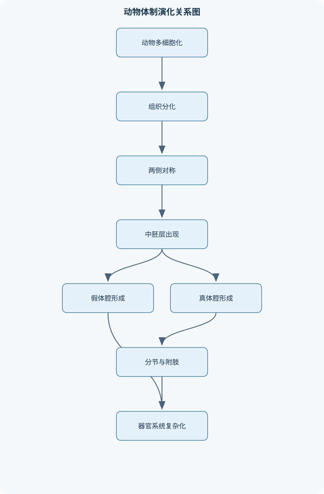
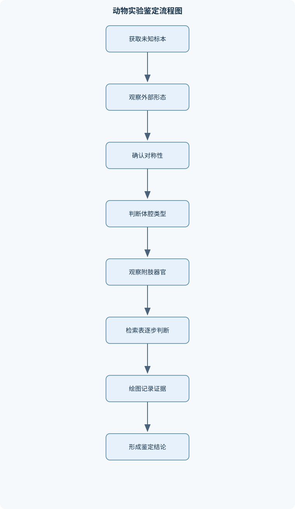

# 动物学及实验（乙）

## 一、课程整体知识框架

### 课程边界与先修知识

本课程系统讲授动物学的基本概念、动物体制与演化、主要无脊椎动物类群、脊索动物及脊椎动物主要类群的形态结构、功能适应、生活史和分类特征，并训练显微观察、解剖观察、标本识别、分类检索和实验记录能力。内容边界以动物界为主，涵盖原生动物、海绵动物、腔肠动物、扁形动物、假体腔动物、环节动物、软体动物、节肢动物、棘皮动物、脊索动物和主要脊椎动物类群；不系统展开植物学、微生物学、细胞生物学和分子遗传学。先修知识包括普通生物学中的细胞、组织、胚胎发育、遗传与进化基础，以及基本显微镜使用和实验安全知识。课程中的“进化”主要表示结构与功能的历史变化趋势，不将形态复杂程度简单等同于绝对的高等或低等，也不把传统分类等级直接视为唯一的系统发育关系。


### 1. 学科对象、边界与基本视角

动物学研究动物的形态结构、功能活动、个体发育、生活史、分类关系、生态适应及演化趋势。本课程以动物界为主体，从细胞水平的原生动物讲到具有组织、器官和器官系统的多细胞动物，再延伸到脊索动物和主要脊椎动物类群。课程重点不是孤立记忆类群名称，而是建立“结构—功能—生活环境—生活史—分类证据—演化联系”的连续分析框架。

动物通常具有以下共同特征：细胞为真核细胞；营养方式主要为摄取现成有机物的异养方式；多数能主动运动或至少在某一生活阶段具有运动能力；胚胎发育通常经历受精、卵裂、囊胚和原肠胚等阶段；多细胞动物的细胞之间存在分工，并可形成组织、器官和器官系统。上述特征是总体概括而非绝对判据。例如，某些成体固着的动物在幼体阶段能够运动；某些寄生动物的运动器官退化，但仍保留动物性营养和复杂生活史。因此，判定一个类群时不能只凭“是否运动”这一项特征。

课程不系统展开植物学、微生物学、细胞生物学和分子遗传学。遗传与进化知识只作为解释动物性状来源和亲缘关系的基础。课程中的“进化”表示结构和功能在历史过程中的变化趋势，不能把形态复杂程度直接等同于绝对的“高等”或“低等”，也不能把传统分类等级机械地当作唯一的系统发育关系。同一功能可能在不同类群中独立产生，这种现象属于趋同；某一结构由共同祖先传递而来，即使在不同类群中功能发生变化，也仍可体现同源关系。

### 2. 分类、命名与比较形态学框架

物种是生物分类和演化研究的基本单位。在有性生物中，物种通常由具有实际或潜在繁殖能力、占据一定空间并与其他群体存在生殖隔离的种群组成。物种概念适用于许多有性生殖动物，但对无性生殖动物、化石类群或存在杂交的类群，单一物种标准可能不足，需要结合形态、生活史、地理分布和其他证据综合判断。

双名法规定，动物物种的学名由属名和种本名组成。属名首字母大写，种本名小写，通常使用斜体。例如，*Canis lupus* 中 *Canis* 是属名，*lupus* 是种本名；定名人信息若出现，不属于双名本身。属名和种本名必须整体使用，不能只根据种本名判断分类位置。分类阶元通常包括界、门、纲、目、科、属、种等，但不同类群还可能使用亚门、亚纲、总科等辅助阶元。实验记录中的学名应保持拼写、大小写和斜体格式一致。

比较形态学要求先统一比较项目，再说明结构差异和功能后果。例如比较鳃、肺和气管时，应分别记录气体交换表面积、通气方式、扩散距离以及循环系统的运输作用，不能简单以“有无呼吸器官”作结论。形态证据还必须区分观察事实与解释：看到“鳃丝密集排列”是事实；认为“有利于增加交换面积”是基于结构的功能解释；认为“适应高代谢生活”则还需要结合通气和循环资料。

### 3. 动物体制与演化基础

#### 对称性、头部化与运动方向

无对称动物的身体不能被某一平面分成相等的两半，常见于固着或形态不规则的类群。辐射对称动物的身体可由多个平面分成相似部分，适合从多个方向接受刺激和摄取食物。两侧对称动物只有一个主要对称面，身体具有前后、背腹和左右之分，通常与定向运动相关。

两侧对称、头部化和定向运动之间存在功能联系。动物向前运动时，身体前端首先接触环境，感觉器官和神经中枢在前端集中，有利于寻找食物和逃避敌害。但是，两侧对称动物的头部化程度并不完全相同，不能由“两侧对称”直接推出具有高度发达的头部和神经系统。

#### 胚层、体腔与器官系统

胚层包括外胚层、中胚层和内胚层。外胚层主要参与表皮和神经结构形成；内胚层主要参与消化管内衬及其相关结构形成；中胚层参与肌肉、结缔组织、体腔膜、循环和生殖结构的形成。胚层数量增加通常为器官分化提供更多组织来源，但不能单独决定整个动物的复杂程度。

体腔是体壁与消化管之间的腔隙。无体腔动物没有由中胚层包围的体腔；假体腔主要由囊胚腔保留形成，只有体壁侧具有中胚层，缺少完整的体腔膜；真体腔由中胚层形成，体壁侧和肠壁侧均具有体腔膜及相关肌肉层。真体腔可为消化管运动、体壁运动、器官分隔、体内运输和生殖腺形成提供较好的结构条件，但体腔出现并不单独决定动物的全部复杂性。

原口动物和后口动物是胚胎发育中的重要比较类别。原肠胚时期形成的胚孔在不同类群中可形成口或与口形成相关；后口动物的口通常在胚孔之外另行形成。棘皮动物和脊索动物属于后口动物，但这并不意味着二者成体形态相似，而是说明其胚胎发育和系统发生具有某些共同特征。

#### 分节、消化、循环与呼吸

环节动物的体节大体相似，称同律分节；节肢动物的体节发生明显分化并融合成体部，称异律分节。分节可以使局部运动和器官排列更加协调，但不同类群的分节来源和功能并不完全相同。

消化系统由不完整逐步发展出完整管道。不完整消化系统通常只有一个开口，食物进入和残渣排出共用该开口；完整消化系统具有口和肛门，食物沿单向通道运输，摄食、消化和排遗可以在不同区域进行。循环系统的“开管式”和“闭管式”描述血液是否始终处于血管内；“单循环”和“双循环”描述血液完成一次全身循环时通过心脏的次数，二者不能混为一谈。

呼吸效率主要取决于交换表面积、扩散距离、通气方式和循环运输能力。可用气体扩散的一般关系作定性或半定量分析：

$$
J \propto \frac{A\Delta C}{L}
$$

其中，$J$ 表示单位时间内的气体转移量，单位可取 $\mathrm{mol\cdot s^{-1}}$；$A$ 为气体交换表面积，单位为 $\mathrm{m^2}$；$\Delta C$ 为交换面两侧的浓度差或分压差，具体取决于所用模型；$L$ 为扩散距离，单位为 $\mathrm{m}$。该关系适用于比较扩散条件相近、组织性质相近的情形，不能直接代替完整生理测定。具有肺并不表示所有动物的气体交换效率相同，肺泡结构、通气方式和循环分流都会改变实际效果。

### 4. 原生动物至腔肠动物

原生动物处于细胞水平，全部生命活动由一个细胞完成。以草履虫为例，纤毛协调摆动产生运动；口沟摄取食物，食物泡完成细胞内消化；伸缩泡调节水分平衡，胞肛排出未消化物；大核主要与营养和代谢活动有关，小核参与遗传和生殖过程。草履虫通常进行横二分裂，有性过程表现为接合，不能把其无性生殖写成纵二分裂。

原生动物可按运动和营养结构进行传统比较，包括鞭毛虫、肉足虫、纤毛虫和孢子虫等类型。寄生原生动物常具有宿主转换、不同生殖方式交替和特殊感染阶段。分析生活史时，应区分宿主、发育阶段、有性生殖、无性生殖和传播途径，不能只记忆成虫所在宿主。

海绵动物由多种细胞协同完成生命活动，尚未形成典型组织和器官系统。领细胞的鞭毛推动水流，水流经孔道进入体内，经中央腔或出水孔排出；细胞从水中摄取食物并完成消化。海绵的细胞分工说明多细胞化可以先从细胞协作开始，并不意味着所有多细胞动物都具有完整器官系统。

腔肠动物具有组织水平，身体通常呈辐射对称，具有由外胚层和内胚层围成的消化循环腔。刺细胞中的刺丝囊可在受到刺激时释放，参与捕食和防御。水螅型适合固着生活，水母型适合漂浮和扩散；部分类群在生活史中出现两种体型交替。浮浪幼虫通常具有纤毛，能在水中游动并寻找附着基质。世代交替必须依据实际生活史判断，不能仅因某类群同时有有性和无性过程就机械套用。

### 5. 扁形动物与寄生适应

扁形动物为两侧对称、三胚层、无体腔动物，体壁形成皮肌囊。消化系统通常不完整，具有口而无肛门，食物和残渣通过同一开口进出。焰细胞和原肾管构成排泄和渗透调节系统，纤毛产生液流，管道将代谢产物和多余水分排出。神经系统常呈梯形，纵向神经索之间有横向联系。

涡虫具有较发达的感觉和运动结构，适合自由生活；吸虫具有吸盘等附着器官，适合在宿主体内或体表固定；绦虫的消化管退化，体表具有吸收营养的结构，身体由头节、颈部和许多节片组成。绦虫的节片并非简单的体节，主要与生殖和繁殖输出有关。

寄生生活史分析必须明确终宿主和中间宿主。终宿主通常承载成虫或有性生殖阶段，中间宿主通常承载幼虫或无性生殖阶段。血吸虫的尾蚴可经皮肤主动侵入人体；吸虫类的囊蚴常与水生植物或其他食物传播有关；绦虫可通过含有幼虫阶段的肉类或其他传播环节感染。不同寄生虫的感染性虫期不能互相替换。

### 6. 假体腔动物与线虫

假体腔动物的体壁与消化管之间保留囊胚腔，腔内含体腔液，但没有由中胚层形成的完整体腔膜。线虫体呈圆筒形，外有角质层，表皮通常为合胞体，肌肉层主要为纵肌。角质层不能连续伸长，因此线虫生长需要蜕皮。

线虫具有完整消化管，食物由口进入，经咽、肠和直肠由肛门排出。排泄结构可表现为原肾管型系统。许多线虫雌雄异体，雌雄个体在大小和尾部形态上可能不同。神经系统呈围绕咽部的神经环和纵向神经索形式。

蛔虫生活史的关键环节是卵在外界发育为感染性卵，人体摄入后幼虫从肠道进入组织和血液，经过肝脏、心脏到达肺部，再沿气道上行至咽部并被吞咽，最后回到小肠发育为成虫。生活史中各阶段必须有明确来源和去向，不能写成卵在小肠直接发育为成虫。

### 7. 环节动物与体节化

环节动物具有发达的真体腔和同律分节。体壁通常由角质层、表皮、环肌、纵肌和体壁体腔膜等结构组成。体节重复为局部运动和器官分区提供基础，体腔液可参与维持体形并辅助运动。刚毛或疣足可增加附着和推进效果。

环节动物具有闭管式循环，血液始终在血管内流动，能够较有效地运输氧气、营养物质和代谢产物。排泄器官通常为后肾管，链状神经系统由脑、咽下神经节和腹神经索组成。

环毛蚓的消化管可分为口、咽、食道、嗉囊、砂囊和肠等区域。嗉囊主要储存食物，砂囊借助砂粒和肌肉运动研磨食物，肠道承担主要消化和吸收功能。沙蚕等海产环节动物的担轮幼虫具有纤毛环，适应水中游动和扩散。担轮幼虫主要见于环节动物和许多软体动物，不能视为所有海产无脊椎动物共有。

### 8. 软体动物

软体动物身体通常可分为头、足、内脏团和外套膜四部分。外套膜可分泌贝壳，并围成外套腔，参与呼吸、水流、排泄和生殖细胞释放。外套膜不等同于贝壳；某些类群贝壳退化、内藏或消失，陆生软体动物可依靠外套膜形成的肺样结构呼吸。

齿舌是许多软体动物的摄食结构，但瓣鳃类通常没有典型齿舌。腹足类的足适于爬行，瓣鳃类的足适于掘穴，头足类的足特化为腕和漏斗，适于捕食和快速运动。软体动物多数为开管式循环，头足类的循环系统更为特殊，具有较高的运输效率。

河蚌通过足掘入底质，鳃既参与呼吸，也参与滤食。珍珠形成与外套膜受到异物刺激有关：外套膜分泌的贝壳物质逐层包裹异物，形成珍珠层。珍珠并非由贝壳本身主动“长出”，而是外套膜分泌活动的结果。软体动物生活史中可见担轮幼虫、面盘幼虫或钩介幼虫等阶段，具体类型要结合类群判断。

### 9. 节肢动物与昆虫

节肢动物具有几丁质外骨骼、异律分节和分节附肢。外骨骼能够保护身体并提供肌肉附着面，但不能随动物连续伸长，因此必须蜕皮。蜕皮期间新外骨骼尚未硬化，动物更易受到机械损伤和捕食。

节肢动物通常具有混合体腔和开管式循环。甲壳纲常以鳃呼吸并以绿腺排泄；蛛形纲可具有书肺或气管；肢口纲具有书鳃；多足纲和昆虫主要依靠气管系统。昆虫气管由气门、气管和气管小管组成，氧气可直接接近组织，血液不再承担氧气远距离运输的主要任务，但体型、活动强度和环境条件仍会限制气管系统的有效范围。

昆虫身体分为头、胸、腹三部分，胸部通常具有三对足，许多成虫具有两对翅。口器可分为咀嚼式、刺吸式、舐吸式、吮吸式和嚼吸式。鉴定口器时，应先观察上唇、大颚、小颚、下唇和喙等结构，再根据结构推断取食方式，不能仅凭昆虫名称猜测。

完全变态包括卵、幼虫、蛹和成虫四个主要阶段，幼虫与成虫在形态和生活习性上差异明显；不完全变态没有蛹期，若虫与成虫通常具有较多相似性。没有蛹期不能判定为完全变态。马氏管与消化管后部相连，参与含氮代谢产物排出和水盐调节。

### 10. 棘皮动物与无脊椎动物比较

棘皮动物幼体通常为两侧对称，成体常表现为五辐射对称；这种变化与成体底栖生活和多方向取食有关，但不能否认其两侧对称祖先和后口动物特征。棘皮动物具有中胚层来源的内骨骼，体表可有棘和叉棘，水管系统通过管足参与运动、摄食和气体交换，皮鳃也可参与呼吸。

比较无脊椎动物神经系统时，可看到由弥散神经网络、神经环和神经索，到神经节集中化的变化趋势；比较呼吸系统时，可看到由体表扩散到鳃、书肺、气管等专门结构的多样化。进化趋势不能表述为简单的“越复杂越高级”，而应说明结构如何与运动方式、体型、栖息环境和代谢需求联系。

### 11. 脊索动物与鱼类

脊索动物的基本特征包括脊索、背神经管和咽鳃裂。脊椎动物在此基础上形成脊柱、颅骨和更复杂的器官系统。鱼类通常具有适于水中运动的流线型体形、鳞片、鳍和侧线器官。侧线能够感受水流和振动，是水生生活的重要感觉结构。

鳃由鳃弓、鳃耙和鳃丝等结构组成，鳃丝上的鳃小片增加交换表面积。水流和血流通常呈相反方向，有利于维持气体交换的浓度梯度。鱼类心脏通常为一心房一心室，血液完成一次全身循环时经过心脏一次，属于单循环。鱼鳔可调节浮力，但并非所有鱼类都具有完整鱼鳔。

鱼类鳞式通常记录为“侧线鳞数/侧线上鳞数/侧线下鳞数”，实际格式应以观察对象和课程约定为准。计数时先确认侧线位置，再分别计数三类鳞片；破损、重叠或无法辨认的区域应注明，不能将体侧全部鳞片数代替侧线鳞数。淡水鱼和海水鱼的渗透调节方向不同：淡水鱼通常面临水分进入和盐分流失，海水鱼通常面临失水和盐分进入，鳃、肾和摄食行为共同参与调节。

### 12. 四足类脊椎动物

两栖类幼体多在水中生活并以鳃呼吸，成体可用肺和皮肤呼吸。咽式呼吸依靠口咽腔底部运动改变压力，使空气进入肺部；口咽腔黏膜也可直接参与气体交换。两栖类成体为二心房一心室，属于不完全双循环，血液存在一定程度混合。

爬行类出现羊膜卵，胚胎由羊膜、绒毛膜、尿囊和卵黄囊等结构保护，使繁殖对水体的依赖减少。爬行类主要以胸腹式呼吸，体表角质化有利于减少水分散失，部分类群具有盐腺。多数爬行类心室分隔不完全，鳄类是明显例外，不能把所有爬行类都写成四腔心脏。

鸟类具有流线型体形、前肢特化为翼、骨骼轻而坚固、胸肌发达、视觉发达等飞行适应。鸟肺与气囊协同通气，气流在主要气体交换部位保持单向，吸气和呼气阶段均可有富氧气体通过交换部位，从而支持高代谢活动。气囊主要参与通气，不是主要气体交换器官。鸟类通常无膀胱，许多种类的右侧卵巢和输卵管退化，这些特征与减轻体重和提高飞行效率有关，但并非所有鸟类都完全相同。

哺乳类体表被毛，具有乳腺、异型齿和唾液腺。肺由大量肺泡组成，横隔参与呼吸，心脏为四腔，体循环和肺循环完全分流。胎生和哺乳提高了幼体早期存活机会，但哺乳类仍受环境温度、能量供应和生理状态影响，恒温不等于完全不受外界环境影响。毛、乳腺、横隔、肺泡和四腔心脏是相互联系的结构组合，不能用单一结构解释哺乳类全部特征。

## 二、章节和模块划分

### 核心知识覆盖清单

本清单用于检查正文是否覆盖本课程的主要知识模块：

- **动物学基本概念与分类**：动物界的共同特征、异养摄食与运动性、组织和器官系统、物种与种群概念、双名法的组成规则、分类阶元与学名书写、对称性与体制、胚层与胚胎发育、原口动物与后口动物、同源结构与适应性结构。
- **动物体制与演化基础**：无对称、辐射对称和两侧对称、头部化与集中化、分节及其类型、无体腔、假体腔和真体腔、原肠腔与体腔的形成、组织器官系统的分化、神经系统集中化趋势、消化系统完整化、循环和呼吸系统的出现、幼虫类型与间接发育。
- **原生动物至腔肠动物**：原生动物的细胞水平结构、草履虫的运动、营养和排泄、横二分裂与接合生殖、鞭毛虫、肉足虫、纤毛虫和孢子虫、寄生原生动物的生活史、海绵动物的细胞分工、腔肠动物的辐射对称、刺细胞与捕食机制、水螅型和水母型、浮浪幼虫与世代交替。
- **扁形动物与寄生适应**：扁形动物的两侧对称、皮肌囊和中胚层、不完全消化系统、焰细胞和原肾管、梯形神经系统、涡虫的自由生活适应、吸虫的吸附器官、绦虫的体节和营养吸收、寄生生活史中的宿主转换、血吸虫、枝睾吸虫和绦虫的传播环节。
- **假体腔动物与线虫**：假体腔的结构特点、角质层和蜕皮、线虫的皮肌囊、完善的消化管、雌雄异体和雌雄异形、圆筒状神经系统、原肾管型排泄、蛔虫生活史、寄生线虫的感染途径、假体腔与真体腔的比较。
- **环节动物与体节化**：同律分节、发达的真体腔、刚毛和疣足、蚯蚓体壁的层次、闭管式循环、后肾管排泄、链状神经系统、环毛蚓消化管分区、沙蚕的担轮幼虫、环节动物对运动和掘穴生活的适应。
- **软体动物**：软体动物的身体分区、外套膜与贝壳形成、头、足和内脏团、齿舌与摄食方式、鳃和外套膜呼吸、开管式循环、肾脏与后肾管的同源性、腹足类、瓣鳃类和头足类、河蚌的埋栖适应、珍珠形成机制、担轮幼虫、面盘幼虫和钩介幼虫。
- **节肢动物与昆虫**：几丁质外骨骼和蜕皮、异律分节、分节附肢、混合体腔与开管循环、甲壳纲的鳃和绿腺、蛛形纲的书肺与气管、肢口纲的书鳃、多足纲的体节与气管、昆虫的三部体制、昆虫口器类型、完全变态与不完全变态、马氏管的排泄功能。
- **棘皮动物与无脊椎动物比较**：棘皮动物的后口特征、幼体两侧对称、成体五辐射对称、中胚层来源的内骨骼、水管系统、管足运动与摄食、皮鳃呼吸、次生体腔分化、棘皮动物与环节动物的比较、无脊椎动物神经系统演化、无脊椎动物呼吸系统演化。
- **脊索动物与鱼类**：脊索、背神经管和咽鳃裂、脊椎动物体制、鱼类的体形和鳞片、侧线器官、鳍与水中运动、鱼鳔与浮力调节、鳃的结构和气体交换、鱼类的单循环、鱼类鳞式的表示、淡水鱼和海水鱼的渗透调节、鱼类标本的外形鉴定。
- **四足类脊椎动物**：两栖类的变态发育、两栖类的皮肤和肺呼吸、咽式呼吸和口咽腔呼吸、爬行类的羊膜卵、爬行类的胸腹式呼吸、盐腺和水分保持、鸟类的飞行适应、气囊与单向气流、鸟类的双重呼吸、鸟类的双重视觉调节、哺乳类的毛和乳腺、哺乳类的横隔与肺泡、胎生、哺乳和恒温。
- **动物学实验与综合分析**：显微镜和解剖镜的规范使用、动物组织切片观察、蛔虫和蚯蚓体壁比较、草履虫运动与细胞器观察、环毛蚓外形和内部结构观察、河蚌外套膜和鳃的观察、昆虫口器和附肢鉴定、鱼类外形与鳞式记录、脊椎动物骨骼和呼吸结构比较、检索表编制与分类鉴定、实验数据和形态证据记录、动物结构功能关系分析。





### 1. 模块一：动物学基本概念与分类

本模块建立全课程共同语言。内容包括动物界共同特征、异养摄食、运动性、组织和器官系统、物种概念、双名法、分类阶元、对称性、胚层、原口动物与后口动物，以及同源结构和适应性结构的区别。学习分类时，必须把“可观察性状”转化为明确状态，如有或无、分叉或不分叉、对称或不对称，避免使用“较发达”“比较高级”等缺乏判据的表述。

### 2. 模块二：动物体制与演化基础

本模块以体制比较为主线，解释无对称、辐射对称和两侧对称，说明头部化、神经集中化、分节、体腔形成、消化系统完整化、循环系统和呼吸系统出现的结构联系。重点是从结构事实推出功能意义：两侧对称与定向运动有关；真体腔为体壁和消化管提供相对独立的肌肉活动空间；分节有助于局部运动和器官分区；但这些关系都是比较意义上的总体趋势，不能作为无例外的分类定律。

### 3. 模块三：原生动物至腔肠动物

本模块从细胞水平讲到组织水平。实验或观察中，草履虫应记录纤毛、口沟、食物泡、伸缩泡、大核和小核等结构，并将结构与运动、摄食、渗透调节和生殖联系起来。腔肠动物则重点分析辐射对称、刺细胞、消化循环腔、水螅型、水母型和浮浪幼虫。生活史分析要区分有性和无性过程，不能把“出现两种体型”直接等同于所有类群的世代交替。

### 4. 模块四：扁形动物与寄生适应

本模块围绕两侧对称、三胚层、无体腔、皮肌囊、不完全消化系统、焰细胞和梯形神经系统展开。涡虫、吸虫和绦虫分别代表自由生活、附着寄生和高度寄生适应。生活史学习应画出阶段、宿主和传播途径的对应关系，特别注意血吸虫尾蚴经皮肤侵入、吸虫囊蚴经食物传播以及绦虫幼虫阶段与中间宿主的关系。

### 5. 模块五：假体腔动物与线虫

本模块比较假体腔和真体腔的组织来源，分析角质层、蜕皮、纵肌、完整消化管、雌雄异体、原肾管和神经环。蛔虫生活史是本模块的综合材料，要求按卵、幼虫迁移、肺部阶段、吞咽返回小肠和成虫产卵的顺序重建过程。感染途径必须与感染性阶段对应，不能把卵、幼虫和成虫混写。

### 6. 模块六：环节动物与体节化

本模块以环毛蚓和沙蚕为代表，观察同律分节、真体腔、刚毛、疣足、闭管循环、后肾管和链状神经系统。环毛蚓解剖时应先记录外形和体节，再逐层暴露消化管、循环和生殖结构，保持器官连接关系。环毛蚓与蛔虫体壁比较是重要综合内容：前者具有角质层、表皮、环肌、纵肌和体壁体腔膜，后者主要具有角质层、合胞体表皮和纵肌层。

### 7. 模块七：软体动物

本模块围绕外套膜、贝壳、外套腔、头、足、内脏团、齿舌、鳃和肾脏展开。河蚌观察应重点记录外套膜和鳃的相对位置、鳃的结构与水流方向及足的埋栖功能。比较腹足类、瓣鳃类和头足类时，应统一比较身体分区、运动器官、摄食器官、呼吸结构和循环系统。珍珠形成应解释为外套膜分泌贝壳物质包裹异物，而非贝壳自行增生。

### 8. 模块八：节肢动物与昆虫

本模块先讲节肢动物共同特征，再比较甲壳纲、蛛形纲、肢口纲、多足纲和昆虫纲。鉴定未知标本时，可优先观察高区分度性状：鳃、书肺、书鳃、气管、尾剑、胸部三对足等，再用体节和口器复核。昆虫部分重点分析三部体制、附肢、口器、马氏管、完全变态和不完全变态。口器判断必须以结构为依据，不能根据动物名称推测。

### 9. 模块九：棘皮动物与无脊椎动物比较

本模块以棘皮动物的后口特征、幼体两侧对称、成体五辐射对称、内骨骼、水管系统、管足和皮鳃为核心。比较时应说明五辐射对称与底栖生活的关系，同时保留幼体两侧对称这一发育证据。无脊椎动物比较应围绕神经集中化、呼吸器官专门化、体腔和循环系统展开，避免使用“低等—高等”替代因果分析。

### 10. 模块十：脊索动物与鱼类

本模块从脊索、背神经管和咽鳃裂进入脊椎动物体制，再分析鱼类体形、鳞片、鳍、侧线、鱼鳔、鳃和单循环。鱼类外形鉴定要求记录体形、口的位置、鳍的数目和位置、鳞片及侧线等特征。鳞式记录应先确认观察区域和侧线边界，再分别计数侧线鳞、侧线上鳞和侧线下鳞。鱼类渗透调节应结合淡水和海水环境分别解释，不能用同一结论概括所有鱼类。

### 11. 模块十一：四足类脊椎动物

本模块按两栖类、爬行类、鸟类和哺乳类展开。两栖类重点是变态发育、皮肤和肺呼吸、咽式呼吸以及不完全双循环；爬行类重点是羊膜卵、胸腹式呼吸、角质化体表和水分保持；鸟类重点是飞行适应、气囊、单向气流和双重呼吸；哺乳类重点是毛、乳腺、异型齿、横隔、肺泡、四腔心脏、胎生、哺乳和恒温。

比较脊椎动物呼吸和循环时，应分别画出气流路径和血流路径。鱼类鳃呼吸与单循环相联系；两栖类成体肺、皮肤呼吸与不完全双循环相联系；爬行类肺呼吸和较完善的心室分隔减少血液混合；鸟类和哺乳类分别通过鸟肺单向通气或肺泡肺、四腔心脏支持较高代谢。上述是总体趋势，不能把每个类群中的所有种类都视为结构完全一致。

### 12. 模块十二：动物学实验与综合分析

#### 显微镜与解剖镜观察流程

**输入**为玻片标本、显微镜、解剖镜和记录表；**输出**为包含低倍定位、逐级换高倍、结构标注和比例尺的观察记录。操作顺序为：检查光源和镜头；用低倍镜寻找目标；调节焦距和光阑；将目标移至视野中央；转换高倍镜；高倍下只使用细准焦螺旋；记录视野、结构名称和观察限制。全过程的不变量是镜头不能接触玻片，换高倍后目标仍应位于视野中心。若高倍下目标消失，应回到低倍重新定位，而不能盲目调节或推测结构。

#### 动物分类检索流程

**输入**为未知动物的可观察性状和二歧检索表；**输出**为分类名称及支持结论的性状链。先确认对称性和胚层，再观察体腔、分节、附肢、呼吸器官和代表性结构，按照每一对互斥选项逐步选择，并记录每一步依据。每一步只能依据当前观察到的性状，不能用最后猜到的分类名称反推前面选择。若关键结构缺失，应返回上一级并补充观察，而不是强行鉴定。

下面的伪代码表示基本检索过程：

```text
输入：标本特征 S，二歧检索表 T
输出：分类名称或“性状不足”

节点 ← T 的起始节点
记录 ← 空列表

当 节点 不是终端节点 时：
    显示节点的互斥性状选项
    观察 S 中与选项对应的性状
    如果性状无法区分两个选项：
        输出“性状不足”，并停止
    否则：
        选择与观察结果一致的分支
        将“观察性状—选择分支”加入记录
        节点 ← 对应的下一节点

输出节点名称和记录
```

该流程适用于形态鉴定，不适用于关键结构完全缺失或标本严重损坏的情形。评价结果时，应同时检查最终名称和证据链，只有名称正确而依据错误的记录不能视为完整鉴定。

#### 生活史重建流程

**输入**为发育阶段、宿主、生殖方式和传播途径的零散资料；**输出**为闭合生活史。先列出全部阶段，区分无性生殖、有性生殖和孢子形成；再确定每个阶段所在宿主；标出感染性阶段和进入下一宿主的途径；最后检查是否回到起始阶段。每个阶段必须有来源和去向，寄生阶段必须与相应宿主匹配。该流程适用于疟原虫、吸虫、绦虫和蛔虫的生活史分析。

#### 形态—功能比较流程

比较两个或多个类群时，先统一比较项目，如体腔、消化、循环、呼吸、运动和生殖；分别记录结构状态；说明结构如何影响功能；再结合生活环境解释适应意义；最后区分共同祖征、衍征和趋同。比较表中的每一项都应包含观察事实和因果解释，不能只写“某类群更复杂”。

#### 典型例题一：依据性状判定类群

**题干：**某动物具有两侧对称、三胚层、无体腔、焰细胞、梯形神经系统和不完整消化系统。判断其所属主要类群，并说明依据。

**分析：**两侧对称和三胚层说明其体制已不同于辐射对称的组织级动物；无体腔排除假体腔动物、环节动物和节肢动物；焰细胞和梯形神经系统是重要辅助证据；有口无肛门说明消化系统不完整。

**解答：**该动物属于扁形动物。无体腔说明体壁与消化管之间没有由中胚层围成的体腔；焰细胞和原肾管参与排泄与渗透调节；梯形神经系统反映神经集中化；不完整消化系统通常只有一个开口。不能仅凭焰细胞一项作出结论，应由多项性状共同构成证据链。

**结果验证：**若将其判为线虫，则与线虫具有假体腔和完整消化管相矛盾；若判为环节动物，则与环节动物具有真体腔和闭管循环相矛盾。

**变式：**若题干改为“具有角质层、纵肌、完整消化管和雌雄异体”，则应转向线虫类群判断。

#### 典型例题二：比较蛔虫和环毛蚓体壁

**题干：**比较蛔虫和环毛蚓体壁的层次，并解释二者运动方式的差异。

**分析：**先按由外向内排列结构，再联系体腔和肌肉层。不能把线虫体壁写成具有发达环肌，也不能把环节动物的体腔液与假体腔混同。

**解答：**蛔虫体壁由角质层、合胞体表皮和纵肌层构成，缺少与环节动物相当的发达环肌，运动主要依靠纵肌与体腔液共同作用，产生摆动。环毛蚓体壁由角质层、表皮、环肌、纵肌和体壁体腔膜等结构组成，环肌和纵肌交替收缩，配合分节、刚毛和真体腔液，可产生蠕动和定向掘穴运动。

**结果验证：**若把蛔虫写成“环肌和纵肌均发达”，则与其典型皮肌囊结构不符；若把环毛蚓写成“只有纵肌”，则无法解释其伸缩和蠕动。

**变式：**若加入蚯蚓具有闭管循环和后肾管，应进一步说明真体腔和分节为运输、排泄和运动协调提供了结构条件。

#### 典型例题三：昆虫口器鉴定

**题干：**某昆虫口器具有发达的大颚和小颚，适于咬碎固体食物。判断口器类型，并说明鉴定依据。

**分析：**口器分类应以结构和功能为依据。发达的大颚是咀嚼式口器的重要特征，不能仅凭昆虫是否有翅判断。

**解答：**该口器属于咀嚼式口器。大颚可切断和咬碎食物，小颚和下唇协助处理食物，上唇覆盖口器前方。蝗虫和蟋蟀可作为结构对照。刺吸式口器则通常形成适于刺入和吸取液体的喙；蝶类吮吸式口器主要依靠延长的虹吸结构；蝇类舐吸式口器适于舔取液体。

**结果验证：**若观察到细长喙并能刺入组织，应重新考虑刺吸式，而不是依据“有大颚”作结论。

**变式：**蜜蜂具有嚼吸式口器，既能咀嚼固体，也能吸食液体，说明口器类型与食性之间存在结构功能联系。

#### 典型例题四：蛔虫生活史

**题干：**按时间顺序说明蛔虫从感染性卵进入人体到成虫产卵的过程。

**分析：**关键是区分感染性卵、幼虫迁移和成虫寄生部位。蛔虫幼虫并非在小肠中直接发育为成虫，而要经过组织迁移和蜕皮。

**解答：**卵随粪便排出后在外界发育，形成具有感染性的卵；人摄入感染性卵后，卵在小肠孵化，幼虫穿过肠壁进入血液，经过肝脏和心脏到达肺部；幼虫穿过肺泡进入气道，随气流上行至咽部并被吞咽；幼虫再次进入小肠，经过数次蜕皮发育为成虫，雌雄成虫交配，雌虫产卵，卵随粪便排出。

**结果验证：**生活史应形成“外界卵—人体—成虫产卵—外界”的闭环，并且感染途径是摄入感染性卵。

**变式：**若题目问“宿主转换”，蛔虫通常不需要中间宿主，人体既是成虫寄生宿主，外界又是卵发育的环境。

#### 典型例题五：脊椎动物呼吸和循环比较

**题干：**比较鱼类、两栖类、爬行类、鸟类和哺乳类的主要呼吸器官与心脏结构，并解释供氧效率变化。

**分析：**必须把气流路径和血流路径分开。呼吸器官的专门化、通气方式和心脏分隔共同决定供氧效果，不能把“肺”直接等同于高效率。

**解答：**鱼类以鳃呼吸，心脏通常一心房一心室，单循环；两栖类幼体以鳃呼吸，成体以肺和皮肤呼吸，二心房一心室，属于不完全双循环；多数爬行类以肺呼吸，心室分隔程度提高，血液混合减少，但多数仍非完全分流；鸟类具有肺和气囊，肺内气流具有单向特点，心脏四腔，双循环完全分流；哺乳类具有肺泡肺、横隔和四腔心脏，肺循环与体循环完全分开。

**结果验证：**鸟类气囊主要通气，不能作为主要气体交换部位；爬行类不能全部写成四腔心脏；两栖类不能写成完善的双循环。

**变式：**若比较鸟类和哺乳类，应指出二者都具有四腔心脏，但鸟类肺的单向通气方式与哺乳类肺泡肺的通气方式不同。

### 13. 实验与项目一：草履虫显微观察

**输入数据：**草履虫临时装片、显微镜、记录表和比例尺参照。  
**步骤：**先用低倍镜寻找草履虫并调焦；观察运动方向和纤毛摆动；转高倍观察细胞轮廓、口沟、食物泡、伸缩泡和细胞核区域；记录视野中可确认的结构及无法分辨的结构；绘制简图并标注比例关系。  
**评价标准：**目标定位准确；低倍到高倍操作顺序正确；结构标注与视野相符；能区分结构观察和功能解释；记录注明观察限制。  
**排错方法：**若视野过暗，检查光阑和光源；若换高倍后目标消失，回到低倍重新定位；若把食物泡误判为细胞核，应结合位置、数量和透明度复核；若草履虫运动过快，可适当减少水流扰动，但不能凭空补画未观察结构。

### 14. 实验与项目二：未知动物分类鉴定

**输入数据：**未知标本或清晰观察材料、解剖镜、二歧检索表、性状记录表。  
**步骤：**记录外形、对称性、附肢和体节；观察体腔或体壁切面等关键结构；确定呼吸器官和排泄器官；按检索表逐项选择并保留性状链；由两项以上独立特征进行复核；若结果冲突，回到冲突节点重新观察。  
**评价标准：**每个分类选择都有观察依据；使用的性状具有区分度；最终分类名称与证据链一致；不确定性状被明确标注；没有用名称反推性状。  
**排错方法：**若多个类群均可匹配，说明关键性状不足，应补充观察而非强行归类；若把外套膜、围心腔和真体腔混为一谈，应回到组织来源和空间位置重新判断；若将成体五辐射对称作为棘皮动物全部生活史特征，应补查幼体的两侧对称性。

## 三、核心概念的详细解释

### 1. 动物界、物种与分类命名

动物是以摄取现成有机物为主要营养方式的真核多细胞生物。多数动物能够主动运动，或至少在幼体、配子或某一生活阶段具有运动能力；细胞之间通常存在分工，可形成组织、器官和器官系统。动物的共同特征是总体概括，不是对每个物种都绝对成立的单一判据。例如，海绵成体固着，但幼体可运动；寄生动物的运动器官可能退化，却仍具有动物性的摄食方式和复杂生活史。

物种是动物分类和演化研究的基本单位。在有性生物中，物种通常指由具有实际或潜在繁殖能力的种群组成、占据一定空间并与其他群体存在生殖隔离的自然群体。生殖隔离包括交配前隔离和交配后隔离。对无性繁殖动物、化石类群以及存在广泛杂交的类群，不能机械套用生殖隔离标准，还要结合稳定形态、生活史、地理分布和群体连续性综合判断。

双名法中，物种学名由属名和种本名组成。属名首字母大写，种本名小写，通常整体使用斜体，例如 *Canis lupus*。属名是名词，种本名通常为形容词或名词的属格形式。定名人信息若附在学名之后，不属于双名本身。分类阶元通常包括界、门、纲、目、科、属、种，但阶元等级不等同于亲缘距离；传统分类名称还必须结合形态证据和系统发育证据解释。

### 2. 对称性、胚层与体制

无对称动物不能由一个或多个平面稳定地分成相等的两半，常见于形态不规则或固着生活的类群。辐射对称动物可通过多个平面分成相似部分，适合从不同方向接受刺激和摄取食物。两侧对称动物通常只有一个主要对称面，具有前后、背腹和左右之分，常与定向运动相联系。

两侧对称与头部化之间存在功能联系。动物向前运动时，身体前端首先接触环境，感觉器官和神经中枢集中于前端，有利于定向取食和逃避敌害。但两侧对称并不必然导致同等程度的头部化；不同类群的前端集中化程度、感觉器官复杂程度和神经系统结构均可能不同。

胚层是胚胎发育中形成不同组织的细胞层。外胚层主要参与表皮和神经结构形成；内胚层主要参与消化管内衬及其相关结构形成；中胚层参与肌肉、结缔组织、体腔膜、循环和生殖结构形成。二胚层动物通常缺少中胚层，三胚层动物具有外胚层、中胚层和内胚层。胚层数量增加为器官分化提供了更多组织来源，但不能单独作为动物“复杂程度”的绝对尺度。

原口动物和后口动物的区别，主要依据胚胎发育中原口的命运、体腔形成方式及相关发育特征判断。环节动物、软体动物和节肢动物通常归入原口动物；棘皮动物和脊索动物归入后口动物。分类判断不能只凭成体外形，因为发育方式可能保留共同祖先的证据，成体形态还可能受到生活环境的强烈改造。

### 3. 体腔、器官系统与体制演化

无体腔动物的体壁与消化管之间没有由中胚层围成的体腔，内部空间主要由实质组织填充。假体腔主要由囊胚腔保留形成，体壁一侧有中胚层，消化管外侧通常缺乏完整的中胚层体腔膜，因此不是真正由中胚层包围的体腔。线虫是典型例子。真体腔由中胚层形成，体壁侧和消化管侧均有体腔膜，环节动物、软体动物、节肢动物、棘皮动物和脊索动物均具有不同程度的真体腔或其衍生结构。

真体腔具有多方面作用：体腔液可作为水静力骨骼的一部分；体腔膜可支持器官和肌肉；体壁与消化管之间的空间允许消化管独立运动；体腔还为循环、排泄和生殖器官的分化提供结构条件。但是，真体腔的出现不意味着所有具有真体腔的动物都具有相同复杂程度，也不能据此直接排列绝对的进化等级。

消化系统由不完全逐渐发展为较完整的管状系统。不完全消化系统通常只有一个开口，食物进入和未消化物排出共用该开口；完整消化系统具有口和肛门，食物沿单向通道移动，能够形成摄食、消化、吸收和排遗的区域分工。无论何种动物，判断消化系统时都必须明确观察的是口、肛门、消化管分区还是消化腔，不能把消化腔和完整消化管混为一谈。

### 4. 主要无脊椎动物类群的结构—功能联系

#### 原生动物、海绵动物与腔肠动物

原生动物为单细胞动物，全部生命活动在一个细胞内完成。草履虫以纤毛运动，纤毛协调摆动可产生定向水流；口沟摄取食物，食物泡完成胞内消化；伸缩泡排出多余水分并调节渗透压。草履虫通常进行横二分裂，有性过程为接合，不应将其无性分裂写成纵二分裂。

原生动物可按运动和营养结构分为鞭毛虫、肉足虫、纤毛虫和孢子虫等类型。寄生原生动物往往具有宿主转换、无性增殖和有性生殖等阶段。分析生活史时，要区分宿主、感染性阶段、无性生殖阶段和有性生殖阶段，不能只依据成虫或营养体的名称判断传播方式。

海绵动物缺乏真正的组织和器官系统，主要依靠领细胞制造水流。水流经入水孔进入体内，经中央腔或水道系统流出；细胞从水中摄取食物并完成消化。海绵的细胞分工说明多细胞化并不等于已经形成典型组织和器官。

腔肠动物具有组织水平结构和辐射对称，体壁由外胚层和内胚层构成，中间为中胶层。刺细胞中的刺丝囊可用于捕食、防御和附着。水螅型适于固着生活，水母型适于漂浮和游动；部分类群在生活史中交替出现两种体型，并形成世代交替。浮浪幼虫通常为具纤毛的两侧对称幼体，能够扩散到新的附着地点。

#### 扁形动物、线虫与环节动物

扁形动物为三胚层、两侧对称、无体腔动物。皮肌囊由体壁表层、表皮或合胞体结构及肌肉层组成；焰细胞和原肾管参与排泄和渗透调节；神经系统常呈梯形。涡虫具有发达的纤毛表皮和分枝消化管，适于自由生活。吸虫具有吸盘等附着结构，绦虫则通过体表吸收宿主营养，消化管明显退化。寄生类群的生活史常涉及宿主转换，终宿主通常承载成虫或有性生殖阶段，中间宿主通常承载幼虫或无性生殖阶段。

线虫通常具有假体腔、完整消化管和角质层。体壁由角质层、合胞体表皮和纵肌层构成，不具有发达的环肌。角质层限制体长连续增长，因此线虫必须蜕皮。雌雄异体和雌雄异形较常见；神经系统呈环状神经和纵向神经索结构；排泄可表现为原肾管型。蛔虫感染过程中，感染性卵被摄入后，幼虫穿过肠壁，经血液到达肺部，再沿气道上行至咽部并被吞咽，返回小肠发育为成虫。

环节动物具有同律分节、发达真体腔、刚毛或疣足，以及闭管式循环。环毛蚓体壁由角质层、表皮、环肌、纵肌和体腔膜等层次组成；环肌和纵肌交替收缩，配合体腔液和刚毛完成蠕动。其消化管可分为咽、食道、嗉囊、砂囊和肠等区域。沙蚕的担轮幼虫体现了环节动物与部分软体动物在早期发育上的联系。

#### 软体动物、节肢动物与棘皮动物

软体动物身体通常分为头、足、内脏团和外套膜。外套膜能分泌贝壳，并围成外套腔，参与水流、呼吸和排泄；外套膜不能简单等同于贝壳。齿舌适于刮取食物，但瓣鳃类通常没有齿舌，依靠鳃滤食。软体动物循环多为开管式，头足类是重要例外，其循环系统较为发达。腹足类、瓣鳃类和头足类分别表现出爬行、埋栖滤食和快速游泳捕食等适应。

珍珠形成通常与外套膜受到异物刺激后分泌珍珠质有关，珍珠质逐层沉积于刺激物周围。担轮幼虫和面盘幼虫常见于部分海产软体动物；河蚌生活史中的钩介幼虫可暂时寄生于鱼类体表或鳃部，完成扩散和发育。

节肢动物具有几丁质外骨骼、异律分节和分节附肢。外骨骼能保护身体并提供肌肉附着面，但不能连续伸长，因此必须蜕皮。蜕皮期外骨骼暂时柔软，动物对机械损伤和捕食更敏感。节肢动物体腔与血窦等结构共同形成混合体腔，多为开管式循环。

甲壳纲常具有鳃和绿腺；蛛形纲可有书肺和气管；肢口纲具有书鳃；多足纲和昆虫纲主要依靠气管。昆虫身体分为头、胸、腹三部分，胸部通常具有三对足，许多成虫具有两对翅。马氏管将含氮代谢物排入消化管，适合减少水分损失。

完全变态必须具有卵、幼虫、蛹和成虫四个基本阶段，幼虫与成虫在形态和生活习性上差异显著；不完全变态没有蛹期，若虫逐渐接近成虫。昆虫口器包括咀嚼式、刺吸式、舐吸式、吮吸式和嚼吸式，判断时应先观察上唇、大颚、小颚、下唇和喙的形态，再联系取食功能，不能仅凭昆虫名称推断。

棘皮动物幼体通常为两侧对称，成体多为五辐射对称；其内骨骼来源于中胚层，水管系统中的管足参与运动、摄食和气体交换。成体辐射对称适合底栖生活和多方向取食，但不能据此否定棘皮动物的后口动物特征及其两侧对称幼体证据。

### 5. 脊索动物与脊椎动物的比较

脊索动物的基本特征包括脊索、背侧中空神经管、咽鳃裂、肛后尾等。脊椎动物在此基础上形成脊柱、颅骨、成对附肢或其退化结构，并具有较集中化的神经系统。

鱼类体形通常呈流线型，鳞片、黏液和鳍共同降低阻力并维持运动稳定。侧线器官感受水流和振动，是水生生活的重要感觉结构。鳃丝和鳃小片增加气体交换面积，鳃盖或口腔运动维持水流。鱼类通常为单循环，血液一次完成体循环时通过心脏一次。鱼鳔可调节浮力，但并非所有鱼类都具有完整鱼鳔。鱼类鳞式应按“侧线鳞数/侧线上鳞数/侧线下鳞数”记录，计数时必须明确侧线位置和鳞片边界。

两栖类幼体通常以鳃呼吸，成体主要依靠肺和皮肤呼吸。咽式呼吸由口咽腔底部上下运动完成；口咽腔黏膜也可进行气体交换。两栖类成体通常为二心房一心室，属于不完全双循环，不能写成与鸟类和哺乳类相同的完全双循环。

爬行类具有羊膜卵，胚胎发育对水体依赖减少；皮肤角质化可降低失水，部分类群具有盐腺。多数爬行类心室分隔不完全，鳄类为明显例外。鸟类具有流线型体形、翼、轻而坚固的骨骼、发达胸肌、气囊和高效肺。气囊主要参与通气，不是主要气体交换部位；肺内平行支气管和微气管中的气流具有单向性，吸气和呼气阶段均可有富氧空气通过交换部位，构成双重呼吸。

哺乳类体表被毛，具有乳腺、异型齿、肺泡和肌肉质横隔；心脏为四腔，体循环和肺循环完全分流。胎生和哺乳提高了幼体早期存活机会，但并非所有哺乳类都具有相同的胎盘类型和胚胎发育方式。恒温表示体温调节能力较强，并不意味着完全不受环境温度、能量供应和生理状态影响。

## 四、重要定义、公式、定理和推导

### 专业审校补充：关键定义与适用边界

昆虫变态是幼体与成体在形态、生活方式和生态位上发生显著变化的发育现象，不能把所有“长大”都称为变态。渐变态昆虫的若虫与成虫体形和生活方式大体相似，若虫通常没有完整翅和成熟生殖器官，经若干次蜕皮逐渐接近成虫；完全变态昆虫依次经历卵、幼虫、蛹和成虫，幼虫与成虫在体形、取食器官和生活环境上常有明显差异，蛹期是幼虫组织重组和成虫结构形成的重要阶段。无变态发育中，幼体与成体基本相似，主要是体型和生殖能力逐步增加。变态类型主要依据发育阶段和形态变化判定，不能仅凭是否有翅或个体大小判断。变态有利于减少幼体与成体之间的食物和空间竞争，但并不意味着完全变态类群在系统发育上必然“更高等”；变态形式还可能受到生活史、栖息环境和祖先发育模式的共同影响。


### 1. 结构功能关系的定量表达

气体交换可用扩散通量的简化关系表示：

$$
J = D \frac{A\Delta P}{L}
$$

其中，$J$ 为单位时间内的气体扩散通量，单位可取 $\mathrm{mol\,s^{-1}}$；$D$ 为气体在介质中的扩散系数，单位为 $\mathrm{m^2\,s^{-1}}$；$A$ 为气体交换表面积，单位为 $\mathrm{m^2}$；$\Delta P$ 为交换膜两侧的分压差，单位为 $\mathrm{Pa}$；$L$ 为扩散距离，单位为 $\mathrm{m}$。该关系说明，交换面积增大、分压差增大或扩散距离减小，均有利于气体交换。

这一公式是理想化推导，假定膜性质相对稳定、气体通过膜的路径近似、分压差能够维持。实际动物中，通气、血液流动、血红蛋白结合和局部血流都会改变结果。因此，“有肺”不等于呼吸效率相同；鸟类的单向气流、哺乳类的肺泡和鱼类的鳃均需结合表面积、扩散距离和循环运输解释。

体型增大时，表面积与体积的变化不同。若动物近似为边长为 $L$ 的立方体，则表面积为

$$
S=6L^2
$$

体积为

$$
V=L^3
$$

因此表面积体积比为

$$
\frac{S}{V}=\frac{6}{L}
$$

其中 $S$ 的单位为 $\mathrm{m^2}$，$V$ 的单位为 $\mathrm{m^3}$，$L$ 的单位为 $\mathrm{m}$。当体型增大时，$S/V$ 减小，单位体积可用于交换、散热和物质转运的表面积相对减少。这一推导只能说明几何趋势，不能单独决定动物的代谢率，因为真实动物可通过褶皱、分支、循环和主动通气增加有效交换能力。

### 2. 体腔与运动能力的推导

判断体腔时，应按以下步骤进行：

1. 先确认体壁和消化管之间是否存在腔隙；
2. 判断该腔隙是否由中胚层形成；
3. 检查体壁侧和消化管侧是否均有体腔膜；
4. 再分析体腔液、肌肉层、循环和排泄结构。

若只有体壁侧有中胚层，而消化管外侧缺乏完整体腔膜，则属于假体腔。若体壁侧和消化管侧均有中胚层体腔膜，则属于真体腔。真体腔可使消化管与体壁运动相对独立，体腔液还可参与水静力支撑和物质运输。因此，环节动物能够利用体壁环肌、纵肌与体腔液配合完成蠕动；线虫则主要依靠纵肌和假体腔液压力完成摆动。

该因果关系的边界是：真体腔只提供结构条件，不自动导致复杂运动。运动效果还取决于肌肉排列、神经协调、附肢、体壁刚度和生活环境。软体动物具有真体腔，但不同类群的体腔范围和运动方式差异很大。

### 3. 循环系统定义与比较

闭管式循环中，血液始终在血管内流动，通常具有动脉、静脉和毛细血管等分化；环节动物的闭管循环能够较快完成氧和营养物质运输。开管式循环中，动脉血管与血窦相连，血液或血淋巴离开部分血管后直接接触组织，再返回心脏；软体动物和节肢动物多属于开管式循环，头足类是重要例外。

单循环和双循环描述血液完成一次全身循环时通过心脏的次数，而开管式和闭管式描述血液是否始终处于血管内，二者不能混用。鱼类通常为单循环：心脏—鳃—全身—心脏。两栖类和多数爬行类为不完全双循环；鸟类和哺乳类为完全双循环。

由心脏分隔程度可作如下推导：

1. 心室分隔不完全时，含氧血和缺氧血有一定混合；
2. 混合减少时，送往组织的血液平均含氧量提高；
3. 心脏四腔且肺循环、体循环完全分流时，两个循环可分别维持不同压力；
4. 这有利于支持高代谢和恒温，但还必须结合呼吸器官和循环调节解释。

因此，不能把“心脏室数多”作为独立的进化等级指标，也不能忽略鳄类等类群的特殊结构。

### 4. 脊椎动物呼吸和循环的比较推导

比较不同脊椎动物时，应建立“气流路径—气体交换部位—血流路径—心脏分隔—功能后果”的证据链。

鱼类的水流经过鳃，鳃丝和鳃小片提供交换表面，心脏将缺氧血送往鳃，完成气体交换后再送往全身。两栖类幼体主要依赖鳃，成体增加肺和皮肤呼吸；肺结构较简单，且心室分隔不完全。爬行类羊膜卵和角质化皮肤减少了对水环境的依赖，肺通气和心脏分隔通常较两栖类完善。鸟类的气囊推动肺内单向气流，使吸气和呼气阶段均有富氧气体通过交换部位。哺乳类依靠横隔改变胸腔容积，肺泡提供大量交换表面，四腔心脏减少血液混合。

这是一种结构功能的总体趋势，不应写成“所有物种均严格按同一序列变化”。不同类群可能发生特化或退化，环境、体型和活动方式也会改变呼吸循环系统的具体表现。

### 5. 分类检索与实验观察流程

#### 动物分类检索算法

**输入：**未知动物的可观察性状集合、二歧检索表。  
**输出：**分类名称、每一步选择及支持结论的性状链。  
**不变量：**每一步只能依据当前观察到的性状，不能用预先猜测的分类名称反推性状。  
**终止条件：**到达明确分类单元，或确认关键性状不足而停止鉴定。

```text
输入 specimen，key
记录 specimen 的对称性、胚层、体腔、分节、附肢和呼吸器官

当前位置 ← key 的起点
证据链 ← 空表

当当前位置不是终点时：
    读取当前位置的两个互斥选项
    判断标本是否具有选项1的性状
    若能确认：
        记录“性状—选择”到证据链
        当前位置 ← 选项1的下一节点
    否则若能确认选项2：
        记录“性状—选择”到证据链
        当前位置 ← 选项2的下一节点
    否则：
        输出“性状不足，需要补充观察”
        停止

输出当前位置、证据链和不确定性说明
```

该流程适用于形态鉴定，不适合用来替代分子鉴定或处理关键结构完全缺失的标本。若标本破损，应返回上一级节点，补充观察，而不是强行作出分类结论。

#### 生活史重建流程

**输入：**发育阶段、宿主、感染方式、生殖方式和传播环节。  
**输出：**按时间排列的闭合生活史。  

步骤为：列出所有阶段；区分无性生殖、有性生殖和孢子形成；确定每个阶段所在宿主；标出感染性阶段和进入下一宿主的途径；检查每个阶段是否有来源和去向；最后确认生活史能否回到起始阶段。该流程可用于疟原虫、吸虫、绦虫和蛔虫。若生活史不能闭合，通常说明遗漏了宿主、发育阶段或传播方式。

### 6. 典型例题与逐步解答

#### 例题一：依据性状判断动物类群

**题干：**某动物具有两侧对称、三胚层、无体腔、焰细胞、梯形神经系统和不完全消化系统。判断其所属类群。

**分析：**不能只凭焰细胞单项判断，应建立多层证据链。

**解答：**

1. 两侧对称说明身体具有前后、背腹和左右方向；
2. 三胚层说明存在中胚层；
3. 无体腔排除了线虫和环节动物等具有体腔的类群；
4. 焰细胞和原肾管说明具有典型的排泄结构；
5. 梯形神经系统符合扁形动物神经系统特征；
6. 只有一个消化管开口，符合不完全消化系统。

**结果：**该动物属于扁形动物。  
**验证：**若题目增加“具有吸盘并寄生于脊椎动物”，则可进一步考虑吸虫；若增加“体节和成熟节片”，则应重新检查，因为绦虫虽属扁形动物，但消化管已退化，且具有明显节片。

#### 例题二：比较蛔虫和环毛蚓体壁

**题干：**比较蛔虫和环毛蚓体壁的主要层次，并说明结构与运动方式的关系。

**解答：**

蛔虫体壁由角质层、合胞体表皮和纵肌层组成。角质层具有保护作用并限制连续生长，纵肌收缩主要造成身体左右摆动。蛔虫没有发达环肌，不能像环节动物那样进行典型蠕动。

环毛蚓体壁由角质层、表皮、环肌、纵肌和体腔膜等组成。环肌收缩使体节变细变长，纵肌收缩使体节变粗变短，刚毛固定部分体节，体腔液提供支撑，因而能够形成波浪式蠕动。

**结果验证：**“蛔虫有发达环肌”是错误判断；“环毛蚓具有真体腔和闭管循环”可以进一步解释其运动和运输能力较强，但不能把这些结构简单写成绝对的高等等级证据。

#### 例题三：判断昆虫变态类型和口器类型

**题干：**某昆虫生活史为卵—若虫—成虫，若虫与成虫具有相似体形但翅和生殖器官未完全发育；其口器具有细长喙，适于刺入植物组织吸食汁液。判断变态类型和口器类型。

**解答：**

1. 发育阶段中没有蛹期；
2. 若虫与成虫体形基本相似，只是翅和生殖结构未成熟；
3. 因此属于不完全变态，具体表现为渐变态；
4. 细长喙用于刺入植物组织；
5. 主要取食液体，因此属于刺吸式口器。

**结果：**不完全变态中的渐变态，口器为刺吸式。  
**变式：**若出现卵—幼虫—蛹—成虫，且幼虫与成虫形态差异显著，则应判定为完全变态；若口器具有发达大颚和小颚，用于咬碎固体食物，则应判定为咀嚼式，而不能因其属于昆虫就统一归为某一种口器。

#### 例题四：完成鱼类鳞式记录

**题干：**观察某鱼，确认侧线完整。侧线鳞数为 34，侧线上鳞数为 5，侧线下鳞数为 4。按“侧线鳞数/侧线上鳞数/侧线下鳞数”记录鳞式。

**解答：**

1. 沿侧线孔逐片计数，得到侧线鳞数 $34$；
2. 从侧线向背侧计数，得到侧线上鳞数 $5$；
3. 从侧线向腹侧计数，得到侧线下鳞数 $4$；
4. 按约定格式记录为 $34/5/4$。

**结果验证：**不能把体侧全部鳞片数作为侧线鳞数，也不能把“侧线上鳞数/侧线下鳞数”写成分数后再遗漏侧线鳞数。若鳞片破损或重叠，应在记录中注明计数限制。

#### 例题五：解释蛔虫感染途径

**题干：**说明蛔虫从感染性卵进入人体到成虫产卵的主要过程。

**逐步解答：**

1. 虫卵随粪便排出，在适宜外界条件下发育为含幼虫的感染性卵；
2. 人摄入被污染的食物或饮水后，感染性卵进入消化道；
3. 幼虫在小肠孵出并穿过肠壁；
4. 幼虫随血液迁移至肝、心和肺等部位；
5. 幼虫进入肺泡后沿支气管和气管上行至咽部；
6. 幼虫被重新吞咽，返回小肠；
7. 经进一步蜕皮发育为成虫，雌雄成虫交配，雌虫产卵。

**结果验证：**不能写成“卵在小肠直接发育为成虫”，也不能遗漏肺部迁移和气道返回环节。生活史分析的闭合条件是：卵有来源，感染性卵有进入宿主的途径，成虫能产卵并重新进入外界。

### 7. 实验与项目的操作、评价和排错

#### 实验一：草履虫显微观察

**输入：**草履虫临时装片、显微镜、记录表和比例尺参照。  
**步骤：**

1. 检查镜头、载物台和光源；
2. 用低倍镜寻找草履虫并将目标移至视野中央；
3. 调节粗准焦螺旋和光阑，使轮廓清晰；
4. 转换高倍镜时只使用细准焦螺旋；
5. 观察纤毛运动、口沟、食物泡、伸缩泡和细胞轮廓；
6. 绘制与观察相符的简图，标注比例关系；
7. 将明确观察到的结构与无法确认的结构分别记录。

**评价标准：**目标定位准确；镜头不碰玻片；高倍观察后目标仍位于视野中央；结构标注与视野一致；观察事实和功能解释分开书写。

**排错方法：**视野过暗时检查光源和光阑；换高倍后目标消失时返回低倍重新定位；将食物泡误判为细胞核时，应比较数量、位置和透明度；草履虫运动过快时可减少液体扰动，但不能凭空补画未观察结构。

#### 实验二：未知动物分类鉴定

**输入：**未知标本、解剖镜或显微镜、二歧检索表、性状记录表。  
**步骤：**

1. 记录体形、对称性、体节和附肢；
2. 观察口、肛门、鳃、气管、书肺或其他呼吸结构；
3. 结合切面或解剖观察判断体壁和体腔类型；
4. 按检索表逐项选择，并记录每次选择的性状依据；
5. 用两个以上独立特征复核结论；
6. 对破损、模糊和未观察到的性状进行不确定性标注。

**评价标准：**分类结论有连续证据链；所用性状具有区分度；不使用名称反推性状；关键结构缺失时能够明确说明限制。

**排错方法：**多个类群均能匹配时，应补充关键观察；把外套腔误判为真体腔时，应回到组织来源和空间位置判断；把棘皮动物成体五辐射对称当作其全部生活史特征时，应补查其幼体两侧对称性；把气囊误作鸟类主要气体交换器官时，应重新区分通气结构和交换结构。

## 五、算法、流程和实现思路

### 方法与流程覆盖索引

下列方法或流程应在正文中说明输入、步骤、适用条件、结果检查和边界：

- 显微镜观察流程：输入为玻片标本、显微镜和观察记录表；输出为包含低倍定位、逐级换高倍、结构标注和比例尺的观察记录。过程为检查光源与镜头、低倍镜定位、调节焦距和光阑、转换高倍镜、只用细准焦螺旋、记录视野和结构；不变量是镜头不能接触玻片且换高倍后观察对象仍位于视野中心；终止条件是主要结构清晰并完成标注；适用于固定切片和临时装片；复杂度不以算法计，关键质量指标是定位准确、图像清晰和标注可追溯。
- 动物分类检索流程：输入为未知动物的可观察性状集合和二歧检索表；输出为分类名称及支持该结论的性状链。过程为确认对称性、胚层、体腔、分节、附肢、呼吸器官和代表性结构，按每一对互斥选项逐步判断，记录每次选择，直到到达末端类群；不变量是每一步只能依据当前可观察性状，不能用最终猜测反推前面选择；终止条件是到达明确分类单元或确认性状不足；适用于形态鉴定；若关键结构缺失，应返回上一级并补充观察，而不是强行分类。
- 生活史重建流程：输入为宿主、发育阶段、传播方式和生殖方式的零散信息；输出为按时间和宿主排列的闭合生活史图。过程为列出所有阶段，区分无性生殖、有性生殖和孢子形成，确定各阶段所在宿主，标出感染性阶段及进入下一宿主的途径，再检查是否回到起始阶段；不变量是每个阶段必须有来源和去向，且寄生阶段要与宿主相匹配；终止条件是形成闭环并能解释传播；适用于疟原虫、吸虫、绦虫和蛔虫等生活史分析。
- 形态功能比较流程：输入为两个或多个动物类群的结构资料；输出为结构、功能、生活环境和演化意义的对照表。过程为统一比较项目，分别记录结构状态，说明结构如何影响功能，再结合环境提出适应解释，最后区分共同祖征、衍征和趋同现象；不变量是同一比较项目使用同一尺度和定义；终止条件是每项均有观察事实与因果解释；适用于呼吸、循环、神经、排泄和体腔比较；不能把“结构更复杂”直接写成“进化等级更高”。
- 实验解剖记录流程：输入为经规范处理的实验动物、解剖器械和记录表；输出为外形、内部结构、功能联系和不确定观察项的完整记录。过程为核对标本信息、观察外部形态、按解剖平面逐层暴露结构、保持结构连接关系、绘制示意图并记录测量值、清理和复核；不变量是先观察后切割、先记录结构位置再取样；终止条件是目标系统完成观察且器械和材料清点无误；适用于环毛蚓、河蚌、昆虫和鱼类；不适用于仅凭图片推断组织层次。
- 比较脊椎动物呼吸循环流程：输入为鱼类、两栖类、爬行类、鸟类和哺乳类的心肺结构资料；输出为按呼吸器官、通气方式、心脏分隔、循环类型和供氧效果排列的比较结论。过程为分别绘制气流路径和血流路径，标注气体交换部位，判断血液是否发生混合，再联系体温和活动水平；不变量是气流路径与血流路径分别记录，不能把肺循环和双重呼吸混为一谈；终止条件是每个类群都能从结构解释功能；适用于比较解剖和实验问答。


### 1. 显微镜观察流程

#### 输入、输出与适用条件

输入为玻片标本、显微镜、光源、记录表和比例尺参照物；输出为包含观察对象、结构标注、放大倍数、视野条件、比例关系及不确定项的实验记录。该流程适用于固定切片、临时装片和草履虫等活动材料，但不能用显微镜观察流程替代解剖观察，也不能仅凭低清图片推断组织层次。

观察记录应区分三类内容：第一类是直接观察事实，如“细胞轮廓呈椭圆形”“体壁外侧有较厚的角质层”；第二类是由结构推出的功能，如“纤毛摆动可能参与运动”；第三类是进一步的适应解释，如“有利于在水中定向运动”。三者不能混写，否则无法判断结论究竟来自观察还是推测。

#### 操作步骤与不变量

1. 检查目镜、物镜、载物台和光源，确认镜头清洁，玻片固定平稳。
2. 放下镜筒或升高载物台时，使低倍物镜接近玻片，但镜头不能接触玻片。
3. 用低倍镜寻找目标，将观察对象移至视野中央。
4. 调节粗准焦螺旋获得大致清晰图像，再调节光阑和光源，使明暗适中。
5. 转换高倍镜后，只使用细准焦螺旋，不再大幅度调节粗准焦螺旋。
6. 记录物镜倍数、视野方向、标本状态及主要结构。
7. 绘制简图，标注可确认结构；对破损、重叠或无法分辨的部位明确写出观察限制。

流程不变量包括：换高倍镜前目标必须位于视野中心；镜头不能碰到玻片；每次放大倍数变化都必须保留前一阶段的定位依据；记录内容必须来自当前标本，而不是来自预先记忆的标准图。终止条件是主要结构清晰、标注完成、比例关系可解释且不确定项已单独记录。

显微镜总放大倍数为

$$
M=M_{\mathrm{e}}M_{\mathrm{o}},
$$

其中 $M$ 为总放大倍数，$M_{\mathrm{e}}$ 为目镜倍数，$M_{\mathrm{o}}$ 为物镜倍数，二者均为无量纲量。例如目镜 $10\times$、物镜 $40\times$ 时，$M=400\times$。该式只说明图像放大程度，不直接给出分辨率；分辨率还受数值孔径、波长、照明方式、标本厚度和光学质量影响，因此“倍数越大”不等于“细节一定越多”。

### 2. 动物分类检索流程

#### 形态证据链

输入为未知动物的可观察性状集合和二歧检索表，输出为分类名称及支持结论的性状链。检索时优先确认区分度较高、受保存状态影响较小的性状，例如是否有脊索或脊柱、是否有分节附肢、是否有鳃或气管、是否存在外套膜，而不是先依据体色、大小等易变特征判断。

基本步骤如下：

1. 记录对称性：无对称、辐射对称或两侧对称。
2. 判断胚层和体腔类型；若不能直接观察，应标注“未观察到”，不能把未知写成无。
3. 判断消化管是否具有口和肛门。
4. 观察体节、附肢、外骨骼、外套膜及代表性呼吸器官。
5. 按检索表每次选择一对互斥选项，并记录选择理由。
6. 到达末端分类单元后，用两个以上独立性状复核。
7. 若性状冲突，返回冲突节点补充观察，而不是根据期望结论修改记录。

算法不变量是每次判断只使用当前已观察到的性状，不用分类名称反推前面性状；终止条件是到达明确分类单元，或确认现有材料不足以继续鉴定。若标本缺失关键结构，合理输出应是“鉴定至某一级，需补充某结构”，而不是强行给出种名。

### 3. 生活史重建流程

#### 阶段、宿主与传播环节

输入为发育阶段、宿主、感染方式、生殖方式和传播媒介等零散信息，输出为时间顺序闭合的生活史。先列出所有阶段，再区分有性生殖、无性生殖、裂体生殖、配子形成和孢子形成；随后确定每一阶段的宿主及进入下一阶段的方式。

终宿主通常承载成虫或有性生殖阶段，中间宿主通常承载幼虫或无性生殖阶段，但判断时应以具体生活史为依据。每个阶段必须有来源和去向，感染性阶段必须有明确传播途径，闭环形成后还要检查宿主转换是否与发育阶段相匹配。

例如蛔虫生活史可按以下链条重建：成虫寄生于小肠并产卵；虫卵随粪便排出，在外界发育为感染性卵；人摄入感染性卵后，幼虫在小肠孵出并穿过肠壁；幼虫随血液迁移到肺，经肺泡、支气管和气管上行至咽部，再被吞咽返回小肠；幼虫经蜕皮发育为成虫。若把“感染性卵”写成“成虫直接进入人体”，或遗漏肺部迁移，生活史即不闭合。

疟原虫的分析还要区分宿主和生殖类型：按蚊吸血时摄入人体内的配子母细胞；配子在按蚊体内结合，随后经历孢子形成，产生子孢子；子孢子随唾液进入人体，首先侵入肝细胞，之后进入红细胞阶段。人体内主要进行裂体生殖，不能将人体内红细胞裂殖与按蚊体内的有性过程混为一谈。

### 4. 形态—功能比较流程

#### 统一比较尺度

比较多个类群时，应先设定统一项目，再逐项记录结构状态、功能后果、生活环境和证据边界。比较呼吸系统时可使用“交换表面积、扩散距离、通气方式、循环运输”四项；比较循环系统时应分别判断血液是否始终在血管内，以及血液一次循环通过心脏的次数。开管式与闭管式描述血液是否始终位于血管中，单循环与双循环描述血液通过心脏的路径，二者不能互换。

气体交换可用扩散通量的概念理解：

$$
J\propto \frac{A\Delta C}{L},
$$

其中 $J$ 表示单位时间的气体扩散通量，$A$ 为气体交换表面积，单位可取 $\mathrm{m^2}$；$\Delta C$ 为交换面两侧气体浓度差，单位可取 $\mathrm{mol\,m^{-3}}$；$L$ 为扩散距离，单位为 $\mathrm{m}$。该式是定性比较模型，假定温度、膜性质和扩散系数等因素相近，不能直接用来计算真实动物的全部呼吸效率。因而具有肺并不意味着所有动物的肺交换效率相同，还必须结合肺泡或细支气管结构、通气方式和循环分流判断。

### 5. 实验解剖与形态记录流程

#### 环毛蚓、河蚌、昆虫和鱼类

输入为经规范处理的实验材料、解剖器械、放大观察设备和记录表；输出为外部形态、内部结构、结构连接关系、测量数据和不确定观察项。基本原则是先观察后切割，先记录结构位置再取样，逐层暴露而不是一次性破坏。

观察环毛蚓时，先记录环带、口、肛门、刚毛和体节，再沿体壁逐层观察角质层、表皮、环肌、纵肌和体腔膜。蛔虫体壁则主要包括角质层、合胞体表皮和纵肌层，不能写成具有发达环肌。比较二者时，应把体壁层次与运动方式联系起来：环节动物可借助环肌、纵肌和体腔液协调运动，线虫主要依靠纵肌与体腔液产生摆动。

观察河蚌时，要区分外套膜、外套腔、鳃、足和内脏团。外套膜能分泌贝壳并围成外套腔，还可参与水流、呼吸和排泄；外套腔不能直接等同于围心腔或真体腔。观察昆虫口器时，应依次确认上唇、大颚、小颚、下唇和喙等结构，再判断是咀嚼式、刺吸式、舐吸式、吮吸式还是嚼吸式，不能只依据昆虫名称猜测。记录鱼类鳞式时，先确认侧线及鳞片边界，再按“侧线鳞数/侧线上鳞数/侧线下鳞数”的课程约定记录；破损和重叠区域必须注明。

### 6. 代表性例题与逐步解答

#### 例题一：根据综合性状判断类群

**题干：**某动物具有两侧对称、三胚层、无体腔、焰细胞、梯形神经系统和不完全消化系统。判断其所属类群。

**分析与解答：**

1. 两侧对称、三胚层说明其具有明确的前后轴和中胚层；
2. 无体腔排除了假体腔动物、环节动物、软体动物等；
3. 焰细胞和原肾管是排泄系统的重要证据；
4. 梯形神经系统显示神经索集中化，但尚未形成高度集中的脑；
5. 仅有一个消化道开口，符合不完全消化系统。

因此可判定为扁形动物。验证时不能只凭“焰细胞”单项判断，因为分类结论应由体制、体腔、排泄、神经和消化系统共同支持。若题目将“不完全消化系统”改为“完整消化管”，则应重新检查是否仍符合该类群，不能照搬原结论。

#### 例题二：比较蛔虫和环毛蚓体壁

**题干：**说明蛔虫与环毛蚓体壁的由外到内结构，并解释两者运动方式的差异。

**解答：**

蛔虫由外到内主要为角质层、合胞体表皮和纵肌层，缺少发达的环肌层；假体腔液可提供一定支撑，纵肌交替收缩使身体产生摆动。环毛蚓由外到内可见角质层、表皮、环肌、纵肌以及体腔膜等结构；环肌和纵肌交替收缩，配合刚毛固定体节，可产生伸缩和蠕动。

比较的核心不是简单说环毛蚓“结构更复杂”，而是说明真体腔、体壁肌层和刚毛如何共同影响运动。若观察材料为横切片，必须以实际切面为依据；切片方向不明确时，不能把某一条深色带直接认定为特定肌层。

#### 例题三：判别节肢动物类群

**题干：**未知标本具有三对胸足、胸部明显、腹部体节较多，体壁有几丁质外骨骼，呼吸器官为气管。应如何鉴定？

**解答：**

三对胸足和胸、腹、头三部体制支持其属于昆虫；气管是昆虫的典型呼吸器官；几丁质外骨骼和蜕皮进一步支持节肢动物身份。若发现书肺，应考虑蛛形纲；若发现书鳃和尾剑，应考虑肢口纲；若发现鳃及头胸部体制，则应考虑甲壳纲。三对足比体色和体型具有更高区分度，但仍需结合触角、翅、口器和体节复核。

#### 例题四：重建蛔虫生活史

**题干：**按时间顺序说明蛔虫从虫卵到成虫的过程，并指出感染途径。

**解答：**

虫卵随粪便进入外界，在适宜条件下发育为感染性卵；人通过摄入污染食物或饮水将感染性卵带入消化道；幼虫在小肠孵出并穿过肠壁，随血液迁移到肺；幼虫进入肺泡后沿气道上行至咽部，再被吞咽回小肠；经过蜕皮和生长，幼虫在小肠发育为成虫，雌雄成虫交配并产卵。该过程的关键验证点是感染性卵、肺部迁移和气道返回，不能写成虫卵在小肠直接变为成虫。

#### 例题五：比较脊椎动物呼吸与循环

**题干：**比较鱼类、两栖类、爬行类、鸟类和哺乳类的呼吸器官与循环特点，并解释供氧能力的总体变化。

**解答：**

鱼类以鳃呼吸，心脏通常为一心房一心室，血液经心脏一次完成体循环，属于单循环。两栖类幼体多以鳃呼吸，成体以肺和皮肤呼吸，心脏为二心房一心室，属于不完全双循环。多数爬行类具有肺，心室分隔通常不完全，血液混合程度较两栖类减少；鳄类为明显例外。鸟类具有肺和气囊协同通气，肺内气流具有单向性，心脏四腔，体循环和肺循环完全分流。哺乳类具有肺泡肺、横隔和四腔心脏，循环分流完全。

总体上，心脏分隔增强、血液混合减少、呼吸表面积增加和通气效率提高，有利于高代谢活动。但“越高等”不是科学解释，必须写出具体结构与功能；鱼鳃也可能具有很高的水中交换效率，不能按陆生脊椎动物标准简单评价。

### 7. 实验或项目一：草履虫显微观察

#### 输入、步骤与评价

输入为草履虫临时装片、显微镜、记录表和比例尺。先用低倍定位，再观察运动方向和纤毛活动；换高倍后记录细胞轮廓、口沟、食物泡、伸缩泡等可确认结构。输出包括简图、结构名称、放大倍数、观察时间和不确定项。

评价标准包括：低倍定位和高倍转换顺序正确；目标未因换倍而丢失；图形比例与视野相符；能区分食物泡、伸缩泡和细胞核区域；没有把未观察到的结构补画为确定事实。若视野过暗，应检查光源和光阑；若目标消失，应回到低倍重新定位；若活动过快，可减少液体扰动，但不能以固定形态代替真实运动观察。

### 8. 实验或项目二：未知动物分类鉴定

#### 输入、步骤与排错

输入为未知标本、解剖镜或显微镜、二歧检索表和性状记录表。依次记录对称性、体节、附肢、消化管、呼吸器官、排泄器官和体腔相关证据；按检索表逐项选择；使用两个以上独立性状复核。

验收标准是每个节点均有观察依据，最终分类与性状链一致，破损和未观察到的结构有明确标注。若结果冲突，应返回冲突节点，不得用名称反推性状。若观察不到体腔，应写“当前材料无法判断”，而不能把“未见”写成“没有”。

### 9. 实现思路示例：记录分类证据链

下面的伪代码只处理已明确记录的性状，不代替真实观察。输入中的 `unknown` 表示未知，遇到关键性状未知时返回“证据不足”。

```python
def classify_animal(traits):
    # traits 是字典，值可以是 True、False 或 "unknown"
    if traits["vertebrate"] is True:
        return "脊椎动物"

    if traits["jointed_appendages"] is True:
        if traits["three_pairs_of_legs"] is True:
            return "昆虫纲"
        if traits["book_lung"] is True:
            return "蛛形纲"
        if traits["book_gill"] is True:
            return "肢口纲"
        return "其他节肢动物或证据不足"

    if traits["mantle"] is True:
        return "软体动物"

    if traits["segmentation"] is True and traits["closed_circulation"] is True:
        return "环节动物"

    if traits["pseudocoel"] is True:
        return "假体腔动物"

    if traits["acoelomate"] is True and traits["flame_cells"] is True:
        return "扁形动物"

    return "需要补充观察"
```

程序的不变量是分类结果只由输入性状决定，不能在函数内部凭标本名称猜测；终止条件是返回明确分类或“需要补充观察”。其时间复杂度为 $O(n)$，其中 $n$ 为依次检查的性状数量；但实际鉴定质量不由运行时间决定，而由性状观察准确性、特征区分度和记录可追溯性决定。

## 六、概念之间的关系与对比

### 1. 体制、体腔与器官系统的关系

| 比较项目 | 无体腔 | 假体腔 | 真体腔 |
|---|---|---|---|
| 主要空间 | 体壁与消化管间由实质填充 | 囊胚腔保留形成 | 中胚层形成的体腔 |
| 体腔膜 | 无 | 不完整或缺乏完整体腔膜 | 体壁侧和肠壁侧均有体腔膜 |
| 代表类群 | 扁形动物 | 线虫等 | 环节动物、软体动物、棘皮动物、脊索动物等 |
| 结构作用 | 内部器官分隔有限 | 可提供水静力支撑 | 有利于器官分隔、运动、运输和生殖系统分化 |
| 判断边界 | 不能仅凭“有空腔”判定 | 不能称为真体腔 | 具体类群的体腔可发生退化或特化 |

由无体腔到假体腔再到真体腔，可以解释内部空间和器官分隔条件的变化，但不能把这一序列直接等同于绝对进化等级。软体动物具有真体腔，但成体体腔部分退化；节肢动物存在混合体腔，不能简单套用环节动物的体腔形态。

### 2. 对称性、头部化与生活方式

无对称通常与固着或形态不规则有关；辐射对称使动物可从多个方向接受刺激；两侧对称有利于前后定向运动。两侧对称常与头部化同时出现，因为前端首先接触环境，感觉器官和神经组织在此集中。但辐射对称不等于结构简单，例如棘皮动物成体具有五辐射对称和复杂水管系统；海绵的无对称也不意味着其细胞分工不存在。

棘皮动物是重要反例：幼体通常为两侧对称，成体转变为五辐射对称。这说明成体形态必须与生活史和发育证据共同分析，不能由成体对称性否认其后口动物特征及两侧对称祖先来源。

### 3. 分节的比较

| 项目 | 环节动物同律分节 | 节肢动物异律分节 |
|---|---|---|
| 体节关系 | 多数体节形态相近 | 不同体节明显分化 |
| 附属结构 | 刚毛、疣足等 | 分节附肢高度特化 |
| 内部结构 | 部分器官依体节重复 | 器官集中于特定体部 |
| 运动基础 | 体腔液、环肌、纵肌和刚毛 | 外骨骼、关节附肢和肌肉 |
| 结构限制 | 体壁需保持柔性 | 外骨骼不能连续伸长，需要蜕皮 |

环节动物的分节有利于局部运动和器官重复；节肢动物进一步把体节分化为头、胸、腹等区域，使附肢承担摄食、运动、感觉和繁殖等不同功能。节肢动物外骨骼由几丁质等成分构成，提供保护和肌肉附着面，但限制连续生长，因此必须蜕皮。蜕皮时新外骨骼尚未硬化，动物更易受机械伤害和捕食。

### 4. 皮肌囊与运动方式

皮肌囊由体壁外层、表皮和肌肉层等组成，但不同类群具体层次不同。扁形动物的皮肌囊有助于维持体形和运动；线虫主要具有角质层、合胞体表皮和纵肌层，不能写成发达的环纵肌组合；环节动物则具有角肌和纵肌等层次，结合真体腔液形成水静力骨骼系统。

因此，判断运动方式不能只问“有没有肌肉”，而要比较肌肉排列、体腔液、刚毛或附肢以及外骨骼的共同作用。蛔虫的摆动、蚯蚓的蠕动和昆虫的关节运动，均体现结构与环境的不同匹配。

### 5. 消化系统与摄食方式

不完全消化系统通常只有一个开口，食物进入和残渣排出共用该开口；完整消化系统具有口和肛门，形成单向消化通道。完整消化管有利于不同部位承担摄食、消化、吸收和排遗等不同功能，但不能据此断言具有完整消化管的动物在所有方面都更复杂。

软体动物的齿舌、昆虫口器和脊椎动物颌部均与摄食方式相关。昆虫的咀嚼式口器适合切碎固体食物；刺吸式口器适合穿刺组织并吸取液体；舐吸式适合舔食液体或半液体食物；吮吸式适合吸取花蜜；嚼吸式兼具咀嚼和吸取功能。口器类型应依据上唇、大颚、小颚、下唇及喙的形态判断，而不是按昆虫名称直接套用。

### 6. 循环系统概念的对比

| 概念 | 判断问题 | 典型例子 |
|---|---|---|
| 开管式循环 | 血液是否始终在血管内 | 多数节肢动物、许多软体动物 |
| 闭管式循环 | 血液是否始终在血管中，并有较完整血管网络 | 环节动物、脊椎动物 |
| 单循环 | 血液完成一次全身循环通过心脏一次 | 鱼类 |
| 双循环 | 血液分别经过肺循环和体循环，完成全身循环通过心脏两次 | 两栖类、爬行类、鸟类、哺乳类 |

开管式和闭管式是血液空间分布的分类；单循环和双循环是血流路径的分类。例如鱼类属于闭管式单循环，哺乳类属于闭管式双循环。不能把“开管式”写成“单循环”，也不能把“双循环”理解为血液始终在血管内。

### 7. 排泄结构的比较

扁形动物以焰细胞和原肾管排泄，焰细胞纤毛摆动推动液体进入管道；线虫具有原肾管型排泄结构；环节动物以分节排列的后肾管排泄；昆虫以马氏管将含氮代谢废物排入消化管，减少水分损失。排泄器官不仅承担废物排出，还与渗透调节和水盐平衡有关。

线虫的角质层和昆虫的外骨骼均可减少水分散失，但二者并非同源结构。昆虫气管直接将空气输送到组织附近，血液不再承担氧气长距离运输的主要任务；不过气管通气仍受体型、气门开闭、活动强度和环境湿度限制。

### 8. 软体动物、节肢动物和环节动物的对比

| 项目 | 环节动物 | 软体动物 | 节肢动物 |
|---|---|---|---|
| 体制 | 同律分节 | 头、足、内脏团 | 异律分节 |
| 体壁或外部结构 | 柔性体壁、刚毛 | 外套膜和贝壳可有可无 | 几丁质外骨骼 |
| 循环 | 闭管式 | 多数开管式，头足类较特殊 | 开管式 |
| 运动 | 体壁肌肉、体腔液、刚毛 | 足或其他特化结构 | 分节附肢和关节 |
| 呼吸 | 体表、鳃等 | 鳃或外套膜肺样结构 | 鳃、书肺、气管或书鳃 |
| 生长限制 | 体壁可连续伸展 | 依类群不同 | 蜕皮是必要过程 |

软体动物的外套膜不能等同于贝壳。外套膜是组织结构，能够分泌贝壳并围成外套腔；部分软体动物贝壳退化或消失，陆生种类可依靠外套膜形成的肺样结构呼吸。头足类的开管循环程度和活动能力与其他软体动物存在差异，不能用河蚌特征概括整个门。

### 9. 脊椎动物呼吸系统的比较

鱼类鳃的鳃丝和鳃小片增加交换表面积，水流与血流方向关系有利于维持扩散梯度。两栖类幼体多用鳃，成体以肺、皮肤和口咽腔参与呼吸，肺的结构和通气效率通常不如鸟类和哺乳类。爬行类具有肺，胸腹式呼吸增强了通气能力，但多数种类的心室分隔仍不完全。

鸟类的肺与气囊协同工作，气囊主要承担通气，不是主要气体交换场所；肺内平行支气管和微气管维持较稳定的单向气流，使吸气和呼气阶段均有富氧气体通过交换部位。哺乳类肺由大量肺泡组成，横隔参与通气，肺泡增加交换面积，四腔心脏使含氧血和缺氧血完全分流。

### 10. 脊椎动物循环系统的比较

| 类群 | 心脏主要结构 | 循环特征 | 结构功能含义 |
|---|---|---|---|
| 鱼类 | 一心房一心室 | 单循环 | 血液经鳃后再到全身 |
| 两栖类 | 二心房一心室 | 不完全双循环 | 心室内存在一定混合 |
| 多数爬行类 | 二心房、心室分隔不完全 | 不完全双循环 | 混合程度进一步减少 |
| 鸟类 | 二心房二心室 | 完全双循环 | 肺循环与体循环完全分流 |
| 哺乳类 | 二心房二心室 | 完全双循环 | 支持较高而稳定的组织供氧 |

总体趋势是心脏分隔增强、血液混合减少、循环运输效率提高，但不能把“结构更复杂”直接写成“进化等级更高”。鳄类具有四腔心脏，是多数爬行类中的重要例外；鱼类鳃呼吸效率也受到水温、溶氧和通气方式影响，不能只按心脏结构评价。

### 11. 昆虫变态和口器的对比

不完全变态包括卵、若虫和成虫等阶段，没有蛹期；若虫通常与成虫在体形和生活方式上具有一定连续性。完全变态包括卵、幼虫、蛹和成虫，幼虫与成虫在形态、取食方式和生态位上往往差异明显。是否有蛹期是判定完全变态的关键，不能把“幼虫和成虫差别大”作为唯一标准。

蝗虫是不完全变态的例子，蚊、蝶和蚕属于完全变态。若题目没有出现蛹期，就不能仅凭幼体外形差异判定完全变态。变态类型反映个体发育阶段的组织重组和生态分化，不能简单解释为“幼体较低等、成体较高等”。

### 12. 鱼类鳞式、侧线与适应

鱼类鳞式通常记录为“侧线鳞数/侧线上鳞数/侧线下鳞数”。其中侧线鳞数是沿侧线计数，另外两项分别记录侧线上方和下方的鳞片数。计数前必须确认侧线位置、鳞片边界和观察方向；鳞片脱落、重叠或侧线中断时，应标注异常，不得以体侧全部鳞片数替代。

侧线器官是鱼类及部分水生两栖类的皮肤感觉系统，可感受水流、振动和压力变化。鳞片主要提供保护和降低摩擦，鳍参与推进、转向和姿态控制；鱼鳔可调节浮力，但并非所有鱼类都具有完整鱼鳔。鱼的形态鉴定必须结合体形、鳍、鳞片、侧线和口部等多项性状。

### 13. 课程常见易错点

1. 把无体腔、假体腔和真体腔都理解为“体内有空腔”。
2. 把假体腔称作由中胚层完整包围的体腔。
3. 把开管式循环误写成单循环。
4. 把草履虫无性生殖写成纵二分裂；草履虫通常为横二分裂。
5. 把蛔虫体壁写成具有发达环肌。
6. 把吸虫、绦虫和蛔虫的感染性阶段混为一谈。
7. 把血吸虫尾蚴经皮肤侵入误写成囊蚴经口感染。
8. 把外套膜、外套腔、围心腔和真体腔视为同一结构。
9. 认为所有软体动物都有完整贝壳和鳃。
10. 把担轮幼虫说成所有海洋无脊椎动物共有。
11. 把棘皮动物成体五辐射对称推广到幼体。
12. 把鸟类气囊写成主要气体交换器官。
13. 把两栖类写成完善的四腔心脏和完全双循环。
14. 把所有爬行类都写成四腔心脏。
15. 把鱼鳔当作鱼类共有结构。
16. 把体温恒定写成完全不受环境温度影响。
17. 把完全变态误判为“幼虫和成虫不同”，却不检查蛹期。
18. 只凭体色、大小或名称进行分类鉴定，忽视可重复的结构性状。

### 14. 常见笔试问题及解答思路

#### 问题一：说明两侧对称与头部化的关系

答案应先定义两侧对称，再说明前后轴和定向运动，最后解释感觉器官与神经中枢在前端集中所带来的功能优势。应补充边界：两侧对称不保证所有动物的头部化程度相同。

#### 问题二：比较假体腔和真体腔

答案应从来源、体腔膜、体壁与肠壁的中胚层分布及功能作用四方面展开。不能仅写“假体腔小、真体腔大”，因为大小不是本质判据。

#### 问题三：解释环节动物分节对运动的意义

应联系同律分节、体腔液、环肌、纵肌和刚毛，说明体节重复及局部协调如何形成蠕动。不能只写“分节使身体更复杂”。

#### 问题四：比较开管式和闭管式循环

应先定义血液是否始终位于血管内，再说明运输速度和压力维持的差异，并列举节肢动物、环节动物等例子。最后指出这与单循环、双循环属于两套不同概念。

#### 问题五：说明昆虫气管系统的特点

应写出气门、气管和气管分支如何使氧气接近组织，并说明血液不再承担主要氧气长距离运输功能；同时指出气管系统受体型和环境条件限制。

#### 问题六：解释鸟类双重呼吸

应区分肺和气囊：肺是主要交换部位，气囊是通气辅助结构；由于肺内气流具有单向性，吸气和呼气阶段均可有富氧气体通过交换部位。

#### 问题七：比较鱼类、两栖类和哺乳类循环

应按心脏分隔、血液路径、混合程度和供氧效果逐项比较，不能用“越来越高级”替代结构解释。

#### 问题八：为什么完全变态有蛹期

答案应指出幼虫与成虫在形态、取食和生活环境上的差异，蛹期为组织重组和成虫结构形成提供阶段。若无蛹期，即使若虫与成虫差异明显，也不能判定为完全变态。

#### 问题九：如何记录鱼类鳞式

应先定位侧线，再分别计数侧线鳞、侧线上鳞和侧线下鳞，并按规定格式书写。鳞片破损、重叠或侧线不清时，必须记录不确定性。

### 15. 常见面试问题、参考答案与追问要点

#### 问题一：如何鉴定一个未知无脊椎动物？

参考答案：先记录对称性、体节和附肢，再观察消化、呼吸、排泄和体腔相关结构，按二歧检索表逐步判断，并用独立性状复核。追问时应说明：关键结构缺失时只能鉴定到较高分类阶元，不能强行给出种名。

#### 问题二：如何避免实验记录把观察和解释混在一起？

参考答案：把记录分为“直接观察”“结构功能解释”和“适应性推断”三栏。追问时应举例：看到鳃小片密集排列是事实；认为有利于增加表面积是功能解释；认为适应高代谢生活则需要结合通气和循环资料。

#### 问题三：怎样区分蛔虫和环毛蚓横切面？

参考答案：蛔虫为角质层、合胞体表皮和纵肌层，环毛蚓具有角质层、表皮、环肌、纵肌和体腔膜等结构。追问时应说明切片方向和染色质量会影响判断，不能只根据一条深色组织带下结论。

#### 问题四：如何判断昆虫口器类型？

参考答案：先观察上唇、大颚、小颚、下唇和喙的形态，再判断是否适合咀嚼、穿刺、舐食、吮吸或兼具咀嚼和吸食。追问时应说明不能仅凭昆虫名称判断，因为近缘类群和不同发育阶段可能存在差异。

#### 问题五：为什么鸟类气囊不是主要交换器官？

参考答案：气囊主要储存和推动空气，真正的气体交换主要发生在肺的平行支气管及相关微气管区域。追问时应区分“通气效率”和“交换表面积”，二者不能互相替代。

#### 问题六：如何解释鱼类适应水中生活？

参考答案：可从流线型体形、鳞片和黏液、鳍、鳃、侧线及渗透调节等方面回答。追问时应指出鱼鳔并非所有鱼类共有，鳃的效率还受水温、溶氧和水流影响。

#### 问题七：如何处理分类鉴定中的不确定性？

参考答案：标出无法观察或标本破损的性状，返回检索表上一级，补充观察或只报告能够支持的分类阶元。追问时应说明“未观察到”不等于“没有”，这是实验记录可靠性的基本要求。

#### 问题八：如何说明动物结构的演化趋势而不使用“越高级”？

参考答案：用具体结构、功能、生活环境和发育证据表述，如“心脏分隔增强使血液混合减少，有利于提高组织供氧”。追问时应指出趋同结构不能直接证明近缘关系，成体形态还要结合幼体和发育证据。

### 16. 与岗位任务的关联

#### 分类鉴定与标本管理

实际任务包括标本编号、外形和结构记录、检索表鉴定、标签制作及复核。使用的知识包括双名法、分类阶元、对称性、体腔、分节、附肢和呼吸器官。产出为带证据链的鉴定记录、规范学名和标本标签；验收标准是学名大小写和斜体正确，鉴定依据可追溯，破损和不确定项有明确说明。

#### 水生生物调查与鱼类监测

实际任务包括鱼类外形测量、鳞式记录、侧线和鳍的观察、栖息环境记录及初步分类。使用鱼类体形、鳞片、侧线、鳍、鳃和渗透调节知识。产出为形态测量表、鳞式记录和鉴定报告；验收标准是计数方法统一，侧线鳞与体侧总鳞片不混淆，异常区域有照片或文字说明。

#### 实验技术与教学管理

实际任务包括显微镜和解剖器械检查、玻片观察、实验材料清点、操作流程记录和安全处置。使用显微观察、切片识别、解剖层次和实验记录规范。产出为实验记录、结构示意图、器材清单和问题排查记录；验收标准是操作顺序正确、标本和器械无遗漏、观察事实与解释分开、记录能够由他人复核。

#### 自然教育与科普课程开发

实际任务包括将动物结构、生活史和适应关系转化为模型、展板或讲解文本。使用动物体制、寄生生活史、呼吸循环比较和结构—功能分析。产出为准确、易懂且边界清楚的课程材料；验收标准是不能把形态复杂程度说成绝对等级，不能把气囊当作气体交换器官，不能把单一特征作为整个类群的绝对判据。

## 七、典型例题和应用场景

### 专业审校补充：综合例题

题干：观察到一种昆虫的生活史包括卵、幼虫、蛹和成虫。幼虫具有咀嚼式口器和腹足，成虫具有两对膜质翅和吸食花蜜的口器。判断其变态类型，说明幼虫、蛹和成虫之间的功能分工；若另一种昆虫的若虫生活在水中，成虫生活在陆地，是否一定属于完全变态？分析：判断变态类型应以是否存在蛹期及幼体与成体的结构连续性为主要依据，不能只看生活环境是否改变。逐步解答：第一步，该生活史具有卵、幼虫、蛹、成虫四个阶段，并且存在明确的蛹期，因此属于完全变态。第二步，幼虫的咀嚼式口器和腹足适于摄食、爬行和积累营养，幼虫阶段的主要任务是生长；它与成虫口器和运动器官差异明显，说明两阶段生态功能不同。第三步，蛹期通常不以取食和主动迁移为主要活动，体内发生组织重组，成虫的翅、成虫附肢和生殖器官逐步形成，因此蛹不是“休眠的幼虫”，而是独立的发育阶段。第四步，成虫的翅和吸食花蜜的口器有利于扩散、求偶、交配和繁殖，成虫阶段的核心功能是完成繁殖。结果：该昆虫为完全变态昆虫。结果验证：若生活史只有卵、若虫、成虫，且若虫与成虫体形基本相似、没有蛹期，则应判为渐变态。变式：另一种昆虫的若虫水生、成虫陆生，且无蛹期、若虫逐次蜕皮后成为成虫。答案仍为渐变态，因为变态类型由发育阶段和形态连续性决定，而不是由栖息环境是否改变决定。


### 典型题型与应用覆盖索引

建议通过下列题型或应用检查概念是否能够迁移：

- 例题方向一：给出“无体腔、两侧对称、焰细胞、梯形神经系统、有口无肛门”等性状，要求判定动物类群并逐条说明每个性状的分类依据。完整解答应从对称性、中胚层、体腔、排泄、神经和消化系统六个层次建立证据链，结论为扁形动物，而不能仅凭“有焰细胞”单项判断。
- 例题方向二：比较蛔虫和环毛蚓体壁横切面。完整解答应按外到内依次说明蛔虫的角质层、合胞体表皮和纵肌层，以及环毛蚓的角质层、表皮、环肌、纵肌和体壁体腔膜；再解释假体腔与真体腔、运动方式和体壁肌层的关系。
- 例题方向三：根据“甲壳纲、蛛形纲、肢口纲、多足纲、昆虫纲”的躯体分部、呼吸器官、排泄器官和附肢资料，制作比较表并鉴定未知标本。完整解答应先使用高区分度性状，如书鳃、书肺、鳃、气管、尾剑和胸部三对足，再用体节和口器进行复核。
- 例题方向四：绘制蛔虫生活史并解释感染途径。完整解答应包括卵在外界发育为感染性卵、人体摄入、幼虫经肠壁和血液到达肺、经气道返回咽部后被吞咽、在小肠发育为成虫和成虫产卵；同时指出不同阶段的蜕皮和宿主内迁移，不能写成卵在小肠直接孵化并立即成为成虫。
- 例题方向五：分析间日疟原虫在人体和按蚊体内的生殖类型。完整解答应区分人体内肝细胞和红细胞阶段的裂体生殖、配子母细胞形成，以及按蚊体内的配子结合和孢子形成；还应说明雌按蚊摄入的是配子母细胞，子孢子随后进入人体并首先侵入肝细胞。
- 例题方向六：给出鱼、两栖类、爬行类、鸟和哺乳类的心脏结构与呼吸器官，要求解释供氧效率变化。完整解答应分别写出鳃、肺皮呼吸、肺、鸟肺气囊系统和肺泡肺，比较心房心室分隔及血液混合程度，并说明这是结构功能的总体趋势而非所有物种的绝对规律。
- 例题方向七：观察未知昆虫口器，依据上唇、大颚、小颚、下唇和喙的形态判断咀嚼式、刺吸式、舐吸式、吮吸式或嚼吸式。完整解答应先描述观察结构，再依据功能解释取食方式，最后用代表性动物作对照，避免仅凭昆虫名称猜测口器类型。
- 例题方向八：根据鱼类侧线鳞数、侧线上鳞数和侧线下鳞数完成鳞式记录。完整解答应先确认侧线位置和鳞片边界，分别计数并按课程约定格式书写，同时标注破损、重叠或无法辨认的区域，不能把体侧全部鳞片数当作侧线鳞数。


### 1. 体制结构与分类证据链的综合判断

#### 例题一：依据形态性状判定动物类群

**题干：**某未知动物具有两侧对称、三胚层、无体腔、皮肌囊、焰细胞、梯形神经系统和有口无肛门等特征。判断其所属类群，并说明各性状的分类依据。

**分析：**判断动物类群不能依靠单一性状，而应从体制、胚层、体腔、排泄、神经和消化系统逐层建立证据链。“有焰细胞”可支持判断，但单独使用时不能排除其他可能，因此需要与其他性状联合。

**逐步解答：**

1. 两侧对称说明身体具有前后、背腹和左右之分，通常与定向运动和一定程度的头部化有关。
2. 三胚层说明胚胎发育中形成外胚层、中胚层和内胚层，中胚层可参与肌肉、结缔组织和生殖结构的形成。
3. 无体腔说明体壁与消化管之间没有由中胚层形成并包围的体腔，内部空间主要由实质组织填充。
4. 皮肌囊由体壁表皮及其下方的肌肉层构成，支持扁形动物的伸缩、爬行和维持体形。
5. 焰细胞及原肾管构成排泄和渗透调节系统，适合排出代谢废物并维持体内水盐平衡。
6. 梯形神经系统表现为前端神经节和纵行神经索之间有横向联系，体现了两侧对称动物神经系统的集中化趋势。
7. 有口无肛门表示消化系统不完全，食物残渣通常仍由口排出。

**结果：**该动物属于扁形动物。结论由六类相互支持的性状共同得出，不能仅凭“焰细胞”或“两侧对称”单独判定。

**结果验证：**若题目改为“有假体腔、角质层、完善消化管、雌雄异体”，则不能继续判为扁形动物，而应考虑线虫等假体腔动物。关键差异在于体腔、体壁和消化管结构。

**变式：**若未知动物具有真体腔、同律分节、刚毛和闭管式循环，则应判断为环节动物。此时“分节”不能只看体表环纹，还要结合体节重复、体腔分隔和循环系统等证据。

---

#### 例题二：比较蛔虫与环毛蚓体壁及体腔

**题干：**比较蛔虫和环毛蚓的体壁结构、体腔类型和运动方式，并说明这些结构差异的功能后果。

**分析：**比较时必须使用相同项目，按“由外到内—体腔—运动—功能”的顺序进行，不能把线虫体壁写成具有发达环肌，也不能把假体腔和真体腔视为同一结构。

**逐步解答：**

| 比较项目 | 蛔虫 | 环毛蚓 |
|---|---|---|
| 体腔 | 假体腔，主要由囊胚腔保留形成 | 真体腔，由中胚层形成并有体腔膜 |
| 体壁外层 | 较厚角质层 | 薄角质层及表皮 |
| 表皮 | 合胞体表皮 | 细胞性表皮 |
| 肌肉层 | 以纵肌为主 | 环肌和纵肌均发达 |
| 运动方式 | 依靠纵肌与体液压力产生摆动 | 环肌、纵肌交替收缩，形成蠕动 |
| 循环系统 | 无典型闭管式循环 | 具有较发达闭管式循环 |
| 体腔作用 | 体腔液可起一定支撑作用，但缺少完整体腔膜 | 体腔液参与水静力支撑，体腔膜支持器官和肌层 |

蛔虫体壁的角质层能抵御宿主消化液和机械作用，纵肌收缩使身体产生左右摆动。由于没有发达环肌，蛔虫不能像环毛蚓那样形成典型的伸缩蠕动。环毛蚓的环肌收缩可使体节变细、变长，纵肌收缩可使体节变粗、变短，二者协调并借助刚毛固定，适于掘穴运动。

**结果验证：**若把蛔虫写成“角肌和纵肌均发达”，会导致其运动方式与环毛蚓混淆；若把环毛蚓写成开管式循环，则与其闭管式循环特征矛盾。

**变式：**题目若改为比较环节动物和节肢动物的分节，应指出环节动物为同律分节，节肢动物为异律分节。节肢动物体节进一步融合成头、胸、腹等区域，并形成分节附肢；环节动物各体节总体相似，内部器官也常呈重复排列。

---

### 2. 寄生动物生活史与传播途径

#### 例题三：重建蛔虫生活史

**题干：**根据“感染性卵、幼虫、肺部迁移、小肠成虫、粪便排卵”等信息，写出蛔虫生活史，并说明感染途径。

**逐步解答：**

1. 成虫寄生于人体小肠，雌虫产卵。
2. 虫卵随粪便排出体外，在适宜温度、湿度和氧气条件下发育为含幼虫的感染性卵。
3. 人通过摄入被污染的食物、饮水或附着虫卵的手，将感染性卵带入口腔。
4. 虫卵进入小肠后孵化，幼虫穿过肠壁进入血液或组织间隙。
5. 幼虫随血液经过肝脏、心脏到达肺部，进入肺泡。
6. 幼虫沿细支气管、支气管和气管上行至咽部，被再次吞咽。
7. 幼虫返回小肠，经蜕皮发育为成虫，雌雄成虫交配并重新产卵。

**结果验证：**生活史必须形成闭环：成虫产卵，虫卵在外界发育，感染性卵进入人体，幼虫发生肺部迁移，成虫回到小肠并继续产卵。将其写成“虫卵在小肠直接发育为成虫”是不完整的，因为遗漏了感染性卵形成和肺部迁移。

**变式：**若题目要求比较血吸虫和蛔虫的感染途径，应指出血吸虫尾蚴可主动穿过人体皮肤，而蛔虫主要通过摄入感染性卵进入人体；不能把血吸虫尾蚴写成囊蚴，也不能把两者的宿主转换过程混为一谈。

---

#### 例题四：分析间日疟原虫在不同宿主中的生殖

**题干：**说明间日疟原虫在人体和雌性按蚊体内的主要发育阶段，并区分无性生殖和有性生殖。

**分析：**生活史分析必须同时标注“阶段—宿主—生殖方式—传播形式”。人体内并非所有阶段都属于同一种生殖方式，按蚊摄入的也不是成熟成虫，而是配子母细胞。

**逐步解答：**

1. 雌性按蚊叮咬患者时，将子孢子注入人体。
2. 子孢子首先侵入肝细胞，在肝细胞内进行裂体生殖，形成大量裂殖子。
3. 裂殖子进入红细胞，经过环状体、滋养体等阶段，再进行裂体生殖，使红细胞破裂并释放新的裂殖子。
4. 部分红细胞内虫体分化为雌、雄配子母细胞。
5. 雌性按蚊吸血时摄入配子母细胞。
6. 配子母细胞在按蚊体内形成配子并结合，产生合子，随后形成动合子和卵囊。
7. 卵囊内进行孢子形成，产生大量子孢子。
8. 子孢子迁移至按蚊唾液腺，下一次叮咬时进入人体。

**结果验证：**人体内主要进行裂体生殖，按蚊体内完成配子结合和孢子形成。若把人体内的所有阶段都写成有性生殖，或把按蚊摄入的阶段写成子孢子，均属于宿主和发育阶段混淆。

---

### 3. 节肢动物和昆虫形态鉴定

#### 例题五：依据附肢、呼吸器官和体制鉴定节肢动物

**题干：**有五个未知标本，分别具有鳃、书肺、书鳃、气管和气管；其中一个有三对胸足和一对触角，另一个有尾剑。请设计鉴定步骤，并说明可能所属类群。

**分析：**应先使用区分度高的性状，再用体节、附肢和口器进行复核。呼吸器官是重要证据，但不能脱离整体体制判断。

**逐步解答：**

1. 有尾剑的标本优先判断为肢口纲代表类型，典型结构为书鳃和尾剑。
2. 有三对胸足、头胸腹三部体制和一对触角的标本判断为昆虫纲；其呼吸器官为气管，排泄器官主要为马氏管。
3. 有书肺、螯肢和四对步足的标本判断为蛛形纲。
4. 有鳃、头胸部和腹部，常具两对触角的标本判断为甲壳纲。
5. 具有多对体节化步足、气管系统的标本可归入多足纲，随后根据足的对数、体节合并情况进一步区分。

**结果验证：**不能只凭“有气管”判定昆虫，因为多足纲也可具有气管；应结合三对胸足、三部体制和触角等特征。也不能把书鳃、书肺和鳃混写，三者在结构位置和通气方式上不同。

**变式：**若题目改为鉴定昆虫口器，应先观察上唇、大颚、小颚、下唇和喙的形态，再判断功能。蝗虫为咀嚼式，蚊为刺吸式，蝇为舐吸式，蝶和蛾为吮吸式，蜜蜂为嚼吸式。仅凭昆虫名称猜口器而不描述结构，不能构成完整鉴定。

---

### 4. 脊椎动物呼吸和循环的综合比较

#### 例题六：解释鱼类至哺乳类供氧效率变化

**题干：**比较鱼类、两栖类、爬行类、鸟类和哺乳类的呼吸器官、通气方式、心脏分隔和血液混合程度，并说明总体变化趋势。

**逐步解答：**

| 类群 | 主要呼吸结构 | 通气或呼吸特点 | 心脏结构 | 循环特征 |
|---|---|---|---|---|
| 鱼类 | 鳃 | 水流经鳃，鳃丝和鳃小 lamellae 进行交换 | 一心房一心室 | 单循环 |
| 两栖类 | 幼体鳃，成体肺和皮肤 | 成体可进行口咽腔呼吸和咽式呼吸 | 二心房一心室 | 不完全双循环 |
| 爬行类 | 肺 | 胸腹式呼吸，肺结构较两栖类分化 | 多数二心房一心室 | 不完全双循环，混合较少 |
| 鸟类 | 肺和气囊 | 肺内气流基本单向，吸气和呼气均有富氧气体通过交换部位 | 二心房二心室 | 完全双循环 |
| 哺乳类 | 肺泡肺 | 横隔和肋间肌参与通气，肺泡增加交换面积 | 二心房二心室 | 完全双循环，体循环和肺循环分流 |

鱼类血液完成一次全身循环只经过心脏一次，因此属于单循环；单循环与开管式、闭管式不是同一组概念。两栖类和多数爬行类已形成两个循环，但由于心室分隔不完全，仍可能存在一定血液混合。鸟类和哺乳类心脏四腔分隔，含氧血和缺氧血基本完全分开，有利于维持高代谢活动。

鸟类气囊主要参与通气，不是主要气体交换部位；哺乳类的肺泡、横隔和四腔心脏共同支持较高代谢，不能把全部功能归因于单一结构。

**结果验证：**“循环更完善”必须具体化为心脏分隔增强、血液混合减少和供氧效率提高，不能简单写成“类群越高级”。爬行类并非全部具有相同心脏结构，鳄类是四腔心脏的特殊情况。

**变式：**若题目要求解释呼吸效率，可使用气体交换的定性关系：

$$
\text{交换效率} \propto \frac{A\Delta P}{d},
$$

其中 $A$ 为气体交换表面积，单位通常为 $\mathrm{m^2}$；$\Delta P$ 为交换膜两侧气体分压差，单位可用 $\mathrm{Pa}$；$d$ 为扩散距离，单位为 $\mathrm{m}$。该关系只用于说明趋势：表面积增大、分压差增大或扩散距离减小，通常有利于气体交换。它不是对所有动物实际耗氧量的精确计算公式，还会受到通气、血流、温度和气体溶解度等因素影响。

---

### 5. 鱼类形态记录与应用场景

#### 例题七：完成鱼类鳞式记录

**题干：**观察鱼体侧线及其上下鳞片，侧线鳞数为 $32$，侧线上鳞数为 $5$，侧线下鳞数为 $4$。按课程约定记录鳞式，并说明计数注意事项。

**逐步解答：**

鱼类鳞式按“侧线鳞数/侧线上鳞数/侧线下鳞数”记录，因此可写为：

$$
32/5/4
$$

若实验约定采用带分数形式，也可按该约定写作以 $32$ 为整数部分、$5$ 为分子、$4$ 为分母的格式。不同教材或实验表格可能对书写形式有约定，实际记录应保持全班统一。

计数时先确认侧线位置和鳞片边界，再分别计数；破损、重叠或被鳍覆盖的区域应标记，不得以推测数字替代。侧线鳞数不是体侧全部鳞片数，侧线上鳞和侧线下鳞也不能互换。

#### 应用场景

鱼类调查中，体形、鳞片、侧线、鳍和鳃可用于初步分类和种群记录。侧线器官是水生动物的机械感受系统，可感知水流、振动和压力变化；在浑浊水体或低光环境中，它能够补充视觉信息。水产养殖监测中，还可结合鳃丝颜色、鳃盖活动、体表黏液和游泳姿态判断个体是否处于异常状态，但单一外观异常不能直接确定病因，必须结合水温、溶氧和水质等环境资料。

---

## 八、实验、实践和项目相关知识

### 专业审校补充：实践任务

开展“昆虫变态类型与形态功能比较”实验或标本项目。输入材料包括同类昆虫的卵、幼虫或若虫、蛹、成虫标本或清晰观察材料，解剖镜、放大镜、培养皿、镊子、比例尺、记录表和分类检索表；若使用活体，须采用不伤害个体的短时观察方式并按实验规范处理。步骤如下：第一，分别记录各阶段的体长、体节、附肢、翅、口器、运动方式和栖息位置；第二，绘制每个阶段的形态简图，标注直接观察到的结构；第三，按“是否有蛹期、幼体与成体是否相似、取食器官是否改变、生活环境是否改变”建立判断流程；第四，将各阶段按时间顺序连接，写出每次蜕皮或发育转换；第五，解释幼体生长、蛹期重组和成体繁殖之间的功能分工。输出包括阶段比较表、生活史图、变态类型判定、至少两条结构—功能解释及观察限制。评价标准：阶段顺序正确，关键结构标注准确，判定依据至少包含两个独立性状，能区分“未观察到”与“没有该结构”，并说明标本损伤对结论的影响。排错方法：若把蛹误判为休眠幼虫，应检查其是否具有幼虫口器和运动附肢；若把若虫判为幼虫，应检查其是否与成虫体形相似及是否存在蛹期；若仅因水生或陆生环境改变而判定完全变态，应重新依据发育阶段判断。


### 1. 显微镜观察与动物组织切片实验

#### 实验目标与输入材料

实验输入包括光学显微镜、固定切片或临时装片、擦镜纸、载物台、记录表和比例尺参照物。观察对象可以是草履虫、蛔虫横切面、环毛蚓体壁或其他动物组织切片。实验输出应包括标本名称、放大倍数、视野方向、结构示意图、观察事实、功能解释和无法确认的项目。

#### 标准操作流程

1. 检查镜头和光源，确认载物台洁净，低倍物镜处于工作位置。
2. 放置玻片，使标本覆盖区域位于物镜下方。
3. 用低倍镜定位目标，调节粗准焦螺旋获得大致清晰图像。
4. 调整光阑和光源，使组织明暗适中，避免过度曝光或反差过低。
5. 将目标移至视野中央后转换高倍镜。
6. 高倍下只使用细准焦螺旋，观察细胞层次、体壁、肌层、消化管和体腔等结构。
7. 记录总放大倍数。若目镜倍数为 $M_{\mathrm e}$、物镜倍数为 $M_{\mathrm o}$，则总放大倍数为

$$
M=M_{\mathrm e}M_{\mathrm o}.
$$

8. 绘制简图并标注结构，明确区分“观察到”“根据结构推断”和“无法确认”。
9. 取下玻片，清洁镜头和载物台，完成器材复核。

#### 评价标准与排错方法

评价重点包括：低倍定位是否准确；换高倍后目标是否仍在中央；镜头是否接触玻片；结构标注是否与实际视野一致；是否记录放大倍数和观察限制。若目标在换高倍后消失，应返回低倍重新定位，而不是移动高倍镜大范围寻找。若图像过暗，应检查光源和光阑；若组织边界模糊，应检查焦平面、切片厚度和标本污染。若把蛔虫纵肌层误画成环肌层，应结合横切面方向和线虫体壁结构重新判断。

---

### 2. 草履虫运动和细胞器观察

#### 实验步骤

将草履虫临时装片置于低倍镜下，先观察其运动方向和运动速度，再转换高倍镜观察纤毛、细胞轮廓、口沟、食物泡和伸缩泡。若观察活动材料，应减少剧烈液体扰动，避免把玻片振动造成的位移误判为纤毛运动。

#### 记录要求

记录表至少包括：

- 标本状态：活动或固定；
- 观察倍数；
- 运动方向和运动方式；
- 可确认的细胞结构；
- 不能确认的结构；
- 结构与功能的联系。

纤毛的协调摆动可推动草履虫运动，并参与其定向改变；食物泡反映摄食和消化过程；伸缩泡与水分调节有关。若观察不到细胞核，不应凭标准图直接补画，应记录为“当前条件下未清晰分辨”。

#### 评价和排错

若草履虫运动过快，可减少水流扰动或采用适当的临时观察方法，但不得通过损伤标本来追求静止图像。若把食物泡当作细胞核，应比较其数量、位置和形态：食物泡通常大小和位置可变，细胞核在普通光学条件下可能不易清晰观察。若视野中只有碎屑，应重新低倍定位，并检查是否存在气泡、污染或装片干燥。

---

### 3. 环毛蚓、河蚌和昆虫形态解剖观察

#### 3.1 环毛蚓观察

**输入：**完整环毛蚓标本、解剖盘、解剖针、镊子、剪刀、记录表。  
**步骤：**

1. 先观察体形、环带、口、肛门和刚毛分布。
2. 区分前端和后端，确认背腹面。
3. 沿背中线谨慎剪开体壁，避免损伤消化管和生殖结构。
4. 观察体壁层次、隔膜、消化管分区、背血管、腹血管和神经链。
5. 记录体节与内部器官位置关系，再绘制示意图。
6. 实验结束后清点器械并按规范处理材料。

**评价标准：**先观察外形再解剖；保持结构连接关系；能够指出皮肌囊、真体腔、闭管循环和链状神经系统；图示方向正确。

**排错：**若前后端判断错误，应依据环带位置、口和肛门重新确认；若将背血管误认作消化管，应结合颜色、位置和是否连续穿过体节判断；若剪切过深导致内部结构断裂，应在记录中注明，而不能将断裂结构当作天然形态。

#### 3.2 河蚌外套膜和鳃的观察

河蚌观察应先确认左右壳、前后端和背腹面，再观察外套膜、外套腔、鳃、足和入水、出水通道。外套膜不是贝壳本身，而是能够分泌贝壳并围成外套腔的组织。鳃既参与呼吸，也参与水流过滤和摄食。外套腔不能直接等同于围心腔或真体腔，记录时必须依据空间位置和组织来源区分。

若贝壳破损，应优先记录能够确认的结构；若鳃丝粘连或塌陷，应标注保存状态，不宜据此断言鳃的天然排列。实验报告应说明贝壳、外套膜、鳃和足之间的结构—功能联系。

#### 3.3 昆虫口器与附肢鉴定

**输入：**昆虫头部或完整标本、解剖镜、镊子、放大观察装置、检索表。  
**步骤：**

1. 观察头、胸、腹三部体制和附肢着生位置。
2. 记录触角、足和翅的数量与形态。
3. 分离或放大观察上唇、大颚、小颚、下唇和舌等口器组成。
4. 根据切割、刺吸、舐取、吮吸或嚼吸功能判定口器类型。
5. 以代表性类群进行复核，不以昆虫名称反推结构。

**评价标准：**口器类型必须有具体结构证据；附肢数量和着生部位记录准确；若标本损坏，应只鉴定到能够支持的分类层级。蚊的刺吸式口器应描述喙及相关刺入结构；蝇的舐吸式口器应结合末端适于舐取液体的结构；蜜蜂的嚼吸式口器同时体现咀嚼和吸取花蜜的功能。

---

### 4. 鱼类外形鉴定与鳞式记录项目

#### 项目输入与输出

输入为鱼类完整标本、解剖镜或放大镜、直尺、鳞片观察材料、记录表和分类检索表。输出包括体形、鳍式、鳞片、侧线、口的位置、鳃盖、鳞式和初步鉴定结论。

#### 实施步骤

1. 记录体形是纺锤形、侧扁形、平扁形或其他形态。
2. 观察背鳍、胸鳍、腹鳍、臀鳍和尾鳍的位置与形态。
3. 确认侧线走向，分别计数侧线鳞、侧线上鳞和侧线下鳞。
4. 观察鳞片是否完整、重叠、脱落或被鳍覆盖。
5. 记录口的位置、须的有无、眼的位置和鳃盖形态。
6. 使用检索表进行分类，并以体形、鳍和侧线等独立性状复核。
7. 将不确定的计数区段单独标注。

#### 评价标准

鳞式计数必须说明起止位置和计数规则；侧线鳞数不能被体侧总鳞数替代；鉴定报告必须把观察事实和分类解释分开；若个体破损，应说明破损对结论的影响。对鱼类适应水中生活的解释应联系流线型体形、鳞片和黏液、鳍、鳃、侧线及渗透调节，而不能只写“身体呈流线型”。

#### 排错方法

若侧线被鳞片覆盖或不连续，应先确认侧线孔或感觉管位置；若鳞片边界模糊，应使用放大观察而不是估计；若不同观察者计数差异较大，应统一起点、终点和是否计入破损鳞片的规则。若鱼鳔在标本中未观察到，不能据此断言该鱼类所在类群全部无鱼鳔，因为鱼鳔在部分类群中可能缺失或退化。

---

### 5. 未知动物分类鉴定实践项目

#### 项目任务

利用形态观察和二歧检索表，将未知动物鉴定到能够由证据支持的分类阶元，并提交性状记录表、检索路径、分类结论和不确定性说明。

#### 输入、过程和输出

**输入：**未知标本、显微镜或解剖镜、二歧检索表、性状记录表和照明设备。  
**过程：**

1. 观察并记录对称性、体节、附肢、外骨骼和外套膜。
2. 观察口和肛门，判断消化系统是否完整。
3. 根据切片或解剖资料判断体壁、体腔和代表性呼吸器官。
4. 按检索表逐项选择互斥性状。
5. 保留每一步选择的理由，形成连续证据链。
6. 用至少两个独立性状复核。
7. 若关键结构缺失，停止在能够支持的分类阶元，不强行给出种名。

**不变量：**每一步只能根据当前已观察到的性状判断；“未观察到”不能替换为“没有”；不能根据预期分类名称反向修改性状记录。

**终止条件：**到达明确分类单元，或确认材料不足以继续鉴定。最终输出应包括分类名称、支持性状、排除其他类群的关键性状以及观察限制。

#### 评价标准

- 性状描述具体，如“有三对胸足”，而不是“附肢发达”；
- 每次检索选择均有观察依据；
- 结论至少由两个相互独立的性状支持；
- 学名按属名首字母大写、种本名小写并整体使用斜体；
- 标本破损、结构重叠和观察不清均被记录；
- 不把传统分类等级直接表述为绝对进化等级。

#### 常见排错

若多个类群均可匹配，说明区分度最高的性状尚未观察到，应返回上一级并补充观察。若把外套膜、外套腔、围心腔和真体腔混淆，应重新依据位置和组织来源判断。若把棘皮动物成体五辐射对称当作其整个生活史特征，应补充幼体两侧对称和后口发育证据。若把昆虫气管、蜘蛛书肺和甲壳动物鳃混为一类呼吸器官，应重新记录器官位置、结构和通气方式。

---

### 6. 脊椎动物呼吸和循环比较项目

#### 项目目标

通过绘制鱼类、两栖类、爬行类、鸟类和哺乳类的气流路径与血流路径，分析呼吸器官、通气方式、心脏分隔和血液混合程度之间的关系。

#### 实施步骤

1. 分别列出各类群的主要呼吸器官。
2. 绘制气流从外界到气体交换部位的路径。
3. 绘制血液从心脏到呼吸器官、再到全身组织的路径。
4. 标注气体交换部位，区分肺、鳃、皮肤、口咽腔和肺泡等结构。
5. 判断心脏腔室数及含氧血、缺氧血是否混合。
6. 结合活动水平、体温和生活环境解释结构功能关系。
7. 对每一类群写出结构事实、功能后果和适用边界。

#### 评价标准

气流路径和血流路径必须分开记录；不能把鸟类气囊写成主要交换器官；不能把鱼类单循环与开管式循环混为一谈；不能把两栖类写成完全双循环；不能把所有爬行类都写成相同的心脏结构。最终比较应使用“心脏分隔增强、血液混合减少、交换表面积增大、通气方式改变”等具体表述，而不是使用没有结构依据的“越高级”。

#### 排错方法

若鸟类呼吸图中吸气有气流、呼气无气流通过交换部位，应重新检查气囊与肺的协同关系；鸟肺中的气体交换部位在吸气和呼气阶段均可有富氧气体通过。若将哺乳动物肺泡的高效交换归因于肺泡数量单一因素，应补充横隔通气、薄交换膜和四腔心脏等条件。若把恒温写成完全不受环境影响，应说明恒温动物仍受环境温度、能量供应和生理状态影响。

## 九、常见错误和易混淆内容

### 重点易错项核对清单

复习和回答问题时应逐项检查以下边界：

- 将原体腔、假体腔和真体腔混为同一概念；假体腔主要由囊胚腔保留形成，真体腔由中胚层形成并有体腔膜。
- 把开管式循环误写成单循环；前者描述血液是否始终在血管内，后者描述血液通过心脏的循环路径。
- 认为所有软体动物都有完整贝壳和鳃；部分种类贝壳退化或消失，陆生软体动物主要依靠外套膜形成的肺样结构呼吸。
- 把蛔虫体壁写成具有发达环肌；线虫皮肌囊主要为角质层、合胞体表皮和纵肌层。
- 把草履虫无性生殖写成纵二分裂；草履虫通常进行横二分裂，有性过程为接合。
- 把吸虫、绦虫和蛔虫的感染阶段混淆；不同寄生虫的感染性虫期、传播途径、中间宿主和终宿主不同。
- 把血吸虫进入人体的尾蚴与囊蚴混淆；日本血吸虫的尾蚴可经皮肤主动侵入人体。
- 把软体动物的外套腔、围心腔和真体腔混为一谈；外套腔是外套膜围成的空间，不能直接等同于真体腔。
- 把担轮幼虫视为所有海产无脊椎动物共有；担轮幼虫主要见于环节动物和许多软体动物，具体类群还需结合生活史判断。
- 把棘皮动物成体五辐射对称误认为其整个生活史都为辐射对称；棘皮动物幼体通常为两侧对称。
- 把鸟类气囊当作主要气体交换器官；气体交换主要发生在肺的细支气管和相关交换部位，气囊主要参与通气。
- 把两栖类成体的肺呼吸写成完善的双循环；两栖类成体为二心房一心室，属于不完全双循环。
- 把爬行类全部写成四腔心脏；多数爬行类心室分隔不完全，鳄类是明显例外。
- 把鱼鳔当作鱼类共有结构；许多鱼类具有鱼鳔，但部分底栖鱼类或特定类群可能缺乏或退化。
- 把体温恒定等同于完全不受环境影响；恒温动物仍会受到环境温度、能量供应和生理状态影响。
- 用“越高级”替代结构和功能分析；教材表述应明确具体结构、功能、生活环境和比较边界。


### 1. 动物共同特征、物种与分类命名

#### 将“能运动”当作判定动物的唯一标准

动物通常以摄取现成有机物为营养方式，多数具有运动能力，但“运动性”不是绝对判据。海绵成体固着，幼体却可运动；寄生动物的运动器官可能退化，但仍属于动物。判断动物性时，应综合考察真核多细胞结构、异养摄食、胚胎发育、细胞分工及生活史，不能仅凭成体是否移动作出结论。

#### 混淆物种、种群和分类阶元

种群是一定空间内同种个体的集合；物种通常由具有实际或潜在繁殖能力、并与其他群体存在生殖隔离的种群组成；“种”则是分类阶元。物种概念对有性生殖动物较适用，但对无性生殖动物、化石动物以及存在广泛杂交的类群，必须结合形态、生活史、地理分布等证据，不能把“外形相似”直接等同于同一物种。

#### 双名法大小写和组成错误

双名法由属名和种本名组成，属名首字母大写，种本名小写，二者整体通常用斜体。属名不能省略后再把种本名单独当作完整学名；定名人的信息不属于双名本身。手写记录中若无法使用斜体，应采用下划线等规范替代形式，但不能改变大小写规则。

### 2. 对称性、胚层和体腔

#### 把辐射对称与无对称混为一谈

无对称是不能通过稳定平面分成相等两半；辐射对称是可由多个平面分成相似部分；两侧对称通常只有一个主要对称面，并具有前后、背腹和左右方向。腔肠动物成体常呈辐射对称，扁形动物通常呈两侧对称。棘皮动物成体虽为五辐射对称，但其幼体通常为两侧对称，不能据成体外形否定其两侧对称祖先和后口动物特征。

#### 认为两侧对称必然具有高度头部化

两侧对称与定向运动、前端感觉器官集中之间存在功能联系，但不同类群的头部化程度不同。两侧对称只能说明身体具有明确的方向性，不能直接推出神经系统、感觉器官和脑部都高度发达。

#### 混淆胚层和体壁层次

外胚层、中胚层和内胚层是胚胎发育中的组织来源，不等同于成体切片中从外到内排列的每一层。中胚层可参与肌肉、结缔组织、体腔膜、循环和生殖结构形成，但不能简单写成“所有内部结构都由中胚层形成”。

#### 将原体腔、假体腔和真体腔当作同义词

假体腔主要由囊胚腔保留形成，体壁一侧具有中胚层，消化管外侧通常没有完整的体腔膜；线虫是典型例子。真体腔由中胚层形成，体壁侧和消化管侧均具有体腔膜，环节动物等具有真体腔。原体腔、初生体腔常作为假体腔的旧称或同义称谓，但在答题时应说明其组织来源，避免只写名称而不解释结构。

#### 把真体腔说成决定“进化高低”的唯一标准

真体腔可为器官分隔、消化管运动、体壁运动、循环和生殖系统分化提供条件，但体腔出现并不单独决定动物的全部复杂性。动物结构的比较应同时考虑神经、消化、循环、呼吸、排泄、发育和生活环境，不能把“有真体腔”直接改写成“绝对高等”。

### 3. 消化、循环、排泄与分节

#### 把消化腔与完整消化管混淆

不完全消化系统通常只有一个开口，食物进入和未消化物排出共用该开口；完整消化系统具有口和肛门，消化管形成单向通路。腔肠动物的消化循环腔不能等同于环节动物或脊椎动物的完整消化管。答题时应明确写出“一个开口”还是“口、肛门两个开口”。

#### 将开管式循环误写成单循环

开管式循环描述血液是否始终处于血管内；闭管式循环描述血液始终在血管中流动。单循环和双循环描述血液完成一次全身循环时通过心脏的次数。鱼类可以是单循环，但鱼类的循环系统不能因此称为开管式；环节动物为闭管式循环，也不能据此说是双循环。

#### 认为所有软体动物都有完整贝壳和鳃

软体动物的基本结构包括头、足、内脏团和外套膜，但不同类群的贝壳可能发达、退化或消失。瓣鳃类具有贝壳和鳃，头足类贝壳可内化或退化，陆生腹足类的外套腔可形成肺样呼吸结构。外套膜是组织结构，贝壳是其分泌形成的硬化结构，二者不能互相替代。

#### 将外套腔、围心腔和真体腔混为一谈

外套腔是外套膜围成的空间，常与呼吸和水流有关；围心腔围绕心脏；真体腔是由中胚层形成并具体腔膜的腔隙。三者在位置、来源和功能上均不同。看到“腔”字不能直接判断其为真体腔，必须结合组织来源和空间关系。

#### 将同律分节和异律分节混淆

环节动物的同律分节表现为身体除头部外各体节总体相似，部分内部器官呈重复排列；节肢动物的异律分节表现为体节发生分化并融合为头、胸、腹等区域，不同体节承担不同功能。仅凭体表有环纹不能判定为环节动物，还应观察附肢、外骨骼和身体分区。

### 4. 各主要无脊椎动物类群的易错点

#### 草履虫生殖方式写错

草履虫通常进行横二分裂，不应写成纵二分裂。接合是有性过程，涉及遗传物质交换和核的重组，不能把接合简单写成“两个草履虫结合后产生两个子代”。观察草履虫时，食物泡、伸缩泡和细胞核的数量、位置和透明度可能不同，不能仅凭一个圆形结构判定其身份。

#### 把海绵动物当作具有真正组织器官的动物

海绵动物细胞分工明显，但组织和器官系统的分化程度不同于腔肠动物及更复杂类群。其领细胞维持水流，骨针或海绵丝支持体形，体壁孔道系统与摄食、呼吸和排泄有关。不能仅因海绵有多种细胞就把其结构直接套用为完整组织器官系统。

#### 把刺细胞说成一般感觉细胞

刺细胞是腔肠动物特有的重要捕食和防御结构，内含刺丝囊，受到刺激时可迅速释放。刺细胞的主要功能是捕捉猎物和防御，不等同于普通感觉细胞。水螅型和水母型是生活史中的不同形态，不能把所有腔肠动物都描述成同时具有同等发达的两种体型。

#### 混淆寄生虫的感染阶段和宿主

终宿主通常承载成虫或有性生殖阶段，中间宿主通常承载幼虫或无性生殖阶段，但必须依据具体生活史判断。血吸虫的尾蚴可主动经皮肤侵入人体，不能写成囊蚴经口感染；蛔虫感染人体的主要阶段是感染性卵，不能把成虫或普通未成熟卵直接写成感染阶段；绦虫生活史还涉及囊尾蚴等幼虫阶段，不能与吸虫囊蚴混用。

#### 将蛔虫和环毛蚓的肌肉层写成相同结构

蛔虫体壁主要包括角质层、合胞体表皮和纵肌层，不具有环毛蚓那样发达的环肌—纵肌交替结构。环毛蚓依靠环肌、纵肌、体腔液和刚毛协调运动。若把蛔虫写成依靠环肌蠕动，便会同时错误解释其体壁和运动方式。

#### 将昆虫完全变态与不完全变态混淆

完全变态必须有卵、幼虫、蛹和成虫阶段，幼虫与成虫形态和生活习性通常差异明显；不完全变态没有蛹期，若虫或稚虫逐步接近成虫。是否有蛹期是关键判据，不能因为幼虫外形与成虫不同，就直接判为完全变态。

#### 把口器类型仅凭昆虫名称判断

咀嚼式口器具有较发达的大颚，适于咬碎固体食物；刺吸式口器具有穿刺和吸取结构；舐吸式适于舔食液体或半液体食物；吮吸式常形成细长虹吸结构；嚼吸式兼具咀嚼和吸液功能。鉴定未知昆虫时，应先观察上唇、大颚、小颚、下唇和喙等结构，再推断功能，不能只根据“蚊”“蝇”“蝶”等名称套用结论。

### 5. 脊椎动物结构比较中的易错点

#### 把鱼鳔当作鱼类共有器官

许多鱼类具有鱼鳔，可参与浮力调节，但并非所有鱼类都具有完整鱼鳔。鱼鳔不能替代鳃的气体交换功能，也不能把具有鱼鳔等同于一定具有相同游泳方式。判断鱼类标本时，应优先观察体形、鳍、鳞片、侧线和鳃盖等可见特征。

#### 把鳞式中的三个数字混淆

鳞式通常按“侧线鳞数/侧线上鳞数/侧线下鳞数”记录，具体分隔和书写以课程采用的约定为准。侧线鳞数不是体侧全部鳞片数；侧线上、侧线下的计数方向和起止位置必须统一。鳞片破损、重叠或侧线不清时，应注明不确定区域，不能用估计值替代观察值。

#### 把两栖类成体写成完善双循环

两栖类成体通常为二心房一心室，属于不完全双循环，心室内可能存在一定程度的含氧血和缺氧血混合。两栖类呼吸还包括肺呼吸、皮肤呼吸和口咽腔呼吸，不能只写“用肺呼吸”。咽式呼吸描述的是口咽腔底部运动推动空气进出，不等于鸟类的气囊通气。

#### 把所有爬行动物写成四腔心脏

多数爬行动物的心室分隔不完全，鳄类是明显例外，具有较完整的四腔心脏。比较时应写“多数爬行动物”和“鳄类例外”，不能把某一类群特征扩大为整个纲的绝对特征。

#### 把鸟类气囊当作主要气体交换部位

鸟类气囊主要参与储气和推动气流，真正的气体交换主要发生在肺内的平行支气管及其相关交换部位。鸟类双重呼吸的关键是吸气和呼气阶段均有富氧空气通过肺部交换区域，并且气流具有单向性。气囊本身不是肺泡式主要交换器官。

#### 把哺乳动物恒温理解为完全不受环境影响

恒温表示动物通过代谢和调节机制在一定范围内维持体温相对稳定，并不表示体温永远不变，也不表示不受环境温度、营养状态、疾病和活动强度影响。哺乳动物高效供氧与横隔、肺泡、四腔心脏、血液分流和代谢调节共同有关，不能归因于单一结构。

## 十、笔试重点、题型和解题方法

### 专业审校补充：笔试题型

1. 发育阶段判读题：给出某昆虫的卵、若虫、成虫形态和生活史资料，要求判断无变态、渐变态或完全变态，并说明依据。解题关键是先查有无蛹期，再比较幼体与成体的口器、附肢、翅和生活方式；常见失分点是把“有翅”或“生活环境改变”直接等同于完全变态，或把若虫写成幼虫而不说明形态连续性。2. 结构—功能论述题：要求解释完全变态中幼虫、蛹和成虫的功能分工，并分析这种生活史如何减少种内竞争。解题关键是分别写出幼虫主要负责取食生长、蛹期完成组织重组、成虫主要负责扩散和繁殖，再联系食物资源、栖息空间和口器差异建立因果链；常见失分点是把蛹说成“完全不发生变化”，或只罗列阶段名称而没有功能解释。3. 综合辨析题：给出两种昆虫的阶段资料，其中一种有蛹期，另一种无蛹期但若虫和成虫栖息环境不同，要求比较二者变态类型并指出判定证据的可靠性。解题关键是区分“发育类型指标”和“伴随现象”：蛹期及幼体—成体结构差异是主要证据，环境变化只能作为生活史资料，不能单独定类。常见失分点是用生态环境替代形态发育证据、忽略阶段顺序，或把所有幼体统称为幼虫而不区分幼虫和若虫。


### 1. 结构定义与概念辨析题

#### 常见题型一：区分假体腔与真体腔

**题干：**比较线虫和环节动物的体腔，并说明体腔结构对运动和器官分化的影响。

**解题方法：**

1. 先写组织来源：假体腔主要由囊胚腔保留形成，真体腔由中胚层形成。
2. 再写体腔膜：假体腔没有完整的体腔膜系统，真体腔在体壁侧和消化管侧均有体腔膜。
3. 再联系肌肉：线虫以纵肌为主，环节动物环肌和纵肌均发达。
4. 最后说明功能：真体腔为器官分隔、消化管独立运动、体腔液支撑和生殖结构分化提供更好的条件。

**答题边界：**不能写成“有真体腔就一定具有更复杂的所有器官”，也不能把体腔液直接等同于血液。

#### 常见题型二：比较开管式、闭管式、单循环和双循环

**解题方法：**先明确两组概念的比较维度。开管式与闭管式比较血液是否始终在血管内；单循环与双循环比较血液一次完成全身循环时通过心脏的次数。鱼类为单循环，但不能因此判定为开管式；环节动物为闭管式循环，也不能因此判为双循环。答题时最好制作两行比较表，避免把血管结构和循环路径混写。

### 2. 分类鉴定与性状证据题

#### 常见题型三：根据性状鉴定动物类群

**题干：**某动物具有两侧对称、三胚层、无体腔、焰细胞、梯形神经系统和不完全消化系统，判断其所属类群。

**解题步骤：**

1. 两侧对称说明身体具有前后和背腹方向；
2. 三胚层说明具有中胚层；
3. 无体腔排除线虫、环节动物等具有体腔的类群；
4. 焰细胞和梯形神经系统支持扁形动物特征；
5. 有口无肛门说明消化系统不完全；
6. 综合判定为扁形动物。

**结果验证：**若题目再加入角质层、纵肌为主、完整消化管和雌雄异体，则应重新考虑线虫。答题不能只凭焰细胞一项下结论。

#### 常见题型四：制作节肢动物类群比较表

**解题要点：**优先使用高区分度性状，再用一般性状复核。

| 类群 | 主要呼吸器官 | 代表性附属结构或特征 | 鉴定提示 |
|---|---|---|---|
| 甲壳纲 | 鳃 | 常有两对触角，水生种类多 | 观察鳃和触角数 |
| 蛛形纲 | 书肺或气管 | 通常无触角，成体四对步足 | 观察步足数和书肺 |
| 肢口纲 | 书鳃 | 常有尾剑 | 尾剑与书鳃具区分度 |
| 多足纲 | 气管 | 头部与多个躯干部体节 | 观察体节和足数 |
| 昆虫纲 | 气管 | 头、胸、腹三部，胸部三对足 | 三对胸足是关键性状 |

若标本缺失腹部或呼吸器官，应报告鉴定至能够支持的分类阶元，而不是依据体色和体型强行判定。

### 3. 生活史和寄生适应题

#### 常见题型五：重建蛔虫生活史

**题干：**写出蛔虫从卵排出到成虫产卵的主要过程，并说明感染途径。

**逐步解答：**

1. 虫卵随粪便排出；
2. 在外界适宜条件下发育为含幼虫的感染性卵；
3. 人摄入污染食物或饮水后，感染性卵进入消化道；
4. 幼虫在小肠孵出并穿过肠壁；
5. 经血液迁移至肝、心和肺；
6. 穿过肺泡后沿气道上行至咽部；
7. 被吞咽后回到小肠；
8. 经进一步蜕皮发育为成虫，交配并产卵。

**结果验证：**生活史必须形成闭环。错误答案通常遗漏肺部迁移，或把卵在小肠直接发育为成虫。若题目要求传播控制，应根据生活史指出粪便污染、饮食卫生和手卫生等关键环节，但不能把所有寄生虫都套用蛔虫的传播方式。

#### 常见题型六：比较血吸虫、绦虫和蛔虫的感染环节

**解题方法：**按照“感染性阶段—进入人体途径—中间宿主—终宿主—成虫寄生部位”逐项比较。血吸虫的尾蚴可经皮肤主动侵入人体；某些绦虫通过摄入含幼虫阶段的中间宿主组织感染；蛔虫主要通过摄入感染性卵感染。题目未提供具体种类时，不应擅自补写统一的中间宿主和传播环节。

### 4. 实验观察和记录题

#### 常见题型七：描述显微镜观察流程

**标准步骤：**

1. 检查光源、镜头和载物台；
2. 用低倍镜寻找并定位目标；
3. 调节粗准焦螺旋和光阑使图像清晰；
4. 将目标移到视野中央；
5. 转换高倍镜，只用细准焦螺旋调焦；
6. 记录放大倍数、视野、结构和观察限制；
7. 绘制与视野相符的简图。

总放大倍数为

$$
M=M_{\mathrm{e}}M_{\mathrm{o}},
$$

其中 $M_{\mathrm{e}}$ 是目镜倍数，$M_{\mathrm{o}}$ 是物镜倍数，均为无量纲量。例如目镜为 $10\times$、物镜为 $40\times$ 时，$M=400\times$。该公式只表示放大倍数，不等同于分辨率；分辨率还受数值孔径、波长、照明和标本厚度影响。

**排错要点：**换高倍后目标消失，通常是低倍定位未居中；视野过暗，应检查光阑和光源；结构模糊时，应检查焦距和标本厚度，不能通过补画解决观察问题。

#### 常见题型八：记录鱼类鳞式

**解题步骤：**

1. 确认侧线位置；
2. 识别侧线鳞片；
3. 计数侧线鳞数；
4. 分别计数侧线上鳞和侧线下鳞；
5. 按课程约定格式书写“侧线鳞数/侧线上鳞数/侧线下鳞数”；
6. 对破损、重叠和边界不清处作说明。

**结果验证：**不能把体侧所有鳞片数当作侧线鳞数；计数起点和终点必须统一。若左右两侧数值不一致，应优先复核鳞片脱落和侧线识别，而不是随意取平均。

### 5. 比较解剖和结构—功能题

#### 常见题型九：比较脊椎动物呼吸系统

**解题框架：**

| 类群 | 主要呼吸器官 | 通气或交换特点 | 结构功能结论 |
|---|---|---|---|
| 鱼类 | 鳃 | 水流经鳃，鳃丝和鳃小片扩大交换面积 | 适应水中呼吸，但离开水后鳃易失去有效支撑 |
| 两栖类 | 幼体鳃，成体肺、皮肤和口咽腔 | 肺结构较简单，皮肤需保持湿润 | 适应水陆过渡，但受皮肤湿润和环境条件限制 |
| 爬行类 | 肺 | 肺结构和胸腹式通气较两栖类完善 | 降低对皮肤呼吸和水环境的依赖 |
| 鸟类 | 肺和气囊 | 肺内气流单向，吸气和呼气均有富氧空气通过交换区域 | 适合高代谢飞行，气囊主要负责通气 |
| 哺乳类 | 肺泡肺 | 横隔参与通气，肺泡提供较大交换表面积 | 与四腔心脏和高效循环共同支持高代谢 |

答题时应区分“器官存在”“通气方式”“气体交换部位”和“循环运输效率”，不能只按有无肺判断效率高低。

#### 常见题型十：比较脊椎动物循环系统

鱼类通常为一心房一心室，血液完成一次全身循环时经过心脏一次，属于单循环。两栖类通常为二心房一心室，属于不完全双循环；多数爬行动物心室分隔不完全，混合程度较两栖类有所减少，鳄类为明显例外；鸟类和哺乳类为二心房二心室，体循环和肺循环基本完全分流。

更准确的结论是：在脊椎动物演化比较中，心脏分隔增强通常使含氧血与缺氧血混合减少，有利于提高组织供氧。但这只是总体结构—功能趋势，不等于所有类群都严格按单一阶梯排列，也不能用“越高级”替代具体解释。

### 6. 面试或口试问题及参考回答

#### 问题一：为什么两侧对称常与头部化联系在一起？

**参考答案：**两侧对称动物通常进行定向运动，身体前端首先接触环境，因此感觉器官和神经中枢集中在前端有利于取食和避敌。两侧对称提供方向性，是头部化形成的形态基础之一。

**深入追问要点：**两侧对称不等于所有动物头部化程度相同；还应结合运动方式、神经系统集中程度和感觉器官分布判断。

#### 问题二：假体腔和真体腔的核心差异是什么？

**参考答案：**假体腔主要是囊胚腔保留形成，缺少由中胚层形成的完整体腔膜；真体腔由中胚层形成，体壁侧和消化管侧均有体腔膜。真体腔可为器官分隔、消化管运动、体壁运动和生殖系统分化提供条件。

**深入追问要点：**真体腔不是“复杂程度”的唯一指标，不能把具有真体腔等同于绝对高等。

#### 问题三：为什么环节动物的运动比线虫更适合蠕动和掘穴？

**参考答案：**环节动物具有同律分节、发达真体腔、环肌和纵肌以及刚毛。环肌使体节变细变长，纵肌使体节变粗变短，刚毛可以固定局部体节，体腔液还参与水静力支撑，因此能形成协调的蠕动。

**深入追问要点：**线虫主要为纵肌，依靠体液压力产生摆动；不能把两者都写成相同的肌肉结构。

#### 问题四：如何解释节肢动物必须蜕皮？

**参考答案：**节肢动物外骨骼由几丁质等成分构成，具有保护和附着肌肉的作用，但外骨骼不能随身体连续伸长。动物生长到一定程度后必须脱去旧外骨骼，形成新外骨骼。

**深入追问要点：**蜕皮期间新外骨骼较柔软，机械防护能力下降，动物更容易受到损伤和捕食；蜕皮不是简单的“换皮”，还伴随生长和体壁结构重建。

#### 问题五：怎样区分完全变态和不完全变态？

**参考答案：**关键看是否有蛹期。完全变态包括卵、幼虫、蛹和成虫，幼虫与成虫差异通常明显；不完全变态没有蛹期，若虫或稚虫经过多次蜕皮逐渐接近成虫。

**深入追问要点：**不能因为幼虫与成虫有差异就判定为完全变态；必须确认是否存在蛹阶段。

#### 问题六：鸟类为什么能够维持高效呼吸？

**参考答案：**鸟类具有肺和气囊协同系统，肺内相关交换部位存在较稳定的单向气流，吸气和呼气阶段均可有富氧空气通过，因此气体交换连续性较好。气囊主要用于储气和推动气流，不是主要交换部位。

**深入追问要点：**应区分交换表面积、扩散距离、气流方向和循环运输能力，不能把双重呼吸解释为“有两个肺”。

#### 问题七：如何解释鱼类鳃适于水中气体交换？

**参考答案：**鳃丝和鳃小片提供较大交换表面积，鳃部组织薄，水流与血流方向关系有利于维持扩散梯度，鳃的循环系统可及时运输吸收的氧。水温、溶氧、流速和鳃是否保持湿润都会影响实际交换效果。

**深入追问要点：**鳃离开水后容易塌陷或干燥，交换效率下降；不能只写“鳃面积大”而忽略通气和循环。

#### 问题八：为什么两栖类不能完全脱离水环境？

**参考答案：**两栖类生活史常包括水中幼体阶段，幼体用鳃呼吸；成体虽然可用肺呼吸，但皮肤呼吸仍重要，皮肤必须保持湿润。其繁殖和胚胎发育也常受水环境影响。

**深入追问要点：**成体有肺不等于完全陆生；还应结合皮肤、繁殖方式、卵的结构和水分保持能力判断。

#### 问题九：实验中没有观察到某结构，能否记录为“没有”？

**参考答案：**不能直接等同。应区分“未观察到”“结构缺失”“标本破损导致无法判断”。只有在观察条件充分、结构保存完整且依据明确时，才可记录为“无”。

**深入追问要点：**分类鉴定中的不确定性必须保留，否则会把观察误差传播到最终分类结论。

#### 问题十：如何避免用“越高级”解释动物演化？

**参考答案：**应具体写出结构、功能、生活环境和发育证据。例如，鸟类肺内单向气流与气囊协同可提高通气效率，哺乳动物横隔和肺泡有利于通气和交换；这些是结构功能分析，而不是简单排序。

**深入追问要点：**趋同结构可能在不同类群中独立产生，不能仅凭功能相似推断亲缘关系；还应结合胚胎发育、同源结构和其他形态证据。

### 7. 岗位关联型综合问答

#### 标本鉴定与自然博物馆、科研机构标本管理

实际任务包括标本编号、外形观察、分类检索、学名书写、标签制作和复核。需要使用双名法、分类阶元、对称性、体腔、分节、附肢及呼吸器官等知识。产出应包括鉴定记录、证据链、规范学名和不确定项说明。验收时应检查学名大小写和格式、分类结论与性状是否一致、标本破损是否如实记录，不能只看最终名称是否“像”。

#### 水生生物调查与鱼类监测

实际任务包括鱼类外形鉴定、鳞片和侧线记录、鳍的观察、体长或体重测量及栖息环境描述。需要使用鱼类体形、鳞片、侧线、鳍、鳃和鱼鳔等知识。产出包括形态测量表、鳞式记录、照片或示意图和分类报告。验收标准是计数起止点统一，侧线鳞不与体侧总鳞片混淆，破损区域有说明，鉴定结论能由至少两项独立性状支持。

#### 动物实验技术与实验室管理

实际任务包括显微镜检查、玻片观察、解剖操作、实验器械清点和记录审核。需要使用显微镜逐级定位、切片结构识别、动物体壁和内脏位置判断以及实验安全流程。产出包括原始观察记录、结构示意图、测量数据和排错记录。验收标准是先观察后操作、镜头不碰玻片、结构位置可追溯、观察事实与解释分开、材料和器械清点完整。

#### 水产养殖和动物健康监测辅助工作

实际任务包括观察鱼类外形异常、鳃和体表状况、记录活动和呼吸表现，并将形态观察与环境条件联系起来。需要使用鳃的结构功能、侧线感觉、鳞片和黏液屏障、渗透调节及鱼类循环呼吸知识。产出为标准化观察表和异常情况报告。验收标准是区分直接观察与推断，不把某一外形异常直接等同于特定疾病，不在缺乏证据时擅自给出病因或处理剂量。

#### 自然教育、科普课程开发和动物园水族馆辅助管理

实际任务包括编写动物结构介绍、生活史展板、饲养观察表和解说词。需要使用动物体制、寄生生活史、呼吸循环比较、鸟类飞行适应和哺乳动物结构功能等知识。产出应准确说明结构、功能、环境和生活史关系。验收标准是避免“低等—高等”的绝对化表达，不把鸟类气囊说成主要交换器官，不把棘皮动物成体辐射对称扩展到幼体，也不把某个代表物种的特征错误推广到整个类群。

## 十一、面试重点、追问方向和回答要点

### 专业审校补充：面试追问

问题一：为什么完全变态昆虫的幼虫和成虫常具有不同的口器与生活环境？参考回答：完全变态把生长和繁殖分配到不同阶段。幼虫口器通常适于大量取食和积累营养，成虫口器则常与扩散、求偶和繁殖有关；二者生活环境或食物不同，可减少同种不同阶段之间的资源竞争。深入追问：有环境分化是否就能判定完全变态？回答要点：不能。环境分化只是辅助证据，必须先检查是否有蛹期以及幼体、成体的形态连续性。问题二：蛹期在昆虫生活史中具有什么生物学意义？参考回答：蛹期是幼虫结构向成虫结构转换的重要阶段，组织发生重组，翅、成虫附肢和生殖系统等逐步形成；其活动和取食通常不同于幼虫和成虫，因此能把生长与繁殖功能分开。深入追问：蛹是否等同于休眠阶段？回答要点：不等同。某些蛹活动少、代谢降低，但内部仍进行积极的发育和组织重建；是否休眠还取决于具体类群和环境条件，不能把“少活动”作为蛹的定义。


### 1. 面试回答的总体组织方法

动物学面试不能只罗列类群名称，而应围绕“观察到什么结构—结构具有什么功能—与何种生活环境相关—能够支持怎样的分类或演化判断”组织答案。一个完整回答通常包括四层：

1. **先给出明确结论。**例如，某标本具有两侧对称、三胚层、无体腔、焰细胞和不完全消化系统，可判断为扁形动物。
2. **列出直接观察到的形态证据。**应区分“有口无肛门”“具有刚毛”“存在鳃丝”等观察事实，不能一开始就用类群名称替代证据。
3. **解释结构与功能的因果联系。**例如，环肌和纵肌交替收缩，使环节动物形成蠕动；鸟类气囊参与通气，但主要气体交换发生在肺的交换部位。
4. **说明适用边界和不确定性。**例如，鱼鳔并非所有鱼类共有；爬行类多数心室分隔不完全，但鳄类具有四腔心脏；标本破损时只能鉴定到较高分类阶元。

追问时，回答应保持定义、观察和推论的层次一致。不能把“未观察到结构”写成“该动物没有结构”，也不能从一个功能相似结构直接推断两个类群具有近亲关系。涉及演化时，应使用“结构分化增强”“血液混合减少”“有利于定向运动”等具体表述，不以“低等”“高等”作为唯一解释。

### 2. 动物学基本概念与分类命名

#### 问题一：动物具有哪些共同特征？是否“能运动”就是动物的判据？

**参考答案：**动物通常是真核多细胞生物，以摄取现成有机物为主要营养方式，细胞之间具有分工，可形成组织、器官和器官系统；多数动物能够主动运动，或者至少在幼体、配子或某一生活阶段具有运动能力。动物胚胎发育通常经历卵裂、囊胚和原肠胚等阶段。

“能运动”不是绝对判据。海绵成体固着，但幼体可以运动；某些寄生动物成体的运动器官退化，但仍具有动物性的营养方式和复杂生活史。因此，判断动物性应综合营养方式、细胞组织程度、胚胎发育和生活史，不能只看成体是否移动。

**深入追问要点：**

- 动物与植物的主要差异不能简化为“动物会动、植物不会动”。
- 动物的运动能力具有阶段性和类群差异。
- 固着生活不等于没有动物性，寄生生活也不等于结构简单。

#### 问题二：物种、种群和分类阶元有什么区别？双名法如何书写？

**参考答案：**种群是一定空间内同种个体的集合；物种是分类和演化的基本单位。在有性生物中，物种通常由具有实际或潜在繁殖能力、占据一定空间并与其他群体存在生殖隔离的种群组成。界、门、纲、目、科、属、种是分类阶元，表示分类层次，不等同于某个具体自然群体。

双名法中，学名由属名和种本名组成。属名首字母大写，种本名小写，通常整体使用斜体，如 *Canis lupus*。定名人信息如果附在学名之后，不属于双名本身。记录时不能把种本名单独当作完整学名，也不能将属名和种本名都大写。

**深入追问要点：**

- 对无性繁殖动物、化石类群或存在广泛杂交的类群，不能机械套用生殖隔离标准，需要结合形态、生活史和地理分布等证据。
- 分类阶元并不自动表示亲缘距离。
- 传统形态分类应与发育证据和系统发育证据相互印证。

### 3. 对称性、胚层、体腔和动物体制

#### 问题三：两侧对称为什么常与头部化和定向运动联系在一起？

**参考答案：**两侧对称动物具有前后、背腹和左右方向。动物向前运动时，身体前端首先接触外界，感觉器官和神经中枢在前端集中，有利于定向取食、寻找栖息地和逃避敌害，因此两侧对称常与头部化和神经系统集中化形成联系。

但这种联系是功能趋势，不是绝对定律。具有两侧对称的动物，头部化程度并不相同；不能仅凭两侧对称就断定其具有高度发达的脑和感觉器官。辐射对称动物适合从多个方向接受刺激和摄食，无对称动物则常见于形态不规则或固着生活的类群。

**深入追问要点：**

- 棘皮动物成体通常为五辐射对称，但幼体为两侧对称，这说明成体对称性不能单独代表其全部演化信息。
- 对称性首先是形态描述，只有结合运动方向和生活方式后，才能进行功能解释。
- 头部化是程度性特征，不是“有或没有”的简单二分。

#### 问题四：如何区别无体腔、假体腔和真体腔？真体腔有什么功能意义？

**参考答案：**无体腔动物的体壁与消化管之间没有由中胚层围成的体腔，内部主要由实质组织填充。假体腔主要由囊胚腔保留形成，体壁一侧有中胚层，但消化管外侧通常没有完整的体腔膜，线虫是典型例子。真体腔由中胚层形成，体壁侧和消化管侧均有体腔膜，环节动物等具有真体腔结构。

真体腔可以容纳体腔液，形成一定的水静力支撑；体腔膜可支持器官和肌肉；消化管能够相对独立地运动；体腔还为循环、排泄和生殖结构的分化提供空间。因此，真体腔有利于运动、消化和体内运输，但不能把“具有真体腔”直接等同于绝对复杂或绝对高等。

**深入追问要点：**

- 真体腔的关键判据是中胚层及体腔膜的位置，而不是腔内是否有液体。
- 假体腔也可对运动和体内运输起作用，但没有完整的体腔膜系统。
- 外套腔、围心腔不能不加区别地等同于真体腔。

### 4. 主要无脊椎动物类群的结构和功能

#### 问题五：如何比较扁形动物、线虫和环节动物？

**参考答案：**扁形动物为三胚层、无体腔动物，具有皮肌囊、不完全消化系统、焰细胞和梯形神经系统。线虫具有假体腔、角质层、以纵肌为主的皮肌囊和完整消化管，通常雌雄异体并具有雌雄异形。环节动物具有发达真体腔、同律分节、环肌和纵肌、刚毛或疣足、闭管式循环和后肾管排泄系统。

这些差异可以解释运动和生活方式的不同。线虫依靠纵肌收缩和假体腔液压力产生摆动；环节动物依靠环肌、纵肌交替收缩，并借助刚毛固定形成蠕动。环节动物的真体腔和闭管循环使器官分区及体内运输更充分，但不能把所有结构差异简单归结为单一体腔因素。

**深入追问要点：**

- 蛔虫体壁不能写成环肌、纵肌均发达，其皮肌囊主要为角质层、合胞体表皮和纵肌层。
- 环节动物的体节除外部环纹外，还可表现为内部器官的重复排列。
- “有完整消化管”与“有真体腔”是不同比较项目，不能互相替代。

#### 问题六：节肢动物为什么必须蜕皮？昆虫与其他节肢动物如何区分？

**参考答案：**节肢动物具有几丁质外骨骼。外骨骼能提供保护、附着肌肉并减少水分散失，但不能随身体连续伸长，因此动物必须周期性脱去旧外骨骼，形成新外骨骼，这一过程称为蜕皮。蜕皮期间新外骨骼尚未硬化，动物机械防护能力下降，容易受到损伤和捕食。

昆虫通常具有头、胸、腹三部体制，胸部有三对足，许多种类具有两对翅，呼吸器官主要为气管，排泄器官主要为马氏管。甲壳类常具有鳃和绿腺；蛛形类常具有书肺或气管，通常无触角；肢口类可具有书鳃和尾剑；多足类身体分节明显，多以气管呼吸。鉴定时应优先使用胸部三对足、书鳃、书肺、气管和尾剑等高区分度性状。

**深入追问要点：**

- 完全变态必须具有“卵—幼虫—蛹—成虫”阶段，只有幼虫与成虫形态不同而没有蛹期，不能判定为完全变态。
- 咀嚼式、刺吸式、舐吸式、吮吸式和嚼吸式口器应依据大颚、小颚、下唇和喙等结构观察判断，不能只凭昆虫名称猜测。
- 昆虫气管可使氧气接近组织，血液不再承担主要的远距离氧运输，但体型和环境仍会限制气体交换效率。

#### 问题七：软体动物的外套膜、贝壳、鳃和外套腔有什么关系？

**参考答案：**软体动物通常具有头、足、内脏团和外套膜。外套膜是覆盖内脏团并可分泌贝壳的组织，还能围成外套腔。外套腔可容纳鳃或形成其他呼吸结构，并参与水流、排泄和生殖产物排出。贝壳是外套膜分泌形成的保护结构，不能把外套膜直接等同于贝壳。

不同类群的结构存在差异。瓣鳃类具有发达贝壳和鳃，适合滤食和埋栖；腹足类部分陆生种类的外套腔可形成肺样结构；头足类足部特化为腕和漏斗，运动和捕食能力较强，贝壳可能内化或退化。珍珠形成是外套膜受到异物刺激后，在其周围分泌珍珠层的结果。

**深入追问要点：**

- 外套腔、围心腔和真体腔在位置与组织来源上不同。
- “软体动物都有完整贝壳和鳃”是错误概括。
- 担轮幼虫和面盘幼虫常见于许多海产软体动物，但具体生活史必须结合类群判断。

#### 问题八：棘皮动物为什么成体五辐射对称，却被归入后口动物？

**参考答案：**棘皮动物幼体通常为两侧对称，胚胎发育表现出后口动物特征；成体在底栖生活过程中形成五辐射对称。成体辐射对称有利于从多个方向接受刺激、运动和取食，但并不否定其幼体两侧对称和后口发育证据。

棘皮动物具有中胚层来源的内骨骼、水管系统、管足和皮鳃。水管系统中的液体压力变化可使管足伸缩，参与运动、附着、摄食和气体交换。比较棘皮动物与环节动物时，应分别记录胚胎发育、体腔来源、体制、骨骼、运动和循环等项目，不能只凭“有无分节”判断亲缘关系。

**深入追问要点：**

- 成体形态可能是对底栖生活的适应，不一定直接反映祖先体制。
- 棘皮动物没有把成体五辐射对称扩展到整个生活史。
- 水管系统是棘皮动物的重要代表性结构，但不能笼统称为普通血管循环系统。

### 5. 脊索动物和脊椎动物比较

#### 问题九：脊索动物的基本特征是什么？脊索与脊柱是否相同？

**参考答案：**脊索动物在某一发育阶段具有脊索、背侧中空神经管、咽部鳃裂和肛后尾等特征。脊索是位于消化管背侧、神经管腹侧的支持结构；在多数脊椎动物中，脊索在发育过程中被脊柱部分或大部替代，但二者不是同一结构。

回答时应区分“脊索动物的共同特征”和“脊椎动物的衍生特征”。脊椎动物通常具有脊柱、颅、较发达的感觉器官和分化的内骨骼。分类判断不能只看成体是否有明显脊柱，还要结合发育阶段和其他结构证据。

**深入追问要点：**

- 咽鳃裂在不同类群中的功能不同，水生类群可参与鳃呼吸，陆生脊椎动物胚胎阶段则可形成其他结构。
- 脊索不是“所有动物都有的背部骨头”。
- 脊椎动物体制还应结合神经管位置、颅和内骨骼等特征。

#### 问题十：如何比较鱼类、两栖类、爬行类、鸟类和哺乳类的呼吸系统？

**参考答案：**鱼类主要以鳃呼吸，鳃丝和鳃小片提供较大的气体交换面积，水流经鳃部时完成气体交换。两栖类幼体多以鳃呼吸，成体可进行肺呼吸、皮肤呼吸和口咽腔呼吸；其肺结构相对简单，皮肤必须保持湿润。爬行类主要依靠肺呼吸，胸腹式呼吸和较发达的肺内分隔提高交换能力，并通过角质化皮肤减少水分散失。

鸟类具有肺和气囊，气囊主要参与通气，肺的平行支气管及相关交换部位承担气体交换。吸气和呼气阶段均可有富氧空气通过交换部位，形成双重呼吸特征。哺乳类肺由大量肺泡组成，横隔参与呼吸运动，肺泡提供较大交换面积，薄的交换屏障有利于扩散。

呼吸效率不能只由“有没有肺”判断，还与交换表面积、扩散距离、通气方式和循环运输能力有关。鱼鳃、鸟肺和哺乳类肺的结构不同，不能简单排列为同一种器官的完全相同发展过程。

**深入追问要点：**

- 两栖类的咽式呼吸是口咽腔底部运动造成的压力泵过程，口咽腔黏膜也可参与气体交换。
- 鸟类气囊不是主要气体交换器官。
- 皮肤呼吸对两栖类很重要，但要求皮肤保持湿润；爬行类角质化皮肤则有利于减少失水。

#### 问题十一：如何比较脊椎动物循环系统的总体变化？

**参考答案：**鱼类通常为一心房一心室，血液从心脏流向鳃，再流向全身，属于单循环。两栖类通常为二心房一心室，形成不完全双循环；爬行类多数具有二心房和心室分隔不完全的心脏，血液混合程度较两栖类减少，但鳄类为四腔心脏。鸟类和哺乳类均为二心房二心室，体循环和肺循环完全分开，属于完全双循环。

心脏分隔增强通常会减少含氧血与缺氧血的混合，提高组织供氧效率，有利于维持较高活动水平和恒温代谢。但这是比较解剖中的总体趋势，不应把每一类群写成没有例外的统一模式。开管式和闭管式是另一组概念，不能用“单循环”代替“开管式”。

**深入追问要点：**

- “单循环或双循环”描述血液经过心脏的循环路径；“开管式或闭管式”描述血液是否始终在血管内。
- 两栖类和多数爬行类存在不同程度的血液混合，但具体程度与心室结构和血流调节有关。
- 四腔心脏只能说明分流条件较好，不能单独解释鸟类或哺乳类全部高代谢特征。

#### 问题十二：鸟类和哺乳类分别有哪些结构适应高代谢或陆地生活？

**参考答案：**鸟类的飞行适应包括流线型体形、前肢特化为翼、骨骼轻而坚固、部分骨骼愈合、胸大肌和胸小肌发达、肺和气囊协同通气、四腔心脏及发达视觉。鸟类无牙、直肠较短等特征也与减轻体重和快速排泄有关，但这些特征并非每种鸟类都以完全相同程度表现。

哺乳类具有毛、乳腺、异型齿、唾液腺、横隔、肺泡肺和四腔心脏，通常胎生、哺乳并具有较强体温调节能力。毛可保温，异型齿有利于切断、撕裂和研磨食物，横隔可改变胸腔容积，肺泡增加气体交换面积，四腔心脏减少血液混合。恒温并不等于完全不受环境温度和能量供应影响。

**深入追问要点：**

- 鸟类气囊主要改善通气，不能写成气体交换部位。
- 哺乳类的高代谢由呼吸、循环、消化和体温调节等多系统共同支持，不能归因于单一结构。
- “胎生和哺乳提高后代存活机会”是一般功能解释，但不同哺乳类的妊娠、育幼和独立生活时间存在差异。

### 6. 显微观察、解剖和分类检索能力

#### 问题十三：显微镜观察动物组织切片时，如何保证记录可靠？

**参考答案：**应先检查镜头和光源，用低倍镜定位，再逐级换高倍；换高倍前将目标移至视野中央，换高倍后主要使用细准焦螺旋。观察记录应包括标本名称、放大倍数、视野方向、主要结构、比例关系和无法确认的部位。绘图时只画观察到的结构，避免把标准图中的结构机械补入。

**深入追问要点：**

- 镜头不能接触玻片；目标消失时应回到低倍重新定位。
- “总放大倍数”可由目镜倍数和物镜倍数相乘得到，但总放大倍数不等于分辨率。
- 结构事实、功能解释和适应推论必须分开书写。
- 若切片方向、厚度或染色影响判断，应在记录中说明，而不是凭经验强行命名。

#### 问题十四：未知动物鉴定时，如何选择有效性状？

**参考答案：**先记录对称性、体节、附肢和体形，再观察口和肛门、呼吸器官、体壁、外套膜、脊索或脊柱等结构。应优先选择稳定且区分度高的性状，例如昆虫胸部三对足、蛛形类书肺或气管、甲壳类鳃、鱼类侧线和鳍。每次依据二歧检索表选择一项，并保留完整性状链。

**深入追问要点：**

- “未观察到”不等于“没有”。
- 颜色、大小和保存状态易受环境或处理影响，不能单独作为关键分类依据。
- 若关键结构缺失，应只鉴定到能够被证据支持的阶元，并写明需要补充的观察内容。
- 不可先猜类群名称，再反向修改观察记录。

### 7. 寄生动物生活史和传播途径

#### 问题十五：如何分析吸虫、绦虫和蛔虫的生活史？

**参考答案：**生活史分析首先要列出卵、幼虫、成虫或其他专门阶段，再区分宿主、生殖方式和传播途径。终宿主通常承载成虫或有性生殖阶段，中间宿主通常承载幼虫或无性生殖阶段，但最终判断要以具体生活史为依据。

蛔虫的感染性卵经口进入人体，幼虫穿过肠壁，随血流到达肺部，再经气道上行至咽部并被吞咽，返回小肠发育为成虫。血吸虫的尾蚴可从皮肤主动侵入人体，不能写成囊蚴经口感染。绦虫的传播阶段和中间宿主因种类而异，不能把所有绦虫都写成相同生活史。吸虫常涉及中间宿主转换，具体虫期必须与宿主和传播环节对应。

**深入追问要点：**

- 每个发育阶段都必须有来源和去向，生活史图应形成闭环。
- 要区分卵、幼虫、囊蚴、尾蚴、成虫和配子母细胞等阶段。
- 不能用某一种寄生虫的传播方式套用到其他寄生虫。
- 生活史重建既是分类与发育知识的应用，也是动物调查和卫生风险识别的基础。

## 十二、与岗位技能和实际工作的关联




### 1. 动物分类与标本鉴定技术人员

#### 主要工作任务

实际工作包括接收标本、编号、观察外形、记录采集信息、使用二歧检索表进行鉴定、核对学名、制作标签并保存鉴定依据。对于鱼类、昆虫、软体动物和环节动物，还可能需要记录体节、附肢、鳞片、口器、贝壳、刚毛或呼吸器官等结构。

#### 课程知识的具体应用

- 使用双名法和分类阶元规范书写学名。
- 依据对称性、体腔、分节、附肢和呼吸器官建立分类证据链。
- 通过昆虫三部体制、胸部三对足和口器类型进行初步鉴定。
- 通过鱼类体形、鳍、鳞片、侧线和鳃进行外形识别。
- 区分观察事实、分类结论和尚待补充的性状。

#### 工作产出与验收标准

产出包括标本登记表、鉴定记录、学名标签、形态描述和复核意见。验收时应检查学名的属名大写、种本名小写、格式统一；鉴定结论必须能由记录中的性状支持；破损、缺失和无法观察的结构必须明确标注。不能因为标本“看起来像某类群”就跳过证据记录。

### 2. 自然博物馆和科研机构标本管理人员

#### 主要工作任务

标本管理不仅是保管材料，还包括建立编号体系、记录保存状态、维护分类信息、更新标签和支持后续研究。标本可能出现干燥、褪色、断裂、鳞片脱落、贝壳破损或组织收缩，因此管理人员必须区分原有形态和保存过程造成的变化。

#### 课程知识的具体应用

- 根据动物形态判断标本保存是否影响分类性状。
- 认识外套膜、贝壳、体节、附肢、鳞片和骨骼之间的结构关系。
- 记录“未观察到”与“确定缺失”的区别。
- 使用外形、解剖结构和生活史资料进行交叉复核。
- 对学名变更或分类层级调整保留原记录与现行记录之间的对应关系。

#### 工作产出与验收标准

产出包括标本目录、保存状态表、照片或示意图、鉴定依据和借用交接记录。验收重点是编号唯一、信息可追溯、标本与标签一致、形态描述不夸大观察结果。对于无法确认的种名，应报告到科、属或其他有证据支持的层级，而不是为了完整标签强行写出种名。

### 3. 水生生物调查与鱼类监测技术人员

#### 主要工作任务

工作内容包括现场采样、鱼类外形观察、体长和体重测量、鳞片及侧线记录、鳍和鳃的观察、栖息地描述以及异常个体记录。调查还可能要求比较不同水体鱼类组成和外形差异。

#### 课程知识的具体应用

- 根据体形判断与游泳方式和水流环境的关系。
- 观察鳞片、黏液、鳍和侧线器官，解释保护、运动和感觉功能。
- 按统一约定记录鱼类鳞式：侧线鳞数、侧线上鳞数和侧线下鳞数必须分别计数。
- 依据鳃丝和鳃小片理解气体交换，结合水温、溶氧和水流判断环境影响。
- 区分鱼鳔与鳃的功能；鱼鳔参与浮力调节，但不是所有鱼类共有，也不是呼吸器官的同义词。
- 结合鳃呼吸、单循环和渗透调节分析淡水鱼与海水鱼的适应差异。

#### 工作产出与验收标准

产出包括采样记录、物种鉴定表、鳞式记录、形态测量数据、异常情况报告和照片档案。验收标准包括计数起止点统一、侧线鳞不与体侧总鳞片混淆、破损区域有说明、同一批次使用相同测量方法。若某性状因个体损伤无法判断，应保留空缺或不确定标记，不得用相邻个体数据替代。

### 4. 水产养殖技术与鱼类健康监测人员

#### 主要工作任务

辅助工作包括观察鱼类摄食、游泳、浮力、呼吸频率、体表和鳃部状态，记录水温、溶氧、盐度等环境因素，并将异常表现报告给专业人员。动物学知识用于结构识别和异常描述，不等同于独立进行疾病诊断或药物处置。

#### 课程知识的具体应用

- 根据鳃的结构理解水中气体交换及其对溶氧和水流的依赖。
- 根据侧线器官理解鱼类对水流和振动的感觉。
- 根据鳞片、黏液和皮肤结构描述体表屏障。
- 根据鱼类渗透调节知识，分析淡水和海水环境变化可能造成的生理压力。
- 依据鱼鳔和体形观察浮力异常，但不把单一表现直接等同于某种病因。
- 将直接观察、环境数据和推测原因分栏记录。

#### 工作产出与验收标准

产出包括日常观察表、环境监测表、异常个体记录和转交专业人员的报告。验收时应检查记录是否包含时间、个体或群体范围、环境条件、可见症状和观察者信息；不能把“鳃颜色变化”直接写成某种病原感染，也不能在没有可靠依据时给出具体药物剂量。

### 5. 野生动物调查与保护辅助人员

#### 主要工作任务

工作包括样线或样点观察、个体识别、行为记录、栖息地描述、繁殖阶段判断和人类干扰记录。调查对象可能只被短暂观察，或者只能获得足迹、羽毛、鳞片、粪便和声音等间接证据。

#### 课程知识的具体应用

- 用体形、附肢、鳞片、羽毛、毛、喙和足等形态特征进行初步识别。
- 根据两栖类变态、鸟类飞行适应和哺乳类胎生哺乳等知识判断发育阶段或生活史状态。
- 结合呼吸、体温和运动结构解释动物对水域、陆地或空中环境的适应。
- 区分同源结构与趋同结构，避免把相似功能直接当作近缘证据。
- 对仅凭间接痕迹获得的结论标注证据等级和识别限制。

#### 工作产出与验收标准

产出包括调查表、物种名录、个体或群体数量、栖息地记录和不确定性说明。验收标准是时间、地点、观察条件和识别依据完整；疑似记录与确认记录分开；不因单一模糊特征过度确定种名。涉及野生动物时，记录还应遵守现场安全和减少干扰的工作要求。

### 6. 动物实验技术人员与生物学实验室管理人员

#### 主要工作任务

工作包括实验材料准备、显微镜和解剖器械检查、动物或标本状态核对、操作过程记录、器材清点、废弃材料规范处理和实验结果归档。

#### 课程知识的具体应用

- 按低倍定位、逐级换高倍、细准焦调节和结构标注完成显微观察。
- 依据环毛蚓、河蚌、昆虫和鱼类的外形与内部结构进行解剖观察。
- 比较蛔虫和环毛蚓体壁，正确识别角质层、表皮、肌层、体腔及消化管位置。
- 观察河蚌外套膜和鳃，区分外套腔、围心腔和真体腔。
- 通过鱼类鳞式、昆虫口器和附肢进行结构鉴定。
- 先观察后切割，先记录结构位置再取样，保持器官之间的连接关系。

#### 工作产出与验收标准

产出包括实验准备清单、原始观察记录、结构示意图、测量数据、问题排查表和器材清点表。验收标准包括镜头不碰玻片、解剖器械数量完整、记录能够追溯到具体标本、图示与实际观察相符、未观察到的结构不凭空补画。对于切片厚度、染色和保存状态造成的限制，应在记录中说明。

### 7. 生态环境监测与生物多样性调查人员

#### 主要工作任务

工作包括样品采集、动物类群识别、群落组成记录、环境因子同步记录和数据质量控制。动物学知识可用于选择指示性状、区分相似类群和解释动物对水体、底质、植被及温度的适应。

#### 课程知识的具体应用

- 利用分类检索流程保证鉴定路径可复核。
- 根据体形、附肢、呼吸器官和生活史判断栖息环境。
- 通过无脊椎动物体制和脊椎动物呼吸循环结构解释环境适应。
- 将寄生动物生活史中的宿主转换和传播途径用于风险环节分析。
- 区分形态证据与生态推断，避免从“出现于某环境”直接推出确定分类结论。

#### 工作产出与验收标准

产出包括样品清单、物种或分类单元名录、环境因子表、鉴定证据链和质量控制记录。验收标准是采样编号与鉴定记录一一对应，关键性状有文字或图像证据，分类不确定性被保留，异常值和缺失数据有说明。不能把一次调查中未发现某类群解释为该区域绝对不存在该类群。

### 8. 自然教育、科普课程开发和讲解工作

#### 主要工作任务

工作包括设计动物结构展示、生活史展板、显微观察活动、分类检索活动和比较解剖讲解。讲解材料既要准确，又要将抽象结构转化为公众能够理解的因果关系。

#### 课程知识的具体应用

- 用“结构—功能—环境”解释刺细胞捕食、鱼鳃交换、昆虫气管、鸟类双重呼吸和哺乳类肺泡呼吸。
- 用生活史图示解释蛔虫、吸虫、绦虫和疟原虫的宿主转换与传播环节。
- 用对称性、体腔、分节和附肢说明动物体制变化。
- 通过棘皮动物幼体两侧对称、成体五辐射对称，说明成体适应与发育证据可能不同。
- 将“单循环、双循环、开管式、闭管式”分别定义，避免科普文本造成概念混淆。

#### 工作产出与验收标准

产出包括讲解词、互动活动脚本、观察记录表、展板文字和课堂实验说明。验收标准是术语定义准确、结构和功能关系有因果依据、类群特征不被绝对化、适用边界清楚。不能把鸟类气囊说成主要气体交换器官，不能把所有软体动物说成具有完整贝壳，也不能把恒温动物描述成完全不受环境影响。

### 9. 动物园和水族馆饲养管理辅助工作

#### 主要工作任务

工作包括动物日常观察、摄食和活动记录、环境条件记录、行为异常报告、展区解说支持以及个体身份核对。不同动物的呼吸、运动和体温调节方式不同，观察指标不能一概而论。

#### 课程知识的具体应用

- 对鱼类重点观察鳃呼吸表现、游泳方式、浮力状态、摄食和水体条件。
- 对两栖类关注皮肤湿润程度、肺呼吸和变态阶段，因为皮肤呼吸依赖适宜湿度。
- 对爬行类结合角质化皮肤、肺呼吸和体温调节特点记录环境变化。
- 对鸟类观察飞行、羽毛、视觉和呼吸活动，认识气囊通气与高代谢的关系。
- 对哺乳类观察被毛、摄食、运动、呼吸和育幼行为，理解毛、异型齿、横隔、肺泡及哺乳的综合作用。

#### 工作产出与验收标准

产出包括个体观察表、摄食记录、行为记录、环境记录和异常上报单。验收标准是观察指标与动物类群相匹配，记录时间和个体明确，异常表现与推测原因分开书写，不能以一次短时观察代替长期行为判断。若出现呼吸、摄食或活动异常，应按机构规范及时报告，由具备相应资质的人员进一步判断。
