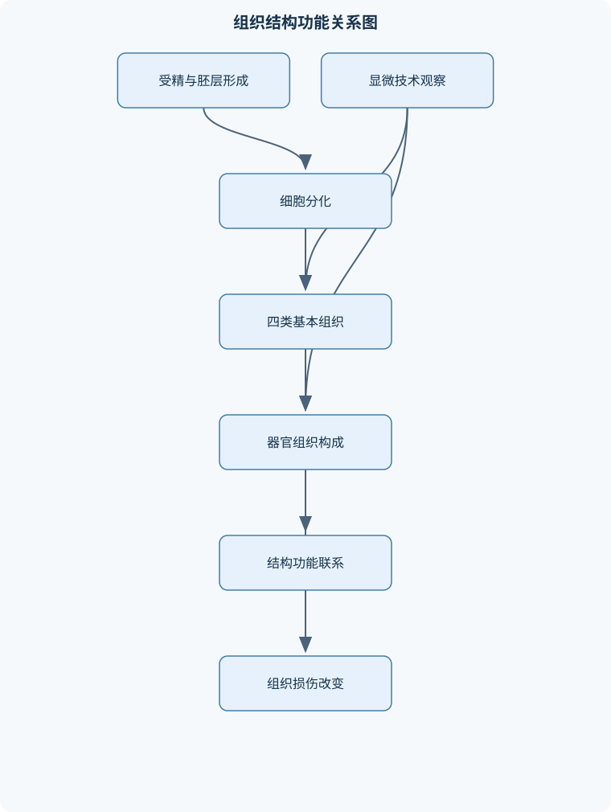
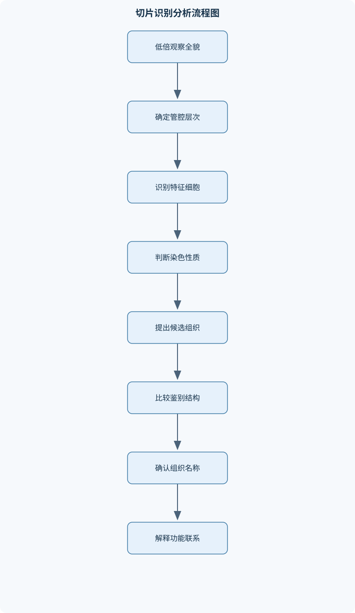

# 动物组织胚胎学

## 一、课程整体知识框架

### 课程边界与先修知识

本课程研究动物机体细胞、组织、器官和胚胎发生的形态结构、超微结构、功能联系及其在光学显微镜和电子显微镜下的识别方法。内容边界包括细胞学基础、四类基本组织、血液与血管、主要器官组织学、生殖细胞发生、受精与早期胚胎发育、胚层分化、胎膜胎盘及常用组织学实验技术；不展开系统解剖学、临床诊断学和具体药物治疗。先修知识包括普通生物学、细胞生物学、动物解剖学基础、基础化学和显微镜操作。课程重点强调动物组织的结构—功能关系，并结合常见兽医动物在组织结构、淋巴结排列和生殖发育方面的比较特点。





### 1. 研究对象、层次与基本方法

《动物组织胚胎学》研究动物机体从细胞、组织、器官到胚胎发育阶段的形态结构、超微结构、功能联系及其识别方法。组织是由形态和功能具有一定共同性的细胞及细胞间质组成的结构层次；器官通常由两种或两种以上组织按一定方式组合而成；胚胎学则追踪生殖细胞形成、受精、卵裂、胚层建立、器官发生和胎膜胎盘形成的连续过程。

显微结构是通常可在光学显微镜下辨认的细胞和组织结构，例如细胞核、腺泡、血管壁层次和软骨细胞腔。超微结构是需要电子显微镜才能清楚分辨的结构，例如核糖体、膜性细胞器、细胞连接复合体、肾小球基膜的层次以及足细胞裂孔隔膜。二者不是完全不同的结构，而是观察尺度和分辨能力不同。长度单位应统一：$1\ \mathrm{mm}=1000\ \mu\mathrm{m}$，$1\ \mu\mathrm{m}=1000\ \mathrm{nm}$。理想光学显微镜的分辨率 $R$ 约为 $0.2\ \mu\mathrm{m}$，透射电子显微镜可达到纳米量级；实际 $R$ 还受镜头数值孔径、波长、样品厚度、固定和染色质量影响。因此，不能因为某结构在光镜下不可见，就断定该结构不存在。

组织识别遵循“低倍确定整体结构，高倍确认细胞和细胞间质，最后由结构解释功能”的顺序。判断未知切片时，应先寻找腔面、包膜、分层、血管和特征性排列，再分析细胞形态、核质比例、染色反应和特殊结构。细胞核标记为 $N$，细胞质标记为 $C$；$N/C$ 比表示细胞核面积或体积与细胞质面积或体积之比，只用于形态描述，不是固定生理常数。幼稚细胞、增殖细胞或某些小型细胞常表现为较高 $N/C$ 比，但不能仅凭该比值判断细胞功能或病理状态。

### 2. 四类基本组织的总体关系

上皮组织由排列紧密的细胞组成，细胞间质少，具有明显的游离面和基底面极性，通常无血管，营养依靠基膜下结缔组织中的扩散。由此可推导，上皮适合构成体表、腔面和腺体分泌界面，并承担屏障、吸收、分泌和运输功能。结缔组织的细胞分散在细胞外基质中，基质包括纤维和无定形基质，主要承担支持、连接、营养、储存和防御。肌组织以收缩为主要功能，神经组织以兴奋、传导和信息整合为主要功能。

四类组织并非互相孤立。例如，小肠黏膜同时含有上皮、固有层结缔组织、黏膜肌层和平滑肌；心脏壁含有内皮、结缔组织、心肌和神经血管；胎盘既有胎儿来源的滋养层和胚外组织，也有母体来源的组织成分。胚胎三胚层为组织来源提供总体框架：外胚层主要形成表皮和神经系统；内胚层主要形成消化管、呼吸管上皮及其部分腺体；中胚层主要形成结缔组织、肌组织、血管、骨、软骨以及泌尿生殖系统的多种支持结构。但器官通常由多个胚层共同参与，不能把任何成熟器官简单归入单一胚层。

### 3. 结构—功能关系的统一分析

组织功能的解释必须建立在可观察结构上。细胞排列紧密、连接复合体发达且细胞间隙小，通常支持屏障功能；细胞具有发达的粗面内质网、高尔基复合体和分泌颗粒，说明其适于合成和输出蛋白质；滑面内质网和过氧化物酶体发达，常与脂质代谢、解毒或氧化反应有关；线粒体丰富通常表示能量需求较高，但不能把线粒体数量直接等同于某一种特定功能。

对肌肉收缩的推导为：兴奋沿细胞膜和横小管传导，引起肌浆网释放钙离子；钙离子与调节蛋白结合，使肌动蛋白和肌球蛋白发生交叉桥循环；ATP为交叉桥分离、再激活以及钙离子泵回收提供能量。肌节由一个完整暗带和两侧各半个明带组成，收缩时粗肌丝长度基本不变，明带和中央的无重叠区变窄，因此“肌丝缩短”不准确，应称为肌丝相对滑行。缺少ATP时，交叉桥不能正常分离，钙离子回收也受阻，所以ATP不足并不只是“不能产生收缩”，还会妨碍舒张。

对肾小球滤过的推导为：血液侧依次经过有孔内皮、肾小球基膜和足细胞裂孔隔膜。水和小分子能否通过，取决于孔径、分子大小、电荷及屏障连续性。带负电的基膜和细胞表面结构会限制部分带负电大分子通过。该结论适用于组织结构分析，不等同于根据一张切片直接作出临床肾功能诊断。

对肝小叶血流的推导为：门静脉分支和肝动脉分支位于小叶周边，血液经肝血窦流向中央静脉，因而血流方向是由周边向中央。胆汁由肝细胞间胆小管流向门管区，方向与血流相反。$CV$ 表示中央静脉，$PV$ 表示门静脉分支，$HA$ 表示肝动脉分支。把胆汁流向写成与血流相同，是常见的方向性错误。

## 二、章节和模块划分

### 核心知识覆盖清单

本清单用于检查正文是否覆盖本课程的主要知识模块：

- **绪论与组织学技术**：组织与四类基本组织的定义、显微结构与超微结构的层次、光学显微镜与电子显微镜的分辨率边界、HE染色及嗜酸性嗜碱性、PAS反应与糖类显示、亲银性与嗜银性、石蜡切片制备流程、涂片铺片磨片的适用材料、免疫组织化学与细胞培养的用途。
- **细胞学与细胞器**：液态镶嵌模型与膜的不对称性、细胞衣及细胞识别、跨膜运输、胞吞与胞吐、细胞核、核仁与染色质、粗面内质网和滑面内质网、高尔基复合体与溶酶体形成、线粒体与过氧化物酶体、核糖体与多聚核糖体、微管微丝中间丝和细胞骨架。
- **上皮组织与腺体**：上皮组织的一般结构特点、单层扁平立方柱状上皮、假复层纤毛柱状上皮、复层扁平上皮及角化差异、变移上皮与膀胱扩张、微绒毛纤毛和静纤毛、紧密连接中间连接桥粒和缝隙连接、基膜的组成与屏障功能、外分泌腺和内分泌腺的结构、浆液性腺泡与黏液性腺泡。
- **结缔组织、软骨、骨与血液**：结缔组织的细胞与细胞间质、成纤维细胞巨噬细胞肥大细胞和浆细胞、胶原纤维弹性纤维和网状纤维、疏松结缔组织与致密结缔组织、白色脂肪与棕色脂肪、透明软骨纤维软骨和弹性软骨、骨原细胞成骨细胞骨细胞与破骨细胞、骨单位和骨重塑、血浆血清与血液有形成分、红细胞白细胞和血小板的形态功能。
- **肌组织与神经组织**：骨骼肌心肌和平滑肌的比较、肌原纤维与肌节、粗肌丝细肌丝和滑行学说、横小管肌浆网二联体和三联体、心肌闰盘与心肌同步收缩、平滑肌密斑密体和中间丝、神经元胞体树突和轴突、尼氏体轴丘和神经原纤维、突触的三部分结构、中枢和周围神经胶质细胞。
- **血管、心脏与微循环**：血管壁的内膜中膜和外膜、大动脉中动脉和小动脉、静脉结构及静脉瓣、连续有孔和窦状毛细血管、周细胞与毛细血管稳定性、内皮细胞的屏障和分泌功能、微循环的血流调节、心脏三层壁结构、心脏传导系统与蒲肯野纤维、心房内分泌功能与心外膜。
- **免疫系统与淋巴器官**：淋巴细胞的主要类型、体液免疫与细胞免疫、淋巴结皮质髓质和淋巴窦、淋巴小结及生发中心、胸腺皮质髓质和胸腺小体、血胸腺屏障、脾白髓边缘区和红髓、单核吞噬细胞系统、抗原呈递细胞与吞噬细胞、不同动物淋巴结结构差异。
- **内分泌系统**：内分泌腺与外分泌腺的组织学区别、甲状腺滤泡与滤泡旁细胞、肾上腺皮质三带结构、肾上腺髓质与交感神经样细胞、腺垂体远侧部结节部和中间部、嗜酸性细胞嗜碱性细胞和嫌色细胞、神经垂体与赫令小体、下丘脑—垂体联系、弥散神经内分泌系统、靶细胞与激素作用的结构基础。
- **消化系统与附属腺**：消化管四层基本结构、黏膜上皮固有层和黏膜肌层、胃小凹与胃底腺、主细胞壁细胞和颈黏液细胞、小肠绒毛与中央乳糜管、肠腺潘氏细胞和杯状细胞、十二指肠腺、肝小叶肝板肝血窦和胆小管、门管区与肝内血流方向、胰腺外分泌部与胰岛。
- **泌尿系统与呼吸系统**：肾小体及肾小囊两层结构、滤过屏障三层组成、近端小管远端小管和细段、髓袢与尿液浓缩、球旁复合体和肾素调节、输尿管变移上皮与肌层、气管壁的四层结构、假复层纤毛柱状上皮与杯状细胞、肺内导管部和呼吸部、肺泡血气屏障。
- **生殖系统组织学**：睾丸生精小管的层次结构、精子发生各阶段、支持细胞与血睾屏障、间质细胞与雄激素分泌、卵巢皮质与髓质、卵泡发育和闭锁、卵母细胞透明带和卵丘、排卵与黄体形成、子宫内膜增殖期和分泌期、胎盘内分泌功能。
- **胚胎发生与胎膜胎盘**：生殖细胞来源与迁移、受精过程与受精卵形成、卵裂桑椹胚和胚泡、内细胞群与滋养层、二胚层胚盘、原肠胚形成与三胚层建立、外胚层中胚层和内胚层的主要衍生物、胚外中胚层与胚外体腔、羊膜卵黄囊尿囊和绒毛膜、绒毛发育胎盘屏障和脐带。


### 1. 绪论与组织学技术

本模块建立组织学观察的尺度、染色和制样基础。HE 表示苏木精—伊红染色；苏木精主要使富含酸性物质的结构呈蓝紫色，伊红主要使富含碱性蛋白的结构呈粉红色。“嗜碱性”指结构对碱性染料的亲和性，不表示结构本身呈碱性；“嗜酸性”同理。细胞核因核酸丰富，常表现为嗜碱性；含有较多蛋白质的细胞质、胶原纤维和肌原纤维常表现为嗜酸性，但固定、染色时间和组织类型会改变颜色深浅。

PAS 是过碘酸—希夫反应，可显示糖原、糖蛋白和部分多糖，阳性部位通常呈紫红色。PAS 阳性不能直接证明全部阳性物质都是糖原，因为基膜、黏液和部分糖蛋白也可反应。亲银性结构能直接还原银盐；嗜银性结构需要外加还原剂，二者不能混用。石蜡切片流程为：取材、固定、脱水、透明、浸蜡、包埋、切片、展片贴片、脱蜡复水、染色、脱水透明和封固。组织过厚会导致固定和脱水不充分；固定不足可引起自溶，固定过度则可能造成收缩和抗原遮蔽；透明不充分会影响浸蜡；切片刀、石蜡温度和展片条件不当可产生裂纹、皱褶或连续性差。

涂片适用于血液、骨髓、细胞悬液等本身可铺展的材料；铺片适用于较薄、较柔软的膜状组织；磨片适用于骨和牙等硬组织，但会损失部分细胞细节。免疫组织化学通过抗体识别特定抗原，用于定位蛋白在细胞或组织中的分布；细胞培养用于观察细胞增殖、分化和功能，但培养环境与体内组织不同，不能将培养结果直接等同于完整器官中的现象。

### 2. 细胞学与细胞器

细胞膜符合液态镶嵌模型，由磷脂双层、胆固醇、糖脂和膜蛋白组成。磷脂的亲水性头部朝向水相，疏水性尾部相对排列；胆固醇调节膜流动性和稳定性；糖脂和糖蛋白主要位于细胞外侧，形成细胞衣，参与细胞识别、黏附和受体作用。膜具有不对称性，内外两侧脂质和蛋白分布并不相同。小分子可通过简单扩散或通道运输，逆浓度或电化学梯度的运输需要载体和能量；大分子可通过胞吞或胞吐。胞吐既是分泌途径，也是膜更新的一部分。

细胞核储存遗传信息。核仁是核糖体RNA合成和核糖体亚单位装配的重要场所；常染色质较疏松，转录活动相对活跃；异染色质较致密，转录活动相对低。粗面内质网表面附着核糖体，主要合成分泌蛋白和膜蛋白；滑面内质网参与脂质代谢、解毒和钙离子储存。高尔基复合体对蛋白质进行加工、分选和包装，并参与溶酶体形成。溶酶体含多种水解酶，负责细胞内物质降解。线粒体通过氧化磷酸化提供ATP；过氧化物酶体参与脂肪酸氧化和过氧化物分解。核糖体为非膜性细胞器，多聚核糖体表示多个核糖体同时翻译同一条信使RNA。

细胞骨架由微管、微丝和中间丝组成。微管参与细胞内运输、纺锤体和纤毛轴部形成；微丝主要由肌动蛋白构成，参与细胞形状变化、微绒毛支架和收缩；中间丝提供抗张力的结构支持。微绒毛内有纵行微丝，纤毛轴部具有典型的微管结构，不能把二者都写成微管。

### 3. 上皮组织与腺体

上皮按细胞层数和表层细胞形态分类。单层扁平上皮适于扩散和滤过，如血管内皮和肺泡上皮；单层立方上皮常见于小管和小型腺体，兼有吸收和分泌功能；单层柱状上皮适于吸收和分泌。假复层纤毛柱状上皮的细胞均接触基膜，但并非所有细胞都达到腔面，常见于呼吸道。复层扁平上皮主要承担机械保护，角化型表面含有无核角质层，非角化型表面保持活细胞层。变移上皮可通过表层细胞形态改变适应膀胱充盈和排空，扩张时细胞层看起来变薄，不能误判为单层上皮。

微绒毛增加吸收表面积，内部为微丝；纤毛由微管构成，可推动表面液体；静纤毛较长，通常不具有典型运动纤毛的结构。紧密连接封闭细胞间隙，中间连接通过黏附蛋白连接细胞骨架，桥粒增强抗机械拉力，缝隙连接允许小分子和离子在相邻细胞间传递。基膜由基膜成分和网状层等构成，兼有机械支持、滤过、细胞黏附和组织修复调节作用，不是单纯的胶原纤维层。

外分泌腺保留导管，将分泌物排至上皮表面或腔内；内分泌腺缺乏导管，分泌物进入血液或组织液。浆液性腺泡细胞胞质较深、分泌蛋白质；黏液性腺泡细胞胞质较浅、腔较宽，主要产生黏液。实际腺体可为混合腺，不能仅凭局部一个腺泡判断整个腺体类型。

### 4. 结缔组织、软骨、骨与血液

结缔组织由细胞和细胞外基质构成。成纤维细胞合成纤维和基质；巨噬细胞吞噬异物并参与抗原处理；肥大细胞释放多种炎症介质；浆细胞具有偏位核和发达粗面内质网，主要分泌抗体。胶原纤维抗拉力强，弹性纤维可伸展和回缩，网状纤维形成支持细胞的细网。疏松结缔组织细胞和基质较多、纤维排列疏松；致密结缔组织纤维含量高，规则排列者适于抵抗单一方向拉力，不规则排列者适于多方向受力。白色脂肪主要储能，棕色脂肪含较多线粒体，适于产热。

透明软骨基质较均匀，常见于关节面、气管软骨等；纤维软骨含粗大胶原纤维，抗压和抗拉能力较强；弹性软骨含弹性纤维，兼具支撑和柔韧性。骨原细胞可分化为成骨细胞，成骨细胞合成骨基质，成熟后成为骨细胞；破骨细胞负责骨吸收。密质骨的骨单位围绕中央管排列，骨重塑是成骨与骨吸收的动态平衡。

血液由血浆和有形成分组成。血清是血液凝固后析出的液体，缺少部分凝血相关成分，不能与血浆混同。红细胞主要运输氧和二氧化碳；白细胞包括中性粒细胞、嗜酸性粒细胞、嗜碱性粒细胞、单核细胞和淋巴细胞；血小板参与止血和凝血。血液涂片中细胞形态会受制片厚度、染色和脱水影响，不能只凭颜色判断细胞种类。

### 5. 肌组织与神经组织

骨骼肌细胞长而多核，细胞核多位于周边，具有清楚横纹；心肌细胞有分支，通常单核或双核，具有闰盘；平滑肌细胞呈梭形、无横纹，细胞核位于中央。骨骼肌中横小管 $T$ 与两侧终池形成三联体；心肌中 $T$ 管与一个终池形成二联体。平滑肌没有典型肌节，肌动蛋白与肌球蛋白连接于密体，收缩力通过中间丝传递到细胞膜和细胞间连接。

神经元由胞体、树突和轴突组成。胞体含核、核仁和尼氏体；尼氏体是发达的粗面内质网和核糖体，轴丘通常缺乏尼氏体，是轴突起始部。神经原纤维与细胞骨架有关。突触通常包括突触前成分、突触间隙和突触后成分。中枢神经系统含星形胶质细胞、少突胶质细胞、小胶质细胞和室管膜细胞；周围神经系统含施万细胞和卫星细胞。蒲肯野纤维属于特殊心肌细胞，不是神经纤维。

### 6. 血管、心脏与微循环

血管壁通常分为内膜、中膜和外膜。大动脉中弹性成分丰富，具有缓冲心脏搏动的作用；中动脉中平滑肌较发达，能够调节局部血流；小动脉管壁薄但平滑肌对管径影响明显。静脉管壁相对较薄，管腔较大，部分静脉有静脉瓣，利于防止血液逆流。毛细血管可分为连续型、有孔型和窦状型，分类依据是内皮连续性、孔隙及基膜特点；通透性通常递增，但不能机械地把结构类型等同于所有器官中的绝对通透性。

周细胞位于毛细血管外侧，可参与血管稳定、收缩调节和修复。内皮细胞不仅构成屏障，还参与凝血调节、血管舒缩和物质转运。心脏壁包括心内膜、心肌膜和心外膜；心肌是主要收缩层，传导系统中的特殊心肌细胞包括窦房结、房室结和蒲肯野纤维。心房肌细胞还具有一定内分泌功能，心外膜表面覆盖间皮，内部含结缔组织、血管和脂肪。

### 7. 免疫系统与淋巴器官

淋巴细胞主要包括T细胞、B细胞和自然杀伤细胞。B细胞及其后代参与抗体介导的体液免疫，T细胞介导细胞免疫和免疫调节，自然杀伤细胞可识别并杀伤部分异常细胞。巨噬细胞和树突状细胞具有吞噬或抗原呈递作用。

淋巴结通常分为皮质、髓质和淋巴窦。皮质可见淋巴小结，生发中心提示B细胞增殖和分化活跃；髓质含髓索和髓窦。胸腺分为皮质和髓质，皮质胸腺细胞密集，髓质可见胸腺小体；血胸腺屏障主要限制血液中抗原接近未成熟T细胞。脾分为白髓、边缘区和红髓，白髓围绕中央动脉，红髓含脾索和脾窦，兼有免疫和血液过滤功能。淋巴结与脾的结构不能互相套用。

不同兽医动物的淋巴结在形态、分叶、输入和输出淋巴管分布方面可有差异，判读时必须结合动物种属和器官位置，不能把一种动物的排列模式无条件推广到另一种动物。

### 8. 内分泌系统

内分泌腺无导管，细胞通常排列成索状、团状或滤泡状，周围毛细血管丰富。甲状腺滤泡由滤泡细胞围成，腔内胶体可储存甲状腺激素前体；滤泡旁细胞位于滤泡间或滤泡基底侧，具有不同的分泌功能。肾上腺皮质由外向内分为球状带、束状带和网状带，髓质含具有交感神经样特征的细胞。腺垂体包括远侧部、结节部和中间部，细胞可按染色分为嗜酸性、嗜碱性和嫌色性细胞；神经垂体含轴突、神经胶质样细胞和赫令小体。下丘脑通过神经分泌和门脉系统联系垂体。

弥散神经内分泌系统的细胞散在分布于消化管、呼吸道等器官，虽不形成完整腺体，但能感受局部刺激并释放激素或旁分泌因子。激素作用依赖靶细胞受体，血液中存在激素并不意味着所有细胞都会产生相同反应。

### 9. 消化系统与附属腺

消化管通常由黏膜、黏膜下层、肌层和外膜或浆膜构成。黏膜包括上皮、固有层和黏膜肌层。胃小凹通向胃腺；胃底腺中的壁细胞主要分泌盐酸，主细胞主要分泌胃蛋白酶原，颈黏液细胞分泌黏液。不能仅凭染色深浅交换主细胞和壁细胞的功能。

小肠绒毛由单层柱状上皮和固有层组成，固有层内有毛细血管和中央乳糜管。糖和氨基酸吸收后主要进入毛细血管，较大脂质颗粒主要经淋巴进入循环。肠腺含吸收细胞、杯状细胞、潘氏细胞和内分泌细胞；十二指肠黏膜下层可见十二指肠腺。肝小叶含肝板、肝血窦、胆小管和中央静脉；门管区含门静脉分支、肝动脉分支和胆管。胰腺外分泌部由腺泡和导管构成，胰岛为内分泌细胞团，可区分A细胞、B细胞、D细胞和PP细胞。

### 10. 泌尿系统与呼吸系统

肾小体由肾小球和肾小囊组成，肾小囊有壁层和脏层。滤过屏障由有孔内皮、肾小球基膜以及足细胞突起和裂孔隔膜组成。近端小管刷状缘发达、胞质较嗜酸性、线粒体丰富，适于主动重吸收；远端小管刷状缘不发达，腔面较清楚；细段上皮薄，适于水和溶质交换。髓袢参与尿液浓缩，球旁复合体包括球旁细胞、致密斑和相关结构，参与肾素调节。肾小体有血管极和尿极，尿极与近端小管相连，不能写成与远端小管直接相连。

输尿管黏膜为变移上皮，肌层发达，适于承受尿液压力并推动尿液。气管壁可辨认黏膜、黏膜下层、软骨和外膜；假复层纤毛柱状上皮含纤毛细胞和杯状细胞，软骨支撑气道，腺体分泌物润滑表面。肺内导管部逐渐过渡至呼吸部，肺泡壁与毛细血管共同形成血气屏障，屏障薄有利于气体交换，但仍需保持结构完整。

### 11. 生殖系统组织学

睾丸生精小管内，生精细胞由基底部向腔面依次经历精原细胞、初级精母细胞、次级精母细胞、精子细胞和精子。支持细胞为生精细胞提供营养和结构支持，并形成血睾屏障；间质细胞位于小管之间，分泌雄激素。精子发生包括有丝分裂、减数分裂和精子形成，不能把精子细胞直接等同于已成熟精子。

卵巢分为皮质和髓质。卵泡发育经历原始卵泡、初级卵泡、次级卵泡和成熟卵泡，卵泡可在多个阶段闭锁。卵母细胞周围有透明带和卵丘，排卵后残余卵泡结构形成黄体。子宫内膜增殖期以腺体和间质增生为特征，分泌期腺体活动和分泌物增加。胎盘除物质交换外，还具有内分泌功能，但具体结构和激素活动存在种属差异。

### 12. 胚胎发生与胎膜胎盘

生殖细胞来源于原始生殖细胞，后者迁移至生殖腺区域并分化。受精包括精卵识别、膜融合、皮质反应和受精卵形成。受精卵经卵裂形成桑椹胚，再形成胚泡。胚泡包括内细胞群和滋养层，内细胞群主要形成胚体，滋养层参与胚外结构和胎盘形成。

二胚层胚盘由上胚层和下胚层构成；原肠化建立外胚层、中胚层和内胚层。外胚层主要形成神经系统和表皮；中胚层形成骨、软骨、肌肉、血管、结缔组织及泌尿生殖系统支持结构；内胚层形成消化管和呼吸管上皮及相关腺体的主要上皮成分。胚外中胚层形成胚外体腔，羊膜、卵黄囊、尿囊和绒毛膜分别承担保护、早期营养、排泄和气体交换等作用。绒毛由滋养层和胚外中胚层共同参与形成，胎盘屏障的厚度和组成会随发育与物种而变。脐带含脐血管和黏液性结缔组织，不能与绒毛膜或胎盘整体混同。

### 13. 代表性流程与伪代码

#### 流程一：石蜡切片制备

**输入**：新鲜组织、适宜固定液、脱水剂、透明剂、石蜡和载玻片。  
**输出**：完整、连续、可染色的石蜡切片。  
**过程**：控制取材厚度并立即固定；按组织性质完成脱水、透明、浸蜡和包埋；切片、展片、贴片；脱蜡复水后染色，再脱水、透明和封固。  
**不变量**：转移过程中组织不能明显腐败、过度收缩或失去基本结构。  
**终止条件**：切片连续、无明显皱褶、裂纹和污染。  
**适用边界**：适合常规形态观察，不适合需要保留活性酶、活细胞和部分易降解抗原的研究。复杂度不适用于该实验流程，主要限制来自组织大小、温度、时间和试剂状态。

#### 流程二：未知组织切片判读

输入为未知切片或显微图像，输出为组织类型、关键结构和功能解释。先低倍观察整体层次，再判断腔面、包膜、血管和分层结构；随后高倍识别细胞形态、细胞连接、纤维和特征细胞；结合染色特性和器官位置提出候选；最后用至少两个独立形态证据确认。

```python
def identify_tissue(features):
    """
    features: 描述切片的字典。
    返回：候选组织和判定依据。
    """
    candidates = []

    if features.get("layered_epithelium") and features.get("surface_flattened"):
        candidates.append(("复层扁平上皮", "细胞层多，表层细胞扁平，适于机械保护"))

    if features.get("pseudostratified") and features.get("cilia"):
        candidates.append(("呼吸道假复层纤毛柱状上皮", "细胞核高低不一但均接触基膜，表面有纤毛"))

    if features.get("glomerulus") and features.get("renal_tubules"):
        candidates.append(("肾组织", "同时出现肾小体和肾小管"))

    if features.get("follicles") and features.get("colloid"):
        candidates.append(("甲状腺", "滤泡腔内有胶体，滤泡细胞环绕腔面"))

    if len(candidates) == 0:
        return {"result": "证据不足", "reason": "需要更多整体结构或特征细胞信息"}
    return {"result": candidates, "reason": "至少依据两个形态特征提出候选"}
```

该伪代码只表达判读逻辑，不能代替切片观察。若切面方向异常、固定严重收缩或染色不均，应降低判断确定性。

#### 流程三：肾小体滤过屏障分析

输入为肾小体光镜或电镜图像，依次定位有孔内皮、肾小球基膜、足细胞突起和裂孔隔膜，再按血管腔侧至尿腔侧的顺序分析。若某一层连续性破坏，应说明该层对滤过选择性的贡献可能下降，但不能据此直接推导具体疾病诊断。

#### 流程四：胚胎阶段判定

先找胚泡腔、内细胞群和滋养层；再判断二胚层胚盘；随后寻找原肠化、三胚层、胚外体腔、绒毛和脐带。阶段判定必须依据结构组合，至少有两个相互支持的阶段性结构，局部切面只能给出阶段范围。

### 14. 代表性例题

#### 例题一：气管切片鉴定

**题干**：切片显示管腔表面有多排高低不一的细胞核，表面有纤毛和杯状细胞，深部有透明软骨和腺体。判断器官并解释功能。

**分析**：多排核不等于复层上皮；若所有细胞均接触基膜且表面有纤毛，应考虑假复层纤毛柱状上皮。软骨和腺体共同支持气管判断。

**解答**：该组织为气管。上皮清除黏附颗粒，杯状细胞分泌黏液，纤毛推动黏液向咽部移动；软骨防止管腔塌陷；腺体分泌物润滑并维持表面液体层。

**验证**：至少有“假复层纤毛柱状上皮”和“气管软骨”两项独立证据。  
**变式**：若无软骨而出现大量肺泡，应考虑肺内较小气道或肺实质，而不能仍判为气管。

#### 例题二：比较大动脉、中动脉和静脉

**题干**：比较三类血管的结构和功能。

**分析**：先比较管壁厚度和三层比例，再观察弹性膜、平滑肌、管腔形态及静脉瓣。

**解答**：大动脉中膜弹性成分多，缓冲搏动；中动脉中膜平滑肌较发达，调节分布血流；静脉管腔较大、壁较薄，容纳较多血液，部分静脉有瓣膜。切片中血管收缩或塌陷会改变管腔形态，故不能只凭管腔圆或扁判断。

**验证**：必须同时说明结构证据和功能后果。  
**变式**：若一条静脉因收缩而管腔近圆，仍应依据中膜相对薄、外膜相对明显等综合判断。

#### 例题三：肾组织切片识别

**题干**：某切片含球状毛细血管团、周围囊腔、管腔较小且胞质嗜酸性的管道，以及腔面较清楚的管道。要求识别结构。

**分析**：球状毛细血管团及囊腔为肾小体；刷状缘和丰富线粒体使近端小管腔面不清、胞质较嗜酸；远端小管刷状缘不发达，腔面较清楚。

**解答**：球状结构为肾小体；胞质较深、腔面不清者多为近端小管；腔面清楚、细胞较小者多为远端小管。若见一圈排列特别整齐、细胞核密集的远端小管壁，可考虑致密斑。

**验证**：近端小管必须有刷状缘和较强重吸收结构依据；不能只凭管径判断。  
**变式**：若为电镜图，应进一步寻找滤过屏障三层结构，而不能仅描述“毛细血管壁”。

#### 例题四：小肠绒毛与肠腺

**题干**：说明小肠绒毛、中央乳糜管、毛细血管、杯状细胞和肠腺的关系。

**分析**：绒毛扩大吸收表面积，固有层内的毛细血管和中央乳糜管承担不同运输任务。

**解答**：单层柱状上皮吸收消化产物，杯状细胞分泌黏液。糖和氨基酸等小分子主要进入毛细血管；较大脂质颗粒主要进入中央乳糜管。肠腺位于绒毛之间的固有层内，含吸收细胞、杯状细胞、潘氏细胞和内分泌细胞。

**验证**：必须同时指出上皮、固有层、毛细血管和中央乳糜管。  
**变式**：若只见腺体而无绒毛，可能为肠腺区域的切面，不能据此否定小肠来源。

#### 例题五：从胚泡到三胚层

**题干**：排列受精卵、桑椹胚、胚泡、二胚层胚盘和三胚层胚盘，并说明主要结构。

**分析**：受精后连续卵裂形成桑椹胚，出现腔隙后形成胚泡；胚泡包括内细胞群和滋养层；内细胞群进一步形成二胚层胚盘，原肠化后建立三胚层。

**解答**：顺序为受精卵—卵裂—桑椹胚—胚泡—二胚层胚盘—三胚层胚盘。内细胞群主要形成胚体，滋养层参与胎盘和胚外结构；原肠化形成外胚层、中胚层和内胚层。

**验证**：阶段判断必须由结构组合支持，而不是只看胚胎大小。  
**变式**：若只见胚泡腔而未见清楚的内细胞群，最多判为胚泡阶段，不能直接判为二胚层胚盘。

### 15. 实验与项目

#### 实验一：HE 染色石蜡切片质量分析

**输入数据**：固定组织、石蜡切片、HE 染色液、显微镜，以及出现皱缩、裂纹或染色不均的切片。  
**步骤**：先低倍观察切片连续性和组织轮廓；再高倍观察核、胞质、基膜和纤维；记录皱缩、裂纹、组织脱落和颜色不均的位置；按取材、固定、脱水、透明、包埋、切片、染色顺序逐环节排查。  
**评价标准**：组织轮廓基本保持，切片连续，细胞核清晰，胞质和细胞间质有可辨差异，背景无明显污染。  
**排错方法**：组织皱缩优先检查固定过度、脱水过快或温度不当；裂纹检查石蜡硬度、刀口和切片厚度；染色不均检查脱蜡复水是否充分及染液状态。不能把所有问题归因于染色。

#### 实验二：多器官组织切片结构—功能项目

**输入数据**：气管、肾、肝、小肠、淋巴结或肌组织切片及显微图像。  
**步骤**：每张切片先低倍定位器官整体层次，再高倍标注至少五个结构；为每个结构写出形态证据、功能联系和一个可能的判读陷阱；对相似结构进行比较，如近端小管与远端小管、淋巴结与脾、心肌与骨骼肌。  
**评价标准**：每个功能结论均有可观察结构依据；至少使用两个独立证据确认器官；能说明切面方向、固定和染色对结果的影响。  
**排错方法**：若候选过多，回到整体层次重新寻找包膜、腔面、分层和血管；若颜色异常，先检查染色和固定质量，再决定是否具有组织学意义；若只见局部结构，应明确说明结论范围，不强行确定器官。

### 16. 易错点、笔试与面试应用

#### 具体易错点

1. “嗜碱性”不是细胞本身呈碱性，“嗜酸性”也不是细胞本身呈酸性。  
2. PAS 阳性不能直接等同于糖原。  
3. 亲银性与嗜银性需要区分。  
4. 上皮无血管不等于无神经。  
5. 基膜不是单纯胶原纤维。  
6. 微绒毛含微丝，纤毛轴部含微管。  
7. 变移上皮扩张后不能误判为单层上皮。  
8. 心肌有横纹，但不属于骨骼肌。  
9. 蒲肯野纤维是特殊心肌细胞，不是神经纤维。  
10. 近端小管刷状缘发达，远端小管通常不发达。  
11. 肾小体尿极与近端小管相连。  
12. 肝小叶血流与胆汁流向相反。  
13. 脾不能按淋巴结的皮质—髓质模式描述。  
14. 胃底腺主细胞和壁细胞功能不能对调。  
15. 精子发生和卵泡发生不是同一过程。  
16. 胎盘、胎膜和脐带是相互联系但不同的结构。

#### 典型笔试问题及解答思路

1. **为什么上皮适于屏障功能？**  
   从细胞紧密排列、连接复合体、极性和基膜支持四方面说明，再指出上皮无血管、营养依赖扩散。

2. **比较连续型、有孔型和窦状毛细血管。**  
   依次比较内皮连续性、孔隙、基膜和通透性，并说明这是结构趋势而非所有器官的绝对规律。

3. **说明肌节收缩时各带变化。**  
   先定义粗肌丝、细肌丝、暗带、明带和中央无重叠区，再说明粗肌丝长度基本不变，明带和无重叠区变窄。

4. **解释肾小球滤过屏障。**  
   按血管腔侧到尿腔侧写出有孔内皮、基膜、足细胞裂孔隔膜，说明孔径、电荷和连续性共同影响滤过。

5. **比较淋巴结和脾。**  
   淋巴结写皮质、髓质和淋巴窦；脾写白髓、边缘区和红髓，最后联系淋巴回流与血液过滤。

6. **说明甲状腺滤泡的结构—功能关系。**  
   由滤泡细胞环绕腔面、胶体腔内储存、毛细血管丰富三点解释合成、储存和释放。

7. **说明肝小叶血液和胆汁方向。**  
   写 $PV$、$HA$ 到肝血窦再到 $CV$；胆汁由肝细胞间胆小管流向门管区，强调方向相反。

8. **排列胚胎早期发育阶段并说明三胚层来源。**  
   按受精卵、卵裂、桑椹胚、胚泡、二胚层和三胚层排列，再分别说明外胚层、内胚层和中胚层的主要衍生方向。

#### 面试问题与参考答案要点

1. **如何判断一张未知组织切片？**  
   先低倍看整体和层次，再高倍看细胞与特征结构，最后用两个以上独立证据确认，避免只凭颜色或单个细胞判断。

2. **石蜡切片出现皱缩，如何排查？**  
   依次检查取材厚度、固定、脱水速度、透明、石蜡温度和切片刀；不同环节造成的皱缩形态并不完全相同。

3. **如何区分近端小管和远端小管？**  
   近端小管刷状缘发达、胞质较嗜酸、腔面不清；远端小管刷状缘少、腔面较清楚，并结合肾小体和致密斑位置判断。

4. **如何区分心肌和骨骼肌？**  
   心肌有分支、中央核和闰盘；骨骼肌长而规则、多核且核偏周边。二者都有横纹，不能将横纹作为唯一依据。

5. **为什么同一器官不同动物的切片不能完全套用？**  
   淋巴结排列、胎盘类型和生殖道结构有种属差异，必须结合动物来源、器官位置和多项形态证据。

6. **免疫组织化学能解决什么问题？**  
   它可定位特定抗原，帮助确认细胞来源或蛋白分布；但结果受抗体特异性、固定和抗原修复影响，不能脱离形态背景解释。

7. **胚泡和二胚层胚盘如何区分？**  
   胚泡主要看胚泡腔、内细胞群和滋养层；二胚层胚盘还应能辨认上胚层和下胚层的排列。

8. **如果切片染色异常，是否还能作出判断？**  
   可先依据轮廓、排列和特征结构作有限判断，同时明确不确定性；不能用异常颜色替代结构证据。

### 17. 岗位关联

兽医组织病理技术员和组织切片与染色技术员需要完成取材、固定、脱水、包埋、切片、染色和显微质量控制，使用的是组织层次、染色原理和制样误差分析知识，产出为完整切片、染色记录和质量评价，验收标准是结构保存良好、切片连续、背景清洁和关键组织可辨。

动物医学实验技术员和兽医病理学实验室助理需要进行器官切片定位、组织结构描述及实验记录，使用四类基本组织、器官组织学和结构—功能因果分析，产出为显微观察记录、标注图和实验报告，验收标准是结构名称准确、功能解释有形态依据、异常现象有排错路径。

动物胚胎工程技术员和生殖与繁殖技术员需要识别卵母细胞、胚泡、胚盘、胎膜和胎盘结构，使用生殖细胞发生、受精、胚层分化和胎盘组织学知识，产出为胚胎阶段判定、培养观察记录或胚胎质量描述，验收标准是阶段判断具有多个结构证据，并能说明动物种属和切面方向造成的限制。

动物细胞培养技术员需要观察细胞形态、增殖和分化，并将培养细胞与组织来源联系起来，使用细胞膜、细胞器、细胞骨架和上皮或结缔组织知识，产出为细胞形态记录和实验结果，验收标准是区分正常形态、培养条件影响与制样伪影，不把体外现象直接等同于体内组织功能。

生物医学显微成像分析员和动物检验检疫技术人员需要进行显微图像采集、结构标注和组织异常筛查，使用光镜与电镜分辨率边界、染色特性、器官组织学和比较组织学知识，产出为图像分析报告和可追溯标注结果，验收标准是图像质量合格、结构判定依据明确，并对固定、切面、染色及动物种属差异作出边界说明。

## 三、核心概念的详细解释

### 1. 组织学观察尺度与常用技术

动物组织由形态和功能具有一定共同性的细胞及细胞间质组成。四类基本组织分别为上皮组织、结缔组织、肌组织和神经组织。上皮细胞排列紧密、细胞间质少，具有游离面和基底面极性，通常没有血管，营养依靠基膜下结缔组织中的扩散；结缔组织的细胞分散在细胞外基质中，适于支持、连接、储存和防御；肌组织以收缩为主要特征；神经组织由神经元和神经胶质细胞组成，承担兴奋、传导和整合。

显微结构是光学显微镜通常能够辨认的结构，如细胞核、腺泡、软骨细胞腔、血管壁分层和肌纤维排列。超微结构包括核糖体、膜性细胞器、细胞连接、肾小球基膜和足细胞裂孔隔膜等，需要电子显微镜才能清楚显示。光镜的理想分辨率 $R$ 约为 $0.2\ \mu\mathrm{m}$，透射电子显微镜可达到纳米量级；实际分辨率还受数值孔径、波长、样品厚度、固定、包埋和染色质量影响。若某结构在光镜下不可见，只能说明其低于当前观察条件的分辨能力，不能证明该结构不存在。

HE染色中，苏木精使富含酸性物质的结构呈蓝紫色，伊红使富含碱性蛋白的结构呈粉红色。“嗜碱性”表示结构对碱性染料亲和，不表示结构本身呈碱性；“嗜酸性”同理。细胞核、核糖体和粗面内质网常因核酸丰富而表现嗜碱性，肌纤维和多数细胞质蛋白常表现嗜酸性。PAS反应通过过碘酸氧化产生醛基，再与无色碱性品红反应，糖原、糖蛋白和部分多糖通常呈紫红色；PAS阳性不能直接等同于“全部是糖原”。亲银性结构可直接还原银盐，嗜银性结构需外加还原剂，二者不可混用。

石蜡切片流程包括取材、固定、脱水、透明、浸蜡、包埋、切片、展片贴片、脱蜡复水、染色、脱水透明和封固。取材过厚会造成固定和脱水不充分；脱水过快可导致收缩，透明不足会妨碍石蜡浸入，石蜡温度过高可能损伤组织。涂片适合血液、细胞悬液和脱落细胞；铺片适合膜状或较薄组织；磨片适合骨和牙等硬组织。免疫组织化学用于定位特定抗原，必须结合组织形态、抗体特异性和对照结果解释；细胞培养可观察细胞增殖、迁移和分化，但体外细胞形态不能完全代表体内组织。

### 2. 细胞膜、细胞器与细胞骨架

细胞膜符合液态镶嵌模型，由磷脂双层、胆固醇、糖脂和膜蛋白组成。磷脂极性头朝向水相，疏水尾相对排列于膜中央；胆固醇调节流动性和稳定性；糖脂和糖蛋白主要位于外层，构成细胞衣，参与细胞识别、黏附和免疫反应。膜具有不对称性，内外两层脂质和蛋白分布不同。跨膜蛋白可作为通道、载体、受体或酶。小分子可通过简单扩散或易化扩散，逆浓度梯度运输需要主动运输；大分子和颗粒主要通过胞吞，分泌物通过胞吐。

细胞核储存遗传信息。常染色质较疏松，转录活动相对活跃；异染色质较致密，转录活动相对低。核仁是核糖体RNA合成和核糖体亚单位装配的重要区域。粗面内质网表面附着核糖体，主要合成分泌蛋白、膜蛋白和部分细胞器蛋白；滑面内质网参与脂质合成、解毒、糖原代谢和钙离子储存。高尔基复合体接受内质网来源的蛋白，进行加工、分选和包装，并参与溶酶体形成。溶酶体含有多种水解酶，负责细胞内消化和受损结构清除。过氧化物酶体参与脂肪酸氧化和过氧化氢代谢。

线粒体具有双层膜，内膜形成嵴，基质含有代谢酶、环状DNA和核糖体，是有氧代谢和ATP生成的重要场所。核糖体由RNA和蛋白质组成，游离核糖体主要合成细胞质内使用的蛋白，多聚核糖体表示多个核糖体同时翻译同一条mRNA。微管由微管蛋白组成，参与细胞内运输、纺锤体和纤毛运动；微丝主要由肌动蛋白组成，参与细胞形变、吞噬和微绒毛支架；中间丝提供抗张力和机械稳定性。微绒毛内部主要是纵行微丝，纤毛轴部为典型“9+2”微管结构，不能混淆。

### 3. 上皮、腺体与细胞连接

上皮按层数和表层细胞形态分类。单层扁平上皮适于扩散和滤过，如血管内皮；单层立方上皮常参与吸收和分泌；单层柱状上皮适于吸收、分泌和保护；假复层纤毛柱状上皮的细胞均接触基膜，但细胞核高低不一，常见于气管；复层扁平上皮适于抗摩擦，角化型表面有角蛋白层，非角化型表面保持活细胞。变移上皮细胞形态可随膀胱扩张而改变，表层伞形细胞有助于维持屏障。

微绒毛增加吸收表面积，内部含微丝；纤毛可推动表面液体或黏液；静纤毛较长且通常不具主动摆动功能。紧密连接封闭细胞间隙，中间连接通过黏附蛋白连接肌动蛋白，桥粒通过中间丝增强抗机械力，缝隙连接允许小分子和离子在相邻细胞间交换。基膜由基膜成分和网状层等组成，具有支持、选择性屏障和细胞黏附作用，不是单纯的胶原纤维层。

外分泌腺保留导管，将分泌物排向体表或器官腔面；内分泌腺通常无导管，分泌物进入组织液和血液。浆液性腺泡细胞胞质较嗜碱性，分泌物较稀，含蛋白质；黏液性腺泡细胞胞质浅、核偏基底，分泌黏液。腺体结构和染色必须结合腔道、细胞排列及分泌颗粒综合判断。

### 4. 结缔组织、软骨、骨和血液

结缔组织由细胞和细胞外基质组成。成纤维细胞合成胶原和基质；巨噬细胞吞噬异物并参与抗原处理；肥大细胞释放组胺等介质；浆细胞具有偏位核和发达粗面内质网，主要分泌抗体。胶原纤维抗拉力强，弹性纤维可伸展后回缩，网状纤维形成支持性网架。疏松结缔组织细胞和基质较多，利于交换和防御；致密结缔组织纤维多，适于抗张。白色脂肪主要储能，棕色脂肪线粒体丰富，产热能力较强。

透明软骨基质较均匀，胶原纤维不易在光镜下分辨；纤维软骨胶原纤维粗大，抗压和抗拉能力强；弹性软骨含弹性纤维，具有较好弹性。骨原细胞参与成骨，成骨细胞合成骨基质，骨细胞位于骨陷窝内，破骨细胞负责骨吸收。骨单位包括中央管、同心骨板和骨陷窝等结构，骨重塑是成骨和骨吸收动态平衡的结果。

血液由血浆和有形成分组成。血浆含水、蛋白质和电解质；血清是凝固后析出的液体，缺少纤维蛋白原等凝血相关成分。红细胞主要运输氧和二氧化碳；中性粒细胞吞噬细菌和急性炎症反应；嗜酸性粒细胞参与寄生虫防御和过敏反应；嗜碱性粒细胞释放炎症介质；淋巴细胞参与特异性免疫；单核细胞进入组织后可形成巨噬细胞；血小板参与止血和凝血。

### 5. 肌组织与神经组织

骨骼肌细胞长而规则，多核且核偏周边，具有明显横纹；心肌细胞有分支、中央核和闰盘；平滑肌细胞梭形、无横纹，通常只有一个中央核。肌原纤维由肌节组成，肌节包括一个完整暗带和两侧各半个明带。肌肉收缩时粗肌丝和细肌丝长度基本不变，明带和H带变窄，说明本质是肌丝相对滑行而不是肌丝本身缩短。

骨骼肌中横小管与两侧终池组成三联体，心肌中横小管与一个终池组成二联体。平滑肌无典型肌节，肌动蛋白附着于密体和密斑，并通过中间丝传递张力。骨骼肌和心肌主要依赖肌钙蛋白调节，平滑肌主要通过钙调蛋白和肌球蛋白轻链激酶调节。心肌闰盘含黏着连接、桥粒和缝隙连接，既能传递机械力，也能促进兴奋同步。

神经元包括胞体、树突和轴突。树突主要接收信号，轴突传出信号；轴丘缺乏典型尼氏体，是动作电位发生的重要部位。尼氏体为粗面内质网和游离核糖体聚集区，提示蛋白合成活跃。突触由突触前部、突触间隙和突触后膜组成。中枢神经胶质包括星形胶质细胞、少突胶质细胞、小胶质细胞和室管膜细胞；周围神经系统主要有施万细胞和卫星细胞。

### 6. 血管、心脏、淋巴和内分泌组织

血管壁通常分为内膜、中膜和外膜。大动脉中弹性成分丰富，能储存并释放弹性能量；中动脉中膜平滑肌发达，便于调节管径；小动脉是外周阻力和局部血流调节的重要部位。静脉管壁较薄、管腔较大，部分静脉有静脉瓣。毛细血管可分为连续型、有孔型和窦状型，通透性总体随内皮连续性、孔隙和基膜完整程度变化，但不能机械认为所有器官都遵循完全相同的通透性等级。周细胞参与毛细血管稳定、修复和通透性调节。

心脏壁由心内膜、心肌膜和心外膜组成。心肌层最厚，承担泵血；传导系统中的蒲肯野纤维是特殊心肌细胞，不是神经纤维；心房肌细胞还可分泌调节体液平衡的信号分子。淋巴结通常有皮质、髓质和淋巴窦，皮质含淋巴小结和生发中心，髓质含髓索和髓窦。胸腺皮质富含未成熟T细胞，髓质含胸腺小体，并有血胸腺屏障。脾由白髓、边缘区和红髓构成，红髓参与血液过滤和血细胞清除。不同动物的淋巴结可表现为皮质、髓质排列及淋巴窦分布差异，不能把一种动物的切片模式直接套用于所有动物。

甲状腺滤泡内含胶体，滤泡细胞环绕滤泡，滤泡旁细胞位于滤泡间或基底部。肾上腺皮质由球状带、束状带和网状带构成，髓质含交感神经样分泌细胞。腺垂体包括远侧部、结节部和中间部，嗜酸性、嗜碱性和嫌色细胞的染色差异与分泌状态相关；神经垂体含轴突、神经胶质样细胞和赫令小体。下丘脑通过神经轴突和门脉系统调节垂体，弥散神经内分泌系统分布于多个器官。激素只有作用于具有相应受体的靶细胞，才能产生特异效应。

### 7. 消化、泌尿和呼吸系统

消化管通常由黏膜、黏膜下层、肌层和外膜或浆膜组成。黏膜包括上皮、固有层和黏膜肌层。胃小凹通入胃腺，壁细胞分泌盐酸，主细胞分泌胃蛋白酶原，颈黏液细胞分泌黏液。小肠绒毛扩大吸收表面积，固有层含毛细血管和中央乳糜管；糖和氨基酸主要进入血液，较大脂质颗粒主要进入淋巴。肠腺含吸收细胞、杯状细胞、潘氏细胞和内分泌细胞，十二指肠还含黏液性腺体。肝小叶内，血液由门静脉分支和肝动脉分支经肝血窦流向中央静脉，胆汁由肝细胞间胆小管流向门管区，二者方向相反。胰腺外分泌部为腺泡，胰岛含A细胞、B细胞、D细胞和PP细胞。

肾小体由肾小球和肾小囊组成。滤过屏障从血液侧到尿腔侧依次为有孔内皮、肾小球基膜和足细胞裂孔隔膜，滤过受孔径、分子大小、电荷及结构完整性共同影响。近端小管刷状缘发达、胞质较嗜酸，具有强重吸收能力；远端小管刷状缘不发达，腔面较清楚；细段上皮薄，适于被动交换。髓袢参与尿液浓缩，球旁复合体包括致密斑、球旁细胞和球外系膜细胞，参与肾素调节。输尿管内衬变移上皮，肌层推动尿液向膀胱方向移动。

气管具有假复层纤毛柱状上皮、固有层、软骨和外膜等结构，杯状细胞分泌黏液，纤毛推动黏液清除颗粒。肺内导管部逐渐向呼吸部过渡，肺泡由薄的肺泡上皮、毛细血管内皮和融合的基膜等形成血气屏障；肺泡巨噬细胞参与颗粒清除。

### 8. 生殖系统与胚胎发生

睾丸生精小管内，生精细胞由基底部向腔面依次经历精原细胞、初级精母细胞、次级精母细胞、精子细胞和精子。支持细胞形成血睾屏障，提供营养并调节生精微环境；间质细胞分泌雄激素。卵巢皮质含卵泡，髓质含血管、神经和疏松结缔组织。卵泡由原始卵泡、初级卵泡、次级卵泡逐步发育，闭锁可发生于多个阶段。透明带包围卵母细胞，卵丘细胞支持卵母细胞；排卵后残余卵泡形成黄体。子宫内膜增殖期以腺体和间质增生为特点，分泌期腺体曲折、分泌活动增强。胎盘除交换功能外，还具有内分泌功能。

生殖细胞来自早期胚胎的特定细胞群，并迁移到性腺原基。受精包括精卵识别、膜融合、卵母细胞完成减数分裂、雌雄原核形成和受精卵建立。受精卵经历卵裂形成桑椹胚，再形成含胚泡腔、内细胞群和滋养层的胚泡。内细胞群形成胚体，滋养层参与着床和胎盘形成。二胚层胚盘由上胚层和下胚层组成，原肠化后形成外胚层、中胚层和内胚层。

外胚层主要形成表皮及其附属器和神经系统；内胚层主要形成消化管、呼吸管上皮及部分腺体；中胚层主要形成结缔组织、肌组织、骨、软骨、血管和泌尿生殖系统的多种结构。胚外中胚层形成胚外体腔，羊膜、卵黄囊、尿囊和绒毛膜共同构成胎膜系统。绒毛逐级发育，胎儿血管伸入绒毛，胎盘屏障在不同动物中厚度和组成存在差异。脐带含脐血管、黏液性结缔组织和表面羊膜上皮。胎盘结构和胎膜类型具有种属差异，不能直接以一种动物的模式解释所有动物。

### 9. 代表性判读和实验流程

#### 组织切片判读流程

输入为未知切片或显微图像，输出为组织类型、器官判断和结构—功能解释。先用低倍确定腔面、包膜、层次、血管和整体排列，再用高倍观察细胞形态、核质比例、纤维、细胞连接和特征细胞，最后使用至少两个独立形态证据确认。切片方向、收缩、染色不均和动物种属差异会限制判断。

#### 石蜡切片质量控制流程

输入为组织块和固定液，输出为连续、平整、可染色切片。流程为取材控制厚度、固定、梯度脱水、透明、浸蜡、包埋、切片、展片、染色和封固。若出现皱褶，先检查刀刃、蜡块温度和展片水温；若出现裂纹，检查包埋不均、蜡质过硬或切片速度；若染色不均，检查脱蜡、复水、染液污染和组织固定。适用于常规形态学，不适合保留活细胞功能或活性酶的研究。

#### 胚胎阶段判定流程

输入为胚胎切片或形态描述，输出为阶段范围。先找胚泡腔、内细胞群和滋养层，再观察上胚层、下胚层、原肠化和三胚层，随后寻找胚外体腔、绒毛和脐带。必须依据多个结构组合判定，局部切面或严重变形时只能给出范围而非绝对阶段。

```text
输入：显微图像 I
输出：候选组织或胚胎阶段 S，及证据集合 E

1. 低倍观察 I，记录腔面、包膜、分层和主要血管
2. 高倍记录细胞形态、核质比、纤维、细胞连接和特征结构
3. 根据至少两个独立结构生成候选集合 S
4. 对每个候选逐项检查：
   若缺少必要结构，则排除该候选
   若存在切面、固定或种属限制，则降低结论确定性
5. 输出保留候选、形态证据 E、结构—功能解释和限制条件
终止条件：至少两个独立证据支持同一候选，且主要反例已说明
```

#### 例题一：比较三种肌组织

题干：某切片中一组细胞具有横纹、中央单核和分支，并可见横向深染线。判断组织类型并解释收缩同步性。

分析：横纹提示肌节，中央核和分支不符合典型骨骼肌，横向深染线提示闰盘。

解答：该组织为心肌。心肌细胞含肌节所以有横纹；细胞分支并以闰盘连接，闰盘中的缝隙连接可传递电信号，黏着连接和桥粒可传递机械力，因此有利于同步收缩。

结果验证：若为骨骼肌，应见长而平行的多核细胞，核多偏周边；若为平滑肌，则无横纹。变式为切片只有横纹而无清楚闰盘时，不能仅凭横纹判断心肌，应结合中央核、分支和细胞排列。

#### 例题二：鉴别近端小管和远端小管

题干：肾切片中甲管腔不清、细胞质嗜酸性明显；乙管腔较清楚、细胞边界较明显。判断二者。

分析：近端小管细胞具有发达刷状缘和较多线粒体，远端小管刷状缘少。

解答：甲为近端小管，刷状缘和丰富线粒体分别支持重吸收表面积和主动运输；乙为远端小管。若乙细胞排列特别紧密并邻近肾小球血管极，可进一步考虑致密斑。

结果验证：不能只凭管径判断，因为切面方向和收缩会改变管腔形态。变式为刷状缘因制样脱落时，应结合胞质嗜酸性、核排列和与肾小体的空间关系判断。

#### 例题三：判断肝小叶内血流和胆汁方向

题干：已知 $CV$ 为中央静脉，$PV$ 为门静脉分支，$HA$ 为肝动脉分支，说明血液和胆汁的方向。

解答：血液由 $PV$ 和 $HA$ 进入肝血窦，沿小叶周边流向 $CV$，即
$$PV+HA\rightarrow \text{肝血窦}\rightarrow CV.$$
胆汁由肝细胞间胆小管流向门管区，与血流方向相反。该方向关系建立在门管区位于小叶周边、中央静脉位于小叶中央的理想模型上。

结果验证：若把胆汁也写成流向中央静脉，则会混淆胆小管和血窦。变式为中央静脉不在切面中央时，必须先识别门管区和血管壁特征，不能按图像位置机械判断。

#### 例题四：分析小肠绒毛的吸收路径

题干：说明小肠绒毛中糖、氨基酸和较大脂质颗粒的主要运输路径。

解答：绒毛表面为单层柱状上皮，固有层含毛细血管和中央乳糜管。糖和氨基酸经上皮进入毛细血管，汇入门静脉系统；较大脂质颗粒进入中央乳糜管，先经淋巴系统运输。绒毛、微绒毛、毛细血管和中央乳糜管共同形成结构基础。

结果验证：若切片中找不到中央乳糜管，不能据此断定小肠没有淋巴运输，可能是切面未经过中央。变式为结肠切片没有典型绒毛，应结合肠腺、杯状细胞和黏膜结构鉴别。

#### 例题五：从胚泡判定到三胚层

题干：按时间和结构顺序排列受精卵、桑椹胚、胚泡、二胚层胚盘和三胚层胚盘，并说明胚层主要来源。

解答：顺序为受精卵、卵裂、桑椹胚、胚泡、二胚层胚盘、原肠化形成三胚层胚盘。胚泡包括胚泡腔、内细胞群和滋养层；内细胞群形成二胚层胚盘，原肠化使细胞重新排列并建立外胚层、中胚层和内胚层。外胚层主要形成表皮和神经系统，内胚层主要形成消化和呼吸管上皮，中胚层主要形成结缔组织、肌组织、骨、血管及多种支持结构。

结果验证：若只见胚泡腔和滋养层，不能直接判定为二胚层胚盘；二胚层胚盘必须能分辨上胚层和下胚层。变式为只有局部切面时，应报告“符合某阶段范围”，而不作绝对判断。

#### 实验一：气管组织切片鉴定

输入材料为气管石蜡切片和显微镜；步骤为低倍定位管腔，高倍寻找纤毛、杯状细胞、基膜、软骨和腺体，记录各结构位置，再解释清除颗粒、支撑气道和润滑功能。评价标准是至少准确标出假复层纤毛柱状上皮、杯状细胞、软骨和腺体，并能用结构证据解释功能。若纤毛不清，检查切面和染色，不应立即否定气管；若软骨缺失，检查是否为局部切面或取材区域不完整。

#### 实验二：石蜡切片质量排错

输入材料为出现皱缩、裂纹或染色不均的切片。先比较多个切片是否普遍异常，再分别检查固定时间、组织厚度、脱水梯度、透明程度、石蜡温度、刀刃状态和染色液。评价标准是切片连续、无明显皱褶和裂纹，细胞核与细胞质对比清楚，组织结构无大面积脱落。若同一蜡块所有切片均皱缩，优先检查固定、脱水和包埋；若只有少数切片异常，优先检查刀刃、切片角度和展片条件。

## 四、重要定义、公式、定理和推导

### 专业审校补充：关键定义与适用边界

胎盘不是单一组织，而是由胎儿部分的绒毛膜及其相关结构与母体子宫内膜的相应部分共同构成的暂时性器官；胎膜则包括羊膜、绒毛膜、卵黄囊和尿囊等胚外膜，脐带主要由胚外中胚层包裹脐血管形成，三者不能互相替代。胎盘屏障是母体血液与胎儿血液之间的组织学界面，其具体层次随动物种属和妊娠阶段改变，不能机械套用一种模式。理想描述可包括滋养层、胚外结缔组织和胎儿毛细血管等层次；某些动物中母体组织层次也参与屏障。胎盘具有物质交换、内分泌和免疫调节功能，但“胎盘屏障”并不意味着所有大分子、抗体或病原体都绝对不能通过。判断胎盘类型时，应同时考虑母体血液与绒毛的关系、母体组织是否被保留以及绒毛形态，不能仅凭绒毛数量或是否有脐带作结论。


### 1. 重要定义和定量关系

$N/C$ 比表示细胞核面积或体积与细胞质面积或体积之比：

$$
N/C=\frac{\text{细胞核面积或体积}}{\text{细胞质面积或体积}}.
$$

该比值只用于形态描述，不是固定生理常数。细胞大小、分化阶段、切面方向和测量方法都会影响结果。二维切片中的面积比不能直接等同于整个细胞的体积比。

长度单位关系为：

$$
1\ \mathrm{mm}=1000\ \mu\mathrm{m},\qquad
1\ \mu\mathrm{m}=1000\ \mathrm{nm}.
$$

光学显微镜理想分辨率约为 $0.2\ \mu\mathrm{m}$，但实际值受波长、数值孔径和样品制备影响。分辨率越小，区分相邻细节的能力越强；放大倍数增加并不必然提高分辨率。

### 2. 肌节收缩推导

肌节由一个完整暗带和两侧各半个明带组成。粗肌丝位于暗带，细肌丝从Z线向中央延伸。兴奋传到横小管后，肌浆网释放 $\mathrm{Ca^{2+}}$；钙离子与调节蛋白结合，使肌动蛋白结合位点暴露；肌球蛋白头部与肌动蛋白形成交叉桥，并在ATP参与下完成附着、摆动和分离。

因此，肌节缩短时：

1. 粗肌丝长度基本不变；
2. 细肌丝向中央滑行；
3. 明带变窄；
4. H带变窄或消失；
5. 暗带长度基本保持不变。

ATP既用于交叉桥分离和再激活，也用于钙离子泵将钙离子回收到肌浆网。故“缺少ATP会导致肌肉持续收缩”只描述了交叉桥不能分离的一面；同时，钙离子回收受阻也会妨碍舒张。

### 3. 肾小球滤过屏障推导

从血管腔到尿腔，滤过屏障顺序为：

$$
\text{有孔内皮}\rightarrow\text{肾小球基膜}\rightarrow\text{足细胞裂孔隔膜}.
$$

水和小分子在压力作用下通过，细胞和大分子受到限制。滤过能力同时取决于孔径、分子大小、电荷和屏障连续性。带负电的基膜成分会排斥部分带负电的大分子；足细胞裂孔隔膜进一步形成选择性屏障。若只看到内皮有孔而忽视基膜和足细胞，不能完整解释滤过选择性。该推导适用于正常结构分析，不等同于临床肾功能诊断。

### 4. 结构—功能因果分析流程

输入为器官切片和功能问题，输出为有证据支持的结构—功能解释。

1. 列出细胞、细胞间质、腔道和血管；
2. 描述细胞排列、极性、连接、屏障或分泌结构；
3. 推断物质运输、机械支持、收缩、传导或免疫功能；
4. 说明若相关结构受损，可能影响哪一功能；
5. 区分理想模型与真实组织中的切面、固定和种属差异。

不变量是每个功能结论都必须对应可观察结构。终止条件是题目要求的功能均已获得形态依据。该流程适用于笔试、显微讨论和实验报告，不替代病理诊断。

### 5. 典型易错点

1. 把嗜碱性写成“结构本身呈碱性”。
2. 把PAS阳性直接等同于糖原。
3. 混淆亲银性和嗜银性。
4. 将微绒毛和纤毛都写成微管结构。
5. 认为上皮无血管就等于无神经。
6. 把基膜说成单纯胶原纤维。
7. 把连续、有孔、窦状毛细血管当作绝对通透性等级。
8. 把蒲肯野纤维误认为神经纤维。
9. 仅凭管径鉴别近端小管和远端小管。
10. 把肾小体尿极误写成与远端小管直接相连。
11. 将肝小叶内胆汁方向写成与血流相同。
12. 把脾的白髓、边缘区和红髓套用于淋巴结。
13. 混淆胃主细胞和壁细胞的分泌物。
14. 认为卵泡闭锁只发生在排卵前一个阶段。
15. 把胎盘、胎膜和脐带当作同一结构。
16. 忽视动物种属、固定、切面和染色对形态判断的影响。

### 6. 典型笔试问题与解答思路

1. **为什么上皮适合形成屏障？**  
   从细胞排列紧密、细胞间质少、连接复合体和基膜完整性说明屏障基础，再补充上皮通常无血管、依赖下方结缔组织扩散。

2. **比较粗面内质网和滑面内质网。**  
   先比较是否附着核糖体，再分别联系分泌蛋白、膜蛋白合成与脂质代谢、解毒和钙离子储存。

3. **解释肌丝滑行学说。**  
   依次写兴奋传导、钙离子释放、交叉桥循环和钙离子回收，并指出暗带基本不变、明带和H带变窄。

4. **比较大动脉、中动脉和静脉。**  
   从弹性纤维、平滑肌、中膜比例、外膜比例和管腔形态比较，再联系弹性储能、血流调节和容量储存。

5. **说明肾小球滤过屏障的组成。**  
   按血液侧到尿腔侧写出三层结构，再说明孔径、电荷和连续性共同决定滤过。

6. **比较淋巴结和脾。**  
   淋巴结重点写皮质、髓质和淋巴窦；脾重点写白髓、边缘区和红髓，不能只按“都有淋巴细胞”判断。

7. **说明肝小叶内血流和胆汁流向。**  
   写出 $PV$、$HA$ 经肝血窦到 $CV$，胆汁由胆小管流向门管区，并强调二者相反。

8. **排列胚胎早期发育阶段并说明胚层衍生物。**  
   按受精卵、桑椹胚、胚泡、二胚层胚盘和三胚层胚盘排列，再说明外胚层、内胚层和中胚层的主要方向及多胚层共同参与器官形成的限制。

### 7. 典型面试问题与回答要点

1. **如何判断未知切片？**  
   先低倍整体、再高倍局部、最后结构解释功能；至少使用两个独立证据。

2. **石蜡切片皱缩如何排查？**  
   依次检查取材厚度、固定、脱水、透明、石蜡温度、切片和展片，不能只归因于染色。

3. **如何区分近端小管和远端小管？**  
   近端小管刷状缘发达、胞质较嗜酸；远端小管腔面较清楚，并结合致密斑位置。

4. **如何区分心肌和骨骼肌？**  
   心肌看中央核、分支和闰盘；骨骼肌看长直纤维、多核和周边核。横纹不能作为唯一证据。

5. **为什么动物切片不能完全套用同一模式？**  
   淋巴结排列、胎盘类型和生殖道结构具有种属差异，必须结合来源和多项结构判断。

6. **免疫组织化学有什么用途和限制？**  
   用于定位特定抗原、确认细胞来源或蛋白分布；受固定、抗原修复、抗体特异性和对照影响，不能脱离形态解释。

7. **如何区分胚泡和二胚层胚盘？**  
   胚泡看胚泡腔、内细胞群和滋养层；二胚层胚盘还应看到上胚层和下胚层。

8. **染色异常还能否判断组织？**  
   可依据轮廓、排列和特征结构作有限判断，同时说明不确定性，不能用异常颜色代替结构证据。深入追问时，应指出固定、脱蜡、染液和切面方向均可能造成偏差。

### 8. 岗位任务、产出与验收

兽医组织病理技术员和组织切片与染色技术员需完成取材、固定、包埋、切片和染色，使用组织层次、染色原理和制样误差知识，产出连续切片、染色记录和质量报告；验收标准是结构保存良好、切片平整、背景清洁、核质对比清楚。

动物医学实验技术员、兽医病理学实验室助理和动物检验检疫技术人员需进行器官定位、显微结构描述和异常筛查，使用四类基本组织、器官组织学、染色特性和结构—功能分析，产出带标注的显微图像和实验报告；验收标准是结构名称准确、证据可追溯，并明确切面、固定和种属限制。

动物胚胎工程技术员和生殖与繁殖技术员需识别卵母细胞、胚泡、胚盘、胎膜和胎盘，使用生殖细胞发生、受精、胚层分化和胎盘组织学知识，产出胚胎阶段判定和培养观察记录；验收标准是阶段判断有两个以上结构依据，且不把局部切面误判为完整阶段。

动物细胞培养技术员需观察细胞形态、增殖和分化，使用细胞膜、细胞骨架、细胞器及组织来源知识，产出细胞形态记录和实验结果；验收标准是能够区分正常形态、培养条件影响和制样伪影，不能把体外形态直接等同于体内功能。

生物医学显微成像分析员需进行图像采集、结构标注和尺度判断，使用光镜与电镜分辨率边界、染色特性和器官组织学知识，产出可追溯的图像分析报告；验收标准是比例尺正确、标注位置准确、结构判定依据明确，并报告图像质量和适用边界。

## 五、算法、流程和实现思路

### 方法与流程覆盖索引

下列方法或流程应在正文中说明输入、步骤、适用条件、结果检查和边界：

- 石蜡切片制备流程：输入为新鲜组织和适宜固定液，输出为可染色的石蜡切片。过程为取材并控制组织厚度、固定、充分水洗或按固定剂要求处理、梯度脱水、透明、浸蜡、包埋、切片、展片贴片、脱蜡复水、染色、脱水透明和封固。不变量是组织在转移过程中不能明显腐败、过度收缩或失去基本结构；终止条件是切片完整、连续、无明显皱褶和污染。适用于常规组织形态观察，不适用于需要保留活性酶或活细胞功能的研究。流程复杂度不适用，主要限制是时间、温度、组织大小和试剂状态。
- 组织切片判读流程：输入为未知组织切片或显微图像，输出为组织类型、关键结构和功能解释。先低倍观察整体层次，再判断是否存在腔面、包膜、血管和分层结构；随后高倍识别细胞形态、细胞连接、纤维、特殊结构或特征细胞；再结合染色特性和器官位置提出候选诊断；最后用至少两个独立形态证据进行排除和确认。不变量是先整体后局部、先形态后功能，不能只依据单个细胞或单一颜色下结论。终止条件是关键结构达到预定数量且候选组织之间的差异已被说明。适用于常规教学切片鉴定；当切面方向、固定质量或染色异常时只能给出有限判断。复杂度不适用。
- 肾小体滤过屏障分析流程：输入为肾小体光镜或电镜图像，输出为滤过屏障组成及损伤推断。依次识别有孔内皮、肾小球基膜和足细胞突起及裂孔隔膜，再根据屏障的孔径、电荷和连续性分析水及小分子通过条件，最后将异常表现与屏障层次对应。不变量是必须区分血管腔侧到尿腔侧的结构顺序。终止条件是三层结构均已定位且能解释其分工。适用于组织学结构分析，不等同于临床肾功能诊断。复杂度不适用。
- 胚胎发育阶段判定流程：输入为胚胎切片或形态描述，输出为可能的发育阶段及依据。先寻找胚泡腔、内细胞群或滋养层，再判断是否形成二胚层胚盘，随后寻找原肠化、三胚层、胚外体腔、绒毛和脐带等结构，最后依据多个结构的共存关系确定阶段范围。不变量是以结构组合而非单个名称进行判定。终止条件是至少有两个阶段性结构相互支持。适用于教学切片和胚胎形态学比较；当样本为局部切面或严重变形时只能给出阶段范围。复杂度不适用。
- 组织结构—功能因果分析流程：输入为某器官的组织学图像和功能问题，输出为从结构到功能的完整解释。第一步列出细胞、细胞间质、腔道和血管；第二步描述排列、极性、屏障、连接或分泌颗粒；第三步分析物质运输、机械支持、收缩、传导或免疫功能；第四步说明结构损伤可能造成的功能后果；第五步标明理想模型与真实组织差异。不变量是每一个功能结论都必须对应可观察结构。终止条件是题目要求的功能均有结构依据。适用于笔试、切片讨论和实验报告；不适用于替代病理诊断。复杂度不适用。





### 1. 组织学切片的通用判读流程

组织学判读的输入可以是光学显微镜下的未知切片、显微图像或电镜图像，输出应包括组织或器官名称、关键结构、染色依据、结构—功能解释以及判断边界。判读不能从单个细胞或单一颜色直接开始，而应遵循“整体定位—层次分析—局部识别—功能解释—证据复核”的顺序。

具体步骤如下：

1. **低倍观察整体轮廓。** 先判断切片是否具有腔面、包膜、分层结构、管道、腺泡、血管、淋巴小结或骨、软骨等特殊支架。消化管应先寻找黏膜、黏膜下层、肌层和外膜；血管应先判断管腔、内膜、中膜和外膜；淋巴器官应先判断是否存在皮质—髓质或白髓—红髓的分区。
2. **判断细胞排列和组织类型。** 细胞排列紧密、细胞间质少并具有游离面和基底面的，优先考虑上皮；细胞分散于纤维和基质中的，考虑结缔组织；具有横纹、肌节或收缩装置的，考虑肌组织；具有胞体、突起和神经胶质排列的，考虑神经组织。
3. **高倍识别特征细胞。** 例如气管中的杯状细胞和纤毛细胞，小肠中的潘氏细胞，胃底腺中的壁细胞和主细胞，胰岛中的内分泌细胞，肾脏中的足细胞和致密斑，睾丸中的支持细胞和间质细胞。
4. **结合染色和超微结构证据。** HE染色用于基本形态；PAS可辅助显示基膜、糖原和糖蛋白；免疫组织化学可定位特定抗原。电镜下还可判断细胞连接、核糖体、粗面内质网、基膜层次、纤毛轴丝和肾小球滤过屏障。
5. **提出候选并进行独立证据复核。** 至少使用两个彼此独立的证据。例如，气管不能只凭纤毛判断，还应同时看到假复层柱状上皮、杯状细胞、软骨和腺体；近端小管不能只凭管腔形态判断，还应结合刷状缘、嗜酸性胞质和肾小体位置。
6. **说明限制。** 切面方向、组织收缩、固定质量、染色深浅、物种差异和局部取样都可能造成误判。若关键结构未出现，只能给出候选组织或阶段范围，不能强行给出确定结论。

### 2. 石蜡切片制备与质量控制流程

**输入**为新鲜组织和适宜固定液，**输出**为可染色、可封固和可观察的石蜡切片。流程为：

取材并控制组织厚度 $\rightarrow$ 固定 $\rightarrow$ 水洗或按固定剂要求处理 $\rightarrow$ 梯度脱水 $\rightarrow$ 透明 $\rightarrow$ 浸蜡 $\rightarrow$ 包埋 $\rightarrow$ 切片 $\rightarrow$ 展片贴片 $\rightarrow$ 脱蜡复水 $\rightarrow$ HE或特殊染色 $\rightarrow$ 脱水透明 $\rightarrow$ 封固。

每一阶段都有相应的不变量：组织在处理过程中应保持基本形态，不能发生明显腐败、过度收缩、溶解或错误取向。终止条件是切片连续、平整、无明显皱褶和裂纹，染色后细胞核、细胞质、腔道和特征结构能够辨认。

#### 制样异常的反向排查

- **组织中央腐败或结构模糊：** 优先检查取材是否过厚、固定液是否不足、固定时间是否合适。
- **组织明显皱缩：** 检查固定过度、脱水过快、脱水剂浓度梯度不当或组织本身含水量较高。
- **切片出现裂纹或碎裂：** 检查石蜡温度、包埋方向、刀口状态和组织硬度。
- **切片漂浮、脱片：** 检查载玻片清洁程度、贴片介质和展片温度。
- **染色不均：** 不能立即归因于染液，应依次检查切片厚度、脱蜡是否完全、复水是否充分、染液是否污染以及封固前的脱水透明过程。
- **骨和牙难以切片：** 普通石蜡切片不适合未经处理的硬组织，可选择脱钙后切片；若必须保留矿化结构，则需采用磨片等方法。

组织涂片适合血液、骨髓和细胞悬液；铺片适合膜状或薄片状组织；磨片适合硬组织。不同制片方法的结果不能直接进行同等程度的形态比较。

### 3. 肾小体滤过屏障分析流程

**输入**为肾小体的光镜或电镜图像，**输出**为滤过屏障组成、血液侧到尿腔侧的结构顺序以及通透性解释。

第一步定位肾小球毛细血管袢和肾小囊腔；第二步依次识别有孔内皮、肾小球基膜、足细胞突起和裂孔隔膜；第三步从孔径、电荷和连续性三个方面解释滤过选择性；第四步把异常定位到具体屏障层次。

血液侧至尿腔侧的理想顺序为：

$$
\text{有孔内皮}\rightarrow \text{肾小球基膜}\rightarrow \text{足细胞裂孔隔膜}\rightarrow \text{尿腔}
$$

有孔内皮有利于水和小分子通过；基膜提供机械支撑并具有电荷选择性；足细胞突起及裂孔隔膜构成最后一道精细筛选结构。该分析适用于组织学结构判断，不等同于临床肾功能诊断，也不能仅凭光镜图像准确判断所有分子通透性变化。

近端小管具有发达刷状缘、较丰富线粒体和基底部质膜内褶，适合主动重吸收；远端小管刷状缘不发达、腔面相对清楚，参与选择性离子转运；细段上皮薄、细胞器少，适于被动交换。由此可以把“结构—运输方式—功能”连续起来，而不能只依据管径区分小管。

### 4. 胚胎发育阶段判定流程

**输入**为胚胎切片或形态描述，**输出**为发育阶段范围及其结构依据。判定必须依据多个结构的组合，而不是依据一个名称。

依次寻找：

1. 受精卵的完整细胞轮廓和原核等受精标志；
2. 卵裂球数量增加而胚胎总体积变化有限的卵裂阶段；
3. 实心细胞团样的桑椹胚；
4. 出现胚泡腔、内细胞群和滋养层的胚泡；
5. 能区分上胚层与下胚层的二胚层胚盘；
6. 出现原肠化、外胚层、中胚层和内胚层的三胚层阶段；
7. 胚外体腔、羊膜、卵黄囊、尿囊、绒毛膜、绒毛和脐带等附属结构。

胚胎阶段的判断终止条件是至少有两个阶段性结构互相支持。例如，仅见一个空腔不能直接判定为胚泡；若同时见到胚泡腔、内细胞群和外周滋养层，判断才较可靠。局部切面、组织变形和种属差异可能使阶段只能确定在一个范围内。

### 5. 结构—功能因果分析流程

面对“说明某结构如何实现功能”的问题，可采用以下步骤：

1. 列出细胞、细胞间质、腔道、血管和神经。
2. 描述排列方向、极性、层数、连接方式和细胞器组成。
3. 推断物质交换、机械支持、收缩、分泌、传导或免疫活动。
4. 说明若某结构受损，首先会影响哪一功能。
5. 区分理想模型与现实组织中的变异。

例如，小肠绒毛表面为单层柱状上皮，细胞顶端有微绒毛，固有层内有毛细血管和中央乳糜管。小分子糖和氨基酸可进入毛细血管；较大脂质颗粒经乳糜管进入淋巴。这里的功能结论分别由微绒毛扩大表面积、上皮屏障和两类运输通路共同支持，而不是由“绒毛”这个名称直接推出。

### 6. 代表性伪代码：未知切片判读

```text
输入：切片图像 I，染色类型 stain，物种信息 species
输出：候选组织列表 candidates，证据 evidence，限制 limits

1. 在低倍下观察 I
2. 记录腔面、包膜、分层、血管、腺泡和特殊支架
3. 根据整体排列生成候选组织 candidates
4. 在高倍下记录：
      a. 细胞形态与 N/C 比
      b. 细胞间质和纤维类型
      c. 细胞连接、纤毛、微绒毛或横纹
      d. 特征细胞及其位置
5. 根据 stain 解释颜色：
      若 stain = HE，则区分嗜碱性与嗜酸性
      若 stain = PAS，则记录糖类或相关基团阳性区域
6. 对每个候选组织计算形态证据数：
      若至少两个独立证据支持，则保留
      否则标记为“有限判断”
7. 检查切面方向、固定、染色、物种和样本完整性
8. 输出候选组织、关键证据和判断边界
终止条件：候选组织之间的主要差异已经说明
```

这里的“证据数”不是数学诊断概率，也不是把颜色简单相加，而是用于强制要求多证据复核。该流程适合教学切片、实验报告和图像标注，不适合替代病理诊断。

### 7. 综合例题与逐步解答

#### 例题一：识别气管切片

**题干：** 切片具有管腔，腔面为多层细胞核高低不齐的柱状上皮，表面有纤毛，散在淡染细胞，深部可见透明软骨和腺体。判断器官并说明功能。

**分析：** 细胞核高低不齐但所有细胞均接触基膜，提示假复层纤毛柱状上皮；淡染细胞为杯状细胞；透明软骨维持气道支撑；腺体分泌黏液。

**解答：** 该切片为气管。纤毛将黏液和附着颗粒向咽侧移动，杯状细胞和腺体提供黏液，透明软骨防止管腔塌陷。至少有“假复层纤毛柱状上皮+软骨”两项独立证据。

**验证与变式：** 若没有软骨而出现大量肺泡，应考虑支气管或肺；若只见纤毛而切面严重破坏，则不能仅凭纤毛确定气管。

#### 例题二：比较大动脉、中动脉和静脉

**题干：** 比较三类血管的结构和功能。

**分析：** 共同结构是内膜、中膜和外膜，但三者比例不同。

**解答：**

| 类型 | 主要结构特征 | 功能解释 |
|---|---|---|
| 大动脉 | 中膜弹性膜和弹性纤维丰富 | 缓冲心脏射血，维持连续血流 |
| 中动脉 | 中膜平滑肌较发达，内弹性膜较明显 | 调节管径和区域血流 |
| 静脉 | 管壁较薄，外膜相对发达，管腔较大，部分有静脉瓣 | 储存较多血液并促进回流 |

**结果验证：** 若血管切片收缩，动脉腔可呈波浪形；若静脉塌陷，管腔形态不再规则，因此不能只凭管腔圆不圆判断。

**变式：** 毛细血管只有内皮和基膜为主，不能套用完整的三层血管壁模式。

#### 例题三：区分近端小管和远端小管

**题干：** 某肾皮质切片中，一类小管腔面模糊、胞质较嗜酸；另一类腔面清楚、细胞较小。判断两者并解释功能。

**解答：** 腔面模糊、胞质嗜酸且刷状缘发达的是近端小管，发达微绒毛扩大重吸收面积，丰富线粒体支持主动转运。腔面清楚、刷状缘不发达的是远端小管，参与离子选择性重吸收和分泌。若看到一簇排列特别紧密、核深染的远端小管细胞，并位于肾小体血管极附近，可进一步考虑致密斑。

**验证：** 不能只凭管径判断，因为切面方向和收缩会改变管腔大小。

#### 例题四：比较甲状腺、肾上腺皮质和胰岛

**题干：** 三种内分泌结构如何从组织学上区分？

**解答：** 甲状腺以滤泡为单位，滤泡腔含胶体，滤泡细胞围绕腔面排列，提示有腔内储存形式；肾上腺皮质细胞自外向内形成球状带、束状带和网状带，细胞排列反映不同类固醇激素合成区域；胰岛是胰腺外分泌腺泡之间的浅染细胞团，无导管，周围毛细血管丰富，适合将激素释放入血。

**变式：** 胰岛不能因“成团”就与淋巴小结混淆，应结合其在胰腺腺泡之间的位置和缺乏淋巴滤泡结构进行判断。

#### 例题五：排列胚胎早期阶段

**题干：** 将受精卵、桑椹胚、胚泡、二胚层胚盘和三胚层胚盘按先后排列，并说明判定证据。

**逐步解答：**

受精卵 $\rightarrow$ 桑椹胚 $\rightarrow$ 胚泡 $\rightarrow$ 二胚层胚盘 $\rightarrow$ 三胚层胚盘。

受精卵是单个细胞；桑椹胚为实心细胞团；胚泡出现胚泡腔、内细胞群和滋养层；二胚层胚盘能区分上胚层和下胚层；三胚层阶段通过原肠化建立外胚层、中胚层和内胚层。外胚层主要形成表皮和神经系统，内胚层主要形成消化管和呼吸管上皮及其部分腺体，中胚层主要形成结缔组织、肌组织、血管、骨、软骨和多种泌尿生殖系统支持结构。

**验证与边界：** 三胚层来源是总体对应关系，不表示一个成熟器官只来自一个胚层；局部切面不能凭一个空腔或一层细胞确定完整发育阶段。

### 8. 实验与项目流程

#### 实验一：石蜡切片质量控制

**输入数据：** 新鲜组织、固定记录、脱水和透明时间、包埋温度、切片厚度、HE染色结果。

**步骤：**

1. 记录组织来源、大小和固定条件。
2. 检查切片是否连续、平整、无皱褶和裂纹。
3. 低倍检查组织是否完整、高倍检查核质对比和细胞边界。
4. 将异常分为取材固定、脱水透明、包埋切片、染色封固四类。
5. 每次只改变一个主要变量进行复核，避免同时改变多个环节而无法定位原因。

**评价标准：** 组织结构保存良好；切片厚度均匀；染色背景清洁；关键结构可辨；同批样本结果具有一致性。

**排错方法：** 组织中央坏死优先查固定和取材厚度；切片碎裂查石蜡温度和刀口；染色不均查脱蜡、复水和染液状态；脱片查载玻片和贴片条件。

#### 实验二：未知器官切片综合鉴定项目

**输入数据：** 未知切片图像、染色类型、物种信息、显微镜倍率和比例尺。

**步骤：**

1. 低倍确定整体轮廓和层次。
2. 高倍记录至少三个结构特征。
3. 建立两个以上候选组织。
4. 用细胞形态、特殊结构和器官层次排除候选。
5. 写出结构—功能关系和可能的观察限制。
6. 由另一名观察者依据同一图像独立复核。

**评价标准：** 组织名称与结构证据一致；每个主要结论至少有两个证据；比例尺和倍率记录正确；能够说明切面、物种和染色对判断的影响。

**排错方法：** 若两人结论不同，先核对切面方向和倍率，再核对特征结构位置，最后检查是否将不同器官的共同结构当成唯一依据。

## 六、概念之间的关系与对比

### 1. 四类基本组织的统一关系

| 组织 | 主要结构特征 | 主要功能 | 典型限制 |
|---|---|---|---|
| 上皮组织 | 细胞排列紧密、间质少、极性明显 | 屏障、吸收、分泌、运输 | 通常无血管，依赖基膜下扩散 |
| 结缔组织 | 细胞分散、细胞外基质丰富 | 支持、连接、储存、防御 | 功能差异高度依赖基质类型 |
| 肌组织 | 收缩蛋白和收缩装置发达 | 产生张力和运动 | 横纹并非所有肌组织都有 |
| 神经组织 | 神经元及胶质细胞组成 | 兴奋、传导、整合 | 结构识别需结合突起和胶质背景 |

四类组织在器官中常共同存在。例如，消化管腔面为上皮，固有层和黏膜下层为结缔组织，肌层为平滑肌，局部还分布神经和血管。因此，不能将“器官名称”与“基本组织类型”混为一谈。

### 2. 光镜与电镜的关系

光镜适合观察细胞轮廓、组织层次、腺泡、血管和器官整体排列；电镜适合观察膜性细胞器、细胞连接、基膜、纤毛轴丝和滤过屏障。若结构尺度为 $d$，只有当仪器分辨率 $R$ 与结构间距处于可分辨范围时，才能稳定识别。理想光镜 $R$ 约为 $0.2\ \mu\mathrm{m}$，实际值受样品和制样影响；透射电镜可达到纳米量级，但观察范围较小，制样过程也可能产生收缩和对比度变化。

“光镜看不到”不等于“不存在”；“电镜看到了”也不等于其在活体中保持完全相同的状态。光镜强调空间组织关系，电镜强调细胞和基质的精细结构，二者应相互补充。

### 3. 细胞器与细胞功能的对应关系

| 结构 | 主要功能联系 | 典型细胞或组织 |
|---|---|---|
| 粗面内质网 | 合成分泌蛋白和膜蛋白 | 浆细胞、腺体分泌细胞 |
| 滑面内质网 | 脂质代谢、解毒、钙离子储存 | 肝细胞、平滑肌细胞 |
| 高尔基复合体 | 加工、分选和包装 | 分泌细胞 |
| 线粒体 | ATP生成和氧化代谢 | 肌细胞、肾小管细胞 |
| 溶酶体 | 胞内消化和自噬 | 巨噬细胞 |
| 微绒毛 | 扩大吸收表面积 | 小肠上皮、近端小管 |
| 纤毛 | 推动表面液体或颗粒 | 呼吸道上皮 |
| 中间丝 | 抗张力和机械稳定 | 上皮、肌组织、神经组织 |

结构与功能之间是倾向性关系而非绝对规则。线粒体丰富说明能量需求通常较高，但不能只凭线粒体数量判断细胞类型；PAS阳性说明存在可被反应显示的糖类或相关基团，也不能直接断定全部为糖原。

### 4. 上皮类型的比较

| 上皮类型 | 结构 | 适应功能 | 代表部位 |
|---|---|---|---|
| 单层扁平 | 一层扁平细胞 | 快速扩散、滤过 | 血管内皮、肺泡 |
| 单层立方 | 一层立方细胞 | 吸收和分泌 | 肾小管、部分腺体 |
| 单层柱状 | 一层高柱状细胞 | 吸收、分泌 | 小肠、胃 |
| 假复层纤毛柱状 | 核高低不齐但细胞均接触基膜 | 分泌、清除颗粒 | 气管等呼吸道 |
| 复层扁平角化 | 多层细胞，表层角化 | 抗摩擦、防失水 | 皮肤 |
| 复层扁平非角化 | 多层细胞，表层保持细胞核 | 抗摩擦并保持湿润 | 口腔、食管等部位 |
| 变移上皮 | 表层细胞形态随扩张改变 | 伸展和屏障 | 膀胱、输尿管 |

微绒毛内部为微丝，主要扩大表面积；纤毛轴部为“9+2”微管，主要产生摆动；静纤毛较长，通常不具有典型纤毛的运动装置。紧密连接限制细胞间通透，中间连接和桥粒增强机械连接，缝隙连接允许相邻细胞进行小分子和离子交流。基膜既是上皮附着结构，也是选择性屏障和细胞极性维持结构，不能简单理解为一层胶原纤维。

### 5. 结缔组织、软骨和骨的比较

胶原纤维抗拉力强，弹性纤维可伸展后回缩，网状纤维形成支持细胞的细网架。疏松结缔组织细胞和基质较多、纤维排列疏松，适合营养交换和免疫防御；致密结缔组织纤维多且排列紧密，适合承受拉力。白色脂肪主要储能，棕色脂肪因线粒体丰富而更适合产热。

透明软骨基质较均匀，纤维不易在普通光镜下清楚显示；纤维软骨胶原纤维粗大，抗拉和抗压能力强；弹性软骨含较多弹性纤维，兼具支撑和回弹。骨组织具有矿化基质、骨单位和骨重塑过程，成骨细胞形成骨基质，破骨细胞吸收骨组织，骨细胞位于骨陷窝内并通过突起维持局部代谢。

### 6. 三类肌组织和神经组织的比较

| 特征 | 骨骼肌 | 心肌 | 平滑肌 |
|---|---|---|---|
| 横纹 | 明显 | 明显 | 通常无 |
| 细胞核 | 多个、偏周边 | 多位于中央 | 单个中央、长椭圆 |
| 细胞形态 | 长 цилинд状、规则 | 分支状 | 梭形 |
| 特殊结构 | 三联体 | 闰盘、二联体 | 密体、密斑、中间丝 |
| 收缩控制 | 主要随意 | 不随意 | 不随意 |

肌节由一个完整暗带和两侧各半个明带构成。收缩时粗肌丝长度基本不变，细肌丝向中央滑行，明带和无重叠区变窄。兴奋沿膜和横小管传导，肌浆网释放钙离子，钙离子启动交叉桥循环；ATP既用于交叉桥分离，也用于钙离子回收。心肌闰盘内含机械连接和缝隙连接，有利于心肌细胞同步收缩；蒲肯野纤维属于特殊心肌细胞，不是神经纤维。

神经元具有胞体、树突和轴突，尼氏体主要位于胞体和树突，轴丘通常缺乏典型尼氏体，是轴突起始区域。突触包括突触前成分、突触间隙和突触后成分。中枢神经胶质与周围神经胶质在来源、位置和支持方式上不同，不能仅依据细胞核形态替代完整定位。

### 7. 血管、微循环与淋巴器官的比较

血管壁通常由内膜、中膜和外膜组成，但毛细血管主要由内皮和基膜构成。连续型毛细血管内皮连续、通透性相对受限；有孔型毛细血管存在孔隙，适于较强交换；窦状毛细血管管腔宽、内皮和基膜不连续，通透性通常更高。三者是结构分类，不能机械等同于所有器官的绝对通透性等级。周细胞位于毛细血管外侧，有助于稳定血管壁和调节微循环。

淋巴结通常分为皮质、髓质和淋巴窦，淋巴小结及生发中心多位于皮质；胸腺分为皮质和髓质，髓质内可见胸腺小体，并具有血胸腺屏障；脾分为白髓、边缘区和红髓，红髓与血液过滤密切相关。不能把脾的白髓直接等同于淋巴结皮质。不同动物的淋巴结结构、淋巴流向和组织排列可能不同，必须结合物种判断。

### 8. 内分泌腺与外分泌腺的比较

外分泌腺具有导管，分泌物排向体表或器官腔面；内分泌腺通常无导管，分泌物经毛细血管进入血液。甲状腺滤泡腔内储存胶体，滤泡细胞包绕滤泡，滤泡旁细胞位于滤泡间隙；这说明甲状腺同时具有腔内储存和血液释放的组织学特征。肾上腺皮质由球状带、束状带和网状带构成，髓质含交感神经样细胞。腺垂体包括远侧部、结节部和中间部，神经垂体含轴突和赫令小体，体现下丘脑—垂体之间的神经分泌联系。

胰腺同时具有外分泌部和内分泌部。腺泡细胞形成消化液，胰岛细胞成团分布于腺泡之间；A细胞、B细胞、D细胞和PP细胞分别与胰高血糖素、胰岛素、生长抑素和胰多肽相关。激素作用取决于靶细胞是否具有相应受体，不能仅凭细胞染色深浅判断激素种类。

### 9. 主要器官组织结构的对比

消化管的基本层次为黏膜、黏膜下层、肌层和外膜或浆膜。胃小凹与胃底腺相连，壁细胞主要分泌盐酸，主细胞主要分泌胃蛋白酶原，颈黏液细胞分泌黏液。小肠具有绒毛、肠腺、杯状细胞和潘氏细胞，绒毛固有层内含毛细血管和中央乳糜管。肝小叶内血流通常由门管区方向经肝血窦流向中央静脉 $CV$；门静脉分支记为 $PV$，肝动脉分支记为 $HA$。胆汁沿肝细胞间胆小管流向门管区，方向与血流相反。胰腺外分泌腺泡与胰岛共同构成其组织学特征。

呼吸系统中，气管具有假复层纤毛柱状上皮、杯状细胞、腺体和软骨；肺内导管部逐渐向呼吸部过渡，肺泡壁含毛细血管和肺泡上皮。肺泡血气屏障包括肺泡上皮、基膜及毛细血管内皮等结构，屏障薄有利于气体扩散，但其完整性又必须保持。

泌尿系统中，肾小体负责滤过，近端小管重吸收能力强，髓袢细段适合被动交换，远端小管和集合管共同参与离子和水调节。输尿管以变移上皮和较发达肌层适应尿液输送与管腔扩张。肾小体血管极与入球、出球小动脉相关，尿极与近端小管相连，不能把尿极误认为远端小管连接处。

### 10. 生殖系统与胚胎附属结构的比较

睾丸生精小管内，生殖细胞由基底部向腔面依次经历精原细胞、初级精母细胞、次级精母细胞、精子细胞和精子。支持细胞形成血睾屏障并提供营养和微环境，间质细胞分泌雄激素。卵巢皮质含不同发育阶段卵泡，髓质含血管、神经和结缔组织。卵泡可经历原始卵泡、初级卵泡、次级卵泡和成熟卵泡阶段，闭锁可发生于多个阶段；排卵后残余结构形成黄体。卵母细胞周围有透明带和卵丘，不能将卵泡发生简单套用为精子发生模式。

子宫内膜增殖期和分泌期具有不同腺体形态和间质状态。胎盘由胎儿来源和母体来源组织共同构成，绒毛发育增加交换面积，并兼具屏障和内分泌功能。羊膜、卵黄囊、尿囊和绒毛膜均属于胎膜，但功能和组织来源不同；脐带则主要连接胎儿与胎盘，不能与绒毛或胎盘整体混同。

### 11. 常见易错点

1. 将显微结构和超微结构理解为完全不同的结构，而不是不同观察尺度。
2. 把“嗜碱性”误写成结构本身呈碱性。
3. 把PAS阳性直接等同于糖原。
4. 混淆亲银性和嗜银性。
5. 将微绒毛的微丝写成纤毛的微管，或反之。
6. 认为上皮无血管就等于上皮无神经。
7. 把基膜简单写成一层胶原纤维。
8. 认为连续、有孔和窦状毛细血管能完全代表所有器官的绝对通透性。
9. 把蒲肯野纤维误认为神经纤维。
10. 仅凭管径区分近端小管和远端小管。
11. 将肾小体尿极与远端小管直接相连。
12. 把肝小叶血流方向和胆汁流向写成相同。
13. 把脾白髓、边缘区和红髓套用为淋巴结皮质、髓质模式。
14. 把胃底腺主细胞和壁细胞的分泌功能对调。
15. 将精子发生与卵泡发生视为相同的连续模式。
16. 把胎盘、胎膜、绒毛和脐带当作同一结构。
17. 将心肌横纹作为骨骼肌的专属标志。
18. 把异常切片的染色颜色当作唯一鉴定依据。

### 12. 典型笔试问题与解答思路

1. **说明四类基本组织的结构—功能关系。**  
   先比较细胞排列和细胞间质，再分别解释屏障、支持、收缩和传导功能，最后指出器官通常由多种基本组织共同构成。

2. **比较光学显微镜与电子显微镜的适用范围。**  
   先说明分辨率和观察尺度，再分别举出光镜可见的组织层次与电镜可见的细胞连接、细胞器和基膜层次，最后说明制样伪影限制。

3. **说明石蜡切片的主要流程及异常排查。**  
   按取材、固定、脱水、透明、浸蜡、包埋、切片、染色和封固顺序作答，并把皱缩、裂纹、染色不均分别对应到不同环节。

4. **比较微绒毛、纤毛和静纤毛。**  
   从内部骨架、是否运动、主要功能和典型部位四方面比较，特别指出微绒毛以微丝为核心，纤毛以微管为核心。

5. **解释肌节滑行学说。**  
   说明暗带、明带和无重叠区的组成，指出粗肌丝长度基本不变，细肌丝相对滑行，明带和无重叠区变窄。

6. **比较连续、有孔和窦状毛细血管。**  
   依次比较内皮连续性、孔隙、基膜和通透性倾向，并说明这只是结构分类，需结合器官环境解释。

7. **说明肾小球滤过屏障。**  
   按血液侧到尿腔侧写出有孔内皮、基膜、足细胞裂孔隔膜，并说明孔径、电荷和结构连续性共同影响滤过。

8. **说明肝小叶血流和胆汁流向。**  
   写明 $PV$、$HA$ 经血窦流向 $CV$，胆汁经胆小管流向门管区，强调二者方向相反。

### 13. 典型面试问题与参考答案要点

1. **如何判断一张未知组织切片？**  
   先低倍观察整体和层次，再高倍识别细胞和特征结构，最后用至少两个独立证据确认。追问时应说明切面、固定、染色和物种差异。

2. **石蜡切片出现皱缩如何处理？**  
   检查取材厚度、固定时间、脱水梯度、透明程度和石蜡温度；不能一概归因于染色。追问时需说明不同环节应如何设置对照。

3. **如何区分近端小管和远端小管？**  
   近端小管刷状缘发达、胞质较嗜酸、腔面较模糊；远端小管刷状缘少、腔面较清楚，并结合肾小体位置判断。

4. **如何区分心肌和骨骼肌？**  
   心肌有中央核、分支和闰盘；骨骼肌长而规则、多核且核偏周边。二者都有横纹，不能只凭横纹判断。

5. **为什么不同动物的淋巴结不能完全套用同一模式？**  
   淋巴窦、皮质髓质排列及淋巴流向可能有种属差异，必须结合物种、器官位置和完整切片判断。

6. **免疫组织化学能解决什么问题？**  
   可定位特定抗原、确认细胞来源或蛋白分布；结果受固定、抗原修复、抗体特异性和对照影响，必须结合形态背景。

7. **如何区分胚泡和二胚层胚盘？**  
   胚泡主要看胚泡腔、内细胞群和滋养层；二胚层胚盘还要确认上胚层和下胚层的排列。

8. **染色异常还能否判断组织？**  
   可以依据轮廓、排列和特征结构作有限判断，但应明确不确定性，并优先排查固定、脱蜡、染液和切片方向。

### 14. 岗位任务、知识应用与验收标准

- **兽医组织病理技术员、组织切片与染色技术员：** 完成取材、固定、脱水、包埋、切片和染色；使用制样流程、染色原理和误差排查知识；产出连续切片、染色记录和质量报告；验收标准是结构保存良好、切片平整、背景清洁、核质对比清楚。
- **动物医学实验技术员、兽医病理学实验室助理：** 完成器官定位、显微观察和结构描述；使用四类基本组织、器官组织学及结构—功能因果分析；产出带标注图像和实验报告；验收标准是结构名称准确、功能解释有形态证据、异常现象有排错路径。
- **动物胚胎工程技术员、生殖与繁殖技术员：** 识别卵母细胞、胚泡、胚盘、胎膜和胎盘；使用生殖细胞发生、受精、胚层分化和胎盘组织学知识；产出胚胎阶段判定和培养观察记录；验收标准是阶段判断至少有两个结构依据，并说明物种和切面限制。
- **动物细胞培养技术员：** 观察细胞形态、增殖和分化；使用细胞膜、细胞骨架、细胞器及组织来源知识；产出细胞形态记录和实验结果；验收标准是能够区分正常形态、培养条件影响和制样伪影。
- **生物医学显微成像分析员、动物检验检疫技术人员：** 完成图像采集、尺度校正、结构标注和组织筛查；使用光镜与电镜分辨率边界、染色特性和器官组织学知识；产出可追溯图像分析报告；验收标准是比例尺正确、标注准确、证据明确，并报告固定、切面、染色和物种差异造成的边界。

## 七、典型例题和应用场景

### 专业审校补充：综合例题

题干：某雄性动物睾丸切片中，可见许多圆形或近圆形生精小管。小管基底部排列较小、核深染的细胞，向管腔依次出现体积增大的细胞和具有浓缩核的细胞；细胞之间可见支持细胞，生精小管之间有成团分布、胞质较丰富的间质细胞。请判断主要结构，说明精子发生方向，并解释血睾屏障与间质细胞的作用。分析：先按低倍确认大量生精小管及其间质，再按“基底膜侧到管腔侧”的空间顺序判读。基底部的精原细胞靠近基膜，初级精母细胞通常体积较大、染色质较明显，次级精母细胞存在时间较短，切片中不一定容易见到；精子细胞较小并逐渐靠近管腔，最终形成精子。支持细胞从基底部延伸至近管腔面，细胞核常较淡，不能把所有浅染细胞都直接判为支持细胞。逐步解答：第一，生精小管壁由基膜、生精上皮和周围结缔组织构成；第二，精子发生方向是精原细胞增殖，经减数分裂形成精子细胞，再经形态改建形成精子，而不是细胞由管腔向基底部成熟；第三，支持细胞之间的紧密连接将生精上皮分隔为基底区和近腔区，形成血睾屏障，维持精子发生所需的局部微环境，并参与营养、吞噬残余胞质和分泌调节因子；第四，间质细胞位于小管之间，具有丰富滑面内质网和类固醇合成相关结构，主要分泌雄激素。结果验证：若判定正确，应同时看到生精小管的层次性、管腔内精子或精子细胞、支持细胞线索以及小管间的间质细胞；仅凭“圆形小管”不能确认睾丸，因为某些管状器官也可呈圆形腔道。变式：若切片中小管排列紊乱、管腔扩大，生精细胞层明显减少，但间质细胞仍较多，应先描述为生精上皮结构受损或发生退行性改变，不能仅凭间质细胞存在就推断精子发生正常；同时还需考虑固定、切面和动物年龄等限制。


### 典型题型与应用覆盖索引

建议通过下列题型或应用检查概念是否能够迁移：

- 切片鉴定例题：给出气管壁切片，要求依次指出假复层纤毛柱状上皮、杯状细胞、基膜、软骨和腺体，并说明其与清除颗粒、支撑气道和润滑表面的关系。完整解答应按低倍定位管腔、高倍寻找纤毛和杯状细胞、再根据软骨和腺体确认器官，最后说明每个结构的功能证据。
- 组织比较例题：比较大动脉、中动脉和静脉。完整解答应从管径、管壁厚度、内弹性膜、中膜平滑肌、外膜比例和管腔形态逐项比较，再由弹性储能、血流调节和血液容量解释功能差异，并指出血管切片收缩或塌陷会造成的判读偏差。
- 肾脏切片例题：识别肾小体、近端小管、远端小管和致密斑。完整解答应根据近端小管刷状缘和嗜酸性胞质、远端小管较清亮腔面、肾小体球状结构及致密斑细胞密集排列完成定位，随后解释滤过、重吸收和球旁复合体调节之间的关系。
- 消化系统例题：分析小肠绒毛和肠腺的结构功能。完整解答应指出单层柱状上皮、杯状细胞、固有层、毛细血管和中央乳糜管，解释糖和氨基酸主要进入血 capillary、较大脂质颗粒主要经淋巴运输的组织学基础，并说明肠腺的细胞组成。
- 内分泌组织例题：比较甲状腺滤泡、肾上腺皮质和胰岛。完整解答应分别识别腔内胶体、皮质三带和腺泡间细胞团，再把滤泡细胞、皮质细胞及胰岛细胞的形态与激素储存、合成和释放方式联系起来。
- 肌组织例题：根据三种肌组织切片判断骨骼肌、心肌和平滑肌。完整解答应比较横纹、细胞核位置、分支、闰盘、细胞形状和自主性，进一步用肌节、二联体或三联体、密体和缝隙连接解释收缩特点。
- 胚胎发育例题：从胚泡到三胚层胚盘建立发育顺序。完整解答应按受精卵、卵裂、桑椹胚、胚泡、二胚层胚盘和原肠胚排列，说明内细胞群和滋养层的来源及三胚层形成后主要组织系统的分化方向。
- 实验技术例题：某组织石蜡切片出现组织皱缩、裂纹和染色不均。完整解答应分别从取材过厚、固定不足或过度、脱水过快、透明不充分、石蜡温度不当、切片刀和展片条件等环节排查，并提出每个环节的验证方法，而不是将所有问题归因于染色。


### 1. 未知组织切片的综合判读

#### 题干

某动物组织切片低倍下可见管腔，管壁内层由一层细胞构成，细胞核位置高低不一；腔面有细长突起，内层下方可见散在浅染细胞；管壁中层有透明软骨片和腺体。要求判断器官，并说明各结构与功能的关系。

#### 分析与解答

第一步观察整体轮廓。该材料具有明显管腔和管壁分层，说明可能属于呼吸道、消化管或泌尿生殖管道。第二步判断腔面上皮。细胞核高低不一，但所有细胞均与基膜相接，腔面有纤毛，符合假复层纤毛柱状上皮，而不是复层上皮。第三步寻找特征性结构。上皮内散在浅染、胞质较宽的杯状细胞，可分泌黏液；上皮下方有透明软骨片，提示管壁具有支撑气道的软骨；黏膜下层腺体可分泌浆液或黏液。因此可判断为气管或较大支气管，若切片显示完整的透明软骨环和较明显的黏膜下腺体，更支持气管。

功能解释必须与结构对应：纤毛向咽部方向摆动，有助于推动黏液和颗粒；杯状细胞产生黏液，黏附吸入颗粒；软骨保持管腔开放，防止吸气时塌陷；腺体补充表面分泌物。该判断不能只凭“有纤毛”完成，因为输卵管等部位也可能出现纤毛；软骨、杯状细胞和呼吸道上皮的组合才是较有力的证据。

#### 结果验证与变式

若题目删除软骨，仅保留假复层纤毛柱状上皮和杯状细胞，应提出“较大呼吸道或其他具有类似上皮的管道”这一候选范围，并继续寻找平滑肌、腺体和器官周围组织。若上皮细胞排列规则、核大多位于同一水平且无软骨，则应考虑单层柱状纤毛上皮。若出现多层扁平细胞、表面角化和毛囊，则应转向皮肤，而不能因局部有腺体就判断为气管。

### 2. 大动脉、中动脉与静脉的比较

#### 题干

比较三类血管的管壁结构，并解释其血流功能差异。某切片中一条血管管壁较厚，中膜含大量弹性膜，管腔相对规则；另一条血管中膜以平滑肌为主，内弹性膜明显；第三条血管管腔较大且不规则，外膜相对发达。

#### 分析与逐步解答

大动脉的内膜由内皮、内皮下结缔组织和内弹性膜等组成，中膜含多层弹性膜和平滑肌，外膜含结缔组织、滋养血管和神经。心脏收缩时血液进入大动脉，血管壁先扩张储存部分能量；心脏舒张时弹性回缩，维持血流连续性。因此大动脉的主要结构特征是中膜弹性成分丰富。

中动脉的中膜以平滑肌为主，内弹性膜通常较清楚，外膜含结缔组织。平滑肌收缩或舒张可以改变管腔直径，从而调节不同器官的血流量和血压分布。切片中若血管因固定或平滑肌收缩而出现波浪状内膜，不能仅凭管腔形状判断为静脉。

静脉的管壁一般较薄，平滑肌和弹性成分少于相应口径的动脉，管腔较大且容易塌陷，外膜常较发达。部分中等静脉具有静脉瓣，瓣膜由内膜皱褶形成，可限制血液反流。静脉系统具有较大的血液容纳能力，但其结构差异受血管直径和器官位置影响，不能把所有静脉都概括为“薄壁大腔”。

#### 结果验证与变式

若题目给出肺动脉、肺静脉或门静脉，应先按血管壁的组织结构判断，再讨论其血液含氧量或血流方向。动脉和静脉的组织学分类依据是管壁结构，不是血液中氧含量。若给出毛细血管，则应寻找单层内皮和基膜，不能套用三层血管壁模式。

### 3. 肾单位切片识别

#### 题干

在肾皮质切片中，某管道上皮细胞较大、胞质嗜酸性明显、腔面边界不清；另一管道腔面较清楚、细胞较小、胞质较淡；一团球状毛细血管外包围囊状结构，附近有一圈排列紧密的细胞。请分别判断结构并解释功能。

#### 分析与逐步解答

球状毛细血管团及其包绕结构为肾小体。肾小体的血管极有入球小动脉和出球小动脉，尿极与近端小管相连。肾小球滤过屏障从血液侧到尿腔侧依次包括有孔内皮、肾小球基膜以及足细胞突起之间的裂孔隔膜。其滤过能力受孔径、基膜结构和分子电荷共同影响，不能只用“孔大所以能通过”解释。

胞质嗜酸性较强、腔面不清的管道为近端小管。近端小管上皮细胞具有发达的刷状缘、基底部内褶和较多线粒体，适合进行大量主动转运和重吸收。胞质较淡、腔面较清楚且刷状缘不明显的管道为远端小管。远端小管参与离子调节和酸碱平衡，形态上通常不具有近端小管那样发达的刷状缘。

肾小体血管极附近排列紧密的一群远端小管细胞为致密斑，属于球旁复合体的一部分。它可感受管腔液中离子和流量变化，并通过与球旁细胞、球外系膜细胞的联系参与肾素释放和肾小球滤过调节。

#### 结果验证与变式

若切片为髓质，可能看不到完整肾小体，此时不能因未见肾小球就否定肾组织。若近端小管因固定不良导致刷状缘脱落，应结合胞质染色、管腔大小和所在区域综合判断。肾小体结构分析可以说明组织学基础，但不能直接替代动物的肾功能检测或临床诊断。

### 4. 小肠绒毛与肠腺的结构—功能分析

#### 题干

某消化管黏膜表面有许多指状突起，表面为单层柱状上皮，突起内部含毛细血管和一条较大的淋巴管；突起之间有管状腺体，腺体深部可见胞质强嗜酸性的细胞。说明该器官及其吸收机制。

#### 分析与逐步解答

指状突起为小肠绒毛，表面上皮主要由吸收细胞和杯状细胞组成。吸收细胞的游离面形成微绒毛，微绒毛内为肌动蛋白微丝，可显著增加吸收面积；这与纤毛不同，纤毛内部为典型微管轴丝并具有运动功能。

绒毛固有层含毛细血管、中央乳糜管、免疫细胞和疏松结缔组织。葡萄糖、氨基酸及较小水溶性分子可进入毛细血管；脂质经细胞处理后形成较大脂蛋白颗粒，主要进入中央乳糜管，再经淋巴系统运输。这里的“主要”表示一般组织学路径，并不意味着所有脂质完全不能进入血液。

绒毛之间的管状结构为肠腺，腺体深部的强嗜酸性细胞为潘氏细胞，含有较多分泌颗粒，参与肠腔局部防御。杯状细胞分泌黏液，帮助润滑和保护上皮。小肠的吸收效率来自多个结构共同作用：绒毛增加表面积，微绒毛进一步扩大接触面，单层上皮缩短扩散距离，丰富的血管和淋巴管及时转运吸收物。

#### 结果验证与变式

若切片出现较深的肠腺和十二指肠腺，而绒毛较短，应考虑十二指肠。若无绒毛、腺体排列规则且杯状细胞较多，可能为结肠。不能仅凭“有杯状细胞”判断为小肠，因为结肠和呼吸道等部位也可见杯状细胞。

### 5. 内分泌组织的比较

#### 题干

三张切片分别显示：甲为大小不等的滤泡，滤泡腔内有均质胶体；乙为细胞索呈放射状排列，并可分为外、中、内三带；丙为散在于腺泡之间的浅染细胞团。判断三者并解释其分泌方式。

#### 分析与逐步解答

甲为甲状腺。滤泡由滤泡细胞围成，中央腔内储存胶体。甲状腺的特殊性在于激素前体可在滤泡腔内储存，滤泡细胞从血液摄取原料、合成相关蛋白，并将其释放或重新摄取加工。滤泡旁细胞位于滤泡之间或滤泡上皮附近，具有独立的内分泌功能。

乙为肾上腺。外层为球状带，中层为束状带，内层为网状带，三带细胞排列和胞质内脂滴情况不同；髓质位于中央，含具有交感神经样特征的细胞。肾上腺皮质细胞常具有丰富滑面内质网、线粒体和脂滴，与类固醇激素合成有关。

丙为胰岛。胰岛是散布于外分泌腺泡之间的内分泌细胞团，周围有丰富毛细血管。A细胞、B细胞、D细胞和PP细胞分别与不同激素的分泌相关。胰岛没有外分泌腺泡那样的导管，其分泌物进入毛细血管。

#### 结果验证与变式

若题目要求区分内分泌腺和外分泌腺，应重点观察是否有导管、分泌部与导管的连接关系以及分泌物去向。内分泌腺没有典型排泄导管，通常具有丰富血管；但不能把“无导管”作为唯一证据，因为某些组织结构不完整或切面不当时也可能看不到导管。

### 6. 胚胎发育阶段判定

#### 题干

某胚胎材料先出现一个细胞，随后形成实心细胞团，再出现腔隙和外层细胞，之后可见上、下两层细胞构成的胚盘，最后形成外胚层、内胚层和中胚层。请排列阶段并说明判定依据。

#### 分析与逐步解答

发育顺序为受精卵、卵裂、桑椹胚、胚泡、二胚层胚盘和原肠胚阶段。卵裂过程中细胞数量增加但总体体积变化有限；桑椹胚是较致密的细胞团；胚泡具有胚泡腔、内细胞群和滋养层。内细胞群进一步形成二胚层胚盘，其中上胚层和下胚层具有不同的空间位置和分化方向。原肠化过程中细胞重新排列并建立三胚层。

外胚层主要形成表皮及其附属结构、神经系统等；内胚层主要形成消化管和呼吸管的上皮及部分腺体；中胚层主要形成结缔组织、骨、软骨、肌组织、血管以及泌尿生殖系统的多种结构。器官往往由多个胚层共同形成，因此胚层来源只能作为总体框架，不能替代具体器官的组织学分析。

#### 结果验证与变式

若图像只显示胚泡局部切面，必须同时寻找胚泡腔、内细胞群和滋养层，不能把一个细胞团直接判为二胚层胚盘。若已出现绒毛、脐带和胎膜等结构，则应进入胎膜胎盘阶段的判断，而不是停留在原肠胚阶段。

### 7. 组织结构—功能因果分析流程

输入为组织切片、显微图像和待解释功能，输出为结构证据、功能结论及适用边界。分析步骤如下：

1. 列出可见的细胞、细胞间质、腔道、血管和特征性结构。
2. 描述细胞排列、极性、连接、基膜、纤维和细胞器特征。
3. 将结构与屏障、吸收、分泌、支持、收缩、传导或免疫功能对应。
4. 说明结构受损时可能影响的功能环节。
5. 区分理想模型与真实切片限制，例如切面方向、固定收缩、染色差异和动物种属差异。

该流程的核心约束是：每个功能结论都必须能追溯到至少一个可观察结构；不能仅凭器官名称或染色颜色推断功能。

```text
语言：伪代码
输入：切片图像 I，染色类型 S，候选组织集合 T
输出：组织判断 H，证据集合 E，限制说明 L

低倍观察 I，记录腔面、包膜、分层和血管
若存在连续上皮与基膜：
    记录细胞层数、表层形态、纤毛、微绒毛和杯状细胞
若存在明显纤维、软骨或骨：
    记录纤维类型、细胞腔和基质排列
若存在横纹、闰盘或肌细胞束：
    记录肌组织特征
对每个候选组织 t ∈ T：
    比较 t 所需的特征与已记录特征
    若至少两个独立特征相符：
        将特征加入 E
按证据数量和特异性对候选组织排序
若关键结构缺失或图像质量不足：
    在 L 中记录切面、固定、染色和物种限制
返回排名最高且证据充分的 H、E、L
终止条件：已有至少两个独立形态证据，或明确给出有限判断
```

该流程适合教学切片识别和实验报告，不适合替代病理诊断。其准确性依赖切片质量、器官来源和观察范围。

### 8. 常见易错点、笔试与面试应用

#### 易错点

1. “嗜碱性”表示对碱性染料亲和，不表示结构本身呈碱性。
2. PAS阳性不能直接证明所有阳性物质都是糖原。
3. 亲银性可直接还原银盐，嗜银性需要外加还原剂。
4. 微绒毛由微丝支持，纤毛轴部为微管，二者功能也不同。
5. 上皮通常无血管，但并非没有神经末梢。
6. 基膜不是单纯胶原纤维，而是由多种基质成分组成的界面结构。
7. 心肌有横纹，但不能因此判断为骨骼肌。
8. 蒲肯野纤维属于特殊心肌细胞，不是神经纤维。
9. 近端小管刷状缘发达，远端小管通常较不明显。
10. 肝小叶内血流由周边向中央静脉，胆汁方向相反。
11. 淋巴结的皮质—髓质不能直接套用于脾的白髓—红髓。
12. 胃底腺中壁细胞主要分泌盐酸，主细胞主要分泌胃蛋白酶原。
13. 精子发生与卵泡发生不是同一种连续模式。
14. 胚泡、胎盘绒毛、胎膜和脐带属于不同层次的结构，不能混为一谈。
15. 一个局部切面未显示某结构，不等于整个器官不存在该结构。

#### 常见笔试问题及解答思路

1. **为什么上皮组织适合形成屏障？**  
   应从细胞排列紧密、细胞间质少、连接复合体和基膜共同作用解释，并补充上皮营养依赖下方结缔组织扩散这一边界。

2. **比较连续型、有孔型和窦状毛细血管。**  
   依次比较内皮连续性、孔隙、基膜完整性和通透性；指出通透性大小规律是结构趋势，不是所有器官的绝对结论。

3. **说明肌节收缩时各带变化。**  
   肌节由一个完整暗带和两侧各半个明带组成；粗肌丝长度基本不变，明带和无重叠区变窄，肌丝发生相对滑行。

4. **解释肾小球滤过屏障的选择性。**  
   从有孔内皮、带电荷的基膜和足细胞裂孔隔膜三层结构分析孔径、电荷和连续性。

5. **如何区分胃底腺的主细胞和壁细胞？**  
   结合位置、细胞大小、胞质染色和功能判断，不能仅凭单一颜色作结论。

6. **比较淋巴结和脾的组织结构。**  
   淋巴结主要分皮质、髓质和淋巴窦；脾分白髓、边缘区和红髓，二者在血液和淋巴液处理方式上不同。

7. **如何说明三胚层与成熟组织的关系？**  
   先列主要衍生方向，再指出一个器官往往由多个胚层共同参与，不能机械地一器官对应一胚层。

8. **石蜡切片染色不均应如何排查？**  
   依次检查切片厚度、脱蜡、复水、染液状态、分化时间、脱水透明和封固，不能把问题全部归因于染液。

#### 面试问题及回答要点

1. **如何判断未知切片？**  
   先低倍确定整体，再高倍识别细胞和特征结构，最后用两个以上独立证据确认，并说明切面和制样限制。

2. **近端小管和远端小管如何区分？**  
   近端小管刷状缘发达、胞质较嗜酸、腔面常不清；远端小管刷状缘少、腔面较清，同时结合肾小体和致密斑位置。

3. **如何区分心肌和骨骼肌？**  
   心肌有中央核、分支和闰盘；骨骼肌长而规则、多核且核偏周边。二者均有横纹，不能只凭横纹判断。

4. **为什么不同动物的组织结构不能完全套用？**  
   淋巴结排列、胎盘结构、生殖道形态和胚胎发育时间可能存在种属差异，必须结合动物来源和多项证据。

5. **免疫组织化学能解决什么问题？**  
   可定位特定抗原、辅助确认细胞来源和蛋白分布；但受固定、抗原修复、抗体特异性和对照影响，必须结合形态解释。

6. **染色异常时还能否判读？**  
   可根据轮廓、排列和特征结构作有限判断，同时报告不确定性；不能把异常颜色当作正常组织化学特征。

7. **如何判断胚泡和二胚层胚盘？**  
   胚泡应看到胚泡腔、内细胞群和滋养层；二胚层胚盘还应看到上胚层和下胚层的排列关系。

8. **石蜡切片出现皱缩和裂纹如何排查？**  
   检查取材厚度、固定、脱水速度、透明程度、石蜡温度、包埋方向、刀口和展片条件，按流程逐环节排除。

## 八、实验、实践和项目相关知识

### 专业审校补充：实践任务

案例任务：完成“淋巴结—脾—胸腺”三种淋巴器官的组织学比较，输入材料包括三组编号未知的HE切片或显微图像、动物种属信息、放大倍数和比例尺；若条件允许，可加入一组不同种属的淋巴结切片。操作步骤如下：先在低倍观察是否有包膜、分区和血管；再在高倍分别寻找淋巴结的皮质淋巴小结、髓质索和淋巴窦，脾的白髓、边缘区、红髓及脾索脾窦，胸腺的皮质、髓质和胸腺小体。每张图至少标注四个结构，并填写“形态证据—可能功能—判读限制”三栏。比较时必须说明：淋巴结以淋巴流经淋巴窦和皮质、髓质分区为特点；脾以血液过滤和白髓免疫区、红髓血液处理区为特点；胸腺以皮质胸腺细胞密集、髓质较浅并可见胸腺小体为特点。输出包括标注图、比较表和一段不超过规定篇幅的综合判定。评价标准：每个器官至少有两个独立证据；标注箭头准确；功能解释不能脱离结构；能指出局部切面、包膜缺失、血管充盈和种属差异造成的限制。排错时，若把脾误判为淋巴结，应检查是否存在红髓与白髓，而非寻找典型髓质；若把胸腺误判为淋巴结，应检查皮质—髓质分区及胸腺小体；若白髓边界不清，应结合中央动脉、周围淋巴组织和红髓血窦综合判断，不能只依赖染色深浅。


### 1. HE染色石蜡切片制备与质量评价

#### 实验目的

观察动物器官的基本组织结构，掌握取材、固定、脱水、透明、包埋、切片、染色和封固之间的因果联系，并能够区分制样伪影与真实组织结构。

#### 输入材料与主要步骤

输入为新鲜动物组织、适宜固定液、脱水剂、透明剂、石蜡、载玻片和染色试剂。组织取材应尽量均匀并控制厚度，使固定液能够充分渗入。固定后按梯度进行脱水，再经透明剂置换脱水剂，随后浸蜡和包埋。切片应连续、平整，展片后贴附于载玻片。染色前脱蜡复水，完成苏木精—伊红染色，再脱水、透明和封固。

#### 评价标准

合格切片应满足：组织轮廓完整，细胞核清晰，细胞质与细胞外基质有适当对比；切片连续且无大面积皱褶、裂纹、刀痕和气泡；组织与载玻片结合牢固；关键结构没有因过度脱水或高温而明显变形。报告中应记录组织来源、固定情况、切片质量、染色结果和观察到的结构。

#### 排错方法

若中央组织结构模糊，优先检查取材是否过厚和固定是否不足；若整体明显收缩，检查固定过度或脱水过快；若切片连续但染色不均，依次检查脱蜡、复水、染液时间和切片厚度；若出现裂纹或碎片，检查石蜡硬度、刀口、组织硬度和包埋方向。排错时必须根据异常形态回溯流程，不能将所有问题归为“染色失败”。

### 2. 组织切片识别与显微图像分析项目

#### 项目任务

从气管、肾脏、小肠、胃、肝脏、胰腺、血管、淋巴结或生殖器官切片中选择若干样本，完成低倍定位、高倍结构标注、组织鉴定和结构—功能说明。

#### 实施步骤

1. 记录样本编号、动物种属、器官名称、染色方法和显微镜放大倍数。
2. 低倍寻找腔面、包膜、分层、腺体、血管、软骨、骨或淋巴组织分区。
3. 高倍标注至少三个特征结构，例如气管的纤毛、杯状细胞和软骨；肾脏的肾小体、近端小管和远端小管；小肠的绒毛、杯状细胞和中央乳糜管。
4. 对每个结构写出形态证据、主要功能和可能的判读限制。
5. 使用比例尺或显微镜标尺记录结构大小。若测量长度为 $d$，应注明单位；换算时使用 $1\ \mathrm{mm}=1000\ \mu\mathrm{m}$，不能把图像上的像素长度直接当作实际长度。
6. 由另一名观察者依据标注图独立复核，比较分歧位置并说明产生分歧的原因。

#### 评价标准

组织鉴定至少应有两个独立形态证据；标注箭头必须指向结构本身而非邻近区域；功能解释必须与可见结构对应；图像报告应包括放大倍数、比例尺、染色方法和图像质量；若切片方向或染色异常影响判读，应明确写出。

#### 常见排错

若将近端小管和远端小管混淆，应重新寻找刷状缘和胞质染色，并结合肾小体位置；若将脾误判为淋巴结，应检查是否存在红髓、白髓和边缘区，而不是寻找皮质和髓质；若将心肌误判为骨骼肌，应重新观察中央核、分支和闰盘；若多个观察者判断不一致，应优先检查切面方向、图像分辨率和结构是否处于局部区域。

### 3. 胚胎阶段与胎膜胎盘观察项目

#### 项目任务

依据胚胎切片或连续观察记录，判断受精卵、桑椹胚、胚泡、二胚层胚盘、三胚层胚盘及胎膜胎盘相关阶段，建立结构连续变化记录。

#### 操作步骤

首先记录是否为单个细胞、实心细胞团或含腔细胞团；出现胚泡腔时，寻找内细胞群和滋养层；出现上、下两层排列时，判断二胚层胚盘；出现外胚层、内胚层和中胚层的空间分化时，判断原肠胚阶段；进一步观察羊膜、卵黄囊、尿囊、绒毛膜、绒毛和脐带等结构。

#### 输入数据和记录要求

每个样本至少记录：样本编号、观察倍数、可见腔体、细胞层数、胚外结构、可能发育阶段和判定依据。阶段判定至少需要两个结构共同支持。例如，仅看到一个细胞团不能判定为桑椹胚；必须结合细胞排列紧密和缺少明显腔体等信息。物种来源必须单独记录，因为不同动物在胚胎附属结构和胎盘组织排列上可能不同。

#### 评价标准与误差分析

阶段判断正确的基本标准是结构组合符合发育顺序，且没有把后期结构提前归入早期阶段。若样本为局部切面，只能给出阶段范围；若组织变形、细胞脱落或染色不均，应区分真实发育差异和制样伪影。观察到绒毛不等于已经完整显示胎盘，仍需结合滋养层、胚外间充质、血管以及母体组织关系分析。

### 4. 结构—功能综合实践：从显微图像到实验报告

#### 实践题目

选择一个器官，完成“组织组成—特征结构—功能解释—限制条件”的完整报告。推荐对象包括气管、小肠、肾脏、肝脏、胰腺、心脏、淋巴结和睾丸。

#### 报告步骤

第一部分描述器官整体层次，例如消化管的黏膜、黏膜下层、肌层和外膜，或心脏的心内膜、心肌层和心外膜。第二部分列出细胞类型和组织成分，例如肝板、肝血窦、胆小管和门管区，或睾丸生精小管、支持细胞和间质细胞。第三部分建立因果链，例如“肾小球三层滤过屏障—选择性滤过”“近端小管刷状缘和线粒体丰富—主动重吸收”“肝细胞板与血窦接触面—物质交换”。第四部分说明结构受损可能影响的功能环节，但不直接作临床诊断。第五部分写出切面、固定、染色、分辨率和物种差异造成的限制。

报告验收应关注三点：第一，所有功能结论都有形态依据；第二，术语使用准确，例如区分微绒毛、纤毛和静纤毛；第三，能够主动指出理想模型与真实切片的差别。高质量报告不以描述数量取胜，而以结构证据、因果联系和边界说明为核心。

## 九、常见错误和易混淆内容

### 重点易错项核对清单

复习和回答问题时应逐项检查以下边界：

- “嗜碱性”描述的是结构对碱性染料的亲和性，不能简单等同于细胞本身呈碱性；“嗜酸性”同理。
- PAS阳性说明存在可被该反应显示的糖类或相关化学基团，不能据此直接断定全部阳性物质都是糖原。
- 亲银性结构可直接还原银盐，嗜银性结构需要外加还原剂；二者不能混用。
- 微绒毛内为纵行微丝，纤毛轴部为典型9+2微管；将两者都写成微管是常见错误。
- 上皮无血管不等于无神经；上皮可有神经末梢，营养主要来自基膜下结缔组织的扩散。
- 基膜不是单纯由胶原纤维构成，还包括基膜成分和网状层等结构；不同部位厚度和显微可见性不同。
- 连续、有孔和窦状毛细血管是结构分类，不应机械等同于所有器官中的绝对通透性等级。
- 心肌有横纹但不是骨骼肌；蒲肯野纤维属于特殊心肌细胞，不能当作神经纤维。
- 近端小管刷状缘由大量微绒毛形成，远端小管通常没有同样发达的刷状缘；两者腔面不能只凭管径判断。
- 肾小体的血管极有入球和出球小动脉，尿极与近端小管相连；将尿极写成与远端小管直接相连会混淆结构顺序。
- 肝小叶内血流由小叶周边流向中央静脉，而胆汁由肝细胞间胆小管向门管区方向流动；二者方向相反。
- 淋巴结通常区分皮质和髓质，脾则区分白髓、边缘区和红髓，不能把脾的结构直接套用为淋巴结结构。
- 胃底腺壁细胞主要分泌盐酸，主细胞主要分泌胃蛋白酶原；细胞形态和功能不能仅凭染色深浅判断。
- 精子发生和卵泡发生不是同一模式；卵泡闭锁可发生于多个阶段，不能把闭锁限定为排卵前某一个阶段。
- 胎盘绒毛、胎膜和脐带是相互关联但不同的胚胎附属结构；胎儿娩出后排出的组织应依据实际结构和物种情况判定。
- 动物组织学切片的固定、切面方向、染色和组织收缩都会改变形态，单张异常切片不能替代正常结构的整体判断。


### 1. 显微结构、超微结构与分辨率的混淆

显微结构是通常可在光学显微镜下辨认的结构，如细胞核、腺泡、血管壁分层、软骨细胞腔和肌纤维排列；超微结构是需要电子显微镜才能清楚显示的结构，如核糖体、膜性细胞器、细胞连接、肾小球基膜层次和足细胞裂孔隔膜。二者不是彼此独立的结构类别，而是同一组织在不同观察尺度下的表现。

理想光学显微镜的分辨率 $R$ 约为 $0.2\ \mu\mathrm{m}$，透射电子显微镜可达到纳米量级。分辨率数值越小，区分相邻细节的能力越强。实际观察还受波长、数值孔径、样品厚度、固定、包埋、切片和染色质量影响。因此，“光镜下未见”只能说明结构低于当前观察条件的可分辨范围，不能说明结构不存在。将显微镜的放大倍数等同于分辨率也是错误的：放大只能使图像变大，不能弥补光学信息本身不足。

### 2. 染色性质与化学性质的混淆

“嗜碱性”表示结构对碱性染料具有较强亲和力，不表示该结构本身呈碱性；“嗜酸性”同理。HE染色中，苏木精主要使富含核酸的细胞核、核仁、核糖体和粗面内质网呈蓝紫色，伊红主要使富含蛋白质的细胞质、胶原纤维和肌纤维呈粉红色。染色结果取决于化学基团、染料结合、固定和染色条件，不能只凭颜色推断细胞功能。

PAS反应阳性通常说明存在糖原、糖蛋白、基膜成分或部分多糖，但不能把全部PAS阳性物质直接称为糖原。若要判断某种物质的具体性质，还需要结合消化对照、组织位置和其他染色结果。异染性是组织或细胞结构染色后呈现不同于染料本身的颜色，不能与“染色过深”混为一谈。

亲银性结构能够直接还原银盐而显色；嗜银性结构本身不能直接还原银盐，需要外加还原剂。二者都可在银染中呈现深色，但化学条件不同，不能互换使用。

### 3. 组织分类和胚层来源的混淆

上皮组织的主要特点是细胞排列紧密、细胞间质少、具有游离面和基底面极性，通常无血管；结缔组织的主要特征是细胞分散于细胞外基质中；肌组织以收缩为主要功能；神经组织由神经元和神经胶质细胞组成，承担兴奋、传导和支持功能。

“上皮无血管”不等于“上皮没有神经”。上皮的营养主要由基膜下结缔组织中的毛细血管通过扩散提供，但某些上皮可有感觉神经末梢。基膜也不是单纯的一层胶原纤维，而是由基膜成分和网状层等共同构成，厚度及光镜可见性因部位而异。

三胚层来源只能作为总体判断框架，不能把成熟器官简单归入一个胚层。外胚层主要形成表皮和神经系统；内胚层主要形成消化管、呼吸管上皮及其部分腺体；中胚层主要形成结缔组织、骨、软骨、肌组织、血管以及泌尿生殖系统的多种支持结构。成熟器官常由多个胚层共同参与，例如消化管上皮主要与内胚层有关，而平滑肌、结缔组织和血管主要与中胚层有关。

### 4. 细胞器和细胞骨架的易错点

粗面内质网表面附着核糖体，主要合成分泌蛋白、膜蛋白和部分细胞器蛋白；滑面内质网主要参与脂质代谢、解毒、糖原代谢和钙离子储存。不能把“有内质网”直接等同于“分泌蛋白合成”，必须判断是否为粗面内质网以及高尔基复合体是否发达。

高尔基复合体负责对内质网来源的蛋白进行加工、分选和包装，并参与溶酶体形成；溶酶体主要承担细胞内消化和受损结构清除。线粒体与能量代谢有关，但线粒体丰富并不自动证明某细胞执行某一种特定功能。过氧化物酶体参与脂肪酸氧化和过氧化氢代谢，不能与溶酶体混淆。

微绒毛内部主要由纵行微丝支撑，功能是扩大细胞表面积；纤毛轴部为典型“9+2”微管结构，主要参与液体或黏液的定向移动；静纤毛通常较长，内部以微丝为主要支架。将微绒毛和纤毛都写成“由微管构成”，或把静纤毛当作运动性纤毛，均属于概念错误。

### 5. 上皮、腺体和细胞连接的混淆

假复层柱状上皮的所有细胞都与基膜接触，但并非所有细胞都达到游离面，因此看起来像多层，实质上仍是单层。判断时不能只看细胞核高低，而要观察细胞是否与基膜相接以及细胞层数。

复层扁平上皮的分类依据是最表层细胞形态。角化复层扁平上皮表面有无核角化层，非角化复层扁平上皮表面细胞仍保留细胞核。变移上皮的表层细胞可随器官扩张而变扁，不能把膀胱扩张时的变薄直接判断为复层扁平上皮。

浆液性腺泡细胞通常胞质较深、核圆而偏基底部，腺腔较小；黏液性腺泡细胞胞质较浅、泡沫样，核常被挤向基底部，腺腔相对明显。腺体有无导管是区分外分泌腺和内分泌腺的重要依据，但某些器官含有弥散的内分泌细胞，不能要求所有内分泌组织都形成完整腺体。

紧密连接主要限制细胞间物质通路；中间连接和桥粒主要增强机械连接；缝隙连接允许小分子和离子在相邻细胞间通过。不能把所有细胞连接都称为“屏障连接”。

### 6. 结缔组织、软骨、骨和血液的混淆

胶原纤维抗拉力强，弹性纤维可伸展并回缩，网状纤维形成支持性网架。弹性纤维并不是“比胶原纤维更坚固”，其主要优势是弹性，而不是最大抗拉强度。疏松结缔组织细胞和基质较多、纤维排列疏松；致密结缔组织纤维多且排列紧密，不能只凭纤维颜色区分。

透明软骨、弹性软骨和纤维软骨的区分应结合基质、纤维和细胞排列。透明软骨基质较均质，弹性软骨含较多弹性纤维，纤维软骨含粗大胶原纤维束且抗拉力较强。软骨一般无血管，营养主要依赖基质中的扩散；骨组织具有血管和骨单位等结构，不能把软骨细胞腔直接称为骨陷窝。

骨原细胞、成骨细胞、骨细胞和破骨细胞功能不同。成骨细胞形成骨基质，骨细胞位于骨陷窝中，破骨细胞负责骨吸收。骨单位是密质骨的结构单位，通常围绕中央管排列，不能把所有骨小梁都称为骨单位。

红细胞主要承担气体运输；白细胞参与免疫防御；血小板参与止血和凝血。血浆含有纤维蛋白原等凝血成分，血清是血液凝固后析出的液体，通常缺少已被消耗的纤维蛋白原。嗜酸性粒细胞、嗜碱性粒细胞、中性粒细胞的判别应综合核形、颗粒颜色和颗粒大小，不能只看胞质深浅。

### 7. 肌组织和神经组织的混淆

骨骼肌、心肌和平滑肌都可收缩，但结构不同。骨骼肌纤维长、横纹明显、多核且细胞核多位于周边；心肌细胞有分支、中央核、横纹和闰盘；平滑肌无明显横纹，细胞呈梭形，中央有一个杆状核。心肌有横纹但不是骨骼肌，蒲肯野纤维属于特殊心肌细胞，不能当作神经纤维。

肌节缩短的本质是肌动蛋白细丝与肌球蛋白粗丝相对滑行，粗肌丝长度基本不变。收缩时明带和H带变窄，暗带长度基本不变。把“肌丝本身缩短”作为滑行学说的结论，是常见错误。

骨骼肌中横小管与两侧终池形成三联体，心肌中横小管与一个终池形成二联体。平滑肌没有骨骼肌那样规则的肌节，而是通过密体、密斑和中间丝传递收缩力。神经元的尼氏体主要分布于胞体和树突，轴丘通常缺乏典型尼氏体；突触应区分突触前部、突触间隙和突触后部三个结构部分。

### 8. 血管、心脏和微循环的混淆

大动脉中膜弹性成分丰富，适于储存和释放弹性能量；中动脉中膜平滑肌较发达，适于调节血流；静脉管壁相对较薄、管腔较大，外膜常较发达，部分静脉有瓣膜。动脉和静脉的组织学分类依据是管壁结构，不是血液含氧量。

连续型、有孔型和窦状毛细血管的通透性通常呈递增趋势，但这是结构上的总体关系，不能机械地等同于所有器官中的绝对通透性。内皮细胞不仅是屏障，也可参与物质转运、血管活性物质分泌和血液—组织界面调节。周细胞与毛细血管稳定性、修复和局部调节有关。

心脏壁由心内膜、心肌膜和心外膜构成；心外膜属于浆膜性结构，含结缔组织、脂肪、血管和神经。心房某些细胞具有内分泌功能，可释放参与体液调节的物质。心脏传导系统中的蒲肯野纤维是特殊分化的心肌细胞，胞质较丰富、肌原纤维相对少，不能按普通神经纤维解释。

### 9. 淋巴器官和内分泌器官的混淆

淋巴结通常区分皮质、髓质和淋巴窦，皮质可见淋巴小结及生发中心；脾区分白髓、边缘区和红髓，不能把脾的白髓直接称为“淋巴结皮质”。胸腺主要区分皮质和髓质，髓质内可见胸腺小体；胸腺不是以淋巴小结为基本结构单位。

淋巴细胞可参与体液免疫或细胞免疫，但免疫功能不能仅凭细胞大小判断。抗原呈递细胞、吞噬细胞和淋巴细胞在免疫反应中的作用不同，不能把所有白细胞都统称为吞噬细胞。不同动物的淋巴结排列可能存在差异，比较组织学必须结合种属，不能以一种动物的典型结构代替全部动物。

甲状腺滤泡腔内含胶体，滤泡细胞环绕滤泡；滤泡旁细胞位于滤泡间或滤泡上皮附近。肾上腺皮质由外向内分为球状带、束状带和网状带，髓质由具有交感神经样特点的细胞组成。腺垂体可区分远侧部、结节部和中间部，神经垂体含神经纤维、神经胶质样细胞和赫令小体。不能把所有嗜碱性细胞都解释为“分泌碱性物质”，嗜酸性和嗜碱性主要是染色描述。

### 10. 消化、泌尿和呼吸系统的混淆

消化管基本壁层由内向外通常包括黏膜、黏膜下层、肌层和外膜或浆膜。黏膜又包括上皮、固有层和黏膜肌层。胃底腺中，壁细胞主要分泌盐酸，主细胞主要分泌胃蛋白酶原，颈黏液细胞主要分泌黏液；不能只按细胞染色深浅决定其功能。

小肠绒毛中央有中央乳糜管，固有层还含毛细血管、结缔组织和免疫细胞。糖和氨基酸吸收后主要进入毛细血管，较大脂质颗粒主要进入淋巴管。肠腺中的潘氏细胞和杯状细胞位置、形态及功能不同，不能把所有浅染细胞都称为杯状细胞。

肝小叶中，血液通常由门管区方向经肝血窦流向中央静脉；胆汁由肝细胞间胆小管向门管区方向流动，二者方向相反。门管区含门静脉分支、肝动脉分支和胆管等结构，不能把门静脉分支写成中央静脉。胰腺外分泌部为腺泡和导管，胰岛为内分泌细胞团；A、B、D和PP细胞分别主要与胰高血糖素、胰岛素、生长抑素和胰多肽有关。

肾小体滤过屏障由有孔内皮、肾小球基膜和足细胞裂孔隔膜组成。近端小管刷状缘发达、胞质较嗜酸、腔面常不清；远端小管刷状缘不发达、腔面较清楚。肾小体的尿极与近端小管相连，血管极有入球和出球小动脉，不能把尿极写成远端小管直接连接处。

气管的假复层纤毛柱状上皮、杯状细胞、黏膜下腺和软骨共同构成其识别依据。肺内导管部负责输送空气，呼吸部包括呼吸性细支气管、肺泡管和肺泡等结构。肺泡血气屏障的薄弱程度有利于气体扩散，但不能把肺泡壁简单说成“没有结缔组织”。

### 11. 生殖系统和胚胎发生的混淆

精子发生在生精小管内进行，通常由基底部向腔面依次出现精原细胞、初级精母细胞、次级精母细胞、精子细胞和精子。支持细胞形成血睾屏障并支持生精细胞发育；间质细胞位于小管之间，主要分泌雄激素。不同阶段细胞的排列不是静止分层，而是与发育和向腔面迁移相关。

卵泡发生包括原始卵泡、初级卵泡、次级卵泡和成熟卵泡等阶段，卵泡闭锁可发生在多个阶段，不能限定为某一个阶段。透明带围绕卵母细胞，卵丘是包围卵母细胞的颗粒细胞群。排卵后，残留卵泡结构可形成黄体，黄体既具有内分泌功能，也具有明显的血管和细胞形态变化。

受精、卵裂、桑椹胚、胚泡、二胚层胚盘和原肠胚是连续过程。胚泡包括胚泡腔、内细胞群和滋养层；二胚层胚盘应能区分上胚层和下胚层；原肠化后建立外胚层、中胚层和内胚层。不能把“出现胚泡腔”直接等同于“三胚层已经形成”。

胎膜、胎盘和脐带是不同结构。羊膜包围羊膜腔，卵黄囊参与早期营养、造血和生殖细胞迁移等过程，尿囊与排泄、血管发育及胎盘联系有关，绒毛膜参与绒毛和胎盘形成。胎盘绒毛、胎膜和脐带不能互相替代；胎盘结构还具有明显的动物种属差异。

### 12. 组织技术、比较组织学和图像判读的边界

石蜡切片出现组织皱缩、裂纹或染色不均时，不能把所有问题归因于染色。应依次检查取材厚度、固定是否充分、脱水速度、透明是否完全、石蜡温度、包埋方向、刀口和展片条件。固定、切面方向和组织收缩会改变正常结构的外观，单张异常切片不能替代对正常结构的整体判断。

免疫组织化学能定位特定抗原，但结果受固定、抗原修复、抗体特异性和对照影响。阳性信号只能说明目标抗原在该位置被检测到，不能脱离组织形态直接等同于某种细胞功能。动物组织切片不能无条件套用人体资料；淋巴结排列、胎盘类型、生殖周期和胚胎发育时间均可能有种属差异。

## 十、笔试重点、题型和解题方法

### 专业审校补充：笔试题型

1. 结构比较与功能论证题：比较淋巴结、脾和胸腺的分区、主要血管或淋巴通路及免疫功能。解题关键是按“包膜与支架—实质分区—输入输出通路—功能”作答：淋巴结重点写皮质、髓质和淋巴窦；脾重点写白髓、边缘区、红髓和脾血流；胸腺重点写皮质、髓质、胸腺小体及血胸腺屏障。常见失分点是把脾的红髓写成淋巴结髓质，把胸腺小体当作淋巴小结，或只列名称而没有说明结构与功能的因果关系。 2. 胚胎衍生物判断题：给出外胚层、中胚层和内胚层的若干衍生物，要求分类并说明判定依据，或要求解释原肠化后胚层建立与器官发生的关系。解题关键是先区分胚层形成的时序，再按组织来源判断；外胚层主要形成表皮及神经系统，中胚层主要形成结缔组织、肌组织、骨、血管和泌尿生殖系统的重要成分，内胚层主要形成消化管和呼吸道上皮及相关腺体的上皮成分。常见失分点是把器官整体简单归入一个胚层，忽视一个器官可由多个胚层共同构成；把肝、胰的实质上皮来源与其间质、血管来源混为一谈；或把滋养层直接当作三胚层之一。 3. 生殖系统切片综合题：给出睾丸或卵巢局部图像，要求识别生殖细胞阶段、支持细胞或卵泡结构，并解释结构变化与配子发生的联系。解题关键是先确定器官整体，再按空间位置和细胞形态判断阶段；睾丸应从生精小管基底部向管腔观察精子发生，卵巢则应依据卵泡层次、卵母细胞、透明带、卵丘和卵泡腔判断发育阶段。常见失分点是把精子发生方向写反，将初级卵母细胞与次级卵母细胞混淆，忽略卵泡闭锁这一正常发育结局，或把间质细胞、支持细胞和生殖细胞的功能混写。


### 1. 组织切片判读题：先整体、后局部、再功能

#### 题干

某切片具有管腔，腔面为假复层纤毛柱状上皮，可见杯状细胞；上皮下方有透明软骨和黏膜下腺。判断器官并说明结构与功能。

#### 分析与解答

第一步，依据假复层排列和纤毛判断其属于较大呼吸道候选。第二步，杯状细胞提示表面有黏液分泌和颗粒黏附功能。第三步，透明软骨片说明管壁需要保持开放，黏膜下腺可补充分泌物。三类证据共同支持气管或较大支气管；若软骨环完整、黏膜下腺明显，通常更支持气管。

功能解释应逐项对应结构：杯状细胞分泌黏液，纤毛推动黏液，软骨防止管腔塌陷，腺体参与润滑和清除。若题目删去软骨，只凭上皮不能绝对确定气管，因为其他管道也可能出现纤毛或假复层上皮。

### 2. 比较题：大动脉、中动脉与静脉

#### 题干

比较大动脉、中动脉和静脉的结构，并解释其功能差异。

#### 解题步骤

先比较管壁三层，再比较中膜成分和外膜比例，最后联系血流功能。大动脉中膜弹性膜多，能够在心脏收缩时扩张、舒张时回缩；中动脉中膜平滑肌较发达，主要调节管径和器官血流；静脉壁较薄、管腔较大、外膜相对发达，部分具有瓣膜，适合低压回流并具有较大容量储存作用。

答案不能只写“动脉厚、静脉薄”，还应说明弹性纤维、平滑肌、内弹性膜、外膜和管腔形态。若题目给出肺动脉或肺静脉，应按组织结构分类，不能依据含氧量改变动脉和静脉的名称。

### 3. 肾脏识别题：近端小管、远端小管和致密斑

#### 题干

肾皮质中一类小管细胞大、胞质嗜酸、腔面模糊；另一类小管腔面清楚、细胞较小。某处靠近肾小体可见细胞排列紧密。请判断结构。

#### 解题步骤

胞质嗜酸、腔面模糊提示近端小管，因为其刷状缘由大量微绒毛组成，且细胞代谢和主动转运活动较强。腔面清楚、刷状缘不明显者为远端小管。靠近肾小体、细胞排列密集的区域为致密斑，属于球旁复合体的一部分，参与肾小管液体和局部血流调节。

验证时要注意：不能只凭管径判断近端和远端小管，因为切面方向和收缩程度会改变管腔形态；应综合刷状缘、胞质染色、细胞核排列和与肾小体的位置关系。

### 4. 肝小叶方向题

#### 题干

说明肝小叶内血液和胆汁的流动方向，并解释二者为什么相反。

#### 解题步骤

肝小叶周边的门管区含门静脉分支和肝动脉分支，二者血液进入肝血窦后，沿肝板之间的血窦流向中央静脉，方向可概括为 $PV+HA\rightarrow$ 肝血窦 $\rightarrow CV$。胆汁由肝细胞分泌进入相邻肝细胞之间的胆小管，再向门管区方向流动，因此与血流方向相反。

解答中必须解释结构依据：肝血窦位于肝板之间，中央静脉位于小叶中央；胆小管位于肝细胞相邻面之间并通向门管区。若把胆汁也写成流向中央静脉，说明混淆了血管和胆道。

### 5. 肌组织比较题

#### 题干

比较骨骼肌、心肌和平滑肌的细胞形态、横纹、细胞核、连接结构和收缩特点。

#### 解题思路

骨骼肌细胞长而规则，横纹明显，多核且核偏周边；横小管与两侧终池形成三联体，收缩通常受意志控制。心肌细胞有分支、中央核和横纹，细胞之间有闰盘，横小管与一个终池形成二联体，缝隙连接有利于兴奋传播。平滑肌细胞呈梭形、中央有一个核、无明显横纹，具有密体和中间丝，收缩较慢但可持续。

进一步解释滑行学说时，应写出钙离子释放、调节蛋白变化、交叉桥循环和钙离子回收的顺序。肌节收缩是肌丝相对滑行，不是粗、细肌丝本身同时变短。

### 6. 消化系统综合题

#### 题干

说明小肠绒毛、中央乳糜管、杯状细胞、肠腺和潘氏细胞的结构与功能。

#### 解答

小肠绒毛表面为单层柱状上皮，中央含固有层、毛细血管和中央乳糜管。单糖和氨基酸等小分子吸收后主要进入毛细血管；较大脂质颗粒进入中央乳糜管，再经淋巴途径运输。杯状细胞分泌黏液，保护和润滑上皮；肠腺位于固有层，参与上皮更新和分泌；潘氏细胞位于肠腺底部，参与局部防御。

评分时应同时检查结构、位置和功能三方面。只写“绒毛增加吸收面积”而不写毛细血管和中央乳糜管，不能完整解释不同营养物质的运输路径。

### 7. 内分泌组织比较题

#### 题干

比较甲状腺滤泡、肾上腺皮质和胰岛的组织学特点。

#### 解题思路

甲状腺以滤泡为基本结构，滤泡腔储存胶体，滤泡细胞环绕腔面，滤泡旁细胞位于滤泡间或上皮附近。肾上腺皮质由球状带、束状带和网状带组成，细胞排列和胞质脂滴随区域变化；髓质则含具有交感神经样特点的细胞。胰岛是散在胰腺外分泌部中的内分泌细胞团，周围毛细血管丰富，A、B、D和PP细胞承担不同的激素分泌功能。

题目若要求“结构—分泌方式”联系，应指出甲状腺具有腔内胶体储存特点，而胰岛和肾上腺主要将激素释放入毛细血管。不能把所有内分泌组织都解释为“无腔结构”。

### 8. 胚胎发育顺序题

#### 题干

排列受精卵、卵裂、桑椹胚、胚泡、二胚层胚盘和三胚层胚盘，并说明各阶段的识别依据。

#### 解答

顺序为：受精卵 $\rightarrow$ 卵裂 $\rightarrow$ 桑椹胚 $\rightarrow$ 胚泡 $\rightarrow$ 二胚层胚盘 $\rightarrow$ 原肠化形成三胚层胚盘。胚泡具有胚泡腔、内细胞群和滋养层；二胚层胚盘形成上胚层和下胚层；原肠化过程中细胞重新排列并建立外胚层、中胚层和内胚层。

答案不能只罗列名称，还应根据结构组合判定阶段。若切片只显示局部滋养层，不能据此确定完整胚泡；若无原肠化相关结构，也不能提前判定三胚层已形成。

### 9. 组织学实验题：石蜡切片质量控制

#### 题干

某石蜡切片出现皱缩、裂纹、染色不均和局部组织脱落。请说明排查顺序。

#### 分析与解答

先检查取材是否过厚、固定是否充分；再检查脱水是否过快、透明是否完全、浸蜡是否充分；随后检查包埋方向、石蜡温度、刀口和切片厚度；最后检查载玻片、展片、脱蜡复水和染色步骤。组织脱落还应检查载玻片清洁程度和贴片条件。

验证方法应与原因对应：更换薄取材块可检验固定不足是否由厚度造成；检查透明剂更换情况可判断透明不充分；观察连续切片是否同时出现裂纹可帮助判断刀口或石蜡问题；比较不同批次染色可区分组织制备问题和染液问题。不能笼统写“重新染色”作为全部解决方案。

### 10. 答题通用算法与结构—功能分析伪代码

下面的伪代码适用于未知组织或器官切片的教学判读。它不是自动诊断程序，输出只能作为基于形态证据的候选判断。

```text
输入：切片图像 I，动物种属 S，染色方法 St
输出：候选组织 T，关键结构 K，功能解释 F，限制条件 L

1. 低倍观察 I：
   记录腔面、包膜、分层、血管、软骨、骨、腺泡和淋巴区
2. 判断基本组织：
   若细胞密集且有游离面与基底面，加入“上皮”候选
   若细胞分散且细胞外基质丰富，加入“结缔组织”候选
   若有横纹、肌节或收缩装置，加入“肌组织”候选
   若有神经元胞体、突起或胶质排列，加入“神经组织”候选
3. 高倍寻找至少两个特征结构：
   例如纤毛+杯状细胞，刷状缘+肾小体，滤泡+胶体，绒毛+中央乳糜管
4. 结合 St：
   HE 判断核质和纤维，PAS 判断糖类相关成分，
   免疫标记仅在有适当对照时用于定位特定抗原
5. 对每个候选组织：
   检查是否能同时解释整体轮廓和局部特征
6. 若至少两个独立结构证据支持同一候选：
   输出 T、K 和结构—功能关系 F
   否则输出有限范围的候选，不强行确定
7. 记录 L：
   切面方向、固定、染色、图像分辨率和物种差异
终止条件：关键结构已定位，且主要候选之间的差异已说明
```

该流程的核心不变量是“先整体后局部、先形态后功能、每个功能结论必须有可观察结构依据”。若样本严重变形或只包含局部组织，终止条件只能达到“阶段范围”或“候选组织范围”，不能输出过度确定的结论。

### 11. 常见笔试问题的简答与拓展

#### 问题一：为什么上皮组织适合屏障、吸收和分泌？

参考答案：上皮细胞排列紧密、细胞间质少，具有明显极性和细胞连接，因而适合形成选择性屏障；游离面朝向腔面或外界，基底面与基膜及结缔组织相连，可分别执行吸收、分泌和物质交换。上皮通常无血管，其营养依靠下方结缔组织扩散。

追问要点：应补充上皮可有神经末梢；“无血管”不等于“无营养”或“无神经”。

#### 问题二：粗面内质网发达说明什么？

参考答案：粗面内质网表面附着核糖体，发达通常说明细胞具有较强的分泌蛋白、膜蛋白或部分细胞器蛋白合成能力。若同时有发达的高尔基复合体和分泌颗粒，则更能支持蛋白质合成、加工和分泌功能。

追问要点：不能把所有内质网都称为粗面内质网；滑面内质网主要与脂质代谢、解毒和钙离子储存有关。

#### 问题三：肌节收缩时哪些结构发生变化？

参考答案：明带和H带变窄，暗带长度基本不变，粗肌丝长度基本不变。变化的本质是肌动蛋白细丝与肌球蛋白粗丝相对滑行。

追问要点：应说明钙离子、调节蛋白、ATP和肌浆网之间的因果顺序，并指出ATP不足不仅妨碍交叉桥分离，也妨碍钙离子回收。

#### 问题四：如何解释肾小球滤过屏障的选择性？

参考答案：血液侧到尿腔侧依次为有孔内皮、肾小球基膜和足细胞裂孔隔膜。滤过选择性同时受到孔径、结构连续性和分子电荷影响，因此不是单纯的机械筛孔。

追问要点：必须区分光镜所见的肾小体与电镜下的三层滤过屏障；组织学分析不等同于临床肾功能诊断。

#### 问题五：肝小叶中血流和胆汁方向为什么相反？

参考答案：血液从门管区的门静脉和肝动脉分支进入肝血窦，流向中央静脉；胆汁由肝细胞分泌到细胞间胆小管，向门管区方向汇集，所以两者方向相反。

追问要点：应准确使用 $PV$、$HA$ 和 $CV$，并指出胆小管不是血管腔，不能用同一套结构解释。

#### 问题六：如何区分淋巴结、胸腺和脾？

参考答案：淋巴结通常有皮质、髓质和淋巴窦，皮质可见淋巴小结；胸腺有皮质和髓质，髓质可见胸腺小体；脾有白髓、边缘区和红髓，白髓围绕中央动脉分布。三者的基本分区不同。

追问要点：不同动物淋巴结排列可能不同，比较时必须注明种属和切面；不能把脾的白髓直接写成淋巴结皮质。

#### 问题七：胚泡与二胚层胚盘如何区分？

参考答案：胚泡主要观察胚泡腔、内细胞群和滋养层；二胚层胚盘在此基础上形成上胚层和下胚层，具有更明确的胚盘排列。

追问要点：局部切片可能只显示滋养层或胚泡腔，阶段判断必须依据多个结构的共存，不能只凭一个名称。

#### 问题八：组织切片出现染色不均时如何排错？

参考答案：应按制样顺序检查切片厚度、脱蜡、复水、染液状态、染色时间、脱水透明和封固条件，同时排查固定、组织过厚和透明不充分。不能一开始就把问题归因于染液。

追问要点：要将每个可疑环节与验证方法对应，例如更换染液、比较连续切片、检查脱蜡完整性和观察组织是否同时存在收缩。

### 12. 常见面试问题、参考答案和深入追问

#### 面试问题一：如何判断一张未知组织切片？

参考答案：先低倍观察整体轮廓和层次，再高倍识别细胞、纤维和特征结构，最后结合染色、器官位置和至少两个独立证据作出判断，并说明切面、固定、染色和物种限制。

深入追问要点：若只凭颜色判断，应说明颜色受染色和固定影响；若图像为局部切面，应降低结论确定程度。

#### 面试问题二：如何区分近端小管和远端小管？

参考答案：近端小管刷状缘发达、胞质较嗜酸、腔面常不清；远端小管刷状缘不明显、腔面较清楚。还应结合肾小体和致密斑的位置关系判断。

深入追问要点：切面方向和收缩可改变管腔形态，因此不能只凭管径。

#### 面试问题三：如何区分心肌和骨骼肌？

参考答案：心肌细胞有分支、中央核、横纹和闰盘；骨骼肌纤维长而规则，多核且核偏周边。二者都有横纹，必须综合多个证据。

深入追问要点：蒲肯野纤维是特殊心肌细胞，不是神经纤维；心肌二联体和骨骼肌三联体也可作为超微结构依据。

#### 面试问题四：石蜡切片出现皱缩，如何排查？

参考答案：依次检查取材厚度、固定是否充分或过度、脱水速度、透明和浸蜡、石蜡温度以及切片条件。应比较不同组织块和连续切片，确定问题发生的环节。

深入追问要点：固定过度、脱水过快和温度不当均可能造成形态改变，但验证方法不同，不能笼统归为“操作不规范”。

#### 面试问题五：免疫组织化学能解决什么问题？

参考答案：免疫组织化学可定位特定抗原，辅助确认细胞来源、蛋白分布或组织区域。解释结果时必须结合阴性、阳性对照、固定条件、抗原修复和组织形态。

深入追问要点：阳性信号不等于功能已经增强，也不能脱离形态背景替代常规组织学判断。

#### 面试问题六：为什么动物组织切片不能完全套用同一模式？

参考答案：不同动物在淋巴结结构排列、胎盘类型、生殖周期和胚胎发育时间等方面可能存在差异。应结合动物种属、器官位置和多个形态特征进行判断。

深入追问要点：人体或某一种动物的典型模式只能作为比较参照，不能未经区分地用于所有动物。

#### 面试问题七：如何判断胚胎发育阶段？

参考答案：先找胚泡腔、内细胞群和滋养层，再判断是否形成二胚层胚盘，随后寻找原肠化、三胚层、胚外体腔、绒毛和脐带等结构。阶段判定应依据结构组合。

深入追问要点：若切片为局部或严重变形，只能给出阶段范围；不能凭单一结构强行确定时期。

#### 面试问题八：如果染色异常，能否继续判断组织？

参考答案：可以先依据轮廓、细胞排列、腔道、纤维和特征结构作有限判断，但必须明确染色异常造成的不确定性。异常颜色不能替代结构证据。

深入追问要点：应说明固定、脱蜡、复水、染液、切片厚度和封固都可能影响颜色；必要时通过重复切片或其他染色进行交叉验证。

### 13. 实验和项目任务的步骤、评价标准与排错方法

#### 实验任务一：石蜡切片制备与质量评价

**输入数据：** 新鲜动物组织、适宜固定液、脱水剂、透明剂、石蜡、载玻片和染色液。  
**步骤：**

1. 取材并控制组织厚度，记录动物种属、组织名称和取材方向。
2. 完成固定、梯度脱水、透明、浸蜡和包埋。
3. 切片、展片、贴片并完成脱蜡复水。
4. 进行HE染色或适合的特殊染色。
5. 在低倍和高倍下分别检查整体结构和细胞细节。
6. 记录皱缩、裂纹、脱片、背景污染和染色不均等问题。

**评价标准：** 组织结构保存良好，切片连续平整，细胞核和细胞质对比清楚，关键器官结构可辨，玻片标识与记录一致。  
**排错方法：** 组织中央结构模糊优先检查取材厚度和固定；裂纹优先检查石蜡、刀口和切片条件；脱片检查载玻片和贴片；染色不均同时检查脱蜡复水和染液状态。评价不能只看颜色深浅，还要看结构是否保存。

#### 实验任务二：未知组织切片鉴定项目

**输入数据：** 未知动物组织切片、物种信息、染色方法和显微图像。  
**步骤：**

1. 低倍记录腔面、包膜、分层、血管和特征支架。
2. 判断基本组织类型。
3. 高倍记录至少三个可观察结构。
4. 提出两个以上候选组织。
5. 用独立证据排除候选，确定组织或给出范围。
6. 解释结构与屏障、吸收、分泌、收缩、传导或免疫功能的关系。
7. 写明切面方向、固定、染色、分辨率和种属限制。

**评价标准：** 低倍到高倍顺序合理；结构名称准确；至少两个独立证据支持结论；功能解释与结构对应；不把制样伪影当作正常结构。  
**排错方法：** 若候选过多，应回到器官整体层次；若颜色与结构矛盾，应检查染色和固定；若同一器官不同区域差异较大，应考虑切面和功能分区，而不是立即判断为不同组织。

### 14. 岗位关联与实际验收

兽医组织病理技术员、组织切片与染色技术员的实际任务包括取材、固定、脱水、包埋、切片、HE染色及特殊染色。所用知识包括四类基本组织、染色原理、石蜡流程和制样误差。主要产出为连续切片、染色玻片、操作记录和质量报告；验收标准是组织结构保存良好、切片平整、背景清洁、核质对比清楚、标识可追溯。

动物医学实验技术员、兽医病理学实验室助理和动物检验检疫技术人员需要完成器官定位、显微结构描述和异常筛查。所用知识包括器官组织学、血管和淋巴器官结构、染色特性及结构—功能因果分析。产出为显微观察记录、结构标注图和实验报告；验收标准是结构名称准确，判断有至少两个形态证据，并主动说明切面、固定和动物种属限制。

动物胚胎工程技术员和生殖与繁殖技术员需要识别卵母细胞、卵泡、胚泡、二胚层胚盘、三胚层胚盘、胎膜、胎盘和脐带。所用知识包括生殖细胞发生、受精、胚胎早期发育、胚层分化和胎盘组织学。产出为胚胎阶段判定、培养观察记录和质量描述；验收标准是阶段判断具有多个结构依据，不把局部切面或单一结构过度解释为完整发育阶段。

动物细胞培养技术员需要观察细胞形态、细胞连接、增殖和分化。所用知识包括细胞膜、细胞骨架、细胞器和组织来源。产出为细胞形态记录、培养观察结果和异常说明；验收标准是能够区分正常形态、培养条件影响和制样伪影，不把体外细胞状态直接等同于体内组织功能。

生物医学显微成像分析员需要完成显微图像采集、尺度校正、结构标注和图像质量评价。所用知识包括光镜与电镜分辨率边界、染色特性、器官组织学和比较组织学。产出为带比例尺的图像、结构标注和分析报告；验收标准是比例尺单位正确、标注位置准确、结构判定依据明确，并报告图像分辨率、切面、固定、染色和物种差异造成的限制。

## 十一、面试重点、追问方向和回答要点

### 专业审校补充：面试追问

1. 问题：为什么血睾屏障既是结构屏障，又是生殖微环境调节系统？参考回答：血睾屏障主要由支持细胞之间的紧密连接等结构形成，将生精上皮分为基底区和近腔区，限制血液成分和免疫细胞随意进入近腔区，从而保护减数分裂后、抗原性较强的生殖细胞；同时支持细胞还负责营养支持、离子和代谢环境调节、残余胞质清除及局部分泌。因此不能把血睾屏障理解为单纯阻挡物质通过的“墙”。深入追问：若支持细胞连接受损，首先应如何从组织学上推断后果？回答要点：应观察生精细胞层次是否紊乱、近腔区细胞是否减少、管腔内是否出现脱落细胞，并说明这些现象只能支持屏障或生精微环境受损的形态学推断，不能仅凭切片确定具体病因。 2. 问题：如何从胎盘组织学结构解释母体与胎儿之间既能交换物质又不直接混合血液？参考回答：胎儿血液位于绒毛内毛细血管中，母体血液分布于绒毛周围的母体血液间隙，二者之间由胎盘屏障隔开；氧、二氧化碳、水和部分小分子可依赖扩散或转运机制交换，具体效率取决于屏障厚度、表面积、血流和分子性质。胎盘还具有内分泌和免疫调节作用。深入追问：为什么不能根据“存在绒毛”直接判断所有动物胎盘结构相同？回答要点：不同动物的绒毛分布、母体组织保留程度、接触范围及胎盘形态存在差异，且妊娠阶段会发生变化；因此应结合种属、母体血液与绒毛的空间关系以及多层组织证据判定，不能把一种动物的模式推广到全部动物。


### 1. 面对未知组织切片，如何建立可靠的判读顺序

#### 参考回答

判读未知切片应遵循“低倍看整体、高倍看细节、由结构推功能、用独立证据复核”的顺序。首先在低倍下观察是否存在腔面、包膜、分层、软骨、骨、腺泡、淋巴小结、血管或特殊排列，先确定可能属于哪一类器官。随后判断基本组织类型：细胞排列紧密、细胞间质少并具有游离面和基底面的，优先考虑上皮；细胞分散在纤维和基质中的，考虑结缔组织；有横纹、肌节或明显收缩排列的，考虑肌组织；有胞体、突起和胶质细胞分布的，考虑神经组织。

高倍观察时，不能只凭单个细胞或一种颜色作结论。例如，气管应同时寻找假复层纤毛柱状上皮、杯状细胞、基膜、黏膜下腺和透明软骨；小肠应结合绒毛、单层柱状上皮、杯状细胞、固有层、毛细血管和中央乳糜管；肾皮质应同时识别肾小体、近端小管和远端小管。最终要用至少两个相互独立的结构证据确认候选组织，并说明切面方向、固定、染色、组织收缩和动物种属对判断的限制。

#### 深入追问及回答要点

- **为什么不能先看颜色再判断器官？**  
  HE染色颜色受固定、染色时间、分化程度和切片厚度影响，颜色只能作为辅助证据。结构排列、腔道关系和特征性细胞更可靠。
- **如果关键结构没有切到怎么办？**  
  只能给出候选范围，并明确证据不足。例如只有假复层纤毛柱状上皮时，不能直接断定一定是气管，还需寻找软骨、腺体或其他器官特征。
- **动物种属差异如何处理？**  
  先依据共同组织学规律判断，再结合物种特征。例如不同动物的淋巴结皮质和髓质排列、胎盘绒毛分布及生殖道结构可能不同，不能机械套用单一模式。

### 2. 如何解释显微结构、超微结构与分辨率的关系

#### 参考回答

显微结构是通常可由光学显微镜辨认的结构，例如细胞核、腺泡、血管壁层次、软骨细胞腔和肌纤维排列；超微结构是需要电子显微镜才能清楚观察的结构，例如核糖体、膜性细胞器、细胞连接、肾小球基膜层次和足细胞裂孔隔膜。二者不是两套互不相关的结构，而是同一组织在不同观察尺度下的表现。

理想光学显微镜的分辨率 $R$ 约为 $0.2\ \mu\mathrm{m}$，透射电子显微镜可达到纳米量级。这里的 $R$ 表示能够分辨两个相邻细节的最小距离，数值越小，分辨能力越强。长度换算为 $1\ \mu\mathrm{m}=1000\ \mathrm{nm}$。实际结果还受数值孔径、波长、样品厚度、固定、包埋和染色质量影响。放大倍数增加只会使图像变大，不能补回样品中原本没有被分辨的细节。因此，光镜下未见某结构，不能据此断定该结构不存在。

#### 深入追问及回答要点

- **透射电镜图像中高电子密度区域为什么更暗？**  
  电子射线散射能力较强的区域使透过样品的电子减少，在成像中表现为较暗区域。暗并不简单等同于“某种物质含量高”，还与制样和染色有关。
- **光镜和电镜的样品是否可以直接比较？**  
  不能简单直接比较。两者固定、包埋、切片厚度和对比方法不同，电镜样品还常经历脱水和重金属增强对比，观察结果必须结合制样条件解释。

### 3. 如何解释HE染色、PAS反应、亲银性和嗜银性

#### 参考回答

HE染色中，苏木精主要使富含核酸等酸性物质的结构呈蓝紫色，伊红主要使富含碱性蛋白的结构呈粉红色。“嗜碱性”描述的是结构对碱性染料的亲和性，并不表示该结构本身是碱性；“嗜酸性”同理。细胞核、核仁、核糖体和粗面内质网常表现为嗜碱性，肌纤维、胶原纤维和多数蛋白质丰富的细胞质常表现为嗜酸性。

PAS反应通过过碘酸氧化产生醛基，再与无色碱性品红反应，糖原、糖蛋白、基膜和部分多糖通常呈紫红色。PAS阳性说明存在可被该反应显示的化学基团，不能直接证明全部阳性物质都是糖原。亲银性结构能够直接还原银盐而显色；嗜银性结构本身不能直接还原银盐，需要外加还原剂。两者不能混用。

#### 深入追问及回答要点

- **为什么粗面内质网常呈嗜碱性？**  
  其表面有大量核糖体，核糖体含RNA，核酸带有酸性基团，因而对碱性染料亲和。
- **PAS阳性是否等于糖原储存？**  
  不是。基膜、糖蛋白和部分多糖也可呈PAS阳性，应结合消化对照、细胞位置和其他形态证据判断。
- **染色异常时如何处理？**  
  先检查切片厚度、脱蜡和复水，再检查染液状态、分化时间、冲洗和封固过程，不应把所有问题都归结为组织本身异常。

### 4. 如何比较三类肌组织并说明收缩机制

#### 参考回答

骨骼肌纤维长而规则，具有明显横纹，多核且细胞核位于周边；心肌细胞有分支，通常为单个中央核，细胞之间有闰盘，也具有横纹；平滑肌细胞呈梭形、无横纹，通常只有一个中央核。心肌虽然有横纹，但不能因此把心肌当作骨骼肌。

骨骼肌中横小管与两侧终池形成三联体，心肌中横小管与一个终池形成二联体。兴奋沿细胞膜和横小管传导，引起肌浆网释放钙离子；钙离子使调节蛋白发生改变，暴露肌动蛋白结合位点，肌球蛋白与肌动蛋白发生交叉桥循环。肌节收缩时，粗肌丝长度基本不变，明带和中央无重叠区变窄，说明主要是肌丝相对滑行而不是肌丝本身缩短。ATP用于交叉桥分离、再次激活和钙离子泵回收；缺少ATP时，交叉桥不能正常分离，舒张也会受阻。

#### 深入追问及回答要点

- **闰盘为什么有利于心肌同步收缩？**  
  闰盘含有机械连接和缝隙连接，既能传递收缩产生的机械力，也能促进电信号在相邻细胞间传播。
- **平滑肌没有肌节，如何收缩？**  
  平滑肌以密体和中间丝作为收缩装置的固定和传力结构，肌动蛋白与肌球蛋白相互作用，但排列不像骨骼肌那样形成规则肌节。
- **蒲肯野纤维是不是神经纤维？**  
  不是。蒲肯野纤维是特殊分化的心肌细胞，属于心脏传导系统。

### 5. 如何解释上皮屏障、腺体和细胞连接

#### 参考回答

上皮细胞排列紧密、细胞间质少，具有游离面—侧面—基底面的极性，通常无血管，营养主要依靠基膜下结缔组织的扩散。单层扁平上皮适于扩散和滤过，单层立方或柱状上皮常参与吸收和分泌，复层扁平上皮适于耐受摩擦，变移上皮则可随膀胱等器官扩张而改变表层细胞形态。假复层柱状上皮虽然细胞核高低不一，但所有细胞均与基膜接触，不能误判为复层上皮。

微绒毛主要由微丝支撑，用于扩大表面积；纤毛轴部具有典型“9+2”微管结构，负责定向移动腔面液体或黏液；静纤毛通常较长，主要由微丝支撑。紧密连接限制细胞间隙通透，中间连接和桥粒增强机械连接，缝隙连接允许小分子和离子在细胞间传递。基膜既有支持作用，也参与屏障、黏附和上皮修复。

外分泌腺通常具有导管，分泌物经导管排到腔面或体表；内分泌腺缺乏典型导管，分泌物进入血液或组织液。浆液性腺泡细胞胞质较嗜碱性、腔小，分泌物较稀；黏液性腺泡细胞胞质较浅、腔较大，分泌物黏稠。

#### 深入追问及回答要点

- **上皮无血管是否表示上皮不能接受神经支配？**  
  不是。上皮主要没有血管，但某些上皮可有神经末梢。
- **变移上皮扩张时发生什么变化？**  
  表层细胞可由较圆或穹隆状变得较扁平，细胞层数的视觉表现也可能改变，但屏障功能仍需依靠细胞连接和膜结构维持。
- **如何区分微绒毛和纤毛？**  
  结合长度、排列、运动性和内部骨架判断。微绒毛短而密集、以微丝为主；纤毛较长并有微管轴丝，常具有协调运动。

### 6. 如何比较肾小球、肝小叶和小肠的物质运输结构

#### 参考回答

肾小球滤过屏障从血液侧到尿腔侧依次包括有孔内皮、肾小球基膜和足细胞突起之间的裂孔隔膜。滤过结果同时受孔径、分子大小、电荷和屏障连续性影响。近端小管刷状缘发达，基底部质膜内褶和线粒体较丰富，适于主动重吸收；远端小管刷状缘不发达，腔面较清楚，主要参与离子调节。致密斑是远端小管一段细胞密集排列的区域，属于球旁复合体的一部分，参与肾素调节相关信号。

肝小叶内，血液通常由门管区方向经肝血窦流向中央静脉，即由 $PV$、$HA$ 方向到 $CV$；胆汁则由肝细胞之间的胆小管流向门管区，方向与血流相反。肝板由肝细胞排列形成，肝血窦位于肝板之间。判断肝组织不能把中央静脉、门管区和胆管位置混淆。

小肠绒毛表面为单层柱状上皮，固有层内含毛细血管和中央乳糜管。葡萄糖、氨基酸等小分子吸收后主要进入血液毛细血管；较大脂质颗粒形成乳糜微粒后主要进入中央乳糜管。肠腺含有吸收细胞、杯状细胞、潘氏细胞等，不能把绒毛和肠腺当作同一结构。

#### 深入追问及回答要点

- **肾小球滤过屏障损伤是否等于临床诊断结果？**  
  不能。组织学只能说明结构改变及其可能影响，临床判断还需要结合功能指标、样本质量和其他证据。
- **近端小管和远端小管最可靠的形态差异是什么？**  
  近端小管刷状缘发达、胞质较嗜酸、腔面常不清；远端小管刷状缘少、腔面较清楚。不能只凭管径判断。
- **肝脏血流和胆汁流向是否相同？**  
  不同。血流趋向中央静脉，胆汁趋向门管区。

### 7. 如何比较淋巴结、胸腺和脾

#### 参考回答

淋巴结通常具有被膜、皮质、髓质和淋巴窦。皮质可见淋巴小结和生发中心，深部皮质常为T细胞相对集中的区域；髓质含髓索和髓窦。淋巴液由输入淋巴管进入，经淋巴窦后由输出淋巴管离开。胸腺具有皮质和髓质，皮质淋巴细胞较密，髓质较浅，可见胸腺小体；胸腺中的血胸腺屏障有助于限制血液抗原对未成熟T细胞的影响。脾不按淋巴结模式划分，而是由白髓、边缘区和红髓组成，白髓围绕中央动脉，红髓含脾索和脾窦，参与血液过滤和免疫反应。

淋巴细胞可参与体液免疫或细胞免疫。B细胞在适宜刺激下可分化为浆细胞，分泌抗体；T细胞参与细胞免疫、免疫调节和靶细胞杀伤；抗原呈递细胞负责摄取、加工并呈递抗原。单核吞噬细胞系统中的细胞具有吞噬、清除和抗原处理作用。

#### 深入追问及回答要点

- **能否把脾说成具有皮质和髓质？**  
  不能。皮质—髓质是淋巴结和胸腺的主要分区方式，脾应描述为白髓、边缘区和红髓。
- **为什么不同动物的淋巴结不能完全套用同一结构图？**  
  淋巴液进入和离开的路径、皮质与髓质的相对排列可能存在种属差异，必须先确认动物来源。
- **胸腺小体是什么？**  
  是胸腺髓质内由上皮性网状细胞形成的特征性结构，不应误认为淋巴小结。

### 8. 如何解释内分泌腺的形态与分泌方式

#### 参考回答

内分泌腺没有典型排出导管，细胞通常排列成滤泡、索状或团状，周围毛细血管较丰富。甲状腺以滤泡为基本结构，滤泡腔内有胶体，滤泡细胞围绕滤泡排列；这种结构既能合成激素，又能在腔内储存相关物质。滤泡旁细胞位于滤泡间隙或滤泡上皮附近，具有不同的分泌功能。

肾上腺皮质由外向内可分为球状带、束状带和网状带，细胞排列和胞质脂滴含量各有特点；髓质含交感神经样内分泌细胞。腺垂体包括远侧部、结节部和中间部，细胞可按染色反应分为嗜酸性、嗜碱性和嫌色细胞，但染色分类不能直接等同于具体激素种类。神经垂体主要含轴突、神经胶质样细胞和赫令小体。下丘脑与垂体通过神经联系和门脉系统联系，形成调节轴。

胰岛是胰腺内分泌部，A细胞、B细胞、D细胞和PP细胞分别主要与胰高血糖素、胰岛素、生长抑素和胰多肽有关；胰腺外分泌部则由腺泡和导管组成。判断内分泌细胞功能不能仅凭细胞颜色，应结合位置、免疫标记和组织结构。

#### 深入追问及回答要点

- **为什么内分泌腺毛细血管较丰富？**  
  激素需迅速进入血液或组织液，丰富的血管有利于分泌物交换。
- **赫令小体是什么？**  
  是神经垂体内轴突运输和暂时储存分泌物形成的膨大结构，不是独立腺细胞。
- **甲状腺和胰岛的储存方式有何不同？**  
  甲状腺可在滤泡腔胶体中储存相关物质；胰岛细胞主要在胞质分泌颗粒中储存和释放激素。

### 9. 如何说明生殖细胞发生、受精和胚胎发育的连续关系

#### 参考回答

精子发生在睾丸生精小管内进行，生殖细胞由基底部向腔面依次经历精原细胞、初级精母细胞、次级精母细胞、精子细胞和精子。支持细胞为生精细胞提供营养和环境，并形成血睾屏障；间质细胞位于曲细精管之间，主要分泌雄激素。卵巢中，卵泡由原始卵泡逐渐发育为初级卵泡、次级卵泡和成熟卵泡，卵母细胞周围可见透明带和卵丘；部分卵泡会发生闭锁。排卵后残余卵泡结构形成黄体，黄体具有内分泌功能。

受精包括精子接近卵母细胞、识别和结合、穿越卵丘和透明带、卵母细胞激活、皮质反应以及雌雄原核形成。随后受精卵进行卵裂，形成桑椹胚，再形成具有胚泡腔、内细胞群和滋养层的胚泡。内细胞群形成胚体，滋养层参与着床及胎盘胎儿部分形成。随后建立二胚层胚盘，再经原肠化形成外胚层、中胚层和内胚层。

#### 深入追问及回答要点

- **精子发生和卵泡发生能否按完全相同的阶段比较？**  
  不能。精子发生以连续产生大量配子为特征，卵泡发生具有明显周期性和闭锁现象，二者的细胞数量、时程和成熟方式不同。
- **如何判断胚泡和二胚层胚盘？**  
  胚泡主要看胚泡腔、内细胞群和滋养层；二胚层胚盘还应看到上胚层和下胚层的排列。
- **三胚层各自主要形成什么？**  
  外胚层主要形成表皮和神经系统；内胚层主要形成消化、呼吸管上皮及其部分腺体；中胚层主要形成结缔组织、肌组织、骨、软骨、血管和泌尿生殖系统的多种支持结构。具体器官往往由多个胚层共同参与。

### 10. 如何区分胎膜、胎盘和脐带

#### 参考回答

羊膜包围羊膜腔，为胚胎提供液体环境；卵黄囊参与早期营养、原始造血和生殖细胞相关过程；尿囊与排泄、血管形成和胎盘联系有关；绒毛膜是胎儿侧重要的外层膜，绒毛由滋养层及胚外中胚层形成，随后与母体组织建立交换界面。胎盘不仅承担气体、营养物质和代谢产物交换，还具有屏障和内分泌功能。

脐带连接胚胎与胎盘，内部有脐血管和黏液性结缔组织，外表面由羊膜覆盖。胎盘屏障的具体层次会随发育阶段和动物种属改变，不能将某一物种或某一时期的胎盘结构作为所有动物的固定模式。判断胎盘时应同时观察绒毛、母体组织、血管分布和界面关系。

#### 深入追问及回答要点

- **胎膜与胎盘是不是同一结构？**  
  不是。胎膜包括羊膜、卵黄囊、尿囊和绒毛膜等胚胎附属结构；胎盘是胎儿组织与母体组织共同形成的交换和内分泌器官。
- **脐带是否属于胎盘的一部分？**  
  脐带与胎盘相连，但二者是不同的胚胎附属结构，组织组成和功能联系也不同。
- **为什么需要说明动物种属？**  
  不同动物的胎盘绒毛分布、母胎界面和胎盘类型存在差异，人体或某一种动物的资料不能不加区别地推广到所有动物。

### 11. 石蜡切片出现异常时如何排查

#### 参考回答

应按流程反向定位原因，而不是笼统归因于染色。组织中央结构腐败或细胞轮廓不清，优先检查取材厚度、固定液体积和固定是否及时；组织收缩明显，检查固定过度、脱水速度和试剂浓度梯度；透明不足会导致石蜡浸润不良；石蜡温度不适或刀口损伤可造成裂纹、碎片和压缩；展片或贴片条件不当可造成皱褶、脱片；脱蜡不完全或复水不充分会导致染色不均。

排错时应设置可验证的检查点：比较组织边缘和中央是否差异明显，查看同批次其他切片是否有相同问题，检查切片厚度和刀口状态，观察染色前切片是否已存在裂纹或皱褶。若异常在染色前已经出现，应优先排查取材、固定、包埋和切片；若染色前结构正常、染色后才异常，则检查脱蜡、染液、分化、冲洗和封固。

#### 深入追问及回答要点

- **为什么取材过厚会影响多个后续环节？**  
  固定、脱水、透明和浸蜡都依赖试剂向组织内部扩散，取材过厚会造成中心处理不足，最终表现为结构模糊、硬度不均或切片困难。
- **组织皱缩一定是脱水过快吗？**  
  不一定。固定过度、组织本身含水量、透明剂作用和石蜡温度也可能参与，应结合异常出现的阶段判断。
- **骨组织能否直接按普通石蜡流程切片？**  
  未经适当处理的矿化骨通常不适合普通石蜡切片，可根据目的选择脱钙后切片或磨片；二者保存的结构信息不同。

### 12. 如何说明免疫组织化学、细胞培养和显微成像的边界

#### 参考回答

免疫组织化学利用抗体与特定抗原结合，在组织切片中定位某种蛋白或细胞标志物，可辅助判断细胞来源、分化方向或蛋白分布。结果必须结合阴性和阳性对照、抗体特异性、固定和抗原修复条件解释。阳性信号不应脱离细胞形态和组织位置单独使用。

细胞培养适于观察细胞增殖、迁移、分化、细胞连接和药物或环境因素造成的形态变化，但体外环境缺少完整血管、神经、细胞外基质和免疫微环境，培养细胞形态不能完全等同于体内组织功能。显微成像分析则需要确认比例尺、分辨率、曝光、对焦、切片厚度和染色背景，不能把图像增强后的边界当作真实结构。

#### 深入追问及回答要点

- **免疫阳性是否等于该细胞一定具有完整功能？**  
  不等于。阳性只说明检测到相关抗原或标志物，完整功能还需要结合细胞器、组织位置、功能实验和其他证据。
- **图像软件能否替代组织学判断？**  
  不能。软件可以辅助测量、计数和标注，但前提是结构定义、比例尺和质量控制正确。
- **如何判断体外细胞形态改变的原因？**  
  要同时检查培养密度、基质、营养、污染、传代次数、固定和成像条件，不能将所有形态变化解释为分化或病理改变。

## 十二、与岗位技能和实际工作的关联

### 1. 兽医组织病理技术员

#### 实际任务

主要任务包括动物组织取材、固定、脱水、透明、石蜡包埋、切片、展片、HE染色及必要的特殊染色。工作中需要根据组织大小和硬度控制取材厚度，根据器官特性选择适宜的固定和切片方式，并保持样本编号、动物种属、组织部位和处理时间的可追溯性。

#### 所用知识与产出

需要使用四类基本组织、器官组织学、基膜和细胞连接、血管及淋巴器官结构、HE和PAS染色原理，以及石蜡流程中的误差分析知识。主要产出包括组织块、连续切片、染色玻片、操作记录、异常说明和质量报告。

#### 验收标准

切片应连续、平整、无明显皱褶、裂纹和污染；组织结构保存良好，细胞核与细胞质对比清楚，关键器官结构可辨；样本编号和处理记录一致。若出现异常，应指出问题可能发生的环节，并说明已采取的复核方法，而不是只写“重新染色”。

### 2. 组织切片与染色技术员

#### 实际任务

需要根据实验目的选择涂片、铺片、石蜡切片、脱钙切片或磨片。血液、骨髓和细胞悬液通常适合涂片；膜状组织可采用铺片；硬组织需要脱钙或磨片。技术员还需完成染液配制、染色时间控制、切片脱蜡复水、脱水透明和封固。

#### 所用知识与产出

需要理解嗜酸性、嗜碱性、PAS阳性、亲银性和嗜银性的化学基础，能判断染色结果是否符合预期，并结合组织结构区别正常差异和操作伪影。产出包括染色玻片、染色批次记录、质量控制结果和异常切片分析。

#### 验收标准

同批次切片染色应具有较好一致性；细胞核、细胞质、胶原纤维、基膜或糖类相关结构应达到相应方法的可辨要求；背景不能过度着色或污染。若使用特殊染色，应说明该方法能显示的化学成分范围，不能把某一阳性结果过度解释为唯一物质。

### 3. 动物医学实验技术员和兽医病理学实验室助理

#### 实际任务

主要进行器官定位、正常组织切片观察、图像采集、结构标注和实验报告撰写。面对未知切片时，需要先低倍观察器官整体，再高倍识别细胞、腔道、纤维、血管和特征结构，最后形成结构—功能解释。

#### 所用知识与产出

需要使用消化、泌尿、呼吸、心血管、免疫、内分泌和生殖系统组织学知识。例如，能够根据胃小凹和胃底腺识别胃，根据绒毛和中央乳糜管识别小肠，根据肾小体和小管类型识别肾皮质，根据肝板、肝血窦、$PV$、$HA$ 和 $CV$ 判断肝小叶结构。

产出包括显微观察记录、带比例尺的结构标注图、实验报告和异常现象排查表。报告应说明观察倍数、染色方法、关键证据、功能联系和判断限制。

#### 验收标准

结构名称准确，箭头或标注位置指向明确；每一个功能结论都有对应形态证据；近端小管与远端小管、淋巴结与脾、胃主细胞与壁细胞、肝血流与胆汁流向等易混淆内容区分正确；涉及动物比较时明确物种和切面限制。

### 4. 动物胚胎工程技术员

#### 实际任务

需要观察和记录卵母细胞、卵丘、胚泡、二胚层胚盘、三胚层胚盘、胎膜、胎盘和脐带等结构或阶段。工作中应根据结构组合判断胚胎阶段，而不是依据单个名称或样本编号推断。

#### 所用知识与产出

需要掌握精子发生、卵泡发育、透明带和卵丘、排卵与黄体形成、受精、卵裂、桑椹胚、胚泡、原肠化、三胚层分化以及胎膜胎盘形成。产出包括胚胎阶段记录、培养观察记录、形态质量描述和阶段判定报告。

#### 验收标准

胚泡判定应能指出胚泡腔、内细胞群和滋养层；二胚层胚盘判定应能指出上胚层和下胚层；原肠化阶段应结合三胚层和空间排列判断。报告应注明观察样本是否为完整胚胎、是否为局部切面，以及动物种属和发育时程造成的限制。

### 5. 生殖与繁殖技术员

#### 实际任务

需要识别睾丸生精小管内不同阶段生殖细胞，观察支持细胞和间质细胞；在卵巢中判断卵泡阶段、卵丘和透明带，识别黄体及卵泡闭锁；在胚胎样本中观察早期发育和胎盘相关结构。

#### 所用知识与产出

需要使用生殖细胞发生、血睾屏障、间质细胞分泌、卵泡发育、排卵、黄体、子宫内膜增殖期和分泌期等知识。产出包括生殖组织形态记录、卵泡或生精阶段判定、胚胎观察表和质量描述。

#### 验收标准

能按空间顺序区分生精小管内的精原细胞、初级精母细胞、次级精母细胞、精子细胞和精子；能说明卵泡闭锁可发生于多个阶段；能将子宫内膜的腺体、间质和血管变化与周期阶段联系起来，但不把组织学形态直接等同于完整生殖功能或临床结论。

### 6. 动物细胞培养技术员

#### 实际任务

需要观察培养细胞的形态、贴壁、细胞间连接、增殖密度、迁移和分化，并识别污染、过度融合、脱落或细胞死亡等异常表现。必要时需将培养细胞形态与其组织来源联系起来。

#### 所用知识与产出

需要掌握细胞膜液态镶嵌结构、细胞衣、跨膜运输、细胞骨架、细胞器功能和上皮、结缔组织、肌组织及神经组织的基本形态。产出包括显微观察记录、细胞密度和形态描述、培养状态评价及异常排查结果。

#### 验收标准

能够区分正常形态与培养条件变化，例如细胞密度过高导致的排列拥挤、基质不适导致的贴壁不良、细胞骨架改变造成的形态收缩，以及固定或染色造成的伪影。不能仅依据细胞变圆或变长就断言发生了分化，应结合时间、标志物和对照条件。

### 7. 生物医学显微成像分析员

#### 实际任务

负责光学显微镜或电子显微镜图像采集、比例尺校正、结构标注、图像质量评价和定量分析。工作中要区分显微结构与超微结构的适用观察范围，避免用超出仪器分辨率的信息解释图像。

#### 所用知识与产出

需要使用分辨率 $R$、长度单位换算、HE和特殊染色特征、细胞器及细胞连接、器官组织学和比较组织学知识。产出包括原始图像、带比例尺图像、结构标注图、测量表和图像分析报告。

#### 验收标准

比例尺必须与图像倍率和采集条件一致；标注应指向真实结构而非阴影、折皱或染色沉淀；图像报告应说明对焦、曝光、切片厚度、染色、固定和分辨率限制。若结构低于光镜分辨能力，必须标注“无法在当前条件下可靠判定”，不能通过图像放大制造虚假细节。

### 8. 动物检验检疫技术人员

#### 实际任务

需要对动物组织、器官或相关样本进行显微结构观察和初步异常筛查，识别组织层次破坏、炎性细胞分布、血管和淋巴结构异常以及胚胎或生殖材料的形态状态。工作重点是规范取样、清晰记录和结果可追溯。

#### 所用知识与产出

需要使用血液有形成分、免疫器官、血管、消化和呼吸系统组织学，以及固定、切片和染色质量控制知识。产出包括样本登记、显微观察记录、图像证据、异常部位标注和复核建议。

#### 验收标准

能够区分红细胞、白细胞和血小板的基本形态，识别中性粒细胞、嗜酸性粒细胞、嗜碱性粒细胞、淋巴细胞、单核细胞、浆细胞和肥大细胞的主要特征；能够说明异常判断受样本保存、染色和动物种属影响。组织学筛查结果不应超出形态学证据范围，不能将单张切片直接替代完整诊断流程。

### 9. 综合岗位能力的评价重点

#### 结构识别能力

能够在低倍下建立器官整体定位，在高倍下识别细胞、细胞间质、腔道、血管、细胞连接和特征性结构；能够区分正常结构、切面差异和制样伪影。

#### 因果解释能力

能够把结构与功能连成完整链条。例如，肾小球有孔内皮、基膜和足细胞裂孔共同构成滤过屏障；小肠绒毛内毛细血管和中央乳糜管形成不同营养物质的运输通路；精子发生中支持细胞和血睾屏障为生殖细胞分化提供相对稳定环境。

#### 质量控制能力

能够记录样本来源、固定、包埋、切片、染色和观察条件；出现异常时，能按取材、固定、脱水、透明、包埋、切片和染色的顺序排查；能将结构证据、图像证据和操作记录对应起来。

#### 边界意识

能够明确区分理想组织模型与真实动物样本。真实切片可能受到物种差异、发育阶段、功能状态、切面方向、固定收缩、染色质量和仪器分辨率影响。规范的岗位产出不仅要给出结论，还要说明结论依据、适用范围和不能确认的部分。
