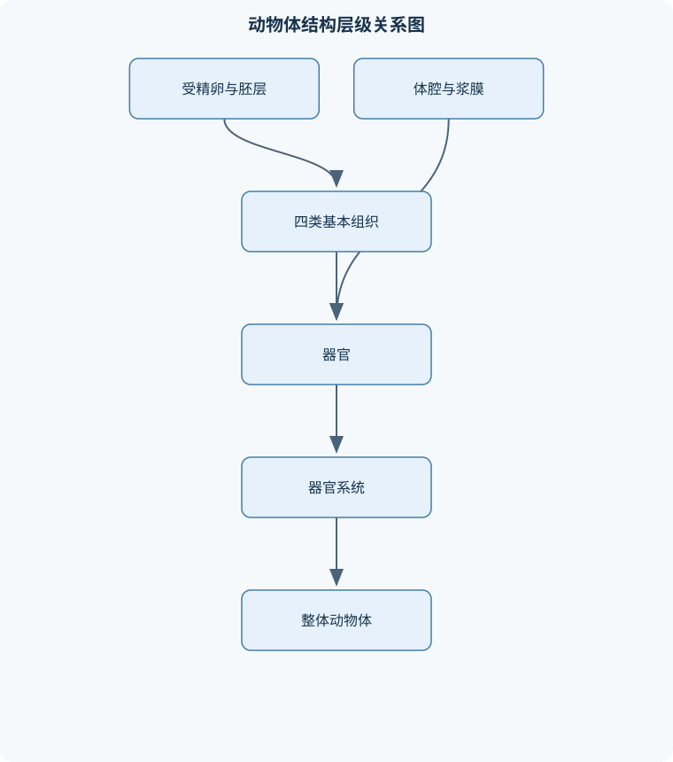
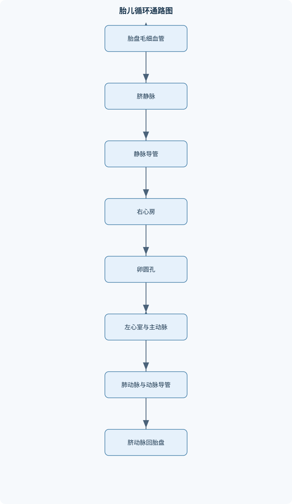

# 动物解剖学

## 一、课程整体知识框架

### 课程边界与先修知识

《动物解剖学》研究家畜、伴侣动物及常见实验动物的正常形态结构、位置关系、器官连接、系统组成和物种差异，重点覆盖宏观解剖、局部解剖、比较解剖及解剖学定位。内容边界包括运动系统、内脏系统、心血管系统、神经系统、感觉器官和淋巴系统，并联系结构与运动、呼吸、消化、排泄、生殖及循环功能。先修知识包括普通生物学、细胞与组织学基础、基本胚胎学、动物生理学初步知识，以及解剖方向、体腔和组织器官的基本术语。不以疾病诊断、药物治疗和手术技术为主要内容，但可用正常解剖解释临床定位和常见结构异常。





### 1. 学科对象、研究层次与内容边界

动物解剖学以家畜、伴侣动物和常见实验动物的正常形态结构为研究对象，重点说明器官的形态、位置、连接关系、系统组成及物种差异。课程以大体解剖为主，同时吸收局部解剖、比较解剖和功能解剖的内容：大体解剖回答“结构是什么、位于哪里”；局部解剖回答“某一区域内各结构如何相邻”；比较解剖回答“不同动物为什么具有不同形态”；功能解剖则由结构联系运动、呼吸、消化、排泄、生殖和循环等功能。

解剖学描述以动物自然站立姿势为统一参照。头侧指向头部，尾侧指向尾部；背侧指向脊柱一侧，腹侧指向腹壁一侧。附肢使用近侧和远侧，分别表示靠近躯干或附肢起点、远离躯干或附肢起点。内侧靠近正中面，外侧远离正中面；浅层靠近体表，深层远离体表。左、右均以动物自身为准，而不是以观察者的左右为准。正中矢状面将动物分为左右相等两部分，旁侧的平行切面称矢状面；横断面大致垂直于动物长轴；额面大致平行于背腹方向，分隔背侧和腹侧。屈、伸、外展、内收、内旋和外旋用于描述关节运动，但实际范围还受物种体型、关节面形状、韧带和肌肉协同作用影响。

### 2. 从细胞、组织到器官系统

动物体的结构具有层级性。细胞按共同来源和相似功能组成组织，组织进一步构成器官，器官按共同功能和管道、血管及神经联系组成系统。四类基本组织包括上皮组织、结缔组织、肌组织和神经组织。

上皮组织由排列紧密的细胞构成，具有覆盖、保护、吸收、分泌和感觉等作用。皮肤表皮、消化管内表面和腺体导管均属于上皮性结构，但其细胞层数和表面特化不同。黏膜通常由上皮、固有层及不同程度的黏膜下组织组成，衬贴与外界相通的腔道，如消化道、呼吸道和泌尿生殖道。浆膜由间皮及其下方结缔组织构成，脏层覆盖器官表面，壁层衬贴体腔壁；胸膜围绕肺，心包围绕心脏，腹膜覆盖或悬系腹腔脏器。浆膜两层之间形成潜在的浆膜腔，不能将其与整个胸腔、腹腔或骨盆腔混为一谈。滑膜衬贴可动关节的关节腔面，分泌滑液并参与关节营养和减摩。

结缔组织包括疏松结缔组织、致密结缔组织、脂肪、软骨、骨和血液等。骨和韧带提供支撑与传力，脂肪具有填充、缓冲和储能作用，血液承担运输。肌组织依靠收缩产生力，神经组织接受、传导和整合信息。器官的功能不能只由某一种组织解释，例如肠壁同时具有黏膜上皮、结缔组织、平滑肌和神经丛；心脏则由心肌、纤维支架、血管、神经及心包等共同构成。

### 3. 体腔、浆膜与位置推断

体腔是由胚胎体腔发育形成的较大腔隙，通常区分胸腔、腹腔和骨盆腔。胸腔内有肺、心脏及纵隔结构；腹腔容纳胃肠、肝、胰、脾和部分泌尿生殖器官；骨盆腔与腹腔连续，容纳直肠、膀胱后部及部分生殖道。器官的位置不能脱离动物种类、年龄、体型、姿势和充盈状态描述。胃肠充盈、妊娠、膀胱扩张或呼吸状态改变，均可使脏器边界发生相对移动。

定位时应先确定体轴，再寻找骨性标志，最后依据器官的连续结构和出入口复核。例如，腹部器官可按季肋部、腰部或肾部、脐部和腹股沟部进行大致分区；仅凭表面颜色或单一形状判断容易将相邻脏器混淆。肝门、肺门和肾门是血管、导管、神经和淋巴管集中出入器官的区域，不等于只有一条管道通过。

### 4. 运动系统的结构—功能框架

骨骼系统由轴骨和附肢骨组成。骨可按外形分为长骨、短骨、扁骨、不规则骨和籽骨；长骨具有骨干、骨端、骨髓腔和骨膜，扁骨常用于保护和肌肉附着。骨性标志包括突、嵴、粗隆、窝、沟、孔和关节面，这些结构分别承担肌腱韧带附着、血管神经通过或关节连接等作用。

椎骨一般由椎体和椎弓构成。椎弓围成椎孔，椎骨连续排列后形成椎管；相邻椎骨的椎切迹共同形成椎间孔，供脊神经出入。颈椎通常具有较发达的横突，胸椎具有椎体肋窝和横突肋窝，腰椎横突发达而棘突相对短，荐椎成年后相互融合，尾椎则由近端向远端逐渐简化。寰椎与枢椎分别参与寰枕关节和寰枢关节，不能混淆：寰枕关节主要完成屈伸和一定侧向运动，寰枢关节围绕枢椎齿状突产生旋转。第七颈椎的棘突较发达，其后方肋窝与第一胸椎前肋窝共同参与第一肋头关节。

前肢骨依次包括肩胛骨、肱骨、桡骨和尺骨、腕骨、掌骨、指骨及籽骨；后肢骨包括髋骨、股骨、膝盖骨、胫骨和腓骨、跗骨、跖骨、趾骨及籽骨。犬、猪、牛和马的肩胛骨在肩峰、冈结节和骨板形态上存在差别，骨性标志必须注明物种。骨连接可分为纤维连接、软骨连接和滑膜关节。滑膜关节具有关节面、关节囊和关节腔，部分关节还具有半月板、关节盘、韧带或籽骨。

肩关节由肩胛骨关节盂和肱骨头构成，活动度较大；肘关节由肱骨远端与前臂骨近端构成，主要为屈伸运动；髋关节由髋臼和股骨头构成，周围韧带和关节囊限制过度运动；膝关节应分为股膝关节和股胫关节。股膝关节涉及股骨滑车和膝盖骨，股胫关节涉及股骨内外侧髁和胫骨相应关节面，并具有半月板、交叉韧带和副韧带。将膝关节简单视为一个无分区的铰链关节，会遗漏其稳定和传力结构。

肌肉跨越关节时，收缩可改变关节角度，但作用方向取决于起点、止点和关节当时的姿势。股四头肌主要伸膝，股薄肌和内收肌主要内收后肢，臀中肌可外展并伸髋，股二头肌、半腱肌和半膜肌参与后肢伸展或在特定姿势下屈膝。牛和猪常见臀浅肌与股二头肌形成较大的臀股二头肌结构，而犬应分别描述臀浅肌和股二头肌。肌肉收缩的基本过程是：运动神经释放乙酰胆碱，肌膜产生兴奋并沿横管传导，肌浆网释放钙离子，钙离子与肌钙蛋白结合后使肌动蛋白和肌球蛋白相对滑动；钙离子被回收入肌浆网后，肌纤维松弛。该机制解释了肌肉为什么必须同时具有神经支配、钙离子调节和能量供应。

### 5. 呼吸系统与胸腔局部解剖

呼吸道由鼻腔、咽、喉、气管和支气管树组成。喉软骨形成喉的支架，声门及其周围结构既参与发声，也调节气流。气管分为左右主支气管，继续分支形成叶支气管、段支气管和更细小的传导与交换通道。肺具有肺门、肺根、不同表面和边缘，并可见肋压迹、心压迹和心切迹等与邻近结构相关的形态。肺叶划分具有明显物种差异，不能用一个动物的肺叶模式套用于全部动物。

胸膜分为覆盖肺表面的脏胸膜和衬贴胸壁、膈及纵隔的壁胸膜，两者之间是胸膜腔。纵隔位于左右胸膜囊之间，含心脏、心包、气管、食管、主要血管、神经和淋巴结构。肋间肌、背侧锯肌和膈共同改变胸腔容积。膈由中心腱、肌质部和膈脚组成，并有食管裂孔、主动脉裂孔和后腔静脉孔等通道。

吸气时，膈收缩并向尾侧变平，肋间外肌向前外方牵拉肋骨，胸腔容积增大，胸膜腔压力下降，肺因胸膜的机械联系而扩张。呼气时，静息状态主要依靠肺和胸壁的弹性回缩；强制呼气时，肋间内肌、后背侧锯肌及腹肌等增加胸腔压缩。这个推导的前提是胸膜腔完整且无异常气体或液体积聚，不能直接把理想模型用于解释所有病理状态。

### 6. 消化系统与腹腔局部解剖

消化管由口腔、咽、食管、胃、小肠和大肠连续构成。小肠分为十二指肠、空肠和回肠，十二指肠大乳头是部分消化腺导管开口的重要标志；大肠包括盲肠、升结肠、横结肠、降结肠和直肠。消化管壁内的腺体直接位于管壁内，唾液腺、肝和胰则位于管壁外，通过导管将分泌物送入腔内，因此也属于消化腺。

单室胃见于犬、猪等动物；反刍动物胃分为瘤胃、网胃、瓣胃和皱胃。瘤胃主要占左腹腔，网胃位于前腹部，瓣胃偏右侧，皱胃位于腹侧并接近剑状软骨部。四个胃的黏膜结构反映功能差异：瘤胃有乳头，网胃有蜂巢状皱襞，瓣胃有叶片状皱襞，皱胃含腺性黏膜。结肠形态亦有物种差异，牛和羊常呈圆盘状，猪呈圆锥状，犬的结肠相对短。

肠系膜悬系肠管并携带血管、淋巴管和神经；大网膜和小网膜为腹膜褶，连接不同脏器或脏器与腹壁。肝脏具有多个表面、叶和肝门。门静脉和肝动脉将血液带入肝脏，血液经肝窦汇入中央静脉，再由肝静脉进入后腔静脉；肝管则将胆汁引出。肝门不是肝静脉唯一出入口，肝静脉通常直接开口于后腔静脉。胰腺兼有外分泌和内分泌功能，其外分泌物经导管进入十二指肠。

### 7. 泌尿和生殖系统

泌尿系统由肾、输尿管、膀胱和尿道组成。肾的外部有肾门，内部可区分肾窦、肾实质、肾盂、肾盏和肾乳头。肾血管进入肾门后在实质内分支，肾小球和肾小管构成尿液形成的基本结构，集合管将尿液导向乳头、肾盏或肾盂。牛为有沟多乳头肾，尿液可由各肾乳头经肾小盏和集收结构进入输尿管；猪为平滑多乳头肾，通路通常经过肾小盏、肾大盏和肾盂；犬为平滑单乳头肾，尿液汇入肾盂后进入输尿管。肾壁、膀胱壁和尿道的分层及其腹腔、骨盆定位，是理解尿液排出路径的基础。

雄性生殖系统包括睾丸、附睾、输精管、副性腺、尿道和阴茎等。精子通路依次为精曲小管、精直小管、睾丸网、输出小管、附睾管、输精管和尿道。附睾分为头、体、尾，精子在附睾内成熟并储存。阴囊、总鞘膜、固有鞘膜、鞘膜腔和精索具有不同的包被和内容物关系，不能互相替代。猪、牛具有精囊腺、前列腺和尿道球腺，犬主要具有前列腺；猪和牛阴茎具有乙状弯曲，犬有阴茎骨。

雌性生殖系统包括卵巢、输卵管、子宫、阴道和外生殖器。输卵管分为漏斗、壶腹和峡，分别与卵巢捕获、受精相关区域和子宫连接有关。子宫分为子宫角、子宫体和子宫颈；牛、羊子宫角呈绵羊角状，猪子宫角长而弯曲，犬子宫角细长。牛子宫内膜有子宫阜，猪和犬相对光滑；牛有半环状阴道穹窿，猪和犬通常无明显阴道穹窿。母鸡输卵管分段与哺乳动物输卵管不能简单对应，其不同区段分别参与受精、蛋白、壳膜和蛋壳形成。妊娠时子宫角、胎膜和邻近腹腔器官的位置会改变，定位必须注明妊娠状态。

### 8. 心血管、神经、淋巴和感觉器官

心脏位于胸腔纵隔内，外有心包。右心房接受前腔静脉、后腔静脉和冠状窦回流，左心房接受肺静脉回流。房室口有三尖瓣或二尖瓣，瓣膜由纤维环、瓣叶、腱索和乳头肌支持；心室收缩时房室瓣关闭，防止血液回流心房。肺动脉口和主动脉口有半月瓣，舒张期防止动脉血液回流心室。血液路径可表达为：右心房→右心室→肺动脉→肺→肺静脉→左心房→左心室→主动脉。主动脉弓、胸主动脉和腹主动脉供应不同区域，前腔静脉、后腔静脉和奇静脉参与体静脉回流。

胎儿循环中，胎盘氧合血经脐静脉进入胎儿，部分通过静脉导管绕过肝循环；右心房血液可经卵圆孔进入左心房，右心室血液还可经肺动脉和动脉导管进入主动脉，以绕过尚未充分工作的肺。出生后脐血管、静脉导管、卵圆孔和动脉导管逐渐闭锁并形成相应遗迹。胎儿血液方向不能与出生后循环混写。

脊髓横断面通常表现为中央灰质、周围白质，背根传入、腹根传出，二者汇合形成脊神经。脑干包括中脑、脑桥和延髓；侧脑室经室间孔与第三脑室相连，第三脑室经中脑导水管与第四脑室相连，第四脑室位于脑干和小脑之间，并与脊髓中央管连续。小脑由左右半球、蚓部和小脑脚组成。交感神经干、灰交通支和白交通支构成自主神经联系的一部分；自主神经虽不受随意意识直接控制，但受中枢、反射和内分泌调节。

淋巴由组织液经毛细淋巴管吸收后，沿较大淋巴管、淋巴结和淋巴干回流，最终汇入静脉系统。淋巴结具有过滤、免疫细胞增殖和抗原处理作用，主要浅表淋巴结的定位可服务于正常结构识别和临床触诊。眼球壁由纤维膜、血管膜和神经膜三层构成；角膜、晶状体和玻璃体参与屈光，房水循环与眼内压相关。眼睑、第三眼睑、泪腺和泪道共同构成眼附属器，但功能并不相同。耳分为外耳、中耳和内耳，耳蜗与听觉有关，前庭器官和半规管分别参与直线加速度、角加速度及平衡感受。

## 二、章节和模块划分

### 核心知识覆盖清单

本清单用于检查正文是否覆盖本课程的主要知识模块：

- **解剖学总论与动物体的基本结构**：动物体的对称性与体轴、背侧、腹侧、头侧和尾侧、近侧、远侧、浅层和深层、正中矢状面与横断面、额面和斜切面的定义、体腔、浆膜腔与器官位置、四类基本组织的结构功能、上皮膜、黏膜和浆膜、滑膜与可动关节、物种、年龄和姿势对定位的影响。
- **骨骼系统与比较骨学**：骨的形态分类与基本构造、椎骨的一般结构、颈椎、胸椎和腰椎差异、荐椎与尾椎的结构变化、寰椎、枢椎和第七颈椎、肋骨、胸骨和胸廓、前肢骨的组成与骨性标志、后肢骨的组成与骨性标志、犬、猪、牛和马肩胛骨比较、骨连接与脊柱运动。
- **关节、韧带与肌肉系统**：纤维连接、软骨连接和滑膜关节、肩关节与肘关节、荐髂关节与髋关节、股膝关节与股胫关节、半月板、交叉韧带和副韧带、躯干浅层肌和深层肌、肩带及前肢肌群、臀部和股部肌群、小腿与后脚部肌群、肌肉收缩的结构基础、肌肉位置与关节运动的对应关系。
- **呼吸系统与胸腔局部解剖**：鼻腔、咽、喉和气管、喉软骨与喉腔功能、支气管树和肺的基本结构、肺叶、肺门和肺根、肺的面、缘和压迹、胸膜脏层、壁层与胸膜腔、纵隔及其主要内容、肋间肌和背侧锯肌、膈的中心腱、肌质部和裂孔、吸气与呼气的力学过程。
- **消化系统与腹腔局部解剖**：口腔、咽和食管的连续关系、胃的单室与多室类型、反刍动物瘤胃、网胃、瓣胃和皱胃、小肠三段及其分界标志、盲肠、结肠和直肠、犬、猪、牛和羊结肠比较、肠系膜、大网膜和小网膜、肝的表面、分叶和肝门、胰腺及壁外消化腺、腹部九区与器官定位、腹壁层次和腹膜腔关系。
- **泌尿系统**：肾、输尿管、膀胱和尿道、肾的外形与肾门、肾窦、肾盂和肾盏、有沟多乳头肾、平滑多乳头肾、平滑单乳头肾、不同动物的尿液排出通路、肾血管与肾实质的关系、膀胱壁层次和尿道分段、泌尿器官的腹腔与骨盆定位。
- **雄性与雌性生殖系统**：公畜内生殖器和外生殖器、睾丸被膜与精子输出通路、附睾头、体、尾及附睾管、精索、鞘膜和腹股沟管、副性腺及其物种差异、阴囊和阴茎的结构特点、母畜卵巢、输卵管和子宫、母鸡输卵管分段及蛋形成、牛、羊、猪和犬子宫比较、卵巢囊和阴道穹窿、妊娠期与非妊娠期结构定位差异。
- **心血管系统**：心脏位置、外形和心包、右心房和左心房内部结构、房室瓣、腱索和乳头肌、心室、动脉口和半月瓣、主动脉弓及其主要分支、胸主动脉和腹主动脉、体循环主要静脉、奇静脉、前腔静脉和后腔静脉、心脏传导结构的解剖基础、胎儿血液循环通路、出生后胎儿循环结构的闭锁遗迹。
- **神经系统与自主神经**：脊髓外部形态、脊髓灰质和白质、背根、腹根和脊神经、脑干的组成、四个脑室及其连通、小脑半球、蚓部和小脑脚、脑膜、脊膜与脑脊液空间、躯体神经与植物性神经、交感神经干和迷走交感干、灰交通支与白交通支、内脏器官的自主神经支配。
- **淋巴系统与感觉器官**：淋巴、淋巴液和组织液、淋巴管道的起始与回流、淋巴组织和淋巴器官、主要浅表淋巴结定位、眼球壁的三层结构、角膜、晶状体和玻璃体、眼房水与眼内压、眼睑、第三眼睑和泪器、外耳、中耳和内耳、耳蜗与前庭器官、视觉和听觉结构的功能联系。


### 1. 解剖学总论与动物体基本结构模块

本模块先建立方向术语、切面、体腔、浆膜和组织器官层级。教学中应使用完整标本或解剖图，先确定头尾、背腹和左右，再识别骨性标志，最后沿血管、导管和神经的连续关系确认目标结构。判定的稳定条件是同一标本中方向基准不变，目标结构至少由两个独立标志交叉确认。

### 2. 骨骼、关节、韧带与肌肉模块

本模块按照轴骨、附肢骨、骨连接和肌肉分层展开。未知骨鉴定时，先判断属于轴骨还是附肢骨，再依据关节面确定近端和远端，利用孔、窝、突起和粗隆定位，最后结合物种特征复核。若检查$n$个形态特征，逐项比较的观察成本可记为$O(n)$；这只是识别流程的复杂度描述，不代表真实解剖难度。关节运动分析必须同时考虑关节面、韧带和跨关节肌肉，不能单凭肌肉名称推断运动。

### 3. 呼吸系统和胸腔局部解剖模块

本模块按“上呼吸道—喉—气管—支气管—肺—胸膜—纵隔—呼吸肌”追踪。吸气和呼气的推导链为：肌肉收缩改变胸廓或膈的位置，胸腔容积改变，胸膜腔压力随之变化，肺在完整胸膜机械联系下扩张或回缩。该链条适用于正常、完整胸廓和静息呼吸；不能据此直接判断疾病或损伤程度。

### 4. 消化系统和腹腔局部解剖模块

本模块沿消化管连续性识别结构，顺序为口腔、咽、食管、胃、小肠、大肠和肛门。定位腹腔器官时，输入应包括物种、体表分区、肋骨标志和脏器充盈状态；输出应包括目标器官位置、邻接器官和主要出入口。牛、羊、猪和犬的胃、结肠形态差异必须单列比较，尤其不能把反刍动物四个胃理解为简单首尾排列，而应同时说明左、右、前、后和背腹位置。

### 5. 泌尿系统模块

本模块重点建立“肾实质—乳头—肾盏或肾盂—输尿管—膀胱—尿道”的连续通路。牛、猪和犬的肾型差异决定尿液汇集路径。比较时应同时记录肾表面是否有沟、乳头数量、肾小盏和肾盂是否明显，不能仅凭肾外形下结论。

### 6. 雄性与雌性生殖系统模块

雄性部分按睾丸内精子通路和阴囊包被关系组织；雌性部分按卵巢、输卵管、子宫、阴道和外生殖器组织。生殖道定位必须考虑物种、年龄、妊娠状态和器官充盈。母鸡输卵管应单独讲解其分段和蛋形成过程，不能直接套用哺乳动物输卵管的三段结构。

### 7. 心血管系统模块

本模块先学习心脏四腔、瓣膜和主要血管，再追踪体循环、肺循环和胎儿循环。血液流向分析的核心不变量是每一段连接都必须有解剖依据，且瓣膜方向与压力变化一致。胎儿循环必须特别标出脐静脉、静脉导管、卵圆孔、动脉导管和脐动脉，并与出生后闭锁遗迹相对应。

### 8. 神经系统与自主神经模块

本模块由脊髓横断面进入脑干、脑室、小脑、脑膜和脑脊液空间，再联系躯体神经及自主神经。识别脊髓横断面时先确定背腹方向，再寻找中央管、灰质角和白质索，随后追踪背根、腹根或交通支。该流程适用于正常解剖定位，不能替代神经功能检查。

### 9. 淋巴系统与感觉器官模块

淋巴部分强调组织液、淋巴、淋巴管、淋巴结和淋巴器官的连续关系；感觉器官部分强调结构与功能的对应。眼球应按三层眼球壁、屈光介质、房水通路和附属器分析；耳应区分外耳传声、中耳传导和内耳感受，尤其不能把耳蜗的听觉结构与半规管的平衡结构混淆。

### 10. 综合实验与项目流程

#### 实验一：完整动物标本的系统定位

**输入数据**包括标本、体表骨性标志、器官外形和解剖切面；**输出**为主要体腔、器官系统、器官名称及邻接关系。步骤为：

1. 固定自然站立方向，标记头侧、尾侧、背侧、腹侧、左侧和右侧。
2. 依据脊柱、肋骨、胸骨、骨盆和四肢骨确定区域。
3. 打开相应体腔，先识别浆膜和体腔分隔，再观察器官整体位置。
4. 沿导管、血管或神经追踪结构连续性。
5. 每个目标结构至少用形状、位置、连接关系中的两项复核。

评价标准是方向标注无矛盾，器官名称与物种一致，主要出入口和邻接关系说明完整。排错时，若左右混淆，应回到动物自身左右重新定位；若器官形态异常，先排除充盈、牵拉或切割造成的形变。

#### 实验二：物种比较解剖项目

**输入数据**为犬、猪、牛或羊的骨骼、胃肠、肾脏和生殖系统标本或图谱；**输出**为比较表和结构差异解释。步骤为：

1. 先选择同一器官系统，避免把不同层级结构混在一起。
2. 记录外形、分叶、连接管道、位置和物种。
3. 将差异分为形态差异、位置差异和通路差异。
4. 从功能需求解释差异，例如反刍胃的分室与发酵消化相关，肾乳头和肾盂差异影响尿液汇集。
5. 用第二种标志验证结论，例如肾型既看外形，也看乳头和肾盂。

评价标准是每项差异均注明物种，不能把个别动物特征泛化；排错时重点检查术语是否把“肾盂”“肾大盏”“肾小盏”混写，以及是否把牛、猪、犬的结肠形态互相套用。

### 11. 代表性识别算法与例题

#### 标本总体定位伪代码

```text
输入：动物标本或解剖图
输出：目标结构名称、位置、系统归属和主要连接

1. 确定动物自身的头尾、背腹和左右方向
2. 识别脊柱、肋骨、胸骨、骨盆等骨性标志
3. 判断目标位于胸腔、腹腔、骨盆腔或附肢
4. 观察目标的形态、邻接结构和出入口
5. 沿血管、导管或神经追踪连续性
6. 若至少两个独立标志一致，则输出结果
7. 若标志矛盾，返回步骤1，检查方向和物种
```

该流程的输入是完整标本或图像，输出是结构定位结果；不变量是方向基准始终一致，终止条件是两个独立标志相互支持。它适用于大体解剖识图，不适用于只凭颜色或单一局部特征判断。

#### 例题一：未知椎骨鉴定

**题干：**某椎骨具有椎体、椎弓、椎孔、发达棘突、横突肋窝和椎体肋窝，应判断其所属部位，并解释肋椎连接。

**分析：**椎体和椎弓说明它属于一般椎骨；肋窝说明其与肋骨相连；横突肋窝和椎体肋窝分别对应肋横突关节和肋头关节。

**解答：**该骨为胸椎。相邻椎体的肋窝与肋骨小头形成肋头关节，胸椎横突肋窝与肋结节形成肋横突关节，两者合称肋椎关节。若只有发达横突而缺少肋窝，应优先考虑腰椎。

**结果验证：**观察肋窝是否成对、棘突是否较发达，并核对其是否属于胸廓连接。变式是若骨为第一胸椎，还应注意其与第七颈椎后肋窝共同形成第一肋头关节。

#### 例题二：牛膝关节结构

**题干：**说明牛膝关节中股膝关节和股胫关节的区别，并指出半月板和交叉韧带的作用位置。

**分析：**膝关节不能只按一个关节面描述，应按前部股骨滑车和后部股骨髁分别定位。

**解答：**股膝关节由股骨远端前部滑车面与膝盖骨关节面构成，膝盖骨在滑车上运动，并由膝直韧带等结构联系胫骨。股胫关节由股骨内外侧髁与胫骨近端相应关节面构成，内外侧半月板改善关节面适配并分散压力，前后交叉韧带限制胫骨相对股骨的异常前后移动，副韧带限制侧向不稳定。

**结果验证：**若标本中看不到膝盖骨滑车关系，不能完整说明股膝关节；变式是比较屈膝和伸膝时，肌肉张力及韧带限制会改变，不能把静态形态直接等同于所有运动状态。

#### 例题三：吸气和呼气

**题干：**解释吸气时膈、肋间外肌的作用，并说明静息呼气为何不应简单归因于肋间内肌。

**分析：**胸腔容积变化是压力变化的中间环节，肺扩张依赖完整胸膜机械联系。

**解答：**吸气时膈收缩，肌质部向中心腱方向牵拉，使膈向尾侧变平；肋间外肌向前外方牵拉肋骨，使胸廓扩大。胸腔容积增大，胸膜腔压力降低，肺随之扩张。静息呼气主要由肺和胸壁弹性回缩完成；强制呼气时，肋间内肌、后背侧锯肌和腹肌等主动参与。

**结果验证：**若将吸气写成胸腔缩小，说明容积—压力因果方向颠倒。变式是胸膜腔完整性破坏时，肺与胸壁的机械联系会改变，不能直接套用正常呼吸推导。

#### 例题四：牛胃定位

**题干：**按位置说明牛瘤胃、网胃、瓣胃和皱胃的关系，并比较黏膜特点。

**分析：**应同时回答消化道顺序和腹腔位置，不能只写四个胃的排列。

**解答：**瘤胃主要位于左侧腹腔，网胃位于前腹部，瓣胃偏右侧，皱胃位于腹侧并接近剑状软骨部。瘤胃黏膜有乳头，网胃有蜂巢状皱襞，瓣胃有叶片状皱襞，皱胃为腺性黏膜并具有胃腺。食物流向为瘤胃、网胃、瓣胃、皱胃，再进入十二指肠。

**结果验证：**若把瓣胃写在左侧或把皱胃写成非腺性发酵室，应重新核对位置和黏膜。变式是幼龄反刍动物的消化通路受乳汁通过结构影响，不能直接用成年动物的功能状态解释。

#### 例题五：肾脏尿液通路

**题干：**比较牛、猪和犬肾脏从乳头至输尿管的尿液排出路径。

**分析：**路径差异由肾乳头数量、肾盏和肾盂结构共同决定。

**解答：**牛为有沟多乳头肾，尿液由各肾乳头进入肾小盏或相应集收结构，再汇入输尿管；猪为平滑多乳头肾，尿液经肾小盏、肾大盏、肾盂后进入输尿管；犬为平滑单乳头肾，多个乳头融合形成肾总乳头，尿液经肾盂进入输尿管。

**结果验证：**比较时必须同时检查肾外表面和内部集合结构；变式是若只观察外表面而不看切面，容易将猪和犬的肾型混淆。

#### 例题六：胎儿循环

**题干：**写出胎盘氧合血进入胎儿后到达主动脉的主要路径，并说明出生后的变化。

**分析：**胎儿肺尚未承担完整气体交换功能，因此存在绕过肝或肺的分流结构。

**解答：**主要路径为胎盘→脐静脉→静脉导管→后腔静脉→右心房；部分血液经卵圆孔进入左心房→左心室→主动脉。另一部分经右心室→肺动脉→动脉导管→主动脉。回流胎盘的血液经脐动脉离开胎儿。出生后脐血流停止，静脉导管、卵圆孔和动脉导管逐渐闭锁并形成相应遗迹。

**结果验证：**脐静脉方向是由胎盘向胎儿，脐动脉方向是由胎儿向胎盘；若方向相反，说明循环图标注错误。变式是不能把胎儿循环中的动脉、静脉仅按含氧量命名，动静脉的名称依据血流离开心脏或流向心脏的方向。

### 12. 具体易错点

1. 将头侧、尾侧写成人体的上、下，忽略四足动物方向基准。  
2. 把胸腔、腹腔和浆膜腔当作同义词。  
3. 混淆胸椎椎体肋窝与横突肋窝。  
4. 把寰枕关节和寰枢关节混为一谈。  
5. 将肩关节和髋关节只按“球窝关节”描述而遗漏物种和韧带差异。  
6. 把股膝关节和股胫关节合并为一个简单关节。  
7. 将牛、猪的臀股二头肌名称直接套用到犬。  
8. 把静息呼气完全归因于肋间内肌。  
9. 将反刍动物四个胃只按消化道顺序排列，不说明腹腔位置。  
10. 把肝门误认为肝静脉唯一出入口。  
11. 用同一种肾型解释牛、猪和犬。  
12. 把精索、总鞘膜和固有鞘膜视为同一结构。  
13. 将母鸡输卵管分段直接等同于哺乳动物输卵管。  
14. 混淆脐静脉和脐动脉的血流方向。  
15. 把自主神经理解为完全不受中枢调节。  
16. 把第三眼睑、眼睑、泪腺和泪道混为一体。  
17. 将耳蜗和半规管都解释为平衡器官。  
18. 把某一物种的肺叶、结肠或子宫形态推广到所有动物。

### 13. 常见笔试问题与解答思路

#### 问题一：椎骨如何形成椎管和椎间孔？

应从椎体、椎弓和椎孔的连续排列推导：每个椎骨的椎孔首尾相连形成椎管；相邻椎骨的切迹共同形成椎间孔，作为脊神经出入通道。

#### 问题二：胸椎如何与肋骨连接？

应分别说明椎体肋窝与肋骨小头形成肋头关节，横突肋窝与肋结节形成肋横突关节，二者共同形成稳定的肋椎连接。

#### 问题三：为什么吸气能使肺扩张？

应按“膈和肋间外肌收缩—胸腔容积增大—胸膜腔压力下降—肺扩张”的顺序回答，并注明前提是胸膜机械联系完整。

#### 问题四：反刍动物四个胃如何定位？

应同时写出顺序和位置：瘤胃左侧、网胃前部、瓣胃右侧、皱胃腹侧，并补充各自黏膜特点。

#### 问题五：肝脏为什么同时接受肝动脉和门静脉？

应说明肝动脉提供含氧血，门静脉带来消化道吸收的营养物质，二者经肝窦汇集后由肝静脉流入后腔静脉。

#### 问题六：牛、猪和犬肾脏尿液通路有何差异？

应以肾乳头数量、肾小盏、肾大盏和肾盂为比较轴，分别写出三种动物的连续路径。

#### 问题七：房室瓣和半月瓣如何防止血液反流？

应联系心腔压力：心室收缩时房室瓣关闭，防止血液回心房；心室舒张时半月瓣关闭，防止动脉血回流心室。

#### 问题八：胎儿循环与出生后循环有何不同？

应先写脐静脉、静脉导管、卵圆孔和动脉导管的分流，再说明出生后肺循环建立和这些通道闭锁。

### 14. 常见面试问题、参考答案与追问要点

#### 问题一：如何给一枚未知骨定位？

参考答案：先判断轴骨或附肢骨，再由关节面确定近远端，依据孔、窝、突起和粗隆判断部位，最后结合物种差异复核。追问时应说明如果肋窝存在，应优先考虑胸椎；如果横突特别发达而无肋窝，应考虑腰椎。

#### 问题二：怎样区分股膝关节和股胫关节？

参考答案：股膝关节位于股骨滑车与膝盖骨之间，股胫关节位于股骨髁与胫骨髁之间。追问应补充半月板、交叉韧带和副韧带属于股胫关节稳定结构。

#### 问题三：如何解释牛胃的位置？

参考答案：先以腹腔左右和前后为参照，再说明瘤胃左侧、网胃前部、瓣胃右侧、皱胃腹侧。追问应指出胃充盈和年龄会影响实际边界。

#### 问题四：为什么肝门不能等同于肝静脉？

参考答案：肝门是多种血管、肝管、神经和淋巴管集中出入的区域，肝静脉通常直接汇入后腔静脉。追问可进一步说明肝脏具有门静脉输入和肝静脉输出的特殊血流关系。

#### 问题五：如何判断胎儿循环图是否正确？

参考答案：检查脐静脉是否由胎盘进入胎儿，脐动脉是否由胎儿返回胎盘，再核对静脉导管、卵圆孔和动脉导管的方向。追问时应说明不能仅以“动脉含氧多、静脉含氧少”判断胎儿血管名称。

#### 问题六：耳蜗和前庭器官的功能如何区分？

参考答案：耳蜗内的螺旋器接受听觉刺激；前庭器官和半规管接受位置、直线加速度和角加速度信息。追问应说明外耳和中耳主要负责传声与传导，内耳负责感受。

#### 问题七：如何在解剖图中定位脊髓灰质？

参考答案：先定背腹方向，再寻找中央管，围绕中央管的蝶形或相应形态区域为灰质，外周为白质；背根传入、腹根传出。追问时应强调不同物种横断面外形可变，但结构连续关系仍是主要依据。

#### 问题八：如何向非专业人员解释淋巴回流？

参考答案：组织液进入毛细淋巴管后，沿较大淋巴管和淋巴结回流，最终进入静脉系统；淋巴结还具有过滤和免疫处理作用。追问时应区分淋巴液、淋巴管和淋巴器官。

### 15. 岗位关联

动物临床助理和影像定位人员需要依据骨性标志、胸腹腔分区和器官邻接关系确定影像切面，产出规范的结构标注和定位记录，验收标准是左右、头尾方向正确，器官名称与物种一致，关键血管或导管关系无明显矛盾。

动物解剖与组织标本技术人员需要识别器官边界、切面方向和血管导管走向，完成取材、固定和标本整理。产出应包括标本名称、物种、部位和结构标签，验收时应检查是否保留主要解剖关系，是否把浆膜、黏膜和肌层混淆。

繁殖与人工授精技术人员需要掌握睾丸、附睾、输精管、卵巢、输卵管、子宫和阴道的正常位置与物种差异。产出包括生殖道定位记录和繁殖周期相关结构观察，验收标准是能区分公畜和母畜通路，能说明牛、猪、犬等动物的子宫、阴茎或副性腺差异。

动物实验设施技术人员需要依据正常解剖判断实验动物的体表区域、采样部位和器官系统，避免将人类方向术语直接套用于动物。产出包括动物基本解剖记录、样本来源和器官定位，验收标准是方向、物种、年龄及样本部位记录完整。

动物尸体剖检和病理取材辅助人员需要识别正常胸腹腔结构、器官连接和淋巴回流区域，以便按规范顺序观察和取材。课程知识用于正常结构参照，不直接替代疾病诊断。验收标准是取材位置明确、器官名称准确、未因切割破坏关键结构关系。

动物医疗设备和手术器械技术支持人员需要理解关节、胸腔、腹腔、泌尿生殖道和血管的空间关系，协助说明器械适用的解剖区域。产出包括设备对应部位说明和结构风险提示，验收标准是能区分正常解剖结构与器械作用区域，避免把人体结构无区别地用于动物。

动物实验教学人员、标本制作和科普展示人员需要将比较解剖内容转化为结构标签、剖面说明和物种对照表。验收标准是每项形态差异均标明动物种类，解释结构与功能的关系，避免用单一动物代表全部哺乳动物。

## 三、核心概念的详细解释

### 1. 解剖学定位、体轴与切面

动物解剖学的方向术语必须以动物自然站立姿势为参照。头侧指向头部，尾侧指向尾部；背侧指向脊柱一侧，腹侧指向腹壁一侧。附肢使用近侧和远侧，分别表示靠近躯干或附肢起点、远离躯干或附肢起点。内侧靠近正中面，外侧远离正中面；浅层靠近体表，深层远离体表。左、右均指动物自身的左、右，不能按照观察者的左右判断。

正中矢状面将动物分成左右相等的两部分，旁侧且与其平行的切面为矢状面；横断面大致垂直于动物长轴；额面大致平行于背腹方向，将结构分为背侧部和腹侧部。斜切面不与主要基准面平行或垂直，实际标本中常用于显示管道、关节面或器官的连续关系。四足动物的头侧、尾侧不能简单替换成人体的上、下；在比较不同姿势或影像资料时，必须先恢复动物自身的体轴。

体腔是由胚胎体腔发育形成的较大腔隙，通常包括胸腔、腹腔和骨盆腔。浆膜腔则是浆膜脏层与壁层之间的潜在腔隙。脏层覆盖器官表面，壁层衬贴体腔壁；胸膜、心包和腹膜分别围绕肺、心脏和腹腔脏器形成相应的浆膜结构。体腔不是浆膜腔的同义词。器官位置还会受到动物种类、年龄、体型、姿势、呼吸状态、胃肠充盈、膀胱扩张和妊娠的影响。

### 2. 组织、膜与器官系统

四类基本组织为上皮组织、结缔组织、肌组织和神经组织。上皮细胞排列紧密，承担覆盖、保护、吸收、分泌和感觉功能；消化管、呼吸道和泌尿生殖道的腔面通常由黏膜衬贴。黏膜一般包括上皮、固有层及不同程度的黏膜下组织，因此不能只把腔面上皮称为完整黏膜。

结缔组织包括疏松结缔组织、致密结缔组织、脂肪、软骨、骨和血液等。骨、软骨、韧带和关节囊提供支持、缓冲和传力；血液负责运输；脂肪具有储能、填充和保护作用。肌组织通过收缩产生力，神经组织负责接受、传导和整合信息。一个器官通常由多种组织共同构成，例如肠壁同时包含黏膜上皮、结缔组织、平滑肌和神经丛。

浆膜表面覆盖间皮，能够减少器官与体腔壁之间的摩擦。滑膜衬贴可动关节的非软骨表面，产生滑液并参与关节营养。滑膜关节还包括关节软骨、关节囊、韧带以及必要时的半月板或关节盘。纤维连接以致密结缔组织为主，活动度较小；软骨连接借助软骨连接骨端，具有一定弹性；滑膜关节具有明确的关节腔，活动范围受关节面、韧带和肌肉共同限制。

### 3. 骨骼系统与比较骨学

骨按形态可分为长骨、短骨、扁骨、不规则骨和籽骨。长骨由骨干和骨端组成，内部可有骨髓腔；扁骨通常兼具保护和肌肉附着功能；籽骨位于肌腱或关节附近，可改变肌腱受力方向并减少摩擦。骨膜覆盖骨表面，关节面通常覆有关节软骨。突、嵴、粗隆、窝、沟和孔分别常用于肌腱韧带附着、肌肉附着、血管神经通过或关节构成。

一般椎骨由椎体和椎弓组成。椎弓围成椎孔，椎骨连续排列形成椎管；相邻椎骨的前后切迹共同形成椎间孔，供脊神经及伴行血管通过。椎骨的椎体、棘突、横突和关节突构成脊柱的支撑、运动及肌肉韧带附着基础。椎体间通过椎间盘、背侧纵韧带和腹侧纵韧带连接，椎弓间则由关节囊、棘上韧带、棘间韧带和横突间韧带等连接。

颈椎通常具有较发达的横突，胸椎具有椎体肋窝和横突肋窝，腰椎横突发达而棘突相对较短，荐椎成年后相互融合，尾椎由近端向远端逐渐简化。寰椎具有发达的寰椎翼和前关节窝；枢椎的齿状突为寰枢关节的主要运动结构；第三至第六颈椎通常可见横突孔；第七颈椎棘突较发达，并与第一胸椎共同形成相应肋窝关系。

胸椎的椎体肋窝与肋骨小头连接，横突肋窝与肋结节连接，二者共同构成肋椎连接。肋骨再通过肋软骨与胸骨相连，形成胸廓。胸廓既保护心肺，又通过肋骨、肋间肌和膈的运动参与呼吸。胸廓的形态、肋骨弯曲程度和胸骨长度存在物种差异。

前肢骨依次包括肩胛骨、肱骨、桡骨和尺骨、腕骨、掌骨、指骨及籽骨。后肢骨包括髋骨、股骨、膝盖骨、胫骨和腓骨、跗骨、跖骨、趾骨及籽骨。犬、猪、牛和马的肩胛骨形态不能互相替代。例如，牛肩胛骨肩峰明显，猪的冈结节特别发达，犬和猫肩峰明显而冈结节相对不明显。骨标本鉴定必须结合关节面方向、骨性标志和所属物种。

### 4. 关节、韧带与肌肉的结构—功能联系

肩关节由肩胛骨关节盂和肱骨头构成，属于多轴关节，关节角主要位于后方；肘关节由肱骨远端与桡、尺骨近端构成，主要为单轴复关节，关节角位于前方。荐髂关节由荐骨翼和髂骨翼的耳状面构成，活动度受到强韧韧带限制。髋关节由髋臼和股骨头构成，属于多轴复关节，关节角位于前方。

膝关节应区分股膝关节和股胫关节。股膝关节由股骨远端前部的滑车面和膝盖骨关节面构成，膝盖骨通过膝直韧带与胫骨等结构联系；股胫关节由股骨内、外侧髁和胫骨相应髁构成，包含内外侧半月板、前后交叉韧带和内外侧副韧带。半月板可增加关节面适配、分散负荷并协助稳定；交叉韧带主要限制胫骨相对股骨的前后异常移动。

肌肉作用取决于起点、止点、跨越的关节和关节姿势。臀中肌跨越髋关节，主要外展和伸展后肢；股四头肌伸展膝关节；股薄肌、耻骨肌和内收肌主要内收后肢；腓肠肌跨越跗关节，参与跗关节伸展。犬等动物的臀浅肌与股二头肌应分别描述，而牛、猪常见臀股二头肌的合并形态。肌肉的“主要作用”并不等于唯一作用，实际动作还取决于协同肌、拮抗肌、负重状态和关节角度。

肌肉收缩的结构基础是肌动蛋白与肌球蛋白相对滑动。运动神经元释放乙酰胆碱，使肌纤维膜产生动作电位；动作电位沿横管传导，促使肌浆网释放钙离子。钙离子与肌钙蛋白结合，使原肌球蛋白移位，暴露肌动蛋白结合位点；肌球蛋白头利用三磷酸腺苷完成交叉桥循环。钙离子被重新摄回肌浆网后，肌纤维松弛。

### 5. 呼吸系统与胸腔局部解剖

呼吸道由鼻腔、咽、喉、气管、支气管和肺内导气部组成。喉由会厌软骨、甲状软骨、环状软骨及其他软骨和韧带构成，喉腔既是气流通道，又参与发声和防止异物进入下呼吸道。气管分为左右主支气管，继续分支形成支气管树，终末支气管与呼吸部共同构成肺的功能单位。

肺具有肺门和肺根。肺门是血管、支气管、神经和淋巴管集中出入的区域，肺根则是这些结构集合形成的连接部。肺的分叶、裂和外形必须注明物种。肺可描述肋面、纵隔面和膈面，以及背侧缘、腹侧缘和后缘；其表面可见肋压迹、心压迹和心切迹等与邻近结构相关的形态。

胸膜分为脏胸膜和壁胸膜，两者之间为胸膜腔。纵隔位于左右胸膜腔之间，内含心包、心脏、气管、食管、大血管、神经和淋巴结构。胸膜腔的潜在负压使肺贴附胸壁并随胸壁运动。吸气时膈收缩并向尾侧变平，肋间外肌向前外方牵拉肋骨，胸腔容积增大，胸膜腔压力下降，肺随之扩张。静息呼气主要依靠肺和胸壁的弹性回缩；强制呼气时肋间内肌、后背侧锯肌及腹肌等参与。

膈由中心腱和周围肌质部构成，并有食管裂孔、主动脉裂孔和后腔静脉孔等通道。裂孔位置决定胸腔与腹腔之间血管、食管和大静脉的连续关系。膈肌收缩时，胸腔容积增大而腹腔容积受到相应挤压，这也是呼吸运动与腹腔脏器位置变化相关的原因。

### 6. 消化系统与腹腔局部解剖

消化道由口腔、咽、食管、胃、小肠、大肠和肛管连续构成。小肠分为十二指肠、空肠和回肠，十二指肠大乳头是胆管和胰管等消化液进入肠腔的重要界标。大肠包括盲肠、升结肠、横结肠、降结肠和直肠。肠系膜悬系肠管并携带血管、神经和淋巴管；大网膜和小网膜则是腹膜褶，分别与胃、横结肠及肝等结构形成联系。

胃可分为单室胃和多室胃。犬和猪为单室胃；反刍动物具有瘤胃、网胃、瓣胃和皱胃。瘤胃主要占左腹腔，网胃位于前腹部，瓣胃偏右侧，皱胃位于腹侧并接近剑状软骨区域。瘤胃黏膜有乳头，网胃具有蜂巢状皱襞，瓣胃形成叶片状皱襞，皱胃具有腺性黏膜。四个胃既是消化管连续部分，又因位置和黏膜结构不同而承担不同功能。

结肠形态具有显著物种差异。牛和羊的结肠常形成圆盘状结构，猪结肠多呈圆锥状，犬的结肠较短。不能把一种动物的结肠走向直接推广到其他动物。肝脏通常位于膈后方，具有多个叶和脏面、膈面；肝门是门静脉、肝动脉、肝管、神经和淋巴管集中出入的区域。肝静脉通常直接汇入后腔静脉，并不等同于肝门内的全部结构。胰腺位于十二指肠及胃附近，通过胰管将分泌物排入肠腔。

腹部定位可采用季肋部、腰部或肾部、脐部和腹股沟部等区域。腹壁由皮肤、浅筋膜、肌层、深筋膜和腹膜等层次组成。腹膜覆盖或悬系许多腹腔器官，但腹膜腔是腹膜脏层与壁层之间的潜在空间，不能等同于整个腹腔。

### 7. 泌尿系统与生殖系统

泌尿系统由肾、输尿管、膀胱和尿道组成。肾的外侧为肾实质，内侧有肾门，血管、神经、淋巴管和输尿管在此集中出入。肾内尿液由肾小管和集合管汇集至肾乳头，再经肾盏、肾盂或集收管进入输尿管，具体路径取决于肾型。

牛为有沟多乳头肾，多个肾乳头分别经肾小盏和集收管向输尿管汇集；猪为平滑多乳头肾，尿液依次经肾小盏、肾大盏、肾盂进入输尿管；犬为平滑单乳头肾，多个乳头融合为肾总乳头，尿液由肾盂进入输尿管。肾血管进入肾门后在实质内分支，最终与肾小球毛细血管相联系，因此肾门结构和肾实质内的分支不能分开理解。

膀胱由黏膜、肌层和外膜或浆膜等层次构成，尿道可按腹腔部、骨盆部和外生殖部等区域描述，具体分段随物种和性别变化。膀胱空虚时位于骨盆腔附近，充盈后可向腹腔前移。

雄性生殖系统包括睾丸、附睾、输精管、副性腺、尿道和阴茎。精子通路为：精曲小管→精直小管→睾丸网→输出小管→附睾管→输精管。附睾分为头、体和尾，尾部是精子储存和进一步成熟的重要区域。睾丸外有白膜，内部形成睾丸纵隔和小叶。精索是输精管、血管、神经及相关组织的集合，不等同于鞘膜；总鞘膜、固有鞘膜和鞘膜腔描述的是包被及腔隙关系。

牛、猪的副性腺通常包括精囊腺、前列腺和尿道球腺，犬主要以发达的前列腺为代表。牛和猪阴茎具有乙状弯曲，犬具有阴茎骨。阴囊、腹股沟管和鞘膜共同构成睾丸与腹腔之间的空间联系。

雌性生殖系统包括卵巢、输卵管、子宫、阴道和外生殖器。输卵管分为漏斗、壶腹和峡，负责捕获卵细胞、受精相关过程及向子宫运输。子宫由子宫角、子宫体和子宫颈组成。牛子宫角呈绵羊角状并有子宫阜，猪子宫角长而弯曲，犬子宫角细长；猪和犬子宫内膜较平滑。牛可见半环状阴道穹窿，猪和犬通常不形成明显阴道穹窿。母鸡输卵管则分为漏斗部、膨大部、峡部、子宫部和阴道部，各段分别参与受精、蛋白、壳膜、蛋壳和排出等过程。妊娠使子宫角、子宫体和邻近肠管发生位置与形态改变，因此定位时必须注明妊娠状态。

### 8. 心血管系统

心脏位于胸腔纵隔内，外有心包包被。右心房接受前腔静脉、后腔静脉和冠状窦回流，左心房接受肺静脉回流。心房内部可见心耳、梳状肌、静脉窦相关结构和卵圆窝等。房室口周围有纤维环，右房室口为三尖瓣，左房室口为二尖瓣；瓣膜通过腱索连接乳头肌，从而限制瓣叶向心房方向翻转。

右心室经肺动脉口将血液送入肺循环，左心室经主动脉口将血液送入体循环。肺动脉口和主动脉口均有半月瓣，防止舒张期动脉血液回流至心室。心肌收缩的方向性与房室瓣、半月瓣的关闭共同保证单向血流。心脏传导结构包括窦房结、房室结、房室束及其分支，解剖位置与心房、心室的兴奋传播顺序相关。

主动脉弓可发出臂头动脉及颈总动脉、锁骨下动脉等主要分支，锁骨下动脉延续为腋动脉和臂动脉。降主动脉分为胸主动脉和腹主动脉，分支可按壁支和脏支区分。静脉回流包括奇静脉、前腔静脉、后腔静脉、头静脉和隐静脉等。兽医学常用“前腔静脉”和“后腔静脉”命名，不能脱离动物种类随意套用人体分段名称。

胎儿循环中，胎盘氧合血经脐静脉进入胎儿，部分通过静脉导管绕过肝脏，进入后腔静脉和右心房；血液可经卵圆孔进入左心房、左心室和主动脉，另一部分经右心室、肺动脉和动脉导管进入主动脉。出生后脐血管、静脉导管、卵圆孔和动脉导管逐渐闭锁，形成相应韧带或窝状遗迹。胎儿循环不能直接按出生后的肺循环路径解释。

### 9. 神经系统、自主神经与感觉器官

脊髓位于椎管内，横断面中央为灰质，外周为白质；背根传入感觉信息，腹根传出运动信息，二者汇合形成脊神经。脊髓外形可见颈膨大和腰膨大等区域，但具体范围受物种影响。脑干包括中脑、脑桥和延髓，承担传导、反射和生命活动调节等功能。左右侧脑室经室间孔连接第三脑室，第三脑室经中脑导水管连接第四脑室；第四脑室位于脑桥、延髓与小脑之间，并与脊髓中央管相连续。

小脑由左右小脑半球和中间的蚓部构成，通过小脑脚与脑干相连，参与运动协调和平衡。脑膜和脊膜由硬膜、蛛网膜和软膜等层次构成，脑脊液位于相关脑脊液空间并围绕中枢神经系统。

躯体神经支配骨骼肌和体表感觉，植物性或自主神经主要调节内脏、血管和腺体。交感神经干沿脊柱两侧分布，灰交通支和白交通支连接脊神经与交感神经干。迷走神经参与胸腹腔内脏调节。自主神经活动不是完全不受中枢控制，而是受脑、脊髓、内分泌和局部反射共同调节。

眼球壁分为外膜、中膜和内膜。角膜是透明的外膜前部，晶状体负责折射和调焦，玻璃体填充眼球后部。房水位于眼房内，产生、流动和排出之间的平衡影响眼内压。眼睑、第三眼睑和泪器共同保护、润滑眼球；第三眼睑不是普通眼睑的简单重复。

耳分为外耳、中耳和内耳。外耳收集声波，中耳通过鼓膜和听小骨传递振动，内耳的耳蜗含听觉感受结构，前庭器官包括椭圆囊、球囊和半规管，主要参与直线加速度、重力和角加速度感受。耳蜗的螺旋器不能与半规管壶腹嵴混淆。

### 10. 淋巴系统与正常结构定位流程

组织液进入毛细淋巴管后形成淋巴，淋巴沿较大淋巴管、淋巴结和淋巴干回流，最终汇入静脉系统。淋巴结既过滤淋巴，又参与免疫细胞的增殖和迁移；脾、胸腺、扁桃体及弥散淋巴组织也属于淋巴系统的重要组成部分。主要浅表淋巴结的定位必须结合物种和体表区域，不能把人体淋巴结位置直接用于动物。

大体解剖定位可按以下顺序进行：

```text
输入：完整标本、局部标本或解剖图
1. 确定头侧、尾侧、背侧、腹侧及动物自身的左右；
2. 识别骨性标志和体表区域；
3. 判断属于胸腔、腹腔、骨盆腔或附肢区域；
4. 根据器官形态、连续管道和主要出入口提出结构名称；
5. 用血管、导管、神经或相邻器官进行第二次确认；
6. 输出：结构名称、位置、邻接关系、物种差异和功能联系。
终止条件：目标结构至少由两个独立标志交叉确认。
```

该流程适用于正常标本识别，不适用于仅凭颜色、大小或单一局部形状判定结构。年龄、体型、姿势和器官充盈状态会降低定位精度，因此最终描述应同时说明动物种类、观察面和结构之间的连续关系。

### 11. 代表性结构推理例题

#### 例题一：根据椎骨特征判断部位

**题干：** 某未知椎骨具有椎体、椎弓、椎孔、棘突、横突以及椎体和横突上的肋窝，判断其所属部位。

**分析：** 椎体和椎弓说明它是一般椎骨；肋窝说明其与肋骨有关；横突肋窝参与肋横突关节，椎体肋窝参与肋头关节。

**解答：** 该骨为胸椎。其椎体肋窝与肋骨小头相连，横突肋窝与肋结节相连，二者共同构成肋椎关节。若仅有特别发达的横突而无肋窝，应进一步排查腰椎。

**验证与变式：** 若出现明显横突孔，优先考虑颈椎；若为第一胸椎，还应检查其与第七颈椎后肋窝共同形成第一肋头关节的关系。

#### 例题二：比较膝关节的两个组成部分

**题干：** 说明股膝关节和股胫关节的构成及主要稳定结构。

**分析：** 膝关节不是单一骨面组成的简单关节，必须按前部滑车结构和后部髁部结构区分。

**解答：** 股膝关节由股骨远端前部滑车面和膝盖骨关节面构成，膝直韧带参与膝盖骨与胫骨的联系。股胫关节由股骨内外侧髁与胫骨内外侧髁构成，内外侧半月板增加关节面适配，前后交叉韧带限制前后方向异常移动，内外侧副韧带限制侧方不稳定。

**结果验证：** 若答案只写“股骨和胫骨构成膝关节”，则遗漏股膝关节、膝盖骨和稳定结构。变式为比较膝关节屈伸时股四头肌和股后肌群的作用。

#### 例题三：推导吸气过程

**题干：** 说明吸气时膈、肋间外肌和胸膜腔压力的变化。

**分析：** 肌肉收缩会改变胸廓容积，胸膜腔与肺之间的贴附关系使肺随胸廓变化。

**解答：** 吸气时膈收缩并向尾侧变平，肋间外肌向前外方牵拉肋骨，使胸腔前后径和横径增大。胸腔容积增大后，胸膜腔压力下降，肺随之扩张，肺内压低于外界大气压，空气进入呼吸道。静息呼气时上述肌肉放松，肺和胸壁弹性回缩，空气排出。

**边界：** 强制呼气时不能只写“弹性回缩”，还应考虑肋间内肌、后背侧锯肌和腹肌等主动参与。

#### 例题四：比较牛、猪和犬的肾脏通路

**题干：** 写出三种动物从肾乳头到输尿管的主要尿液通路。

**解答：** 牛为有沟多乳头肾，通路可表示为肾乳头→肾小盏→集收管→输尿管；猪为平滑多乳头肾，通路为肾乳头→肾小盏→肾大盏→肾盂→输尿管；犬为平滑单乳头肾，多个乳头融合成肾总乳头，通路为肾总乳头→肾盂→输尿管。

**结果验证：** 差异由肾乳头数量、肾表面是否有沟以及肾盂和肾盏的结构决定，不能以犬的平滑单乳头肾代表所有哺乳动物。

#### 例题五：分析胎儿血液循环

**题干：** 从胎盘回流的氧合血如何到达胎儿体循环？出生后哪些结构发生闭锁？

**解答：** 胎盘→脐静脉→静脉导管或肝内通路→后腔静脉→右心房。部分血液经卵圆孔→左心房→左心室→主动脉；另一部分经右心室→肺动脉→动脉导管→主动脉。主动脉血液再经脐动脉回到胎盘。出生后脐静脉、脐动脉、静脉导管、卵圆孔和动脉导管逐渐闭锁，形成相应韧带、索状结构或窝状遗迹。

**变式：** 若题目问“为什么胎儿肺循环较少”，应指出胎儿肺尚未承担出生后的气体交换功能，卵圆孔和动脉导管提供了功能性分流。

## 四、重要定义、公式、定理和推导

### 专业审校补充：关键定义与适用边界

淋巴结不是淋巴管的简单膨大，而是具有输入、过滤和输出方向的淋巴器官。传入淋巴管通常从被膜面进入，将组织液和淋巴带至被膜下窦；淋巴随后经小梁旁窦和髓窦流向淋巴结门，传出淋巴管由淋巴结门离开。淋巴结实质可分为皮质、旁皮质和髓质：皮质含淋巴小结，旁皮质富含T淋巴细胞，髓索和髓窦与浆细胞、巨噬细胞及淋巴回流有关。判断淋巴结的输入面和输出面，不能只凭外形大小，应结合传入淋巴管数量、淋巴结门位置及邻近血管。动物体表淋巴结的名称和分布具有种属差异，牛、猪、犬的下颌、颈浅、腋、腹股沟等淋巴结不能完全按同一体表位置套用。淋巴结肿大、颜色改变或质地异常属于病理观察内容，不能仅凭解剖定位作出疾病诊断。


### 1. 解剖学中的数量关系与功能公式

动物解剖学以形态描述为主，但若要解释呼吸、循环和肌肉功能，仍需使用基本物理关系。压力定义为单位面积所受的垂直作用力：

$$
P=\frac{F}{A}
$$

其中，$P$为压力，单位为帕斯卡（Pa）；$F$为力，单位为牛顿（N）；$A$为受力面积，单位为平方米（m²）。该式适用于近似静态、受力方向明确的情况。在关节中，关节面、半月板和软骨增大有效接触面积，可以在相同载荷下降低平均接触压力；但真实关节压力还受摩擦、肌肉拉力和动态冲击影响，不能只由静态公式完全决定。

血流量可用连续性关系表示：

$$
Q=vA
$$

其中，$Q$为体积流量，单位为立方米每秒（m³/s）；$v$为平均流速，单位为米每秒（m/s）；$A$为血管横截面积，单位为平方米（m²）。当同一条不可压缩流体通路中没有分支、泄漏或明显储存时，流量近似守恒。血管分叉后，总流量为各分支流量之和；真实血液具有黏性，血管弹性和脉动会使简单模型出现偏差。

呼吸过程中，气体压力和容积在近似恒温、气体量一定的理想条件下可用：

$$
P_1V_1=P_2V_2
$$

其中，$P$为气体绝对压力，$V$为气体体积。吸气时胸廓扩大，胸膜腔和肺容积增加，肺内压相对下降，空气进入；呼气时肺容积减少，肺内压相对升高，空气排出。该关系只能说明压力与容积的反向变化，不能单独解释气道阻力、肺组织弹性、胸膜黏附或主动呼吸肌的全部作用。

### 2. 脊柱和肋椎连接的结构推导

由椎体、椎弓和椎孔可推出椎管形成过程：

1. 单个椎骨的椎体位于腹侧，椎弓位于背侧；
2. 椎体与椎弓围成椎孔；
3. 多个椎骨首尾排列，连续椎孔形成椎管；
4. 相邻椎骨的前后切迹合并形成椎间孔；
5. 脊髓位于椎管内，脊神经通过椎间孔出入。

胸椎具有椎体肋窝和横突肋窝，因此可以进一步推导肋椎连接：

1. 肋骨小头与椎体肋窝形成肋头关节；
2. 肋结节与横突肋窝形成肋横突关节；
3. 两个关节共同限制肋骨运动方向；
4. 肋骨再通过肋软骨与胸骨联系；
5. 肋骨、胸骨、胸椎和肋间肌共同构成具有保护和呼吸功能的胸廓。

该推导适用于具有典型胸椎和肋骨连接关系的哺乳动物。不同物种肋骨数量、胸骨形状和肋软骨连接方式存在差异，不能只根据人体胸廓作无区别类推。

### 3. 关节运动方向的推导

判断一个关节的主要运动，不能只看关节名称，应依次观察关节面形状、关节轴方向、韧带限制和跨越关节的肌肉。

以肩关节为例，肩胛骨关节盂与肱骨头均近似球面结构，允许屈、伸、外展、内收及一定旋转，因此属于多轴关节。以肘关节为例，肱骨滑车与尺骨滑车切迹形成较明确的屈伸轴，副韧带和关节面限制侧向运动，因此主要为单轴复关节。髋关节虽然也是球窝型多轴关节，但髋臼较深、韧带和周围肌肉发达，稳定性通常高于肩关节。

膝关节的运动不能只用一个轴解释。股膝关节主要围绕股骨滑车和膝盖骨完成屈伸及滑动；股胫关节以屈伸为主，在屈曲时可出现有限旋转。半月板改变了股骨髁与胫骨平台之间的接触关系，交叉韧带和副韧带共同限制前后及侧方位移。

### 4. 呼吸力学的推导

吸气过程可依照“肌肉收缩—胸腔容积改变—压力改变—肺容积改变—气流产生”的顺序说明：

1. 膈肌收缩，中心腱向尾侧移动，膈穹隆变平；
2. 肋间外肌收缩，使肋骨向前外方移动；
3. 胸腔容积增大；
4. 胸膜腔压力下降，肺因脏胸膜与壁胸膜的贴附而随之扩张；
5. 肺内压低于外界大气压，空气经鼻腔、咽、喉、气管和支气管进入肺。

静息呼气的顺序相反，但主要动力不是肋间内肌主动收缩，而是膈和肋间外肌放松后，肺组织、胸壁及相关弹性结构回缩。强制呼气时，肋间内肌、后背侧锯肌和腹壁肌参与，胸腔容积下降更快。若存在气道阻塞、胸膜腔失去正常压力关系或肺弹性改变，上述理想模型不再能够完整解释呼吸变化。

### 5. 肝脏双重血液来源的推导

肝脏同时接受肝动脉和门静脉血液。其结构—功能联系可表示为：

$$
\text{肝动脉}+\text{门静脉}
\rightarrow \text{肝窦}
\rightarrow \text{中央静脉}
\rightarrow \text{肝静脉}
\rightarrow \text{后腔静脉}
$$

肝动脉主要提供含氧血，门静脉携带来自胃肠道和脾等器官的血液。两者在肝小叶相关区域汇合后流经肝窦，血液汇入中央静脉，再经肝静脉进入后腔静脉。由此可推导，肝脏既参与营养物质加工和储存，又承担来自腹腔消化器官血液的汇集与处理。肝门主要是门静脉、肝动脉、肝管、神经和淋巴管集中出入的区域，肝静脉通常在肝实质内形成后直接进入后腔静脉。

### 6. 睾丸内精子通路的连续性推导

精子输出通路必须依据管道连续性逐段追踪：

$$
\text{精曲小管}
\rightarrow \text{精直小管}
\rightarrow \text{睾丸网}
\rightarrow \text{输出小管}
\rightarrow \text{附睾管}
\rightarrow \text{输精管}
\rightarrow \text{尿道}
$$

精曲小管位于睾丸小叶内，精直小管将其汇入睾丸网；输出小管穿过睾丸纵隔附近进入附睾头，多个输出小管与附睾管相连。附睾管在附睾头、体、尾内盘曲延伸，尾部与输精管连续。该路径解释了精子从产生、成熟、储存到运输的空间顺序。精索、鞘膜和腹股沟管负责包被、血管供应及腹腔与阴囊的空间联系，但不属于精子管腔本身。

### 7. 脑室与脑脊液通路的推导

脑室系统的连续关系为：

$$
\text{左、右侧脑室}
\rightarrow \text{室间孔}
\rightarrow \text{第三脑室}
\rightarrow \text{中脑导水管}
\rightarrow \text{第四脑室}
\rightarrow \text{脊髓中央管及相关脑脊液空间}
$$

推导时必须先确定脑室所在脑部，再沿狭窄通道追踪。侧脑室位于大脑半球内部，第三脑室位于间脑区域，中脑导水管位于中脑，第四脑室位于脑桥、延髓和小脑之间。脑室并不是实质性器官，而是充满脑脊液的腔隙；脑脊液的产生、流动和回流共同维持中枢神经系统周围的液体环境。

### 8. 正常解剖实验与项目流程

#### 实验一：动物整体定位与胸腹腔器官识别

**输入数据：** 完整动物标本或规范解剖图；动物种类、年龄和体位；体表肋骨及腹部区域标志。

**步骤：**

1. 记录动物种类和观察姿势，确定头尾、背腹及左右；
2. 标出肩胛骨、肋弓、剑状软骨、髂骨翼和坐骨结节；
3. 按胸腔、腹腔和骨盆腔划分区域；
4. 识别膈、肺、心脏、肝、胃、肾和膀胱的大致位置；
5. 沿支气管、消化管、输尿管或主要血管进行连续性复核；
6. 对每个结构记录名称、位置、邻接器官和物种差异。

**评价标准：** 方向术语前后一致；目标结构至少由两个独立标志确认；胸腔、腹腔和浆膜腔概念不混淆；器官名称与物种相符。

**排错方法：** 若肺与肝混淆，应检查是否位于膈的哪一侧；若左右判断不一致，应回到动物自身左右而非观察者左右；若肾脏位置不典型，应检查动物体型、膀胱充盈和标本牵拉情况。

#### 实验二：比较牛、猪和犬的泌尿与生殖结构

**输入数据：** 三种动物的肾脏、膀胱、输尿管及生殖系统标本或示意图。

**步骤：**

1. 观察肾脏外表，记录是否有沟、乳头数量及肾盂形态；
2. 沿肾乳头、肾盏、肾盂和输尿管追踪尿液通路；
3. 观察雄性动物睾丸、附睾头体尾、输精管和阴茎，记录副性腺及阴茎特征；
4. 观察雌性动物卵巢、输卵管、子宫角、子宫体、子宫颈和阴道；
5. 制作物种对照表，所有形态差异均注明动物种类；
6. 用“结构—位置—通路—功能”四项核对结果。

**评价标准：** 能区分牛的有沟多乳头肾、猪的平滑多乳头肾和犬的平滑单乳头肾；能写出精子和尿液的连续通路；能识别牛子宫阜、猪和牛阴茎乙状弯曲、犬阴茎骨等物种特征。

**排错方法：** 若把肾小盏、肾大盏和肾盂混为一谈，应从乳头端向输尿管方向重新追踪；若把精索当作输精管，应检查其是否包含血管和神经；若把所有动物子宫角形态视为相同，应重新核对子宫角长度、弯曲程度和子宫内膜特征。

## 五、算法、流程和实现思路

### 方法与流程覆盖索引

下列方法或流程应在正文中说明输入、步骤、适用条件、结果检查和边界：

- 实验标本总体定位流程：输入为完整动物标本或解剖图，输出为体表区域、器官系统和主要结构名称。过程为先确定头尾、背腹和左右方向，再识别骨性标志，随后判断体腔位置，最后按器官与血管、导管、神经的连续关系核对。判定不变量是方向基准在整个观察过程中保持不变；终止条件是目标结构至少由两个独立标志交叉确认。适用于大体解剖识图，不适用于仅凭单一局部颜色判断。
- 骨骼标本鉴定流程：输入为一枚未知骨，输出为骨名、所属部位、物种线索和主要骨性标志。过程为先判断轴骨或附肢骨，再依据关节面确定近端和远端，依据突起、孔、窝和粗隆定位，最后与物种差异表比较。关键不变量是关节面方向和骨的连接对象不应互相矛盾；复杂度可按观察特征数量计为线性，即检查$n$个特征需要$O(n)$时间。
- 关节运动分析流程：输入为关节两侧骨、关节面形状、韧带和肌肉资料，输出为关节类型、主要运动和限制因素。过程为识别关节面，判断单轴、双轴或多轴，列出跨越关节的肌肉，再结合肌肉起止点判断运动方向，最后核查韧带是否限制该运动。适用于正常形态分析；不用于直接判定损伤程度。
- 腹部器官定位流程：输入为动物种类、体型、体表肋间和腹部区域，输出为目标器官的大致位置及其邻接关系。过程为先按季肋部、腰部、脐部和腹股沟部划分区域，再结合肋骨编号、腹膜褶和脏器形态定位，最后用血管或导管走向复核。终止条件是目标器官的位置、相邻器官和主要出入口均能说明；不同物种和胃肠充盈状态会降低定位精度。
- 消化道连续性追踪流程：输入为消化管标本或示意图，输出为从口腔到肛门的分段顺序及各段界标。过程为沿腔内通道追踪，记录食管、胃、小肠和大肠的连接处，标记十二指肠大乳头、十二指肠结肠韧带和回盲韧带等结构，再比较物种差异。核心不变量是管腔连续性和内容物流向一致；适用于形态学识别，不等同于消化生理实验。
- 血液循环路径分析流程：输入为心脏、血管或胎儿循环图，输出为血液起点、途经结构、终点和功能性分流。过程为先区分动脉、静脉和心腔，再按血液流向连接各段，标出瓣膜和分流通道，最后区分胎儿期与出生后结构。终止条件是从起点到终点的每个连接均有解剖依据；对胎儿循环必须单独标记脐血管、静脉导管、卵圆孔和动脉导管。
- 神经定位分析流程：输入为脊髓横断面、脑室图或自主神经图，输出为灰质、白质、脑室、神经根或神经链的位置。过程为先确定背腹方向，再识别中央管、灰质角和白质索，随后追踪根、交通支或脑室连接，最后说明其支配或通路意义。关键不变量是结构连续性和方向一致；只适用于正常解剖图，不直接替代神经功能检查。


### 1. 实验标本总体定位流程

#### 输入、输出与适用条件

该流程的输入是完整动物标本、局部解剖标本或规范解剖图，并应注明动物种类、年龄阶段、体位和观察方向。输出包括体表区域、体腔归属、器官名称、主要邻接关系，以及血管、导管和神经的连续方向。流程适用于正常大体解剖识图、标本观察和局部解剖记录，不适用于仅凭颜色、气味或单一外形作出判断，也不能直接替代影像诊断或病理判断。

#### 操作步骤

1. **确定动物自身的方向。**  
   先确认头侧、尾侧、背侧、腹侧和左右侧。四足动物不能把头侧简单写成“上方”，也不能把观察者的左侧当作动物左侧。

2. **确定切面和观察层次。**  
   判断标本属于正中矢状面、旁矢状面、横断面、额面还是斜切面，并记录结构位于浅层还是深层。若为附肢，还要使用近侧和远侧。

3. **寻找骨性标志。**  
   在胸腹部寻找椎骨、肋骨、胸骨、肋弓、剑状软骨、髂骨翼和坐骨结节；在附肢寻找肩胛冈、肱骨髁、膝盖骨、胫骨粗隆和跟结节等。骨性标志比软组织颜色更稳定。

4. **划分体腔和局部区域。**  
   先区分胸腔、腹腔和骨盆腔，再判断器官是否位于纵隔、腹膜腔、腹膜后区域或骨盆腔。必须注意：体腔是较大的解剖空间，浆膜腔则是浆膜脏层与壁层之间的潜在腔隙，二者不是同义词。

5. **依据连续性进行复核。**  
   呼吸系统可沿喉、气管、支气管和肺门追踪；消化系统沿口腔、咽、食管、胃、小肠和大肠追踪；泌尿系统沿肾盂、输尿管、膀胱和尿道追踪；血管则依据血液流向和分支关系确认。

6. **记录物种差异。**  
   肺叶、胃室、结肠形态、肾乳头和生殖道结构均需注明物种。不能用犬的平滑单乳头肾解释牛的有沟多乳头肾，也不能用单室胃的排列关系解释反刍动物四个胃。

目标结构至少应由两个独立标志交叉确认。例如，判断肝脏不能只依据颜色，还应结合其位于膈的尾侧、具有肝门并与胆道和血管相连等条件。若器官位置与连续结构相互矛盾，应回到方向判断，而不是强行接受单一观察结果。

### 2. 骨骼标本鉴定流程

#### 判定逻辑

未知骨鉴定应遵循“轴骨或附肢骨—连接对象—关节面—骨性标志—物种线索”的顺序。椎骨若具有椎体、椎弓和椎孔，首先可判断为脊柱骨；若还具有椎体肋窝和横突肋窝，则支持其为胸椎。胸椎的两个肋窝分别参与肋头关节和肋横突关节，二者共同形成肋椎连接。

颈椎通常横突发达，第三至第六颈椎可见横突孔；寰椎具有发达的寰椎翼和前关节窝；枢椎具有齿状突；第七颈椎棘突较明显。腰椎横突通常特别发达而棘突相对较短。荐椎成年后融合，尾椎则由近端向远端逐渐简化，远端常只保留椎体样部分。

#### 伪代码

```text
函数 鉴定骨(标本):
    输入：未知骨标本、动物种类线索
    输出：骨名、所属区域、主要标志、可能物种

    记录所有可见特征
    如果存在椎体、椎弓和椎孔:
        如果存在椎体肋窝或横突肋窝:
            返回“胸椎”，并检查棘突形态判断前、中、后段
        否则如果存在齿状突:
            返回“枢椎”
        否则如果存在寰椎翼和前关节窝:
            返回“寰椎”
        否则:
            根据横突、棘突和融合情况区分颈椎、腰椎、荐椎或尾椎
    否则:
        根据关节面和连接对象判断为肩胛骨、肱骨、髋骨、股骨或其他附肢骨
        检查突、嵴、窝、孔、粗隆等骨性标志
        与目标物种的形态差异核对

    若两个以上关键特征相互矛盾:
        标记为“需重新观察”，不得输出确定结论
```

算法的不变量是关节面方向和连接对象不能互相矛盾。例如，股骨头应朝向髋臼，远端髁应朝向胫骨和膝盖骨；如果摆放方向导致这两点不能同时成立，说明骨的近端、远端或内外侧判断有误。若检查 $n$ 个形态特征，每个特征只需进行一次核对，则时间复杂度可表示为 $O(n)$；这里的 $n$ 是实际观察的特征数量，不代表解剖结构本身具有数学上的线性规律。

### 3. 关节运动分析流程

#### 从结构推断运动

输入为关节两侧骨、关节面形状、关节囊、韧带和跨越关节的肌肉；输出为关节类型、主要运动方向和限制因素。

第一步，确认关节面。肩关节由肩胛骨关节盂和肱骨头构成，属于多轴关节，关节角主要位于后方；髋关节由髋臼和股骨头构成，关节角主要位于前方。二者都可完成多方向运动，但髋关节受深髋臼、关节囊和韧带限制，稳定性通常高于肩关节。

第二步，判断连接结构。肘关节由肱骨远端与前臂骨近端构成，属于单轴复关节；荐髂关节由荐骨翼和髂骨翼的耳状面构成，主要承担躯干与后肢之间的传力，活动范围较小。

第三步，分析膝关节的分部。股膝关节由股骨远端前部滑车面和膝盖骨关节面构成，膝盖骨沿滑车面运动；股胫关节由股骨内、外侧髁与胫骨相应髁构成，具有半月板、前后交叉韧带和内外侧副韧带。把两者简单视为一个没有分部的关节，会遗漏膝盖骨运动和半月板的承重作用。

第四步，结合肌肉起止点。肌肉跨过关节的一侧，收缩时通常把止点牵向起点。例如股四头肌跨越髋关节和膝关节，主要伸膝；阔筋膜张肌可屈髋并伸膝；股薄肌、耻骨肌和内收肌主要使后肢内收。实际运动还受关节姿势、协同肌和拮抗肌影响，不能只根据肌肉名称下结论。

### 4. 呼吸力学与胸腔定位流程

吸气时，膈的肌质部收缩并向尾侧、后方变平，胸腔前后径和垂直径增大；肋间外肌向前外方牵拉肋骨，使胸廓扩张。胸膜脏层和壁层之间的胸膜腔压力随胸腔扩张而下降，肺随胸壁运动而扩张。静息呼气主要依靠肺和胸壁的弹性回缩，不能说完全由肋间内肌主动完成；强制呼气时，肋间内肌、后背侧锯肌及其他呼气肌参与。

膈的中心腱、肌质部、膈脚和裂孔是胸腹腔局部定位的关键。判断某一器官位于胸腔还是腹腔，首先应找膈的位置，再判断其与胸膜、腹膜和纵隔的关系。肺位于胸膜腔内，心脏位于纵隔并被心包包围；“胸腔内有肺”不能等同于“肺占据整个胸腔”。

### 5. 消化道、泌尿道和生殖道连续性追踪

#### 消化道追踪

从口腔向尾侧追踪，依次经过咽、食管、胃、小肠和大肠。小肠分为十二指肠、空肠和回肠；十二指肠大乳头是胆道和胰管开口定位的重要标志。大肠包括盲肠、升结肠、横结肠、降结肠和直肠。检查结果时，管腔连续性和内容物流向必须一致。

反刍动物不能按“瘤胃—网胃—瓣胃—皱胃”的简单直线排列理解其位置。瘤胃主要占左侧腹腔，网胃位于前腹部，瓣胃偏右侧，皱胃位于腹侧并靠近剑状软骨部。瘤胃有乳头，网胃有蜂巢状皱襞，瓣胃有叶片状皱襞，皱胃具有腺黏膜。牛、羊结肠大致呈圆盘状，猪结肠呈圆锥状，犬结肠较短，这些差异与消化道内容物运输和发酵空间有关。

#### 泌尿道追踪

牛的肾为有沟多乳头肾，尿液可由肾乳头进入肾小盏，经集收结构汇集后到达输尿管；猪为平滑多乳头肾，通路通常为肾乳头—肾小盏—肾大盏—肾盂—输尿管；犬为平滑单乳头肾，通常由肾总乳头汇入肾盂，再进入输尿管。不同动物的肾盂和肾盏结构不同，因此尿液路径必须注明物种。

#### 生殖道追踪

雄性精子通路为：

$$
\text{精曲小管}
\rightarrow \text{精直小管}
\rightarrow \text{睾丸网}
\rightarrow \text{输出小管}
\rightarrow \text{附睾管}
\rightarrow \text{输精管}
\rightarrow \text{尿道}
$$

睾丸白膜向内部形成睾丸纵隔和小叶间隔；附睾分为头、体、尾，附睾尾与输精管连续。精索是血管、神经、输精管等结构的集合，不等同于输精管；总鞘膜和固有鞘膜是包被关系，也不能与精索混为一谈。

雌性生殖道应沿卵巢、输卵管漏斗、壶腹、峡、子宫角、子宫体、子宫颈和阴道追踪。牛子宫内膜有子宫阜，牛可见半环状阴道穹窿；猪和犬子宫角长短及弯曲形态不同，不能将牛的形态直接推广到其他动物。

### 6. 血液循环和胎儿循环分析流程

#### 一般循环

分析血流时先区分心房、心室、动脉和静脉，再沿箭头方向追踪。体静脉血经前腔静脉、后腔静脉及奇静脉系统回到右心房；右心室经肺动脉将血液送入肺；肺静脉回到左心房，左心室经主动脉和其分支供应全身。房室瓣防止心室收缩时血液回流心房，半月瓣防止心室舒张时动脉血液回流心室。

主动脉弓可发出臂头动脉及颈总动脉、锁骨下动脉等分支，降主动脉分为胸主动脉和腹主动脉，并发出壁支和脏支。静脉回流中应注意前、后腔静脉、奇静脉、头静脉及内外侧隐静脉的连接关系。不同物种的主动脉分支形式存在差异，不能把某一物种的分支模式作为所有动物的固定模式。

#### 胎儿循环

胎儿循环的核心是利用胎盘完成气体和物质交换，并通过静脉导管、卵圆孔和动脉导管绕过部分尚未充分工作的肝脏和肺。主要路径为：

$$
\text{胎盘}
\rightarrow \text{脐静脉}
\rightarrow \text{静脉导管}
\rightarrow \text{后腔静脉}
\rightarrow \text{右心房}
\rightarrow \text{卵圆孔}
\rightarrow \text{左心房}
\rightarrow \text{左心室}
\rightarrow \text{主动脉}
$$

另一部分血液由右心房进入右心室，经肺动脉后通过动脉导管进入主动脉。回流胎盘的血液经脐动脉离开胎儿。出生后，肺循环建立，卵圆孔、动脉导管和静脉导管逐渐闭锁并形成相应的窝或韧带遗迹。分析胎儿循环时必须分别标出脐静脉和脐动脉，不能把两者血流方向颠倒。

### 7. 神经系统和脑室定位流程

观察脊髓横断面时，先确认背腹方向，再寻找中央管、中央灰质和周围白质。背根传入感觉信息，腹根传出运动信息，二者合并形成脊神经。若题目涉及自主神经，应进一步寻找交感神经干、迷走交感干以及白交通支和灰交通支；不同物种的自主神经分布范围不能机械套用人体描述。

脑室追踪顺序为：

$$
\text{左、右侧脑室}
\rightarrow \text{室间孔}
\rightarrow \text{第三脑室}
\rightarrow \text{中脑导水管}
\rightarrow \text{第四脑室}
\rightarrow \text{脊髓中央管及相关脑脊液空间}
$$

侧脑室位于大脑半球内，第三脑室位于间脑区域，中脑导水管位于中脑，第四脑室位于脑桥、延髓和小脑之间。小脑由左右半球和蚓部组成，小脑脚连接小脑与脑干。脑室是脑脊液腔隙，不是脑实质；脑膜、脑脊液和脑室必须分开描述。

### 8. 典型例题及验证

#### 例题一：判定未知椎骨

**题干：** 一枚椎骨具有椎体、椎弓、椎孔、明显棘突，并在椎体和横突处各见一个肋骨关节面，判断其部位。

**分析与解答：** 椎体和椎弓说明它属于一般椎骨；椎体肋窝可与肋骨小头连接，横突肋窝可与肋结节连接，二者共同形成肋椎关节，因此判断为胸椎。若棘突特别发达，可能位于胸椎前、中段或后段，仍需结合相邻椎骨形态进一步判断。

**验证与变式：** 若无肋窝而横突特别发达，应优先考虑腰椎；若出现齿状突，应改判为枢椎。

#### 例题二：解释吸气过程

**题干：** 说明吸气时膈、肋间外肌、胸膜腔压力和肺的变化。

**解答：** 膈收缩并向尾侧变平，肋间外肌向前外方牵拉肋骨，胸腔容积增大。胸膜腔内压力下降，肺因胸膜脏层与壁层的运动联系而扩张，空气进入肺。静息呼气时主要依靠弹性回缩；只有强制呼气才明显增加肋间内肌等主动收缩。

**验证与变式：** 若膈麻痹而肋间肌仍活动，吸气幅度会受限，因为胸腔扩大缺少主要的腹背径变化。

#### 例题三：比较三个物种的肾脏通路

**题干：** 写出牛、猪、犬的尿液汇集路径。

**解答：** 牛为肾乳头—肾小盏—集收结构—输尿管；猪为肾乳头—肾小盏—肾大盏—肾盂—输尿管；犬为肾总乳头—肾盂—输尿管。

**结果验证：** 路径差异必须与肾脏外形相符：牛为有沟多乳头肾，猪为平滑多乳头肾，犬为平滑单乳头肾。若把牛写成具有完整肾盂，应重新检查物种条件。

#### 例题四：解释牛四个胃的位置

**题干：** 说明瘤胃、网胃、瓣胃和皱胃的相对位置及黏膜特点。

**解答：** 瘤胃主要位于左腹腔；网胃位于前腹部；瓣胃偏右侧；皱胃位于腹侧并靠近剑状软骨部。瘤胃黏膜有乳头，网胃有蜂巢状皱襞，瓣胃有叶片状皱襞，皱胃为腺黏膜。

**变式：** 若标本显示单室胃且无瘤胃、网胃等分隔，应考虑犬或猪，而不能继续按反刍动物解释。

#### 例题五：追踪胎儿血流

**题干：** 从胎盘回流的含氧血如何到达胎儿体循环？

**解答：** 胎盘血经脐静脉进入胎儿，经静脉导管绕过部分肝循环，进入后腔静脉和右心房；其中重要部分经卵圆孔到左心房、左心室和主动脉。另一部分经右心室、肺动脉和动脉导管进入主动脉。离开胎儿回到胎盘的血液由脐动脉承担。

**验证：** 必须同时出现脐静脉、静脉导管、卵圆孔、动脉导管和脐动脉五个结构，否则循环路径不完整。

### 9. 常见排错点和实践项目

#### 典型易错点

1. 把头侧、尾侧写成人体的上、下。  
2. 把体腔和浆膜腔当作同义词。  
3. 把胸椎椎体肋窝与横突肋窝混淆。  
4. 把寰枕关节和寰枢关节混淆。  
5. 把肩关节和髋关节仅按“球窝关节”处理，忽略位置和稳定性差别。  
6. 把股膝关节和股胫关节合并，遗漏半月板和交叉韧带。  
7. 把牛、猪的臀股二头肌名称直接套用于犬。  
8. 把静息呼气完全归因于肋间内肌。  
9. 把反刍动物四个胃按直线顺序理解，忽视腹腔位置。  
10. 把肝门误认为肝静脉唯一出入口。  
11. 把所有动物肾脏都写成平滑单乳头肾。  
12. 把精索等同于输精管。  
13. 把母鸡输卵管与哺乳动物输卵管完全等同。  
14. 把脐静脉和脐动脉的血流方向写反。  
15. 把植物性神经理解为完全不受中枢调节。  
16. 把第三眼睑、眼睑和泪器视为同一结构。  
17. 把耳蜗与半规管都解释为听觉结构。  
18. 把人体的器官位置和血管分支直接用于动物而不注明物种。

#### 实验项目：胸腹腔定位与物种比较

**输入数据：** 不同物种的规范标本或解剖图、动物体位、肋骨和腹部区域标志。

**步骤：** 先确定头尾、背腹和左右，再标出肩胛骨、肋弓、剑状软骨、髂骨翼和坐骨结节；随后区分胸腔、腹腔和骨盆腔，定位膈、肺、心脏、肝、胃、肾和膀胱；最后沿气管、消化管、输尿管或主要血管复核。

**评价标准：** 每个结构至少有两个定位依据；方向术语前后一致；胸腔、腹腔和浆膜腔不混淆；所有物种差异均注明动物种类。

**排错方法：** 肺与肝混淆时检查膈的位置；左右不一致时回到动物自身左右；肾脏位置异常时检查体型、膀胱充盈和标本牵拉。

#### 实验项目：泌尿生殖系统比较

**输入数据：** 牛、猪、犬的肾脏、输尿管、膀胱及生殖系统标本或示意图。

**步骤：** 观察肾脏是否有沟、乳头数目和肾盂形态；追踪肾乳头至输尿管；观察睾丸、附睾头体尾、输精管、阴茎或卵巢、输卵管、子宫角、子宫体和子宫颈；制作“结构—位置—通路—功能”对照表。

**评价标准：** 能区分牛、猪、犬的肾型，能写出精子和尿液连续通路，能识别物种特征，如猪和牛阴茎乙状弯曲、犬阴茎骨、牛子宫阜等。

**排错方法：** 肾盏、肾大盏和肾盂混淆时从乳头端向输尿管方向重新追踪；精索与输精管混淆时检查是否包含血管和神经；子宫角形态不一致时重新核对物种。

## 六、概念之间的关系与对比

### 1. 体轴、切面与定位术语的关系

体轴是所有局部定位的前提。头侧—尾侧描述动物长轴方向，背侧—腹侧描述与脊柱和腹壁相关的方向，内侧—外侧描述相对正中面的距离，浅层—深层描述与体表的距离，近侧—远侧主要用于附肢。切面则是把三维结构转化为可观察的二维关系：正中矢状面强调左右对称，横断面强调同一高度的前后或周围关系，额面强调背腹分隔，斜切面适合追踪斜行管道和关节面。

这些术语不能互相替代。例如“肾位于腹腔背侧”是体腔和背腹定位；“肾门位于内侧”是相对正中面的定位；“输尿管位于肾动脉浅层”是层次关系；三者回答的是不同问题。

### 2. 胸腔、浆膜腔和纵隔的对比

| 概念 | 范围或性质 | 主要内容 | 常见混淆 |
|---|---|---|---|
| 胸腔 | 体腔之一，范围较大 | 肺、心脏及纵隔结构 | 误认为等同于胸膜腔 |
| 胸膜腔 | 胸膜脏层与壁层之间的潜在腔隙 | 正常情况下仅有少量液体 | 误认为是整个肺所在空间 |
| 纵隔 | 两侧胸膜腔之间的组织区域 | 心脏、心包、大血管、气管和食管等 | 误认为是单独的浆膜腔 |
| 心包腔 | 心包脏层与壁层之间的潜在腔隙 | 心脏表面与少量液体 | 误认为包围整个纵隔 |

肺被脏胸膜覆盖，心脏被心包包围，腹腔脏器则与腹膜关系密切。器官是否位于某体腔，与器官是否被某种浆膜覆盖不是同一层次的问题。

### 3. 关节类型、活动范围与稳定性的对比

肩关节和髋关节都属于多轴关节，但肩胛骨关节盂较浅，肩部运动范围较大，稳定性更多依赖肌肉、关节囊和周围软组织；髋臼较深，股骨头嵌入程度较高，且受韧带和关节囊限制，稳定性相对突出。肘关节主要完成屈伸，运动轴较明确；荐髂关节活动度小，却是躯干负荷传向后肢的重要传力部位。

膝关节并非一个简单的单腔结构。股膝关节主要引导膝盖骨沿股骨滑车运动，股胫关节承担负重和屈伸，半月板改善关节面适配和负荷分布，交叉韧带限制胫骨相对股骨的异常前后移动，副韧带限制侧向不稳定。因此，描述膝关节必须同时说明其分部和稳定结构。

### 4. 胸椎、腰椎与肋骨连接的对比

胸椎的突出特征是具有与肋骨相连的肋窝。椎体肋窝与肋骨小头形成肋头关节，横突肋窝与肋结节形成肋横突关节。腰椎没有典型的肋窝，横突发达，主要承担肌肉和韧带附着。由此可见，胸椎更直接参与胸廓构成，腰椎则更突出地承担躯干支撑和运动功能。

胸廓的运动不是肋骨单独完成的。肋椎关节、肋胸关节、肋间肌、背侧锯肌和膈共同构成呼吸运动系统。骨连接提供活动支点，肌肉提供牵引力，胸膜把胸壁运动传递给肺，任何一个环节的结构改变都会影响整体呼吸力学。

### 5. 消化管壁内腺与壁外腺的对比

消化管壁内腺位于黏膜或黏膜下层，例如肠腺，其分泌物直接进入管腔。壁外腺位于消化管外，通过导管排入管腔，包括唾液腺、肝和胰。二者的共同点是都向消化管腔提供分泌物，区别在于腺体位置和排出方式。

肝脏的血液供应又不同于一般消化腺：肝动脉带来富含氧的血液，门静脉带来来自消化管和脾等器官的血液，二者在肝窦内混合，流向中央静脉和肝静脉，最终进入后腔静脉。肝门主要是门静脉、肝动脉、肝管、神经和淋巴管集中出入的区域，肝静脉通常不以肝门作为唯一出口。

### 6. 肾脏类型与尿液通路的对比

肾脏外形反映肾实质内部乳头和集合结构的组织方式。牛的有沟多乳头肾外表仍可见多个肾叶分界，尿液需经多个乳头和肾小盏汇集；猪的外表较平滑但仍有多个乳头，通路增加了肾大盏和肾盂；犬的多个肾乳头融合为肾总乳头，尿液较集中地进入肾盂。

因此，“肾脏平滑”不能直接推出“只有一个乳头”，“有乳头”也不能直接推出一定存在相同的肾盂结构。判断尿液通路必须同时观察外形、乳头数量、肾盏和肾盂。

### 7. 生殖系统结构与功能的对比

雄性生殖道以精子产生、成熟、储存和运输为主。精曲小管负责精子发生，附睾管提供成熟和储存环境，输精管负责运输，副性腺分泌物参与精液形成。猪和牛具有乙状弯曲，犬具有阴茎骨；这些结构差异说明外生殖器不能脱离物种讨论。

雌性哺乳动物生殖道的子宫角长度和形态与胎儿容纳方式有关。牛子宫角呈绵羊角状并有子宫阜，猪子宫角长而弯曲，犬子宫角细长。母鸡输卵管则是另一种结构模式，其漏斗部、壶腹部、峡部、子宫部和阴道部依次参与受精、蛋白、蛋壳膜、蛋壳形成和排出，不能与哺乳动物输卵管分段完全等同。

### 8. 体循环、肺循环与胎儿循环的对比

肺循环连接右心室和肺，再回到左心房，主要完成气体交换；体循环连接左心室和全身组织，再回到右心房，负责组织供血和静脉回流。房室瓣和半月瓣共同保证单向血流，但瓣膜方向性来自心腔与血管之间的压力梯度，而不是血液“自然向前流动”。

胎儿循环的特殊性在于肺未充分展开，胎盘承担气体交换。因此出现静脉导管、卵圆孔和动脉导管三个重要分流结构。出生后肺循环阻力下降，分流方向和压力关系改变，相关通道逐渐闭锁。胎儿循环不能直接套用出生后循环图。

### 9. 躯体神经、自主神经与感觉器官的对比

躯体神经主要联系皮肤、骨骼肌和关节，参与感觉和随意运动；自主神经主要支配心肌、平滑肌和腺体，活动通常不受随意意识直接控制，但仍受中枢神经和体液因素调节。交感神经和副交感神经在许多内脏中具有相互协调或拮抗作用，不能把自主神经简单理解为“完全不受控制”。

感觉器官内部也存在功能分工。眼球壁分为纤维膜、血管膜和视网膜；角膜和晶状体主要参与屈光，房水和玻璃体维持眼内形态与光路，泪器负责泪液分泌和排出，第三眼睑属于眼附属结构。耳蜗中的螺旋器与听觉有关，前庭器官中的壶腹嵴感受角加速度，椭圆囊和球囊感受直线加速度及重力方向，不能把所有内耳结构都称为听觉结构。

### 10. 淋巴系统与血管系统的关系

组织液由血液毛细血管滤出后，部分重新进入静脉端，另一部分进入毛细淋巴管，形成淋巴。淋巴由小淋巴管汇入较大淋巴管，经过淋巴结等淋巴器官的过滤和免疫处理，最终汇入静脉系统。因此，淋巴回流方向是“组织间隙—毛细淋巴管—较大淋巴管—静脉系统”，不是由静脉直接流向淋巴结。

淋巴结位置常与局部血管和组织引流区相关。识别浅表淋巴结时，应结合动物种类、体表区域和引流范围，不能只依靠结节大小。淋巴系统还包括胸腺、脾及黏膜相关淋巴组织等结构，其功能涉及免疫细胞发生、成熟、过滤和局部防御。

### 11. 常见笔试问题与解答思路

#### 问题一：为什么胸椎能参与构成肋椎关节？

应从两个关节面回答：椎体肋窝与肋骨小头形成肋头关节，横突肋窝与肋结节形成肋横突关节，二者共同完成肋骨与脊柱的连接。

#### 问题二：为什么静息呼气不能完全归因于肋间内肌？

静息呼气时胸廓和肺组织的弹性回缩已经足以产生主要呼气力量；肋间内肌在强制呼气时作用更明显。因此应区分静息呼气和主动、强制呼气。

#### 问题三：如何区分股膝关节和股胫关节？

股膝关节由股骨滑车和膝盖骨构成；股胫关节由股骨髁和胫骨髁构成，并含半月板、交叉韧带及副韧带。答题时应同时写出构成和稳定结构。

#### 问题四：比较牛、猪、犬肾脏的尿液通路。

先写肾型，再写乳头、肾盏、肾盂和输尿管的连续关系，最后说明差异源于乳头数量和集合结构不同。

#### 问题五：说明肝门的组成。

肝门是多种结构集中出入的区域，通常包括门静脉、肝动脉、肝管、神经和淋巴管；肝静脉通常直接汇入后腔静脉，不能把肝门写成单一静脉出口。

#### 问题六：写出胎儿循环的三个主要分流结构。

应写静脉导管、卵圆孔和动脉导管，并分别说明它们绕过部分肝循环或肺循环的意义。

#### 问题七：写出精子从睾丸到输精管的路径。

精曲小管、精直小管、睾丸网、输出小管、附睾管、附睾尾和输精管应按连续方向书写，不能跳过附睾。

#### 问题八：脑室如何连通？

左右侧脑室经室间孔进入第三脑室，第三脑室经中脑导水管进入第四脑室，第四脑室与脊髓中央管及相关脑脊液空间相连续。

### 12. 常见面试问题与回答要点

#### 问题一：如何在标本中确认动物的左右侧？

先确定头尾和背腹，再以动物自身为参照判断左右；不能根据观察者站立位置判断。必要时用心脏、胃、肝叶或肾门等具有相对侧别的结构复核。

#### 问题二：如何避免把人体解剖知识直接套用到动物？

先确定物种、体型和姿势，再比较器官位置、血管分支、肾型、结肠和生殖道。任何结论都应标注适用物种和正常状态。

#### 问题三：为什么定位器官时优先寻找骨性标志？

骨性标志受腐败和充盈状态影响较小，能够提供稳定的空间参照；软组织器官则会因呼吸、妊娠、胃肠充盈和标本牵拉发生位置变化。

#### 问题四：如何说明肺门和肾门的共同点？

二者都是血管、导管、神经和淋巴管集中出入器官的区域，不是单一管道。回答时还要分别指出肺门连接肺根，肾门通向肾窦。

#### 问题五：如何向实验人员解释精索和输精管的区别？

输精管是精子运输管道；精索是一个内容物集合，除输精管外还包括血管、神经和相关被膜结构。二者在组成和功能层级上不同。

#### 问题六：如何判断一个器官属于消化系统？

不能只看是否位于消化管内。胃肠道属于消化管，唾液腺、肝和胰虽位于管壁外，但通过导管或胆道、胰管向消化道提供分泌物，因此属于消化系统。

#### 问题七：如何解释动物运动与肌肉位置的关系？

先确定肌肉起点和止点，再判断其跨越的关节和收缩后的牵拉方向，最后结合韧带、关节面、协同肌和拮抗肌复核。肌肉的“主要作用”不等于任何姿势下的唯一作用。

#### 问题八：如何识别内耳结构的功能？

耳蜗及螺旋器主要与听觉有关；半规管壶腹嵴感受角加速度；椭圆囊和球囊参与直线加速度及重力感受。不能把半规管直接称为听觉器官。

### 13. 岗位任务与解剖知识的对应关系

#### 兽医临床助理和影像定位人员

实际任务包括依据动物体位标注影像方向、判断胸腹腔器官区域、协助记录血管和导管走向。使用的知识包括解剖方向、体腔、肺叶、肝肾位置、膀胱和骨性标志。产出是带有动物侧别、体位和区域标记的定位记录；验收标准是方向不颠倒、物种注明清楚、结构与骨性标志相互一致。

#### 动物解剖与标本技术人员

实际任务包括分离器官、保持管道连续性、制作剖面和标注血管、神经及浆膜关系。使用的知识包括器官门、系膜、网膜、胸膜、腹膜和神经根。产出是结构完整、层次清晰的标本或标签；验收标准是主要出入口未被错误切断，胸腔、腹腔和浆膜层次能够准确说明。

#### 繁殖与人工授精技术人员

实际任务包括辨认睾丸、附睾、输精管、子宫角、子宫体和子宫颈，结合物种判断生殖道结构。使用的知识包括精子通路、母畜子宫类型、阴茎乙状弯曲、犬阴茎骨和牛子宫阜等。产出是物种对应的生殖道定位记录；验收标准是结构名称、方向和物种特征均正确，不把不同动物的生殖道混写。

#### 实验教学、标本展示和科普人员

实际任务包括制作器官标签、物种对照表、剖面说明和结构—功能解说。使用的知识包括骨骼比较、胃肠形态、肾型、循环分流、神经和感觉器官。产出必须标注动物种类、切面方向和主要功能联系；验收标准是每项差异都有物种边界，不能用单一动物代表所有家畜或伴侣动物。

## 七、典型例题和应用场景

### 专业审校补充：综合例题

题干：观察一只母鸡的生殖道标本，要求写出卵由卵巢排出后至泄殖腔的连续通路，并说明各段的主要结构功能。若标本中右侧输卵管不明显，应如何解释？
分析：母鸡通常只有左侧卵巢和左侧输卵管发育并承担主要生殖功能。输卵管不是一条功能均一的管道，而是由不同形态和组织区域连续组成，因此应按管腔方向追踪，不能按管段长度或颜色猜测。
逐步解答：第一步，从卵巢表面寻找输卵管漏斗部。漏斗部呈伞状或喇叭状，接纳排出的卵黄，受精通常发生在该部位附近。第二步，沿管腔追踪至膨大而腺体较多的膨大部，即蛋白分泌部，蛋清主要在此沉积。第三步，继续向后到峡部，该段相对狭窄，形成蛋壳膜。第四步，进入子宫，也称壳腺部，蛋在此停留并形成主要的石灰质蛋壳，同时吸收和调节部分水分。第五步，经过阴道后进入泄殖腔，最终排出体外。完整通路为：卵巢排卵处—漏斗部—膨大部—峡部—子宫—阴道—泄殖腔。
结果验证：检查每一段是否同时具备位置顺序、形态特点和功能解释；若把蛋壳膜写在子宫、把蛋清写在峡部，说明通路与功能对应错误。沿标本管腔注入少量空气或生理性观察液时，应能依次看到管径和皱襞变化，但不能以颜色作为唯一判据。
变式：若题目改为“指出受精最可能发生的部位”，应答为漏斗部附近；若改为“说明右侧输卵管不明显的解剖意义”，应指出母鸡通常表现为左侧生殖系统发育和功能占优势，右侧结构可退化或不显著，但不能据此断定所有鸟类均完全相同。


### 典型题型与应用覆盖索引

建议通过下列题型或应用检查概念是否能够迁移：

- 例题一：根据一枚未知椎骨的椎体、椎孔、棘突、横突和肋窝判断其部位。完整解答应先说明椎体和椎弓构成一般椎骨，再根据肋窝和横突肋窝确认其为胸椎，最后结合棘突形态判断位于胸椎前、中或后段；若只有明显横突而缺少肋窝，应排查腰椎。
- 例题二：说明牛膝关节的构成并解释股膝关节与股胫关节的区别。完整解答应指出股膝关节由股骨远端滑车面与膝盖骨关节面构成，主要涉及膝盖骨运动；股胫关节由股骨内外侧髁与胫骨相应髁构成，并具有半月板、交叉韧带和副韧带等稳定结构。
- 例题三：比较吸气和呼气时膈、肋间外肌及肋间内肌的作用。完整解答应说明吸气时膈收缩变平、肋间外肌向前外方牵拉肋骨、胸腔容积增大；静息呼气主要依靠弹性回缩，强制呼气时肋间内肌向后内方牵拉肋骨。
- 例题四：以牛为例写出从瘤胃、网胃、瓣胃到皱胃的位置关系，并说明黏膜特点。完整解答应指出瘤胃主要位于左腹腔，网胃在前部，瓣胃位于右季肋部，皱胃位于腹侧；同时比较瘤胃乳头、网胃蜂巢状皱襞、瓣胃叶片状皱襞和皱胃腺黏膜。
- 例题五：比较牛、猪和犬肾脏的尿液排出路径。完整解答应分别写出牛的肾乳头至肾小盏、集收管再至输尿管，猪的肾乳头至肾小盏、肾大盏、肾盂再至输尿管，犬的肾总乳头至肾盂再至输尿管，并解释路径差异源于肾乳头和肾盂结构不同。
- 例题六：绘制并解释胎儿血液循环。完整解答应从胎盘毛细血管开始，依次标出脐静脉、静脉导管、后腔静脉、右心房、卵圆孔、左心房、左心室和主动脉，同时说明另一部分血液经右心室、肺动脉和动脉导管进入主动脉，回流胎盘的血液经脐动脉完成循环。
- 例题七：根据睾丸组织到附睾的连续结构写出精子运输路径。完整解答应依次写出精曲小管、精直小管、睾丸网、睾丸输出小管、附睾头、附睾管、附睾尾和输精管，并区分睾丸小叶、睾丸纵隔和附睾各段的结构意义。
- 例题八：根据一张脑室示意图说明四个脑室的连通关系。完整解答应写出左右侧脑室经室间孔连接第三脑室，第三脑室经中脑导水管连接第四脑室，并指出第四脑室位于脑桥、延髓与小脑之间；不能将脑室与脊髓中央管的关系遗漏。


### 1. 典型例题：未知椎骨的部位与物种线索判断

#### 题干

某标本具有椎体、椎弓、椎孔、明显棘突和横突。椎体两侧可见关节面，横突基部也有与肋结节相接的关节面。问：该骨属于哪一部位？这些关节面分别参与什么连接？若标本棘突特别高而向后方倾斜，如何进一步判断其在胸椎序列中的位置？

#### 分析与解答

第一步，确认标本属于轴骨。椎体和椎弓共同围成椎孔，多个椎骨连续排列后形成椎管；相邻椎骨的切迹共同形成椎间孔，供脊神经及伴行结构通过。

第二步，根据椎体肋窝和横突肋窝判断其为胸椎。椎体肋窝与肋骨小头的关节面相接，形成肋头关节；横突肋窝与肋结节相接，形成肋横突关节。两者共同构成肋椎关节。不能把横突肋窝误认为腰椎横突的普通肌肉附着面，也不能把两个关节面都笼统称为“肋骨关节”。

第三步，根据棘突形态判断胸椎的相对位置。胸椎棘突通常较发达，但前、中、后段的高度、方向和间距存在变化。若棘突特别高、相邻棘突排列紧密，且椎体及横突形态符合前胸段特征，可判断其更可能位于胸椎前段或中段；最终仍需结合具体动物的椎骨序列，不能仅凭棘突高度确定精确编号。

#### 结果验证与变式

若标本只有发达横突，却无椎体肋窝和横突肋窝，应优先考虑腰椎。若具有齿状突，应考虑枢椎；若具有发达寰椎翼和前关节窝，应考虑寰椎。若荐椎的多个椎体已经融合，不能再按单个胸椎的结构进行判断。该题的核心是用“关节面—连接对象—骨性标志”进行交叉确认，而不是依据大小或颜色判断。

### 2. 典型例题：膝关节构成与运动稳定性

#### 题干

说明牛膝关节中股膝关节和股胫关节的构成，并解释膝盖骨、半月板、交叉韧带和副韧带分别具有什么结构意义。

#### 分析与解答

膝关节不是一个简单的单一关节，而是由股膝关节和股胫关节组成的复合结构。

股膝关节由股骨远端前部的滑车关节面与膝盖骨关节面构成。膝盖骨位于股四头肌腱内，能够改变伸膝装置的受力方向，并在膝关节屈伸过程中沿股骨滑车面运动。膝直韧带将膝盖骨与胫骨近端相连，通常可描述为内侧、外侧及中间直韧带。

股胫关节由股骨远端的内、外侧髁与胫骨近端相应关节面构成。其内部有内、外侧半月板，可加深关节面、分散负荷并改善股骨髁与胫骨关节面的匹配。前、后交叉韧带位于关节内部，主要限制胫骨相对股骨的异常前后移位和旋转；内、外侧副韧带位于关节两侧，主要限制内外侧方向的不稳定。

#### 结果验证与变式

若题目只问“膝关节由哪些骨构成”，不能只写股骨和胫骨，还应说明膝盖骨参与股膝关节。若要求解释运动，需把肌肉和韧带结合起来：股四头肌收缩主要伸膝，股后肌群可参与屈膝，但实际运动方向还取决于关节角度和协同肌状态。犬、牛、猪的膝关节均可按这一基本框架描述，但具体韧带形态和肌肉附着范围应注明物种，不能把一种动物的局部细节直接推广到全部动物。

### 3. 典型例题：吸气与呼气的结构推导

#### 题干

说明静息吸气、静息呼气和强制呼气时膈、肋间外肌、肋间内肌及背侧锯肌的作用，并解释为什么胸腔容积变化会引起肺扩张或回缩。

#### 分析与解答

吸气时，膈的肌质部收缩，向尾侧变平，膈穹隆下降；肋间外肌收缩，使肋骨向前外方运动；前背侧锯肌可辅助抬高肋骨。胸腔的前后径和横径增大，胸膜腔内压力相对降低。肺脏被脏层胸膜覆盖，并通过胸膜液和胸壁保持机械联系，因此随胸壁扩张而扩张，肺内空气由外界进入。

静息呼气时，吸气肌群停止收缩，肺组织和胸壁的弹性回缩使胸腔容积减小，空气排出。此时不应简单写成“肋间内肌主动收缩完成呼气”。强制呼气时，后背侧锯肌、肋间内肌及其他参与压缩胸廓的肌群增强活动，使肋骨向后内方运动，进一步减小胸腔容积。

#### 结果验证与边界

该推导依赖胸膜腔保持相对封闭、肺与胸壁之间存在机械耦联等条件。若胸壁破坏或胸膜腔异常开放，肺不一定随胸廓同步扩张。呼吸幅度还受物种、体型、姿势和运动状态影响，不能仅根据一块肌肉的收缩判断整个呼吸动作。

### 4. 典型例题：反刍动物胃的空间定位

#### 题干

以牛为例，说明瘤胃、网胃、瓣胃和皱胃的相对位置，并比较四者黏膜结构。

#### 分析与解答

瘤胃体积最大，主要占据左侧腹腔，并向背侧和尾侧延伸；其内表面具有瘤胃乳头，有利于扩大吸收和发酵相关的表面积。网胃位于前腹部，靠近膈和瘤胃前部，黏膜形成蜂巢状皱襞。瓣胃偏右侧，位于前腹部至右季肋部区域，内有多列叶片状皱襞。皱胃位于腹侧，靠近剑状软骨部和腹底，为具有腺体的胃室，黏膜较接近单室胃的腺性黏膜。

四个胃不能按简单的“前后排列”理解。其位置由腹腔空间、胃壁韧带、充盈状态和周围脏器共同决定。内容物通常先经瘤胃、网胃，再进入瓣胃和皱胃；这是消化管连续性，但不意味着四个胃在体内呈直线排列。

#### 变式

若题目要求比较犬与牛的胃，应说明犬为单室胃，牛为多室胃；若题目问“哪个胃具有腺性消化功能”，应重点指出皱胃，而不能把全部四个胃都描述为腺胃。猪胃也属于单室胃，但其胃黏膜分区和外形不能直接套用犬胃。

### 5. 典型例题：不同动物肾脏的尿液通路

#### 题干

比较牛、猪和犬的肾脏类型，并写出尿液由肾实质到输尿管的连续路径。

#### 分析与解答

牛为有沟多乳头肾。多个肾乳头分别将尿液排入肾小盏，再经集收管等汇集结构进入输尿管。牛肾外表面有明显沟，反映内部乳头和肾叶的分隔关系。

猪为平滑多乳头肾。多个肾乳头的尿液先进入肾小盏，再汇入肾大盏，继而进入肾盂和输尿管。外表平滑并不意味着内部只有一个乳头。

犬为平滑单乳头肾。多个肾叶的乳头常融合为肾总乳头，尿液经肾盂汇入输尿管。可概括为“肾总乳头—肾盂—输尿管”。

#### 结果验证

三种动物的共同连续关系是肾实质产生的尿液最终进入输尿管，再进入膀胱和尿道；差异来自肾乳头数量、肾盏是否发达以及肾盂的形态。若将牛写成“肾盂直接连接输尿管”，会遗漏有沟多乳头肾的肾小盏和集收结构；若将猪写成单一肾乳头，则混淆了平滑外形与内部乳头数量。

### 6. 典型例题：胎儿循环与出生后变化

#### 题干

按血流方向说明胎儿循环中脐静脉、静脉导管、卵圆孔和动脉导管的作用，并说明出生后形成的闭锁遗迹。

#### 分析与解答

胎盘氧合血经脐静脉进入胎儿体内，一部分血液通过肝脏，另一部分经静脉导管绕过部分肝循环，汇入后腔静脉。血液到达右心房后，一部分经卵圆孔进入左心房，再经左心室进入主动脉，以供应脑和前半身；另一部分进入右心室，经肺动脉流出。由于胎儿肺尚未充分进行气体交换，肺循环阻力较高，肺动脉中的相当部分血液经动脉导管进入主动脉。回流胎盘的血液经脐动脉离开胎儿。

出生后，肺扩张、肺循环阻力下降，卵圆孔和动脉导管的血流条件改变，相关通道逐渐闭锁。脐静脉、静脉导管、脐动脉和动脉导管分别形成相应韧带或闭锁遗迹；具体名称和形态应结合动物种类描述。胎儿循环不能直接套用成年动物循环，因为胎盘、脐血管和胎儿分流通道是其特有条件。

### 7. 典型流程：动物标本总体定位

#### 输入、输出和步骤

输入为完整动物标本、局部标本或解剖图，附带动物种类、年龄、体位和切面信息；输出为目标结构的名称、体腔归属、层次、邻接器官和主要出入口。

1. 先确定动物自身的头尾、背腹、左右及附肢近远侧。
2. 判断标本是矢状面、横断面、额面还是斜切面。
3. 寻找脊柱、肋骨、胸骨、肋弓、髂骨翼等稳定骨性标志。
4. 区分胸腔、腹腔和骨盆腔，再判断器官是否位于浆膜覆盖区域或腹膜后区域。
5. 沿血管、导管或神经追踪连续关系。
6. 用至少两个独立标志确认目标结构。
7. 记录物种、年龄、充盈状态和可能造成位置变化的因素。

不变量是整个判断过程中方向基准不能改变。终止条件是结构名称、位置、邻接关系和出入口均能相互印证。该流程适用于正常大体解剖识图，不适用于仅凭颜色、气味或单一形状判定病变性质。

### 8. 典型流程：血液循环路径分析

#### 输入、输出和步骤

输入为心脏标本、血管标本或循环示意图；输出为血液起点、经过的心腔和血管、终点以及是否存在胎儿期分流。

分析时先区分动脉、静脉和心腔，再依据瓣膜方向连接通路。成年体循环可写为：

$$
左心室 \rightarrow 主动脉 \rightarrow 动脉分支 \rightarrow 毛细血管 \rightarrow 静脉 \rightarrow 前腔静脉或后腔静脉 \rightarrow 右心房
$$

肺循环可写为：

$$
右心室 \rightarrow 肺动脉 \rightarrow 肺毛细血管 \rightarrow 肺静脉 \rightarrow 左心房
$$

式中箭头表示血流方向，不代表血液中氧含量在所有动物和所有部位都完全相同。判断胎儿循环时，必须另行标记脐静脉、静脉导管、卵圆孔、动脉导管和脐动脉。若从某一心腔到终点的每一段连接均有解剖依据，且没有遗漏瓣膜或分流通道，则路径判断基本成立。

### 9. 典型流程：神经系统定位

输入为脊髓横断面、脑室图或自主神经示意图；输出为灰质、白质、神经根、脑室或神经链的位置。

先确定背腹方向，再识别中央管、灰质角和外周白质索。脊神经通常由背根和腹根汇合形成；背根与感觉传入有关，腹根与运动传出有关。脑室追踪应遵循：

$$
左右侧脑室 \rightarrow 室间孔 \rightarrow 第三脑室 \rightarrow 中脑导水管 \rightarrow 第四脑室
$$

第四脑室位于脑桥、延髓与小脑之间，并与脊髓中央管连续。自主神经定位时，应区分交感神经干、灰交通支和白交通支，以及迷走神经等内脏神经联系。该流程用于正常结构识别，不能仅凭解剖图直接推断神经功能损伤程度。

### 10. 常见笔试问题与解答思路

#### 问题一：胸腔、腹腔、骨盆腔和浆膜腔有何区别？

答题应先定义体腔是较大的解剖空间，再说明浆膜腔是浆膜脏层与壁层之间的潜在间隙。胸膜腔、心包腔和腹膜腔分别与肺、心脏及腹腔脏器相关，不能把整个胸腔或腹腔等同于浆膜腔。

#### 问题二：为什么胸椎能与肋骨形成两个关节？

答题应指出椎体肋窝与肋骨小头形成肋头关节，横突肋窝与肋结节形成肋横突关节；两者共同承担肋骨与脊柱的连接和胸廓运动。

#### 问题三：解释吸气时肺为什么扩张。

答题应按“膈收缩—肋骨抬高—胸腔容积增大—胸膜腔压力下降—肺随胸壁扩张”的因果顺序作答，并说明静息呼气主要依靠弹性回缩。

#### 问题四：比较牛、猪和犬肾脏的类型。

答题需同时写外形、乳头数目和尿液通路：牛为有沟多乳头肾，猪为平滑多乳头肾，犬为平滑单乳头肾。只写“牛有沟、猪犬平滑”而不解释乳头和肾盂关系，属于不完整答案。

#### 问题五：反刍动物四个胃如何定位？

答题应结合空间位置和消化管顺序：瘤胃主要在左侧，网胃位于前腹部，瓣胃偏右侧，皱胃位于腹侧；不能只按瘤胃、网胃、瓣胃、皱胃的先后顺序排列而忽略空间关系。

#### 问题六：房室瓣和半月瓣的作用是什么？

答题应联系压力梯度。心室收缩时，房室瓣关闭以防止血液回流心房；心室舒张、动脉压力较高时，半月瓣关闭以防止血液回流心室。瓣膜方向性来自瓣叶、腱索、乳头肌及心腔压力变化的共同作用。

#### 问题七：精子经过哪些结构到达输精管？

答题顺序为精曲小管、精直小管、睾丸网、输出小管、附睾头、附睾管、附睾尾和输精管。还应说明附睾不仅是运输通道，也是精子成熟和储存的重要结构。

#### 问题八：胎儿循环与出生后循环有什么主要不同？

答题应指出胎儿肺尚未充分承担气体交换，存在静脉导管、卵圆孔和动脉导管等分流；出生后肺扩张、循环阻力改变，分流通道逐渐闭锁并形成遗迹。

### 11. 常见面试问题与参考回答要点

#### 问题一：如何避免把动物左、右判断反？

参考回答：始终以动物自身为准，先确定头尾和背腹，再判断左右。观察者面对标本时，观察者的左侧不等于动物的左侧。若为切面标本，还要先判断切面方向。

深入追问可说明：影像、标本翻转和动物仰卧均可能改变观察者的视觉关系，因此应借助脊柱、心脏位置、肝脏分叶和骨性标志复核。

#### 问题二：如何判断一个未知器官而不是凭颜色猜测？

参考回答：先看位置，再看形态，随后追踪血管、导管和神经的连续关系，最后结合物种差异核对。至少需要两个独立标志确认。

深入追问可说明：充血、腐败、固定液和标本牵拉都会改变颜色及形状，因此颜色只能作为辅助信息。

#### 问题三：为什么不能把犬的肾脏结构直接用于牛？

参考回答：肾脏外形、肾乳头数量、肾盏和肾盂结构存在物种差异。牛为有沟多乳头肾，犬为平滑单乳头肾，尿液汇集路径不同。

深入追问可说明：比较解剖必须把“共同基本结构”和“物种特异结构”分开描述。

#### 问题四：剖检时如何定位腹腔器官？

参考回答：先记录动物种类、体位和腹部充盈状态，再按季肋部、腰部或肾部、脐部和腹股沟部划分区域，结合肋弓、剑状软骨和髂骨翼定位，最后沿肠管、血管或胆道复核。

深入追问可说明：胃肠充盈、妊娠、膀胱扩张和尸体牵拉均可能使器官发生相对位移。

#### 问题五：如何区分精索、输精管和鞘膜？

参考回答：输精管是精子运输管道；精索是包含输精管、血管、神经和淋巴管等内容物的集合；总鞘膜和固有鞘膜是包被关系，不能与精索视为同一结构。

深入追问可说明：判断时应结合管道连续性、包被层次和伴行结构，而不能只凭粗细判断。

#### 问题六：如何解释膝关节的稳定性？

参考回答：稳定性来自关节面匹配、半月板、前后交叉韧带、内外侧副韧带、膝直韧带及周围肌肉的共同作用。股膝关节和股胫关节承担的运动与稳定任务并不完全相同。

深入追问可说明：关节稳定性还随屈伸角度变化，不能把某条韧带概括为在所有姿势下承担同一作用。

#### 问题七：如何向非专业人员解释胎儿循环？

参考回答：胎儿通过胎盘获得氧和营养，肺尚未承担主要气体交换，因此血液通过静脉导管、卵圆孔和动脉导管绕过部分肝循环或肺循环；出生后这些通道逐渐关闭。

深入追问可说明：脐静脉是由胎盘回到胎儿，脐动脉是由胎儿通向胎盘，方向不能混淆。

#### 问题八：如何处理物种差异和教材命名差异？

参考回答：先采用课程统一的解剖方向和兽医学常用命名，再在括号中注明同义或不同教材的称法；凡涉及肾型、肺叶、结肠、生殖道和副性腺，必须注明物种。

深入追问可说明：不能为了追求名称统一而抹去结构差异，尤其不能将人体术语和动物结构无区别替换。

### 12. 岗位关联与实际应用

#### 兽医临床助理和影像定位人员

实际任务包括依据动物体位标注胸腹腔器官、识别骨性标志、协助确定影像切面和记录左右侧。需要使用解剖方向、体腔、肺叶、胃肠位置、肾脏和膀胱定位知识。产出可以是规范的定位记录、影像标注或结构说明。验收标准包括方向无误、物种注明、结构名称与切面相符，并能区分正常位置变化与单纯观察角度造成的差异。

#### 动物尸体剖检和病理取材辅助人员

实际任务包括按胸腔、腹腔和骨盆腔顺序识别器官，记录器官邻接关系并选取规范部位。需要掌握浆膜层次、肝门、肺门、肾门、肠系膜和主要血管走向。产出为器官清单、取材定位记录和结构异常的空间描述。验收标准是取材部位能够由骨性标志和器官连续关系复核，不能把病变描述成未经确认的疾病诊断。

#### 繁殖与人工授精技术人员

实际任务包括辨认睾丸、附睾、输精管、副性腺、卵巢、输卵管、子宫角、子宫体和子宫颈。需要使用生殖道连续性、物种差异和妊娠期位置变化知识。产出为生殖器官定位记录、繁殖状态观察记录和物种结构对照表。验收标准是能区分牛、猪、犬的子宫和阴茎特征，不能把母鸡输卵管分段与哺乳动物输卵管完全等同。

#### 动物实验设施技术人员

实际任务包括依据动物种类、体位和实验区域进行器官定位，记录正常结构并避免将实验操作区域与人体结构直接类比。需要掌握神经、血管、胸腹腔和泌尿生殖系统的基本空间关系。产出为动物解剖定位记录、实验区域结构风险提示和标本核对表。验收标准是方向统一、物种明确、重要血管和管道均有标识，且不以单一颜色或单一形状作为唯一判据。

#### 标本制作、博物馆展示与实验教学人员

实际任务包括制作骨骼、胸腹腔、心脏、脑室或生殖系统标本，编写结构标签和比较解剖说明。需要掌握器官层次、连续通路、物种差异及结构—功能联系。产出包括标本标签、剖面说明和物种对照表。验收标准是每个标签均能在标本上找到对应结构，方向术语符合动物自身参照，且不能把某一种动物的结构作为全部动物的普遍模式。

## 八、实验、实践和项目相关知识

### 专业审校补充：实践任务

任务：完成“动物眼球三层结构与房水通路”局部解剖观察。输入材料包括同一物种的眼球标本或规范剖面图、动物种类与年龄信息、解剖盘、镊子、剪刀、放大镜、标记针和记录表。操作步骤如下：先记录动物自身的头侧、尾侧、背侧、腹侧及眼球的前后方向；从眼球外周观察纤维膜、血管膜和视网膜的相对位置，区分角膜、巩膜、虹膜、睫状体、脉络膜、晶状体和玻璃体；沿视神经方向寻找眼球后极，并记录视网膜与视神经连接处；再从前方观察角膜、虹膜和瞳孔，说明前房、后房及房水流向；最后绘制结构关系图，写出房水由睫状体产生，经后房、瞳孔到前房，再经虹膜角膜角附近的排出通路回流的连续过程。输出包括带方向的标注图、结构—位置—形态—功能记录表、房水通路文字说明和物种差异备注。评价标准：三层眼球壁次序正确；角膜位于眼球前方且透明，巩膜为后方不透明纤维膜；晶状体位于虹膜后方、玻璃体前方；不能把房水与玻璃体混为一谈；所有左右和前后方向均以动物自身为准。排错时，若误把脉络膜当作视网膜，应检查视网膜是否为贴近玻璃体的内层；若找不到房水腔隙，应从角膜—虹膜—晶状体的相互位置重建前房和后房；若视神经位置判断相反，应回到眼球前极和后极重新建立方向。





### 1. 实验记录的统一规范

每次实验记录应包括动物种类、年龄阶段、体位、观察侧、切面、标本处理状态和主要骨性标志。结构描述宜按“名称—位置—形态—连接—功能联系—物种差异”的顺序书写。例如描述肺时，不能只写“位于胸腔内”，还应记录其肺门、肺根、肺叶、胸膜覆盖、肋压迹和心压迹，并说明肺随胸壁运动而扩张的解剖基础。

实验记录中的左、右以动物自身为准；切面记录应使用正中矢状面、矢状面、横断面、额面或斜切面。若标本经过牵拉、充气、固定或解剖分离，应注明可能造成的形态改变。对于肾型、结肠、胃室、生殖道和肺叶，必须在记录标题中写明物种。

### 2. 实验一：动物整体定位与胸腹腔器官识别

#### 实验目的

建立从体表骨性标志到体腔器官的定位方法，区分胸腔、腹腔、骨盆腔和浆膜腔，并训练沿血管、导管和消化管进行连续性复核的能力。

#### 输入材料

完整动物标本或规范解剖图、动物种类信息、体表肋骨和腹部区域标志、记录表、方向标记工具。标本应尽量保持自然姿势；若无法保持，应记录其被固定或翻转的状态。

#### 操作步骤

1. 确定头侧、尾侧、背侧、腹侧及动物自身的左右侧。
2. 标出肩胛骨、肋弓、剑状软骨、髂骨翼和坐骨结节。
3. 以膈为界识别胸腔和腹腔，并进一步判断骨盆腔与腹腔的连续关系。
4. 观察肺、心脏、肝、胃、肾、膀胱和直肠的大致位置。
5. 沿气管—支气管—肺门、口腔—咽—食管—胃肠道、肾—输尿管—膀胱等路径复核。
6. 对每个结构记录层次、邻接器官、出入口及可能的物种差异。
7. 由另一名观察者独立复核方向和结构名称，再比较两份记录。

#### 评价标准

目标结构至少由两个独立标志确认；胸腔、腹腔和浆膜腔没有混用；动物左右侧判断前后一致；器官名称、位置和物种相符；能够说明位置受胃肠充盈、膀胱扩张、妊娠或体位影响的边界。

#### 排错方法

若把肺与肝混淆，应检查膈的位置以及器官是否具有肺门、支气管和胸膜覆盖。若左右侧冲突，应回到脊柱和动物自身方向重新判断。若肾脏位置异常，应检查标本是否牵拉、膀胱是否充盈以及动物种类是否不同。若胃肠道追踪中断，应从管腔连续性和肠系膜附着处重新寻找，而不能仅依赖颜色。

### 3. 实验二：呼吸系统与膈的局部解剖观察

#### 实验目的

观察鼻腔、咽、喉、气管、支气管、肺门、肺根、胸膜、纵隔和膈的空间关系，并将吸气与呼气的肌肉活动联系到胸腔容积变化。

#### 输入材料

胸腔标本或局部剖面、气管和肺标本、膈标本、胸椎和肋骨定位标志、物种信息。若观察肺叶，必须注明动物种类，因为肺叶划分存在物种差异。

#### 操作步骤

1. 由喉向尾侧追踪气管，观察其进入胸腔后分为支气管的连续关系。
2. 识别肺门和肺根，记录支气管、血管、淋巴管和神经集中出入的区域。
3. 观察肺的面、缘及肋压迹、心压迹和心切迹。
4. 区分脏层胸膜、壁层胸膜和胸膜腔，观察纵隔与心脏的位置关系。
5. 观察膈的中心腱、肌质部、膈脚及主要裂孔。
6. 结合肋间外肌、肋间内肌、前背侧锯肌和后背侧锯肌的位置，说明其对肋骨运动的影响。
7. 用文字写出吸气的因果链：膈收缩、肋骨抬高、胸腔容积增大、胸膜腔压力下降、肺扩张。

#### 评价标准与排错

应能区分肺门与肺根：肺门是结构集中出入的区域，肺根是这些结构形成的连接集合。若将胸膜腔写成整个胸腔，应重新检查浆膜脏层和壁层的关系。若把静息呼气完全归因于肋间内肌，应补充肺和胸壁弹性回缩的作用。若不同物种肺叶数量或形态不一致，应先检查物种信息，而不是认为标本必然错误。

### 4. 实验三：消化系统连续性与反刍动物胃定位

#### 实验目的

追踪从口腔到肛门的消化管连续性，观察肠系膜、大网膜、小网膜、肝门和胰腺位置，并比较牛、猪、犬的胃和结肠形态。

#### 输入材料

完整消化道标本或分段标本、牛胃室标本、犬或猪胃标本、肝脏和胰腺标本、腹部九区定位资料。

#### 操作步骤

1. 从口腔开始，依次寻找咽、食管、胃、小肠、大肠和直肠。
2. 在小肠中区分十二指肠、空肠和回肠，并记录十二指肠大乳头等界标。
3. 在大肠中区分盲肠、升结肠、横结肠、降结肠和直肠。
4. 观察肠系膜如何悬系肠管，大网膜和小网膜如何与胃、肝及腹壁相联系。
5. 牛标本中定位瘤胃、网胃、瓣胃和皱胃，比较乳头、蜂巢状皱襞、叶片状皱襞和腺性黏膜。
6. 观察肝脏分叶和肝门，说明门静脉、肝动脉、肝管、神经和淋巴管集中通过肝门，而肝静脉通常直接汇入后腔静脉。
7. 比较结肠：牛和羊常呈圆盘状排列，猪可呈圆锥状，犬的结肠相对较短。

#### 评价标准与排错

评价重点是管腔连续性、物种标识、腹腔位置和出入口记录。若将反刍动物四个胃按直线排列，应重新依据腹腔左、右及背腹位置定位。若把肝门写成肝静脉唯一出入口，应改为说明肝门的多种结构集中通过，并将肝静脉单独追踪。若无法区分空肠和回肠，应结合肠系膜、回盲连接及管壁形态进行复核。

### 5. 实验四：比较泌尿与生殖系统

#### 实验目的

比较不同动物肾脏的形态及尿液通路，追踪雄性精子输出通路和雌性生殖道连续性，理解物种差异对定位和繁殖实践的影响。

#### 输入材料

牛、猪和犬的肾脏、输尿管、膀胱、生殖系统标本或规范示意图；物种信息和结构记录表。

#### 操作步骤

1. 观察肾脏外形，记录是否有沟、乳头数量及肾盂、肾盏情况。
2. 分别追踪牛“肾乳头—肾小盏—集收结构—输尿管”、猪“肾乳头—肾小盏—肾大盏—肾盂—输尿管”、犬“肾总乳头—肾盂—输尿管”的路径。
3. 观察膀胱壁和尿道分段，记录其在腹腔和骨盆腔中的位置变化。
4. 雄性标本中追踪精曲小管、精直小管、睾丸网、输出小管、附睾头、附睾管、附睾尾和输精管。
5. 区分睾丸白膜、睾丸纵隔、精索、总鞘膜、固有鞘膜及鞘膜腔。
6. 雌性标本中识别卵巢、卵巢囊、输卵管漏斗、壶腹、峡、子宫角、子宫体、子宫颈和阴道。
7. 比较牛、羊、猪和犬的子宫角，记录牛子宫阜、牛半环状阴道穹窿以及猪、犬缺乏明显阴道穹窿等差异。

#### 评价标准与排错

必须能根据乳头和肾盂结构区分三种动物肾脏。若把精索当作输精管，应检查是否包含血管、神经和淋巴管。若把卵巢囊与输卵管漏斗混淆，应依据包被关系和管腔连续性判断。记录妊娠期结构时，应说明子宫扩大和位置移动会改变正常定位，不能以非妊娠状态的固定位置作为唯一标准。

### 6. 综合项目：制作“物种—器官—通路”比较标本档案

#### 项目输入与产出

输入为牛、猪、犬等至少两种动物的正常解剖标本或规范图像资料。产出包括三类内容：第一，胸腹腔及骨性标志定位表；第二，泌尿、生殖、消化或循环系统的连续通路记录；第三，标明物种的结构比较说明。

#### 实施步骤

1. 为每个标本建立唯一编号，记录物种、体位、观察侧、切面和标本处理状态。
2. 选定一个系统，例如泌尿系统，先记录共同结构，再记录物种特异结构。
3. 用箭头文字表示通路，例如精子由精曲小管经附睾管进入输精管，尿液由肾实质经肾盂或肾盏进入输尿管。
4. 对每项差异同时说明位置、形态和功能意义。
5. 由另一名同学根据档案反向识别标本，检查标签是否足以支持判断。
6. 修订容易混淆的结构，并保留初稿与复核记录。

#### 评价标准

共同结构与物种差异分层清楚；每个结构均有位置和连续关系；方向术语统一；至少两个独立标志支持每项鉴定；不能把某一物种的形态写成全部动物的共同特征。档案应能支持第三方根据文字完成基本识图，且不依赖颜色或单一外形。

#### 排错方法

若第三方无法识别，先检查是否遗漏动物种类和观察方向；若通路中断，检查是否把肾盂、肾盏、输尿管或附睾管混为一谈；若不同人对左右侧判断不一致，应重新建立动物自身的方向基准。若同一名称在不同教材中存在差异，应在档案中同时记录规范名称和必要的同义称法，但不能用名称差异掩盖实际结构差异。

## 九、常见错误和易混淆内容

### 重点易错项核对清单

复习和回答问题时应逐项检查以下边界：

- 把动物的头侧、尾侧误写成人体的上、下，尤其在四足动物局部解剖中混用方向术语。
- 把胸腔、腹腔和浆膜腔当作同义词；浆膜腔是浆膜两层之间的潜在空间。
- 把胸椎横突肋窝与椎体肋窝混淆，前者参与肋横突关节，后者参与肋头关节。
- 把寰枕关节和寰枢关节混淆；前者由枕骨髁与寰椎前关节窝构成，后者围绕枢椎齿状突运动。
- 把肩关节、髋关节都称为同一种关节而忽视关节面、韧带和关节角方向的差别。
- 把股膝关节和股胫关节合并为一个简单关节，遗漏膝盖骨、半月板和交叉韧带。
- 把臀股二头肌的名称直接用于所有动物；牛和猪常见该合并结构，犬等动物应分别描述臀浅肌和股二头肌。
- 把静息呼气误认为完全由肋间内肌主动完成；正常静息呼气的重要机制是肺和胸壁的弹性回缩。
- 把反刍动物四个胃按消化管顺序简单排列而忽略其腹腔位置和相互邻接关系。
- 把肝门理解为肝静脉唯一出入口；肝门主要有门静脉、肝动脉、肝管、神经和淋巴管等结构集中通过，肝静脉通常直接开口于后腔静脉。
- 把所有动物都套用平滑单乳头肾或平滑多乳头肾，忽略牛有沟多乳头肾的形态特点。
- 把精索、总鞘膜和固有鞘膜视为同一结构；精索是内容物集合，鞘膜是包被关系。
- 把母畜输卵管和母鸡输卵管分段完全等同；母鸡输卵管各段还分别参与受精、蛋白和蛋壳膜等形成。
- 把胎儿脐静脉和脐动脉的血氧方向混淆；脐静脉由胎盘回流至胎儿，脐动脉由胎儿通向胎盘。
- 把植物性神经等同于完全不受调节的神经；其活动通常不受随意意识直接控制，但受中枢和内分泌等多因素调节。
- 把第三眼睑、眼睑和泪器混为一体；第三眼睑属于眼附属结构，泪腺和泪道承担泪液分泌与排出。


### 1. 解剖方向、切面与体腔概念的混用

#### 头尾方向不能直接替换为上下方向

四足动物的解剖定位应以动物自然站立姿势为参照。头侧指向头部，尾侧指向尾部；背侧指向脊柱一侧，腹侧指向腹壁一侧。将动物仰卧、侧卧或置于解剖台后，观察者眼中的“上方”和“下方”会随体位改变，但动物自身的头侧、尾侧、背侧和腹侧不改变。因此，“肝脏位于膈的尾侧”比“肝脏位于膈的下方”更准确。

附肢定位应使用近侧和远侧，而不能机械使用头侧和尾侧。近侧指靠近躯干或附肢起点，远侧指远离躯干或附肢起点。内侧和外侧以动物自身正中面为参照；左、右也以动物自身为准。观察标本时，必须先在记录中写明“动物左侧”或“动物右侧”，否则容易把观察者左右与动物左右颠倒。

#### 切面术语不能互相替代

正中矢状面将动物分为左右相等的两部分；位于正中面旁侧的平行切面为矢状面。横断面大致垂直于动物长轴，常用于观察椎管、脊髓、肺门、肾脏和肠管的横向关系。额面大致平行于背腹方向，将结构分为背侧部和腹侧部。斜切面既不严格平行也不严格垂直于主要基准面，不能因为图像呈现出椭圆形就直接判断为斜切面，还要结合管道走向和切割方向分析。

#### 体腔不等于浆膜腔

胸腔、腹腔和骨盆腔是较大的解剖空间；浆膜腔则是浆膜脏层和壁层之间的潜在腔隙。肺表面的脏胸膜与胸壁内面的壁胸膜之间形成胸膜腔，心脏表面与心包壁层之间形成心包腔，腹腔脏器表面和腹壁之间具有腹膜相关的浆膜空间。不能把“肺位于胸膜腔内”简单理解为肺悬浮在一个空旷的实质性腔洞中；在正常状态下，浆膜腔主要是狭窄的潜在间隙。

### 2. 骨骼和关节识别中的易错点

#### 椎体肋窝与横突肋窝不能混淆

胸椎椎体上的肋窝与肋骨小头相接，形成肋头关节；胸椎横突上的横突肋窝与肋结节相接，形成肋横突关节。二者共同构成肋椎连接。若只看到“胸椎有肋窝”而不说明其具体位置和连接对象，答案不完整。腰椎横突虽然发达，但通常没有胸椎特有的肋骨关节面，不能据此把腰椎误判为胸椎。

#### 寰枕关节与寰枢关节的运动结构不同

寰枕关节由枕骨髁和寰椎前关节窝构成，主要允许屈、伸，并可有一定侧向运动。寰枢关节由寰椎与枢椎齿状突相关的关节结构构成，主要围绕齿状突进行旋转。前者不是由寰椎和枢椎构成，后者也不能简单写成“枕骨与寰椎的连接”。

#### 肩关节和髋关节不能只依据“球窝关节”概括

肩关节由肩胛骨关节盂和肱骨头构成，关节窝相对较浅，活动范围较大，稳定性还依赖关节囊和周围肌肉。髋关节由髋臼和股骨头构成，髋臼较深，骨性包容和韧带稳定性较强。二者都可进行多方向运动，但关节面深浅、承重作用、关节角方向和周围软组织条件不同。

#### 膝关节不能被简化为股骨和胫骨的连接

膝关节包括股膝关节和股胫关节。股膝关节由股骨滑车面和膝盖骨关节面构成；股胫关节由股骨内外侧髁和胫骨相应关节面构成。半月板改善关节面匹配并分散负荷，前后交叉韧带限制异常的前后移位和旋转，内外侧副韧带限制侧向不稳定。只写“股骨、胫骨和膝盖骨构成膝关节”，没有说明两个组成部分及其稳定结构，属于层次不完整。

### 3. 肌肉、呼吸和运动功能的混淆

#### 肌肉作用不能脱离起止点和关节位置

判断肌肉作用时，应先确认肌肉跨越哪些关节，再依据起点、止点和肌肉位于关节轴的哪一侧推断运动。例如，股四头肌跨过膝关节前方，主要作用是伸膝；股薄肌位于大腿内侧，主要作用是内收后肢。肌肉的“主要作用”不是绝对作用，实际运动还受关节角度、固定端、协同肌和拮抗肌影响。

臀浅肌与股二头肌不能在所有动物中使用同一名称。牛和猪常见臀浅肌与股二头肌合并形成臀股二头肌，而犬通常分别描述臀浅肌和股二头肌。比较解剖题中若不标明物种，容易把一个物种的肌肉命名和形态误套到另一个物种。

#### 静息呼气不等于肋间内肌主动收缩

吸气时，膈收缩并向尾侧变平，肋间外肌牵拉肋骨向前外方，胸腔容积增大，肺随之扩张。静息呼气时，吸气肌群放松，肺组织和胸壁的弹性回缩使胸腔容积减小。肋间内肌和后背侧锯肌主要在强制呼气时增强作用。因此，若题目问静息呼气，必须先写弹性回缩；若题目问强制呼气，才需重点说明主动呼气肌群。

### 4. 呼吸系统和胸腔局部解剖中的错误

#### 肺门、肺根和支气管不能混为一谈

肺门是血管、支气管、淋巴管和神经等集中出入肺的区域；肺根是这些结构共同形成的连接集合；支气管只是肺根中的一种管道。肺表面可描述为肋面、纵隔面和膈面，边缘包括背侧缘、腹侧缘等，具体命名应结合动物种类和教材体系。肋压迹、心压迹和心切迹是肺与周围结构接触形成的形态关系，不能把所有凹陷都称为肺门。

#### 膈的结构和作用不能只写“分隔胸腹腔”

膈由中心腱、周围肌质部和膈脚等部分构成，并具有供大血管、食管和后腔静脉通过的裂孔。膈收缩时向尾侧移动，胸腔容积增大；松弛时在弹性因素作用下回到较高位置。膈不仅是胸腹腔之间的隔板，还是吸气的主要肌肉之一。

### 5. 消化系统和腹腔定位中的错误

#### 消化管内腺与壁外消化腺的分类不同

胃腺和肠腺直接位于消化管壁内；唾液腺、肝和胰位于消化管壁外，通过导管将分泌物排入腔内。不能因为肝和胰不在消化管壁内，就把它们排除在消化腺之外。肝门也不是肝脏唯一的血液出口，门静脉、肝动脉、肝管、神经和淋巴管主要在肝门区域集中出入，而肝静脉通常直接汇入后腔静脉。

#### 反刍动物四个胃不能只按管道顺序记忆

瘤胃主要占据左侧腹腔，网胃位于前腹部并靠近膈，瓣胃偏右侧，皱胃位于腹侧。四者在消化管上的顺序是瘤胃、网胃、瓣胃、皱胃，但顺序不等于空间排列方向。瘤胃黏膜有乳头，网胃有蜂巢状皱襞，瓣胃有叶片状皱襞，皱胃为腺胃，具有腺性黏膜。若只写四个胃“从前到后排列”，既不准确，也没有说明其形态功能联系。

#### 小肠和大肠分段不能遗漏界标

小肠依次分为十二指肠、空肠和回肠；十二指肠大乳头是胆管和胰管相关开口的重要定位标志。大肠包括盲肠、升结肠、横结肠、降结肠和直肠。比较结肠形态时必须注明物种：牛和羊的结肠可形成圆盘状结构，猪常呈圆锥状，犬的结肠相对较短。不能把一种动物的结肠形态作为所有动物的共同模式。

### 6. 泌尿与生殖系统的物种差异

#### 肾型决定尿液汇集通路

牛为有沟多乳头肾，肾表面可见沟，多个肾乳头分别向肾小盏排尿，再经集收管等通路汇入输尿管；猪为平滑多乳头肾，尿液可依次经肾小盏、肾大盏和肾盂进入输尿管；犬为平滑单乳头肾，多个乳头融合为肾总乳头，尿液由肾盂通向输尿管。不能把牛、猪和犬统一写成“肾盂连接输尿管”，也不能把肾盂、肾盏和集收管当作同一级结构。

#### 精索、鞘膜和输精管不是同一结构

精索是由输精管、血管、神经、淋巴管及相关组织组成的集合；总鞘膜和固有鞘膜是包被关系，鞘膜腔则是其间的潜在腔隙。精子通路应写为精曲小管、精直小管、睾丸网、输出小管、附睾管和输精管。把精索直接写成“输精管”会遗漏血管和神经等内容。

#### 母鸡输卵管不能与哺乳动物输卵管完全等同

哺乳动物输卵管通常分为漏斗、壶腹和峡等部分，并连接卵巢与子宫。母鸡输卵管还包括漏斗部、膨大部、峡部、子宫部和阴道部，各段分别参与受精、蛋白包被、蛋壳膜形成、蛋壳形成和排出。比较时必须说明动物类别，不能将母鸡的输卵管功能分段直接套用于牛、羊、猪和犬。

### 7. 心血管、神经和感觉器官的易混淆内容

胎儿循环中，脐静脉将胎盘氧合血带回胎儿，脐动脉将血液由胎儿送往胎盘。静脉导管使部分血液绕过肝脏，卵圆孔使部分血液由右心房进入左心房，动脉导管使肺动脉血流绕过尚未充分工作的肺。出生后这些通道逐渐闭锁并留下相应窝或韧带遗迹。把脐静脉和脐动脉方向写反，是常见的循环路径错误。

脊髓横断面通常表现为中央灰质、外周白质，但不能把所有传入和传出纤维简单归结为“灰质传入、白质传出”。背根主要为传入通路，腹根主要为传出通路；自主神经与躯体神经在结构和功能上均有区别。交感神经不是“完全不受调节的神经”，而是由中枢和外周神经节共同调节内脏活动。

耳蜗内的螺旋器主要接受听觉刺激；半规管壶腹部的壶腹嵴主要感受角加速度；椭圆囊斑和球囊斑主要参与直线加速度和重力方向感受。第三眼睑属于眼附属结构，不能与眼睑或泪器混为一体；泪腺负责泪液分泌，泪点、泪小管、泪囊和鼻泪管负责泪液排出。

## 十、笔试重点、题型和解题方法

### 专业审校补充：笔试题型

1. 物种比较与结构定位题：比较母鸡输卵管各段的顺序、形态和功能，并解释为什么右侧输卵管通常不如左侧明显。解题关键是按漏斗部、膨大部、峡部、子宫、阴道和泄殖腔的连续顺序作答，同时把受精、蛋清、蛋壳膜和蛋壳形成分别对应到相应管段。常见失分点是把卵巢直接连接到子宫，遗漏漏斗部和泄殖腔，或把所有鸟类的生殖系统都概括为完全相同。

2. 结构—通路推导题：说明淋巴液进入并离开淋巴结的路径，要求联系淋巴结被膜、皮质、旁皮质、髓质和淋巴结门。解题关键是写清传入淋巴管—被膜下窦—小梁旁窦—髓窦—淋巴结门—传出淋巴管的方向，并说明淋巴结具有过滤和免疫组织分布功能。常见失分点是将传入和传出淋巴管方向写反，把淋巴结门写成所有淋巴管均从同一处进入，或把淋巴结与脾脏的血液循环结构混淆。

3. 名词辨析与功能联系题：区分角膜、巩膜、虹膜、晶状体、房水和玻璃体，并说明它们在眼球中的位置关系。解题关键是按眼球壁三层和眼球内容物分类：角膜、巩膜属于纤维膜；虹膜属于血管膜前部；晶状体、房水和玻璃体属于眼内重要透明结构，但三者位置和性质不同。常见失分点是把角膜写成血管丰富的组织，把房水当作填充整个眼球的胶冻状物，或遗漏房水由后房经瞳孔进入前房的通路。


### 1. 名词解释题：先给定义，再写边界和功能

#### 题目一：什么是肝门、肺门和肾门？

**解题思路：** 先指出三者都是器官表面血管、导管、神经和淋巴管集中出入的区域，再分别联系器官特点。肝门主要有门静脉、肝动脉、肝管、神经和淋巴管通过；肺门是支气管、肺血管、淋巴管和神经出入肺的区域；肾门是肾血管、神经、淋巴管和输尿管或肾盂相关结构出入的区域。最后强调，肝静脉通常直接注入后腔静脉，不能把肝门写成肝静脉的唯一出口。

#### 题目二：什么是浆膜腔？

**参考作答：** 浆膜腔是浆膜脏层与壁层之间的潜在腔隙。脏层覆盖器官表面，壁层衬贴体腔壁，两层之间含少量液体以减少摩擦。胸膜腔、心包腔和腹膜相关腔隙属于相应浆膜结构。浆膜腔不等同于胸腔、腹腔或骨盆腔，正常情况下也不是充满大量空气或液体的实质性空腔。

### 2. 比较题：按“共同点—差异—功能意义”组织答案

#### 题目三：比较牛、猪和犬的肾脏及尿液通路

**逐步解答：**

1. 牛为有沟多乳头肾，外表有沟，多个乳头分别接受尿液。
2. 牛的尿液由肾乳头经肾小盏、集收管等结构汇集，最后进入输尿管。
3. 猪为平滑多乳头肾，表面平滑，但仍有多个乳头；尿液依次经肾小盏、肾大盏、肾盂进入输尿管。
4. 犬为平滑单乳头肾，多个乳头融合为肾总乳头，尿液由肾盂进入输尿管。
5. 差异的根本原因是乳头数量、肾盂和肾盏结构不同，而不是尿液生成部位不同。

**结果验证：** 检查答案是否同时包含外形、乳头数量和尿液通路；若三者中缺少一项，比较就不完整。

#### 题目四：比较牛、猪、犬的子宫

**参考答案：** 三者均有卵巢、输卵管、子宫角、子宫体、子宫颈和阴道等基本结构，但子宫角形态和内膜结构不同。牛的子宫角可描述为绵羊角状，子宫内膜有子宫阜，阴道可见半环状穹窿；猪的子宫角长而弯曲，内膜相对光滑；犬的子宫角细长，子宫内膜光滑，通常无明显阴道穹窿。作答时应注明物种，不能将“有子宫角”误写为三种动物的形态完全相同。

### 3. 结构—功能推导题：用连续因果链而不是孤立背诵

#### 题目五：说明吸气时胸腔和肺的变化

**逐步解答：**

1. 膈肌质部收缩并向尾侧变平，膈穹隆下降。
2. 肋间外肌收缩，使肋骨向前外方移动，胸廓扩大。
3. 胸腔容积增加，胸膜腔压力相对降低。
4. 肺脏通过脏层胸膜与胸壁保持机械联系，因而随胸廓扩张。
5. 肺容积增加后，肺内压力下降，空气由外界进入肺内。

**边界条件：** 该推导以胸膜腔的完整性和肺—胸壁机械耦联为条件。若胸膜腔与外界相通，胸壁运动不能正常传递给肺，不能继续套用正常吸气链条。静息呼气则主要依靠肺和胸壁的弹性回缩；强制呼气才需加入肋间内肌和后背侧锯肌等主动作用。

#### 题目六：解释膝关节为什么既能运动又具有稳定性

**参考答案：** 股膝关节使膝盖骨沿股骨滑车面运动，膝盖骨和膝直韧带参与伸膝装置；股胫关节由股骨髁与胫骨髁构成，半月板增加关节面适配并分散压力。前后交叉韧带限制胫骨相对股骨的异常前后移位和旋转，内外侧副韧带限制侧向不稳定。股四头肌、股二头肌、半腱肌等肌肉通过跨越关节产生运动，同时也通过动态张力维持稳定。因此，膝关节的稳定性来自骨性结构、半月板、韧带和肌肉的共同作用，而不是某一条韧带单独完成。

### 4. 通路题：按血液、尿液或精子的实际流向作答

#### 题目七：写出精子从睾丸到输精管的通路

**逐步解答：**

精子由精曲小管产生，进入精直小管，再汇入睾丸网；随后经睾丸输出小管进入附睾头，在附睾管内依次经过附睾头、附睾体和附睾尾，最后进入输精管。附睾不仅是运输结构，也是精子成熟和储存的重要部位。作答时不能把附睾头、体、尾省略为“附睾”，也不能将精索直接写入精子通路，因为精索是包含输精管、血管和神经的集合结构。

#### 题目八：说明胎儿血液循环的主要分流

**参考答案：** 胎盘氧合血经脐静脉进入胎儿，部分经静脉导管绕过部分肝循环，汇入后腔静脉并到达右心房。部分血液经卵圆孔进入左心房、左心室和主动脉；另一部分经右心室、肺动脉，再通过动脉导管进入主动脉。主动脉血液经脐动脉返回胎盘。出生后肺循环建立，卵圆孔和动脉导管逐渐闭锁，静脉导管也形成闭锁遗迹。

**变式判断：** 若题目要求“出生后变化”，必须写肺扩张、肺血流增加及胎儿分流通道闭锁；若只问胎儿期路径，不应把出生后的闭锁结构混入主路径而不加时间说明。

### 5. 识图和定位题：执行“方向—骨标志—体腔—连续性”顺序

#### 题目九：如何在腹部解剖图中定位肾脏？

**解题方法：**

1. 先确认动物种类、体位、观察侧和切面。
2. 依据椎骨、肋骨、肋弓和髂骨等骨性标志确定背侧、腹侧、头侧和尾侧。
3. 将腹部划分为季肋部、腰部或肾部、脐部和腹股沟部。
4. 观察肾脏与后腹壁、后腔静脉、主动脉及输尿管的关系。
5. 沿肾门向内观察肾窦、肾盂或肾盏，向外追踪输尿管。
6. 结合物种核对肾型，不能仅凭肾脏大小和颜色判断。

**结果验证：** 一个可靠定位应同时能说明肾脏的体表区域、背腹关系、邻近大血管和尿液出口。若位置与物种特征矛盾，应优先检查左右方向、标本牵拉和膀胱充盈等因素。

### 6. 面试与口试问题：回答应体现定位、比较和边界意识

#### 问题一：如何判断一枚未知椎骨是胸椎还是腰椎？

**参考答案：** 先确认是否具有椎体、椎弓和椎孔，再观察椎体和横突是否有肋窝。胸椎具有椎体肋窝和横突肋窝，可分别参与肋头关节和肋横突关节；腰椎横突通常发达，但没有胸椎典型的肋骨关节面。最后结合棘突形态和动物种类复核。

**深入追问要点：** 若有齿状突考虑枢椎；若有寰椎翼和前关节窝考虑寰椎；若多个椎体融合考虑荐椎。不能仅凭骨的大小作结论。

#### 问题二：为什么牛的肾脏表面有沟，而犬的肾脏表面较平滑？

**参考答案：** 这是肾实质分叶和乳头组织结构差异的外在表现。牛为有沟多乳头肾，多个肾叶在外表形成沟；犬为平滑单乳头肾，多个乳头融合为肾总乳头，外表相对平滑。外形差异还对应尿液汇集路径不同。

**深入追问要点：** 应进一步说明猪为平滑多乳头肾，不能把“平滑”直接等同于“单乳头”。

#### 问题三：膈在呼吸中的作用是什么？

**参考答案：** 膈是胸腹腔之间的肌性隔板。吸气时肌质部收缩，膈向尾侧变平，使胸腔容积增大、胸膜腔压力下降，肺随之扩张。静息呼气时膈放松，肺和胸壁弹性回缩；强制呼气还可动员肋间内肌等肌群。

**深入追问要点：** 还应指出膈具有中心腱、肌质部、膈脚和裂孔，且食管、后腔静脉等结构通过相应裂孔，不能把膈仅解释为一块平板肌肉。

#### 问题四：肝门是否就是肝静脉进入肝脏的部位？

**参考答案：** 不是。肝门是门静脉、肝动脉、肝管、淋巴管和神经等集中出入的区域；肝静脉通常由肝实质汇出后直接注入后腔静脉，并不等同于经肝门进入。肝脏血液由门静脉和肝动脉输入，经肝窦汇入中央静脉，再经肝静脉回流。

**深入追问要点：** 应区分“输入血管”“胆汁输出通路”和“静脉回流通路”，并说明肝门不是单一管道。

#### 问题五：膝关节中半月板和交叉韧带分别有什么作用？

**参考答案：** 半月板位于股骨髁与胫骨关节面之间，能够加深关节面、改善匹配、分散负荷并辅助稳定。前后交叉韧带位于关节内部，主要限制胫骨相对股骨的异常前后移位和旋转。二者功能不同，不能把半月板称为韧带，也不能把交叉韧带仅描述为“连接股骨和胫骨”。

**深入追问要点：** 还应补充内外侧副韧带的侧向稳定作用，以及膝盖骨参与股膝关节而非股胫关节。

#### 问题六：如何解释反刍动物四个胃的位置关系？

**参考答案：** 瘤胃主要占左腹腔，网胃位于前腹部，瓣胃偏右侧，皱胃位于腹侧。空间位置与消化顺序并不完全相同，但管道顺序是瘤胃、网胃、瓣胃、皱胃。瘤胃乳头、网胃蜂巢状皱襞、瓣胃叶片状皱襞和皱胃腺黏膜分别与其消化和吸收功能相联系。

**深入追问要点：** 若标本胃部位置异常，应考虑充盈状态、体位和妊娠等因素，不能立即判定为结构错误。

#### 问题七：胎儿循环与出生后循环最重要的区别是什么？

**参考答案：** 胎儿肺尚未承担主要气体交换功能，氧合血来自胎盘，因此存在静脉导管、卵圆孔和动脉导管等分流结构。出生后肺扩张、肺循环阻力降低，卵圆孔和动脉导管逐渐闭锁，静脉导管也形成闭锁遗迹，循环转变为以肺循环和体循环相互连接为主的模式。

**深入追问要点：** 必须讲清脐静脉由胎盘回流至胎儿、脐动脉由胎儿通向胎盘，不能只背诵结构名称。

#### 问题八：犬的听觉和平衡结构分别位于哪里？

**参考答案：** 耳蜗内的螺旋器负责听觉感受；前庭器官包括椭圆囊、球囊和半规管。半规管壶腹内的壶腹嵴主要感受角加速度，椭圆囊斑和球囊斑主要感受直线加速度和重力方向。外耳负责收集和传导声波，中耳通过听小骨传递振动，内耳完成听觉和平衡感受。

**深入追问要点：** 不能把耳蜗和半规管都统称为“听觉器官”，也不能把第三眼睑或泪器归入眼球壁三层结构。

### 7. 岗位关联题：将解剖知识转化为可验收的工作产出

#### 兽医临床助理和影像定位人员

实际任务包括根据动物种类、体位和影像切面标注肺叶、心脏、肝脏、肾脏、膀胱及主要骨性标志。需要使用头尾、背腹、内外侧、近远侧等定位术语，并结合胸腔、腹腔和骨盆腔的空间关系。产出应包括带方向说明的器官定位记录、邻接结构说明和物种差异提示。验收标准是左右侧不颠倒、切面判断合理、器官至少由两个独立标志确认，且不将人体方向术语无区别套用于动物。

#### 动物解剖与标本技术人员

实际任务包括尸体剖检前的整体定位、器官分离、结构标签制作和解剖记录。需要掌握体腔划分、浆膜关系、器官出入口、血管和导管连续性。产出包括标本编号、观察侧、切面、器官名称、位置和物种说明。验收标准是结构标签与实物一致，胸膜、腹膜和心包关系无混淆，血管或导管不能被错误标为同一结构。

#### 繁殖与人工授精技术人员

实际任务涉及睾丸、附睾、输精管、副性腺、子宫角、子宫体、子宫颈和输卵管等结构的识别。需要掌握精子通路、雌性生殖道连续性以及牛、猪、犬的子宫和阴茎差异。产出包括物种特异的生殖道结构图示说明、部位名称和通路记录。验收标准是能区分精索与输精管、附睾头体尾和子宫角体颈，并能说明妊娠或膀胱充盈可能造成的位置变化。

#### 动物实验设施和实验教学人员

实际任务包括选择相符的动物模型、进行解剖定位、记录组织器官取材区域和制作教学标签。需要依据物种、年龄、体位和器官大小调整定位描述。产出包括实验记录表、器官系统对照表和结构—功能说明。验收标准是所有形态差异均标明物种，正常结构与实验操作区域区分清楚，不用单一动物的胃、肾、结肠或生殖道结构代表所有实验动物。

#### 动物医疗设备和器械技术支持人员

实际任务是说明设备或器械适用的解剖区域、进入方向及可能涉及的胸腹腔、关节、泌尿生殖道和血管结构。需要掌握肺门、肝门、肾门、关节腔、腹膜腔和骨盆腔的空间关系。产出包括设备对应部位说明、物种差异提示和结构风险清单。验收标准是能够区分器官表面、浆膜腔和实质组织，能明确动物左右侧和进出方向，避免直接照搬人体结构描述。

#### 标本制作、博物馆展示和科普教育人员

实际任务包括制作骨骼、关节、胸腹腔器官和比较解剖展板。需要把结构名称、位置关系、物种差异和功能联系转化为清晰标签。产出应包含物种注明的比较表、方向标志、器官连续通路和必要的功能解释。验收标准是观众或第三方能够依据标签辨认结构，标签不使用含糊的“上、下”替代动物解剖方向，也不把反刍动物四个胃、犬单乳头肾或牛有沟多乳头肾写成所有哺乳动物的共同特征。

## 十一、面试重点、追问方向和回答要点

### 专业审校补充：面试追问

问题一：为什么不能仅凭肺叶数量判断动物的肺是否正常？参考回答：肺叶划分、裂隙深浅和副叶形态具有物种差异，观察结果还会受到肺的充气程度、标本固定方式、切面和肺表面牵拉影响。因此应先确认动物种类和观察面，再结合肺门、支气管分支、肺的面和缘以及心压迹等多个标志判断。深入追问：如果同一物种左右肺外形不同，回答要点是左右肺本来可能因心脏位置、纵隔关系和支气管分支不同而不完全对称，不能把不对称直接视为异常；但若伴随结构连续性中断或组织层次明显破坏，应转入病理或标本损伤鉴别，不能仅凭解剖课知识下诊断。

问题二：如何解释眼球中角膜、晶状体、房水和玻璃体的结构关系？参考回答：角膜是眼球前方透明的纤维膜，参与光线进入和屈光；晶状体位于虹膜后方，具有弹性并参与调节；房水位于角膜与晶状体、虹膜所形成的前后房内，具有循环和营养相关作用；玻璃体位于晶状体后方，填充眼球后部并维持眼球形态。深入追问：若标本中房水腔隙不明显，回答要点是先依据角膜、虹膜、晶状体的相对位置重建前房和后房，再结合睫状体及虹膜角膜角附近的排出区域推断房水通路，不能把透明组织全部统称为玻璃体，也不能以标本塌陷后的外形替代正常空间关系。


### 1. 解剖学定位与总体识图

#### 常见笔试问题：如何统一描述四足动物的解剖方向？

**回答思路：**必须以动物自然站立姿势为参照。头侧指向头部，尾侧指向尾部；背侧指向脊柱侧，腹侧指向腹壁侧；附肢使用近侧和远侧；靠近正中面为内侧，远离正中面为外侧；靠近体表为浅层，远离体表为深层。左、右均以动物自身为准。正中矢状面将动物分为左右相等部分，横断面大致垂直于长轴，额面大致平行于背腹方向。

**易错点：**不能把动物的头侧直接写成人体站立时的“上方”，也不能把观察者的左侧当作动物左侧。体腔是胸腔、腹腔和骨盆腔等较大空间，浆膜腔则是浆膜脏层与壁层之间的潜在间隙，二者不能混为一谈。

#### 常见面试问题：拿到一张局部解剖图，你如何确认结构名称？

**参考答案：**先确定动物种类、体位、观察侧和切面；再确定头尾、背腹及左右方向；随后寻找椎骨、肋骨、胸骨、髂骨、剑状软骨等稳定骨性标志；然后判断属于胸腔、腹腔还是骨盆腔；最后沿血管、导管、神经或消化管的连续方向进行复核。一个结构至少需要两个独立标志确认，不能只凭颜色、大小或单一外形。

**深入追问回答要点：**

- 若图像中左右不清楚，应先寻找脊柱、胸骨或正中结构，不能凭观察者视角猜测。
- 若器官位置异常，应考虑物种、年龄、体型、呼吸状态、胃肠充盈、膀胱扩张或妊娠等因素。
- 若只看到一个截面，应结合相邻切面或管道连续关系，不能把局部形态直接等同于完整器官。
- 肝门、肺门和肾门是多种血管、导管、神经和淋巴管集中出入的区域，不是单一管道的名称。

### 2. 骨骼、关节与运动系统

#### 常见笔试问题：如何根据未知椎骨判断其所属部位？

**回答思路：**先确认椎体、椎弓和椎孔。椎体与椎弓围成椎孔，连续排列后形成椎管；相邻椎骨的切迹形成椎间孔。若发现椎体肋窝和横突肋窝，可判断为胸椎：椎体肋窝与肋骨小头形成肋头关节，横突肋窝与肋结节形成肋横突关节，二者合称肋椎关节。横突发达、缺少肋窝而棘突较短，通常支持腰椎判断；荐椎成年后融合，尾椎则由近端向远端逐渐退化。

#### 常见面试问题：请比较寰枕关节和寰枢关节。

**参考答案：**寰枕关节由枕骨髁和寰椎前关节窝构成，主要完成屈、伸，并可有一定侧向运动；寰枢关节由寰椎与枢椎齿状突相关结构构成，主要围绕齿状突进行旋转。寰枕关节不能说成由寰椎和枢椎构成，寰枢关节也不能遗漏枢椎齿状突这一关键结构。

#### 常见面试问题：如何解释肩关节、髋关节和膝关节的稳定性差异？

**参考答案：**肩关节由肩胛骨关节盂和肱骨头构成，关节窝相对较浅，活动度较大，稳定性较多依赖关节囊、韧带和周围肌肉。髋关节由髋臼和股骨头构成，髋臼较深，骨性包容和韧带约束较强，主要承担后肢传力。膝关节是复合关节，包括股膝关节和股胫关节：前者由股骨滑车面和膝盖骨关节面构成，后者由股骨内外侧髁和胫骨相应关节面构成；半月板改善匹配并分散负荷，交叉韧带限制异常前后移位和旋转，副韧带限制侧向不稳定。

**深入追问回答要点：**

- 肌肉作用必须结合起点、止点、跨越的关节和关节姿势分析。
- 股四头肌主要伸膝；股薄肌、耻骨肌和内收肌主要参与后肢内收，但实际运动受协同肌和拮抗肌影响。
- 牛、猪常见臀浅肌与股二头肌合并为臀股二头肌，犬通常分别描述臀浅肌和股二头肌，不能跨物种直接套用名称。
- 肌肉收缩的基本结构基础是神经兴奋引起肌膜兴奋，钙离子释放并与调节蛋白相互作用，肌动蛋白与肌球蛋白相对滑动；ATP既参与横桥循环，也参与钙离子回收。该机制解释肌肉如何产生力，但不能单独决定动物整体运动方向。

### 3. 胸腔、呼吸系统与循环系统

#### 常见笔试问题：说明吸气和呼气时胸腔容积变化的推导过程。

**回答思路：**吸气时膈收缩并向尾侧变平，肋间外肌向前外方牵拉肋骨，胸腔容积增大，胸膜腔压力下降，肺随胸壁扩张，空气进入。膈由中心腱、肌质部和膈脚组成，并有主动脉裂孔、食管裂孔和后腔静脉孔等通道。静息呼气主要依靠肺和胸壁的弹性回缩；强制呼气时，肋间内肌和后背侧锯肌等进一步压缩胸廓。不能把静息呼气完全解释为肋间内肌主动收缩。

#### 常见面试问题：如何在胸腔标本中区分肺、胸膜、纵隔和肺根？

**参考答案：**肺是呼吸实质器官，具有肺叶、肺门、肺根、肺面、肺缘以及肋压迹和心压迹等形态。脏胸膜覆盖肺表面，壁胸膜衬贴胸壁，两者之间为胸膜腔。纵隔位于左右胸膜囊之间，容纳心脏、心包、气管、食管、主要血管、神经和淋巴结构。肺门是肺根结构集中出入的区域，肺根是支气管、肺血管、神经和淋巴管等共同构成的连接部，不能把肺门和肺根简单当作同义词。

#### 常见面试问题：请说明血液从心脏流出的方向性依据。

**参考答案：**静脉血经前腔静脉、后腔静脉和冠状窦进入右心房，再经右房室口和三尖瓣进入右心室，由肺动脉口经过肺动脉瓣进入肺循环。肺静脉血进入左心房，经左房室口和二尖瓣进入左心室，再由主动脉口经过主动脉瓣进入主动脉和体循环。房室瓣防止心室收缩时血液回流心房，半月瓣防止动脉血液在心室舒张时回流。腱索和乳头肌不是瓣膜本身，而是帮助房室瓣在收缩期保持方向性。

**深入追问回答要点：**

- 主动脉弓及其分支供应头部、颈部和前肢；降主动脉继续分为胸主动脉和腹主动脉，分支可分为壁支和脏支。
- 奇静脉、前腔静脉和后腔静脉承担不同区域的静脉回流，不能只用“静脉回心”代替具体路径。
- 胎儿循环中，脐静脉将胎盘氧合血带回胎儿，部分经静脉导管绕过部分肝循环；卵圆孔使部分血液由右心房进入左心房，动脉导管使部分肺动脉血流入主动脉。出生后这些通道逐渐闭锁并留下相应遗迹。
- 解释胎儿循环时必须区分脐静脉和脐动脉方向：脐静脉由胎盘到胎儿，脐动脉由胎儿到胎盘。

### 4. 消化、泌尿和生殖系统

#### 常见笔试问题：比较反刍动物四个胃的位置和结构功能。

**回答思路：**瘤胃主要占据左侧腹腔，网胃位于前腹部，瓣胃偏右侧，皱胃位于腹侧并靠近剑状软骨部。瘤胃黏膜有乳头，网胃有蜂巢状皱襞，瓣胃有叶片状皱襞，皱胃为腺胃，具有腺黏膜。不能只按消化管顺序背诵四个胃而忽视空间位置；位置描述必须注明动物种类。

#### 常见面试问题：如何追踪消化道和泌尿道的连续关系？

**参考答案：**消化道按口腔、咽、食管、胃、小肠、大肠、直肠和肛门方向追踪。小肠分为十二指肠、空肠和回肠，十二指肠大乳头是胆管和胰管等开口定位的重要标志；大肠包括盲肠、升结肠、横结肠、降结肠和直肠。泌尿系统则由肾实质、肾盂或肾盏、输尿管、膀胱和尿道组成。

不同物种的肾脏汇集路径不同：牛为有沟多乳头肾，尿液由肾乳头经肾小盏、集收管等结构汇入输尿管；猪为平滑多乳头肾，经过肾小盏、肾大盏和肾盂；犬为平滑单乳头肾，通常由肾总乳头汇入肾盂后进入输尿管。不能将三者的肾盂、肾盏结构混为一谈。

#### 常见面试问题：如何说明精子运输和母畜生殖道的结构联系？

**参考答案：**精子通路为精曲小管、精直小管、睾丸网、输出小管、附睾头、附睾管、附睾尾和输精管。睾丸被白膜包被，睾丸纵隔及睾丸小叶构成内部支架；附睾头、体、尾分别承担不同的连接和成熟运输关系。精索是血管、神经、输精管等内容物的集合，不能把精索等同于输精管；总鞘膜和固有鞘膜是包被结构，不能等同于精索。

母畜生殖道包括卵巢、输卵管、子宫、阴道和外生殖器。输卵管可分为漏斗、壶腹和峡，子宫包括子宫角、子宫体和子宫颈。牛子宫内膜有子宫阜，牛有半环状阴道穹窿；猪和犬的子宫角较长，但形态不同，不能用一个物种的子宫结构代表全部动物。母鸡输卵管还具有受精、蛋白形成、蛋壳膜形成等分段功能，不能与哺乳动物输卵管完全等同。

### 5. 神经、淋巴与感觉器官

#### 常见笔试问题：说明脊髓、脑室和自主神经的基本定位。

**回答思路：**脊髓横断面中央为灰质，外周为白质；背根为感觉传入，腹根为运动传出，二者汇合形成脊神经。脑干包括中脑、脑桥和延髓；左右侧脑室经室间孔连接第三脑室，第三脑室经中脑导水管连接第四脑室，第四脑室位于脑桥、延髓和小脑之间，并与脊髓中央管及相关脑脊液空间相连。自主神经包括交感和副交感成分，交感神经干及交通支反映其与脊神经之间的联系，但具体节段范围需结合物种。

#### 常见面试问题：如何解释淋巴回流和感觉器官结构？

**参考答案：**组织液进入毛细淋巴管后形成淋巴，沿较大的淋巴管、淋巴结和淋巴干回流，最终汇入静脉系统。淋巴结既是淋巴回流通路上的过滤和免疫组织，也可作为局部解剖定位标志。观察浅表淋巴结时，应同时记录其所在区域、引流范围和相邻血管神经，不能只记名称。

眼球壁由纤维膜、血管膜和神经膜组成；角膜、晶状体和玻璃体共同参与折光，房水循环与眼内压维持有关。眼睑、第三眼睑和泪器均为眼附属结构，但第三眼睑不能等同于泪腺，泪腺、泪小管、泪囊和鼻泪管共同完成泪液排出。耳分为外耳、中耳和内耳；耳蜗主要与听觉有关，前庭器官和半规管主要与平衡及加速度感受有关，不能把螺旋器和壶腹嵴混淆。

## 十二、与岗位技能和实际工作的关联

### 1. 兽医临床助理与动物医院影像定位

实际任务包括协助动物保定、记录影像体位、标注左右侧、识别胸腹腔和骨盆腔器官，并向专业人员准确描述结构位置。需要使用头侧、尾侧、背侧、腹侧、内侧、外侧、浅层、深层、近侧和远侧等术语，不能直接套用人体影像的上下关系。

影像定位时，应先确认动物种类、体位和观察方向，再核对脊柱、肋骨、胸骨、肋弓、髂骨和膝盖骨等骨性标志，最后结合肺叶、心脏、肝脏、胃肠道、肾脏和膀胱的正常位置进行判断。产出包括体位记录、器官定位说明和物种差异提示。验收标准是左右标记无误、方向术语统一、目标结构至少有两个定位依据，且能说明正常位置可能因胃肠充盈、膀胱扩张、呼吸状态或妊娠而改变。

### 2. 动物解剖、标本和病理取材辅助

实际任务包括协助辨认胸腔、腹腔和骨盆腔结构，分离或标注肺、心脏、肝、胃肠、肾、膀胱及生殖器官，并保持组织与血管、导管和韧带的连续关系。需要特别区分浆膜脏层、浆膜壁层和浆膜腔，避免把体腔、器官表面和潜在间隙当作同一结构。

胸腔工作应识别胸膜、纵隔、肺门和肺根；腹腔工作应识别肠系膜、大网膜、小网膜、肝门和腹膜相关结构；泌尿生殖系统应沿肾盂—输尿管—膀胱—尿道或精曲小管—附睾—输精管等方向追踪。产出包括标本标签、结构清单、取材位置说明和物种备注。验收标准是切取或标记位置能够由骨性标志和管道连续性复核，且不把正常解剖差异误写成疾病改变。

### 3. 繁殖与人工授精技术人员

实际任务包括识别公畜阴囊、睾丸、附睾、精索、输精管、副性腺、阴茎和尿道的空间关系，或识别母畜卵巢、卵巢囊、输卵管、子宫角、子宫体、子宫颈和阴道。需要理解生殖道的连续性和物种差异。

牛和猪常见精囊腺、前列腺及尿道球腺等副性腺组合，犬主要以发达前列腺为特征；猪、牛阴茎具有乙状弯曲，犬有阴茎骨。牛子宫角常呈绵羊角状，猪子宫角长而弯曲，犬子宫角细长；牛有子宫阜，猪和犬子宫内膜相对光滑。产出包括生殖器官定位记录、物种比较表和生殖道通路图。验收标准是能区分精索与输精管、总鞘膜与固有鞘膜，能根据物种选择正确的结构描述，不能将母鸡输卵管分段直接套用到哺乳动物。

### 4. 动物实验设施管理与实验技术

实际任务包括按动物种类、年龄和性别进行正常解剖记录，确认给药、采样、影像观察或组织取材涉及的器官区域，并准确记录动物自身左右侧和体位。需要掌握实验动物与家畜、伴侣动物之间的体型和器官形态差异，不能把人体或某一动物资料不加区别地推广。

在胸腹腔实验中，应先按骨性标志定位，再根据血管、导管和神经连续关系确认结构；在神经实验中，应区分脊髓灰质、白质、背根、腹根、脊神经、脑室和自主神经链；在感觉器官实验中，应区分角膜、晶状体、玻璃体、耳蜗和前庭器官。产出包括实验记录、标本编号、结构标签和偏差说明。验收标准是记录完整、方向一致、结构名称准确，并把物种、体位和标本处理造成的定位变化写清楚。

### 5. 兽医影像、手术器械和动物医疗设备技术支持

实际任务包括为设备说明书、培训材料或器械选型提供动物解剖区域说明，明确设备对应的关节、胸腔、腹腔、泌尿道或生殖道位置。需要理解关节腔、胸膜腔、腹膜腔、肺门、肝门、肾门、血管和神经的空间关系。

设备说明不能只写“位于腹部”或“靠近心脏”，而应说明动物种类、体表标志、解剖方向、相邻器官和主要结构风险。例如，肾脏定位应注明左右侧、腹膜后关系和肾门方向；膝关节设备应区分股膝关节和股胫关节，并考虑半月板、交叉韧带和副韧带；胸腔设备应区分肺、纵隔、胸膜和心包。产出包括部位适配说明、结构风险提示和物种差异表。验收标准是内容可被临床或技术人员复核，不把人体结构名称直接替代动物结构，也不把正常解剖定位表述成疾病诊断结论。

### 6. 动物生产、育种和健康管理

实际任务包括依据动物体型和器官结构理解采食、反刍、排泄、运动和繁殖管理中的正常形态差异。反刍动物管理需要掌握瘤胃、网胃、瓣胃和皱胃的空间关系；猪和犬的单室胃不能按反刍动物胃室排列解释。育种和繁殖管理需要掌握不同动物子宫角、子宫体、卵巢和输卵管形态，以便正确理解繁殖记录和生殖道定位。

在运动和跛行相关的基础观察中，需要知道肩关节、肘关节、髋关节、膝关节、跗关节及其韧带、肌肉和骨性标志的正常关系；但解剖学定位本身不能替代临床诊断。产出包括物种结构对照表、正常体表定位图、繁殖器官记录和异常外观的转诊提示。验收标准是能把正常物种差异与可能需要进一步检查的异常表现区分开，记录中不随意使用疾病名称作出结论。

### 7. 标本制作、博物馆展示与科普教育

实际任务包括制作骨骼、关节、胸腹腔器官、泌尿生殖系统和比较解剖展板。展签应至少包含结构名称、动物种类、解剖方向、所在体腔或局部区域、主要连接关系和功能意义。骨骼标本应标出椎体、椎弓、棘突、横突、关节突、肋窝以及主要附肢骨性标志；器官标本应标出肺门、肝门、肾门、胃室、肠段和生殖道分段。

比较展示必须明确物种：牛为有沟多乳头肾，猪为平滑多乳头肾，犬为平滑单乳头肾；牛和羊结肠形态、猪结肠形态和犬短结肠不能混写；牛、猪、犬肩胛骨和臀部肌肉也应分别标注。验收标准是观众能依据标签理解结构差异及其功能联系，标签不以“上、下”替代头侧、尾侧、背侧和腹侧，不把单一动物的结构写成全部哺乳动物的共同特征。

### 8. 野生动物救护与动物保护技术

实际任务包括在物种识别、体表检查、影像定位、转运和标本记录中描述动物的正常骨骼、体腔、器官和感觉器官。野生动物体型、姿势和器官比例可能与家畜或伴侣动物不同，必须先确认物种和自然姿势，再使用解剖方向术语。

在救护记录中，应准确记录创伤或异常区域位于动物自身的哪一侧、靠近哪个骨性标志、属于浅层还是深层、是否可能涉及胸腔、腹腔、骨盆腔、关节或神经通路。解剖学人员的产出主要是定位记录、影像标注、转运注意事项和物种比较资料，不是独立作出诊断或制定用药方案。验收标准是记录能够被兽医、影像人员和救护人员共同理解，方向无误，物种差异明确，且不把正常变异直接标为病变。

### 9. 动物科学与生物学实验教学

实际任务包括组织学生观察整体定位、骨骼鉴定、关节运动、呼吸肌、消化道连续性、血液循环、脑室、淋巴回流和感觉器官。教学材料应同时呈现“结构名称—空间位置—连续关系—功能联系—物种差异”五个层次，不能只列名词。

实验验收可采用交叉确认标准：目标结构至少由两个独立标志支持；系统通路首尾方向一致；比较表每项差异注明物种；方向术语从头到尾保持一致；对标本处理、体位和充盈状态造成的偏差有说明。对于血液循环，应要求学习者能从心腔、瓣膜、血管起点和终点完整追踪；对于脑室，应能说明侧脑室、室间孔、第三脑室、中脑导水管和第四脑室的连续关系；对于淋巴系统，应能从组织液进入毛细淋巴管说明其最终回流至静脉系统的方向。
