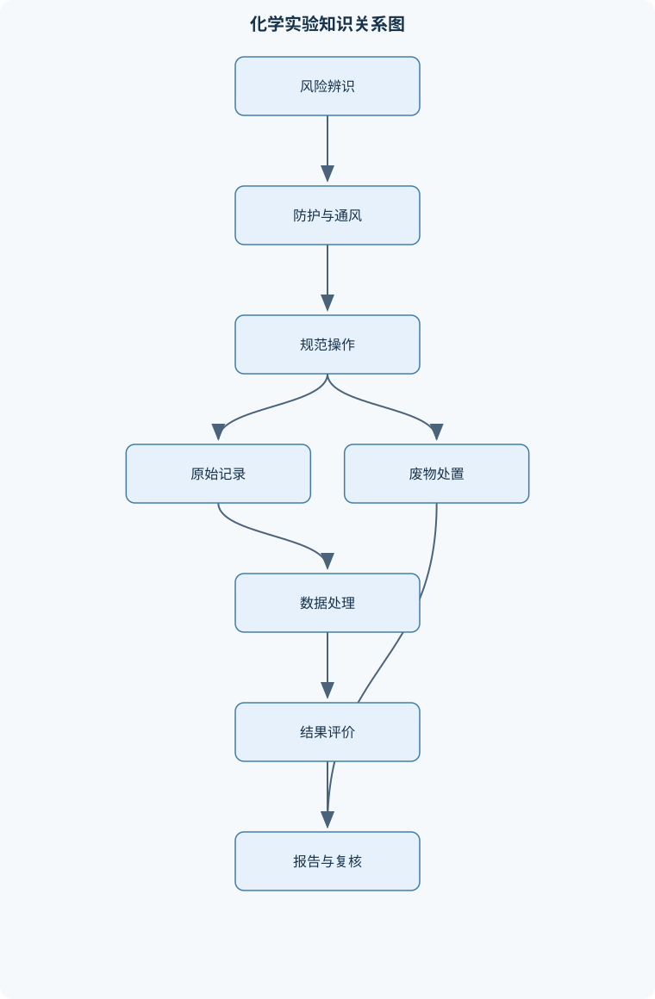
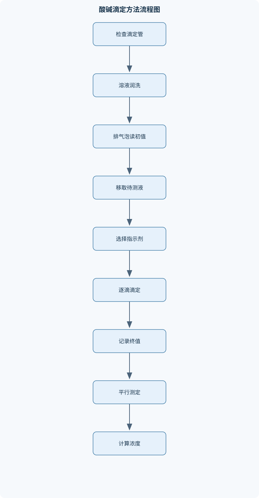

# 化学实验（乙）

## 一、课程整体知识框架

### 课程边界与先修知识

《化学实验（乙）》面向已学习基础无机化学、有机化学、分析化学和普通化学计算的本科生，重点覆盖化学实验安全、溶液配制与酸碱滴定、定性分析、分离与提纯、制备与产率评价、常用仪器分析、实验数据处理及实验废弃物管理。先修知识包括物质的量与摩尔浓度、化学方程式配平、酸碱平衡、氧化还原、溶解度与分配、基本有机官能团、误差和有效数字。课程边界是训练规范实验操作、实验现象观察、原始数据记录、结果计算和科学讨论；不以高危反应放大、复杂仪器维修、临床检测或工业过程设计为教学目标。所有具体试剂、仪器和操作均应以实验室现行安全规程、化学品安全技术说明书和指导人员批准为准。





### 1. 课程定位、先修基础与能力边界

《化学实验（乙）》是一门以规范操作、定量测量、现象解释和实验论证为核心的本科化学实验课程。学习者应已具备物质的量、摩尔质量、摩尔浓度、化学方程式配平、酸碱平衡、氧化还原、溶解度与分配、基本有机官能团以及误差和有效数字等基础知识。课程不把公式孤立地作为计算工具，而是要求将“实验目的—操作条件—原始现象或数据—化学模型—计算结果—误差解释”连接成可复核的证据链。

课程的主要产出包括：能够在实验前识别危险源并设置控制措施；能够正确选择和使用玻璃仪器、容量仪器、天平、滴定装置、离心装置和基础分析仪器；能够配制溶液、完成酸碱滴定、进行定性检验、分离提纯和简单制备；能够计算浓度、理论产量、实际产量和产率；能够用平均值、相对偏差、标准曲线和不确定度分析数据；能够写出包含原始记录、计算过程、结果讨论和安全废弃物处置的实验报告。

课程的边界是训练实验室尺度下的基本化学实践能力，不以高危反应放大、复杂仪器维修、临床检测、工业过程设计或未经批准的试剂替代为目标。具体试剂、仪器、浓度、温度、反应规模和废弃物处置方式必须服从实验室现行安全规程、化学品安全技术说明书和指导人员批准，不能仅依据教材中的一般描述自行扩大或改变。

### 2. 从风险控制到结果评价的总体逻辑

课程各模块不是彼此孤立的操作清单，而是形成连续流程。实验前先识别腐蚀、毒性、易燃、氧化、压力、玻璃破裂和高温等风险，确认个人防护、通风、装置完整性、应急设施和废物容器；实验中按照规定顺序加料、控温、搅拌、分离和记录；实验后检查结果的化学合理性、数据精密度、计算单位、有效数字、产物状态及废物分类。

例如，酸碱滴定既涉及容量瓶和移液管的规范使用，也涉及酸碱平衡、指示剂变色范围、滴定终点判断、平行测定和误差评价。若滴定管尖嘴有气泡，即使化学计量关系正确，读出的体积也可能偏大；若终点颜色过深，加入的滴定剂超过终点，结果会产生系统偏差。因此，实验技能、化学原理和数据质量必须同时成立，不能用某一方面的正确抵消另一方面的错误。

### 3. 实验室安全与应急管理

#### 3.1 风险辨识与实验准入

实验前应依据实验方案、试剂清单和仪器清单逐项辨识风险。腐蚀性酸碱可能造成皮肤和眼睛灼伤；易燃溶剂可能形成蒸气—空气可燃混合物；强氧化剂与有机物、还原性物质接触可能引发剧烈反应；挥发性有毒物质需要在有效通风条件下操作；气体和密闭装置还涉及压力风险。

实验准入的基本条件包括：穿实验服、包覆脚部的鞋，按风险佩戴护目镜、合适手套等个人防护装备；确认洗眼器、冲淋装置、灭火器、通风橱和废物容器的位置；检查玻璃仪器有无裂纹、塞子是否匹配、软管是否老化、夹具是否稳固；确认水、电、气开关清楚且可关闭。若通风、仪器或防护条件不满足，风险无法降低到可接受程度，应停止实验并报告。

#### 3.2 典型操作风险

浓酸或浓碱稀释时，应将需要稀释的浓液缓慢加入水中并搅拌、冷却，不能把少量水直接加入大量浓酸或浓碱中，以免局部放热导致沸腾飞溅。取用试剂时保持标签完整，固体用洁净药匙，液体转移时避免瓶口对人，禁止将已取出的试剂倒回原瓶。挥发性溶剂、蒸馏和回流不得靠近明火；常压蒸馏装置必须保持与外界连通，不能误接成密闭体系。

玻璃管插入橡皮塞时，应在玻璃管上使用适当润滑剂，双手靠近受力点，边旋转边缓慢插入，不能用力猛推或用手掌远距离握持。玻璃仪器破裂时不能徒手拾取，应使用专用工具。加热和回流时，装液量应留出沸腾和膨胀空间；回流体系不能密闭，冷凝水方向和通畅性应在加热前确认。离心时，各离心管应按质量或体积对称配平，装量不能过高，转子锁紧后再启动，设备完全停止后才能开盖。

#### 3.3 事故处置与废弃物管理

化学品接触皮肤或衣物时，应立即停止相关操作，脱去受污染物并用大量流动清水冲洗；眼睛受污染时立即使用洗眼设施，并按实验室流程报告。发生洒漏、起火、有毒气体逸出或玻璃割伤时，不应继续实验，也不应在不了解物质性质时自行擦拭或混合处理。正确流程是停止操作、提醒并疏散无关人员、隔离现场、报告指导人员，按照实验室应急程序进行专业处置。

废物应按危险性质分类收集。酸碱废液、含重金属废液、含氧化剂或还原剂废液、卤代和非卤代有机溶剂、固体污染物不能仅按名称随意混合。未知废液不得直接倒入下水道；可能发生放热、产气、沉淀堵塞或氧化还原反应的废液必须分开暂存。实验结束时应完成断电、断水、断气检查，关闭容器，清洁台面，并确认废物标签包含主要成分、危险性质和产生日期等必要信息。

### 4. 实验基本操作与仪器使用

#### 4.1 玻璃仪器和容量仪器

烧杯适合溶解、混合和粗略转移，不适合高准确度定容；锥形瓶便于振荡和滴定，但刻度通常不用于精确量取；量筒适合粗略量取；移液管用于准确移取固定或可调体积；滴定管用于连续、可读数地加入滴定剂；容量瓶用于在规定温度附近配制一个准确总体积的溶液。

容量瓶的刻度表示在规定温度下的标称体积。配制时先将溶质溶解并定量转移，再用去离子水接近刻度，最后逐滴定容，使弯月面最低点与刻度线相切，读数视线与刻度线水平。定容后应充分混匀。若溶液尚未冷却而直接定容，随后温度下降会使体积改变，从而使浓度偏离目标值。

#### 4.2 称量、移液、过滤和离心

称量前检查天平水平、零点和称量环境。固体试剂应使用称量纸、称量舟或洁净容器，不得直接将试剂放在天平盘上。称量过程中避免吸湿性物质长时间暴露；记录显示值和单位，不凭记忆补写。质量读数的位数不能超过天平分辨率所支持的范围。

移液管使用前应检查尖端完整性。定量转移时，液体应沿容器壁流出，按仪器设计决定是否需要等待或吹出末端液滴，不能把不同类型移液管的使用方式混用。过滤时应根据固体颗粒、沉淀量和目标物性质选择重力过滤或减压过滤；减压过滤装置应检查抽滤瓶和连接部位有无裂纹，停止抽气前先解除负压，避免倒吸。

离心的关键不是单纯“转得快”，而是质量分布均匀、装量适当、转子和管体完整。离心过程中出现剧烈振动、异常声音或液体泄漏，应立即停止并按设备流程处理，不能在运转中强行打开。

#### 4.3 清洗、洁净度和水的等级

玻璃仪器清洗通常包括及时冲洗、洗涤剂清洗、充分自来水冲洗和去离子水润洗。洁净玻璃表面应形成均匀水膜，若水珠明显聚集或出现油膜，说明仍有污染。容量分析中，滴定管和移液管不能仅以“看起来干净”为判据，还要避免残留水膜或前一种溶液造成浓度改变。

去离子水适合一般溶液配制和最后润洗，但不等于绝对无杂质。对痕量分析、仪器分析或特殊反应，需按实验要求使用相应等级水。水浴中使用的水也应符合设备要求，避免硬度沉积、微生物污染或导电性不适当造成设备问题。

### 5. 溶液配制与浓度计算

#### 5.1 基本定义与推导

物质的量为 $n$，单位为 $\mathrm{mol}$；质量为 $m$，单位为 $\mathrm{g}$；摩尔质量为 $M$，单位为 $\mathrm{g\cdot mol^{-1}}$。三者关系为

$$
n=\frac{m}{M}.
$$

物质的量浓度 $c$ 的单位为 $\mathrm{mol\cdot L^{-1}}$，定义为

$$
c=\frac{n}{V},
$$

其中 $V$ 必须以升表示。联立两式可得

$$
c=\frac{m}{MV},\qquad m=cMV.
$$

若目标体积为 $250.0\ \mathrm{mL}$，计算时应先换算为 $0.2500\ \mathrm{L}$。若试剂纯度或有效成分质量分数为 $w$，则实际称取试剂质量为

$$
m_{\text{试剂}}=\frac{cVM}{w},
$$

其中 $w$ 必须用小数表示，例如质量分数 $98.0\%$ 应写为 $0.980$。若使用液体试剂，还需依据密度 $\rho$ 由

$$
V_{\text{试剂}}=\frac{m_{\text{试剂}}}{\rho}
$$

进行体积换算。上述关系要求溶质组成明确、无明显挥发、无沉淀或副反应，且定容体积确实为最终溶液体积。直接把固体体积、溶剂体积和溶液体积简单相加，通常不具有严格定量意义。

#### 5.2 直接配制、间接配制和稀释

稳定、组成明确且适合准确称量的物质可采用直接配制法。若试剂易吸湿、易挥发、纯度不够稳定或难以直接得到准确浓度，则先配制近似浓度溶液，再通过标准物质或比较滴定确定实际浓度，这属于间接配制或标定。

稀释过程中，若没有反应、沉淀和挥发性损失，溶质物质的量近似守恒：

$$
c_1V_1=c_2V_2.
$$

该式中的 $c_1,c_2$ 单位应一致，$V_1,V_2$ 也应使用同一体积单位。它不适用于稀释同时发生显著反应、配合、沉淀或挥发的体系。取储备液体积过小会放大移液误差；若需要很大的稀释倍数，可采用逐级稀释，但每一级都必须混匀并记录稀释因子。

### 6. 酸碱滴定与容量分析

#### 6.1 化学计量关系

对于一般反应

$$
\nu_a A+\nu_b B\rightarrow \text{产物},
$$

化学计量点满足

$$
\frac{n(A)}{\nu_a}=\frac{n(B)}{\nu_b}.
$$

由于 $n=cV$，可写为

$$
\frac{c_aV_a}{\nu_a}=\frac{c_bV_b}{\nu_b}.
$$

只有在一元酸与一元碱、且没有副反应时，才能简化为 $c_aV_a=c_bV_b$。多元酸碱、部分电离、络合或沉淀体系必须依据完整反应计量关系计算，不能机械套用一比一公式。

#### 6.2 终点、化学计量点和指示剂

化学计量点是反应物按理论计量关系恰好反应完全的状态；滴定终点是实验者依据指示剂颜色或仪器信号判定停止加液的时刻。两者不必完全重合，差异形成指示剂误差。酸碱指示剂应选择变色范围覆盖滴定曲线在化学计量点附近的突跃区域。强酸强碱滴定的突跃通常较明显；弱酸与强碱滴定时，化学计量点溶液可能呈碱性，不能任意选用变色范围偏酸的指示剂。

滴定管使用前应检漏，并用待装滴定剂润洗，排除尖嘴气泡，调节初读数。读数时视线与液面保持水平，记录初、终读数及其差值。滴定接近终点后应逐滴加入，每次充分摇匀，终点颜色判据在平行实验中保持一致。平行滴定的意义不是简单重复，而是检验操作和终点判断是否具有一致性。

### 7. 定性分析与化学平衡

沉淀反应可用溶度积解释。当离子积超过相应条件下的溶解度积时，体系可能生成沉淀；但络合、酸碱平衡、离子强度和过量配体会改变游离离子浓度，因此“出现沉淀”不能脱离介质条件直接作确定结论。沉淀在过量配体中溶解，可能是络合物形成使金属离子游离浓度下降，也可能伴随酸碱反应。

化学平衡是动态过程。正反应和逆反应仍在进行，只是在一定条件下速率相等，宏观浓度保持相对稳定。改变酸度、配体浓度、氧化还原条件或沉淀物移除方式，都会改变平衡组成。定性分析应采用独立分样，先进行空白和已知对照，再由温和、选择性高的反应逐步推进；颜色、沉淀、溶解、气体和温度变化都必须记录为原始现象，不能直接把现象写成未经验证的结论。

### 8. 分离、提纯与物性表征

重力过滤适合颗粒较大、过滤速度要求不高的体系；减压过滤适合快速收集晶体，但需防止抽滤瓶破裂和倒吸。重结晶利用目标物与杂质在不同温度下的溶解度差异：目标物在热溶剂中易溶、冷溶剂中难溶，杂质则应尽量全部留在母液或被趁热过滤除去。溶剂过多会使目标物留在母液中，溶剂过少则可能导致溶解不完全或杂质夹带。

萃取利用目标物在两种互不相溶液体中的分配差异。分液前必须确认两相组成和层次，分液漏斗不能装得过满，振荡时应间歇放气并使出口远离人员。多次少量萃取通常比一次大量萃取更有利于提高转移率。干燥剂应与目标物和溶剂相容，加入后应观察是否仍有液滴或干燥剂结块，以判断干燥是否充分。

蒸馏利用挥发性差异，回流利用冷凝液返回反应瓶以延长反应时间。蒸馏装置不能密闭，加热前应确认气路通畅。色谱分离由固定相和流动相对不同组分的作用差异决定；若样品过浓、展开剂选择不当或点样过大，会造成拖尾和分离失败。熔点、沸点、折射率和色谱行为只能在明确测量条件下用于纯度判断，单一物性异常不能自动证明某一种杂质的存在。

### 9. 化学制备与产率评价

确定限量试剂时，先将各反应物的初始物质的量分别除以其化学计量数，比较

$$
\frac{n_A}{\nu_A},\qquad \frac{n_B}{\nu_B}.
$$

数值较小者对应的试剂为限量试剂。理论产物质量为

$$
m_{\text{理论}}
=\left(\frac{n_{\text{限量}}}{\nu_{\text{限量}}}\right)
\nu_{\text{产物}}M_{\text{产物}}.
$$

干燥后得到的产物质量为 $m_{\text{实际}}$，产率为

$$
\eta=\frac{m_{\text{实际}}}{m_{\text{理论}}}\times100\%.
$$

产率偏低可能来自副反应、未反应原料、转移损失、过滤损失、母液溶解损失或产物机械损失；产率超过 $100\%$ 通常提示产品含水、含溶剂、夹带母液或含副产物，不能解释为反应“特别完全”。产物颜色、晶型、熔点、色谱或光谱结果应与产率结合讨论，不能仅凭外观判断纯度。

### 10. 仪器分析基础与测量质量

pH计通过电极电势与氢离子活度之间的关系响应溶液酸度。使用前需要按要求校准，测量时保持电极洁净、充分浸没、避免气泡附着，并在读数稳定后记录。电极污染、保存不当、温度变化和样品离子强度都会造成漂移。理论计算通常使用浓度近似活度，适用于较稀溶液；浓溶液或复杂基体中，实测值不必与简单公式完全一致。

分光光度法中，吸光度 $A$ 与透射比 $T$ 的关系为

$$
A=-\log_{10}T.
$$

在样品均匀、无明显散射、浓度处于线性范围、光程 $l$ 固定且杂散光可忽略时，朗伯—比尔定律为

$$
A=\varepsilon lc,
$$

其中 $\varepsilon$ 为摩尔吸光系数，$l$ 单位通常为 $\mathrm{cm}$，$c$ 为浓度。实际校准常写为

$$
y=ax+b,
$$

斜率 $a$ 表示响应灵敏度，截距 $b$ 反映背景响应。未知样品必须在与标准溶液相同的波长、比色皿光程、反应时间和样品处理条件下测量。浑浊、比色皿方向不一致、基体颜色和超出线性范围都会使直接代入方程失效。

### 11. 数据处理、不确定度与实验报告

平均值为

$$
\bar{x}=\frac{x_1+x_2+\cdots+x_n}{n}.
$$

平均值反映数据中心位置，不能单独说明精密度。样本标准差为 $s$，相对标准偏差为

$$
RSD=\frac{s}{\bar{x}}\times100\%.
$$

绝对误差描述测量值与参考值的差异，相对误差通常为绝对误差除以参考值；相对偏差用于比较平行测量之间的一致性。随机误差可通过增加平行测量和改进操作减少，系统误差则需要校准仪器、修正空白、改进方法或更换测量条件。

若

$$
c=\frac{m}{MV},
$$

且 $M$ 视为无显著不确定度，则质量和体积的不确定度会共同影响浓度。乘除运算中，各输入量的相对不确定度通常按平方和开方的原则合成近似值：

$$
\left(\frac{\Delta c}{c}\right)^2
\approx
\left(\frac{\Delta m}{m}\right)^2+
\left(\frac{\Delta V}{V}\right)^2.
$$

该近似要求误差相互独立且处于小误差范围。实验报告应区分原始观察、原始读数、计算结果和解释性判断；原始数据不得为迎合理论值而改写、删除或补造。最终结果的有效数字应与仪器分辨率和主要不确定度相匹配。

## 二、章节和模块划分

### 核心知识覆盖清单

本清单用于检查正文是否覆盖本课程的主要知识模块：

- **实验室安全与应急管理**：个人防护装备与实验室行为规范、实验前风险辨识与装置检查、腐蚀性试剂的取用与稀释、易燃易爆物质的防火防爆、有毒气体与挥发性溶剂的通风操作、玻璃管插塞与玻璃仪器防割伤、加热、冷却、回流和蒸馏安全、气瓶分类固定与减压使用、事故报告、现场隔离和应急处置、危险废物分类收集与暂存。
- **实验基本操作与仪器使用**：常用玻璃仪器的功能和耐热边界、量筒、移液管、滴定管和容量瓶的区别、天平称量与称量误差控制、液体试剂和固体试剂的规范取用、移液、定容、转移和洗涤操作、加热、搅拌、冷凝和过滤装置连接、离心操作的配平与装量控制、玻璃仪器清洗和洁净度判定、去离子水和不同试剂等级的用途、实验结束后的断电、断水、断气检查。
- **溶液配制与浓度计算**：物质的量、摩尔质量和摩尔浓度、直接配制法与间接配制法、固体溶质的称量、溶解和定容、浓酸或浓碱的安全稀释、容量瓶的使用和定容读数、标准溶液与非标准溶液、稀释公式及其适用条件、试剂纯度和有效成分含量修正、配制误差的来源与传播、溶液标签、保存和有效性管理。
- **酸碱滴定与容量分析**：中和反应的化学计量关系、滴定管检漏、润洗、排气泡和读数、滴定终点与化学计量点的区别、酸碱指示剂变色范围、强酸强碱滴定曲线、弱酸或弱碱滴定的指示剂选择、平行滴定与终点一致性、空白试验和校准思路、滴定数据的平均值和相对偏差、酸碱溶液的比较滴定与浓度测定。
- **定性分析与化学平衡**：沉淀反应和溶解度积的定性应用、酸碱平衡与缓冲体系、络合反应及其对沉淀的影响、氧化还原反应的现象判别、气体生成、检验与通风要求、分步加试剂和对照实验设计、显色反应与干扰离子控制、动态平衡和正逆反应速率、离子反应方程式书写、由现象到结论的证据链。
- **分离、提纯与物性表征**：重力过滤与减压过滤、结晶、重结晶和溶解度差异、萃取、分液和分配系数、蒸馏与沸点差异、回流反应与冷凝系统、干燥剂选择和干燥终点、升华和固体提纯的适用条件、熔点、沸点和折射率等物性表征、色谱分离的固定相与流动相、产品纯度判断和表征结果关联。
- **化学制备与产率评价**：反应路线、限量试剂和理论产量、反应条件对选择性和转化率的影响、加料顺序、控温和搅拌、回流、冷却、结晶和过滤组合操作、粗产品洗涤和重结晶、产物干燥、称量和保存、理论产量与实际产量计算、产率偏低的物料损失分析、副反应和未反应原料的识别、产品颜色、晶型和纯度报告。
- **仪器分析基础与测量质量**：pH计的原理、校准和测量、电极清洗、保存与漂移检查、分光光度法的吸收和透射概念、比色皿方向、空白和基线校正、朗伯比尔定律的适用条件、标准曲线和未知样品浓度求取、仪器分辨率、准确度和精密度、样品前处理与基体干扰、异常读数的诊断和重复测量、定性观察与仪器数据的互相验证。
- **实验数据处理与不确定度**：有效数字与仪器最小分度、随机误差和系统误差、准确度、精密度和重复性、平均值、中位数和离群值、绝对误差、相对误差和相对偏差、误差的加减乘除传播、线性拟合和标准曲线评价、数据表、坐标轴和单位规范、结果保留位数与合理舍入、从原始数据到结论的可追溯记录。
- **实验报告与综合实验设计**：实验目的与科学问题的区分、原理、反应方程式和关键条件、流程图与操作步骤的组织、原始现象和原始数据的即时记录、计算过程和结果表达、结果讨论与误差归因、对照组、空白组和平行实验、实验方案的风险评估、方法改进与资源节约、实验报告的可复核性和完整性。


### 1. 模块一：安全、仪器和基本操作

本模块由“安全准入—仪器检查—规范操作—结束检查”组成。代表性流程如下：

1. 输入实验方案、试剂清单、仪器清单和风险信息。
2. 标出腐蚀、毒性、易燃、氧化、压力、高温和玻璃割伤风险。
3. 检查个人防护、通风、洗眼器、冲淋、灭火器和废物容器。
4. 检查仪器完整性、装置连接、气密性和水电气开关。
5. 确定加料顺序、控温范围、停止条件和事故报告路径。
6. 实验结束后断电、断水、断气，关闭试剂瓶并分类收集废物。

流程的不变量是任何一步都不能绕过已识别的风险控制。若风险无法降低或设施不满足要求，终止条件不是“继续观察”，而是停止实验并报告。该流程适用于所有化学实验，尤其适用于加热、回流、蒸馏、气体发生和浓酸浓碱操作。

### 2. 模块二：溶液配制、滴定和数据筛选算法

#### 2.1 溶液配制流程

输入为目标浓度 $c$、目标体积 $V$、摩尔质量 $M$、纯度 $w$，必要时还包括密度 $\rho$；输出为带完整标签且均匀的目标溶液。

计算纯物质质量：

$$
m_{\text{纯}}=cVM.
$$

若试剂纯度为 $w$，则称取质量：

$$
m_{\text{试剂}}=\frac{m_{\text{纯}}}{w}.
$$

操作时先称量或量取试剂，在适当容器中溶解，定量转移至容量瓶，用去离子水洗涤原容器并合并洗液，接近刻度时逐滴定容，盖塞后充分混匀。若试剂吸湿、挥发、发生反应或含量不稳定，应改用近似配制后标定的方法。

#### 2.2 滴定结果处理伪代码

```text
语言：Python风格伪代码

输入：
    c_t       滴定剂浓度
    V_a       被测溶液移取体积
    nu_t      滴定剂计量数
    nu_a      被测物计量数
    V_list    平行滴定消耗体积列表
    tolerance 允许的相对偏差

过程：
    检查 V_list 中每个体积是否为正数
    计算平均体积 V_bar
    计算每次体积相对于 V_bar 的相对偏差
    标记有实验记录支持的明显操作异常
    若剩余数据不足以形成有效平行测定，则停止并报告
    计算：
        n_t = c_t × V_bar
        n_a = n_t × nu_a / nu_t
        c_a = n_a / V_a
    输出 c_a、V_bar、相对偏差和异常记录

不变量：
    原始读数保持不变；所有体积使用同一单位；计量数来自配平后的方程式。

终止条件：
    数据通过一致性检查，且计算结果可追溯至每一次原始读数。
```

该流程不能用“删掉最不接近理论值的数据”作为异常筛选依据。只有当滴定管读数错误、气泡未排除、终点误判等实验事实被记录时，才可说明某次数据不应纳入最终平均；否则应保留数据并讨论其影响。

#### 2.3 仪器分析校准流程

输入为空白、系列标准溶液、未知样品和仪器；输出为校准方程、未知浓度和质量评价。先测空白，再按浓度由低到高测量标准，检查响应是否单调、是否位于线性范围；拟合 $y=ax+b$ 后测量未知样品，将响应代入方程，并乘以样品前处理的稀释倍数。最后复测一个标准或加标样品，以检查仪器漂移和基体效应。

### 3. 代表性例题

#### 例题一：含量修正的溶液配制

**题干：**用纯度为 $98.0\%$ 的固体试剂配制 $250.0\ \mathrm{mL}$、$0.1000\ \mathrm{mol\cdot L^{-1}}$ 溶液，试剂摩尔质量为 $100.0\ \mathrm{g\cdot mol^{-1}}$。求应称取的试剂质量。

**分析：**先求纯物质质量，再除以纯度。体积必须用升。

**解答：**

$$
V=250.0\ \mathrm{mL}=0.2500\ \mathrm{L}
$$

$$
m_{\text{纯}}=cVM
=0.1000\times0.2500\times100.0
=2.500\ \mathrm{g}
$$

$$
m_{\text{试剂}}
=\frac{2.500}{0.980}
=2.551\ \mathrm{g}.
$$

因此应称取约 $2.551\ \mathrm{g}$ 试剂。称量后先溶解，再定量转移、洗涤、定容和混匀，不能直接在容量瓶中剧烈加热溶解。

**结果验证：**若误把纯度当成乘法，会得到 $2.450\ \mathrm{g}$，纯物质量不足，实际浓度低于目标值。

**变式：**若使用密度为 $\rho$ 的液体试剂，应先计算所需质量，再用 $V=m/\rho$ 换算试剂体积；若液体存在挥发或含量不稳定，则不能仅凭标签浓度认为其为标准溶液。

#### 例题二：一元酸碱滴定

**题干：**取 $20.00\ \mathrm{mL}$ 一元酸，用 $0.1000\ \mathrm{mol\cdot L^{-1}}$ 碱液滴定，三次消耗体积为 $19.86$、$19.92$ 和 $19.88\ \mathrm{mL}$。求酸浓度。

**分析：**先求平均体积，再用一元一元计量关系计算。

**解答：**

$$
\bar V_b=\frac{19.86+19.92+19.88}{3}
=19.8867\ \mathrm{mL}
\approx19.89\ \mathrm{mL}.
$$

换算为升：

$$
\bar V_b=0.01989\ \mathrm{L}.
$$

碱的物质的量为

$$
n_b=c_bV_b
=0.1000\times0.01989
=1.989\times10^{-3}\ \mathrm{mol}.
$$

一元酸与一元碱按一比一反应，因此

$$
n_a=n_b,
\qquad
c_a=\frac{n_a}{V_a}
=\frac{1.989\times10^{-3}}{0.02000}
=0.09945\ \mathrm{mol\cdot L^{-1}}.
$$

三次体积相对平均值的最大偏差约为 $0.15\%$，说明平行性较好，但仍需结合实验室规定的接受标准判断。

**结果验证：**若滴定管尖嘴存在气泡，初次加入的滴定剂有一部分用于填充尖嘴，读数体积会偏大，计算出的酸浓度也会偏高。

**变式：**若被测酸为二元酸且在该实验条件下完全中和，则应使用 $2n_{\text{酸}}=n_{\text{碱}}$，不能继续套用一比一关系。

#### 例题三：储备液稀释

**题干：**由 $0.1000\ \mathrm{mol\cdot L^{-1}}$ 储备液配制 $100.0\ \mathrm{mL}$、$0.01000\ \mathrm{mol\cdot L^{-1}}$ 工作液，求应移取储备液体积。

**解答：**

$$
c_1V_1=c_2V_2
$$

$$
V_1=\frac{c_2V_2}{c_1}
=\frac{0.01000\times0.1000}{0.1000}
=0.01000\ \mathrm{L}
=10.00\ \mathrm{mL}.
$$

应使用合适的移液管移取 $10.00\ \mathrm{mL}$ 储备液，转移至 $100.0\ \mathrm{mL}$ 容量瓶，加水至刻度并混匀。

**结果验证：**稀释后物质的量仍为 $0.001000\ \mathrm{mol}$。若取液体积过小，移液相对误差增大；若定容后未混匀，分取样品的浓度可能不均一。

**变式：**若目标浓度为 $0.001000\ \mathrm{mol\cdot L^{-1}}$，直接取液体积为 $1.000\ \mathrm{mL}$，应评估移液器准确度；必要时采用两级稀释。

#### 例题四：强碱溶液的理论 pH

**题干：**求 $0.0100\ \mathrm{mol\cdot L^{-1}}$ 强碱溶液的理论 pH，假设完全电离且为稀水溶液。

**解答：**强碱完全电离，近似有

$$
c(\mathrm{OH^-})=0.0100\ \mathrm{mol\cdot L^{-1}}.
$$

因此

$$
\mathrm{pOH}=-\log_{10}(0.0100)=2.00.
$$

在约 $25^\circ\mathrm{C}$ 的稀水溶液中，

$$
\mathrm{pH}+\mathrm{pOH}\approx14.00,
$$

所以

$$
\mathrm{pH}\approx12.00.
$$

**结果验证：**pH计读数可能因温度、校准、电极污染、活度效应和二氧化碳吸收而与理论值有差异。pH显示三位小数不代表实际准确度达到三位小数。

**变式：**温度显著变化时，不能机械使用 $14.00$，应采用相应温度下的水离子积；浓溶液中还应考虑活度而非仅使用浓度。

#### 例题五：产率评价

**题干：**反应中理论上可生成 $5.00\ \mathrm{g}$ 产物，过滤、洗涤和干燥后称得 $4.20\ \mathrm{g}$。求产率，并分析产率偏低的可能原因。

**解答：**

$$
\eta=\frac{4.20}{5.00}\times100\%=84.0\%.
$$

产率偏低可能来自反应未完全、发生副反应、产物在母液中有较大溶解度、转移时附着在容器壁上、过滤时穿过滤纸或洗涤过度。若产物未干燥完全，质量通常会偏高而非偏低；若产物含杂质或夹带母液，产率可能异常接近或超过 $100\%$。

**结果验证：**应结合熔点、色谱、颜色或其他适当表征判断 $4.20\ \mathrm{g}$ 是否为目标产物，而不能仅以质量评价反应成功与否。

**变式：**若称得 $5.30\ \mathrm{g}$，计算产率为 $106\%$，首先检查含水、含溶剂、夹带母液、干燥不足和副产物，而不是修改理论产量。

### 4. 综合实验与项目评价

#### 4.1 酸碱溶液比较滴定项目

**输入数据：**待测酸溶液、已知或经标定的碱溶液、容量瓶、移液管、滴定管、指示剂、三次以上平行读数和空白信息。

**步骤：**

1. 检查滴定管是否漏液，使用滴定剂润洗并排除尖嘴气泡。
2. 用移液管准确移取待测酸，加入适量指示剂。
3. 先快速滴定至接近终点，再逐滴加入并充分摇匀。
4. 记录初读数、终读数和终点颜色。
5. 完成平行滴定，计算平均体积、待测浓度和相对偏差。
6. 根据反应方程式检查计量关系，说明终点与化学计量点的差别。

**评价标准：**滴定管读数规范；终点颜色判据一致；平行体积具有实验要求的一致性；原始数据完整；单位统一；结果有效数字与仪器精度相符；异常值有事实依据而非按理论值筛选。

**排错方法：**若平行结果差异大，依次检查尖嘴气泡、漏液、读数方向、移液管排液方式、终点过滴、摇匀不足和溶液污染。若所有结果方向一致地偏高或偏低，应优先排查系统误差，如滴定剂未标定、指示剂选择不当或容量仪器校准问题。

#### 4.2 固体粗品重结晶与产率项目

**输入数据：**粗品质量、反应计量关系、目标物和杂质的溶解性信息、合适溶剂、加热过滤和减压过滤装置、干燥后的产物质量及物性表征结果。

**步骤：**

1. 根据反应方程式确定限量试剂并计算理论产量。
2. 选择目标物热溶解度大、冷溶解度小且杂质行为不同的溶剂。
3. 用尽可能少的热溶剂溶解粗品。
4. 必要时趁热过滤除去不溶物，避免目标物在漏斗中提前结晶。
5. 缓慢冷却并静置，使晶体充分形成。
6. 抽滤收集，用少量冷溶剂洗涤。
7. 干燥至质量稳定，称量并计算产率。
8. 结合熔点、颜色、晶型或色谱结果评价纯度。

**评价标准：**晶体形成具有可重复性；母液夹带少；产物干燥充分；产率计算以限量试剂为依据；产率与纯度讨论相互一致；能够区分反应损失、过滤损失、转移损失和干燥误差。

**排错方法：**不结晶可能是溶剂过多、冷却过快、样品过少或目标物在该溶剂中溶解度过大；晶体颜色异常可能是副反应、炭化或杂质吸附；产率过高应检查含溶剂、含水和母液夹带；熔点范围过宽通常提示纯度不足、干燥不充分或装样不当。

### 5. 典型易错点与问题解答

#### 5.1 具体易错点

1. 将烧杯刻度当作高准确度体积读数。
2. 容量瓶未冷却就定容，导致温度变化造成体积偏差。
3. 定容后没有充分混匀，造成取样浓度不均。
4. 滴定管未用待装溶液润洗，残留水膜稀释滴定剂。
5. 移液管、滴定管尖嘴有气泡，导致体积读数包含充气体积。
6. 初读数和终读数视线不水平，产生视差。
7. 将滴定终点、指示剂变色终点和化学计量点视为同一概念。
8. 浓酸或浓碱稀释时把水加入浓酸或浓碱，引起局部剧烈放热。
9. 常压蒸馏装置密闭，形成加热升压风险。
10. 回流装液过多或冷凝水不通畅，造成冲料。
11. 离心管未对称配平或装液过高，导致振动、泄漏和设备损坏。
12. 强氧化剂与有机物、还原剂混放或混用。
13. 未知废液与酸碱、重金属或有机废液混合收集。
14. 只根据颜色或沉淀直接作确定定性结论，没有空白和对照。
15. 为使结果接近理论值而删除或修改原始数据。
16. 中间步骤过早舍入，导致最终浓度、产率或标准曲线结果偏差。
17. 把产率超过 $100\%$ 解释为反应完全，而忽略含水和夹带母液。
18. 把仪器显示位数当作准确度，忽略校准、电极状态和基体影响。

#### 5.2 常见笔试问题及解答思路

**问题一：为什么容量浓度计算必须把体积换算为升？**  
答：因为 $c=n/V$ 的单位规定为 $\mathrm{mol\cdot L^{-1}}$。若将毫升直接代入，结果会放大或缩小 $1000$ 倍。解题时先统一体积单位，再进行计算。

**问题二：什么时候可以使用 $c_1V_1=c_2V_2$？**  
答：该式由稀释过程中溶质物质的量近似守恒得到，适用于无反应、无沉淀、无明显挥发损失的稀释。若稀释同时发生反应或络合，应先写物种变化和计量关系。

**问题三：滴定终点为什么不一定等于化学计量点？**  
答：化学计量点由反应计量关系定义，终点由指示剂颜色或仪器信号定义。指示剂变色范围有限，终点与化学计量点之间的差异构成指示剂误差。

**问题四：如何确定限量试剂？**  
答：分别计算各反应物的 $n/\nu$，数值较小者为限量试剂。理论产量由限量试剂决定，不由投料质量最大者决定。

**问题五：为什么重结晶需要少量热溶剂？**  
答：目标物在热溶剂中溶解、冷却后析出。溶剂过多会使更多目标物留在母液中，降低回收率；溶剂过少会造成溶解不完全或杂质夹带。

**问题六：如何区分随机误差和系统误差？**  
答：随机误差使重复结果在均值两侧波动，可通过增加平行测量降低均值的不稳定性；系统误差使结果整体偏向一侧，需要校准、空白修正、改进方法或更换仪器才能消除或降低。

**问题七：为什么朗伯—比尔定律不能无限外推？**  
答：高浓度、散射、化学平衡变化、杂散光和基体效应都会使吸光度与浓度偏离线性。未知样品必须位于标准曲线有效范围内，超出范围应稀释后重测。

**问题八：pH计读数不稳定可能有哪些原因？**  
答：可能是电极未充分平衡、表面污染、保存不当、校准失败、温度变化、样品搅拌或气泡影响。应先检查电极和校准状态，再确认样品条件，不能仅记录某个瞬时显示值。

### 6. 面试问题、参考答案与深入追问

**问题一：你如何在实验开始前进行安全评估？**  
参考答案：先依据试剂和装置识别腐蚀、毒性、易燃、氧化、压力和高温风险，再检查个人防护、通风、仪器完整性、应急设施和废物容器，最后确定加料顺序、停止条件和报告路径。  
深入追问要点：说明常压蒸馏不能密闭；说明浓酸稀释的加料顺序；说明风险无法降低时应停止实验。

**问题二：滴定结果平行性差，你会如何排查？**  
参考答案：检查气泡、漏液、读数视差、移液操作、终点判断、摇匀程度和滴定剂是否污染，并对照原始记录判断是随机问题还是系统问题。  
深入追问要点：不能按理论值删除数据；异常值必须有操作事实支持；若所有结果同向偏差，应排查滴定剂浓度和仪器校准。

**问题三：如何判断重结晶是否成功？**  
参考答案：观察晶体形态和颜色，检查干燥后的质量稳定性，并结合熔点范围、色谱或其他适当物性表征。产率高不等于纯度高，产率低也不必然表示反应失败。  
深入追问要点：解释母液损失、溶剂过多、夹带母液和副产物对结果的影响。

**问题四：如果产率超过100%，你会怎样处理？**  
参考答案：首先检查产品是否含水、含溶剂、夹带母液或副产物，再检查理论产量的限量试剂判断、摩尔质量和计量关系。不能直接修改数据或认定反应特别完全。  
深入追问要点：提出重新干燥、重新称量和进行纯度表征，而不是简单重复称量。

**问题五：如何验证分光光度法的标准曲线可用？**  
参考答案：检查空白、响应单调性、线性范围、残差或偏离趋势，并用独立标准或加标样品验证。标准和未知必须采用相同波长、比色皿方向、反应时间和前处理。  
深入追问要点：说明浑浊、基体颜色和杂散光会造成非线性或背景升高。

**问题六：实验中发生化学品飞溅，你会怎么办？**  
参考答案：立即停止操作，按污染部位使用流动水或洗眼设施冲洗，提醒他人隔离风险并报告指导人员，按照实验室应急程序接受后续处置。  
深入追问要点：不能自行判断“少量无害”后继续实验；不能在不了解性质时用其他试剂中和。

**问题七：为什么原始数据不能在报告中改写？**  
参考答案：原始数据是实验过程的直接记录，必须保持可追溯性。计算错误应在计算栏修正，异常数据应保留并说明原因，不能用理论值替换实测值。  
深入追问要点：说明原始读数、计算中间值、最终结果和结论之间应能逐步核对。

**问题八：怎样判断一个方法是否适合当前样品？**  
参考答案：考察反应选择性、线性范围、检测信号、基体干扰、样品前处理、精密度、准确度和安全条件。若干扰无法控制，即使公式成立也不能直接使用。  
深入追问要点：提出空白、已知对照、平行样和加标回收等验证思路。

### 7. 岗位关联与课程产出

#### 7.1 化学分析实验员和质量控制人员

实际任务包括配制标准溶液、完成滴定或仪器测定、记录批次数据、进行空白和平行分析、审核有效数字和异常结果。使用的知识包括容量分析、溶液配制、标准曲线、误差评价、样品前处理和废物分类。产出是可追溯的原始记录、计算表、检测结果和异常说明；验收标准包括单位正确、数据链完整、平行性符合方法要求、仪器状态和标准溶液信息完整。

#### 7.2 环境水质与废物检测实验员

实际任务包括水样接收、分样、保存、酸碱度或吸光度测定、空白和质控样分析，以及废液分类。需要综合使用 pH 测量、分光光度法、稀释计算、基体干扰判断和危险废物管理知识。产出是样品编号对应的检测记录、校准曲线、质控结果和废物交接记录；验收重点是样品链条不混乱、空白可接受、校准有效、异常结果有复测和解释。

#### 7.3 实验室安全与质量体系人员

实际任务包括审核实验方案风险、检查防护设施、核对试剂标签和废物容器、调查事故或偏差、维护操作记录。需要使用危险性质分类、装置安全、应急流程、数据完整性和可追溯记录知识。产出是风险评估表、整改记录、培训或检查记录和事故调查材料；验收标准是风险控制措施具体可执行，责任和停止条件明确，问题能够闭环而不是仅作口头提醒。

#### 7.4 化学试剂与仪器应用工程岗位

实际任务包括根据客户样品选择配制、滴定、pH或分光光度方法，设计校准方案，诊断异常读数并解释方法边界。需要使用化学平衡、标准曲线、仪器准确度与精密度、样品基体效应和数据审核知识。产出是方法说明、操作条件、校准结果、故障排查记录和客户可理解的结果报告；验收标准是方法适用条件明确、校准和质控通过、结果可复核，并且不把超出线性范围或未控制基体干扰的数据作为确定结论。

## 三、核心概念的详细解释

### 3.1 实验安全是“风险—控制—停止条件”的闭环

化学实验安全不是简单地佩戴防护用品，而是对危险源、暴露途径、事故后果和控制措施进行连续判断。实验开始前，应将实验方案拆分为试剂取用、加料、加热、冷却、转移、分离、仪器测量和废物处置等步骤，分别辨识腐蚀、毒性、易燃、氧化、压力、高温、玻璃破裂和挥发性暴露风险。

风险控制通常遵循以下逻辑：首先用替代试剂、缩小规模或取消不必要步骤降低危险源；其次采用通风橱、挡板、冷凝器、夹具和防护屏等工程控制；再次通过规定加料顺序、控制温度、限制装液量、设置专人监护和明确停止条件减少操作风险；最后使用实验服、护目镜、手套等个人防护装备。个人防护装备不能替代通风和装置安全。

浓酸、浓碱的稀释属于强放热过程。局部水量很少时，放出的热量集中在很小体积内，可能使水迅速沸腾并携带腐蚀性液滴飞溅。因此应将需要稀释的浓液缓慢加入较大量的水中，同时搅拌、冷却，并遵守具体试剂的安全技术要求。若发生皮肤、眼睛或衣物污染，应立即停止实验并用大量流动清水冲洗，随后按实验室应急流程报告；不能为了“先自行处理干净”而继续接触危险源。

玻璃管插入橡皮塞时，危险来自玻璃的脆性和插入力矩。应选择与管径匹配的孔，必要时适当修整孔径，在玻璃管上使用适宜润滑剂，双手靠近受力部位，边旋转边缓慢推进。不能手掌远离塞子强行推压，也不能使用有裂纹的玻璃管。蒸馏装置必须保持与外界连通，回流装置也不能形成密闭体系；否则液体受热膨胀或产生蒸气时可能导致压力升高。

危险废物应按危险性质和相容性分类收集，而不是仅按实验名称分类。酸碱废液、含重金属废液、卤代或非卤代有机溶剂、强氧化性废液和未知废液不能随意混合。废液容器应有明确标签，标明主要成分、危险性质和日期；不确定相容性的废液应暂停混合并报告。实验结束后应检查水、电、气、加热和通风设备，确认装置已冷却、废物已归位、台面无污染。

### 3.2 玻璃仪器和容量仪器的功能边界

不同仪器的体积功能不同。烧杯和锥形瓶主要用于溶解、反应、暂存和混合，刻度通常不能满足高准确度定容要求；量筒适合测量大致体积；移液管用于准确移取固定体积或按规定方式移取液体；滴定管用于连续读取滴加体积；容量瓶用于配制指定温度下的准确体积溶液。

容量瓶的刻度只表示标定温度下的体积，不能把容量瓶当作反应器或长期储存容器。固体配液时，溶质应先在适当容器中完全溶解，再定量转移至容量瓶，用少量去离子水洗涤原容器数次并合并洗液，接近刻度线时逐滴加入溶剂，视线与刻度线水平，最后充分混匀。若溶解过程明显放热，应冷却至适宜温度后再定容，否则温度造成的体积变化会引入系统误差。

滴定管使用前应检查活塞或阀门是否漏液，用待装滴定剂润洗内壁，确保尖嘴内无气泡。读数应保持视线与液面最低点或规定读数位置水平，并统一记录初读数和终读数。滴定管的刻度方向与量筒不同，消耗体积由终读数减初读数，而不是凭刻度方向估计。移液管的使用方式应服从其类型和实验规程，不能随意吹出残留液滴。

天平测量的是质量而不是“物质的量”。称量前应确认零点和稳定状态，容器去皮或采用差减称量，避免热物体、挥发性样品、吸湿性样品直接长时间暴露。试剂不能倒回原瓶，以免污染原试剂。离心时，离心管需要按质量或体积对称配平，装量应留出安全空间；设备完全停止后才能开盖。

### 3.3 溶液配制与浓度的物理含义

物质的量 $n$ 的单位为 $\mathrm{mol}$，质量 $m$ 的单位为 $\mathrm{g}$，摩尔质量 $M$ 的单位为 $\mathrm{g\cdot mol^{-1}}$。三者关系为

$$
n=\frac{m}{M}.
$$

物质的量浓度 $c$ 定义为溶质物质的量除以溶液体积：

$$
c=\frac{n}{V},
$$

其中 $c$ 的单位通常为 $\mathrm{mol\cdot L^{-1}}$，$V$ 必须用 $\mathrm{L}$ 表示。将两个定义联立，可得

$$
c=\frac{m}{MV},
\qquad
m=cMV.
$$

这个公式适用于溶质质量、摩尔质量和最终溶液体积定义明确，且配制过程中没有明显挥发、沉淀或反应损失的情况。若试剂纯度为质量分数 $w$，且 $w$ 用小数表示，则应称取的商业试剂质量为

$$
m_{\text{试剂}}=\frac{cVM}{w}.
$$

若使用浓缩液，且已知密度 $\rho$，可先由纯溶质质量换算商业试剂质量，再用

$$
V_{\text{浓缩液}}=\frac{m_{\text{商业试剂}}}{\rho}
$$

求取体积。密度的单位必须与质量和体积单位相容，例如 $\rho$ 用 $\mathrm{g\cdot mL^{-1}}$ 时，体积结果为 $\mathrm{mL}$。

稀释过程若没有化学反应、沉淀、挥发或吸附损失，溶质物质的量近似守恒。因此浓缩液取用体积 $V_1$、浓度 $c_1$，稀释后总体积 $V_2$、浓度 $c_2$ 满足

$$
c_1V_1=c_2V_2.
$$

该式不能用于把发生反应的混合过程误认为单纯稀释。例如浓酸与水混合时虽然常用该式估算所需体积，但实际操作仍需考虑放热、体积收缩和安全加料顺序；若浓缩液挥发或与容器发生反应，物质的量守恒的近似就不再成立。

### 3.4 酸碱平衡、滴定终点与指示剂选择

酸碱滴定的定量基础是反应物之间明确的化学计量关系。对于一般反应

$$
\nu_{\mathrm A}\mathrm A+\nu_{\mathrm B}\mathrm B\rightarrow\text{产物},
$$

化学计量点满足

$$
\frac{n(\mathrm A)}{\nu_{\mathrm A}}
=
\frac{n(\mathrm B)}{\nu_{\mathrm B}}.
$$

若两者均以浓度和体积表示，则

$$
\frac{c_{\mathrm A}V_{\mathrm A}}{\nu_{\mathrm A}}
=
\frac{c_{\mathrm B}V_{\mathrm B}}{\nu_{\mathrm B}}.
$$

一元强酸与一元强碱反应时，计量数相同，才可写成 $c_{\mathrm{酸}}V_{\mathrm{酸}}=c_{\mathrm{碱}}V_{\mathrm{碱}}$。多元酸、多元碱或存在副反应时，不能直接套用一元一元关系。

化学计量点是按反应方程式计算出的理论状态；滴定终点是实验者依据指示剂颜色突变或仪器信号判断的操作状态。两者不必完全重合，二者之间的差异称为终点误差。指示剂的选择原则是其变色范围应位于计量点附近的滴定突跃区域。强酸强碱滴定的突跃范围较宽，适用指示剂较多；弱酸强碱滴定的计量点溶液通常偏碱，应选择变色范围偏碱的指示剂；强酸弱碱滴定则应选择变色范围偏酸的指示剂。弱酸弱碱滴定的突跃可能不明显，单纯依靠普通指示剂往往难以得到可靠终点。

水的离子积为

$$
K_{\mathrm w}=c(\mathrm{H_3O^+})c(\mathrm{OH^-}).
$$

在约 $25\,^\circ\mathrm C$ 的稀水溶液中，常近似取 $K_{\mathrm w}=1.0\times10^{-14}$。定义

$$
\mathrm{pH}=-\log_{10}c(\mathrm{H_3O^+}),
\qquad
\mathrm{pOH}=-\log_{10}c(\mathrm{OH^-}),
$$

于是

$$
\mathrm{pH}+\mathrm{pOH}
=
-\log_{10}K_{\mathrm w}
\approx14.00.
$$

这个数值不是所有温度和所有浓度下的固定常数。较浓溶液中应考虑活度而不能简单把活度等同于浓度；温度改变时，$K_{\mathrm w}$ 也改变。pH 计读数还会受到校准、温度补偿、电极污染、响应漂移和样品基体的影响，因此理论值与实测值不一致时不能立即认定仪器一定错误。

### 3.5 定性分析中的证据链

定性分析不能把单一颜色或沉淀直接等同于确定结论。可靠判断至少应包含：原始样品状态、试剂加入顺序、现象变化、可能反应、干扰因素以及排除替代解释的对照实验。

沉淀生成可用溶解度积解释。对难溶盐

$$
\mathrm{M_pX_q(s)}
\rightleftharpoons
p\mathrm{M^{q+}}+q\mathrm{X^{p-}},
$$

其溶解度积为

$$
K_{\mathrm{sp}}
=
c(\mathrm{M^{q+}})^p
c(\mathrm{X^{p-}})^q.
$$

离子积 $Q$ 小于 $K_{\mathrm{sp}}$ 时通常不发生沉淀，$Q$ 达到或超过 $K_{\mathrm{sp}}$ 时才具有沉淀倾向。实际体系还会受到络合、酸碱平衡、离子强度和共存离子的影响，因此“出现沉淀”不能单独证明某一种离子必然存在。

若沉淀在过量配体中溶解，可能是络合反应降低了游离金属离子浓度，使溶解平衡向右移动。例如

$$
\mathrm{M^{2+}}+\mathrm{L}
\rightleftharpoons
\mathrm{ML^{2+}}.
$$

络合并不意味着原沉淀反应从未发生，而是说明游离离子浓度发生了变化。定性检验应使用独立分样，设置试剂空白和已知样品对照，并优先采用选择性较高、条件较温和的反应；必要时先分离或掩蔽干扰离子，再进行确认反应。

氧化还原定性分析也应区分颜色、气体、温度和沉淀等现象的来源。气体检验必须在通风条件下进行，不能仅凭气泡判断气体种类；应结合反应条件、特征检验和空白对照形成证据链。平衡体系是动态的，平衡时正反应和逆反应仍在进行，只是宏观浓度保持稳定，不能误解为反应停止。

### 3.6 分离、提纯和物性表征

重力过滤适合固体颗粒较大、过滤速度要求不高的体系；减压过滤可加快固液分离，但滤纸、漏斗和抽滤瓶必须匹配，装置不能承受超过其设计范围的负压。过滤只能除去不溶性固体，不能直接除去已经溶解的杂质。

重结晶利用目标物与杂质在不同温度下溶解度的差异。理想溶剂应满足：目标物在热溶剂中易溶、在冷溶剂中难溶；杂质要么始终易溶而留在母液中，要么始终难溶而可趁热过滤除去；溶剂与样品不发生不可控反应。溶剂过多会使更多目标物留在母液中，溶剂过少则可能造成溶解不完全和夹杂杂质。冷却应尽量缓慢，并在低温下静置，使晶体充分长大。

萃取依靠溶质在两个互不相溶液相中的分配差异。单次萃取的效果不一定优于多次小体积萃取；但萃取次数增加也会增加转移损失和乳化风险。分液前必须确认两相的相容性、密度和层位，分液漏斗不能装得过满；挥发性溶剂操作时应间歇放气，放气方向远离人员。

蒸馏利用挥发性差异，适合沸点差异足够或体系具有可利用挥发性差异的情况。蒸馏不能在密闭装置中进行，受热体系应有平稳沸腾条件，并防止蒸馏瓶干涸。回流的目的不是立即分离，而是在冷凝回流条件下延长反应时间、减少溶剂损失。干燥剂应与被干燥物不发生反应、不强烈吸附目标物，并在干燥终点达到质量或状态稳定。

熔点、沸点、折射率和色谱行为可以辅助判断纯度，但单一物性不能替代全面鉴定。纯物质通常具有较窄的熔程；杂质常使熔点降低并使熔程变宽，但具体表现取决于杂质性质和晶体结构。色谱分离中，固定相与流动相对组分的作用不同，组分迁移距离或保留时间不同即可实现分离；样品过量、展开剂不合适或样品点过大都可能导致条带扩散和判断失真。

### 3.7 制备过程中的限量试剂与产率

反应路线的定量评价首先要找出限量试剂。若反应物初始物质的量分别为 $n_A$ 和 $n_B$，计量数分别为 $\nu_A$ 和 $\nu_B$，则比较

$$
\frac{n_A}{\nu_A}
\quad\text{和}\quad
\frac{n_B}{\nu_B}.
$$

数值较小者对应的试剂先按化学计量关系耗尽，是限量试剂。理论产量由限量试剂决定，而不是由投料质量最大或价格最高的试剂决定。

若产物的计量数为 $\nu_P$，则理论产物质量为

$$
m_{\text{理论}}
=
\frac{n_{\text{限量}}}{\nu_{\text{限量}}}
\nu_P M_P.
$$

实际产率定义为

$$
\eta
=
\frac{m_{\text{实际}}}{m_{\text{理论}}}\times100\%.
$$

实际产率偏低可能来自副反应、转化不完全、反应物残留、转移损失、过滤损失、母液溶解损失和机械损失。产率超过 $100\%$ 通常不是反应“特别完全”，而是产品未干燥、夹带母液、含溶剂、含水或混入副产物。产物颜色、晶型和熔点等现象应与纯度、干燥程度和结晶条件联系讨论，不能仅凭颜色评价产品质量。

### 3.8 仪器分析、校准与测量质量

pH 计以电极电势与氢离子活度之间的关系为基础。测量前需用适宜的标准缓冲溶液校准，校准点应覆盖待测范围；电极应清洁、状态稳定，并按规定保存，不能长期干燥或浸泡在不合适的溶液中。测量时应避免电极碰撞容器，等待读数稳定后再记录。仪器显示位数多不等于测量准确度高。

分光光度法中，透射比定义为

$$
T=\frac{I}{I_0},
$$

其中 $I_0$ 为入射光强，$I$ 为透过样品后的光强。吸光度定义为

$$
A=-\log_{10}T.
$$

在样品均匀、无明显散射、浓度处于线性范围、光程固定且杂散光影响可忽略时，朗伯—比尔定律为

$$
A=\varepsilon l c,
$$

其中 $\varepsilon$ 为摩尔吸光系数，单位通常为 $\mathrm{L\ mol^{-1}\ cm^{-1}}$，$l$ 为光程，通常以 $\mathrm{cm}$ 表示，$c$ 为待测物浓度。浑浊、气泡、比色皿污染、比色皿方向不一致、基体颜色和浓度过高都会破坏线性条件。

实际测量常建立

$$
y=ax+b,
$$

其中 $x$ 为标准溶液浓度，$y$ 为仪器响应，$a$ 为灵敏度相关的斜率，$b$ 为背景响应。未知样品浓度应由同一批次、同一波长、同一光程和相同前处理条件下的校准关系求得；若样品经过稀释，原样浓度还应乘以稀释倍数。不能将超出标准曲线范围的读数强行外推作为可靠结果。

### 3.9 数据质量、误差与报告可追溯性

准确度描述测量结果接近真值或参考值的程度；精密度描述重复测量结果彼此接近的程度。系统误差会使结果持续偏高或偏低，例如容量仪器校准偏差、滴定剂浓度标定错误和仪器零点偏移；随机误差使重复结果在一定范围内波动，例如读数估计差异、终点颜色判断差异和微小操作波动。增加平行测定次数可以减小随机误差对平均值的影响，但不能自动消除系统误差。

重复测量 $x_1,x_2,\ldots,x_n$ 的平均值为

$$
\bar{x}=\frac{x_1+x_2+\cdots+x_n}{n}.
$$

样本标准差为

$$
s=
\sqrt{\frac{\sum_{i=1}^{n}(x_i-\bar{x})^2}{n-1}},
$$

相对标准偏差为

$$
\mathrm{RSD}=\frac{s}{\bar{x}}\times100\%.
$$

两次或多次结果的相对偏差可以用于评价平行性，但必须预先规定或依据实验方法确定接受标准，不能为了得到“小偏差”而任意删除数据。明显异常值只有在存在明确操作事实，如滴定管读数误读、尖嘴气泡未排除或样品洒失，并且原始记录能够支持时，才可按实验规则处理。

若结果为

$$
z=x+y,
$$

且 $x$、$y$ 的不确定度分别为 $\Delta x$、$\Delta y$，在独立误差近似下可用平方和开方估计：

$$
\Delta z\approx
\sqrt{(\Delta x)^2+(\Delta y)^2}.
$$

若

$$
z=xy
\quad\text{或}\quad
z=\frac{x}{y},
$$

则相对不确定度可近似按

$$
\left(\frac{\Delta z}{z}\right)^2
\approx
\left(\frac{\Delta x}{x}\right)^2+
\left(\frac{\Delta y}{y}\right)^2
$$

计算。该近似要求误差较小、变量相互独立，不能用于掩盖明显的系统偏差。实验报告应保留原始读数、单位、仪器信息、计算式、中间结果、舍入过程、异常说明和最终结论，使其他人能够由原始记录复核结果。

## 四、重要定义、公式、定理和推导

### 专业审校补充：关键定义与适用边界

液液萃取的关键边界是分配系数与分配比不能混同。若溶质在两相中以同一种分子形式存在，平衡分配系数 K_D=c有机相/c水相；若存在电离、络合或缔合，实际可用于计算的分配比 D 是某一相中该溶质全部形态总浓度与另一相总浓度之比，D 会随 pH、配体浓度和离子强度改变。一次萃取后，若水相体积为 V_w、有机相体积为 V_o，则水相中剩余分数为 V_w/(D V_o+V_w)，萃取率为 D V_o/(D V_o+V_w)。在总有机相体积相同的条件下，分成多次萃取通常比一次萃取回收率更高，但会增加转移、乳化和溶剂挥发损失。该关系假定两相达到平衡、体积近似不变、没有化学反应或乳化；若溶质发生反应、相体积显著变化或分层不清，不能直接套用。


### 4.1 物质的量、浓度与配制计算

#### 定义与基本推导

物质的量 $n$ 表示所含基本实体的数量尺度，单位为 $\mathrm{mol}$。质量与物质的量的关系为

$$
n=\frac{m}{M}.
$$

浓度定义为

$$
c=\frac{n}{V}.
$$

代入 $n=m/M$ 得

$$
c=\frac{m}{MV}.
$$

因此目标浓度为 $c$、体积为 $V$ 的溶液，应含纯溶质质量

$$
m=cMV.
$$

若试剂纯度为 $w$，实际称量质量为

$$
m_{\text{称}}=\frac{cMV}{w}.
$$

其中 $w$ 必须用质量分数小数表示，例如 $98.0\%$ 应写成 $0.980$。若直接把 $98.0$ 代入，结果会错误放大一百倍。

#### 例题：纯度修正的溶液配制

题干：用纯度为 $98.0\%$ 的固体试剂配制 $250.0\ \mathrm{mL}$、$0.1000\ \mathrm{mol\cdot L^{-1}}$ 溶液，试剂摩尔质量为 $100.0\ \mathrm{g\cdot mol^{-1}}$。求应称取的试剂质量。

分析：先求纯溶质所需质量，再除以纯度。

逐步计算：

$$
V=250.0\ \mathrm{mL}=0.2500\ \mathrm L
$$

$$
m_{\text{纯}}=cMV
=0.1000\times100.0\times0.2500
=2.500\ \mathrm g
$$

$$
m_{\text{称}}
=\frac{2.500}{0.980}
=2.551\ \mathrm g.
$$

结果应称取约 $2.551\ \mathrm g$ 试剂。称量后先溶解，再定量转移、洗涤、定容和混匀。若试剂吸湿，实际纯度可能随时间改变；若未冷却就定容，体积和浓度也可能产生偏差。验证时可检查单位：$\mathrm{mol\cdot L^{-1}}\times\mathrm{g\cdot mol^{-1}}\times\mathrm L=\mathrm g$。

### 4.2 稀释公式及其边界

稀释前后溶质物质的量守恒：

$$
n_1=n_2.
$$

由 $n=cV$ 得

$$
c_1V_1=c_2V_2.
$$

若求取浓缩液体积：

$$
V_1=\frac{c_2V_2}{c_1}.
$$

该推导成立的条件是稀释过程中没有反应、沉淀、挥发和明显吸附损失，且 $V_1$、$V_2$ 使用相同体积单位。若取样体积很小，移液误差在结果中所占比例会增大；此时可先进行中间浓度稀释，再进行第二次定量稀释，但每一级都必须准确记录稀释倍数并充分混匀。

### 4.3 酸碱滴定的计量关系与终点误差

#### 一般计量公式

对于

$$
\nu_a\mathrm A+\nu_b\mathrm B\rightarrow\text{产物},
$$

化学计量点有

$$
\frac{c_aV_a}{\nu_a}
=
\frac{c_bV_b}{\nu_b}.
$$

因此待测物浓度为

$$
c_a=
\frac{\nu_a c_bV_b}{\nu_bV_a}.
$$

这里 $V_a$ 和 $V_b$ 必须用同一体积单位；若浓度使用 $\mathrm{mol\cdot L^{-1}}$，体积可统一使用 $\mathrm L$ 或统一使用 $\mathrm{mL}$，因为比值中的体积单位会相互抵消，但计算物质的量时必须换算为 $\mathrm L$。

#### 例题：一元酸的平行滴定

题干：移取 $20.00\ \mathrm{mL}$ 一元酸，以 $0.1000\ \mathrm{mol\cdot L^{-1}}$ 碱液滴定，三次消耗体积为 $19.86$、$19.92$ 和 $19.88\ \mathrm{mL}$。求平均体积、酸浓度，并评价平行性。

平均体积：

$$
\bar V=
\frac{19.86+19.92+19.88}{3}
=19.8867\ \mathrm{mL}
\approx19.89\ \mathrm{mL}.
$$

平均消耗碱的物质的量为

$$
n_{\mathrm{碱}}
=0.1000\times0.0198867
=1.98867\times10^{-3}\ \mathrm{mol}.
$$

一元酸与一元碱的计量比为 $1:1$，故

$$
n_{\mathrm{酸}}=n_{\mathrm{碱}}.
$$

酸浓度为

$$
c_{\mathrm{酸}}
=
\frac{1.98867\times10^{-3}}{0.02000}
=0.09943\ \mathrm{mol\cdot L^{-1}}.
$$

以平均值为参照，最大偏差约为

$$
\frac{19.92-19.86}{19.8867}\times100\%
\approx0.30\%.
$$

三次数据较为接近，但是否合格仍应依据具体实验方法的平行性要求。结果验证包括：滴定剂体积必须由终读数减初读数；终点颜色应保持同一判据；滴定管尖嘴不能有气泡；移液管移取体积必须准确。若改为二元酸，酸与碱的计量关系不再是 $1:1$，应将二元酸的计量数纳入公式。

### 4.4 pH、强电解质近似与适用边界

对于浓度为 $c$ 的强碱，在足够稀且完全电离的近似下，

$$
c(\mathrm{OH^-})\approx c.
$$

于是

$$
\mathrm{pOH}=-\log_{10}c,
$$

再由

$$
\mathrm{pH}+\mathrm{pOH}\approx14.00
$$

求得 pH。以 $0.0100\ \mathrm{mol\cdot L^{-1}}$ 强碱为例：

$$
\mathrm{pOH}=-\log_{10}(0.0100)=2.00,
$$

$$
\mathrm{pH}\approx14.00-2.00=12.00.
$$

该计算忽略了水的自电离、活度系数和温度影响。在极稀溶液、浓溶液或非水体系中，不能机械使用 $c(\mathrm{OH^-})=c$ 和 $\mathrm{pH}+\mathrm{pOH}=14.00$。pH 计读数还需要通过缓冲液校准，并检查电极污染、漂移和温度条件。

### 4.5 溶解度积与络合平衡

难溶盐的溶解平衡可写为

$$
\mathrm{M_pX_q(s)}
\rightleftharpoons
p\mathrm{M^{q+}}+q\mathrm{X^{p-}}.
$$

固体活度近似为常数，因此

$$
K_{\mathrm{sp}}
=
c(\mathrm{M^{q+}})^p
c(\mathrm{X^{p-}})^q.
$$

实际混合后的离子积为

$$
Q=
c(\mathrm{M^{q+}})^p
c(\mathrm{X^{p-}})^q.
$$

判断原则为：$Q<K_{\mathrm{sp}}$ 时溶液未达到沉淀平衡；$Q=K_{\mathrm{sp}}$ 时达到饱和；$Q>K_{\mathrm{sp}}$ 时有沉淀形成趋势。若金属离子被配体络合，游离金属离子浓度下降，$Q$ 可能下降，从而促进原沉淀溶解。由于酸碱平衡、络合平衡和沉淀平衡常同时存在，定性分析必须说明条件，而不能只写“因为溶解度积小所以沉淀溶解”。

### 4.6 产率、误差传播与质量评价

#### 理论产量和实际产率

比较各反应物的 $n/\nu$ 可确定限量试剂。理论产量为

$$
m_{\text{理论}}
=
\frac{n_{\text{限量}}}{\nu_{\text{限量}}}
\nu_{\text{产物}}M_{\text{产物}}.
$$

产率为

$$
\eta=
\frac{m_{\text{实际}}}{m_{\text{理论}}}\times100\%.
$$

若产品未干燥完全，$m_{\text{实际}}$ 会偏大，可能得到超过 $100\%$ 的表观产率；若产品在母液中有较大溶解度，冷却后过滤会造成实际产量降低。报告中应分别讨论反应损失、转移损失、过滤损失、洗涤损失和干燥状态，不能把所有偏差笼统归因于“操作不当”。

#### 误差传播示例

浓度

$$
c=\frac{m}{MV}
$$

中，若摩尔质量 $M$ 视为精确常数，质量和体积具有独立不确定度，则相对不确定度近似为

$$
\left(\frac{\Delta c}{c}\right)^2
\approx
\left(\frac{\Delta m}{m}\right)^2+
\left(\frac{\Delta V}{V}\right)^2.
$$

这说明当称量质量很小或取样体积很小时，相对不确定度可能增大。增加称量质量、选用合适量程仪器和采用更合理的稀释步骤，有助于降低相对不确定度，但不能补偿试剂纯度错误、系统污染或仪器未经校准造成的系统偏差。

### 4.7 分光光度法的校准关系

吸光度定义为

$$
A=-\log_{10}T,
\qquad
T=\frac{I}{I_0}.
$$

在朗伯—比尔定律适用范围内：

$$
A=\varepsilon lc.
$$

实际标准曲线常写成

$$
A=ac+b.
$$

测得未知样品吸光度 $A_{\text{未知}}$ 后：

$$
c_{\text{未知}}
=
\frac{A_{\text{未知}}-b}{a}.
$$

若样品在测量前稀释了 $F$ 倍，则原样浓度为

$$
c_{\text{原样}}=Fc_{\text{未知}}.
$$

结果验证包括：空白吸光度是否合理、标准点是否单调、残差是否出现明显弯曲、未知样品是否落在标准曲线范围内，以及复测标准或加标样品是否能够通过质量控制。若样品浑浊，应先判断散射影响；若基体颜色显著，应设置适当样品空白或采用匹配基体的校准方案。不能只依据相关系数较高就断定方法完全可靠，因为高相关系数并不自动排除系统偏差和非线性。

### 4.8 常用实验流程的判定节点

#### 溶液配制流程

输入为目标浓度、体积、摩尔质量、纯度以及必要时的密度；输出为均匀并带有完整标签的溶液。过程依次为计算、称量或量取、溶解、定量转移、洗涤、定容、混匀和标记。关键不变量是溶质被完整转移且没有未经记录的挥发、沉淀或污染。若溶液发热、浑浊、产生沉淀或体积读数异常，应停止定容并查明原因。

#### 滴定流程

输入为待测溶液、标准滴定剂和终点判据；输出为待测浓度及平行性评价。过程包括检漏、润洗、排气泡、初读数、准确移液、加入指示剂、接近终点时逐滴加入、终点读数和重复测量。终止条件不是“滴到有颜色”这么简单，而是颜色变化符合预设判据且连续平行测量达到方法要求。若平行结果差异较大，应优先检查气泡、读数、移液、终点过量和溶液混匀，而不是直接删除差异最大的结果。

#### 重结晶流程

输入为粗品、候选溶剂和过滤装置；输出为干燥晶体及纯度评价。过程为溶剂筛选、热溶解、必要时趁热过滤、缓慢冷却、静置结晶、抽滤、冷溶剂洗涤和干燥。评价指标包括晶体形态、干燥后质量稳定性和熔点或其他表征结果。若不结晶，可能是溶液过稀、冷却不足或目标物溶解度过大；若晶体颜色深或熔点范围宽，可能是杂质共结晶、母液夹带或洗涤不足。

#### 仪器分析校准流程

输入为空白、系列标准、未知样品和仪器；输出为校准方程、未知浓度及质量评价。先使仪器稳定，再按统一条件测量空白和标准，检查线性范围，建立 $y=ax+b$，测量未知样品并进行稀释修正，最后用复测标准或加标样检查漂移和基体效应。若空白异常，应排查溶剂、比色皿、电极或污染；若标准曲线弯曲，应降低浓度、改变测量条件或重新选择方法；若只有未知样品异常，应检查样品前处理、浑浊、气泡和基体干扰。

## 五、算法、流程和实现思路

### 方法与流程覆盖索引

下列方法或流程应在正文中说明输入、步骤、适用条件、结果检查和边界：

- 安全准入与风险控制流程：输入为实验方案、试剂清单、仪器清单和风险信息；输出为已批准的操作方案。过程为识别腐蚀、毒性、易燃、氧化、压力和热风险，核对个人防护与通风条件，检查仪器完整性和装置气密性，确认洗眼器、冲淋、灭火器和废物容器位置，设置加料顺序和停止条件；不变量是任何一步均不得绕过风险控制，终止条件是风险无法降低或设施不满足要求时停止实验并报告；适用条件为所有化学实验。
- 溶液配制流程：输入为目标浓度c、目标体积V、试剂纯度w、摩尔质量M和必要的密度ρ；输出为带标签的目标溶液。过程为计算纯物质质量m=cVM，若为纯度不足的试剂则用m试剂=m/w修正，液体试剂可结合ρ换算体积，称量或量取后先在适当容器中溶解，再定量转移至容量瓶，以去离子水洗涤转移容器并合并洗液，接近刻度时逐滴定容并混匀；不变量是溶质定量转移且定容读数与温度条件一致；终止条件是溶液均匀、液面读数合格、标签完整；适用条件为无明显反应、挥发或沉淀的常规溶液配制。
- 滴定操作与结果筛选流程：输入为待测溶液、标准滴定剂、指示剂或仪器终点信号；输出为待测浓度及平行性评价。过程为检查滴定管并检漏，用滴定剂润洗，排除尖嘴气泡，调初读数，准确移取待测液并加入适量指示剂，快速接近终点后逐滴加入并充分摇匀，记录终读数，计算消耗体积，完成至少三次平行测量，剔除明显由操作失误造成且有记录依据的异常值后计算平均值和相对偏差；不变量是读数视线与刻度线水平、终点判据一致、原始数据不可凭记忆补写；终止条件是连续平行结果达到预设一致性；适用条件为反应快速、计量关系明确且终点可可靠识别的容量分析。
- 定性分析流程：输入为未知样品、候选检验反应和空白或对照样品；输出为有证据支持的组分判断。过程为观察原始状态，分取少量样品，先做空白和已知对照，再按由温和到强烈、由选择性高到低的顺序加入试剂，记录颜色、沉淀、溶解、气体和温度变化，必要时通过分离或掩蔽消除干扰，使用第二个独立反应复核结论；不变量是每次检验使用独立分样并记录试剂顺序和用量范围；终止条件是证据足以排除主要替代解释；适用条件为反应现象具有足够选择性且样品基体可控。
- 重结晶提纯流程：输入为含杂质固体、合适溶剂和加热过滤装置；输出为干燥后的晶体和纯度评价。过程为选择目标物热溶解度大、冷溶解度小且杂质行为不同的溶剂，少量热溶剂溶解粗品，必要时趁热过滤除去不溶物，缓慢冷却并静置结晶，抽滤收集晶体，用少量冷溶剂洗涤，干燥至质量稳定，比较熔点或其他表征结果；不变量是尽量减少母液夹带和机械损失；终止条件是晶体干燥且连续称量变化达到实验要求；适用条件为目标物和杂质在温度变化下具有可利用的溶解度差异。
- 分液萃取流程：输入为含目标物的两相混合物、萃取剂和分液漏斗；输出为分离后的目标相。过程为确认两相密度和相容性，少量试液试验分层，装液不超过漏斗安全装量，塞紧后倒置并间歇放气，静置分层，先放出下层并保留界面，重复萃取或合并目标相，按需要用洗涤液和干燥剂处理，最后过滤或倾析；不变量是每次放气方向远离人员且记录相层归属；终止条件是目标物转移达到要求且两相清晰；适用条件为目标物在两相中的分配差异足够大且不发生不可控反应。
- 仪器分析校准流程：输入为空白、系列标准溶液、未知样品和测量仪器；输出为校准方程、未知浓度及质量评价。过程为仪器预热或稳定，按浓度由低到高测量空白和标准，检查响应是否单调并处于线性范围，拟合y=ax+b，测量未知样品并代入方程，使用稀释倍数修正，复测一个标准或加标样品验证漂移与基体效应；不变量是标准和未知样品使用相同波长、光程、时间和处理步骤；终止条件是质量控制样品落在预设接受范围；适用条件为仪器响应在所选浓度区间内近似稳定和线性。
- 实验数据审核流程：输入为原始记录、仪器分辨率、计算公式和平行测定结果；输出为可追溯的最终结果。过程为检查单位、有效数字、读数方向、空白扣除和稀释倍数，逐步代入公式并保留中间值，按不确定度或仪器分辨率决定最终位数，计算平均值和相对偏差，核查异常值是否有实验事实支持，最后将原始数据、计算式、单位和结论关联保存；不变量是不得用最终结果反推或改写原始数据；终止条件是每个数据均可追溯至一次明确测量；适用条件为定量实验、仪器分析和制备产率评价。





### 5.1 实验前安全准入与风险控制流程

实验安全流程的输入是实验方案、试剂清单、仪器清单、实验规模、操作环境和废物类别；输出是经检查后可以执行的操作方案，以及明确的停止条件。该流程适用于配液、滴定、定性分析、分离提纯、加热回流和仪器测量等所有实验。

#### 5.1.1 输入信息与风险分类

首先将实验拆分为取样、称量、溶解、加料、加热、冷却、转移、过滤、分液、测量和废物处置等步骤，再逐项判断风险：

1. **腐蚀风险**：浓酸、浓碱及强腐蚀性溶液可能造成皮肤和眼睛灼伤。
2. **易燃风险**：低沸点有机溶剂蒸气可与空气形成可燃混合物，不能靠近明火或产生火花的设备。
3. **氧化还原风险**：强氧化剂与有机物、还原剂或可燃材料接触，可能发生剧烈反应。
4. **毒性与吸入风险**：挥发性有毒物质、刺激性气体和未知气体应在有效通风条件下操作。
5. **压力风险**：密闭加热、气体发生、堵塞的蒸馏或回流装置可能造成压力积累。
6. **机械与热风险**：破损玻璃、高温表面、离心失衡和软管脱落都可能造成伤害。

风险控制的顺序应优先考虑缩小实验规模、减少危险试剂用量和避免不必要步骤；其次使用通风橱、防护屏、冷凝器、稳固夹具等工程控制；然后规定加料顺序、控温范围、装液量和停止条件；最后使用实验服、护目镜和适合的手套。个人防护装备不能替代通风和装置检查。

#### 5.1.2 装置检查与停止条件

实验开始前应检查玻璃仪器有无裂纹，磨口和塞子是否匹配，软管是否老化，夹具是否稳固，冷凝水管是否连接牢靠，电源、水源和气源开关是否清楚。常压蒸馏和回流装置不能形成密闭体系；加热前必须确认气体或蒸气有安全的逸出路径。

将玻璃管或温度计插入橡皮塞时，应先确认孔径合适，必要时用圆锉适当扩大孔径；在玻璃管上使用水或适宜润滑剂，双手靠近塞子和管端，边旋转边缓慢推进。不能手掌远离塞子强行推入，也不能使用已经有裂纹的玻璃管。

出现以下情况时应立即停止，而不是继续“观察结果”：通风失效；玻璃仪器出现裂纹；加热体系异常冲料；冷凝水中断；出现不明气味或刺激性气体；反应温度、颜色或气体产生速率明显偏离方案；废液容器标签不清或类别不明。停止后应隔离现场，并按实验室应急流程报告。化学品接触皮肤或衣物时，立即用大量流动清水冲洗，并同时寻求规范处置，不能自行用抹布擦拭后继续实验。

### 5.2 溶液配制与浓度核算算法

#### 5.2.1 输入、输出和基本公式

输入包括目标浓度 $c$、目标体积 $V$、摩尔质量 $M$、试剂纯度 $w$；若采用液体试剂，还需密度 $\rho$。输出是浓度和标签信息明确、均匀稳定的溶液。

由

$$
n=\frac{m}{M},\qquad c=\frac{n}{V}
$$

可得

$$
m=cVM.
$$

式中，$m$ 为纯溶质质量，单位为 $\mathrm{g}$；$c$ 为物质的量浓度，单位为 $\mathrm{mol\cdot L^{-1}}$；$V$ 必须用 $\mathrm{L}$；$M$ 的单位为 $\mathrm{g\cdot mol^{-1}}$。如果固体试剂质量分数或纯度为 $w$，则实际称取的试剂质量为

$$
m_{\text{试剂}}=\frac{cVM}{w}.
$$

纯度用小数表示，例如 $98.0\%$ 应写为 $0.980$。如果用液体试剂提供纯溶质，则可先计算所需纯溶质质量，再由

$$
m=\rho V_{\text{液体}}
$$

换算液体体积。若浓液与水混合过程中发生明显放热、反应、挥发或密度显著变化，不能简单把所有过程都视为理想稀释。

#### 5.2.2 操作流程与不变量

1. 根据目标浓度和体积计算纯溶质的物质的量。
2. 将体积统一换算为升，避免把毫升直接代入浓度公式。
3. 根据纯度或有效成分含量修正称量质量。
4. 称取固体或量取液体试剂。
5. 在适当容器中先溶解，不能直接在容量瓶中进行剧烈放热反应。
6. 将溶液定量转移至容量瓶，用少量去离子水洗涤原容器和玻璃棒，并合并洗液。
7. 待溶液温度接近规定条件后，加水至刻度线附近，最后逐滴定容。
8. 盖塞并充分倒转混匀，贴上标签，注明名称、浓度、日期、配制者及必要的危险信息。

整个过程中保持的关键不变量是：溶质被完整转移，未发生未经记录的沉淀、挥发或污染，最终体积读数符合容量瓶要求。容量瓶用于准确配制指定体积，不适合作为长期储存或加热反应容器。

#### 5.2.3 例题一：含量修正的溶液配制

**题干**：用纯度为 $98.0\%$ 的固体试剂配制 $250.0\ \mathrm{mL}$、$0.1000\ \mathrm{mol\cdot L^{-1}}$ 溶液，试剂摩尔质量为 $100.0\ \mathrm{g\cdot mol^{-1}}$。求应称取的试剂质量。

**分析**：先计算纯物质质量，再除以纯度。体积必须换算为 $0.2500\ \mathrm{L}$。

**解答**：

$$
m_{\text{纯}}=cVM
=0.1000\times0.2500\times100.0
=2.500\ \mathrm{g}
$$

考虑纯度：

$$
m_{\text{试剂}}
=\frac{2.500}{0.980}
=2.551\ \mathrm{g}.
$$

因此应称取约 $2.551\ \mathrm{g}$ 该固体试剂，实际称量位数还应服从天平分辨率。称量后应先溶解，再定量转移、洗涤、定容和混匀。

**结果验证**：若错误地直接称取 $2.500\ \mathrm{g}$，所得纯溶质质量只有

$$
2.500\times0.980=2.450\ \mathrm{g},
$$

浓度将低于目标值，说明纯度修正不能省略。

**变式**：若试剂吸湿，标签纯度不一定代表称量时的有效成分含量；此时应根据现行试剂信息或采用适当的标准化方法确定实际浓度，不能仅凭理论称量质量保证浓度准确。

### 5.3 稀释、滴定与结果筛选流程

#### 5.3.1 稀释算法

当储备液稀释成工作液，且过程中没有反应、沉淀、挥发或吸附损失时，溶质物质的量近似守恒：

$$
c_1V_1=c_2V_2.
$$

其中 $c_1$、$V_1$ 是储备液浓度和取用体积，$c_2$、$V_2$ 是稀释后浓度和总体积。该公式不表示“任何混合都可直接使用”，例如浓酸加水产生显著热效应时，仍必须遵守安全稀释程序。

**题干**：由 $0.1000\ \mathrm{mol\cdot L^{-1}}$ 储备液配制 $100.0\ \mathrm{mL}$、$0.01000\ \mathrm{mol\cdot L^{-1}}$ 工作液，求储备液取用体积。

**解答**：

$$
V_1=\frac{c_2V_2}{c_1}
=\frac{0.01000\times0.1000}{0.1000}
=0.01000\ \mathrm{L}
=10.00\ \mathrm{mL}.
$$

应使用适合的移液管或移液器量取 $10.00\ \mathrm{mL}$，转移至 $100.0\ \mathrm{mL}$ 容量瓶，定容并混匀。若取液体积很小，移取相对误差可能增大，可考虑先逐级稀释，但逐级稀释会增加操作次数和累计误差。

#### 5.3.2 滴定算法

滴定前检查滴定管是否漏液，用待装滴定剂润洗，排除尖嘴气泡并调节初读数。用移液管准确移取待测液，加入适量指示剂或采用仪器终点信号。接近终点时减慢滴加速度，每次滴加后充分摇匀，按统一的颜色或信号变化判断终点。

对于反应

$$
\nu_a A+\nu_b B\rightarrow\text{产物},
$$

化学计量点满足

$$
\frac{n(A)}{\nu_a}=\frac{n(B)}{\nu_b}.
$$

若滴定剂为 $B$，则

$$
c_A V_A
=\frac{\nu_a}{\nu_b}c_BV_B.
$$

一元一元酸碱反应才可简化为 $c_AV_A=c_BV_B$。多元酸碱、存在副反应或样品中有多个可反应组分时，必须写出完整计量关系。

#### 5.3.3 例题二：一元酸滴定

**题干**：取 $20.00\ \mathrm{mL}$ 一元酸，用 $0.1000\ \mathrm{mol\cdot L^{-1}}$ 碱液滴定，三次消耗体积分别为 $19.86$、$19.92$ 和 $19.88\ \mathrm{mL}$。求平均体积、酸浓度，并评价数据一致性。

**解答**：

平均体积为

$$
\bar V
=\frac{19.86+19.92+19.88}{3}
=19.8867\ \mathrm{mL}.
$$

按滴定管读数精度可报告为约 $19.89\ \mathrm{mL}$。一元一元酸碱反应中：

$$
c_{\text{酸}}V_{\text{酸}}
=c_{\text{碱}}\bar V_{\text{碱}}.
$$

因此

$$
c_{\text{酸}}
=\frac{0.1000\times19.8867}{20.00}
\approx0.09943\ \mathrm{mol\cdot L^{-1}}.
$$

计算时体积比的单位可以统一使用毫升，因为分子和分母的体积单位相同；若把体积代入 $n=cV$ 单独计算物质的量，则必须用升。

可用相对极差进行简要评价：

$$
R=\frac{V_{\max}-V_{\min}}{\bar V}\times100\%
=\frac{19.92-19.86}{19.8867}\times100\%
\approx0.30\%.
$$

结果较为集中，但最终是否合格仍应依据实验方法预设的平行性标准。

**结果验证**：三次数据均围绕平均值分布，没有单个值明显偏离。若滴定管尖嘴有气泡，开始滴加时部分滴定剂先填充尖嘴，读数消耗会偏大，导致计算出的酸浓度偏高。

**变式**：若三次结果为 $19.86$、$19.88$ 和 $20.40\ \mathrm{mL}$，不能仅因前两次接近就直接删除第三次。应检查是否存在终点过量、气泡、读数错误或记录错误；只有有实验事实支持时，才能将其作为操作失误值另行处理。

### 5.4 定性分析流程：从现象到结论

定性分析的输入是未知样品、候选试剂、空白和已知对照；输出是有证据支持的组分判断。核心不变量是每次检验使用独立分样，且记录试剂顺序、现象出现的先后、溶解性变化和必要的用量范围。

#### 5.4.1 分析步骤

1. 观察样品原始状态，包括颜色、澄清度、气味风险和是否有固体。
2. 先做空白试验，判断试剂自身是否产生颜色、沉淀或气泡。
3. 使用已知样品作阳性或阴性对照，确认检验反应确实有效。
4. 先采用选择性较高、条件较温和的反应，再进行补充检验。
5. 观察沉淀生成、沉淀颜色、过量试剂中的溶解性、气体、显色和氧化还原变化。
6. 需要时进行分离、掩蔽或调节酸碱度，降低干扰。
7. 用第二个相对独立的反应复核，而不是把单一颜色直接等同于确定结论。

沉淀反应可用溶度积解释。对难溶盐 $M_aX_b$：

$$
K_{\mathrm{sp}}=c(M^{b+})^a c(X^{a-})^b.
$$

当离子积超过相应条件下的溶度积时，体系有生成沉淀的倾向；但实际现象还受络合、酸碱平衡、离子强度和共沉淀影响。若沉淀在过量配体中溶解，可能是形成可溶络合物，使游离金属离子浓度降低，沉淀平衡向溶解方向移动。

#### 5.4.2 例题三：沉淀与络合现象

**题干**：未知溶液加入某检验试剂后出现沉淀，继续加入过量配体后沉淀溶解。如何建立证据链？

**分析与解答**：首先记录沉淀颜色、生成速度和是否需要特定酸碱条件。其次做试剂空白，排除试剂自身杂质造成的沉淀；再用含目标离子的已知样品验证相同现象。可写出沉淀平衡：

$$
M^{z+}+zX^-\rightleftharpoons MX_z(s).
$$

加入配体 $L$ 后，若形成可溶络合物：

$$
M^{z+}+qL\rightleftharpoons ML_q^{z+},
$$

游离 $M^{z+}$ 浓度下降，沉淀可能溶解。该现象支持“样品中存在能与 $X^-$ 形成沉淀、又能与 $L$ 形成可溶络合物的离子”这一判断，但不能仅凭此现象确定唯一离子。还应通过分步分离和另一独立反应排除具有类似行为的其他离子。

**结果验证**：若空白也出现相同沉淀，则样品现象不能直接归因于未知离子；若改变酸度后现象消失，可能说明检验依赖酸碱平衡，而非简单沉淀反应。

### 5.5 分离提纯与制备产率流程

#### 5.5.1 重结晶与过滤

重结晶适用于目标物和杂质在冷热溶剂中的溶解度差异明显的体系。理想溶剂应满足：目标物在热溶剂中易溶、冷溶剂中难溶；杂质要么始终易溶留在母液中，要么始终难溶可趁热过滤除去；溶剂与目标物不发生反应。

流程为：选择溶剂；用尽可能少的热溶剂溶解粗品；必要时趁热过滤除去不溶物；缓慢冷却并静置；减压过滤收集晶体；用少量冷溶剂洗涤；干燥至质量稳定。使用过多热溶剂会使更多目标物留在母液中，使用过多洗涤液会增加晶体溶解损失。

重力过滤适合除去不溶物或处理较大量液体；减压过滤适合快速收集晶体并减少母液夹带。过滤介质必须与样品和溶剂相容，减压装置不能有破损，抽滤瓶和吸滤系统应避免因压力差破裂。

#### 5.5.2 萃取与分液

萃取依靠溶质在互不相溶的两相中的分配差异。分配系数可概念性表示为

$$
K_D=\frac{c_{\text{有机相}}}{c_{\text{水相}}},
$$

但具体数值会受溶质电离、络合、温度和溶剂组成影响。分液前需确认两相不互溶，必要时用少量试液试验分层。分液漏斗装液不能过满；振摇后应及时、间歇放气，放气方向远离人员；静置分层后先确认相层归属，再缓慢放出下层。

一次用大体积萃取剂并不总是优于分次萃取。若总萃取剂体积相同，合理分次萃取通常能提高目标物的总转移率，但会增加转移、分层和乳化风险。萃取后还可能需要洗涤、干燥和过滤，不能把“分层完成”直接等同于“样品已纯化”。

#### 5.5.3 制备产率算法

先根据反应方程式判断限量试剂。若反应物 $A$、$B$ 的初始物质的量为 $n_A$、$n_B$，计量数为 $\nu_A$、$\nu_B$，比较

$$
\frac{n_A}{\nu_A}
\quad\text{和}\quad
\frac{n_B}{\nu_B}.
$$

数值较小者对应限量试剂。若产物计量数为 $\nu_P$，产物摩尔质量为 $M_P$，则

$$
m_{\text{理论}}
=
\left(\frac{n_{\text{限量}}}{\nu_{\text{限量}}}\right)
\nu_P M_P.
$$

产率为

$$
\eta=\frac{m_{\text{实际}}}{m_{\text{理论}}}\times100\%.
$$

#### 5.5.4 例题四：理论产量与产率

**题干**：某反应中限量试剂理论上可生成 $5.00\ \mathrm{g}$ 产物，经过过滤和干燥后得到 $4.10\ \mathrm{g}$ 固体。求产率，并分析产率偏低的可能原因。

**解答**：

$$
\eta=\frac{4.10}{5.00}\times100\%=82.0\%.
$$

产率偏低可能来自反应未完全、发生副反应、反应物转移损失、结晶不充分、晶体留在母液中、过滤和洗涤造成机械损失，或产物在溶剂中有一定溶解度。若产率超过 $100\%$，不能解释为反应“特别完全”，应优先检查产物是否未干燥、夹带母液、含有无机盐或存在副产物。

**结果验证**：应将产物质量与干燥状态、颜色、晶型、熔点或其他表征结合。高产率而纯度差，可能是粗品夹带杂质；低产率而纯度高，可能是提纯过程牺牲了部分产物。

**变式**：若反应后的固体未经干燥即称量，所得质量不能作为可靠的 $m_{\text{实际}}$。应继续干燥并重复称量，直到质量达到实验规定的稳定状态。

### 5.6 仪器分析与数据处理实现思路

#### 5.6.1 pH 测量流程

pH 定义为

$$
\mathrm{pH}=-\log_{10}c(\mathrm{H_3O^+}),
$$

其中 $c(\mathrm{H_3O^+})$ 的单位为 $\mathrm{mol\cdot L^{-1}}$。在约 $25^\circ\mathrm{C}$ 的稀水溶液中，

$$
K_w=c(\mathrm{H_3O^+})c(\mathrm{OH^-})\approx1.0\times10^{-14},
$$

因此 $\mathrm{pH}+\mathrm{pOH}\approx14.00$。温度变化时，$K_w$ 不一定仍为该数值。

pH 计测量前应按仪器要求校准，检查电极是否污染、干涸或响应漂移；测量前用适宜溶液冲洗并轻轻吸去表面液滴，不能用纸巾用力擦拭敏感膜。样品应充分混匀，电极浸入深度和温度条件应相对一致。若理论值与读数差异较大，应检查校准液、温度补偿、样品浓度、活度效应、电极污染和响应是否稳定。

**题干**：比较 $0.0100\ \mathrm{mol\cdot L^{-1}}$ 强碱溶液的理论 pH 与实测值。

**解答**：若强碱完全电离，

$$
c(\mathrm{OH^-})\approx0.0100\ \mathrm{mol\cdot L^{-1}},
$$

所以

$$
\mathrm{pOH}=2.00.
$$

在约 $25^\circ\mathrm{C}$ 的近似条件下，

$$
\mathrm{pH}=14.00-2.00=12.00.
$$

实测值不必机械地等于 $12.00$，因为浓度不高但仍可能存在活度偏离、空气中二氧化碳吸收、温度差异、电极校准误差和污染。理论计算是模型结果，实测值是仪器和样品共同作用的结果。

#### 5.6.2 分光光度法与标准曲线

吸光度 $A$ 与透射比 $T$ 的关系为

$$
A=-\log_{10}T.
$$

在样品均匀、无明显散射、浓度位于线性范围、光程 $l$ 固定且杂散光影响可忽略时，朗伯—比尔定律为

$$
A=\varepsilon lc,
$$

其中 $\varepsilon$ 为摩尔吸光系数，$l$ 的单位通常为 $\mathrm{cm}$，$c$ 为浓度。实际测量常用标准曲线：

$$
y=ax+b,
$$

其中 $y$ 为仪器响应，$x$ 为标准浓度，$a$ 为灵敏度相关的斜率，$b$ 为背景响应。未知样品浓度由同一条件下的方程求取：

$$
x_{\text{未知}}=\frac{y_{\text{未知}}-b}{a}.
$$

若样品在测量前稀释了倍数 $D$，原样浓度为

$$
c_{\text{原样}}=D c_{\text{测量液}}.
$$

空白应与标准和未知样品使用相同溶剂及相同处理流程。比色皿的透明面、方向、洁净度和外壁液滴都会影响吸光度。样品浑浊、颜色背景复杂或超出线性范围时，不能仅靠代入方程强行外推。

#### 5.6.3 数据审核的伪代码

```text
算法：实验数据审核与结果生成
输入：原始读数、单位、仪器分辨率、计算公式、平行数据、稀释倍数
输出：平均值、精密度指标、最终结果和异常说明

1. 检查每个原始读数是否有时间、样品编号和单位。
2. 检查体积单位是否统一；若计算物质的量浓度，将 mL 换算为 L。
3. 根据仪器分辨率判断记录位数，禁止凭理论值增加无意义数字。
4. 对每次平行测量按原始公式计算，不先舍弃中间值。
5. 计算平均值 x̄。
6. 若平行数据为多个，计算样本标准差 s 和
      RSD = s / x̄ × 100%。
7. 检查异常值是否有实验事实支持，例如气泡、读数错误、终点过量或仪器报警。
8. 只有存在记录依据时，才将操作失误值单独标注并按方法处理。
9. 按仪器分辨率和不确定度确定最终有效数字。
10. 将原始数据、公式、单位、结果和异常说明关联保存。
11. 若单位缺失、空白不合格、校准失效或关键数据不可追溯，则停止输出确定性结论。
```

该算法的不变量是原始数据不可被最终结果反推或改写。终止条件是每一个最终数值都能追溯到明确的原始测量、公式和单位。它适用于滴定、配液、产率计算、pH 测量和分光光度法，但不能替代对化学现象、样品状态和仪器适用性的判断。

#### 5.6.4 例题五：标准曲线求未知浓度

**题干**：某方法得到标准曲线

$$
A=0.250c+0.010,
$$

其中 $c$ 的单位为 $\mathrm{mg\cdot L^{-1}}$。未知样品测得吸光度为 $0.260$，测量液由原样稀释 $5$ 倍得到。求原样浓度。

**解答**：

先求测量液浓度：

$$
c_{\text{测量液}}
=\frac{0.260-0.010}{0.250}
=1.00\ \mathrm{mg\cdot L^{-1}}.
$$

再乘稀释倍数：

$$
c_{\text{原样}}
=5\times1.00
=5.00\ \mathrm{mg\cdot L^{-1}}.
$$

**结果验证**：将 $c=1.00$ 代回曲线：

$$
A=0.250\times1.00+0.010=0.260,
$$

与测量值一致。若未知样品吸光度超出标准曲线覆盖范围，应先稀释或调整测量条件，不能盲目外推。

**排错方法**：若计算出的浓度为负值，应检查空白扣除、截距、比色皿方向、样品颜色和标准曲线是否适用；若所有样品响应整体偏高，优先检查空白和仪器基线，而不是单独修改某个结果。

### 5.7 两类综合实验项目

#### 5.7.1 项目一：酸碱溶液比较滴定与数据质量评价

**输入数据**：待测酸溶液、待标定或已知近似浓度的碱溶液、容量瓶、移液管、滴定管、适宜指示剂或仪器终点检测装置。

**步骤**：

1. 检查滴定管、活塞和尖嘴，确认无漏液。
2. 用待装滴定剂润洗滴定管，排除尖嘴气泡。
3. 准确移取待测酸，加入指示剂。
4. 先快速滴定估计终点，再进行平行测定。
5. 接近终点时逐滴加入，每次充分摇匀。
6. 记录初读数、终读数、颜色判据和异常情况。
7. 根据化学计量关系计算浓度，计算平均值和相对偏差或 RSD。
8. 对不一致数据进行现场原因分析，不凭结果好坏随意删除。

**评价标准**：滴定剂浓度信息完整；读数位数符合滴定管分辨率；连续平行结果达到预先规定的一致性；终点颜色不过深；原始数据、计算式和单位完整；废液按酸碱类别收集。

**排错方法**：若所有结果偏高，检查终点是否过量、滴定剂是否实际浓度偏低或移液体积是否偏小；若结果离散，检查尖嘴气泡、读数视线、摇匀程度和终点判断；若初次滴定与后续差异大，检查滴定管是否充分润洗和排气。

#### 5.7.2 项目二：粗品重结晶、产率和纯度综合评价

**输入数据**：粗产品质量、候选溶剂、加热和过滤装置、抽滤装置、干燥设备、熔点或其他物性测量设备。

**步骤**：

1. 通过小规模试验比较目标物在热、冷溶剂中的溶解性。
2. 选择目标物和杂质溶解度差异较大的溶剂。
3. 用尽可能少的热溶剂溶解粗品。
4. 对不溶物进行必要的趁热过滤。
5. 缓慢冷却，随后静置使晶体充分生长。
6. 抽滤收集晶体，用少量冷溶剂洗涤。
7. 干燥并重复称量，判断质量是否稳定。
8. 计算实际产率，并结合晶体颜色、形态、熔点范围或其他表征评价纯度。

**评价标准**：溶剂选择有理由；装置不泄漏；晶体与母液分离清楚；产品达到规定干燥状态；产率计算使用限量试剂和正确化学计量关系；纯度判断不只依赖颜色或产率。

**排错方法**：无晶体时检查溶液是否过稀、冷却是否充分和是否使用了过多溶剂；晶体颜色深时检查杂质共结晶和母液夹带；产率过低时区分反应不完全、母液损失、转移损失和过滤损失；产率超过 $100\%$ 时检查含水、含溶剂和副产物，而不是修改理论产量。

## 六、概念之间的关系与对比

### 6.1 化学计量点、滴定终点与指示剂变色终点

| 概念 | 含义 | 是否由理论计量决定 | 主要误差来源 |
|---|---|---:|---|
| 化学计量点 | 反应物按化学方程式恰好完成计量反应的状态 | 是 | 反应副反应、计量关系不明确 |
| 滴定终点 | 实验者根据颜色、仪器信号或其他判据停止滴定的时刻 | 否，属于实验判据 | 主观判断、仪器响应、加液过量 |
| 指示剂变色终点 | 指示剂颜色达到可观察变化范围的时刻 | 近似相关 | 指示剂变色范围、溶液颜色、观察者差异 |

理想情况下，指示剂变色范围应覆盖化学计量点附近的滴定突跃。强酸强碱滴定的突跃较明显，选择范围合适的指示剂时，终点和化学计量点差异可以较小；弱酸强碱或强酸弱碱滴定时，等当点附近 pH 变化范围不同，不能机械套用同一种指示剂。终点超过化学计量点造成的体积差异称为指示剂或终点误差的一部分，不能把终点直接称为“理论终点”。

### 6.2 量筒、移液管、滴定管与容量瓶

| 仪器 | 主要用途 | 读数或操作特点 | 不适用场景 |
|---|---|---|---|
| 量筒 | 粗略量取液体 | 刻度较多但准确度有限 | 高准确度配液、精确移取固定体积 |
| 移液管 | 准确移取规定体积 | 按规定方式放液，不能随意改变操作 | 直接连续滴加并读取消耗体积 |
| 滴定管 | 测量滴加液体体积 | 由终读数减初读数 | 作为容量瓶配制固定总体积 |
| 容量瓶 | 配制指定体积溶液 | 定容到刻度线并混匀 | 加热、剧烈反应、长期储存 |

容量瓶和滴定管都具有较高体积准确度，但功能不同：容量瓶给出总体积，滴定管给出消耗体积。烧杯和锥形瓶可用于溶解、混合和反应，却不能因为有刻度就替代容量瓶进行高准确度定容。

### 6.3 准确度、精密度、重复性与有效数字

**准确度**表示测量结果接近真实值或参考值的程度；**精密度**表示重复测量之间的接近程度。数据可以精密但不准确，例如滴定管长期漏液导致每次读数都偏大；也可以平均结果较准确但单次数据不精密，例如偶然误差较大。

重复测量的平均值为

$$
\bar{x}=\frac{x_1+x_2+\cdots+x_n}{n}.
$$

样本标准差可反映离散程度，相对标准偏差为

$$
\mathrm{RSD}=\frac{s}{\bar{x}}\times100\%.
$$

平均值只能说明中心位置，不能单独证明数据可靠。有效数字也不能创造准确度。若容量仪器只能支持有限位数，即使计算器显示十位小数，最终结果也不能报告十位小数。中间计算可保留保护位，最终结果再依据仪器分辨率和不确定度合理舍入。

### 6.4 随机误差、系统误差与异常值

| 类型 | 典型特征 | 处理方式 |
|---|---|---|
| 随机误差 | 结果在一定范围内上下波动 | 增加平行测量，计算平均值和离散程度 |
| 系统误差 | 结果持续偏高或偏低 | 校准仪器、检查方法和操作方向 |
| 明显操作失误 | 可由气泡、读错数、打翻样品等事实解释 | 保留原始记录，注明原因，按规定处理 |
| 未知异常 | 暂无充分证据解释 | 不得擅自删除，应复核并报告 |

系统误差不能通过简单增加重复次数消除。例如滴定管读数方向始终读反、容量瓶未冷却即定容、标准曲线空白未扣除，都会使重复结果看似精密但整体偏离。异常值也不能因为“不好看”而删除，删除必须有实验事实和方法依据。

### 6.5 终点分析、仪器分析与直接观察

滴定依赖化学计量关系和终点判据；分光光度法依赖仪器响应与浓度之间的校准关系；pH 测量依赖电极电势与氢离子活度的响应。三者都需要校准、空白或对照、稳定的测量条件和可追溯记录。

直接观察具有快速、直观的优点，但颜色、沉淀和气泡可能受到样品颜色、浑浊、试剂杂质和观察者差异影响。仪器读数具有数值化优势，但显示位数不等于准确度，仪器漂移、污染、基体效应和超出线性范围同样会造成错误。因此，定性观察和仪器数据应相互验证，而不是认为仪器数据天然正确。

### 6.6 沉淀、络合、酸碱平衡和氧化还原的相互影响

沉淀是否出现不只由溶度积决定。酸碱平衡可能改变阴离子形态，降低真正参与沉淀的离子浓度；络合反应可能降低金属离子的游离浓度，使原有沉淀溶解；氧化还原反应可能改变元素的氧化态，从而改变溶解性、颜色和反应性。

例如，某离子与沉淀剂形成难溶盐，但加入过量配体后形成可溶络合物，体系中游离离子减少，沉淀可能重新溶解。此时不能只写“沉淀能溶于过量试剂”，还应说明沉淀平衡和络合平衡如何耦合。定性分析中采用分步加试剂、独立分样、空白和已知对照，正是为了把多种平衡造成的相似现象区分开。

### 6.7 过滤、结晶、萃取与蒸馏的分离依据

| 方法 | 主要分离依据 | 适用对象 | 主要限制 |
|---|---|---|---|
| 重力过滤 | 固体颗粒与液体的物理状态差异 | 除去不溶物 | 速度较慢，母液夹带可能较多 |
| 减压过滤 | 同样的固液差异，但压差促进液体通过 | 收集晶体 | 装置破损或密封不当有安全风险 |
| 重结晶 | 温度改变导致溶解度差异 | 固体提纯 | 目标物会留在母液中 |
| 萃取 | 溶质在两相中的分配差异 | 液—液分离 | 乳化、相层误判和残留溶剂 |
| 蒸馏 | 挥发性或沸点差异 | 液体分离和溶剂回收 | 近沸体系分离效果有限，不能密闭加热 |
| 升华 | 固体直接转化为蒸气再凝华 | 具有适宜升华性质的固体 | 适用物质范围有限 |

分离方法的选择应由物性差异决定，而不是由“某方法常用”决定。若目标物和杂质在热、冷溶剂中的溶解度差别不明显，重结晶不会自动提高纯度；若两液相部分互溶或目标物发生电离，简单使用分配系数会低估实际行为；若液体沸点接近，普通蒸馏难以实现有效分离。

### 6.8 产率与纯度不能相互替代

产率回答“获得了理论产物的多少”，纯度回答“所得物中目标物所占比例或性质是否符合要求”。高产率不一定高纯度，低产率也不一定说明反应失败。

产率偏低可能源于反应不完全、副反应、结晶损失、过滤损失、转移损失和母液溶解；纯度偏低可能源于未反应原料、无机盐、副产物、母液夹带和含溶剂。产物评价应同时考虑质量、颜色、晶型、熔点范围、沸点、折射率、色谱结果或其他适用表征。产率超过 $100\%$ 通常提示称量对象不纯或未干燥，而不是化学反应违反物质守恒。

### 6.9 理想模型与现实实验的边界

理想模型假设溶液均匀、反应完全、体积可加、活度等于浓度、仪器无漂移、试剂无污染、样品无基体干扰。现实实验中还存在温度变化、挥发、吸湿、玻璃器皿残留、溶液黏附、混匀不足、电极响应迟缓、光散射和人为读数差异。

因此，公式使用必须同时写明条件。例如 $c_1V_1=c_2V_2$ 只适用于无反应、无沉淀和无显著挥发损失的稀释；$\mathrm{pH}+\mathrm{pOH}=14.00$ 是约 $25^\circ\mathrm{C}$ 稀水溶液的近似；$A=\varepsilon lc$ 需要处于线性范围且样品无明显散射；一元酸碱滴定的 $c_{\text{酸}}V_{\text{酸}}=c_{\text{碱}}V_{\text{碱}}$ 不适用于任意多元或副反应体系。

### 6.10 原始数据、计算结果与科学结论的证据链

完整实验结论应形成以下链条：

$$
\text{实验目的}
\rightarrow
\text{操作条件}
\rightarrow
\text{原始现象或数据}
\rightarrow
\text{化学原理}
\rightarrow
\text{计算结果}
\rightarrow
\text{误差与边界}
\rightarrow
\text{结论}.
$$

原始数据是观察或仪器直接给出的记录，不能用计算后的理论值替代；计算结果是依据公式、单位和计量关系处理后的数值；科学结论则必须说明证据支持到什么程度。例如，出现某颜色只能说明与某反应相符，若没有空白、对照或第二种检验，就不应写成“确定含有某离子”。

实验报告还应区分“观察到的事实”和“对事实的解释”。“加入试剂后出现白色沉淀”是现象；“该离子与试剂形成难溶盐”是解释；“因此样品一定只含该离子”则可能超出证据范围。只有将替代解释、干扰因素和方法边界一并说明，结论才具有可复核性。

## 七、典型例题和应用场景

### 专业审校补充：综合例题

题干：某中性有机物在水和有机溶剂之间的分配系数 K_D=4.00。现有含该物质的水溶液100.0 mL，若每次使用25.0 mL有机溶剂，比较一次萃取和分两次萃取的理论萃取率，并说明实验操作和结果边界。分析：中性物质可近似视为只在两相中分配，故 D=K_D=4.00。设初始水相中溶质量为 m₀。一次萃取后水相剩余分数为 f₁=V_w/(D V_o+V_w)=100.0/(4.00×25.0+100.0)=0.5000，故萃取率 E₁=(1−f₁)×100%=50.00%。若分两次进行，每次有机相体积为25.0 mL，则每次水相剩余分数均为0.5000，最终剩余分数 f₂=(0.5000)²=0.2500，萃取率 E₂=75.00%。逐步操作：先确认两种溶剂不互溶，并用少量样品试验分层；将水相和第一次有机溶剂装入分液漏斗，装液量不得超过安全装量，塞紧后倒置、间歇放气，静置至界面清晰；先判断上下层，再放出目标相，保留界面。第二次用新鲜25.0 mL溶剂重复萃取，合并有机层，必要时用适宜干燥剂处理并过滤。结果验证：两次萃取的总有机相体积仍为50.0 mL，但分次操作的理论回收率高于一次萃取，说明分配平衡具有可计算性。若出现乳化、明显溶剂互溶、溶质电离或操作损失，实际回收率会偏离理论值。变式：若改为一次使用50.0 mL有机溶剂，则 E=4.00×50.0/(4.00×50.0+100.0)×100%=66.67%，仍低于分两次萃取的75.00%。


### 典型题型与应用覆盖索引

建议通过下列题型或应用检查概念是否能够迁移：

- 溶液配制：用纯度为98.0%的固体试剂配制250.0 mL、0.1000 mol·L⁻¹溶液。完整解答应先根据m=cVM计算纯物质质量，再除以纯度得到应称试剂质量，说明溶解、定量转移、洗涤、定容和混匀步骤，并指出试剂吸湿或定容温度变化会造成的偏差。
- 酸碱滴定：取20.00 mL待测一元酸，以0.1000 mol·L⁻¹碱液滴定，三次消耗体积分别为19.86、19.92和19.88 mL。完整解答应计算平均体积、物质的量、待测酸浓度和相对偏差，并说明终点颜色判断、滴定管读数和移液操作对结果的影响。
- 稀释计算：由已知浓度储备液配制100.0 mL、0.01000 mol·L⁻¹工作液。完整解答应使用c1V1=c2V2计算取液体积，说明移液管和容量瓶的使用，讨论取液体积过小、混匀不足和逐级稀释的误差。
- pH计算与测量：比较0.0100 mol·L⁻¹强碱溶液的理论pH与pH计读数。完整解答应由完全电离近似得到氢氧根浓度，利用pOH和水的离子积求pH，再讨论温度、校准、电极污染和活度效应导致的实测差异。
- 沉淀定性分析：未知溶液可能含有两种金属离子，加入试剂后出现沉淀且沉淀在过量配体中溶解。完整解答应记录现象，写出可能的离子反应，利用溶解度积和络合平衡解释现象，并设计空白、已知样品和分步分离以排除干扰。
- 重结晶产率：粗品中含目标固体和可溶性杂质，经过热溶解、趁热过滤、冷却结晶和干燥后称量。完整解答应根据投料和反应计量计算理论产量，再求实际产率，区分母液损失、过滤损失、转移损失和未干燥完全造成的误差。
- 分光光度法：测得系列标准溶液的吸光度后建立校准曲线，再测未知样品。完整解答应检查空白、线性范围和比色皿方向，计算拟合方程，代入未知吸光度并乘以稀释倍数，同时讨论浑浊、杂散光和基体颜色的影响。
- 误差传播：由质量、体积和摩尔质量计算浓度。完整解答应写出浓度表达式，分别分析称量、容量瓶定容和滴定体积的不确定度，说明乘除运算中相对不确定度的合成原则，并按合理有效数字报告结果。


### 7.1 溶液配制：纯度修正、定容和误差判断

#### 例题1：由固体试剂配制标准溶液

**题干：**用纯度为 $98.0\%$ 的固体试剂配制 $250.0\ \mathrm{mL}$、$0.1000\ \mathrm{mol\cdot L^{-1}}$ 的溶液。该试剂摩尔质量为 $M$。应称取多少克试剂？如何操作？哪些因素会造成浓度偏差？

**分析：**目标溶液中所需纯溶质的物质的量为

$$
n=cV=0.1000\ \mathrm{mol\cdot L^{-1}}\times0.2500\ \mathrm{L}
=0.02500\ \mathrm{mol}.
$$

纯溶质质量为

$$
m_{\text{纯}}=nM=cVM.
$$

由于试剂纯度 $w=0.980$，实际称取质量为

$$
m_{\text{试剂}}=\frac{m_{\text{纯}}}{w}
=\frac{0.02500M}{0.980}\ \mathrm{g}.
$$

**操作步骤：**

1. 检查天平、容量瓶和试剂标签，确认容量瓶体积为 $250.0\ \mathrm{mL}$。
2. 按计算结果称取试剂，记录实际质量，不能只记录理论质量。
3. 将固体置于烧杯中，用适量去离子水溶解；若溶解放热，应冷却至适宜温度。
4. 用玻璃棒引流，将溶液定量转移至容量瓶。
5. 用少量去离子水洗涤烧杯和玻璃棒数次，洗液一并转入容量瓶。
6. 加水至接近刻度线，待液面稳定后逐滴定容，使液面最低点与刻度线相切。
7. 塞紧容量瓶并充分倒转混匀，贴上标签，写明溶质、浓度、配制日期和必要的保存条件。

**结果验证：**若未考虑纯度而直接称取 $cVM$，实际引入的纯溶质少于目标值，浓度偏低。若试剂吸湿，称得质量中包含水分，按无水试剂计算会造成浓度偏低；若未冷却就定容，随后溶液冷却收缩，实际浓度可能偏高。容量瓶不能用于加热溶解，也不能用烧杯刻度代替高准确度定容。

**变式：**若已知浓缩液浓度 $c_1$，需要配制体积 $V_2$、浓度 $c_2$ 的工作液，在无反应、无沉淀、无显著挥发损失的条件下使用

$$
c_1V_1=c_2V_2.
$$

若计算出的 $V_1$ 很小，移取相对误差会增大，可先进行适当的中间稀释，但每一级稀释都必须准确记录并混匀。

### 7.2 酸碱滴定：平均体积、浓度和终点误差

#### 例题2：一元酸的浓度测定

**题干：**移取 $20.00\ \mathrm{mL}$ 待测一元酸，以 $0.1000\ \mathrm{mol\cdot L^{-1}}$ 的一元强碱滴定，三次消耗体积分别为 $19.86\ \mathrm{mL}$、$19.92\ \mathrm{mL}$ 和 $19.88\ \mathrm{mL}$。求平均体积、待测酸浓度，并评价平行性。

**解答：**

平均体积为

$$
\bar V=\frac{19.86+19.92+19.88}{3}
=19.8867\ \mathrm{mL}\approx19.89\ \mathrm{mL}.
$$

一元酸与一元碱的计量关系为 $1:1$，因此在化学计量点有

$$
c_{\text{酸}}V_{\text{酸}}
=c_{\text{碱}}\bar V_{\text{碱}}.
$$

体积统一为升后，

$$
c_{\text{酸}}
=\frac{0.1000\times0.01989}{0.02000}
=0.09945\ \mathrm{mol\cdot L^{-1}}.
$$

三次结果的极差为

$$
R=19.92-19.86=0.06\ \mathrm{mL}.
$$

相对于平均体积的极差约为

$$
\frac{0.06}{19.89}\times100\%
\approx0.30\%.
$$

这说明三次操作具有较好的一致性，但最终是否合格仍应依据本实验规定的平行测定判据。该结果不能说明绝对准确，因为标准滴定剂浓度、移液体积和终点判断仍可能存在系统误差。

**操作判断：**滴定管使用前应检漏、用待装滴定剂润洗，并排出尖嘴气泡；待测液应由移液管准确移取。滴定接近终点时应逐滴加入并充分摇匀，终点颜色应采用一致判据。化学计量点是理论上反应物按计量数恰好反应完全的状态；终点是实验上观察到颜色或仪器信号达到规定判据的时刻，二者不必完全重合。

**变式：**若反应为

$$
\nu_a A+\nu_b B\rightarrow\text{产物},
$$

则应使用

$$
\frac{n(A)}{\nu_a}=\frac{n(B)}{\nu_b},
$$

不能在多元酸、分步电离或存在副反应时直接套用一元一元的 $cV=cV$。若滴定管尖嘴有气泡，气泡被排出后，读数增加部分并未全部用于反应，通常会使计算出的待测物含量偏高。

### 7.3 pH理论值与仪器读数

#### 例题3：强碱溶液的pH

**题干：**计算 $0.0100\ \mathrm{mol\cdot L^{-1}}$ 强碱溶液的理论 pH，并说明 pH 计读数可能不同的原因。

**解答：**强碱近似完全电离，因此

$$
c(\mathrm{OH^-})=0.0100\ \mathrm{mol\cdot L^{-1}}.
$$

所以

$$
\mathrm{pOH}=-\log_{10}(0.0100)=2.00.
$$

在约 $25^\circ\mathrm{C}$ 的稀水溶液中，

$$
\mathrm{pH}+\mathrm{pOH}\approx14.00,
$$

故

$$
\mathrm{pH}\approx12.00.
$$

该计算假定活度可近似用浓度表示、碱完全电离且溶液未受到二氧化碳等影响。实际测量前应使用适当标准缓冲液校准 pH 计，检查电极是否污染、响应是否稳定，并在测量过程中保持温度和搅拌条件一致。温度会改变水的离子积，电极老化、污染、保存不当和样品离子强度差异也会造成读数偏移。显示三位还是四位小数不代表准确度一定提高。

### 7.4 定性分析：由现象建立证据链

#### 例题4：沉淀在过量配体中溶解

**题干：**未知溶液加入检验试剂后出现沉淀，继续加入过量配体后沉淀逐渐溶解。如何解释并设计验证？

**分析：**第一次现象说明体系中可能生成难溶物：

$$
\mathrm{M^{n+}+nX^-\rightleftharpoons MX_n(s)}.
$$

沉淀是否出现与离子积和溶解度积有关。当离子积超过相应临界条件时，可能发生沉淀。过量配体使金属离子形成络合物：

$$
\mathrm{M^{n+}+kL\rightleftharpoons ML_k^{n+}},
$$

自由 $\mathrm{M^{n+}}$ 浓度降低，沉淀溶解平衡向溶解方向移动。该解释同时涉及沉淀平衡和络合平衡，不能仅凭“有沉淀”确定唯一离子。

**验证步骤：**

1. 取独立分样，先记录样品颜色、澄清度和原始状态。
2. 设置试剂空白，排除试剂自身产生沉淀或颜色。
3. 使用已知阳离子溶液作对照，比较沉淀颜色、溶解性和反应顺序。
4. 改变试剂加入顺序，观察现象是否仍一致。
5. 若存在共存离子，先利用选择性沉淀、酸碱条件或络合掩蔽进行分离。
6. 用第二个独立反应复核，结论表述为“与某离子存在相符”，除非证据足以排除主要替代解释。

**边界：**颜色、气泡和沉淀都可能受到浓度、温度、氧化还原状态和共存离子影响。未知气体不得直接闻嗅，应在有效通风条件下按批准方法检验。

### 7.5 分离提纯与产率评价

#### 例题5：重结晶后的产率分析

**题干：**某反应按计量关系计算，限量试剂可生成理论产物 $m_{\text{理论}}$。经热溶解、趁热过滤、冷却结晶、抽滤和干燥后得到 $m_{\text{实际}}$ 的产品。求产率，并分析产率偏低或超过 $100\%$ 的原因。

**解答：**先比较各反应物的

$$
\frac{n_i}{\nu_i},
$$

最小者对应限量试剂。若限量试剂物质的量为 $n_{\text{限量}}$，其计量数为 $\nu_{\text{限量}}$，产物计量数为 $\nu_{\text{产物}}$，则

$$
m_{\text{理论}}
=\frac{n_{\text{限量}}}{\nu_{\text{限量}}}
\nu_{\text{产物}}M_{\text{产物}}.
$$

产率为

$$
\eta=\frac{m_{\text{实际}}}{m_{\text{理论}}}\times100\%.
$$

产率偏低可能来自反应未完全、副反应、转移损失、母液中残留、过滤损失、晶体黏附器壁或洗涤过度。若产率超过 $100\%$，应优先检查产品是否含水、含残余溶剂、夹带母液、混有副产物或未反应原料；不能将其解释为反应“超额完成”。

**提纯判断：**重结晶要求目标物在热溶剂中溶解度较大、冷溶剂中溶解度较小，并且杂质具有不同的溶解行为。冷却过快会导致杂质共结晶；使用过多热溶剂会使目标物留在母液中，降低回收率。

### 7.6 常见笔试问题与解答思路

1. **为什么浓酸稀释时应将酸缓慢加入水中？**  
   由于稀释放热，少量水接触浓酸会局部剧烈升温、沸腾和飞溅；较大量水可吸收热量并降低局部温升。具体试剂仍须遵守其安全技术要求。

2. **容量瓶能否代替烧杯进行加热溶解？**  
   不能。容量瓶用于标定体积，不是加热反应器；加热可能损伤玻璃或改变体积标定条件。

3. **滴定终点和化学计量点有何不同？**  
   化学计量点由反应计量关系确定；终点由指示剂颜色或仪器信号判定。两者差异造成终点误差，指示剂变色范围应覆盖滴定突跃。

4. **为什么滴定管要用滴定剂润洗？**  
   管壁残留水会稀释滴定剂，使实际浓度低于标称值，导致由体积计算的待测浓度出现系统偏差。

5. **$c_1V_1=c_2V_2$ 何时不能使用？**  
   当稀释伴随反应、沉淀、明显挥发、吸附或溶质损失时，溶质物质的量不再简单守恒，不能直接使用。

6. **为什么分光光度法需要空白？**  
   空白用于扣除溶剂、试剂、比色皿和仪器背景的响应，使吸光度主要反映待测组分。若空白本身不稳定，应先排查污染或试剂问题。

7. **为什么标准曲线不能随意跨仪器使用？**  
   斜率和截距受波长、光程、仪器响应、试剂批次和基体影响。未知样品应使用同一条件下建立的校准关系。

8. **平均值能否代表数据质量？**  
   不能。平均值反映中心位置，还需结合标准差、相对标准偏差、平行测定一致性和异常值原因判断精密度。

### 7.7 面试问题、参考答案与追问要点

#### 问题1：发现滴定平行结果差异较大，你如何处理？

**参考答案：**保留全部原始数据，检查滴定管气泡、漏液、初终读数、移液操作、终点颜色和溶液混匀情况；确认是否存在明确操作失误后再按规定处理异常值，并重新完成平行测定。不能只保留最接近理论值的结果。

**深入追问：**若没有明确证据证明某次错误，应保留该数据并报告其影响，不能凭主观判断删除。

#### 问题2：如何判断一个未知沉淀检验结论是否可靠？

**参考答案：**需要空白、已知对照、独立分样、适当试剂顺序和至少一种复核反应；还要考虑共存离子、酸碱条件、络合和氧化还原状态。

**深入追问：**若沉淀在过量配体中溶解，应从溶解度积和络合平衡共同解释，不能只列出一个离子方程式。

#### 问题3：pH计读数漂移的排查顺序是什么？

**参考答案：**先检查电极浸没深度、气泡和污染，再确认校准液状态、校准顺序、温度和仪器连接；清洗并按要求保存电极后复测，仍不稳定时停止使用并报告。

**深入追问：**稳定显示不等于准确，必须使用质控或标准缓冲液检查准确性。

#### 问题4：产率低于理论值时如何区分原因？

**参考答案：**按反应、转移、分离、洗涤、干燥和称量环节建立物料损失清单，同时检查副反应和原料残留。通过母液观察、色谱或其他表征判断目标物是否留在母液或发生转化。

**深入追问：**若产率超过 $100\%$，优先检查含水、含溶剂、母液夹带和纯度，而不是修改理论产量。

#### 问题5：你如何保证实验记录可追溯？

**参考答案：**即时记录样品编号、试剂批次或标签信息、仪器状态、原始读数、单位、操作时间、异常现象和计算过程；不覆盖原始数据，修改时保留原值、修改原因和日期。

**深入追问：**最终报告中的每个结果都应能追溯到明确的一次或一组原始测量。

#### 问题6：如何处理未知废液？

**参考答案：**暂停混合，依据主要成分和危险性质判断相容性；不能确认类别时作为未知危险废物隔离并报告，使用有标签、适配的容器收集。

**深入追问：**酸碱、含重金属、有机溶剂、强氧化性和未知废液不应仅按实验名称混放。

#### 问题7：如何改进一个重结晶实验？

**参考答案：**先通过小规模试验选择溶剂，再优化溶剂用量、冷却速度、静置时间和洗涤量；以回收率、熔点范围、颜色和晶体形态综合评价。

**深入追问：**回收率提高不一定代表纯度提高，必须同时检查纯度表征。

#### 问题8：为什么仪器显示位数多不等于结果更准确？

**参考答案：**显示分辨率只是仪器能显示的最小变化，不代表系统误差、校准误差、电极状态和样品基体效应已经消除。结果位数应由方法、仪器分辨率和不确定度共同决定。

**深入追问：**应报告合理有效数字，并说明测量条件和质量控制结果。

### 7.8 岗位应用场景

#### 化学分析与质量控制实验员

实际任务包括标准溶液配制、滴定分析、pH 测量、分光光度测定、平行样和质控样分析。需要使用容量分析、标准曲线、空白校正、有效数字和不确定度知识。主要产出是原始记录、计算表、检测报告和异常调查记录。验收标准包括样品编号一致、标准曲线有效、质控结果合格、单位和有效数字正确、结论不超出方法适用范围。

#### 环境水质与废物检测实验员

实际任务包括水样接收、分样、保存、稀释、pH 或吸光度测定以及废液分类。需要控制样品混匀、空白、基体干扰和仪器漂移。产出包括样品登记、校准曲线、检测结果、复测说明和废物交接记录。验收重点是样品链条完整、空白可接受、异常数据有证据支持、废物没有因混合而产生新的反应风险。

#### 实验室安全与质量管理人员

实际任务包括审核实验方案、检查通风和防护设施、核对试剂标签、调查偏差和监督废物管理。需要运用危险性质分类、装置检查、应急处置、数据完整性和风险控制知识。产出是风险评估、整改闭环和事故调查记录。验收标准是控制措施具体、责任明确、停止条件清晰，不能只写“注意安全”。

#### 化学试剂与仪器应用工程岗位

实际任务包括根据样品性质选择滴定、pH 或分光光度方法，设计校准和样品前处理流程，诊断异常读数。需要综合使用化学平衡、标准曲线、仪器准确度与精密度、基体效应和数据审核知识。产出是方法说明、校准记录、故障排查报告和结果解释。验收标准是方法适用条件明确，标准和未知样品处理一致，超出线性范围或存在明显干扰时能够停止并提出改进方案。

## 八、实验、实践和项目相关知识

### 专业审校补充：实践任务

任务：完成一组水样的pH测量、校准核查与异常诊断。输入材料包括待测水样至少两份、适用的pH标准缓冲液、校准后的pH计、烧杯、去离子水、吸水纸、标签和废液容器；具体缓冲液种类及处置方式按实验室现行规程执行。步骤：先检查电极外观、连接线和保存状态，确认仪器处于稳定环境；按仪器要求用至少两点缓冲液校准，记录校准点、温度、斜率或仪器提示信息，不得只记录最终读数；用去离子水冲洗电极并轻轻吸去附着液滴，分别测量空白水样和待测样品，待读数稳定后记录pH、温度、稳定时间和样品编号；每份样品至少重复测量，测量顺序前后一致；最后用一个核查缓冲液或已知样品复测，判断仪器是否发生漂移。输出包括原始记录表、校准结果、各样品平均值、重复性评价、异常说明和分类废液。评价标准：校准点和温度记录完整，电极未被擦拭损伤，样品间冲洗充分，读数稳定判据一致，重复结果差异有依据，报告保留合理位数且不把pH读数精度写得超过仪器和方法能力。排错：读数缓慢漂移时检查电极污染、保存状态、温度平衡和样品搅拌；所有样品同向偏离时优先复核校准液、校准顺序和温度补偿；只有一份样品异常时检查样品混匀、气泡、悬浮物和容器污染；核查缓冲液不合格时停止使用该次数据并重新校准，不能用理论pH替代实测记录。


### 8.1 综合实验项目一：酸碱溶液配制与比较滴定

#### 项目目标与输入

项目目标是完成一种酸或碱溶液的配制、另一种溶液的浓度比较滴定，并对平行性和误差来源作出解释。输入包括目标浓度和体积、试剂纯度、摩尔质量、容量瓶、移液管、滴定管、合适指示剂和废液容器。具体试剂浓度、规模和指示剂应以现行实验方案批准值为准。

#### 实施步骤

1. 根据 $n=m/M$ 和 $c=n/V$ 计算称量质量；若试剂纯度为 $w$，使用 $m_{\text{试剂}}=cVM/w$ 修正。
2. 溶解固体并冷却，定量转移至容量瓶，洗涤、定容、混匀和贴签。
3. 检查滴定管漏液，用待装溶液润洗，排除尖嘴气泡并记录初读数。
4. 用移液管移取固定体积待测液，加入适量指示剂。
5. 先快速滴定至接近终点，再逐滴加入并充分摇匀；以统一颜色判据确定终点。
6. 至少完成三次平行测定，记录初读数、终读数、消耗体积和现象。
7. 依据完整计量关系计算浓度，求平均值和相对偏差，评价平行性。

#### 评价标准

- 容量瓶定容、移液管和滴定管使用规范；
- 原始读数即时记录，不能用理论值替换；
- 平行结果差异在实验规定范围内；
- 终点颜色判据前后一致；
- 计算中体积单位统一，结果有效数字合理；
- 讨论中区分偶然误差、系统误差和明显操作失误。

#### 排错方法

若所有结果均偏高或偏低，应优先检查滴定剂浓度、容量瓶定容、移液管润洗和终点系统偏差；若只有一次异常，应检查是否有气泡、读数错误或滴定过量。若平行结果逐次变化，可能是滴定管漏液、尖嘴残留气泡或操作者终点判断逐渐改变。若颜色变化不明显，应检查指示剂用量、溶液颜色和滴定体系是否适合该指示剂。

### 8.2 综合实验项目二：未知样品的定性分析与分离验证

#### 项目目标与输入

项目目标是从多个候选离子或组分中，依据沉淀、溶解、显色、气体和氧化还原现象建立有证据支持的判断。输入包括未知样品、候选检验反应、空白样品、已知对照样品、分液或过滤装置以及相应废物容器。

#### 实施步骤

1. 观察并记录未知样品颜色、状态、澄清度和气味风险；禁止直接闻嗅未知气体。
2. 设计空白和已知对照，确认试剂自身不会产生相同现象。
3. 将未知样品分成独立小份，避免前一步试剂污染后续检验。
4. 按由选择性高到选择性低、由温和到强烈的顺序加试剂，记录颜色、沉淀、溶解、气体和温度变化。
5. 对沉淀进行过滤或离心分离，再对滤液和沉淀分别检验。
6. 对可能的络合溶解、酸碱转化或氧化还原变化写出相应离子方程式。
7. 使用第二个独立反应复核，最后列出支持结论的事实和仍可能存在的替代解释。

#### 评价标准

- 每次检验使用独立分样，试剂顺序和现象记录完整；
- 空白和已知对照有效；
- 现象与离子方程式、平衡解释相互一致；
- 结论不超出证据范围；
- 产生气体、挥发性物质或危险沉淀时使用适当通风和废物分类。

#### 排错方法

若空白也出现沉淀，先检查试剂污染或试剂之间的副反应；若已知对照与预期不符，不能继续解释未知样品，应先检查试剂有效性和操作顺序；若多个离子产生相似颜色，应通过分离、掩蔽或第二种反应降低干扰；若沉淀久置后颜色变化，应考虑氧化、吸附或空气作用，不能把后续颜色直接当作初始现象。

### 8.3 综合实验项目三：重结晶提纯与产率评价

#### 项目目标与输入

项目目标是从含可溶性杂质的粗品中获得较高纯度晶体，并区分产率损失和纯度提高之间的关系。输入包括粗品质量、反应计量信息、候选溶剂、加热溶解装置、趁热过滤或减压过滤装置、干燥设备和物性表征工具。

#### 实施步骤

1. 依据目标物在冷热溶剂中的溶解度差异选择溶剂，先进行小规模试验。
2. 使用尽可能少的热溶剂溶解粗品，必要时趁热过滤除去不溶物。
3. 使滤液缓慢冷却，再静置促进晶体生长；不应为了快速得到晶体而剧烈降温。
4. 用减压过滤收集晶体，使用少量冷溶剂洗涤，减少母液夹带。
5. 在适宜条件下干燥，连续称量至质量稳定或达到实验规定的干燥终点。
6. 根据限量试剂计算理论产量，按 $\eta=m_{\text{实际}}/m_{\text{理论}}\times100\%$ 计算产率。
7. 通过熔点范围、颜色、晶型、折射率、色谱或其他适用方法评价纯度。

#### 评价标准与排错

晶体应干燥、无明显母液，质量稳定，纯度表征与目标物相符。无晶体可能是溶剂过多、目标物在低温下仍高度溶解或冷却时间不足；晶体过少可能是母液损失较大；晶体颜色深或熔点范围宽可能说明共结晶、洗涤不足或副产物残留。产率和纯度应同时报告，不能用高产率代替高纯度。

### 8.4 分光光度法实践与数据审核

#### 校准流程

以空白和一系列标准溶液建立

$$
A=\varepsilon lc
$$

或实验范围内的经验线性关系

$$
y=ax+b.
$$

其中 $A$ 为吸光度，$\varepsilon$ 为摩尔吸光系数，$l$ 为光程，通常以 $\mathrm{cm}$ 表示，$c$ 为浓度。该关系要求样品均匀、无明显散射，浓度处于线性范围，仪器杂散光影响可忽略。

测量时应统一波长、比色皿方向、光程、反应时间和温度。先测空白，再由低浓度到高浓度测标准，检查响应是否单调和近似线性。未知样品若吸光度超出标准曲线范围，应稀释后重测，不能强行外推。由校准方程求得的是测量溶液浓度，原样浓度还需乘以全部稀释倍数。

#### Python计算示例

```python
# 仅进行本地数值计算，不读写文件、不联网
import numpy as np

# 标准浓度，单位为 mol/L
c_std = np.array([0.0000, 0.0020, 0.0040, 0.0060, 0.0080])
# 对应吸光度
a_std = np.array([0.002, 0.101, 0.202, 0.299, 0.401])

# 最小二乘线性拟合：A = slope * c + intercept
slope, intercept = np.polyfit(c_std, a_std, 1)

# 未知样品吸光度；假设测量前稀释了 5 倍
a_unknown = 0.250
dilution_factor = 5.0

c_measured = (a_unknown - intercept) / slope
c_original = c_measured * dilution_factor

print(f"斜率 = {slope:.6g} L/mol")
print(f"截距 = {intercept:.6g}")
print(f"测量液浓度 = {c_measured:.6g} mol/L")
print(f"原样浓度 = {c_original:.6g} mol/L")
```

程序输出只能作为计算辅助，不能代替空白检查、线性范围判断、比色皿检查和样品前处理评价。若标准点明显偏离直线，应先排查气泡、浑浊、比色皿污染、试剂反应未完成或浓度超出线性范围。

### 8.5 实验数据审核工作流

#### 输入、过程和输出

输入包括原始记录、仪器分辨率、试剂浓度、稀释倍数、计算公式和平行测定结果；输出为带单位、有效数字、误差说明和结论边界的最终结果。

审核过程为：

1. 核对样品编号、日期、仪器和试剂信息。
2. 检查所有体积单位，确认计算浓度时已统一为升。
3. 检查滴定管初终读数、刻度方向、空白扣除和稀释倍数。
4. 按公式逐步代入，保留中间计算值，最后统一舍入。
5. 计算平均值、极差、相对偏差或相对标准偏差。
6. 对离群值查找实验事实，不得仅因其偏离理论值而删除。
7. 检查结论是否超出方法适用范围，并将原始数据、计算结果和解释关联保存。

对于重复测量 $x_1,x_2,\ldots,x_n$，

$$
\bar{x}=\frac{x_1+x_2+\cdots+x_n}{n}.
$$

样本标准差为

$$
s=\sqrt{\frac{\sum_{i=1}^{n}(x_i-\bar{x})^2}{n-1}},
$$

相对标准偏差为

$$
\mathrm{RSD}=\frac{s}{\bar{x}}\times100\%.
$$

乘除运算中，若各输入量相互独立，常用近似是合成相对不确定度；加减运算则更关注绝对不确定度。若输入量为 $x$、$y$，结果为 $z=xy$，可用

$$
\left(\frac{\Delta z}{z}\right)^2
\approx
\left(\frac{\Delta x}{x}\right)^2+
\left(\frac{\Delta y}{y}\right)^2
$$

进行近似评价。该公式依赖小误差、独立性和线性近似，不适合掩盖明显系统误差或严重非线性。

### 8.6 实验结束与废弃物处置实践

实验结束前，应确认反应体系已达到安全温度，关闭加热、电源、水源和气源，检查冷凝水和软管，清理台面并核对玻璃仪器是否破损。酸碱废液、含重金属废液、有机溶剂、强氧化性废液和未知废液应依据危险性质分类收集，容器必须有清晰标签。任何不确定相容性的废液不得直接混合。

若发生化学品飞溅、割伤、起火、有毒气体泄漏或装置异常，应立即停止实验、远离危险源、隔离现场并按实验室应急流程报告。不能自行用抹布处理未知液体，也不能在事故未评估前继续实验。应急处置的核心是先保护人员，再控制扩散，最后由具备条件的人员处理污染物和废物。

## 九、常见错误和易混淆内容

### 重点易错项核对清单

复习和回答问题时应逐项检查以下边界：

- 把化学计量点、滴定终点和指示剂变色终点当成完全相同的概念。
- 用量筒或烧杯代替容量瓶进行高准确度定容，导致体积误差被低估。
- 容量瓶尚未冷却到规定温度就定容，或定容后未充分倒转混匀。
- 滴定管未用待装溶液润洗，残留水膜会稀释滴定剂；移液管也不能用待测液以外的液体随意润洗。
- 滴定管尖嘴存在气泡、初读数和终读数视线不水平，或把刻度增大方向读反。
- 将最后一滴超过终点的滴定剂视为无关紧要，造成系统性偏高或偏低。
- 把试剂瓶中已经取出的固体或液体倒回原瓶，导致原试剂污染。
- 酸入水和水入酸不加区分；浓酸、浓碱稀释时未缓慢加入并冷却，可能发生局部沸腾和飞溅。
- 将易燃溶剂放入普通冰箱，或在明火附近进行蒸馏、回流和有机溶剂转移。
- 常压蒸馏装置误接成密闭体系，或在未确认通畅的条件下加热。
- 回流或加热时装液过多、冷凝水不通畅、未设置平稳沸腾条件，可能导致冲料和压力风险。
- 离心管装量过高、未对称配平或转子未锁紧，可能造成溢出、振动和设备损坏。
- 把强氧化剂、还原剂、酸、碱和有机溶剂按试剂名称而不是危险性质混放。
- 未知废液、酸碱废液、含重金属废液和有机废液混合收集，可能产生放热、气体或沉淀堵塞。
- 把观察到的颜色或沉淀直接写成确定结论，没有进行空白、对照或第二种反应验证。
- 为了获得好看的结果而修改原始数据、删除异常测量或只保留最接近理论值的一次。


### 9.1 安全操作中的典型错误

#### 9.1.1 把个人防护当成全部安全措施

实验服、护目镜和手套只能降低暴露后果，不能替代通风、装置检查、正确加料顺序和废物分类。涉及挥发性有毒物质时，必须在有效通风条件下操作；涉及易燃溶剂时，必须远离明火、火花和不适用的加热设备；涉及高温、压力或强氧化剂时，还要设置装置隔离、冷却和停止条件。

发生化学品飞溅、泄漏、起火、割伤或不明气体逸出时，不能自行用抹布擦拭、徒手回收或继续实验。正确原则是立即停止操作，远离危险源，必要时提醒他人撤离，隔离现场并按实验室应急流程报告。化学品接触皮肤、衣物或眼睛时，应立即用大量流动清水冲洗，并接受规范的后续处置。

#### 9.1.2 玻璃管插入塞子的错误受力方式

玻璃管或温度计插入橡皮塞时，错误方式包括手掌远离塞子用力推、使用有裂纹的玻璃管、孔径明显小于管径却强行插入，以及不使用润滑剂直接扭压。正确做法是先检查管壁和孔径，在管壁上沾水或使用适宜润滑剂，双手尽量靠近塞子，边旋转边缓慢推进。若阻力异常，应停止并重新检查孔径，而不能增加推力。

#### 9.1.3 浓酸、浓碱稀释顺序混乱

浓酸或浓碱与水混合通常伴随放热。将少量水直接加入大量浓酸或浓碱时，局部热量集中，水可能迅速沸腾并携带腐蚀性液滴飞溅。一般应将浓液缓慢加入较大量的水中，同时搅拌并控制温升；具体操作仍需服从试剂安全技术说明和实验室规程。稀释后的溶液未冷却到适宜温度时，不应直接进行容量瓶定容。

#### 9.1.4 把强氧化剂与有机物、还原剂混放

强氧化剂不能仅按名称存放，而应依据危险性质与相容性分类。强氧化剂与有机溶剂、还原剂、可燃材料接触，可能发生剧烈氧化还原反应。废液也不能把强氧化性废液与有机废液、还原性废液或未知废液混合。若废液类别不明，应暂停倾倒并报告，不应通过“少量混合试试看”判断相容性。

#### 9.1.5 加热、回流和蒸馏装置的边界

回流或加热时，烧瓶装液过多会增加冲料和暴沸风险，通常应留出足够的气相空间，并服从具体装置规程。冷凝水必须通畅，连接牢靠，冷凝管不能被堵塞。常压蒸馏装置必须与外界保持连通，不能误接成密闭体系；“减少热量损失而密闭”是错误做法。蒸馏和回流有机溶剂时不能使用明火，且应确认冷凝和通风条件。

#### 9.1.6 离心装置未配平或装量过高

离心管必须按质量或体积对称配平，装量不能超过规定上限，并应保留防止液体溢出的空间。未配平会引起振动、转子受力异常和设备损坏；装液过多可能在启动或停止时溢出。离心机完全停止前不能开盖，转子和离心管有裂纹时不得使用。

### 9.2 仪器选择和操作中的易混淆点

#### 9.2.1 量筒、移液管、滴定管和容量瓶不能互相替代

烧杯和锥形瓶适合溶解、反应和暂存，不适合高准确度定容。量筒用于较粗略的体积测量；容量瓶用于配制特定体积的标准溶液；移液管用于准确移取固定体积或规定体积的液体；滴定管用于连续加液并读取消耗体积。用烧杯刻度或量筒代替容量瓶定容，会把体积误差直接带入浓度计算。

容量瓶不能用于加热，也不应作为长期储存容器。溶液应先在适当容器中溶解并冷却，再定量转移。定容后必须充分混匀，否则瓶内不同位置的浓度可能不一致。

#### 9.2.2 滴定管和移液管的润洗目的不同

滴定管应用待装滴定剂润洗，避免残留水膜稀释滴定剂。若未排除尖嘴气泡，开始滴定时一部分滴定剂先充满尖嘴，读数显示的体积就不完全对应进入锥形瓶的体积。移液管的润洗应依据实验要求进行，不能用待测液以外的溶液随意润洗，以免改变样品组成。滴定管读数应统一采用“终读数减初读数”，并保持视线与液面读数位置水平。

#### 9.2.3 终点、化学计量点和变色终点不是同一概念

化学计量点是反应物按化学计量关系恰好完全反应的理论点；滴定终点是实验者根据指示剂颜色或仪器信号判定停止滴加的点；指示剂变色终点是指示剂颜色发生规定变化的观察点。理想情况下三者接近，但不必完全重合。指示剂变色范围若不覆盖滴定突跃，便会产生明显指示剂误差。弱酸强碱滴定与强酸强碱滴定的合适指示剂可能不同，不能只按“酸碱滴定都用同一种指示剂”处理。

#### 9.2.4 一元酸碱公式不能直接用于复杂计量关系

对于一元酸与一元碱，常可写成

$$
c_{\text{酸}}V_{\text{酸}}=c_{\text{碱}}V_{\text{碱}}.
$$

但对于多元酸、多元碱、存在副反应或试剂纯度不明的体系，必须从完整反应方程式出发。一般地，反应

$$
\nu_a A+\nu_b B\rightarrow\text{产物}
$$

在化学计量点满足

$$
\frac{n(A)}{\nu_a}=\frac{n(B)}{\nu_b}.
$$

若忽略计量数，可能得到看似合理但实际错误的浓度。

### 9.3 配制、稀释和数据处理中的错误

#### 9.3.1 忽略纯度、密度和单位

由

$$
c=\frac{n}{V},\qquad n=\frac{m}{M}
$$

可得

$$
m=cVM.
$$

其中 $V$ 必须使用 $\mathrm{L}$，$M$ 使用 $\mathrm{g\cdot mol^{-1}}$，所得 $m$ 才以 $\mathrm{g}$ 表示。纯度为 $w$ 的试剂需要称取

$$
m_{\text{试剂}}=\frac{cVM}{w}.
$$

把 $98.0\%$ 直接代入为 $98.0$，或把毫升不换算为升，都会造成数量级错误。液体试剂还需结合密度 $\rho$ 将质量换算为体积，不能仅凭“浓度百分数”估计体积。

#### 9.3.2 滥用稀释公式

稀释过程中若无反应、沉淀、显著挥发或其他物质的量损失，才可使用

$$
c_1V_1=c_2V_2.
$$

若浓酸与水混合发生明显放热或化学反应，若溶液产生沉淀，或溶质具有明显挥发性，则不能机械套用该式。取样体积过小会使移液相对误差增大，此时可采用准确的逐级稀释，但每一级都必须定量、混匀并记录。

#### 9.3.3 把有效数字当成小数位堆积

仪器读数的位数由最小分度、估读规则和仪器分辨率决定。中间计算可保留保护位，但最终结果不能超过输入数据和方法本身能够支持的精度。仪器显示五位小数不代表测量准确度就是五位小数；准确度、精密度和分辨率是不同概念。

#### 9.3.4 为了接近理论值而删除数据

原始数据不能凭记忆补写、修改或只保留最接近理论值的一次。离群值必须先查找实验事实，例如气泡、读数错误、样品洒失、仪器报警或终点过量；只有在有明确操作证据并按规定记录的情况下，才能将该次结果作为无效测量处理。没有证据的“挑选数据”会破坏结果的可追溯性。

#### 9.3.5 把产率超过 $100\%$ 解释为反应特别完全

产率定义为

$$
\eta=\frac{m_{\text{实际}}}{m_{\text{理论}}}\times100\%.
$$

产率超过 $100\%$ 通常表明产品含水、含溶剂、夹带母液、含未反应原料或副产物，或者称量、理论产量计算存在错误。产品必须干燥至质量稳定后再称量，且产率应结合颜色、晶型、熔点、沸点、折射率或色谱等纯度证据解释。

### 9.4 定性分析和仪器分析中的错误

#### 9.4.1 由单一现象直接推出确定结论

颜色、沉淀、气泡或气味可能受到试剂过量、共存离子、酸碱度、络合反应和样品颜色的影响。规范定性分析应进行空白和已知对照，使用独立分样，按由温和到强烈、由选择性高到低的顺序加试剂，必要时通过分离、掩蔽或第二种反应复核。沉淀在过量配体中溶解，可能是络合平衡改变导致溶解度增加，并不意味着原先沉淀判断错误。

#### 9.4.2 忽视络合、酸碱和氧化还原平衡

沉淀是否出现不仅取决于溶解度积，还取决于自由离子浓度。络合剂会降低金属离子的自由浓度，使原沉淀溶解；酸碱度变化会改变阴离子形态，也会改变沉淀条件。氧化还原现象则应同时考虑颜色、价态和反应介质，不能只凭颜色名称背诵结论。

#### 9.4.3 混淆吸光度、透射比和标准曲线变量

透射比 $T$ 表示透过光强与入射光强之比，吸光度 $A$ 通常定义为

$$
A=-\log_{10}T.
$$

在均匀、无明显散射、浓度处于线性范围等条件下，朗伯—比尔定律为

$$
A=\varepsilon lc.
$$

其中 $\varepsilon$ 为摩尔吸光系数，$l$ 为光程，单位通常为 $\mathrm{cm}$，$c$ 为浓度。标准曲线若写作 $y=ax+b$，必须明确 $x$ 和 $y$ 的含义。未知样品应使用同一波长、光程、空白和前处理条件下的方程，超出线性范围不能强行外推。

#### 9.4.4 pH计显示位数不等于测量准确度

pH 的理论定义为

$$
\mathrm{pH}=-\log_{10}c(\mathrm{H_3O^+}).
$$

约 $25^\circ\mathrm{C}$ 的稀水溶液中，常用近似为 $\mathrm{pH}+\mathrm{pOH}=14.00$。温度、活度、电极状态、校准质量、污染、响应时间和样品离子强度都会影响实测值。测量前需按规程校准，电极清洗后不能用纸巾用力擦拭敏感膜，测量之间要适当冲洗并避免交叉污染。

### 9.5 两个综合实验排错案例

#### 9.5.1 酸碱滴定平行结果不一致

**输入数据：**三次滴定体积为 $18.42\ \mathrm{mL}$、$18.47\ \mathrm{mL}$、$18.91\ \mathrm{mL}$。

**排查步骤：**

1. 计算平均值和相对偏差，但暂不删除任何数据。
2. 检查第三次是否存在终点颜色过深、滴定管尖嘴气泡、读数视线不平、锥形瓶未充分摇匀等记录。
3. 检查滴定管是否漏液、移液管是否有残留液滴或样品转移不完全。
4. 若有明确操作失误并按规程记录，可将该次判为无效并重新测量；若无证据，则应保留并讨论其影响。
5. 以连续平行结果达到预设一致性为终止条件。

**评价标准：**终点判据一致，原始读数完整，平行结果具有可接受的一致性，异常处理有事实依据。不能以“最接近理论值”为唯一筛选标准。

#### 9.5.2 分光光度法标准曲线异常

**输入数据：**空白吸光度明显不为零，低浓度标准响应正常，高浓度标准出现平台，未知样品吸光度高于最高标准。

**排错步骤：**

1. 检查空白溶液、比色皿洁净度、比色皿方向和是否有气泡。
2. 重新测量空白；若仍异常，检查溶剂、试剂污染和仪器基线。
3. 对高浓度标准进行稀释，判断平台是否由超出线性范围造成。
4. 稀释未知样品，使其响应落在标准曲线范围内，再乘以稀释倍数。
5. 用一个已知标准或加标样验证校准是否漂移、样品是否存在基体效应。

**评价标准：**空白可接受，标准响应单调并在选定范围内近似线性，未知样品处于校准区间，稀释倍数和单位可追溯。

### 9.6 实验数据审核伪代码

```text
输入：原始读数、仪器分辨率、测量单位、计算公式、平行测量结果
输出：带单位和误差说明的最终结果

检查原始记录是否完整
如果存在缺失读数或单位：
    标记为不可直接计算，并返回补充记录
统一体积、质量和浓度单位
检查仪器读数是否超出量程或线性范围
按化学计量关系逐步计算
计算平均值、极差或相对标准偏差
对异常值寻找操作事实，不得仅按理论值删除
依据误差或有效数字规则确定最终位数
输出原始数据、公式、结果、单位和异常说明
```

此流程的关键不变量是原始数据不被改写，任何最终结果都能追溯到具体测量。它不适用于替代专业判断；若样品发生反应、沉淀、挥发或仪器严重漂移，应先处理方法适用性问题。

## 十、笔试重点、题型和解题方法

### 专业审校补充：笔试题型

1. 标准溶液标定题：给出某滴定剂的理论浓度、基准物质质量、纯度或摩尔质量，以及平行滴定体积，要求计算实际浓度并评价平行性。解题关键是先写基准物质与滴定剂的完整计量关系，再由称量质量求物质的量，使用合格平行数据求平均值；若基准物质不是绝对纯品，必须处理纯度或干燥状态。常见失分点是把理论浓度当作实际浓度、漏除纯度、忽略反应计量数、把滴定终点体积直接当作物质的量。2. 液液萃取题：给出分配系数、两相体积，比较一次萃取与分次萃取的回收率，并判断哪一相应保留。解题关键是先确认分配系数定义和相层归属，使用水相剩余分数 V水/(D V有机+V水)，分次萃取时将各次剩余分数相乘。常见失分点是把分配系数倒置、把总有机相体积直接代入分次公式、忽略萃取剂与水相互溶或溶质电离的边界。3. 实验数据质量判定题：给出空白、标准、未知样品和复测数据，要求判断是校准异常、仪器漂移、样品基体干扰还是单次操作错误，并提出复测顺序。解题关键是比较空白、标准和样品的共同偏差与独立偏差，先排查测量系统，再检查样品前处理，不能仅凭未知样品偏离理论值删除数据。常见失分点是只看平均值不看原始数据，把精密度当准确度，把标准曲线线性好等同于未知样品一定可靠，或未说明超出线性范围时应稀释重测。


### 10.1 计算题：溶液配制与稀释

#### 题型一：纯度修正的配液计算

**题目：**用纯度为 $98.0\%$、摩尔质量为 $M$ 的固体试剂配制 $250.0\ \mathrm{mL}$、$0.1000\ \mathrm{mol\cdot L^{-1}}$ 溶液。

**解题步骤：**

1. 将 $250.0\ \mathrm{mL}$ 换成 $0.2500\ \mathrm{L}$。
2. 计算纯溶质质量：
   $$
   m_{\text{纯}}=cVM=0.1000\times0.2500\times M.
   $$
3. 用 $w=0.980$ 修正：
   $$
   m_{\text{试剂}}=\frac{m_{\text{纯}}}{0.980}.
   $$
4. 说明溶解、冷却、定量转移、洗涤、定容和混匀。
5. 讨论吸湿、定容温度和转移损失造成的偏差。

**变式：**若由储备液配制工作液，先判断是否为无反应、无沉淀、无挥发的理想稀释，再使用 $c_1V_1=c_2V_2$。

#### 题型二：浓度单位和密度换算

**解题要点：**质量分数 $w$ 是溶质质量与溶液质量之比，摩尔浓度 $c$ 是溶质物质的量与溶液体积之比，二者不能直接等同。若已知质量分数、密度和摩尔质量，应先取 $1.000\ \mathrm{L}$ 或规定质量的溶液，利用 $\rho$ 求溶液质量，再利用 $w$ 求溶质质量，最后除以 $M$ 得物质的量。所有单位必须在最后一步前统一。

### 10.2 滴定题：计量关系和终点判断

#### 题型三：一元酸碱滴定

**题目：**取 $20.00\ \mathrm{mL}$ 待测一元酸，用 $0.1000\ \mathrm{mol\cdot L^{-1}}$ 碱液滴定，三次体积为 $19.86$、$19.92$、$19.88\ \mathrm{mL}$，求酸浓度。

**解题步骤：**

1. 求平均体积：
   $$
   \bar V=\frac{19.86+19.92+19.88}{3}=19.89\ \mathrm{mL}.
   $$
2. 将体积换算为升。
3. 根据一元一元计量关系：
   $$
   c_{\text{酸}}V_{\text{酸}}
   =c_{\text{碱}}\bar V_{\text{碱}}.
   $$
4. 得
   $$
   c_{\text{酸}}
   =\frac{0.1000\times0.01989}{0.02000}
   =0.09945\ \mathrm{mol\cdot L^{-1}}.
   $$
5. 用极差、相对偏差或标准差评价平行性。
6. 说明终点过量、尖嘴气泡、读数视线和移液误差的影响。

#### 题型四：多元酸或复杂反应滴定

**解题方法：**先写出完整反应方程式，再比较各物质的量与化学计量数。若反应为 $\nu_aA+\nu_bB\rightarrow$ 产物，则使用

$$
\frac{c_AV_A}{\nu_a}
=
\frac{c_BV_B}{\nu_b}.
$$

不能因题目出现“滴定”二字就直接写浓度与体积相等。若存在两个终点，还要说明每个终点对应的反应阶段和指示剂适用范围。

### 10.3 酸碱平衡和仪器分析题

#### 题型五：pH计算与实测偏差

**题目：**求 $0.0100\ \mathrm{mol\cdot L^{-1}}$ 强碱溶液的理论 pH，并解释 pH 计读数不同的原因。

**解题步骤：**

强碱完全电离时，

$$
c(\mathrm{OH^-})\approx0.0100\ \mathrm{mol\cdot L^{-1}},
$$

因此

$$
\mathrm{pOH}=2.000.
$$

在约 $25^\circ\mathrm{C}$ 的稀水溶液中，

$$
\mathrm{pH}\approx14.00-2.000=12.00.
$$

实测偏差可能来自温度、离子活度、电极校准、电极污染、响应未稳定、样品吸收空气中酸性气体以及溶液浓度或配制误差。显示位数增加并不会自动提高准确度。

#### 题型六：朗伯—比尔定律和标准曲线

**题目：**标准曲线为 $A=0.250c+0.010$，未知样品吸光度为 $0.260$，样品测定前稀释了 $5$ 倍，求原样品浓度。

**解题步骤：**

1. 代入标准曲线：
   $$
   0.260=0.250c+0.010.
   $$
2. 求测定液浓度：
   $$
   c=\frac{0.260-0.010}{0.250}=1.00
   $$
   （浓度单位沿用标准曲线横坐标单位）。
3. 乘以稀释倍数：
   $$
   c_{\text{原样}}=1.00\times5=5.00.
   $$
4. 检查未知样品是否处于标准曲线线性范围。
5. 若样品浑浊、有颜色或比色皿方向不一致，应先处理这些因素，不能只进行代数计算。

### 10.4 产率、误差和数据评价题

#### 题型七：限量试剂和理论产量

**解题步骤：**

1. 配平反应方程式。
2. 分别计算各反应物的物质的量。
3. 比较 $n_i/\nu_i$，最小者对应的物质是限量试剂。
4. 根据限量试剂计算产物物质的量：
   $$
   n_{\text{产物}}
   =
   \frac{n_{\text{限量}}}{\nu_{\text{限量}}}
   \nu_{\text{产物}}.
   $$
5. 用 $m=nM$ 计算理论产量。
6. 用干燥后的实际质量计算产率。
7. 将母液损失、转移损失、过滤损失、未反应原料、副反应和含水问题分开讨论。

#### 题型八：平均值、精密度和误差传播

平均值为

$$
\bar{x}=\frac{1}{n}\sum_{i=1}^n x_i.
$$

精密度可用标准差 $s$ 或相对标准偏差 $\mathrm{RSD}=s/\bar{x}\times100\%$ 表示；准确度则需与参考值或真实值比较。平均值接近理论值不代表数据精密，数据离散小也不代表没有系统偏差。对于乘除运算，重点分析相对不确定度；对于加减运算，重点分析绝对不确定度。

### 10.5 定性分析题的证据链写法

定性分析题不能只写“出现白色沉淀，所以含有某离子”。完整答案应包括：

1. 记录试剂加入顺序和现象；
2. 写出可能的净离子方程式；
3. 说明沉淀、溶解、显色或气体生成的平衡依据；
4. 分析共存离子、酸碱度和络合剂造成的干扰；
5. 设计空白、已知样品或第二种独立反应；
6. 给出“支持”“可能含有”或“排除某组分”等与证据强度相称的结论。

### 10.6 常见面试问题及参考回答

#### 问题一：为什么容量瓶不能直接加热？

**参考回答：**容量瓶用于在标定温度下定容，瓶体和刻度不是为加热反应设计的。加热会造成体积变化、玻璃受热不均甚至破裂，也可能使溶液挥发或发生反应。正确做法是在适当容器中溶解，冷却后定量转移并定容。

**深入追问要点：**若溶解放热，必须说明先冷却再定容；若已经在未冷却状态定容，应讨论温度导致的系统偏差，而不能只说“误差较大”。

#### 问题二：滴定管为什么要用滴定剂润洗？

**参考回答：**滴定管内残留水膜会稀释滴定剂，使实际浓度低于标签浓度，造成系统误差。用待装滴定剂润洗可以减少这种影响；同时还要检查漏液并排除尖嘴气泡。

**深入追问要点：**若尖嘴有气泡，开始滴定时读数对应的部分液体会先填充气泡，实际进入样品的体积少于读数显示的体积。

#### 问题三：如何区分准确度和精密度？

**参考回答：**准确度描述测量结果接近真实值或参考值的程度，精密度描述多次测量结果彼此接近的程度。滴定结果可能重复性很好但因滴定剂浓度错误而整体偏高，这属于精密但不准确。

**深入追问要点：**随机误差主要影响精密度，系统误差主要影响准确度；增加平行测定可减小随机误差，但不能自动消除系统误差。

#### 问题四：为什么不能把所有酸碱废液混在一起？

**参考回答：**酸碱混合可能放热、沸腾或飞溅；不同废液还可能含氧化剂、还原剂、重金属离子或有机溶剂，混合后可能产生气体、沉淀、剧烈反应或堵塞。废液应按危险性质和相容性分类收集并贴标签。

**深入追问要点：**未知废液不能凭颜色判断类别；不相容性不明确时应暂停混合并报告。

#### 问题五：重结晶时为什么要少量热溶剂？

**参考回答：**目标是在加热时使粗品溶解，而冷却时尽量析出晶体。溶剂过多会使目标物大量留在母液中，降低回收率；溶剂过少则可能溶解不完全或形成夹杂。

**深入追问要点：**理想溶剂应使目标物热溶解度较大、冷溶解度较小，并使杂质在冷热条件下具有不同溶解行为。

#### 问题六：标准曲线为什么不能随意外推？

**参考回答：**朗伯—比尔定律只在一定浓度范围和测量条件下近似线性。高浓度可能出现分子相互作用、散射、化学平衡变化或仪器杂散光影响。超出范围应稀释样品或重新建立适用范围的校准曲线。

**深入追问要点：**未知样品、标准和空白应使用相同波长、光程、试剂组成、反应时间和前处理条件。

#### 问题七：产率低应如何分析，而不是简单归因于“反应不完全”？

**参考回答：**应按物料流程分析：反应转化不足、副反应、加料或控温不当、产物未完全结晶、母液损失、过滤和洗涤损失、转移损失、干燥过程损失以及理论产量计算错误。不同原因需要不同证据，例如检查母液、观察原料残留或比较表征结果。

**深入追问要点：**产率高但纯度低，可能是母液、溶剂或副产物夹带，不能仅凭质量判断制备成功。

#### 问题八：出现异常读数时是否应立即重测？

**参考回答：**先保留原始读数，记录异常现象，再判断是否属于仪器漂移、样品问题或操作失误。检查空白、标准、比色皿、电极、量程、气泡和样品均匀性后再复测。重测不能成为删除不利数据的手段。

**深入追问要点：**若异常无法解释，应在报告中保留并说明其对结论的影响；若有明确失误依据，才能按规定标记无效。

### 10.7 岗位关联中的实际任务和验收标准

#### 10.7.1 化学分析实验员

实际任务包括配制标准溶液、进行滴定、完成平行测量、计算浓度并审核原始记录。使用的知识包括容量仪器、计量关系、终点判断、有效数字、相对偏差和不确定度。产出是带编号的样品记录、滴定原始数据、计算表和结果报告。验收标准是单位统一、原始记录不可追溯断裂、平行性可接受、异常数据有依据、废液分类正确。

#### 10.7.2 质量控制与质量保证分析员

实际任务包括审核标准曲线、空白、质控样和加标回收结果，调查偏差并提出纠正措施。使用的知识包括准确度、精密度、系统误差、仪器漂移、基体效应和数据完整性。产出是检验结果、偏差调查记录和放行或复测建议。验收标准是所有结论均能追溯到样品、试剂批次、仪器状态和测量时间，不能只报告一个未经审核的数值。

#### 10.7.3 环境水样或废物检测实验员

实际任务包括样品接收、编号、分样、保存、pH或吸光度测量、稀释、空白校正和危险废物分类。使用的知识包括样品前处理、缓冲和酸碱平衡、标准曲线、基体干扰和废液相容性。产出是样品链记录、校准数据、检测结果和废物交接信息。验收标准是样品不混淆、空白可接受、未知样品处于线性范围、稀释倍数明确、异常结果经过复测或解释。

#### 10.7.4 实验室安全与质量体系人员

实际任务包括审查实验方案风险、检查防护设施、核对标签和废物容器、调查事故及操作偏差。使用的知识包括危险性质分类、装置安全、应急流程、数据可追溯性和纠正预防措施。产出是风险评估、检查记录、整改闭环和事故调查材料。验收标准是控制措施具体可执行，停止条件明确，责任落实，问题能够闭环，而不是只形成口头提醒。

#### 10.7.5 化学试剂和仪器应用岗位

实际任务包括根据样品性质选择配液、滴定、pH或分光光度方法，建立校准流程，诊断异常读数并向使用者解释方法边界。使用的知识包括化学平衡、标准曲线、样品基体、仪器分辨率、准确度和精密度。产出是方法说明、校准记录、故障排查报告和结果解释。验收标准是适用条件明确，标准和质控通过，结果可复核，不把超出线性范围或存在严重基体干扰的数据作为确定结论。

## 十一、面试重点、追问方向和回答要点

### 专业审校补充：面试追问

问题一：如果分光光度法的标准曲线线性良好，但未知样品吸光度高于最高标准点，能否直接外推？参考回答：不应直接把校准方程外推作为定量结果。朗伯—比尔定律和校准方程只在验证过的工作范围内适用；应将未知样品按已知倍数稀释，使吸光度回到标准曲线范围，再按稀释倍数换算，并用复测或加标回收检查基体影响。深入追问：稀释后结果仍不一致怎么办？回答要点：检查混匀、比色皿清洁、气泡、反应时间、样品浑浊和基体颜色，必要时设置基体匹配标准或改用适宜前处理。问题二：实验废液为什么不能只按酸、碱、含有机物简单混合？参考回答：废液分类不仅依据名称，还要考虑氧化还原性、反应性、毒性、挥发性、相容性和后续处置要求。酸与活泼金属、氧化剂与有机溶剂、含氰或硫化物体系与酸性废液混合，可能产生放热、可燃物或有毒气体，因此应分容器收集、清楚标识并保持密闭或通风条件。深入追问：发现废液桶标签与实际内容不一致怎么办？回答要点：立即停止继续加入，隔离容器并报告，依据原始记录和试剂使用情况确认组成；在未完成风险评估前不得自行混合、转移或稀释。


### 11.1 面试回答的总体结构

化学实验类面试不应只背诵操作名称或安全口号。较完整的回答通常包括四层内容：第一，说明实验目的和适用条件；第二，说明关键操作及其控制变量；第三，说明原始现象或数据如何支持结论；第四，说明异常、风险和结果边界。

例如，回答“如何配制一定浓度的溶液”时，不能只说“称量、溶解、定容”。应进一步说明先由 $m=cVM$ 计算纯溶质质量，若试剂纯度为 $w$，实际称量质量为 $m_{\text{试剂}}=cVM/w$；固体先溶解，再定量转移并洗涤，待溶液冷却到适宜温度后定容，最后混匀、贴签。若发生沉淀、明显放热、挥发或溶解不完全，应停止定容并查明原因，因为此时理想配制公式的前提可能已被破坏。

面试中还应区分“规范流程”和“具体实验室要求”。教材可以解释通用原理，但具体试剂浓度、装液量、废液类别、仪器型号和应急处置必须服从所在实验室的现行规程、化学品安全技术说明书和指导人员批准。

### 11.2 常见笔试问题及解答思路

#### 问题一：为什么浓酸或浓碱稀释时通常要将浓液缓慢加入水中？

**解答思路：**浓酸、浓碱与水混合往往放出大量热。若少量水直接加入大量浓液，热量集中在很小体积内，水可能迅速沸腾并将腐蚀性液滴带出。将浓液缓慢加入较大量的水中，并配合搅拌、冷却，有利于分散热量、降低局部温升。回答时还应补充：具体试剂的操作仍需依据现行安全规程；若容器温度异常升高、发生飞溅或产生不明气体，应立即停止并报告。

#### 问题二：容量瓶、量筒、移液管和滴定管有什么区别？

**解答思路：**容量瓶用于配制规定温度下的准确体积溶液；移液管用于准确移取规定体积的液体；滴定管用于连续加液并根据初、终读数求消耗体积；量筒主要用于较粗略的体积测量。烧杯和锥形瓶通常用于溶解、反应、混合或暂存，不能替代容量瓶进行高准确度定容。区分这些仪器的核心不是外形，而是其标定用途和允许误差。

#### 问题三：为什么滴定管使用前要用待装滴定剂润洗，并排除尖嘴气泡？

**解答思路：**若滴定管内残留去离子水，会稀释待装滴定剂，使实际浓度低于标称浓度；若尖嘴内有气泡，开始滴定时部分滴定剂先用于充满尖嘴，读数增加量就不完全对应进入锥形瓶的体积。规范操作包括检漏、用滴定剂润洗、使溶液充满尖嘴并排除气泡、读取初始体积。若平行滴定结果持续偏差，气泡和润洗问题应作为优先排查对象。

#### 问题四：化学计量点和滴定终点有什么区别？

**解答思路：**化学计量点是反应物按方程式计量关系恰好完全反应的理论点；滴定终点是实验中通过指示剂颜色变化或仪器信号判定的操作点。二者不必完全重合，终点与化学计量点之间的差异形成终点或指示剂误差。选择指示剂时，应使其变色范围落在滴定曲线的突跃区间内。若终点颜色过深，通常意味着滴定剂过量，待测物浓度的计算可能受到系统性影响。

#### 问题五：为什么一元酸碱滴定可以写成 $c_{\text{酸}}V_{\text{酸}}=c_{\text{碱}}V_{\text{碱}}$，但多元体系不能总是直接套用？

**解答思路：**一元酸和一元碱的反应计量数相同，化学计量点满足物质的量相等，因此可写成该形式。一般反应应使用

$$
\frac{n(A)}{\nu_A}=\frac{n(B)}{\nu_B},
$$

其中 $\nu_A$、$\nu_B$ 是反应计量数。对于多元酸、多元碱、存在副反应或不完全反应的体系，必须明确实际反应方程式和滴定阶段，不能仅凭“酸和碱一比一”进行计算。

#### 问题六：如何判断一次定性检验是否足以证明某离子存在？

**解答思路：**单一颜色、沉淀或气泡通常只能说明样品与某反应相符，不能自动排除其他离子造成相同现象。可靠判断需要建立证据链：先观察原始样品，再设置空白和已知对照，采用分步加试剂控制条件，必要时通过沉淀分离、络合掩蔽或改变酸碱度消除干扰，并用第二个独立反应复核。结论应写成“在所用条件下与某离子存在相符”，除非证据足以排除主要替代解释。

#### 问题七：重结晶为什么能提纯固体？

**解答思路：**重结晶利用目标物和杂质在不同温度下溶解度差异。理想情况下，目标物在热溶剂中易溶、在冷溶剂中难溶，杂质则要么始终难溶而可趁热过滤除去，要么始终易溶而留在母液中。操作中应使用尽可能少的热溶剂，缓慢冷却并静置，抽滤后用少量冷溶剂洗涤，干燥至质量稳定。若溶剂过多，目标物大量留在母液中，产率降低；若冷却过快或母液夹带严重，纯度可能下降。

#### 问题八：产率超过 $100\%$ 说明反应特别完全吗？

**解答思路：**不是。理论产量由限量试剂决定，实际产率为

$$
\eta=\frac{m_{\text{实际}}}{m_{\text{理论}}}\times100\%.
$$

若产率超过 $100\%$，应优先检查产品是否未干燥、夹带母液、含结晶水或溶剂，是否混有副产物和未反应原料，以及理论产量的计量关系是否写错。物质守恒没有因实验产率超过 $100\%$ 而失效，这通常是称量对象不等于纯干燥目标产物。

#### 问题九：如何区别准确度和精密度？

**解答思路：**准确度反映测量结果接近真实值或参考值的程度；精密度反映重复测量结果彼此接近的程度。多次结果很接近但整体偏离真实值，说明精密度较好而准确度可能较差，常见原因是系统误差，例如滴定剂浓度未校准或仪器存在偏移。结果接近参考值但重复性差，则可能随机误差较大。平均值不能单独证明数据可靠，还应结合平行性、空白、标准曲线和方法条件评价。

#### 问题十：为什么 pH 计显示很多位小数不代表结果很准确？

**解答思路：**显示位数属于分辨率，准确度还受到校准液、温度、电极状态、污染、响应时间、样品离子强度和活度效应影响。测量前应按规程校准，清洗电极，确认读数稳定；测量后按要求冲洗和保存电极。理论计算也有条件，例如约 $25^\circ\mathrm{C}$ 的稀水溶液可近似使用 $pH+pOH=14.00$，温度或浓度范围改变时不能机械套用。

#### 问题十一：朗伯—比尔定律的适用条件是什么？

**解答思路：**定律可写为

$$
A=\varepsilon lc,
$$

其中 $A$ 为吸光度，$\varepsilon$ 为摩尔吸光系数，$l$ 为光程，单位通常为 $\mathrm{cm}$，$c$ 为浓度。它要求样品均匀、无明显散射，浓度处在线性范围，测量波长和光程固定，仪器杂散光影响可忽略。若样品浑浊、有颜色背景、浓度过高或发生化学平衡变化，标准曲线可能弯曲，不能只把未知吸光度代入直线强行外推。

#### 问题十二：发现一次平行测量结果异常时能否直接删除？

**解答思路：**不能仅因为结果偏离理论值或平均值就删除。应检查原始记录，寻找实际操作依据，例如滴定管尖嘴气泡、终点过量、移液错误、比色皿有气泡、仪器尚未稳定或样品污染。只有在能够说明该次测量发生了明确操作失误，并按照实验记录规则保留原始数据和剔除理由时，才可进行有依据的异常处理；不能为了得到“好看”的结果而修改或隐去数据。

### 11.3 常见面试问题、参考答案与深入追问

#### 面试问题一：请说明你进入化学实验室后的准备流程。

**参考答案：**我会先阅读实验目的、反应原理、试剂和仪器清单，辨识腐蚀、毒性、易燃、氧化、压力、高温和玻璃破裂风险；随后确认实验服、护目镜、合适手套和通风条件，检查洗眼器、冲淋、灭火器及废物容器位置。开始前检查玻璃仪器、软管、夹具、冷凝水、电源和气源，明确加料顺序、控温要求和停止条件。若仪器破损、通风失效、废物类别不明或装置无法保持安全通畅，我不会继续操作，而是隔离问题并报告。

**深入追问要点：**若被问“是否只要戴好防护用品就可以”，应说明个人防护不能替代工程控制和规范操作；若被问“如何处理不明泄漏”，应回答先停止、远离、提醒他人、隔离并按应急流程报告，不徒手清理或自行混合处理。

#### 面试问题二：请说明如何配制 $250.0\ \mathrm{mL}$、$0.1000\ \mathrm{mol\cdot L^{-1}}$ 的溶液。

**参考答案：**先统一体积单位，用 $n=cV$ 求所需物质的量，再用 $m=nM=cVM$ 求纯溶质质量。若试剂纯度为 $w$，则实际称量质量为 $cVM/w$。称量后在适当容器中溶解，冷却至适宜温度，定量转移到容量瓶，用去离子水洗涤原容器并合并洗液，接近刻度时逐滴定容，最后塞紧并充分混匀。标签应包含溶质、浓度、日期和必要的保存信息。

**深入追问要点：**若问“为什么不能在容量瓶中加热”，应回答容量瓶不是加热反应器，温度变化会影响体积且可能损伤仪器；若问“为什么要洗涤烧杯”，应回答防止溶质残留造成定量转移不足；若问“未冷却就定容的影响”，应说明温度变化会使实际体积和浓度偏离目标值。

#### 面试问题三：滴定结果平行性不好，你如何排查？

**参考答案：**我会先保留全部原始数据，再按顺序排查滴定管是否漏液、是否用滴定剂润洗、尖嘴是否有气泡、初终读数是否清楚且视线水平、移液管是否正确使用、锥形瓶内溶液是否充分混匀、指示剂用量和终点颜色判据是否一致。还要确认滴定剂是否稳定、样品是否均匀、是否有超过终点的情况。排查后可重新进行平行测定，但不能直接选择最接近理论值的结果。

**深入追问要点：**若问“如何判断是否达到可接受平行性”，应回答按实验方法预设的相对偏差、极差或相对标准偏差评价；若无明确标准，应报告实际差异并说明可能原因，而不是擅自设定一个结论。

#### 面试问题四：如何选择酸碱指示剂？

**参考答案：**先判断滴定反应类型和化学计量点附近的 pH 突跃范围，再选择变色范围覆盖该突跃区的指示剂。强酸强碱滴定的突跃较明显，选择范围较宽；弱酸强碱或强酸弱碱滴定时，化学计量点 pH 偏离中性，应选择与突跃位置相匹配的指示剂。指示剂终点不等于理论化学计量点，因此还要控制终点颜色判据和指示剂用量。

**深入追问要点：**若问“能否任意使用某种指示剂”，应回答不能；若问“终点颜色过深会怎样”，应回答滴定剂过量，产生终点误差，并可能使计算结果发生系统偏差。

#### 面试问题五：遇到未知溶液出现沉淀，你如何证明沉淀对应某离子？

**参考答案：**我不会只根据一次沉淀现象下结论。先记录样品颜色、澄清度和加入试剂后的变化，再做空白和已知对照；随后分取独立样品，控制加试剂顺序和酸碱条件，观察沉淀能否在过量配体或酸中溶解，必要时利用分步沉淀、络合掩蔽或分离降低干扰。最后使用第二个独立反应复核，并根据溶解度积、络合平衡或氧化还原关系解释现象。

**深入追问要点：**若沉淀在过量配体中溶解，应说明可能形成可溶络合物，使游离离子浓度降低；但仍需考虑其他能产生类似现象的离子和基体干扰，不能把“溶解”直接等同于唯一结论。

#### 面试问题六：如何判断重结晶产品是否提纯成功？

**参考答案：**首先观察晶体颜色、形态和是否夹带母液；其次将产品干燥至质量基本稳定，避免把水或溶剂作为产品质量；再依据适用条件进行熔点、沸点、折射率、色谱或其他表征。若纯度提高但产率降低，需要区分母液损失、转移损失、过滤损失和洗涤损失。若熔点范围变宽或颜色异常，应考虑共结晶、母液夹带、洗涤不足和副产物。

**深入追问要点：**若问“为什么不能用大量溶剂重结晶”，应回答目标物会更多留在母液中，回收率下降；若问“为什么要缓慢冷却”，应回答有利于形成较规则晶体并减少杂质夹带。

#### 面试问题七：分光光度法中空白、标准溶液和未知样品分别有什么作用？

**参考答案：**空白用于扣除溶剂、试剂和比色皿等背景响应；标准溶液用于建立同一测量条件下的响应—浓度关系；未知样品在相同波长、光程、反应时间和前处理条件下测量，再由校准方程求浓度。若样品经过稀释，计算结果还要乘以稀释倍数。测量前应检查比色皿方向、清洁程度、气泡、浑浊和线性范围。

**深入追问要点：**若标准曲线弯曲，应检查浓度是否超出线性范围、试剂反应是否不完全、仪器杂散光和样品散射；若只有未知样品异常，应优先检查样品基体、稀释和前处理，而不是立即修改标准曲线。

#### 面试问题八：如何处理仪器读数漂移或重复性差？

**参考答案：**先确认仪器是否完成预热或稳定，检查校准状态、标准样品响应、测量条件和环境温度；再检查电极、比色皿、光源、样品均匀性及污染情况。对 pH 计，应检查电极清洗、保存和校准；对分光光度法，应检查空白、比色皿方向、气泡、浑浊和基线。若复测标准仍不符合要求，应停止使用该结果，记录异常并进行维护或报告。

**深入追问要点：**应明确“分辨率高不等于准确度高”；也不能通过反复测量直到出现理想值来掩盖漂移。每次复测都应保留时间、条件和结果。

#### 面试问题九：你如何解释一个偏低的实验产率？

**参考答案：**我会先确认理论产量是否按限量试剂和正确计量关系计算，再按物料流向分析：反应是否完全、是否存在副反应、加料顺序和温度是否合适、产物是否留在母液、转移或过滤过程中是否损失、洗涤是否过度、产品是否溶解或分解。若产率偏高，则检查含水、夹带母液、残留溶剂和副产物。产率分析应结合产品外观和纯度表征，不能只依据一个百分数判断实验成败。

**深入追问要点：**若被问“提高产率是否总是优先目标”，应回答不是；过度追求产率可能牺牲纯度、安全性和资源消耗，方法评价应综合考虑产率、纯度、风险、废物和可重复性。

#### 面试问题十：发生化学品飞溅或有毒气体逸出时你会怎么做？

**参考答案：**立即停止相关操作，远离污染源，提醒附近人员撤离或避开危险区域，按实验室应急流程报告。皮肤或眼睛接触时立即用大量流动清水冲洗；对未知泄漏、刺激性气体或可能产生反应的废液，不徒手擦拭、不自行混合、不继续实验。后续清理和废物处置由具备条件的人员依照应急方案进行。

**深入追问要点：**应强调先保护人员，再控制扩散，最后处理污染物；不能以“尽快恢复实验”为优先，也不能为了避免别人受影响而自行冒险回收化学品。

### 11.4 面试中容易失分的回答方式

#### 11.4.1 只说结论，不说明条件

“稀释用 $c_1V_1=c_2V_2$”是不完整的。应补充该式适用于无反应、无沉淀、无显著挥发损失的稀释过程。若浓液与水混合发生明显放热或化学反应，必须重新判断体系，不能把体积和物质的量简单处理。

#### 11.4.2 把安全回答成口号

“戴手套、戴护目镜”不能替代风险辨识。更有价值的回答应说明危险源、暴露途径、工程控制、操作控制、个人防护和停止条件。例如处理挥发性有毒物质时，通风橱是关键工程控制；处理高温装置时，还要检查耐热台面、隔热层、夹具和冷却状态。

#### 11.4.3 把异常数据处理成“删掉错误值”

规范做法是保留原始记录，查找异常的实验事实，判断是否存在明确操作失误，并在报告中说明处理依据。不能因为数据偏离理论值就认定它错误，也不能为了缩小相对偏差而选择性报告。

#### 11.4.4 把产率和纯度混为一谈

高产率不必然代表高纯度，重结晶可能提高纯度但降低回收率；产品含水或含溶剂可能使表观产率升高。岗位工作中应同时关注质量、纯度、重复性、废物量和安全风险。

## 十二、与岗位技能和实际工作的关联

### 12.1 高校和科研机构化学实验技术员

#### 12.1.1 典型任务

岗位通常需要准备试剂和玻璃仪器、检查装置、协助本科实验或科研实验、管理标准溶液和废物，并对异常操作进行提醒。具体任务包括按配方配制缓冲液或滴定剂，检查容量瓶、移液管、滴定管和天平状态，安排通风橱和加热设备，记录试剂批次、配制日期和有效性。

#### 12.1.2 所需课程知识

需要综合使用溶液配制、酸碱滴定、玻璃仪器边界、实验安全、原始数据记录和废物分类知识。技术员不仅要“会做”，还要能够解释为什么使用某种仪器、为什么必须冷却后定容、为什么滴定管要润洗和排气泡。

#### 12.1.3 主要产出与验收标准

产出包括带标签的溶液、完整的仪器检查记录、实验准备清单、学生或研究人员操作记录以及废物分类记录。验收标准包括：浓度计算可追溯，试剂标签完整，装置无明显安全缺陷，滴定或测量数据具有可重复性，实验结束后水、电、气和加热设备已检查，危险废物未与不相容物质混合。

### 12.2 化学分析实验员

#### 12.2.1 典型任务

分析实验员可能承担样品接收、编号、分样、前处理、定性检验、滴定、pH 测量、分光光度测定和结果计算。工作中要根据样品状态选择过滤、稀释、萃取、消解或直接测量方法，并保证样品在处理过程中不发生无法说明的损失或污染。

#### 12.2.2 所需课程知识

酸碱平衡、沉淀和络合平衡用于判断反应现象及干扰；滴定知识用于建立计量关系和判断终点；仪器分析知识用于校准、空白修正和线性范围判断；数据处理知识用于平均值、相对偏差、异常值审核和有效数字控制。

#### 12.2.3 主要产出与验收标准

产出包括样品登记记录、原始数据表、标准曲线、计算表、检测结果和异常说明。验收标准是样品编号与数据一一对应，空白和标准响应符合要求，未知样品没有超出校准范围，稀释倍数和单位正确，原始读数未经事后改写，异常结果具有复测或排错记录。

### 12.3 质量控制与质量保证分析员

#### 12.3.1 典型任务

质量控制岗位需要按照规定方法检验原料、中间样品或成品，判断结果是否满足内部质量要求，并对偏差进行调查。常见工作包括滴定剂标定、平行测定、空白试验、校准曲线维护、质控样分析、仪器状态确认和结果审核。

#### 12.3.2 所需课程知识

该岗位特别重视准确度、精密度、重复性、系统误差和随机误差的区分。配液时要控制纯度修正、定容和混匀；滴定时要关注终点判定和滴定管读数；光度法中要检查空白、线性、基体效应和比色皿一致性；数据审核时要保证每个结果都能追溯到原始测量。

#### 12.3.3 主要产出与验收标准

产出包括检验记录、校准记录、质控图表、偏差调查和放行或不放行建议。验收标准不是“结果接近理论值”这一单一条件，而是方法条件满足、平行结果符合要求、质控样在可接受范围、计算和单位无误、异常有调查结论、报告可由其他人员复核。

### 12.4 药品和精细化工检验岗位

#### 12.4.1 典型任务

工作可能涉及原料纯度、反应中间体、产品外观、熔点、沸点、折射率、色谱行为或含量测定。实验员需要进行样品称量、溶解、过滤、稀释、滴定或光谱测量，并将产品质量与反应路线、分离提纯过程联系起来。

#### 12.4.2 所需课程知识

制备实验中的限量试剂、理论产量和产率计算有助于判断物料是否合理；重结晶、萃取、蒸馏和干燥知识用于理解产品中可能存在的杂质来源；熔点、折射率和分光光度数据可以作为纯度或组成判断的辅助证据，但单一物性通常不能替代完整鉴定。

#### 12.4.3 主要产出与验收标准

产出包括样品检验报告、产品质量评价、异常批次说明和过程改进建议。验收重点是产品是否干燥、称量是否稳定、纯度指标与外观或物性是否相互支持、产率偏低或偏高是否有物料流向解释，以及检验过程中是否按规定分类处理有机溶剂、酸碱和含特殊成分废液。

### 12.5 环境水质与废物检测实验员

#### 12.5.1 典型任务

该岗位常处理水样、废液或固体浸出液，工作包括样品接收、保存、分样、pH 测量、显色反应、分光光度测定、稀释、空白校正和废液分类。样品可能浑浊、颜色复杂、离子强度较高，因此不能直接套用理想水溶液模型。

#### 12.5.2 所需课程知识

pH 计校准和电极维护用于保证酸碱度测量可靠；分光光度法中的空白、标准曲线和基体干扰用于判断显色结果；过滤、离心和稀释用于处理悬浮物和超量程样品；沉淀、络合和氧化还原知识有助于解释样品保存或前处理过程中的组成变化。

#### 12.5.3 主要产出与验收标准

产出包括样品链记录、前处理记录、校准曲线、质控结果、检测报告和废物交接记录。验收标准包括样品编号不混淆，保存和分样过程可追溯，空白不出现不可解释的异常信号，标准曲线处于有效线性范围，未知样品必要时进行稀释复测，酸碱、含重金属、有机溶剂和未知废液按危险性质分类。

### 12.6 实验室安全与质量体系岗位

#### 12.6.1 典型任务

安全与质量人员需要审查实验方案，识别腐蚀、毒性、易燃、氧化、高温、压力和玻璃破裂风险，检查通风、消防、洗眼器、冲淋、废物容器和试剂标签，还要参与事故、偏差和整改闭环。

#### 12.6.2 所需课程知识

需要理解风险控制的层级：先减少危险源，再进行工程控制和操作控制，最后使用个人防护装备。还要掌握装置不能密闭、浓酸浓碱稀释、离心配平、加热和回流、废液相容性以及事故报告的基本原则。质量体系工作还要求数据不能凭记忆补写、不能擅自删除异常记录，所有结论应可追溯。

#### 12.6.3 主要产出与验收标准

产出包括风险评估表、实验准入记录、现场检查记录、培训材料、事故调查和整改闭环文件。验收标准是每项风险都有对应控制措施和停止条件，试剂与废物标签清楚，现场问题有责任人和完成期限，整改后能够验证控制措施有效，而不是只作形式性签字。

### 12.7 化学试剂和仪器应用工程师

#### 12.7.1 典型任务

应用工程师需要根据客户样品和目标分析物选择配液、滴定、pH 或分光光度方法，设计标准曲线，指导样品前处理，解释异常读数，并帮助用户区分试剂问题、仪器问题和样品基体问题。

#### 12.7.2 所需课程知识

需要综合掌握酸碱平衡、沉淀和络合、稀释计算、标准曲线、仪器分辨率、准确度与精密度、样品散射和基体效应。遇到异常吸光度时，应检查空白、比色皿、样品浑浊、浓度范围和仪器漂移；遇到 pH 测量不稳定时，应检查校准、电极清洁、保存、温度和样品均匀性。

#### 12.7.3 主要产出与验收标准

产出包括方法选择说明、操作规程、校准结果、故障排查报告、客户培训材料和结果解释。验收标准是方法适用范围明确，标准和质控通过，稀释及单位换算正确，仪器异常有排查链条，不把显示位数当作准确度，也不把超出线性范围或存在严重基体效应的数据作为确定结论。

### 12.8 化工生产工艺实验员

#### 12.8.1 典型任务

工艺实验员在实验室尺度研究反应条件、加料顺序、控温、搅拌、回流、冷却、结晶和过滤等过程，评价转化率、选择性、产率和产品状态。虽然课程不以工业放大为目标，但其基本训练能够支持对物料流向和操作风险的初步判断。

#### 12.8.2 所需课程知识

限量试剂决定理论产量；温度、加料速度和搅拌影响反应速率、选择性和传热；回流提高反应时间而减少挥发损失，但不能形成密闭体系；冷却结晶和过滤会引入母液夹带、转移损失和机械损失。工艺评价必须同时考虑产率、纯度、安全、废物和可重复性。

#### 12.8.3 主要产出与验收标准

产出包括实验批记录、反应条件表、产率计算、产品表征和偏差分析。验收标准是加料顺序和温度记录完整，实际产量能追溯到干燥后称量，产率按限量试剂计算，副反应或未反应原料有证据支持，异常现象和停止条件均有记录。未经批准，不能依据实验室结果擅自扩大规模或改变危险试剂用量。

### 12.9 实验室质量体系与数据管理岗位

#### 12.9.1 典型任务

该岗位负责原始记录审核、计算表维护、仪器和试剂信息关联、样品编号管理、结果复核、异常调查和数据归档。工作重点不是重新做实验，而是判断数据是否完整、真实、可追溯和符合方法边界。

#### 12.9.2 所需课程知识

需要掌握有效数字、单位统一、误差传播、平均值、标准差、相对标准偏差、标准曲线和原始数据不可篡改原则。审核时应检查读数方向、空白扣除、稀释倍数、纯度修正、计量关系、公式变量和最终舍入。

#### 12.9.3 主要产出与验收标准

产出包括审核后的数据表、计算复核记录、异常偏差报告、校准和质控档案。验收标准是每个最终结果都能追溯到明确的原始读数和计算步骤；所有单位、有效数字和公式条件清楚；异常值有事实依据和处理说明；不能用最终结果反推、改写或删除原始数据。
