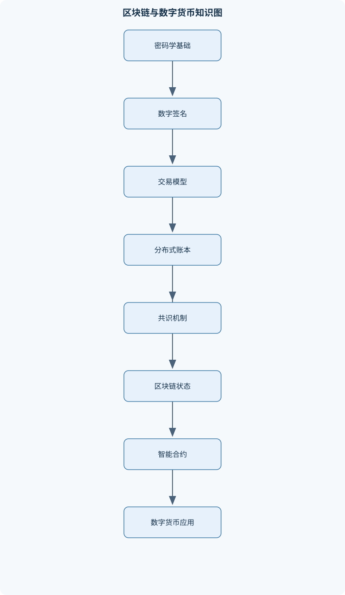
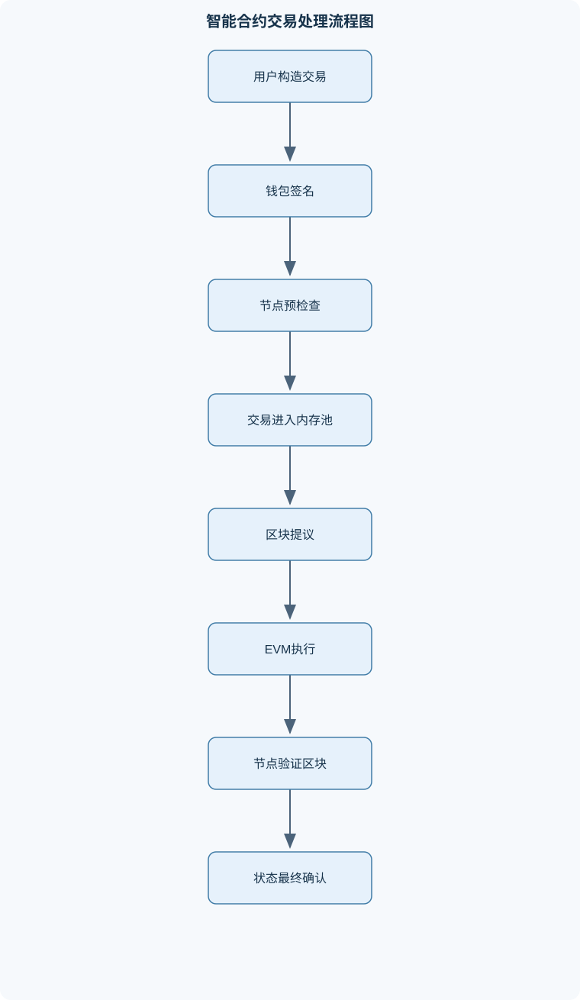

# 区块链与数字货币

## 一、课程整体知识框架

### 课程边界与先修知识

本课程系统讲授区块链与数字货币的密码学基础、分布式账本、共识机制、比特币与以太坊架构、智能合约与DApp开发、联盟链、扩展性与隐私技术、数字货币形态及行业应用。课程边界包括协议原理、数据结构、交易生命周期、执行环境、安全分析和应用架构，不以特定软件版本或单一平台操作为唯一目标。先修知识包括离散数学与概率基础、数据结构、计算机网络、操作系统基本概念、数据库与分布式系统基础、面向对象或脚本编程，以及公钥密码、数字签名和哈希函数的初步知识。课程区分公有链、联盟链和中心化数字货币系统，区分协议层安全性、智能合约代码安全性、钱包密钥安全性和业务数据真实性；不将链上不可篡改等同于现实世界信息天然真实，也不将数字货币等同于法定货币。





### 1. 课程对象、问题意识与知识主线

《区块链与数字货币》研究的是：在多个相互独立、可能互不信任的参与者之间，如何利用密码学、网络协议、分布式系统和经济激励，共同维护一份可验证的数字账本，并在此基础上实现数字资产转移、程序化交易和多方协作。

课程的核心问题不是“如何保存一枚数字货币”，而是如何解决数字信息可以被无限复制所导致的伪造、重复支付、状态冲突和责任追踪问题。数字签名能够证明某个私钥对一段交易内容作出了授权，但不能单独阻止同一笔资产被授权转移多次；分布式账本通过节点间的交易传播、验证和共识，确定哪些状态变化被系统接受；共识机制则在节点故障、恶意行为和网络延迟条件下，规定系统如何选择唯一或可接受的账本历史。

课程按照“信任问题—密码学工具—数据结构—交易执行—共识与网络—应用系统—安全边界”的逻辑展开。货币与支付问题说明区块链为何产生，密码学说明参与者如何在不共享秘密的情况下进行授权和数据承诺，账本模型说明交易如何改变系统状态，共识机制说明多个节点如何对状态顺序形成判断，智能合约说明账本如何执行程序，应用模块则分析这些技术在企业协作、支付、金融和数据存证中的适用边界。

### 2. 货币、信任与数字支付问题

货币具有交易媒介、价值尺度和价值储藏等功能。金属货币的价值与材料稀缺性、铸币权和社会接受度有关；法定货币主要依赖国家信用、法律制度、税收能力和货币政策维持广泛接受。数字货币并不是一个单一类别：原生加密资产由某一区块链协议发行或记录，代币化资产代表现实资产或合同权利，稳定币通常试图通过储备、抵押或算法机制维持相对稳定的计价关系，中心化数字货币系统则由特定发行机构和运营机构负责结算。

传统电子支付通常依赖银行、支付机构或清算平台作为可信第三方。该结构能够集中处理账户余额、撤销、争议和合规，但也形成单点控制、运营依赖、数据集中和跨机构协作成本。电子现金面临的关键问题是“双重支付”：同一数字凭证可以被复制，用户可能将其同时发送给不同收款方。因此，系统必须在支付发生时判断某项价值是否已经被使用，或者由中心化机构维护唯一余额状态。

区块链采用不同的信任组织方式。公有链通常允许开放参与者读取数据、提交交易或参与共识，安全性依赖密码学、共识规则和经济激励；联盟链只允许经过许可的机构加入，成员身份和治理规则更明确，适合组织间协作；中心化数字货币系统由单一或少数受监管机构维护核心账本，通常能够获得较高吞吐量和明确的责任主体。三者不能仅按“是否使用区块链”分类，还应比较开放性、身份体系、结算最终性、隐私、治理和故障模型。

数字签名解决的是“谁授权了这笔交易”和“交易内容是否被修改”，分布式账本解决的是“全体参与者接受哪组状态变化”，经济激励解决的是“参与者为什么按照协议行动”。若只有签名而没有全局状态共识，攻击者仍可能把同一资产转给多个对象；若只有账本复制而没有授权机制，任何节点都可能伪造他人交易。因此，区块链系统的信任来自密码学证明、节点验证、共识规则和治理机制的组合，而不是来自某一个单独技术。

### 3. 密码学与密钥管理基础

密码学模块包括哈希函数、公钥密码、数字签名、地址编码和密钥管理。哈希函数记为 $H(m)$，其中 $m$ 是任意长度的消息，输出通常是固定长度的摘要。以 SHA-256 为例，输出长度为 256 bit，通常表示为 64 个十六进制字符，因为每个十六进制字符表示 4 bit。哈希函数的工程用途包括数据承诺、区块引用、交易集合摘要、索引和完整性检测。

哈希安全性至少包括抗原像性、抗第二原像性和抗碰撞性。抗原像性要求已知摘要后难以构造满足 $H(m)=h$ 的消息；抗碰撞性要求难以找到两个不同消息 $m_1\ne m_2$ 使 $H(m_1)=H(m_2)$。哈希函数并非数学意义上的绝对无碰撞函数，因为任意长度输入映射到有限长度输出必然存在碰撞；工程安全依赖输出长度、算法设计、实现质量和攻击成本。哈希值相同也不能自动证明两份数据具有相同业务含义，编码、字段顺序和序列化规则必须一致。

公钥密码使用一对关联密钥：私钥记为 $sk$，公钥记为 $pk$。私钥用于生成签名，公钥用于验证签名，通常表示为：

$$
s=Sig_{sk}(m)
$$

$$
Verify_{pk}(m,s)=\text{true}
$$

签名验证成立，说明与 $pk$ 对应的私钥能够对消息 $m$ 生成有效授权；但这不等于已经确认持钥者的现实身份，也不保证交易对象、商品质量或业务目的真实。地址 $Addr$ 通常由公钥或公钥哈希经过协议规定的编码得到，地址是账本中的标识，不天然等同于姓名、组织或实名账户。

密钥生成需要高质量随机数。随机数可预测、助记词泄露、备份被复制、恶意软件读取热钱包或权限配置错误，都可能导致资产控制权丢失。钱包不是存放链上货币的容器，而是管理私钥、地址、交易构造、签名和余额查询的工具；链上资产状态记录在账本中，私钥决定谁能发起符合协议的状态转移。热钱包便于频繁使用但暴露面较大，冷钱包减少在线攻击面但会增加签名和恢复管理的操作要求，多重签名则要求多个私钥共同授权，可用于权限分离和组织治理。

### 4. 区块链数据结构与账本模型

区块链由交易、区块和全局状态共同构成。交易 $Tx$ 描述一次状态转移，可能包含发送方、接收方、价值、数据、费用、Nonce、签名或输入输出。区块 $B_i$ 通常包括区块头和区块体。区块头包含前一区块哈希、交易集合承诺、时间信息、难度或共识相关字段；区块体包含经过协议规则组织的交易集合。

若当前区块保存：

$$
PrevHash_i=H(B_{i-1})
$$

则修改 $B_{i-1}$ 中任何会影响其序列化内容的字段，都会使新的哈希与后继区块记录的 $PrevHash_i$ 不一致。攻击者需要重新构造受影响区块及其后的区块，并重新满足相应共识条件。因此，链式哈希提高了历史篡改成本。但该结论依赖哈希函数抗碰撞、节点拒绝无效链以及诚实节点遵守协议；它不意味着数据在现实世界中绝对不可改变，也不能阻止治理升级、密钥泄露或共识攻击造成状态重组。

Merkle 树将交易哈希作为叶节点，并递归计算内部节点。例如四笔交易 $A,B,C,D$ 的叶哈希为 $H(A),H(B),H(C),H(D)$，根可以按以下方式计算：

$$
R=H\big(H(H(A)\Vert H(B))\Vert H(H(C)\Vert H(D))\big)
$$

其中 $\Vert$ 表示拼接。验证交易 $C$ 时，只需提供 $H(D)$、左侧子树的哈希以及方向信息，逐层计算根并与可信的 $MerkleRoot$ 比较。若叶节点数为 $N$，证明路径长度通常为 $O(\log N)$。Merkle 证明只能说明某数据被纳入一个已承诺的集合，不能证明该数据对应的商品、身份或现实事件真实发生。

账本模型主要包括未花费交易输出模型和账户模型。未花费交易输出模型中，交易输入引用过去尚未消费的输出，交易输出规定新的可支配金额和锁定条件；验证重点是输入是否存在、是否已消费、签名是否满足锁定条件以及输入总额是否足以覆盖输出和费用。账户模型直接维护账户余额、Nonce、合约代码和存储，交易作用于全局状态 $state$，形成：

$$
state' = state+\Delta state
$$

以太坊类系统还使用状态树或 Merkle Patricia Trie 对账户、存储和交易结果进行承诺，使节点能够验证状态根的一致性。区块记录的是一批交易及其执行结果，世界状态则是这些交易按顺序执行后的当前状态；区块、交易和状态不能相互替代。

### 5. 比特币协议与工作量证明

比特币通过点对点网络传播交易和区块。节点收到交易后，先检查格式、签名、输入引用、未花费状态、脚本条件、金额和锁定规则，再将有效交易转发给邻居。矿工从交易池选择交易，构造候选区块，计算交易集合的 Merkle 根，并不断改变区块头中的 Nonce 或其他可变字段，使区块哈希满足目标条件：

$$
H(header)<Target
$$

Target 是协议规定的目标阈值，目标越小，满足条件越困难。单次哈希尝试的计算量近似为常数，期望尝试次数与 $Target$ 的倒数相关。挖矿不是证明交易内容“有价值”，而是证明参与者为寻找满足条件的区块头消耗了计算资源。

最长有效链规则准确地说是累计工作量最多的有效链，而不是简单比较区块数量。若攻击者控制的算力比例为 $q$，诚实算力比例为 $p=1-q$，通常在 $q<p$、算力短期稳定、区块发现近似独立和网络规则不变的条件下，交易得到更多后续区块后，其历史被改写的概率下降。若交易后已有 $z$ 个后续区块，可令：

$$
\lambda=\frac{zq}{p}
$$

再以攻击者在相应时间内挖出 $k$ 个区块的泊松概率，加总其从当前差距追赶成功的条件概率，得到 $P_{success}(q,z)$ 的近似估计。该模型是概率模型，不是绝对安全阈值；当 $q\ge p$、网络发生严重分区、攻击者能够审查交易或系统规则改变时，结论不能直接套用。

比特币交易还受到区块空间限制。交易通过手续费竞争有限的区块资源，手续费高低会影响进入区块的优先级，但不改变交易本身的授权逻辑。比特币脚本是受限执行模型，主要用于表达支付条件和验证签名，不等同于具备复杂通用状态的智能合约平台。

### 6. 共识机制与分布式容错

共识问题是：多个节点在可能出现故障、延迟或恶意行为时，如何对同一组请求的顺序或结果形成一致判断。崩溃故障表示节点停止运行或不再响应；拜占庭故障则允许节点发送矛盾消息、伪造内容或主动误导其他节点。两类故障模型不能混用。

工作量证明依靠计算资源和累计工作量形成开放网络中的链选择，通常具有概率性最终性，资源消耗较大。权益证明让验证者抵押权益，由其提议区块、发送证明或投票；恶意签署冲突区块、违反协议或长期不履责，可能受到惩罚。委托权益证明由权益持有者选择代表节点，提升协调效率，但会引入代表集中、治理捕获和投票权集中的风险。

Raft主要用于崩溃故障容错的复制状态机。集群规模为 $2f+1$ 时，通常最多容忍 $f$ 个崩溃节点，前提是剩余节点能够通信并形成多数。Raft不能直接抵御恶意节点伪造消息。PBFT类协议针对拜占庭故障，通常要求：

$$
n\ge 3f+1
$$

其中 $n$ 为节点总数，$f$ 为最多可容忍的拜占庭节点数。其典型流程包括主节点预准备、节点准备和提交，通过法定人数交集避免两个冲突值同时获得有效提交。该结论还依赖消息认证、视图切换和网络最终恢复等条件，且基础通信量通常随节点数量平方增长，不适合无限开放网络。

共识机制需要同时分析安全性、活性和最终性。安全性要求诚实节点不接受相互冲突的结果；活性要求系统在合理网络条件下持续处理请求；最终性表示交易一旦确认后是否能够确定不被回滚。提高最终性或节点许可程度，可能牺牲开放性；提高吞吐量，可能增加传播延迟、节点成本和分叉风险。

### 7. 以太坊架构与 EVM 执行环境

以太坊由节点、执行客户端、共识客户端、验证者、点对点网络、交易池、区块链账本和状态机组成。外部账户由私钥控制，合约账户由代码和存储控制。交易可以向外部账户转账、部署合约或调用合约函数。区块按顺序包含交易，节点重新执行交易并检查执行结果、状态根和共识证明。

EVM 是确定性虚拟机。相同初始状态、相同交易和相同协议参数，所有验证节点必须得到相同的状态变化。因此，合约执行不能依赖验证节点各自的本地文件、网络访问、未共识的随机数、实现差异或浮点数环境。需要现实数据时，应通过预言机或协议内已达成共识的数据输入，但预言机本身构成新的信任边界。

Gas 是 EVM 计算、存储和调用资源的计量单位，不是代币数量。若实际消耗量为 $g_{used}$，每单位 Gas 的有效价格为 $P_{gas}$，则费用可表示为：

$$
Fee=g_{used}\times P_{gas}
$$

若 $g_{used}=50000$、$P_{gas}=20$ Gwei，则：

$$
20\text{ Gwei}=20\times10^{-9}\text{ ETH}
$$

$$
Fee=50000\times20\times10^{-9}=0.001\text{ ETH}
$$

$g_{limit}$ 是用户为单笔交易设定的资源上限，区块也有整体资源上限。Gas 耗尽通常导致本次执行的状态修改回滚，但已消耗的计算资源不必然退还；具体费用规则取决于协议机制。交易执行还要检查签名、Nonce、余额和费用上限，余额不足以覆盖转账金额与最大预留费用时，交易不能按正常状态转换执行。

### 8. 智能合约与 DApp 开发

智能合约通常包含状态变量、函数、权限规则、事件和错误处理逻辑。部署合约的交易将创建运行时代码并产生合约地址；ABI 描述函数名称、参数类型、返回值和事件格式，是前端或其他程序与字节码交互的编码约定，不是源代码，也不是安全证明。

只读查询通常可以在本地模拟执行，不产生需要共识确认的状态修改；状态修改则需要构造交易、使用私钥签名、通过 RPC 广播、进入交易池并等待区块确认。前端、钱包、RPC 节点和合约各自承担不同职责：前端组织用户界面和调用参数，钱包管理授权和签名，RPC 提供节点访问接口，合约根据字节码执行状态转换。

事件日志用于将合约执行中的结构化信息提供给链下监听程序，但日志不能代替状态变量，也不能自动证明现实事件真实发生。权限控制必须明确管理员初始化、角色转移、权限撤销、升级权限和紧急暂停等边界。合约还必须检查重入、整数边界、外部调用、价格预言机、拒绝服务和初始化逻辑。

### 9. 联盟链与企业级区块链

联盟链是许可型网络，参与组织通常具有可验证的成员身份、证书和访问权限。其优势在于交易参与者范围明确、治理责任较清晰、共识效率通常高于开放公有链，但成员许可并不等于成员天然诚实，仍需考虑内部串谋、证书泄露、权限滥用和治理争议。

典型企业级架构区分 Peer、Orderer 和客户端。Peer 负责接收提案、模拟执行链码、进行背书、验证区块并更新账本；Orderer 负责对交易排序和切割区块，通常不负责执行链码；客户端负责提交请求并收集满足策略的背书。Fabric 类系统通常将逻辑账本与世界状态结合：区块链保存历史，世界状态保存当前可查询结果。

交易生命周期包括提案模拟、读写集生成、背书签名收集、排序打包、Peer 验证、版本检查和世界状态提交。若交易未满足背书策略、读写集版本冲突或证书权限检查失败，则交易可能记录在区块中但不更新有效世界状态。通道能够实现成员和账本隔离，多通道有利于隐私和组织边界管理，但会增加配置、运维和跨通道协作复杂度。

### 10. 安全、隐私与可扩展性

智能合约安全重点包括重入、整数溢出或下溢、权限绕过、未初始化、价格预言机操纵、拒绝服务、错误的升级代理和不安全外部调用。重入漏洞常见于合约先进行外部调用、后更新内部余额，攻击者可在回调期间重复进入。修复通常需要遵循“检查—生效—交互”顺序、使用重入锁或重新设计提款额度，并验证用户累计提款不超过可用余额这一状态不变量。

形式化验证通过规格、不变量和状态转换证明程序满足某些性质；模型检查则在有限状态或抽象模型中搜索反例。它们能够提高对特定性质的保证，但不能替代业务需求审查、编译产物核对、权限审查和现实环境测试。

链上公开数据可能暴露地址关联、交易时间、金额、交互对象和资产流向。零知识证明允许证明者证明某命题成立而不直接公开全部秘密，但不等于系统完全匿名；交易图和链下身份仍可能造成关联。同态加密允许在密文上进行特定计算，但通常存在计算开销大、密文膨胀和运算类型受限等问题。

扩展性技术包括分片、并行执行、状态通道、侧链、中继链和跨链桥。状态通道通过锁定资产、链下交换签名状态、链上结算或争议，实现大量中间交易链下处理，但参与者必须保存有效状态并在争议期内监控链上活动。跨链哈希锁定要求两条链支持兼容哈希和时间锁；跨链桥还要依赖验证者、公证人、中继证明、锁定合约和两条链的最终性，不能因为使用哈希就自动安全。

### 11. 数字货币形态与区块链应用

原生加密资产由区块链协议直接记录，代币化资产则试图表示法币、证券、票据、商品权益或其他合同关系。稳定币的风险分析应检查储备资产质量、资产与负债期限匹配、发行和赎回权限、流动性、治理、审计或证明机制以及法律安排。链上代币总量不能自动证明储备真实存在，也不能保证任何时刻都能按目标价格兑付。

中心化数字货币通常采用发行机构与运营机构分工的双层运营结构；钱包在不同系统中可能是密钥管理工具、账户访问工具或支付应用，不能仅凭“钱包”名称判断其法律和技术性质。跨境支付、供应链金融、数字票据、证券交易、电子存证和产品溯源都可能利用共享账本降低对账成本，但应用价值取决于参与者身份、数据来源、治理规则、性能和隐私。

供应链溯源尤其需要区分“上链后的完整性”和“上链前的真实性”。生产者、物流商或传感器把错误数据写入链后，区块链只能保证该错误记录未被协议随意修改，不能把错误自动变成事实。身份认证、传感器签名、异常审计、物理封装、数字孪生和多方交叉验证能够改善物理对象与数字记录的映射，但不能消除传感器造假、人工录入错误或现实权利争议。

### 12. 课程中的统一分析框架

分析任何区块链系统时，应依次回答六个问题：第一，系统维护的资产或状态是什么；第二，谁可以读取、提交和验证交易；第三，交易如何被签名、传播和执行；第四，节点如何判断区块或状态转换有效；第五，系统在何种故障模型下保证安全性和活性；第六，现实身份、外部数据和治理责任由谁承担。

课程还区分四类安全边界。协议层安全性关注共识、账本和网络是否能抵抗分叉、双重支付或恶意节点；智能合约代码安全性关注程序逻辑和状态不变量；钱包密钥安全性关注私钥生成、保存、备份和授权；业务数据真实性关注链下事实是否被正确采集、认证和映射。只有同时分析这四类边界，才能避免把“不可篡改”误解为“天然真实”，把“签名有效”误解为“现实身份已确认”，或把“数字货币”误解为法定货币。

## 二、章节和模块划分

### 核心知识覆盖清单

本清单用于检查正文是否覆盖本课程的主要知识模块：

- **货币、信任与数字支付问题**：货币的价值基础与信用关系、金属货币、法定货币与数字货币的差异、中心化支付中的信任第三方、电子现金的双重支付问题、数字签名解决伪造与授权、分布式账本解决状态共享、密码学信任与经济激励的结合、公有链、联盟链和中心化系统边界。
- **密码学与密钥管理基础**：哈希函数的输入输出特征、SHA-256的256位摘要表示、抗原像与抗碰撞性质、公钥密码与私钥控制权、数字签名的签名与验签流程、地址生成与身份表示、随机数质量与密钥生成风险、钱包是密钥管理容器而非货币存储处、热钱包、冷钱包与多重签名、密钥备份、恢复与权限分离。
- **区块链数据结构与账本模型**：交易输入输出与状态变化、区块头与区块体的组成、时间戳与前一区块哈希、链式结构的篡改传播效应、Merkle树的叶节点与内部节点、Merkle证明与对数级验证、账户模型与未花费交易输出模型、以太坊状态树与Merkle Patricia Trie、账本一致性与最终性、区块、交易和世界状态的关系。
- **比特币协议与工作量证明**：点对点网络与交易广播、交易验证与未花费输出、工作量证明的目标值、最长有效链规则、挖矿难度与区块发现概率、区块确认数与概率性最终性、双重支付攻击模型、算力多数攻击的条件、手续费与区块空间竞争、比特币脚本的受限执行模型。
- **共识机制与分布式容错**：共识问题与故障模型、崩溃故障和拜占庭故障、工作量证明的安全假设、权益证明与验证者抵押、验证者提议、证明与惩罚、委托权益证明的代表节点、Raft复制状态机、PBFT的三阶段消息流程、法定人数与容错边界、安全性、活性和最终性权衡。
- **以太坊架构与EVM执行环境**：节点、客户端与P2P网络、外部账户和合约账户、交易、状态和区块的关系、EVM字节码与虚拟机栈、确定性执行要求、Gas计量与交易费用、Gas限制与区块资源上限、执行失败时的原子性回滚、合约存储、内存和调用数据、主网、测试网与链标识。
- **智能合约与DApp开发**：Solidity合约的状态变量与函数、合约部署交易与运行时代码、ABI的接口描述作用、字节码、ABI与合约地址、call读取与send状态修改、交易签名与用户授权、事件日志与链下监听、前端、钱包、RPC和合约的协作、合约调用中的权限控制、链上链下数据协同。
- **联盟链与企业级区块链**：许可型网络与成员身份、Peer节点与Orderer节点、Fabric通道与逻辑账本、链码执行与世界状态、交易提案与背书策略、排序服务与区块切割、提交节点的验证与账本更新、Raft排序集群与领导者选举、多通道隔离与多账本管理、联盟链治理与访问控制。
- **安全、隐私与可扩展性**：重入、整数溢出与权限漏洞、预言机和现实数据输入风险、形式化验证与模型检查、链上公开数据的关联分析、零知识证明的知识隐藏、同态加密的计算特征、分片与并行执行、状态通道与链下结算、侧链、中继链与哈希锁定、跨链安全假设与桥接风险。
- **数字货币形态与区块链应用**：原生加密资产与代币化资产、稳定币的储备与兑付机制、中心化数字货币的双层运营、数字货币钱包与支付工具差异、跨境支付与结算场景、供应链金融与应收账款流转、数字票据与证券交易、电子数据存证与可验证时间线、产品溯源与物理对象映射、区块链应用的性能、隐私和治理边界。


### 第一章 货币、信任与数字支付问题

本章先解释货币的价值基础、信用关系和支付结算，再比较金属货币、法定货币、原生加密资产、代币化资产、稳定币与中心化数字货币。重点分析电子现金中的伪造和双重支付，说明数字签名只解决授权与完整性，分布式账本才进一步处理共享状态与重复支付。章节结论是：公有链、联盟链和中心化系统的差异，核心在于参与许可、信任主体、共识方式、治理责任和最终性，而不是是否存在一个名为“区块链”的数据库。

### 第二章 密码学与密钥管理基础

本章依次讲授哈希、SHA-256、公钥密码、数字签名、地址和钱包。通过 $H(m)$、$sk$、$pk$、$Sig_{sk}(m)$、$Verify_{pk}(m,s)$ 和 $Addr$ 建立统一符号。重点解释签名生成与验签流程、地址不等同于现实身份、随机数质量对密钥安全的影响，并比较热钱包、冷钱包、多重签名、备份恢复和权限分离。课程边界是：密码学证明能够约束数字操作，却不能替代身份认证、业务授权和现实世界事实核验。

### 第三章 区块链数据结构与账本模型

本章从交易输入输出、账户状态和区块组织开始，讲解区块头、区块体、时间字段、前一区块哈希和交易承诺。随后推导链式哈希的篡改传播效应，并用四叶节点示例说明 Merkle 树、Merkle 根和 $O(\log N)$ 成员证明。章节还比较 UTXO、账户模型、状态树和 Merkle Patricia Trie，明确区块记录交易历史、交易改变状态、世界状态表示当前可查询结果，三者在功能和验证方式上不同。

### 第四章 比特币协议与工作量证明

本章覆盖点对点网络、交易广播、未花费输出、脚本条件、区块构造、工作量证明、累计工作量选择和确认数。工作量证明部分说明 $H(header)<Target$ 的含义，区分目标阈值、难度、区块发现概率和算力比例。安全分析使用 $q$、$p=1-q$、$z$ 和 $\lambda=zq/p$ 的泊松近似，说明确认数增加只会降低追赶概率而不会产生绝对最终性。还讨论手续费、区块空间竞争、双重支付和算力多数攻击的条件边界。

### 第五章 共识机制与分布式容错

本章先定义共识、安全性、活性和最终性，再区分崩溃故障与拜占庭故障。工作量证明部分强调开放参与和概率性最终性；权益证明部分讲解验证者抵押、提议、证明和惩罚；委托权益证明部分分析代表节点与治理集中风险。Raft部分使用 $2f+1$ 的多数复制条件解释崩溃容错，PBFT部分使用 $n\ge3f+1$ 解释拜占庭容错，并说明预准备、准备、提交、法定人数和视图切换。章节重点是不能用节点数量公式脱离故障模型直接比较协议。

### 第六章 以太坊架构与 EVM 执行环境

本章分析节点、客户端、P2P 网络、交易池、账户、区块和世界状态之间的关系，区分外部账户与合约账户。EVM部分讲解字节码、栈、存储、内存、调用数据和确定性执行。Gas部分解释 $g_{used}$、$g_{limit}$、$P_{gas}$ 和 $Fee$ 的区别，分析资源耗尽、余额预检查、执行回滚和区块资源上限。章节还比较主网、测试网和链标识的作用，说明测试环境的交易和资产不能直接等同于生产环境状态。

### 第七章 智能合约与 DApp 开发

本章围绕合约状态变量、函数、部署交易、运行时代码、ABI、字节码和合约地址展开。随后分析只读调用与状态修改交易的差异，说明钱包签名、RPC 广播、节点执行、区块确认和事件监听如何协同。DApp架构包括前端、钱包、RPC、合约和链下服务，链上数据适合执行共识规则，复杂查询、文件和外部数据通常需要链下系统配合。安全部分重点处理权限控制、管理员初始化、权限转移、升级、重入、外部调用和事件一致性。

### 第八章 联盟链与企业级区块链

本章讲授许可型网络、成员身份、证书、组织治理和访问控制。以 Peer、Orderer、客户端、通道、链码和世界状态为主要概念，完整分析提案、模拟执行、读写集、背书、排序、区块切割、Peer 验证和账本更新。Raft排序集群部分说明领导者选举、日志复制和多数提交，强调其主要针对崩溃故障而非恶意节点。多通道能够实现账本隔离，但会带来配置同步、跨通道数据一致性和运维复杂度。

### 第九章 安全、隐私与可扩展性

本章建立从代码、数据到系统架构的安全分析框架。智能合约部分覆盖重入、整数边界、权限漏洞、预言机操纵、拒绝服务、升级和初始化；验证方法包括静态分析、单元测试、模糊测试、符号执行、模型检查、形式化验证和人工审查。隐私部分分析公开账本的关联推断、零知识证明和同态加密的适用边界。扩展性部分比较分片、并行执行、状态通道、侧链、中继链和跨链桥，综合评价 $TPS$、$Latency$、节点成本、数据可用性、最终性和安全假设。

### 第十章 数字货币形态与区块链应用

本章比较原生加密资产、代币化资产、稳定币、中心化数字货币和支付工具，重点分析发行主体、账本控制者、兑付关系、法律责任和风险承担。应用部分覆盖跨境支付、供应链金融、数字票据、证券交易、电子存证、产品溯源和数字孪生。每类应用均从参与者、资产或数据对象、交易流程、身份体系、隐私要求、性能约束和治理责任进行分析，避免把链上记录直接等同于现实权利或现实物品。

### 模块之间的递进关系

前两个模块回答“为什么需要数字信任”和“如何证明授权”；数据结构模块回答“如何组织并验证账本”；比特币和共识模块回答“多个节点如何选择历史”；以太坊模块回答“如何在账本上执行通用程序”；DApp与联盟链模块回答“如何构造可使用的应用系统”；安全、隐私与扩展性模块回答“系统在规模化和攻击条件下有哪些限制”；数字货币与行业应用模块则将协议能力映射到支付、金融、治理和实体业务。

在整个课程中，任何性能指标都不能脱离安全和治理条件单独评价。$TPS$ 表示单位时间处理的交易数量，$Latency$ 表示从提交到满足确认条件所需时间，二者会受到区块大小、出块间隔、网络传播、执行复杂度和节点配置影响。$TVL$ 表示锁定在协议中的资产价值，是应用规模指标，不等于协议安全性、储备真实性或偿付能力。通过这些统一概念，课程将协议原理、程序执行、经济激励和实际应用放在同一分析框架中。

## 三、核心概念的详细解释

### 1. 货币、信任与数字支付

货币的基本功能是交易媒介、价值尺度和价值储藏。金属货币依赖金属的稀缺性、可分割性和社会接受度；法定货币主要依赖发行机构的信用、法律制度、税收能力和宏观经济治理。数字货币不是单一概念，而是对不同发行主体、账本控制方式和权利关系的统称。

原生加密资产由区块链协议发行或记录，其转移规则由协议和共识节点执行；代币化资产试图在链上表示法币、证券、应收账款或其他权利，但链上代币是否真正对应链下资产，取决于发行、托管、审计和法律执行机制；稳定币通常通过法币或短期资产储备、超额抵押或其他稳定机制维持相对稳定的计价关系；中心化数字货币系统则由特定发行机构和运营机构维护核心账本，责任主体和撤销机制通常较为明确。

电子支付的核心困难是“双重支付”。数字信息可以被复制，用户可能将同一份支付凭证发送给多个收款人。中心化系统通过单一数据库或清算机构检查余额和支付顺序；区块链系统则通过交易验证、全网状态复制和共识规则，使节点对某项资产是否已经被消费形成一致判断。数字签名只能证明私钥持有者授权了某笔交易，不能单独证明交易没有被重复提交。

公有链、联盟链和中心化系统的差异不在于是否使用某一种数据库，而在于参与资格、身份体系、共识方式、治理主体和故障模型。公有链通常允许开放参与，依赖密码学、经济激励和公开验证；联盟链限制成员加入，适合已知机构之间的协作；中心化系统由单一或少数机构直接维护账本。联盟链也可能存在恶意成员，许可身份不能自动替代交易验证和审计。

### 2. 哈希、签名、地址与钱包

哈希函数将任意长度消息 $m$ 映射为固定长度摘要 $H(m)$。SHA-256 的输出长度为 256 bit，通常写成 64 个十六进制字符。哈希函数常用于区块引用、交易集合承诺、数据完整性检查和索引，但哈希值不是加密后的原文，不能依靠“解密哈希”恢复消息。

抗原像性是指给定摘要 $h$ 后，难以找到 $m$ 使 $H(m)=h$；抗第二原像性是指给定 $m_1$ 后，难以找到不同消息 $m_2$ 使二者摘要相同；抗碰撞性是指难以找到任意不同的 $m_1,m_2$ 满足：

$$
H(m_1)=H(m_2),\qquad m_1\ne m_2
$$

这些性质是计算困难性，而非逻辑上的绝对不碰撞。摘要长度、算法设计、实现质量和攻击者计算能力都会影响安全边界。

公钥密码体系中，$sk$ 表示私钥，$pk$ 表示对应公钥。数字签名过程可以表示为：

$$
s=Sig_{sk}(m)
$$

验证者使用公钥检查：

$$
Verify_{pk}(m,s)=\text{true}
$$

签名能够提供授权证明和消息完整性，但不能自动证明签名者的现实身份、交易目的、账户余额或链下资产真实性。若私钥被盗，攻击者可以生成形式上有效的签名；若随机数生成质量不足，某些签名算法可能泄露私钥。

$Addr$ 通常由公钥或公钥哈希经过协议规定的编码得到。地址是账本中的控制对象标识，不等同于自然人姓名、身份证明或法律主体。钱包的主要功能是保存和使用私钥、生成地址、构造交易、签名以及查询链上状态。链上资产记录在账本中，钱包保存的是控制这些记录所需的授权材料。

热钱包连接网络，使用方便但暴露面较大；冷钱包将密钥置于离线或隔离环境，适合降低在线攻击风险；多重签名要求多个密钥中的若干个共同授权，可以减少单个密钥泄露造成的损失。备份时必须保护助记词、私钥或恢复材料的机密性和完整性，并区分操作权限、审批权限和恢复权限。

### 3. 区块、交易和账本状态

在未花费交易输出模型中，交易输入引用此前交易产生的特定输出，交易输出规定新的金额和解锁条件。验证节点需要检查输入引用存在、尚未被使用、签名满足解锁条件，并验证输入总额不小于输出总额。差额通常表现为交易费用：

$$
Fee=\sum Value(in)-\sum Value(out)
$$

在账户模型中，交易通常包含发送方、接收方、价值、数据、Nonce 和费用参数。交易执行前后，全局状态分别记为 $state_{before}$ 和 $state_{after}$，状态变化为：

$$
\Delta state=state_{after}-state_{before}
$$

这里的减号表示状态映射的变化，不一定是数值逐项相减。交易可能改变余额、Nonce、合约存储和事件日志。

区块 $B_i$ 通常由区块头和区块体组成。区块头可包含前一区块哈希、交易集合的 Merkle 根、时间信息、共识相关字段等。前一区块哈希可表示为：

$$
PrevHash_i=H(B_{i-1})
$$

若修改 $B_{i-1}$ 中的交易，交易集合摘要和区块哈希通常都会改变，从而使 $B_i$ 中保存的 $PrevHash_i$ 失效。攻击者若要让修改后的历史继续成为有效链，必须重构受影响区块及其后继区块，并重新满足相应共识条件。该结论依赖哈希函数的抗碰撞性、节点对无效区块的拒绝以及共识规则仍然有效；它并不意味着历史在任何治理或密钥失陷情况下绝对不可改变。

Merkle 树把交易哈希作为叶节点，并递归计算内部节点。例如四笔交易 $A,B,C,D$ 的叶哈希为 $h_A,h_B,h_C,h_D$，则：

$$
h_{AB}=H(h_A\Vert h_B),\qquad h_{CD}=H(h_C\Vert h_D)
$$

$$
MerkleRoot=H(h_{AB}\Vert h_{CD})
$$

其中 $\Vert$ 表示按协议规定拼接。若交易数量为 $N$，成员证明通常只需提供从叶节点到根节点的兄弟哈希，路径长度为 $O(\log N)$。Merkle 证明只能证明某数据被纳入某个可信根承诺，不能证明该交易对应的现实业务事实真实。

以太坊等账户模型系统还需要维护世界状态。状态树或 Merkle Patricia Trie 将账户、合约存储等状态组织为可验证结构。区块承诺的是交易和执行结果，状态根反映交易执行后的全局状态。节点可以重新执行交易并检查状态根是否一致；这要求执行环境具有确定性。

### 4. 比特币工作量证明与概率性最终性

工作量证明要求矿工寻找满足条件的区块头，使：

$$
H(header)<Target
$$

$Target$ 是目标阈值，数值越小，满足条件越困难。每次改变 Nonce 或其他可变字段都相当于进行一次新的哈希尝试。单次尝试的计算量近似为常数，若单次成功概率为 $\pi$，期望尝试次数约为 $1/\pi$。难度调整的目标是使区块产生速度在算力变化时仍保持在协议设定范围附近。

比特币采用的是累计工作量最大的有效链，而不是简单比较区块数量。若攻击者控制的算力比例为 $q$，诚实算力比例为：

$$
p=1-q
$$

通常在 $q<p$ 且区块发现近似独立、算力比例短期稳定的条件下，某交易经过 $z$ 个后续区块确认后，被攻击者追赶的概率会下降。泊松近似令：

$$
\lambda=\frac{zq}{p}
$$

攻击者在对应时间内挖出 $k$ 个区块的概率为：

$$
P(K=k)=e^{-\lambda}\frac{\lambda^k}{k!}
$$

若攻击者已经挖出 $k<z$ 个区块，还需从差距 $z-k$ 追赶；其追赶概率可近似为 $(q/p)^{z-k}$。因此可使用：

$$
P_{success}(q,z)\approx
\sum_{k=0}^{z}
e^{-\lambda}\frac{\lambda^k}{k!}
\min\left(1,\left(\frac{q}{p}\right)^{z-k}\right)
$$

当 $k\ge z$ 时攻击者已经追平或领先，取成功概率为 1。该公式是模型估计，不是绝对安全阈值。网络传播延迟、交易费用、矿池行为、算力突变、协议规则变化和攻击者策略都会影响实际结果。当 $q\ge p$ 时，简单的“确认数越多风险越低”结论不再适用。

### 5. 共识机制、最终性与容错

分布式系统需要在多个节点之间确定同一状态顺序。崩溃故障是节点停止工作或丢失消息，但不主动伪造；拜占庭故障则允许节点发送矛盾消息、伪造结果或协同攻击。两种故障模型不能使用同一容错公式。

Raft 面向崩溃故障容错。节点通常处于 Follower、Candidate 或 Leader 状态。候选者通过获得多数票成为领导者，领导者通过日志复制和心跳维持控制。在规模为 $2f+1$ 的集群中，典型情况下可容忍 $f$ 个崩溃节点，但必须仍有多数节点可通信。Raft 不直接防御恶意节点篡改消息。

PBFT 类协议通常要求：

$$
n\geq 3f+1
$$

其中 $n$ 是副本总数，$f$ 是可容忍的拜占庭节点数。其基本流程包括主节点提出请求、节点广播准备消息、形成准备证书、广播提交消息并形成提交证书。法定人数通常取至少 $2f+1$，两个不同法定人数集合必然存在诚实节点交集，从而阻止同一序号同时提交两个冲突值。该结论依赖消息认证、节点身份可识别、协议实现正确以及网络最终恢复等条件。

权益证明由验证者抵押资产并承担验证、提议和证明责任。恶意行为可能导致抵押资产被削减，离线或懒惰行为也可能影响奖励或资格。具体抵押数量、惩罚规则和最终性规则属于协议参数，不能脱离协议版本概括为固定数值。委托权益证明则由代币持有者将权益委托给代表节点，代表节点数量较少，吞吐量可能提高，但治理集中和代表节点串谋风险也会增加。

### 6. EVM、Gas 与智能合约

以太坊系统由节点、执行客户端、共识客户端、P2P 网络、交易池、区块链账本和状态机组成。外部账户通常由私钥控制，合约账户由代码和存储状态控制。交易可用于转账、部署合约或调用合约函数。

EVM 是基于栈的确定性虚拟机。相同初始状态、相同交易和相同协议参数必须产生相同执行结果，否则不同节点将无法得到一致状态根。因此，合约执行不能依赖节点本地文件、互联网响应、未共识的本地时间、实现相关浮点数或不可验证随机数。

Gas 是计算、存储和调用资源的计量单位，不等于代币数量。若实际消耗为 $g_{used}$，每单位 Gas 的有效价格为 $P_{gas}$，则费用可表示为：

$$
Fee=g_{used}\times P_{gas}
$$

若 $g_{used}=50000$，$P_{gas}=20$ Gwei，且 $1$ Gwei=$10^{-9}$ ETH，则：

$$
Fee=50000\times20\times10^{-9}
=0.001\ \text{ETH}
$$

$g_{limit}$ 是用户允许交易消耗的最大 Gas；它影响资源上限和余额预检查，不等同于实际费用。若执行因 Gas 耗尽而失败，通常会回滚本次状态修改，但已经消耗的资源不必然退还。具体费用计算还取决于所使用的协议规则。

智能合约通常包含状态变量、函数、权限控制、事件和错误处理。ABI 描述函数参数、返回值和事件的编码方式，使前端能够构造调用数据和解析结果。ABI 不是源代码，也不是安全证明。只读调用通常可以在本地模拟，不产生链上状态变化；状态修改调用则需要构造交易、签名、广播、打包和确认。

### 7. 联盟链、隐私、扩展性与应用边界

联盟链通过成员证书、组织权限和治理规则限制网络参与者。典型交易过程包括客户端提交提案、背书节点模拟执行链码、收集满足策略的背书签名、排序服务形成区块、Peer 验证读写集和版本号，最后提交区块并更新世界状态。排序节点主要负责确定顺序，不等于执行链码；背书节点的模拟执行也不等于最终提交。

隐私技术解决的是不同层面的信息暴露问题。零知识证明允许证明者证明某个命题成立，而不公开证明所依赖的秘密；它不保证交易时间、金额、网络元数据或外围身份信息完全隐藏。同态加密允许在密文上进行特定计算，但通常存在计算开销、密文膨胀和支持运算有限等问题。链上公开数据还可能通过地址、时间和金额关联分析出用户行为。

扩展性技术包括分片、状态通道、侧链、中继链和跨链桥。分片通过拆分状态或交易处理范围提高并行度，但会增加跨分片通信和安全协调成本；状态通道把大量中间状态放到链下交换，链上处理开通、结算和争议；跨链桥的安全性取决于验证者集合、证明机制、锁定合约、两条链的最终性和密钥管理，不能因使用哈希锁就认为安全。

区块链应用的共同边界是：链上不可篡改只说明记录一旦被有效提交后较难被修改，不说明上链前数据真实。供应链溯源需要身份认证、传感器保护、人工审计和异常处理；数字孪生可以建立物理对象与数字对象的映射，但传感器造假、标签替换或对象转移仍可能破坏映射关系。$TVL$ 只能表示协议中锁定资产的规模，不能直接推出偿付能力、储备真实性或协议安全性。

## 四、重要定义、公式、定理和推导

### 专业审校补充：关键定义与适用边界

UTXO模型中，交易不是直接修改账户余额，而是销毁若干个此前未花费的输出，并创建新的输出。设输入金额为I，输出金额为O，则手续费为F=I−O，必须满足I≥O；若付款金额小于输入总额，差额必须显式生成找零输出，否则差额通常会被协议解释为手续费。每个UTXO只能被一笔已确认交易消费，验证节点必须检查其存在性、未花费状态、解锁条件和金额守恒。该模型便于并行验证、局部证明和追踪资金来源，但会产生大量小额UTXO，增加钱包管理和交易大小成本。账户模型则维护地址状态、余额和Nonce，转账通常直接更新状态。两者都不能单独解决现实身份真实性；UTXO的“未花费”也不等于交易已经获得不可逆最终性，若所在链发生分叉或重组，确认状态仍可能变化。


### 1. 哈希链篡改推导

设三个连续区块为 $B_1,B_2,B_3$，且：

$$
PrevHash_2=H(B_1),\qquad PrevHash_3=H(B_2)
$$

若攻击者修改 $B_2$ 中一笔交易，首先需要重新计算交易集合的 Merkle 根；随后 $B_2$ 的区块头改变，因而新的区块哈希也改变。此时 $B_3$ 中保存的旧 $PrevHash_3$ 与新 $H(B_2)$ 不一致，验证节点会拒绝该链。攻击者还需要修改 $B_3$，并继续修复其后所有区块，同时重新完成工作量证明或满足其他共识条件。

这个推导说明链式哈希能提高篡改成本，但不能独立决定哪条分支获得共识。若攻击者掌握足够算力、控制验证者密钥、利用协议漏洞或得到治理层认可，系统的实际安全性会改变。

### 2. Merkle 成员证明算法

**输入：**目标交易 $tx$、兄弟哈希路径、每一步的左右方向、可信的 $MerkleRoot$。  
**输出：**成员证明成立或失败。

```text
function VerifyMerkle(tx, path, root):
    current = Hash(EncodeLeaf(tx))

    for item in path:
        if item.direction == "left":
            current = Hash(item.hash || current)
        else:
            current = Hash(current || item.hash)

    return current == root
```

算法不变量是：循环每执行一步，`current` 都表示从目标叶节点向上计算得到的当前子树根。路径耗尽后，若 `current` 等于可信根，则证明该叶节点被纳入该根承诺。设交易数为 $N$，平衡树路径长度通常为 $O(\log N)$，验证所需哈希次数也为 $O(\log N)$。如果路径方向、叶节点编码或拼接规则错误，即使交易确实存在，也会验证失败。

**例题一：**区块中有 $A,B,C,D$ 四笔交易，要求验证 $C$ 是否属于区块。  
**分析：**需要 $h_D$ 和 $h_{AB}$ 两个兄弟节点。  
**步骤：**

1. 计算 $h_C=H(C)$；
2. 计算 $h_{CD}=H(h_C\Vert h_D)$；
3. 计算 $root'=H(h_{AB}\Vert h_{CD})$；
4. 比较 $root'$ 与区块头中的根。

若相等，证明成立；若不等，可能是交易内容、路径方向、哈希编码或可信根错误。变式是交换 $C,D$ 的方向，结果会改变，说明路径方向不是可省略信息。

### 3. 比特币交易验证流程

**输入：**交易 $Tx$、当前未花费输出集合、脚本规则、时间锁规则和费用规则。  
**输出：**有效或无效。

验证步骤如下：

1. 解析交易格式，检查字段长度和编码；
2. 对每个输入检查被引用输出是否存在；
3. 检查该输出是否已被其他有效交易消费；
4. 使用公钥验证签名和解锁脚本；
5. 检查输入金额总和不小于输出金额总和；
6. 检查锁定时间、序列号、脚本资源和交易大小；
7. 验证通过后，删除被消费输出并创建新输出。

核心不变量是同一未花费输出不能被两笔有效交易同时消费。验证复杂度取决于输入数量、脚本长度和 UTXO 索引查询成本。

**例题二：**一笔交易输入总额为 $3.0$ 个单位，输出分别为 $2.4$ 和 $0.5$ 个单位。  
**分析：**

$$
Fee=3.0-2.4-0.5=0.1
$$

**结果验证：**输入总额大于输出总额，因此金额守恒条件通过，费用为 $0.1$。若第二个输出误写为 $0.7$，则输出总额为 $3.1$，超过输入总额，交易无效。若两个交易同时引用同一个输入，即使两者签名都正确，也只能有一笔进入有效账本。

### 4. 工作量证明挖矿流程

**输入：**候选区块、交易集合、目标阈值 $Target$、Nonce 搜索范围。  
**输出：**满足条件的区块或搜索失败。

矿工首先验证交易并计算交易承诺，然后构造区块头。对每个候选 Nonce 计算：

$$
digest=H(header)
$$

若 $digest<Target$，则广播区块；否则改变 Nonce 或额外字段继续尝试。终止条件是找到有效结果、候选区块过期或搜索空间耗尽。单次哈希计算复杂度近似为 $O(1)$，期望尝试次数与成功概率的倒数成正比。

**例题三：**攻击者算力比例 $q=0.1$，诚实算力比例 $p=0.9$，交易后有 $z=3$ 个确认。  
**步骤：**

$$
\lambda=\frac{zq}{p}
=\frac{3\times0.1}{0.9}
=\frac13
$$

然后分别计算攻击者挖出 $k=0,1,2,3$ 个区块的泊松概率：

$$
P(K=k)=e^{-1/3}\frac{(1/3)^k}{k!}
$$

当 $k<3$ 时，乘以 $(q/p)^{3-k}$；当 $k=3$ 时，追赶概率取 1，最后求和。该结果是基于稳定算力和独立出块假设的模型估计，不是保证安全的固定阈值。变式是令 $q=0.6$，此时 $q>p$，不能直接套用“增加确认数即可快速降低风险”的解释。

### 5. EVM 交易执行与 Gas

**输入：**签名交易、账户状态、合约字节码、协议参数。  
**输出：**状态变化、日志、返回值或执行失败。

节点先检查签名、Nonce、余额和费用上限，然后执行转账、合约创建或函数调用。EVM 按指令执行并消耗 Gas，若执行正常，则写入余额、存储、Nonce 和日志；若显式回退或 Gas 耗尽，通常撤销本次状态修改，但已消耗 Gas 不必然退还。

**例题四：**$g_{used}=50000$，Gas 价格为 $20$ Gwei。  
**解答：**

$$
20\ \text{Gwei}=20\times10^{-9}\ \text{ETH}
$$

$$
Fee=50000\times20\times10^{-9}
=0.001\ \text{ETH}
$$

若 $g_{limit}=80000$，它表示最多允许消耗 80000 个 Gas，不表示一定支付 $80000\times20$ Gwei。正常成功执行通常按实际消耗计费；若实际消耗超过上限，执行可能因资源不足而失败。

**例题五：**账户余额为 $0.02$ ETH，转账金额为 $0.019$ ETH，Gas 上限为 $50000$，Gas 价格为 $20$ Gwei。  
**分析：**

最大预留费用为：

$$
Fee_{max}=50000\times20\times10^{-9}
=0.001\ \text{ETH}
$$

账户所需最大余额为：

$$
0.019+0.001=0.020\ \text{ETH}
$$

因此在不考虑其他保留余额和协议特殊规则的情况下，余额刚好满足预检查。若转账金额改为 $0.0191$ ETH，则最大需求为 $0.0201$ ETH，余额不足，交易不能按正常状态转换执行。变式是实际只消耗 30000 Gas，最终费用可能为 $0.0006$ ETH，但账户仍可能在提交前按上限进行余额检查。

### 6. 智能合约权限与重入分析

一个只允许管理员修改参数、允许所有地址读取参数的合约，至少需要区分状态读取函数、状态修改函数和管理员变量。管理员修改函数必须检查调用者权限，权限转移必须经过明确授权，并处理管理员未初始化、错误转移和恢复机制。

重入风险通常发生在“先进行外部调用，后更新内部状态”的路径。设用户余额为 $b$，提款函数先向用户发送金额 $x$，再将余额更新为 $b-x$。如果外部地址在收到资产时回调提款函数，内部余额仍是旧值，攻击者可能重复提款。修复方式包括先更新状态再外部交互、使用重入锁、限制单次提款和采用拉取式支付。修复后的关键不变量是：

$$
\text{累计提款额}\leq\text{用户可用余额}
$$

**实验一：合约安全审查。**

- **输入数据：**一份包含管理员修改、提款、价格读取和升级入口的合约，另有业务规格说明。
- **步骤：**先画出资产流和权限流；标记所有外部调用；检查状态更新顺序、整数边界、价格来源、初始化函数和升级权限；使用静态分析、单元测试、模糊测试和人工审查交叉验证；修复后重新执行回归测试。
- **评价标准：**不得存在未授权资产转移；提款不变量成立；管理员初始化唯一且可验证；预言机异常有处理路径；修复前后的业务功能均通过测试。
- **排错方法：**若测试未复现重入，检查测试账户是否为合约地址、回调是否真正触发、余额更新是否位于外部调用之后；若静态工具报警过多，应结合可达路径和业务状态筛选，而不能把所有警告直接当作可利用漏洞。

### 7. Raft 与 PBFT 容错计算

**例题六：**集群有 7 个节点，问最多可容忍多少个拜占庭节点。  
**解答：**

PBFT 要求：

$$
n\geq3f+1
$$

代入 $n=7$：

$$
7\geq3f+1
\Rightarrow f\leq2
$$

因此最多可容忍 2 个拜占庭节点。不能使用崩溃故障常见的 $2f+1$ 公式替代。若题目改为 Raft 集群且节点只发生崩溃故障，7 个节点通常可容忍 3 个崩溃节点，但必须仍有 4 个节点能够通信并形成多数。

**实验二：联盟链交易生命周期验证。**

- **输入数据：**两个背书节点、一项背书策略、一个客户端交易请求、成员证书和读写集。
- **步骤：**客户端提交交易提案；背书节点验证身份并模拟链码；节点返回读写集和签名；客户端收集满足策略的背书；排序服务按通道排序并切割区块；Peer 检查背书、读写集版本和权限；验证通过后提交区块并更新世界状态。
- **评价标准：**缺少必要背书的交易不得更新状态；读写集版本冲突时必须拒绝；无效证书或越权调用不得提交；合法交易在网络稳定时能够完成确认。
- **排错方法：**若提案执行失败，先检查链码参数和调用者权限；若背书不足，检查策略配置和证书组织；若排序成功但状态未更新，检查 Peer 的版本验证、通道配置和读写集冲突；若各节点状态不一致，检查区块顺序、提交日志和客户端版本兼容性。

### 8. 跨链哈希锁定流程

设双方共享哈希值：

$$
h=H(s)
$$

其中 $s$ 是秘密值。甲在链一锁定资产，乙在链二用相同 $h$ 锁定资产，并设置不同期限。任一方公开 $s$ 领取资产后，另一方可以在更长的有效期限内观察并使用同一个 $s$ 领取另一链资产。若未在期限内完成，资产按照时间锁退款。

该流程的输入包括两条支持兼容哈希和时间锁的链、秘密值哈希、锁定金额和期限；输出是原子完成或超时退款。关键不变量是两边的领取条件都要求同一秘密值。适用边界包括参与者能够及时监控链上状态、时间锁存在足够间隔、两条链的交易最终性可靠。若一方离线、时间锁过短、链发生重组或合约实现存在缺陷，原子性可能受到影响。

## 五、算法、流程和实现思路

### 方法与流程覆盖索引

下列方法或流程应在正文中说明输入、步骤、适用条件、结果检查和边界：

- 比特币交易验证流程：输入为交易、当前未花费输出集合和协议规则；输出为有效或无效。依次解析交易格式，验证每个输入引用存在且未花费，验证签名和脚本条件，检查输入总额不小于输出总额，检查费用、锁定时间及大小规则；验证成功后将输入标记为消费并创建新输出。不变量是同一未花费输出不能被两笔有效交易同时消费；终止条件是所有输入和规则检查完成；复杂度通常与输入数量、脚本长度和索引查询成本有关。
- 工作量证明挖矿流程：输入为候选区块、目标阈值和不断变化的Nonce；输出为满足$H(header)<Target$的区块或搜索失败。构造区块头和交易集合，计算区块交易承诺，循环改变Nonce或额外字段并计算哈希，找到满足目标的结果后广播；不变量是候选区块中的交易必须先通过验证；终止条件是找到有效Nonce、达到搜索边界或候选区块过期；单次尝试的哈希计算复杂度为$O(1)$，期望尝试次数约与$Target$的倒数成反比。
- Merkle证明验证流程：输入为目标交易、Merkle路径、叶节点规则和可信根；输出为成员证明成立或不成立。先按协议计算交易叶哈希，再按路径方向依次拼接兄弟哈希并重新哈希，最终比较计算根与可信根；不变量是每一步都保留从目标叶到当前子树根的承诺；终止条件是路径耗尽；时间复杂度为$O(\log N)$，空间复杂度为$O(1)$至$O(\log N)$，取决于是否保存完整路径。
- 以太坊交易与合约调用流程：输入为签名交易、发送账户状态、合约代码和协议参数；输出为状态根变化、日志、返回值或执行失败。节点先验证签名、Nonce、余额和费用上限，再执行账户转账或合约创建，按EVM指令消耗Gas，更新存储、余额和Nonce，生成日志并由共识流程确认；不变量是执行过程中每一步都遵守账户状态转换规则；终止条件是执行完成、显式回退或Gas耗尽；复杂度与字节码执行步数和存储访问数量相关。
- Solidity合约安全审查流程：输入为合约源代码、编译产物、接口和业务规格；输出为风险清单、影响等级和修复建议。先确认资产流、权限角色和不变量，再检查外部调用、重入、整数边界、价格预言机、升级权限、拒绝服务和初始化逻辑，结合静态分析、单元测试、模糊测试、符号执行和人工审查，最后验证修复不会破坏业务不变量；终止条件是规则覆盖达到预设范围并完成回归测试；复杂度取决于代码规模和分析工具，形式化验证可能具有较高计算成本。
- Fabric交易流程：输入为客户端交易请求、通道配置、背书策略和成员证书；输出为提交或拒绝的区块交易。客户端通过Gateway发送提案，背书节点模拟执行链码并返回读写集和签名，客户端收集满足策略的背书后提交排序服务，排序节点按通道排序并切割区块，Peer验证背书、读写集版本和权限后提交区块并更新世界状态；不变量是未通过背书或版本检查的交易不能更新状态；终止条件是区块提交完成或验证失败；网络通信复杂度与背书节点数量、排序集群规模和区块大小相关。
- Raft领导者选举流程：输入为节点集合、任期号、选举超时和日志；输出为当前任期领导者或重新选举。节点初始为Follower，超时后转换为Candidate并递增任期，向其他节点请求投票，获得多数票后成为Leader并发送心跳；若发现更高任期则退回Follower；不变量是每个任期最多产生一个合法领导者，日志匹配规则限制冲突覆盖；终止条件是形成多数票或发现更高任期；消息复杂度通常为选举阶段$O(n^2)$，稳定状态心跳每轮约为$O(n)$。
- PBFT共识流程：输入为客户端请求和$n\geq3f+1$个副本节点；输出为已提交请求或超时视图切换。主节点广播Pre-prepare，备份节点验证并广播Prepare，节点收集至少$2f+1$个一致Prepare后进入Commit，再收集至少$2f+1$个一致Commit并回复客户端；不变量是不同请求不能在同一序号形成两个有效提交证书；终止条件是获得提交法定人数或触发视图切换；基础通信复杂度通常为$O(n^2)$，不适合节点规模无限扩大的开放网络。
- 跨链哈希锁定流程：输入为两条链、秘密值哈希$h=H(s)$、时间锁和双方交易；输出为原子完成或超时退款。双方分别锁定资产并公布相同哈希条件，任一方使用秘密值$s$领取时，另一方可在期限内观察$s$并领取另一链资产，若超时未揭示则按时间锁退款；不变量是领取条件始终要求同一秘密值；终止条件是成功领取或两个时间锁均到期；适用条件是两条链支持兼容哈希和时间锁，且参与者能及时观察链上状态。





### 1. 区块链交易验证与状态更新流程

区块链交易验证的目标，是判断一笔交易是否满足协议规定，并在验证成功后产生唯一、可复现的状态变化。输入包括待验证交易 $Tx$、当前账本状态、未花费交易输出集合或账户状态、协议参数以及签名验证算法；输出是“有效”或“无效”，有效交易还会产生新的状态 $\Delta state$。

在未花费交易输出模型中，交易输入引用此前交易的某个输出，交易输出包含金额和新的锁定条件。验证节点依次执行以下步骤：

1. **解析交易格式。** 检查字段是否完整，数值编码是否符合协议要求，交易大小是否超过限制。
2. **检查输入引用。** 对每个输入查找其引用的输出，确认该输出存在且尚未被消费。
3. **验证授权条件。** 使用交易中提供的公钥、签名或脚本数据验证其是否满足输出的锁定条件。
4. **检查金额守恒。** 设所有输入金额之和为 $V_{in}$，所有输出金额之和为 $V_{out}$，通常要求：
   $$
   V_{in}\geq V_{out}
   $$
   差额可作为交易费。若存在溢出、负数或超过协议允许范围的金额，交易无效。
5. **检查时间和上下文条件。** 包括锁定时间、序列号、交易版本、脚本资源限制以及其他协议规则。
6. **更新临时状态。** 验证成功后，将输入引用的旧输出标记为已消费，并创建新的未花费输出。

该流程的不变量是：同一个未花费输出不能同时被两笔有效交易消费。终止条件是所有输入和规则检查完成，或某一步发现错误立即拒绝。若使用哈希索引查找输出，验证成本通常与输入数量、脚本长度和索引访问成本有关；不能简单认为所有交易验证都是常数时间。

账户模型不保存一组独立的未花费输出，而是保存账户状态，例如余额、Nonce、代码和存储。账户模型中的交易一般包含发送方、接收方、价值、数据、Nonce、Gas上限和Gas价格等字段。节点先验证签名、Nonce和余额，再执行状态转换：

$$
state' = Apply(state,Tx)
$$

其中 $state$ 是执行前的全局状态，$Tx$ 是交易，$state'$ 是执行后的状态。若交易执行失败，通常回滚本次状态修改，但已经消耗的执行资源不必然退还。

#### 伪代码：账户交易预检查与状态转换

```python
# Python 风格伪代码：只演示本地验证逻辑，不连接网络，也不修改真实账本

def validate_transaction(tx, state, verify_signature):
    """
    tx:
        sender, receiver, value, nonce, gas_limit,
        gas_price, data, signature
    state[sender]:
        balance, nonce
    返回：验证结果和原因
    """

    if tx.value < 0 or tx.gas_limit <= 0 or tx.gas_price < 0:
        return False, "数值范围非法"

    if not verify_signature(
        public_key=state[tx.sender].public_key,
        message=tx.signing_payload(),
        signature=tx.signature
    ):
        return False, "签名无效"

    account = state.get(tx.sender)
    if account is None:
        return False, "发送账户不存在"

    if tx.nonce != account.nonce:
        return False, "Nonce不匹配"

    max_fee = tx.gas_limit * tx.gas_price
    required = tx.value + max_fee
    if account.balance < required:
        return False, "余额不足以覆盖转账和最大费用"

    return True, "预检查通过"


def apply_transaction(tx, state, gas_used):
    """
    假设交易已经通过预检查且执行结果成功。
    gas_used 必须不超过 gas_limit。
    """
    sender = state[tx.sender]
    receiver = state[tx.receiver]

    actual_fee = gas_used * tx.gas_price
    total = tx.value + actual_fee

    if sender.balance < total:
        raise ValueError("执行阶段余额不足")

    sender.balance -= total
    sender.nonce += 1
    receiver.balance += tx.value

    return state
```

这里的关键边界是：`gas_limit` 是用户允许的最大资源量，不等于实际费用；实际费用通常为：

$$
Fee=g_{used}\times P_{gas}
$$

其中 $g_{used}$ 是实际消耗的 Gas 数量，$P_{gas}$ 是每单位 Gas 的有效价格。若执行需要的 Gas 超过 $g_{limit}$，交易可能因资源不足而失败；失败并不表示节点没有消耗计算资源。

### 2. 工作量证明挖矿与确认流程

工作量证明用于让开放网络中的节点在缺少中心协调者时，对区块顺序形成概率性共识。输入包括候选区块、区块头字段、目标值 $Target$ 和可变化的 Nonce；输出是满足条件的区块，或者在候选区块过期前未找到有效结果。

矿工首先收集并验证交易，构造交易集合和 Merkle 根，再生成区块头。区块头通常包含前一区块哈希、Merkle 根、时间戳、难度目标和 Nonce。矿工不断改变 Nonce 或其他允许变化的字段，计算区块头哈希，直到满足：

$$
H(header)<Target
$$

哈希函数输出近似均匀随机，因此单次尝试成功的概率约与目标值成正比，目标值越小，挖矿越困难。若候选区块包含无效交易，即使哈希满足条件，其他节点也会拒绝该区块。

挖矿流程的不变量是：候选区块中的交易必须先满足协议规则，区块头中的 Merkle 根必须对应区块交易集合，前一区块哈希必须正确。终止条件包括找到有效 Nonce、候选区块被新链替代、交易集合变化或达到搜索边界。单次哈希尝试通常为 $O(1)$，但成功前的期望尝试次数由目标值决定。

节点收到多个有效分支时，不是简单选择“区块数量最多”的链，而是按照协议选择累计工作量最大的有效链。若诚实算力比例为 $p$，攻击者算力比例为 $q$，且 $p=1-q$、$q<p$，则交易后连接的区块数 $z$ 越多，攻击者追赶成功概率通常越低。泊松近似中可令：

$$
\lambda=\frac{zq}{p}
$$

再对攻击者已经挖出 $k$ 个区块的概率与其追赶概率求和。该模型假设算力比例短期稳定、区块发现近似独立、网络规则不变，不能当作所有系统中的绝对安全阈值。

### 3. Merkle 树构造与成员证明验证

Merkle 树把一组交易压缩为一个根哈希 $MerkleRoot$。设叶节点为交易哈希：

$$
L_i=H(Tx_i)
$$

相邻叶节点递归合并：

$$
P_i=H(L_{2i}\Vert L_{2i+1})
$$

其中 $\Vert$ 表示按协议规定的拼接。若叶节点数不是 2 的整数次幂，协议必须规定补齐、复制最后节点或其他处理方式，否则不同实现可能计算出不同根。

成员证明的输入包括目标交易、从叶到根的兄弟哈希路径、每层的左右方向以及可信的根哈希；输出是证明成立或不成立。验证者先计算目标交易叶哈希，再按照路径方向依次拼接兄弟节点并哈希，最后比较计算出的根与可信根。

若交易总数为 $N$，平衡树的路径长度通常为 $O(\log N)$。因此，轻节点不需要保存全部交易即可验证某交易是否被纳入区块。但 Merkle 证明只能证明“该数据属于某个已承诺集合”，不能证明交易内容对应的现实业务事实，也不能证明交易本身已经完成最终结算。

### 4. EVM 交易与智能合约调用流程

以太坊式执行环境将账户状态、交易和程序执行结合起来。节点通常包括执行客户端、共识客户端和网络通信组件。执行客户端负责交易执行和状态转换，共识客户端负责区块提议、验证和共识消息处理，二者协同维护链上状态。

一笔状态修改交易的主要流程如下：

1. 用户或应用构造交易，指定接收账户、价值、调用数据、Nonce 和费用参数。
2. 用户使用私钥对交易签名。
3. 节点验证签名、Nonce、余额、链标识和费用上限。
4. 若接收方是普通账户，执行价值转移；若接收方是合约账户，则将调用数据交给 EVM。
5. EVM 按字节码指令执行，使用栈、内存、存储和调用数据等区域。
6. 每条指令消耗协议规定的 Gas，执行过程中产生状态修改和事件日志。
7. 若执行成功，提交状态变化；若显式回退或 Gas 耗尽，通常回滚本次调用产生的状态修改。
8. 区块被确认后，其他节点重新执行或验证该状态转换。

EVM 必须确定性执行：同一状态和同一交易在不同节点上应产生相同的状态根。因此，合约不能依赖某节点的本地文件、网络请求、未共识的随机数或实现相关的浮点数结果。需要外部数据时，必须通过协议内数据或可验证的预言机输入。

`call` 通常表示本地模拟或只读查询，不产生需要共识确认的状态修改；`send` 通常创建状态修改交易，需要签名、广播、排队、打包和确认。ABI 是前端与合约之间的编码约定，描述函数参数、返回值和事件格式，不是源代码，也不是安全证明。

### 5. Solidity 合约安全审查流程

合约审查的输入包括源代码、编译产物、ABI、部署配置、业务规格和权限设计；输出包括风险清单、影响范围、复现步骤、修复建议和回归测试结果。审查不能只依赖静态扫描工具，因为工具可能无法理解业务不变量和跨合约调用关系。

具体步骤如下：

1. **识别资产流。** 列出资金、代币、权限凭证和关键状态变量的进入、转移、销毁路径。
2. **明确角色。** 区分管理员、普通用户、清算者、预言机、升级者和紧急暂停者。
3. **写出业务不变量。** 例如用户累计提款额不得超过可用余额，未经授权的账户不得修改管理参数。
4. **检查外部调用。** 重点分析重入、返回值处理、Gas 变化和恶意回调。
5. **检查算术边界。** 分析整数溢出、下溢、精度截断、单位混用和价格换算。
6. **检查预言机。** 判断价格是否可操纵、数据是否过期、是否缺少多源验证。
7. **检查初始化与升级。** 检查代理合约初始化、升级权限、存储布局和权限转移。
8. **开展测试。** 使用单元测试、模糊测试、符号执行、静态分析和人工审查交叉验证。
9. **回归验证。** 修复后重新证明原业务不变量仍然成立，并确认修复未引入拒绝服务或权限绕过。

重入漏洞的典型原因是合约在外部调用完成前尚未更新内部余额。攻击者通过回调再次进入提款函数，使同一余额被重复使用。安全修复通常遵循“检查—生效—交互”顺序，或使用重入锁、提款额度记录和最小权限设计。修复后的核心不变量应为：

$$
\text{累计提款金额}\leq\text{用户可用余额}
$$

### 6. PBFT、Raft 与联盟链交易流程

#### 6.1 Raft 复制状态机

Raft 主要用于已知节点之间的崩溃故障容错。输入包括节点集合、日志、任期号和选举超时；输出是领导者和各副本一致的已提交日志。

节点初始为 Follower。若在选举超时时间内没有收到领导者心跳，节点转为 Candidate，任期号加一并请求投票。若获得多数票，成为 Leader，向其他节点发送心跳和日志复制消息。若发现更高任期，则退回 Follower。

Raft 的基本条件是集群规模为 $2f+1$ 时，最多容忍 $f$ 个崩溃节点。其多数复制保证依赖节点不恶意伪造消息；Raft不能直接抵御拜占庭节点。稳定状态下，领导者向其他节点发送心跳的消息量约为 $O(n)$，选举阶段的消息量通常可达到 $O(n^2)$。

#### 6.2 PBFT 三阶段流程

PBFT 适用于成员已知、节点数量相对有限且可能出现恶意节点的许可网络。若系统最多容忍 $f$ 个拜占庭节点，通常要求：

$$
n\geq 3f+1
$$

一次请求通常经历 Pre-prepare、Prepare 和 Commit 阶段：

1. 主节点为请求分配序号并广播 Pre-prepare。
2. 备份节点检查请求、视图、序号和消息认证后广播 Prepare。
3. 节点收集足够的一致 Prepare 后进入 Commit。
4. 收集足够的 Commit 后，节点执行请求并向客户端回复。
5. 主节点失效或消息长期不满足条件时，触发视图切换。

法定人数交集保证不同冲突请求不能同时形成有效提交证书，但该结论依赖消息认证、节点数量、视图切换机制以及网络最终恢复。基础通信复杂度通常为 $O(n^2)$，因此不适合无限扩展到开放节点网络。

#### 6.3 Fabric 类联盟链流程

联盟链交易流程可概括为“提案—背书—排序—验证—提交”：

1. 客户端使用成员证书发起交易提案。
2. 背书节点模拟执行链码，生成读写集和背书签名。
3. 客户端检查并收集满足背书策略的结果。
4. 客户端将交易发送给排序服务。
5. 排序服务按通道和配置排序并切割区块。
6. Peer 验证背书策略、权限、读写集版本和交易格式。
7. 只有验证通过的交易才能更新世界状态，区块则写入账本。

排序节点负责确定交易顺序，不等于执行链码；背书节点的模拟执行也不等于最终提交。若两个交易读取同一版本但试图写入冲突状态，后提交者可能因版本检查失败而不能更新世界状态。

### 7. 跨链哈希锁定与扩容流程

跨链哈希锁定使用秘密值 $s$ 和哈希值：

$$
h=H(s)
$$

双方在不同链上锁定资产，领取条件都要求提供能够产生 $h$ 的秘密值 $s$，并设置具有先后关系的时间锁。任一方公开 $s$ 领取资产后，另一方可观察链上信息并使用同一 $s$ 领取另一链资产；若交易未完成，则按时间锁退款。

该方法的输入包括两条支持兼容哈希和时间锁的链、哈希值、锁定金额、双方地址和期限；输出是原子完成或退款。适用条件包括双方能够及时监控链上状态、时间锁间隔足够、两条链具备可靠的最终性。它不能解决所有跨链问题：若一方长期离线、桥接合约存在漏洞或某条链发生严重重组，安全性仍会下降。

常见扩容方案包括：

- **分片：** 将交易或状态划分到多个分片并行处理，但需要跨分片通信和安全采样。
- **状态通道：** 参与者先在链上锁定资产，再链下交换签名状态，最后在链上结算或处理争议。
- **侧链：** 使用独立共识维护另一条链，主链与侧链之间通过锁定、铸造或验证机制转移资产。
- **链下结算：** 将大量低价值或高频操作移出主链，只把最终结果或争议证据提交链上。

扩容不能只比较 TPS。提高区块大小可能提高单块交易容量，却增加传播延迟、节点存储和带宽要求；提高出块频率可能降低确认延迟，却增加区块传播失败和分叉风险；链下方案降低主链负载，却引入参与者在线、状态保存和争议处理要求。

### 8. 典型例题与逐步解答

#### 例题一：Merkle 路径验证

**题干：** 四笔交易为 $A,B,C,D$，叶哈希分别为 $H(A),H(B),H(C),H(D)$。验证交易 $C$ 是否属于该区块。

**分析：** $C$ 需要提供兄弟节点 $H(D)$ 和另一侧子树根 $H(H(A)\Vert H(B))$，并且路径方向必须明确。

**解答：**

1. 计算：
   $$
   X=H(H(C)\Vert H(D))
   $$
2. 计算：
   $$
   Y=H(H(A)\Vert H(B))
   $$
3. 计算候选根：
   $$
   R=H(Y\Vert X)
   $$
4. 将 $R$ 与区块头中的可信 `MerkleRoot` 比较。

**结果验证：** 若二者相同，证明成立；若交易顺序、兄弟哈希或拼接方向任一错误，证明失败。

**变式：** 若树有 $N=1024$ 个叶节点，平衡树路径长度约为 $\log_2 1024=10$，验证者通常只需处理约 10 个兄弟哈希，而不是重新读取全部交易。

#### 例题二：Gas 费用计算

**题干：** 交易实际消耗 $g_{used}=50000$，有效 Gas 价格为 $20$ Gwei。求实际费用。

**解答：**

由于 $1$ Gwei $=10^{-9}$ ETH：

$$
P_{gas}=20\times10^{-9}\ \text{ETH}
$$

因此：

$$
Fee=50000\times20\times10^{-9}=0.001\ \text{ETH}
$$

**结果验证：** Gas 数量是资源单位，ETH 是计价单位，二者相乘后才得到费用。若 Gas 上限为 $80000$，上限只是允许的最大资源量，成功执行通常按实际消耗计费。

**变式：** 若执行过程中 Gas 耗尽，状态修改通常回滚，但已消耗的 Gas 仍可能计费，因此不能将失败交易理解为零成本。

#### 例题三：账户余额和 Nonce 检查

**题干：** 账户余额为 $0.05$ ETH，转账金额为 $0.04$ ETH，Gas 上限为 $100000$，Gas 价格为 $50$ Gwei。判断交易能否通过最大费用预检查。

**解答：**

先计算最大费用：

$$
Fee_{max}=100000\times50\times10^{-9}=0.005\ \text{ETH}
$$

再计算最大所需余额：

$$
Required=0.04+0.005=0.045\ \text{ETH}
$$

由于 $0.05\geq0.045$，余额条件满足。还必须继续检查签名、Nonce、接收地址、链标识和交易格式。

**结果验证：** 不能只比较余额与转账金额，因为发送方还必须预留最大费用。

**变式：** 若余额改为 $0.044$ ETH，即使最终实际消耗低于上限，交易也可能无法通过初始余额检查。

#### 例题四：PBFT 容错边界

**题干：** 某许可网络有 $n=7$ 个共识节点，最多能够容忍多少个拜占庭节点？

**解答：**

由：

$$
n\geq3f+1
$$

代入 $n=7$：

$$
7\geq3f+1
$$

因此：

$$
f\leq2
$$

最多容忍 $2$ 个拜占庭节点。

**结果验证：** 若有 $3$ 个拜占庭节点，诚实节点只剩 $4$ 个，无法满足 PBFT 对消息交集和法定人数的安全要求。

**变式：** 如果故障模型变为非恶意崩溃，不能套用 PBFT 公式，而应根据 Raft 或多数复制规则分析。

#### 例题五：重入漏洞判断

**题干：** 提款函数先向用户地址发送资产，随后再减少用户余额。攻击者如何利用该顺序？

**分析：** 外部地址可能是合约，接收资产时触发回调。若余额还未减少，回调再次调用提款函数，第二次检查仍可能看到原余额。

**解答：**

1. 攻击者存入一定余额。
2. 第一次调用提款函数。
3. 合约先执行外部转账。
4. 攻击者回调再次调用提款函数。
5. 由于内部余额尚未更新，第二次提款仍被允许。
6. 重复回调，直到 Gas 或合约余额不足。

**修复：** 先检查余额，再更新余额，最后执行外部交互；同时可加入重入锁。修复后的状态不变量是累计提款不得超过可用余额。

**结果验证：** 使用攻击者合约进行回归测试，确认第二次回调时余额已减少或被锁阻止。

**变式：** 即使使用检查—生效—交互顺序，也要检查代币转账返回值、代理调用、跨合约回调和升级逻辑，不能将单一修复当成完整安全证明。

### 9. 实验与项目流程

#### 实验一：区块链数据结构与 Merkle 证明验证

**输入数据：** 四到十六笔自定义交易字符串、哈希函数、区块头中的 Merkle 根以及目标交易的路径信息。

**步骤：**

1. 对每笔交易计算叶哈希。
2. 按协议规则构造内部节点。
3. 记录每个目标交易的兄弟路径和左右方向。
4. 使用路径重新计算根。
5. 比较重新计算的根与区块头根。
6. 修改一笔交易、交换两个节点顺序或替换一个兄弟哈希，观察验证结果。

**评价标准：** 正确交易和路径必须验证成功；任一交易内容、路径顺序或方向被修改后应失败；程序必须明确处理奇数叶节点；输出应包括每一层的中间哈希，便于复核。

**排错方法：** 若所有结果都失败，先检查字符编码、十六进制解析和拼接顺序；若只有奇数节点失败，检查补齐规则；若根值不一致，检查是否将交易原文直接作为叶节点而未按协议计算叶哈希。

#### 项目二：联盟链交易生命周期模拟

**输入数据：** 客户端请求、两个背书节点、一项背书策略、排序节点、若干交易读写集和成员证书。

**步骤：**

1. 客户端生成交易提案。
2. 背书节点分别模拟链码，输出读写集和签名。
3. 检查是否满足背书策略。
4. 将交易提交排序服务。
5. 按通道顺序切割区块。
6. Peer 检查证书、背书、读写集版本和权限。
7. 分别记录通过验证和被标记为无效的交易。
8. 比较账本区块与世界状态，说明区块中可以保留无效交易记录，但无效交易不能更新状态。

**评价标准：** 排序节点不执行链码；背书不足的交易不得更新世界状态；读写版本冲突能够被识别；不同 Peer 在相同输入下得到一致的有效性判断。

**排错方法：** 提案失败时检查链码参数；背书不足时检查组织证书和策略；排序成功但状态未更新时检查版本冲突；Peer 状态不一致时检查区块顺序、配置和提交日志。

### 10. 常见易错点

1. 钱包保存的是私钥和授权材料，链上资产状态并不存放在钱包文件中。
2. 地址不等同于现实身份，拥有某地址的签名能力不必然代表已完成法律身份认证。
3. 哈希抗碰撞性是计算意义上的困难，不是数学上绝对不会碰撞。
4. 数字签名证明私钥完成了授权，不保证签名者理解业务后果。
5. 不可篡改通常是共识和成本意义上的相对性质，不等于现实数据天然真实。
6. 最长有效链不是区块数量最多的任意链，而是满足规则且累计工作量最大的有效链。
7. 双重支付不能仅靠数字签名解决，还需要全局状态和顺序共识。
8. Gas 是资源计量单位，不是 ETH 数量。
9. Gas 上限、实际消耗和最终费用是三个不同概念。
10. `call` 与状态修改交易不同，读取结果不等于已经完成链上写入。
11. ABI 是接口编码描述，不是源代码，也不是安全保证。
12. Raft 容忍崩溃故障，不直接容忍恶意节点。
13. PBFT 的 $3f+1$ 条件不能套用于所有共识算法。
14. 零知识证明隐藏特定知识，不代表交易图、时间和外围身份信息完全不可分析。
15. 预言机只能传入数据，不能自动证明现实数据真实。
16. 稳定币价格稳定依赖储备、兑付、流动性和治理，不是使用区块链就自然稳定。
17. 跨链桥的安全性取决于验证者、中继、锁定合约和两条链的最终性，不能只看是否使用哈希。
18. $TVL$ 反映协议中锁定资产的规模，不等同于协议安全性、储备真实性或偿付能力。

### 11. 常见笔试问题及解答思路

#### 问题一：为什么数字签名不能单独解决双重支付？

**解答思路：** 签名只能证明同一私钥授权了两笔交易。如果两笔交易都具有有效签名，仍需依靠账本状态和共识确定哪一笔先被接受，或判断某项输出是否已被消费。

#### 问题二：修改区块中一笔交易会产生什么影响？

**解答思路：** 交易改变会导致 Merkle 根变化，进而导致区块头哈希变化；后续区块中的 `PrevHash` 引用失效。攻击者还必须重新构造后继区块并重新取得相应共识证明。

#### 问题三：为什么 Merkle 证明不能证明现实业务真实？

**解答思路：** Merkle 证明只验证某数据属于一个已承诺集合。若上链前的数据由人工、传感器或接口错误产生，证明只能确认错误数据被完整记录。

#### 问题四：为什么 EVM 执行必须确定性？

**解答思路：** 不同验证节点需要得到同一状态根。若合约依赖本地网络、文件、随机数或实现差异，节点可能产生不同结果，导致共识分裂。

#### 问题五：为什么 Gas 耗尽后仍可能收费？

**解答思路：** 节点已经执行了一部分指令并消耗计算资源。状态修改可回滚，但资源消耗已经发生，因此协议可以收取已消耗部分费用。

#### 问题六：Raft 和 PBFT 的主要区别是什么？

**解答思路：** Raft主要处理崩溃和网络故障，依赖多数复制；PBFT处理可能恶意的拜占庭故障，需要 $n\geq3f+1$，通信量较高，适合规模较小的许可网络。

#### 问题七：为什么提高区块大小不能无限提高 TPS？

**解答思路：** 区块变大能够容纳更多交易，但会增加传播时间、存储和带宽成本。若部分节点未及时收到区块，可能增加分叉、延迟和节点退出风险。

#### 问题八：稳定币为什么仍存在兑付风险？

**解答思路：** 需要分析储备资产质量、期限和流动性、发行赎回权限、托管与审计、价格波动以及法律治理。链上代币数量不能单独证明链下储备真实存在。

### 12. 常见面试问题与参考回答要点

#### 问题一：如何区分协议层安全、合约安全和钱包安全？

**参考答案：** 协议层安全关注共识、网络、账本和密码学假设；合约安全关注代码逻辑、权限、重入、预言机和升级；钱包安全关注私钥生成、存储、备份和签名设备。三者相互关联但不能互相替代。

**深入追问：** 私钥没有泄露但资金仍被盗，可能是合约授权、恶意签名、前端篡改、无限额度授权或预言机操纵。

#### 问题二：如何设计一个管理员参数修改功能？

**参考答案：** 明确管理员存储变量、权限修饰逻辑、初始化流程、权限转移和紧急恢复机制；状态修改必须通过签名交易，读取参数可以使用只读调用。

**深入追问：** 需要继续分析管理员丢失、权限转移事件、代理升级、零地址管理员和多签审批。

#### 问题三：智能合约审计首先看什么？

**参考答案：** 首先画出资产流和权限流，再定义业务不变量，然后检查外部调用、算术、预言机、初始化、升级和拒绝服务。

**深入追问：** 工具发现的问题必须结合业务影响复现，不能把静态扫描报告直接等同于漏洞结论。

#### 问题四：如何判断一个联盟链是否适合某业务？

**参考答案：** 分析参与方是否已知、是否需要成员准入、是否存在共同治理主体、是否要求隐私隔离、吞吐和确认延迟是否满足业务需求，以及各方是否愿意承担节点和治理责任。

**深入追问：** 若只有一个机构真正维护账本，区块链的多方共识价值可能有限，应比较普通数据库、审计日志和联盟链的成本。

#### 问题五：如何解释“链上不可篡改”？

**参考答案：** 它表示在密码学引用、共识规则和经济成本约束下，已确认记录难以被无痕修改；并不表示记录错误无法通过治理更正，也不表示上链前数据真实。

**深入追问：** 还应讨论密钥泄露、多数攻击、协议升级、硬分叉和治理权限。

#### 问题六：如何设计跨链方案？

**参考答案：** 先明确资产锁定和铸造关系，再分析跨链消息由谁验证、如何处理源链最终性、异常回滚、验证者串谋和桥接合约升级。哈希锁定适用于简单原子交换，但不适合所有复杂状态同步。

**深入追问：** 需要给出信任假设：依赖轻客户端、外部验证者、阈值签名还是中继证明，以及每种方案的失效模式。

#### 问题七：如何评估区块链应用性能？

**参考答案：** 同时测量 $TPS$、$Latency$、确认时间、节点资源、区块传播、失败率和最终性，不把本地模拟吞吐量当作真实网络性能。

**深入追问：** 需要说明交易大小、读写比例、并发量、节点数量、网络延迟和负载变化，否则性能数据没有可比性。

#### 问题八：为什么供应链溯源仍需要身份和传感器治理？

**参考答案：** 区块链能保护上链后的记录完整性，但不能自动确认生产者、传感器和人工录入内容真实。必须结合成员认证、设备签名、异常审计、实物封签和责任追踪。

**深入追问：** 数字孪生可以改善物理对象与数字对象的映射，但不能消除传感器被替换、标签转移或数据源造假的风险。

### 13. 岗位关联与产出验收

- **底层协议工程师：** 实现交易池、区块验证、状态机和共识模块；使用哈希、签名、账本模型、网络和故障模型；产出协议代码、测试向量和性能报告；验收要求是无效区块可拒绝、状态转换可复现、节点在规定故障条件下保持一致。
- **智能合约开发工程师：** 编写合约状态变量、函数、事件和权限控制；使用 EVM、Gas、ABI、状态不变量和安全模式；产出源代码、部署脚本、测试和接口说明；验收要求包括权限正确、异常回滚、边界测试通过且无已知高风险漏洞。
- **安全审计工程师：** 审查资产流、权限、重入、预言机、升级和经济攻击；使用静态分析、模糊测试、符号执行和人工复核；产出风险清单、复现用例和修复验证报告；验收要求是每项高风险问题有明确证据和回归结果。
- **钱包与托管工程师：** 实现密钥生成、隔离存储、多重签名、备份和交易审批；使用公钥密码、随机数、权限分离和安全审计；产出签名模块、恢复流程和操作日志；验收要求是密钥不明文暴露、异常交易可阻断、恢复流程可测试。
- **联盟链平台工程师：** 配置成员身份、背书策略、排序集群、通道和世界状态；使用证书体系、Raft、背书验证和版本冲突处理；产出网络配置、部署文档和故障演练报告；验收要求是越权交易被拒绝、节点故障可恢复、各 Peer 状态一致。
- **跨链与扩容工程师：** 设计状态通道、桥接验证、哈希锁定或分片通信；使用最终性、时间锁、证明验证和跨域消息安全；产出协议设计、攻击模型和测试网络验证结果；验收要求是明确安全假设，异常超时可退款，伪造消息不能释放资产。
- **数字货币产品与风险分析人员：** 分析发行主体、兑付机制、支付流程、隐私和合规责任；使用货币形态、账本模型、稳定性和业务治理知识；产出需求规格、风险矩阵和业务流程；验收要求是明确资产权利、责任主体、数据来源和失败处置流程。

## 六、概念之间的关系与对比

### 1. 密码学工具与分布式账本的分工

数字签名、哈希函数和共识机制解决的问题不同：

| 技术 | 主要回答的问题 | 不能单独保证的内容 |
|---|---|---|
| 哈希函数 | 数据是否发生变化、对象如何被承诺和索引 | 数据内容是否真实、摘要是否绝对唯一 |
| 数字签名 | 谁使用私钥授权了什么内容 | 现实身份、余额、业务目的和交易合法性 |
| Merkle 树 | 某数据是否属于已承诺集合 | 数据在上链前是否真实 |
| 分布式账本 | 多个节点如何保存和查询共同状态 | 节点是否永远诚实、现实世界信息是否真实 |
| 共识机制 | 多个节点如何选择顺序和可接受历史 | 私钥是否安全、智能合约是否无漏洞 |
| 经济激励 | 为什么参与者可能遵守协议 | 在所有情况下都能阻止恶意行为 |

这说明区块链安全是组合性质。哈希提供数据承诺，签名提供授权，账本提供状态记录，共识提供顺序和一致性，经济机制改变攻击成本。缺少其中一环，系统目标可能无法实现。

### 2. 账户模型与未花费交易输出模型

| 比较维度 | 未花费交易输出模型 | 账户模型 |
|---|---|---|
| 核心对象 | 一组尚未消费的输出 | 账户余额、Nonce、代码和存储 |
| 交易输入 | 引用旧输出 | 指定发送账户、接收账户和状态参数 |
| 防重复支付 | 同一输出只能被消费一次 | 通过余额和状态顺序判断 |
| 并行验证 | 不同输出通常较容易并行 | 共享账户或存储可能产生冲突 |
| 状态表达 | 交易链条较明确 | 更适合通用程序和持续状态 |
| 典型风险 | 输入引用、脚本和找零处理错误 | Nonce、权限、重入和存储冲突错误 |

未花费交易输出模型把价值拆分为可追踪的输出，适合清晰表达“哪些凭证尚未使用”；账户模型直接维护账户状态，更适合智能合约，但需要处理共享状态、执行顺序和复杂调用。

### 3. 公有链、联盟链与中心化数字货币系统

| 维度 | 公有链 | 联盟链 | 中心化数字货币系统 |
|---|---|---|---|
| 参与资格 | 通常开放 | 需要成员许可 | 由运营机构控制 |
| 身份体系 | 地址与伪名为主 | 证书和组织身份较明确 | 实名或账户体系较明确 |
| 共识方式 | PoW、PoS等开放式机制 | Raft、PBFT等许可式机制 | 机构内部数据库或清算系统 |
| 最终性 | 可能是概率性或协议最终性 | 通常较快且明确 | 由运营机构直接确认 |
| 责任主体 | 分散，治理复杂 | 多组织共同治理 | 单一或少数机构负责 |
| 隐私方式 | 公开验证与隐私技术并存 | 通道、权限和数据隔离 | 可由运营方集中控制 |
| 主要风险 | 共识攻击、密钥丢失、公开关联分析 | 成员串谋、治理失败、证书滥用 | 单点故障、数据集中和机构风险 |

不能因为联盟链具备许可机制，就认为它天然比公有链“更安全”；它只是把开放式身份和共识问题转化为成员管理、组织治理和权限控制问题。

### 4. PoW、PoS、Raft 与 PBFT

| 机制 | 故障或攻击模型 | 参与条件 | 最终性特征 | 主要代价 |
|---|---|---|---|---|
| PoW | 假设诚实算力占优势 | 通过计算资源竞争 | 通常具有概率性 | 能耗和确认等待 |
| PoS | 假设诚实权益或验证者占优势 | 抵押资产并遵守协议 | 可包含协议级最终性 | 抵押、惩罚和治理复杂度 |
| Raft | 主要处理崩溃故障 | 节点身份已知 | 多数提交后较明确 | 不能抵御恶意节点 |
| PBFT | 允许部分拜占庭节点 | 成员已知且规模有限 | 提交证书成立后较明确 | 通信量高、扩展性受限 |

PoW 的安全成本主要体现为算力和能源，PoS 通过抵押和惩罚提高作恶代价，Raft依靠多数副本处理非恶意故障，PBFT则通过消息认证和法定人数处理部分恶意节点。比较它们时必须同时考虑开放性、资源消耗、节点规模、最终性和治理假设，不能只按 TPS 排名。

### 5. 安全性、活性与最终性

- **安全性：** 不同诚实节点不应同时接受冲突状态。
- **活性：** 在网络和节点条件满足时，合法请求最终能够被处理。
- **最终性：** 某项交易达到规定条件后，未来被逆转的可能性或协议允许程度。

三者存在条件约束。若系统要求网络分区期间仍立即处理交易，可能牺牲一致性；若系统只在确认足够节点后提交，安全性增强但延迟增加；若采用概率性最终性，等待更多区块能够降低逆转概率，但不能把概率安全说成绝对不可逆。

### 6. 资产、代币、钱包和支付工具

原生加密资产是协议直接发行或记录的价值单位；代币化资产是对链下资产、权利或合同关系的链上表示；钱包是密钥管理工具；支付工具是用户完成支付的接口或账户安排。四者不能混同。

例如，钱包丢失通常意味着控制权丢失，而不是链上记录被删除；稳定币代币存在不等于储备资产真实存在；支付应用中的账户余额可能是中心化机构的债权，不一定是用户直接持有链上原生资产。分析数字货币时，应分别检查发行主体、账本控制者、兑付关系、法律责任和技术控制权。

### 7. 链上数据与现实世界数据

链上数据的优势是复制一致、可验证和难以无痕修改；现实数据则涉及身份、传感器、人工输入、物理对象和法律责任。供应链溯源中，区块链可以记录生产、运输和销售事件的顺序，但不能自动判断货物是否真的生产、是否被替换或传感器是否被操纵。

数字孪生通过传感器、模型和历史数据建立物理实体的数字映射，可以改善对象识别和状态跟踪，但它仍依赖传感器安全、设备身份、数据采集过程和维护责任。理想模型中的“一个物理对象对应一个数字对象”，在现实中可能受到标签复制、设备替换、接口伪造和权限泄露影响。

### 8. 隐私技术之间的关系

- **地址伪名：** 不直接显示姓名，但交易图和时间模式可能暴露关联关系。
- **权限控制：** 限制谁能读写数据，适合联盟链和企业系统，但依赖成员治理。
- **零知识证明：** 证明某陈述成立而不公开全部秘密，例如证明余额满足条件；仍可能泄露交易时间、外围身份或网络元数据。
- **同态加密：** 支持对密文进行特定计算，但计算成本、密文膨胀和可支持运算类型限制其使用。
- **通道或隔离账本：** 将数据限制在特定成员范围内，但会增加跨通道查询和治理复杂度。

隐私不是简单的“公开”或“匿名”二元属性，需要同时分析交易内容、地址关系、网络流量、身份认证和链下数据。

### 9. 跨链、扩容与安全边界

扩容方案通常将交易执行、数据存储或状态确认分散到链下、侧链或多个分片。这样可以提高吞吐或降低主链负载，但会新增跨域消息、桥接验证、状态同步和退出机制。

主链内部交易依赖本链共识；跨链交易还依赖另一条链的最终性和桥接机制。桥接系统可能采用外部验证者、多签、公证人、轻客户端证明或中继机制。验证者越少，协调效率可能越高，但串谋风险也可能增加；验证证明越复杂，安全性可能更强，但验证成本和实现复杂度也会提高。

状态通道适合参与方和交互关系相对明确的高频操作。参与者必须保留最新状态，并在争议窗口内监控链上行为。若用户离线且错过争议期限，可能无法及时提交更有利的状态。由此可见，扩容并不是简单地把交易移出主链，而是将主链资源压力转化为在线监控、退出机制、数据可用性和跨域信任问题。

### 10. 应用场景中的技术选择

#### 跨境支付与结算

需要比较结算速度、汇率、身份认证、反洗钱要求、流动性和法律责任。公有链可提供开放转移，但公开交易和最终性不一定满足机构隐私与合规要求；联盟链或中心化清算系统可能更适合已知机构之间的业务协作。

#### 供应链金融与应收账款

区块链可以记录应收账款的签发、转让和融资顺序，减少重复融资和凭证伪造风险。真正的风险仍包括债务人是否认可、基础合同是否真实、债权是否重复质押以及参与机构是否按规则履约。链上流转记录不能自动替代合同审查和法律确权。

#### 数字票据与证券交易

可编程规则能够自动执行持有、转让、分红或结算条件，但需要明确证券权利的法律承认、投资者身份、交易限制、托管关系和异常处置。代码执行成功不等于法律权利自动成立。

#### 电子存证

区块链适合形成带时间顺序的可验证记录，可用于证明某数据在特定时点已被提交或承诺。但存证系统仍需证明数据来源、提交者身份、采集流程和证据关联关系。哈希存证不能证明文件内容本身真实，也不能自动证明提交者拥有相应权利。

### 11. 性能指标的正确解释

$TPS$ 是单位时间内处理或确认的交易数量，不能脱离交易类型、区块大小、执行复杂度和确认条件。$Latency$ 是从提交到达到规定确认条件的时间，需明确是节点接收、区块纳入、一次确认还是最终确认。

简单吞吐量近似可写为：

$$
TPS\approx\frac{\text{每个区块可容纳的交易数}}{\text{平均出块间隔}}
$$

但该式只适用于交易大小、执行成本和区块容量相对稳定的粗略估算。现实系统还受到网络传播、验证时间、状态访问、并发冲突和失败重试影响。若提高区块容量导致传播时间接近出块间隔，理论 TPS 增加可能被分叉率和节点同步失败抵消。

$TVL$ 只表示锁定在协议中的资产价值。它不等于用户实际可立即取出的流动性，也不等于合约没有漏洞，更不等于稳定币储备或协议偿付能力。评价应用时应同时检查资产来源、锁定规则、流动性、权限、合约风险和治理结构。

## 七、典型例题和应用场景

### 专业审校补充：综合例题

题干：某用户拥有三个UTXO：U1=1.20个单位，U2=0.80个单位，U3=0.45个单位。用户向收款方支付1.50个单位，交易固定手续费为0.05个单位。要求判断两种输入选择是否有效，并计算找零；再判断一笔同时引用U1和U2的冲突交易能否与原交易同时确认。
分析：UTXO交易必须满足输入总额至少等于支付金额与手续费之和，即I≥1.50+0.05=1.55。找零为C=I−1.50−0.05。找零必须作为新的输出写入交易，否则剩余金额会全部计入手续费。
逐步解答：方案一选择U1和U3，输入总额I=1.20+0.45=1.65，找零C=1.65−1.50−0.05=0.10。因此交易可构造为“输入U1、U3；输出收款方1.50、找零地址0.10”，金额守恒为1.65=1.50+0.10+0.05。方案二只选择U2，输入总额为0.80，小于1.55，节点应拒绝该交易，不能通过增加负数找零或省略手续费来使其有效。若另一笔交易同时引用U1和U2，而原交易已经引用U1，则两笔交易存在双重消费冲突。即使两笔交易的签名都有效，也不能在同一有效账本状态中同时确认；节点需要依据先被纳入有效链的交易、费用策略或协议规则处理冲突。
结果验证：方案一输入等于输出、找零和手续费之和；方案二违反输入总额不小于支出总额；冲突交易违反“同一UTXO不能被重复消费”的状态不变量。变式：若手续费提高到0.20个单位，方案一所需总额变为1.70，U1+U3=1.65已不足，必须改选U1+U2，输入总额2.00，找零为2.00−1.50−0.20=0.30。


### 典型题型与应用覆盖索引

建议通过下列题型或应用检查概念是否能够迁移：

- 哈希链篡改分析：给出三个区块及其前置哈希，要求修改第二个区块的一笔交易。完整解答应先重新计算第二块Merkle根和区块哈希，再指出第三块的PrevHash失配，最后说明攻击者还需重做后继区块的共识证明；同时说明哈希链只能提高篡改成本，不能单独决定哪个分支获得共识。
- Merkle路径计算：给出四笔交易A、B、C、D及其哈希，要求验证C是否属于区块。完整步骤为计算叶节点，计算$H(H(C)||H(D))$和$H(H(A)||H(B))$，再计算根并与区块头根比较；若路径方向或任一哈希不一致，则证明失败。
- 比特币追赶概率：设攻击者算力比例$q=0.1$、诚实比例$p=0.9$、确认数$z=3$，要求使用泊松近似计算。完整步骤为先求$\lambda=zq/p=1/3$，再逐项计算攻击者挖出$k$个区块的泊松概率，并乘以从差距$z-k$追赶的概率后求和；解答需说明结果是模型估计，不是绝对安全阈值。
- Gas费用计算：给出实际消耗$g_{used}=50000$、有效Gas价格为20 Gwei，要求计算费用。先将20 Gwei换算为$20\times10^{-9}$ ETH，再用$Fee=50000\times20\times10^{-9}=0.001$ ETH；另设Gas上限为80000，说明上限影响可执行资源和余额检查，但正常成功交易通常按实际消耗计费，具体费用规则需结合协议机制。
- 账户余额与Nonce分析：给出账户余额、发送金额、Gas上限和Gas价格，要求判断交易能否进入执行。先计算最大预留费用$g_{limit}\times P_{gas}$，再检查余额是否足以覆盖转账金额与费用，检查Nonce是否匹配；若预检查失败，交易不能按正常状态转换执行，不能简单认为余额只需覆盖转账金额。
- 智能合约调用分析：设计一个仅允许管理员修改参数、任何地址都可读取参数的合约。完整解答应区分只读调用和状态修改交易，定义管理员状态变量和权限修饰逻辑，说明调用者签名如何进入交易验证，并分析未初始化管理员、权限转移和重入等边界。
- 重入漏洞分析：给出先向外部地址转账、后更新余额的提款函数。完整解答应构造攻击者回调路径，展示余额状态在外部调用期间未更新导致重复提款，再使用检查—生效—交互顺序、重入锁或提现额度设计修复，并验证修复后的状态不变量为用户累计提款不超过其可用余额。
- Fabric交易生命周期：给出两个背书节点、一项背书策略和一个客户端请求。完整解答应依次写出提案模拟、读写集生成、背书签名收集、排序打包、Peer验证和世界状态提交，并说明排序节点负责排序而不是执行链码，背书节点模拟执行也不等于最终提交。
- PBFT容错计算：给出节点总数$n=7$，要求判断最多可容忍的拜占庭节点数。由$n\geq3f+1$得$7\geq3f+1$，所以$f\leq2$；因此最多容忍2个拜占庭节点，不能把Raft的崩溃故障公式$2f+1$直接套用于PBFT。
- 稳定币储备分析：给出一种代币声称由法币和短期资产支持，要求分析兑付风险。完整解答应分别检查储备资产质量、资产与负债期限匹配、发行和赎回权限、审计或证明机制、价格波动和法律治理，不把链上代币供应量等同于储备真实存在。
- 供应链溯源边界分析：给出生产、运输和销售各方将记录写入区块链的场景。完整解答应区分数据上链后的完整性与上链前数据真实性，设计身份认证、传感器签名、权限控制和异常审计，并说明数字孪生或物联网只能改善物理对象映射，不能自动消除传感器造假。


### 1. 哈希链篡改与区块完整性分析

#### 题干

某区块链包含连续的三个区块 $B_1$、$B_2$ 和 $B_3$。其中：

$$
PrevHash_2=H(B_1),\qquad PrevHash_3=H(B_2)
$$

攻击者希望修改 $B_2$ 中的一笔交易，使交易金额发生变化，但不改变 $B_1$ 和 $B_3$ 中的其他内容。分析修改会造成什么结果，攻击者需要完成哪些工作。

#### 分析与解答

第一步，修改交易会改变交易集合，因此 $B_2$ 中的 Merkle 根需要重新计算。若被修改交易对应叶节点为 $L_i$，则从该叶节点到根的所有路径哈希都可能变化，最终得到新的：

$$
MerkleRoot_2'\ne MerkleRoot_2
$$

第二步，区块头中通常包含新的 Merkle 根、时间戳、Nonce 以及前一区块哈希，因此 $B_2$ 的区块头发生变化，重新计算后得到：

$$
H(B_2')\ne H(B_2)
$$

第三步，$B_3$ 仍然保存原来的：

$$
PrevHash_3=H(B_2)
$$

但修改后的区块要求：

$$
PrevHash_3=H(B_2')
$$

二者不相等，节点会判定 $B_3$ 及其后继链不符合链式引用规则。

因此，攻击者不仅要修改 $B_2$，还要重新计算 $B_2$ 之后所有区块的哈希引用，并重新完成这些区块所需的共识证明。在工作量证明系统中，还需要重新寻找满足目标阈值的 Nonce。该结论依赖哈希函数的抗碰撞性、节点对区块头和交易集合的验证，以及诚实节点拒绝无效链的规则。

#### 结果验证与边界

区块链的链式哈希能够提高历史篡改成本，但不等于绝对不可篡改。如果攻击者拥有足够的算力或控制了共识过程，可能重构一条替代链。链式结构本身也不能判断哪一笔交易符合现实合同，只能验证数据是否满足协议规则。

### 2. Merkle路径验证

#### 题干

一个区块包含四笔交易 $A、B、C、D$，其叶节点哈希分别为：

$$
h_A=H(A),\quad h_B=H(B),\quad h_C=H(C),\quad h_D=H(D)
$$

采用两两合并的二叉 Merkle 树。给定交易 $C$、兄弟节点 $h_D$、上一层节点 $H(h_A\|h_B)$，要求验证 $C$ 是否属于该区块。

#### 逐步解答

先计算交易 $C$ 的叶节点：

$$
h_C=H(C)
$$

再按照路径方向将 $h_C$ 与兄弟节点 $h_D$ 拼接：

$$
h_{CD}=H(h_C\|h_D)
$$

同时，左侧子树的根为：

$$
h_{AB}=H(h_A\|h_B)
$$

最后计算整个树的根：

$$
MerkleRoot'=H(h_{AB}\|h_{CD})
$$

将 $MerkleRoot'$ 与区块头中保存的可信根 $MerkleRoot$ 比较。若：

$$
MerkleRoot'=MerkleRoot
$$

则可以证明交易 $C$ 被纳入该交易集合；否则证明失败。

#### 结果验证与变式

四个叶节点时，验证者只需要获得两个兄弟路径信息，哈希计算次数随树高增长。一般有 $N$ 个叶节点时，成员证明路径长度通常为 $O(\log N)$。若路径方向错误，例如把 $h_D\|h_C$ 错写成 $h_C\|h_D$，即使哈希值都正确，也会得到错误根。

Merkle证明只能证明交易属于某个已承诺的集合，不能证明交易内容真实、付款人身份真实或链下商品已经交付。若区块头本身不是可信的，正确计算出相同根也不能形成可靠证明。

### 3. 比特币确认数与追赶概率

#### 题干

攻击者控制算力比例 $q=0.1$，诚实节点控制比例 $p=0.9$。某交易已经获得 $z=3$ 个后续区块。使用泊松近似说明攻击者追赶并改写历史的概率如何计算。

#### 逐步解答

先计算攻击者相对于诚实节点的期望出块数：

$$
\lambda=\frac{zq}{p}
=\frac{3\times0.1}{0.9}
=\frac{1}{3}
$$

攻击者在观察期间挖出 $k$ 个区块的泊松概率为：

$$
P(K=k)=e^{-\lambda}\frac{\lambda^k}{k!}
$$

当攻击者挖出 $k<z$ 个区块时，还需要追赶 $z-k$ 个区块。若暂时采用“每一步攻击者成功概率为 $q$”的近似，则追赶概率可估计为：

$$
q^{z-k}
$$

于是可将各个 $k$ 的概率加总：

$$
P_{success}(q,z)
\approx
\sum_{k=0}^{\infty}
e^{-\lambda}\frac{\lambda^k}{k!}
\cdot P(\text{从差距 }z-k\text{ 追赶成功})
$$

其中当 $k\ge z$ 时，攻击者已经追平或领先，追赶概率视为 $1$。实际分析可使用更精确的随机游走模型。

#### 结果解释与变式

增加 $z$ 通常会降低攻击者追赶成功概率，但这种安全性是概率性的，不存在由“六个确认”或其他固定数字自动保证的绝对安全。若攻击者比例升高、网络传播受阻、交易价值增大或攻击者能够进行自私挖矿，原有估计条件就可能失效。该模型假设区块发现近似独立、算力比例短期稳定、网络规则不变，并不适用于已经发生大规模共识操纵的情况。

### 4. Gas费用、余额与Nonce判断

#### 题干

某账户发送一笔交易，实际消耗 $g_{used}=50000$ Gas，有效 Gas 价格为 $20$ Gwei。Gas 上限为 $80000$，账户拟转账 $0.02$ ETH。判断正常成功执行时的实际手续费，并说明余额至少需要满足什么条件。

#### 逐步解答

首先换算 Gas 价格：

$$
20\text{ Gwei}=20\times10^{-9}\text{ ETH}
$$

实际手续费为：

$$
Fee=g_{used}\times P_{gas}
=50000\times20\times10^{-9}
=0.001\text{ ETH}
$$

因此，若交易成功执行，账户至少应能承担：

$$
0.02+0.001=0.021\text{ ETH}
$$

此外，节点在交易进入执行前通常还会检查最大费用预留：

$$
Fee_{max}=g_{limit}\times P_{gas}
=80000\times20\times10^{-9}
=0.0016\text{ ETH}
$$

所以余额预检查可能要求账户至少拥有足以覆盖转账金额和最大预留费用的余额，即：

$$
Balance\ge 0.02+0.0016=0.0216\text{ ETH}
$$

交易还必须满足发送方签名有效、Nonce 与账户当前状态匹配、接收地址和数据格式有效等条件。

#### 结果验证与边界

成功交易通常按实际消耗 $g_{used}$ 计费，而不是按整个 $g_{limit}$ 计费。若执行过程中 Gas 耗尽，状态修改通常回滚，但已消耗的 Gas 不必然退还。Gas 是计算资源计量单位，不是代币数量；只有结合 $P_{gas}$ 才能换算出费用。

### 5. 重入漏洞与状态不变量

#### 题干

某提款函数先向用户地址转账，再减少用户余额。攻击者部署一个恶意合约，在收到转账时再次调用提款函数。分析漏洞并给出修复思路。

#### 分析

设用户初始余额为 $100$。第一次提款请求 $60$，函数先向攻击者合约转账 $60$，此时账本中的用户余额仍然是 $100$。攻击者的回调函数再次调用提款函数，合约再次判断余额足够，于是又转出 $60$。如果回调能够继续执行，攻击者可能累计提取超过其可用余额的金额。

漏洞的关键不是“外部地址一定恶意”，而是状态更新发生在外部调用之后，导致外部调用期间系统处于可被重复利用的中间状态。应维护如下不变量：

$$
\text{累计提款金额}\leq\text{用户可用余额}
$$

#### 修复与验证

常见修复方式包括：

1. 先检查余额和提款额度；
2. 立即减少余额或记录提款状态；
3. 最后执行外部转账；
4. 对必须互调的场景增加重入锁；
5. 限制单次提款和单笔外部调用的影响范围。

修复后的顺序体现“检查—生效—交互”。验证时应测试首次提款、余额不足、外部调用失败、回调再次进入、权限账户操作等情况。若任一回调路径都不能使可用余额被重复使用，说明核心状态不变量得到保护。

### 6. 供应链溯源与数字孪生应用

供应链溯源系统可由生产商、运输商、仓储商、销售商和监管方共同维护。生产批次、检验结果、运输节点和交接记录经过身份认证后写入许可型网络，参与方可按照权限查询或追加记录。

其技术价值主要在于：

- 为记录建立可验证的时间顺序；
- 防止已提交记录被参与方单方面修改；
- 记录多方交接责任；
- 通过智能合约检查批次编号、数量和流程状态；
- 对异常交接形成可追踪证据链。

但是，链上不可篡改不等于上链数据真实。若传感器被替换、人工输入错误或批次标签被复制，区块链只能可靠保存错误数据。改进方案包括为传感器配置密钥、对采集数据签名、绑定批次与物理标签、设置多方交接确认，并对异常温度、异常路线和重复编号进行审计。

数字孪生可以将物理设备或商品的状态映射到数字空间，通过传感器和历史数据持续更新模型。在区块链应用中，它可以改善“物理对象—数字记录”的对应关系，但不能自动消除传感器造假、标签转移或设备故障风险。应用评估应分别检查身份绑定、采集可信度、上链完整性和链下责任主体。

### 7. 跨境支付、供应链金融与稳定币

#### 跨境支付

跨境支付涉及付款方、收款方、银行或支付机构、外汇流动性提供者和合规审查机构。区块链可减少多方对账次数，提供共享结算记录，并支持条件支付。但系统仍需要处理身份认证、反洗钱、汇率、资金来源、退款和法律管辖问题。开放链的透明性可能与商业隐私冲突，联盟链或中心化结算网络在已知机构协作中可能更合适。

#### 供应链金融

应收账款上链后，可以记录签发、确认、转让和融资顺序，减少同一债权被重复融资的风险。系统必须确认基础交易真实、核心企业确实承担付款义务、债权没有重复质押，且转让权限和争议处理规则明确。代币化凭证只是技术表示，不会自动创设或保证法律权利。

#### 稳定币

分析稳定币不能只看链上供应量。应检查：

- 储备资产是否真实存在；
- 储备资产是否具有足够流动性；
- 资产期限是否与赎回负债匹配；
- 发行和赎回权限是否受控；
- 是否存在集中托管和单点故障；
- 价格波动时是否有清算或补充抵押机制；
- 用户是否具有明确、可执行的兑付权利。

“代币可以转账”不等于“代币可以按承诺价格兑付”。稳定性来自储备、抵押、赎回、流动性和治理机制的共同作用。

## 八、实验、实践和项目相关知识

### 专业审校补充：实践任务

实验任务：在本地构造一个简化UTXO账本，并与账户模型的状态转换结果进行对照，不连接真实网络、不生成可使用的真实资产。输入材料包括初始创世输出、三至五个UTXO、两名测试用户的公钥标识、若干已签名或模拟签名的交易、手续费规则，以及一组故意重复引用同一UTXO的冲突交易。
步骤：第一，建立UTXO集合，每项记录唯一标识、金额、锁定条件和创建高度。第二，实现交易验证：检查输入引用存在且未花费，检查解锁条件，计算输入总额与输出总额，确认找零已经显式写入，并拒绝负数金额、重复输入和金额溢出。第三，验证成功后原子地删除输入并加入新输出；验证失败时保持原集合不变。第四，构造两笔分别消费同一UTXO的交易，比较“先提交第一笔”和“先提交第二笔”两种结果。第五，用相同转账场景在账户模型中维护余额和Nonce，比较两种模型的状态变化、交易大小和并行验证边界。
输出：交易验证日志、每个区块高度的UTXO集合、成功与失败原因、两种模型的状态转换表，以及对双重消费冲突的解释。评价标准：金额守恒正确；同一UTXO不得重复确认；失败交易不改变状态；签名、锁定条件和Nonce检查有明确结果；能说明找零遗漏、冲突排序和模型差异。排错方法：若余额多出或减少，检查是否同时保留了旧输入和新输出；若找零错误，重新核对单位和手续费；若冲突交易均被接受，检查验证是否使用了提交前快照而未在提交时再次检查UTXO；若账户模型重复执行交易，检查Nonce是否在状态更新中递增且按顺序验证。


### 1. 实验一：构造区块链数据结构并验证篡改传播

#### 实验目标

使用本地程序构造交易哈希、Merkle树和区块头，观察修改一笔交易后如何导致 Merkle 根、区块哈希及后继区块引用发生变化。实验不连接真实网络，也不处理真实资产。

#### 输入数据

设置四笔字符串交易：

```text
A: Alice -> Bob : 2
B: Carol -> David : 1
C: Erin -> Frank : 3
D: Gina -> Helen : 4
```

每个区块至少包含交易列表、Merkle 根、前一区块哈希、时间戳和 Nonce。可将哈希函数抽象为标准库提供的 SHA-256。

#### 实验步骤

1. 对每笔交易编码为 UTF-8 字节并计算 $H(m)$。
2. 两两合并叶节点，计算父节点；若叶节点数量为奇数，按实验约定复制最后一个节点或补充规则节点。
3. 得到 Merkle 根并写入区块头。
4. 计算第一个区块哈希，再将其作为第二个区块的 $PrevHash$。
5. 依次构造至少三个区块，验证每个区块的前置哈希引用。
6. 修改第二个区块中的交易金额，重新计算该区块的 Merkle 根和区块哈希。
7. 检查第三个区块保存的 $PrevHash$ 是否仍与修改后的第二个区块匹配。
8. 若加入简化工作量证明，则设置目标前缀，改变 Nonce，直到区块哈希满足约定条件。

#### 评价标准

- 原始链的每个区块均能通过格式、Merkle 根和前置哈希检查；
- 修改交易后，修改区块的 Merkle 根和哈希发生变化；
- 后继区块能够被检测出引用失配；
- Merkle成员证明的计算根与区块头根一致；
- 程序对奇数叶节点、空交易列表和错误路径能够给出明确结果。

#### 排错方法

若 Merkle 根不一致，检查拼接顺序、字符串编码、十六进制字符串与原始字节的转换。若区块哈希不一致，检查区块头字段顺序、时间戳格式和 Nonce 类型。若修改交易后后继区块仍验证成功，通常是验证程序没有重新计算前一区块哈希，或错误地只比较区块高度而没有比较 $PrevHash$。

### 2. 实验二：模拟账户交易、Gas和失败回滚

#### 实验目标

构造一个简化账户模型，模拟余额、Nonce、Gas上限、实际执行消耗和失败回滚，理解交易验证与状态转换之间的区别。

#### 输入数据

设置账户：

- 发送方余额：$0.05$ ETH；
- 当前 Nonce：$7$；
- 接收方余额：$0.01$ ETH；
- 转账金额：$0.02$ ETH；
- $g_{limit}=80000$；
- $P_{gas}=20$ Gwei；
- 模拟执行实际消耗：$50000$ Gas。

再设计第二笔交易，将合约执行步骤数提高到超过 $g_{limit}$，观察失败状态。

#### 实验步骤

1. 检查交易签名是否有效。
2. 检查交易 Nonce 是否等于发送方当前 Nonce。
3. 计算最大费用：
   $$
   Fee_{max}=g_{limit}\times P_{gas}
   $$
4. 检查发送方余额是否足以覆盖转账金额和最大费用。
5. 模拟执行交易指令，逐步扣除 Gas。
6. 成功时扣除转账金额和实际费用，增加发送方 Nonce，更新接收方余额。
7. Gas 耗尽时恢复本次交易开始前的余额、存储和转账状态，但记录已消耗的资源。
8. 分别测试错误签名、错误 Nonce、余额不足、执行失败和成功执行。

#### 评价标准

- 签名、Nonce或余额预检查失败时，不得产生正常状态变化；
- 成功交易的手续费等于实际消耗乘以有效 Gas 价格；
- 执行失败时，交易内部状态修改回滚；
- 成功执行时，Nonce只按协议规定更新一次；
- 余额变化能够满足转账金额、手续费和回滚规则。

#### 排错方法

若失败交易仍然改变了合约存储，应检查是否使用了临时状态副本。若手续费计算错误，检查 Gwei 到 ETH 的换算是否使用 $10^{-9}$。若同一交易重复执行，检查 Nonce 是否在成功或协议规定的失败路径中正确处理。若只检查转账金额而不检查费用，可能出现交易能够进入执行但最终无法支付资源费用的问题。

### 3. 实验三：智能合约权限与重入安全审查

#### 实践任务

设计一个参数管理合约：任意地址可以读取参数，只有管理员可以修改参数。随后加入一个提款功能，分别实现不安全版本和修复版本，比较攻击路径。

#### 输入与实施步骤

1. 明确资产流、管理员角色、参数初始值和权限转移规则。
2. 定义只读函数，用于查询当前参数。
3. 定义状态修改函数，要求调用者满足管理员条件。
4. 测试未初始化管理员、管理员转移到零地址、非管理员调用和重复调用。
5. 在测试环境中构造具有回调函数的恶意接收合约。
6. 对比“先外部转账、后减少余额”和“先减少余额、后外部转账”两种实现。
7. 使用单元测试和模糊测试生成多次提款、异常回退和边界金额输入。
8. 对修复版本验证用户累计提款不超过可用余额。

#### 评价标准与排错方法

权限审查的最低标准是：管理员状态明确初始化，所有敏感函数均检查权限，权限转移具有可验证的事件或状态记录，管理员不能被无意设置为不可用地址。重入修复的最低标准是：外部调用期间不会保留可重复利用的旧余额，失败处理不会造成账目与实际转账不一致。

若权限检查失效，先确认调用者地址来自真实交易上下文，而不是由用户参数伪造。若重入测试无法复现，应检查测试合约是否真的在回调阶段再次调用目标函数。若修复后仍可重复提款，应检查其他提款入口、代币回调接口和管理员紧急提取函数。

### 4. 实验四：联盟链交易生命周期模拟

#### 实验目标

模拟客户端、背书节点、排序节点和提交节点之间的协作，区分链码模拟执行、交易排序和最终状态更新。

#### 输入数据

设置两个背书节点，背书策略为“两个组织各提供一次有效背书”。客户端提交一笔资产转移请求，包含资产编号、转让方、受让方和数量。

#### 实验步骤

1. 客户端使用成员证书发起交易提案。
2. 两个背书节点独立模拟执行链码，读取当前世界状态，产生读写集。
3. 背书节点分别对提案结果和读写集签名。
4. 客户端检查两个背书是否满足策略，并将交易提交排序服务。
5. 排序服务只负责按通道规则排序并切割区块，不执行链码。
6. Peer 接收区块，验证证书、背书策略和读写集版本。
7. 若验证通过，则提交区块并更新世界状态；若版本冲突或背书不足，则标记交易无效，不更新状态。
8. 查询提交前后的资产所有权和数量。

#### 评价标准

- 缺少任一必要组织背书时，交易不得更新状态；
- 排序节点不应被描述为链码执行者；
- 读写集版本冲突时，后提交交易必须失效；
- 提交后的世界状态与通过验证的读写集一致；
- 不同 Peer 在区块顺序和验证规则一致时得到相同状态。

#### 排错方法

提案无法执行时，检查函数参数、链码逻辑和调用证书。背书不足时，检查策略中的组织标识和证书有效期。排序成功但状态未变化时，检查 Peer 是否将交易标记为无效。不同节点状态不一致时，应比较通道配置、区块顺序、提交日志和状态数据库，而不能首先假设排序服务修改了链码结果。

### 5. 项目：数字资产托管与风险控制原型

#### 项目范围

设计一个不连接真实网络的数字资产托管原型，重点展示热钱包、冷钱包、多重签名、审批权限和恢复流程之间的关系。项目不保存真实私钥，不处理真实资金。

#### 主要功能

- 生成测试用密钥并建立地址映射；
- 将密钥分为日常操作、审批和恢复角色；
- 对超过额度的交易要求多个审批者签名；
- 记录交易申请、审批结果、签名状态和拒绝原因；
- 模拟密钥丢失、单个审批者离职和恢复密钥启用；
- 对所有操作生成不可随意修改的审计记录。

#### 验收标准

系统必须区分地址、私钥和链上余额；任何未满足阈值签名条件的交易不得标记为已授权；审批者不能仅凭修改界面参数绕过权限；恢复流程不能在无审计记录的情况下直接替换全部控制者；测试应覆盖重复提交、签名顺序改变、错误链标识和Nonce冲突。

#### 常见排错点

若同一签名可在另一条链上重放，应检查签名消息是否包含链标识和交易上下文。若删除钱包软件后资产余额显示为零，应区分本地界面数据与链上状态。若单个管理员能够完成所有操作，应检查权限模型是否把“发起交易”和“批准交易”错误地分配给同一角色。

### 6. 项目：区块链应用场景评估报告

#### 项目任务

选择跨境支付、供应链金融、电子存证、数字票据或产品溯源中的一个场景，形成从业务问题到技术架构的完整评估。报告不能只说明“数据不可篡改”，而应说明为什么需要共享账本、哪些参与方不完全互信、哪些数据必须保密、何种状态需要最终确认，以及现实世界如何与链上记录绑定。

#### 分析步骤

1. 识别参与者、资产或数据对象、权利关系和责任主体；
2. 判断问题属于重复支付、对账困难、凭证伪造、流程不可追踪还是多方状态不一致；
3. 比较中心化系统、联盟链和公有链的适用性；
4. 设计身份认证、交易格式、权限模型和异常处理；
5. 说明链上数据来源、预言机或传感器的信任边界；
6. 估算交易量、确认延迟、数据存储量和隐私要求；
7. 分析共识、密钥、智能合约、桥接和治理风险；
8. 给出试点范围、测试数据、上线条件和退出机制。

#### 评价标准

报告应同时回答业务价值、技术可行性、法律责任、隐私保护、性能约束和失败处置。若场景只需要单一机构维护账本，且不存在多方对账和互不信任问题，则应说明区块链可能不是最优方案。若使用溯源系统，必须区分“上链后记录未被修改”和“上链前商品确实真实”这两个结论。若使用稳定币或代币化资产，必须单独分析发行、兑付、托管和储备风险，不能把链上转账能力当成偿付能力。

## 九、常见错误和易混淆内容

### 重点易错项核对清单

复习和回答问题时应逐项检查以下边界：

- 钱包保存和管理私钥、助记词或其他授权材料，链上资产状态仍记录在账本中；丢失私钥不等于链上资产被删除，而是可能失去控制权。
- 哈希函数具有抗碰撞性不等于绝对不会碰撞；工程安全依赖算法选择、输出长度、实现正确性和密钥管理。
- 数字签名能证明某私钥完成授权，不必然证明签名者是真实姓名对应的人，也不保证交易内容符合业务意图。
- 区块链不可篡改通常是共识和经济成本意义上的相对性质；治理升级、密钥泄露、共识攻击或协议规则变化会改变风险。
- 最长链不等于任意情况下最长的区块数量链，而是满足协议验证规则且具有最多累计工作量的有效链。
- 工作量证明、权益证明和PBFT不能仅按速度比较；应同时比较故障模型、开放性、资源消耗、最终性和治理假设。
- Gas是资源计量单位，不是ETH数量；Gas价格、Gas上限、实际消耗和最终费用是不同概念。
- Gas耗尽通常导致本次执行状态回滚，但已消耗的计算资源不必然退还；不能把失败理解为完全免费。
- EVM确定性禁止依赖未共识本地环境，但并不意味着智能合约可以安全访问互联网、文件系统或任意随机源。
- call通常用于本地模拟或只读查询，send会创建需要签名、排队、打包和确认的状态修改交易；二者不能混为一谈。
- ABI是应用与合约字节码之间的接口编码约定，不是合约源代码，也不是安全证明。
- 联盟链具有许可和成员管理机制，不代表所有参与者天然诚实；背书策略、证书撤销和组织治理仍决定实际安全性。
- Raft主要容忍崩溃和网络故障，不能直接抵御恶意节点；PBFT的容错结论依赖节点数量、认证和同步假设。
- 零知识证明隐藏的是证明过程中不应泄露的知识，不等于系统完全匿名；交易图、时间、金额或外围身份信息仍可能泄露。
- 同态加密支持特定形式的密文计算，但计算效率、密文膨胀和支持的运算类型限制其适用范围。
- 跨链桥的安全性取决于验证者、公证人、中继证明、锁定合约和两条链的最终性，不能只因使用哈希就认为安全。


### 1. 把钱包、地址、私钥和链上资产混为一谈

钱包不是保存“货币文件”的容器，而是管理私钥、助记词、地址、签名权限和链上余额查询的工具。链上资产状态记录在账本中，钱包保存的是控制这些状态所需的授权材料。删除钱包软件不会自动删除链上资产，但丢失私钥可能使用户永久失去控制权。

地址 $Addr$ 通常由公钥或公钥哈希经过协议规定的编码得到，地址不等同于现实身份。私钥 $sk$ 是签名所需的秘密，公钥 $pk$ 用于验签。若攻击者获得私钥，即使没有用户姓名、密码或设备，也可能生成形式上有效的交易。反过来，知道地址或公钥通常不能直接推导私钥。

热钱包便于频繁交易，但私钥长期接触联网环境，暴露面较大；冷钱包降低在线攻击风险，却需要妥善处理备份、恢复和物理保管。多重签名通过多个密钥共同授权降低单点泄露风险，但会增加密钥协调、丢失恢复和交易审批的复杂度。

### 2. 把哈希当作加密或绝对唯一标识

哈希函数将任意长度消息 $m$ 映射为固定长度摘要 $H(m)$。SHA-256 输出 256 bit，通常表示为 64 个十六进制字符。哈希不是可逆加密，不能通过“解密摘要”恢复任意原文。

抗碰撞性表示难以找到不同的 $m_1,m_2$ 满足：

$$
m_1\ne m_2,\qquad H(m_1)=H(m_2)
$$

它是计算困难性而非逻辑上的绝对不碰撞。实际安全性还取决于摘要长度、算法设计、实现质量和攻击者计算资源。哈希适合完整性承诺、区块引用和 Merkle 树，但不能证明提交内容真实，也不能证明数据提交者拥有相应法律权利。

### 3. 把数字签名等同于现实身份和交易真实性

数字签名可以证明某个与 $pk$ 对应的私钥对消息 $m$ 完成了授权：

$$
s=Sig_{sk}(m),\qquad Verify_{pk}(m,s)=\text{true}
$$

签名还能够检测消息是否被修改，但不自动证明签名者是真实姓名对应的人，也不保证签名者理解交易后果，更不保证链下商品、合同或储备资产真实存在。身份真实性依赖证书、实名审核、组织治理或其他身份绑定机制。

签名保护的是被签名的具体消息。如果用户误签了恶意授权，签名可能在协议层面完全有效。钱包和应用应清楚展示交易接收方、金额、权限范围、链标识和合约调用数据，避免把“签名有效”误解为“业务安全”。

### 4. 把不可篡改理解为绝对不可逆

区块头包含前一区块哈希：

$$
PrevHash_i=H(B_{i-1})
$$

修改历史区块会改变该区块哈希，并使后续区块的引用失配。在工作量证明链上，攻击者还需要重新完成受影响区块及后续区块的工作量证明；在权益证明或联盟链中，则需要重新获得相应的验证者证明或治理认可。

因此，不可篡改通常表示在协议规则和攻击成本约束下难以改写，而不是逻辑上绝对禁止修改。共识攻击、密钥泄露、治理升级、节点配置错误和协议规则变化都可能改变风险。链上记录不可随意改写，也不代表错误数据会自动变成正确数据。

### 5. 把“最长链”理解为区块数量最多

工作量证明系统通常选择累计工作量最大的有效链，而不是简单比较区块数量。某条链区块数量较多，但若区块不满足交易规则、难度要求或前置哈希关系，也不能成为有效链。

在权益证明系统中，链的选择和最终性可能依赖验证者投票、权益权重和惩罚规则；联盟链可能依赖法定人数和排序服务。因此，不能把比特币式最长有效工作量链规则直接套用到所有区块链。

### 6. 混淆交易、区块和世界状态

交易 $Tx$ 是请求状态变化的消息；区块是按协议组织的一批交易及其元数据；世界状态 $state$ 是某一高度或时刻所有账户、合约存储、余额和其他状态的集合。交易被纳入区块，不等于已经完成所有意义上的最终确认；区块被节点接受，也不等于链下业务已经履行。

可以用状态转换表示：

$$
state' = Apply(state,Tx)
$$

同一交易在不同前置状态下可能产生不同结果，因此执行顺序、Nonce、余额和合约存储都很重要。Merkle 根只承诺交易集合或状态集合的摘要，不能替代对交易执行规则的验证。

### 7. 把输入输出模型和账户模型混为一谈

未花费交易输出模型中，交易输入引用旧输出，交易输出创建新的金额和锁定条件。验证时必须保证同一输出不能被两笔有效交易同时消费，并检查：

$$
V_{in}\geq V_{out}
$$

账户模型则直接维护余额、Nonce、代码和存储，交易通常包含发送方、接收方、价值、数据和费用参数。账户模型重点检查余额、Nonce和状态转换；不能把“寻找未花费输出”的流程直接用于账户余额账本。

### 8. 把 Gas、Gas价格、Gas上限和实际费用混为一谈

Gas 是 EVM 计算和存储资源的计量单位，不是代币数量。若实际消耗为 $g_{used}$，每单位 Gas 的有效价格为 $P_{gas}$，通常有：

$$
Fee=g_{used}\times P_{gas}
$$

其中 Gas 价格以代币的最小计价单位表示，例如 Gwei 只是某些系统中的价格单位。$g_{limit}$ 是用户允许本次交易消耗的资源上限，不等于实际消耗。若交易因 Gas 耗尽失败，通常会回滚本次状态修改，但已经消耗的执行资源不必然退还。

提高 Gas 上限不能保证交易一定成功，因为还可能存在权限错误、余额不足、输入参数错误或合约逻辑回退。交易提交前还要检查账户是否能够覆盖转账金额与费用预留。

### 9. 把只读调用和状态修改交易混为一谈

只读调用通常是在本地或节点模拟执行，不需要改变链上状态，也通常不需要用户提交签名交易。状态修改调用则需要构造交易、签名、广播、排队、打包和确认，可能产生费用并受Nonce、余额、Gas和网络拥堵影响。

ABI 是前端、钱包和合约之间进行函数编码与返回值解码的接口约定，不是源代码，也不是安全证明。合约地址、字节码和 ABI 共同决定调用方式，但 ABI 正确不代表权限控制、价格预言机或资产逻辑安全。

### 10. 把 EVM 的确定性理解成“可以访问任何外部数据”

同一交易必须在不同验证节点上得到相同状态结果，因此合约不能依赖某个节点的本地文件、网络响应、未共识系统时间、实现差异或不可验证随机数。需要现实世界数据时，应通过预言机、协议内数据或可验证证明输入。

预言机不是“天然可信的数据源”，而是新的信任边界。攻击者可能操纵数据源、价格、时间窗口或提交权限。合约应设计多源数据、异常阈值、延迟确认和暂停机制，并明确预言机失效时的资产处置规则。

### 11. 把 Raft 和 PBFT 的容错公式混用

若集群规模为 $2f+1$，典型崩溃故障复制系统最多容忍 $f$ 个崩溃节点。Raft主要处理节点宕机、消息丢失和网络分区，不直接防御恶意节点篡改消息。

PBFT 类拜占庭容错通常要求：

$$
n\geq 3f+1
$$

其中 $n$ 是节点总数，$f$ 是最多允许的拜占庭节点数。比如 $n=7$ 时，$7\geq3f+1$，可得 $f\leq2$。该结论依赖消息认证、法定人数交集、视图切换和网络最终恢复等条件，不能脱离故障模型使用。

### 12. 把 PoW、PoS 和 PBFT 只按速度排序

工作量证明依赖算力和累计工作量，开放性较强但资源消耗较高，确认通常具有概率最终性。权益证明依赖抵押权益、验证者投票和惩罚机制，降低了持续计算消耗，但引入了验证者集中、长程攻击、治理和密钥管理等问题。PBFT 适合成员已知且节点数量有限的许可网络，能够提供较强的确定性最终性，但通信复杂度和成员治理限制了其开放扩展能力。

评价共识机制时，应同时分析开放参与、故障模型、最终性、资源消耗、节点规模、治理方式和网络假设。

### 13. 把联盟链的许可身份等同于系统安全

联盟链限制成员加入，可以使用证书、组织身份和访问控制，但成员仍可能越权、串谋、误配置或提交虚假数据。背书策略只能约束哪些组织必须同意交易，不能证明交易输入来自真实物理过程。

在企业系统中，还应审查证书签发与撤销、组织管理员权限、通道隔离、排序服务可用性、链码升级、审计日志和异常恢复。排序节点负责排序和打包，不等于执行链码；背书节点模拟执行，也不等于交易已经最终提交。

### 14. 把零知识证明、同态加密和匿名混为一谈

零知识证明允许证明者证明某个命题成立，同时隐藏不应泄露的秘密知识。它不等于系统完全匿名，因为交易时间、金额、地址关联、网络元数据和现实身份仍可能泄露。

同态加密允许在密文上进行特定形式的计算，解密后得到与明文计算相对应的结果，但通常存在计算开销大、密文膨胀、支持运算类型有限等限制。隐私系统应根据泄露对象、计算模式、证明成本和审计需求选择技术，不能用“使用密码学”概括全部隐私问题。

### 15. 把扩容和跨链理解为没有代价的性能提升

分片可以并行处理部分状态，但需要解决跨分片消息、数据可用性和状态同步；状态通道把中间交易移到链下，却要求参与者保留状态并在争议期内监控；侧链和中继链增加了新的验证和治理边界；跨链桥的安全性取决于验证者、多签、公证人、轻客户端证明、锁定合约以及两条链的最终性。

提高区块大小或缩短出块间隔可能提高理论吞吐量，但也可能增加传播延迟、节点硬件成本和分叉风险。$TPS$ 不能脱离 $Latency$、安全性和数据可用性单独评价。

### 16. 把链上不可篡改等同于现实世界真实

供应链、溯源、电子存证和数字孪生都涉及物理对象与数字记录的映射。区块链只能保证已写入的数据按协议记录并可验证，不能自动保证传感器、人工录入、仓储人员或接口系统没有造假。

提高真实性需要身份认证、传感器签名、设备防篡改、流程审计、随机抽检、责任追踪和法律约束。数字孪生能够改善物理实体的持续映射，但不是现实真实性的数学证明。

### 17. 把稳定币、原生加密资产、代币化资产和中心化数字货币视为同一种货币

原生加密资产由协议发行或记录，价值主要取决于网络使用、市场预期和治理安排；代币化资产代表某种链下权利，必须分析发行人、托管人、兑付关系和法律确权；稳定币的价格稳定依赖储备质量、资产期限、流动性、赎回安排和治理机制；中心化数字货币由特定机构维护核心账本，通常具有明确的发行和责任主体。

链上供应量不等于储备真实存在，代币可转移也不等于对应资产能够立即兑付。分析数字货币必须区分技术控制权、经济价值、法律权利和偿付责任。

## 十、笔试重点、题型和解题方法

### 专业审校补充：笔试题型

题型一：UTXO交易构造与金额守恒。给出若干UTXO、付款金额和手续费，要求选择输入、计算找零并判断交易是否有效。解题关键是先写出I≥O+F，再计算C=I−O−F，最后检查每个输入是否存在、未花费且满足解锁条件。常见失分点是把找零误认为自动退回、遗漏手续费、允许输入总额小于输出总额，或没有指出同一UTXO不能在两笔已确认交易中重复使用。
题型二：UTXO模型与账户模型比较。要求说明两种模型如何表示余额、如何防止重复支付、如何处理并行验证和交易顺序。解题关键是指出UTXO通过消费唯一输出维护状态，账户模型通过余额与Nonce维护状态；前者便于局部输入验证，后者便于合约状态管理，但两者都依赖共识确定冲突交易的有效顺序。常见失分点是把UTXO直接称为账户余额、认为签名本身能防止双重支付，或把Nonce描述成密码而不是交易序号和状态约束。
题型三：链下支付通道的安全边界分析。给出双方锁定资金、交换承诺交易、最终结算的场景，要求分析关闭通道时如何防止旧状态被恶意提交。解题关键是说明双方必须保留可验证的状态更新证据，协议通常通过递增状态号、时间锁和惩罚或争议窗口，使提交旧状态的一方承担损失；还要说明观察者离线、监控服务失效和争议期不足会削弱安全性。常见失分点是把链下交易说成完全不需要签名，把最终结算误认为即时不可逆，或忽略惩罚交易必须在争议期限内被提交并满足协议条件。


### 1. 区块链系统的基本信任链条

#### 典型问题

为什么数字签名不能单独解决双重支付？区块链还需要哪些机制？

#### 解题思路与参考答案

先说明数字签名解决的是授权和完整性：持有 $sk$ 的用户可以对交易签名，节点可以用 $pk$ 验证签名。然后指出，同一私钥可以对两笔互相冲突的交易签名，因此签名本身不能决定哪笔交易先发生，也不能阻止同一资产被重复使用。

接着说明分布式账本维护全局状态，交易验证检查余额或未花费输出，共识机制确定交易顺序和有效历史，经济激励促使参与者遵守规则。因此，完整信任链条是“签名授权—节点验证—共识排序—状态更新—激励与治理约束”。

### 2. 哈希链篡改分析题

#### 典型问题

修改区块 $B_i$ 中的一笔交易后，为什么后续区块会失效？攻击者要恢复一条有效链需要做什么？

#### 解题方法

按照“交易—Merkle 根—区块头—区块哈希—后继引用”的顺序作答。修改交易首先改变交易叶节点和 Merkle 根；区块头变化后，$H(B_i)$ 变化；$B_{i+1}$ 中的 $PrevHash_{i+1}$ 仍指向旧哈希，于是引用失配。攻击者必须重新构造 $B_i$ 及其后所有区块，并重新完成相应的 PoW、权益证明或其他共识条件。

最后补充边界：哈希链提高篡改成本，但安全性还依赖哈希抗碰撞、节点验证和攻击者共识能力，不能表述为绝对不可修改。

### 3. Merkle证明计算题

#### 典型问题

给出四笔交易 $A,B,C,D$ 的叶哈希，要求验证 $C$ 是否属于区块。

#### 逐步作答

计算：

$$
h_A=H(A),\quad h_B=H(B),\quad h_C=H(C),\quad h_D=H(D)
$$

再计算：

$$
h_{AB}=H(h_A\|h_B),\qquad h_{CD}=H(h_C\|h_D)
$$

最终得到：

$$
MerkleRoot'=H(h_{AB}\|h_{CD})
$$

比较 $MerkleRoot'$ 与区块头中的可信根。相等则成员证明成立，否则失败。答题时必须写出拼接方向；对于非对称哈希组合，$H(h_D\|h_C)$ 与 $H(h_C\|h_D)$ 通常不同。复杂度为 $O(\log N)$，但该证明不说明交易内容真实。

### 4. 比特币追赶概率题

#### 典型问题

攻击者算力比例为 $q$，诚实算力比例为 $p=1-q$，交易后有 $z$ 个后续区块。如何分析攻击者改写历史的概率？

#### 解题方法

先说明模型假设：区块发现近似独立，短期算力比例稳定，网络规则不变，且通常要求 $q<p$。使用泊松近似时，令：

$$
\lambda=\frac{zq}{p}
$$

攻击者在观察期间挖出 $k$ 个区块的概率为：

$$
P(k)=e^{-\lambda}\frac{\lambda^k}{k!}
$$

若攻击者已挖出 $k$ 个区块，仍需追赶的差距约为 $z-k$。总成功概率是各个 $k$ 情形的概率与追赶概率的加权和。若 $k\geq z$，可视为已经追平或领先；若 $k<z$，还需根据随机游走模型计算追赶概率。

答题必须说明：确认数增加通常会降低成功概率，但不存在脱离攻击能力、网络条件和经济激励的绝对安全阈值。

### 5. Gas费用和账户余额题

#### 典型问题

实际消耗 $g_{used}=50000$，有效 Gas 价格为 $20$ Gwei，计算费用；若 Gas 上限为 $80000$，说明其作用。

#### 解答

因为：

$$
20\ \text{Gwei}=20\times10^{-9}\ \text{ETH}
$$

所以：

$$
Fee=50000\times20\times10^{-9}=0.001\ \text{ETH}
$$

Gas 上限 $80000$ 表示本次执行最多允许消耗的资源量，不表示一定消耗 $80000$。若执行正常完成，通常按照实际消耗计费；若执行中 Gas 耗尽，状态修改通常回滚，但已经消耗的资源通常仍计费。进一步判断交易是否能执行时，还需检查发送方余额是否至少能够覆盖转账金额与费用预留：

$$
Balance\geq Value+g_{limit}\times P_{gas}
$$

具体预检查和费用退还规则取决于协议机制，不能只检查转账金额。

### 6. EVM确定性与失败回滚题

#### 典型问题

为什么智能合约不能直接访问任意互联网接口？Gas耗尽后哪些状态会保留？

#### 参考答案

验证节点必须独立重新执行同一交易，并得到相同状态根。如果合约依赖某个节点的网络响应、文件内容或本地随机数，不同节点可能得到不同结果，无法形成一致账本。因此外部数据必须通过预言机或协议内可验证输入提供。

Gas 是执行资源限制。若交易因 Gas 耗尽或显式回退失败，当前调用中的状态修改通常原子回滚；但已经消耗的计算资源不必然退还。交易是否进入区块、Nonce是否变化、外部调用副作用如何处理，应根据具体协议和执行层规则分析，不能笼统说“失败交易完全没有影响”。

### 7. Raft与PBFT容错计算题

#### 典型问题

节点总数为 $n=7$，分别按崩溃故障和拜占庭故障分析容错能力。

#### 解答

对典型崩溃故障复制系统：

$$
2f+1\leq7
$$

所以 $f\leq3$，最多可容忍 3 个崩溃节点，但前提是仍有多数节点可通信并选出领导者。

对 PBFT 类系统：

$$
3f+1\leq7
$$

所以 $f\leq2$，最多可容忍 2 个拜占庭节点。两者故障模型不同，不能把“节点停止工作”与“节点恶意发送冲突消息”混为一谈。

### 8. 智能合约重入题

#### 典型问题

提款函数先向外部地址转账，后减少用户余额，为什么可能被重入？如何修复？

#### 分析与解答

攻击者部署具有回调函数的合约。第一次提款执行外部调用时，攻击合约在回调中再次调用提款函数。由于用户余额尚未减少，第二次调用仍通过余额检查，形成重复提款。

修复应遵循“检查—生效—交互”顺序：先检查余额和权限，再立即减少可提款余额，最后进行外部转账；同时可以使用重入锁、提现额度和安全转账模式。修复后的关键不变量是：

$$
\text{累计提款金额}\leq\text{用户可用余额}
$$

验证修复时应测试普通账户、恶意回调、转账失败、重复调用和权限转移等情况。

### 9. Fabric交易生命周期题

#### 典型问题

说明客户端交易从提案到提交的完整流程，并指出排序节点和背书节点的职责差异。

#### 参考答案

第一步，客户端使用成员证书签名交易提案并发送给指定背书节点。第二步，背书节点模拟执行链码，读取当前世界状态，生成读写集并返回背书签名。第三步，客户端收集满足背书策略的结果，将交易提交排序服务。第四步，排序服务按通道规则确定顺序并切割区块。第五步，Peer 接收区块，验证背书策略、交易签名、读写集版本和权限。第六步，通过验证的交易更新世界状态，区块写入账本；无效交易可以保留在区块中作为记录，但不能更新状态。

排序节点负责排序，不负责最终执行链码；背书节点模拟执行，也不代表交易已经提交。若读写集版本冲突，即使背书有效，交易仍可能在提交验证阶段失效。

### 10. 稳定币和应用边界分析题

#### 典型问题

某代币声称由法币和短期资产支持，应从哪些方面评估其稳定性？

#### 解题框架

应分别检查发行量与储备量是否对应、储备资产质量和流动性、资产与负债期限是否匹配、持有人是否具有明确赎回权、发行和销毁权限如何控制、储备证明或审计如何形成、极端市场下是否可能挤兑，以及发行机构和托管机构的法律责任。

不能因为代币运行在区块链上，就推断储备真实存在；也不能因为链上余额可查询，就推断持有人能够按面值兑付。稳定性是储备、赎回、流动性和治理共同作用的结果。

### 11. 面试问题：如何解释区块链的“不可篡改”？

#### 参考答案

不可篡改是相对安全性质。哈希引用使修改某个历史区块会导致后续引用失效；共识规则要求节点拒绝不符合协议的历史；在 PoW 中攻击者还要承担重新挖矿的成本，在 PoS 或联盟链中则需获得相应验证者或治理支持。因此系统提高了篡改成本，但不能排除共识攻击、密钥泄露、治理升级和现实数据错误。

#### 深入追问要点

应进一步区分数据完整性、共识最终性和现实真实性。链上数据未被修改，不代表上链前的传感器数据、合同内容或身份信息真实。

### 12. 面试问题：为什么钱包不是存钱的容器？

#### 参考答案

资产状态记录在链上，钱包保存私钥、地址和签名功能。钱包通过私钥证明用户对某项链上状态具有控制权。丢失私钥不会让链上记录消失，但可能无法再次授权转移；私钥被盗则可能发生未经本人意图的有效交易。

#### 深入追问要点

说明热钱包、冷钱包、多重签名、权限分离、备份加密、恢复流程和单点故障。还要指出地址不是实名身份，钱包界面显示的余额依赖节点查询和正确的网络选择。

### 13. 面试问题：PoW、PoS和PBFT如何比较？

#### 参考答案

PoW依赖算力竞争和累计工作量，开放性较强，但资源消耗和概率性确认较明显；PoS依赖抵押权益、验证者投票和惩罚机制，资源消耗较低，但需要处理验证者集中、惩罚、长程攻击和治理问题；PBFT适合已知成员的许可网络，能够在一定拜占庭故障范围内提供较强的确定性，但通信成本较高且不适合无限扩大的开放网络。

#### 深入追问要点

不能只比较 TPS。应同时回答故障模型、网络同步假设、最终性、节点加入条件、经济激励和治理责任。

### 14. 面试问题：如何审查一个智能合约？

#### 参考答案

先根据业务规格确定资产流、角色、权限和关键不变量，再审查重入、权限绕过、整数边界、价格预言机、升级代理、初始化、拒绝服务、外部调用和随机数。随后结合静态分析、单元测试、模糊测试、符号执行和人工审查，并对修复结果进行回归验证。

#### 深入追问要点

工具报告不是最终结论。审计者还应验证误报、业务逻辑缺陷、权限配置、部署参数和链下前端是否把用户引向错误合约。验收标准是关键不变量有可复现测试，严重漏洞有明确修复或风险接受记录。

### 15. 面试问题：为什么智能合约不能直接调用价格接口？

#### 参考答案

不同节点访问外部接口可能得到不同结果，且外部服务器不属于链上共识范围，会破坏确定性执行。预言机将外部数据通过签名、聚合、证明或协议内提交引入链上，但预言机本身成为新的信任边界。

#### 深入追问要点

应分析数据源数量、异常价格、更新延迟、操纵成本、价格偏离阈值和紧急暂停机制，并说明预言机失效时合约如何保护用户资产。

### 16. 面试问题：Raft为什么不能直接防御恶意节点？

#### 参考答案

Raft设计的主要故障模型是崩溃和网络故障。节点停止工作或暂时不可达时，领导者选举和多数复制可以维持一致性；但恶意节点可能向不同节点发送矛盾日志、伪造确认或故意破坏协议，Raft没有为这种拜占庭行为提供完整防护。

#### 深入追问要点

若系统需要容忍恶意节点，应考虑 PBFT 类协议、消息认证、法定人数交集和视图切换，并根据 $n\geq3f+1$ 分析节点规模与容错边界。

### 17. 面试问题：链上溯源能否证明商品是真的？

#### 参考答案

不能直接证明。链上记录可以证明某条记录在某个时间被某个身份写入，之后未被协议允许地修改，但无法单独证明录入时商品确实存在、传感器没有被替换、仓储人员没有伪造数据。

#### 深入追问要点

应提出身份认证、设备签名、防拆封标签、传感器交叉验证、抽检、责任追踪和异常审计。数字孪生可以建立物理对象与数字记录的持续映射，但映射机制本身仍需验证。

### 18. 面试问题：跨链桥的主要风险是什么？

#### 参考答案

跨链桥需要证明一条链上的资产锁定、消息或状态已经发生，并在另一条链上铸造、释放或执行对应操作。风险来自桥接验证者串谋、多签密钥泄露、中继证明错误、轻客户端实现缺陷、两条链最终性不一致、锁定合约漏洞和退出流程设计错误。

#### 深入追问要点

不能因为使用哈希锁定就认为桥安全。应明确桥的信任假设、验证者数量、证明验证方式、资产是否超发、暂停权限、限额和灾难恢复机制。

### 19. 面试问题：如何判断一个业务是否适合区块链？

#### 参考答案

先判断是否存在多个相互独立且需要共享状态的参与方，是否存在对账、重复凭证、顺序争议或共同审计需求，再分析数据是否需要多方验证、是否要求公开可验证、是否允许链上执行和不可随意删除。若单一机构已经能够高效、低成本、合法地维护账本，区块链未必优于普通数据库。

#### 深入追问要点

应比较中心化系统、联盟链和公有链的性能、隐私、治理、责任主体和故障恢复，不能只以“不可篡改”作为选型理由。

### 20. 岗位关联与综合考查

#### 区块链底层协议与共识工程

实际任务包括交易池、区块验证、状态同步、共识消息处理和节点故障恢复。需要使用哈希、签名、Merkle 树、网络协议、状态机复制和故障模型知识。主要产出是协议模块、测试报告、性能数据和故障演练记录。验收标准包括无效交易拒绝、状态一致、重放防护、节点重启后可恢复，以及在规定故障范围内不产生冲突提交。

#### 智能合约与安全审计

实际任务包括合约设计、权限控制、资产转移、事件日志、测试和漏洞修复。需要使用账户模型、EVM、Gas、ABI、重入防护、预言机风险和形式化不变量。产出包括源代码、部署参数、测试用例、风险清单和修复验证记录。验收重点是关键权限不可绕过、资产守恒不被破坏、异常执行可回滚、升级和初始化流程可审计。

#### 钱包、托管与数字资产安全

实际任务包括密钥生成、签名、地址管理、冷热分离、多重签名、恢复和权限审批。需要使用公钥密码、随机数安全、交易编码、链标识、Nonce和权限分离知识。产出包括密钥管理方案、备份恢复演练、审批流程和审计日志。验收标准包括私钥不明文泄露、错误链交易可识别、单个操作员不能绕过多方审批、备份能够恢复且恢复过程可追责。

#### 联盟链平台工程

实际任务包括成员证书、通道、背书策略、排序服务、Peer提交和世界状态管理。需要使用许可网络、Raft、交易读写集、版本冲突和访问控制知识。产出包括网络配置、链码、成员管理流程和故障演练报告。验收标准包括越权组织不能提交有效状态、无效背书被拒绝、冲突交易不覆盖新状态、排序节点故障后集群能够恢复。

#### 区块链数据分析与应用架构

实际任务包括交易解析、地址行为分析、合约事件监听、风险标记、供应链数据关联和性能评估。需要区分地址与身份、交易与状态、链上完整性与现实真实性，并正确解释 $TPS$、$Latency$ 和 $TVL$。产出包括数据模型、指标报告、异常规则和应用架构方案。验收标准是数据可重复解析、链重组和重复事件能够处理、指标定义明确，并且报告不把链上记录直接表述为现实事实。

#### 数字货币产品与合规风险分析

实际任务包括支付流程、稳定币兑付、跨境结算、数字票据、供应链金融和电子存证方案设计。需要综合货币信用、发行主体、托管兑付、身份体系、隐私、治理和技术边界。产出包括业务流程、风险矩阵、责任划分、异常处理和上线验收条件。验收标准是明确谁发行、谁记账、谁承担损失、谁能够冻结或恢复、哪些数据公开、哪些数据需要保密，以及系统故障或储备不足时如何处置。

## 十一、面试重点、追问方向和回答要点

### 专业审校补充：面试追问

问题一：为什么跨链桥通常比单链转账更难保证安全？参考回答：跨链桥要把源链上的状态或资产事件转换为目标链可接受的证明，必须解决两条链的共识验证、消息传递、资产锁定与释放、重放防护和异常恢复。若桥由少数多签者代为确认，安全性会从源链共识部分转移到签名者密钥和治理流程；若使用轻客户端验证，则需要在目标链正确验证源链区块头、共识证明和消息包含关系，同时承担复杂度和更新风险。桥上的锁定资产、包装资产和铸销权限还必须保持数量守恒。深入追问：桥的源链交易已确认但目标链执行失败怎么办？回答要点：设计可重试且幂等的消息标识、明确处理中间状态和退款或补偿规则，防止重复铸造；不能简单依赖人工修改余额。
问题二：预言机为什么是智能合约的重要风险边界？参考回答：合约本身只能确定性读取链上数据，价格、天气、物流状态等现实信息必须由预言机提交。预言机可能遭遇单点故障、数据源操纵、延迟、节点串谋和签名密钥泄露，因此“数据已经上链”只证明提交过程符合链上规则，不证明现实事实正确。防护可包括多源聚合、异常值限制、时间戳检查、提交者分散、暂停机制和经济惩罚，但这些措施不能消除所有信息源风险。深入追问：为什么不能只取多个节点的简单平均值？回答要点：多个节点可能共享同一错误源，且极端值、延迟和节点权重会影响结果；应结合数据独立性、更新窗口、偏差检测和业务可接受的失真范围设计聚合规则。


### 1. 面试回答的统一分析框架

区块链问题不宜只回答“使用了密码学，因此安全”或“采用共识，因此不可篡改”。较完整的回答应依次说明：系统要解决的业务问题、参与者和信任关系、数据模型、授权方式、共识或排序方式、状态变化、攻击面、性能约束以及现实世界的责任边界。

例如分析一笔数字资产转移时，应区分四个问题：第一，发送者是否拥有控制该资产的私钥；第二，签名是否对应本次具体交易；第三，资产是否已经被消费或余额是否足够；第四，交易是否已经按照共识规则获得足够确认。数字签名只直接回答第一个和部分第二个问题，不能单独回答余额、双重支付、最终性或现实身份。

### 2. 常见笔试问题及解答思路

#### 笔试题一：为什么数字签名不能单独解决双重支付？

**解答思路：**设某用户拥有一项数字资产，使用私钥分别对交易 $Tx_1$ 和 $Tx_2$ 签名，并将其发送给不同收款人。只要两笔交易格式正确、签名有效，签名验证都可能通过。签名只能证明私钥持有者授权了两段不同消息，不能决定哪一笔先被接受，也不能阻止同一资产引用被重复消费。

因此还需要全局状态或未花费输出集合，并由节点检查同一资产是否已经被使用。公有链通过交易广播、节点验证和共识选择交易顺序；中心化系统则由中心账本直接拒绝余额不足或重复扣款。结论是：签名解决伪造和授权问题，账本一致性与共识解决状态冲突问题。

#### 笔试题二：修改区块中的交易为什么会影响后续区块？

**解答思路：**假设区块 $B_i$ 的区块头包含：

$$
PrevHash_i=H(B_{i-1})
$$

修改区块中的交易会先改变交易叶节点及其 Merkle 根，再改变区块头，最终使 $H(B_i)$ 发生变化。后继区块 $B_{i+1}$ 中保存的前置哈希仍是原来的 $H(B_i)$，于是引用失配。攻击者必须重新构造受影响区块及全部后继区块，并重新完成相应的工作量证明或共识证明。

**边界：**该结论依赖哈希抗碰撞性、节点验证规则和共识机制。它提高了篡改成本，却不代表任何情况下都绝对不能改写历史。

#### 笔试题三：Merkle证明为什么通常只需对数级数据？

**解答思路：**若有 $N$ 个叶节点，二叉 Merkle 树的高度约为 $\log_2N$。验证某个叶节点时，只需要该叶节点到根路径上的兄弟节点哈希，而不需要获得全部交易。验证者从叶节点开始，根据每个兄弟节点的左右方向逐层重新计算，直到得到根，并与可信的区块头根比较。

因此哈希路径长度通常为 $O(\log N)$。但该证明只能说明某交易属于已承诺的集合，不能证明交易业务内容真实，也不能证明区块头本身没有被伪造。

#### 笔试题四：比特币确认数增加后，为什么双重支付成功概率通常下降？

**解答思路：**设攻击者算力比例为 $q$，诚实算力比例为 $p=1-q$，且通常假设 $q<p$。交易之后已有 $z$ 个后续区块时，攻击者需要追赶的区块差距通常更大。用泊松近似时：

$$
\lambda=\frac{zq}{p}
$$

攻击者挖出 $k$ 个区块的概率为：

$$
P(K=k)=e^{-\lambda}\frac{\lambda^k}{k!}
$$

再将攻击者已经挖出的区块数与其追赶剩余差距的概率结合求和，可以估计成功概率。$z$ 增大时，攻击者通常需要在更大差距下追赶，因此概率下降。

**适用边界：**该模型假设算力比例短期稳定、区块发现近似独立、网络规则不变，结果是概率估计而不是绝对安全阈值。若攻击者控制多数算力，或攻击者利用交易替换、网络分区等条件，结论会发生变化。

#### 笔试题五：Gas上限、实际消耗和交易费用有什么区别？

**解答思路：**Gas是EVM计算和存储资源的计量单位，不是代币数量。$g_{limit}$ 是用户允许本次交易最多使用的Gas，$g_{used}$ 是实际执行消耗量，$P_{gas}$ 是每单位Gas的有效价格。费用通常表示为：

$$
Fee=g_{used}\times P_{gas}
$$

例如 $g_{used}=50000$、$P_{gas}=20$ Gwei，则：

$$
Fee=50000\times20\times10^{-9}=0.001\ \text{ETH}
$$

Gas上限还影响执行资源上限和发送方余额预检查。若执行过程中Gas耗尽，当前状态修改通常回滚，但已经消耗的资源不必然退还。成功交易通常按实际消耗计费，具体费用构成仍取决于所采用的协议规则。

#### 笔试题六：为什么EVM合约不能直接依赖本地随机数或网络时间？

**解答思路：**同一交易必须在不同验证节点上得到相同状态根，因此合约执行需要确定性。不同节点的本地时间、操作系统随机数、文件系统内容和网络响应可能不同。如果合约直接读取这些信息，不同节点可能计算出不同结果，导致状态无法一致。

需要现实数据时，应使用协议已共识的数据，或通过预言机提交经过验证的外部数据。预言机只能提供数据输入，不能自动保证数据源真实；随机数还需要专门的可验证随机机制或承诺—揭示流程。合约确定性并不意味着合约天然安全，它仍可能存在权限、重入、价格操纵和逻辑错误。

#### 笔试题七：Raft和PBFT的容错边界有何不同？

**解答思路：**Raft主要针对崩溃故障和网络故障。在集群规模为 $2f+1$ 时，通常最多容忍 $f$ 个崩溃节点，只要剩余多数节点能够通信，就可以继续提交日志。Raft不直接防御恶意节点伪造消息或故意发送冲突数据。

PBFT针对拜占庭故障，通常要求：

$$
n\geq3f+1
$$

其中 $n$ 为节点总数，$f$ 为最多可容忍的拜占庭节点数。以 $n=7$ 为例：

$$
7\geq3f+1\Rightarrow f\leq2
$$

因此最多容忍2个拜占庭节点。该结论依赖消息认证、法定人数、视图切换和网络最终恢复等条件，不能把Raft的公式直接套给PBFT。

#### 笔试题八：如何分析稳定币或代币化资产的风险？

**解答思路：**不能只观察链上代币总量。应分别检查发行权限、储备资产种类、资产质量、期限和流动性匹配、赎回规则、托管安排、审计或证明机制、价格波动、冻结权限及法律责任。

链上供应量只能说明账本中存在多少代币，不能单独证明发行方拥有足额储备，也不能证明储备资产能够在压力情形下快速变现。代币化应收账款还需要确认基础合同、债务人认可、债权是否重复质押以及链上地址与现实权利人的绑定关系。

### 3. 典型面试问题、参考答案与追问方向

#### 面试题一：你如何解释区块链的“不可篡改”？

**参考答案：**不可篡改是相对概念。在数据结构层面，区块通过前一区块哈希和 Merkle 根形成承诺，修改历史数据会导致后继引用失效；在共识层面，攻击者还需要重新获得足够的工作量、权益投票或联盟节点认可。因此系统提高了改写历史的成本和可检测性。

**深入追问要点：**应说明共识攻击、私钥泄露、治理升级、错误数据上链和权限管理员都可能改变风险。还要强调不可篡改不等于现实数据真实，链上记录只能保证记录形成后的完整性。

#### 面试题二：钱包里到底保存了什么？

**参考答案：**钱包主要保存和管理私钥、助记词、密钥派生信息、地址以及交易签名能力。链上资产余额记录在区块链账本中，而不是作为文件存放在钱包里。钱包丢失软件不一定导致资产消失，但私钥或恢复材料丢失可能导致用户失去控制权。

**深入追问要点：**应比较热钱包、冷钱包和多重签名，说明备份的机密性、完整性和恢复演练；还应区分查看余额权限、发起交易权限和批准交易权限。

#### 面试题三：如何防御智能合约重入漏洞？

**参考答案：**重入通常发生在合约先进行外部调用、后更新内部余额的情况下。攻击者在收到转账时回调提款函数，而内部余额尚未扣减，于是重复提取。修复方法包括检查—生效—交互顺序、重入锁、提款额度限制和最小化外部调用。

正确的不变量应是：用户累计提款金额不得超过其可用余额。审查时不能只看是否添加了一个锁，还要检查所有外部调用路径、回退函数、跨函数调用和异常处理。

**深入追问要点：**需要讨论多入口重入、跨合约调用、代币回调和升级后逻辑变化。还应说明防重入不等于防价格操纵、权限绕过或拒绝服务。

#### 面试题四：call和send有什么区别？

**参考答案：**只读调用通常在本地模拟执行，不产生需要共识确认的状态修改；send则创建状态修改交易，需要用户签名、节点广播、交易排队、打包和确认。只读调用可以查询余额、参数和估算结果，但不能据此断言状态已经改变。

**深入追问要点：**应说明交易发送后可能等待、失败、被替换或因Nonce冲突而无法按预期执行；前端不能只根据本地返回值显示“支付成功”，还应等待规定的链上确认条件。

#### 面试题五：如何设计一个只有管理员可以修改参数的合约？

**参考答案：**部署时应明确初始化管理员，并将管理员地址或角色写入状态变量。修改函数必须验证调用者属于授权角色；读取函数可以开放给所有地址。权限转移应采用明确的发起—接受流程，避免地址填写错误导致永久失控。关键操作应发出事件日志，并设置必要的暂停、时间锁或多签审批。

**深入追问要点：**应检查管理员未初始化、零地址、权限转移不可逆、代理升级权限、管理员密钥泄露以及单管理员单点故障。权限控制应服务于业务不变量，而不能只依赖前端隐藏按钮。

#### 面试题六：如何选择公有链、联盟链或中心化系统？

**参考答案：**先看是否有多个相互独立且需要共享状态的参与方，再分析成员是否已知、是否需要公开验证、隐私要求、性能目标、最终性要求和责任主体。如果单一机构能够合法且高效地维护账本，中心化系统可能更简单。若是已知机构间协作且需要共同审计，联盟链通常更合适；开放参与和公开可验证需求较强时，才考虑公有链。

**深入追问要点：**不能只比较TPS。应同时比较节点成本、身份管理、故障模型、治理、数据删除要求、跨机构责任和恢复机制。

#### 面试题七：如何判断跨链桥是否安全？

**参考答案：**要先明确桥采用何种信任模型：外部多签、验证者委员会、轻客户端证明、中继证明或其他方式。随后检查源链锁定资产、目标链铸造资产、消息验证、最终性确认、暂停权限、限额、重放防护和异常恢复。

**深入追问要点：**应指出桥的安全性不会因为使用哈希就自动成立。验证者串谋、证明实现错误、源链重组、消息重复执行、私钥集中保管和目标链资产超发都可能导致损失。

#### 面试题八：如何解释零知识证明的作用和局限？

**参考答案：**零知识证明允许证明者向验证者证明某个命题成立，而不公开证明所依据的秘密知识。例如可以证明自己满足某个资格条件，而不直接披露全部身份数据。它同时涉及正确性、完备性和知识隐藏等要求。

**深入追问要点：**零知识不等于系统完全匿名。交易时间、金额、网络元数据、地址关联和外围身份信息仍可能泄露。还要考虑证明生成成本、验证成本、参数设置、实现漏洞和数据可用性。

#### 面试题九：区块链溯源为什么不能自动证明商品真实？

**参考答案：**链上记录能够证明某条记录在提交后未被协议允许地修改，并能追踪参与方签名和记录顺序。但商品真实性取决于生产、检测、运输和录入环节。若传感器、人工录入或身份绑定环节被欺骗，错误信息也可能被完整地写入链上。

**深入追问要点：**应提出设备身份认证、传感器签名、抽检、异常审计、权限隔离和物理对象标识方案。数字孪生可以改善物理对象与数字记录的映射，但不能消除所有现实世界造假。

#### 面试题十：如何评价一个区块链系统的性能？

**参考答案：**至少同时评价 $TPS$、$Latency$、最终性、区块大小、传播延迟、执行复杂度、节点硬件成本、同步时间和故障条件。粗略吞吐量可以写为：

$$
TPS\approx\frac{\text{每个区块可容纳的交易数}}{\text{平均出块间隔}}
$$

但该公式只适用于交易大小和执行成本较稳定的估算。提高区块容量可能增加传播时间和节点成本，导致分叉或同步风险上升。

**深入追问要点：**必须说明测试交易类型、确认标准、节点数量、网络条件、是否包含失败交易、是否测量端到端延迟。不能用实验室单节点结果代表开放网络性能。

### 4. 综合面试案例的回答结构

#### 案例：设计一个供应链金融应收账款平台

**第一步：定义对象和权利。**明确核心企业、供应商、金融机构、物流方和平台运营者，区分应收账款债权、融资凭证和普通业务数据。链上代币只有在发行、转让和兑付关系得到法律与合同支持时，才可能代表真实权利。

**第二步：定义身份和权限。**使用许可成员体系管理组织证书，区分签发、确认、转让、融资和兑付权限。关键操作采用多方审批，证书撤销和异常冻结必须有可审计流程。

**第三步：定义状态转换。**应收账款可经历签发、债务人确认、转让、融资、兑付和争议等状态。每次状态变化都必须检查前置状态、调用者角色和是否已经被融资或重复转让。

**第四步：选择账本和共识。**若参与者是已知机构，可采用联盟链和许可型共识；排序节点负责确定交易顺序，背书节点模拟执行，提交节点验证读写集和版本号。不能把排序成功等同于业务状态已经合法更新。

**第五步：处理链下真实性。**合同、发票、物流和验收信息可能保存在链下，链上保存哈希、状态和签名。必须设计链下文件保管、访问控制、哈希校验和争议处理，避免只凭链上哈希声称债权真实。

**第六步：验收标准。**不得重复融资或重复转让；未满足确认和背书条件的交易不得提交；证书撤销后不能继续授权；读写集冲突必须拒绝；关键操作可追溯；节点故障恢复后账本一致；发生争议时能够定位提交者、审批者和状态变化原因。

## 十二、与岗位技能和实际工作的关联

### 1. 区块链底层协议工程师

#### 典型任务

包括交易池管理、区块验证、区块同步、状态快照、节点通信、分叉处理和共识消息实现。工程师需要把交易格式、签名、Nonce、Merkle根、区块头、状态根和网络传播规则实现为可测试的软件模块。

#### 使用的课程知识

核心知识包括哈希链、Merkle证明、账户模型与未花费交易输出模型、最长有效链、概率性最终性、工作量证明或权益证明、节点状态机和网络故障模型。若涉及共识替换，还必须明确系统容忍的是崩溃故障还是拜占庭故障。

#### 主要产出与验收

产出包括协议代码、节点日志、互操作测试、分叉测试、故障恢复报告和性能基准。验收时应检查：无效签名和重复消费是否拒绝；不同节点是否得到相同状态根；节点重启后是否能恢复；网络分区恢复后是否能够选择合法历史；区块传播延迟是否不会长期超过出块节奏。

### 2. 共识算法与分布式系统工程师

#### 典型任务

包括Raft领导者选举、日志复制、PBFT消息流程、法定人数计算、视图切换、节点加入退出和网络分区处理。工程师需要把安全性、活性和最终性分别定义，不能用“系统能运行”替代一致性证明。

#### 使用的课程知识

需要掌握崩溃故障、拜占庭故障、法定人数交集、$2f+1$ 与 $3f+1$ 的适用条件，以及消息认证和日志匹配规则。设计评审中应明确领导者、提议者、验证者、背书节点和排序节点的职责边界。

#### 主要产出与验收

产出包括状态机复制模块、故障注入脚本、消息时序说明和容错测试报告。验收标准包括：同一任期不出现两个合法领导者；未形成法定人数的值不能提交；规定数量的节点故障后系统仍满足预期安全性；网络恢复后能够继续推进或按照规则触发视图切换。必须单独测试恶意消息、重复消息和旧任期消息。

### 3. 智能合约开发工程师

#### 典型任务

包括设计状态变量、函数接口、权限角色、事件、资产转移、升级结构和异常处理，并为前端提供ABI和部署信息。开发者不仅要保证代码能编译，还要定义业务不变量，例如资产守恒、余额不为负、提款不超过授权额度。

#### 使用的课程知识

需要使用EVM栈、存储、内存、调用数据和Gas模型，理解部署交易与运行时代码的区别，区分只读调用和状态修改交易，正确处理Nonce、链标识、签名和事件日志。

#### 主要产出与验收

产出包括源代码、编译产物、ABI、部署记录、单元测试、模糊测试和安全说明。验收时应检查重入、权限绕过、整数边界、错误初始化、升级权限、预言机操纵、拒绝服务和Gas异常。测试不仅要覆盖正常路径，还要验证失败时状态回滚、事件不被误报以及关键不变量始终成立。

### 4. DApp全栈开发工程师

#### 典型任务

包括连接前端、钱包、RPC节点和智能合约，构造交易、请求用户签名、监听事件、展示待确认状态并处理交易失败、替换和重组。前端不能只显示按钮点击结果，必须根据链上状态确认业务结果。

#### 使用的课程知识

需要掌握ABI编码、合约地址、链标识、Gas估算、Nonce、事件日志、交易回执和最终性。还应理解用户签名是对明确交易内容的授权，界面必须清楚展示接收方、金额、权限范围和调用数据。

#### 主要产出与验收

产出包括前端页面、交易构造模块、状态查询模块、事件监听器和错误处理文档。验收标准包括：错误链不可误签；用户拒签时界面状态正确；交易广播但未确认时不会显示最终成功；重复事件不会重复记账；节点重组或RPC切换后数据仍可恢复。

### 5. 区块链密码学工程师

#### 典型任务

包括密钥生成、签名验签、地址派生、哈希承诺、Merkle证明、阈值签名、零知识证明或安全参数评估。工作重点不是简单调用密码学库，而是确定消息编码、域分离、随机数来源和密钥生命周期。

#### 使用的课程知识

必须理解抗原像、抗碰撞、数字签名正确性、随机数质量、公钥与地址的关系、重放防护和多重签名。对零知识证明应明确其隐藏对象、证明对象、验证成本和外围信息泄露风险。

#### 主要产出与验收

产出包括密码学接口、测试向量、密钥管理方案、失败处理和安全评审报告。验收标准包括编码唯一、签名不可跨链重放、随机数来源可靠、私钥不出现在日志或明文备份中、异常输入不会导致验证绕过。密码学组件必须优先使用经过审查的实现，避免自行设计未经验证的算法。

### 6. 数字资产托管与钱包工程师

#### 典型任务

包括冷热钱包隔离、多重签名审批、地址白名单、交易策略、密钥备份、恢复演练和异常冻结。企业托管还需要区分操作员、审批者、审计员和恢复管理员，避免单个角色拥有完整控制权。

#### 使用的课程知识

需要理解钱包不是资产存储处、私钥控制权、地址编码、Nonce、链标识、Gas、交易替换、多重签名和权限分离。还要分析助记词备份、硬件隔离、密钥轮换和灾难恢复。

#### 主要产出与验收

产出包括密钥生命周期制度、交易审批流程、恢复演练记录和审计日志。验收标准包括：私钥不明文保存；单个操作员不能绕过审批；错误网络和错误地址能够被识别；备份可恢复但恢复过程不泄露秘密；大额交易有额度和人工复核；丢失单个密钥不会立即导致全部资产失控。

### 7. 区块链安全审计工程师

#### 典型任务

包括审查合约、节点、钱包、桥接服务、预言机和业务流程，识别代码漏洞与系统性信任风险。审计不能只运行静态扫描器，还要结合业务规格、资产流和权限模型进行人工验证。

#### 使用的课程知识

重点包括重入、整数边界、权限漏洞、价格操纵、预言机风险、初始化错误、升级代理、拒绝服务、跨链重放和密钥集中管理。还需要用状态不变量描述“什么结果绝不能发生”。

#### 主要产出与验收

产出包括风险清单、复现步骤、影响范围、修复建议和回归验证报告。验收时应要求每个高风险问题都有可复现测试或明确的不可利用论证；修复后必须重新测试相关调用路径，防止补丁引入新的权限或兼容性问题。

### 8. 联盟链平台工程师

#### 典型任务

包括成员证书、组织加入退出、通道配置、背书策略、排序集群、Peer提交、链码部署和世界状态维护。工程师还要处理证书撤销、节点故障、配置更新和多组织之间的治理流程。

#### 使用的课程知识

需要掌握许可网络、身份与访问控制、交易提案、背书模拟、读写集、排序服务、区块切割、提交验证、Raft故障模型和版本冲突。尤其要区分背书节点执行链码与提交节点最终更新状态这两个阶段。

#### 主要产出与验收

产出包括网络拓扑、成员管理方案、链码、通道配置、背书策略和故障演练记录。验收标准包括：越权组织不能提交有效状态；背书不足的交易被拒绝；读写集版本冲突不会覆盖新值；排序节点故障后集群能够恢复；证书撤销后新交易不能继续使用旧权限。

### 9. 跨链与扩容协议工程师

#### 典型任务

包括状态通道、侧链、分片、跨链消息、哈希锁定、桥接验证和退出机制设计。工作重点是明确跨域状态的证明方式、最终性来源、数据可用性和异常恢复。

#### 使用的课程知识

需要掌握状态通道的开通、链下签名更新、争议期和结算；哈希锁定中的秘密值、时间锁和原子领取；桥接中的锁定、铸造、验证者和轻客户端证明；分片中的跨分片通信与执行冲突。

#### 主要产出与验收

产出包括协议规格、消息格式、证明验证模块、退出流程和攻击测试报告。验收标准包括：消息不可重复执行；源链交易未达到最终性时不能安全铸造目标资产；超时后可以退款；验证者故障或串谋风险有明确上限；用户离线、网络分区和源链重组时不会产生未处理的资产超发。

### 10. 区块链数据分析师

#### 典型任务

包括解析区块、交易、事件和状态变化，构造地址行为指标，识别异常转账，分析协议使用情况和应用风险。数据分析师必须避免把地址直接当作自然人，也不能把链上行为直接等同于现实意图。

#### 使用的课程知识

需要区分交易、区块、世界状态、事件日志、地址、公钥和现实身份，理解链重组、重复事件、确认数、$TPS$、$Latency$ 和 $TVL$。还应掌握Merkle证明和哈希完整性，以便验证数据来源。

#### 主要产出与验收

产出包括数据模型、解析程序、指标口径、异常规则和分析报告。验收标准包括：同一交易不会因重复监听而重复入账；链重组能够回滚或标记；指标明确统计“提交”“纳入区块”还是“最终确认”；地址聚类结论标注推断条件；报告区分链上事实、统计推断和现实身份判断。

### 11. 数字货币产品经理

#### 典型任务

包括设计支付、结算、钱包、稳定币、数字票据或资产管理产品，协调技术、运营、风控、合规和客户需求。产品经理需要将用户体验转化为可验证的状态流程，而不是只描述“快速、安全、透明”。

#### 使用的课程知识

需要理解原生加密资产、代币化资产、稳定币和中心化数字货币在发行主体、账本控制、兑付关系、法律责任和风险承担方面的差异。还要理解交易确认、失败回滚、手续费、密钥恢复、隐私和异常冻结。

#### 主要产出与验收

产出包括需求文档、状态机、角色权限、异常流程、风险矩阵和验收用例。验收标准应明确：谁可以发起、谁批准、谁记账、何时算成功、失败如何退款、私钥丢失如何处理、储备不足如何处置、哪些数据必须公开或保密。

### 12. 供应链区块链解决方案架构师

#### 典型任务

包括设计生产、运输、仓储、金融机构和销售方之间的身份、数据、账本和业务流程，处理数字记录与物理对象的映射问题。

#### 使用的课程知识

需要综合联盟链、权限控制、预言机、物联网、数字孪生、电子签名、数据存证、应收账款和产品溯源。必须把“上链后不可随意修改”与“上链前数据真实”分开分析。

#### 主要产出与验收

产出包括参与方模型、数据字典、交易流程、链下存储方案、传感器接入方案和审计机制。验收标准包括：物理对象有可追踪标识；设备和人员身份可验证；异常数据能够被发现和追责；链下文件可通过哈希校验；重复融资、重复转让或重复发货状态能够被识别；发生设备离线或机构退出时，业务仍有可解释的补偿和人工处置流程。

### 13. 区块链合规与风险分析师

#### 典型任务

包括识别发行、托管、支付、跨境转移、客户身份、交易监测、数据保护和运营连续性风险，并将技术机制映射到责任和控制措施。

#### 使用的课程知识

需要理解公有链、联盟链和中心化系统的责任差异，区分地址与实名身份、签名授权与法律授权、链上不可篡改与数据删除要求、代币转移与资产兑付能力。还要分析桥接、预言机、储备、密钥和治理风险。

#### 主要产出与验收

产出包括风险矩阵、控制清单、事件响应流程、权限审计和业务连续性方案。验收标准是能够回答：发行主体是谁、账本由谁维护、谁承担损失、谁能够暂停或恢复、客户身份如何绑定、异常交易如何识别、密钥泄露如何处置、储备不足或链上故障时如何通知和赔付。
