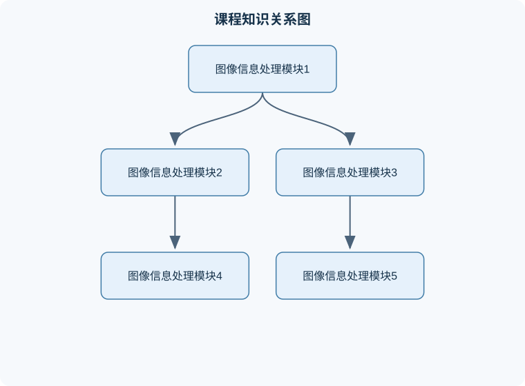

# 图像信息处理

## 一、课程整体知识框架

### 课程边界与先修知识

本课程研究数字图像从成像、采样与存储，到颜色表达、灰度变换、空间滤波、形态学处理、分割、特征描述和基础图像增强的基本原理与算法。内容覆盖二维离散图像模型、像素邻域运算、直方图方法、插值、噪声抑制、边缘与纹理特征、局部特征描述，以及传统图像处理与基础卷积神经网络之间的联系。课程不以完整的三维视觉、视频编码、医学图像专用模型或大规模深度学习训练为核心，但会说明这些方向与基础图像处理的接口。先修知识包括单变量函数与对数运算、矩阵和向量、概率统计基础、离散数学中的集合与邻域概念，以及基本编程能力。涉及成像时假设图像可表示为有限尺寸的规则像素阵列；涉及算法时区分理想无噪声模型、有限精度实现和真实设备限制。





### 1. 课程对象、研究内容与基本任务

图像信息处理研究如何将真实场景中的光学信息转换为数字图像，并对数字图像进行表示、存储、增强、分析、变换、分割和应用。数字图像可抽象为二维离散函数 $f(x,y)$：其中 $x,y$ 表示像素的空间位置，通常以像素为单位；$f(x,y)$ 表示该位置的亮度或颜色数值。灰度图像中，$f(x,y)$ 是一个标量；彩色图像中，像素通常由三个或四个通道共同表示。

课程中的处理链条可以概括为：

$$
\text{场景成像}
\rightarrow
\text{采样与量化}
\rightarrow
\text{数字存储}
\rightarrow
\text{图像增强}
\rightarrow
\text{图像分割}
\rightarrow
\text{特征表达}
\rightarrow
\text{识别、测量与应用}
$$

“图像处理”与“计算机视觉”并不完全等同。图像处理通常以图像为输入和输出，重点是改善视觉质量、改变表示形式或提取结构；计算机视觉更强调从图像推断物体、场景、运动和语义。实际系统往往同时包含两者，例如先用滤波和校正改善图像，再用分割和特征提取完成缺陷检测。

理想模型假设传感器响应稳定、噪声服从已知分布、光照均匀、图像边界明确；现实图像则可能存在镜头畸变、曝光不足、运动模糊、压缩失真、反射高光、遮挡和背景干扰。因此，任何结论都必须说明输入条件、参数范围和验证方式，不能把在实验图像上有效的方法直接视为对所有图像有效。

### 2. 从光学成像到数字图像

相机成像的基本过程包括光线传播、镜头聚焦、光电转换和数字化。镜头将场景光线汇聚到成像面，CCD 或 CMOS 等图像传感器把光能转换为电荷，再经模拟前端、模数转换和图像信号处理形成像素值。白平衡用于补偿光源颜色对 RGB 通道比例的影响；曝光和增益影响整体亮度与噪声；对比度调整改变亮暗差异，但不能恢复已经饱和或丢失的细节。

光圈直径决定进入镜头的光通量。光圈越大，通常图像更亮，但景深变浅；光圈越小，景深加深，却可能因衍射使细节下降。焦距增大时，在拍摄距离和构图条件相近的情况下，景深通常变浅，透视关系也会改变。小孔成像可以减少部分镜头像差，但孔径过小会产生明显衍射，导致分辨率下降，因此“孔越小越清晰”只在有限范围内成立。

数字化包括空间采样和幅值量化。空间采样把连续坐标变成离散坐标，采样间距越小，空间分辨率通常越高，但数据量也越大。若图像含有高于采样频率一半的空间频率，可能发生混叠，因此采样前常使用低通抗混叠滤波。幅值量化把连续亮度映射到有限个整数级别。若每个像素用 $b$ 位表示，则最多有

$$
L=2^b
$$

个量化级别。对于 $b=8$ 的无符号灰度图，取值范围通常是 $0$ 到 $255$，共有 $256$ 个级别，而不是 $255$ 个级别。若使用 $b$ 位有符号数，范围和解释方式则不同，不能直接套用该结论。

### 3. 颜色表示与颜色空间

颜色可理解为光谱能量经过观察者视觉系统或传感器响应后的结果。彩色信息通常包含色调、饱和度和明度等感知属性。消色或无彩色主要表现为黑、白以及不同程度的灰；彩色则具有明显色调和色度。

加色模型以光的叠加为基础，典型模型是 RGB。R、G、B 分别表示红、绿、蓝三种通道的相对强度，取值越大通常意味着对应光的能量越强。三通道均为零接近黑色，三通道同时达到最大值接近白色。RGB 适合显示器、相机传感器和图像文件中的直接通道表示，但它与具体设备的色彩响应有关，同样的 RGB 数值在不同设备上未必产生完全相同的视觉颜色。

减色模型以吸收光为基础，典型模型是 CMY 和 CMYK。C、M、Y 分别表示青、品红、黄吸收成分；理想情况下，青色吸收红光，品红吸收绿光，黄色吸收蓝光。印刷中还加入 K，即黑色，用于改善暗部、降低彩色油墨叠加成本并提高文字表现。减色模型适合油墨、颜料和印刷设备，不能将“显示器 RGB”与“印刷 CMYK”简单认为只是通道名称替换。

常见颜色表示及适用场合如下：

| 表示方式 | 通道含义 | 主要特点与边界 |
|---|---|---|
| RGB | 红、绿、蓝通道强度 | 适合显示与采集，设备相关 |
| CMY/CMYK | 吸收光的青、品红、黄及黑 | 适合印刷，油墨非理想会影响转换 |
| HSV | 色相 $H$、饱和度 $S$、明度 $V$ | 便于按视觉属性选色，但不是均匀感知空间 |
| CIE XYZ | 由标准观察者定义的三刺激值 | 作为设备无关的颜色基准，数值不直接等于物理三原色强度 |
| CIE $L^*a^*b^*$ | 明度 $L^*$、红绿轴 $a^*$、黄蓝轴 $b^*$ | 适合颜色差异描述，但在极端颜色和不同观察条件下仍有限制 |
| YUV/YCbCr | 亮度或近似亮度与色差信号 | 便于视频压缩和传输，具体定义、范围和采样方式需区分 |

HSV 中，$H$ 常以角度表示色相，$S$ 表示颜色纯度，$V$ 表示最大通道强度。HSV 的“距离”不等于视觉上的颜色距离，例如色相在 $0^\circ$ 与 $360^\circ$ 处是相邻的，直接按数值相减会得到错误结论。CIE $L^*a^*b^*$ 具有较好的感知均匀性，但“距离更小”也不能在所有观察条件下绝对等同于“人眼一定认为更接近”。

### 4. 图像文件、矩阵坐标与数据存储

图像矩阵通常以左上角为原点，行号向下增加，列号向右增加；但文件格式内部可能采用不同的存储顺序。以常见的 BMP 位图数据为例，底部向上的存储方式中，数据区的第一行对应图像最下面一行，而不是矩阵的第一行。读取时若忽略该约定，会得到上下翻转的图像。

BMP 的每行像素数据通常要求按 4 字节对齐。设一行有效像素数据占 $B$ 字节，则实际存储字节数为

$$
B_{\text{row}}=4\left\lceil \frac{B}{4}\right\rceil
$$

其中 $\lceil\cdot\rceil$ 表示向上取整，补齐部分称为 padding，不属于有效像素。比如某行有效数据为 $6$ 字节，则实际写入 $8$ 字节，末尾补 $2$ 个字节；下一行从新的 4 字节边界开始。补齐字节不能当作图像颜色读取，否则行边界会逐行错位，产生斜裂纹或颜色错乱。

### 5. 图像增强与灰度变换

图像增强的目标是使图像更适合观察或后续分析，不一定意味着恢复真实场景。点运算只根据当前像素值变换，例如线性对比度拉伸：

$$
g(x,y)=a f(x,y)+c
$$

其中 $a$ 控制对比度，$c$ 控制亮度；若结果超出允许范围，需要截断或重新归一化。对比度拉伸能扩大灰度分布，但不能恢复被传感器饱和截断的细节。

直方图统计灰度分布。设灰度级为 $r_k$，对应像素数量为 $n_k$，总像素数为 $N$，则归一化直方图为

$$
p(r_k)=\frac{n_k}{N}
$$

直方图均衡化利用累计分布函数进行映射：

$$
s_k=(L-1)\sum_{j=0}^{k}p(r_j)
$$

其中 $L$ 是灰度级数，$s_k$ 通常还需取整。该方法倾向于扩大整体动态范围，但并不保证输出直方图完全均匀；在噪声较强、局部对比度差异明显的图像上，可能同时放大噪声。局部均衡化可以改善局部细节，但计算量和边缘伪影风险更高。

空间滤波用邻域内像素计算输出。均值滤波能削弱随机噪声，但会模糊边缘；中值滤波将邻域像素排序并取中间值，对椒盐噪声通常更稳健，同时比均值滤波更能保留阶跃边缘。边界处理必须明确，例如忽略边界、复制边界、镜像边界或补零；不同策略会产生不同结果。

### 6. 图像分割、阈值选择与编码

二值化把灰度图像分为前景和背景。给定阈值 $T$，可定义

$$
g(x,y)=
\begin{cases}
1,&f(x,y)\ge T\\
0,&f(x,y)<T
\end{cases}
$$

阈值的物理意义取决于任务：在缺陷检测中，1 可能表示缺陷；在文字提取中，1 可能表示字符；两者不能仅凭数值判断前景含义。

全局阈值适用于光照较均匀、前景和背景灰度分布可分的图像。光照变化明显时，可采用局部阈值，使每个邻域使用不同阈值，或先估计背景照明并进行校正。局部阈值并非总是更好：窗口过小会把纹理当作前景，窗口过大又会退化为全局方法。

Otsu 方法以类内方差最小为目标。设某个阈值将像素分成前景类 $f$ 和背景类 $b$，其权重为 $W_f,W_b$，均值为 $\mu_f,\mu_b$，总均值为 $\mu$，则

$$
W_f=\frac{N_f}{N},\qquad W_b=\frac{N_b}{N},\qquad W_f+W_b=1
$$

$$
\mu=W_f\mu_f+W_b\mu_b
$$

类内方差为两类方差按权重加权的结果。推导中可得到类间方差

$$
\sigma_B^2=W_fW_b(\mu_f-\mu_b)^2
$$

总方差满足

$$
\sigma_T^2=\sigma_W^2+\sigma_B^2
$$

因为 $\sigma_T^2$ 对固定图像与所有候选阈值基本不变，所以最小化类内方差等价于最大化类间方差。算法逐一枚举候选灰度阈值，计算 $W_f,W_b,\mu_f,\mu_b$，选择使 $\sigma_B^2$ 最大的阈值。该方法假设灰度直方图能较好反映两类差异；当背景不均匀、前景比例极小或目标具有多类灰度时，结果可能失效。

行进间编码把二值图像每一行连续相同的像素压缩为区间。若一行是 $0,0,1,1,1,0$，可记录为前景区间 $(3,5)$，也可记录为带值区间 $(0,2,1),(3,5,0)$；必须事先说明坐标从 0 还是 1 开始，以及区间端点是否包含。该编码适合前景具有较长连续段的图像，若像素频繁交替，编码反而可能增加数据量。

### 7. 形态学处理与几何变换

二值形态学以集合和结构元为基础。设前景集合为 $A$，结构元为 $B$。膨胀可表示为

$$
A\oplus B=\{z\mid (\hat B)_z\cap A\ne\varnothing\}
$$

其中 $\hat B$ 是结构元关于原点的反射，$(\hat B)_z$ 表示平移到位置 $z$ 的结构元。直观上，只要结构元覆盖范围与前景发生满足定义的重叠，输出位置就可能成为前景，因此膨胀通常使目标变粗、填补狭窄间隙并连接邻近区域。腐蚀则要求结构元覆盖区域基本都落在前景内，通常使目标变细并消除小目标。开运算为先腐蚀后膨胀，常用于去除小噪声；闭运算为先膨胀后腐蚀，常用于填补小孔洞和连接小间隙。

结构元的原点、形状和连接方式必须明确。四邻域结构元与八邻域结构元会给出不同结果，尤其在对角线连接和细线保留问题上。边界外的像素如何处理也会改变结果，不能只给出结构元而不说明边界约定。

双线性插值用于由邻近四个采样点估计非整数坐标处的像素值。设目标点位于 $(x,y)$，周围四点为 $Q_{11},Q_{21},Q_{12},Q_{22}$，先沿 $x$ 方向线性插值，再沿 $y$ 方向插值：

$$
R_1=(1-u)Q_{11}+uQ_{21}
$$

$$
R_2=(1-u)Q_{12}+uQ_{22}
$$

$$
P=(1-v)R_1+vR_2
$$

其中 $u,v\in[0,1]$ 是目标点相对左、上采样点的归一化距离。该公式适用于四点构成矩形且灰度在局部近似平滑的情况；边缘、细线和纹理处可能出现模糊，越界坐标需要指定裁剪、补零或边界复制策略。

### 8. 图像应用、评价与岗位关联

典型应用包括文档扫描中的倾斜校正与文字分割、工业检测中的缺陷定位、医学影像中的结构测量、遥感图像中的地物分类、视频系统中的运动检测以及人脸图像中的表情迁移。人脸表情迁移的一种基本思路是：先对源人脸和目标人脸进行配准，使对应关键点或局部区域具有一致位置；再估计源表情相对中性状态的变化；将该变化构成的比率图或差异图迁移到目标人脸；最后进行颜色、亮度和边界融合。若直接做像素相除，目标图像中接近零的像素会造成数值爆炸，因此通常要加入稳定项，并限制结果范围。该方法依赖姿态、尺度、光照和身份结构较为匹配；大姿态差异、遮挡和强烈阴影会使简单比率迁移产生明显伪影。

评价图像处理结果不能只看“看起来更清楚”。分割应检查前景与背景的错分、区域连通性和边界位置；增强应检查对比度提升是否伴随噪声放大；几何变换应检查尺寸、边界和坐标是否一致；压缩或存储应检查读回后像素值、行顺序和通道顺序。实际岗位中，算法工程师可能负责阈值分割和特征提取，图像研发工程师负责成像校正、滤波和几何变换，测试与分析岗位负责构造边界样例、量化误差并制定验收标准，业务岗位则需要把算法输出转化为缺陷数量、尺寸、合格率或检索结果。

## 二、章节和模块划分

### 核心知识覆盖清单

本清单根据本课程的章节划分整理，用于检查正文是否覆盖各个核心模块：

- **模块一：图像信息处理基本概念与成像链路**。
- **模块二：颜色科学、颜色模型与设备表示**。
- **模块三：图像文件格式、坐标和数据组织**。
- **模块四：灰度变换、直方图与空间滤波**。
- **模块五：二值化、Otsu 方法与行进间编码**。
- **模块六：形态学运算与区域结构分析**。
- **模块七：几何变换、插值与图像配准**。
- **模块八：综合应用、实验验证与工程流程**。
- **典型易错点与排查要点**。
- **常见笔试问题及解答思路**。
- **典型面试问题、参考答案与追问要点**。
- **岗位任务与产出验收**。


### 模块一：图像信息处理基本概念与成像链路

本模块先建立像素、灰度、通道、分辨率、动态范围、采样频率和量化级数等概念。重点区分空间分辨率与灰度分辨率：前者描述单位空间能够区分的细节能力，后者描述亮度或颜色幅值的离散精度。随后分析从光线到传感器电信号、模数转换、白平衡、曝光和图像输出的全过程。

**例题一。** 一幅 8 位无符号灰度图像共有多少个灰度级？若像素值为 255，是否表示“255 个灰度级”？

**分析与解答。** 由 $L=2^b$，取 $b=8$，得到 $L=256$。有效值为 $0,1,\ldots,255$，因此像素值 255 是最高一级，不是级数总数。若改为 10 位无符号表示，则有 $1024$ 个级别，范围通常为 $0$ 到 $1023$。

**结果验证与变式。** 检查级数是否包含零级。若题目规定采用有符号 8 位数，范围可能是 $-128$ 到 $127$，此时不能使用无符号灰度的默认范围。

### 模块二：颜色科学、颜色模型与设备表示

本模块比较 RGB、CMY/CMYK、HSV、XYZ、CIE $L^*a^*b^*$ 以及 YUV/YCbCr。分析颜色模型的物理基础、通道含义、设备依赖性和应用边界。颜色转换必须明确输入范围、白点、伽马编码和通道排列；未经说明的“RGB 转灰度”并不唯一，简单平均、加权平均和感知亮度模型会得到不同结果。

**例题二。** 说明 RGB 与 CMY 分别用于什么场景，并解释三通道的含义。

**逐步解答。** RGB 是加色模型，三通道表示红、绿、蓝光的相对强度，适合显示器和相机输出。CMY 是减色模型，三通道表示青、品红、黄吸收成分，适合印刷和颜料。理想归一化条件下可写成 $C=1-R,M=1-G,Y=1-B$，但真实印刷油墨不满足理想吸收，通常还需进行设备校准并加入黑色通道。

**验证与变式。** 若题目给出的是 0 到 255 的整数，先确认是否需要归一化到 $[0,1]$；若讨论 CMYK，不能把 K 简单视为第四个独立光学三原色。

### 模块三：图像文件格式、坐标和数据组织

本模块处理图像矩阵与文件字节流之间的对应关系，重点包括行顺序、通道顺序、位深、行对齐和 padding。读写文件时应先解析头部给出的宽度、高度、位深和压缩方式，再计算有效行宽与实际行宽。不能根据文件大小反推像素数量而忽略头部、调色板或对齐字节。

**例题三。** 某位图每行有效像素数据为 10 字节，按 4 字节对齐后每行实际占多少字节？若文件采用底部向上存储，读取第一行应对应图像哪一行？

**解答。** 由

$$
4\left\lceil\frac{10}{4}\right\rceil=12
$$

可知每行实际占 12 字节，末尾补 2 字节。底部向上存储时，文件数据区的第一行对应图像最下面一行。读取后应根据高度重新排列，才能恢复通常的矩阵坐标方向。

**验证与变式。** 有效行宽为 12 字节时不需要补齐；有效行宽为 13 字节时应补到 16 字节。补齐字节不能作为颜色通道参与显示。

### 模块四：灰度变换、直方图与空间滤波

本模块讲解线性变换、对数变换、幂律变换、直方图均衡化、均值滤波、中值滤波和边缘增强。滤波器的选择取决于噪声模型和任务目标：均值滤波适合一定程度的随机噪声平滑，中值滤波更适合椒盐噪声，锐化会增强边缘也可能放大噪声。

**例题四。** 一个 3×3 邻域的灰度值为
$$
\begin{bmatrix}
10&12&11\\
9&255&10\\
11&10&12
\end{bmatrix}
$$
分别求均值滤波与中值滤波中心值，并解释差异。

**解答。** 9 个值之和为 330，均值为 $330/9\approx36.67$，若取整可得到 37；排序后为 $9,10,10,10,11,11,12,12,255$，中值为 11。255 是孤立高亮噪声，均值受到强烈影响，中值基本保持邻域正常灰度。

**结果验证与变式。** 若 255 是真实亮点而非噪声，中值滤波可能错误地抹去目标；若使用 5×5 窗口，去噪能力可能增强，但细小结构损失也更大。边界处若忽略邻域，输出尺寸会缩小；若补零，边缘会产生人为暗边。

### 模块五：二值化、Otsu 方法与行进间编码

本模块从阈值分割的基本定义出发，讲解全局阈值、局部阈值和 Otsu 阈值。Otsu 的关键不是死记公式，而是理解“使两类内部尽量紧凑，使两类均值尽量分离”。当直方图呈明显双峰时通常较有效；当光照梯度和目标纹理主导灰度时，应先做背景校正或改用局部策略。

**算法一：Otsu 全局阈值。**

- **输入：** 灰度图像的直方图，灰度范围为 $0$ 到 $L-1$。
- **输出：** 阈值 $T$ 以及二值图像。
- **过程：** 初始化前景像素数、前景灰度和；依次将候选灰度加入前景类；计算两类权重和均值；计算 $\sigma_B^2=W_fW_b(\mu_f-\mu_b)^2$；保存使该值最大的候选阈值；最后按阈值二值化。
- **不变量：** 扫描到任一候选阈值时，累计像素数和累计灰度和等于该阈值左侧所有灰度的统计量。
- **终止条件：** 所有候选阈值扫描完毕。
- **适用条件：** 主要适用于两类、光照相对均匀且灰度可分的图像。
- **复杂度：** 若灰度级数为 $L$，使用直方图累计量时复杂度为 $O(L)$，不计生成直方图的 $O(N)$；$N$ 为像素数。

```python
def otsu_threshold(hist):
    """输入长度为 L 的灰度直方图，输出 Otsu 阈值。"""
    total = sum(hist)
    if total == 0:
        raise ValueError("直方图不能为空")

    total_sum = sum(i * hist[i] for i in range(len(hist)))
    weight_left = 0
    sum_left = 0
    best_threshold = 0
    best_between = -1.0

    for t, count in enumerate(hist):
        weight_left += count
        sum_left += t * count
        if weight_left == 0 or weight_left == total:
            continue

        weight_right = total - weight_left
        mean_left = sum_left / weight_left
        mean_right = (total_sum - sum_left) / weight_right
        between = weight_left * weight_right * (mean_left - mean_right) ** 2

        if between > best_between:
            best_between = between
            best_threshold = t

    return best_threshold
```

**例题五。** 某灰度图只有灰度 0、1、2，像素数分别为 4、4、2。若候选阈值为 0 和 1，应如何比较？

**解答。** 总像素数为 10，总灰度和为 $0\times4+1\times4+2\times2=8$。阈值为 0 时，左类权重为 $0.4$、均值为 0，右类权重为 $0.6$、均值为 $8/6=1.333\ldots$，类间方差为
$$
0.4\times0.6\times(0-1.333\ldots)^2\approx0.4267.
$$
阈值为 1 时，左类权重为 $0.8$、均值为 $0.5$，右类权重为 $0.2$、均值为 2，类间方差为
$$
0.8\times0.2\times(0.5-2)^2=0.36.
$$
因此在这两个候选值中选择阈值 0。实际实现还应说明灰度等于阈值时归入哪一类。

**变式与验证。** 若高灰度目标只占极少数，类间方差可能偏向大背景；若图像有三类，二类 Otsu 不足以完成多类分割。验证时应叠加显示二值结果并检查目标是否被完整保留。

### 模块六：形态学运算与区域结构分析

本模块使用结构元描述局部几何关系，讲解膨胀、腐蚀、开运算、闭运算及其组合。处理前应确定前景值、结构元原点、连接方式和边界策略。

**算法二：二值膨胀的直接实现流程。**

- **输入：** 二值图像 $A$、结构元 $B$、结构元原点。
- **输出：** 膨胀结果图像。
- **过程：** 对每个输出位置放置结构元；检查结构元中值为 1 的位置映射到输入图像后是否有任一前景像素；若有则输出 1，否则输出 0。
- **不变量：** 已处理位置的输出值等于结构元在该位置的定义判断。
- **终止条件：** 所有输出像素处理完毕。
- **适用条件：** 输入为明确的二值图像，结构元形状和边界规则已给出。
- **复杂度：** 图像共有 $N$ 个像素，结构元含 $K$ 个有效位置时，直接实现为 $O(NK)$。

**实验一：不均匀光照下的文字二值化。**

- **输入数据：** 一张含暗背景、亮文字和从左到右渐变光照的灰度图；另准备一张人工标注的二值参考图。
- **步骤：** 先观察直方图和局部亮度；分别执行全局阈值、局部阈值和背景估计后校正再阈值；对结果做小尺度开运算去除孤立噪声；记录各方法参数。
- **评价标准：** 以像素级精确率、召回率、交并比和文字连通性评价。精确率反映误检，召回率反映漏检，交并比为预测前景与参考前景交集除以并集。
- **排错方法：** 若整幅图偏前景，检查阈值方向和灰度范围；若文字断裂，检查窗口过小、阈值过高或开运算结构元过大；若背景纹理被识别为文字，检查局部窗口是否过小。

### 模块七：几何变换、插值与图像配准

本模块介绍平移、旋转、缩放、仿射变换和坐标映射。几何变换一般采用反向映射：对输出图像的每个像素反查输入坐标，避免正向映射产生空洞。非整数坐标需要最近邻、双线性或更高阶插值。最近邻速度快但容易出现锯齿；双线性较平滑但会模糊高频边缘。

**算法三：双线性插值流程。**

- **输入：** 输入图像、目标坐标对应的连续源坐标 $(x,y)$。
- **输出：** 目标像素估计值。
- **过程：** 找到包围 $(x,y)$ 的四个整数网格点；计算横向比例 $u$ 和纵向比例 $v$；先横向插值，再纵向插值；按边界规则处理越界坐标。
- **终止条件：** 当前目标像素完成赋值；对整幅输出图像逐像素执行后结束。
- **适用条件：** 四邻点有效且局部灰度变化可近似线性。
- **复杂度：** 每个输出像素只访问固定数量邻点，整幅输出为 $O(N_{\text{out}})$。

**例题六。** 四个邻点灰度分别为左上 10、右上 20、左下 30、右下 40，目标点距左侧比例 $u=0.25$，距上侧比例 $v=0.5$，求双线性插值值。

**解答。**
$$
R_1=(1-0.25)\times10+0.25\times20=12.5
$$
$$
R_2=(1-0.25)\times30+0.25\times40=32.5
$$
$$
P=(1-0.5)\times12.5+0.5\times32.5=22.5
$$
若输出要求整数，可按约定四舍五入为 23 或采用截断为 22。验证时应确认目标点位于四点矩形内部；当 $u=0,v=0$ 时结果应退化为左上点 10。

**变式。** 若目标坐标落在图像外，不能直接套公式，必须先指定补零、边界复制或裁剪。若图像包含一像素宽的黑白边缘，双线性插值会产生中间灰度，这是插值结果，不一定是原场景真实灰度。

### 模块八：综合应用、实验验证与工程流程

**实验二：BMP 读写与滤波结果一致性验证。**

- **输入数据：** 一幅已知宽度、高度、位深和通道顺序的测试图，另构造一幅每行具有不同灰度的条纹图，以便识别上下翻转。
- **步骤：** 读取头部参数；计算有效行宽和 4 字节对齐后的实际行宽；跳过 padding 读取有效像素；根据存储方向恢复矩阵；执行一次中值滤波和一次双线性缩放；重新写出并再次读回。
- **评价标准：** 条纹方向正确；读写前后尺寸、通道顺序和像素值符合预期；无损读写时逐像素一致；缩放结果满足尺寸和边界规则；滤波结果与手工计算样例一致。
- **排错方法：** 若图像上下翻转，检查存储方向；若每行逐渐错位，检查 padding；若颜色互换，检查 BGR 与 RGB 顺序；若边缘出现黑框，检查插值越界策略；若数值差一位，检查取整和截断规则。

**例题七。** 源人脸与目标人脸存在不同亮度，需将源人脸的表情变化迁移到目标人脸。请给出流程并说明失败原因。

**解答。** 首先检测并配准两张脸的关键点，统一裁剪区域和尺度；然后分别取得源人脸表情状态与参考中性状态，构造差异图或稳定的比率图；将该变化施加到目标人脸对应区域；最后进行颜色匹配、边界羽化和遮罩融合。若使用比率形式，应避免分母接近零，并对异常值进行限制。失败可能来自关键点错配、姿态差异过大、遮挡、光照方向不同、源表情变化不具备可迁移性或融合边界不连续。

**验证与变式。** 验证不能只看表情是否明显，还要检查身份结构是否保持、嘴角和眼睛区域是否出现重影、肤色是否产生突变。若源和目标姿态差异显著，应先进行三维或局部形变配准，而不是直接逐像素相除。

### 典型易错点与排查要点

1. 把 8 位图误说成 255 个灰度级；正确级数为 256，取值范围通常为 0 至 255。  
2. 混淆空间分辨率与灰度分辨率；增加位深不等于增加空间细节。  
3. 把 RGB 与 CMY 当作同一种物理模型；前者加光，后者吸收光。  
4. 把 HSV 的三个数值通道当作线性物理量；色相具有环状边界。  
5. 认为所有颜色空间都设备无关；RGB、CMYK 通常与设备特性相关。  
6. 忽略 BMP 行对齐；padding 会导致后续行错位。  
7. 忽略 BMP 底部向上的存储方向；读出结果会上下翻转。  
8. 将补齐字节当作像素；补齐字节不属于有效颜色数据。  
9. 认为直方图均衡化一定使直方图完全均匀；离散映射和取整会造成偏差。  
10. 认为 Otsu 对所有图像有效；不均匀光照和多类目标会破坏其假设。  
11. 忘记规定阈值相等时归入前景还是背景；边界灰度会影响结果。  
12. 将膨胀和腐蚀的物理意义颠倒；膨胀通常扩张前景，腐蚀通常收缩前景。  
13. 忽略结构元原点；原点改变会使结果发生平移。  
14. 中值滤波时排序错误或取错中间位置；奇数个样本才有唯一中值。  
15. 双线性插值时混淆横向比例和纵向比例；应先确认四点坐标。  
16. 未说明图像边界处理；补零、复制和忽略边界会产生不同结果。  
17. 把“视觉上更清晰”当成唯一评价；应结合像素误差、分割准确性和任务指标。  
18. 进行比率图计算时未处理零分母；必须设置稳定项和异常值限制。

### 常见笔试问题及解答思路

1. **为什么 8 位灰度有 256 个级别？**  
   从每一位有 0、1 两种状态出发，组合数为 $2^8=256$，再说明无符号范围是 0 至 255。

2. **为什么 BMP 每行要进行 4 字节对齐？**  
   先区分有效像素数据和文件存储行宽，再用 $4\lceil B/4\rceil$ 计算补齐后的宽度，说明 padding 不参与显示。

3. **全局阈值与局部阈值如何选择？**  
   比较光照是否均匀、前景背景是否可分；光照渐变明显时优先考虑背景校正或局部阈值。

4. **Otsu 为什么最大化类间方差？**  
   由总方差等于类内方差加类间方差，在总方差固定时，最小类内方差等价于最大类间方差。

5. **均值滤波和中值滤波如何区分？**  
   均值是线性平均，容易受离群值影响；中值按序取中间值，对椒盐噪声更稳健，但可能消除细小目标。

6. **膨胀的物理意义是什么？**  
   说明结构元在前景上的局部匹配规则，通常使前景变粗、连接间隔并填补小缺口。

7. **为什么双线性插值比最近邻更平滑？**  
   最近邻只取一个点，双线性使用四点加权平均，因此变化连续性更好，但边缘会变模糊。

8. **为什么颜色空间转换必须说明范围和设备？**  
   同一符号可能采用不同量化范围、伽马编码和白点；不说明这些条件，转换结果无法复现。

### 典型面试问题、参考答案与追问要点

1. **如何处理一张光照不均的工业表面图？**  
   先估计背景照明，再进行平场校正或局部阈值，随后用形态学去除小噪声，并用标注数据验证。追问时应说明背景估计窗口、边界处理和漏检、误检的权衡。

2. **BMP 图像读出来颜色不对，如何排查？**  
   检查位深、通道顺序、调色板、行对齐和存储方向。追问时应能区分“颜色通道交换”和“每行错位”两类现象。

3. **什么时候不用直方图均衡化？**  
   当噪声较大、亮度具有物理意义或局部结构容易被放大时，应谨慎使用。追问可讨论限制对比度的局部均衡化及其伪影。

4. **如何评价一个二值分割算法？**  
   结合像素级精确率、召回率、交并比、连通区域数量和业务漏检率。追问时应说明类别极不平衡时不能只看准确率。

5. **如何选择中值滤波窗口大小？**  
   根据噪声尺度和目标最小尺寸选择，窗口过大可能删除细线和小目标。追问时应提出用多组参数和验证集比较。

6. **为什么几何变换通常采用反向映射？**  
   正向映射容易使输出出现空洞和多个输入点竞争同一位置，反向映射可保证逐个输出像素获得来源。追问时应说明越界与插值策略。

7. **如何判断一个 Otsu 结果是否可信？**  
   检查直方图是否近似双峰、结果是否稳定、边界是否符合标注，并比较局部阈值和人工阈值。追问时应指出单一阈值在渐变照明下可能失效。

8. **表情迁移出现重影的原因是什么？**  
   多由关键点配准误差、姿态不一致、遮罩边界不连续或源目标局部结构差异造成。追问时应提出局部形变、颜色匹配、羽化融合和异常比率抑制等改进。

### 岗位任务与产出验收

| 岗位方向 | 实际任务 | 使用知识 | 主要产出 | 验收标准 |
|---|---|---|---|---|
| 图像算法工程师 | 缺陷分割、目标检测前处理 | 阈值、形态学、滤波、评价指标 | 可复现处理流程和参数 | 误检、漏检达到业务阈值，边界样例稳定 |
| 图像研发工程师 | 相机标定、颜色与成像校正 | 采样、颜色空间、插值、成像模型 | 校正模块、测试报告 | 多设备和不同光照下结果一致 |
| 图像软件工程师 | 文件读写、格式转换、流水线集成 | 位深、行对齐、坐标和通道顺序 | 可读写组件与接口 | 读回像素正确，无越界和行错位 |
| 数据分析与测试岗位 | 构造测试集、误差定位、效果评估 | 直方图、分割指标、边界验证 | 测试用例、指标报表、缺陷定位 | 覆盖正常、极端和异常输入 |
| 视觉应用岗位 | 将算法结果转化为尺寸、数量和合格判定 | 分割、连通区域、几何测量 | 业务报表和判定规则 | 输出可解释、可追溯并满足现场流程 |

## 三、核心概念的详细解释

### 1. 图像信息处理的对象、任务与处理链

图像信息处理的对象是由光学成像系统、传感器和数字化设备获得的图像数据。灰度图像可表示为二维离散函数 $f(x,y)$，其中 $x$ 和 $y$ 是像素坐标，单位通常为像素；$f(x,y)$ 是该像素的灰度值。彩色图像通常写成三维数组 $f(x,y,c)$，其中 $c$ 表示颜色通道，例如 $c\in\{R,G,B\}$。

一个完整系统通常包括成像、采样、量化、存储、增强、分割、特征提取、识别或测量等环节。各环节的目标不同：增强主要改善图像的可观察性或后续处理条件；恢复试图根据退化模型估计原始图像；分割将图像划分为具有不同语义或属性的区域；特征提取把区域转换为边缘、纹理、形状或颜色等可计算表示；识别则根据特征作分类、检测或判定。

理想模型假设光照稳定、传感器线性、噪声分布已知且目标与背景有明显差异。现实条件中可能存在镜头畸变、非均匀光照、传感器饱和、运动模糊、压缩损失、遮挡和反光。因此，某种方法在单张图像上产生合理结果，并不意味着它对不同设备、不同曝光和不同目标都有效。

### 2. 成像、采样与量化

#### 2.1 光学成像和传感器转换

场景中的光线经过镜头后投射到成像面。CCD 或 CMOS 等传感器将光能转换为电荷，再经过模拟放大、模数转换和图像信号处理，得到数字像素。白平衡改变不同颜色通道的增益，以补偿光源颜色；曝光控制进入传感器的光量；增益提高信号幅度，但也会放大噪声；对比度调整改变亮暗差异，却不能恢复已经饱和的区域。

光圈变大时，进入镜头的光通量通常增加，图像更亮，但景深变浅；光圈变小时，景深通常增大，但过小会受到衍射限制。焦距增大时，在拍摄距离和构图条件相近的情况下，景深通常变浅。小孔成像中，减小孔径可以降低部分几何像差，但孔径过小会增强衍射，因此不存在“越小越清晰”的无限成立关系。

#### 2.2 空间采样和幅值量化

连续图像经过空间采样后，坐标变为整数网格。采样频率不足时，高频纹理会被错误表示为低频结构，这种现象称为混叠。为减少混叠，采样前应使用抗混叠低通滤波器，使输入信号的有效空间频率不超过采样频率的一半附近。

幅值量化把连续亮度映射为有限个等级。若每个像素采用 $b$ 位无符号编码，则量化级数为

$$
L=2^b,
$$

通常取值为 $0$ 到 $L-1$。例如，8 位灰度图有 $256$ 个等级，取值范围是 $0$ 至 $255$，而不是 $0$ 至 $256$。量化间隔越大，数据量越小，但细微亮度差异越容易丢失。若像素值为有符号数、浮点数或经过归一化，必须先确认数据类型，不能直接套用 $0$ 至 $255$ 的范围。

### 3. 颜色、颜色空间与设备依赖性

#### 3.1 彩色、消色和三原色

彩色具有色调和色度特征；消色主要包括黑、白及不同明度的灰色。加色模型以光的叠加为基础，常用 RGB 表示。R、G、B 分别表示红、绿、蓝通道的强度；三通道接近零时接近黑色，三通道同时增大时趋近白色。RGB 适合显示器和相机数据，但其具体数值与设备的光谱响应和色彩管理有关。

减色模型以颜料或油墨吸收光为基础，常用 CMY 或 CMYK 表示。C、M、Y 分别表示青、品红、黄。理想条件下，青色主要吸收红光，品红主要吸收绿光，黄色主要吸收蓝光。实际印刷中三种油墨叠加会产生不理想的暗褐色，因此增加黑色通道 K，用于文字、暗部和减少彩色油墨用量。

#### 3.2 常见颜色空间

HSV 将颜色分解为色相 $H$、饱和度 $S$ 和明度 $V$。$H$ 通常以角度表示，用于描述主导颜色；$S$ 描述颜色相对于灰色的纯度；$V$ 表示通道中的最大亮度。HSV 便于按颜色范围分割，但色相在低饱和度区域不稳定，明度变化也不完全等同于人眼感知亮度。

CIE XYZ 是一种用于描述颜色刺激的设备无关模型，$X,Y,Z$ 是经过标准化的三刺激值，其中 $Y$ 常与亮度相关。CIE $L^*a^*b^*$ 进一步将颜色表示为感知上更均匀的坐标：$L^*$ 表示明度，$a^*$ 表示绿—红方向，$b^*$ 表示蓝—黄方向。Lab 适合颜色差异测量和跨设备比较，但需要明确参考白点。

YUV 将亮度信息 $Y$ 与色差信息分离，常用于视频和图像压缩。不同标准对 $U,V$ 的定义、范围和缩放方式可能不同，因此不能只根据名称假定数值范围。总体上，RGB、CMY、HSV 更依赖具体设备或表示用途，而 XYZ、Lab 等模型更强调设备无关的颜色描述；实际转换仍需经过设备标定和色彩管理。

### 4. 图像文件、坐标与 BMP 存储

图像的内存数组通常以左上角为坐标原点，但文件格式未必采用相同的行顺序。以常见的 BMP 位图为例，当高度字段为正时，像素数据通常从图像底行开始存放，即文件中的第一行像素对应图像最下面一行，读取时需要进行垂直方向处理。若高度字段为负，则可能表示自上而下存储，具体应依据文件头解释。

BMP 的每一行像素数据通常要求按 4 字节边界对齐。设每行实际像素数据占 $B$ 个字节，则存储行长度为

$$
B_{\text{row}}=4\left\lceil\frac{B}{4}\right\rceil,
$$

补齐字节数为

$$
P=B_{\text{row}}-B.
$$

补齐字节不是图像有效像素，读取和写入时必须跳过。对于 $w$ 个像素、每像素 $q$ 位的图像，未经补齐的行字节数为

$$
B=\left\lceil\frac{wq}{8}\right\rceil.
$$

例如，24 位 BMP 中每个像素占 3 字节，宽度为 5 时有效数据为 $5\times3=15$ 字节，按 4 字节对齐后每行占 16 字节，需要补 1 个字节。若错误地把补齐字节当成像素，下一行会发生错位，表现为图像倾斜、颜色异常或整幅图像无法正确显示。

### 5. 灰度变换、直方图与二值化

#### 5.1 直方图和灰度均衡化

设灰度级为 $r_k$，图像中灰度级 $r_k$ 的像素数为 $n_k$，总像素数为 $N$，则归一化直方图为

$$
p(r_k)=\frac{n_k}{N}.
$$

离散直方图均衡化常用变换

$$
s_k=(L-1)\sum_{j=0}^{k}p(r_j),
$$

再根据实际要求取整或采用规定的舍入方式。这里 $L$ 是灰度级总数，$s_k$ 是灰度级 $r_k$ 映射后的结果。该变换使累计分布函数更接近均匀分布，从而扩大集中区域的灰度差异。

均衡化不能创造原始图像中不存在的细节。当直方图存在尖峰、噪声或大量空区域时，均衡化可能增强噪声、造成局部过增强或产生条带。局部对比度受限均衡化可以在小窗口内处理，并限制直方图峰值，但窗口过小会引入块状边界，裁剪阈值过低又会削弱增强效果。

#### 5.2 全局和自适应二值化

给定阈值 $T$，灰度图像可通过

$$
g(x,y)=
\begin{cases}
1,&f(x,y)\geq T,\\
0,&f(x,y)<T
\end{cases}
$$

转换为二值图像。全局阈值适用于光照均匀、目标与背景灰度分离明显的场景。光照变化较大时，可先进行背景估计和光照校正，也可使用局部阈值，使每个位置的阈值依赖邻域统计量。

Otsu 方法把像素分为前景和背景两类。设前景、背景像素数分别为 $N_f,N_b$，总数为 $N$，则

$$
w_f=\frac{N_f}{N},\qquad
w_b=\frac{N_b}{N},\qquad
w_f+w_b=1.
$$

两类均值分别为 $\mu_f,\mu_b$，全局均值为

$$
\mu=w_f\mu_f+w_b\mu_b.
$$

类内方差为

$$
\sigma_{\text{intra}}^2
=w_f\sigma_f^2+w_b\sigma_b^2.
$$

在总方差固定时，最小化类内方差等价于最大化类间方差

$$
\sigma_{\text{inter}}^2
=w_fw_b(\mu_f-\mu_b)^2.
$$

遍历所有候选阈值，选择使 $\sigma_{\text{inter}}^2$ 最大的阈值。该方法隐含目标和背景可以通过单一阈值分离的假设；在多峰、强阴影、目标内部亮度变化很大时，结果可能不可靠。

### 6. 形态学操作和区域表达

二值形态学以集合和结构元为基础。设前景集合为 $A$，结构元为 $B$。膨胀可表示为

$$
A\oplus B=\{z\mid (\hat B)_z\cap A\neq\varnothing\},
$$

其中 $\hat B$ 是结构元关于原点的反射，$(\hat B)_z$ 表示平移到位置 $z$ 后的结构元。直观上，只要结构元覆盖区域与前景相交，输出中心位置就可能成为前景，因此膨胀可连接相近区域、填补小缺口、扩大目标边界。

腐蚀可表示

## 四、重要定义、公式、定理和推导

### 专业审校补充：关键定义与适用边界

卷积与相关必须区分。二维离散卷积定义为 $(f*h)[m,n]=\sum_i\sum_j f[i,j]h[m-i,n-j]$，其中 $f$ 是输入图像，$h$ 是卷积核，求和范围由核的有限支持决定；相关运算则为 $(f\star h)[m,n]=\sum_i\sum_j f[m+i,n+j]h[i,j]$，不翻转卷积核。只有当卷积核关于中心对称时，两者结果才相同。均值滤波、高斯滤波常使用对称核，因此实际代码中相关与卷积的差异不明显；Sobel、方向性边缘核和非对称模板则必须明确采用哪一种定义。边界处还需规定零填充、复制、镜像或只计算完整重叠区域，否则输出尺寸和边缘响应会改变。若输入为有限尺寸图像、核尺寸为 $K_h\times K_w$，直接计算每个输出像素的复杂度约为 $O(HW K_hK_w)$；可分离核可拆成一维运算，将复杂度降为 $O(HW(K_h+K_w))$。这些结论假设像素排列规则、步长和数据类型已确定，不能把边界策略或核翻转差异归因于图像内容本身。


### 1. 数字图像、采样与量化的基本定义

数字图像是对连续场景进行空间采样和幅值量化后得到的数据集合。灰度图像可表示为二维离散函数 $f[m,n]$，其中 $m$ 表示行坐标，$n$ 表示列坐标，$f[m,n]$ 表示该像素的灰度值。若图像宽度为 $W$、高度为 $H$，则像素坐标通常满足

$$
0\leq m<H,\qquad 0\leq n<W.
$$

这里的坐标约定必须在具体系统中明确：有的程序使用 $(x,y)$ 表示“列、行”，有的程序使用 $(m,n)$ 表示“行、列”。如果将行坐标和列坐标混用，旋转、平移、滤波和目标定位都会产生系统性错误。

空间采样把连续空间坐标转换为离散网格。设连续图像为 $f_c(x,y)$，采样间隔分别为 $\Delta_x$ 和 $\Delta_y$，则离散图像可以写为

$$
f[m,n]=f_c(m\Delta_y,n\Delta_x).
$$

其中 $\Delta_x$ 的单位可以是毫米/像素，$\Delta_y$ 同理；当两个方向采样间隔相等时，像素通常称为方形像素。采样间隔越小，理论上能够表示的空间细节越丰富，但数据量、存储和计算开销也会增加。

**二维采样定理的核心结论**是：如果连续图像的空间频率最高值分别不超过 $B_x$ 和 $B_y$，则为了避免理想条件下的混叠，需要满足

$$
f_{s,x}>2B_x,\qquad f_{s,y}>2B_y,
$$

其中 $f_{s,x}=1/\Delta_x$、$f_{s,y}=1/\Delta_y$ 是两个方向的采样频率。若目标纹理含有高于奈奎斯特频率的一半，即高于 $f_s/2$ 的频率成分，采样后会折叠到较低频率，形成伪纹理、锯齿或莫尔纹。混叠一旦产生，单纯提高后续图像处理算法的复杂度通常不能恢复真实细节；工程上常在采样前使用光学或模拟低通滤波器。

幅值量化将连续亮度映射到有限个离散等级。若无符号图像使用 $b$ 位表示，则量化级数为

$$
L=2^b,
$$

编码范围通常为 $0$ 到 $L-1$。例如，8 位灰度图有 $256$ 个可能的编码值，最大编码值为 $255$。若连续亮度范围为 $[0,R]$，均匀量化时理想量化步长近似为

$$
\Delta_q=\frac{R}{L-1}.
$$

量化误差定义为原始亮度与量化亮度之差。对均匀舍入量化，在不发生饱和且误差近似均匀分布的条件下，误差通常落在 $[-\Delta_q/2,\Delta_q/2]$ 内。该结论不适用于过曝、欠曝、非线性量化或存在截断的情况。增加位深可以减小幅值量化误差，但不能修复失焦、运动模糊和空间采样不足。

### 2. 灰度变换、直方图与对比度增强

灰度变换是逐像素处理，即输出像素只由对应输入像素决定。设输入灰度为 $r$，输出灰度为 $s$，则点运算可以写成

$$
s=T(r).
$$

线性灰度变换常写为

$$
s=ar+c,
$$

其中 $a$ 控制对比度，$c$ 控制亮度。若 $a>1$，灰度差异被放大；若 $0<a<1$，对比度降低；若 $c>0$，整体亮度增加。实际输出还必须经过截断或归一化，例如 8 位图像需要把结果限制在 $[0,255]$。如果输出超过范围直接转换为整数，可能产生溢出或循环回绕。

图像直方图描述各灰度级出现的频数。设灰度级为 $k$，图像像素总数为 $N$，灰度级 $k$ 的像素数为 $h(k)$，则归一化直方图为

$$
p(k)=\frac{h(k)}{N}.
$$

由于每个像素必属于某个灰度级，有

$$
\sum_{k=0}^{L-1}p(k)=1.
$$

直方图只反映灰度出现次数，不包含像素的空间位置。因此，两个空间结构完全不同的图像可能有相同或近似相同的直方图。直方图适合分析整体亮度和对比度，但不能单独用于判断边缘位置、纹理方向和目标形状。

直方图均衡化利用累计分布函数重新分配灰度。定义灰度级 $r$ 的累计分布函数为

$$
C(r)=\sum_{k=0}^{r}p(k).
$$

常用变换为

$$
s=(L-1)C(r).
$$

推导依据是：如果连续随机变量 $r$ 的分布函数为 $C(r)$，则随机变量 $s=C(r)$ 在理想连续条件下服从均匀分布。对于离散图像，$C(r)$ 只取有限个阶梯值，多个输入灰度可能映射到同一输出灰度，所以均衡化后的直方图不一定严格均匀。均衡化主要扩展像素集中区域的灰度动态范围，不能恢复已经饱和的高光、被噪声覆盖的细节，也不能改变图像的空间分辨率。

**计算示例：**设 8 位图像中某灰度级 $r=100$ 及其之前的像素占总像素的 $0.6$，则

$$
s=(256-1)\times0.6=153.
$$

若采用四舍五入，输出灰度约为 $153$。这个计算只适用于累计概率已经正确统计且使用 8 位输出的情况。若输入图像为 12 位，必须使用对应的 $L=4096$ 或先明确归一化规则，不能直接套用 $255C(r)$。

### 3. 线性滤波、卷积与边缘检测

线性空间滤波使用邻域像素的加权和计算输出。设滤波器模板为 $w[i,j]$，模板半径分别为 $r$ 和 $s$，则二维相关运算可写为

$$
g[m,n]=\sum_{i=-r}^{r}\sum_{j=-s}^{s}w[i,j]f[m+i,n+j].
$$

若模板在计算前翻转，即使用 $w[-i,-j]$，则称为卷积。很多图像软件接口实际执行的是相关而不是严格卷积；对于对称模板，两者结果相同，但对于方向性边缘模板，二者可能不同。

均值滤波的 $K\times K$ 模板为

$$
w[i,j]=\frac{1}{K^2}.
$$

其输出是邻域平均值，能够降低部分随机噪声，但会削弱边缘。高斯滤波器使用近似高斯分布的权重：

$$
G(x,y)=\frac{1}{2\pi\sigma^2}
\exp\left(-\frac{x^2+y^2}{2\sigma^2}\right),
$$

其中 $\sigma$ 是标准差，决定平滑尺度。$\sigma$ 越大，平滑越强，但细线和边缘定位可能越差。实际离散模板通常截取有限窗口并重新归一化，使所有权重之和接近 1，从而避免整体亮度明显改变。

中值滤波不是线性滤波。对于窗口内的像素集合排序后，取中间位置的数值作为输出。以 $3\times3$ 窗口为例，共有 9 个数，排序后取第 5 个。中值滤波对孤立的椒盐噪声有效，因为极大或极小的异常值不会像均值那样直接拉动结果；但窗口过大会删除细线、小孔和尖锐结构。

边缘可理解为图像灰度或颜色在空间上的快速变化。对连续图像，梯度为

$$
\nabla f=
\begin{bmatrix}
\frac{\partial f}{\partial x}\\[2pt]
\frac{\partial f}{\partial y}
\end{bmatrix}.
$$

梯度幅值为

$$
M(x,y)=
\sqrt{
\left(\frac{\partial f}{\partial x}\right)^2+
\left(\frac{\partial f}{\partial y}\right)^2
}.
$$

数字图像中常用差分近似导数。例如，水平差分可以写为

$$
D_x[m,n]=f[m,n+1]-f[m,n],
$$

垂直差分为

$$
D_y[m,n]=f[m+1,n]-f[m,n].
$$

若只使用单方向差分，可能漏检方向与其正交的边缘；实际应用常结合两个方向的梯度。边缘检测前适度平滑可以降低噪声引起的伪边缘，但过度平滑会使相邻边缘合并或造成定位偏移。

边界处理是滤波公式的一部分。常见方法包括补零、复制边界、镜像边界和周期延拓。补零会使图像边缘变暗，复制边界可能形成局部平台，镜像边界通常能减小突变。考试中的计算题若未说明边界策略，通常只计算模板完全位于图像内部的位置；实际程序必须明确越界处理。

### 4. 傅里叶变换与频域处理

二维离散傅里叶变换用于将空间域图像表示为不同空间频率成分的叠加。设图像大小为 $M\times N$，空间域像素为 $f(x,y)$，频域系数为 $F(u,v)$，则二维离散傅里叶变换为

$$
F(u,v)=
\sum_{x=0}^{M-1}
\sum_{y=0}^{N-1}
f(x,y)
\exp\left[
-j2\pi\left(
\frac{ux}{M}+\frac{vy}{N}
\right)
\right],
$$

其中 $u,v$ 是频率索引，$j$ 为虚数单位，满足 $j^2=-1$。逆变换为

$$
f(x,y)=\frac{1}{MN}
\sum_{u=0}^{M-1}
\sum_{v=0}^{N-1}
F(u,v)
\exp\left[
j2\pi\left(
\frac{ux}{M}+\frac{vy}{N}
\right)
\right].
$$

低频通常对应亮度缓慢变化和大尺度结构，高频通常对应边缘、细节和噪声。频域低通滤波可以表示为

$$
G(u,v)=H(u,v)F(u,v),
$$

其中 $F(u,v)$ 是输入频谱，$H(u,v)$ 是频率响应，$G(u,v)$ 是滤波后频谱。对 $G(u,v)$ 做逆变换即可得到输出图像。

理想低通滤波器在截止频率外直接置零，频域边界不连续，空间域可能产生振铃；高斯低通滤波器过渡平滑，通常振铃较弱，但会逐渐衰减高频，导致边缘变软。频域处理的适用条件是图像可以合理表示为周期或局部平稳信号，并且能够接受一定的全局处理开销。对于只需处理小窗口的任务，空间域卷积可能更直观；对于大尺寸、可分离或周期卷积，快速傅里叶变换可能更高效。

卷积定理说明：空间域卷积对应频域乘法，空间域乘法对应频域卷积。该结论解释了为什么频域滤波能够实现空间平滑和锐化。但实际实现还要考虑边界扩展、频谱中心化、复数精度和逆变换后的数值截断。显示频谱幅值时常使用

$$
S(u,v)=\log(1+|F(u,v)|),
$$

其中 $|F(u,v)|$ 是频谱幅值；对数变换用于压缩动态范围，不代表改变了原始频谱本身。

### 5. 阈值分割、形态学和连通区域

阈值分割根据像素值将图像划分为目标与背景。给定阈值 $T$，二值图像可定义为

$$
b[m,n]=
\begin{cases}
1,&f[m,n]\geq T,\\
0,&f[m,n]<T.
\end{cases}
$$

阈值方向取决于目标与背景的亮暗关系。若目标比背景暗，应使用相反判定；若图像光照不均匀，一个全局阈值可能无法同时处理亮处和暗处。

Otsu 方法通过最大化类间方差选择全局阈值。设灰度级为 $k$，候选阈值为 $t$，前景和背景的概率分别为 $\omega_0(t)$、$\omega_1(t)$，均值分别为 $\mu_0(t)$、$\mu_1(t)$，则类间方差为

$$
\sigma_B^2(t)=
\omega_0(t)\omega_1(t)
\left[\mu_0(t)-\mu_1(t)\right]^2.
$$

选择使 $\sigma_B^2(t)$ 最大的阈值作为结果。该方法在直方图呈现较明显双峰、目标和背景灰度可分时较有效。若光照渐变、目标面积极小、前景与背景严重重叠或存在多个复杂类别，Otsu 的全局假设可能不成立，应考虑背景校正、局部阈值或其他特征。

形态学处理以集合和结构元为基础。设二值前景集合为 $A$，结构元为 $B$。腐蚀定义为

$$
A\ominus B=
\{z\mid B_z\subseteq A\},
$$

其中 $B_z$ 表示将结构元平移到位置 $z$ 后的集合。腐蚀通常使目标收缩、细连接断开并删除小于结构元的局部区域。膨胀定义为

$$
A\oplus B=
\{z\mid (B^\text{ref})_z\cap A\neq\varnothing\},
$$

其中 $B^\text{ref}$ 表示结构元关于原点的反射。膨胀通常使目标扩大、连接邻近区域并填补部分缺口。

开运算为

$$
A\circ B=(A\ominus B)\oplus B,
$$

它先腐蚀后膨胀，常用于去除小目标和细小突出物；闭运算为

$$
A\bullet B=(A\oplus B)\ominus B,
$$

它先膨胀后腐蚀，常用于填补小缺口、连接相近区域。开闭运算并非“无损修复”：结构元过大时，开运算会删除真实缺陷，闭运算会合并相邻目标。因此结构元尺寸必须与目标最小尺寸和噪声尺度相对应。

### 6. 典型算法流程、复杂度与综合计算题

**局部阈值分割算法**适用于背景亮度缓慢变化的情况。

- **输入：**灰度图像 $f$、窗口尺寸 $K\times K$、偏移量 $C$。
- **输出：**二值图像 $b$。
- **过程：**对每个像素计算局部均值 $\mu_{m,n}$，令局部阈值为 $T_{m,n}=\mu_{m,n}-C$；若 $f[m,n]\geq T_{m,n}$，输出 1，否则输出 0。
- **不变量：**每个输出像素只依据其对应的局部窗口和固定参数产生，已经处理的像素不会影响后续窗口统计。
- **终止条件：**所有 $H\times W$ 个像素均完成判定。
- **适用条件：**背景变化相对缓慢，局部窗口内目标和背景仍具有可分性。
- **复杂度：**直接计算每个窗口的均值，复杂度为 $O(HWK^2)$；使用积分图后，矩形窗口求和可降为每像素 $O(1)$，总体复杂度为 $O(HW)$，但需要额外 $O(HW)$ 存储。

**综合计算示例：**一幅 8 位灰度图中，某 $3\times3$ 邻域像素为

$$
\begin{bmatrix}
10&10&12\\
11&250&10\\
9&10&11
\end{bmatrix}.
$$

若使用均值滤波，输出为

$$
\frac{10+10+12+11+250+10+9+10+11}{9}
=
\frac{333}{9}=37.
$$

异常值 $250$ 使结果明显偏高。若使用中值滤波，将 9 个数排序得到

$$
9,10,10,10,10,11,11,12,250,
$$

中值为第 5 个数，即 $10$。因此在该窗口中，中值滤波更能抑制孤立亮点，同时保留邻域原有的暗灰度水平。

在笔试或实际调试中，不能只给出最终数值，还应说明：窗口是否完全位于图像内部、是否采用四舍五入、输出是否截断到合法灰度范围，以及该噪声是否确实符合椒盐噪声特征。若 250 是真实高亮细节而不是噪声，中值滤波也可能错误删除该细节，这正是算法适用边界。

图像处理系统的验证应同时检查数值结果和视觉结构。滤波后可比较噪声方差、边缘位置和目标面积；分割后可比较精确率、召回率和交并比。若前景区域为 $A$、真实标注区域为 $B$，交并比定义为

$$
\operatorname{IoU}(A,B)=
\frac{|A\cap B|}{|A\cup B|},
$$

其中 $|\,\cdot\,|$ 表示像素数量。交并比高说明重叠区域相对较大，但它不能单独反映边界是否平滑、漏检是否集中在关键区域，也不能替代对运行时间、异常输入和物理测量误差的检查。

## 五、算法、流程和实现思路

### 方法与流程覆盖索引

下列方法或流程应在正文中说明输入、步骤、适用条件、结果检查和边界：

- 1. 图像处理系统的通用实现流程
- 2. 全局阈值、Otsu 阈值与局部二值化
- 3. 形态学处理与连通区域流程
- 4. 灰度变换、直方图均衡化和滤波
- 5. 几何变换、BMP 存储与表情迁移
- 6. 代表性实现代码
- 7. 实验与项目流程


### 1. 图像处理系统的通用实现流程

一个可复用的图像处理流程应先明确输入数据的物理含义和存储格式，再选择算法。基本过程如下：

1. **定义任务与输出**：明确是改善视觉质量、测量尺寸、提取目标、分类识别，还是进行表情迁移。输出应规定数据类型、坐标系、单位和评价指标。
2. **检查输入**：确认图像的宽度、高度、通道顺序、位深、是否归一化、是否存在上下翻转、是否有饱和像素或缺失值。
3. **建立成像与噪声假设**：例如椒盐噪声适合用脉冲噪声模型描述，均匀照明下可考虑全局阈值，渐变照明下应考虑局部阈值或背景校正。
4. **预处理**：根据噪声和任务选择去噪、颜色空间转换、白平衡、几何校正或对比度调整。预处理不能破坏后续需要测量的边缘和纹理。
5. **核心处理**：完成阈值分割、形态学处理、插值、特征提取或图像融合。
6. **结果验证**：同时检查数值指标、可视化结果、边界样例和异常输入，防止只凭一张结果图判断算法有效。
7. **记录参数和版本**：保存阈值、结构元、滤波窗口、插值方式、边界策略和输入数据类型，保证结果可复现。

#### 1.1 输入输出和边界约定

灰度图像可写为 $I(x,y)$，其中 $x$ 为列坐标，$y$ 为行坐标，二者通常取整数像素坐标；$I(x,y)$ 可以是 $[0,255]$ 内的 8 位整数，也可以是 $[0,1]$ 内的浮点数。算法实现前必须统一这两种表示，否则阈值、均值和卷积系数会产生量纲错误。

空间处理涉及边界时，应明确采用零填充、复制边界、镜像边界、循环边界还是忽略边界。不同边界策略会改变图像边缘的结果。例如，$3\times3$ 中值滤波若“忽略边界”，输出尺寸会缩小；若采用复制边界，输出尺寸保持不变，但边界附近的统计分布会改变。

### 2. 全局阈值、Otsu 阈值与局部二值化

#### 2.1 全局阈值算法

全局阈值将灰度图像转换为二值图像：

$$
B(x,y)=
\begin{cases}
1,&I(x,y)\ge T,\\
0,&I(x,y)<T.
\end{cases}
$$

其中 $T$ 是阈值，$B(x,y)=1$ 表示前景或目标，$B(x,y)=0$ 表示背景。其输入是灰度图像和阈值，输出是二值图像。该方法适合背景亮度较均匀、目标与背景灰度分离明显的图像，不适合存在强阴影、渐变照明或目标内部亮度变化很大的图像。

一个简单的实现是遍历每个像素并比较其灰度值。时间复杂度为 $O(MN)$，其中 $M,N$ 是图像的行数和列数；额外空间复杂度为 $O(MN)$（若保存完整输出），若允许原地修改则可降低额外空间。算法不变量是：处理到任意位置时，已经输出的像素均满足同一个阈值判定规则；终止条件是所有像素均被访问一次。

#### 2.2 Otsu 方法的推导和实现

设灰度级为 $0,\ldots,L-1$，候选阈值为 $t$。阈值将像素分成前景类和背景类，分别具有概率 $w_f,w_b$、均值 $\mu_f,\mu_b$，且

$$
w_f+w_b=1,\qquad
\mu=w_f\mu_f+w_b\mu_b.
$$

总方差可分为类内方差和类间方差。类间方差为

$$
\sigma_{\mathrm{inter}}^2(t)
=w_fw_b(\mu_f-\mu_b)^2.
$$

推导步骤是：

1. 根据灰度直方图计算每个灰度级的像素概率；
2. 对每个候选阈值计算两类像素数和两类均值；
3. 代入 $\sigma_{\mathrm{inter}}^2(t)$；
4. 选择使类间方差最大的阈值：

$$
T^\ast=\arg\max_t \sigma_{\mathrm{inter}}^2(t).
$$

该方法等价于在总方差固定时最小化类内方差。它假设图像大致由两个灰度分布不同的类别组成。若直方图具有多个峰、光照渐变明显或前景占比极小，最大类间方差不一定对应正确的语义边界。此时应比较局部阈值、背景校正和人工设定阈值的结果。

### 3. 形态学处理与连通区域流程

#### 3.1 膨胀、腐蚀、开运算和闭运算

设前景集合为 $A$，结构元为 $B$。膨胀的集合表达为

$$
A\oplus B=\{z\mid (\hat B)_z\cap A\ne\varnothing\},
$$

其中 $\hat B$ 是结构元关于原点的反射，$(\hat B)_z$ 是将结构元平移到位置 $z$ 后的集合。直观上，结构元中心移动到某个位置时，只要结构元覆盖区域与前景相交，该位置就可以成为前景。因此膨胀能够扩大目标、连接相邻区域、填补小缺口。

腐蚀要求结构元平移后完全包含于前景中：

$$
A\ominus B=\{z\mid B_z\subseteq A\}.
$$

腐蚀会缩小目标、去除小的孤立点和细小连接。开运算为先腐蚀后膨胀：

$$
A\circ B=(A\ominus B)\oplus B,
$$

通常用于去除小噪声；闭运算为先膨胀后腐蚀：

$$
A\bullet B=(A\oplus B)\ominus B,
$$

通常用于填补小孔洞和连接窄间隙。结构元形状决定处理方向：十字结构元偏向水平、垂直连接，方形结构元对各方向更均衡，线形结构元可针对特定方向的纹理。

#### 3.2 连通区域和行程编码

对二值图像进行连通区域分析时，应先确定四邻域或八邻域。四邻域只连接上、下、左、右像素；八邻域还连接四个对角像素。两种定义可能产生不同的目标数量，因此不能混用。

行程编码（Run-Length Encoding，RLE）按行扫描二值图像，把连续相同值或连续前景像素记录为区间。例如一行像素为

$$
0\ 0\ 1\ 1\ 1\ 0\ 1\ 1,
$$

若只编码前景，可记为区间 $(3,5)$ 和 $(7,8)$；若按连续值编码，则可记为 $(0,2),(1,3),(0,1),(1,2)$，其中每个区间包含像素值及连续长度。实现时需明确坐标从 0 还是 1 开始，以及区间端点是否包含。RLE 适合前景连续、长条结构明显的图像；若像素交替频繁，编码后可能比原图更大。

### 4. 灰度变换、直方图均衡化和滤波

#### 4.1 直方图均衡化

设灰度级 $r_k$ 的概率为 $p_r(r_k)$，累计分布函数为

$$
s_k=(L-1)\sum_{j=0}^{k}p_r(r_j),
$$

其中 $L$ 是灰度级总数，$k=0,\ldots,L-1$。实际实现时通常先计算累计像素数，再使用整数映射到 $0,\ldots,L-1$。

步骤为：

1. 统计各灰度级像素数；
2. 除以总像素数得到概率；
3. 计算累计概率；
4. 乘以 $L-1$ 并取整或按规定舍入；
5. 用映射表替换原像素。

均衡化的目标是扩展灰度动态范围、改善整体对比度，而不是保证输出直方图严格均匀。若图像中有大面积背景，背景会主导累计分布；若图像含噪声，噪声也可能被增强。局部均衡化能改善局部对比度，但可能放大纹理噪声并产生块状边界。

#### 4.2 中值滤波与双线性插值

中值滤波对窗口内像素排序并取中间值。对 $3\times3$ 窗口，若九个值排序为

$$
a_1\le a_2\le\cdots\le a_9,
$$

则输出为 $a_5$。它对椒盐噪声具有较强抑制能力，通常比均值滤波更能保留阶跃边缘；但窗口过大时会删除细线、小目标和尖锐结构。

双线性插值用于估计非整数坐标 $(x,y)$ 的灰度。设其周围四个像素为 $Q_{11},Q_{21},Q_{12},Q_{22}$，横向和纵向小数部分分别为 $u,v\in[0,1]$，则

$$
I(x,y)=(1-u)(1-v)Q_{11}
+u(1-v)Q_{21}
+(1-u)vQ_{12}
+uvQ_{22}.
$$

它先沿水平方向插值，再沿垂直方向插值。该方法假设局部灰度变化近似线性，适合缩放和一般几何变换；在强边缘、细线和文字附近，插值会产生平滑或混合颜色。

### 5. 几何变换、BMP 存储与表情迁移

#### 5.1 几何变换的反向映射

缩放、旋转和仿射变换可统一表示为坐标变换。实现中通常对每个输出像素 $(x',y')$ 使用逆变换找到输入位置 $(x,y)$，再通过最近邻、双线性或双三次插值取值。采用反向映射可以避免正向映射产生空洞，也能保证每个输出像素都有明确的采样过程。

完整流程为：确定输出坐标；计算逆变换后的源坐标；判断源坐标是否越界；若越界则采用背景值或边界策略；若在图像内则进行插值。最近邻速度快且保留离散标签，双线性更平滑但会改变边缘，标签图像不能直接使用普通双线性插值，否则会产生不存在的类别值。

#### 5.2 BMP 位图数据的存储流程

以常见的未压缩 BMP 为例，图像数据区的每一行通常按 4 字节对齐。若每行实际数据长度为 $n$ 字节，则填充字节数可计算为

$$
p=(4-n\bmod 4)\bmod 4.
$$

因此存储一行时，先写入该行的有效像素字节，再补 $p$ 个填充字节。填充字节不代表图像像素，读取时不能把它们当作下一列。

许多 BMP 文件采用自底向上的存储方式，即文件中的第一行像素对应图像显示结果的最底行，随后依次存储向上的行。因此读取后若直接按文件顺序显示，会出现上下颠倒。实现时必须同时处理每行对齐和垂直方向。24 位 BMP 通常每像素占 3 字节，通道顺序常以 B、G、R 存储，而不是直观的 R、G、B；具体读取应以文件头和位图信息头中的位深、压缩方式及高度符号为准。

#### 5.3 基于比值图像的人脸表情迁移流程

设源人脸为 $S$，目标人脸为 $T$。比值图像的基本思想是提取源表情相对于源中性状态的变化，再将该变化施加到目标脸。典型步骤为：

1. 对源脸、源中性脸和目标脸进行人脸区域定位、姿态校正和关键点配准；
2. 将三者变换到同一坐标系；
3. 对亮度接近零的像素设置小正数 $\varepsilon$，计算亮度比值：

$$
R(x,y)=\frac{S_{\mathrm{expr}}(x,y)+\varepsilon}
{S_{\mathrm{neutral}}(x,y)+\varepsilon};
$$

4. 将比值图像施加到目标脸，例如

$$
T_{\mathrm{new}}(x,y)=R(x,y)\,T(x,y);
$$

5. 对结果进行颜色匹配、遮罩处理、边界羽化和亮度限制；
6. 将处理后的局部区域融合回目标图像；
7. 检查眼睛、嘴角和轮廓等关键区域是否出现重影、断裂或过曝。

比值模型适合光照和表情变化可以近似分离的场景。若源脸和目标脸姿态差异大、存在遮挡、皮肤反射差异明显，单纯逐像素比值会失效，需要结合局部形变、关键点约束和边界融合。

### 6. 代表性实现代码

下面代码实现灰度图的 Otsu 阈值计算和二值化。输入是二维整数数组，输出是阈值和二值数组；代码不依赖外部文件或网络。

```python
def otsu_threshold(image):
    """image: 二维列表，像素值为 0 到 255 的整数
       return: (threshold, binary_image)
    """
    height = len(image)
    width = len(image[0])
    total = height * width

    hist = [0] * 256
    for row in image:
        for value in row:
            if value < 0 or value > 255:
                raise ValueError("像素值必须位于 0 到 255")
            hist[value] += 1

    sum_all = sum(level * count for level, count in enumerate(hist))
    weight_background = 0
    sum_background = 0
    best_threshold = 0
    best_between = -1.0

    for threshold in range(256):
        weight_background += hist[threshold]
        if weight_background == 0:
            continue

        weight_foreground = total - weight_background
        if weight_foreground == 0:
            break

        sum_background += threshold * hist[threshold]
        mean_background = sum_background / weight_background
        mean_foreground = (
            (sum_all - sum_background) / weight_foreground
        )

        between = (
            weight_background * weight_foreground
            * (mean_background - mean_foreground) ** 2
        )

        if between > best_between:
            best_between = between
            best_threshold = threshold

    binary = [
        [1 if value >= best_threshold else 0 for value in row]
        for row in image
    ]
    return best_threshold, binary
```

该代码的核心不变量是：遍历到阈值 `threshold` 时，`weight_background` 和 `sum_background` 分别保存灰度不超过当前阈值的像素数和灰度总和。每个灰度级只进入统计一次，因此直方图扫描时间复杂度为 $O(MN+L)$，其中 $L=256$；输出二值图需要 $O(MN)$ 时间。

### 7. 实验与项目流程

#### 7.1 二值分割比较实验

**输入数据**：一组灰度图像，包括均匀照明、渐变照明、低对比度和含噪声图像；若有人工标注，则标注前景区域为参考真值。

**步骤**：

1. 分别使用固定全局阈值、Otsu 阈值和局部阈值；
2. 对每种方法设置相同的输出编码；
3. 记录阈值、前景面积、连通区域数和运行时间；
4. 对结果执行必要的开闭运算，但不得隐去原始分割结果；
5. 与标注比较交并比：

$$
\mathrm{IoU}=\frac{|P\cap G|}{|P\cup G|},
$$

其中 $P$ 是预测前景集合，$G$ 是真值集合；
6. 额外统计漏检、误检和边界偏差。

**评价标准**：不仅看 IoU，还要检查目标是否被错误分裂、背景阴影是否被误检，以及不同光照下阈值是否稳定。类别极不平衡时，单看像素准确率可能掩盖目标全部漏检的问题。

**排错方法**：若结果全黑，检查阈值范围、图像是否被归一化到 $[0,1]$；若结果全白，检查比较方向和数据类型；若局部方法出现棋盘状块边界，检查窗口大小、块间插值和边缘策略。

#### 7.2 BMP 读写与几何变换项目

**输入数据**：不同宽度、不同位深的 BMP 图像，尤其选择每行有效字节数分别为 4 的倍数和非 4 的倍数的图像。

**步骤**：

1. 读取文件头和位图信息头；
2. 根据位深计算每像素字节数和每行有效字节数；
3. 按公式计算填充字节数；
4. 读取每行有效数据并跳过填充；
5. 根据高度符号或文件约定处理上下方向；
6. 将图像旋转、缩放后写出；
7. 再次读取输出文件并比较像素值。

**评价标准**：图像宽高正确、通道顺序正确、上下方向正确、旋转中心和边界策略明确；对于无损读写，除格式转换造成的必要变化外，像素差应为零。缩放实验应报告插值方法和边缘误差。

**排错方法**：图像每行逐渐错位，通常是忽略了行填充；颜色呈红蓝互换，通常是 BGR 与 RGB 顺序错误；图像上下颠倒，通常是未处理 BMP 的自底向上存储；只有边缘出现黑线，通常是几何逆映射后的越界处理不一致。

## 六、概念之间的关系与对比

### 1. 图像增强、恢复、分割和识别的区别

| 任务 | 输入与输出关系 | 主要目标 | 典型方法 | 主要边界 |
|---|---|---|---|---|
| 增强 | 图像到图像 | 改善视觉或后续处理条件 | 对比度变换、均衡化、滤波 | 可能增强噪声，不能凭空恢复丢失信息 |
| 恢复 | 退化图像到原图估计 | 依据退化模型反演 | 去模糊、去噪、逆滤波 | 依赖退化模型，病态问题可能不稳定 |
| 分割 | 图像到区域或标签 | 区分目标与背景、不同目标 | 阈值、区域生长、形态学 | 受光照、遮挡、目标相似性影响 |
| 特征提取 | 图像到数值表示 | 保留结构、纹理或颜色信息 | 直方图、边缘、形状矩 | 特征可能丢失细节或受尺度影响 |
| 识别 | 特征或图像到类别、位置 | 语义判断和决策 | 分类、检测、匹配 | 需要代表性数据和明确评价标准 |

增强后的图像更“好看”不等于更接近真实图像；分割准确也不等于识别正确。例如目标边界略有偏移，可能仍足以完成分类，却不适合高精度尺寸测量。

### 2. 颜色空间与应用场景对比

RGB 是设备相关的加色表示，适合显示和原始图像存储；CMY/CMYK 是减色表示，适合印刷和油墨控制；HSV 将颜色与明度分开，便于基于色调和饱和度进行目标筛选；CIE XYZ 和 CIE L\*a\*b\* 更强调设备无关的颜色度量和颜色差异表达；YUV 将亮度与色度分离，常用于视频表示和传输。

“设备无关”不等于完全不需要测量条件。CIE 类模型仍依赖规定的观察者模型、参考白点和转换过程；HSV 也不是严格感知均匀空间。选择颜色空间时，应根据任务决定：显示优先使用 RGB，印刷优先使用 CMYK，颜色阈值分割可尝试 HSV，颜色差异评价更适合使用具有感知意义的空间。

### 3. 全局阈值、Otsu 和局部阈值对比

全局阈值只需一个 $T$，实现简单且速度快，但假设全图的灰度分布具有一致性。Otsu 不需要人工指定阈值，利用直方图自动选择类间差异最大的阈值，但仍然是全局方法。局部阈值为不同位置计算 $T(x,y)$，能够适应光照变化，但计算量更大，也可能把纹理和噪声误认为目标。

如果背景均匀且直方图双峰，固定阈值或 Otsu 都可能有效；如果背景缓慢变化，可先估计背景并做差，再进行全局阈值；如果照明变化快或目标局部对比度不同，应使用局部阈值。阈值方法不能替代成像改进，严重反光或饱和区域即使改变阈值也无法恢复真实灰度。

### 4. 均值滤波、中值滤波与形态学操作对比

均值滤波用邻域平均值替代中心像素，对高斯型随机噪声有平滑作用，但会模糊边缘并容易受离群值影响。中值滤波用排序后的中间值替代中心像素，适合椒盐噪声，保边能力通常较好，但窗口过大会去除细小目标。形态学操作依赖二值或灰度结构元，更直接地改变区域形状：膨胀扩大和连接，腐蚀缩小和分离，开运算去除小物体，闭运算填补小空洞。

因此，去噪前必须判断噪声类型，不能把所有噪声都交给同一个滤波器。对于需要保留目标面积的测量任务，形态学参数和滤波窗口都应通过标注样本验证。

### 5. 最近邻、双线性和双三次插值对比

最近邻插值选择距离最近的一个像素，计算量小，不产生新的灰度级，适合类别标签和离散掩膜，但几何变换后容易出现锯齿。双线性插值使用四个邻近像素的加权平均，结果平滑，适合普通灰度和彩色图像，但会模糊边缘。双三次插值使用更大邻域和高阶局部模型，视觉质量可能更好，但计算量更大，并可能产生过冲。

对二值标签图、实例编号图和类别图，通常不应使用双线性或双三次插值，因为插值结果可能成为无意义的中间标签。对自然图像，插值后的数值仍需经过范围裁剪，尤其是高阶插值可能产生小于最小值或大于最大值的结果。

### 6. 易错点与结果验证

1. 把 8 位灰度误写成 255 个等级；正确数量是 $2^8=256$。
2. 把有符号 8 位数据当作无符号数据，导致负值被错误解释。
3. 把 RGB 和 BGR 通道顺序混淆，产生红蓝交换。
4. 忽略 HSV 中低饱和度区域的色相不稳定性。
5. 将 CIE 颜色模型、RGB、HSV 都简单称为“设备无关”。
6. 忘记 BMP 每行按 4 字节对齐，导致后续行整体错位。
7. 忘记 BMP 常见的自底向上存储，导致图像上下颠倒。
8. 把 BMP 填充字节当作像素数据参与显示或计算。
9. 使用 Otsu 时没有检查直方图是否具有近似双类结构。
10. 把全局阈值用于强渐变照明图像，造成一侧漏检、另一侧误检。
11. 混淆四邻域和八邻域，导致连通区域数量不同。
12. 腐蚀和膨胀顺序写反，开运算与闭运算的效果随之颠倒。
13. 中值滤波窗口过大，删除细线和小目标。
14. 对标签图使用双线性插值，产生不存在的类别。
15. 忽略几何变换越界像素，输出出现黑边或未初始化值。
16. 在比值图像中直接除以接近零的中性图像亮度，产生极端值。
17. 只看视觉效果，不检查误检、漏检、边界偏差和重复性。
18. 将“增强后更清晰”误认为“恢复出了真实细节”。

### 7. 典型笔试问题及解答思路

#### 7.1 8 位灰度图有多少个灰度级？

**解答思路**：无符号 $b$ 位可表示 $2^b$ 种编码，因此 8 位有 $2^8=256$ 个灰度级，通常编号为 $0$ 至 $255$。若题目声明采用有符号编码，则必须先根据符号位解释取值范围。

#### 7.2 为什么采样前要进行低通滤波？

**解答思路**：高于采样频率一半的空间频率会发生混叠，采样后无法仅凭结果恢复原始高频信息。采样前低通滤波限制输入带宽，减少高频纹理折叠到低频的现象。该结论依赖采样频率和信号带宽的理想假设。

#### 7.3 膨胀的物理意义是什么？

**解答思路**：结构元在图像上移动，只要结构元覆盖区域与前景相交，中心位置就可置为前景。因此膨胀扩大目标、连接相邻区域和填补小缺口；其效果取决于结构元形状、尺寸和邻域定义。

#### 7.4 如何处理光照变化很大的灰度图像？

**解答思路**：不能直接依赖单一全局阈值。可先估计缓慢变化的背景并进行校正，再使用 Otsu 或固定阈值；也可使用局部阈值。最后用标注数据比较不同方法的漏检、误检和边界偏差。

#### 7.5 为什么几何变换采用反向映射？

**解答思路**：正向映射可能造成输出空洞和多个源像素映射到同一输出位置；反向映射逐个遍历输出像素，通过逆变换找到源坐标，再插值取值，因此覆盖更完整、规则更明确。

#### 7.6 直方图均衡化是否必然使直方图完全均匀？

**解答思路**：不必然。数字图像灰度是离散的，累计分布映射还要进行取整；原始灰度级数量和像素数量有限，因此输出直方图通常只是近似展开。均衡化改善的是动态范围和对比度，不是严格构造均匀直方图。

#### 7.7 为什么中值滤波适合椒盐噪声？

**解答思路**：椒盐噪声表现为少量极大或极小离群值。排序取中值不容易被单个离群值拉偏，而均值会明显受到离群值影响。但窗口过大时，中值滤波仍会改变细节和边缘。

#### 7.8 BMP 图像出现逐行错位的常见原因是什么？

**解答思路**：优先检查行对齐。若每行有效数据为 $n$ 字节，应跳过 $(4-n\bmod4)\bmod4$ 个填充字节；同时检查位深、BGR 通道顺序以及图像是否采用自底向上存储。

### 8. 面试问题、参考答案与深入追问

#### 8.1 如何评价一个图像分割算法？

参考答案：应同时评价像素级指标和业务指标。像素级可使用精确率、召回率、IoU 和边界误差；业务上还要关注漏检、误检、目标数量和尺寸测量偏差。数据应覆盖正常、低对比度、强反光和异常样本。

深入追问要点：类别不均衡时不能只看准确率；应区分训练参数和测试数据；还要检查不同设备、光照和批次下的稳定性。

#### 8.2 什么时候选择 Otsu，什么时候选择局部阈值？

参考答案：直方图近似双峰且光照均匀时可先尝试 Otsu；存在明显渐变照明或局部对比度差异时，应使用背景校正或局部阈值。

深入追问要点：局部窗口过小会放大噪声，过大会退化为全局方法；需要通过验证集选择窗口和偏置参数。

#### 8.3 如何选择中值滤波窗口？

参考答案：根据噪声斑点的空间尺度和目标最小尺寸选择。窗口应足以覆盖典型噪声，但不能大到吞掉目标细节。

深入追问要点：应比较多个窗口的边缘保持和任务指标；若目标是细线，方向性滤波或更小窗口可能比大窗口中值更合适。

#### 8.4 图像放大后为什么会模糊？

参考答案：放大只是对已有离散采样进行估计，不能凭空恢复原始高频信息。双线性等插值会对邻域做加权平均，因而平滑边缘。

深入追问要点：最近邻会产生锯齿，双三次可能改善视觉效果但仍不保证真实细节；放大前抗混叠和原始采集分辨率更重要。

#### 8.5 表情迁移出现重影，如何定位原因？

参考答案：依次检查人脸关键点配准、姿态差异、局部形变、遮罩边界、颜色匹配和比值计算中的零除问题。重影通常不是单一滤波参数造成的。

深入追问要点：比较源脸和目标脸的关键点误差；对眼睛、嘴部等高变化区域采用局部形变；使用羽化和梯度域融合改善边界连续性。

#### 8.6 如何保证图像算法可复现？

参考答案：固定输入数据版本、颜色通道顺序、位深、随机种子、参数、边界策略和评价脚本，并保存中间结果和日志。

深入追问要点：测试集不能在调参后反复用于选择参数；应提供极小尺寸、全黑、全白、单像素和非对齐宽度等边界用例。

#### 8.7 算法上线前最重要的测试是什么？

参考答案：除正常样本外，应测试曝光不足、饱和、噪声、模糊、旋转、不同分辨率、异常文件和空输入。评价不仅包括平均指标，还应分析最差样本和失败类型。

深入追问要点：将失败样本按成因分类，区分数据问题、格式问题、参数问题和模型能力边界；对不可处理输入应返回明确错误，而不是输出看似正常的结果。

#### 8.8 如何在算法效果和运行速度之间取舍？

参考答案：先确认业务验收指标，再分析瓶颈。可通过降低无关分辨率、使用积分统计、限制处理区域、选择合适数据类型和避免重复扫描来优化。不能为了速度删除影响验收的关键步骤。

深入追问要点：报告平均耗时、最大耗时和内存占用；优化后必须重新验证数值一致性和边界样例，不能只看运行时间下降。

### 9. 岗位任务与知识应用关系

图像算法工程师通常负责缺陷分割、目标检测前处理和尺寸测量，需要掌握阈值、形态学、滤波、连通区域、坐标变换及评价指标。其产出应包括可复现代码、参数配置、失败样本分析和测试报告；验收标准是误检率、漏检率、定位误差和处理时间达到业务要求。

图像研发工程师常负责相机标定、颜色校正、成像质量分析和多设备适配，需要理解采样、量化、颜色空间、插值、噪声和存储格式。产出包括校正模块、设备测试数据和误差报告；验收时应检查不同曝光、设备和光照条件下的稳定性。

图像软件工程师负责 BMP 等格式读写、图像流水线和接口集成，需要掌握位深、行对齐、通道顺序、上下方向、坐标系和异常处理。产出包括读写组件、单元测试和接口文档；验收标准包括像素正确、无越界、异常输入可控和大批量处理稳定。

数据分析与测试岗位负责构造测试集、统计指标和定位失败原因，需要使用直方图、分割评价、边界误差、连通区域分析和可视化方法。产出包括测试用例、指标报表和缺陷归因；验收标准是覆盖正常、极端和格式异常输入，且每个失败结果都能追溯到具体处理环节。

## 七、典型例题和应用场景

### 专业审校补充：综合例题

题干：给定灰度图像局部区域 $I=\begin{bmatrix}10&10&30\\10&10&30\\10&10&30\end{bmatrix}$，使用 Sobel 水平方向核 $G_x=\begin{bmatrix}-1&0&1\\-2&0&2\\-1&0&1\end{bmatrix}$ 和垂直方向核 $G_y=\begin{bmatrix}-1&-2&-1\\0&0&0\\1&2&1\end{bmatrix}$，计算中心像素的梯度响应、梯度幅值，并判断边缘方向。分析：该区域左侧灰度约为 10，右侧约为 30，灰度沿列方向增加，因此应产生明显的水平梯度响应，而沿行方向变化很小。这里把给出的模板直接与局部图像逐元素相乘后求和，等价于采用相关形式；由于模板方向已在题目中规定，不能再额外翻转一次。解答：$G_x=(-1)10+0\times10+1\times30+(-2)10+0\times10+2\times30+(-1)10+0\times10+1\times30=80$。$G_y=(-1)10+(-2)10+(-1)30+0+0+0+1\times10+2\times10+1\times30=0$。因此梯度幅值可取 $M=\sqrt{G_x^2+G_y^2}=\sqrt{80^2}=80$；若采用近似幅值 $|G_x|+|G_y|$，结果同样为 80。梯度方向为 $\theta=\operatorname{atan2}(G_y,G_x)=0$，表示灰度最快增加的方向指向右侧；边缘法线为水平方向，边缘线本身近似竖直。结果验证：将局部图像整体加上常数，例如所有像素加 5，$G_x$ 和 $G_y$ 不变，说明 Sobel 响应主要检测灰度差而非绝对亮度；若把左右两侧互换，$G_x$ 将变为负值，幅值不变而方向反向。变式：若局部区域改为 $\begin{bmatrix}10&10&10\\10&10&10\\30&30&30\end{bmatrix}$，则 $G_x=0$、$G_y=80$，说明边缘近似水平，灰度沿行方向增加。实际图像中还需选择边界策略、考虑噪声，并根据阈值将幅值响应转换为候选边缘，不能把所有非零梯度都直接视为真实目标边界。


### 典型题型与应用覆盖索引

建议通过下列题型或应用检查概念是否能够迁移：

- 1. 灰度位深、颜色空间与成像条件综合题
- 2. BMP 存储、数据类型与坐标方向
- 3. 二值化、Otsu 方法与行程编码
- 4. 灰度均衡化、插值与滤波
- 5. 形态学、表情迁移与综合应用


### 1. 灰度位深、颜色空间与成像条件综合题

#### 例题1：灰度级数与颜色空间

**题干：**  
某灰度图像采用 8 位无符号整数存储。回答：

1. 每个像素使用多少位表示？
2. 一共有多少个灰度级？
3. 写出至少五种颜色空间或颜色模型，并解释 RGB 与 HSV 各维度的含义。
4. 说明加色模型与减色模型的代表形式及应用场合。

**分析：**  
位深决定单个像素可表示的离散幅值数量。对于 $b$ 位无符号像素，灰度级数为 $2^b$，编码范围为 $0$ 到 $2^b-1$。颜色空间的各通道含义取决于其建立目的：RGB 直接描述三种基色光的强度，HSV 更接近按色调、纯度和明暗进行组织。

**解答：**

1. 每个像素使用 $8$ 位，即 1 字节。
2. 灰度级数为
   $$
   L=2^8=256.
   $$
   取值范围为 $0,1,\ldots,255$。其中 $0$ 通常表示黑，$255$ 通常表示白，但具体视觉含义仍受显示设备和显示变换影响。
3. 常见颜色空间包括 RGB、CMY、CMYK、HSV、HSL、CIE XYZ、CIE $L^\ast a^\ast b^\ast$、YUV 等。  
   - RGB 中，$R$、$G$、$B$ 分别表示红、绿、蓝三个通道的强度，适合显示器、相机和图像文件中的直接表示。
   - HSV 中，$H$ 表示色相，通常用角度表示；$S$ 表示饱和度，即颜色相对于灰色的纯度；$V$ 表示明度或最大通道强度。低饱和度时色相可能不稳定，因此不能仅依靠 $H$ 判断灰色或近灰色像素。
4. 加色模型的代表是 RGB，适用于显示器、投影和主动发光设备。红、绿、蓝光叠加后，三通道都增强时趋近白色。减色模型的代表是 CMY 或 CMYK，适用于印刷和颜料。青、品红、黄分别吸收部分入射光，K 表示黑色油墨，用于增强暗部和文字，并减少三种彩色油墨叠加造成的不理想暗色。

**结果验证：**  
不能把“8 位”误答为“8 个灰度级”，也不能把 $0$ 到 $255$ 误写成 $0$ 到 $256$。颜色空间答案还应同时写出每一维的物理或感知含义，而不是只罗列名称。

**变式：**  
若像素使用 12 位无符号数，则灰度级数为 $2^{12}=4096$，范围通常为 $0$ 到 $4095$。若数据经过归一化，可能存储为 $[0,1]$ 浮点数，此时不能直接套用 0 至 255 的范围。

#### 例题2：成像参数与景深

**题干：**  
在相同构图和拍摄距离附近，分别增大光圈、减小光圈、改用更长焦距镜头，分析图像亮度、景深和可能的清晰度变化。为什么小孔不能无限缩小？

**解答：**

- 光圈增大，进入镜头的光通量通常增加，图像更亮，但景深变浅，前后景中偏离焦平面的物体更容易模糊。
- 光圈减小，景深通常加深，但进入光量减少，需要延长曝光或提高增益；过小的光圈会增强衍射，使细节分辨率下降。
- 在拍摄距离和构图条件相近时，焦距增大通常使景深变浅，同时改变视场角和透视关系。长焦并不只是“放大”，还会改变前景与背景的相对视觉关系。
- 小孔成像中，孔径减小可降低部分几何像差，但孔径过小会出现明显衍射。几何模糊和衍射模糊共同决定最终清晰度，因此不存在孔径越小越好的无限结论。

**应用场景：**  
工业检测中，若目标表面有明显高度差，通常需要通过适当缩小光圈、增加照明和调整镜头距离来扩大景深；若光照不足而直接提高增益，噪声可能增加，不能只依靠后续对比度增强补救。

### 2. BMP 存储、数据类型与坐标方向

#### 例题3：BMP 行对齐与倒置存储

**题干：**  
某 BMP 图像采用 24 位彩色存储，每个像素占 3 字节，图像宽度为 3 个像素。每行原始像素数据占多少字节？实际存储时需要补充多少字节？若逻辑图像从左到右的像素数据为 `12 34 56 78 9A BC DE F0 11`，应如何组织一行数据？

**分析：**  
24 位 BMP 每个像素通常由 3 个字节组成，常见通道顺序是 B、G、R，而不是抽象意义上的 R、G、B。BMP 位图数据的每行有效字节数必须补齐到 4 字节的整数倍。补齐字节只用于行对齐，不是新的有效像素。

**解答：**

每行有效数据量为

$$
3\text{ 个像素}\times 3\text{ 字节/像素}=9\text{ 字节}.
$$

下一个不小于 9 且为 4 的倍数的数是 12，因此需要补充

$$
12-9=3\text{ 字节}.
$$

所以实际存储行由 9 个有效字节加 3 个 padding 字节组成。若补齐字节取 0，则可写为：

```text
12 34 56 78 9A BC DE F0 11 00 00 00
```

若图像宽度为 4 个像素，则有效数据为 $4\times3=12$ 字节，不需要补齐。若每像素使用 1 字节的灰度图，宽度为 5，则有效数据为 5 字节，需要补 3 字节，实际行长度为 8 字节。

BMP 的另一项常见约定是：在某些位图头信息设置下，图像数据按从下到上的行顺序保存，即文件中的第一行对应逻辑图像最下面一行。读取时必须根据高度字段的符号和格式约定判断是否需要上下翻转，不能对所有 BMP 无条件翻转。

**结果验证：**

1. 行长度必须是 4 的倍数；
2. padding 不应被当作像素；
3. 24 位 BMP 的通道顺序要根据格式约定检查；
4. 逻辑坐标的第一行与文件中的第一行可能不是同一行。

### 3. 二值化、Otsu 方法与行程编码

#### 例题4：全局阈值与渐变照明

**题干：**  
一幅灰度图像中，目标比背景亮，但从左到右背景逐渐变亮。请说明如何二值化，并解释为什么直接采用一个全局阈值可能失败。

**解答：**

最基本的全局阈值方法是给定阈值 $T$，计算

$$
B(x,y)=
\begin{cases}
1,&I(x,y)\ge T,\\
0,&I(x,y)<T.
\end{cases}
$$

其中 $I(x,y)$ 是灰度值，$B(x,y)$ 是二值结果。若背景亮度从左到右逐渐升高，左侧目标与背景可能能被阈值分开，但右侧背景可能超过同一个 $T$，从而产生大量误检。

可采用以下流程：

1. 检查灰度直方图和局部区域亮度；
2. 使用背景估计得到低频照明分量 $L(x,y)$；
3. 用减法或比值校正照明，例如构造 $I'(x,y)=I(x,y)-L(x,y)$；
4. 对校正结果使用全局阈值；
5. 或直接使用局部阈值，使每个窗口拥有不同阈值；
6. 结合开运算、闭运算和连通区域筛选去除小噪声。

若直方图近似双峰，可使用 Otsu 方法。设阈值为 $t$，前景和背景的概率为 $w_f,w_b$，均值为 $\mu_f,\mu_b$，则类间方差为

$$
\sigma_{\mathrm{inter}}^2(t)
=w_fw_b(\mu_f-\mu_b)^2.
$$

遍历所有候选灰度阈值，选择使类间方差最大的 $t$。其隐含条件是目标和背景能被一个全局阈值较好分离；渐变照明下，该条件通常不满足。

#### 例题5：行程编码

**题干：**  
某二值图像的一行从左到右为：

```text
0 0 1 1 1 0 1 1 0
```

若采用“起始位置、长度、像素值”的行程编码，写出编码结果，并说明如何处理整幅图像。

**解答：**

从第 1 个像素开始扫描：

1. 第 1 至第 2 个像素连续为 0，编码为 $(1,2,0)$；
2. 第 3 至第 5 个像素连续为 1，编码为 $(3,3,1)$；
3. 第 6 个像素为 0，编码为 $(6,1,0)$；
4. 第 7 至第 8 个像素连续为 1，编码为 $(7,2,1)$；
5. 第 9 个像素为 0，编码为 $(9,1,0)$。

因此结果是：

```text
(1,2,0), (3,3,1), (6,1,0), (7,2,1)
, (9,1,0)
```

处理整幅图像时，可以逐行编码，也可以逐列编码，但必须记录扫描方向、坐标起点和像素值定义。若只记录前景行程，例如只记录值为 1 的段，则编码可简化为 $(3,3)$ 和 $(7,2)$，但解码时必须知道未记录区域默认为背景。

**结果验证：**  
所有行程长度之和必须等于该行像素数，即 $2+3+1+2+1=9$。这是检查编码是否漏段或重复计数的直接方法。

**变式：**  
若使用“长度、值”编码，则结果为 $(2,0),(3,1),(1,0),(2,1),(1,0)$；若从第 0 个位置开始计数，起始位置应整体减 1。两种约定不能混用。

### 4. 灰度均衡化、插值与滤波

#### 例题6：离散灰度均衡化

**题干：**  
一幅图像有 8 个灰度级，灰度级为 $0,1,\ldots,7$。其直方图计数为：

| 灰度级 $r_k$ | 0 | 1 | 2 | 3 | 4 | 5 | 6 | 7 |
|---|---:|---:|---:|---:|---:|---:|---:|---:|
| 像素数 $n_k$ | 2 | 3 | 5 | 4 | 2 | 0 | 0 | 0 |

请说明灰度均衡化的计算过程。

**解答：**

总像素数为

$$
N=2+3+5+4+2=16.
$$

先计算概率 $p(r_k)=n_k/N$，再计算累积分布函数

$$
C(r_k)=\sum_{j=0}^{k}p(r_j).
$$

若采用离散映射

$$
s_k=\operatorname{round}\left((L-1)C(r_k)\right),
$$

其中 $L=8$，则各级累计概率和映射近似为：

| 灰度级 | 累计像素数 | 累积概率 | $7C(r_k)$ | 四舍五入后 |
|---|---:|---:|---:|---:|
| 0 | 2 | 0.125 | 0.875 | 1 |
| 1 | 5 | 0.3125 | 2.1875 | 2 |
| 2 | 10 | 0.625 | 4.375 | 4 |
| 3 | 14 | 0.875 | 6.125 | 6 |
| 4 | 16 | 1 | 7 | 7 |
| 5 | 16 | 1 | 7 | 7 |
| 6 | 16 | 1 | 7 | 7 |
| 7 | 16 | 1 | 7 | 7 |

因此原灰度 0、1、2、3、4 分别映射到 1、2、4、6、7。不同教材可能采用取整、向下取整或其他边界约定，数值可能相差 1，但计算思想相同。

**结果验证：**  
均衡化只能重新分配已有灰度，不能凭空恢复原图中不存在的细节。若原图灰度集中在很窄范围内，均衡化可能提升整体对比度，但也可能放大噪声和产生局部过增强。

#### 例题7：双线性插值

**题干：**  
已知单位方格四个角点灰度分别为：

$$
I(0,0)=10,\quad I(1,0)=20,\quad I(0,1)=30,\quad I(1,1)=50.
$$

求点 $(0.25,0.5)$ 处的双线性插值结果。

**解答：**

先沿水平方向插值。上边的值为

$$
I_{\text{上}}=(1-0.25)\times10+0.25\times20=12.5.
$$

下边的值为

$$
I_{\text{下}}=(1-0.25)\times30+0.25\times50=35.
$$

再沿竖直方向插值：

$$
I(0.25,0.5)
=(1-0.5)\times12.5+0.5\times35
=23.75.
$$

因此若输出使用整数灰度，可根据约定四舍五入为 24。双线性插值要求目标点落在已知四点构成的矩形内；若点位于边界外，应先确定越界处理方式，不能直接套公式。

#### 例题8：3×3 中值滤波

**题干：**  
对下列 $3\times3$ 窗口进行中值滤波：

$$
\begin{bmatrix}
10&10&10\\
10&255&10\\
10&10&10
\end{bmatrix}.
$$

求中心像素输出，并说明中值滤波与均值滤波的差别。

**解答：**

将 9 个数排序：

$$
10,10,10,10,10,10,10,10,255.
$$

第 5 个数为中值，因此中心输出为 $10$。中值滤波对孤立椒盐噪声具有较强抑制能力，同时通常比均值滤波更能保留边缘。均值滤波会把 255 纳入平均，输出为

$$
\frac{8\times10+255}{9}\approx37.22,
$$

因而仍然受到异常值影响。

若对整幅图像使用 $3\times3$ 窗口，必须说明边界策略。题目若规定忽略边界，则只有窗口完全位于图像内部的位置产生输出，结果尺寸会缩小 2 个像素；若采用复制边界或镜像边界，输出尺寸保持不变，但边缘数值不同。

### 5. 形态学、表情迁移与综合应用

#### 例题9：结构元膨胀

**题干：**  
二值图像中只有中心像素为 1，结构元为十字形：

$$
B=
\begin{bmatrix}
0&1&0\\
1&1&1\\
0&1&0
\end{bmatrix}.
$$

求膨胀结果，并解释其物理意义。

**解答：**

膨胀时，将结构元中心对准前景像素。由于原图只有中心一个前景点，结构元中值为 1 的位置被映射到输出图像，结果为：

$$
\begin{bmatrix}
0&1&0\\
1&1&1\\
0&1&0
\end{bmatrix}.
$$

膨胀可理解为以结构元为局部模板扩大前景区域。它能够填补小缺口、连接距离较近的目标、扩大边界，但也会使目标面积增大、相邻目标可能粘连。结构元形状决定扩张方向：十字形更偏向水平和垂直方向，方形会在对角方向也产生扩张。

#### 例题10：ratio image 表情迁移

**题干：**  
说明如何利用 ratio image 将源人脸的表情转移到目标人脸，并指出重影的主要原因。

**解答：**

一种典型流程是：

1. 对源图像和目标图像检测人脸区域及关键点；
2. 将两张脸对齐到统一坐标系，处理尺度、旋转和位置差异；
3. 获取源人脸的中性图像或参考表情图像；
4. 在像素或局部特征层面计算表情变化比值，例如在亮度域构造
   $$
   R(x,y)=\frac{S_{\text{expr}}(x,y)+\varepsilon}
   {S_{\text{neutral}}(x,y)+\varepsilon},
   $$
   其中 $S_{\text{expr}}$ 是源表情图像，$S_{\text{neutral}}$ 是源中性图像，$\varepsilon$ 是防止分母为零的小正数；
5. 将比值图对齐并应用到目标中性人脸：
   $$
   T_{\text{out}}(x,y)
   =T_{\text{neutral}}(x,y)\,R(x,y);
   $$
6. 对眼睛、嘴部等局部区域使用遮罩和羽化，抑制边界突变；
7. 对亮度、颜色和动态范围进行裁剪或重新归一化；
8. 检查关键点位置、嘴角方向和眼部边界是否自然。

该方法依赖配准精度和参考图像质量。关键点偏移会造成重影，姿态差异过大时简单比值不能正确描述三维形变，遮罩边界不连续会出现明显拼接痕迹。分母接近 0 时必须加入稳定项或采用对数域差分，否则比值会异常放大噪声。

## 八、实验、实践和项目相关知识

### 专业审校补充：实践任务

任务：实现并比较 Sobel 梯度、非极大值抑制和双阈值连接组成的基础 Canny 边缘检测流程。输入材料包括一幅含清晰几何边界的灰度图、一幅带高斯噪声的灰度图、一幅存在亮度渐变的图像，以及人工绘制的参考边界。输入图像统一记录尺寸、位深、灰度范围和是否先做平滑。步骤如下：先用标准差固定且参数有记录的高斯核抑制高频噪声；再分别计算 $G_x$、$G_y$、梯度幅值和方向；按照方向将像素与梯度方向上的相邻像素比较，只保留局部最大值；设置高阈值和低阈值，把高于高阈值的像素标为强边缘、位于两阈值之间的像素标为弱边缘；从强边缘出发，用八邻域搜索连接相邻弱边缘，无法连接到强边缘的弱边缘删除。搜索队列为空时算法终止，输出二值边缘图、梯度幅值图、中间方向图和全部参数。评价时报告边缘连续性、断裂数、噪声误检数、与参考边界的定位误差及处理时间；至少比较“无平滑”和“先平滑”两种设置，并说明阈值变化造成的漏检和误检。若输出全黑，检查梯度数据类型、阈值量纲和幅值归一化；若输出全白，检查是否把弱边缘全部保留；若边缘断裂，检查非极大值抑制的方向量化、邻域连接规则和低阈值；若噪声边缘过多，应检查平滑强度及高低阈值，而不是只扩大形态学闭运算。验收要求是流程可重复、每个中间结果可视化、边界策略明确，并能解释至少两类失败样本。


### 1. 实验一：BMP 解析、灰度化与二值化流水线

#### 1.1 实验目标

本实验验证图像文件格式、通道顺序、行对齐、坐标方向、灰度化、直方图统计和二值化之间的关系。输入可以是已经准备好的 BMP 图像或人工构造的小尺寸像素矩阵；输出包括正确读取的灰度图、二值图、直方图和参数记录。

#### 1.2 输入数据与输出要求

输入数据至少包括：

- 一幅宽度不能被 4 整除的 24 位 BMP；
- 一幅背景均匀、目标明显的灰度图；
- 一幅存在渐变照明或阴影的灰度图；
- 至少一幅包含极暗、极亮和饱和像素的测试图。

输出应包括：

1. 图像宽度、高度、位深、通道数和每行实际存储字节数；
2. 解码后的像素矩阵；
3. 8 位灰度图及其直方图；
4. 全局阈值、Otsu 阈值或局部阈值的二值结果；
5. 对每幅图像的错误分析和参数记录。

24 位 BMP 的灰度化可采用加权形式：

$$
Y=0.299R+0.587G+0.114B.
$$

该公式适用于将 RGB 三通道转换为感知亮度近似值，但必须先确认输入通道顺序。如果文件读取顺序为 B、G、R，却直接按 R、G、B 使用，会产生颜色和灰度错误。

#### 1.3 实验步骤

1. 读取文件头和信息头，记录宽度、高度、位深及压缩方式；
2. 根据位深计算每像素字节数和每行有效字节数；
3. 用
   $$
   \text{row\_stride}=4\left\lceil\frac{\text{width}\times\text{bytes\_per\_pixel}}{4}\right\rceil
   $$
   计算实际行跨度；
4. 读取每行有效像素，跳过 padding；
5. 根据位图方向将文件行映射到逻辑图像坐标；
6. 检查左上角、右下角和边界像素，确认没有上下翻转或行错位；
7. 转换为灰度图并统计直方图；
8. 对均匀照明图像使用全局阈值或 Otsu 方法；
9. 对渐变照明图像先进行背景校正或使用局部阈值；
10. 用连通区域数量、前景面积比例和可视化结果评价输出。

#### 1.4 评价标准

- 宽度、 高度和位深读取正确；
- 行对齐处理正确，图像没有周期性横向错位；
- 图像方向正确，目标不会整体上下颠倒；
- 灰度值与独立计算结果的误差不超过允许的取整误差；
- 均匀背景下二值边界连续，前景面积合理；
- 渐变照明下局部误检明显少于直接全局阈值；
- 所有参数、数据类型和边界策略均有记录。

#### 1.5 排错方法

若图像出现斜向错位，优先检查是否把有效行长度当成实际行跨度，或是否漏读了 padding。若颜色明显异常，检查 RGB 与 BGR 通道顺序。若图像上下颠倒，检查位图高度方向和行映射。若二值图全黑或全白，检查灰度范围是否为 $[0,255]$，而阈值却按 $[0,1]$ 设置，或反之。若 Otsu 在阴影处失败，说明全局单阈值假设不成立，应改用背景校正或局部方法，而不是盲目调节一个全局数值。

### 2. 实验二：滤波、插值与形态学操作比较

#### 2.1 实验目标

本实验比较均值滤波、中值滤波、双线性插值、膨胀、腐蚀、开运算和闭运算对图像结构的影响，重点观察“去噪”和“保持边缘”之间的差异。

#### 2.2 输入数据

构造或准备以下数据：

1. 一幅带孤立亮点和暗点的灰度图；
2. 一幅含清晰边缘的阶跃图像；
3. 一幅小尺寸二值图，包含孔洞、断裂细线和相近目标；
4. 一幅需要缩放的灰度图；
5. 至少三种结构元：$3\times3$ 方形、十字形和水平线形。

#### 2.3 实验步骤

1. 对含脉冲噪声的图像分别应用 $3\times3$ 均值滤波和中值滤波；
2. 比较噪声点是否被去除，以及边缘过渡区域是否被扩大；
3. 将图像缩放到新尺寸，分别采用最近邻和双线性插值；
4. 检查斜线、文字边界和高对比度区域的锯齿与平滑程度；
5. 对二值图分别进行膨胀和腐蚀；
6. 先腐蚀后膨胀得到开运算，观察小噪声和细小突出物；
7. 先膨胀后腐蚀得到闭运算，观察小孔洞和狭窄断裂；
8. 更换结构元形状，比较不同方向上的连接效果；
9. 记录窗口大小、结构元原点、边界策略和输出尺寸。

#### 2.4 评价标准

灰度滤波可使用均方误差、峰值信噪比或边缘保持情况进行评价。若原图为参考图像，均方误差可写为

$$
\operatorname{MSE}
=\frac{1}{MN}\sum_{x=1}^{M}\sum_{y=1}^{N}
\left(I(x,y)-\hat I(x,y)\right)^2,
$$

其中 $I$ 是参考图像，$\hat I$ 是处理结果，$M,N$ 是图像尺寸。MSE 越小不一定代表视觉效果越好，因为过度平滑可能降低噪声误差却损失边缘。

二值形态学应同时检查前景面积、连通区域数、孔洞数量和目标边界。膨胀后前景面积通常增加，但若目标触及边界或结构元形状特殊，面积变化不一定简单等于固定数值。开运算适合去除小型孤立前景，闭运算适合填补小缺口，但结构元过大可能删除细目标或连接本应分开的物体。

#### 2.5 排错方法

如果中值滤波结果尺寸缩小，检查是否采用了忽略边界策略；若要求保持原尺寸，应采用复制、镜像或其他明确的边界填充。若双线性插值出现黑边，检查越界坐标是否被错误填为 0。若膨胀方向与预期不符，检查结构元原点和是否进行了结构元翻转。若开运算没有去除噪声，可能是结构元小于噪声尺度；若细线被删除，可能是结构元过大或方向不匹配。

### 3. 项目一：工业表面缺陷分割与尺寸测量

#### 3.1 项目任务

建立一条从相机图像到缺陷区域、缺陷数量和尺寸估计的处理流程。项目不应只输出一张二值图，而应提供输入检查、预处理、分割、形态学修正、连通区域分析和结果验收。

#### 3.2 处理流程

1. 采集或整理不同曝光、不同光照和不同缺陷类型的图像；
2. 检查图像位深、通道顺序、分辨率和饱和比例；
3. 将 RGB 转换为灰度或选择更适合缺陷分离的颜色通道；
4. 用中值滤波抑制孤立脉冲噪声；
5. 根据照明条件选择全局阈值、Otsu、背景校正或局部阈值；
6. 用开运算去除小噪声，用闭运算填补缺陷内部小孔；
7. 标记连通区域，计算面积、外接矩形、质心和周长近似值；
8. 根据最小面积、长宽比和位置规则筛除明显误检；
9. 将像素尺寸转换为物理尺寸。若标定比例为 $s$，单位为毫米/像素，则宽度 $w_{\text{px}}$ 对应
   $$
   w_{\text{mm}}=s\,w_{\text{px}}.
   $$
   该换算仅在镜头畸变可忽略或已经完成标定时成立；
10. 输出缺陷位置、类型、尺寸、置信说明和处理日志。

#### 3.3 评价标准

像素级评价可使用精确率、召回率和交并比。设预测前景集合为 $P$，人工标注前景集合为 $G$，交并比为

$$
\operatorname{IoU}
=\frac{|P\cap G|}{|P\cup G|}.
$$

精确率反映预测为缺陷的像素中有多少正确，召回率反映真实缺陷中有多少被检出。若业务更关注漏检，则不能只优化精确率。对象级评价还应检查缺陷数量、中心位置误差和尺寸误差。

#### 3.4 典型失败与改进

- 光照渐变导致背景被识别为缺陷：使用背景估计或局部阈值；
- 缺陷与高光反射混淆：改变光源方向、使用偏振或增加颜色特征；
- 相邻缺陷粘连：使用距离变换、分水岭或基于形状的拆分；
- 微小缺陷被开运算删除：减小结构元，或先保存候选区域再进行规则判断；
- 边缘缺陷面积偏小：检查裁剪边界，并在评价时单独统计边界目标。

### 4. 项目二：面部表情迁移的配准与融合验证

#### 4.1 项目任务

将源人脸的表情变化迁移到目标人脸，要求输出自然、边界连续，并对失败情况给出解释。该项目重点不是简单叠加两张脸，而是验证关键点配准、ratio image、局部遮罩、颜色匹配和异常值处理。

#### 4.2 项目步骤

1. 检测源图像和目标图像中的人脸区域；
2. 提取眼角、鼻尖、嘴角等稳定关键点；
3. 用相似变换或局部形变将两张脸对齐；
4. 检查关键点重合误差，误差过大时拒绝继续融合；
5. 计算源表情与源参考表情之间的亮度比值或差值；
6. 对比值进行平滑和动态范围限制，避免局部过度放大；
7. 将表情变化应用到目标人脸；
8. 对眼睛、嘴部和面部轮廓分别建立遮罩；
9. 对遮罩边界进行羽化，减少硬边；
10. 在融合后进行颜色和亮度匹配；
11. 检查嘴角、眼睑、鼻翼等关键部位是否出现重影、断裂或不自然拉伸。

#### 4.3 评价标准

评价应包括：

- 关键点配准误差；
- 融合边界梯度是否连续；
- 源表情动作是否保留；
- 目标身份结构是否被过度改变；
- 眼睛和嘴部是否出现重影；
- 不同姿态、光照和肤色条件下的稳定性。

不能只用像素均方误差评价自然度。人脸局部结构出现少量像素差异并不一定不自然，而边界处小范围错位可能造成明显视觉伪影。

#### 4.4 排错方法

若整张脸出现双轮廓，优先检查全局配准和关键点对应关系；若只有嘴部重影，检查局部形变和嘴部遮罩；若融合区域出现明显亮暗接缝，检查颜色匹配和羽化宽度；若眼睛或嘴部被异常放大，检查 ratio image 的分母稳定项、异常值裁剪和参考表情选择。姿态差异过大时，应使用更强的局部形变模型，不能仅依靠逐像素比值。

### 5. 常见易错点与纠错要求

1. 把 8 位误写成 8 个灰度级；正确级数是 $2^8=256$。
2. 把灰度范围 $0$ 至 $255$ 写成 $0$ 至 $256$。
3. 认为所有 RGB 数值都具有设备无关含义；实际 RGB 通常与设备响应相关。
4. 把 HSV 的 $V$ 直接等同于物理光强；它通常是颜色模型中的明度或最大通道量。
5. 将 CMY 的减色模型用于解释显示器发光；显示器通常使用 RGB 加色模型。
6. 忽略 BMP 每行 4 字节对齐，导致后续行整体错位。
7. 把 padding 字节误当作有效像素。
8. 忽略 BMP 可能采用从下到上的行存储。
9. 对渐变照明图像强行使用单一全局阈值。
10. 认为 Otsu 对所有图像都有效；它依赖较合理的前景—背景灰度分离。
11. 只记住 Otsu 的最终公式，不会计算前景概率、背景概率和均值。
12. 将均衡化理解成恢复细节；它只能重新映射已有灰度。
13. 中值滤波排序后取最小值或最大值，而不是取中间位置的值。
14. 忽略滤波边界策略，导致输出尺寸和数值无法复现。
15. 双线性插值时混淆横向和纵向权重。
16. 将膨胀理解为“只移动边界”；膨胀还可能连接相邻目标、填补缺口。
17. 结构元形状不同却预期得到相同的形态学结果。
18. ratio image 分母接近零时不加稳定项，造成异常放大。
19. 只看二值图视觉效果，不检查前景面积、连通区域数和漏检情况。
20. 只报告平均指标，不分析最差样本和失败原因。

### 6. 常见笔试问题及解答思路

#### 问题1：8 位灰度图有多少个灰度级？

答案思路：使用 $L=2^b$，其中 $b=8$，因此有 256 个级别，通常编码为 0 至 255。

#### 问题2：BMP 为什么要进行 4 字节对齐？

答案思路：位图数据按行存储时，每行实际跨度通常要求为 4 字节的整数倍。计算有效字节数后向上补齐，padding 不属于图像像素。

#### 问题3：如何对光照不均匀的图像二值化？

答案思路：说明全局阈值失败的原因，再提出背景估计、照明校正、局部阈值或自适应阈值，并说明需要通过边界样例验证。

#### 问题4：推导 Otsu 方法的核心目标。

答案思路：将图像按候选阈值分成两类，计算两类概率和均值；以最大化类间方差
$$
w_fw_b(\mu_f-\mu_b)^2
$$
为目标。它等价于在总方差固定时最小化类内方差。

#### 问题5：为什么中值滤波适合去除椒盐噪声？

答案思路：椒盐噪声表现为少数极端值，中值对极端值不敏感；均值会被极端值拉偏。窗口过大仍可能破坏细线和小目标。

#### 问题6：双线性插值如何计算？

答案思路：先在一个方向对两个相邻点线性插值，再在另一个方向对两个中间结果线性插值；必须说明四个邻近像素、坐标权重和越界策略。

#### 问题7：膨胀和腐蚀的效果分别是什么？

答案思路：膨胀扩大前景、填补小缺口并连接邻近区域；腐蚀缩小前景、去除小突出物并断开狭窄连接。结果取决于结构元形状和原点。

#### 问题8：如何评价二值分割结果？

答案思路：结合精确率、召回率、IoU、边界误差、前景面积误差和对象级漏检率，不能只看像素准确率，尤其要注意前景与背景比例严重不平衡的情况。

### 7. 常见面试问题及参考回答

#### 问题1：如何定位图像上下颠倒或行错位？

参考答案：先检查格式中的高度方向约定，再检查每行有效字节数和 4 字节对齐后的实际行跨度。用人工构造的角点图或带编号的测试图验证映射，不凭肉眼猜测。

深入追问要点：同时检查通道顺序、起始数据偏移和是否错误读取 padding。

#### 问题2：全局阈值、Otsu 和局部阈值如何选择？

参考答案：背景均匀且灰度双峰时可用全局阈值或 Otsu；存在明显渐变照明时应先校正背景或使用局部阈值。选择依据应来自直方图、局部统计和验证集，而不是固定偏好。

深入追问要点：局部阈值可能对纹理和噪声敏感，需要窗口大小、平滑和最小对比度约束。

#### 问题3：中值滤波是否总比均值滤波好？

参考答案：不是。中值滤波适合脉冲噪声并能较好保持阶跃边缘；均值滤波对近似高斯噪声具有平滑作用，且实现简单。若任务需要保留细微纹理，两者都可能造成损失。

深入追问要点：比较噪声模型、窗口大小、边界策略和具体评价指标。

#### 问题4：形态学操作如何避免误删目标？

参考答案：根据目标最小尺寸和噪声尺度选择结构元，先在标注样本上比较不同结构元，再检查开闭运算前后的面积和连通区域数。不能只看处理后图像是否“更干净”。

深入追问要点：对于细线目标，应使用方向匹配的结构元，或采用保留候选区域的后处理策略。

#### 问题5：如何保证颜色转换正确？

参考答案：确认输入通道顺序、数据范围和数据类型，区分整数 RGB、归一化浮点 RGB 以及经过伽马编码的图像。转换后用已知颜色块和极端颜色测试，检查黑、白、红、绿、蓝等基准结果。

深入追问要点：说明设备相关 RGB 与设备无关颜色表示的差别，不能把不同设备的数值直接比较。

#### 问题6：图像缩放为什么通常使用反向映射？

参考答案：输出图像中的每个像素反向寻找输入坐标，再用最近邻或双线性插值获得值。正向映射容易产生空洞或多个输入像素竞争同一输出位置，反向映射更容易保证每个输出像素都有定义。

深入追问要点：处理越界坐标、插值边界和缩放后的像素中心定义。

#### 问题7：如何分析分割算法漏检的原因？

参考答案：先按光照、噪声、目标尺寸、遮挡、反光和格式错误分类，再分别检查输入图、预处理图、阈值图和形态学结果。通过中间结果定位首次出现错误的环节。

深入追问要点：建立可复现的失败样本集，并报告每类失败的改进前后变化，而不是只调整参数。

#### 问题8：如何设计图像处理代码的测试？

参考答案：同时使用人工可计算的小图、随机图、极端值图、不同位深图和真实样本。测试文件读写、边界、空输入、单像素目标、全黑全白图及宽度不满足 4 字节对齐的 BMP。

深入追问要点：除功能正确性外，还应检查运行时间、内存、异常信息和不同平台上的数据类型一致性。

### 8. 岗位任务、产出与验收

图像算法工程师的实际任务包括缺陷分割、目标提取、尺寸测量和前处理优化。需要使用阈值、Otsu、局部二值化、形态学、连通区域和评价指标。主要产出是可复现算法、参数配置、失败案例报告和测试结果。验收标准包括漏检率、误检率、定位误差、尺寸误差和处理时间。

图像研发工程师常负责相机标定、颜色校正、成像质量分析和多设备适配。需要理解采样、量化、曝光、白平衡、颜色空间、插值和噪声。产出包括校正模块、实验数据和误差分析报告。验收时应检查不同曝光、光照、镜头和分辨率下的稳定性。

图像软件工程师负责 BMP 等格式解析、图像流水线集成和接口开发。需要掌握位深、行对齐、通道顺序、坐标方向、边界策略和异常输入处理。产出包括读写组件、接口说明和自动化测试。验收标准是像素读写正确、无行错位、无越界访问、异常输入可控，并且结果可复现。

视觉应用工程师需要把分割和测量结果转换为生产或业务判定。其任务包括设置缺陷规则、统计数量、换算物理尺寸和生成报告。需要使用连通区域、几何测量、像素到物理单位的标定和误差分析。验收标准不仅是图像看起来正确，还包括判定规则可解释、结果可追溯、边界样品稳定，并能明确说明算法不适用的输入条件。

## 九、常见错误和易混淆内容

### 重点易错项核对清单

复习和回答问题时应逐项检查以下边界：

- 1. 位深、灰度级数与灰度范围混淆
- 2. 空间分辨率、幅值分辨率与显示尺寸混淆
- 3. 采样频率不足与量化精度不足混淆
- 4. 光圈、焦距与清晰度的关系被绝对化
- 5. 曝光、增益、对比度和白平衡混淆
- 6. 彩色、消色、加色和减色混淆
- 7. 设备相关与设备无关颜色空间混淆
- 8. HSV 三个分量的含义被简单等同为物理量
- 9. BMP 行对齐、通道顺序和图像上下方向混淆
- 10. 二值化阈值的方向和目标类别混淆
- 11. Otsu 方法的目标函数写错
- 12. 膨胀、腐蚀、开运算和闭运算混淆
- 13. 卷积、相关和中值滤波混淆
- 14. 直方图均衡化的目标和限制
- 15. 双线性插值、最近邻插值和坐标约定混淆
- 16. 行程编码的起点、方向和终止条件遗漏


### 1. 位深、灰度级数与灰度范围混淆

若灰度像素采用 $b$ 位无符号整数表示，则灰度级数为

$$
L=2^b,
$$

编码范围通常为 $0$ 到 $2^b-1$。因此，8 位灰度图有 $256$ 个灰度级，范围是 $0$ 至 $255$，不能写成“有 255 个灰度级”或“范围为 0 至 256”。“灰度级数”是可表示的不同数值数量，“灰度差”或“量化间隔”是相邻数值之间的差异，二者不是同一个概念。

若图像被归一化为浮点数，取值可能是 $[0,1]$；若采用有符号整数，取值范围又不同。因此，计算前必须先检查数据类型和量化约定。

### 2. 空间分辨率、幅值分辨率与显示尺寸混淆

图像宽度和高度反映空间采样数量，位深反映幅值量化级数。将 $640\times480$ 图像放大到 $1280\times960$，通常只是增加显示尺寸或进行插值，并不等于获得了两倍真实空间分辨率。插值能够估计新像素值，但不能凭空恢复采样时已经丢失的高频细节。

同样，增加位深可以减少量化误差，但不能解决镜头失焦、运动模糊或空间采样不足造成的模糊。

### 3. 采样频率不足与量化精度不足混淆

空间采样不足会造成混叠，表现为规则纹理出现错误的低频图案、细栅格变形或周期结构失真；量化级数不足则容易产生色带、灰度跳变和量化噪声。二者的解决方式不同：

- 减少混叠需要提高采样频率，或在采样前使用抗混叠低通滤波；
- 减少量化误差需要提高位深或采用更合适的量化策略。

不能用增加灰度位数来补救已经发生的空间混叠。

### 4. 光圈、焦距与清晰度的关系被绝对化

光圈越大，进入光线通常越多，图像更亮，但景深通常变浅；光圈越小，景深通常加深，但曝光时间可能需要增加，且过小会受到衍射影响。焦距增大时，在拍摄距离和构图条件相近的情况下，景深通常变浅，视场角变小。

“光圈越小越清晰”只在几何像差占主导且尚未明显衍射的范围内成立。真实成像清晰度由镜头像差、衍射、对焦误差、传感器采样、运动和噪声共同决定，不能只根据一个参数判断。

### 5. 曝光、增益、对比度和白平衡混淆

曝光主要改变传感器接收到的光量；增益放大信号，同时也可能放大噪声；对比度调整改变不同亮度之间的差异；白平衡调整不同颜色通道的相对增益，用于补偿光源色偏。

如果像素已经达到传感器上限而发生饱和，后续提高对比度不能恢复细节；如果暗部被噪声淹没，单纯拉伸直方图也不能等价于重新获得真实信号。

### 6. 彩色、消色、加色和减色混淆

彩色通常具有色调和色度特征；黑、白及不同明度的灰通常属于消色。RGB 是典型加色模型，适合显示器和主动发光设备；CMY 或 CMYK 是典型减色模型，适合印刷和颜料。

在理想加色模型中，R、G、B 光叠加会产生更亮的颜色，三者同时增强可接近白色；在减色模型中，C、M、Y 油墨吸收部分入射光，叠加油墨会使反射光减少而变暗。不能把“RGB 三通道相加”和“CMY 油墨叠加”用同一物理过程解释。

### 7. 设备相关与设备无关颜色空间混淆

RGB 数值依赖相机或显示设备的光谱响应、白点和传递特性；HSV 通常由 RGB 计算得到，因此继承了 RGB 的设备依赖性；CMY 和 CMYK 也受油墨、纸张和印刷条件影响。CIE XYZ 和 CIE $L^\ast a^\ast b^\ast$ 以标准观察者和色度测量为基础，通常用于设备无关的颜色描述和色彩管理，但其实际转换仍依赖测量条件、白点和标准化过程。

YUV 或类似亮度—色度编码常用于视频和图像传输，并不应笼统地称为完全设备无关。回答颜色空间问题时，必须说明“理论模型”和“实际编码系统”的区别。

### 8. HSV 三个分量的含义被简单等同为物理量

HSV 中，$H$ 是色相，通常以角度表示；$S$ 是饱和度；$V$ 是最大通道值或明度近似。它是便于人理解和分割的表示，不是严格的光谱物理测量。低饱和度时，色相对噪声非常敏感；当三个 RGB 通道接近时，微小噪声就可能导致 $H$ 大幅跳动。

因此，用 HSV 分割颜色时，通常要同时约束 $S$ 和 $V$，不能只设置色相区间。

### 9. BMP 行对齐、通道顺序和图像上下方向混淆

BMP 位图数据每行的实际字节数通常需要按 4 字节边界对齐。若有效像素数据长度不是 4 的倍数，应在行尾添加填充字节。填充字节不是图像像素，读取下一行时必须跳过。

24 位 BMP 中，一个像素通常占 3 字节，常见存储顺序是 B、G、R，而不是 R、G、B。许多未压缩 BMP 的正高度表示自底向上存储，即文件数据的第一行对应图像最下方一行；负高度则可表示自顶向下存储。若忽略这两个约定，会出现颜色错乱、图像上下颠倒或行错位。

### 10. 二值化阈值的方向和目标类别混淆

二值化可写为

$$
B(x,y)=
\begin{cases}
1,&I(x,y)\ge T,\\
0,&I(x,y)<T.
\end{cases}
$$

但“1 表示目标还是背景”必须由任务定义。若目标较暗而背景较亮，可能需要反向判定。不能只看公式形式就认定前景一定是高灰度区域。

全局阈值适合照明均匀、前景背景灰度分离明显的图像；光照渐变明显时，应考虑局部阈值、背景估计后校正，或先进行照明不均匀校正。

### 11. Otsu 方法的目标函数写错

Otsu 方法不是简单地寻找“灰度平均值”，也不是直接使类内均值相等。设前景、背景的概率为 $w_f,w_b$，均值为 $\mu_f,\mu_b$，则类间方差为

$$
\sigma_{\mathrm{inter}}^2
=w_fw_b(\mu_f-\mu_b)^2.
$$

Otsu 选择使类间方差最大的阈值，等价于在总方差固定时使类内方差最小。该结论依赖单阈值能够较好区分两类的假设。多目标、多峰直方图或强渐变照明下，Otsu 可能给出数学上合理但语义上错误的阈值。

### 12. 膨胀、腐蚀、开运算和闭运算混淆

对二值前景集合 $A$ 和结构元 $B$：

- 膨胀通常扩大前景、连接相邻区域、填补小间隙；
- 腐蚀通常缩小前景、去除细小突出物、断开狭窄连接；
- 开运算是先腐蚀后膨胀，常用于去除小前景噪声；
- 闭运算是先膨胀后腐蚀，常用于填补小孔洞和连接近邻区域。

开运算和闭运算都可能使边界发生变化，不能把它们理解为“只去噪而不改变目标”。结构元形状、尺寸、原点位置和连接方式都会影响结果。

### 13. 卷积、相关和中值滤波混淆

线性卷积通常需要将核旋转 $180^\circ$；许多图像库执行的是相关操作，即不旋转核。对称均值核和高斯核旋转后不变，因此不容易暴露差异；非对称核进行方向滤波时，卷积与相关会产生不同结果。

中值滤波不是对邻域求平均，而是排序后取中间值，适合抑制椒盐噪声并较好保持阶跃边缘。窗口过大可能删除细线、小目标和尖锐结构。

### 14. 直方图均衡化的目标和限制

直方图均衡化通过累计分布函数重新映射灰度，目的不是让每个灰度级出现完全相同的次数，而是使输出灰度分布在整体上更均匀。若输入灰度级为 $r_k$，累计概率为

$$
C(r_k)=\sum_{j=0}^{k}p(r_j),
$$

常用映射为

$$
s_k=\operatorname{round}\big((L-1)C(r_k)\big).
$$

离散图像经过取整后，输出直方图不可能严格均匀。均衡化还可能放大噪声、增强背景纹理，因此不能把它当作无条件的图像增强方法。

### 15. 双线性插值、最近邻插值和坐标约定混淆

双线性插值使用目标点周围四个邻点，先沿一个方向线性插值，再沿另一个方向线性插值。若四个邻点灰度分别为 $f_{00},f_{10},f_{01},f_{11}$，横向和纵向小数坐标分别为 $\alpha,\beta\in[0,1]$，则

$$
f(x,y)=(1-\alpha)(1-\beta)f_{00}
+\alpha(1-\beta)f_{10}
+(1-\alpha)\beta f_{01}
+\alpha\beta f_{11}.
$$

必须明确像素中心坐标、边界处理和坐标方向。双线性插值会产生平滑效果，不能保证边缘锐利；最近邻插值虽然简单，但放大后容易出现块状边界。

### 16. 行程编码的起点、方向和终止条件遗漏

行程编码不是只记录连续像素数量，还要规定扫描方向、起始灰度或起始符号，以及每段长度的含义。例如从每行左到右扫描，并从左上角开始，若一行像素为 $0,0,1,1,1,0$，可以记录为 $(0,2),(1,3),(0,1)$。若题目规定只记录前景段，则应只输出值为 1 的区间或长度。

不同起始值和扫描方向会得到不同编码。解码时必须知道图像宽度、行数和每行是否独立编码。

### 17. Ratio image 表情迁移被理解为直接相减或直接替换

Ratio image 方法通常先将源人脸和源中性脸配准，构造表达源表情变化的比值图，例如在避免分母过小的前提下使用

$$
R(x,y)=\frac{S_{\mathrm{expr}}(x,y)+\varepsilon}
{S_{\mathrm{neutral}}(x,y)+\varepsilon},
$$

再将该变化施加到目标中性脸：

$$
T_{\mathrm{out}}(x,y)
\approx R(x,y)\,T_{\mathrm{neutral}}(x,y).
$$

其中 $\varepsilon$ 是防止分母过小的稳定项。实际处理还需要人脸对齐、遮罩、颜色匹配、边界羽化和异常值截断。姿态差异大、源目标脸型差异大或存在遮挡时，直接乘法会产生重影、黑斑和不自然边界。

### 18. 只看视觉效果而不验证数值和边界

图像处理结果“看起来更清楚”不等于算法正确。应检查像素范围、数据类型、尺寸、通道顺序、边缘区域、极端输入和中间结果。分割任务还应计算精确率、召回率、交并比、边界误差或业务漏检率；测量任务还应进行像素到物理单位的标定和误差验证。

## 十、笔试重点、题型和解题方法

### 专业审校补充：笔试题型

题型一：给定一个 $3\times3$ 灰度邻域和方向性滤波核，计算卷积或相关输出，并判断边缘方向。解题关键是先写明核是否翻转、中心位置、求和范围和边界处理，再逐项相乘求和；常见失分点是把卷积与相关混同、漏乘中心权重、把梯度幅值当成有符号方向响应，或未说明图像坐标的行列含义。题型二：给出一幅含噪灰度图和若干候选滤波器，要求选择均值、中值、高斯或双边滤波并解释结果。解题关键是根据噪声类型和目标边界选择方法：中值滤波适合抑制孤立脉冲噪声，均值和高斯滤波会平滑边缘，双边滤波同时利用空间距离和灰度差异但参数敏感；常见失分点是笼统声称某滤波器“能去除所有噪声”，忽略窗口尺寸、边界策略和过度平滑。题型三：设计基础 Canny 边缘检测流程并分析双阈值和滞后连接的作用。解题关键是按平滑、梯度计算、非极大值抑制、双阈值、连通跟踪顺序作答，并说明弱边缘只有连接到强边缘时才保留；常见失分点是把高阈值和低阈值作用写反、跳过非极大值抑制、只按单个像素阈值判定，或不讨论噪声、纹理和亮度渐变导致的误检。


### 1. 灰度位深与颜色空间题

**题型：**“8 位灰度图有多少个灰度级？写出五种颜色空间，并解释其中两种的各维含义；说明加色和减色模型及应用。”

**解题方法：**

1. 先写 $L=2^b$，得到 8 位对应 $256$ 个灰度级，范围通常为 $0$ 至 $255$。
2. 颜色空间可列 RGB、CMY、CMYK、HSV、HSL、CIE XYZ、CIE $L^\ast a^\ast b^\ast$、YUV 等。
3. 解释 RGB 时写明 R、G、B 是三种通道强度；解释 HSV 时写明 $H$ 为色相、$S$ 为饱和度、$V$ 为明度或最大通道值。
4. 加色模型写 RGB 和显示设备；减色模型写 CMY/CMYK 和印刷设备。
5. 补充设备依赖性：RGB、HSV、CMY 通常与设备或编码条件相关，CIE XYZ 和 Lab 常用于设备无关的色度描述。

**易失分点：**只写名称不解释维度；把灰度级数写成 255；把 CMY 说成“发光三原色”；把 HSV 当作独立于设备的物理测量。

### 2. BMP 存储计算题

**题型：**“说明 BMP 位图数据每行的存储要求，给出某行像素数据的实际存储形式。”

**解题方法：**

1. 先确定位深。例如 24 位 BMP 每像素 3 字节。
2. 计算一行有效字节数：
   $$
   q=\frac{\text{宽度}\times\text{每像素字节数}}{}.
   $$
3. 计算填充长度：
   $$
   p=(4-q\bmod4)\bmod4.
   $$
4. 实际行长度为 $q+p$，必须是 4 的倍数。
5. 检查通道顺序。若为常见 24 位 BMP，应将 RGB 像素写成 BGR 字节顺序。
6. 检查行方向。正高度 BMP 通常自底向上存储，文件第一行可能对应图像最下方一行。

**结果验证：**把每行总字节数除以 4，余数应为 0；填充字节不能被解释为像素；读回后应检查颜色和上下方向。

### 3. 结构元膨胀计算题

**题型：**“给出二值图像和结构元，求膨胀结果并说明物理意义。”

**解题方法：**

1. 明确前景值是 1 还是 0，不能默认。
2. 明确结构元原点位置和是否有中心偏移。
3. 将结构元原点依次放在图像各位置，只要结构元中某个前景位置与原图前景相交，输出相应位置通常置为前景。
4. 处理边界，说明结构元超出图像范围时采用的约定。
5. 解释结果：前景扩大，小间隙可能被填补，相邻近区域可能连接，细小背景孔洞可能缩小。

**常见追问：**若结构元为十字形，只能沿水平和垂直方向扩大；若为 $3\times3$ 全 1 结构元，则对角方向也会受到影响。

### 4. 二值化和非均匀照明题

**题型：**“简述灰度图像二值化步骤；若光照变化较大，应如何处理？”

**解题方法：**

1. 检查图像是否为灰度图，必要时先进行颜色空间转换。
2. 依据直方图、样本标注或成像条件选择阈值策略。
3. 用
   $$
   B(x,y)=1\quad\text{当}\quad I(x,y)\ge T
   $$
   完成判定，并明确前景含义。
4. 对光照均匀图像可用全局阈值或 Otsu。
5. 对光照变化大的图像，可估计背景照明并进行校正，或使用局部阈值；之后可用开闭运算、连通区域筛选清理噪声。
6. 用已标注样本检查漏检、误检、目标边界和不同光照条件下的稳定性。

若写 Otsu，应说明它通过最大化

$$
\sigma_{\mathrm{inter}}^2=w_fw_b(\mu_f-\mu_b)^2
$$

选择阈值，而不是简单取全图均值。

### 5. 行程编码题

**题型：**“给出二值图像，求其行程编码，并说明过程。”

**解题方法：**

1. 写明扫描顺序，例如逐行从左到右。
2. 写明每行起始值或是否将每行独立编码。
3. 从第一个像素开始，连续相同像素组成一个行程。
4. 每当像素值变化，记录上一段的值和长度。
5. 一行结束时必须记录最后一段。
6. 若题目要求前景区间，则把每段转换为起止列坐标，并说明是否包含端点。

**验证方法：**将编码解码后逐行与原二值图像比较；每行各段长度之和必须等于图像宽度。

### 6. 直方图均衡化计算题

**题型：**“给出 8 个灰度级的分布，求均衡化结果并说明步骤。”

**解题方法：**

1. 统计每个灰度级的像素数 $n_k$。
2. 计算总像素数 $N$ 和概率
   $$
   p(r_k)=\frac{n_k}{N}.
   $$
3. 计算累计分布
   $$
   C(r_k)=\sum_{j=0}^k p(r_j).
   $$
4. 若灰度级数为 $L$，计算
   $$
   s_k=\operatorname{round}\big((L-1)C(r_k)\big).
   $$
5. 将原灰度级 $r_k$ 的所有像素映射为 $s_k$。
6. 重新统计输出直方图并检查映射是否单调不减。

**注意：**有些题目采用向下取整、四舍五入或累计概率减去首个非零概率的变体。必须按照题目给出的映射规则计算，不能擅自更换公式。

### 7. 双线性插值计算题

**题型：**“根据周围四个像素求非整数坐标处的灰度。”

**解题方法：**

若目标点位于四邻点组成的矩形内部，先确定水平、垂直小数距离 $\alpha,\beta$，再使用

$$
f(x,y)=(1-\alpha)(1-\beta)f_{00}
+\alpha(1-\beta)f_{10}
+(1-\alpha)\beta f_{01}
+\alpha\beta f_{11}.
$$

也可以分两步：

1. 对上方两点线性插值；
2. 对下方两点线性插值；
3. 再对两个中间结果按垂直方向插值。

**结果验证：**四个权重均非负，权重和为 1；若四个邻点灰度都相同，结果必须等于该灰度；若目标点恰好落在某个邻点，结果应等于该邻点值。

### 8. 中值滤波计算题

**题型：**“给出 $5\times5$ 灰度图，用 $3\times3$ 窗口进行中值滤波，忽略边界。”

**解题方法：**

1. 忽略最外圈像素，因此输出有效区域为 $3\times3$。
2. 将窗口中心移动到每个内部像素。
3. 取窗口内 9 个灰度值，按从小到大排序。
4. 取第 5 个值作为输出中心像素。
5. 重复处理全部内部位置。

**验证方法：**每个输出值必须来自对应窗口中的原始灰度值；若窗口中有一个极大或极小脉冲，通常不会像均值滤波那样明显拉动结果。边界不应被擅自补算，因为题目已规定忽略边界。

### 9. 表情迁移综合题

**题型：**“说明如何利用 ratio image 将源人脸表情迁移到目标人脸。”

**解题方法：**

1. 获取源表情图像、源中性图像和目标中性图像。
2. 对三者进行人脸检测、关键点定位和几何配准，使眼睛、鼻子、嘴部等结构对应。
3. 在亮度或适当颜色空间中计算源表情相对于源中性的变化图：
   $$
   R(x,y)=\frac{S_{\mathrm{expr}}(x,y)+\varepsilon}
   {S_{\mathrm{neutral}}(x,y)+\varepsilon}.
   $$
4. 将 ratio image 作用到目标中性图像：
   $$
   T_{\mathrm{out}}(x,y)
   =R(x,y)T_{\mathrm{neutral}}(x,y),
   $$
   并对异常大值进行截断。
5. 使用人脸区域遮罩限制影响范围。
6. 对边界进行羽化、颜色匹配和融合，减少接缝。
7. 检查眼睛、嘴部等关键区域是否出现重影、错位和不自然亮度。

**适用边界：**源目标姿态、尺度和光照差异较大时，简单 ratio image 不足以完成可靠迁移，需要局部形变、分区处理或更复杂的生成模型。

### 10. 面试问题：如何定位图像处理流水线中的错误？

**参考答案：**  
先固定输入和参数，保存原图、预处理结果、阈值图、形态学结果和最终输出，逐级比较。通过“首次出现错误的位置”判断问题属于格式解析、颜色转换、滤波、阈值、形态学还是坐标变换。随后用最小测试图验证该环节，例如全黑图、全白图、单像素目标和已知矩阵。

**深入追问要点：**  
应同时检查数据类型、通道顺序、行方向、边界策略和数值范围；不能只调最后一个阈值来掩盖前面的格式错误。

### 11. 面试问题：怎样选择滤波器？

**参考答案：**  
根据噪声类型、目标结构和后续任务选择。椒盐噪声优先考虑中值滤波；近似高斯噪声可考虑均值或高斯滤波；需要保边时可考虑双边滤波或边缘感知方法。窗口越大，平滑越强，但细节损失也越大。

**深入追问要点：**  
使用多组窗口和验证集比较，评价噪声抑制、边缘保持、分割指标和处理时间，而不是只看视觉平滑程度。

### 12. 面试问题：为什么 Otsu 在渐变照明下可能失败？

**参考答案：**  
Otsu 只寻找一个全局阈值，隐含前景和背景灰度分布相对稳定且可由一个阈值分离。渐变照明会使同一类目标在图像不同位置具有不同灰度，导致目标内部和背景分布重叠，单一阈值无法同时适应所有区域。

**深入追问要点：**  
可采用背景估计、平场校正、局部阈值或分块处理，并用不同位置、不同亮度条件的样本验证，而不能只在一张图上重新选择全局阈值。

### 13. 面试问题：为什么几何变换采用反向映射？

**参考答案：**  
正向映射是把输入像素投到输出坐标，容易出现空洞，也可能多个输入像素落入同一输出位置。反向映射则逐个遍历输出像素，根据逆变换找到输入坐标，再用最近邻或双线性插值计算输出，因此覆盖更完整。

**深入追问要点：**  
必须说明逆变换不存在、坐标越界和边界插值时的处理策略；不同像素中心约定也会影响结果。

### 14. 面试问题：如何评价一个二值分割结果？

**参考答案：**  
若有像素级标注，可以计算精确率、召回率、交并比等；若任务强调边界，还应计算边界偏差；若用于缺陷检测，还要关注漏检率、误检率、连通区域数量和业务判定一致性。类别极不平衡时，单独报告准确率会误导。

**深入追问要点：**  
应区分训练或调参样本和独立测试样本，报告平均结果、最差样本和失败类型，并检查阈值变化对结果稳定性的影响。

### 15. 面试问题：BMP 读取程序最容易出现哪些问题？

**参考答案：**  
常见问题包括忽略行尾填充、误读 BGR 为 RGB、忽略自底向上存储、错误解释位深、宽度或高度字段溢出，以及没有检查文件偏移和数据长度。

**深入追问要点：**  
应使用宽度不满足 4 字节对齐的图像、奇数高度图像、全红或全蓝图像、不同位深图像进行单元测试，并将读入后再写出的结果与原图逐像素比较。

### 16. 面试问题：如何降低图像处理耗时而不损害效果？

**参考答案：**  
先定位瓶颈，再采取针对性措施，例如限制感兴趣区域、减少重复扫描、使用直方图统计代替逐阈值重复排序、合理选择数据类型、缓存固定结构元或查找表。不能在没有验证的情况下直接降低分辨率或删除滤波步骤。

**深入追问要点：**  
同时报告平均耗时、最大耗时、内存占用和结果差异；优化后要重新检查边界样本、极端输入和数值一致性。

### 17. 面试问题：ratio image 表情迁移出现重影的原因是什么？

**参考答案：**  
通常来自关键点配准误差、源目标姿态不同、源中性图像与表情图像不匹配、遮罩边界突变、分母过小导致比值异常，以及颜色和光照不一致。

**深入追问要点：**  
可采用局部配准、分区域 ratio、分母稳定项、比值截断、颜色匹配、羽化融合和边界一致性检查；应分别验证眼睛、嘴部和脸颊等区域，而不是只看整张图。

### 18. 面试问题：如何为图像算法设计测试集？

**参考答案：**  
测试集应覆盖正常样本、低照度、过曝、渐变照明、噪声、模糊、不同目标尺寸、遮挡、空图、全黑图、全白图和格式异常图。对每类样本设置明确的参考结果或验收指标。

**深入追问要点：**  
除平均性能外，还应记录最差样本、失败成因、处理时间和内存使用；输入格式错误应产生明确错误，不应静默输出不可信图像。

### 19. 岗位关联与实际验收

#### 19.1 图像算法工程师

实际任务包括缺陷分割、目标检测前处理、连通区域筛选和尺寸测量。使用的知识包括阈值、Otsu、局部二值化、形态学、滤波、插值、坐标变换和评价指标。主要产出是可复现代码、参数配置、失败样本分析和测试报告。验收标准应包括误检率、漏检率、边界误差、尺寸误差、处理时间和异常输入行为。

#### 19.2 图像研发工程师

实际任务包括相机标定、颜色校正、采样质量分析、镜头和光照适配。需要使用成像模型、曝光与增益分析、颜色空间、设备依赖性、位深、插值和噪声模型。产出包括校正模块、实验数据、误差报告和适用条件说明。验收应检查不同设备、曝光、光照和分辨率下的稳定性。

#### 19.3 图像软件工程师

实际任务包括 BMP 等格式读写、通道转换、图像流水线接口和异常输入处理。需要掌握行对齐、BGR 顺序、上下方向、数据类型、内存布局和边界策略。产出包括读写组件、接口文档、单元测试和性能报告。验收标准是像素读写正确、无行错位、无越界、错误信息明确，并能处理宽度不满足 4 字节对齐的图像。

#### 19.4 数据分析与测试岗位

实际任务包括构造测试集、统计分割指标、定位失败原因和比较算法版本。需要使用直方图、均衡化、分割指标、边界误差、连通区域分析和可视化中间结果。产出包括测试用例、指标报表、失败分类和回归测试结果。验收标准是覆盖正常、极端、异常格式和边界条件，并能追溯每个失败结果的具体处理环节。

#### 19.5 视觉应用岗位

实际任务包括把像素区域转换为数量、尺寸、缺陷等级或合格判定。需要使用分割、形态学、几何测量、像素到物理单位的标定和误差分析。产出包括业务规则、测量报告和现场判定流程。验收标准不仅是图像视觉效果良好，还包括结果可解释、可追溯、单位明确、边界样品稳定，并明确说明算法不适用的成像条件。

## 十一、面试重点、追问方向和回答要点

### 专业审校补充：面试追问

问题一：为什么图像缩小时不能只使用最近邻抽样？参考回答：缩小会提高输出采样间隔，原图中高于新奈奎斯特频率的成分会发生混叠，因此应在重采样前进行与目标分辨率匹配的低通预滤波，再采用面积、双线性或其他插值方法。最近邻计算简单，但容易产生锯齿和纹理伪影；双线性插值能改善连续性，却不能恢复已经丢失的高频细节。深入追问：为什么先缩小再低通通常不能补救？要点是混叠在抽样时已经把高频折叠成低频，后续滤波无法知道这些低频成分原本来自真实结构还是折叠伪影。问题二：如何判断一个边缘检测结果是否适合工程使用？参考回答：不能只看图像是否“清晰”，应结合任务定义和标注边界，检查定位误差、连续性、断裂数、噪声误检、不同照明和不同噪声水平下的稳定性，并记录平滑参数、梯度核、阈值和边界策略。若目标是测量尺寸，边缘位置偏移比视觉观感更重要；若目标是目标分割，边缘闭合和区域完整性可能更重要。深入追问：阈值调高后误检减少但漏检增加，如何处理？要点是使用验证集分析阈值曲线，采用双阈值滞后连接、改善照明或预处理，必要时融合颜色、纹理和连通区域约束，而不是在单一阈值上反复试错。


### 1. 面试回答的总体组织方式

图像信息处理类问题通常不只考察术语记忆，还会追问输入条件、算法假设、参数选择、边界处理、评价指标和失败原因。完整回答宜按照“任务定义—输入检查—方法原理—参数与边界—结果验证—适用限制”的顺序展开。

例如，回答“如何进行灰度图像二值化”时，不能只说“选择一个阈值”。应说明：先确认图像是否为灰度图、像素值范围和前景定义；再根据光照是否均匀选择全局阈值、Otsu 或局部阈值；之后结合形态学去除噪声和填补缺口；最后使用标注、连通区域、漏检率和误检率验证结果。若目标与背景在灰度上不可分，单纯调整阈值无法解决问题，应改善照明、选择颜色或纹理特征，或采用更复杂的识别方法。

### 2. 常见笔试问题与解答思路

#### 2.1 8 位灰度图有多少个灰度级？

若像素采用 $b$ 位无符号整数，则灰度级数为

$$
L=2^b.
$$

当 $b=8$ 时，

$$
L=2^8=256.
$$

通常编码范围是 $0$ 到 $255$。需要区分“灰度级数”和“最大灰度值”：灰度级数为 256，最大编码值为 255。若图像采用浮点数、归一化数值或有符号整数，则不能直接使用这个范围，必须先确认存储约定。

#### 2.2 写出颜色空间并解释 RGB 与 HSV

RGB 是设备相关的加色模型，$R$、$G$、$B$ 分别表示红、绿、蓝通道强度，适合显示器、相机和图像文件。HSV 将颜色表示为色相 $H$、饱和度 $S$ 和明度 $V$：$H$ 描述主导颜色，通常以角度表示；$S$ 描述颜色相对于灰色的纯度；$V$ 通常表示三个通道中的最大强度。

应进一步指出，HSV 并不完全摆脱设备依赖性，因为它通常由 RGB 变换得到。在低饱和度区域，色相对噪声非常敏感，因此不宜仅用色相阈值分割灰色或近灰色目标。常见颜色表示还包括 CMY、CMYK、HSL、CIE XYZ、CIE $L^\ast a^\ast b^\ast$ 和 YUV 等。

#### 2.3 解释加色模型和减色模型

加色模型描述光的叠加，典型形式是 RGB。红、绿、蓝光增强后，合成光通常变亮，三通道同时增强可接近白色，适用于显示器、投影和主动发光设备。

减色模型描述材料对光的吸收，典型形式是 CMY 或 CMYK。青色、品红和黄色油墨分别吸收部分入射光；油墨叠加后反射光减少，颜色通常变暗。实际印刷中增加黑色通道 K，可以改善暗部和文字效果，并减少三种彩色油墨叠加产生的不理想颜色。

#### 2.4 BMP 每行为什么需要四字节对齐？

BMP 的位图数据通常按行存储，每行实际占用的字节数需要补齐到 4 字节的整数倍。若一行有效数据长度为 $r$ 字节，则存储步长可写为

$$
r_{\text{stride}}=4\left\lceil\frac{r}{4}\right\rceil.
$$

补充的字节称为填充字节，不属于有效像素数据。以 24 位 BMP 为例，每个像素占 3 字节；宽度为 $w$ 时，有效行长度为 $3w$ 字节。若 $w=5$，有效数据为 15 字节，实际存储需要 16 字节，末尾补 1 字节。读取时不能简单按“宽度乘通道数”跳到下一行，而应按 stride 跳转。

另外，常见未压缩 BMP 的像素行可能自下而上存储，即文件中的第一行对应图像最底部。若程序未处理这一点，图像会出现上下颠倒。24 位 BMP 中常见通道顺序是 B、G、R，而不是直觉上的 R、G、B；实际解析必须以文件头和位深约定为准。

#### 2.5 如何解释二值图像的膨胀？

设前景集合为 $A$，结构元为 $B$，膨胀可表示为

$$
A\oplus B=\{z\mid (\hat B)_z\cap A\neq\varnothing\},
$$

其中 $\hat B$ 是结构元关于原点的反射，$(\hat B)_z$ 是平移到位置 $z$ 后的结构元。直观解释是：结构元在图像上移动，只要它覆盖的位置与前景有交集，就把当前位置标为前景。

膨胀可扩大目标、连接相邻区域、填补小缺口，但也可能使目标边界向外扩张、相邻目标粘连。结构元大小和形状决定处理结果。若结构元为 $3\times3$ 全 1 矩阵，单次膨胀通常会使目标向八邻域方向扩展；若采用十字形结构元，则对角方向的扩展不同。

#### 2.6 Otsu 阈值方法的核心推导

设候选阈值为 $t$，将像素分为前景类和背景类。两类概率分别为 $w_f,w_b$，均值分别为 $\mu_f,\mu_b$，全局均值为 $\mu$。满足

$$
w_f+w_b=1,\qquad
\mu=w_f\mu_f+w_b\mu_b.
$$

总方差可分解为类内方差与类间方差。类间方差为

$$
\sigma_{\mathrm{inter}}^2(t)
=w_fw_b(\mu_f-\mu_b)^2.
$$

Otsu 方法遍历所有候选灰度阈值，选择使类间方差最大的阈值：

$$
T^\ast=\arg\max_t \sigma_{\mathrm{inter}}^2(t).
$$

其隐含条件是目标和背景能够通过一个全局阈值较好区分，且灰度直方图具有一定的双峰或类间差异。若光照渐变明显、前景内部亮度变化大或图像包含多个灰度类别，全局 Otsu 可能失效。此时可采用局部阈值、背景估计后校正，或更换颜色、纹理等特征。

#### 2.7 如何用双线性插值求未知像素？

设目标坐标落在四个邻点之间，四个邻点灰度分别为 $I_{00},I_{10},I_{01},I_{11}$。令目标点在水平方向和垂直方向的相对位置为 $u,v$，其中 $0\le u,v\le1$，则双线性插值为

$$
I(u,v)
=(1-u)(1-v)I_{00}
+u(1-v)I_{10}
+(1-u)vI_{01}
+uvI_{11}.
$$

可分两步理解：先分别沿水平方向对上下两行插值，再沿垂直方向对两个中间结果插值。它比最近邻插值平滑，适合缩放和几何变换，但会改变边缘的锐度，不能恢复原始采样中已经丢失的细节。边界处还必须规定越界策略，例如复制边界、镜像边界或裁剪。

#### 2.8 中值滤波和均值滤波有什么区别？

中值滤波将窗口内像素排序，输出中间位置的数值。例如，$3\times3$ 窗口有 9 个像素，排序后取第 5 个。它对椒盐噪声具有较好的抑制能力，通常比均值滤波更能保留阶跃边缘。

均值滤波计算窗口内像素的算术平均，适合一定程度的随机噪声平滑，但容易产生边缘模糊，并可能被极端噪声值拉偏。中值滤波窗口过大也会删除细线、小目标和尖锐结构，因此应根据噪声尺度与目标最小尺寸选择窗口。

### 3. 典型面试问题、参考答案与追问要点

#### 3.1 你会如何设计一个图像分割流程？

**参考答案：**  
先明确前景定义、输出格式和评价指标，再检查图像位深、通道、光照和噪声。光照均匀且灰度双峰明显时，可使用全局阈值或 Otsu；光照渐变时，可采用局部阈值或估计背景后进行校正。二值化后根据噪声和目标结构选择开运算、闭运算、连通区域筛选和孔洞填充。最后使用精确率、召回率、交并比、边界误差和业务漏检率验证。

**深入追问要点：**  
应说明类别不平衡时不能只看准确率；还要检查最差样本、异常照明、反光和目标粘连。参数应通过验证集确定，不能依据单张图像随意调整。

#### 3.2 为什么几何变换通常使用反向映射？

**参考答案：**  
正向映射把输入像素投到输出空间，容易产生空洞，也可能有多个输入像素落到同一个输出位置。反向映射则遍历每个输出像素，根据逆变换寻找其在输入图像中的坐标，再使用最近邻、双线性或双三次插值获得灰度，因此输出覆盖更完整。

**深入追问要点：**  
需要说明逆变换可能不存在或不稳定的情况，并明确处理越界坐标、输出尺寸、像素中心约定和边界填充策略。

#### 3.3 直方图均衡化为什么能增强对比度？

**参考答案：**  
若灰度级为 $r$，其累计分布函数为

$$
C(r)=\sum_{k=0}^{r}p(k),
$$

其中 $p(k)$ 是灰度级 $k$ 的概率。常用变换为

$$
s=(L-1)C(r).
$$

该变换将原始灰度按累计概率重新映射，使像素较集中的灰度区间得到更充分的输出范围，从而改善整体对比度。

**深入追问要点：**  
离散图像中的输出灰度需要取整，多个输入灰度可能映射到同一输出灰度；局部均衡化可能放大噪声，均衡化也不能恢复饱和区域和已经丢失的空间细节。

#### 3.4 如何选择滤波器？

**参考答案：**  
先判断噪声类型和任务目标。椒盐噪声适合中值滤波；近似高斯噪声可考虑均值或高斯滤波；若任务需要保持边缘，应优先考虑保边滤波或较小窗口。参数选择要结合目标最小尺寸、噪声尺度和后续边缘检测需求。

**深入追问要点：**  
应比较滤波前后的信噪比、边缘位置、目标面积和业务指标，不能只凭视觉上“更平滑”判断效果。

#### 3.5 如何处理 BMP 读取后颜色错误或上下颠倒？

**参考答案：**  
首先检查位深、压缩方式、行 stride、通道顺序和像素起始偏移；然后确认高度字段的符号和存储方向约定。24 位图像常见每像素 3 字节，文件中可能按 B、G、R 顺序排列；每行还可能包含填充字节。读取时按 stride 定位下一行，并根据存储方向决定是否翻转行顺序。

**深入追问要点：**  
应使用宽度不能整除 4 的测试图、不同颜色单元测试图和上下位置明显的测试图，验证行对齐、通道顺序和方向。

#### 3.6 表情迁移产生重影的主要原因是什么？

**参考答案：**  
常见原因包括源图像与目标图像姿态不一致、关键点定位误差、局部形变不足、遮罩边界不连续、肤色和亮度差异，以及源图像中存在额外阴影或遮挡。改进流程通常包括关键点配准、局部形变、构造源表情与中性表情的 ratio image、颜色匹配、软遮罩和多尺度融合。

**深入追问要点：**  
ratio image 依赖除法，目标图像较暗或源图像存在饱和时可能产生异常值，需设置稳定化项、限制异常比率并验证人脸局部结构是否对应。

#### 3.7 如何证明一个算法比另一个算法好？

**参考答案：**  
先固定数据划分、输入格式和评价协议，再比较任务相关指标。例如分割可比较精确率、召回率、交并比、边界误差、漏检率和处理时间；测量任务还应比较绝对误差和相对误差。除平均指标外，还要报告最差样本、异常条件和失败类型。

**深入追问要点：**  
不能只比较单张可视化结果；也不能在同一测试集上反复调参后再声称泛化效果。应保存参数、版本和输入清单，保证对比可复现。

#### 3.8 如何平衡图像处理效果与运行速度？

**参考答案：**  
先确定业务验收指标和时间上限，再定位瓶颈。可以通过限制感兴趣区域、减少重复扫描、利用积分统计、选择合适数据类型、缓存中间结果和采用更高效的数据布局降低耗时。但优化不能改变坐标定义、阈值语义和边界行为。

**深入追问要点：**  
应同时报告平均耗时、最大耗时、内存占用和结果差异。对于实时系统，最差耗时往往比平均耗时更重要；优化后必须重新测试极端输入和异常文件。

### 4. 常见易错点与纠正方法

1. 把 8 位误认为 8 个灰度级；应使用 $2^8=256$。
2. 把最大值 255 说成灰度级数；应区分数量和编码上限。
3. 把放大图像等同于提高真实空间分辨率；插值不能恢复丢失的高频细节。
4. 把位深不足与采样不足混为一谈；前者涉及幅值量化，后者涉及空间频率和混叠。
5. 认为光圈越小永远越清晰；过小会引起衍射。
6. 认为增大对比度可以恢复饱和区域；饱和后原始差异已经丢失。
7. 把 HSV 当作完全设备无关的颜色空间；HSV 通常由设备相关 RGB 变换得到。
8. 忽略低饱和度区域的色相不稳定性。
9. 把 RGB 的加色过程和 CMY 的减色过程混为同一物理机制。
10. BMP 行数据只按有效像素字节数读取，忽略四字节对齐。
11. 读取 BMP 时忽略自下而上的行存储，造成上下颠倒。
12. 读取 24 位 BMP 时把 BGR 顺序误当作 RGB。
13. 认为 Otsu 在任何图像上都可靠；它更适合单一全局阈值可分离的情形。
14. 认为二值化后只要做一次膨胀就能解决所有噪声；膨胀也会扩大目标并造成粘连。
15. 把中值滤波理解为求平均；中值滤波需要排序后取中间值。
16. 忽略几何变换中的越界和插值边界，导致边缘出现黑框或亮边。
17. 只用准确率评价分割，忽略前景稀少时的类别不平衡。
18. 只看最终图像，不保存中间结果，导致无法定位错误首次出现的环节。

## 十二、与岗位技能和实际工作的关联

### 1. 图像算法工程师

#### 1.1 典型任务

图像算法工程师常处理工业缺陷分割、目标检测前处理、字符区域提取、尺寸测量和图像质量改善。实际输入可能来自不同相机、不同曝光和不同生产批次，因此不能只针对一张样例图调参。

典型流程是：读取并检查图像格式，统一灰度或颜色空间，进行去噪和背景校正，利用全局阈值、Otsu 或局部阈值完成初始分割，再使用形态学和连通区域分析去除小噪声、填补缺口、分离或筛选目标，最后计算面积、周长、外接矩形、质心和尺寸等结果。

#### 1.2 需要使用的课程知识

该岗位需要综合使用采样与量化、噪声模型、颜色空间、直方图、直方图均衡化、阈值分割、Otsu 推导、局部二值化、腐蚀与膨胀、开闭运算、连通区域、几何变换、插值和评价指标。

如果目标与背景灰度接近，应考虑颜色空间转换或照明改造，而不是无限调整阈值。如果目标尺寸很小，形态学结构元不能过大；如果缺陷是细线结构，过强的开运算可能将其删除。算法参数必须与像素尺寸、目标物理尺寸和相机分辨率对应起来。

#### 1.3 主要产出与验收标准

主要产出包括算法模块、参数配置、测试数据、失败案例分类、指标报告和部署说明。验收应至少包括：

- 误检率和漏检率满足业务要求；
- 目标面积、位置或尺寸误差在允许范围内；
- 对曝光变化、轻微噪声和目标位置变化具有稳定性；
- 对空图、全黑图、全白图、饱和图和异常尺寸图像有明确处理；
- 记录输入格式、阈值、结构元、边界策略和版本信息；
- 平均耗时和最差耗时满足现场要求。

### 2. 图像研发与成像工程岗位

#### 2.1 典型任务

图像研发岗位常负责相机选型、镜头和光照评估、曝光与增益调试、颜色校正、采样质量分析、标定和多设备适配。任务重点不只是“让图像看起来清楚”，还要分析图像质量变化的物理原因。

例如，图像暗部噪声较大时，需要判断是光照不足、曝光时间过短、增益过高还是传感器本身噪声较大；颜色偏移时，需要区分光源色温、白平衡、镜头透射特性和传感器通道响应；边缘模糊时，需要排查失焦、运动、镜头像差、衍射和采样不足。

#### 2.2 需要使用的课程知识

该岗位需要理解 CCD 或 CMOS 将光能转换为电信号，再经过模拟处理和模数转换形成像素的过程；需要掌握光圈、焦距、景深、曝光、增益、白平衡、对比度、空间采样、抗混叠和位深之间的关系。

光圈过大可能使景深不足，目标表面不同高度处无法同时清晰；光圈过小虽然可能增加景深，却会受到衍射限制。提高增益可以使图像变亮，但会同时放大噪声。提高位深可以减小量化误差，但不能修复失焦和运动模糊。提高分辨率也不等于一定提高有效细节，镜头和采样系统必须匹配。

#### 2.3 主要产出与验收标准

主要产出包括相机与镜头参数记录、成像实验报告、颜色或亮度校正模块、标定数据和适用边界说明。验收应检查：

- 不同曝光和增益下的信噪比变化；
- 不同光圈下景深和边缘清晰度；
- 不同相机或镜头下颜色和灰度的一致性；
- 高光饱和、暗部噪声和渐变照明条件；
- 采样频率是否足以表示目标最小结构；
- 校正前后在测试图和真实样本上的误差变化。

### 3. 图像软件工程师

#### 3.1 典型任务

图像软件工程师负责文件读写、格式转换、内存管理、图像流水线、接口封装和异常处理。实际问题往往不是算法公式错误，而是位深、行步长、通道顺序、坐标方向或数据类型处理错误。

处理 BMP 时，需要读取文件头、信息头、像素数据偏移、宽度、高度、位深和压缩方式。对于 24 位图像，每个像素通常占 3 字节；每行需要按 4 字节补齐；若高度为正，常见约定是从底部行开始存储，若高度为负，则可能表示自上而下存储。程序必须根据实际格式字段判断，不能依靠猜测。

#### 3.2 需要使用的课程知识

该岗位需要掌握图像矩阵的行列坐标、通道布局、位深与取值范围、BMP 对齐、边界填充、卷积窗口和插值坐标。实现滤波时，必须明确边界策略；实现几何变换时，应采用合适的反向映射和插值；实现二值化时，应避免把归一化浮点阈值和 8 位整数阈值混用。

#### 3.3 主要产出与验收标准

主要产出包括图像读写库、格式转换工具、处理接口、单元测试、性能测试和错误码说明。测试应覆盖：

- 宽度使每行有效字节数恰好对齐、少 1 字节或多 1 字节的情况；
- 8 位灰度、24 位彩色、不同高度方向和不同通道顺序；
- 全黑、全白、单像素、单行、单列和极小图像；
- 空指针、损坏头信息、截断文件和不支持的压缩方式；
- 读写前后像素值、图像方向和颜色通道一致；
- 大图像处理时的内存占用和越界安全。

### 4. 数据分析与图像测试岗位

#### 4.1 典型任务

该岗位负责建立测试集、设计评价方案、统计算法指标、分析失败样本和验证版本变化。工作重点是把“看起来效果不错”转换成可量化、可复现的结论。

分割任务可使用精确率、召回率、交并比、Dice 系数、边界误差和业务漏检率；检测任务可统计定位偏差和漏检；测量任务应比较绝对误差、相对误差和重复性。若前景像素远少于背景，只报告像素准确率可能产生误导。

#### 4.2 具体工作流程

1. 明确输入格式、标注规则、前景定义和评价单位。
2. 将样本按正常、极端和异常条件分类。
3. 固定测试集，避免反复用测试集调参。
4. 保存原图、标注图、算法输出和中间结果。
5. 按光照、噪声、尺寸、遮挡、反光和格式错误分类失败。
6. 比较算法版本的平均指标、最差样本和处理时间。
7. 对每个失败样本给出首次出错环节和可执行的改进方向。

#### 4.3 验收标准

测试报告应能够回答：算法在哪些条件下有效、在哪些条件下失败、失败是否集中于某一类输入、改进是否带来副作用、运行时间是否满足要求。报告不能只列出平均准确率，还应给出样本数量、指标定义、参数、版本和异常输入行为。

### 5. 视觉应用与业务分析岗位

#### 5.1 典型任务

视觉应用岗位需要将像素级处理结果转化为业务可用的信息，例如缺陷数量、缺陷面积、零件尺寸、表面合格判定或图像质量等级。此时不仅要有算法结果，还要说明坐标、单位、误差和判定规则。

若像素尺寸为 $s_x$ 和 $s_y$，单位为毫米/像素，目标区域包含 $N$ 个像素，则在像素尺寸近似恒定且图像未发生严重透视变形时，面积可近似为

$$
A=N\,s_xs_y.
$$

若 $s_x=s_y=s$，则可写为 $A=Ns^2$。该换算只在标定可靠、目标位于适用平面且畸变已校正或可忽略时成立。对于透视明显或曲面目标，不能直接用固定像素比例换算真实面积。

#### 5.2 需要使用的课程知识

该岗位需要理解分割误差如何影响面积和尺寸，形态学操作如何改变目标边界，连通区域如何影响目标计数，插值和缩放如何影响测量精度，以及相机标定、畸变和像素单位之间的关系。

例如，一次膨胀可能使目标面积增加，闭运算可能填补缺口但改变边界；若业务是测量尺寸，就不能只凭视觉效果选择形态学参数，而要评估处理前后的测量偏差。若目标有反光或阴影，可能需要改变光照、采用颜色或背景校正，而不是简单扩大阈值范围。

#### 5.3 主要产出与验收标准

主要产出包括业务判定规则、尺寸和数量报表、异常样本说明、像素到物理单位的标定结果以及现场操作流程。验收标准包括：

- 输出单位明确，坐标方向和参考点一致；
- 合格与不合格边界样本判定稳定；
- 尺寸误差、重复性和漏检率符合要求；
- 结果能够追溯到原图、参数和算法版本；
- 对反光、遮挡、曝光异常和目标粘连给出明确处理；
- 算法不适用时能够输出告警或人工复核状态，而不是生成无依据的确定性结论。

### 6. 图像处理项目中的通用协作要求

实际项目通常由成像、算法、软件、测试和业务人员共同完成。成像人员需要提供相机、镜头、光源、曝光、增益、分辨率和颜色校正信息；算法人员需要说明输入假设、参数和失败边界；软件人员需要保证格式解析、接口和资源管理正确；测试人员需要建立覆盖正常与异常条件的样本集；业务人员需要明确漏检、误检、尺寸误差和响应时间的验收标准。

一个可交付的图像处理模块至少应包含以下内容：

- 输入格式、位深、通道顺序和坐标约定；
- 算法流程、公式、参数和边界策略；
- 输出数据类型、单位和异常状态；
- 正常样本、极端样本和失败样本；
- 定量指标、运行时间和内存占用；
- 版本、配置和可复现运行方式；
- 已知适用条件与明确的不可用场景。

这样才能把图像处理知识从课堂中的公式和局部算法，转化为能够部署、测试、解释和维护的实际技术能力。
