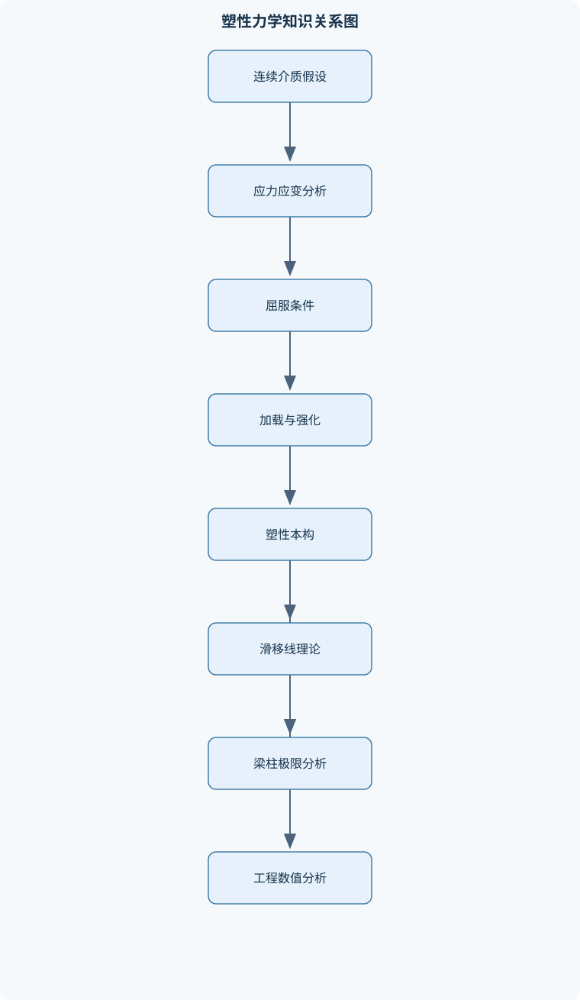
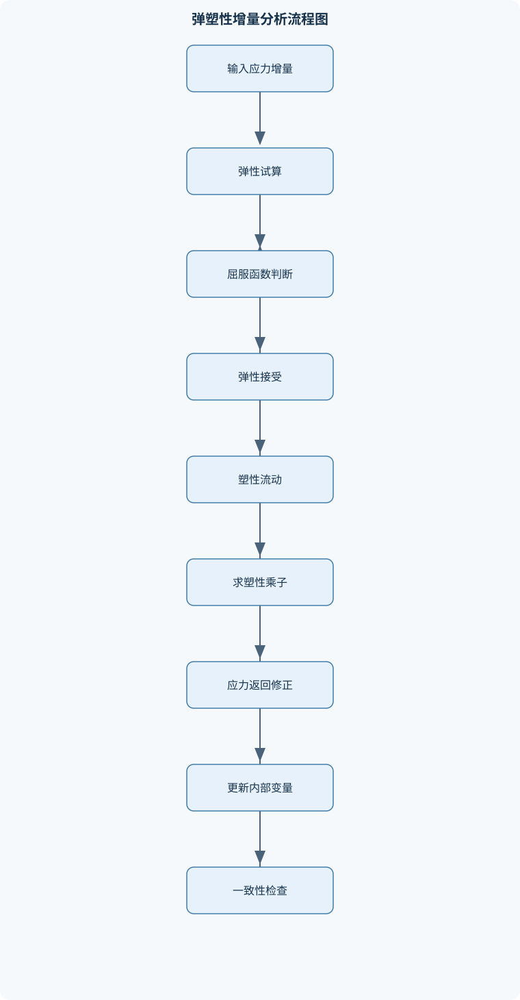

# 塑性力学

## 一、课程整体知识框架

### 课程边界与先修知识

塑性力学研究连续介质在应力超过屈服条件后产生不可恢复变形的规律，内容边界包括小变形弹塑性理论、应力与应变分析、屈服与加载条件、塑性本构关系、平面应变刚塑性问题、滑移线场以及梁、刚架和杆系的塑性极限分析。课程以均匀连续材料、初始无应力、小变形、准静态加载和常温条件为基本背景，通常忽略蠕变、应力松弛、温度效应、惯性效应及应变率效应。材料在初始屈服前通常假定各向同性；进入塑性阶段后，可根据问题需要采用理想塑性、等向强化或随动强化模型。先修知识包括高等数学、线性代数、理论力学、材料力学、弹性力学和常微分方程。应掌握张量、矩阵、偏导数、积分、静力平衡、截面几何性质、主应力和莫尔圆等基础工具。课程不覆盖高温塑性、黏塑性、有限变形塑性、复合材料塑性、断裂力学和具体材料本构参数标定，但可为这些内容提供理论基础。





### 1. 研究对象、基本假设与理论边界

塑性力学研究连续介质在应力达到屈服条件以后，产生不可恢复变形的规律。材料卸载后能够恢复的部分属于弹性变形，不能恢复的部分属于塑性变形。塑性与非线性、塑性与大变形并不是同义概念：材料可以在小变形条件下发生塑性，也可以在弹性阶段表现出非线性；本课程主要研究小变形弹塑性问题。

课程通常采用均匀连续材料、初始无应力、常温、准静态加载和小变形假设。材料在初始屈服前通常视为各向同性；进入塑性阶段后，可根据加载历史和材料特性选择理想塑性、等向强化、随动强化或混合强化模型。准静态假设意味着忽略惯性效应，常温假设意味着忽略温度对屈服和流动的影响，小变形假设意味着几何关系可在线性化后处理。课程一般不处理蠕变、应力松弛、黏塑性、有限变形塑性、断裂、损伤、复合材料塑性和具体材料参数标定的完整实验程序。

塑性力学中的平衡方程和小变形几何关系与弹性力学相同，根本差别在于本构关系。弹性材料的应力通常由当前应变唯一确定；塑性材料的应力和塑性应变还取决于加载历史、卸载路径和内部变量。因而仅有平衡方程和几何方程不能唯一确定塑性问题，还必须给出屈服条件、流动法则、强化规律和加载—卸载条件。

先修基础包括高等数学、线性代数、理论力学、材料力学、弹性力学和常微分方程。应能进行张量与矩阵运算、偏导和积分，建立静力平衡方程，计算截面面积、形心和惯性矩，并理解主应力、主应变与莫尔圆。

### 2. 从实验曲线到本构模型

单轴拉伸试验是理解塑性行为的基础。工程应力和工程应变分别定义为

$$
\sigma_{\mathrm{eng}}=\frac{F}{A_0},\qquad
\varepsilon_{\mathrm{eng}}=\frac{L-L_0}{L_0},
$$

其中 $F$ 为轴向力，单位通常为 $\mathrm{N}$；$A_0$ 为初始截面积，单位为 $\mathrm{m^2}$ 或 $\mathrm{mm^2}$；$L_0$ 和 $L$ 分别为初始和当前标距。工程应力单位为 $\mathrm{Pa}$，工程应变无量纲。真实应力和真实应变分别采用当前面积和对数长度变化：

$$
\sigma_{\mathrm{true}}=\frac{F}{A},\qquad
\varepsilon_{\mathrm{true}}=\ln\frac{L}{L_0}.
$$

在均匀变形阶段，若忽略体积变化，可近似得到 $A L=A_0L_0$，因而

$$
\sigma_{\mathrm{true}}
=\sigma_{\mathrm{eng}}(1+\varepsilon_{\mathrm{eng}}),\qquad
\varepsilon_{\mathrm{true}}
=\ln(1+\varepsilon_{\mathrm{eng}}).
$$

颈缩以后，变形不再均匀，上式不能直接代表颈缩区的局部真实应力；此时需要测量局部截面并考虑三轴应力状态。

曲线通常经历比例极限、弹性极限、屈服、强化和颈缩阶段。比例极限是应力—应变关系仍保持比例的上限；弹性极限是卸载后仍能完全恢复的上限，二者不必相同。屈服应力是材料开始出现显著塑性流动时的应力。屈服后，材料可能在应力变化不大时产生较大塑性应变；继续变形需要提高应力时称为强化。颈缩表示局部截面收缩开始集中，工程应力可能下降，但颈缩区真实应力仍可能继续增大。

卸载时应力通常沿弹性斜率变化，卸载后保留残余塑性应变。若单轴总应变写成

$$
\varepsilon=\varepsilon^e+\varepsilon^p,
$$

则线弹性阶段有 $\varepsilon^e=\sigma/E$；卸载至 $\sigma=0$ 后，残余应变为当前塑性应变 $\varepsilon^p$。拉伸塑性变形后，材料在反向压缩时较早屈服的现象称为包辛格效应。它说明屈服状态不能只由当前应力大小决定，必须考虑应力历史。等向强化使屈服面整体扩大，随动强化使屈服面在应力空间中移动，后者更适合描述反向加载中的屈服提前。

常用一维模型包括理想弹塑性、线性强化和幂强化。理想弹塑性材料达到 $\sigma_Y$ 后继续塑性变形而应力不增加；线性强化模型在塑性阶段用常塑性模量近似曲线；幂强化模型可写成

$$
\sigma=K(\varepsilon^p)^n
$$

或采用总应变、塑性应变与弹性应变的组合形式。式中 $K$ 为强度系数，单位为应力；$n$ 为无量纲强化指数。不同写法的适用区间不同，不能把只适用于塑性段的经验式外推到弹性段或颈缩后的局部区域。

### 3. 应力状态分析的统一框架

采用直角坐标 $x_1,x_2,x_3$，应力张量记为 $\boldsymbol\sigma$，分量为 $\sigma_{ij}$。在无偶力连续介质中，角动量平衡给出

$$
\sigma_{ij}=\sigma_{ji}.
$$

单位法向量为 $\boldsymbol n$ 的斜截面上，应力向量由柯西公式给出：

$$
\boldsymbol t=\boldsymbol\sigma\boldsymbol n.
$$

这里 $\boldsymbol t$ 的单位为应力，表示单位面积上的总接触力。正应力和切应力分别为

$$
\sigma_n=\boldsymbol n\cdot\boldsymbol\sigma\boldsymbol n,
$$

$$
\boldsymbol t_s=\boldsymbol t-\sigma_n\boldsymbol n,\qquad
\tau_n=\|\boldsymbol t_s\|.
$$

推导这些公式时必须要求 $\boldsymbol n\cdot\boldsymbol n=1$。若输入的是未归一化向量，必须先除以其长度，否则正应力和切应力均不能直接使用。

主平面上的切应力为零。令主方向单位向量为 $\boldsymbol n$，则

$$
\boldsymbol\sigma\boldsymbol n=\sigma\boldsymbol n,
$$

从而得到特征值问题

$$
\det(\boldsymbol\sigma-\sigma\boldsymbol I)=0.
$$

三个特征根按降序记为 $\sigma_1\geq\sigma_2\geq\sigma_3$，对应特征向量为主方向。由于应力张量对称，三个主方向相互正交。最大切应力为

$$
\tau_{\max}=\frac{\sigma_1-\sigma_3}{2}.
$$

它由最大和最小主应力控制，中间主应力不直接出现在最大切应力表达式中，但会影响米塞斯屈服函数。

应力可分解为球应力和偏应力：

$$
\boldsymbol\sigma=\sigma_m\boldsymbol I+\boldsymbol s,
\qquad
\sigma_m=\frac{\operatorname{tr}(\boldsymbol\sigma)}{3},
\qquad
\boldsymbol s=\boldsymbol\sigma-\sigma_m\boldsymbol I.
$$

球应力改变平均压力和弹性体积变形；偏应力主要控制形状改变和金属塑性屈服。应力不变量为

$$
I_1=\operatorname{tr}(\boldsymbol\sigma),
$$

$$
I_2=\frac12\left[(\operatorname{tr}\boldsymbol\sigma)^2-
\operatorname{tr}(\boldsymbol\sigma^2)\right],
\qquad
I_3=\det\boldsymbol\sigma.
$$

偏应力第二不变量为

$$
J_2=\frac12\boldsymbol s:\boldsymbol s.
$$

莫尔圆把三维应力状态投影为若干圆的几何关系，可用于判断主应力、最大切应力和斜截面应力。使用莫尔圆时必须明确正应力和切应力正号约定；不同教材对切应力轴方向的规定可能相反，但只要前后一致，物理结果不变。Lode参数反映三个主应力的相对排列，常用于区分不同中间主应力状态；它不是单独的屈服条件，具体定义需与所采用的归一化方式同时给出。

### 4. 应变、变形协调与塑性不可压缩

位移场记为 $\boldsymbol u=(u_1,u_2,u_3)$。小变形应变张量为

$$
\varepsilon_{ij}
=\frac12\left(\frac{\partial u_i}{\partial x_j}
+\frac{\partial u_j}{\partial x_i}\right).
$$

法向应变为 $\varepsilon_{ii}$，张量剪应变为 $\varepsilon_{ij}$，工程剪应变为

$$
\gamma_{ij}=2\varepsilon_{ij},\qquad i\ne j.
$$

工程剪应变与张量剪应变相差二倍，是应变计算中最常见的因子错误来源。应变主值由应变张量特征值确定；应变球量和偏量可按与应力相同的方式分解。体积应变为

$$
\varepsilon_v=\operatorname{tr}(\boldsymbol\varepsilon)
=\varepsilon_{11}+\varepsilon_{22}+\varepsilon_{33}.
$$

总应变分解为

$$
d\boldsymbol\varepsilon
=d\boldsymbol\varepsilon^e+d\boldsymbol\varepsilon^p.
$$

对普通金属的小变形塑性，塑性应变增量近似不可压缩：

$$
d\varepsilon^p_{kk}=0.
$$

这不表示总应变体积始终为零，因为弹性部分仍可产生可恢复的体积变化。只有在刚塑性理想化中，才通常直接令总速度场满足不可压缩条件。

应变协调方程保证应变场来自连续位移场。若应变分量任意指定而不满足协调条件，可能无法构造连续位移。二维小变形情况下，典型协调关系为

$$
\frac{\partial^2\varepsilon_x}{\partial y^2}
+\frac{\partial^2\varepsilon_y}{\partial x^2}
=
\frac{\partial^2\gamma_{xy}}{\partial x\partial y}.
$$

该关系适用于连续体内部的小变形、连续位移和足够光滑的场。若存在裂纹、速度间断或理想刚塑性剪切带，必须采用分片连续和界面跳跃条件，不能把连续协调方程无条件应用于间断面。

### 5. 屈服条件与屈服面的几何意义

屈服函数写为

$$
f(\boldsymbol\sigma,\boldsymbol q,\kappa)=0.
$$

$f<0$ 表示当前应力位于弹性域内部，$f=0$ 表示处于当前屈服面，正常塑性加载不能进入 $f>0$ 区域。$\boldsymbol q$ 可表示背应力等内部变量，$\kappa$ 表示强化参数。

Tresca 条件以最大切应力为基础：

$$
\sigma_1-\sigma_3=2k.
$$

若单向拉伸屈服应力为 $\sigma_Y$，则单轴状态中 $\sigma_1=\sigma_Y,\sigma_2=\sigma_3=0$，所以

$$
k=\frac{\sigma_Y}{2}.
$$

于是 Tresca 条件也可写为 $\sigma_1-\sigma_3=\sigma_Y$。Mises 条件为

$$
\sigma_{\mathrm{eq}}
=\sqrt{3J_2}
=
\sqrt{\frac12\left[
(\sigma_1-\sigma_2)^2+
(\sigma_2-\sigma_3)^2+
(\sigma_3-\sigma_1)^2
\right]}
=\sigma_Y.
$$

单向拉伸时 $\sigma_{\mathrm{eq}}=\sigma_Y$；纯剪切时若剪切屈服应力为 $k$，则 $\sigma_{\mathrm{eq}}=\sqrt3k$，所以 Mises 标定给出 $k=\sigma_Y/\sqrt3$。由此可见，比较 Tresca 和 Mises 时必须说明采用单向拉伸还是纯剪切作为标定基准。

在主应力空间中，Tresca 屈服面是沿静水压力轴延伸的六棱柱，Mises 屈服面是沿同一轴延伸的圆柱面。按照单向拉伸屈服点标定时，Tresca 六边形内接于 Mises 圆，Tresca 通常给出更保守的屈服预测。普通延性金属的小变形模型对静水压力不敏感，因为静水压力只改变 $\sigma_m$，不改变偏应力；土、岩石、泡沫和某些多孔材料具有明显压力敏感性，不能直接套用 Tresca 或 Mises。

### 6. 加载条件、强化与塑性本构

材料状态不仅取决于当前应力，还取决于屈服面如何随历史变化。等向强化使屈服面中心保持不变、半径扩大；随动强化使屈服面大小近似不变而在应力空间中平移。前者适用于单调加载的平均强化，后者适用于描述包辛格效应；循环加载通常需要混合强化和更复杂的内部变量。

加载条件可分为塑性加载、卸载和中性变载。塑性加载要求

$$
f=0,\qquad d\lambda>0,\qquad df=0.
$$

卸载通常满足 $f=0$ 或由屈服面附近进入弹性域，且 $d\lambda=0$。中性变载仍在屈服面上，但应力增量不引起新的塑性流动，通常也取 $d\lambda=0$。在卸载过程中强行使用 $df=0$ 计算塑性乘子，会把弹性恢复错误地解释为塑性变形。

塑性势函数为 $g$，流动法则写为

$$
d\boldsymbol\varepsilon^p
=d\lambda\frac{\partial g}{\partial\boldsymbol\sigma},
\qquad d\lambda\geq0.
$$

当 $g=f$ 时称为关联流动法则；若 $g\ne f$，称为非关联流动法则。Mises 关联流动中，屈服函数只依赖偏应力，因此

$$
\frac{\partial f}{\partial\boldsymbol\sigma}
\propto\boldsymbol s,
$$

而 $\operatorname{tr}(\boldsymbol s)=0$，所以塑性流动不可压缩。

各向同性线弹性关系为

$$
\boldsymbol\varepsilon
=\frac{1+\nu}{E}\boldsymbol\sigma
-\frac{\nu}{E}\operatorname{tr}(\boldsymbol\sigma)\boldsymbol I,
$$

或

$$
\boldsymbol\sigma
=2G\boldsymbol\varepsilon
+\lambda_L\operatorname{tr}(\boldsymbol\varepsilon)\boldsymbol I,
$$

其中

$$
G=\frac{E}{2(1+\nu)},\qquad
K=\frac{E}{3(1-2\nu)},\qquad
\lambda_L=\frac{E\nu}{(1+\nu)(1-2\nu)}.
$$

$E$、$G$、$K$ 的单位均为应力，$\nu$ 无量纲。上述关系要求材料各向同性、线弹性和小变形；当 $\nu$ 接近 $0.5$ 时，$K$ 很大，材料近似不可压缩，直接使用位移型数值方法可能出现体积锁死。

增量理论将应力增量与应变增量联系起来。Prandtl–Reuss 关系适用于 Mises 关联流动的金属塑性；Levy–Mises 关系主要描述刚塑性阶段，塑性应变增量与偏应力同方向。强化材料中，塑性模量由实验强化曲线决定。全量理论只有在简单加载下才可能与增量理论等价；简单加载要求应力张量各分量比值不变并沿同一参数单调增加。复杂反向加载、循环加载和非比例加载中，必须使用增量理论。

Drucker 公设要求稳定材料在闭合应力循环中的附加功不为负。其重要结果包括屈服面的外凸性、塑性流动方向与加载面外法线一致，以及只有应力增量具有使应力点离开弹性域的分量时才会发生塑性加载。若模型违反外凸性或给出负塑性耗散，可能导致数值不稳定或违反热力学约束。

### 7. 平面应变、刚塑性与滑移线理论

平面应变条件是

$$
\varepsilon_z=\gamma_{xz}=\gamma_{yz}=0,
$$

但一般有 $\sigma_z\ne0$。平面应力条件则是 $\sigma_z=0$，对应薄板自由表面等边界。二者不能混用。

平面应变问题的平衡方程为

$$
\frac{\partial\sigma_x}{\partial x}
+\frac{\partial\tau_{xy}}{\partial y}
+b_x=0,
$$

$$
\frac{\partial\tau_{xy}}{\partial x}
+\frac{\partial\sigma_y}{\partial y}
+b_y=0,
$$

其中 $b_x,b_y$ 为单位体积体力，单位为 $\mathrm{N/m^3}$。刚塑性理论忽略弹性应变，只保留塑性流动；对于金属理想刚塑性材料，速度场满足

$$
\frac{\partial v_x}{\partial x}
+\frac{\partial v_y}{\partial y}=0.
$$

塑性区是发生塑性流动的区域，刚性区近似不发生相对变形；二者交界处必须满足应力、速度或速度间断条件。若边界存在速度跳跃，需用剪切带或速度间断条件处理，不能要求速度处处连续。

滑移线是平面理想刚塑性问题中的特征线，两族滑移线通常相互正交，并与主应力方向成固定角度关系。由于控制方程具有双曲型特征，边界上的应力信息可沿特征线传播。Hencky 第一、第二定理给出沿两族滑移线传播应力和方向变化的关系，常用于由已知边界逐步构造均匀场、中心场和一般滑移线场。

滑移线分析的一般过程是：识别自由边界、刚性边界和塑性区；由主应力方向确定两族特征线；从已知边界发出滑移线；沿线利用 Hencky 关系传播应力；在场与场的交界处匹配应力和速度；最后检查自由边界切应力为零、刚性边界法向速度条件以及塑性区边界条件。该方法适用于平面应变、理想刚塑性、特定屈服条件和规则边界，不能直接推广到三维、强硬化、有限变形或明显压力敏感材料。

典型问题包括单边受压楔形体、刚性基础下的塑性流动和具有边界摩擦的楔体。锐角楔中可能出现应力间断线；刚性基础有无摩擦会改变边界主应力方向和滑移线形状；摩擦边界不能简单当作自由边界。理想刚塑性解可能出现多个数学可行场，必须根据边界条件、速度连续性、能量条件和唯一性要求判别其物理合理性。

### 8. 梁、杆系与结构极限分析

薄壁圆管在内压 $p$ 下，若平均半径为 $r$、壁厚为 $t$ 且 $t\ll r$，环向膜应力为

$$
\sigma_\theta=\frac{pr}{t}.
$$

若为封闭端，还需由端盖平衡得到

$$
\sigma_z=\frac{pr}{2t}.
$$

自由端不传递端部轴向力，固定端可能通过支座传递轴向力和弯矩；因此不能把封闭端公式直接用于所有端部。厚壁圆筒中应力沿厚度显著变化，必须采用厚壁解或弹塑性厚壁模型。

梁的平截面假定为

$$
\varepsilon_x=-\kappa y,
$$

其中 $\kappa$ 为曲率，单位为 $\mathrm{m^{-1}}$；$y$ 为截面点到中性轴的距离，单位为 $\mathrm m$。弹性阶段有

$$
\sigma_x=E\varepsilon_x=-E\kappa y,
\qquad
M=EI\kappa,
$$

其中

$$
I=\int_A y^2\,dA.
$$

外缘首先达到屈服，初始屈服弯矩为

$$
M_y=\frac{\sigma_Y I}{c},
$$

其中 $c$ 是中性轴到最外缘的距离。全塑性状态下，拉、压两侧分别以屈服应力承载：

$$
M_p=\sigma_Y Z_p,\qquad
Z_p=\int_A|y|\,dA.
$$

截面形状系数为

$$
\frac{M_p}{M_y}.
$$

矩形截面宽 $b$、高 $h$ 时，

$$
I=\frac{bh^3}{12},\qquad
Z_p=\frac{bh^2}{4},
$$

因此

$$
M_y=\frac{\sigma_Ybh^2}{6},\qquad
M_p=\frac{\sigma_Ybh^2}{4},
\qquad
\frac{M_p}{M_y}=\frac32.
$$

塑性铰形成后，在理想塑性模型中弯矩近似保持为 $M_p$，曲率仍可增加。首次屈服不等于极限承载力；从外缘局部屈服到全截面塑性之间，梁仍可能通过塑性发展和弯矩重分布继续承载。

对梁和刚架，极限荷载是结构形成足够塑性铰并转化为机构时的荷载。静不定结构需要的塑性铰数量与结构静不定次数、支承条件和可能破坏机构有关。静力法构造满足平衡、边界条件和屈服约束的应力场；机动法假定运动机构，利用外功率等于塑性铰内功率求候选极限荷载。若静力法应力场满足所有约束，结果为严格下限；若机动法机构可行，结果通常为上限。上下限相等时，极限荷载得到严格确定。

### 9. 工程计算与模型边界

材料参数通常包括 $E$、$\nu$、初始屈服应力、强化曲线、卸载规律和循环强化参数。实验曲线拟合必须明确使用工程应力—应变还是真实应力—塑性应变，必须处理颈缩、机器柔度和测量噪声。直接把工程曲线全部输入有限元，可能造成屈服点和强化参数错误。

小变形弹塑性有限元的材料点更新通常采用弹性试算—屈服判定—塑性修正—内部变量更新。理想塑性模型容易出现切线刚度退化、局部化和网格依赖；大变形问题还必须考虑几何非线性、旋转和客观应力率。各向异性、循环加载、残余应力和残余变形需要扩展屈服面与内部变量模型。

理论解、实验结果和数值结果应交叉验证。验证内容包括反力平衡、边界条件、屈服区位置、载荷—位移曲线、残余变形和网格收敛。一个只与实验峰值吻合、但无法解释局部应力、屈服区和卸载残余变形的模型，并不能被视为充分可靠。

## 二、章节和模块划分

### 核心知识覆盖清单

本清单用于检查正文是否覆盖本课程的主要知识模块：

- **塑性力学基本概念与实验基础**：弹性变形与塑性变形的可恢复性差异、比例极限、弹性极限与屈服应力、屈服阶段、强化阶段与颈缩阶段、工程应力应变与真实应力应变、伸长率和截面收缩率的物理意义、卸载、再加载与塑性残余应变、包辛格效应与交叉强化效应、理想弹塑性、线性强化和幂强化模型。
- **应力状态分析**：一点应力张量及其分量表示、斜截面应力向量与柯西公式、正应力和切应力的计算、主平面、主应力和主方向、主应力特征方程的建立、最大与最小切应力、应力张量的球张量与偏张量分解、应力不变量和八面体应力、应力莫尔圆的作图与判读、Lode应力参数的定义与物理含义。
- **应变与变形协调**：位移场与小变形应变张量、法向应变和工程剪应变、主应变及主应变方向、体积应变与偏应变分解、等效应变和等效剪应变、应变不变量与Lode应变参数、应变协调方程、小变形假设的适用边界、塑性不可压缩条件与体积变化、应变率张量在刚塑性分析中的作用。
- **屈服条件与屈服面的几何表示**：屈服函数与弹性域、应力空间、应变空间和应力路径、主应力空间中的静水压力轴、偏应力平面与屈服曲线、Tresca最大切应力屈服条件、Mises形变能屈服条件、单向拉伸和纯剪切标定、Tresca六边形与Mises圆的比较、静水压力对金属屈服的影响、屈服条件在土和岩石等材料中的适用限制。
- **加载条件与强化理论**：初始屈服面与后继加载面、加载、中性变载和卸载、等向强化模型、随动强化模型与背应力、各向同性强化和运动强化的差异、塑性应变历史的影响、塑性功与等效塑性应变、Drucker公设及其物理意义、屈服面的外凸性与稳定性、包辛格效应的本构描述。
- **弹塑性本构关系**：广义Hooke定律、弹性应变能的体积和形状分解、应变分解为弹性应变和塑性应变、塑性流动法则和塑性势函数、关联流动法则、增量型塑性本构关系、Prandtl-Reuss关系、Levy-Mises关系、强化材料的塑性模量、全量理论与增量理论、简单加载定理及其成立条件。
- **平面问题与刚塑性理论**：平面应变与平面应力的区别、平面应变问题的平衡方程、刚塑性材料的体积不可压缩条件、刚塑性本构关系、塑性区和刚性区的划分、最大切应力方向与塑性流动方向、速度场与速度间断、塑性区边界条件、应力间断和莫尔圆切换、平面问题的理想化边界。
- **滑移线理论**：滑移线的定义和几何方向、两族正交滑移线、特征线与双曲型方程、Hencky第一定理、Hencky第二定理、简单应力场和中心场、均匀应力场、滑移线上的应力传播、滑移线上的速度关系、自由边界和刚塑性边界的判定。
- **典型刚塑性平面问题**：单边受压楔形体、楔体中的均匀场和中心场、锐角楔中的应力间断线、刚性基础上的塑性流动、边界摩擦对滑移线场的影响、塑性区边界的构造、主应力方向与滑移线方向转换、极限压力的求解步骤、滑移线场的唯一性与多解判别、理想刚塑性解的局限性。
- **杆件和梁的弹塑性分析**：薄壁圆管内压下的膜应力、封闭端、固定端和自由端的区别、三杆桁架的弹塑性平衡、梁的平截面假定、弹性阶段的弯曲应力分布、初始屈服弯矩、全塑性弯矩、截面形状系数、塑性铰的形成条件、弯矩重分布和超静定结构。
- **塑性极限分析方法**：极限状态和极限荷载、极限状态下的塑性流动、结构静不定次数与塑性铰数量、静力法的基本思想、机动法的基本思想、虚功方程的建立、可能破坏机构的选取、上限定理和下限定理的适用条件、梁和刚架的极限荷载、极限分析与弹塑性全过程分析的区别。
- **工程计算与模型边界**：材料参数的实验确定、屈服应力和强化曲线的拟合、有限元弹塑性分析的基本输入、应力更新与屈服判定、网格、边界条件和载荷路径影响、理想塑性模型的数值困难、大变形和几何非线性影响、材料各向异性和循环加载、残余应力与残余变形分析、理论解、实验结果和数值结果的交叉验证。


### 1. 模块一：塑性力学基本概念与实验基础

本模块先建立弹性、塑性、屈服、强化、颈缩和残余变形的实验图像，再引入理想弹塑性、线性强化和幂强化模型。重点区分比例极限、弹性极限和屈服应力，解释工程量与真实量的差异，并通过卸载—再加载说明塑性应变是历史变量。伸长率反映断裂前标距增长程度，截面收缩率反映局部截面积减少程度，二者用于描述延性，但不等同于屈服强度或极限强度。包辛格效应说明拉压反向加载不能仅由单调拉伸曲线描述。

### 2. 模块二：应力状态分析

本模块由一点应力张量、斜截面应力、主应力、最大切应力、应力不变量、球应力和偏应力构成。计算斜截面应力时，先确认法向量单位化，再计算 $\boldsymbol t$、$\sigma_n$ 和 $\tau_n$。主应力问题归结为对称矩阵特征值问题；主应力排序后才能使用 Tresca 条件。莫尔圆适合二维应力状态的几何判读，但三维情况下应使用三个主应力构成的莫尔圆族。Lode 参数用于补充中间主应力效应，不能替代完整屈服函数。

### 3. 模块三：应变与变形协调

本模块从位移梯度建立小变形应变张量，区分法向应变、张量剪应变和工程剪应变。应变主值由特征值求得，体积应变由迹求得，偏应变描述形状改变。协调方程保证应变来自连续位移。金属塑性中通常只有塑性体积应变近似为零；总应变仍可能含有弹性体积分量。刚塑性速度场中的不可压缩条件应与速度间断、剪切带边界条件配合使用。

### 4. 模块四：屈服条件与屈服面

本模块在应力空间中定义弹性域和屈服面，并比较 Tresca 与 Mises。Tresca 由最大切应力控制，Mises 由偏应力第二不变量控制。两者均不含静水应力，因此适合普通延性金属的初步小变形模型；土和岩石的屈服受压力影响，需采用压力敏感模型。屈服面沿静水压力轴延伸，偏应力平面上的截面分别为六边形和圆形。比较两种准则时，必须统一单向拉伸或纯剪切标定基准。

### 5. 模块五：加载条件与强化理论

本模块区分初始屈服面、后继屈服面、塑性加载、中性变载和卸载。等向强化用扩大屈服面描述单调强化，随动强化用平移屈服面描述反向屈服提前。塑性功和等效塑性应变用于把多轴塑性历史压缩为标量硬化变量。Drucker 公设要求塑性耗散和屈服面外凸性满足稳定性条件。不能在卸载阶段强行令 $df=0$，也不能用等向强化单独解释包辛格效应。

### 6. 模块六：弹塑性本构关系

本模块先回顾广义 Hooke 定律，再建立总应变分解、塑性势函数、流动法则和增量本构。关联流动法则在金属 Mises 塑性中常用；土和岩石常采用非关联流动以分别拟合屈服和体积变化。Prandtl–Reuss 关系适用于 Mises 关联弹塑性，Levy–Mises 关系适用于刚塑性近似。塑性加载时利用一致性条件 $df=0$ 求塑性乘子，卸载时采用纯弹性增量。全量理论只能在简单加载等严格条件下代替增量理论。

### 7. 模块七：平面问题与刚塑性理论

本模块区分平面应力与平面应变，建立平衡方程、不可压缩速度场和塑性区边界条件。平面应变中 $\varepsilon_z=0$ 不意味着 $\sigma_z=0$。刚性区、塑性区和速度间断区的划分取决于边界约束和载荷路径。塑性流动方向由流动法则决定；在关联 Mises 模型中，塑性流动方向与偏应力方向一致。边界上的自由面、摩擦面和刚性接触面必须使用不同边界条件。

### 8. 模块八：滑移线理论

滑移线是平面理想刚塑性方程的特征线，两族滑移线通常正交。课程应建立滑移线方向与主应力方向之间的转换关系，理解特征线为何能够传播应力信息，并使用 Hencky 第一、第二定理分析应力和曲率变化。典型应力场包括均匀场、中心场和简单场。自由边界要求切应力为零，刚塑性边界还需满足速度或接触条件。滑移线结果的唯一性必须结合所有边界条件和速度场检查，不能只凭局部应力满足屈服条件就判定解正确。

### 9. 模块九：典型刚塑性平面问题

楔形体受压问题中，应先根据楔角、自由边界、刚性边界和摩擦条件划分均匀场、中心场及可能的应力间断线，再利用滑移线传播关系求极限压力。刚性基础上的塑性流动需要考虑基础表面是否光滑；有摩擦时，边界切向应力不再为零，塑性区形状和极限压力均会改变。应力间断线允许应力场分片表示，但必须满足界面平衡；速度间断则必须满足法向速度协调和能量耗散条件。

### 10. 模块十：杆件和梁的弹塑性分析

薄壁圆管内压问题要求先判断 $t/r$ 是否足够小，再分别对纵向和环向截面作自由体图。封闭端产生轴向膜应力，自由端和固定端的轴向边界不同。梁分析从平截面假定开始，先求弹性阶段弯矩—曲率关系，再求初始屈服弯矩和全塑性弯矩。塑性铰不是材料铰，而是截面弯矩达到 $M_p$ 后曲率可继续增长的理想化模型。超静定梁中塑性发展会引起弯矩重分布，不能用首次屈服荷载代替极限荷载。

### 11. 模块十一：塑性极限分析方法

极限分析研究结构在理想弹塑性假设下达到机构状态的荷载。静力法构造满足平衡、边界条件和屈服约束的应力场，得到极限荷载下限；机动法构造满足运动约束的破坏机构，通过虚功方程求上限。一个静不定结构需要形成足够塑性铰才能成为机构，但铰数并非脱离支承和机构形态固定不变。候选机构必须检查转动方向、支座约束和未铰截面的弯矩是否超出 $M_p$。极限分析不提供从首次屈服到极限荷载之间的完整弹塑性全过程。

### 12. 模块十二：工程计算与模型验证

本模块将理论模型用于材料试验、有限元材料点和结构计算。应输入弹性常数、屈服参数、强化曲线、边界条件和载荷路径，并区分理想塑性、等向强化和随动强化。有限元中要检查应力更新残差、反力平衡、网格敏感性和时间步长敏感性。大变形、几何非线性、材料各向异性、循环加载和局部化会超出基础小变形模型的适用边界。理论解、实验和数值结果应从承载力、变形、屈服区和残余状态多个维度交叉验证。

### 13. 代表性计算流程

#### 13.1 斜截面应力与屈服判定流程

**输入**：对称应力矩阵 $\boldsymbol\sigma$、法向量 $\boldsymbol n$、屈服应力 $\sigma_Y$ 和所选屈服准则。  
**输出**：斜截面应力向量、正应力、切应力、主应力和屈服状态。

1. 检查 $\boldsymbol n\cdot\boldsymbol n=1$，不满足时先归一化。
2. 计算 $\boldsymbol t=\boldsymbol\sigma\boldsymbol n$。
3. 计算 $\sigma_n=\boldsymbol n\cdot\boldsymbol t$。
4. 计算 $\boldsymbol t_s=\boldsymbol t-\sigma_n\boldsymbol n$ 和 $\tau_n=\|\boldsymbol t_s\|$。
5. 求特征值并按 $\sigma_1\geq\sigma_2\geq\sigma_3$ 排序。
6. 按 Tresca 计算 $\sigma_1-\sigma_3$，或按 Mises 计算 $\sigma_{\mathrm{eq}}$。
7. 与屈服参数比较，输出弹性、初始屈服或塑性状态。

该流程适用于小变形金属模型；对压力敏感材料不能直接采用 Mises 判据。三维矩阵运算维数固定，单次计算复杂度为常数级。

#### 13.2 弹塑性材料点应力更新

**输入**：上一步应力、总应变增量、弹性矩阵、屈服函数、强化变量。  
**输出**：更新应力、塑性应变、强化变量和一致性残差。

1. 用弹性矩阵计算试算应力。
2. 代入屈服函数，若 $f\leq0$，接受弹性试算结果。
3. 若 $f>0$，根据流动法则和强化规律求塑性乘子。
4. 修正应力，使其回到当前屈服面。
5. 更新塑性应变和内部变量。
6. 检查 $|f|$ 是否小于容差；若不满足则迭代。
7. 输出并进入下一增量。

不变量是：接受的塑性应力必须满足屈服约束，塑性乘子必须非负，硬化变量必须符合演化规律。复杂度主要由局部迭代次数决定。

```python
# Python：各向同性小变形 Mises 屈服初步判定
import numpy as np

def mises_equivalent(stress):
    """
    stress: 3x3 对称应力矩阵，单位为 Pa
    return: Mises 等效应力，单位为 Pa
    """
    stress = np.asarray(stress, dtype=float)
    if stress.shape != (3, 3):
        raise ValueError("应力矩阵必须为 3×3")

    if not np.allclose(stress, stress.T, atol=1e-10):
        raise ValueError("无偶力条件下应力矩阵应为对称矩阵")

    mean_stress = np.trace(stress) / 3.0
    deviator = stress - mean_stress * np.eye(3)
    j2 = 0.5 * np.sum(deviator * deviator)
    return np.sqrt(3.0 * j2)

def yield_state(stress, yield_stress, tolerance=1e-9):
    """
    yield_stress: 单向拉伸屈服应力，单位为 Pa
    """
    if yield_stress <= 0:
        raise ValueError("屈服应力必须为正")

    seq = mises_equivalent(stress)
    if seq < yield_stress - tolerance:
        state = "弹性域内"
    elif abs(seq - yield_stress) <= tolerance:
        state = "当前屈服面上"
    else:
        state = "试算应力超出屈服面，需要塑性修正"
    return seq, state
```

该代码只完成屈服判定，不进行返回映射、强化变量更新或有限元全局迭代；因此不能把“试算应力超出屈服面”误认为已经得到最终塑性应力。

#### 13.3 梁和刚架的极限荷载流程

**输入**：结构几何、支承、荷载形式、截面全塑性弯矩 $M_p$。  
**输出**：候选极限荷载和控制机构。

静力法步骤为：确定可能达到最大弯矩的位置；在候选截面施加 $M=\pm M_p$；结合整体平衡求反力和弯矩图；检查其余截面弯矩不超过 $M_p$；确认是否形成机构。若应力场满足所有屈服和边界约束，所得结果为下限。

机动法步骤为：列举可能塑性铰位置；构造满足支承约束的机构；给定虚转角；计算外力虚功率；计算各塑性铰内功率 $\sum M_p\dot\theta$；令内外功率相等求荷载；比较所有可行机构。候选机构数量增加时，组合复杂度可能快速增长，因此需利用对称性、荷载位置和结构自由度排除明显不可能的机构。

### 14. 代表性例题

#### 例题一：斜截面应力计算

**题干**：给定

$$
\boldsymbol\sigma=
\begin{bmatrix}
100&20&0\\
20&50&0\\
0&0&0
\end{bmatrix}\ \mathrm{MPa},
\qquad
\boldsymbol n=\frac1{\sqrt2}(1,1,0).
$$

求斜截面应力向量、正应力和切应力。

**分析**：法向量已单位化，先使用柯西公式，再分解正、切分量。

**解答**：

$$
\boldsymbol t=\boldsymbol\sigma\boldsymbol n
=\frac1{\sqrt2}
\begin{bmatrix}
120\\70\\0
\end{bmatrix}\mathrm{MPa}.
$$

因此

$$
\sigma_n=\boldsymbol n\cdot\boldsymbol t
=\frac{190}{2}=95\ \mathrm{MPa}.
$$

切应力大小为

$$
\tau_n=
\sqrt{\boldsymbol t\cdot\boldsymbol t-\sigma_n^2}
=
\sqrt{\frac{120^2+70^2}{2}-95^2}
\approx25\ \mathrm{MPa}.
$$

**结果验证**：应力张量的主应力为二维块的特征值

$$
\sigma_{1,2}
=\frac{150\pm\sqrt{50^2+40^2}}2
\approx139.05,\ 10.95\ \mathrm{MPa},
$$

第三主应力为 $0$。最大切应力约为 $(139.05-0)/2=69.53\ \mathrm{MPa}$，确实大于斜截面所得 $25\ \mathrm{MPa}$。

**变式**：若给出的法向量为 $(1,1,0)$ 而未除以 $\sqrt2$，必须先归一化；直接代入会造成正应力和切应力错误。

#### 例题二：Tresca 与 Mises 屈服判定

**题干**：主应力为

$$
\sigma_1=180\ \mathrm{MPa},\quad
\sigma_2=60\ \mathrm{MPa},\quad
\sigma_3=-20\ \mathrm{MPa},
$$

单向拉伸屈服应力为 $\sigma_Y=200\ \mathrm{MPa}$。分别用 Tresca 和 Mises 判断是否屈服。

**分析**：主应力已经排序，可直接计算。

**解答**：

Tresca 等效量为

$$
\sigma_{\mathrm{T}}=\sigma_1-\sigma_3
=200\ \mathrm{MPa}.
$$

由于按单向拉伸标定时屈服条件为 $\sigma_{\mathrm T}=\sigma_Y$，材料处于初始屈服面上。

Mises 等效应力为

$$
\sigma_{\mathrm{eq}}
=
\sqrt{\frac12[
(180-60)^2+(60+20)^2+(-20-180)^2]}
\approx174.36\ \mathrm{MPa}.
$$

因此 Mises 判据认为材料仍在弹性域内。

**结果验证**：两种准则均对静水应力不敏感，但 Mises 考虑三个主应力差的平方平均，Tresca 只取最大、最小主应力差。这里中间主应力为 $60\ \mathrm{MPa}$，使 Mises 结果低于 Tresca 结果。

**变式**：若三个主应力同时增加 $100\ \mathrm{MPa}$，主应力差不变，两个屈服函数均不变；这说明普通金属 Mises 和 Tresca 模型不受纯静水压力影响。

#### 例题三：薄壁圆管内压

**题干**：薄壁圆管平均半径 $r=0.5\ \mathrm m$，壁厚 $t=0.01\ \mathrm m$，内压 $p=2\ \mathrm{MPa}$。求封闭端管的环向和轴向应力，并与单向屈服应力 $120\ \mathrm{MPa}$ 比较。

**分析**：$t/r=0.02\ll1$，可采用膜应力公式。

**解答**：

$$
\sigma_\theta=\frac{pr}{t}
=\frac{2\times0.5}{0.01}
=100\ \mathrm{MPa},
$$

$$
\sigma_z=\frac{pr}{2t}
=50\ \mathrm{MPa}.
$$

按 Mises 平面主应力状态，第三主应力近似为零：

$$
\sigma_{\mathrm{eq}}
=\sqrt{\sigma_\theta^2-\sigma_\theta\sigma_z+\sigma_z^2}
=\sqrt{100^2-100\times50+50^2}
\approx86.6\ \mathrm{MPa}.
$$

尚未达到 $120\ \mathrm{MPa}$。

**结果验证**：环向应力是轴向应力的两倍，若忽略强化和局部效应，环向方向先接近屈服。封闭端轴向应力来自端盖受压；自由端没有相同的端盖平衡条件。

**变式**：若管壁不再满足 $t/r\ll1$，应改用厚壁圆筒应力分布，不能继续使用均匀膜应力。

#### 例题四：矩形梁初始屈服与全塑性弯矩

**题干**：矩形截面宽 $b=0.1\ \mathrm m$，高 $h=0.2\ \mathrm m$，屈服应力 $\sigma_Y=240\ \mathrm{MPa}$。求 $M_y$、$M_p$ 和形状系数。

**分析**：矩形截面关于水平中性轴弯曲。

**解答**：

$$
I=\frac{bh^3}{12}
=\frac{0.1\times0.2^3}{12}
=6.667\times10^{-5}\ \mathrm{m^4}.
$$

最外缘距离 $c=h/2=0.1\ \mathrm m$，所以

$$
M_y=\frac{\sigma_YI}{c}
=\frac{240\times10^6\times6.667\times10^{-5}}{0.1}
=160\ \mathrm{kN\,m}.
$$

矩形截面塑性模量为

$$
Z_p=\frac{bh^2}{4}
=\frac{0.1\times0.2^2}{4}
=0.001\ \mathrm{m^3}.
$$

因此

$$
M_p=\sigma_YZ_p
=240\ \mathrm{kN\,m}.
$$

形状系数为

$$
\frac{M_p}{M_y}=1.5.
$$

**结果验证**：$M_p>M_y$，说明外缘首次屈服后，截面内部仍有弹性区，弯矩还可继续提高。该结果建立在拉压屈服应力相同、平截面假定成立和理想塑性近似基础上。

**变式**：若材料拉、压屈服应力不同，塑性中性轴不一定位于几何中性轴，不能直接使用 $M_p=\sigma_YZ_p$。

#### 例题五：简支梁塑性铰极限荷载

**题干**：跨度为 $L$ 的简支梁跨中承受集中力 $P$，截面全塑性弯矩为 $M_p$。求理想弹塑性模型下的极限荷载。

**分析**：简支梁跨中弯矩最大。形成一个跨中塑性铰后，两个支座铰和一个跨中塑性铰使结构成为机构。

**解答**：由整体平衡，跨中最大弯矩为

$$
M_{\max}=\frac{PL}{4}.
$$

极限状态满足

$$
\frac{P_uL}{4}=M_p,
$$

所以

$$
P_u=\frac{4M_p}{L}.
$$

也可用机动法验证。设跨中塑性铰两侧转角速度为 $\dot\theta$，跨中位移速度为 $\dot\delta$，几何关系为 $\dot\delta=(L/2)\dot\theta$。外功率为 $P\dot\delta$，内功率为 $M_p\dot\theta$，令二者相等可得

$$
P\frac L2\dot\theta=M_p\dot\theta
$$

若将两侧相对转角计入，则得到同一结果 $P_u=4M_p/L$。

**结果验证**：首次屈服荷载应使用 $M_y$ 而非 $M_p$，即 $P_y=4M_y/L$；由于 $M_p>M_y$，极限荷载大于首次屈服荷载。简支梁只有一个内部塑性铰即可形成机构，不能据此推广到任意超静定结构。

**变式**：若集中力位置偏离跨中，应比较荷载作用点左右弯矩，并通过机动法或分段平衡确定控制位置。

### 15. 实验与项目流程

#### 15.1 单轴拉伸与卸载—再加载实验

**输入数据**：试件初始标距 $L_0$、初始截面积 $A_0$、连续力—位移记录、卸载和反向加载路径。  
**步骤**：

1. 测量 $L_0$、$A_0$，校准力传感器和位移计。
2. 由力和位移计算工程应力、工程应变。
3. 在均匀变形段换算真实应力、真实应变。
4. 标定弹性模量、屈服应力和强化曲线。
5. 在超过屈服后卸载，记录残余应变。
6. 反向加载，比较反向屈服应力与初始屈服应力。
7. 分别用等向强化和随动强化拟合加载路径。

**评价标准**：力和位移单位统一；弹性段拟合相关性和残差可接受；卸载后残余应变应与塑性模型一致；反向屈服变化应能判断是否存在包辛格效应；颈缩后不得把均匀截面公式当作局部真实应力。

**排错方法**：若弹性模量明显偏低，检查机器柔度和夹具滑移；若应力—应变曲线出现非物理跳变，检查采样同步和力传感器零点；若卸载后残余应变为零，检查是否实际超过弹性极限；若反向屈服完全不变，检查材料模型是否误用了纯等向强化。

#### 15.2 梁极限承载与数值验证项目

**输入数据**：梁跨度、截面尺寸、材料 $E$、$\nu$、$\sigma_Y$、加载位置和支承条件。  
**步骤**：

1. 计算截面 $I$、$Z_p$、$M_y$ 和 $M_p$。
2. 建立弹性梁理论预测首次屈服荷载。
3. 建立理想弹塑性有限元或分段梁模型。
4. 逐级增加荷载，记录反力、位移、弯矩和塑性区。
5. 判断外缘首次屈服、塑性区扩展、塑性铰形成和机构形成。
6. 将数值极限荷载与 $M_p$ 理论结果比较。
7. 改变网格、载荷步长和边界接触处理，进行敏感性分析。

**评价标准**：整体反力平衡；首次屈服位置符合弯矩最大位置；塑性区沿合理路径扩展；极限荷载在网格细化后趋于稳定；数值结果与理论 $M_p$ 差异应能由剪切变形、边界效应或几何非线性解释。

**排错方法**：若极限荷载随网格显著变化，检查局部化和理想塑性网格依赖；若塑性区出现在低弯矩区，检查载荷和支承边界；若反力不平衡，检查约束重复或载荷施加方式；若计算在屈服后不收敛，检查切线刚度退化、载荷步长和塑性返回算法。

### 16. 具体易错点

1. 把塑性等同于非线性。塑性的判据是卸载后有不可恢复变形，不是曲线是否直线。
2. 把工程应力直接当作颈缩后的真实应力。
3. 混淆工程剪应变 $\gamma_{ij}$ 与张量剪应变 $\varepsilon_{ij}$。
4. 使用未归一化法向量计算斜截面应力。
5. 未排序主应力就使用 $\sigma_1-\sigma_3$。
6. 认为 Mises 屈服直接受静水压力影响。
7. 认为 Tresca 与 Mises 在所有应力状态下完全相同。
8. 把平面应力 $\sigma_z=0$ 与平面应变 $\varepsilon_z=0$ 混用。
9. 把塑性不可压缩误解为总应变体积恒为零。
10. 在卸载阶段强行使用一致性条件。
11. 只用等向强化解释包辛格效应。
12. 在复杂非比例加载中任意使用全量理论。
13. 只计算首次屈服弯矩就称其为极限弯矩。
14. 忽略薄壁圆管端部条件。
15. 将理想刚塑性无限流动当作真实材料的完整响应。
16. 把滑移线理论直接推广到一般三维问题。
17. 随意假定机动法塑性铰位置而不检查机构约束。
18. 把屈服面、破坏面和失稳面视为同一概念。

### 17. 常见笔试问题及解答思路

1. **为什么塑性金属的塑性应变近似不可压缩？**  
   先写 Mises 关联流动法则，再说明屈服函数只依赖偏应力，塑性流动方向的迹为零，因此 $d\varepsilon^p_{kk}=0$。同时指出弹性体积应变仍可存在。

2. **推导斜截面上的正应力和切应力。**  
   由柯西公式 $\boldsymbol t=\boldsymbol\sigma\boldsymbol n$ 开始，将 $\boldsymbol t$ 投影到 $\boldsymbol n$ 得正应力，再作正交分解得到切应力。

3. **比较 Tresca 和 Mises 屈服条件。**  
   写出两个公式，说明 Tresca 取最大主应力差，Mises 使用三个主应力差的二次组合；再说明单向拉伸标定时六边形内接圆，以及两者对中间主应力敏感性不同。

4. **为什么平面应变中 $\sigma_z$ 一般不为零？**  
   约束条件规定的是 $z$ 方向应变为零，而不是应力为零。由三维弹性本构，横向约束会产生反力应力。

5. **推导矩形梁的全塑性弯矩。**  
   将截面分为拉、压两个面积块，分别以 $\sigma_Y$ 承载；对塑性中性轴取矩，得到 $M_p=\sigma_YZ_p$，再计算矩形截面 $Z_p=bh^2/4$。

6. **说明一致性条件的物理意义。**  
   塑性加载过程中应力点持续位于当前屈服面，因此 $f=0$ 且 $df=0$。联立弹性关系、流动法则和硬化规律求塑性乘子；卸载不使用该条件。

7. **为什么机动法通常给出上限？**  
   假定的机构不一定是真实最优机构，但若运动学上可行，按该机构计算的耗散对应结构至少需要达到的候选荷载，因此通常不小于真实极限荷载。

8. **首次屈服和极限荷载有什么区别？**  
   首次屈服只表示某一点开始进入塑性；极限荷载要求形成足够塑性区或塑性铰，使结构达到机构状态。二者之间可能存在显著塑性发展和弯矩重分布。

### 18. 常见面试问题、参考答案与追问要点

1. **如何判断一个应力状态是否屈服？**  
   参考答案：先统一单位并组成对称应力张量，求主应力或不变量，再按选定屈服准则计算等效量，与当前屈服参数比较。追问要点：压力敏感材料不能直接套用 Mises；强化材料的屈服参数不是固定初始值。

2. **为什么有限元中要做应力返回映射？**  
   参考答案：弹性试算可能落在屈服面外，返回映射通过塑性修正把应力拉回当前屈服面，并更新塑性应变和硬化变量。追问要点：需检查一致性残差、塑性乘子非负和局部迭代收敛。

3. **如何描述包辛格效应？**  
   参考答案：使用随动强化或混合强化，使屈服面在应力空间中平移，而不是只扩大。追问要点：单纯等向强化会高估反向屈服应力，循环加载还可能需要记忆面和多背应力模型。

4. **理想塑性模型为什么容易数值困难？**  
   参考答案：屈服后切线刚度显著降低，局部化和塑性区集中会导致刚度矩阵病态、载荷步长敏感和网格依赖。追问要点：可采用适度强化、弧长法、合理正则化和网格敏感性验证，但不能用数值平滑掩盖物理失稳。

5. **平面应力和水平面应变如何选？**  
   参考答案：薄板自由表面常近似平面应力；长而厚、沿长度方向变形受到约束的区域可近似平面应变。追问要点：判断依据是边界约束和几何尺度，不是仅看二维图形。

6. **梁达到塑性铰后还能承载吗？**  
   参考答案：理想塑性模型中该截面弯矩近似保持在 $M_p$，曲率继续增加；结构是否还能承载取决于其他截面和是否形成机构。追问要点：真实构件可能受强化、局部屈曲、剪切破坏和低周疲劳限制。

7. **如何验证塑性有限元结果？**  
   参考答案：检查整体平衡、边界反力、屈服区位置、网格和载荷步长敏感性，并与理论解或实验荷载—位移曲线比较。追问要点：不能只比较极限荷载，还要比较残余变形和塑性区演化。

8. **滑移线理论适用于哪些问题？**  
   参考答案：主要适用于平面应变、理想刚塑性、规则边界和适合特征线求解的屈服条件。追问要点：复杂硬化、三维效应、有限变形和显著材料各向异性会削弱其适用性。

### 19. 岗位关联与实际产出

结构工程师使用梁、刚架塑性铰和极限分析知识，完成构件弯矩重分布、极限承载力和破坏机构评估；产出通常包括计算书、弯矩图、塑性铰位置和验算结论，验收标准是平衡、屈服约束、支承条件和规范采用范围明确。

机械结构和压力容器工程师使用薄壁圆管膜应力、屈服判定和残余变形分析，评估内压构件是否发生局部屈服；产出包括环向、轴向应力及安全裕度，验收时必须确认薄壁条件、端部约束、局部开孔和厚壁效应未被忽略。

材料工程师使用拉伸、卸载—再加载和循环试验确定 $E$、$\nu$、屈服应力、强化曲线及随动强化参数；产出包括工程量到真实量的转换、拟合曲线和参数适用区间，验收标准是单位一致、颈缩处理合理、残余应变和反向屈服能够复现。

金属塑性成形工程师使用刚塑性流动、塑性区、滑移线和极限压力分析冲压、轧制、挤压和锻造过程；产出包括成形载荷、流动区域和缺陷风险判断，验收时需说明摩擦、各向异性、强化和大变形是否超出基础模型。

有限元分析工程师使用弹塑性本构、返回映射、屈服判定、网格和边界敏感性分析；产出包括材料卡、应力更新结果、收敛记录和验证报告，验收标准是局部一致性残差、全局反力平衡、网格收敛和实验或理论结果相互一致。

岩土与地下工程分析人员不能直接把普通金属 Mises 模型用于土和岩石，而应使用压力敏感屈服面、非关联流动和适合摩擦性材料的本构关系；产出包括塑性区、极限压力和变形预测，验收重点是压力效应、剪胀、边界约束和排水条件是否正确处理。

## 三、核心概念的详细解释

### 1. 弹性、塑性与加载历史

塑性力学研究材料在屈服以后产生不可恢复变形的规律。材料总变形可分为弹性部分和塑性部分：

$$
\boldsymbol\varepsilon
=
\boldsymbol\varepsilon^e+\boldsymbol\varepsilon^p.
$$

其中，$\boldsymbol\varepsilon$ 为总应变张量，$\boldsymbol\varepsilon^e$ 为卸载后可以恢复的弹性应变，$\boldsymbol\varepsilon^p$ 为卸载后仍保留的塑性应变。应变是无量纲量；在小变形理论中，$\varepsilon_{ij}$ 表示张量应变分量，工程剪应变为 $\gamma_{ij}=2\varepsilon_{ij}$。

判断一个变形过程是否具有塑性，关键不在于应力—应变曲线是否线性，也不在于变形是否很大，而在于卸载后是否存在残余变形。材料可以在小变形范围内发生塑性，也可以在弹性阶段表现出非线性。塑性阶段的另一个根本特征是应力和应变之间不再具有仅由当前状态决定的一一对应关系。同一应力状态可能对应不同的塑性应变，这取决于此前的加载、卸载和反向加载历史。

小变形塑性理论通常采用均匀连续材料、初始无应力、准静态加载和常温条件。准静态条件使惯性项可以从平衡方程中省略；常温条件下通常不考虑温度导致的热膨胀和屈服变化；忽略时间效应意味着不描述蠕变、应力松弛和黏塑性。若变形导致构形显著改变，或应变率、温度、损伤和断裂不可忽略，则应采用有限变形、黏塑性或损伤力学模型，不能直接套用本课程的小变形理论。

### 2. 单轴试验中的屈服、强化和颈缩

工程应力与工程应变以试件初始几何尺寸为基准：

$$
\sigma_{\mathrm{eng}}=\frac{F}{A_0},
\qquad
\varepsilon_{\mathrm{eng}}=\frac{L-L_0}{L_0},
$$

其中 $F$ 为轴向力，$A_0$ 为初始截面积，$L_0$ 和 $L$ 分别为初始和当前标距。真实应力和真实应变以当前截面和对数长度变化为基准：

$$
\sigma_{\mathrm{true}}=\frac{F}{A},
\qquad
\varepsilon_{\mathrm{true}}=\ln\frac{L}{L_0}.
$$

在均匀变形且体积近似不变时，$AL=A_0L_0$，于是有

$$
\sigma_{\mathrm{true}}
=
\sigma_{\mathrm{eng}}(1+\varepsilon_{\mathrm{eng}}),
\qquad
\varepsilon_{\mathrm{true}}
=
\ln(1+\varepsilon_{\mathrm{eng}}).
$$

这两个转换关系不能直接用于颈缩以后，因为颈缩区的截面和应力状态不再均匀，局部真实应力还受到横向应力的影响。

比例极限是应力与应变保持比例关系的上限；弹性极限是卸载后能够完全恢复的上限。比例极限和弹性极限在实际材料中不一定相同。屈服应力表示材料开始产生显著塑性流动时的应力。某些材料具有明显的上、下屈服点和屈服平台；没有明显屈服点的材料通常需要采用规定塑性应变对应的屈服应力。

屈服后若继续产生塑性应变需要提高应力，称为强化或硬化。理想弹塑性模型把屈服应力视为常数；线性强化模型把屈服应力写成塑性变量的线性函数；幂强化模型则常用幂函数描述塑性阶段的应力增长。强化模型决定了结构进入塑性后的承载力、塑性区扩展和卸载—再加载响应。

当试件局部截面收缩使承载能力下降时出现颈缩。颈缩前，工程应力通常随载荷增加；颈缩后，工程应力可能下降，但颈缩处的真实应力仍可能上升。伸长率描述断裂前的轴向塑性变形能力，截面收缩率描述断裂处横截面面积的相对减少程度，二者均依赖试样形状、标距和测量方法，不能脱离试验条件比较不同材料。

### 3. 卸载、再加载与包辛格效应

单轴加载中，卸载通常近似沿弹性斜率 $E$ 进行。若当前状态为

$$
\varepsilon=\frac{\sigma}{E}+\varepsilon^p,
$$

卸载至 $\sigma=0$ 后，残余应变为

$$
\varepsilon_{\mathrm{res}}=\varepsilon^p.
$$

因此，塑性应变不是“应力消失后仍存在的应力”，而是应力卸除后仍保留的变形。再加载时，材料先沿弹性规律响应；达到当前加载历史决定的屈服面后，才重新发生塑性流动。

经历单向拉伸塑性变形后，材料在反向压缩时往往比未变形材料更早屈服，这种现象称为包辛格效应。等向强化模型只使屈服面整体扩大，不能自然描述反向屈服应力降低；随动强化模型使屈服面在应力空间中平移，因而能够描述部分包辛格效应。实际金属的循环响应通常需要等向强化与随动强化的混合模型。包辛格效应不是所有材料、所有加载路径下的固定常数，反向屈服还受到循环幅值、预塑性应变和微观组织的影响。

### 4. 应力张量与斜截面应力

一点处的应力状态由二阶应力张量 $\boldsymbol\sigma$ 表示。在直角坐标系中，

$$
\boldsymbol\sigma=
\begin{bmatrix}
\sigma_{11}&\sigma_{12}&\sigma_{13}\\
\sigma_{21}&\sigma_{22}&\sigma_{23}\\
\sigma_{31}&\sigma_{32}&\sigma_{33}
\end{bmatrix}.
$$

在没有偶力和惯性矩效应的经典连续介质中，应力张量满足 $\sigma_{ij}=\sigma_{ji}$。应力单位为 $\mathrm{Pa}$，工程计算中常用 $\mathrm{MPa}$。

设斜截面的单位法向量为 $\boldsymbol n$，则该面上的应力向量为

$$
\boldsymbol t=\boldsymbol\sigma\boldsymbol n.
$$

应力向量 $\boldsymbol t$ 是单位面积上的合力向量，不能与正应力或切应力混为一谈。其法向分量为正应力：

$$
\sigma_n=\boldsymbol n\cdot\boldsymbol\sigma\boldsymbol n,
$$

切向分量为

$$
\boldsymbol t_s=\boldsymbol t-\sigma_n\boldsymbol n,
$$

切应力大小为

$$
\tau_n=\|\boldsymbol t_s\|
=
\sqrt{\boldsymbol t\cdot\boldsymbol t-\sigma_n^2}.
$$

这些公式要求 $\boldsymbol n$ 已归一化，即 $\boldsymbol n\cdot\boldsymbol n=1$。若使用未归一化向量，必须先除以其长度，否则正应力和切应力均会产生比例错误。

### 5. 主应力、最大切应力与应力不变量

主平面上的切应力为零，主平面法向量是应力张量的特征向量，主应力是相应特征值。由

$$
\boldsymbol\sigma\boldsymbol n=\sigma\boldsymbol n
$$

可得主应力特征方程：

$$
\det(\boldsymbol\sigma-\sigma\boldsymbol I)=0.
$$

对称应力张量的三个主方向相互正交。将主应力按

$$
\sigma_1\geq\sigma_2\geq\sigma_3
$$

排序后，三维应力状态中的最大切应力为

$$
\tau_{\max}=\frac{\sigma_1-\sigma_3}{2}.
$$

中间主应力 $\sigma_2$ 不决定最大切应力，但会影响 Mises 等效应力，因此在不同屈服准则中作用不同。

应力不变量不随坐标旋转改变：

$$
I_1=\operatorname{tr}(\boldsymbol\sigma),
$$

$$
I_2=
\frac12\left[
(\operatorname{tr}\boldsymbol\sigma)^2
-\operatorname{tr}(\boldsymbol\sigma^2)
\right],
\qquad
I_3=\det\boldsymbol\sigma.
$$

不变量适合描述与坐标方向无关的屈服条件和本构关系。主应力只是同一应力状态在主坐标系中的表示，不能把换坐标误解为改变了材料的实际受力状态。

### 6. 球应力、偏应力与静水压力

平均正应力为

$$
\sigma_m=\frac{\sigma_1+\sigma_2+\sigma_3}{3}
=
\frac13\operatorname{tr}(\boldsymbol\sigma).
$$

应力可以分解为

$$
\boldsymbol\sigma
=
\sigma_m\boldsymbol I+\boldsymbol s,
$$

其中 $\sigma_m\boldsymbol I$ 为球应力部分，$\boldsymbol s$ 为偏应力张量：

$$
\boldsymbol s=\boldsymbol\sigma-\sigma_m\boldsymbol I,
\qquad
\operatorname{tr}(\boldsymbol s)=0.
$$

球应力使三个主应力同时增加或减少，主要控制体积变化；偏应力控制形状改变和金属塑性流动。金属在小变形下通常近似塑性不可压缩，因此

$$
d\varepsilon^p_{kk}=0.
$$

这里的“塑性不可压缩”只针对塑性应变的体积部分，并不意味着总应变体积恒为零。弹性体积应变仍可由静水压力产生。

Mises 屈服准则只依赖偏应力，不依赖 $\sigma_m$。因此在普通金属模型中，静水压力主要导致弹性体积变形，而不直接改变屈服条件。土、岩石、泡沫和多孔材料具有明显压力敏感性，静水压力可能显著影响剪切屈服和塑性体积变化，不能直接使用金属的压力无关屈服模型。

### 7. 应变、协调条件与平面问题

位移场为 $\boldsymbol u=(u_1,u_2,u_3)$ 时，小变形应变张量为

$$
\varepsilon_{ij}
=
\frac12
\left(
\frac{\partial u_i}{\partial x_j}
+
\frac{\partial u_j}{\partial x_i}
\right).
$$

法向应变为 $\varepsilon_{ii}$，张量剪应变为 $\varepsilon_{ij}$，工程剪应变为 $\gamma_{ij}=2\varepsilon_{ij}$。应变必须能够由一个连续位移场导出，因此各应变分量不能任意指定，而要满足协调条件。以二维平面问题为例，协调方程为

$$
\frac{\partial^2\varepsilon_x}{\partial y^2}
+
\frac{\partial^2\varepsilon_y}{\partial x^2}
=
\frac{\partial^2\gamma_{xy}}{\partial x\partial y}.
$$

若应变场不满足协调条件，即使每一点的应力都满足屈服条件，也可能不存在相容的连续位移场。

平面应力条件是

$$
\sigma_z=\tau_{xz}=\tau_{yz}=0,
$$

常用于薄板自由表面附近。平面应变条件是

$$
\varepsilon_z=\gamma_{xz}=\gamma_{yz}=0,
$$

常用于沿 $z$ 方向很长、变形受到约束的结构。平面应变并不意味着 $\sigma_z=0$；为了保持 $\varepsilon_z=0$，通常会产生非零的 $\sigma_z$。

### 8. 屈服面与加载条件

屈服函数写为

$$
f(\boldsymbol\sigma,\boldsymbol q,\kappa)=0.
$$

$f<0$ 表示当前应力位于弹性域内部，$f=0$ 表示位于当前屈服面上。$\boldsymbol q$ 可表示背应力等内部变量，$\kappa$ 可表示强化参数。屈服面位于应力空间中，不是实际结构表面；其内部代表在当前内部变量下可以发生纯弹性增量的应力状态。

Tresca 准则以最大切应力为基础：

$$
\sigma_1-\sigma_3=2k.
$$

其中 $k$ 是纯剪切屈服应力。若单向拉伸屈服应力为 $\sigma_Y$，则 $k=\sigma_Y/2$，故

$$
\sigma_1-\sigma_3=\sigma_Y.
$$

Mises 准则为

$$
\sigma_{\mathrm{eq}}
=
\sqrt{3J_2}
=
\sqrt{
\frac12\left[
(\sigma_1-\sigma_2)^2+
(\sigma_2-\sigma_3)^2+
(\sigma_3-\sigma_1)^2
\right]
}
=\sigma_Y.
$$

在主应力空间中，Mises 屈服面是沿静水压力轴延伸的圆柱面；Tresca 屈服面是具有六边形截面的柱面。两者若按同一单向拉伸屈服点标定，Tresca 六边形内接于 Mises 圆，预测的屈服范围不完全相同。比较两者时必须明确标定基准。

加载条件区分塑性加载、卸载和中性变载。塑性加载要求应力保持在屈服面上并继续产生塑性应变；卸载是应力增量使状态返回弹性域；中性变载位于屈服面上但不产生新的塑性流动。塑性加载时满足一致性条件

$$
df=0.
$$

卸载时不能强行使用 $df=0$，而应首先判断应力增量是否指向屈服面内部。

### 9. 强化理论与流动法则

等向强化使屈服面中心基本不变而整体扩大，适合描述单调加载下屈服应力逐渐提高的现象。随动强化使屈服面大小近似不变而在应力空间中平移，适合描述反向加载和包辛格效应。真实材料可以同时发生屈服面扩大和平移，因此常采用混合强化模型。

塑性流动法则给出塑性应变增量方向：

$$
d\boldsymbol\varepsilon^p
=
d\lambda
\frac{\partial g}{\partial\boldsymbol\sigma},
\qquad
d\lambda\geq0.
$$

其中 $g$ 为塑性势函数，$d\lambda$ 为塑性乘子。若 $g=f$，称为关联流动法则；若 $g\neq f$，称为非关联流动法则。对 Mises 关联流动，$f$ 只依赖偏应力，因此

$$
\frac{\partial f}{\partial\boldsymbol\sigma}
\propto\boldsymbol s,
$$

从而

$$
d\varepsilon^p_{kk}=0.
$$

这说明塑性流动方向与偏应力方向一致，并且

## 四、重要定义、公式、定理和推导

### 专业审校补充：关键定义与适用边界

塑性加载必须同时满足屈服面上的一致性条件与加载—卸载互补条件。设屈服函数为 $f(\boldsymbol\sigma,\boldsymbol q)\leq0$，其中 $\boldsymbol\sigma$ 为应力张量，$\boldsymbol q$ 为硬化内部变量，则塑性乘子 $d\lambda$ 满足 $d\lambda\geq0$、$f\leq0$、$d\lambda f=0$。当发生塑性加载时，$f=0$ 且 $df=\partial f/\partial\boldsymbol\sigma:d\boldsymbol\sigma+\partial f/\partial\boldsymbol q\cdot d\boldsymbol q=0$；卸载或中性变载时通常有 $d\lambda=0$。关联流动法则写为 $d\boldsymbol\varepsilon^p=d\lambda\,\partial f/\partial\boldsymbol\sigma$。对于 Mises 金属模型，屈服函数只依赖偏应力，因此 $\operatorname{tr}(d\boldsymbol\varepsilon^p)=0$，表示塑性流动近似不可压缩。$d\lambda$ 为无量纲塑性乘子，屈服函数和应力必须采用一致单位，例如均用 $\mathrm{MPa}$。理想塑性时屈服面大小不变；等向强化时屈服面扩张；随动强化时屈服面平移。若存在压力敏感性、非关联流动或有限变形，上述金属小变形关联模型不能直接套用。


### 1. 应力张量、斜截面应力与应力不变量

在小变形、准静态条件下，一点的应力状态由二阶应力张量表示为

$$
\boldsymbol{\sigma}=
\begin{bmatrix}
\sigma_{11}&\sigma_{12}&\sigma_{13}\\
\sigma_{21}&\sigma_{22}&\sigma_{23}\\
\sigma_{31}&\sigma_{32}&\sigma_{33}
\end{bmatrix},
\qquad \sigma_{ij}=\sigma_{ji}.
$$

其中，$\sigma_{ij}$ 的第一个指标表示应力分量方向，第二个指标表示受力面的法向方向；正应力单位为 $\mathrm{Pa}$，切应力也以 $\mathrm{Pa}$ 表示。应力张量对称性来自微元的力矩平衡，在不考虑偶力和极小尺度效应时成立。

设斜截面的单位法向量为 $\boldsymbol n=(n_1,n_2,n_3)^{\mathrm T}$。取该截面一侧的微小四面体，由力平衡可得柯西公式

$$
\boldsymbol t=\boldsymbol{\sigma}\boldsymbol n,
$$

其中 $\boldsymbol t$ 是作用在该斜截面单位面积上的应力向量。将应力向量沿法向和切向分解，得到正应力

$$
\sigma_n=\boldsymbol n\cdot\boldsymbol t
=\boldsymbol n\cdot\boldsymbol{\sigma}\boldsymbol n,
$$

以及切应力向量

$$
\boldsymbol t_s=\boldsymbol t-\sigma_n\boldsymbol n.
$$

由于 $\boldsymbol n$ 为单位向量，$\boldsymbol t_s$ 与 $\boldsymbol n$ 正交，切应力大小为

$$
\tau_n=\|\boldsymbol t_s\|
=\sqrt{\boldsymbol t\cdot\boldsymbol t-\sigma_n^2}.
$$

计算斜截面应力时，必须先检查 $\boldsymbol n\cdot\boldsymbol n=1$。若给出的法向量不是单位向量，应先作归一化；否则 $\sigma_n$ 和 $\tau_n$ 的数值都不能直接使用。

主应力问题来自“寻找切应力为零的截面”。若某方向的单位向量为 $\boldsymbol a$，且该截面上的应力向量恰好沿法向，则有

$$
\boldsymbol{\sigma}\boldsymbol a=\sigma\boldsymbol a.
$$

因此主应力由特征方程确定：

$$
\det(\boldsymbol{\sigma}-\sigma\boldsymbol I)=0.
$$

三个特征根按降序排列为 $\sigma_1\geq\sigma_2\geq\sigma_3$，相应特征向量为主方向。由于 $\boldsymbol\sigma$ 为实对称矩阵，三个主方向相互正交。最大切应力为

$$
\tau_{\max}=\frac{\sigma_1-\sigma_3}{2},
$$

其作用面位于最大、最小主应力方向之间，而不是通常任意取一个坐标面即可得到。

应力可以分解为球应力和偏应力：

$$
\boldsymbol{\sigma}
=\sigma_m\boldsymbol I+\boldsymbol s,
\qquad
\sigma_m=\frac{\sigma_1+\sigma_2+\sigma_3}{3},
$$

$$
\boldsymbol s=\boldsymbol{\sigma}-\sigma_m\boldsymbol I.
$$

其中 $\sigma_m$ 是平均正应力，$\boldsymbol s$ 是偏应力，满足 $\operatorname{tr}(\boldsymbol s)=0$。球应力主要引起体积变化，偏应力主要引起形状改变。对多数致密金属，在小变形塑性理论中，屈服主要由偏应力控制，单纯增加静水压力通常不会显著改变屈服起点；但这一结论不适用于土、岩石、泡沫材料等压力敏感材料。

偏应力第二不变量为

$$
J_2=\frac12\boldsymbol s:\boldsymbol s
=\frac12(s_{11}^2+s_{22}^2+s_{33}^2
+2s_{12}^2+2s_{23}^2+2s_{31}^2).
$$

它是坐标旋转不变量，也是 Mises 屈服准则的核心量。实际解题中，可先由应力矩阵求主应力，也可直接计算 $J_2$，两种方法应得到一致的等效应力。

### 2. 屈服条件、等效应力与屈服面

屈服函数记为

$$
f(\boldsymbol\sigma,\boldsymbol q,\kappa)=0.
$$

其中 $\boldsymbol q$ 表示背应力等内部变量，$\kappa$ 表示强化参数。$f<0$ 表示应力状态位于弹性域内部，$f=0$ 表示位于当前屈服面；对于通常的加载过程，不能允许应力状态进入 $f>0$ 的区域。

Tresca 准则认为，金属开始屈服的条件是最大切应力达到单向拉伸屈服状态下的最大切应力。若 $k$ 表示纯剪切屈服应力，则

$$
\tau_{\max}=k,
\qquad
\sigma_1-\sigma_3=2k.
$$

若用单向拉伸屈服应力 $\sigma_Y$ 标定，由单向拉伸状态 $(\sigma_1,\sigma_2,\sigma_3)=(\sigma_Y,0,0)$ 得

$$
k=\frac{\sigma_Y}{2},
$$

故 Tresca 准则可写为

$$
\sigma_1-\sigma_3=\sigma_Y.
$$

Mises 准则基于形变能，定义等效应力

$$
\sigma_{\mathrm{eq}}
=\sqrt{3J_2}
=\sqrt{\frac12\left[
(\sigma_1-\sigma_2)^2+
(\sigma_2-\sigma_3)^2+
(\sigma_3-\sigma_1)^2
\right]}.
$$

以单向拉伸屈服应力 $\sigma_Y$ 标定时，屈服条件为

$$
\sigma_{\mathrm{eq}}=\sigma_Y.
$$

例如，若三轴主应力为

$$
\sigma_1=120\ \mathrm{MPa},\qquad
\sigma_2=40\ \mathrm{MPa},\qquad
\sigma_3=-20\ \mathrm{MPa},
$$

则 Tresca 等效量为

$$
\sigma_1-\sigma_3=140\ \mathrm{MPa},
$$

Mises 等效应力为

$$
\sigma_{\mathrm{eq}}
=\sqrt{\frac12[(120-40)^2+(40+20)^2+(-20-120)^2]}
\approx 124.9\ \mathrm{MPa}.
$$

若 $\sigma_Y=130\ \mathrm{MPa}$，则按 Tresca 准则已经屈服，而按 Mises 准则尚未屈服。这说明两种准则的预测可能不同，不能在未说明准则的情况下直接比较“安全”或“危险”。

在主应力空间中，静水压力轴满足 $\sigma_1=\sigma_2=\sigma_3$。Tresca 屈服面沿该轴方向为六棱柱，Mises 屈服面为圆柱。若两者均按单向拉伸屈服点标定，Tresca 六边形内接于 Mises 圆，Tresca 通常给出略保守的屈服判断。若改用纯剪切点标定，几何比较关系会改变，因此必须先说明标定基准。

屈服函数的适用性取决于材料。Mises 和 Tresca 适合近似各向同性、压力不敏感的延性金属；对于土和岩石，平均应力会显著影响剪切强度，通常需要压力敏感屈服函数，并且流动法则可能采用非关联形式。

### 3. 应变分解、塑性流动与加载条件

位移场记为 $\boldsymbol u=(u_1,u_2,u_3)$。在小变形条件下，应变张量为

$$
\varepsilon_{ij}
=\frac12\left(
\frac{\partial u_i}{\partial x_j}
+\frac{\partial u_j}{\partial x_i}
\right).
$$

对于 $i\ne j$，工程剪应变为

$$
\gamma_{ij}=2\varepsilon_{ij}.
$$

工程剪应变和张量剪应变相差一个因子 $2$，在材料试验数据转换和剪切屈服计算中必须保持定义一致。

弹塑性应变增量分解为

$$
d\boldsymbol\varepsilon
=d\boldsymbol\varepsilon^e+d\boldsymbol\varepsilon^p.
$$

各向同性线弹性部分满足

$$
d\boldsymbol\sigma
=2G\,d\boldsymbol\varepsilon^e
+\lambda_L\operatorname{tr}(d\boldsymbol\varepsilon^e)\boldsymbol I,
$$

其中

$$
G=\frac{E}{2(1+\nu)},\qquad
\lambda_L=\frac{E\nu}{(1+\nu)(1-2\nu)}.
$$

$E$ 为弹性模量，单位为 $\mathrm{Pa}$；$\nu$ 为泊松比，无量纲。上述关系只适用于各向同性线弹性阶段，不能把它直接当作塑性阶段的完整本构关系。

关联流动法则写成

$$
d\boldsymbol\varepsilon^p
=d\lambda\frac{\partial f}{\partial\boldsymbol\sigma},
\qquad d\lambda\geq0.
$$

更一般地，若塑性势函数为 $g$，则

$$
d\boldsymbol\varepsilon^p
=d\lambda\frac{\partial g}{\partial\boldsymbol\sigma}.
$$

当 $g=f$ 时称为关联流动；当 $g\ne f$ 时称为非关联流动。对 Mises 屈服函数，$f$ 只依赖偏应力，不依赖静水压力，因此

$$
\operatorname{tr}\left(
\frac{\partial f}{\partial\boldsymbol\sigma}
\right)=0.
$$

于是关联流动下有

$$
d\varepsilon^p_{kk}=0.
$$

这表明理想金属塑性流动近似不可压缩，即塑性变形改变形状但不改变塑性体积。注意总应变仍可能具有体积变化，因为弹性体积应变一般不为零。

塑性加载时必须满足一致性条件

$$
df=0.
$$

例如，采用等向强化并令屈服函数为

$$
f=\sigma_{\mathrm{eq}}-\sigma_Y(\bar\varepsilon^p),
$$

则塑性加载过程中

$$
df=d\sigma_{\mathrm{eq}}
-\frac{d\sigma_Y}{d\bar\varepsilon^p}
d\bar\varepsilon^p=0.
$$

其中等效塑性应变增量定义为

$$
d\bar\varepsilon^p
=\sqrt{\frac23
d\boldsymbol\varepsilon^p:
d\boldsymbol\varepsilon^p}.
$$

结合弹性关系、流动法则和强化曲线，即可求出塑性乘子 $d\lambda$。若卸载，材料状态向屈服面内部移动，此时不使用 $df=0$，而采用纯弹性增量，即

$$
d\boldsymbol\varepsilon^p=\boldsymbol0.
$$

加载、卸载和中性变载的区分是塑性计算中的关键。等向强化使屈服面中心不变、半径扩大，适合描述单调加载；随动强化使屈服面近似平移，能够描述包辛格效应。若材料经历反向加载，仍使用单纯等向强化可能高估反向屈服应力。

### 4. 平面应变、刚塑性理论与滑移线

平面应变问题要求长度方向为 $z$ 时满足

$$
\varepsilon_z=\gamma_{xz}=\gamma_{yz}=0.
$$

这不等同于平面应力条件 $\sigma_z=0$。例如长厚构件受到横向变形约束时，纵向应变可能近似为零，但会产生非零 $\sigma_z$。选择错误的二维假设会直接改变主应力和屈服判断。

刚塑性理论忽略弹性应变，认为材料在塑性区内只发生不可逆流动。对于不可压缩材料，速度场必须满足

$$
\frac{\partial v_x}{\partial x}
+\frac{\partial v_y}{\partial y}=0
$$

的平面应变形式，其中 $v_x,v_y$ 为平面速度分量。塑性区与刚性区的边界应同时满足几何、应力或速度条件，不能只依据图形直观确定。

平面应变刚塑性问题中，两族滑移线通常相互正交，并沿最大、最小主应力方向布置。它们是平面塑性方程的特征线。对理想刚塑性材料，沿滑移线可以利用 Hencky 关系传播应力信息；在已知边界上给定应力或速度条件后，逐步构造两族特征线，最后检查边界交汇处的连续性。

滑移线构造的一般过程如下：

1. **输入**：几何边界、平面应变假设、材料屈服参数、边界应力或速度条件。
2. **识别边界**：区分自由边界、刚性接触边界、对称边界和可能的速度间断线。
3. **确定方向**：依据主应力方向建立两族正交滑移线。
4. **传播信息**：从已知边界发出特征线，利用滑移线关系求解沿线变化的应力参数。
5. **匹配区域**：在均匀场、中心场和不同塑性区之间检查应力和速度条件。
6. **输出与校核**：得到塑性区范围、边界压力和速度场，并检查屈服条件、边界条件及不可压缩条件。

该方法适用于理想刚塑性、平面应变和规则边界问题。若材料具有显著强化、各向异性、三维效应或强烈大变形，滑移线解通常只能作为近似或校核结果。

### 5. 梁截面的塑性弯曲与塑性铰

对于等截面梁，在平截面假定下，梁轴向应变为

$$
\varepsilon_x=-\kappa y,
$$

其中 $\kappa$ 为曲率，$y$ 为截面微元到中性轴的距离。弹性阶段有

$$
\sigma_x=E\varepsilon_x=-E\kappa y,
$$

应力沿截面高度线性分布。最外缘首先达到屈服，初始屈服弯矩为

$$
M_y=\sigma_Y\frac{I}{c},
$$

其中 $I=\int_A y^2\,dA$ 为截面惯性矩，$c$ 为中性轴到最外缘的距离。

继续弯曲时，截面内塑性区逐渐向中性轴扩展。若材料理想弹塑性、拉压屈服应力相同且截面关于受弯方向适当对称，则全塑性弯矩为

$$
M_p=\sigma_Y Z_p,
\qquad
Z_p=\int_A |y|\,dA.
$$

这里 $Z_p$ 为塑性截面模量，单位为 $\mathrm{m^3}$。截面形状系数为

$$
\frac{M_p}{M_y}.
$$

它反映截面从外缘初始屈服到全截面塑化的承载储备。矩形截面宽度为 $b$、高度为 $h$ 时，

$$
I=\frac{bh^3}{12},\qquad
Z_p=\frac{bh^2}{4},
$$

因此

$$
M_y=\frac{\sigma_Y bh^2}{6},
\qquad
M_p=\frac{\sigma_Y bh^2}{4},
\qquad
\frac{M_p}{M_y}=\frac32.
$$

当截面达到全塑性状态后，理想塑性模型中弯矩近似保持为 $M_p$，而曲率仍可增加，此时称形成塑性铰。塑性铰不是材料中的真实销铰，而是具有有限长度塑性区的集中化理想模型。它只能传递约为 $M_p$ 的弯矩，不能无限制提高弯矩。

应用于实际梁或刚架时，必须区分首次屈服和极限承载力。首次屈服只说明某点达到屈服，结构通常仍有承载能力；极限状态往往需要形成足够数量的塑性铰，使结构转化为机构。若结构为超静定结构，塑性铰形成后还可能发生弯矩重分布，但应检查剪切破坏、局部屈曲和整体失稳是否先于塑性机构发生。

### 6. 塑性极限分析的静力法与机动法

塑性极限分析研究结构在理想弹塑性或刚塑性假设下的极限荷载，不等同于完整弹塑性全过程分析。极限分析通常忽略从首次屈服到极限状态之间的详细加载历史，重点是判断是否存在满足平衡或机构条件的极限状态。

**静力法**的基本思想是构造一个满足以下条件的应力场：

1. 满足结构整体和局部平衡；
2. 满足给定的力边界条件；
3. 各处不违反屈服条件；
4. 在塑性区满足材料模型允许的应力状态。

若构造成功，则得到极限荷载的下限。以梁为例，可在候选截面设置 $M=\pm M_p$，结合支承反力和荷载平衡求出荷载参数，再检查其他截面是否有 $|M|\leq M_p$。若某处超过 $M_p$，该结果不能构成严格的静力下限。

**机动法**假定一个满足位移约束的破坏机构。设外荷载为 $P$，机构的虚速度为 $\dot{\boldsymbol u}$，塑性铰转角速度为 $\dot\theta_i$，则虚功率平衡为

$$
P\dot\Delta
=\sum_i M_{p,i}\dot\theta_i,
$$

其中 $\dot\Delta$ 为荷载作用点虚位移速度，$M_{p,i}$ 为第 $i$ 个塑性铰的全塑性弯矩。由此可以求得该机构对应的荷载值。若假定机构是可行机构，机动法通常给出极限荷载上限；机构选择不合理时，所得结果可能偏大。

以简支梁为例，若跨中形成一个塑性铰，并与两端支座共同组成机构，设跨长为 $L$，集中荷载 $P$ 位于跨中。机构两半梁发生相同大小的转动，若跨中虚位移为 $\Delta$，则两端塑性铰若为理想支座不承担弯矩，只有跨中塑性铰耗散内功。因此

$$
P\Delta=M_p\theta.
$$

由几何关系可得 $\theta$ 与 $\Delta$ 成正比，进而得到极限荷载。实际求解时必须根据支座类型和可能机构确定塑性铰数量，不能直接套用某一特定梁的结果。

极限分析的标准工作流程为：先输入结构几何、支承、荷载形式和截面 $M_p$；再确定候选塑性铰位置；分别采用静力法和机动法建立平衡或虚功方程；最后检查屈服约束、边界约束、机构运动方向和其他破坏模式。若静力下限与机动上限相等，则在相应理想模型下可确定严格极限荷载。该结论不自动适用于循环荷载、材料强化、几何大变形、局部屈曲和脆性断裂问题。

## 五、算法、流程和实现思路

### 方法与流程覆盖索引

下列方法或流程应在正文中说明输入、步骤、适用条件、结果检查和边界：

- 屈服判定与应力状态分析流程：输入应力分量、材料屈服参数和选定屈服准则；先组成对称应力张量，再求主应力或直接计算不变量；根据Tresca计算 $\sigma_1-\sigma_3$，或根据Mises计算 $\sigma_{\mathrm{eq}}$；比较等效量与屈服应力；输出弹性、初始屈服或塑性状态。过程中保持主应力排序和单位一致，终止条件为完成状态分类。适用于小变形金属屈服分析，不适用于需要考虑压力敏感性的土和岩石模型。直接按分量计算不变量时复杂度为常数级。
- 斜截面正应力与切应力计算流程：输入应力张量和单位法向量 $\boldsymbol n$；检查 $\boldsymbol n\cdot\boldsymbol n=1$；计算 $\boldsymbol t=\boldsymbol\sigma\boldsymbol n$；计算 $\sigma_n=\boldsymbol n\cdot\boldsymbol t$；计算 $\boldsymbol t_s=\boldsymbol t-\sigma_n\boldsymbol n$ 和 $\tau_n=\lVert\boldsymbol t_s\rVert$；输出应力向量、正应力和切应力。若法向量未归一化，结果不能直接使用。矩阵乘法对三维问题为常数级。
- 弹塑性增量应力更新流程：输入上一步应力、总应变增量、弹性矩阵、屈服函数和强化参数；先作弹性试算应力；计算试算屈服函数；若 $f\leq0$，接受弹性应力并令塑性应变增量为零；若 $f>0$，进入塑性修正，采用流动法则、硬化规律和一致性条件求塑性乘子；修正应力回到屈服面；更新塑性应变和内部变量；检查残差 $|f|$ 是否低于给定容差，若未满足则迭代。适用于小变形增量有限元材料点更新；复杂度取决于局部迭代次数，单次三维张量运算为常数级。
- 等向强化材料的一维加载卸载分析流程：输入单轴应变历史、弹性模量、初始屈服应力和强化曲线；按加载方向计算试算应力；判断是否达到当前屈服应力；塑性加载时沿强化曲线更新塑性应变和当前屈服应力；卸载时使用弹性斜率并保持内部变量不变；反向加载时根据是否采用随动强化判断反向屈服面位置；逐步处理全部应变增量。终止条件为完成给定加载历史。只适用于一维小变形材料模型，不能自动描述循环塑性中的复杂记忆效应。
- 滑移线场构造流程：输入平面问题几何边界、材料屈服参数、边界应力或速度条件；识别自由边界、刚性边界和可能的塑性区；根据主应力方向确定两族相互正交的滑移线方向；从已知边界发出特征线；利用Hencky关系沿滑移线传播应力信息；在均匀场、中心场和边界交汇处匹配应力与速度条件；检查塑性区边界是否满足应力连续或速度间断条件；输出完整滑移线场和压力结果。适用于理想刚塑性、平面应变和特定几何边界；若出现复杂硬化、三维效应或强烈几何非线性，需改用其他方法。
- 梁和刚架极限荷载静力法流程：输入结构几何、支承、荷载、截面全塑性弯矩；确定可能达到最大弯矩的截面；在候选截面施加 $M=\pm M_p$ 条件；结合整体平衡和内力连续条件求反力及弯矩图；检查其余截面是否满足屈服条件不超限；检查是否形成足够塑性铰并成为机构；输出满足条件的极限荷载。若应力场不能满足屈服约束，结果不构成严格静力下限。未知量数量随结构自由度和候选塑性铰数量增长。
- 梁和刚架极限荷载机动法流程：输入结构几何、荷载、塑性铰位置候选和 $M_p$；列举可能的破坏机构；为每个机构选取独立虚位移或转角；计算外力虚功率；计算各塑性铰的内力虚功率 $M_p\dot\theta$；令外功率等于内功率，求每个机构对应的荷载；比较所有可行机构的荷载并选取最小候选值；检查机构运动方向和边界约束。该方法通常给出上限，机构假设不合理时结果会偏大或不具备严格意义。候选机构数增加时组合复杂度可能呈指数增长。
- 薄壁圆管内压应力分析流程：输入内压 $p$、平均半径 $r$、壁厚 $t$、端部约束和材料屈服参数；先验证 $t/r\ll1$；按纵向和环向截面分别作自由体图；由平衡得到环向、轴向膜应力；根据端部自由、固定或封闭条件修正轴向应力；与屈服条件比较，判断先发生环向还是轴向屈服；若进入塑性阶段，再选择膜塑性或弹塑性模型。适用于薄壁、均匀载荷、小变形条件；厚壁管必须采用厚壁圆筒应力分布，不能使用膜应力近似。





### 1. 屈服判定与斜截面应力计算流程

#### 1.1 斜截面应力算法

该流程用于由一点的应力张量和斜截面法向量，计算截面上的应力向量、正应力和切应力。输入为对称应力矩阵 $\boldsymbol\sigma$，单位法向量 $\boldsymbol n$；输出为应力向量 $\boldsymbol t$、正应力 $\sigma_n$、切应力向量 $\boldsymbol t_s$ 和切应力大小 $\tau_n$。

首先检查

$$
\boldsymbol n\cdot\boldsymbol n=1.
$$

若输入法向量不是单位向量，应先归一化为 $\boldsymbol n/\|\boldsymbol n\|$。根据柯西公式，

$$
\boldsymbol t=\boldsymbol\sigma\boldsymbol n.
$$

正应力为

$$
\sigma_n=\boldsymbol n\cdot\boldsymbol t
=\boldsymbol n\cdot\boldsymbol\sigma\boldsymbol n.
$$

切应力向量是应力向量在截面内的投影：

$$
\boldsymbol t_s=\boldsymbol t-\sigma_n\boldsymbol n,
\qquad
\tau_n=\|\boldsymbol t_s\|.
$$

其中，$\boldsymbol t$ 的单位为 $\mathrm{Pa}$，$\sigma_n$ 和 $\tau_n$ 的单位也为 $\mathrm{Pa}$；$\boldsymbol n$ 无量纲。算法的不变量是 $\boldsymbol t_s\cdot\boldsymbol n=0$，即切应力必须位于截面内。完成上述计算即终止。三维矩阵乘法的计算量为常数级。

```python
import numpy as np

def oblique_stress(stress, normal):
    """计算单位法向斜截面上的应力向量、正应力和切应力。"""
    sigma = np.asarray(stress, dtype=float)
    n = np.asarray(normal, dtype=float)

    if sigma.shape != (3, 3) or n.shape != (3,):
        raise ValueError("应力矩阵必须为3×3，法向量必须为三维向量")
    if not np.allclose(sigma, sigma.T, atol=1e-12):
        raise ValueError("经典连续介质静力平衡下应力张量应为对称张量")

    norm = np.linalg.norm(n)
    if norm == 0:
        raise ValueError("法向量不能为零向量")
    n = n / norm

    traction = sigma @ n
    normal_stress = float(n @ traction)
    shear_vector = traction - normal_stress * n
    shear_stress = float(np.linalg.norm(shear_vector))

    return traction, normal_stress, shear_vector, shear_stress
```

验证时应检查 $\|\boldsymbol n\|=1$、$\boldsymbol t_s\cdot\boldsymbol n\approx0$，并用主应力验证

$$
\tau_n\leq\frac{\sigma_1-\sigma_3}{2}.
$$

该流程适用于小变形连续介质的局部应力分析，不适用于将法向量误认为力的方向，也不适用于截面法向随大变形显著改变而仍采用初始几何的情形。

#### 1.2 Tresca 与 Mises 屈服判定

输入为应力分量和屈服参数，输出为“弹性状态”“初始屈服”或“塑性状态”。先组成对称应力张量，求特征值并按

$$
\sigma_1\geq\sigma_2\geq\sigma_3
$$

排序。Tresca 等效量为

$$
\sigma_{\mathrm T}=\sigma_1-\sigma_3.
$$

若以单向拉伸屈服应力 $\sigma_Y$ 标定，则 Tresca 屈服条件为

$$
\sigma_1-\sigma_3=\sigma_Y.
$$

Mises 等效应力为

$$
\sigma_{\mathrm{eq}}
=
\sqrt{
\frac12\left[
(\sigma_1-\sigma_2)^2+
(\sigma_2-\sigma_3)^2+
(\sigma_3-\sigma_1)^2
\right]}.
$$

当 $\sigma_{\mathrm{eq}}<\sigma_Y$ 时处于弹性域；等于 $\sigma_Y$ 时处于屈服面；大于 $\sigma_Y$ 时，若未进行塑性修正，则该试算状态超出允许屈服面。应力、屈服应力必须使用相同单位。

流程的不变量是主应力排序和材料内部变量的一致更新。对于等向强化，比较值不是固定的初始 $\sigma_Y$，而是当前屈服应力 $\sigma_Y(\bar\varepsilon^p)$。该方法适用于压力不敏感的延性金属小变形分析；土、岩石和泡沫材料通常需要压力敏感屈服函数。

### 2. 弹塑性材料点的增量更新

#### 2.1 弹性试算—塑性修正流程

输入为上一步应力 $\boldsymbol\sigma_n$、总应变增量 $d\boldsymbol\varepsilon$、弹性矩阵 $\boldsymbol C^e$、屈服函数 $f$、强化变量和塑性势函数 $g$；输出为新应力、塑性应变增量和更新后的内部变量。

第一步进行弹性试算：

$$
\boldsymbol\sigma^{\mathrm{tr}}
=
\boldsymbol\sigma_n+
\boldsymbol C^e:d\boldsymbol\varepsilon.
$$

第二步计算试算屈服函数 $f^{\mathrm{tr}}$。若 $f^{\mathrm{tr}}\leq0$，接受试算应力，令 $d\boldsymbol\varepsilon^p=\boldsymbol0$，内部变量保持不变。若 $f^{\mathrm{tr}}>0$，说明试算点超出屈服面，必须进行塑性修正。

关联流动法则为

$$
d\boldsymbol\varepsilon^p
=
d\lambda\frac{\partial f}{\partial\boldsymbol\sigma},
\qquad d\lambda\geq0.
$$

塑性加载时满足一致性条件

$$
df=0.
$$

将屈服函数对当前应力、强化变量和塑性乘子展开，与弹性本构和强化规律联立，即可求 $d\lambda$。修正后的应力应满足 $f\approx0$。若残差 $|f|$ 大于容许误差，则继续局部迭代。

其终止条件是：弹性步满足 $f\leq0$，或塑性步满足 $|f|\leq\eta$，其中 $\eta$ 是预先给定的数值容差。不变量包括塑性乘子非负、塑性功不为负以及塑性状态位于屈服面上。局部计算的单次张量运算为常数级，总复杂度主要由迭代次数决定。

理想塑性模型在屈服面上没有强化，塑性修正可能导致切线刚度退化，容易出现收敛困难；强化模型通常具有更好的数值稳定性。载荷步过大时，材料点可能严重越过屈服面，导致返回映射误差增大，因此需要减小步长或采用更稳健的积分方法。

#### 2.2 一维加载—卸载流程

对于单轴小变形模型，

$$
\varepsilon=\varepsilon^e+\varepsilon^p,\qquad
\sigma=E(\varepsilon-\varepsilon^p).
$$

给定应变增量后，先计算试算应力，再与当前屈服应力比较。若未达到屈服，按弹性斜率 $E$ 更新；若达到屈服，保持理想塑性模型的应力在屈服值附近，或按照强化曲线更新屈服应力。卸载时，塑性应变和强化变量暂时保持不变，应力沿弹性斜率下降。若卸载后反向加载，等向强化和随动强化给出不同的反向屈服点。

等向强化使正、反向屈服面的尺寸均扩大；随动强化使屈服面移动，因此能够描述包辛格效应。加载历史结束后，残余应变等于零应力状态下保留的塑性应变。

### 3. 滑移线场构造流程

#### 3.1 输入、过程与边界条件

滑移线方法主要用于平面应变、理想刚塑性、不可压缩材料和适合特征线求解的边值问题。输入包括几何边界、自由边界或刚性边界条件、屈服参数、摩擦条件以及已知应力或速度信息；输出包括两族滑移线、主应力场、塑性区边界和极限压力。

在平面应变状态下，滑移线是最大、最小主应力方向在平面内形成的两族特征线。对理想刚塑性材料，两族滑移线通常正交。构造步骤为：

1. 根据自由表面、接触面和刚性边界判断已知应力方向。
2. 由主应力方向确定第一条滑移线，再作与其正交的另一族滑移线。
3. 从已知边界向塑性区内推进特征线。
4. 使用 Hencky 关系沿滑移线传播应力参数和方向角。
5. 在均匀场、中心场和不同边界的交界处满足应力连续、速度连续或允许速度间断条件。
6. 检查塑性区边界、摩擦条件和整体平衡。
7. 对所得压力、速度场和应力场进行一致性验证。

其适用条件是二维理想刚塑性模型。若材料显著强化、存在三维约束、有限变形不可忽略，或边界形状导致特征线无法唯一构造，则滑移线解可能不是可靠的工程预测。滑移线场可能存在多个数学解，必须根据边界加载历史、速度方向和塑性区连续性筛选。

### 4. 梁、刚架与极限分析流程

#### 4.1 梁截面的屈服计算

平截面假定给出

$$
\varepsilon_x=-\kappa y,
$$

其中 $\kappa$ 为曲率，$y$ 为截面点到中性轴的距离。弹性阶段有

$$
\sigma_x=E\varepsilon_x=-E\kappa y.
$$

弯矩为

$$
M=\int_A\sigma_x y\,dA
=E\kappa\int_Ay^2\,dA
=E\kappa I.
$$

外缘首先达到屈服。当最大距离为 $c$ 时，初始屈服弯矩为

$$
M_y=\sigma_Y\frac{I}{c}.
$$

继续弯曲后，塑性区从外缘向中性轴扩展。对于拉压屈服应力相同且截面对称的截面，全塑性弯矩为

$$
M_p=\sigma_Y Z_p,
\qquad
Z_p=\int_A|y|\,dA.
$$

截面形状系数为

$$
\frac{M_p}{M_y}.
$$

矩形截面宽度为 $b$、高度为 $h$ 时，

$$
I=\frac{bh^3}{12},\qquad
Z_p=\frac{bh^2}{4},
$$

因此

$$
M_y=\frac{\sigma_Ybh^2}{6},\qquad
M_p=\frac{\sigma_Ybh^2}{4}.
$$

所得形状系数为 $3/2$。该结果要求单轴正应力控制、材料拉压屈服相同、截面满足平截面假定；薄壁开口截面、各向异性材料和局部屈曲构件不能直接套用。

#### 4.2 极限荷载静力法

静力法输入结构几何、支承、荷载和各截面的 $M_p$；输出满足平衡和屈服约束的极限荷载下限。步骤如下：

1. 确定可能出现最大弯矩的截面。
2. 在候选塑性铰处取 $M=\pm M_p$。
3. 根据整体平衡和节点平衡求反力及内力图。
4. 检查所有截面是否满足 $|M|\leq M_p$。
5. 检查塑性铰数量是否足以使结构形成机构。
6. 若全部条件满足，则所得荷载为严格静力下限。

如果某处弯矩超过 $M_p$，应力场不满足屈服约束；如果塑性铰数量不足，结构仍有弹性约束，不能称为极限机构。

#### 4.3 极限荷载机动法

机动法输入结构、塑性铰候选位置和 $M_p$；输出各候选机构对应的荷载，并取可行机构中的最小值。对假定机构引入虚位移或虚转角，使外力功率等于塑性铰内力功率：

$$
\mathcal P_{\mathrm{ext}}
=
\mathcal P_{\mathrm{int}}
=
\sum_i M_{p,i}\dot\theta_i.
$$

步骤包括：列举机构、确定各杆段速度关系、计算外力虚功率、计算塑性铰内功率、求荷载并检查运动方向。合理机构所得结果是上限；机构假设遗漏控制机制时，所得荷载可能偏大。候选铰位置越多，机构组合数可能迅速增加，需要利用对称性、弯矩极值位置和支承约束减少搜索范围。

### 5. 代表性例题与验证

#### 例题一：Mises 与 Tresca 判定

**题干。** 设主应力为 $\sigma_1=180\ \mathrm{MPa}$、$\sigma_2=60\ \mathrm{MPa}$、$\sigma_3=-40\ \mathrm{MPa}$，单向拉伸屈服应力为 $\sigma_Y=200\ \mathrm{MPa}$。判断是否屈服。

**分析。** 主应力已排序。Tresca 只取最大、最小主应力，Mises 还考虑中间主应力。

**解答。**

$$
\sigma_1-\sigma_3=180-(-40)=220\ \mathrm{MPa}>200\ \mathrm{MPa},
$$

因此按 Tresca 已屈服。Mises 等效应力为

$$
\sigma_{\mathrm{eq}}
=
\sqrt{\frac12(120^2+100^2+(-220)^2)}
\approx196.7\ \mathrm{MPa}.
$$

按 Mises 尚未达到屈服。

**验证与变式。** 两种准则在该应力状态下给出不同判断，这是因为 Tresca 对最大切应力更敏感。若将 $\sigma_2$ 改为 $\sigma_1$ 或 $\sigma_3$，Mises 结果会改变；若三向应力同时增加同一静水应力，普通 Mises 结果不变。

#### 例题二：斜截面应力

**题干。** 设

$$
\boldsymbol\sigma=
\begin{bmatrix}
100&20&0\\
20&50&0\\
0&0&30
\end{bmatrix}\mathrm{MPa},
\qquad
\boldsymbol n=\frac{1}{\sqrt2}(1,1,0).
$$

求 $\boldsymbol t$、$\sigma_n$ 和 $\tau_n$。

**解答。**

先计算

$$
\boldsymbol t=\boldsymbol\sigma\boldsymbol n
=
\frac1{\sqrt2}(120,70,0)\ \mathrm{MPa}.
$$

正应力为

$$
\sigma_n=\boldsymbol n\cdot\boldsymbol t
=\frac{190}{2}=95\ \mathrm{MPa}.
$$

切应力大小满足

$$
\tau_n^2=\boldsymbol t\cdot\boldsymbol t-\sigma_n^2
=\frac{120^2+70^2}{2}-95^2
=625,
$$

故

$$
\tau_n=25\ \mathrm{MPa}.
$$

验证时检查 $\boldsymbol t_s\cdot\boldsymbol n=0$。若把 $(1,1,0)$ 未归一化后直接代入，正应力会产生错误的尺度因子。

#### 例题三：矩形梁全塑性弯矩

**题干。** 矩形截面宽度 $b=40\ \mathrm{mm}$，高度 $h=120\ \mathrm{mm}$，屈服应力 $\sigma_Y=240\ \mathrm{MPa}$。求 $M_y$ 和 $M_p$。

**解答。**

$$
I=\frac{bh^3}{12}
=\frac{40\times120^3}{12}
=5.76\times10^6\ \mathrm{mm^4}.
$$

外缘距离 $c=60\ \mathrm{mm}$，所以

$$
M_y=\sigma_Y\frac Ic
=240\times\frac{5.76\times10^6}{60}
=23.04\times10^6\ \mathrm{N\,mm}.
$$

矩形截面的塑性截面模量为

$$
Z_p=\frac{bh^2}{4}
=\frac{40\times120^2}{4}
=144000\ \mathrm{mm^3}.
$$

因此

$$
M_p=240\times144000
=34.56\times10^6\ \mathrm{N\,mm}.
$$

形状系数为 $1.5$。验证结果应满足 $M_p>M_y$。若题目只给首次屈服弯矩，不能直接把它当作极限弯矩。

#### 例题四：薄壁圆管内压

**题干。** 薄壁封闭圆管平均半径 $r=500\ \mathrm{mm}$，壁厚 $t=5\ \mathrm{mm}$，内压 $p=2\ \mathrm{MPa}$。求环向和轴向膜应力。

**解答。** 因为 $t/r=0.01\ll1$，可使用薄壁膜理论：

$$
\sigma_\theta=\frac{pr}{t}
=\frac{2\times500}{5}
=200\ \mathrm{MPa},
$$

封闭端轴向应力为

$$
\sigma_z=\frac{pr}{2t}=100\ \mathrm{MPa}.
$$

环向应力是轴向应力的两倍，因此在相同屈服条件下通常先发生环向方向控制的屈服。自由端不承受由端盖传递的同样轴向压力合力，固定端还可能存在附加约束应力，不能无条件使用封闭端公式。

#### 例题五：简支梁塑性极限荷载

**题干。** 简支梁跨中受集中力 $P$，全塑性弯矩为 $M_p$。忽略剪切屈服，求极限荷载。

**解答。** 跨中弯矩为

$$
M_{\max}=\frac{PL}{4}.
$$

简支梁形成一个塑性铰后，支座处已有转动自由度，跨中塑性铰使梁成为机构。因此

$$
\frac{PL}{4}=M_p,
\qquad
P_u=\frac{4M_p}{L}.
$$

首次屈服荷载应将 $M_p$ 换成 $M_y$，所以小于极限荷载。验证时检查两端支承约束和跨中机构运动方向；若考虑剪切屈服、轴力或局部屈曲，结果需要修正。

### 6. 实验与项目流程

#### 6.1 单轴拉伸及卸载—再加载实验

**输入数据。** 试件初始标距 $L_0$、初始面积 $A_0$、轴向力 $F$ 和标距变化 $L-L_0$，并设置至少一次超过屈服后的卸载—再加载路径。

**步骤。**

1. 由 $F/A_0$ 和 $(L-L_0)/L_0$ 得到工程应力—应变曲线。
2. 计算真实应力、真实应变；颈缩前可用均匀变形关系，颈缩后应使用局部截面积。
3. 通过比例段斜率估计 $E$，以规定塑性应变或明显屈服平台确定屈服应力。
4. 读取卸载斜率，估计弹性恢复量和残余塑性应变。
5. 反向加载，比较反向屈服应力与初始屈服应力，判断包辛格效应。
6. 分别拟合理想塑性、等向强化和随动强化模型。

**评价标准。** 单位必须统一；工程量与真实量的定义不能混用；卸载后预测的残余应变应与测量值同量级；模型应能解释单调加载和反向加载，而不能只拟合一段曲线。

**排错方法。** 若弹性模量明显偏低，优先检查夹具间隙和引伸计标距；若真实应力在颈缩后异常下降，检查是否仍使用工程面积；若反向屈服没有降低，检查是否错误使用了纯等向强化模型。

#### 6.2 梁弹塑性加载项目

**输入数据。** 梁的截面尺寸、支承和荷载、材料 $E$、$\nu$、$\sigma_Y$，以及理论或数值计算所需的加载步长。

**步骤。**

1. 计算 $I$、$Z_p$、$M_y$ 和 $M_p$。
2. 逐级施加载荷，记录跨中位移、支座反力和关键截面弯矩。
3. 判断首次屈服、塑性区扩展、弯矩重分布和塑性机构形成。
4. 用静力法计算极限荷载，用机动法列举候选机构进行交叉验证。
5. 改变网格或载荷步长，检查极限荷载和残余变形的稳定性。

**评价标准。** 平衡误差应足够小；首次屈服位置应与弯矩最大位置一致；塑性铰形成后，理想塑性截面弯矩接近 $M_p$；数值结果应随网格细化趋于稳定。

**排错方法。** 若极限荷载小于首次屈服荷载，检查弯矩单位和支承条件；若结构出现塑性铰但仍无机构，检查是否少计了结构自由度；若弯矩超过 $M_p$，说明候选静力场不满足屈服约束。

## 六、概念之间的关系与对比

### 1. 弹性、塑性、非线性与大变形

| 概念 | 核心判据 | 是否必然同时出现 |
|---|---|---|
| 弹性 | 卸载后变形完全恢复 | 不要求应力—应变关系线性 |
| 塑性 | 卸载后存在残余变形 | 可发生在小变形阶段 |
| 材料非线性 | 本构关系不再是线性关系 | 可能没有塑性，例如非线性弹性 |
| 几何非线性 | 变形改变平衡和几何关系 | 不等同于塑性 |

小变形弹塑性理论中，几何关系可以线性化，但材料本构仍因屈服和加载历史而非线性。把“塑性”等同于“大变形”会错误判断理论适用范围。

### 2. 工程应力应变与真实应力应变

工程应力以初始面积 $A_0$ 为基准，真实应力以当前面积 $A$ 为基准；工程应变使用长度相对初始长度的线性变化，真实应变使用对数变化。均匀变形和近似不可压缩时有

$$
\sigma_{\mathrm{true}}
=\sigma_{\mathrm{eng}}(1+\varepsilon_{\mathrm{eng}}),
\qquad
\varepsilon_{\mathrm{true}}
=\ln(1+\varepsilon_{\mathrm{eng}}).
$$

颈缩后，局部应力状态变为三轴，不能简单把试验机载荷除以某个平均面积作为局部真实应力。伸长率和截面收缩率反映断裂前塑性能力，但二者不能代替完整的本构曲线。

### 3. 应力、应变及其张量分解

应力张量描述截面受力，应变张量描述位移梯度的对称部分。工程剪应变满足 $\gamma_{ij}=2\varepsilon_{ij}$，这是常见的二倍因子来源。应力分解为

$$
\boldsymbol\sigma=\sigma_m\boldsymbol I+\boldsymbol s,
\qquad
\sigma_m=\frac13\operatorname{tr}(\boldsymbol\sigma).
$$

球应力主要造成体积变化，偏应力主要造成形状改变。对普通金属小变形塑性，塑性应变近似不可压缩：

$$
d\varepsilon^p_{kk}=0.
$$

但这不等于总应变体积恒为零，因为弹性球应变仍然存在。土和岩石的塑性体积变化可能显著，不能直接使用金属塑性不可压缩假设。

### 4. 平面应力与平面应变

平面应力条件是

$$
\sigma_z=\tau_{xz}=\tau_{yz}=0,
$$

适用于薄板自由表面附近。平面应变条件是

$$
\varepsilon_z=\gamma_{xz}=\gamma_{yz}=0,
$$

适用于长条结构或强约束区域。平面应变中通常存在非零 $\sigma_z$；把 $\varepsilon_z=0$ 写成 $\sigma_z=0$ 会同时改变约束条件和屈服判断。

### 5. Tresca 与 Mises 屈服条件

Tresca 由最大切应力控制：

$$
\sigma_1-\sigma_3=\sigma_Y
$$

是按单向拉伸标定后的形式。Mises 由偏应力第二不变量控制：

$$
\sigma_{\mathrm{eq}}=\sqrt{3J_2}=\sigma_Y.
$$

两者对静水应力均不敏感，但对中间主应力的处理不同。Tresca 在主应力偏平面内表现为六边形，Mises 表现为圆。按单向拉伸标定时，Tresca 六边形内接于 Mises 圆，因此两种准则在一般应力状态下不会完全一致。选择准则时应说明材料类型、标定基准和安全性要求。

### 6. 等向强化、随动强化与混合强化

| 强化类型 | 屈服面变化 | 适用特征 |
|---|---|---|
| 理想塑性 | 大小和位置均不变 | 近似分析、极限分析 |
| 等向强化 | 中心不变，整体扩大 | 单调加载 |
| 随动强化 | 大小近似不变，整体平移 | 反向加载、包辛格效应 |
| 混合强化 | 扩大并平移 | 复杂循环加载 |

等向强化不能描述正向塑性变形后反向屈服降低；随动强化能体现这种效应，但单独使用时可能不能准确描述循环幅值逐渐变化。实际本构模型应根据加载历史和实验数据选择。

### 7. 屈服面、加载面和破坏面

屈服面是应力空间中区分弹性域和塑性域的边界；加载面描述当前内部变量下的后继屈服状态；破坏面则可能涉及失稳、断裂、损伤或承载能力丧失。三者不能混为一谈。结构达到塑性极限并不必然意味着材料断裂，理想塑性梁形成塑性机构后可以继续转动，而真实结构还可能发生局部屈曲、低周疲劳或断裂。

### 8. 全量理论与增量理论

全量理论直接把总应变或总塑性应变与当前应力联系起来，只有在简单加载、比例加载和特定材料模型下才可能成立。增量理论逐步描述应力增量、塑性应变增量和内部变量演化，能够处理卸载、反向加载和复杂路径。复杂加载时，不能因为某一段单调曲线适合全量关系，就把全量关系外推到整个循环过程。

### 9. 首次屈服、全塑性和极限荷载

首次屈服表示截面某一点刚达到 $\sigma_Y$；全塑性表示截面上足以形成塑性应力分布，弯矩达到 $M_p$；极限荷载表示结构形成足够塑性铰并成为机构。三者依次对应材料点、截面和结构层次。首次屈服荷载不是结构极限荷载，尤其在具有塑性储备和弯矩重分布能力的结构中，二者可能相差明显。

### 10. 静力法与机动法

静力法构造满足平衡、边界条件和屈服约束的应力场，因此给出极限荷载下限。机动法构造满足运动约束的破坏机构，通过虚功方程求得候选荷载，通常给出上限。若某一应力场和某一机构同时满足全部条件，二者结果相同，即得到严格极限荷载。机动法中随意假定不能运动的机构，或静力法中允许弯矩超过 $M_p$，都会破坏结论的严格性。

### 11. 常见易错点

1. 把塑性与非线性、塑性与大变形简单等同。
2. 把工程应力直接当作颈缩后的局部真实应力。
3. 混淆工程剪应变 $\gamma_{ij}$ 与张量剪应变 $\varepsilon_{ij}$。
4. 使用未归一化法向量计算斜截面应力。
5. 未排序主应力就使用 $\sigma_1-\sigma_3$。
6. 认为 Mises 屈服受静水压力直接控制。
7. 认为 Tresca 与 Mises 在所有应力状态下完全相同。
8. 将平面应力和零应变条件混用。
9. 在卸载阶段继续强行使用塑性一致性条件。
10. 只用等向强化解释包辛格效应。
11. 把塑性不可压缩误解为总应变体积恒定。
12. 把首次屈服弯矩称为全塑性弯矩。
13. 忽略梁的剪切屈服和局部屈曲。
14. 忽略薄壁圆管端部约束。
15. 随意选择机动法破坏机构。
16. 将理想刚塑性解直接当作真实材料全过程响应。

### 12. 典型笔试问题与解答思路

#### 问题一：为什么塑性应变近似不可压缩？

由关联 Mises 流动法则，

$$
d\boldsymbol\varepsilon^p
=d\lambda\frac{\partial f}{\partial\boldsymbol\sigma}.
$$

Mises 屈服函数只依赖偏应力，梯度为偏应力方向，其迹为零，因此

$$
d\varepsilon^p_{kk}=0.
$$

应说明这是金属小变形关联流动的结论，不适用于一般压力敏感材料。

#### 问题二：为什么静水压力不影响 Mises 屈服？

把应力写成 $\boldsymbol\sigma=\sigma_m\boldsymbol I+\boldsymbol s$。Mises 等效应力只由 $J_2=\frac12\boldsymbol s:\boldsymbol s$ 决定，球应力在偏应力中被消去，因此静水压力不改变该屈服函数。但它仍会造成弹性体积应变。

#### 问题三：如何区别比例极限、弹性极限和屈服应力？

比例极限对应应力—应变比例关系失效；弹性极限对应卸载后完全恢复的边界；屈服应力对应显著塑性流动开始。三者在真实材料中不必相等。

#### 问题四：Tresca 和 Mises 如何标定？

单向拉伸时两者都令屈服条件等于 $\sigma_Y$。Tresca 由最大、最小主应力差决定；Mises 由三个主应力差的平方和决定。按单向拉伸标定时，Tresca 屈服面内接于 Mises 屈服面。

#### 问题五：为什么卸载不能使用 $df=0$？

$df=0$ 只适用于持续塑性加载且状态保持在屈服面上的过程。卸载使应力返回弹性域，通常有 $df<0$，塑性乘子应为零，增量采用弹性本构。

#### 问题六：如何推导梁的全塑性弯矩？

全塑性状态下截面上、下区域分别承受 $\pm\sigma_Y$。对中性轴取矩：

$$
M_p=\int_A\sigma_Y|y|\,dA
=\sigma_Y Z_p.
$$

该推导要求拉压屈服应力相同，且忽略剪切、局部屈曲和轴力耦合。

#### 问题七：静力法和机动法的界限是什么？

静力法要求应力场满足平衡、边界条件和屈服约束，给出下限；机动法要求机构满足运动约束，通过虚功求上限。只有上下限相等时才能确认严格极限荷载。

#### 问题八：平面应变为什么可能产生 $\sigma_z$？

平面应变规定 $\varepsilon_z=0$，不是规定 $\sigma_z=0$。根据三维弹性本构，若横向应变受到约束，为维持零纵向应变，必须产生相应纵向应力。只有自由薄板等特定边界才可采用平面应力。

### 13. 典型面试问题与回答要点

#### 问题一：你如何判断一个有限元材料点是否屈服？

参考答案：先根据总应变增量进行弹性试算，计算试算应力和屈服函数；若 $f\leq0$，接受弹性状态；若 $f>0$，根据流动法则和强化规律进行返回映射，并用一致性条件求塑性乘子。深入追问应说明如何处理局部迭代不收敛、容差和载荷步长。

#### 问题二：为什么压力容器环向应力通常大于轴向应力？

参考答案：分别对圆管作纵向剖切和横向端盖剖切。纵向剖切的内压合力由两条壁截面承担，得到 $pr/t$；端盖压力由圆周截面承担，得到 $pr/(2t)$。追问应说明封闭端、自由端、固定端和厚壁条件的区别。

#### 问题三：如何验证塑性有限元结果？

参考答案：检查节点和材料点的反力平衡、屈服函数残差、塑性功正值、网格和载荷步长敏感性，并与理论极限解或实验曲线比较。不能只比较最终极限荷载，还应比较塑性区、残余变形和弯矩重分布。

#### 问题四：理想塑性模型有什么数值困难？

参考答案：屈服后切线刚度退化，塑性区扩展和机构形成会导致刚度矩阵病态，载荷控制可能难以继续。可采用位移控制、弧长方法、适当硬化或更细的载荷步。追问应说明硬化会改变极限分析结果，不能只为收敛而任意修改材料参数。

#### 问题五：何时不能使用 Mises 模型？

参考答案：当材料屈服明显依赖静水压力、存在显著剪胀或拉压强度不对称时，例如许多土、岩石和泡沫材料，应使用压力敏感屈服模型。追问应涉及关联与非关联流动以及排水条件。

#### 问题六：如何判断塑性铰位置？

参考答案：先根据弹性弯矩图确定弯矩较大的截面，再结合结构对称性、支承和可能机构筛选候选位置。塑性铰必须满足截面弯矩达到 $M_p$，且其转动方向与假定机构一致。追问应说明仅凭弯矩最大并不能保证该位置控制极限机构。

#### 问题七：包辛格效应应如何建模？

参考答案：等向强化只扩大屈服面，不能正确描述反向屈服降低；随动强化通过背应力使屈服面平移，能够描述基本包辛格效应；复杂循环加载可采用混合强化。追问应说明参数需要由循环试验而不是单调拉伸曲线唯一确定。

#### 问题八：滑移线方法的主要边界是什么？

参考答案：它主要适用于平面应变、理想刚塑性和规则边界问题。复杂硬化、三维效应、强各向异性、大变形及复杂摩擦会使特征线结构和边界条件改变。追问应说明滑移线解可能多解，必须通过应力连续性、速度条件和整体平衡筛选。

### 14. 岗位任务、知识使用与验收标准

#### 14.1 结构与机械工程

实际任务包括梁、柱、刚架和压力构件的屈服、塑性铰及极限承载力评估。使用的知识包括截面塑性模量、弯矩重分布、静力法、机动法和压力容器膜应力。主要产出是计算书、内力图、塑性铰位置、极限荷载和安全裕度。验收应检查单位、边界条件、屈服约束、局部屈曲和剪切效应是否明确。

#### 14.2 材料与实验工程

实际任务包括拉伸、卸载—再加载和循环试验，确定 $E$、$\nu$、$\sigma_Y$、强化曲线和随动强化参数。产出应包括工程量到真实量的转换、颈缩处理、残余应变和模型拟合误差。验收标准是数据单位一致、测量路径可追溯、拟合模型能复现加载和卸载响应，并明确参数适用应变范围。

#### 14.3 有限元与计算力学

实际任务包括材料卡定义、屈服判定、返回映射、网格敏感性和载荷路径验证。产出应包括应力更新记录、屈服函数残差、反力平衡、收敛曲线和理论解对比。验收标准是材料点局部一致、全局平衡满足、网格细化后关键结果稳定，并说明理想塑性、大变形、各向异性和循环加载是否超出模型边界。

#### 14.4 塑性成形与岩土分析

金属成形中需要分析塑性流动、摩擦、强化和大变形；土和岩石分析中则必须考虑压力敏感屈服、剪胀或非关联流动。产出包括成形载荷、塑性区、极限压力和缺陷风险。验收标准不是单纯套用金属 Mises 公式，而是确认材料模型、边界摩擦、排水条件、几何变化和实验或现场数据之间具有一致性。

## 七、典型例题和应用场景

### 专业审校补充：综合例题

题干：某各向同性理想弹塑性金属处于主应力状态 $\sigma_1=180\ \mathrm{MPa}$、$\sigma_2=60\ \mathrm{MPa}$、$\sigma_3=-60\ \mathrm{MPa}$，其 Mises 屈服应力为 $\sigma_Y=207.85\ \mathrm{MPa}$。材料采用关联流动法则，给定塑性乘子增量 $d\lambda=2.00\times10^{-4}$，求塑性应变增量并验证塑性不可压缩性与塑性功条件。分析：平均应力为 $\sigma_m=(180+60-60)/3=60\ \mathrm{MPa}$，故偏应力主值为 $s_1=120$、$s_2=0$、$s_3=-120\ \mathrm{MPa}$。先验算屈服：$\sigma_{\mathrm{eq}}=\sqrt{[(120)^2+(120)^2+(240)^2]/2}=207.85\ \mathrm{MPa}$，恰好位于 Mises 屈服面。对 $f=\sqrt{3J_2}-\sigma_Y$，有 $\partial f/\partial\sigma_i=3s_i/(2\sigma_{\mathrm{eq}})$。因此三个流动方向分别为 $0.8660$、$0$、$-0.8660$。逐步计算得 $d\varepsilon_1^p=2.00\times10^{-4}\times0.8660=1.732\times10^{-4}$，$d\varepsilon_2^p=0$，$d\varepsilon_3^p=-1.732\times10^{-4}$。验证一：$d\varepsilon_1^p+d\varepsilon_2^p+d\varepsilon_3^p=0$，所以塑性体积应变增量为零。验证二：塑性功密度为 $dW^p=\boldsymbol\sigma:d\boldsymbol\varepsilon^p=180(1.732\times10^{-4})+(-60)(-1.732\times10^{-4})=0.0416\ \mathrm{MPa}$，为正，符合耗散条件。结果表明塑性主应变增量与偏应力同向，静水应力不直接产生塑性流动。变式：若改为纯剪切状态，Mises 屈服时切应力应满足 $\tau_Y=\sigma_Y/\sqrt3$；要求将主应力写成 $(\tau_Y,0,-\tau_Y)$，重复求解流动方向，并转换为工程剪切应变增量。


### 典型题型与应用覆盖索引

建议通过下列题型或应用检查概念是否能够迁移：

- 给定三维应力矩阵和一个斜截面法向量，完整计算斜截面应力向量、正应力、切应力，并通过主应力排序验证最大切应力范围。
- 给定三轴主应力和单向拉伸屈服应力，分别用Tresca和Mises条件判断是否屈服，计算两种准则的安全裕度，并解释中间主应力影响的差异。
- 给定薄壁圆管的内压、半径、壁厚及端部条件，分别求环向应力和轴向应力，判断哪个方向先屈服，并说明自由端、封闭端和固定端的边界差异。
- 给定一维弹塑性应力应变曲线和分段加载历史，逐段计算弹性应变、塑性应变、卸载残余应变及反向加载屈服，比较等向强化与随动强化结果。
- 给定矩形截面梁的尺寸和单轴屈服应力，计算初始屈服弯矩、全塑性弯矩和截面形状系数，绘制弹性阶段与全塑性阶段的应力分布。
- 给定简支梁和集中荷载，使用塑性铰条件确定极限荷载；分别说明首次屈服、弯矩重分布、塑性铰形成和机构形成四个阶段。
- 给定一次超静定刚架及若干候选塑性铰位置，使用机动法列举可能机构，建立外功率与内功率方程，比较候选荷载并判断控制机构。
- 给定平面应变楔形体的几何角度、自由边界和材料屈服参数，构造均匀场、中心场和滑移线边界，利用边界条件求极限压力。
- 给定理想刚塑性平面问题中的部分滑移线，使用Hencky第一定理和第二定理补全另一族滑移线，并确定应力和曲率变化方向。
- 给定弹塑性有限元材料点的一步应变增量，进行弹性试算、屈服判定、塑性返回修正、一致性检查和内部变量更新，说明每一步的物理含义。


### 1. 三维应力状态下的斜截面应力与屈服判定

#### 题干

一点处应力张量为

$$
\boldsymbol{\sigma}
=
\begin{bmatrix}
120&30&0\\
30&60&0\\
0&0&-20
\end{bmatrix}\ \text{MPa},
$$

斜截面单位法向量为

$$
\boldsymbol n=
\left(\frac{1}{\sqrt2},\frac{1}{\sqrt2},0\right).
$$

材料单向拉伸屈服应力为 $\sigma_Y=180\ \text{MPa}$。要求计算该斜截面上的应力向量、正应力和切应力，并分别使用 Tresca 准则和 Mises 准则判断材料是否屈服。

#### 分析与计算

法向量已经满足

$$
\boldsymbol n\cdot\boldsymbol n
=
\frac12+\frac12=1.
$$

由柯西公式，斜截面上的应力向量为

$$
\boldsymbol t=\boldsymbol\sigma\boldsymbol n.
$$

因此

$$
\boldsymbol t
=
\begin{bmatrix}
120&30&0\\
30&60&0\\
0&0&-20
\end{bmatrix}
\begin{bmatrix}
1/\sqrt2\\
1/\sqrt2\\
0
\end{bmatrix}
=
\begin{bmatrix}
150/\sqrt2\\
90/\sqrt2\\
0
\end{bmatrix}
\text{MPa}.
$$

斜截面正应力为

$$
\sigma_n=\boldsymbol n\cdot\boldsymbol t
=
\frac{1}{\sqrt2}\frac{150}{\sqrt2}
+
\frac{1}{\sqrt2}\frac{90}{\sqrt2}
=120\ \text{MPa}.
$$

切应力大小可由

$$
\tau_n^2=\boldsymbol t\cdot\boldsymbol t-\sigma_n^2
$$

求得。因为

$$
\boldsymbol t\cdot\boldsymbol t
=
\frac{150^2+90^2}{2}
=15750\ \text{MPa}^2,
$$

所以

$$
\tau_n=\sqrt{15750-120^2}
=30\sqrt5\ \text{MPa}
\approx67.08\ \text{MPa}.
$$

切应力向量为

$$
\boldsymbol t_s=\boldsymbol t-\sigma_n\boldsymbol n
=
\left(
\frac{30}{\sqrt2},
-\frac{30}{\sqrt2},
0
\right)\text{MPa}.
$$

可验证

$$
\boldsymbol t_s\cdot\boldsymbol n=0,
$$

说明切应力确实位于斜截面内。

进一步求主应力。$x$—$y$ 平面内的应力子矩阵为

$$
\begin{bmatrix}
120&30\\
30&60
\end{bmatrix}.
$$

其特征值满足

$$
(120-\sigma)(60-\sigma)-30^2=0,
$$

即

$$
\sigma^2-180\sigma+6300=0.
$$

解得

$$
\sigma=90\pm30\sqrt3\ \text{MPa}.
$$

所以主应力按降序排列为

$$
\sigma_1\approx141.96\ \text{MPa},\qquad
\sigma_2=-20\ \text{MPa},\qquad
\sigma_3\approx38.04\ \text{MPa}.
$$

排序后应写成

$$
\sigma_1\approx141.96,\qquad
\sigma_2\approx38.04,\qquad
\sigma_3=-20\quad\text{MPa}.
$$

Tresca 等效量为

$$
\sigma_1-\sigma_3
\approx161.96\ \text{MPa}<180\ \text{MPa},
$$

因此按 Tresca 准则尚未屈服。

Mises 等效应力为

$$
\sigma_{\mathrm{eq}}
=
\sqrt{\frac12[
(\sigma_1-\sigma_2)^2+
(\sigma_2-\sigma_3)^2+
(\sigma_3-\sigma_1)^2]}.
$$

代入数值可得

$$
\sigma_{\mathrm{eq}}\approx140.86\ \text{MPa}<180\ \text{MPa},
$$

按 Mises 准则也未屈服。

#### 结果验证与变式

应力向量的分解必须满足

$$
\boldsymbol t=\sigma_n\boldsymbol n+\boldsymbol t_s,
\qquad
\boldsymbol t_s\cdot\boldsymbol n=0.
$$

若把法向量误写成 $(1,1,0)$ 而不归一化，所得正应力和切应力将不再具有正确物理意义。若将 $\sigma_2$ 错当作最小主应力，使用 Tresca 公式会错误地得到较小的最大切应力。变式是令法向量含有 $z$ 分量，此时必须保留三维矩阵乘法，不能只取平面应力子矩阵。

### 2. Tresca 与 Mises 屈服准则的比较

#### 题干

某材料单向拉伸屈服应力为 $\sigma_Y=240\ \text{MPa}$。某点主应力为

$$
\sigma_1=260\ \text{MPa},\qquad
\sigma_2=100\ \text{MPa},\qquad
\sigma_3=-40\ \text{MPa}.
$$

分别用 Tresca 和 Mises 准则判断是否屈服。

#### 分析与逐步解答

首先检查主应力已经按降序排列。Tresca 准则要求

$$
\sigma_1-\sigma_3\leq\sigma_Y.
$$

本题中

$$
\sigma_1-\sigma_3=260-(-40)=300\ \text{MPa}.
$$

因为 $300>240$，所以按 Tresca 准则已经屈服。

Mises 等效应力为

$$
\sigma_{\mathrm{eq}}
=
\sqrt{\frac12[
(260-100)^2+(100+40)^2+(-40-260)^2]}.
$$

即

$$
\sigma_{\mathrm{eq}}
=
\sqrt{\frac12(160^2+140^2+300^2)}
\approx240.42\ \text{MPa}.
$$

因此按 Mises 准则也略微屈服。

两种准则的结论相同，但屈服裕度不同。若定义安全裕度为

$$
\eta=1-\frac{\sigma_{\mathrm{eq}}}{\sigma_Y},
$$

则 Mises 裕度约为负的 $0.42/240$；Tresca 裕度为

$$
1-\frac{300}{240}=-0.25.
$$

负值表示已超过屈服边界。

#### 结果验证与变式

若三个主应力同时增加同一个静水应力 $p$，即变为 $\sigma_i+p$，则 Tresca 的主应力差和 Mises 等效应力均不改变。这说明在各向同性金属的理想 Mises 或 Tresca 模型中，静水压力不直接引起塑性屈服。变式为三向等压状态 $\sigma_1=\sigma_2=\sigma_3=-p$，两种准则均给出等效应力为零，但真实土体、岩石和多孔材料可能因压力敏感性而发生塑性，这时不能使用普通金属模型直接判断。

### 3. 一维弹塑性加载、卸载与反向加载

#### 题干

一维材料的弹性模量为

$$
E=200\ \text{GPa},
$$

初始屈服应力为 $\sigma_Y=200\ \text{MPa}$，先加载至总应变

$$
\varepsilon=0.003,
$$

随后卸载至零应力，再反向加载。先采用理想弹塑性模型，再说明等向强化和随动强化的差别。

#### 理想弹塑性模型的解答

初始屈服应变为

$$
\varepsilon_Y=\frac{\sigma_Y}{E}
=\frac{200}{200000}=0.001.
$$

其中应力单位统一采用 $\text{MPa}$，故 $E=200000\ \text{MPa}$。

加载至 $\varepsilon=0.003$ 后，理想塑性材料的应力保持为

$$
\sigma=200\ \text{MPa}.
$$

总应变分解为

$$
\varepsilon=\varepsilon^e+\varepsilon^p.
$$

弹性应变为

$$
\varepsilon^e=\frac{\sigma}{E}=0.001,
$$

因此塑性应变为

$$
\varepsilon^p=0.003-0.001=0.002.
$$

卸载过程采用弹性斜率，卸载至 $\sigma=0$ 时弹性应变恢复为零，而塑性应变保持不变，因此残余应变为

$$
\varepsilon_{\mathrm{res}}=0.002.
$$

若从零应力状态继续反向加载，理想随动强化模型与等向强化模型的结果不同。理想等向强化若无强化，反向屈服仍需达到压向屈服应力 $-200\ \text{MPa}$。随动强化模型中屈服面因先前拉伸而移动，反向屈服可能在绝对值小于 $200\ \text{MPa}$ 时发生，这就是包辛格效应的本构表达。

#### 验证与变式

加载阶段应满足

$$
\varepsilon^p\geq0,
$$

卸载阶段塑性应变不应继续增长。若在卸载时仍强行令 $df=0$ 并计算塑性流动，通常会得到错误的残余应变。变式是给出分段应变历史，例如先加载至 $0.003$，再卸载到 $0.001$，此时应力为

$$
\sigma=E(0.001-0.002)=-200\ \text{MPa}
$$

这一结果仅在理想模型和加载路径恰好达到反向屈服条件时成立；实际计算必须逐增量判断当前屈服面位置。

### 4. 矩形截面梁的初始屈服弯矩和全塑性弯矩

#### 题干

矩形梁截面宽度为 $b$，高度为 $h$，材料单轴屈服应力为 $\sigma_Y$。采用平截面假定，求初始屈服弯矩 $M_y$、全塑性弯矩 $M_p$ 和截面形状系数。

#### 分析与逐步解答

矩形截面关于水平中性轴的惯性矩为

$$
I=\frac{bh^3}{12},
$$

最外缘到中性轴的距离为

$$
c=\frac h2.
$$

弹性弯曲阶段有

$$
\sigma_x=-\frac{My}{I}.
$$

最外缘处应力绝对值最大，首次达到屈服时

$$
\sigma_Y=\frac{M_yc}{I}.
$$

因此

$$
M_y=\frac{\sigma_Y I}{c}
=
\frac{\sigma_Y bh^2}{6}.
$$

全塑性状态下，上半截面承受压应力或拉应力的一侧为 $+\sigma_Y$，下半截面为 $-\sigma_Y$。塑性中性轴位于截面形心处。塑性截面模量为

$$
Z_p=\int_A|y|\,dA.
$$

对矩形截面，

$$
Z_p
=
2\int_0^{h/2}by\,dy
=
\frac{bh^2}{4}.
$$

因此

$$
M_p=\sigma_Y Z_p
=
\frac{\sigma_Y bh^2}{4}.
$$

截面形状系数为

$$
\frac{M_p}{M_y}
=
\frac{\sigma_Y bh^2/4}{\sigma_Y bh^2/6}
=
\frac32.
$$

#### 物理解释与验证

首次屈服时只有最外层材料达到 $\sigma_Y$，内部大部分区域仍处于弹性状态；全塑性时整个截面都达到屈服应力。因而 $M_p>M_y$。理想塑性条件下，继续增加曲率而弯矩近似保持为 $M_p$，该截面可视为塑性铰。

若截面为圆形、工字形或不对称截面，必须重新求形心、弹性截面模量和塑性截面模量，不能直接使用 $3/2$。若拉压屈服应力不同，塑性中性轴不一定位于几何形心，公式 $M_p=\sigma_YZ_p$ 也需修正。

### 5. 简支梁与刚架的极限分析

#### 题干

一根跨度为 $L$ 的简支梁承受跨中集中荷载 $P$，截面全塑性弯矩为 $M_p$。忽略剪切破坏和轴力影响，求极限荷载，并区分首次屈服和机构形成。

#### 解答

简支梁跨中弯矩最大：

$$
M_{\max}=\frac{PL}{4}.
$$

首次屈服荷载由

$$
\frac{P_yL}{4}=M_y
$$

得到

$$
P_y=\frac{4M_y}{L}.
$$

首次屈服后，跨中附近截面进入弹塑性状态，弯矩可以通过塑性发展逐渐增加。极限状态时跨中形成一个塑性铰。由于两端为理想铰支座，梁原有的两个转动约束已被释放；跨中再形成一个塑性铰后，梁成为机构。因此

$$
\frac{P_uL}{4}=M_p,
$$

极限荷载为

$$
P_u=\frac{4M_p}{L}.
$$

极限荷载与首次屈服荷载之比为

$$
\frac{P_u}{P_y}=\frac{M_p}{M_y}.
$$

对矩形截面，该比值为 $3/2$。

#### 机动法验证

设跨中塑性铰两侧发生相对转动，取跨中竖向虚位移为 $\delta$。两半梁转角的绝对值均近似为

$$
\theta=\frac{2\delta}{L}.
$$

塑性铰的相对转角为

$$
\theta_p=2\theta=\frac{4\delta}{L}.
$$

外力虚功为

$$
P\delta,
$$

内力虚功为

$$
M_p\theta_p
=
M_p\frac{4\delta}{L}.
$$

令外功等于内功，约去 $\delta$，得到

$$
P=\frac{4M_p}{L}.
$$

这与平衡法结果一致，说明所选机构满足支承约束和运动几何关系。

若梁为一次超静定结构，则通常需要形成两个塑性铰才能成为机构；若为更高次超静定结构，所需塑性铰数量还取决于支承形式、轴力和可能的局部机构。机动法中不能任意指定塑性铰位置，必须检查机构是否真实可动，且所有未设铰位置的截面应满足屈服约束。

### 6. 薄壁圆管内压屈服与端部条件

#### 题干

薄壁圆管平均半径为 $r$，壁厚为 $t$，内压为 $p$，且 $t\ll r$。分别讨论封闭端、自由端和固定端的环向应力、轴向应力及屈服判定。

#### 解答

沿管轴线剖开圆管，内压对半圆柱的合力约为 $2pr$，管壁提供的抗力为 $2t\sigma_\theta$，故

$$
\sigma_\theta=\frac{pr}{t}.
$$

对封闭端作轴向剖面自由体图，压力作用合力为 $\pi r^2p$，管壁承受的轴向合力为 $2\pi rt\sigma_z$，所以

$$
\sigma_z=\frac{pr}{2t}.
$$

因此封闭端薄壁管中

$$
\sigma_\theta=2\sigma_z.
$$

若把径向应力近似为零，则可按平面应力状态进行 Mises 判定：

$$
\sigma_{\mathrm{eq}}
=
\sqrt{\sigma_\theta^2-\sigma_\theta\sigma_z+\sigma_z^2}.
$$

代入封闭端关系得到

$$
\sigma_{\mathrm{eq}}
=
\sqrt{\sigma_\theta^2-\frac12\sigma_\theta^2+\frac14\sigma_\theta^2}
=
\frac{\sqrt3}{2}\sigma_\theta.
$$

自由端没有封闭端压力盖传递的轴向压力合力，不能直接套用 $\sigma_z=pr/(2t)$。固定端还可能通过支承、端部结构和摩擦传递轴向力，轴向应力必须由整体平衡和端部约束确定。若管壁较厚，径向应力不可忽略，应采用厚壁圆筒解；若压力快速变化或发生大变形，还需考虑惯性、几何非线性和材料强化。

### 7. 滑移线场与平面刚塑性问题

#### 7.1 典型构造流程

对于平面应变、理想刚塑性材料，滑移线是两族相互正交的特征线，其方向与最大、最小主应力方向成固定关系。构造单边受压楔形体或刚性基础下塑性区时，可按以下顺序进行：

1. 明确几何边界、载荷边界、自由边界和刚性边界。
2. 选择平面应变条件，并采用适用的 Tresca 或 Mises 平面化屈服关系。
3. 由已知边界的主应力方向确定一族滑移线。
4. 依据 Hencky 关系沿两族滑移线传播应力信息。
5. 在均匀场、中心场和简单场的交界处匹配应力和几何方向。
6. 检查自由边界上的法向应力与切向应力条件。
7. 检查刚性边界上的法向速度、切向速度或摩擦条件。
8. 由整体平衡积分得到极限压力。

滑移线解必须同时满足平衡方程、屈服条件、速度边界条件和塑性不可压缩条件。仅画出两族正交曲线而没有验证边界条件，不能构成完整解。

#### 7.2 适用边界

滑移线理论适合规则二维几何、理想刚塑性材料和准静态加载。若材料具有明显强化，屈服应力随塑性应变变化，滑移线上的简单应力传播关系会发生改变；若存在三维效应、复杂摩擦、有限变形或材料各向异性，二维理想解只能作为近似估计或校核结果。对于土和岩石，静水压力会显著影响屈服，必须采用压力敏感模型，不能直接把金属滑移线解当作严格结果。

### 8. 弹塑性材料点更新流程

#### 8.1 输入、输出与不变量

材料点更新的输入包括上一步应力 $\boldsymbol\sigma_n$、总应变增量 $d\boldsymbol\varepsilon$、弹性矩阵、屈服函数、塑性势函数和强化参数；输出为新应力、塑性应变增量及更新后的内部变量。

首先作弹性试算：

$$
\boldsymbol\sigma^{\mathrm{tr}}
=
\boldsymbol\sigma_n
+
\boldsymbol C^e:d\boldsymbol\varepsilon.
$$

若

$$
f(\boldsymbol\sigma^{\mathrm{tr}})\leq0,
$$

则接受弹性试算结果。若 $f>0$，必须进行塑性修正，利用流动法则和一致性条件求塑性乘子，使修正后的应力重新落在当前屈服面上。

#### 8.2 简化伪代码

```text
输入：旧应力 sigma_n，总应变增量 d_epsilon，
      弹性矩阵 C_e，屈服函数 f，强化变量 q_n

1. sigma_trial = sigma_n + C_e : d_epsilon
2. f_trial = f(sigma_trial, q_n)

3. 如果 f_trial <= 0：
       sigma_new = sigma_trial
       d_epsilon_p = 0
       q_new = q_n
       输出并终止

4. 否则：
       根据塑性势函数计算流动方向 N
       建立一致性条件 df = 0
       求塑性乘子 d_lambda >= 0
       sigma_new = sigma_trial - d_lambda * C_e : N
       更新塑性应变和强化变量

5. 检查 |f(sigma_new, q_new)| <= 容差
       若不满足，继续局部迭代
       若满足，输出应力、塑性应变和内部变量
```

该流程的不变量是塑性乘子非负、塑性加载时应力满足屈服面约束，并且总应变始终分解为弹性部分和塑性部分。它适用于小变形增量弹塑性分析；对于有限变形、黏塑性或强烈循环加载，需要改用相应的运动学和积分算法。

## 八、实验、实践和项目相关知识

### 专业审校补充：实践任务

进行“薄壁圆管塑性扭转载荷—变形实验”，目标是比较弹性扭转、初始剪切屈服和理想全塑性扭矩。输入材料包括薄壁闭口圆管、扭转加载装置、扭矩传感器、角位移计、外半径或平均半径 $r$、壁厚 $t$、中线包围面积 $A_m$、材料单轴屈服应力 $\sigma_Y$，并要求先确认 $t/r$ 足够小。步骤如下：先测量管径和壁厚，标定扭矩与角位移通道；以小增量加载并记录 $T$—扭转角曲线；在明显非线性后继续分级加载，同时观察卸载斜率和残余扭转角；达到设备允许上限后卸载。按薄壁膜剪切流近似计算剪应力 $\tau=T/(2A_m t)$；用 Mises 条件估计剪切屈服值 $\tau_Y=\sigma_Y/\sqrt3$，并估计全塑性扭矩 $T_p=2A_m t\tau_Y$。输出包括原始曲线、换算后的剪应力—扭转角曲线、初始屈服扭矩、卸载残余角、理论与实验的 $T_p$ 或极限扭矩比较，以及误差解释。评价标准：单位一致；$T$—角位移曲线初始段近似线性；卸载后塑性阶段存在残余角；计算中明确采用平均半径和薄壁假设；实验误差应结合端部夹持、壁厚偏差和局部屈曲解释。若曲线出现零点漂移，重新检查传感器归零；若加载—卸载斜率变化异常，检查夹具滑移和管端局部变形；若理论剪应力明显偏离，核对 $A_m$、$t$ 的单位及扭矩是否误用为力；若管壁发生局部皱曲，应停止用均匀薄壁塑性扭转模型解释后续数据。


### 1. 单轴拉伸与卸载—再加载实验

#### 1.1 实验目的

实验用于获得工程应力—应变曲线，区分比例极限、弹性极限、屈服、强化和颈缩阶段，并测量残余应变、伸长率和截面收缩率。通过一次或多次卸载—再加载，还可以观察弹性恢复、塑性残余变形和包辛格效应。

#### 1.2 输入数据与设备条件

需要记录试件初始标距 $L_0$、初始截面积 $A_0$、载荷 $F$、标距变化 $L-L_0$，必要时记录颈缩区局部截面积 $A$。力的单位可用 $\text{N}$，长度可用 $\text{mm}$，则工程应力为 $\text{N/mm}^2=\text{MPa}$。应明确位移计量程、采样间隔、加载速率和卸载位置。

工程量计算为

$$
\sigma_{\mathrm{eng}}=\frac{F}{A_0},
\qquad
\varepsilon_{\mathrm{eng}}=\frac{L-L_0}{L_0}.
$$

均匀变形阶段可转换为

$$
\sigma_{\mathrm{true}}
=
\sigma_{\mathrm{eng}}(1+\varepsilon_{\mathrm{eng}}),
\qquad
\varepsilon_{\mathrm{true}}
=
\ln(1+\varepsilon_{\mathrm{eng}}).
$$

颈缩以后必须使用局部面积，不能继续把均匀变形转换公式当作局部真实应力公式。

#### 1.3 操作步骤

1. 测量试件标距、宽度、厚度或直径，计算 $A_0$。
2. 低载荷预加载，检查夹持是否偏心，确认力和位移读数归零。
3. 进行单调拉伸，记录完整载荷—位移数据。
4. 在屈服前、屈服后和强化阶段分别选取若干点卸载到接近零载荷。
5. 卸载后记录残余标距变化，再继续加载。
6. 对出现明显塑性变形的试件，测量断后标距和断口附近最小截面积。
7. 将工程曲线转换为应力—应变曲线，标记弹性段、屈服段、强化段和颈缩点。

#### 1.4 评价标准

实验结果至少应满足以下检查：

- 弹性段的卸载路径近似具有斜率 $E$；
- 屈服后卸载到零应力仍保留非零塑性应变；
- 塑性阶段的总应变满足 $\varepsilon=\varepsilon^e+\varepsilon^p$；
- 颈缩前工程应力与真实应力的差异符合面积变化趋势；
- 重复试验的屈服应力和弹性模量在合理误差范围内一致；
- 若进行反向加载，反向屈服应与等向强化和随动强化模型的预测进行区分。

#### 1.5 排错方法

若弹性段不呈直线，首先检查夹具滑移、引伸计安装和试件偏心，而不能立即判断材料为非线性弹性。若卸载后残余应变为负或大幅跳变，应检查位移零点和符号约定。若由工程曲线转换得到的真实应力在颈缩后异常下降，应确认是否仍错误使用了初始截面积。若拉伸和反向压缩的屈服应力几乎完全相同，需检查加载历史是否真正产生塑性预应变，或试验设备是否存在反向间隙。

### 2. 薄壁圆管内压实验与屈服验证

#### 2.1 实验目的与输入

实验用于验证薄壁圆管膜应力公式，观察环向和轴向应变差异，并比较封闭端与自由端约束的影响。输入数据包括平均半径 $r$、壁厚 $t$、内压 $p$、端部结构、材料弹性模量和屈服应力。开始前必须确认

$$
\frac{t}{r}\ll1,
$$

否则薄壁膜应力近似不适用。

#### 2.2 操作步骤

1. 测量管道外径、内径或平均半径及壁厚，确定 $r/t$。
2. 在管壁环向和轴向粘贴应变计，校验应变计方向。
3. 选择封闭端或自由端试件，并明确端部是否能传递轴向力。
4. 分级增加内压，每一级保持足够时间以消除读数波动。
5. 同时记录内压、环向应变、轴向应变和端部位移。
6. 在弹性范围内与

$$
\sigma_\theta=\frac{pr}{t},
\qquad
\sigma_z=\frac{pr}{2t}
$$

进行比较。
7. 使用弹性本构关系预测应变，进入屈服附近后采用 Tresca 或 Mises 准则进行判断。
8. 卸压后测量残余应变和管径变化。

#### 2.3 评价标准与排错

封闭端管道的环向应力理论上约为轴向应力的两倍，因而在相同材料和均匀壁厚下通常环向方向先达到较高应力。若轴向应变明显大于理论值，可能存在端部弯曲、支承摩擦或局部变形。若环向应变读数偏低，应检查应变计是否跨越焊缝、安装方向是否准确以及管壁是否存在椭圆度。

实验验收应同时检查压力—应变曲线、端部反力、卸压残余变形和理论公式误差。不能仅以某一个压力点的应力是否小于屈服应力作为结论，因为局部焊缝、开孔、端部过渡和厚度偏差可能造成局部应力集中。

### 3. 梁截面塑性发展与塑性铰实验

#### 3.1 实验目标

通过四点弯曲或简支梁集中载荷试验，观察梁由弹性阶段、首次屈服、塑性区扩展到塑性铰形成的全过程，验证

$$
M_y=\frac{\sigma_YI}{c},
\qquad
M_p=\sigma_YZ_p
$$

在理想条件下的适用范围。

#### 3.2 步骤与数据

1. 测量截面宽度、高度、面积和中性轴位置。
2. 计算弹性惯性矩 $I$ 和塑性截面模量 $Z_p$。
3. 测定或采用独立试验获得材料屈服应力 $\sigma_Y$。
4. 布置荷载、支座和位移计，确认加载点不产生意外扭转。
5. 分级加载，记录荷载、跨中位移和关键截面应变。
6. 根据外缘应变达到屈服应变的位置估计首次屈服荷载。
7. 继续加载，观察塑性区向截面内部扩展及弯曲刚度下降。
8. 在卸载后检查残余挠度，判断是否形成明显塑性铰。

#### 3.3 评价标准

实验结果应体现三个阶段：首次屈服前荷载—位移近似线性；首次屈服后刚度下降但仍可继续承载；塑性铰形成后，荷载增幅很小而转角或挠度显著增加。若截面为矩形，理论上

$$
\frac{M_p}{M_y}=\frac32.
$$

实测值偏低可能由局部屈曲、剪切变形、材料强化不足或加载偏心造成；偏高则可能是屈服应力取值不当或截面尺寸测量错误。若梁发生剪切破坏或支座压溃，不能把试验峰值直接解释为弯曲塑性极限。

### 4. 刚架极限荷载分析项目

#### 4.1 项目任务

建立一个平面梁—柱刚架模型，分别用静力法和机动法估计极限荷载，并与弹塑性数值分析比较。项目重点不是只给出一个荷载数值，而是确定塑性铰位置、破坏机构、弯矩重分布和模型误差来源。

#### 4.2 输入资料

输入包括：

- 刚架几何尺寸、节点连接和支承约束；
- 梁柱截面及其全塑性弯矩 $M_p$；
- 竖向或水平荷载的作用位置和方向；
- 是否考虑轴力对塑性弯矩的削弱；
- 材料采用理想塑性、等向强化还是随动强化；
- 荷载是否单调、是否存在循环或反向路径。

#### 4.3 静力法步骤

1. 根据结构对称性和荷载类型求整体反力。
2. 找出弯矩可能达到极值的截面。
3. 在候选塑性铰截面施加 $M=\pm M_p$ 条件。
4. 结合节点平衡和杆件内力连续关系求弯矩图。
5. 检查所有未形成塑性铰的截面是否满足
   $$
   |M|\leq M_p.
   $$
6. 判断是否已经形成机构。
7. 若应力场同时满足平衡、边界条件和屈服约束，则得到严格的静力下限。

#### 4.4 机动法步骤

1. 列出满足支承约束的可能机构。
2. 为机构设置独立虚位移或转角。
3. 计算外力虚功率。
4. 计算各塑性铰内力虚功率：
   $$
   \dot W_{\mathrm{int}}
   =
   \sum_i M_{p,i}\dot\theta_i.
   $$
5. 由
   $$
   \dot W_{\mathrm{ext}}=\dot W_{\mathrm{int}}
   $$
   求每个候选机构对应的荷载。
6. 排除运动方向错误、铰位置不合理或违反支承约束的机构。
7. 在所有可行机构中取最小候选荷载，得到机动法上限。

#### 4.5 评价标准与排错

静力法结果不应超过真实极限荷载，机动法结果通常不应低于真实极限荷载；若两者差距很大，优先检查塑性铰位置和机构假设。若刚架尚未形成机构却被判定为极限状态，说明塑性铰数量不足或忽略了节点转动约束。若计算出的弯矩在某个未设铰截面超过 $M_p$，则该静力场不满足屈服约束，不能作为下限。数值模型还应进行网格加密、荷载步长变化和材料强化参数敏感性分析。

### 5. 弹塑性有限元材料模型验证项目

#### 5.1 项目目标

验证材料点应力更新、屈服判定、塑性应变累积和结构级荷载—位移响应。项目可采用单元素单轴拉伸、纯剪切、卸载—再加载和薄壁管内压四类测试，其中单元素测试用于排除网格和边界因素对本构算法的干扰。

#### 5.2 实施流程

1. 输入 $E$、$\nu$、初始屈服应力和强化参数，统一使用国际单位制。
2. 对单元素施加单轴应变增量，检查弹性阶段是否满足广义 Hooke 定律。
3. 增大应变，检查试算应力达到屈服面后是否进行塑性修正。
4. 记录每个增量的应力、塑性应变、等效塑性应变和屈服函数残差。
5. 卸载至零应力，检查塑性应变是否保留。
6. 反向加载，比较等向强化、随动强化和混合强化的反向屈服差异。
7. 将通过单元素测试的材料模型用于梁、管或刚架结构。
8. 进行网格加密、荷载步长减小和边界条件替换，比较结构结果稳定性。

#### 5.3 验收标准

材料点更新应满足：

$$
f\leq\text{容差},
\qquad
d\lambda\geq0,
\qquad
d\boldsymbol\varepsilon
=
d\boldsymbol\varepsilon^e+d\boldsymbol\varepsilon^p.
$$

结构层面应检查整体反力平衡、能量变化、屈服区位置和残余变形。对于梁，应与 $M_y$、$M_p$ 和塑性铰机构比较；对于薄壁圆管，应与环向和轴向膜应力结果比较；对于平面刚塑性问题，应与滑移线或极限分析结果比较。

#### 5.4 常见故障定位

若材料点在弹性加载阶段出现塑性应变，通常是屈服函数符号、应力单位或初始内部变量设置错误。若塑性修正后 $f$ 仍明显大于零，应检查一致性条件、局部迭代容差和强化变量更新。若结果对网格极度敏感，可能存在理想塑性局部化、边界奇异性或网格尺寸依赖。若荷载—位移曲线在卸载时不沿弹性斜率返回，应检查弹塑性应变分解和卸载判定。若固定端或对称边界导致异常高应力，应确认是否误把平面应力条件写成平面应变条件，或施加了多余的位移约束。

### 6. 实际工程应用中的模型选择

#### 6.1 结构工程

梁、刚架和桥梁构件通常首先进行弹性分析，再根据截面全塑性弯矩判断塑性铰和极限机制。实际验收不仅要求极限荷载满足计算值，还要检查延性、塑性铰转动能力、局部屈曲、剪切破坏和残余变形。理想塑性极限分析不能单独替代稳定、疲劳和断裂验算。

#### 6.2 压力容器与管道

薄壁膜应力适合均匀内压和远离开孔、焊缝及端部过渡的区域。开孔、接管、法兰和支座附近存在明显三维应力集中，必须采用局部弹塑性分析。若壁厚与半径之比不再足够小，径向应力分布不可忽略，应采用厚壁圆筒理论或数值分析。

#### 6.3 金属塑性成形

冲压、轧制、挤压和锻造过程中，塑性流动、摩擦、强化、各向异性和大变形往往同时存在。平面刚塑性模型可用于估计塑性区和载荷趋势，但不能直接预测所有实际缺陷。工程产出应包括成形力、材料流线、减薄或增厚区域以及模具接触压力，并说明理想化假设可能造成的偏差。

#### 6.4 岩土和地下工程

土和岩石的屈服通常受平均应力、摩擦和剪胀影响，不能直接采用只依赖偏应力的金属 Mises 模型。分析地下开挖、地基承载力或边坡塑性区时，应明确排水条件、压力敏感性、非关联流动和初始地应力。理论塑性区结果还需与现场位移、监测压力或数值反演结果交叉验证。

## 九、常见错误和易混淆内容

### 重点易错项核对清单

复习和回答问题时应逐项检查以下边界：

- 把塑性与非线性、线性与弹性、大变形与塑性简单等同；塑性核心判据是卸载后存在不可恢复变形。
- 混淆工程应力应变和真实应力应变；颈缩后工程应力不能直接代表局部真实应力。
- 把工程剪应变 $\gamma_{ij}$ 当作张量剪应变 $\varepsilon_{ij}$，从而造成二倍因子错误。
- 在斜截面公式中使用未归一化的法向量，或混淆截面法向与应力向量方向。
- 未先排序主应力就使用Tresca公式，导致最大与最小主应力取值错误。
- 认为Mises屈服条件直接受静水压力影响；对普通金属小变形模型，静水压力主要影响弹性体积变形。
- 认为Tresca和Mises在所有应力状态下完全相同；两者只在部分应力路径上重合，预测结果存在差异。
- 将平面应力条件 $\sigma_z=0$ 与平面应变条件 $\varepsilon_z=0$ 混用；两者对应不同边界约束。
- 把塑性加载、中性变载和卸载都当作塑性流动；中性变载和卸载通常不产生新的塑性应变。
- 在卸载过程中继续使用一致性条件强行计算塑性乘子；卸载应首先判断应力增量是否指向当前屈服面内部。
- 只使用等向强化解释包辛格效应；反向屈服降低通常需要随动强化或混合强化描述。
- 把全量理论任意用于复杂加载；增量理论与全量理论等价需要满足简单加载等条件。
- 将理想刚塑性材料的无限塑性流动误解为真实材料响应；真实材料通常存在弹性、强化、损伤或失稳机制。
- 滑移线必须满足平面问题、理想刚塑性、适当屈服条件和边界条件；不能把二维滑移线结果直接推广到一般三维问题。
- 只计算梁的首次屈服弯矩就称为极限弯矩；首次屈服与全塑性截面之间可能存在显著塑性发展。
- 使用机动法时随意假定塑性铰位置或机构；不符合运动约束的机构不能用于严格极限分析。


### 1. 把塑性、非线性和大变形混为一谈

塑性的判据是卸载后是否存在不可恢复的残余变形，而不是应力—应变曲线是否为直线。材料在小变形条件下也可能进入塑性状态；材料在弹性阶段也可能具有非线性本构关系。大变形描述几何构形变化显著，塑性描述材料变形的不可恢复性，二者属于不同概念。

本课程通常采用小变形弹塑性理论，因此总应变可以分解为

$$
d\boldsymbol\varepsilon
=
d\boldsymbol\varepsilon^e+d\boldsymbol\varepsilon^p.
$$

这里的小变形假设只意味着几何关系可线性化，并不意味着 $d\boldsymbol\varepsilon^p=0$。若构件发生明显转动、颈缩或几何失稳，则需要考虑有限变形和几何非线性，不能继续直接使用小变形公式。

### 2. 混淆比例极限、弹性极限、屈服应力和强度极限

比例极限是应力与应变保持比例关系的上限；弹性极限是卸载后仍可完全恢复的上限；屈服应力表示开始出现显著塑性流动的应力；强度极限是工程应力曲线达到最大值时的应力。四者物理含义不同，数值上也不必相等。

超过比例极限不一定立刻产生明显残余变形，超过弹性极限则卸载后会保留塑性应变。强度极限也不是塑性极限荷载：单轴试件达到强度极限后可能发生颈缩，而结构极限荷载还取决于内力重分布、塑性铰形成和整体机构。

### 3. 工程应力应变与真实应力应变使用错误

工程应力和工程应变以初始尺寸为基准：

$$
\sigma_{\mathrm{eng}}=\frac{F}{A_0},
\qquad
\varepsilon_{\mathrm{eng}}=\frac{L-L_0}{L_0}.
$$

真实应力和真实应变以当前截面和当前长度为基础：

$$
\sigma_{\mathrm{true}}=\frac{F}{A},
\qquad
\varepsilon_{\mathrm{true}}=\ln\frac{L}{L_0}.
$$

在颈缩前均匀变形且近似塑性不可压缩时，才可使用

$$
\sigma_{\mathrm{true}}
=
\sigma_{\mathrm{eng}}(1+\varepsilon_{\mathrm{eng}}),
\qquad
\varepsilon_{\mathrm{true}}
=
\ln(1+\varepsilon_{\mathrm{eng}}).
$$

颈缩后截面变形局部化，不能用整体工程应变直接转换为颈部局部真实应变。此时还可能存在三轴应力，真实应力不能简单理解为单轴应力。

### 4. 把工程剪应变当成张量剪应变

小变形应变张量的剪切分量为 $\varepsilon_{ij}$，工程剪应变为

$$
\gamma_{ij}=2\varepsilon_{ij},
\qquad i\ne j.
$$

例如，在纯剪切状态下，若工程剪应变为 $\gamma_{xy}$，则应变张量矩阵中的非对角分量应写为

$$
\varepsilon_{xy}=\varepsilon_{yx}=\frac{\gamma_{xy}}{2}.
$$

少写或多写这个二倍因子会导致剪切模量、剪应力和塑性功计算全部错误。使用张量缩并 $\boldsymbol\sigma:\boldsymbol\varepsilon$ 时，应使用张量剪应变，而不是未经换算的工程剪应变。

### 5. 斜截面应力公式中法向量未归一化

柯西公式

$$
\boldsymbol t=\boldsymbol\sigma\boldsymbol n
$$

要求 $\boldsymbol n$ 是单位法向量。若给出的向量为 $\boldsymbol a$，应先计算

$$
\boldsymbol n=\frac{\boldsymbol a}{\|\boldsymbol a\|}.
$$

随后才能计算

$$
\sigma_n=\boldsymbol n\cdot\boldsymbol\sigma\boldsymbol n,
\qquad
\boldsymbol t_s=\boldsymbol t-\sigma_n\boldsymbol n,
\qquad
\tau_n=\|\boldsymbol t_s\|.
$$

还应检查

$$
\boldsymbol t_s\cdot\boldsymbol n=0.
$$

如果直接把未归一化向量代入，所得“正应力”会随向量长度改变，不再具有应力的物理定义。

### 6. 主应力排序错误

应先将主应力按

$$
\sigma_1\geq\sigma_2\geq\sigma_3
$$

排序，再使用 Tresca 公式。最大切应力为

$$
\tau_{\max}=\frac{\sigma_1-\sigma_3}{2}.
$$

不能任意选取两个主应力之差作为最大切应力。主应力是应力张量的特征值，主方向是相应特征向量；对称应力张量的主方向相互正交。若存在重根，主方向不唯一，但主应力值和屈服判定仍然确定。

### 7. 错误理解球应力和偏应力的作用

应力分解为

$$
\boldsymbol\sigma
=
\sigma_m\boldsymbol I+\boldsymbol s,
\qquad
\sigma_m=\frac{\operatorname{tr}(\boldsymbol\sigma)}{3},
$$

其中 $\sigma_m\boldsymbol I$ 是球应力，$\boldsymbol s$ 是偏应力。球应力主要引起体积变化，偏应力主要引起形状变化。

对常见延性金属的 Mises 或 Tresca 理想模型，屈服条件只与主应力差或偏应力有关，因此单纯增加静水压力不会改变屈服判据。但这不表示静水压力完全没有作用：它会引起弹性体积应变，并可能影响孔洞、损伤和断裂。对土、岩石等压力敏感材料，屈服函数通常显式依赖平均应力，不能直接套用金属模型。

### 8. 混淆平面应力和平面应变

平面应力条件为

$$
\sigma_z=\tau_{xz}=\tau_{yz}=0,
$$

适合薄板自由表面附近的理想化分析。平面应变条件为

$$
\varepsilon_z=\gamma_{xz}=\gamma_{yz}=0,
$$

适合沿 $z$ 方向很长且变形受到约束的结构。平面应变下通常存在非零 $\sigma_z$，因为材料必须通过轴向应力来维持 $\varepsilon_z=0$。

在塑性分析中，平面应变还会改变主应力排序、等效应力和塑性区边界。因此不能从“二维几何”直接判断采用哪一种平面模型，必须根据位移约束和自由表面条件判断。

### 9. 把塑性不可压缩理解为总变形不可压缩

在关联 Mises 塑性中，由于屈服函数只依赖偏应力，有

$$
d\boldsymbol\varepsilon^p
=
d\lambda\frac{\partial f}{\partial\boldsymbol\sigma},
\qquad
d\varepsilon^p_{kk}=0.
$$

这表示塑性体积应变增量为零，而不是总应变体积增量为零。总应变仍包含弹性部分：

$$
d\varepsilon_{kk}
=
d\varepsilon^e_{kk}+d\varepsilon^p_{kk}
=
d\varepsilon^e_{kk}.
$$

因此在有静水压力时，金属仍可产生弹性体积变化。若把总应变强行设为零，会错误地消除材料的弹性可压缩性。

### 10. 把屈服面、加载面和破坏面当作同一概念

屈服面是应力空间中区分弹性域和塑性域的边界；加载面用于描述当前内部变量下的后继屈服状态；破坏面可能还涉及断裂、局部屈曲、损伤或失稳。达到屈服面并不等同于结构已经破坏。

等向强化使屈服面整体扩大；随动强化使屈服面在应力空间中平移。对于复杂循环加载，屈服面的位置和形状取决于内部变量，不能只使用初始屈服应力判断所有后续加载状态。

### 11. 在卸载过程中强行使用一致性条件

塑性加载时，材料持续位于屈服面上，应满足

$$
df=0.
$$

若弹塑性增量关系写为

$$
d\boldsymbol\varepsilon
=
\boldsymbol D^e{}^{-1}:d\boldsymbol\sigma
+
d\lambda\frac{\partial g}{\partial\boldsymbol\sigma},
$$

则可通过一致性条件和硬化规律求 $d\lambda$。但卸载时应力状态离开屈服面进入弹性域，通常有 $d\lambda=0$，不应再强制令 $df=0$。否则会错误地产生塑性应变，导致残余变形、反向屈服点和能量计算失真。

### 12. 用等向强化解释包辛格效应

等向强化使正向和反向屈服应力大致同时增大，不能充分描述拉伸塑性变形后压缩屈服应力降低的现象。包辛格效应通常需要随动强化或混合强化模型。

随动强化可用背应力 $\boldsymbol q$ 描述，例如把屈服条件写成

$$
f(\boldsymbol\sigma,\boldsymbol q,\kappa)
=
f_0(\boldsymbol\sigma-\boldsymbol q,\kappa).
$$

反向加载时，屈服面已经向原加载方向移动，因此在相反方向上更早达到屈服。若题目只给出单调拉伸曲线，不能据此唯一确定反向加载行为。

### 13. 任意加载路径使用全量理论

全量理论直接把总塑性应变表示为当前应力状态的函数，只在简单加载等特定条件下才可与增量理论等价。简单加载要求应力张量各分量的比值保持不变，并按同一参数单调增加。

复杂加载、卸载、反向加载和非比例加载时，塑性应变取决于路径历史，应使用增量型本构关系。把单调拉伸得到的应力—塑性应变关系直接代入循环加载问题，会漏掉路径依赖、包辛格效应和反向屈服。

### 14. 混淆首次屈服弯矩、全塑性弯矩和极限弯矩

梁截面外缘首先达到屈服时，对应初始屈服弯矩 $M_y$。若截面全部达到塑性应力分布，则对应全塑性弯矩 $M_p$。对拉压屈服应力相同的截面，

$$
M_y=\sigma_Y\frac{I}{c},
\qquad
M_p=\sigma_Y Z_p,
$$

其中 $c$ 是中性轴到最外缘的距离，$I$ 是截面惯性矩，$Z_p=\int_A|y|\,dA$ 是塑性截面模量。

对于简支梁，某一截面形成塑性铰可能已经导致机构形成；对于超静定梁或刚架，首次形成塑性铰通常只引起内力重分布，尚未达到结构极限荷载。因此不能把 $M_y$ 直接称为结构极限弯矩。

### 15. 忽略塑性铰的运动条件

理想塑性模型中，塑性铰截面弯矩近似保持为 $\pm M_p$，曲率却可以继续增加。塑性铰不是普通的几何铰，它只能在弯矩达到相应塑性值且转动方向满足塑性流动条件时产生。

机动法假定机构必须满足支承约束、构件连续性和塑性铰转动方向。随意在任意截面放置塑性铰，或者假定一个不满足几何约束的机构，所得荷载不能作为严格的上限结果。

### 16. 薄壁圆管中忽略端部条件和薄壁条件

对于半径 $r$、壁厚 $t$、内压 $p$ 且 $t\ll r$ 的薄壁圆管，环向膜应力为

$$
\sigma_\theta=\frac{pr}{t}.
$$

封闭端还产生轴向应力

$$
\sigma_z=\frac{pr}{2t}.
$$

自由端不自动具有上述封闭端轴向应力；固定端还可能产生约束反力和附加轴向应力。若 $t/r$ 不足够小，径向应力和厚度方向应力分布不可忽略，不能继续使用均匀膜应力假设。

### 17. 只用理论屈服值而不检查模型边界

理想刚塑性、平面应变、均匀材料和准静态假设使问题便于求解，但会忽略弹性区、强化、摩擦变化、局部屈曲、残余应力和几何非线性。滑移线理论尤其依赖平面应变、理想刚塑性和适当边界条件，不能将二维滑移线场直接推广到一般三维问题。

工程计算中还应检查网格敏感性、边界距离、载荷路径和材料参数。若理想塑性有限元结果出现强烈局部化，可能不是“精确塑性区”，而是模型缺少强化、长度尺度或损伤机制的表现。

## 十、笔试重点、题型和解题方法

### 专业审校补充：笔试题型

1. 塑性加载判定与一致性条件题：给出某一增量步的旧应力、总应变增量、Mises 屈服函数和等向强化参数，要求先求弹性试算应力，再判断弹性、卸载或塑性加载，并列出 $f\leq0$、$d\lambda\geq0$、$d\lambda f=0$ 和塑性加载时 $df=0$。解题关键是区分试算状态与修正状态，并说明塑性乘子不能在明确卸载后强行取正。常见失分点是漏写硬化变量项、把 $f<0$ 当作塑性状态，或未验证修正应力回到屈服面。2. 平面应变弹塑性题：给出 $\varepsilon_z=0$、面内应变或应力以及 $E、\nu$，要求求出约束方向应力 $\sigma_z$，再用 Tresca 或 Mises 判断屈服。解题关键是先使用三维广义 Hooke 定律处理约束方向，不能把平面应变误写成 $\sigma_z=0$；若进入塑性阶段，还要结合塑性体积不可压缩条件。常见失分点是混淆平面应力与平面应变、遗漏 $\sigma_z$ 对主应力排序和屈服函数的影响。3. 组合结构极限分析题：给出带轴力和弯矩的理想弹塑性截面或简支构件，要求分别构造一个静力可接受应力场和一个可能破坏机构，并比较两者得到的荷载界限。解题关键是静力法必须满足平衡、边界条件和屈服约束，机动法必须满足位移协调并列出外功率与塑性内功率。常见失分点是把首次屈服荷载当作极限荷载、机构中漏计塑性铰转角、或用超过屈服面的截面内力声称得到下限。


### 1. 应力张量与斜截面应力计算题

#### 常见题型

给出应力张量 $\boldsymbol\sigma$ 和斜截面法向量 $\boldsymbol n$，求应力向量、正应力、切应力，或进一步求主应力和最大切应力。

#### 解题步骤

1. 检查应力分量单位是否统一，并确认 $\boldsymbol n$ 已归一化。
2. 使用柯西公式：

$$
\boldsymbol t=\boldsymbol\sigma\boldsymbol n.
$$

3. 计算正应力：

$$
\sigma_n=\boldsymbol n\cdot\boldsymbol t.
$$

4. 计算切应力：

$$
\boldsymbol t_s=\boldsymbol t-\sigma_n\boldsymbol n,
\qquad
\tau_n=\sqrt{\boldsymbol t\cdot\boldsymbol t-\sigma_n^2}.
$$

5. 若需判断最大切应力，先求特征值并按 $\sigma_1\geq\sigma_2\geq\sigma_3$ 排序，再用

$$
\tau_{\max}=\frac{\sigma_1-\sigma_3}{2}.
$$

最后检查 $\boldsymbol t_s\cdot\boldsymbol n=0$。这是发现矩阵乘法或正应力计算错误的有效方法。

### 2. 主应力、应力不变量和莫尔圆题

#### 解题方法

主应力由特征方程

$$
\det(\boldsymbol\sigma-\sigma\boldsymbol I)=0
$$

求得。若题目只要求屈服判定，可优先使用不变量，避免完整求特征向量。应力不变量为

$$
I_1=\operatorname{tr}(\boldsymbol\sigma),
\qquad
I_2=\frac12\left[(\operatorname{tr}\boldsymbol\sigma)^2-\operatorname{tr}(\boldsymbol\sigma^2)\right],
\qquad
I_3=\det\boldsymbol\sigma.
$$

平均正应力为

$$
\sigma_m=\frac{I_1}{3},
$$

偏应力第二不变量为

$$
J_2=\frac12\boldsymbol s:\boldsymbol s.
$$

三维莫尔圆的三个圆分别对应主应力对 $(\sigma_1,\sigma_2)$、$(\sigma_2,\sigma_3)$ 和 $(\sigma_1,\sigma_3)$。最大圆半径为 $(\sigma_1-\sigma_3)/2$。作图时必须先确定拉应力和压应力的正负号约定，并保持横轴正应力、纵轴切应力的方向约定一致。

### 3. Tresca 与 Mises 屈服判定题

#### 计算公式

若材料单向拉伸屈服应力为 $\sigma_Y$，Tresca 条件为

$$
\sigma_1-\sigma_3\leq\sigma_Y.
$$

Mises 等效应力为

$$
\sigma_{\mathrm{eq}}
=
\sqrt{\frac12\left[
(\sigma_1-\sigma_2)^2+
(\sigma_2-\sigma_3)^2+
(\sigma_3-\sigma_1)^2
\right]},
$$

屈服条件为

$$
\sigma_{\mathrm{eq}}\leq\sigma_Y.
$$

解题时应先排序主应力，再分别计算两个等效量。比较结果时说明：Tresca 只使用最大、最小主应力，中间主应力不直接出现；Mises 同时包含三个主应力差，因此对中间主应力有影响。若两种准则按单向拉伸屈服点标定，Tresca 通常更保守，但不能声称在所有加载状态下差值相同。

### 4. 应变分解、塑性不可压缩和协调方程题

#### 解题方法

位移场为 $u_i(x_1,x_2,x_3)$ 时，小变形应变为

$$
\varepsilon_{ij}
=
\frac12(u_{i,j}+u_{j,i}).
$$

总应变分解为

$$
\boldsymbol\varepsilon
=
\boldsymbol\varepsilon^e+\boldsymbol\varepsilon^p.
$$

若采用金属关联 Mises 塑性，则

$$
d\varepsilon^p_{kk}=0.
$$

注意这只是塑性部分的体积不可压缩。若题目给出完整应变场并要求判断是否可由连续位移产生，应使用应变协调条件；二维小变形下，典型形式为

$$
\frac{\partial^2\varepsilon_x}{\partial y^2}
+
\frac{\partial^2\varepsilon_y}{\partial x^2}
=
\frac{\partial^2\gamma_{xy}}{\partial x\partial y}.
$$

使用该式时，$\gamma_{xy}$ 必须是工程剪应变；若改用张量剪应变 $\varepsilon_{xy}$，右端相应出现二倍因子。

### 5. 屈服面、加载条件与一致性条件题

#### 解题框架

先写出屈服函数

$$
f(\boldsymbol\sigma,\boldsymbol q,\kappa).
$$

状态分类为：

- $f<0$：弹性域内部，通常取 $d\lambda=0$；
- $f=0$ 且继续塑性流动：塑性加载，满足 $df=0$；
- $f=0$ 但应力增量不产生塑性流动：中性变载；
- 从屈服面返回内部：卸载，取弹性增量。

塑性加载时，展开一致性条件：

$$
df
=
\frac{\partial f}{\partial\boldsymbol\sigma}:d\boldsymbol\sigma
+
\frac{\partial f}{\partial\boldsymbol q}:d\boldsymbol q
+
\frac{\partial f}{\partial\kappa}d\kappa
=0.
$$

再代入弹性关系、流动法则和硬化规律，求塑性乘子 $d\lambda$。若计算结果得到 $d\lambda<0$，通常说明当前增量并非塑性加载，或者加载方向、符号约定和屈服面法向判断有误。

### 6. 弹塑性本构关系推导题

#### 常见要求

题目可能要求说明弹塑性应变分解、关联流动法则、Prandtl-Reuss 关系或塑性切线刚度的来源。

各向同性线弹性关系可以写成

$$
d\boldsymbol\sigma
=
2G\,d\boldsymbol\varepsilon^e
+
\lambda_L\operatorname{tr}(d\boldsymbol\varepsilon^e)\boldsymbol I,
$$

其中

$$
G=\frac{E}{2(1+\nu)},
\qquad
\lambda_L=\frac{E\nu}{(1+\nu)(1-2\nu)}.
$$

代入

$$
d\boldsymbol\varepsilon^e
=
d\boldsymbol\varepsilon-d\boldsymbol\varepsilon^p
$$

可得

$$
d\boldsymbol\sigma
=
\boldsymbol D^e:
\left(
d\boldsymbol\varepsilon-d\boldsymbol\varepsilon^p
\right).
$$

关联流动时，

$$
d\boldsymbol\varepsilon^p
=
d\lambda\frac{\partial f}{\partial\boldsymbol\sigma}.
$$

之后通过 $df=0$ 求 $d\lambda$。答题时应明确这是一种增量关系，不可在复杂加载中直接改写成只含当前应力的全量关系。

### 7. 简单加载、卸载和再加载题

#### 解题步骤

1. 明确给定的是应变历史还是应力历史。
2. 先判断当前状态是否达到屈服。
3. 弹性阶段使用 $\sigma=E\varepsilon$ 或三维弹性本构。
4. 塑性加载时分解弹性应变和塑性应变，并根据强化曲线更新屈服应力。
5. 卸载时沿弹性斜率变化，内部塑性变量暂时保持不变。
6. 卸载至零应力时，残余应变为当前塑性应变。
7. 反向加载时，等向强化和随动强化给出不同的反向屈服点。

若某一时刻单轴应力为 $\sigma$、塑性应变为 $\varepsilon^p$，则总应变为

$$
\varepsilon=\frac{\sigma}{E}+\varepsilon^p.
$$

卸载到 $\sigma=0$ 后，

$$
\varepsilon_{\mathrm{res}}=\varepsilon^p.
$$

不能把卸载后的总应变误认为零，也不能在卸载阶段继续增加塑性应变。

### 8. 梁截面初始屈服和全塑性弯矩题

#### 计算方法

在平截面假定下，

$$
\varepsilon_x=-\kappa y.
$$

弹性阶段有

$$
\sigma_x=E\varepsilon_x=-E\kappa y.
$$

最外缘首先达到屈服，因此

$$
M_y=\sigma_Y\frac{I}{c}.
$$

当截面全部达到塑性应力分布时，

$$
M_p=\sigma_Y Z_p,
\qquad
Z_p=\int_A|y|\,dA.
$$

截面形状系数为

$$
\frac{M_p}{M_y}
=
\frac{Z_p}{I/c}.
$$

矩形截面宽度为 $b$、高度为 $h$ 时，

$$
I=\frac{bh^3}{12},
\qquad
Z_p=\frac{bh^2}{4},
$$

因此

$$
M_y=\frac{\sigma_Ybh^2}{6},
\qquad
M_p=\frac{\sigma_Ybh^2}{4},
\qquad
\frac{M_p}{M_y}=\frac32.
$$

验证时应检查单位：$\sigma_Y$ 的单位为 $\mathrm{Pa}$，$I$ 和 $Z_p$ 的单位为 $\mathrm{m^4}$ 和 $\mathrm{m^3}$，弯矩单位为 $\mathrm{N\,m}$。

### 9. 薄壁圆管内压题

#### 规范解题流程

先画纵向剖面和横向剖面的自由体图。对于薄壁圆管，

$$
\sigma_\theta=\frac{pr}{t}.
$$

若端部封闭，端盖受压产生轴向力，平衡条件为

$$
p\pi r^2
=
\sigma_z(2\pi rt),
$$

从而

$$
\sigma_z=\frac{pr}{2t}.
$$

因此封闭端薄壁圆管中环向应力约为轴向应力的两倍。判断屈服时不能只比较压力，还应明确采用 Tresca 还是 Mises，并考虑轴向约束。自由端、开口端和封闭端的轴向边界不同，固定端还可能有附加约束应力。

### 10. 滑移线场和刚塑性平面问题题

#### 解题步骤

1. 明确平面应变、理想刚塑性和屈服条件。
2. 根据边界条件识别自由边界、刚性边界、接触边界和可能的应力间断线。
3. 在塑性区内确定两族相互正交的滑移线。
4. 由已知边界发出特征线。
5. 使用 Hencky 第一、第二定理沿滑移线传播应力信息。
6. 在均匀场、中心场和边界交汇处满足应力与速度连续条件。
7. 检查塑性区边界是否满足速度间断或应力连续条件。
8. 对所得压力进行量纲和极限检查。

滑移线解只适用于特定理想模型。若材料具有明显强化、三维效应、复杂摩擦或有限变形，不能把二维理想解当作精确工程结果。

### 11. 塑性极限分析的静力法和机动法题

#### 静力法

构造一个满足整体平衡、边界条件和屈服约束的应力场。若该应力场在给定荷载下处处不超过屈服条件，则根据下限定理，该荷载不超过真实极限荷载。答题时必须检查所有截面的弯矩、剪力和轴力，而不能只检查候选塑性铰位置。

#### 机动法

假定一个满足支承约束的破坏机构，建立虚功方程：

$$
P\dot\Delta
=
\sum_i M_{p,i}\dot\theta_i
$$

或将所有外力写成外功率之和。求得的机构荷载通常为上限。应列举不同可能机构，分别计算候选荷载并取最小可行值。若机构运动方向不符合塑性铰转动方向，或机构不能满足边界约束，则该候选值无严格意义。

### 12. 超静定梁和刚架极限荷载题

对于静不定次数为 $r$ 的理想结构，形成足以解除约束并产生机构的塑性铰通常需要与 $r$ 和结构基本自由度有关的数量；不能机械地只记一个固定铰数。简支梁通常形成一个塑性铰后即可形成机构，而超静定刚架往往需要多个塑性铰。

解题时应先确定支承和荷载对称性，再判断弯矩可能达到最大的位置。对每一种候选机构，写出塑性铰转角关系，计算内功率；若集中荷载做外功，需将荷载位移写成机构转角的函数。最后用平衡、屈服约束和机构条件进行交叉验证。

### 13. 典型面试问题与回答要点

#### 问题一：塑性和弹性最本质的区别是什么？

参考答案：塑性变形在卸载后不能完全恢复，塑性应变取决于加载历史；弹性变形在适用范围内可恢复，并可由当前应力或应变状态确定。线性与非线性、大变形与小变形不是区分弹塑性的根本标准。

深入追问要点：说明总应变分解；指出小变形塑性仍然可能存在；解释残余应变如何通过卸载测得。

#### 问题二：为什么 Mises 屈服准则不考虑静水压力？

参考答案：Mises 准则由偏应力第二不变量 $J_2$ 构成，静水应力只改变 $\sigma_m$，不改变偏应力，因此在理想延性金属模型中不改变屈服判定。

深入追问要点：静水压力仍可引起弹性体积变形；土和岩石具有压力敏感性，需采用不同屈服函数；损伤和断裂也可能受静水应力影响。

#### 问题三：等向强化和随动强化有什么区别？

参考答案：等向强化使屈服面扩大，适合单调加载；随动强化使屈服面平移，适合描述反向加载中的包辛格效应。混合强化可同时描述屈服面扩大和平移。

深入追问要点：说明背应力的作用；比较反向屈服应力；指出循环加载时仅用等向强化可能产生错误。

#### 问题四：平面应力和腹面应变如何区分？

参考答案：平面应力规定厚度方向应力为零，适合薄板自由表面；平面应变规定厚度或长度方向应变为零，适合长结构的受约束截面。平面应变下对应方向应力通常不为零。

深入追问要点：说明两种模型对等效应力和塑性区的影响；检查边界条件而不是只看几何形状。

#### 问题五：为什么卸载时不能继续使用一致性条件？

参考答案：一致性条件 $df=0$ 只适用于应力状态持续停留在屈服面上的塑性加载。卸载通常使应力状态进入弹性域，塑性乘子应取零，材料按弹性刚度响应。

深入追问要点：如何通过试算屈服函数判断卸载；反向加载何时重新进入塑性；内部变量在纯弹性卸载中如何保持。

#### 问题六：首次屈服弯矩和全塑性弯矩有什么区别？

参考答案：首次屈服弯矩对应截面最外缘刚达到屈服，截面内部仍有弹性区域；全塑性弯矩对应截面全部形成塑性应力分布。二者之间存在塑性发展阶段。

深入追问要点：推导 $M_y=\sigma_YI/c$ 和 $M_p=\sigma_YZ_p$；说明截面形状系数的意义；解释塑性铰形成后曲率继续增加。

#### 问题七：静力法和机动法分别给出什么性质的结果？

参考答案：静力法构造满足平衡和屈服约束的应力场，通常给出极限荷载的下限；机动法构造满足运动约束的破坏机构，通常给出上限。若上下限相等，则得到严格极限解。

深入追问要点：静力法必须检查全结构屈服约束；机动法必须检查机构的可行性和塑性铰转动方向；候选机构越多并不意味着可以随意选取。

#### 问题八：为什么理想塑性有限元容易出现网格敏感？

参考答案：理想塑性没有强化提供的内在长度尺度，塑性应变可能集中到越来越窄的区域，局部化带宽度受网格影响。因此荷载—位移曲线、塑性区尺寸和耗散能可能对网格非常敏感。

深入追问要点：采用适当强化、黏塑性、非局部或梯度增强模型；进行网格加密和能量检查；区分数值局部化与真实材料损伤。

#### 问题九：薄壁圆管为什么封闭端会有轴向应力？

参考答案：内压作用在封闭端盖上，端盖承受轴向压力合力。圆管壁通过轴向膜力抵抗该合力，平衡得到

$$
\sigma_z=\frac{pr}{2t}.
$$

深入追问要点：开口端和自由端不具有相同轴向应力；固定端可能存在约束应力；厚壁管不能使用均匀膜应力公式。

#### 问题十：滑移线理论的适用范围是什么？

参考答案：滑移线理论主要适用于平面应变、理想刚塑性、规则边界和适合特征线求解的屈服模型。它利用两族特征线传播应力和速度信息。

深入追问要点：强化、三维效应、复杂摩擦和有限变形会破坏理想条件；需要检查自由边界和刚性边界条件；滑移线多解时必须用边界条件和唯一性要求筛选。

### 14. 笔试答题的统一检查清单

每道综合题开始时，应先写明：

1. 应力、压力和弯矩的正负号约定；
2. 长度、面积、应力和力矩的统一单位；
3. 采用小变形、准静态、均匀材料还是理想塑性假设；
4. 平面应力还是平面应变；
5. 屈服准则采用 Tresca 还是 Mises；
6. 是否考虑强化、随动强化和路径历史；
7. 边界是自由、固定、铰支还是封闭端；
8. 所求结果是首次屈服、全塑性状态还是结构极限荷载。

计算结束后应进行三类验证。第一是量纲验证，例如 $M_p$ 必须具有力矩单位，$\sigma_{\mathrm{eq}}$ 必须具有应力单位。第二是极限验证，例如纯静水应力不应使理想 Mises 金属模型屈服，纯剪切状态应满足 $\sigma_{\mathrm{eq}}=\sqrt3\,\tau$。第三是物理验证，例如切应力必须垂直于截面法向，塑性不可压缩只适用于塑性部分，机动法机构必须满足支承约束。

### 15. 综合题的推荐作答顺序

对于弹塑性材料点题，按“弹性试算—屈服判定—流动法则—一致性条件—内部变量更新—残差检查”的顺序作答。对于梁和刚架题，按“弹性弯矩—首次屈服—塑性区扩展—塑性铰—机构形成—极限荷载”的顺序作答。对于平面刚塑性题，按“边界条件—屈服条件—塑性区—滑移线族—应力传播—速度匹配—极限压力”的顺序作答。

若题目要求解释工程意义，不能只给最终数值。应说明该数值对应哪一种极限状态、哪些区域已经屈服、哪些区域仍保持弹性，以及理想模型忽略了哪些可能控制实际结果的因素。

## 十一、面试重点、追问方向和回答要点

### 专业审校补充：面试追问

1. 问题：为什么关联 Mises 流动法则会导致金属塑性体积不可压缩？参考回答：Mises 屈服函数只依赖偏应力，且对静水应力不敏感。其应力梯度为偏应力方向，因此 $d\boldsymbol\varepsilon^p=d\lambda\,\partial f/\partial\boldsymbol\sigma$ 的迹为零，即 $d\varepsilon^p_{kk}=0$。这说明塑性阶段主要发生形状改变，而不是塑性体积改变；弹性体积应变仍可由静水应力产生。深入追问：土体能否直接采用同一结论？回答要点：通常不能，土体具有压力敏感性和剪胀现象，屈服面与塑性势函数可能依赖平均应力，且非关联流动会使塑性体积增量不再为零。2. 问题：为什么静力法给出下限、机动法给出上限？参考回答：静力法构造的是处处满足平衡且不超出屈服面的应力场；真实极限荷载若更小将与该可接受应力场矛盾，因此该荷载不超过真实极限值。机动法构造满足位移约束的可能机构，并用外功率等于塑性内功率求荷载；该机构可能不是实际控制机构，故所得荷载通常不低于真实极限值。深入追问：若上下限不一致应如何判断？回答要点：检查机构是否遗漏、塑性铰位置是否合理、静力应力场是否违反局部屈服条件，并逐步改进两类构造；若两者接近，说明极限荷载估计较稳定，但仍需检查剪切破坏、局部屈曲和几何失稳。


### 1. 如何区分弹性变形、塑性变形、非线性变形和大变形

#### 参考回答

弹性变形的判据是卸载后能够完全恢复，塑性变形的判据是卸载后仍保留残余变形。非线性描述应力与应变之间不再保持线性关系，不能据此直接判断是否发生塑性；非线性可以出现在非线性弹性阶段。大变形描述几何构形、转动或位移相对于初始构形不可忽略，也不等同于塑性。材料可以在小变形条件下发生塑性，因此“小变形塑性”是合理的理论范围。

小变形弹塑性分析通常写成

$$
d\boldsymbol\varepsilon
=
d\boldsymbol\varepsilon^e+d\boldsymbol\varepsilon^p.
$$

其中 $d\boldsymbol\varepsilon^e$ 为弹性应变增量，$d\boldsymbol\varepsilon^p$ 为塑性应变增量。卸载至零应力后，若仍有 $\boldsymbol\varepsilon^p\neq\boldsymbol0$，则存在残余变形。若结构发生明显颈缩、转动、屈曲或接触区域显著变化，则应进一步考虑有限变形和几何非线性。

#### 深入追问与回答要点

- **追问：弹塑性问题的平衡方程与弹性问题有什么不同？**  
  平衡方程和小变形几何关系原则上相同，主要差异在本构关系以及加载—卸载条件。塑性问题还必须给出屈服函数、流动法则、强化规律和一致性条件。
- **追问：为什么仅凭当前应力不能确定塑性应变？**  
  因为塑性应变取决于加载历史。同一应力状态可能由单调加载、卸载后再加载或反向加载得到，对应的残余塑性应变不同。
- **追问：什么时候小变形假设会失效？**  
  当位移、转动、截面变化或塑性局部化显著影响平衡和几何关系时，例如薄壁构件大幅屈曲、拉伸试件颈缩后的局部变形。

### 2. Tresca 与 Mises 屈服条件有什么区别

#### 参考回答

Tresca 准则以最大切应力为基础。主应力按 $\sigma_1\geq\sigma_2\geq\sigma_3$ 排序后，有

$$
\sigma_1-\sigma_3=2k.
$$

若用单向拉伸屈服应力 $\sigma_Y$ 标定，则 $k=\sigma_Y/2$，所以屈服条件可写为 $\sigma_1-\sigma_3=\sigma_Y$。

Mises 准则以偏应力第二不变量为基础：

$$
\sigma_{\mathrm{eq}}
=
\sqrt{3J_2}
=
\sqrt{\frac12\left[
(\sigma_1-\sigma_2)^2+
(\sigma_2-\sigma_3)^2+
(\sigma_3-\sigma_1)^2
\right]}.
$$

当 $\sigma_{\mathrm{eq}}=\sigma_Y$ 时发生屈服。Tresca 在主应力偏平面上形成六边形屈服边界，Mises 形成圆形屈服边界。若按相同的单向拉伸屈服点标定，Tresca 六边形位于 Mises 圆内，因此 Tresca 通常给出略保守的屈服预测。

#### 深入追问与回答要点

- **追问：中间主应力是否影响 Tresca？**  
  Tresca 只使用最大和最小主应力的差值，中间主应力不直接出现；但它会影响 Mises 等效应力。
- **追问：静水压力是否使普通金属按 Mises 准则屈服？**  
  在理想各向同性金属模型中，静水应力只改变 $\sigma_m$，不改变偏应力，因此不直接改变 Mises 等效应力。它仍可引起弹性体积变形。
- **追问：土和岩石能否直接使用 Mises 准则？**  
  通常不能。土和岩石的屈服明显受平均应力、摩擦和剪胀影响，应采用压力敏感、可能非关联的本构模型。

### 3. 如何解释应力张量分解和塑性不可压缩性

#### 参考回答

应力张量可以分解为球应力和偏应力：

$$
\boldsymbol\sigma
=
\sigma_m\boldsymbol I+\boldsymbol s,
\qquad
\sigma_m=\frac13\operatorname{tr}(\boldsymbol\sigma).
$$

其中 $\sigma_m\boldsymbol I$ 是球应力部分，主要引起体积变化；$\boldsymbol s$ 是偏应力部分，主要引起形状改变。对各向同性金属的 Mises 屈服模型，屈服函数只依赖偏应力，因此静水压力不直接参与屈服判定。

在关联流动条件下，

$$
d\boldsymbol\varepsilon^p
=
d\lambda\frac{\partial f}{\partial\boldsymbol\sigma}.
$$

由于 Mises 屈服函数对应的梯度是偏应力方向，且偏应力迹为零，因此

$$
d\varepsilon^p_{kk}=0.
$$

这表示塑性应变增量的体积部分为零，而不是说总应变体积变化恒为零。总变形中仍可能存在弹性体积应变。

#### 深入追问与回答要点

- **追问：塑性不可压缩能否用于所有材料？**  
  不能。它是金属小变形、偏应力控制屈服和关联流动等条件下的常用近似；多孔材料、土、岩石、泡沫材料和损伤材料可能发生显著塑性体积变化。
- **追问：为什么塑性不可压缩会给数值计算带来困难？**  
  近似不可压缩会使体积约束很强，位移型有限元可能出现体积锁死，需要合适的单元、混合公式或压力—位移处理方法。
- **追问：应力球张量没有切应力是否意味着材料没有塑性？**  
  对普通金属的 Mises 模型，纯静水应力不会产生塑性流动；但对压力敏感材料，纯静水或高平均压力仍可能影响屈服和塑性变形。

### 4. 塑性加载、卸载和中性变载如何判定

#### 参考回答

设屈服函数为

$$
f(\boldsymbol\sigma,\boldsymbol q,\kappa)=0.
$$

$f<0$ 表示应力处于弹性域内部，$f=0$ 表示位于当前屈服面上。若当前状态在弹性域内，足够小的应力增量通常仍为弹性。若当前状态位于屈服面上，则需考察应力增量、屈服面法向和内部变量变化。

塑性加载时材料继续位于屈服面上并产生塑性应变，必须满足

$$
df=0,\qquad d\lambda>0.
$$

卸载时应力状态从屈服面返回弹性域，通常有 $d\lambda=0$，不应强行使用塑性一致性条件。中性变载是应力位于屈服面上，但增量没有使材料向外穿过屈服面，通常也不产生新的塑性应变。

#### 深入追问与回答要点

- **追问：为什么卸载时不能继续令 $df=0$？**  
  一致性条件描述持续塑性加载时的“留在屈服面上”。卸载方向使应力进入弹性域，若仍强制 $df=0$，会人为制造塑性流动。
- **追问：如何处理有限元材料点的试算应力超出屈服面？**  
  先作弹性试算；若试算状态满足 $f\leq0$，接受弹性结果；若 $f>0$，根据流动法则和硬化规律进行塑性修正，使修正后应力满足屈服面约束。
- **追问：理想塑性与强化材料的区别是什么？**  
  理想塑性中屈服面大小不随塑性变形扩大；强化材料的屈服面会扩大、平移或两者同时发生，因而继续塑性变形通常需要更高应力。

### 5. 等向强化、随动强化和包辛格效应如何联系

#### 参考回答

等向强化使屈服面中心基本不变、尺寸随塑性变形扩大，适合描述单调加载下正向屈服应力提高。随动强化使屈服面尺寸近似不变，但在应力空间中发生平移，适合描述反向加载时屈服应力降低的包辛格效应。

例如，材料先经历拉伸塑性变形，再进行压缩加载。若只采用等向强化，拉伸后屈服面扩大，反向压缩屈服绝对值也可能提高，难以表现实际材料常见的反向弱化。采用背应力描述的随动强化，可以使屈服面向拉伸方向移动，从而使反向压缩更早发生屈服。实际循环加载常采用等向强化与随动强化的混合模型。

#### 深入追问与回答要点

- **追问：包辛格效应的物理后果是什么？**  
  结构反复受力时，反向屈服可能提前出现，导致残余应变、滞回曲线和循环刚度变化。只用单调拉伸曲线可能高估反向承载能力。
- **追问：随动强化是否能描述所有循环塑性现象？**  
  不能。简单随动强化可能不能准确描述循环稳定、棘轮效应、记忆面和多轴非比例加载，需要更复杂的内部变量模型。
- **追问：何时应优先采用等向强化？**  
  单调加载、反向加载不重要且主要关心塑性区扩展时，等向强化通常是较简洁的选择。

### 6. 平面应力、平面应变和刚塑性平面问题有什么区别

#### 参考回答

平面应力条件规定离面应力分量近似为零，例如

$$
\sigma_z=\tau_{xz}=\tau_{yz}=0.
$$

它常用于薄板自由表面附近。平面应变条件规定离面应变分量为零：

$$
\varepsilon_z=\gamma_{xz}=\gamma_{yz}=0.
$$

它常用于沿 $z$ 方向很长、端部约束较强的结构。平面应变并不意味着 $\sigma_z=0$，为了限制离面变形，通常会产生非零离面应力。

刚塑性平面问题进一步假定弹性应变相对于塑性应变可以忽略，材料在塑性区内近似不可压缩，主要通过速度场、应变率和滑移线描述塑性流动。该方法适合规则边界和理想刚塑性材料，不能直接推广到一般三维、强硬化或有限变形问题。

#### 深入追问与回答要点

- **追问：平面应变下为什么可能存在 $\sigma_z$？**  
  三维弹性本构关系将应力与各方向应变耦合。即使 $\varepsilon_z=0$，为了平衡和约束仍可能需要非零 $\sigma_z$。
- **追问：滑移线为什么被称为特征线？**  
  平面刚塑性方程在适当变量下呈双曲型，信息沿两族特征方向传播；这两族相互正交的曲线就是滑移线。
- **追问：滑移线法的主要限制是什么？**  
  它依赖理想刚塑性、平面应变、明确屈服条件和可处理的边界条件；复杂硬化、摩擦、三维效应和大变形会使解析构造明显困难。

### 7. 首次屈服弯矩、全塑性弯矩和塑性铰有什么区别

#### 参考回答

在平截面假定下，梁截面纵向应变为

$$
\varepsilon_x=-\kappa y,
$$

其中 $\kappa$ 为曲率，$y$ 为截面点到中性轴的距离。弹性阶段有 $\sigma_x=E\varepsilon_x$，应力沿截面高度线性分布。最外缘首先达到屈服，截面弯矩称为初始屈服弯矩 $M_y$。

继续弯曲后，塑性区从外缘向中性轴扩展。当整个有效截面达到塑性应力分布时，弯矩达到全塑性弯矩 $M_p$。对于拉压屈服应力相同的材料，

$$
M_p=\sigma_Y Z_p,
\qquad
Z_p=\int_A|y|\,dA.
$$

在理想塑性模型中，截面达到 $M_p$ 后，曲率仍可继续增加而弯矩近似保持为 $M_p$，该截面可理想化为塑性铰。塑性铰不是实际切断的铰，而是具有有限塑性转动能力的局部塑性区。

#### 深入追问与回答要点

- **追问：为什么不能把首次屈服荷载直接当作极限荷载？**  
  首次屈服只表示局部区域进入塑性，结构其他部分仍可继续承载，并可能通过内力重分布达到更高荷载。
- **追问：塑性铰形成后弯矩一定严格不变吗？**  
  只有在理想塑性截面模型下才近似不变。实际材料强化、局部屈曲、剪切破坏和低周疲劳都会改变这一响应。
- **追问：截面形状系数的意义是什么？**  
  截面形状系数为 $M_p/M_y$，反映从外缘首次屈服到全截面塑性之间的承载储备，具体数值取决于截面几何和应力分布。

### 8. 静力法和机动法如何用于极限分析

#### 参考回答

静力法构造满足整体平衡、边界条件和屈服约束的应力场。如果找到这样的应力场，则对应荷载通常构成极限荷载的下限。关键是不能只让几个截面的弯矩等于 $M_p$，还要检查其他截面是否超出屈服条件。

机动法假定可能的破坏机构，利用虚功原理建立外功率与内功率平衡：

$$
\text{外力虚功率}
=
\sum M_p\dot\theta.
$$

其中 $\dot\theta$ 是塑性铰相对转动速度。对所有满足运动约束的候选机构计算荷载，通常取最小的可行候选值作为上限估计。若静力下限和机动上限相等，则可确定严格极限荷载。

#### 深入追问与回答要点

- **追问：机构位置能否随意假定？**  
  不能。机构必须满足支承约束、构件连续性和可能的塑性铰位置条件；不满足运动学约束的机构不能用于严格上限分析。
- **追问：超静定次数与塑性铰数量有什么关系？**  
  对理想梁—刚架模型，通常需要形成足够数量的塑性铰，使结构从超静定体系转化为几何可变机构；具体数量还取决于支承、荷载和机构形式。
- **追问：极限分析是否能给出完整荷载—位移曲线？**  
  不能。极限分析主要确定极限状态和极限荷载，不描述弹性阶段、塑性区渐进扩展、卸载、残余变形和全过程稳定性。

### 9. 薄壁圆管内压分析中最容易忽略什么

#### 参考回答

对于平均半径为 $r$、壁厚为 $t$、内压为 $p$ 且 $t\ll r$ 的薄壁圆管，环向膜应力由纵向切开平衡得到：

$$
\sigma_\theta=\frac{pr}{t}.
$$

封闭端还需平衡端盖压力，得到轴向应力

$$
\sigma_z=\frac{pr}{2t}.
$$

因此封闭端条件下环向应力约为轴向应力的两倍。自由端没有端盖压力传递，轴向应力边界不同；固定端可能因支承约束、端部结构和泊松效应产生附加应力，不能简单套用封闭端公式。

#### 深入追问与回答要点

- **追问：为什么厚壁管不能使用膜应力公式？**  
  当 $t/r$ 不足够小时，径向应力和沿厚度方向的应力梯度不可忽略，必须采用厚壁圆筒理论或三维有限元分析。
- **追问：内压管先发生环向屈服还是轴向屈服？**  
  在封闭端、均匀薄壁和相同屈服强度条件下，环向应力较大，通常先达到屈服；但开孔、端部约束和局部应力集中可能改变这一结论。
- **追问：局部屈服是否意味着压力容器立即失效？**  
  不一定。局部屈服、整体塑性失稳、泄漏、断裂和疲劳是不同失效模式，需要结合几何、缺陷、循环载荷和稳定性判断。

### 10. 有限元弹塑性结果应如何验证

#### 参考回答

首先检查材料输入，包括 $E$、$\nu$、初始屈服应力、强化曲线、屈服准则、流动法则和单位。其次检查载荷、支承和接触边界是否符合实际。材料点层面应检查弹性试算、屈服判定、塑性修正、一致性残差和内部变量更新。结构层面应检查总反力与外载平衡、能量变化、塑性区位置、残余变形和荷载—位移曲线。

还应进行网格敏感性和载荷步长敏感性分析。若理想塑性导致局部化，极限荷载可能相对稳定，但塑性应变峰值和局部变形会强烈依赖网格。验证不能只比较单个最大应力，应尽量与理论解、试验曲线或不同数值方法进行交叉比较。

#### 深入追问与回答要点

- **追问：结果不收敛时优先检查什么？**  
  先检查单位、边界条件、材料曲线单调性、屈服面定义和载荷步长，再检查单元类型、塑性不可压缩处理、接触和几何非线性。
- **追问：理想塑性模型为什么容易出现数值困难？**  
  屈服后切线刚度显著降低，局部塑性区可能形成不唯一的变形模式；在结构失稳或机构形成附近，全局刚度矩阵也可能接近奇异。
- **追问：如何判断一个有限元结果具有工程可信度？**  
  至少应满足边界和反力平衡、材料点屈服约束、网格与步长敏感性可解释，并与理论、实验或独立计算结果在关键指标上相符。

## 十二、与岗位技能和实际工作的关联

### 1. 结构工程师：梁、柱和刚架的极限承载评估

#### 实际任务

结构工程师需要判断梁、柱、刚架和节点在单调荷载或偶然荷载下是否会进入塑性，确定塑性铰可能出现的位置，分析弯矩重分布和整体破坏机构。对于超静定结构，首次屈服不一定对应极限承载力，必须继续追踪塑性铰形成以及结构是否转化为机构。

#### 使用的课程知识

核心知识包括平截面假定、初始屈服弯矩、全塑性弯矩、截面形状系数、塑性铰、静力法、机动法和虚功原理。计算时应明确截面是弹性、部分塑性还是全塑性，并根据拉压屈服是否相同选择相应的截面塑性承载公式。

#### 典型产出与验收标准

产出通常包括内力图、塑性铰位置、极限荷载、破坏机构和变形能力说明。验收时应检查整体平衡、支承条件、塑性铰转动方向、剩余截面是否满足屈服约束，以及极限状态前是否可能先发生剪切破坏、局部屈曲或整体失稳。塑性极限分析不能替代稳定、疲劳和断裂验算。

### 2. 抗震与延性设计工程师：塑性铰和能量耗散

#### 实际任务

抗震工程中需要识别构件的预期屈服区域，使结构在强震作用下通过受控的塑性铰耗散能量，而不是发生脆性剪切破坏、节点破坏或不稳定倒塌。工程分析不仅关心极限弯矩，还关心反复加载下的滞回性能、残余变形和塑性转动能力。

#### 使用的课程知识

需要使用屈服条件、塑性铰、超静定结构内力重分布、等向强化、随动强化和包辛格效应。单调塑性极限分析可以给出破坏机构的基础判断，但循环荷载下应采用能够描述反向屈服和强化演化的模型，不能只使用单调加载的理想塑性模型。

#### 典型产出与验收标准

产出包括塑性铰布置、弯矩—转角关系、滞回曲线、层间位移响应和残余变形评估。验收时应检查塑性机制是否符合预期、梁柱节点是否满足传力条件、反向加载下屈服是否提前出现，以及局部屈曲和低周疲劳是否可能限制延性。

### 3. 机械结构工程师：齿轮轴、支架和连接件的屈服评估

#### 实际任务

机械结构工程师常需评估轴类零件、支架、键连接和承载板在拉伸、弯曲、扭转及组合载荷下是否屈服。对于多轴应力状态，不能只比较某一个正应力分量，而应建立完整应力张量并进行主应力、Tresca 或 Mises 判定。

#### 使用的课程知识

需要使用柯西公式、主应力分析、应力不变量、偏应力分解、Mises 等效应力和加载历史分析。对于轴的组合弯扭，应先将弯曲正应力和扭转切应力组合成应力张量，再求等效应力。若零件经历反复正反转，还应考虑随动强化和包辛格效应。

#### 典型产出与验收标准

产出包括危险点应力状态、主应力方向、等效应力云图、屈服裕度和残余变形评估。验收时应检查坐标系和符号约定、剪应力分量、单位、载荷组合及局部应力集中。静强度不超屈服并不代表疲劳、磨损、断裂或连接松脱风险可以忽略。

### 4. 压力容器与管道工程师：膜应力和局部塑性

#### 实际任务

压力容器工程师需要估算筒体、封头、管道和接管区域的环向、轴向及局部应力，判断内压、外压、热循环和端部约束是否导致屈服。均匀直筒段可先进行薄壁膜应力估算，再对开孔、焊缝、支座和几何过渡进行局部分析。

#### 使用的课程知识

薄壁圆管分析要求区分自由端、封闭端和固定端，并验证 $t\ll r$。封闭端均匀薄壁管可用

$$
\sigma_\theta=\frac{pr}{t},
\qquad
\sigma_z=\frac{pr}{2t}.
$$

得到初步应力估算，再使用 Tresca 或 Mises 判定屈服。若壁厚较大、端部约束显著或局部结构复杂，应考虑厚壁应力分布和三维弹塑性。

#### 典型产出与验收标准

产出包括膜应力计算、局部应力分析、屈服裕度、塑性区位置和残余变形预测。验收时应确认内压单位、半径定义、壁厚、端部条件和材料屈服参数一致；还应明确局部屈服是否可接受，以及是否存在泄漏、疲劳、失稳和断裂等其他控制模式。

### 5. 材料工程师：拉伸试验和本构参数标定

#### 实际任务

材料工程师通过拉伸、压缩、剪切、卸载—再加载和循环试验确定材料的弹性参数、屈服应力和强化规律，并将实验曲线转换为可用于计算的本构参数。需要区分工程量、真实量和局部颈缩后的量，避免用错误数据拟合材料模型。

#### 使用的课程知识

工程应力应变为

$$
\sigma_{\mathrm{eng}}=\frac{F}{A_0},
\qquad
\varepsilon_{\mathrm{eng}}=\frac{L-L_0}{L_0}.
$$

均匀变形且体积近似不变时，可转换为

$$
\sigma_{\mathrm{true}}
=
\sigma_{\mathrm{eng}}(1+\varepsilon_{\mathrm{eng}}),
\qquad
\varepsilon_{\mathrm{true}}
=
\ln(1+\varepsilon_{\mathrm{eng}}).
$$

同时要识别比例极限、弹性极限、屈服、强化、颈缩和断裂阶段。卸载—再加载试验可用于区分等向强化和随动强化，反向屈服变化可用于识别包辛格效应。

#### 典型产出与验收标准

产出包括应力—应变曲线、屈服应力、弹性模量、强化曲线、塑性应变曲线及参数适用区间。验收时应检查试验机力和位移的单位、截面测量、标距变化、颈缩处理、卸载斜率和残余应变。若参数只来自单调拉伸试验，不能声称其能够完整描述循环加载、多轴加载或高温行为。

### 6. 金属塑性成形工程师：塑性流动和成形载荷

#### 实际任务

冲压、轧制、挤压和锻造工程需要估计成形力、材料流动区域、模具接触压力和成形缺陷风险。理想刚塑性模型可用于建立初步载荷估算和塑性区形态判断，滑移线方法可用于某些平面应变、规则边界问题。

#### 使用的课程知识

需要使用塑性不可压缩条件、速度场、塑性区和刚性区划分、滑移线方向、Hencky 关系以及自由边界和刚性边界条件。滑移线两族通常相互正交，并作为平面刚塑性方程的特征线。构造时应先识别边界类型，再沿特征线传播应力信息，最后检查速度连续性或速度间断条件。

#### 典型产出与验收标准

产出包括成形力、塑性区边界、材料流线、摩擦影响和可能的减薄区域。验收时应说明是否考虑材料强化、摩擦、各向异性、大变形和温升。理想刚塑性结果适合趋势判断和基准验证，不能自动代替真实成形过程的三维有限元和工艺试验。

### 7. 有限元分析工程师：材料点应力更新与模型验证

#### 实际任务

有限元分析工程师需要将材料实验数据转化为屈服函数、流动法则和强化规律，并在每个积分点执行应力更新。典型步骤是弹性试算、屈服判断、塑性返回修正、内部变量更新和一致性检查。

#### 使用的课程知识

材料点增量应满足

$$
d\boldsymbol\varepsilon
=
d\boldsymbol\varepsilon^e+d\boldsymbol\varepsilon^p.
$$

弹性试算若得到 $f\leq0$，则接受试算应力；若 $f>0$，则根据

$$
d\boldsymbol\varepsilon^p
=
d\lambda\frac{\partial g}{\partial\boldsymbol\sigma}
$$

和强化规律求塑性乘子，并通过一致性条件使修正后状态回到屈服面。数值实现中还要更新塑性应变、背应力和强化变量，并检查屈服函数残差。

#### 典型产出与验收标准

产出包括材料卡、返回映射算法、局部残差、全局收敛记录、网格敏感性分析和验证报告。验收时至少应检查：材料点应力是否满足屈服约束；塑性应变是否满足模型规定的体积条件；总反力是否与外载平衡；卸载是否沿弹性规律；不同网格和步长下关键结果是否稳定或具有可解释的变化。

### 8. 计算力学与科学计算工程师：算法实现与数值排错

#### 实际任务

计算力学人员可能需要实现屈服判定、斜截面应力计算、返回映射、极限分析和滑移线场构造程序。代码不仅要得到数值，还要保留材料状态、载荷历史和收敛信息，以便定位错误。

#### 使用的课程知识

斜截面计算必须检查 $\boldsymbol n$ 是否为单位向量，并使用

$$
\boldsymbol t=\boldsymbol\sigma\boldsymbol n,
\qquad
\sigma_n=\boldsymbol n\cdot\boldsymbol\sigma\boldsymbol n.
$$

屈服判定必须先统一单位和主应力排序，或直接使用不变量计算等效应力。返回映射程序应区分弹性步和塑性步，塑性步必须有终止条件，例如屈服残差小于给定容差或迭代次数达到上限。

#### 典型产出与验收标准

产出包括可复现的材料点测试、单元测试、收敛曲线和与解析解的对比。验收时应使用零载荷、单轴拉伸、纯剪切、比例加载、卸载和反向加载等基准路径。对于梁、圆管和刚架，还应与手算结果比较；对于复杂模型，应检查结果是否随网格、载荷步长和边界条件发生符合物理规律的变化。

### 9. 岩土与地下工程分析人员：压力敏感塑性

#### 实际任务

地基、隧道、边坡和地下洞室分析需要判断土体或岩体的塑性区、极限压力和变形发展。此类材料常受初始地应力、平均应力、摩擦、剪胀、排水条件和结构面影响，不能直接照搬普通金属的偏应力屈服模型。

#### 使用的课程知识

塑性力学中的应力不变量、主应力分析、塑性区、流动法则和极限分析仍然适用，但屈服函数通常需要包含压力效应，塑性势函数可能与屈服函数不同。分析人员应区分关联流动和非关联流动，并明确总应力、有效应力和排水条件的适用范围。

#### 典型产出与验收标准

产出包括塑性区范围、地表或洞壁位移、极限承载力、支护反力和安全储备。验收时应检查初始应力场、地下水条件、材料压力敏感性、剪胀参数、边界范围和现场监测结果。若使用金属 Mises 模型只能作为对比或简化研究，不能将其结果直接解释为土岩体的可靠承载预测。

### 10. 实验力学与质量控制岗位：理论、试验和数值交叉验证

#### 实际任务

实验或质量控制人员需要对构件或材料进行应力应变测试，测量残余变形、屈服载荷和极限承载力，并判断理论模型或有限元结果是否可信。验证过程不能只比较峰值荷载，还应比较屈服起点、卸载斜率、残余变形、塑性区发展和破坏模式。

#### 使用的课程知识

应根据试验目标选择工程应力还是真实应力，区分工程剪应变与张量剪应变，明确加载路径和边界条件。对构件试验，应结合塑性铰、弯矩重分布和机构形成判断；对材料试验，应结合屈服准则、强化模型和包辛格效应解释卸载—再加载曲线。

#### 典型产出与验收标准

产出包括原始力—位移数据、应力—应变曲线、屈服与极限判定、残余变形记录、试验误差分析和模型对比报告。验收时应确认传感器标定、采样单位、试件尺寸、边界摩擦和加载速率记录完整；若试验出现颈缩、局部屈曲或端部破坏，应说明这些现象是否仍在理论模型的适用范围内。
