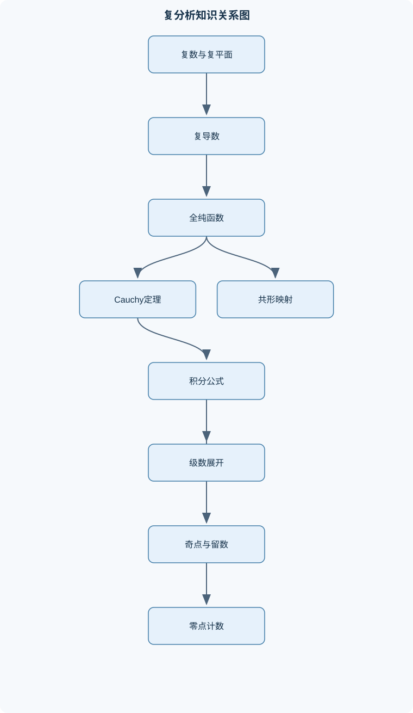
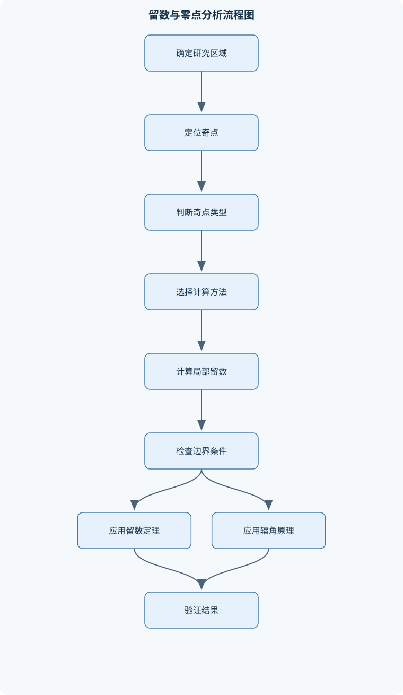

# 复变函数

## 一、课程整体知识框架

### 课程边界与先修知识

本课程研究复数域上的函数及其微分、积分、级数展开、奇点、留数、共形映射和典型特殊函数。核心边界包括复数与复平面、全纯函数、柯西积分理论、幂级数与洛朗级数、孤立奇点、留数计算、辐角原理、最大模原理、解析延拓、共形映射及其基本定理。提高部分包括整函数与亚纯函数、Jensen公式、Weierstrass乘积、Gamma函数、Riemann ζ函数、椭圆函数、Eisenstein级数和Theta函数。先修知识包括单变量微积分、实数列与函数列、常微分基础、初等线性代数，以及实多元函数的偏导数、梯度、Jacobian矩阵和线积分。涉及一致收敛、度量空间或Lebesgue积分时，只使用支撑复分析结论所需的基本内容。课程不以偏微分方程、泛函分析或多复变函数为主要研究对象。





### 1. 课程对象、先修基础与统一记号

复变函数研究定义在复数域 $\mathbb C$ 上的函数。复数写为
$$
z=x+iy,\qquad x,y\in\mathbb R,\qquad i^2=-1,
$$
其中 $\operatorname{Re}z=x$，$\operatorname{Im}z=y$，共轭为
$$
\overline z=x-iy,
$$
模为
$$
|z|=\sqrt{z\overline z}=\sqrt{x^2+y^2}.
$$
复平面把 $z=x+iy$ 表示为平面点 $(x,y)$，因此复数运算同时具有代数和几何含义。非零复数可写成极坐标形式
$$
z=re^{i\theta},\qquad r=|z|>0.
$$
这里 $r$ 是非负实数，$\theta$ 是辐角；同一个非零复数的辐角不是唯一的，而是 $\theta+2k\pi$，$k\in\mathbb Z$。

课程先修内容包括单变量微积分、实数列与函数列、常微分基础、初等线性代数，以及实多元函数中的偏导数、全微分、梯度、Jacobian 矩阵和线积分。复分析中的“一致收敛”主要用于保证极限、积分和求导的交换；不把测度论、泛函分析或多复变函数作为主要对象。

开圆盘和圆周分别记为
$$
D(a,r)=\{z\in\mathbb C:|z-a|<r\},\qquad
C(a,r)=\{z\in\mathbb C:|z-a|=r\}.
$$
区域 $\Omega$ 表示非空连通开集。单连通区域是指其中每条闭曲线都能在区域内部连续收缩为一点。曲线通常指有向分段光滑曲线 $\gamma$，复线积分记为
$$
\int_\gamma f(z)\,dz.
$$
若曲线闭合，则记作 $\oint_\gamma f(z)\,dz$。

### 2. 复数与复平面

复数的加法、乘法、除法由
$$
(x+iy)+(u+iv)=(x+u)+i(y+v),
$$
$$
(x+iy)(u+iv)=(xu-yv)+i(xv+yu)
$$
定义。若 $z\ne0$，则
$$
\frac1z=\frac{\overline z}{|z|^2}.
$$
共轭满足 $\overline{zw}=\overline z\,\overline w$，$|zw|=|z||w|$，三角不等式为
$$
|z+w|\le |z|+|w|.
$$

由欧拉公式
$$
e^{i\theta}=\cos\theta+i\sin\theta
$$
可得
$$
re^{i\theta}=r(\cos\theta+i\sin\theta).
$$
因此乘法对应模相乘、辐角相加：
$$
z_1z_2=r_1r_2e^{i(\theta_1+\theta_2)}.
$$
整数次幂满足棣莫弗公式
$$
(re^{i\theta})^n=r^ne^{in\theta}.
$$

复指数函数定义为
$$
e^z=e^{x+iy}=e^x(\cos y+i\sin y).
$$
它对实部方向呈指数增长，对虚部方向具有 $2\pi$ 周期性，即
$$
e^{z+2\pi i}=e^z.
$$
复对数是多值函数：
$$
\log z=\ln|z|+i(\arg z+2k\pi),\qquad k\in\mathbb Z.
$$
若在不绕原点的区域上选取连续辐角 $\operatorname{Arg}z$，则可定义单值分支
$$
\operatorname{Log}z=\ln|z|+i\operatorname{Arg}z.
$$
例如去掉非正实轴后可以选取主值辐角 $-\pi<\operatorname{Arg}z<\pi$。不能在整个 $\mathbb C\setminus\{0\}$ 上选取连续单值的对数，因为沿原点绕一周后辐角增加 $2\pi$。

一般幂函数定义为
$$
z^\alpha=e^{\alpha\operatorname{Log}z},
$$
其单值性依赖于所选分支。若 $\alpha=p/q$ 为有理数，代数方程 $w^q=z^p$ 通常有多个值；只有在指定分支域后，$z^\alpha$ 才成为单值全纯函数。

Mobius 变换为
$$
T(z)=\frac{az+b}{cz+d},\qquad ad-bc\ne0.
$$
当 $c\ne0$ 时，$z=-d/c$ 映到无穷远点，$\infty$ 映到 $a/c$。Mobius 变换可看作扩充复平面 $\widehat{\mathbb C}=\mathbb C\cup\{\infty\}$ 上的双射，并把广义圆，即圆或直线，映为广义圆。

### 3. 全纯函数与复导数

函数 $f:\Omega\to\mathbb C$ 在 $z_0$ 处复可导，是指极限
$$
f'(z_0)=\lim_{h\to0}\frac{f(z_0+h)-f(z_0)}h
$$
沿复平面任意方向都存在且相同。若 $f$ 在区域内每一点都复可导，则称其在 $\Omega$ 内全纯。整个复平面上全纯的函数称为整函数。

设
$$
f(z)=u(x,y)+iv(x,y).
$$
沿实轴方向和虚轴方向分别取差商，可得必要条件
$$
u_x=v_y,\qquad u_y=-v_x,
$$
这就是 Cauchy–Riemann 方程。若 $u,v$ 的一阶偏导数在邻域内存在且连续，并满足上述方程，则方程也是复可导的充分条件。仅在一个点满足 Cauchy–Riemann 方程不能推出函数在该点附近全纯。

复导数可表示为
$$
f'(z)=u_x+iv_x=v_y-iu_y.
$$
实 Jacobian 为
$$
J=u_xv_y-u_yv_x.
$$
利用 Cauchy–Riemann 方程，
$$
J=u_x^2+u_y^2=|f'(z)|^2.
$$
因此当 $f'(z_0)\ne0$ 时，函数在 $z_0$ 附近既局部可逆又保角，并且保持方向。$f'(z_0)=0$ 时，不能直接得出保角结论；例如 $f(z)=z^2$ 在原点导数为零，原点附近的角度被加倍。

全纯函数的实部和虚部都是调和函数：
$$
\Delta u=u_{xx}+u_{yy}=0,\qquad
\Delta v=v_{xx}+v_{yy}=0.
$$
这是由 Cauchy–Riemann 方程再求偏导并利用混合偏导相等得到的。若两个调和函数满足 Cauchy–Riemann 方程，则称它们互为共轭调和函数。反过来，调和函数不一定能在整个区域上找到单值共轭调和函数；单连通性和拓扑结构会影响其存在性。

### 4. 复积分与 Cauchy 理论

若 $\gamma:[a,b]\to\mathbb C$ 为分段光滑参数曲线，则
$$
\int_\gamma f(z)\,dz
=\int_a^b f(\gamma(t))\gamma'(t)\,dt.
$$
若 $\gamma(t)=x(t)+iy(t)$，则
$$
dz=(x'(t)+iy'(t))\,dt.
$$
路径方向反转会使积分变号，分段路径的积分等于各段积分之和。

若 $f$ 有原函数 $F$，即 $F'=f$，则
$$
\int_\gamma f(z)\,dz=F(\gamma(b))-F(\gamma(a)),
$$
从而积分只依赖端点，闭曲线积分为零。反过来，在适当的区域条件下，所有闭曲线积分为零等价于存在原函数。Cauchy 定理先在三角形区域中建立：若 $f$ 在三角形及其内部全纯，则边界积分为零；再通过三角剖分推广到单连通区域。

Cauchy 积分公式为
$$
f(z_0)=\frac1{2\pi i}\oint_\gamma
\frac{f(\zeta)}{\zeta-z_0}\,d\zeta,
$$
其中 $\gamma$ 是正向闭曲线，$z_0$ 在曲线内部，且 $f$ 在曲线及其内部全纯。高阶导数公式为
$$
f^{(n)}(z_0)=\frac{n!}{2\pi i}
\oint_\gamma\frac{f(\zeta)}
{(\zeta-z_0)^{n+1}}\,d\zeta.
$$
曲线若不是简单闭曲线，必须用曲线绕数或指标修正；若曲线内部有其他奇点，则不能直接套用单连通形式。

Morera 定理提供反向判别：若连续函数 $f$ 在区域内对每个三角形边界的积分都为零，则 $f$ 在该区域内全纯。该定理说明积分条件可以替代直接求复导数。

### 5. 幂级数与全纯函数性质

复幂级数
$$
\sum_{n=0}^{\infty}a_n(z-z_0)^n
$$
存在收敛半径 $R\in[0,\infty]$。当 $|z-z_0|<R$ 时绝对收敛，当 $|z-z_0|>R$ 时发散，圆周 $|z-z_0|=R$ 必须单独判断。幂级数在任意严格包含于收敛圆盘的紧集上一致收敛，因此可以逐项积分和求导：
$$
\frac{d}{dz}\sum_{n=0}^{\infty}a_n(z-z_0)^n
=\sum_{n=1}^{\infty}na_n(z-z_0)^{n-1}.
$$

全纯函数在圆盘内具有 Taylor 展开
$$
f(z)=\sum_{n=0}^{\infty}
\frac{f^{(n)}(z_0)}{n!}(z-z_0)^n,
$$
系数也可由 Cauchy 公式计算。若两个全纯函数在区域内有一列相异点趋于区域内部一点，并且在这些点取值相同，则由恒等定理它们在整个连通区域上相同。解析延拓必须保持局部展开的一致性；多值函数沿不同路径延拓可能得到不同分支。

最大模原理指出：非恒定全纯函数不能在区域内部取得局部最大模。若 $f$ 无零且全纯，则 $1/f$ 全纯，对 $1/f$ 使用最大模原理可得最小模原理。Liouville 定理指出，有界整函数必为常数。更一般地，若整函数满足
$$
|f(z)|\le A+B|z|^m,
$$
则 $f$ 是次数不超过 $m$ 的多项式。基本代数定理可由此证明：若非恒定多项式没有根，则其倒数是有界整函数，因而为常数，矛盾。

### 6. 孤立奇点与留数

若 $f$ 在 $z_0$ 的去心邻域
$$
0<|z-z_0|<R
$$
内全纯，则 $z_0$ 是孤立奇点。Laurent 展开为
$$
f(z)=\sum_{n=-\infty}^{\infty}a_n(z-z_0)^n.
$$
若负次幂部分全部为零，则为可去奇点；若负次幂只有有限项且最高负次幂为 $-(m)$，则为 $m$ 阶极点；若负次幂无限多，则为本性奇点。

有界性可以判定可去奇点：若 $f$ 在去心邻域有界，则可将其在 $z_0$ 处补定义为全纯函数。极点的阶数可通过
$$
f(z)=\frac{g(z)}{(z-z_0)^m},\qquad g(z_0)\ne0
$$
判断。本性奇点附近函数行为不受有限阶主导，不能把它简单视为“很高阶的极点”。

留数定义为 Laurent 展开中 $(z-z_0)^{-1}$ 的系数：
$$
\operatorname{Res}(f,z_0)=a_{-1}.
$$
若 $z_0$ 是简单极点，
$$
\operatorname{Res}(f,z_0)=
\lim_{z\to z_0}(z-z_0)f(z).
$$
若 $z_0$ 是 $m$ 阶极点，
$$
\operatorname{Res}(f,z_0)=
\frac1{(m-1)!}
\lim_{z\to z_0}
\frac{d^{m-1}}{dz^{m-1}}
\left[(z-z_0)^mf(z)\right].
$$

留数定理为
$$
\oint_\gamma f(z)\,dz
=2\pi i\sum_j
\operatorname{Ind}(\gamma,z_j)\operatorname{Res}(f,z_j),
$$
其中曲线不能经过奇点，$\operatorname{Ind}$ 是绕数。无穷远点通过 $w=1/z$ 研究，其留数满足
$$
\operatorname{Res}(f,\infty)
=-\operatorname{Res}\left(\frac1{w^2}f\left(\frac1w\right),0\right).
$$
实积分的半圆围道方法需要同时检查实轴极点、半圆弧积分是否趋于零以及选择上半平面还是下半平面。忽略这些条件会导致符号或额外半圆贡献错误。

### 7. 辐角原理、亚纯函数与共形映射

若 $f$ 是非零亚纯函数，且闭曲线不经过其零点和极点，则
$$
\frac1{2\pi i}\oint_\gamma\frac{f'(z)}{f(z)}\,dz
=N-P,
$$
其中 $N$、$P$ 分别是曲线内部零点数和极点数，均按阶数计数。因为零点附近
$$
f(z)=(z-z_0)^mg(z),\qquad g(z_0)\ne0,
$$
所以
$$
\frac{f'}f=\frac m{z-z_0}+\frac{g'}g.
$$
Rouché 定理要求在边界上满足严格不等式
$$
|f-g|<|g|.
$$
此时 $f$ 与 $g$ 在内部的零点数相同。常用方法是选择主导项，例如在 $|z|=r$ 上比较最高次项与其余项，但必须在整个边界上验证不等式。

Mobius 变换的导数为
$$
T'(z)=\frac{ad-bc}{(cz+d)^2}.
$$
在有限点且分母不为零处导数不为零，因此局部保角。它不是必然把任意区域按直观方式映射，必须检查边界、极点和无穷远点。单位圆盘与上半平面之间可通过适当 Mobius 变换互相映射。单位圆盘自同构的典型形式为
$$
T_a(z)=e^{i\phi}\frac{a-z}{1-\overline a z},
\qquad |a|<1.
$$
Schwarz 引理说明，若 $f:D\to D$ 全纯且 $f(0)=0$，则
$$
|f(z)|\le|z|,\qquad |f'(0)|\le1.
$$
若等号在非零点成立，则 $f$ 为旋转。Schwarz 反射原理在边界条件足够对称时，将一侧的全纯函数延拓到另一侧；不能在任意边界值条件下使用。Riemann 映射定理说明每个单连通且不等于整个复平面的区域都共形等价于单位圆盘，但该定理本身不必给出显式映射，边界正则性也需要另行讨论。

### 8. 整函数、因子分解与特殊函数

整函数的零点若不恒等为零，只能在无穷远处聚集。Jensen 公式把圆周平均的 $\log|f|$ 与圆盘内零点位置联系起来，是零点计数和增长估计的桥梁。Weierstrass 典型因子定义为
$$
E_p(w)=(1-w)\exp\left(w+\frac{w^2}{2}+\cdots+\frac{w^p}{p}\right).
$$
若离散零点序列 $\{a_n\}$ 满足适当收敛指数条件，可构造
$$
\prod_n E_{p_n}\left(\frac z{a_n}\right)
$$
使其在紧集上一致收敛，并具有指定零点。Hadamard 分解进一步指出，有限阶整函数可表示为规范乘积乘以指数多项式。亚纯函数常可表示为两个整函数之商。

Gamma 函数在 $\operatorname{Re}s>0$ 时定义为
$$
\Gamma(s)=\int_0^\infty t^{s-1}e^{-t}\,dt.
$$
分部积分给出
$$
\Gamma(s+1)=s\Gamma(s),
$$
因此 $\Gamma(n+1)=n!$。通过解析延拓，Gamma 函数在非正整数处具有极点。反射公式为
$$
\Gamma(s)\Gamma(1-s)=\frac{\pi}{\sin\pi s},
$$
其使用必须避开两边的极点和延拓障碍。

Riemann $\zeta$ 函数在 $\operatorname{Re}s>1$ 时由
$$
\zeta(s)=\sum_{n=1}^{\infty}\frac1{n^s}
$$
定义，再通过解析延拓扩展为亚纯函数。其函数方程把 $s$ 与 $1-s$ 联系起来。初始级数定义域和解析延拓后的定义域不能混淆。

Weierstrass 椭圆函数具有两个线性无关的周期。其极点和零点按周期平行四边形复制，且一个基本周期区域内椭圆函数的留数总和必须为零。Eisenstein 级数是双周期结构中的重要级数，可通过 Fourier 展开研究其收敛和模变换性质。

Theta 函数通常由高斯型级数定义。Poisson 求和公式将整数格点上的求和与 Fourier 变换联系起来；高斯函数的 Fourier 变换导致 Theta 函数的变换法则。Theta 函数的乘积公式、模变换和零点结构将级数、积分、周期函数与复分析统一起来。

## 二、章节和模块划分

### 核心知识覆盖清单

本清单用于检查正文是否覆盖本课程的主要知识模块：

- **复数与复平面**：复数的代数运算与共轭、模、辐角与极坐标表示、复指数函数与欧拉公式、复对数的多值性、整数次幂与有理次幂、复平面中的圆盘与路径、Mobius变换的基本形式。
- **全纯函数与复导数**：复导数的定义与几何意义、全纯函数与解析函数、Cauchy-Riemann方程、偏导连续时的全纯判别、复导数与实Jacobian、保角映射与方向保持、调和函数与共轭调和函数。
- **复积分与Cauchy理论**：复路径与分段光滑曲线、复线积分的参数化计算、原函数与路径无关性、Cauchy定理的三角形版本、单连通域上的Cauchy定理、Cauchy积分公式、高阶导数积分公式、Morera定理。
- **幂级数与全纯函数性质**：复幂级数的收敛半径、圆盘内逐项求导与积分、Taylor展开与系数公式、恒等定理、唯一延拓与解析延拓、最大模原理、最小模原理、Liouville定理与基本代数定理。
- **孤立奇点与留数**：可去奇点、极点与本性奇点、Laurent级数与主部、奇点阶数的判定、留数的定义与计算、留数定理、无穷远点的奇点、围道积分的留数计算、实积分的半圆围道方法。
- **辐角原理与亚纯函数**：零点与极点的阶、对数导数、辐角原理、Rouché定理、零点个数的判定、实系数多项式的复根分布、亚纯函数的基本性质、最大模原理在有理函数中的应用。
- **共形映射与Mobius变换**：Mobius变换及其矩阵表示、广义圆与广义圆的保持、上半平面与单位圆盘的映射、单位圆盘自同构、交比与几何不变量、保角映射的局部可逆性、Schwarz引理、Schwarz反射原理、Riemann映射定理的内容与边界。
- **整函数与因子分解**：整函数的增长与阶、Jensen公式、零点计数函数、Weierstrass典型因子、Weierstrass乘积定理、Hadamard因子分解定理、整函数零点的构造、亚纯函数表示为整函数之商。
- **周期函数与特殊函数**：Gamma函数的积分定义、Gamma函数的递推与反射公式、Gamma函数的乘积表示、Riemann ζ函数的级数定义、ζ函数的解析延拓思想、ζ函数的函数方程、Weierstrass椭圆函数、Eisenstein级数与Fourier展开。
- **Theta函数与复分析综合应用**：Theta函数的定义、Theta函数的乘积公式、Theta函数的变换法则、Poisson求和公式、Fourier变换与复积分联系、模变换下的周期结构、特殊函数的零点与增长、复分析方法在积分和级数中的应用。


### 1. 复函数全纯性判定流程

**输入：** 函数 $f(z)$ 及定义域 $\Omega$。  
**输出：** 在给定充分条件下是否全纯，以及导数表达式。

1. 写成 $f=u+iv$，明确 $u(x,y)$、$v(x,y)$。
2. 计算 $u_x,u_y,v_x,v_y$。
3. 检查这些偏导数是否在目标邻域存在并连续。
4. 验证 $u_x=v_y$、$u_y=-v_x$。
5. 若成立，得到
   $$
   f'(z)=u_x+iv_x.
   $$
6. 若不成立，只能说明该充分判据失败，不能据此断言所有情况下都不全纯。
7. 若要判断保角性，还需继续检查 $f'(z)\ne0$；局部保角不等于全局单射。

时间复杂度在符号计算中取决于表达式规模，数值网格判定只能给出近似证据，不能替代理论证明。

```python
# 复函数的 Cauchy-Riemann 方程符号检查示意
import sympy as sp

x, y = sp.symbols('x y', real=True)
u = x**2 - y**2
v = 2*x*y

ux = sp.diff(u, x)
uy = sp.diff(u, y)
vx = sp.diff(v, x)
vy = sp.diff(v, y)

cr1 = sp.simplify(ux - vy)
cr2 = sp.simplify(uy + vx)

print("u_x - v_y =", cr1)
print("u_y + v_x =", cr2)
print("f'(z) =", sp.simplify(ux + sp.I*vx))
```

输出两个 Cauchy–Riemann 差值均为零，且
$$
f'(z)=2x+i(2y)=2z.
$$
这说明 $f(z)=z^2$ 在整个复平面全纯，但在 $z=0$ 处导数为零，不能由 Cauchy–Riemann 方程直接推出原点处保角。

### 2. 复线积分与留数计算流程

**输入：** 分段光滑闭曲线 $\gamma$ 和亚纯函数 $f$。  
**输出：** $\oint_\gamma f(z)\,dz$。

1. 确认曲线上没有奇点。
2. 列出曲线内部的全部孤立奇点。
3. 判断奇点是可去奇点、极点还是本性奇点。
4. 计算各奇点留数；简单极点使用极限公式，高阶极点使用导数公式或 Laurent 展开。
5. 根据曲线绕数加权求和：
   $$
   \oint_\gamma f(z)\,dz
   =2\pi i\sum_j\operatorname{Ind}(\gamma,z_j)
   \operatorname{Res}(f,z_j).
   $$
6. 检查曲线方向、边界奇点和无穷远点是否被遗漏。

若函数在曲线内部全纯，则优先使用 Cauchy 定理或 Cauchy 积分公式；若有孤立奇点，直接使用留数定理通常更有效。曲线经过奇点时标准公式不适用，必须先改变路径或讨论主值及绕行贡献。

### 3. 代表性例题

#### 例题一：判断 $\overline z$ 的复可导性

**题干：** 判断 $f(z)=\overline z$ 是否在任意点复可导。

**分析：** 写成
$$
f(z)=x-iy,
$$
所以 $u=x$，$v=-y$。有
$$
u_x=1,\quad u_y=0,\quad v_x=0,\quad v_y=-1.
$$

**逐步解答：** Cauchy–Riemann 方程要求
$$
u_x=v_y,\qquad u_y=-v_x.
$$
第二个等式成立，但第一个等式变为 $1=-1$，处处不成立。因此 $f$ 在任何点都不复可导。

也可直接沿实方向和虚方向计算差商。在 $h=t\in\mathbb R$ 时，差商为 $1$；在 $h=it$ 时，差商为 $-1$。两个方向极限不同。

**结果验证：** 虽然 $\overline z$ 作为实变量函数具有连续偏导数，但它不是复可导函数，说明实可微不等于复可导。

**变式：** $f(z)=z\overline z=|z|^2$ 的 Cauchy–Riemann 方程只在原点成立，但沿不同方向的差商仍不能产生邻域全纯性；因此一点满足方程不是充分条件。

#### 例题二：应用高阶 Cauchy 积分公式

**题干：** 计算
$$
\oint_{|z|=2}\frac{e^z}{(z-1)^3}\,dz.
$$

**分析：** $e^z$ 是整函数，$z=1$ 位于圆 $|z|=2$ 内部，分母表明积分核是 $(z-1)^{-3}$。

**逐步解答：** 使用
$$
\oint_\gamma\frac{f(\zeta)}
{(\zeta-z_0)^{n+1}}\,d\zeta
=\frac{2\pi i}{n!}f^{(n)}(z_0).
$$
这里 $n+1=3$，故 $n=2$，$f(z)=e^z$，$f''(1)=e$。于是
$$
\oint_{|z|=2}\frac{e^z}{(z-1)^3}\,dz
=\frac{2\pi i}{2!}e
=\pi i e.
$$

**结果验证：** 若用留数计算，$z=1$ 是三阶极点，Laurent 展开中 $(z-1)^{-1}$ 项系数为 $e/2$，乘以 $2\pi i$ 同样得到 $\pi i e$。

**变式：** 若圆周改为 $|z|=1/2$，则 $z=1$ 不在内部，函数在圆盘内全纯，积分为 $0$。这说明必须先检查奇点与曲线的位置。

#### 例题三：在不同环域展开 Laurent 级数

**题干：** 将
$$
f(z)=\frac1{z(z-1)}
$$
分别在 $|z|<1$ 和 $|z|>1$ 中展开。

**分析：**
$$
\frac1{z(z-1)}
=-\frac1z\cdot\frac1{1-z}
\quad (|z|<1).
$$

**逐步解答：** 当 $|z|<1$ 时，
$$
\frac1{1-z}=\sum_{n=0}^{\infty}z^n,
$$
因此
$$
f(z)=-\sum_{n=0}^{\infty}z^{n-1}
=-z^{-1}-1-z-z^2-\cdots.
$$

当 $|z|>1$ 时，先作部分分式分解：
$$
\frac1{z(z-1)}=-\frac1z+\frac1{z-1}.
$$
又有
$$
\frac1{z-1}
=\frac1z\frac1{1-1/z}
=\sum_{n=0}^{\infty}z^{-n-1},
\qquad |z|>1.
$$
故
$$
f(z)=-z^{-1}+\sum_{n=0}^{\infty}z^{-n-1}
=\sum_{n=1}^{\infty}z^{-n-1}
=z^{-2}+z^{-3}+\cdots.
$$

**结果验证：** 奇点为 $0$ 和 $1$，以展开中心 $0$ 为基准，最近奇点距离为 $1$，所以 $|z|<1$ 和 $|z|>1$ 是两个自然环域；在边界 $|z|=1$ 上不能由这两组级数直接判断。

**变式：** 若展开中心改为 $2$，应按奇点到 $2$ 的距离重新划分收敛圆盘和环域。

#### 例题四：使用 Rouché 定理计数

**题干：** 求多项式
$$
p(z)=z^5+3z+1
$$
在单位圆 $|z|<1$ 内的零点数。

**分析：** 在 $|z|=1$ 上，$|z^5|=1$，而
$$
|3z+1|\le4,
$$
不能用 $z^5$ 主导。选择 $3z$ 与其余项比较：
$$
|z^5+1|\le2<3=|3z|.
$$

**逐步解答：** 令
$$
f(z)=3z,\qquad g(z)=z^5+1.
$$
在单位圆边界上，
$$
|g(z)|<|f(z)|.
$$
由 Rouché 定理，$p=f+g$ 与 $f(z)=3z$ 在单位圆内零点数相同。$3z$ 只有一个零点 $z=0$，且为一阶零点。因此 $p$ 在单位圆内有一个零点。

**结果验证：** 严格不等式在整个边界成立，且边界上 $p$ 无零点；零点数按重数计为 $1$。

**变式：** 若圆盘半径改变为 $r$，应比较 $|z^5+1|$ 与 $|3z|=3r$，不能直接沿用单位圆上的估计。

#### 例题五：半圆围道计算实积分

**题干：** 计算 $a>0$ 时
$$
\int_{-\infty}^{\infty}\frac{dx}{x^2+a^2}.
$$

**分析：** 取
$$
f(z)=\frac1{z^2+a^2}
=\frac1{(z-ia)(z+ia)}.
$$
在上半平面闭合，因为被积函数在大半圆弧上的积分趋于零。

**逐步解答：** 上半平面内部只有简单极点 $z=ia$，其留数为
$$
\operatorname{Res}(f,ia)
=\frac1{2ia}.
$$
由留数定理，
$$
\int_{-\infty}^{\infty}\frac{dx}{x^2+a^2}
=2\pi i\cdot\frac1{2ia}
=\frac{\pi}{a}.
$$

**结果验证：** 被积函数为正且偶函数，结果应为正实数；$\pi/a$ 符合这一性质。大圆弧估计中，函数大小为 $O(R^{-2})$，弧长为 $O(R)$，故弧积分为 $O(R^{-1})\to0$。

**变式：** 若实轴上存在极点，不能直接沿实轴积分，必须指定主值并计算小半圆绕行贡献。

### 4. 实验与项目

#### 实验一：数值检验 Cauchy–Riemann 方程与路径无关性

**输入数据：**

- 函数 $f_1(z)=z^2$；
- 函数 $f_2(z)=\overline z$；
- 端点 $z_0=0$、$z_1=1+i$；
- 直线路径和折线路径两组参数化曲线；
- 网格步长或数值积分容差。

**步骤：**

1. 将两个函数分别写成 $u+iv$。
2. 用符号微分或中心差分计算四个偏导数。
3. 在矩形网格上计算两个 Cauchy–Riemann 残差
   $$
   r_1=u_x-v_y,\qquad r_2=u_y+v_x.
   $$
4. 对两条路径进行参数化数值积分。
5. 比较同一函数在两条路径上的积分值。
6. 改变网格精度，观察误差是否收敛。

**评价标准：**

- 对 $z^2$，Cauchy–Riemann 残差应接近数值误差，两个路径积分应接近；
- 对 $\overline z$，残差不应随网格加密而同时趋于零；
- 路径积分差异应与离散误差和函数是否存在原函数相一致。

**排错方法：**

- 检查虚部参数化是否写成 $y(t)$ 而不是 $iy(t)$；
- 检查积分中是否同时乘以 $\gamma'(t)$；
- 检查折线路径的方向是否连续；
- 若误差不随步长减小，应检查差分公式、复数数据类型和端点处理。

#### 实验二：Laurent 截断与留数数值验证

**输入数据：**

- 函数
  $$
  f(z)=\frac{e^z}{z^2(z-1)};
  $$
- 圆周 $|z|=r$，分别取 $r=1/2$ 和 $r=2$；
- Laurent 或 Taylor 截断阶数 $N$；
- 目标误差阈值。

**步骤：**

1. 列出奇点 $z=0,1$，判断它们与两条圆周的位置关系。
2. 在 $|z|=1/2$ 内只包含 $z=0$，在 $|z|=2$ 内同时包含两个奇点。
3. 用局部级数展开或留数公式计算理论积分。
4. 用数值求积离散圆周：
   $$
   z_k=re^{2\pi ik/M},\qquad
   dz\approx i r e^{2\pi ik/M}\frac{2\pi}{M}.
   $$
5. 增大 $M$ 和截断阶数 $N$，比较数值结果与理论结果。
6. 记录圆周靠近奇点时误差的变化。

**评价标准：**

- 数值积分随 $M$ 增大趋向留数定理给出的结果；
- 截断误差应能由尾项估计控制；
- 圆周越接近奇点，级数收敛越慢，所需 $N$ 越大；
- $|z|=2$ 的计算必须同时计入两个奇点，不能只使用原点附近的局部展开。

**排错方法：**

- 检查圆周是否穿过奇点；
- 检查参数化积分是否漏掉 $dz$；
- 检查逆时针方向对应正向；
- 检查 Laurent 展开的收敛环域；
- 若结果出现巨大振荡，应优先检查圆周是否过于接近极点以及浮点数消去误差。

### 5. 统一验收边界

复分析结论的使用必须同时检查四类条件：第一，函数在所需区域内是否全纯或亚纯；第二，曲线是否经过奇点、方向是否为正向以及绕数是否正确；第三，区域是否连通或单连通；第四，级数、积分和极限交换是否有一致收敛或其他充分条件。

常见错误包括：把实可微误认为复可导；只在一点验证 Cauchy–Riemann 方程；把 $\arg z$ 当作全局单值函数；忽略 Laurent 级数的收敛环域；在 Rouché 定理中只比较内部而不验证边界严格不等式；把 $f'(z)\ne0$ 误认为全局单射；忘记无穷远点留数的负号；使用半圆围道时忽略实轴极点或大圆弧估计；混淆特殊函数的初始定义域和解析延拓后的定义域。

在数值计算中，理论公式给出的无限级数不能自动成为高精度算法。必须根据评价点到最近奇点的距离估计截断误差，并区分截断误差、离散化误差和舍入误差。靠近奇点或收敛边界时，应改变展开中心、采用更适合的表示式或直接使用留数与函数方程等结构性结论。

## 三、核心概念的详细解释

### 1. 复数、复平面与多值函数

复数写成 $z=x+iy$，其中 $x,y\in\mathbb R$，$i^2=-1$。实部和虚部分别为 $\operatorname{Re}z=x$、$\operatorname{Im}z=y$，共轭为 $\overline z=x-iy$，模为
$$
|z|=\sqrt{z\overline z}=\sqrt{x^2+y^2}.
$$
复数的模满足乘法性和三角不等式：
$$
|zw|=|z||w|,\qquad |z+w|\le |z|+|w|.
$$
几何上，$z$对应复平面中的点 $(x,y)$，而 $|z|$是该点到原点的距离。

非零复数可以表示为
$$
z=re^{i\theta},\qquad r=|z|>0.
$$
同一个复数的辐角不是唯一的，因为 $\theta$ 与 $\theta+2k\pi$ 表示同一方向。这里 $r$ 是长度，不带角度单位；$\theta$通常以弧度计。乘法在极坐标下表现为模相乘、辐角相加：
$$
r_1e^{i\theta_1}r_2e^{i\theta_2}
=r_1r_2e^{i(\theta_1+\theta_2)}.
$$
因此
$$
(re^{i\theta})^n=r^ne^{in\theta}
$$
对整数 $n$ 成立。对于非整数幂，必须先选择辐角分支；否则 $z^\alpha$通常是多值的。

复指数函数定义为
$$
e^z=e^{x+iy}=e^x(\cos y+i\sin y).
$$
它满足
$$
e^{z+w}=e^ze^w,\qquad \frac{d}{dz}e^z=e^z,\qquad e^{z+2\pi i}=e^z.
$$
周期性意味着复指数函数不是整个复平面上的一一映射。复对数满足
$$
\log z=\ln|z|+i(\arg z+2k\pi),\qquad k\in\mathbb Z.
$$
若区域不绕原点，并且能在该区域内连续选择辐角，则可以定义单值分支
$$
\operatorname{Log}z=\ln|z|+i\operatorname{Arg}z.
$$
例如在去掉非正实轴的区域上，可以取
$$
-\pi<\operatorname{Arg}z<\pi.
$$
不能在整个 $\mathbb C\setminus\{0\}$ 上定义连续单值的对数，因为沿原点绕一周后，辐角增加 $2\pi$。

### 2. 复导数、全纯性与 Cauchy–Riemann 方程

函数 $f$在 $z_0$处复可导，是指极限
$$
f'(z_0)=\lim_{h\to0}\frac{f(z_0+h)-f(z_0)}{h}
$$
存在，并且 $h$可以沿复平面中的任意方向趋于零。这个要求强于实二维意义下的可微性，因为不同方向的差商必须趋于同一个复数。

设
$$
f(z)=u(x,y)+iv(x,y),\qquad z=x+iy.
$$
沿实轴方向取 $h=t\in\mathbb R$，有
$$
f'(z_0)=u_x+iv_x.
$$
沿虚轴方向取 $h=it$，则
$$
\frac{f(z_0+it)-f(z_0)}{it}
\longrightarrow v_y-iu_y.
$$
两种方向必须给出相同结果，因此得到 Cauchy–Riemann 方程
$$
u_x=v_y,\qquad u_y=-v_x.
$$
若 $u,v$ 在某邻域内具有连续的一阶偏导数，并且在该邻域内满足 Cauchy–Riemann 方程，则 $f$在该邻域内全纯，且
$$
f'(z)=u_x+iv_x=v_y-iu_y.
$$
仅在一个点满足 Cauchy–Riemann 方程不能推出函数在该点附近全纯。

复导数还控制实 Jacobian 矩阵。由
$$
u_x=v_y,\qquad u_y=-v_x
$$
可得
$$
J_f=u_xv_y-u_yv_x
=u_x^2+v_x^2
=|f'(z)|^2.
$$
因此，当 $f'(z_0)\ne0$时，实 Jacobian 非零，逆函数定理给出局部可逆性。局部线性近似为
$$
f(z_0+h)=f(z_0)+f'(z_0)h+o(|h|).
$$
乘以非零复数 $f'(z_0)$在几何上等于先旋转、再按比例缩放，所以非零导数意味着局部保角且保持方向。这里的“局部”十分重要：$f'(z)\ne0$不能单独保证全局单射。例如 $f(z)=e^z$处处导数非零，但由于周期性并非全局单射。

若 $f=u+iv$全纯，则 $u$和$v$都是调和函数：
$$
\Delta u=u_{xx}+u_{yy}=0,\qquad
\Delta v=v_{xx}+v_{yy}=0.
$$
例如由 $u_x=v_y$和 $u_y=-v_x$分别对 $x,y$求导并相加，即得
$$
u_{xx}+u_{yy}=v_{yx}-v_{xy}=0,
$$
这里需要二阶偏导连续以交换求导顺序。称 $u,v$互为共轭调和函数。反过来，调和函数只有在适当的单连通区域内才一定能够找到全局共轭调和函数；在有孔区域中，局部存在不等于全局存在。

### 3. 复路径、线积分与原函数

设 $\gamma:[a,b]\to\mathbb C$为分段光滑路径，写成
$$
\gamma(t)=x(t)+iy(t).
$$
复线积分定义为
$$
\int_\gamma f(z)\,dz
=\int_a^b f(\gamma(t))\gamma'(t)\,dt.
$$
如果路径分段光滑，则对各光滑段分别积分再相加。路径反向会改变积分符号，路径连接可以利用可加性分解。

若 $F$在包含路径的区域内全纯，且 $F'=f$，则复微积分基本定理给出
$$
\int_\gamma f(z)\,dz
=F(\gamma(b))-F(\gamma(a)).
$$
因此积分只依赖端点，与路径无关；对闭曲线 $\gamma$有
$$
\oint_\gamma f(z)\,dz=0.
$$
反过来，在区域 $\Omega$中，若所有闭曲线积分都为零，则可以固定 $z_*$，定义
$$
F(z)=\int_{z_*}^{z}f(\zeta)\,d\zeta.
$$
由于闭曲线积分为零，$F$与从 $z_*$到 $z$所选的路径无关，并且
$$
F'(z)=f(z).
$$
在单连通区域内，全纯函数的闭曲线积分为零，从而具有原函数。单连通性是充分条件，但“每条闭曲线积分为零”“路径无关”“存在原函数”在适当区域内彼此密切等价。

典型反例是
$$
f(z)=\frac1z.
$$
它在 $\mathbb C\setminus\{0\}$ 上全纯，但沿单位圆逆时针方向
$$
\oint_{|z|=1}\frac{dz}{z}=2\pi i\ne0.
$$
所以它在该区域上没有单值全局原函数。局部原函数是 $\operatorname{Log}z$，但绕原点一周后对数值发生 $2\pi i$的改变。

### 4. Cauchy 理论及其局部—整体联系

Cauchy 定理的基本形式指出：若 $f$在包含三角形及其内部的区域内全纯，则三角形边界上的积分为零。通过三角形剖分，可以推广到单连通区域中的闭曲线：
$$
\oint_\gamma f(z)\,dz=0.
$$
若区域不是单连通，内部的孔洞可能包含奇点，即使 $f$在区域内全纯，也不能直接把闭曲线收缩到一点。

Cauchy 积分公式将内部点的函数值表示为边界积分。若 $\gamma$为正向简单闭曲线，$f$在曲线及其内部全纯，且 $z_0$在曲线内部，则
$$
f(z_0)=\frac1{2\pi i}\oint_\gamma
\frac{f(\zeta)}{\zeta-z_0}\,d\zeta.
$$
这里 $\zeta$是积分变量，$z_0$是固定评价点。公式揭示了全纯函数的强刚性：内部全部信息由边界数据决定。

继续对积分核关于 $z_0$求导，得到高阶导数公式
$$
f^{(n)}(z_0)
=\frac{n!}{2\pi i}\oint_\gamma
\frac{f(\zeta)}{(\zeta-z_0)^{n+1}}\,d\zeta.
$$
因此全纯函数不仅一次可导，而且可以无限次复可导。进一步，通过局部估计可证明其必能展开为幂级数，这说明“全纯”“解析”“局部可由幂级数表示”在复分析中等价，而在实分析中这几个概念并不自动等价。

Morera 定理给出反向判别：若连续函数 $f$在区域内每个三角形边界上的积分都为零，则 $f$全纯。证明思路是先在小凸邻域内用路径积分构造原函数，再由原函数的导数等于 $f$得到全纯性。该定理不能省略连续性条件。

### 5. 幂级数、解析延拓与全纯函数的整体性质

复幂级数
$$
\sum_{n=0}^{\infty}a_n(z-z_0)^n
$$
存在收敛半径 $R\in[0,\infty]$，在 $|z-z_0|<R$内绝对收敛，在 $|z-z_0|>R$外发散，圆周 $|z-z_0|=R$上的行为需要单独判断。收敛圆盘内可以逐项求导和积分：
$$
\frac{d}{dz}\sum_{n=0}^{\infty}a_n(z-z_0)^n
=\sum_{n=1}^{\infty}na_n(z-z_0)^{n-1},
$$
$$
\int\sum_{n=0}^{\infty}a_n(z-z_0)^n\,dz
=C+\sum_{n=0}^{\infty}\frac{a_n}{n+1}(z-z_0)^{n+1}.
$$
逐项操作的可靠性来自紧子集上的一致收敛。靠近收敛圆周时，收敛速度可能显著降低。

Taylor 展开为
$$
f(z)=\sum_{n=0}^{\infty}
\frac{f^{(n)}(z_0)}{n!}(z-z_0)^n.
$$
如果两个全纯函数在区域内有一个聚点集上的相同值，则由恒等定理，它们在整个连通区域内相等。该定理说明解析延拓具有唯一性：若两个局部全纯函数在重叠区域上相同，则沿同一条允许的延拓路径得到的结果不能任意改变。

最大模原理指出，非恒定全纯函数不能在区域内部取得局部最大模；若在紧闭区域上全纯且连续到边界，则最大值出现在边界。若 $f$在区域内无零点，则 $1/f$全纯，应用最大模原理可得到最小模原理：非恒定的无零全纯函数不能在内部取得正的局部最小模。

Liouville 定理指出，有界整函数必为常数。Cauchy 估计
$$
|f^{(n)}(0)|\le \frac{n!M_R}{R^n},
\qquad M_R=\max_{|z|=R}|f(z)|
$$
中若 $M_R\le M$且令 $R\to\infty$，则对 $n\ge1$有 $f^{(n)}(0)=0$。由此可得基本代数定理：若非恒定复多项式没有复根，则其倒数是有界整函数，必为常数，矛盾。

### 6. Laurent 级数与孤立奇点

若函数在环域
$$
r<|z-z_0|<R
$$
内全纯，则可以展开为 Laurent 级数
$$
f(z)=\sum_{n=-\infty}^{\infty}a_n(z-z_0)^n.
$$
正幂部分称为解析部，负幂部分称为主部。不同收敛环域可能产生不同 Laurent 展开。例如
$$
\frac1{z(z-1)}
$$
在 $|z|<1$、$1<|z|$等不同区域中的展开式不同，因为展开方式取决于评价点相对于奇点的位置。

孤立奇点根据主部分类：

- 可去奇点：主部为零，函数可唯一延拓为全纯函数；
- $m$阶极点：主部只有有限项，最高负幂为 $(z-z_0)^{-m}$；
- 本性奇点：主部含有无穷多个非零项。

若函数在穿孔邻域内有界，则奇点必为可去奇点。极点阶数可以通过
$$
f(z)=\frac{g(z)}{(z-z_0)^m},
\qquad g(z_0)\ne0
$$
判定。不能仅看分母，还必须检查分子是否抵消了部分零点。

### 7. 留数、辐角原理与亚纯函数

留数是 Laurent 展开中 $(z-z_0)^{-1}$项的系数：
$$
\operatorname{Res}(f,z_0)=a_{-1}.
$$
若 $z_0$为简单极点且
$$
f(z)=\frac{p(z)}{q(z)},\qquad q(z_0)=0,\quad q'(z_0)\ne0,
$$
则
$$
\operatorname{Res}(f,z_0)=\frac{p(z_0)}{q'(z_0)}.
$$
若 $z_0$为 $m$阶极点，则
$$
\operatorname{Res}(f,z_0)
=\frac1{(m-1)!}
\lim_{z\to z_0}
\frac{d^{m-1}}{dz^{m-1}}
\left[(z-z_0)^mf(z)\right].
$$

留数定理把闭曲线积分化为局部数据。若 $\gamma$不经过奇点，$f$在曲线附近亚纯，则
$$
\oint_\gamma f(z)\,dz
=2\pi i\sum_j
\operatorname{Ind}(\gamma,z_j)
\operatorname{Res}(f,z_j),
$$
其中 $\operatorname{Ind}(\gamma,z_j)$是曲线绕点 $z_j$的绕数。简单正向曲线内部点的绕数为 $1$，外部点为 $0$；自交曲线则必须保留绕数。

无穷远点通过 $w=1/z$研究。其留数满足
$$
\operatorname{Res}(f,\infty)
=-\operatorname{Res}\left(\frac1{w^2}f\left(\frac1w\right),0\right).
$$
对整个扩充复平面上的亚纯函数，有
$$
\sum_{z\in\mathbb C}\operatorname{Res}(f,z)
+\operatorname{Res}(f,\infty)=0.
$$

若 $f$是非零亚纯函数，且闭曲线上没有零点和极点，则对数导数 $f'/f$在零点和极点处的留数分别等于零点阶数和负的极点阶数。因此
$$
\frac1{2\pi i}\oint_\gamma\frac{f'(z)}{f(z)}\,dz
=N-P,
$$
其中 $N$、$P$分别按重数计算曲线内部的零点数和极点数。这就是辐角原理。它把复函数值沿边界的辐角变化与内部零极点数量联系起来。

Rouché 定理是辐角原理的稳定性形式。若 $f,g$在闭曲线及其内部全纯，并且在边界上满足
$$
|f(z)-g(z)|<|g(z)|,
$$
则 $f$与 $g$在曲线内部的零点数相同。严格不等式必须在边界上成立；只在内部比较大小不能直接应用该定理。

### 8. Mobius 变换与共形映射

Mobius 变换为
$$
T(z)=\frac{az+b}{cz+d},
\qquad ad-bc\ne0.
$$
当 $c\ne0$时，$z=-d/c$被映到无穷远点，且
$$
T(\infty)=\frac ac.
$$
其导数为
$$
T'(z)=\frac{ad-bc}{(cz+d)^2}.
$$
在有限且不为极点的点处导数非零，所以 Mobius 变换是局部共形的。其逆变换仍是 Mobius 变换：
$$
T^{-1}(w)=\frac{b-dw}{cw-a}.
$$
矩阵
$$
\begin{pmatrix}a&b\\c&d\end{pmatrix}
$$
乘以任意非零常数不会改变对应的变换。

广义圆是普通圆或直线。Mobius 变换把广义圆映为广义圆。确定具体像域时，通常先映射三个已知点，再依据内部测试点判断圆盘、半平面或其外部的对应关系。上半平面与单位圆盘之间可以通过适当的 Mobius 变换互相映射，边界实轴对应单位圆周，扩充实轴上的无穷远点也必须纳入边界分析。

单位圆盘自同构的典型形式为
$$
T_a(z)=e^{i\phi}\frac{z-a}{1-\overline a z},
\qquad |a|<1.
$$
它把 $a$映到 $0$，并保持单位圆盘。若全纯函数 $f:\mathbb D\to\mathbb D$满足 $f(0)=0$，Schwarz 引理给出
$$
|f(z)|\le |z|,\qquad |f'(0)|\le1.
$$
等号情形分别迫使 $f$为旋转 $e^{i\phi}z$。Schwarz 引理经 Möbius 归一化可转化为一般的双曲距离估计。

共形映射必须区分局部与全局：$f'(z)\ne0$只保证局部保角和局部可逆；若要成为区域间的全局共形同构，还必须验证单射、满射及逆函数的全纯性。Riemann 映射定理说明每个单连通且不等于整个复平面的区域都存在到单位圆盘的双全纯映射，但该定理主要是存在性定理，通常不能直接给出显式公式。

### 9. 整函数、Jensen 公式与因子分解

整函数是在整个 $\mathbb C$上全纯的函数。非零整函数的零点只能是离散的，有限点不能成为零点聚点，否则由恒等定理函数将恒为零。Jensen 公式把圆周平均值与零点位置联系起来。若 $f$在 $|z|\le R$内全纯，$f(0)\ne0$，零点为 $a_k$，且没有零点在圆周上，则
$$
\frac1{2\pi}\int_0^{2\pi}
\log|f(Re^{i\theta})|\,d\theta
=
\log|f(0)|
+\sum_{|a_k|<R}\log\frac{R}{|a_k|}.
$$
该公式把增长估计转化为零点计数估计，是整函数因子分解的重要桥梁。

给定无有限聚点的离散零点序列 $\{a_n\}$，不能简单使用
$$
\prod_n\left(1-\frac z{a_n}\right),
$$
因为乘积可能发散。Weierstrass 典型因子定义为
$$
E_p(w)=(1-w)\exp\left(w+\frac{w^2}{2}+\cdots+\frac{w^p}{p}\right).
$$
选择足够大的 $p$使
$$
\sum_n |a_n|^{-p-1}<\infty,
$$
则乘积
$$
\prod_n E_p\left(\frac z{a_n}\right)
$$
可在紧集上一致收敛，并构造出具有指定零点的整函数。若零点包含 $0$，还需单独乘以相应的 $z^m$。

Hadamard 因子分解进一步说明：有限阶整函数可表示为由其零点构成的规范乘积，再乘以指数型因子
$$
e^{Q(z)},
$$
其中 $Q$是次数受函数阶控制的多项式。指数因子反映了仅凭零点集合不能唯一确定整函数。

### 10. Gamma 函数、Zeta 函数、椭圆函数与 Theta 函数

Gamma 函数最初在 $\operatorname{Re}s>0$上定义为
$$
\Gamma(s)=\int_0^\infty t^{s-1}e^{-t}\,dt.
$$
分部积分给出
$$
\Gamma(s+1)=s\Gamma(s),
$$
并由 $\Gamma(1)=1$得到
$$
\Gamma(n+1)=n!
$$
对非负整数 $n$成立。通过解析延拓，Gamma 函数成为亚纯函数，在 $0,-1,-2,\ldots$处有简单极点，没有零点。反射公式为
$$
\Gamma(s)\Gamma(1-s)=\frac{\pi}{\sin\pi s},
$$
其使用必须避开两侧的极点和不适合的初始积分区域。

Riemann $\zeta$函数在 $\operatorname{Re}s>1$上由
$$
\zeta(s)=\sum_{n=1}^{\infty}\frac1{n^s}
$$
定义。该级数在初始区域绝对收敛，随后通过积分表示、函数方程等方式解析延拓为除 $s=1$外的亚纯函数。不能把初始级数直接当作所有复数 $s$上的定义。函数方程把 $\zeta(s)$与 $\zeta(1-s)$联系起来，并揭示其平凡零点、增长和对称性。

若 $\Lambda$是复平面中的二维格子，Weierstrass 椭圆函数可由周期格点上的极点构造，例如
$$
\wp(z)=\frac1{z^2}
+\sum_{\omega\in\Lambda\setminus\{0\}}
\left[
\frac1{(z-\omega)^2}-\frac1{\omega^2}
\right].
$$
它满足
$$
\wp(z+\omega)=\wp(z),\qquad \omega\in\Lambda,
$$
并且
$$
\wp'(z)=-2\sum_{\omega\in\Lambda}
\frac1{(z-\omega)^3}
$$
在相应收敛意义下成立。双周期性使其基本平行四边形内的极点和零点受到严格限制；非恒定椭圆函数在一个基本区域内的留数总和必须为零。

Theta 函数通常通过高斯型级数定义，例如
$$
\vartheta(z|\tau)
=\sum_{n\in\mathbb Z}
\exp\bigl(\pi i n^2\tau+2\pi inz\bigr),
\qquad \operatorname{Im}\tau>0.
$$
其收敛来自
$$
\left|\exp(\pi i n^2\tau)\right|
=\exp(-\pi n^2\operatorname{Im}\tau).
$$
Theta 函数具有准周期变换和模变换性质，并可通过 Poisson 求和公式推导。Poisson 求和把整数点上的求和与 Fourier 变换联系起来：
$$
\sum_{n\in\mathbb Z}f(n)
=\sum_{k\in\mathbb Z}\widehat f(k),
$$
其适用需要 $f$及其 Fourier 变换具有足够的衰减和正则性。高斯函数的 Fourier 变换仍为高斯函数，因此产生 Theta 函数的基本变换法则。这里的周期结构、收敛域和参数条件必须同时检查，不能只形式地替换变量。

## 四、重要定义、公式、定理和推导

### 专业审校补充：关键定义与适用边界

留数在无穷远点的定义不能仅凭“把无穷远当作一个奇点”记忆符号。令 $w=1/z$，若 $f$ 在充分大的圆外亚纯，则定义 $$\operatorname{Res}(f,\infty)=-\operatorname{Res}_{w=0}\left(\frac{1}{w^2}f\left(\frac1w\right)\right).$$ 负号来自变量代换 $z=1/w$ 时 $dz=-w^{-2}dw$。等价地，若 $R$ 足够大且圆周取逆时针方向，则 $$\operatorname{Res}(f,\infty)=-\frac{1}{2\pi i}\oint_{|z|=R}f(z)\,dz.$$ 当 $f$ 是黎曼球面上的亚纯函数，即除有限个极点外在有限平面和无穷远点均亚纯时，有全局留数定理 $$\sum_{a\in\mathbb C}\operatorname{Res}(f,a)+\operatorname{Res}(f,\infty)=0.$$ 若 $f(z)=O(z^{-2})$，则无穷远点可去，且有限留数总和为零；若 $f(z)\sim c/z$，则无穷远点通常为简单极点，且其留数为 $-c$。该结论不能直接用于含分支点、非孤立奇点或未能在无穷远邻域定义为单值亚纯函数的对象。


### 1. 全纯函数与 Cauchy–Riemann 判别

**定义。** 若函数 $f$在区域 $\Omega$的每一点都有复导数，则称 $f$在 $\Omega$上全纯。若 $\Omega=\mathbb C$，则称 $f$为整函数；若除离散极点外全纯，则称为亚纯函数。

设
$$
f(z)=u(x,y)+iv(x,y).
$$
沿实方向和虚方向取极限：
$$
f'(z)=u_x+iv_x=v_y-iu_y.
$$
比较实部和虚部，得到
$$
u_x=v_y,\qquad u_y=-v_x.
$$
若四个一阶偏导在邻域内连续，且满足上述方程，则
$$
f(z+h)-f(z)
=u_x\Delta x+u_y\Delta y
+i(v_x\Delta x+v_y\Delta y)+o(|h|).
$$
代入 Cauchy–Riemann 方程可整理为
$$
f(z+h)-f(z)
=(u_x+iv_x)(\Delta x+i\Delta y)+o(|h|)
=f'(z)h+o(|h|),
$$
所以复差商趋于 $f'(z)$。这说明连续偏导加 Cauchy–Riemann 方程是复可导的充分条件。

### 2. Cauchy 积分公式及高阶导数公式

设 $\gamma$为正向简单闭曲线，$f$在其内部及边界附近全纯，$z_0$位于内部。考虑
$$
g(\zeta)=\frac{f(\zeta)-f(z_0)}{\zeta-z_0}.
$$
可去掉 $z_0$处的表面奇点，使 $g$在内部全纯。于是
$$
\oint_\gamma g(\zeta)\,d\zeta=0.
$$
因此
$$
\oint_\gamma
\frac{f(\zeta)}{\zeta-z_0}\,d\zeta
=f(z_0)\oint_\gamma\frac{d\zeta}{\zeta-z_0}.
$$
由于正向曲线绕 $z_0$一次，
$$
\oint_\gamma\frac{d\zeta}{\zeta-z_0}=2\pi i,
$$
从而
$$
f(z_0)=\frac1{2\pi i}
\oint_\gamma\frac{f(\zeta)}{\zeta-z_0}\,d\zeta.
$$

对 $z_0$求 $n$阶导数，利用
$$
\frac{\partial^n}{\partial z_0^n}
\frac1{\zeta-z_0}
=\frac{n!}{(\zeta-z_0)^{n+1}},
$$
得到
$$
f^{(n)}(z_0)
=\frac{n!}{2\pi i}
\oint_\gamma
\frac{f(\zeta)}{(\zeta-z_0)^{n+1}}\,d\zeta.
$$
若曲线绕数不是 $1$，应使用带绕数的形式；若曲线经过 $z_0$或函数在内部有其他奇点，则不能直接套用普通形式。

### 3. Cauchy 估计、Liouville 定理与基本代数定理

若 $f$在 $|z|\le R$内全纯，令
$$
M_R=\max_{|z|=R}|f(z)|.
$$
由高阶 Cauchy 公式，
$$
|f^{(n)}(0)|
\le \frac{n!}{2\pi}
\frac{M_R}{R^{n+1}}\cdot 2\pi R
=\frac{n!M_R}{R^n}.
$$
若 $f$为有界整函数，存在常数 $M$使 $M_R\le M$。当 $R\to\infty$时，对 $n\ge1$有
$$
|f^{(n)}(0)|\le \frac{n!M}{R^n}\to0.
$$
故所有高阶导数均为零，$f$为常数，这就是 Liouville 定理。

更一般地，若整函数满足
$$
|f(z)|\le A+B|z|^m,
$$
则对 $n>m$，
$$
|f^{(n)}(0)|
\le n!\frac{A+BR^m}{R^n}\to0.
$$
因此 $f$是次数不超过 $m$的多项式。

若非恒定多项式 $p$没有复根，则 $1/p$是整函数。由于 $|p(z)|\to\infty$当 $|z|\to\infty$，$1/p$在外部区域有界；在有限圆盘内连续，也有界。因此 $1/p$是有界整函数，按 Liouville 定理为常数，矛盾。故每个非常数复多项式至少有一个复根，结合因式分解可得基本代数定理。

### 4. 最大模原理与 Schwarz 引理

若非恒定全纯函数 $f$在内部点 $z_0$取得局部最大模，取足够小的圆周并应用 Cauchy 积分公式：
$$
f(z_0)=\frac1{2\pi i}
\oint_\gamma\frac{f(\zeta)}{\zeta-z_0}\,d\zeta.
$$
若边界上 $|f(\zeta)|\le |f(z_0)|$，则等号三角不等式迫使边界上的函数值具有相同方向，进一步由解析性推出 $f$为常数。因此非恒定全纯函数不可能在内部取得最大模。

若 $f$无零点，则 $1/f$全纯。对 $1/f$应用最大模原理，得到 $|f|$不能在内部取得正的局部最小值，这就是最小模原理。

设 $f:\mathbb D\to\mathbb D$全纯且 $f(0)=0$。由可去奇点定理，
$$
g(z)=
\begin{cases}
f(z)/z,&z\ne0,\\
f'(0),&z=0
\end{cases}
$$
在 $\mathbb D$内全纯。对半径趋于 $1$的圆盘应用最大模估计，可得
$$
|g(z)|\le1.
$$
因此
$$
|f(z)|\le|z|,\qquad |f'(0)|\le1.
$$
若等号成立，最大模原理说明 $g$为常数，故
$$
f(z)=e^{i\phi}z.
$$

### 5. Laurent 展开、奇点分类与留数定理

若 $f$在环域 $r<|z-z_0|<R$内全纯，Cauchy 公式分别应用于内外两条圆周，可以得到
$$
f(z)=\sum_{n=0}^{\infty}a_n(z-z_0)^n
+\sum_{n=1}^{\infty}\frac{b_n}{(z-z_0)^n}.
$$
合写为
$$
f(z)=\sum_{n=-\infty}^{\infty}a_n(z-z_0)^n.
$$
系数满足
$$
a_n=\frac1{2\pi i}
\oint_{|\zeta-z_0|=\rho}
\frac{f(\zeta)}{(\zeta-z_0)^{n+1}}\,d\zeta,
\qquad r<\rho<R.
$$
当 $n=-1$时，
$$
a_{-1}=\frac1{2\pi i}
\oint\!f(\zeta)\,d\zeta,
$$
所以
$$
\operatorname{Res}(f,z_0)=a_{-1}.
$$

若闭曲线内部有有限个孤立奇点 $z_1,\ldots,z_N$，把曲线与各奇点周围的小圆盘边界组成区域边界，并应用 Cauchy 定理，可得
$$
\oint_\gamma f(z)\,dz
=2\pi i\sum_{j=1}^N
\operatorname{Ind}(\gamma,z_j)
\operatorname{Res}(f,z_j).
$$
这就是留数定理。

### 6. 辐角原理与 Rouché 定理

设 $z_0$是 $f$的 $m$阶零点，则
$$
f(z)=(z-z_0)^mg(z),\qquad g(z_0)\ne0.
$$
于是
$$
\frac{f'(z)}{f(z)}
=\frac{m}{z-z_0}+\frac{g'(z)}{g(z)},
$$
故
$$
\operatorname{Res}\left(\frac{f'}f,z_0\right)=m.
$$
若 $z_0$是 $m$阶极点，则留数为 $-m$。对曲线积分并应用留数定理，得到
$$
\frac1{2\pi i}\oint_\gamma\frac{f'(z)}{f(z)}\,dz=N-P.
$$

若 $|f-g|<|g|$在边界上成立，考虑
$$
F_t=g+t(f-g),\qquad 0\le t\le1.
$$
在边界上有
$$
|F_t-g|=t|f-g|<|g|,
$$
所以 $F_t$在边界上无零点。零点数随 $t$连续变化而不能改变，故 $F_0=g$和 $F_1=f$的零点数相同。这给出 Rouché 定理的核心思想：边界上的严格主导关系可以保护内部零点数。

### 7. Jensen 公式与整函数零点

设 $f$在 $|z|\le R$内全纯，$f(0)\ne0$，零点为 $a_1,\ldots,a_N$，按重数计。构造
$$
F(z)=f(z)\prod_{k=1}^N
\frac{R^2-\overline{a_k}z}{R(z-a_k)}.
$$
每个因子抵消一个零点，并在圆周 $|z|=R$上满足模为 $1$。对 $\log|F|$使用调和函数的圆周平均值性质，得到
$$
\log|f(0)|
+\sum_{k=1}^N\log\frac R{|a_k|}
=
\frac1{2\pi}\int_0^{2\pi}
\log|f(Re^{i\theta})|\,d\theta.
$$
若圆周上 $|f|\le M$，则
$$
N(r)\log\frac Rr
\le \log M-\log|f(0)|
$$
可用于估计 $|a_k|\le r<R$的零点数量 $N(r)$。这说明函数增长越受控制，零点分布越受约束。

### 8. Mobius 变换和共形映射的基本推导

对
$$
T(z)=\frac{az+b}{cz+d}
$$
求导：
$$
T'(z)=
\frac{a(cz+d)-c(az+b)}{(cz+d)^2}
=\frac{ad-bc}{(cz+d)^2}.
$$
因为 $ad-bc\ne0$，在有限正则点处 $T'(z)\ne0$。令 $w=T(z)$，交叉相乘得
$$
w(cz+d)=az+b,
$$
即
$$
(cw-a)z=b-dw.
$$
因此
$$
T^{-1}(w)=\frac{b-dw}{cw-a}.
$$
Mobius 变换可以分解为平移、旋转与缩放、倒数等基本变换，而这些变换分别把直线和圆映为直线或圆，因此广义圆保持不变。

### 9. Gamma 函数与椭圆函数的基本关系

对 $\operatorname{Re}s>0$，
$$
\Gamma(s)=\int_0^\infty t^{s-1}e^{-t}\,dt.
$$
分部积分时取
$$
u=t^s,\qquad dv=t^{-1}e^{-t}\,dt
$$
或直接写成
$$
\Gamma(s+1)=\int_0^\infty t^se^{-t}\,dt.
$$
令 $u=t^s$、$dv=e^{-t}dt$，边界项在 $\operatorname{Re}s>0$时消失，得到
$$
\Gamma(s+1)=s\int_0^\infty t^{s-1}e^{-t}\,dt=s\Gamma(s).
$$

对格子 $\Lambda$，Weierstrass 函数的定义中减去 $1/\omega^2$，是为了抵消大 $\omega$时的低阶项，使级数具有足够的收敛性。逐项求导后得到
$$
\wp'(z)
=-2\sum_{\omega\in\Lambda}
\frac1{(z-\omega)^3}.
$$
由于替换 $z$为 $z+\lambda$只会重新排列格点，故
$$
\wp(z+\lambda)=\wp(z),\qquad \lambda\in\Lambda.
$$
这说明双周期性不是形式代数恒等式，而依赖于格点集合在平移下保持不变以及级数允许重新排列。

### 10. 复积分计算中的适用边界

使用 Cauchy 公式、留数定理或 Rouché 定理时，必须依次检查：

1. 函数在曲线上的定义性与连续性；
2. 曲线是否经过零点、极点或分支点；
3. 曲线方向及绕数；
4. 曲线内部的全纯域、亚纯域和奇点位置；
5. 级数逐项操作是否具有局部一致收敛；
6. 无穷远处估计是否足以使大圆弧积分趋于零。

例如半圆围道计算实积分时，选择上半平面还是下半平面取决于指数因子在对应方向上的衰减；若实轴上存在极点，还必须说明绕行方式，并区分普通积分与 Cauchy 主值。数值截断时，评价点距离最近奇点越近，Taylor 或 Laurent 级数的收敛越慢，不能仅凭前几项的数值稳定性断言误差很小。

## 五、算法、流程和实现思路

### 方法与流程覆盖索引

下列方法或流程应在正文中说明输入、步骤、适用条件、结果检查和边界：

- 复函数全纯性判定流程：输入f(z)及定义域Ω；输出是否可判定为全纯以及导数表达式。先写f=u+iv，再计算uₓ、uᵧ、vₓ、vᵧ；检查偏导是否存在并在Ω内连续；验证uₓ=vᵧ、uᵧ=-vₓ；若成立则给出f′=uₓ+ivₓ，否则说明不能据此判定全纯。适用条件是偏导连续这一充分判据；仅在一点满足方程不能推出邻域全纯。
- 复积分参数化流程：输入分段光滑路径γ:[a,b]→C和函数f；输出积分值。先写γ(t)=x(t)+iy(t)，计算γ′(t)和f(γ(t))，再计算∫[a,b] f(γ(t))γ′(t)dt；若路径分段，则分别计算并求和。终止条件是所有分段积分均已求出；适用于路径可参数化且被积函数沿路径连续的情形。
- Cauchy积分公式应用流程：输入闭曲线γ、内部点z₀和全纯函数f；输出f(z₀)或其高阶导数。确认γ为正向简单闭曲线，z₀不在γ上且f在γ及内部全纯；确定积分核(ζ-z₀)^(-1)或(ζ-z₀)^(-n-1)；使用f(z₀)=1/(2πi)∮γ f(ζ)/(ζ-z₀)dζ或导数公式；最后检查方向和包围数。若曲线不是简单曲线，改用指标形式并确认区域条件。
- 留数计算流程：输入亚纯函数f和闭曲线γ；输出∮γf(z)dz。先列出γ内部全部孤立奇点；判断每个奇点类型；简单极点用lim[z→z₀](z-z₀)f(z)，m阶极点用1/(m-1)!乘以对应导数极限，或先求Laurent主部；将各留数按曲线绕数加权求和；乘以2πi。适用条件是奇点在曲线内部离散且曲线上无奇点。
- Rouché根计数流程：输入多项式或全纯函数f、比较函数g和圆周C(a,r)；输出f在圆盘内的零点数。先确认f和g在圆盘邻域全纯且边界无零点；在边界上估计|f-g|<|g|或选择等价主导项；证明f与g具有相同零点数；对g选择易计数的单项式或低次多项式；加上重数并检查边界根。若只有非严格不等式，不能直接套用标准Rouché定理。
- 辐角原理计数流程：输入无边界零极点的亚纯函数f和闭曲线γ；输出内部零点数减极点数。验证f在γ上不为零且γ避开极点；计算或估计f′/f沿γ的积分；使用N-P=1/(2πi)∮γf′/f dz；必要时按曲线指标加权。适用于曲线分段光滑且f在曲线附近仅有有限个零点和极点的情形。
- Mobius变换求逆与映射流程：输入T(z)=(az+b)/(cz+d)；输出逆变换、特殊点像和几何映射。先计算矩阵行列式Δ=ad-bc；解w=(az+b)/(cz+d)得到z=(b-dw)/(cw-a)；求T(∞)和T(-d/c)；将三点或三条广义圆映射关系用于确定像域；最后检查方向、边界和无穷远点。适用于Δ不为零的Mobius变换。
- 实积分留数流程：输入含有有理函数、三角函数或指数因子的实轴积分；输出积分值或收敛性判断。先检查实轴极点和积分在无穷远处的收敛；根据e^(iaz)的符号选择上半平面或下半平面半圆；必要时对实轴极点使用小半圆绕开并指定主值；计算闭合围道内留数；估计大圆弧积分趋于零；由留数定理合并各部分。适用条件是弧段估计成立，不能忽略实轴上的奇点贡献。
- 整函数零点构造流程：输入离散零点序列{aₙ}及重数；输出具有指定零点的整函数。先按|aₙ|分层并选择典型因子Eₚ(w)=(1-w)exp(w+w²/2+…+wᵖ/p)；选择p使Σ|aₙ|^(-p-1)收敛；构造乘积ΠEₚ(z/aₙ)；在任意紧集上证明乘积一致收敛；检查零点恰为给定序列。适用条件是零点无有限聚点；若零点含0需单独乘以z的重数次方。
- 共形映射验证流程：输入候选函数f及区域Ω；输出是否为局部或全局共形映射。先验证f在Ω全纯；计算f′并检查处处不为零以得到局部共形；检查单射性以保证逆函数存在；确定像域并检查边界对应关系；若使用Schwarz引理或Riemann映射定理，先验证区域为单位圆盘或单连通真区域。局部导数非零不等于全局单射，必须分别检查。





### 1. 复函数全纯性与局部保角判定流程

#### 1.1 输入、输出与适用条件

**输入：**函数 $f(z)$及其定义域 $\Omega$。  
**输出：**在给定区域内是否能够由 Cauchy–Riemann 方程判定为全纯，并给出 $f'(z)$与局部几何性质。

将
$$
f(z)=u(x,y)+iv(x,y),\qquad z=x+iy
$$
写成实部与虚部。若 $u,v$ 在 $\Omega$ 内具有连续的一阶偏导数，则按以下步骤计算：
$$
u_x,\quad u_y,\quad v_x,\quad v_y.
$$
验证
$$
u_x=v_y,\qquad u_y=-v_x.
$$
若在整个区域成立，则 $f$ 在 $\Omega$ 内全纯，并且
$$
f'(z)=u_x+iv_x=v_y-iu_y.
$$

进一步计算实 Jacobian：
$$
J_f=u_xv_y-u_yv_x.
$$
利用 Cauchy–Riemann 方程可得
$$
J_f=u_x^2+u_y^2=|f'(z)|^2.
$$
因此，当 $f'(z_0)\ne0$ 时，$f$ 在 $z_0$ 附近既局部可逆，又保持方向和角度。这里“保角”只表示相交曲线的有向角在局部保持，不表示长度和面积保持；面积局部伸缩因子为 $|f'(z_0)|^2$。

**适用边界：**Cauchy–Riemann 方程在单个点成立不能推出邻域全纯；偏导存在但不连续时，方程通常不是直接的充分条件。即使 $f'(z)\ne0$ 处处成立，也只能得到局部单射，不能自动得到全局单射。

#### 1.2 可执行的判定伪代码

```python
import sympy as sp

x, y = sp.symbols("x y", real=True)
u = x**2 - y**2
v = 2*x*y

ux = sp.diff(u, x)
uy = sp.diff(u, y)
vx = sp.diff(v, x)
vy = sp.diff(v, y)

cr1 = sp.simplify(ux - vy)
cr2 = sp.simplify(uy + vx)

print("CR残差:", cr1, cr2)
if cr1 == 0 and cr2 == 0:
    derivative = sp.simplify(ux + sp.I * vx)
    jacobian = sp.simplify(ux * vy - uy * vx)
    print("全纯，导数 =", derivative)
    print("Jacobian =", jacobian)
else:
    print("不能由该判据判定全纯")
```

对于一般数值数据，不能用“残差恰好等于零”作为标准，而应规定容差 $\varepsilon$，检查
$$
|u_x-v_y|<\varepsilon,\qquad |u_y+v_x|<\varepsilon.
$$
但数值残差小只说明离散网格上的近似满足方程，不能替代理论上的邻域正则性证明。

### 2. 复线积分与 Cauchy 理论的应用流程

#### 2.1 参数化积分

**输入：**分段光滑路径 $\gamma:[a,b]\to\mathbb C$和沿路径连续的函数 $f$。  
**输出：**
$$
\int_\gamma f(z)\,dz.
$$

若
$$
\gamma(t)=x(t)+iy(t),
$$
则
$$
\int_\gamma f(z)\,dz
=\int_a^b f(\gamma(t))\gamma'(t)\,dt.
$$
分段路径必须在每一段分别参数化并求和；反向走同一路径时积分变号。

若 $f$在区域内有原函数 $F$，即 $F'=f$，则
$$
\int_\gamma f(z)\,dz=F(\gamma(b))-F(\gamma(a)),
$$
从而积分只依赖端点。单连通区域上的全纯函数具有原函数，因此闭曲线积分为零。但在非单连通区域中，$1/z$在 $\mathbb C\setminus\{0\}$ 上全纯，而
$$
\oint_{|z|=1}\frac{dz}{z}=2\pi i\ne0,
$$
这说明“全纯”本身不足以推出任意闭曲线积分为零。

#### 2.2 Cauchy 积分公式核验

应用
$$
f(z_0)=\frac{1}{2\pi i}\oint_\gamma
\frac{f(\zeta)}{\zeta-z_0}\,d\zeta
$$
前，必须检查：$\gamma$不经过 $z_0$；$f$在曲线及其内部全纯；曲线取正向，或者改用曲线绕数。高阶公式为
$$
f^{(n)}(z_0)=\frac{n!}{2\pi i}
\oint_\gamma\frac{f(\zeta)}
{(\zeta-z_0)^{n+1}}\,d\zeta.
$$

**例题一：**计算
$$
\oint_{|z|=2}\frac{e^z}{(z-1)^3}\,dz.
$$

**分析：**$z=1$位于圆内，且 $e^z$整函数。分母为三次幂，使用 $n=2$的高阶 Cauchy 公式。

**解答：**
$$
\oint_{|z|=2}\frac{e^z}{(z-1)^3}\,dz
=\frac{2\pi i}{2!}e''(1)
=\pi i e.
$$

**验证：**方向为逆时针正向，圆周不经过 $1$，且 $e^z$在闭圆盘上全纯，条件全部满足。

**变式：**若圆周改为 $|z|=1/2$，点 $z=1$不在内部，积分为 $0$；若圆周顺时针，结果变为 $-\pi i e$。

### 3. Laurent 展开、奇点分类与留数计算流程

#### 3.1 展开区域的确定

以 $z_0$为中心展开时，必须先找出各奇点到 $z_0$的距离。相邻奇点之间的圆周划分出不同收敛环域。形式上相同的代数变形，在不同区域可能产生不同的 Laurent 展开。

**例题二：**在不同区域展开
$$
f(z)=\frac1{z(z-1)}.
$$

部分分式分解为
$$
f(z)=-\frac1z+\frac1{z-1}.
$$

当 $|z|<1$时，
$$
\frac1{z-1}=-\frac1{1-z}
=-\sum_{n=0}^{\infty}z^n,
$$
所以
$$
f(z)=-\frac1z-\sum_{n=0}^{\infty}z^n,\qquad 0<|z|<1.
$$

当 $|z|>1$时，
$$
\frac1{z-1}
=\frac1z\frac1{1-1/z}
=\sum_{n=0}^{\infty}z^{-n-1},
$$
因此
$$
f(z)=-\frac1z+\sum_{n=0}^{\infty}z^{-n-1}
=\sum_{n=1}^{\infty}z^{-n-1},
\qquad |z|>1.
$$
两个展开式不能脱离收敛域使用。

#### 3.2 留数流程

**输入：**亚纯函数 $f$、闭曲线 $\gamma$。  
**输出：**围道积分。

1. 列出 $\gamma$内部的全部孤立奇点；
2. 检查奇点不在 $\gamma$上；
3. 判定可去奇点、极点或本性奇点；
4. 计算每个留数；
5. 按曲线绕数加权求和：
   $$
   \oint_\gamma f(z)\,dz
   =2\pi i\sum_j\operatorname{Ind}_\gamma(a_j)
   \operatorname{Res}(f,a_j).
   $$

简单极点满足
$$
\operatorname{Res}(f,a)
=\lim_{z\to a}(z-a)f(z).
$$
若 $a$是 $m$阶极点，则
$$
\operatorname{Res}(f,a)
=\frac1{(m-1)!}
\lim_{z\to a}
\frac{d^{m-1}}{dz^{m-1}}
\left[(z-a)^mf(z)\right].
$$

**例题三：**计算
$$
\oint_{|z|=2}
\frac{z+1}{z^2(z-1)}\,dz.
$$

**解答：**奇点为 $0$和 $1$，均在圆内。对 $z=0$，令
$$
g(z)=\frac{z+1}{z-1}.
$$
这是二阶极点，因此
$$
\operatorname{Res}(f,0)=g'(0)
=\left.\frac{(z-1)-(z+1)}{(z-1)^2}\right|_{z=0}
=-2.
$$
对 $z=1$，为简单极点：
$$
\operatorname{Res}(f,1)
=\lim_{z\to1}\frac{z+1}{z^2}=2.
$$
留数和为 $0$，故
$$
\oint_{|z|=2}f(z)\,dz=0.
$$

**变式：**若圆周为 $|z|=1/2$，只包含 $0$，积分为 $-4\pi i$。这说明积分值由曲线包围的奇点决定，而不是由函数在圆周外的表达式决定。

### 4. 辐角原理、Rouché 定理与根计数流程

#### 4.1 辐角原理

设 $f$在闭曲线 $\gamma$附近亚纯，且在曲线上无零点和极点，则
$$
\frac1{2\pi i}\oint_\gamma\frac{f'(z)}{f(z)}\,dz
=N-P,
$$
其中 $N$、$P$分别是内部零点数和极点数，均按阶数计数。

若
$$
f(z)=(z-a)^mg(z),\qquad g(a)\ne0,
$$
则
$$
\frac{f'}f=\frac m{z-a}+\frac{g'}g,
$$
所以 $f'/f$在 $a$处的留数是 $m$。极点贡献负的阶数。

#### 4.2 Rouché 定理的根计数流程

若 $f,g$在闭曲线及其内部全纯，并在边界上满足
$$
|f(z)-g(z)|<|g(z)|,
$$
则 $f$与 $g$在内部的零点数相同。

**例题四：**证明多项式
$$
p(z)=z^5+3z+1
$$
在单位圆内有一个零点。

在 $|z|=1$上，
$$
|z^5+1|\le2,
$$
不能直接以 $3z$为比较函数，因为需要严格验证
$$
|z^5+1|<|3z|=3.
$$
事实上 $|z^5+1|\le2<3$，所以令
$$
g(z)=3z,\qquad f(z)=p(z).
$$
有
$$
|p(z)-3z|=|z^5+1|<3=|3z|.
$$
Rouché 定理说明 $p$与 $3z$在单位圆内有相同零点数。$3z$在内部有一个一次零点，因此 $p$有一个零点。

**变式：**若半径取 $r$，应在 $|z|=r$上重新检查
$$
|z^5+1|<3r.
$$
不能把单位圆上的估计直接移植到任意半径。

### 5. 实积分的留数实现流程

#### 5.1 输入与条件

**输入：**实轴上的有理函数或含指数因子的积分。  
**输出：**积分值、主值或收敛性结论。

流程包括：

1. 检查实轴上是否有极点；
2. 判断无穷远处的衰减速度；
3. 对含 $e^{iaz}$的积分，根据 $a>0$或 $a<0$选择使指数衰减的半平面；
4. 计算闭合半圆内部留数；
5. 用 Jordan 型估计证明大圆弧积分趋于零；
6. 若实轴有极点，必须规定上方或下方小半圆绕行，并计入其贡献。

**例题五：**设 $a>0$，计算
$$
\int_{-\infty}^{\infty}\frac{dx}{x^2+a^2}.
$$

函数
$$
f(z)=\frac1{z^2+a^2}
$$
在上半平面有简单极点 $z=ia$。其留数为
$$
\operatorname{Res}(f,ia)
=\frac1{2ia}.
$$
上半圆弧积分趋于零，故
$$
\int_{-\infty}^{\infty}\frac{dx}{x^2+a^2}
=2\pi i\cdot\frac1{2ia}
=\frac{\pi}{a}.
$$

**验证：**结果为正且随 $a$增大而减小，符合被积函数的尺度关系。若分母改为 $x^2-a^2$，实轴上出现极点，普通广义积分通常不收敛，必须改问 Cauchy 主值。

### 6. 整函数、特殊函数与级数实现思路

#### 6.1 整函数零点构造

非零整函数的零点在有限平面内不能有聚点。给定离散零点 $\{a_n\}$及重数，可使用典型因子
$$
E_p(w)=(1-w)\exp\left(w+\frac{w^2}{2}
+\cdots+\frac{w^p}{p}\right).
$$
若选择 $p$使
$$
\sum_n |a_n|^{-p-1}<\infty,
$$
则乘积
$$
\prod_n E_p\left(\frac z{a_n}\right)
$$
在紧集上一致收敛，从而定义整函数。零点为 $a_n$，重数由因子重复次数决定。有限阶整函数还可能乘上
$$
e^{Q(z)}
$$
形式的指数多项式因子，这正是 Hadamard 分解中的非零因子自由度。

Jensen 公式把零点与平均增长联系起来。若 $f$在 $|z|\le R$内全纯且 $f(0)\ne0$，零点为 $a_k$，则
$$
\frac1{2\pi}\int_0^{2\pi}\log|f(Re^{it})|\,dt
=
\log|f(0)|+\sum_{|a_k|<R}\log\frac R{|a_k|}.
$$
它要求边界上没有零点，若有零点需先取极限或作适当修正。

#### 6.2 Gamma、$\zeta$、椭圆函数与 Theta 函数的计算边界

Gamma 函数初始定义为
$$
\Gamma(s)=\int_0^\infty t^{s-1}e^{-t}\,dt,\qquad \operatorname{Re}s>0.
$$
分部积分给出
$$
\Gamma(s+1)=s\Gamma(s),
$$
因此 $\Gamma(n+1)=n!$。解析延拓后，Gamma 函数在 $0,-1,-2,\ldots$处有简单极点；递推公式不能在这些点直接代入。

Riemann $\zeta$函数的级数
$$
\zeta(s)=\sum_{n=1}^{\infty}n^{-s}
$$
最初只在 $\operatorname{Re}s>1$绝对收敛。延拓后的函数具有除 $s=1$外的更大定义域；不能把初始级数的收敛域误认为延拓函数的完整定义域。

Weierstrass 椭圆函数由双周期格点构造。其极点和零点按周期复制；在一个基本平行四边形内，椭圆函数所有留数之和必须为零，因为边界相对两边在周期性下抵消。Eisenstein 级数的绝对收敛阶数决定其能否直接逐项微分或重排。

Theta 函数的变换法则可由 Poisson 求和公式和高斯函数 Fourier 变换推出。推导时必须保持 Fourier 变换的归一化约定一致，否则变换中的 $\pi$、比例因子和平方根因子会发生变化。

### 7. 两项实践实验与验收流程

#### 实验一：复积分路径独立性检验

**输入数据：**

- $f_1(z)=z^2$；
- $f_2(z)=\overline z$；
- 端点 $0$与 $1+i$；
- 直线路径和先水平后竖直的折线路径；
- 网格步长 $h$。

**步骤：**

1. 对直线路径取 $\gamma_1(t)=t(1+i)$；
2. 对折线路径分成 $\gamma_{2,1}(t)=t$和 $\gamma_{2,2}(t)=1+it$；
3. 分别计算
   $$
   \int f(\gamma(t))\gamma'(t)\,dt;
   $$
4. 对 $z^2$比较两条路径结果；
5. 对 $\overline z$重复计算；
6. 减小 $h$，观察误差收敛。

**评价标准：**$z^2$有原函数 $z^3/3$，两条路径积分应一致；$\overline z$不全纯，路径积分一般不同。若结果不符，应检查路径方向、$\gamma'(t)$以及折线分段端点。

#### 实验二：Laurent 截断与留数数值验证

**输入数据：**
$$
f(z)=\frac{e^z}{z^2(z-1)},
$$
圆周 $|z|=1/2$、$|z|=2$，离散点数 $M$，截断阶数 $N$。

**步骤：**

1. 列出奇点 $0,1$；
2. 判断每条圆周内部包含哪些奇点；
3. 用留数定理求理论积分；
4. 取
   $$
   z_k=re^{2\pi ik/M},\qquad
   dz_k\approx iz_k\frac{2\pi}{M};
   $$
5. 用
   $$
   \sum_{k=0}^{M-1}f(z_k)\,dz_k
   $$
   近似围道积分；
6. 增大 $M$和 $N$，分别观察离散误差与截断误差。

**评价标准：**圆周不能经过奇点；$|z|=1/2$只计入 $0$的留数，$|z|=2$需计入 $0$和 $1$；圆周越靠近极点，局部级数收敛越慢。若出现剧烈振荡，应检查逆时针方向、$dz$因子、奇点是否落在圆周上以及浮点数精度。

## 六、概念之间的关系与对比

### 1. 复可导、全纯、解析和实可微

| 概念 | 条件 | 结论 | 主要边界 |
|---|---|---|---|
| 实可微 | $u,v$具有二维全微分 | 有实 Jacobian | 不保证复导数存在 |
| 一点复可导 | 复差商在一点存在 | 得到一个复导数 | 不保证邻域全纯 |
| 全纯 | 区域内每点复可导 | 局部具有 Taylor 展开 | 需要整个区域内的条件 |
| 解析 | 局部等于收敛幂级数 | 可逐项求导和积分 | 在复分析中与全纯等价 |

例如 $f(z)=\overline z$实可微，但
$$
f(x+iy)=x-iy
$$
对应 $u=x,v=-y$，有 $u_x=1$而 $v_y=-1$，Cauchy–Riemann 方程失败，因此不在任何点的邻域内全纯。反之，复分析的核心现象是：全纯性这一看似局部的一阶条件，会强迫函数无限次可导并具有强烈的整体性质。

### 2. Cauchy 定理、积分公式与 Taylor 展开

Cauchy 定理说明在适当区域内闭曲线积分为零；Cauchy 积分公式把内部函数值表示为边界积分；高阶积分公式再把所有导数表示为边界积分：
$$
f^{(n)}(z_0)=\frac{n!}{2\pi i}
\oint_\gamma
\frac{f(\zeta)}{(\zeta-z_0)^{n+1}}\,d\zeta.
$$
由此可定义 Taylor 系数
$$
a_n=\frac{f^{(n)}(z_0)}{n!}.
$$
因此，Taylor 展开不是与积分理论并列的孤立工具，而是 Cauchy 积分公式的直接结果。若内部有奇点，则 Taylor 展开被替换为 Laurent 展开，负幂部分正是奇点信息。

### 3. 最大模原理、Liouville 定理与基本代数定理

最大模原理指出：非恒定全纯函数不能在区域内部取得局部最大模。最小模原理则要求函数无零点；对无零全纯函数 $f$应用最大模原理于 $1/f$即可得到。

Liouville 定理是最大模思想在整个复平面上的应用。若整函数满足
$$
|f(z)|\le M,
$$
则在半径为 $R$的圆上由 Cauchy 估计得到
$$
|f^{(n)}(0)|\le \frac{n!M}{R^n}.
$$
令 $R\to\infty$，得 $f^{(n)}(0)=0$，其中 $n\ge1$，所以 $f$为常数。

若非恒定多项式 $p$没有根，则 $1/p$是整函数；由于 $p(z)$在无穷远处趋于无穷，$1/p$有界。Liouville 定理迫使 $1/p$为常数，矛盾。因此每个非常数复多项式都有复根。

### 4. 奇点、留数、零点和极点

孤立奇点按照 Laurent 主部分类：

- 主部为零：可去奇点；
- 主部有限且最高负幂有限：极点；
- 主部含无穷多个负幂：本性奇点。

若
$$
f(z)=(z-a)^mg(z),\qquad g(a)\ne0,
$$
则 $a$是 $m$阶零点；若
$$
f(z)=\frac{g(z)}{(z-a)^m},
\qquad g(a)\ne0,
$$
则 $a$是 $m$阶极点。对 $1/f$取倒数，零点和极点互换，但本性奇点不能简单理解为“无穷阶极点”，因为其 Laurent 主部结构不同，且局部值域行为更复杂。

留数只提取 $(z-a)^{-1}$项；它不能代表 Laurent 主部的全部信息。围道积分只依赖留数，是因为
$$
\oint_\gamma(z-a)^n\,dz=0
$$
对 $n\ne-1$成立，而 $n=-1$时积分为 $2\pi i$乘以绕数。

### 5. 留数定理、辐角原理与 Rouché 定理

留数定理计算的是函数本身的围道积分：
$$
\oint_\gamma f(z)\,dz.
$$
辐角原理计算的是对数导数的围道积分：
$$
\oint_\gamma\frac{f'}f\,dz,
$$
其结果为零点数减极点数。Rouché 定理则通过边界上的严格大小比较，直接把一个函数的零点数转移给另一个容易计数的函数。

三者的适用边界不同：

- 留数定理要求曲线上无奇点；
- 辐角原理要求曲线上无零点和极点；
- Rouché 定理要求比较函数在边界上满足严格不等式；
- 自交曲线不能简单地按“内部”理解，需使用绕数；
- 边界零点通常需要改变曲线或采用极限论证。

### 6. Mobius 变换、共形映射与 Schwarz 引理

Mobius 变换
$$
T(z)=\frac{az+b}{cz+d},\qquad ad-bc\ne0
$$
在扩充复平面上是双射，并且
$$
T'(z)=\frac{ad-bc}{(cz+d)^2}.
$$
除去极点外，导数不为零，因此是局部共形映射。它把广义圆，即圆或直线，映射为广义圆。矩阵
$$
\begin{pmatrix}a&b\\c&d\end{pmatrix}
$$
乘以任意非零常数表示同一个变换。

单位圆盘自同构可写为
$$
T_a(z)=e^{i\theta}\frac{z-a}{1-\overline a z},
\qquad |a|<1.
$$
它把单位圆盘映射到自身，并可把 $a$送到 $0$。Schwarz 引理研究固定原点的盘到盘全纯函数：
$$
|f(z)|\le |z|,\qquad |f'(0)|\le1.
$$
等号情形迫使 $f(z)=e^{i\theta}z$。因此，任意盘内映射通常先用 Mobius 变换归一化，再使用 Schwarz 引理获得距离和导数估计。

上半平面与单位圆盘之间也可通过 Mobius 变换互相映射。确定像域时不能只计算一个内点，还必须检查边界实轴、无穷远点以及广义圆的对应关系。

### 7. 解析延拓、分支与单值性

若两个全纯函数在连通区域内的一组相等点具有聚点，则由恒等定理，它们在整个区域相等。解析延拓因此具有唯一性，但唯一性依赖于延拓过程和重叠区域。

复对数、平方根和 $z^\alpha$的多值性来自绕奇点后的单值性障碍。若区域允许连续选择 $\operatorname{Arg}z$，可以定义单值分支；若路径绕原点一周，平方根可能变号，对数可能增加 $2\pi i$。因此“沿任意路径延拓后自动得到同一值”是错误的。单连通性、零点结构和绕数共同决定分支是否存在。

### 8. 整函数、亚纯函数和有理函数

整函数在整个复平面全纯；亚纯函数允许离散极点；有理函数是整函数之商的特殊情形，并且在无穷远点具有可分类的奇点。

整函数的零点可以通过 Weierstrass 乘积构造，但零点序列必须在有限平面内离散。Jensen 公式把零点密度与圆周平均增长联系起来；Hadamard 分解在有限阶条件下进一步限制指数因子。亚纯函数可以表示为两个整函数之商，但表示不唯一，因为分子分母可以同时乘以同一个无零整函数。

在无穷远点使用 $w=1/z$。若研究 $f$在无穷远处的留数，应计算
$$
\operatorname{Res}(f,\infty)
=-\operatorname{Res}\left(\frac1{w^2}f\left(\frac1w\right),0\right).
$$
负号来自变量变换
$$
dz=-\frac{dw}{w^2}.
$$
忘记该负号会导致全平面留数关系错误：
$$
\operatorname{Res}(f,\infty)
=-\sum_{a\in\mathbb C}\operatorname{Res}(f,a).
$$

### 9. 典型易错点及纠正

1. 把实可微误认为复可导；复导数要求所有复方向差商一致。
2. 只在一个点验证 Cauchy–Riemann 方程就断言全纯。
3. 把 $\arg z$当作全局单值连续函数。
4. 忽略复对数和幂函数的分支选择。
5. 使用 Cauchy 定理时不检查内部奇点。
6. 忽略曲线方向，或把顺时针积分当作正向积分。
7. 把 Taylor 展开写在超过最近奇点的区域。
8. 把有限个负幂误认为本性奇点。
9. 计算高阶极点留数时漏掉 $(m-1)!$。
10. 在 Rouché 定理中只比较圆盘内部，而不验证边界严格不等式。
11. 对辐角原理忽略边界零点、极点和曲线绕数。
12. 把 $f'(z)\ne0$当作全局单射。
13. 使用 Schwarz 引理前没有归一化到单位圆盘和原点固定条件。
14. 忘记 Mobius 变换的无穷远点和分母零点。
15. 将 Gamma 函数初始积分定义域与解析延拓域混淆。
16. 使用实积分留数法时忽略大圆弧估计。
17. 把普通积分、主值积分和绕行积分混为一谈。
18. 认为无限级数前若干项稳定就必然具有目标精度；必须估计尾项和舍入误差。

### 10. 典型笔试问题及解答思路

#### 问题一：判定 $f(z)=\overline z$是否全纯

写出 $u=x,v=-y$，得到
$$
u_x=1,\quad v_y=-1.
$$
Cauchy–Riemann 方程不成立，因此函数不在任何点的邻域内全纯。虽然在某些特殊表达中可出现方向性差商，但不能据此改变结论。

#### 问题二：证明有界整函数为常数

在半径 $R$的圆上应用 Cauchy 估计：
$$
|f^{(n)}(0)|\le \frac{n!M}{R^n}.
$$
令 $R\to\infty$，对所有 $n\ge1$得到导数为零，因此函数为常数。

#### 问题三：求
$$
\oint_{|z|=2}\frac{e^z}{z^2(z-1)}\,dz.
$$

列出 $0$和 $1$两个奇点，分别计算二阶极点和简单极点留数，再乘 $2\pi i$。解答中必须说明圆周正向且不经过奇点。

#### 问题四：判断奇点类型

先计算
$$
\lim_{z\to a}(z-a)^mf(z)
$$
是否存在非零有限值；若存在则为 $m$阶极点。若函数在邻域有界，则由可去奇点定理可延拓为全纯。若主部有无穷多个负幂，则为本性奇点。

#### 问题五：用 Rouché 定理计数

选择主导项 $g$，在边界上证明
$$
|f-g|<|g|.
$$
然后计算 $g$的零点数。证明中最关键的是边界估计，而不是只比较最高次项的形式。

#### 问题六：证明单位圆盘自同构保持单位圆盘

对
$$
T_a(z)=\frac{a-z}{1-\overline a z}
$$
计算
$$
1-|T_a(z)|^2
=\frac{(1-|a|^2)(1-|z|^2)}
{|1-\overline a z|^2}>0.
$$
当 $|a|<1$、$|z|<1$时，右端为正，因此 $|T_a(z)|<1$。

#### 问题七：说明无穷远点留数公式的负号

令 $w=1/z$，则
$$
dz=-\frac{dw}{w^2}.
$$
将无穷远处的大圆反向对应到 $w=0$附近的小圆，即得到负号。不能只把 $z$替换为 $1/w$而省略微分因子。

#### 问题八：说明 Gamma 函数递推公式

对
$$
\Gamma(s+1)=\int_0^\infty t^se^{-t}\,dt
$$
分部积分，取 $u=t^s$、$dv=e^{-t}dt$，边界项在 $\operatorname{Re}s>0$时消失，得到
$$
\Gamma(s+1)=s\Gamma(s).
$$
随后依靠解析延拓讨论负整数附近的极点，不能把积分定义直接延伸到所有复数 $s$。

### 11. 典型面试问题与参考回答要点

#### 问题一：复导数与实导数有什么本质区别？

**参考答案：**复导数要求增量沿复平面的任意方向趋于零时差商具有同一极限，因此比二维实可微更强。  
**追问要点：**举例 $\overline z$；说明 Cauchy–Riemann 方程；强调一点满足方程不是邻域全纯。

#### 问题二：为什么留数可以计算围道积分？

**参考答案：**Laurent 展开中只有 $(z-a)^{-1}$项的积分不为零，其余幂次沿闭曲线积分均为零。  
**追问要点：**解释绕数、多个奇点加权和以及曲线经过奇点时为何不能直接使用。

#### 问题三：$f'(z)\ne0$是否说明函数一一对应？

**参考答案：**不说明。它只保证局部可逆和局部保角；例如 $e^z$处处导数不为零，但具有周期 $2\pi i$，不是全局单射。  
**追问要点：**区分局部性质与全局拓扑性质。

#### 问题四：Rouché 定理中为什么必须在边界比较？

**参考答案：**零点数由边界上的函数绕原点方式决定，严格不等式保证 $f$与 $g$在边界上的像不会穿过原点，并可连续变形而不改变绕数。  
**追问要点：**非严格不等式可能出现边界零点，需另行处理。

#### 问题五：如何判断 Taylor 展开的有效区域？

**参考答案：**从展开中心到最近奇点的距离决定收敛半径；若最近奇点距离为 $R$，则至少在 $|z-z_0|<R$内收敛。  
**追问要点：**Laurent 展开需要同时确定内外半径，边界收敛要单独判断。

#### 问题六：最大模原理的工程意义是什么？

**参考答案：**在无内部源项或奇点的理想全纯模型中，模的最大值由边界控制，因此可把内部稳定性或误差估计转化为边界估计。  
**追问要点：**说明存在极点、非全纯扰动或不规则边界时需重新检查条件。

#### 问题七：复积分数值计算中最主要的误差来源有哪些？

**参考答案：**级数截断误差、路径离散误差和浮点舍入误差。靠近极点时函数变化快，截断和离散误差都会放大。  
**追问要点：**说明增加采样点不一定解决病态问题，可能需要更换展开中心或使用留数公式。

#### 问题八：Gamma 函数的初始定义和解析延拓有什么区别？

**参考答案：**积分定义在 $\operatorname{Re}s>0$内收敛；递推关系和解析延拓把它扩展为除非正整数极点外的亚纯函数。  
**追问要点：**说明不能在极点处直接使用递推式，也不能把初始积分作为全域数值公式。

### 12. 岗位关联与产出验收

#### 科学计算与符号计算

实际任务包括 Taylor、Laurent 或 Fourier 展开、留数自动化、复积分数值验证和特殊函数评价。使用的知识包括收敛半径、奇点分类、留数、解析延拓和误差估计。产出可以是符号表达式、数值积分模块或误差报告。验收标准包括：奇点位置判断正确；不同收敛区域不混用；数值误差低于指定阈值；边界和异常输入有明确提示。

#### 信号处理与控制分析

实际任务常把复频率、极点、零点和围道积分用于频域响应、稳定性和逆变换。使用的知识包括亚纯函数、辐角原理、留数定理和半平面围道。产出包括零极点图、稳定性判断、时域响应或频域积分结果。验收时必须明确极点是否位于积分路径上，并区分因果系统、主值积分和普通积分。

#### 电磁场与光学建模

实际任务涉及二维势函数、复势、保角映射和边界几何变换。使用的知识包括全纯函数、调和函数、共轭调和函数、Mobius 变换和 Schwarz 反射。产出包括映射后的区域、场强表达式和边界条件验证。验收标准是映射在目标区域内单值、局部导数不为零，并且边界对应关系与物理边界条件一致。

#### 数学研究与教学

实际任务包括证明定理、构造整函数、分析特殊函数和组织反例。使用的知识包括 Cauchy 理论、最大模原理、Jensen 公式、Weierstrass 乘积、Gamma 函数和 Theta 函数。产出包括严格证明、反例、计算例和适用条件说明。验收标准是每个定理均写明函数正则性、区域、边界和收敛条件，不以形式计算替代条件论证。

## 七、典型例题和应用场景

### 专业审校补充：综合例题

题干：设 $f(z)=\dfrac{z^2+1}{z(z-1)(z+2)}$，计算正向圆周 $\gamma:|z-1|=\dfrac32$ 上的积分 $I=\oint_\gamma f(z)\,dz$，并说明如何利用无穷远点检查结果。分析：函数的有限奇点为 $0,1,-2$。它们到圆心 $1$ 的距离分别为 $1,0,3$，所以圆内只有 $0$ 和 $1$，且圆周上没有奇点。步骤一，在 $z=0$ 处为简单极点，留数为 $$\operatorname{Res}(f,0)=\lim_{z\to0}\frac{z^2+1}{(z-1)(z+2)}=-\frac12.$$ 步骤二，在 $z=1$ 处为简单极点，留数为 $$\operatorname{Res}(f,1)=\lim_{z\to1}\frac{z^2+1}{z(z+2)}=\frac23.$$ 步骤三，应用留数定理， $$I=2\pi i\left(-\frac12+\frac23\right)=\frac{\pi i}{3}.$$ 结果验证：在 $z=-2$ 处， $$\operatorname{Res}(f,-2)=\frac{(-2)^2+1}{(-2)(-3)}=\frac56.$$ 因为分子次数比分母低一阶， $f(z)=1/z+O(z^{-2})$，所以 $\operatorname{Res}(f,\infty)=-1$。三个有限留数之和为 $-1/2+2/3+5/6=1$，与全局留数定理的 $1+(-1)=0$ 一致。变式：若将圆改为 $|z-1|=4$，三个有限奇点均在内部，积分为 $2\pi i$；若方向改为顺时针，则相应结果为 $-2\pi i$。


### 典型题型与应用覆盖索引

建议通过下列题型或应用检查概念是否能够迁移：

- 计算f(z)=z̄在各点的复可导性，分别沿实方向和虚方向求差商，说明Cauchy-Riemann方程只在原点成立但函数不在任何邻域全纯。
- 求函数f(z)=z²、e^z、sin z的实部和虚部，验证Cauchy-Riemann方程，并计算导数、Jacobian和保角性质。
- 在指定分支下求log z、z^(1/2)和z^α，说明去除负实轴或选取扇形区域后如何保证辐角连续，并比较不同分支之间的差异。
- 计算沿圆周和折线路径的复积分，比较路径无关性在全纯函数与含奇点函数中的差别。
- 利用Cauchy积分公式计算∮|z|=2 e^z/(z-1)³ dz，并完整说明极点阶数、曲线方向和高阶导数系数。
- 证明并应用Liouville定理：若整函数满足|f(z)|≤A+B|z|^m，则证明f为次数不超过m的多项式。
- 把1/[z(z-1)]在不同环域中展开为Laurent级数，分别求|z|<1、1<|z|和外部区域的展开式并说明收敛域。
- 计算含二阶极点、三阶极点和本性奇点的围道积分，比较直接展开、导数公式和留数定理三种方法。
- 使用留数定理计算∫[负无穷到正无穷] dx/(x²+a²)以及含有偶次多项式分母的实积分，并解释半圆弧估计。
- 用Rouché定理证明多项式z⁵+3z+1在单位圆内的零点个数，比较主导项选择不同所产生的证明条件。
- 用辐角原理计算有理函数在矩形或圆盘内部的零点减极点数，并处理曲线绕数不为1的情形。
- 证明单位圆盘自同构T_a(z)=(a-z)/(1-āz)保持单位圆盘，求其逆变换和导数，并用Schwarz引理解决带固定点条件的函数估计。


### 1. 复可导性、全纯性与局部保角

#### 例题：判断 $f(z)=\overline z$ 的复可导性

**题干：**设 $f(z)=\overline z$，判断它在复平面哪些点复可导，并判断其是否在某个区域内全纯。

**分析：**写成
$$
z=x+iy,\qquad f(z)=x-iy=u(x,y)+iv(x,y),
$$
其中
$$
u(x,y)=x,\qquad v(x,y)=-y.
$$
因此
$$
u_x=1,\quad u_y=0,\quad v_x=0,\quad v_y=-1.
$$
Cauchy–Riemann 方程要求
$$
u_x=v_y,\qquad u_y=-v_x.
$$
第一式变成 $1=-1$，不成立。

也可以直接比较两个方向的差商。沿实方向 $h=t\in\mathbb R$，
$$
\frac{\overline{z_0+t}-\overline{z_0}}{t}=1.
$$
沿虚方向 $h=it$，
$$
\frac{\overline{z_0+it}-\overline{z_0}}{it}
=\frac{-it}{it}=-1.
$$
两个方向的极限不同，所以在任何点都不存在复导数。

**结果验证：**虽然 $f(z)=\overline z$ 作为 $\mathbb R^2\to\mathbb R^2$ 的映射是实线性、连续且实可微，但它不是任何点的复可导函数。这说明实可微不等于复可导。

**变式：**考虑
$$
f(z)=z^2+\overline z.
$$
因为 $z^2$ 全纯而 $\overline z$ 在任何点都不复可导，故该函数也不可能在任何开区域内全纯。若只在某一点考察 Cauchy–Riemann 方程，必须单独计算，不能由一个点的方程成立推出邻域全纯。

#### 应用场景：二维势函数与复势

若 $f(z)=u(x,y)+iv(x,y)$ 全纯，则 $u$ 和 $v$ 分别满足调和方程
$$
u_{xx}+u_{yy}=0,\qquad v_{xx}+v_{yy}=0.
$$
这是因为对 Cauchy–Riemann 方程求偏导并利用混合偏导相等：
$$
u_x=v_y,\qquad u_y=-v_x,
$$
从而
$$
u_{xx}+u_{yy}=v_{yx}-v_{xy}=0.
$$
因此，在二维静电势、不可压缩无旋流和某些平面稳态场模型中，可以用全纯函数的实部或虚部表示势函数。适用前提是场确实可简化为二维模型，并且所考虑区域内没有源、汇或奇点。若区域含有障碍物或点源，则势函数可能只能局部表示，复势还可能出现对数多值性。

### 2. Cauchy 积分公式与高阶极点计算

#### 例题：计算高阶极点围道积分

**题干：**计算
$$
I=\oint_{|z|=2}\frac{e^z}{(z-1)^3}\,dz,
$$
其中圆周按逆时针方向取向。

**分析：**被积函数在 $z=1$ 处有三阶极点，且 $|1|<2$，所以该点位于曲线内部。令
$$
f(z)=e^z.
$$
Cauchy 高阶积分公式为
$$
\oint_\gamma\frac{f(\zeta)}{(\zeta-z_0)^{n+1}}\,d\zeta
=\frac{2\pi i}{n!}f^{(n)}(z_0),
$$
要求 $f$ 在曲线及其内部全纯，曲线正向包围 $z_0$。本题中 $n+1=3$，故 $n=2$，于是
$$
I=\frac{2\pi i}{2!}e^1=\pi i e.
$$

**结果验证：**用留数观点，
$$
\operatorname{Res}\left(\frac{e^z}{(z-1)^3},1\right)
=\frac{1}{2!}\left.\frac{d^2}{dz^2}e^z\right|_{z=1}
=\frac e2.
$$
因此
$$
I=2\pi i\cdot\frac e2=\pi i e,
$$
与 Cauchy 公式一致。

**变式：**若曲线改为 $|z|=1/2$，则 $z=1$ 不在内部，且被积函数在曲线及其内部全纯，积分为 $0$。因此不能只看被积函数中存在极点，还必须判断极点与曲线的位置关系。

#### 应用场景：解析函数的局部值重建

Cauchy 积分公式说明，全纯函数在内部一点的值可以由边界值完全确定：
$$
f(z_0)=\frac{1}{2\pi i}\oint_\gamma
\frac{f(\zeta)}{\zeta-z_0}\,d\zeta.
$$
高阶公式进一步说明内部导数也由边界数据决定。这一性质用于解析延拓、边界积分方法和复势计算。但若边界上存在奇点、函数仅在曲线附近而非内部全纯，或者曲线方向与绕数处理错误，公式不能直接使用。

### 3. Laurent 展开、奇点分类与留数

#### 例题：在不同环域中展开有理函数

**题干：**将
$$
f(z)=\frac{1}{z(z-1)}
$$
分别在 $|z|<1$ 和 $|z|>1$ 中展开为 Laurent 级数。

**分析：**先作部分分式分解：
$$
\frac1{z(z-1)}=-\frac1z+\frac1{z-1}.
$$

当 $|z|<1$ 时，
$$
\frac1{z-1}=-\frac1{1-z}
=-\sum_{n=0}^{\infty}z^n,
$$
因此
$$
f(z)=-\frac1z-\sum_{n=0}^{\infty}z^n,
\qquad |z|<1.
$$
该展开的主部只有 $-1/z$，说明在 $z=0$ 处是简单极点。

当 $|z|>1$ 时，
$$
\frac1{z-1}
=\frac1z\frac1{1-1/z}
=\sum_{n=0}^{\infty}\frac1{z^{n+1}},
$$
所以
$$
f(z)=-\frac1z+\sum_{n=0}^{\infty}\frac1{z^{n+1}}
=\sum_{n=1}^{\infty}\frac1{z^{n+1}},
\qquad |z|>1.
$$
这里 $1/z$ 项发生抵消，首项为 $z^{-2}$。

**结果验证：**第一种展开由最近奇点 $z=1$ 决定收敛半径，故只能保证 $|z|<1$。第二种展开要求 $|1/z|<1$，即 $|z|>1$。形式相似的级数不能脱离收敛域使用。

**变式：**在 $1<|z|$ 中该函数也可使用第二个展开；若要求环域 $1<|z|<R$，其中 $R$ 为任意大于 $1$ 的数，仍可使用同一表达式。若展开中心改为 $z=1$，则收敛区域必须由另一奇点 $z=0$ 的距离决定。

#### 例题：计算含多个奇点的围道积分

**题干：**计算
$$
I=\oint_{|z|=2}\frac{e^z}{z^2(z-1)}\,dz.
$$

**分析：**曲线内部有 $z=0$ 和 $z=1$。在 $z=0$ 处为二阶极点，在 $z=1$ 处为简单极点。

在 $z=0$ 处，令
$$
g(z)=\frac{e^z}{z-1},
$$
则
$$
\operatorname{Res}(f,0)=g'(0).
$$
由
$$
g'(z)=\frac{e^z(z-1)-e^z}{(z-1)^2}
=\frac{e^z(z-2)}{(z-1)^2},
$$
得到
$$
\operatorname{Res}(f,0)=\frac{0-2}{1}=-2.
$$

在 $z=1$ 处，
$$
\operatorname{Res}(f,1)
=\lim_{z\to1}(z-1)\frac{e^z}{z^2(z-1)}
=\frac e{1^2}=e.
$$
所以
$$
I=2\pi i\bigl((-2)+e\bigr)
=2\pi i(e-2).
$$

**结果验证：**也可以先求无穷远点留数。由于
$$
\frac{e^z}{z^2(z-1)}
$$
含有指数因子，不能简单通过有理函数的无穷远展开代替有限点计算；直接使用局部留数更稳妥。这说明留数方法应优先选择计算量最小、收敛性最清楚的路径。

**变式：**若积分圆周改为 $|z|=1/2$，只包含二阶极点 $z=0$，积分为
$$
-4\pi i.
$$
若曲线经过 $z=1$，普通围道积分不再按标准留数定理定义，必须改变路径或说明主值和绕行方式。

### 4. Rouché 定理与零点计数

#### 例题：计算多项式在单位圆内的零点个数

**题干：**证明多项式
$$
p(z)=z^5+3z+1
$$
在 $|z|<1$ 内恰有一个零点，按重数计算。

**分析：**在 $|z|=1$ 上，
$$
|3z|=3,
$$
而
$$
|z^5+1|\le |z^5|+1=2.
$$
因此
$$
|p(z)-3z|=|z^5+1|<|3z|.
$$
根据 Rouché 定理，$p(z)$ 与 $3z$ 在单位圆内部的零点数相同。函数 $3z$ 在单位圆内有一个一次零点 $z=0$，所以 $p$ 在单位圆内恰有一个零点。

**结果验证：**严格不等式只需在边界 $|z|=1$ 上验证，而不是在整个圆盘内部验证。边界上 $3z$ 不为零，条件完整成立。

**变式：**若改为判断 $|z|<2$ 内的零点，不能直接沿用上述比较，因为在 $|z|=2$ 上，
$$
|z^5|=32,\qquad |3z+1|\le7,
$$
此时可取主导项 $z^5$，有
$$
|3z+1|<|z^5|.
$$
所以 $p(z)$ 与 $z^5$ 在 $|z|<2$ 内零点数相同，即有五个零点。

### 5. 辐角原理与参数零点问题

#### 例题：确定参数使边界无零点并计数

**题干：**设
$$
f_a(z)=z^3+az+1,\qquad a\in\mathbb C.
$$
说明如何判断单位圆内零点数。

**分析：**首先必须排除边界零点。令 $|z|=1$，若 $f_a(z)=0$，则
$$
a=-\frac{z^3+1}{z}.
$$
因此参数值集合为
$$
a=-(z^2+z^{-1}),\qquad |z|=1.
$$
当参数 $a$ 不属于该集合时，$f_a$ 在单位圆边界上无零点，辐角原理可直接使用。

若能找到某个比较函数。例如当 $|a|<1$ 时，在 $|z|=1$ 上有
$$
|az+1|\le |a|+1,
$$
但这不足以与 $|z^3|=1$ 建立严格主导关系，因此不能贸然声称有三个零点。需要重新选择比较方式，或直接计算
$$
\frac1{2\pi i}\oint_{|z|=1}\frac{3z^2+a}{z^3+az+1}\,dz.
$$
实际处理参数问题时，第一步始终是识别参数导致的边界穿越，再在每个参数连通区域内使用 Rouché 定理、辐角原理或连续性分析。

**结果验证：**参数变化时，内部零点数只有在零点穿过边界或发生奇点变化时才可能改变。若边界始终无零点，辐角数保持不变。

**变式：**可把圆盘 $|z|<1$ 改为矩形或一般分段光滑闭曲线，此时使用
$$
N-P=\frac1{2\pi i}\oint_\gamma \frac{f'(z)}{f(z)}\,dz,
$$
并按曲线绕数计算，而不能默认每个内部点的绕数都是 $1$。

### 6. Mobius 变换、共形映射与特殊函数

#### 例题：将上半平面映射到单位圆盘

**题干：**证明
$$
T(z)=\frac{z-i}{z+i}
$$
将上半平面 $\mathbb H=\{z:\operatorname{Im}z>0\}$ 映射到单位圆盘 $D$。

**分析：**设 $z=x+iy$，其中 $y>0$。则
$$
|z-i|^2=x^2+(y-1)^2,
$$
$$
|z+i|^2=x^2+(y+1)^2.
$$
因为
$$
x^2+(y-1)^2<x^2+(y+1)^2,
$$
所以
$$
|T(z)|<1.
$$
当 $z\in\mathbb R$ 时，$|z-i|=|z+i|$，故实轴映到单位圆周。无穷远点的像为 $1$，而 $z=i$ 映到 $0$。

导数为
$$
T'(z)=\frac{(z+i)-(z-i)}{(z+i)^2}
=\frac{2i}{(z+i)^2},
$$
在定义域内不为零，因此该变换处处局部保角。由于 Mobius 变换在广义复平面上是一一对应，它给出上半平面到单位圆盘的双全纯映射。

**变式：**若需把指定点 $z_0\in\mathbb H$ 映到 $0$，可先使用
$$
S(z)=\frac{z-z_0}{z-\overline{z_0}},
$$
再乘以模为 $1$ 的常数调整旋转。若只验证导数非零，得到的只是局部共形，仍需另外证明全局单射。

#### 应用场景：Gamma 函数、Theta 函数与周期结构

Gamma 函数在 $\operatorname{Re}s>0$ 时由
$$
\Gamma(s)=\int_0^\infty t^{s-1}e^{-t}\,dt
$$
定义。分部积分得到
$$
\Gamma(s+1)=s\Gamma(s),
$$
并由 $\Gamma(1)=1$ 得
$$
\Gamma(n+1)=n!.
$$
积分定义的收敛域和解析延拓后的亚纯定义域必须区分：延拓后的 $\Gamma$ 函数在 $0,-1,-2,\ldots$ 处有极点。

Theta 函数常见形式为
$$
\vartheta(\tau)=\sum_{n\in\mathbb Z}e^{\pi i n^2\tau},
\qquad \operatorname{Im}\tau>0.
$$
因为
$$
\left|e^{\pi i n^2\tau}\right|
=e^{-\pi n^2\operatorname{Im}\tau},
$$
所以该级数在上半平面局部一致收敛。Poisson 求和公式和高斯函数 Fourier 变换给出其模变换结构。实际计算中，$\operatorname{Im}\tau$ 较大时原级数收敛很快；当 $\operatorname{Im}\tau$ 较小时，可先使用变换公式把问题转化为虚部较大的参数，从而减少截断项数。

## 八、实验、实践和项目相关知识

### 专业审校补充：实践任务

任务：用数值积分验证“有限留数总和与无穷远点留数互相抵消”，并观察离散误差。输入材料为有理函数 $f(z)=\dfrac{z^2+1}{z(z-1)(z+2)}$，圆周半径取 $R=1.5,4,8$，每个圆周分别取 $M=100,500,2000$ 个等距节点。步骤如下：一、解析列出三个有限极点，计算各点留数，并由 $w=1/z$ 变换计算无穷远点留数。二、将圆周参数化为 $z_k=R\exp(2\pi i k/M)$，用线段或梯形近似计算 $$I_M=\sum_{k=0}^{M-1}f\left(\frac{z_k+z_{k+1}}2\right)(z_{k+1}-z_k),$$ 其中 $z_M=z_0$。三、将 $I_M/(2\pi i)$ 与圆内留数之和比较；分别对 $R=1.5$ 和 $R=4$ 判断哪些极点被包围。四、输出每组 $R,M$ 下的数值积分、理论值、绝对误差和相对误差，并记录误差随 $M$ 增大的变化。评价标准：极点位置判断正确；圆周方向为逆时针；理论值分别应为 $2\pi i(-1/2+2/3)=\pi i/3$ 与 $2\pi i$；加密节点后数值应趋近理论值；还应说明 $R$ 增大并不必然降低误差，因为函数在圆周附近接近极点时数值更敏感。排错方法：若结果整体变号，检查参数方向；若结果不稳定，检查圆周是否经过极点、复数乘法和步长 $z_{k+1}-z_k$；若 $R=4$ 仍得到 $\pi i/3$，通常是漏计了 $z=-2$；若积分随 $M$ 不收敛，应检查中点是否误落在奇点附近以及是否把 $dz$ 错写成实步长。


### 1. 复函数全纯性与路径积分实验

#### 实验目标

比较全纯函数与非全纯函数的 Cauchy–Riemann 残差，并验证具有原函数时积分的路径无关性。实验对象取
$$
f_1(z)=z^2,\qquad f_2(z)=\overline z.
$$

#### 输入数据

- 矩形区域 $-1\le x\le1$、$-1\le y\le1$；
- 网格边长分别取 $h=0.1,0.05,0.025$；
- 端点 $z_0=0$、$z_1=1+i$；
- 路径一：直线 $\gamma_1(t)=t(1+i)$，$0\le t\le1$；
- 路径二：折线
  $$
  \gamma_2(t)=
  \begin{cases}
  2t,&0\le t\le \frac12,\\
  1+i(2t-1),&\frac12\le t\le1.
  \end{cases}
  $$

#### 实验步骤

1. 将函数写成 $u+iv$。
2. 计算
   $$
   r_1=u_x-v_y,\qquad r_2=u_y+v_x.
   $$
3. 在网格上计算残差的最大值。
4. 对两条路径分别使用
   $$
   \int_\gamma f(z)\,dz
   =\int_a^b f(\gamma(t))\gamma'(t)\,dt.
   $$
5. 对 $f_1$，比较两条路径积分与原函数
   $$
   F(z)=\frac{z^3}{3}
   $$
   给出的端点差
   $[
   F(z_1)-F(z_0)
   ]。
   $
6. 对 $f_2$，比较两条路径结果，并改变路径顺序检查积分是否变化。

#### 参考结果与评价标准

对 $f_1(z)=z^2$，有
$$
u=x^2-y^2,\qquad v=2xy,
$$
满足 Cauchy–Riemann 方程，且
$$
\int_{\gamma_1}z^2\,dz
=\int_{\gamma_2}z^2\,dz
=\frac{(1+i)^3}{3}.
$$
数值计算中，网格加密或积分步长减小时，结果应趋近理论值。

对 $f_2(z)=\overline z$，有
$$
u=x,\qquad v=-y,
$$
Cauchy–Riemann 残差不可能同时趋近于零。两条路径积分不同，说明不存在区域内原函数。

#### 排错方法

- 检查 $dz$ 是否被写成 $\gamma'(t)\,dt$；
- 折线路径必须分段积分，并保持端点衔接；
- 复数乘法不能拆成实数乘法后遗漏虚部；
- 数值残差较小时仍不能直接断言函数全纯，必须结合解析表达式和偏导连续性；
- 若全纯函数的两条路径积分差异不随步长减小，应检查参数方向和数值积分权重。

### 2. Laurent 展开与留数数值验证项目

#### 项目目标

验证 Laurent 级数的收敛环域、留数定理和围道积分数值近似之间的一致性。

#### 输入数据

取
$$
f(z)=\frac{e^z}{z^2(z-1)},
$$
并选择圆周
$$
C_r:\quad z(t)=re^{it},\qquad 0\le t\le2\pi,
$$
其中 $r=1/2$ 和 $r=2$。离散点数取 $M=100,200,400,800$，级数截断阶数取 $N=10,20,40$。

#### 理论分析

奇点为 $z=0$ 和 $z=1$。当 $r=1/2$ 时，圆内只含 $z=0$；当 $r=2$ 时，两个奇点均在圆内。

在 $z=0$ 处，
$$
\operatorname{Res}(f,0)
=\left.\frac{d}{dz}\frac{e^z}{z-1}\right|_{z=0}
=-2.
$$
在 $z=1$ 处，
$$
\operatorname{Res}(f,1)
=\lim_{z\to1}(z-1)f(z)=e.
$$
因此理论积分分别为
$$
\oint_{|z|=1/2}f(z)\,dz=-4\pi i,
$$
以及
$$
\oint_{|z|=2}f(z)\,dz=2\pi i(e-2).
$$

#### 实施步骤

1. 先检查圆周不经过奇点；若 $r=1$，曲线将经过 $z=1$，不能直接使用普通留数定理。
2. 采用离散公式
   $$
   z_k=re^{2\pi ik/M},
   \qquad
   \Delta z_k\approx
   i r e^{2\pi ik/M}\frac{2\pi}{M}.
   $$
3. 计算
   $$
   I_M=\sum_{k=0}^{M-1}f(z_k)\Delta z_k.
   $$
4. 将 $I_M$ 与理论值比较，记录绝对误差
   $$
   E_M=|I_M-I_{\mathrm{exact}}|.
   $$
5. 若使用 Taylor 或 Laurent 截断，分别改变 $N$，观察靠近奇点时的收敛速度。
6. 绘制或记录 $M$、$N$ 与误差之间的关系，不把离散误差和级数截断误差混为一谈。

#### 评价标准

- 当 $M$ 增大时，数值积分应趋近理论留数结果；
- $r=2$ 时必须计入 $z=0$ 与 $z=1$ 两个留数；
- 级数展开必须注明收敛环域；
- 若圆周靠近极点，数值误差可能先增大，不能简单认为采样点越多结果必然越稳定；
- 报告中应说明理论误差、离散误差和浮点舍入误差的区别。

#### 排错方法

- 检查圆周方向是否为逆时针；
- 检查 $\Delta z_k$ 中是否漏掉因子 $i$、$r$ 或 $2\pi/M$；
- 检查函数值是否在极点附近溢出；
- 检查局部展开是否被错误地用于包含另一奇点的圆盘；
- 若误差出现剧烈振荡，应先增大圆周与奇点的距离，而不是盲目增加 $M$。

### 3. 复积分计算的可复用流程

#### 留数定理流程

**输入：**亚纯函数 $f$、分段光滑闭曲线 $\gamma$。  
**输出：**
$$
\oint_\gamma f(z)\,dz.
$$

1. 列出 $\gamma$ 附近及内部的全部孤立奇点；
2. 检查曲线本身不经过奇点；
3. 判断各奇点是可去奇点、极点还是本性奇点；
4. 用简单极点公式、高阶极点公式或局部 Laurent 展开求留数；
5. 按曲线绕数加权求和；
6. 乘以 $2\pi i$；
7. 若区域不是简单闭曲线，不能默认绕数为 $1$。

复杂度取决于奇点数和单个留数计算难度。有限个简单极点通常只需逐点代入；高阶极点则需要求导或展开。该流程不适用于曲线上存在奇点的普通围道积分。

#### Rouché 根计数流程

**输入：**全纯函数 $f,g$、闭曲线 $\gamma$及其内部区域。  
**输出：**$f$ 在内部的零点总数。

1. 验证 $f,g$ 在曲线及其内部全纯；
2. 在边界上证明
   $$
   |f(z)-g(z)|<|g(z)|;
   $$
3. 计算比较函数 $g$ 的零点数；
4. 由 Rouché 定理得出 $f$ 的零点数相同；
5. 检查边界是否有零点以及零点重数。

严格不等式必须在边界上成立。若只有
$$
|f-g|\le |g|,
$$
不能直接使用标准形式的 Rouché 定理，必须进一步分析等号情形或改用其他方法。

### 4. 复分析数值实现示例

下面代码使用离散圆周积分验证函数
$$
f(z)=\frac1{z-a}
$$
在圆 $|z|=R$ 内是否包含极点 $a$。代码不联网、不执行外部命令，只进行复数数值计算。

```python
import cmath
import math

def contour_integral_pole(a, R, M):
    """
    近似计算 ∮_|z|=R 1/(z-a) dz
    a: 极点位置，复数
    R: 圆周半径，正实数
    M: 离散点数，正整数
    """
    if R <= 0 or M < 4:
        raise ValueError("R必须为正数，M至少为4")

    total = 0j
    for k in range(M):
        theta = 2.0 * math.pi * k / M
        z = R * cmath.exp(1j * theta)

        theta_next = 2.0 * math.pi * (k + 1) / M
        z_next = R * cmath.exp(1j * theta_next)

        dz = z_next - z
        midpoint = 0.5 * (z + z_next)

        if abs(midpoint - a) < 1e-14:
            raise ValueError("离散路径过于接近极点")

        total += dz / (midpoint - a)

    return total

a = 0.3 + 0.2j

for R in (0.5, 1.0):
    value = contour_integral_pole(a, R, 2000)
    print("R =", R, "积分近似 =", value)
    print("理论值应接近 =", 2j * math.pi if abs(a) < R else 0j)
```

其数学依据是
$$
\oint_{|z|=R}\frac{dz}{z-a}
=
\begin{cases}
2\pi i,& |a|<R,\\
0,& |a|>R.
\end{cases}
$$
程序采用中点离散，误差受曲线离散误差和浮点误差影响。当 $|a|$ 接近 $R$ 时，曲线靠近极点，数值问题变得病态；此时应增大采样点数并报告几何距离
$$
R-|a|
$$
的影响，不能只输出一个未经误差评估的近似值。

## 九、常见错误和易混淆内容

### 重点易错项核对清单

复习和回答问题时应逐项检查以下边界：

- 把复可导误认为实可微；复可导要求所有复方向的差商趋于同一极限。
- 只在一个点验证Cauchy-Riemann方程就断言函数在邻域全纯；还需要邻域条件和适当的偏导连续性。
- 把arg z当作单值连续函数；绕原点一周后辐角增加2π，必须指定分支域。
- 忽略复对数、平方根和一般幂函数的多值性，或在跨越分支切线时仍使用同一分支公式。
- 使用Cauchy定理时没有检查曲线内部是否存在奇点，或把非单连通区域误当作单连通区域。
- 混淆Cauchy积分公式中的曲线方向、内部点位置和积分核的幂次。
- 把Laurent级数的形式表达式当作全平面有效；每个展开式都必须给出由最近奇点决定的收敛环域。
- 判断极点阶数时遗漏分母零点与分子零点的抵消，或把本性奇点误判为高阶极点。
- 计算留数时忘记简单极点公式需要分母导数不为零，或对高阶极点少乘阶乘因子。
- 把无穷远点留数的符号写错；无穷远点留数通常需要变量变换并带负号。
- 在Rouché定理中只比较函数在圆盘内部的大小，而没有在边界上验证严格不等式。
- 使用辐角原理时忽略边界零点、边界极点或曲线自交造成的绕数问题。
- 把最大模原理用于非全纯函数，或忘记非恒定函数只能在边界取得最大模。
- 把f′(z)不为零当作全局单射；非零导数只给出局部可逆和局部保角。
- Mobius变换中漏掉无穷远点和分母为零点，或把矩阵倍乘误认为改变了变换。
- 将单位圆盘自同构公式中的共轭位置、符号或归一化条件写错。


### 1. 复数、多值函数与分支

#### 1.1 辐角、对数和幂函数不能无条件单值化

非零复数可写成 $z=re^{i\theta}$，但 $\theta$ 只能确定到 $2k\pi$。因此
$$
\log z=\ln|z|+i(\theta+2k\pi),\qquad k\in\mathbb Z
$$
通常是多值函数。只有在不绕原点的适当区域内，才能选取连续的 $\operatorname{Arg}z$，进而定义单值分支
$$
\operatorname{Log}z=\ln|z|+i\operatorname{Arg}z.
$$
例如在 $\mathbb C\setminus(-\infty,0]$ 上可取 $-\pi<\operatorname{Arg}z<\pi$。若沿闭曲线绕原点一周，辐角增加 $2\pi$，所以不能把 $\arg z$ 当作整个 $\mathbb C\setminus\{0\}$ 上的连续单值函数。

同理，
$$
z^\alpha=e^{\alpha\operatorname{Log}z}
$$
只有在指定分支后才是单值的。常见错误是直接使用
$$
\log(zw)=\log z+\log w
$$
或
$$
(z^\alpha)^\beta=z^{\alpha\beta}
$$
而不检查分支。对多值对数，这些等式只能在固定分支并且满足相应路径条件时使用；跨越分支切线后，函数值可能相差 $2\pi i$ 的整数倍，幂函数值也可能发生相位跳变。

#### 1.2 复可导不等于实可微

若
$$
f(z)=u(x,y)+iv(x,y),
$$
则复可导要求沿所有复方向的差商趋于同一个极限。Cauchy–Riemann 方程
$$
u_x=v_y,\qquad u_y=-v_x
$$
是复可导的必要条件；当 $u,v$ 的一阶偏导在邻域内连续时，它也是全纯性的充分条件。

仅在一个点验证方程，不能推出邻域全纯。例如 $f(z)=\overline z$ 有
$$
u_x=1,\qquad v_y=-1,
$$
故在任何点都不复可导。另一方面，也存在偏导不连续的例子，在一个点满足 Cauchy–Riemann 方程却不复可导。因此解题时必须区分“某点复可导”“某邻域全纯”和“整个区域全纯”。

由
$$
J=u_xv_y-u_yv_x
$$
以及 Cauchy–Riemann 方程可得
$$
J=|f'(z)|^2.
$$
这说明 $f'(z_0)\ne0$ 时映射在 $z_0$ 附近局部保角并保持方向，但不说明它全局单射。例如 $f(z)=z^2$ 在 $z\ne0$ 处导数不为零，却有 $f(1)=f(-1)$。

### 2. 区域、路径与 Cauchy 理论

#### 2.1 单连通条件不能被省略

Cauchy 定理要求函数在曲线及其内部全纯，或者在更一般的形式中，曲线对函数定义域的绕数条件与奇点位置必须满足要求。区域单连通时，若 $f$ 在区域内全纯，则任意闭曲线积分为零，并可推出原函数存在、积分路径无关。

在穿孔区域 $\mathbb C\setminus\{0\}$ 中，函数 $1/z$ 全纯，但
$$
\oint_{|z|=1}\frac{dz}{z}=2\pi i\ne0.
$$
因此不能仅因为积分路径闭合、函数在路径上连续，就断言积分为零。使用 Cauchy 积分公式时还要确认积分点在曲线内部、曲线方向为正向、函数在内部没有其他奇点。若曲线不是简单曲线，应使用曲线指标
$$
\operatorname{Ind}_\gamma(z_0)=\frac1{2\pi i}\oint_\gamma\frac{d\zeta}{\zeta-z_0}.
$$

#### 2.2 参数化和方向错误

若 $\gamma(t)$ 是分段光滑路径，则
$$
\int_\gamma f(z)\,dz
=\int_a^b f(\gamma(t))\gamma'(t)\,dt.
$$
常见错误包括忘记乘 $\gamma'(t)$、把路径方向写反、把圆周参数 $z=Re^{it}$ 的 $dz=iRe^{it}dt$ 写成 $R\,dt$，以及把折线路径各段的端点连接顺序弄错。路径反向会使积分变为原积分的负值。

#### 2.3 Cauchy 高阶积分公式的阶数和系数

正确公式为
$$
f^{(n)}(z_0)=\frac{n!}{2\pi i}
\oint_\gamma\frac{f(\zeta)}{(\zeta-z_0)^{n+1}}\,d\zeta.
$$
因此
$$
\oint_\gamma\frac{f(\zeta)}{(\zeta-z_0)^m}\,d\zeta
=\frac{2\pi i}{(m-1)!}f^{(m-1)}(z_0).
$$
指数 $m$ 与导数阶数是 $m-1$，不是 $m$；还必须有 $z_0$ 位于正向曲线内部，且 $f$ 在曲线及内部全纯。

### 3. 级数、奇点与留数

#### 3.1 Taylor 或 Laurent 展开必须标明收敛域

例如
$$
\frac1{z(z-1)}
$$
在 $|z|<1$、$1<|z|$ 等不同环域内有不同 Laurent 展开。形式上相同的代数变形不代表在整个复平面有效。Taylor 级数的收敛半径由展开中心到最近奇点的距离决定；Laurent 级数的收敛区域通常是两个同心圆之间的环域。

在圆周或环域边界上，不能自动把级数当作绝对一致收敛。若要逐项积分或求导，应说明在紧子集上一致收敛，或直接使用幂级数定理。靠近奇点时，前几项数值可能看似稳定，但尾项并不一定小。

#### 3.2 可去奇点、极点和本性奇点不可混淆

孤立奇点 $z_0$ 的 Laurent 展开为
$$
f(z)=\sum_{n=-\infty}^{\infty}a_n(z-z_0)^n.
$$
若主部全为零，则为可去奇点；若主部只有有限项且最高负次幂为 $(z-z_0)^{-m}$，则为 $m$ 阶极点；若负次幂有无限多项，则为本性奇点。

有界孤立奇点一定可去，但“不有界”不能直接推出本性奇点，因为极点也不有界。判断极点阶数时必须先约去分子与分母的公共零点。例如
$$
\frac{(z-1)^2}{(z-1)^5}=\frac1{(z-1)^3}
$$
在 $z=1$ 处是三阶极点，而不是五阶极点。

#### 3.3 留数、无穷远点和实积分

简单极点的留数为
$$
\operatorname{Res}(f,z_0)=\lim_{z\to z_0}(z-z_0)f(z).
$$
若
$$
f(z)=\frac{\phi(z)}{\psi(z)},\qquad \psi(z_0)=0,\quad \psi'(z_0)\ne0,
$$
则
$$
\operatorname{Res}(f,z_0)=\frac{\phi(z_0)}{\psi'(z_0)}.
$$
高阶极点不能直接套用简单极点公式。若 $z_0$ 是 $m$ 阶极点，则
$$
\operatorname{Res}(f,z_0)
=\frac1{(m-1)!}
\lim_{z\to z_0}
\frac{d^{m-1}}{dz^{m-1}}\left[(z-z_0)^mf(z)\right].
$$

无穷远点通过 $w=1/z$ 研究，且
$$
\operatorname{Res}(f,\infty)
=-\operatorname{Res}\left(\frac1{w^2}f\!\left(\frac1w\right),0\right).
$$
负号不能省略。对整个扩充复平面上的亚纯函数，所有有限点留数与无穷远点留数之和为零。

实积分使用半圆围道时，必须同时检查：实轴上是否有极点、选择上半平面还是下半平面、弧积分是否趋于零，以及是否需要主值积分。实轴上的极点绕行会产生半留数型贡献，不能只计算半圆内部的极点。

### 4. 零点、最大模原理与共形映射

#### 4.1 Rouché 定理只比较边界

若 $f,g$ 在闭曲线及其内部全纯，并在边界上满足严格不等式
$$
|f(z)-g(z)|<|g(z)|,
$$
则 $f$ 与 $g$ 在内部的零点数相同，按重数计算。比较必须发生在边界上；只证明圆盘内部某处的大小关系不能使用定理。若只有
$$
|f-g|\le |g|,
$$
标准 Rouché 定理不能直接套用，需另行处理边界零点或采用连续变形论证。

辐角原理要求函数在曲线上无零点、无极点：
$$
\frac1{2\pi i}\oint_\gamma\frac{f'(z)}{f(z)}\,dz=N-P.
$$
其中 $N,P$ 分别是内部零点和极点的阶数总和。曲线自交或绕数不为 $1$ 时，必须按指标加权。

#### 4.2 最大模原理不是普通极值定理

非恒定全纯函数不能在区域内部取得模的最大值；若区域有界且函数连续到边界，最大值只能在边界取得。该结论不能用于任意连续函数、实可微函数或含极点的函数。最小模原理则要求函数无零点；若 $f$ 在区域内无零且 $1/f$ 全纯，才能由最大模原理研究 $|f|$ 的内部最小值。

Liouville 定理要求整函数在整个复平面有界。若
$$
|f(z)|\le A+B|z|^m,
$$
由 Cauchy 估计令圆半径趋于无穷，可得 $f^{(n)}\equiv0$ 对 $n>m$ 成立，故 $f$ 是次数不超过 $m$ 的多项式。不能把仅在一个圆盘内有界误用为 Liouville 定理的条件。

#### 4.3 Mobius 变换与 Schwarz 引理的边界

Mobius 变换
$$
T(z)=\frac{az+b}{cz+d},\qquad ad-bc\ne0
$$
在有限点的导数为
$$
T'(z)=\frac{ad-bc}{(cz+d)^2}.
$$
它把广义圆，即圆或直线，映为广义圆，但必须考虑无穷远点和分母为零点。矩阵
$$
\begin{pmatrix}a&b\\c&d\end{pmatrix}
$$
乘以任意非零常数表示同一个变换。

单位圆盘自同构常写为
$$
T_a(z)=e^{i\theta}\frac{z-a}{1-\overline a z},\qquad |a|<1.
$$
公式中的共轭、符号和分母位置不能随意更改。Schwarz 引理要求函数从单位圆盘映入单位圆盘且满足 $f(0)=0$；若原问题的区域和值域不是单位圆盘，必须先进行归一化。$f'(z)\ne0$ 只保证局部共形，不保证全局单射。Riemann 映射定理要求区域是单连通且不等于整个复平面；其结论是存在双全纯映射，但不自动给出显式公式。

### 5. 特殊函数、整函数与周期结构的混淆

Weierstrass 乘积中，给定离散零点序列 $\{a_n\}$ 时，典型因子
$$
E_p(w)=(1-w)\exp\left(w+\frac{w^2}{2}+\cdots+\frac{w^p}{p}\right)
$$
必须选取足够大的 $p$，使相关级数收敛。非零整函数的零点在有限平面内不能有聚点；否则由恒等定理函数必恒为零。

Jensen 公式把圆周平均的 $\log|f|$ 与圆盘内零点联系起来，使用时要求函数在圆周上无零点，并明确圆心处零点的处理。Gamma 函数的积分定义只在 $\operatorname{Re}s>0$ 中直接收敛；通过递推和解析延拓才得到除非正整数外的亚纯函数。不能把积分定义域与延拓后的定义域混为一谈。

Riemann $\zeta$ 函数的级数
$$
\zeta(s)=\sum_{n=1}^{\infty}n^{-s}
$$
首先在 $\operatorname{Re}s>1$ 收敛；其他区域的值来自解析延拓。椭圆函数具有两个线性无关的周期，基本周期平行四边形内留数总和必须为零。Eisenstein 级数和 Theta 函数的变换公式也有相应的收敛域与参数条件，不能只凭形式级数运算推广到所有复参数。

## 十、笔试重点、题型和解题方法

### 专业审校补充：笔试题型

1. 无穷远点与全局留数题：给定有理函数或含指数衰减条件的亚纯函数，要求计算有限极点留数、判定无穷远点类型，并证明所有留数之和为零。解题关键是先用 $w=1/z$ 变换，不能凭最高次项机械判断；常见失分点包括遗漏变换中的 $-w^{-2}$、把无穷远点留数写成正号，以及未检查函数是否在无穷远邻域单值亚纯。2. 共形映射综合题：求一个 Mobius 变换把上半平面、圆盘或由三点确定的广义圆映到指定区域，并验证边界对应关系和方向。解题关键是利用三点像唯一确定变换，再检查极点是否落在目标区域；常见失分点包括把圆周方向误判、忘记验证分母不为零，以及把局部保角误写成全局一一对应。3. 解析延拓与分支题：在指定割域上定义 $\operatorname{Log}z$ 或 $z^\alpha$，判断沿闭路延拓后的单值性，并求不同分支之间的差异。解题关键是跟踪连续辐角的增量 $2\pi$ 与函数值的乘法或加法变化；常见失分点包括在含原点绕行的区域上声称存在单值对数、混淆 $\log z$ 与指定的 $\operatorname{Log}z$，以及未说明路径是否避开分支点和分支切线。


### 1. 定理叙述与条件审查题

常见考法要求完整叙述 Cauchy 积分公式、留数定理、Liouville 定理、Rouché 定理、最大模原理或 Jensen 公式。得分关键不是只写结论，而是同时写出函数性质、区域、曲线方向、边界和奇点条件。

例如 Cauchy 积分公式应写成：若 $f$ 在包含正向简单闭曲线 $\gamma$ 及其内部的区域内全纯，且 $z_0$ 在曲线内部，则
$$
f(z_0)=\frac1{2\pi i}\oint_\gamma\frac{f(\zeta)}{\zeta-z_0}\,d\zeta.
$$
若曲线不是简单曲线，应改用指标形式；若内部有奇点，不能直接套用。

#### 例题一：Cauchy 高阶公式

**题干：**计算
$$
I=\oint_{|z|=2}\frac{e^z}{(z-1)^3}\,dz.
$$

**分析与解答：**$z=1$ 在圆内，令 $f(z)=e^z$，则 $n+1=3$，即 $n=2$。因此
$$
I=\frac{2\pi i}{2!}f''(1)
=\frac{2\pi i}{2}e
=\pi i e.
$$

**验证：**三阶极点的留数是
$$
\operatorname{Res}\left(\frac{e^z}{(z-1)^3},1\right)
=\frac{f''(1)}{2!}=\frac e2,
$$
乘以 $2\pi i$ 得同样结果。

**变式：**若圆为 $|z|=1/2$，则 $z=1$ 在曲线外，积分为 $0$；若方向改为顺时针，结果变为 $-\pi i e$。

#### 例题二：Laurent 展开与收敛环域

**题干：**求
$$
f(z)=\frac1{z(z-1)}
$$
在 $|z|<1$ 中的 Laurent 展开。

**解答：**
$$
\frac1{z(z-1)}
=-\frac1z\frac1{1-z}.
$$
当 $|z|<1$ 时，
$$
\frac1{1-z}=\sum_{n=0}^{\infty}z^n,
$$
故
$$
f(z)=-\sum_{n=0}^{\infty}z^{n-1}
=-\frac1z-1-z-z^2-\cdots.
$$
收敛域是 $0<|z|<1$，因为展开中心 $0$ 本身是奇点，另一个奇点 $1$ 决定外半径。

**变式：**在 $|z|>1$ 中应写成
$$
\frac1{z(z-1)}
=\frac1{z^2}\frac1{1-1/z}
=\sum_{n=0}^{\infty}z^{-n-2},
$$
收敛条件为 $|1/z|<1$，即 $|z|>1$。两种展开不能混用。

#### 例题三：留数定理

**题干：**计算
$$
\oint_{|z|=2}\frac{dz}{z(z-1)^2}.
$$

**解答：**内部奇点为 $0$ 和 $1$。在 $z=0$ 处为简单极点：
$$
\operatorname{Res}(f,0)
=\lim_{z\to0}\frac1{(z-1)^2}=1.
$$
在 $z=1$ 处为二阶极点。令
$$
\phi(z)=\frac1z,
$$
则
$$
\operatorname{Res}(f,1)=\phi'(1)=-1.
$$
留数和为 $0$，所以
$$
\oint_{|z|=2}f(z)\,dz=2\pi i(1-1)=0.
$$

**验证：**函数在无穷远点的 Laurent 展开没有 $z^{-1}$ 项，有限留数总和为零也符合无穷远点留数关系。

#### 例题四：Rouché 定理计数

**题干：**求多项式
$$
p(z)=z^5+3z+1
$$
在单位圆内的零点数。

**分析：**在 $|z|=1$ 上，$|z^5|=1$，而
$$
|3z+1|\ge 3|z|-1=2.
$$
因此 $|z^5|<|3z+1|$。取
$$
f(z)=z^5,\qquad g(z)=3z+1,
$$
Rouché 定理说明 $p=f+g$ 与 $g$ 在单位圆内零点数相同。$3z+1$ 的唯一零点为 $z=-1/3$，位于单位圆内，所以 $p$ 在单位圆内有一个零点，按重数计算。

**变式：**若比较 $z^5$ 与 $3z+1$ 时只写“$z^5$ 是最高次项”，并不能推出单位圆内根数；必须在边界 $|z|=1$ 上验证严格不等式。

#### 例题五：实积分的半圆围道

**题干：**计算 $a>0$ 时
$$
I=\int_{-\infty}^{\infty}\frac{dx}{x^2+a^2}.
$$

**解答：**取上半平面半圆围道。函数
$$
f(z)=\frac1{(z-ia)(z+ia)}
$$
在上半平面只有简单极点 $z=ia$，其留数为
$$
\operatorname{Res}(f,ia)=\frac1{2ia}.
$$
大圆弧积分随半径趋于无穷而趋于零，因为被积函数在弧上为 $O(R^{-2})$，弧长为 $O(R)$。故
$$
I=2\pi i\cdot\frac1{2ia}=\frac{\pi}{a}.
$$

**边界说明：**$a$ 必须为正实数；若实轴上存在极点，就不能直接使用上述步骤，而应指定主值并计算小半圆绕行贡献。

### 2. 辐角原理、最大模和共形映射题

#### 2.1 辐角原理的标准流程

先确认 $f$ 在曲线附近亚纯、曲线上无零点和极点。然后计算
$$
\frac1{2\pi i}\oint_\gamma\frac{f'(z)}{f(z)}\,dz.
$$
若内部零点为 $a_j$，阶数为 $m_j$；极点为 $b_k$，阶数为 $n_k$，则结果为
$$
\sum_jm_j-\sum_kn_k.
$$
因为零点附近 $f(z)=(z-a)^mg(z)$，所以
$$
\frac{f'}f=\frac m{z-a}+\frac{g'}g},
$$
其留数为 $m$；极点贡献为负阶数。

#### 2.2 最大模原理与 Schwarz 引理的联动

若 $f$ 在单位圆盘 $D$ 内全纯，且 $|f(z)|\le1$、$f(0)=0$，则 Schwarz 引理给出
$$
|f(z)|\le|z|,\qquad |f'(0)|\le1.
$$
若等号在非零点成立，或 $|f'(0)|=1$，则 $f(z)=e^{i\theta}z$。对一般单位圆盘自同构，可先用 Mobius 变换把指定点移到原点，再应用 Schwarz 引理。要注意归一化变换的导数和共轭位置。

#### 2.3 共形映射题的检查顺序

验证候选映射 $f$ 时，应依次检查：

1. $f$ 在定义域内全纯；
2. $f'(z)\ne0$，从而得到局部共形；
3. $f$ 是否单射，以保证全局逆映射；
4. 像域是什么；
5. 边界和无穷远点如何对应。

例如
$$
T(z)=\frac{z-i}{z+i}
$$
把上半平面映到单位圆盘。对实数 $x$，
$$
|T(x)|=\left|\frac{x-i}{x+i}\right|=1,
$$
而 $T(i)=0$。因此实轴映到单位圆周，上半平面内部映到单位圆盘内部。不能只由“边界映到边界”就断言内部方向，仍需检查一个内点或利用连续性判断像域。

### 3. 整函数、Jensen 公式与特殊函数题

#### 3.1 Jensen 公式的使用

若 $f$ 在 $|z|\le R$ 内全纯，$f(0)\ne0$，且零点为 $a_k$，则在没有边界零点的条件下，
$$
\log|f(0)|+
\sum_{|a_k|<R}\log\frac{R}{|a_k|}
=
\frac1{2\pi}\int_0^{2\pi}\log|f(Re^{it})|\,dt.
$$
若圆周上有估计 $|f(Re^{it})|\le M$，则
$$
\sum_{|a_k|<R}\log\frac{R}{|a_k|}
\le \log\frac{M}{|f(0)|}.
$$
每个零点按重数计数。使用前要先处理 $f(0)=0$ 的情形，将原点零点因子除去；还要确保 $\log|f|$ 在边界上可积且没有边界零点。

#### 3.2 Weierstrass 乘积的构造逻辑

给定无有限聚点的零点序列 $\{a_n\}$，先按模长排列。选择 $p$ 使
$$
\sum_n|a_n|^{-p-1}<\infty,
$$
再构造
$$
\prod_n E_p\left(\frac z{a_n}\right).
$$
证明重点是：在任意紧集上，因子与 $1$ 的偏差可由可和级数控制，从而乘积一致收敛；乘积的零点恰为给定序列，零点重数由因子重复次数决定。若零点包含 $0$，需额外乘以 $z^m$。Hadamard 分解进一步说明有限阶整函数还需乘以指数多项式因子，不能只写零点乘积而忽略增长条件。

#### 3.3 Gamma 函数的递推与极点

当 $\operatorname{Re}s>0$ 时，
$$
\Gamma(s)=\int_0^\infty t^{s-1}e^{-t}\,dt.
$$
分部积分得
$$
\Gamma(s+1)=s\Gamma(s).
$$
因为 $\Gamma(1)=1$，所以
$$
\Gamma(n+1)=n!,\qquad n\in\mathbb N.
$$
利用递推关系进行解析延拓时，
$$
\Gamma(s)=\frac{\Gamma(s+1)}s,
$$
因此 $s=0,-1,-2,\ldots$ 是极点。不能把这些点当作函数的有限值，也不能在 $\operatorname{Re}s\le0$ 时直接使用原始积分定义。

### 4. Theta 函数、椭圆函数与 Fourier 方法

#### 4.1 Poisson 求和与 Theta 变换

Poisson 求和公式把整数点求和与 Fourier 变换联系起来。对具有足够衰减和正则性的函数 $f$，典型形式为
$$
\sum_{n\in\mathbb Z}f(n)
=
\sum_{k\in\mathbb Z}\widehat f(k),
$$
其中 Fourier 变换的具体归一化必须先约定。对高斯函数使用该公式，可得到 Theta 函数的变换关系。常见错误是混淆 Fourier 变换中的 $2\pi$ 因子，导致 Theta 变换中的比例常数错误。

#### 4.2 椭圆函数的周期约束

若函数满足两个线性无关周期 $\omega_1,\omega_2$：
$$
f(z+\omega_1)=f(z),\qquad f(z+\omega_2)=f(z),
$$
则其基本周期平行四边形内的极点和零点会周期复制。对基本区域边界积分，由周期边上的积分相互抵消，得到区域内留数总和为零。因此非恒定椭圆函数不可能只有一个简单极点而没有其他极点或补偿结构。

Weierstrass 函数通常定义为
$$
\wp(z)=\frac1{z^2}
+\sum_{\omega\ne0}
\left[
\frac1{(z-\omega)^2}-\frac1{\omega^2}
\right],
$$
其中 $\omega$ 遍历周期格点。逐项求导需先说明在避开格点的紧集上一致收敛，得到
$$
\wp'(z)
=-2\sum_{\omega}
\frac1{(z-\omega)^3}
$$
的相应收敛意义。不能把周期格点上的发散表达式当作普通函数值。

### 5. 综合题的统一解题流程

面对带参数的亚纯函数、零点计数和围道积分综合题，可按以下顺序处理：

1. **确定定义域和奇点。**列出分母零点、对数分支点、无穷远点，并判断参数取值是否使奇点落在边界上。
2. **检查边界条件。**确认曲线上无零点和极点；若使用 Rouché 定理，必须在边界验证严格不等式。
3. **选择工具。**零点计数优先考虑 Rouché 定理或辐角原理；围道积分优先列出内部奇点并使用留数定理；含高阶极点且分子全纯时可使用 Cauchy 高阶公式。
4. **计算并按重数计数。**零点和极点的阶数不能遗漏抵消；曲线绕数不为 $1$ 时要加权。
5. **检查特殊边界。**若参数使奇点移动到曲线上，原结论通常失效，需分情况讨论。
6. **验证结果。**可用无穷远点留数、次数定理、共轭根对称性、数量级估计或数值近似复核。

### 6. 常见笔试问题与解答思路

#### 问题一：为什么 Cauchy–Riemann 方程不是总是充分条件？

参考答案：仅在一点成立只能说明两个坐标方向的差商一致，不能控制任意方向的极限，也不能保证邻域内满足方程。若 $u,v$ 的一阶偏导在邻域内连续，则利用实全微分展开可证明 Cauchy–Riemann 方程足以推出复可导；缺少正则性时需要额外论证。

#### 问题二：如何证明整函数若有界则为常数？

参考答案：对任意 $R>0$，Cauchy 估计给出
$$
|f^{(n)}(0)|\le \frac{n!M}{R^n},
$$
其中 $|f(z)|\le M$。令 $R\to\infty$，得 $f^{(n)}(0)=0$，特别是 $f'(0)=0$。对任意中心重复同样论证，得到 $f'\equiv0$，故 $f$ 为常数。关键是有界性必须在整个复平面成立。

#### 问题三：如何判断无穷远点是何种奇点？

参考答案：令 $w=1/z$，研究
$$
F(w)=f(1/w)
$$
在 $w=0$ 的奇点类型。若 $F$ 可去，则 $f$ 在无穷远点可去；若 $F$ 有极点，则 $f$ 在无穷远点有极点；若 $F$ 有本性奇点，则原函数在无穷远点为本性奇点。计算无穷远点留数时还需使用
$$
\operatorname{Res}(f,\infty)
=-\operatorname{Res}\left(w^{-2}f(1/w),0\right).
$$

#### 问题四：Rouché 定理为什么要求边界严格不等式？

参考答案：严格不等式保证在变形
$$
g+\lambda(f-g),\qquad 0\le\lambda\le1
$$
过程中边界上始终不出现零点，因而内部零点数保持不变。若只有非严格不等式，边界可能出现零点，零点数可能发生变化。

#### 问题五：为什么 $f'(z)\ne0$ 不能推出全局单射？

参考答案：非零导数由复逆函数定理只保证每个点附近存在局部逆函数。不同局部区域的像可能重叠。例如 $z^2$ 在 $\mathbb C\setminus\{0\}$ 上导数不为零，但 $1$ 和 $-1$ 的像相同。全局单射还需结合区域几何、边界对应或直接证明单调性型的全局性质。

#### 问题六：如何确定 Laurent 展开的收敛区域？

参考答案：以展开中心为圆心，找出所有奇点到中心的距离。相邻奇点之间的圆环给出可能的最大解析环域；不同环域对应不同展开式。写出几何级数后，还必须把其基本收敛条件转化为 $|z-z_0|$ 的不等式。

#### 问题七：Jensen 公式怎样用于估计零点数？

参考答案：先把零点因子从 $f$ 中分离，利用
$$
\log|f(0)|+\sum\log\frac R{|a_k|}
=\frac1{2\pi}\int_0^{2\pi}\log|f(Re^{it})|\,dt.
$$
若圆周模有上界 $M$，则右侧不超过 $\log M$，从而得到零点位置的加权和估计。要注意零点按重数计数，且 $f$ 不能在积分圆周上为零。

#### 问题八：Gamma 函数的递推式如何用于解析延拓？

参考答案：由
$$
\Gamma(s+1)=s\Gamma(s)
$$
可写成
$$
\Gamma(s)=\frac{\Gamma(s+1)}s.
$$
右侧在更大的区域定义，从而逐步越过负实部；每次除以 $s$ 都可能在 $s=0,-1,-2,\ldots$ 产生极点。延拓后的函数不再由原积分直接定义。

### 7. 常见面试问题与回答要点

#### 问题一：复分析与实分析的主要区别是什么？

参考答案：复可导要求所有复方向的差商具有同一极限，条件远强于二维实可微；一旦在区域内全纯，函数自动具有无穷阶导数并可展开为幂级数。追问时应说明这依赖复平面结构和 Cauchy 积分理论，而不是普通偏导计算。

#### 问题二：留数定理在实际计算中解决什么问题？

参考答案：它把围道积分转化为有限个孤立奇点的局部系数，特别适合计算有理函数积分、Fourier 型积分和逆变换。追问时应说明必须检查奇点位置、曲线方向、大圆弧估计以及实轴极点。

#### 问题三：如何判断一个级数公式能否用于数值计算？

参考答案：先确定收敛域，再估计尾项；评价点靠近最近奇点时收敛会变慢。还要区分截断误差、离散误差和舍入误差。追问时应说明必要时改变展开中心、使用解析延拓或采用留数公式，而不是盲目增加项数。

#### 问题四：最大模原理在工程模型中有什么意义？

参考答案：在理想全纯模型中，内部最大模由边界控制，因此可以用边界数据估计内部函数大小。追问时应指出存在极点、源项、非全纯扰动或边界不连续时，必须重新检查适用条件。

#### 问题五：如何验证一个候选共形映射？

参考答案：先验证全纯性，再检查导数是否处处不为零；随后证明单射性并确定像域，最后核对边界对应和无穷远点。追问时应强调“导数不为零”只给局部共形，不等于全局双全纯。

#### 问题六：特殊函数为什么需要解析延拓？

参考答案：初始级数或积分往往只在某个半平面收敛，但递推式、积分变换或函数方程可以把函数延伸到更大区域。追问时应区分原始表示式的收敛域和延拓后亚纯函数的定义域。

#### 问题七：如何用 Rouché 定理判断多项式根的位置？

参考答案：选取在目标圆盘边界上占主导的低复杂度函数，证明严格不等式，再用易计算函数的零点数替代原多项式。追问时应说明主导项选择依赖圆周半径，不同半径可能需要不同比较函数。

#### 问题八：为什么整函数零点构造需要典型因子？

参考答案：直接相乘的线性因子可能因零点过密而发散，典型因子通过指数修正消除低阶展开项，使无限乘积在紧集上一致收敛。追问时应说明零点序列不能在有限点聚集，并且有限阶函数还受增长阶限制。

### 8. 岗位关联、产出与验收标准

#### 科学计算与符号计算

实际任务包括自动求 Laurent 展开、识别极点阶数、计算留数和进行复积分数值验证。所用知识包括幂级数收敛域、留数定理、无穷远点变换和误差估计。产出可以是符号表达式、积分结果和误差报告。验收要求是奇点位置正确、收敛区域明确、曲线边界无奇点，并且数值误差低于预设阈值。

#### 信号处理与控制分析

实际任务涉及极点—零点结构、频域积分、稳定性判断和逆变换。所用知识包括亚纯函数、辐角原理、半平面围道和留数计算。产出包括零极点图、稳定性结论、时域响应或频域响应。验收时必须明确极点是否落在积分路径上，并区分普通积分、主值积分和因果系统条件。

#### 电磁场、光学与二维场建模

实际任务包括用复势描述二维势场、用共形映射变换边界几何，以及利用调和函数构造场量。所用知识包括全纯函数、共轭调和函数、Mobius 变换、Schwarz 反射和局部保角性。产出包括映射后的区域、场强表达式和边界条件验证。验收标准是映射单值、局部导数不为零、边界对应关系正确，并且没有把局部共形误认为全局一一对应。

#### 数学研究与教学

实际任务包括证明复分析定理、构造指定零点的整函数、研究 Gamma、$\zeta$、Theta 和椭圆函数。所用知识包括恒等定理、Jensen 公式、Weierstrass 乘积、解析延拓和周期性。产出包括严格证明、反例、计算例和适用条件说明。验收标准是每一步都明确区域、正则性、收敛性和边界条件，不以形式运算替代定理条件。

## 十一、面试重点、追问方向和回答要点

### 专业审校补充：面试追问

问题一：为什么有理函数的有限留数之和可以通过无穷远点快速检查？参考回答：把复平面扩充为黎曼球面后，有理函数在球面上是亚纯函数。球面没有边界，对其所有极点应用留数定理可得有限极点留数与无穷远点留数之和为零。无穷远点必须通过 $w=1/z$ 计算，公式为 $$\operatorname{Res}(f,\infty)=-\operatorname{Res}_{w=0}(w^{-2}f(1/w)).$$ 深入追问：若 $f(z)=O(z^{-2})$，无穷远点一定可去吗？回答要点：对亚纯函数而言，变换后的 $w^{-2}f(1/w)$ 不出现 $w^{-1}$ 项只说明无穷远点留数为零；要判定可去、极点或本性，还需分析 $f(1/w)$ 在 $w=0$ 的阶数。对有理函数则不会出现本性奇点。问题二：为什么局部共形不等于全局共形同构？参考回答：若全纯函数满足 $f'(z_0)\ne0$，逆函数定理只保证在 $z_0$ 的某个邻域内存在全纯局部逆，并保持有向角。全局同构还需证明函数在整个定义域内单射、满射，并且逆映射在目标域全纯。例如 $f(z)=z^2$ 在 $z\ne0$ 处导数非零，但在包含 $1$ 与 $-1$ 的区域上不是单射。深入追问：Mobius 变换何时在广义复平面上可逆？回答要点：当矩阵表示 $\begin{pmatrix}a&b\\c&d\end{pmatrix}$ 满足 $ad-bc\ne0$ 时，它定义球面上的双射；其逆仍为 Mobius 变换。若限制到某个子区域，还需另外检查该变换是否把该区域一一映到目标区域。


### 1. 复数函数的核心判断链条

#### 面试问题一：复可导、全纯和解析之间有什么区别？

**参考答案：**复函数 $f$ 在点 $z_0$ 复可导，是指极限
$$
f'(z_0)=\lim_{h\to 0}\frac{f(z_0+h)-f(z_0)}{h}
$$
沿复平面中任意方向存在，并且结果相同。全纯表示函数在一个开区域内每一点都复可导；解析通常指函数在局部可展开为收敛的 Taylor 级数。复分析中的基本结论表明，全纯函数自动解析，因此在复分析中全纯性和解析性高度一致，但二者的定义角度不同。

若
$$
f(z)=u(x,y)+iv(x,y),
$$
且 $u,v$ 的一阶偏导数在邻域内连续，则 Cauchy–Riemann 方程
$$
u_x=v_y,\qquad u_y=-v_x
$$
是全纯性的充分条件。仅在一个点满足这两个方程，不能推出函数在该点附近全纯。

**追问要点：**

- $f(z)=\overline z$ 作为 $\mathbb R^2\to\mathbb R^2$ 的函数实可微，但不在任何点复可导。
- Cauchy–Riemann 方程是复可导的必要条件；在偏导连续的邻域条件下才构成常用充分判据。
- 若 $f'(z_0)\ne0$，只能得到局部可逆和局部保角，不能直接推出全局单射。典型反例是 $f(z)=z^2$，它在 $z\ne0$ 时导数不为零，但 $f(1)=f(-1)$。

#### 面试问题二：如何由 Cauchy–Riemann 方程说明保角性？

**参考答案：**由
$$
f'(z)=u_x+iv_x
$$
以及 Cauchy–Riemann 方程可得实 Jacobian
$$
J_f=u_xv_y-u_yv_x=|f'(z)|^2.
$$
当 $f'(z_0)\ne0$ 时，$J_f(z_0)>0$，所以映射在 $z_0$ 附近保持方向，并且局部线性主部可写成乘以复数 $f'(z_0)$。乘以非零复数等价于先旋转、再按 $|f'(z_0)|$ 缩放，因此相交曲线的有向角保持不变。

这里的保角是局部性质，不表示长度、面积或全局距离保持。局部面积伸缩因子为
$$
|f'(z_0)|^2.
$$

**追问要点：**

- 若 $f'(z_0)=0$，映射可能出现角度倍增或退化，不能直接称为共形。
- 共形映射要求全纯且导数处处不为零；若还要求区域之间的一一对应，则必须另外证明单射性。
- $\overline z$ 会反转方向，虽然它保持无向角度，但不属于通常意义上的方向保持共形映射。

### 2. 多值函数、分支和解析延拓

#### 面试问题三：为什么复对数不能在 $\mathbb C\setminus\{0\}$ 上定义为连续单值函数？

**参考答案：**对非零复数
$$
z=re^{i\theta},
$$
复对数形式为
$$
\log z=\ln r+i(\theta+2k\pi),\qquad k\in\mathbb Z.
$$
如果沿着以原点为中心的闭曲线绕行一周，辐角从 $\theta$ 连续增加到 $\theta+2\pi$。曲线回到同一个复数点，但对数值增加了 $2\pi i$，因此不可能同时满足连续性和单值性。

在不绕原点的适当区域内，例如去掉非正实轴的平面，可以选取
$$
-\pi<\operatorname{Arg}z<\pi
$$
并定义
$$
\operatorname{Log}z=\ln|z|+i\operatorname{Arg}z.
$$
这称为对数的一个分支。一般幂函数应通过
$$
z^\alpha=e^{\alpha\operatorname{Log}z}
$$
在指定分支下定义。

**追问要点：**

- 不能无条件使用 $\log(zw)=\log z+\log w$，因为两侧可能属于不同分支。
- 解析延拓必须沿路径保持局部解析性和分支一致性；绕奇点可能产生单值性障碍。
- 在单连通区域内，若 $f$ 是无零全纯函数，则可以通过积分构造解析对数，进而在适当条件下构造平方根和一般幂函数。

### 3. Cauchy 理论、原函数和积分

#### 面试问题四：Cauchy 积分公式的适用条件是什么？如果曲线不是简单曲线怎么办？

**参考答案：**标准形式为
$$
f(z_0)=\frac{1}{2\pi i}\oint_\gamma
\frac{f(\zeta)}{\zeta-z_0}\,d\zeta.
$$
要求 $f$ 在曲线 $\gamma$ 及其内部全纯，$z_0$ 不在曲线上，且 $\gamma$ 按正向包围 $z_0$。高阶导数形式为
$$
f^{(n)}(z_0)=\frac{n!}{2\pi i}
\oint_\gamma\frac{f(\zeta)}
{(\zeta-z_0)^{n+1}}\,d\zeta.
$$

若曲线不是简单曲线，则不能机械使用“内部”这一说法，应使用曲线指标
$$
\operatorname{Ind}_\gamma(z_0)
=\frac{1}{2\pi i}\oint_\gamma\frac{d\zeta}{\zeta-z_0}.
$$
在函数全纯且曲线避开奇点的条件下，积分结果按指标加权。若曲线内部含有其他奇点，也不能直接套用 Cauchy 定理，必须改用留数定理或先扣除奇点贡献。

**追问要点：**

- 单连通区域中的全纯函数有原函数，因此积分只依赖端点，闭曲线积分为零。
- 在 $\mathbb C\setminus\{0\}$ 中，$1/z$ 全纯，但
  $$
  \oint_{|z|=1}\frac{dz}{z}=2\pi i,
  $$
  说明定义域的拓扑条件不能省略。
- 方向反转会使积分变号；曲线经过奇点时，普通线积分通常无定义，需另行讨论主值或绕行方案。

### 4. Taylor、Laurent 展开与奇点

#### 面试问题五：如何判断孤立奇点是可去奇点、极点还是本性奇点？

**参考答案：**若 $z_0$ 是孤立奇点，则函数在某个穿孔圆盘
$$
0<|z-z_0|<R
$$
内全纯，并有 Laurent 展开
$$
f(z)=\sum_{n=-\infty}^{\infty}a_n(z-z_0)^n.
$$

- 若所有负次幂系数都为零，奇点是可去的；
- 若负次幂只有有限项且最高负次幂为 $-(m)$，则为 $m$ 阶极点；
- 若负次幂有无限多项，则为本性奇点。

有界性还可以帮助判断可去性：若 $f$ 在穿孔圆盘内有界，则其奇点可去。极点阶数也可通过 $1/f$ 的零点阶数确定，但必须先确认分子、分母是否发生抵消。

**追问要点：**

- Laurent 展开的收敛域由相邻奇点决定，不同环域可能有不同展开式。
- 留数是 Laurent 展开中 $(z-z_0)^{-1}$ 项的系数。
- 本性奇点附近的函数值行为通常非常复杂，不能把本性奇点简单理解为“无限阶极点”。

#### 面试问题六：如何计算高阶极点的留数？

**参考答案：**若 $z_0$ 是 $m$ 阶极点，且
$$
f(z)=\frac{\phi(z)}{(z-z_0)^m},
$$
其中 $\phi$ 在 $z_0$ 附近全纯，则
$$
\operatorname{Res}(f,z_0)
=\frac{1}{(m-1)!}
\lim_{z\to z_0}
\frac{d^{m-1}}{dz^{m-1}}
\left[(z-z_0)^m f(z)\right].
$$
对于简单极点，
$$
\operatorname{Res}(f,z_0)
=\lim_{z\to z_0}(z-z_0)f(z).
$$
如果 $f(z)=p(z)/q(z)$，且 $q(z_0)=0$、$q'(z_0)\ne0$，则简单极点留数为
$$
\operatorname{Res}(f,z_0)=\frac{p(z_0)}{q'(z_0)}.
$$

**追问要点：**

- 计算前要确认极点的准确阶数，不能忽略分子与分母的消去。
- 无穷远点必须用 $w=1/z$ 变换研究，并满足
  $$
  \operatorname{Res}(f,\infty)
  =-\operatorname{Res}\left(w^{-2}f(1/w),0\right).
  $$
- 围道积分应按曲线绕数加权：
  $$
  \oint_\gamma f(z)\,dz
  =2\pi i\sum_j \operatorname{Ind}_\gamma(a_j)
  \operatorname{Res}(f,a_j).
  $$

### 5. 最大模原理、Liouville 定理和根的计数

#### 面试问题七：最大模原理与 Liouville 定理之间有什么联系？

**参考答案：**最大模原理指出：非恒定全纯函数不能在区域内部取得局部最大模；若区域有界且函数连续到边界，则最大值应由边界控制。Cauchy 估计进一步给出
$$
|f^{(n)}(z_0)|
\le \frac{n!M_R}{R^n},
$$
其中 $M_R=\max_{|z-z_0|=R}|f(z)|$。

若 $f$ 是有界整函数，存在常数 $M$ 使
$$
|f(z)|\le M,
$$
则对任意 $R>0$，
$$
|f'(0)|\le \frac{M}{R}.
$$
令 $R\to\infty$，得到 $f'(0)=0$。对任意中心点重复这一论证，得到 $f'\equiv0$，所以 $f$ 为常数，这就是 Liouville 定理。

若多项式没有根，则其倒数是有界整函数，由 Liouville 定理可知倒数为常数，矛盾，从而得到基本代数定理。

**追问要点：**

- 最大模原理要求函数全纯，不能用于任意连续函数。
- 若存在极点、分支点或非全纯项，必须先修改区域或使用亚纯函数工具。
- 若整函数满足
  $$
  |f(z)|\le A+B|z|^m,
  $$
  则由 Cauchy 估计可证明 $f$ 是次数不超过 $m$ 的多项式。

#### 面试问题八：Rouché 定理和辐角原理分别解决什么问题？

**参考答案：**辐角原理用于计算零点数减极点数。若 $f$ 在闭曲线 $\gamma$ 上无零点和极点，且曲线内部只含有限个零点、极点，则
$$
\frac{1}{2\pi i}\oint_\gamma\frac{f'(z)}{f(z)}\,dz
=N-P,
$$
其中 $N$、$P$ 分别按重数和阶数计数。

Rouché 定理是根数比较工具。若 $f$、$g$ 在闭曲线及其内部全纯，并且在曲线上满足
$$
|f(z)-g(z)|<|g(z)|,
$$
则 $f$ 与 $g$ 在曲线内部的零点总数相同。实际应用中通常选择容易计数的主导项 $g$，在边界上证明其余项严格小于主导项。

**追问要点：**

- Rouché 的不等式必须在边界上验证，而不是只在圆盘内部比较。
- 边界存在零点时，标准结论不能直接使用。
- 对多项式在圆盘内计数时，应根据各项在 $|z|=r$ 上的大小选择主导项；不同半径可能需要不同比较函数。
- 实系数多项式的非实根成共轭对出现，但这不能替代 Rouché 或辐角原理的计数证明。

### 6. 共形映射与 Möbius 变换

#### 面试问题九：Möbius 变换为什么保持广义圆？

**参考答案：**Möbius 变换写为
$$
T(z)=\frac{az+b}{cz+d},\qquad ad-bc\ne0.
$$
它的导数为
$$
T'(z)=\frac{ad-bc}{(cz+d)^2},
$$
所以除分母为零的点外处处局部保角。

广义圆包括普通圆和直线。将圆或直线的方程写成
$$
A|z|^2+Bz+\overline B\,\overline z+C=0
$$
的形式，在代入 Möbius 逆变换后，仍可化为同类方程，因此像仍为圆或直线。也可利用三个不同点决定一个广义圆，并观察 Möbius 变换将三个点映为三个点，从而确定像广义圆。

**追问要点：**

- 必须考虑无穷远点：当 $c\ne0$ 时，$T(-d/c)=\infty$，而 $T(\infty)=a/c$。
- 矩阵
  $$
  \begin{pmatrix}a&b\\c&d\end{pmatrix}
  $$
  乘以任意非零常数表示同一个 Möbius 变换。
- $T'(z)\ne0$ 只说明局部性质；全局映射性质还需检查定义域、单射性和边界对应。

#### 面试问题十：如何使用 Schwarz 引理研究单位圆盘映射？

**参考答案：**若 $f:D\to D$ 全纯且 $f(0)=0$，则 Schwarz 引理给出
$$
|f(z)|\le |z|,\qquad |f'(0)|\le1.
$$
若在某个非零点取等号，或 $|f'(0)|=1$，则
$$
f(z)=e^{i\theta}z
$$
，其中 $\theta\in\mathbb R$。

对不固定原点的盘内自同构，可以使用
$$
T_a(z)=\frac{a-z}{1-\overline a z},\qquad |a|<1,
$$
将 $a$ 映到 $0$，再应用 Schwarz 引理。这样可以把一般点的估计归一化为原点估计。

**追问要点：**

- 使用 Schwarz 引理前，必须确认定义域和值域都是单位圆盘，并且函数固定原点。
- 盘内全纯单射的导数不为零，但反向成立需要额外的单射性条件。
- Riemann 映射定理只说明单连通真区域与单位圆盘之间存在双全纯映射，不自动给出显式公式，也不自动保证边界光滑延拓。

### 7. 整函数、周期函数和特殊函数

#### 面试问题十一：Jensen 公式和 Weierstrass 乘积分别解决什么问题？

**参考答案：**Jensen 公式把圆周平均的 $\log|f|$ 与零点位置联系起来。若 $f$ 在闭圆盘内全纯，且 $f(0)\ne0$，零点为 $a_k$，则在适当的无边界零点条件下，
$$
\log|f(0)|+\sum_{|a_k|<r}\log\frac{r}{|a_k|}
=
\frac{1}{2\pi}\int_0^{2\pi}
\log|f(re^{it})|\,dt.
$$
它可用于由函数增长估计零点数量，也可说明零点分布与整函数增长之间的关系。

Weierstrass 乘积则用于按给定离散零点序列构造整函数。典型因子
$$
E_p(w)=(1-w)\exp\left(w+\frac{w^2}{2}
+\cdots+\frac{w^p}{p}\right)
$$
通过消除低阶对数项来提高乘积收敛性。若零点序列没有有限聚点，并且 $p$ 选得足够大使
$$
\sum_n |a_n|^{-p-1}
$$
收敛，则相应乘积可在紧集上一致收敛，从而定义整函数。

**追问要点：**

- 零点不能在有限复平面内有聚点，否则恒等定理会迫使函数恒为零。
- 乘积收敛不只是逐点收敛，还要控制紧集上的一致收敛。
- Hadamard 因子分解在有限阶整函数中还需要乘以指数多项式因子，零点不能唯一决定整函数本身。

#### 面试问题十二：Gamma 函数、$\zeta$ 函数、Theta 函数和椭圆函数之间有什么共同结构？

**参考答案：**这些特殊函数都体现了复分析中的解析延拓、函数方程、周期结构和零极点分布。

Gamma 函数初始定义为
$$
\Gamma(s)=\int_0^\infty t^{s-1}e^{-t}\,dt,
\qquad \operatorname{Re}s>0.
$$
分部积分得到
$$
\Gamma(s+1)=s\Gamma(s),
$$
并由 $\Gamma(1)=1$ 推出 $\Gamma(n+1)=n!$。递推关系把函数延拓到更大区域，但在 $0,-1,-2,\ldots$ 处出现极点。

Riemann $\zeta$ 函数初始可由
$$
\zeta(s)=\sum_{n=1}^{\infty}\frac1{n^s},
\qquad \operatorname{Re}s>1
$$
定义，之后通过解析延拓和函数方程研究其全局性质。Theta 函数与高斯函数 Fourier 变换、Poisson 求和公式相联系，具有模变换下的变换法则。椭圆函数则具有两个线性无关的复周期，其极点和零点在基本周期平行四边形中受留数总和为零等约束。

**追问要点：**

- 必须区分初始定义域与解析延拓后的定义域。
- 周期函数在一个基本周期区域内的极点、零点和留数具有整体约束。
- Fourier 展开、Poisson 求和和 Theta 变换法则都需要说明收敛条件与参数所在区域，不能只进行形式代换。

## 十二、与岗位技能和实际工作的关联

### 1. 科学计算、符号计算与数学软件

#### 典型任务

实际工作中可能需要自动生成 Taylor 或 Laurent 展开、识别孤立奇点、计算留数、验证围道积分，或者实现 Gamma、Theta 等特殊函数的数值评价。输入通常包括复变量表达式、展开中心、目标区域、误差阈值和积分路径。

#### 使用的复分析知识

- 通过最近奇点确定 Taylor 级数的收敛半径；
- 通过奇点位置确定 Laurent 展开的收敛环域；
- 根据极点阶数选择直接展开、导数公式或留数定理；
- 用最大模原理和 Cauchy 估计进行边界误差控制；
- 用解析延拓或函数方程避免在原始级数收敛很慢的区域直接求和；
- 用 Möbius 变换和共形映射改善计算区域的几何形状。

#### 产出和验收标准

产出可以是符号计算模块、复积分程序、零点定位工具或误差分析报告。验收时应至少检查：

1. 奇点是否被正确识别，分子分母抵消是否处理；
2. 展开式是否标明收敛区域；
3. 积分路径是否经过奇点，方向和绕数是否正确；
4. 数值误差是否区分截断误差、离散误差和舍入误差；
5. 靠近极点或收敛边界时，程序是否给出条件警告；
6. 理论值与数值值是否通过独立方法交叉验证。

### 2. 信号处理、通信和控制系统

#### 典型任务

频域传递函数通常是复变量的有理函数，其极点、零点和频率响应直接决定系统的稳定性、共振特征和响应衰减。逆变换或时域响应计算中，常需对复频率积分并选择上半平面或下半平面闭合围道。

#### 使用的复分析知识

- 亚纯函数的极点位置与系统模态相对应；
- 留数给出极点对逆变换或时域响应的贡献；
- 辐角原理可用于零点、极点差的计数；
- Rouché 定理可用于参数变化时判断根是否穿越指定区域；
- 半圆围道需要结合指数因子衰减方向选择闭合半平面；
- 若实轴上有极点，必须区分普通积分、绕行积分和 Cauchy 主值。

#### 产出和验收标准

产出包括极点—零点图、稳定性判断、频率响应、时域响应和参数灵敏度报告。验收应确认：

- 所有极点位置均相对于稳定区域正确判断；
- 积分路径没有未经处理的边界极点；
- 大圆弧积分趋于零的估计确实成立；
- 结果与因果性、初始条件和系统边界条件一致；
- 参数变化导致的根迁移有连续性或计数依据；
- 不把形式上的频域积分结果直接当作物理响应，需说明收敛和正则化条件。

### 3. 电磁场、光学与二维场建模

#### 典型任务

二维静电场、理想流体势流和某些光学截面模型中，常把势函数与全纯函数联系起来。复杂边界可通过共形映射转化为圆盘、半平面或条带等标准区域，再在标准区域求解并映回原坐标。

#### 使用的复分析知识

若
$$
f(z)=u(x,y)+iv(x,y)
$$
全纯，则 $u$、$v$ 是共轭调和函数，满足
$$
u_{xx}+u_{yy}=0,\qquad
v_{xx}+v_{yy}=0.
$$
Möbius 变换可将圆、直线及半平面互相转换；Schwarz 反射原理可在满足适当实边界值或对称边界条件时延拓函数；Riemann 映射定理提供单连通真区域到单位圆盘的存在性结论。

#### 产出和验收标准

产出包括复势表达式、映射后的区域、场强分布、等势线和边界通量。验收时应检查：

- 复势在实际研究区域内是否单值；
- 是否避开源点、汇点、障碍物造成的奇点；
- 映射导数是否在内部为零；
- 物理边界是否映射到目标边界；
- 局部保角是否被误认为全局一一对应；
- 映回后的场量是否满足原区域中的边界条件。

若模型包含尖角、裂纹或边界奇异点，场强可能在局部发散。此时不能用普通区域内处处光滑的理想结论直接覆盖奇异边界，必须单独分析局部幂函数行为和能量可积性。

### 4. 微分方程、偏微分方程和边界值问题

#### 典型任务

在二维 Laplace 方程、势流和稳态热传导的理想模型中，复分析可通过调和函数、共形映射和 Poisson 型积分表达式构造解。对于常微分方程或线性系统，拉普拉斯变换的复频域表示也会涉及极点和留数。

#### 使用的复分析知识

- 全纯函数的实部和虚部自动调和；
- 调和共轭可把一个实势函数嵌入复势；
- Cauchy 积分公式和 Poisson 核提供边界到内部的表示；
- 留数定理用于反演含有离散极点的复积分；
- 最大值原理可说明调和函数的内部极值受边界控制；
- 解析延拓和恒等定理可用于验证两个局部表达式是否代表同一解。

#### 产出和验收标准

产出包括解析解、边界值解、模态展开、极点贡献表和误差估计。验收标准包括：

1. 解在所研究区域内满足相应微分方程；
2. 边界条件按指定意义满足，而不是只在采样点近似满足；
3. 解的单值性、增长性和奇点位置明确；
4. 若使用级数，给出收敛区域和截断误差；
5. 若使用共形映射，说明映射对边界和奇点的影响；
6. 对存在非唯一性的边界问题，说明附加归一化或增长条件。

### 5. 金融数学与量化分析

#### 典型任务

复杂积分、特征函数、生成函数和随机过程的变换表示中，经常需要研究复变量函数的解析域、极点、分支切线和 Fourier 反演。参数变化时，还可能需要判断零点、极点是否穿越积分路径。

#### 使用的复分析知识

- 复对数和平方根的分支选择；
- Fourier 变换与复积分的联系；
- 留数定理和围道变形；
- 解析延拓和函数方程；
- 零极点结构对积分收敛性的影响；
- 通过分支切线和奇点位置确定允许的积分路径。

#### 产出和验收标准

产出包括定价积分、风险敏感度、特征函数评价和数值稳定性报告。验收时应重点检查：

- 分支切线是否穿过积分路径；
- 参数变化时路径是否仍避开奇点；
- 普通积分、主值积分和解析延拓值是否被混淆；
- 围道变形是否跨越了极点，若跨越则是否补加留数；
- 数值截断和振荡误差是否有上界或经验验证；
- 结果在已知特殊参数下是否退化为可验证的基准公式。

### 6. 图像处理、计算机视觉与几何算法

#### 典型任务

在二维几何处理中，可用共形映射进行纹理参数化、区域展平、形状匹配和边界规整。单位圆盘、上半平面和 Möbius 变换提供了具有明确几何结构的标准坐标系。

#### 使用的复分析知识

- Möbius 变换对圆和直线的保持；
- 交比作为四点几何关系的不变量；
- 单位圆盘自同构及其归一化；
- 局部导数非零时的角度保持；
- Schwarz 引理对盘内映射的距离和导数控制；
- 解析函数零点与边界变化的关系。

#### 产出和验收标准

产出可以是二维区域映射、纹理坐标、边界匹配结果和畸变评估。验收标准包括：

- 映射是否保持拓扑对应关系；
- 是否出现折叠、重叠或局部导数退化；
- 边界点的对应是否符合预设顺序；
- 角度畸变与面积畸变是否分开报告；
- 离散算法结果是否与连续复分析模型一致；
- 网格加密后结果是否收敛，而不是仅在单一分辨率下看似合理。

### 7. 教学、科研和理论分析

#### 典型任务

数学教师、基础数学课程讲师和应用数学研究人员需要组织定理证明、构造反例、设计计算题，并将抽象结论转化为可验证的模型。科研中则可能研究整函数增长、周期函数、特殊函数或复变量积分。

#### 使用的复分析知识

需要贯通以下逻辑链条：

$$
\text{复导数}
\Longrightarrow
\text{Cauchy 理论}
\Longrightarrow
\text{Taylor/Laurent 展开}
\Longrightarrow
\text{奇点与留数}
\Longrightarrow
\text{零点计数与整函数分解}.
$$

另一方面，
$$
\text{Möbius 变换}
\Longrightarrow
\text{共形映射}
\Longrightarrow
\text{边界几何变换}
\Longrightarrow
\text{特殊函数和周期结构}
$$
体现了局部解析性质与全局几何性质的联系。

#### 产出和验收标准

产出包括严格证明、反例集合、习题解答、数值实验和研究报告。验收时应做到：

- 明确区分点态复可导、区域全纯和整函数；
- 每个定理写出区域、边界、正则性和收敛假设；
- 每个 Laurent 展开注明收敛环域；
- 每个留数计算说明奇点阶数和曲线绕数；
- 每个根计数问题检查边界零点；
- 对 Gamma、$\zeta$、Theta 和椭圆函数区分初始定义与解析延拓；
- 对数值结论报告截断误差、离散误差和舍入误差；
- 说明理想复分析模型与实际有限精度、离散网格及非光滑边界之间的差异。
