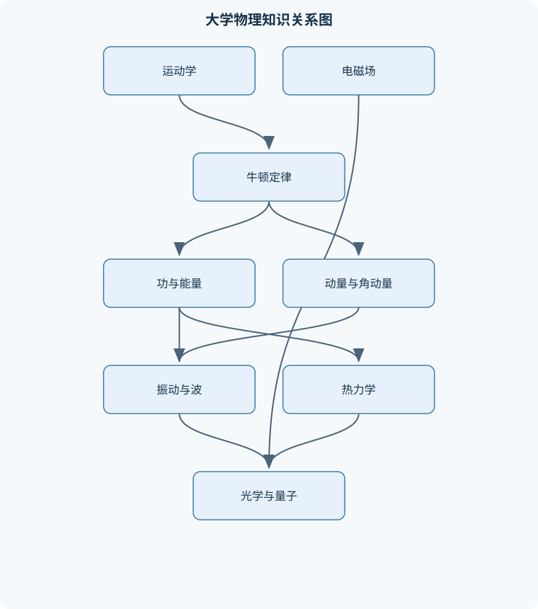
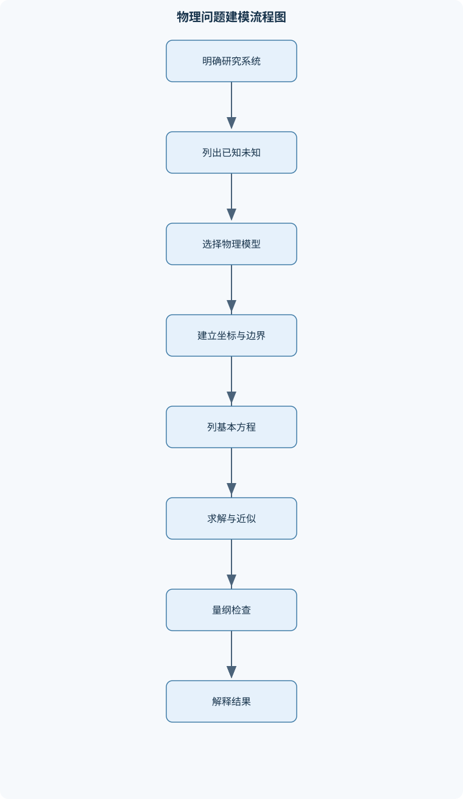

# 大学物理

## 一、课程整体知识框架

### 课程边界与先修知识

《大学物理》覆盖经典力学、机械振动与机械波、热学与热力学、电磁学、光学以及近代物理的基础理论、数学表达、典型模型和实验分析方法。课程以高中物理和基础微积分为先修知识，要求能够进行代数运算、向量分解、简单微分与积分，并理解函数图像。内容边界以宏观低速、弱引力场、经典连续介质和非相对论量子现象为主；涉及高速运动、强引力场、复杂多体系统和严格量子场论时，仅介绍基本思想，不展开高阶理论。





### 1. 课程目标与理论主线

《大学物理》以经典物理为主体，以相对论和量子物理为边界延伸，研究物质运动、相互作用、能量转化以及时空和微观状态的基本规律。课程内容不是彼此孤立的公式集合，而是由几条相互联系的主线构成：

1. **运动描述主线**：先用位置、速度和加速度描述物体怎样运动，再用力解释运动状态为什么改变。
2. **守恒定律主线**：功和能量描述状态变化的总账，动量描述平动相互作用，角动量描述转动和中心力运动。
3. **场与势主线**：电场、磁场和引力场把相互作用表示为物理空间中的分布；势能和电势则用标量描述场对物体做功的能力。
4. **振动与波主线**：周期运动是许多复杂运动的局部近似，波则是振动状态在空间中的传播。
5. **宏观与微观主线**：热力学从宏观状态量研究能量转化，气体动理论从分子运动解释压强、温度和内能。
6. **经典与近代主线**：在高速、小尺度或高频辐射条件下，经典时空观和连续能量观失效，需要相对论和量子物理。

课程默认使用国际单位制。位置矢量记为 $\mathbf r$，位移为 $\Delta\mathbf r$，速度和加速度分别为

$$
\mathbf v=\frac{d\mathbf r}{dt},\qquad
\mathbf a=\frac{d\mathbf v}{dt}.
$$

其中 $\mathbf r$ 的单位为米，$\mathbf v$ 的单位为米每秒，$\mathbf a$ 的单位为米每二次方秒。矢量既有大小又有方向，不能把不同方向的速度、力或加速度直接按标量相加；必须先选定坐标轴并进行分量分解。

### 2. 适用范围与理想化边界

课程中的许多公式建立在理想模型上。质点模型忽略物体的形状、转动和内部结构，适用于物体尺寸相对于运动距离或观测尺度足够小的情况；刚体模型假定物体在运动中不发生形变，适用于形变可以忽略的机械系统；理想气体模型忽略分子体积和分子间相互作用，适用于低压、较高温度且远离液化条件的气体；无黏流体模型忽略黏性耗散，适用于流速分布和边界条件允许作近似的情形。

经典力学主要适用于速度远小于光速、引力场较弱、物体尺度远大于原子尺度的情况。若速度接近光速，需使用洛伦兹变换和相对论能量；若系统尺度接近原子或电子的德布罗意波长，需使用波函数、能级和概率解释。复杂多体系统、强引力场、严格量子场论以及真实流体的湍流问题超出本课程的完整求解范围，只讨论其基本思想或低阶模型。

### 3. 统一的建模与验证方法

解决物理问题通常经历以下过程：

#### 3.1 明确系统和边界

先说明研究对象是单个物体、多个物体组成的系统，还是某一段电路、某一部分气体。守恒定律的成立取决于系统边界。例如，碰撞系统若把两个物体一起作为研究对象，碰撞内力可以相互抵消；若只研究其中一个物体，另一物体对它的作用就是外力。

#### 3.2 选择模型、参考系和坐标

需要判断对象能否视为质点，过程是否可以看成准静态，场是否具有球对称、柱对称或平面对称。坐标轴应尽量沿斜面、圆周切向、法向或场的对称方向设置，以减少未知分量。

#### 3.3 列出基本方程并检查条件

牛顿第二定律、动能定理、动量定理、角动量定理、热力学第一定律以及麦克斯韦方程组各有适用条件。公式不能脱离条件使用。例如，机械能守恒不是所有过程中都成立；绝热过程也不等于等温过程；高斯定律始终成立，但只有在高对称性下才可把电场强度从通量积分中提出。

#### 3.4 进行量纲、极限和边界验证

结果应具有正确单位。令摩擦系数趋于零、外力趋于零、速度趋于低速极限、孔径趋于无限大或介质折射率趋于真空值时，公式应回到相应的简单情形。若结果违反方向、能量或边界连续性，通常说明符号、系统边界或模型选择存在错误。

## 二、章节和模块划分

### 核心知识覆盖清单

本清单用于检查正文是否覆盖本课程的主要知识模块：

- **质点运动学与牛顿运动定律**：位移、速度与加速度的矢量定义、直线运动和曲线运动的参数描述、切向加速度与法向加速度、牛顿第一、第二和第三定律、惯性系与非惯性系的区别、外力、内力与受力分析、自由体图和坐标分解、摩擦力、弹力与约束力模型、圆周运动与向心加速度、变质量运动的基本概念。
- **功、能量与动量**：恒力和变力做功、曲线运动中的功积分、动能定理及其适用条件、保守力与势能、机械能守恒定律、冲量与动量定理、质心运动定理、动量守恒及其系统边界、弹性碰撞与非弹性碰撞、角动量、力矩与角动量定理。
- **刚体定轴转动与流体力学**：刚体平动、转动和一般运动、角位移、角速度与角加速度、力矩和转动惯量、平行轴定理、刚体转动定律、转动动能与机械能守恒、滚动运动的无滑动条件、角动量守恒及陀螺现象、静止流体的压强分布、连续性方程、伯努利方程及适用边界。
- **机械振动与机械波**：简谐运动的动力学方程、振幅、角频率、初相位和周期、简谐运动的能量转换、阻尼振动与品质因数、受迫振动和共振条件、波函数及波的传播、波速、波长、频率和相位、波的叠加与干涉、驻波、边界条件和简正模式、多普勒效应及其低速近似。
- **气体动理论与热力学基础**：平衡态、状态参量和状态方程、理想气体模型与微观假设、压强的微观解释、温度与分子平均平动动能、麦克斯韦速率分布的定性认识、内能与自由度、准静态过程和功的符号约定、热力学第一定律、等温、等压、等容和绝热过程、热容、摩尔热容与能量均分。
- **热力学第二定律与循环**：热力学过程的方向性、可逆过程与不可逆过程、热力学第二定律的两种表述、卡诺循环及效率推导、制冷机和热泵性能系数、熵的定义与熵增原理、理想气体熵变计算、热力学温标、热机循环的能量账分析、第二定律在实际装置中的限制。
- **静电场与电势**：电荷守恒与库仑定律、电场强度的定义和叠加原理、点电荷与连续电荷分布的场计算、高斯定律及对称性条件、电场线与通量、电势、电势差和电势能、电势梯度与电场的关系、导体静电平衡、电偶极子及其远场近似、带电粒子在静电场中的运动。
- **电容器与静电场能量**：电容的定义与几何因素、平行板、球形和圆柱形电容器、介质极化与介电常数、电容器串联和并联、电容器的耐压与储能、电场能量密度、介质边界上的电场条件、静电屏蔽、含介质电容器的力和能量分析、电容器充放电的时间过程。
- **稳恒电流与磁场**：电流、电流密度和电流连续性、欧姆定律的微分形式、电阻率与温度关系、基尔霍夫节点和回路定律、焦耳热与电功率、磁感应强度和磁通量、毕奥–萨伐尔定律、安培环路定律及对称性、带电粒子在磁场中的运动、载流导线所受安培力。
- **电磁感应与电磁场**：法拉第电磁感应定律、楞次定律与感应电流方向、动生电动势和感生电动势、自感与互感、电感器储能、RL和LC电路的响应、位移电流的概念、麦克斯韦方程组的物理联系、电磁波的产生与传播、电磁波的能流和偏振。
- **几何光学与波动光学**：光的反射和折射定律、全反射与光纤导光、球面折射和薄透镜成像、光具组与成像公式、干涉的相干条件、杨氏双缝干涉、薄膜干涉和光程差、衍射与单缝衍射条件、光栅衍射和分辨本领、偏振、马吕斯定律和双折射。
- **相对论与量子物理基础**：狭义相对论的基本假设、洛伦兹变换与同时性的相对性、时间膨胀和长度收缩、相对论动量与能量关系、黑体辐射与能量量子化、光电效应和光子模型、康普顿散射、德布罗意物质波、不确定性关系、一维无限深势阱、氢原子能级与受激辐射。


### 第一章 质点运动学与牛顿运动定律

#### 1.1 运动学描述

质点的位置写为 $\mathbf r(t)$，位移为

$$
\Delta\mathbf r=\mathbf r_2-\mathbf r_1.
$$

平均速度是位移与时间间隔之比，瞬时速度由极限定义为 $\mathbf v=d\mathbf r/dt$；加速度为 $\mathbf a=d\mathbf v/dt$。直线运动只需处理一个坐标分量，曲线运动则必须同时考虑方向变化。沿轨道切线方向和法线方向分解加速度，有

$$
\mathbf a=a_t\mathbf e_t+a_n\mathbf e_n,\qquad
a_t=\frac{dv}{dt},\qquad
a_n=\frac{v^2}{R},
$$

其中 $R$ 为轨道曲率半径。$a_t$ 改变速率，$a_n$ 改变速度方向。匀速圆周运动虽然速率不变，但因 $a_n\neq0$ 仍是加速运动。

若加速度为恒量，积分可得

$$
v=v_0+at,
$$

$$
x=x_0+v_0t+\frac12at^2,
$$

$$
v^2-v_0^2=2a(x-x_0).
$$

第三式消去了时间，只在一维恒加速度运动中成立。若 $a$ 随时间、位置或速度变化，必须从定义积分或求解微分方程，不能直接套用上述公式。

#### 1.2 牛顿定律与受力分析

在惯性系中，牛顿第二定律写为

$$
\sum\mathbf F=\frac{d\mathbf p}{dt},
$$

其中动量 $\mathbf p=m\mathbf v$，力的单位为牛顿。恒质量时化为 $\sum\mathbf F=m\mathbf a$。牛顿第一定律说明不存在合外力时物体保持静止或匀速直线运动；第三定律说明相互作用力大小相等、方向相反，但它们作用在不同物体上，不能相互抵消为同一物体的平衡力。

受力分析的核心是画自由体图：只画研究对象受到的外力，再沿坐标轴分解。重力近地面近似为 $mg$，弹簧弹力在小形变线性范围内为 $F=kx$，滑动摩擦力大小近似为 $\mu_kN$，方向与相对运动相反；静摩擦力不恒等于 $\mu_sN$，而是满足 $f_s\leq\mu_sN$，临界滑动时才取最大值。支持力、张力和约束力的大小需由动力学方程求出，不能预先任意指定。

非惯性系中需要加入惯性力，方程形式不再直接是惯性系中的 $\sum\mathbf F=m\mathbf a$。例如随转盘转动的参考系会出现离心力和科里奥利力。变质量运动不能简单使用 $F=ma$，应从动量守恒和动量通量出发建立方程，火箭喷气就是典型例子。

### 第二章 功、能量与动量

#### 2.1 功和动能定理

恒力沿位移做功为 $W=\mathbf F\cdot\Delta\mathbf r$；变力必须使用线积分：

$$
W=\int_{\mathbf r_1}^{\mathbf r_2}\mathbf F\cdot d\mathbf r.
$$

由 $\mathbf F=m\,d\mathbf v/dt$ 和 $d\mathbf r=\mathbf v\,dt$ 可得

$$
W=\int m\mathbf v\cdot d\mathbf v
=\frac12mv_2^2-\frac12mv_1^2.
$$

因此合外力的功等于动能变化 $\Delta K=W_{\text{合}}$。该结论适用于质点或可将系统平动等效为质点的情形。不能把变力直接写成 $Fs$，也不能因某个力不做功就认为合力不做功。

保守力的功只由初末位置决定，可定义势能 $U$，使得

$$
W_{\text{保守}}=-\Delta U.
$$

近地面重力势能为 $U=mgh$，弹簧势能为 $U=\frac12kx^2$。若只有保守力做功，则机械能

$$
E=K+U
$$

保持不变。摩擦力做功时，机械能通常减少，但总能量并未消失，而是转化为内能。

#### 2.2 动量、质心与碰撞

冲量定义为

$$
\mathbf J=\int_{t_1}^{t_2}\mathbf F\,dt,
$$

由牛顿第二定律积分得

$$
\Delta\mathbf p=\mathbf J.
$$

对多物体系统，内力按第三定律成对抵消；若系统受到的外力冲量为零，则总动量守恒。质心位置为

$$
\mathbf R=\frac{\sum_i m_i\mathbf r_i}{\sum_i m_i},
$$

对时间求两次导数可得

$$
M\mathbf a_{\mathrm{cm}}=\sum\mathbf F_{\mathrm{外}}.
$$

外力合力为零时，质心速度不变，但系统内部仍可能发生爆炸、振动或碰撞。

碰撞中，完全弹性碰撞同时满足动量和动能守恒；非完全弹性碰撞通常只满足动量守恒，机械能损失转化为形变能、声能和内能。完全非弹性碰撞后两物体共同运动，不能额外假定动能守恒。

#### 2.3 角动量与力矩

相对于参考点，质点角动量为

$$
\mathbf L=\mathbf r\times\mathbf p,
$$

力矩为

$$
\boldsymbol\tau=\mathbf r\times\mathbf F.
$$

由求导可得

$$
\frac{d\mathbf L}{dt}=\boldsymbol\tau_{\mathrm{外}}.
$$

若关于所选参考点的外力矩为零，总角动量守恒。参考点的选择十分重要；关于某点外力矩为零，不代表关于另一点也为零。中心力沿 $\mathbf r$ 方向，力矩为零，因此中心力运动具有角动量守恒。

### 第三章 刚体定轴转动与流体力学

#### 3.1 刚体转动

刚体绕固定轴转动时，角位移为 $\theta$，角速度为 $\omega=d\theta/dt$，角加速度为 $\alpha=d\omega/dt$。线量与角量的关系为 $v=r\omega$，切向加速度为 $a_t=r\alpha$，法向加速度为 $a_n=r\omega^2$。

转动惯量定义为

$$
I=\sum_i m_ir_i^2
$$

或连续分布下 $I=\int r^2\,dm$。转动定律为

$$
\sum\tau=I\alpha.
$$

转动动能为

$$
K_{\mathrm{转}}=\frac12I\omega^2.
$$

若已知质心轴转动惯量 $I_{\mathrm{cm}}$，平行轴定理给出

$$
I=I_{\mathrm{cm}}+Md^2,
$$

其中 $d$ 是两条平行轴的距离。轴离质心越远，转动惯量越大。

纯滚动同时满足平动和转动，接触点瞬时速度为零，因此

$$
v_{\mathrm{cm}}=R\omega.
$$

该条件要求静摩擦足够大且没有相对滑动；若摩擦不足，不能使用无滑动关系。陀螺进动体现了角动量方向变化与外力矩之间的关系，不能仅用“旋转越快越稳定”替代定量分析。

#### 3.2 静止流体和流动流体

静止流体中，压强随深度增加。密度为 $\rho$ 的均匀液体满足

$$
p=p_0+\rho gh.
$$

流体静力学只涉及法向压强，理想静止流体不能承受切向应力。不可压缩稳态流动满足连续性方程

$$
A_1v_1=A_2v_2.
$$

理想、稳态、不可压缩且无黏流体沿同一流线满足伯努利方程

$$
p+\frac12\rho v^2+\rho gh=\text{常量}.
$$

真实流体存在黏性、湍流、能量损失和边界层，因此不能把伯努利方程无条件用于所有管流。

### 第四章 机械振动与机械波

#### 4.1 简谐运动

若回复力满足 $F=-kx$，牛顿第二定律给出

$$
\ddot x+\omega^2x=0,\qquad \omega=\sqrt{\frac{k}{m}}.
$$

其解可写为

$$
x=A\cos(\omega t+\varphi).
$$

其中 $A$ 为振幅，$\varphi$ 为初相位，周期 $T=2\pi/\omega$，频率 $f=1/T$。速度和加速度分别为

$$
v=-A\omega\sin(\omega t+\varphi),
$$

$$
a=-\omega^2x.
$$

加速度与位移反向，速度比位移超前或滞后四分之一周期。机械能为

$$
E=\frac12m\omega^2A^2,
$$

在无阻尼、线性回复力模型中保持不变。

阻尼振动中机械能逐渐耗散；受迫振动的稳态振幅取决于驱动频率和阻尼，驱动频率接近固有频率时可能出现共振。共振峰并不一定正好位于无阻尼固有频率，阻尼越大，峰值通常越低、越宽。

#### 4.2 机械波

简谐行波可写为

$$
y=A\cos(\omega t-kx+\varphi),
$$

其中波数 $k=2\pi/\lambda$，波速 $u=\omega/k=f\lambda$。波传播的是振动状态和能量，不是介质质点整体随波前进。波的叠加遵循位移代数相加，干涉取决于相位差。

固定端、自由端等边界条件会形成驻波。驻波中节点和腹部位置固定，有限边界只允许满足边界条件的简正模式。多普勒效应是观察者与波源相对运动造成的频率变化；低速近似要求相对速度远小于波速，且波源、观察者运动方向需明确。

### 第五章 气体动理论与热力学基础

#### 5.1 状态量与微观解释

平衡态由压强 $p$、体积 $V$、温度 $T$ 和物质的量 $n$ 等状态参量描述。理想气体满足

$$
pV=nRT.
$$

气体动理论假设分子作无规则运动、分子自身尺寸可忽略、碰撞近似弹性且分子间除碰撞外无显著作用。分子撞击器壁的动量变化导致压强。由各向同性运动和碰撞统计可得

$$
p=\frac{Nm\langle v^2\rangle}{3V}.
$$

结合理想气体方程，温度与分子平均平动动能成正比：

$$
\frac12m\langle v^2\rangle=\frac32k_BT.
$$

这不表示所有分子速率相同；麦克斯韦分布给出一组速率的概率分布。

#### 5.2 热力学第一定律

本课程约定系统对外做功为 $W$，热力学第一定律写为

$$
\Delta U=Q-W.
$$

$Q$ 和 $W$ 是过程量，$\Delta U$ 是状态函数。等容过程 $W=0$；等温理想气体内能只由温度决定，故 $\Delta U=0$；等压过程需使用 $W=p\Delta V$；准静态绝热过程满足 $Q=0$，理想气体还可推出

$$
pV^\gamma=\text{常量},
$$

其中 $\gamma=C_p/C_V$。该关系不适用于任意不可逆绝热过程，也不意味着温度不变。

### 第六章 热力学第二定律与循环

第二定律说明自然过程具有方向性。热量不能无条件从低温物体传向高温物体，热机也不可能把吸收的热量全部转化为有用功。可逆过程是理想极限，要求无摩擦、无有限温差传热等耗散；真实过程通常不可逆。

卡诺循环由两个等温过程和两个绝热过程组成。吸热 $Q_H$、放热 $Q_C$ 时，效率为

$$
\eta=\frac{W}{Q_H}=1-\frac{Q_C}{Q_H}
=1-\frac{T_C}{T_H}.
$$

该结果说明，在相同高、低温热源之间，任何可逆热机效率相同，实际热机效率不超过卡诺效率。制冷机和热泵分别以移走低温热量和向高温端供热为目标，其性能用性能系数而非热效率表示。

熵定义为可逆过程中

$$
dS=\frac{\delta Q_{\mathrm{可逆}}}{T}.
$$

孤立系统熵不减。理想气体从状态 $(T_1,V_1)$ 变到 $(T_2,V_2)$ 时，

$$
\Delta S=nC_V\ln\frac{T_2}{T_1}
+nR\ln\frac{V_2}{V_1}.
$$

熵是状态函数，但计算不可逆过程的熵变时，可选取连接相同初末态的可逆路径，不能把实际不可逆路径直接当作可逆路径使用。

### 第七章 静电场与电势

库仑定律描述点电荷之间的相互作用。电场强度定义为单位正试探电荷所受力：

$$
\mathbf E=\frac{\mathbf F}{q_0}.
$$

多个电荷产生的电场遵循矢量叠加；连续电荷分布需进行积分。电通量为

$$
\Phi_E=\int\mathbf E\cdot d\mathbf A,
$$

高斯定律为

$$
\oint\mathbf E\cdot d\mathbf A=\frac{Q_{\mathrm{内}}}{\varepsilon_0}.
$$

高斯定律始终成立，但只有球对称、柱对称或平面对称时，才能把场强大小从积分中提出。均匀带电实心球内部电场随半径 $r$ 增长，外部等效为总电荷集中于球心；带电球壳内部电场为零，外部同样等效为点电荷。

电势差定义为

$$
\varphi_b-\varphi_a=-\int_a^b\mathbf E\cdot d\mathbf l.
$$

因此

$$
\mathbf E=-\nabla\varphi.
$$

电势是标量，点电荷电势可直接代数叠加；电场却必须按方向矢量叠加。静电平衡导体内部电场为零，导体表面为等势面，电场在表面法线方向。电偶极子远场近似只在观测距离远大于偶极子间距时成立。

### 第八章 电容器与静电场能量

电容定义为

$$
C=\frac{Q}{\Delta\varphi},
$$

其大小由几何结构和介质决定，而不由孤立电容器当前带多少电荷决定。平行板电容器近似为 $C=\varepsilon A/d$；球形和圆柱形电容器则由球对称或柱对称电场积分得到。边缘效应不可忽略时，简单公式会产生误差。

并联电容器两端电势差相同，总电容为各电容之和；串联电容器电荷量相同，满足

$$
\frac1C=\sum_i\frac1{C_i}.
$$

电容器储能为

$$
U=\frac12C(\Delta\varphi)^2
=\frac{Q^2}{2C}
=\frac12Q\Delta\varphi.
$$

介质极化会改变电场和电容，具体结果取决于电源是否保持连接。电场能量密度在均匀线性介质中为 $u_E=\frac12\mathbf E\cdot\mathbf D$。静电屏蔽来自导体静电平衡，不等于所有电磁波都能被任意金属完全阻挡。

### 第九章 稳恒电流与磁场

电流是单位时间通过截面的电荷量，电流密度 $\mathbf J$ 描述局部输运。稳恒电流满足电荷连续性，节点处流入电流之和等于流出电流之和。欧姆定律的微分形式为 $\mathbf J=\sigma\mathbf E$，其中电导率 $\sigma$ 与材料和温度有关。电阻率可能随温度变化，因此不能在所有温度范围内把电阻视为常量。

基尔霍夫节点定律来自电荷守恒，回路定律来自能量守恒。焦耳热功率为 $P=I^2R=UI$，符号应结合元件吸收或输出功率约定判断。

磁感应强度 $\mathbf B$ 描述磁场，磁通量为

$$
\Phi_B=\int\mathbf B\cdot d\mathbf A.
$$

毕奥–萨伐尔定律适合直接对电流元积分；安培环路定律在长直导线、无限长螺线管和环形螺线管等高对称问题中更高效。对称性不足时，不能强行令环路上磁场大小处处相等。

洛伦兹力为

$$
\mathbf F=q\mathbf v\times\mathbf B.
$$

磁场力垂直于速度，单独磁场不改变带电粒子的动能。垂直入射均匀磁场时，

$$
r=\frac{mv}{|q|B},\qquad
\omega_c=\frac{|q|B}{m}.
$$

若速度含有平行分量，轨迹为螺旋线。载流导线受安培力，其方向由电流方向与磁场方向共同决定。

### 第十章 电磁感应与电磁场

法拉第定律为

$$
\mathcal E=-\frac{d\Phi_B}{dt}.
$$

磁通量改变可能来自磁场变化、线圈面积变化或线圈方向变化。负号体现楞次定律：感应效应反抗磁通量的变化，而不是简单反抗原有磁场。运动导体中的动生电动势来自电荷受到的磁力，变化磁场在空间产生的环形电场则属于感生电动势。

自感和互感分别描述本线圈电流变化以及相邻线圈电流变化所产生的感应效应。电感器储能为

$$
U_L=\frac12LI^2.
$$

直流 $RL$ 电路的暂态过程由一阶微分方程决定，不能把稳态结果直接用于刚接通的瞬间；$LC$ 电路中电场能和磁场能周期交换。

位移电流概念使变化电场也能产生磁场，从而把电场和磁场统一为动态电磁场。麦克斯韦方程组预言电磁波；真空平面波中 $\mathbf E$、$\mathbf B$ 和传播方向相互垂直，传播速度为

$$
c=\frac1{\sqrt{\mu_0\varepsilon_0}}.
$$

电磁波携带能量和动量，偏振反映电场振动方向的规律性。

### 第十一章 几何光学与波动光学

几何光学以光线为近似模型，适用于障碍物、孔径和光学元件尺寸远大于波长的情况。反射满足入射角等于反射角，折射满足

$$
n_1\sin\theta_1=n_2\sin\theta_2.
$$

从高折射率介质射向低折射率介质时，入射角超过临界角会发生全反射，这是光纤导光的基础。球面折射和薄透镜成像可由近轴光线模型得到；偏离近轴条件时会出现球差、色差等实际限制。

波动光学要求考虑相干性和光程差。两束光叠加的强度为

$$
I=I_1+I_2+2\sqrt{I_1I_2}\cos\delta.
$$

杨氏双缝中，近似小角度且屏距远大于缝距时，条纹间距约为 $\Delta x=\lambda L/d$。薄膜干涉必须同时考虑几何光程差、折射率以及反射时可能产生的半波损失。

单缝衍射的暗纹条件为 $a\sin\theta=m\lambda$，其中 $a$ 为缝宽；光栅通过大量狭缝的相干叠加提高方向选择性和分辨能力。干涉与衍射并非完全割裂，有限孔径造成的衍射本质上也是许多次波的叠加。偏振只适用于横波，理想偏振片满足马吕斯定律

$$
I=I_0\cos^2\theta.
$$

### 第十二章 相对论与量子物理基础

狭义相对论以相对性原理和光速不变原理为基础。洛伦兹变换说明同时性具有相对性，并导致时间膨胀和长度收缩。高速粒子的能量和动量满足

$$
E^2=p^2c^2+m_0^2c^4.
$$

低速极限下，总能量可分解为静能和经典动能的近似形式，因而经典力学是相对论的低速近似。

黑体辐射、光电效应和康普顿散射显示辐射能量具有量子性。光子能量为

$$
E=h\nu=\frac{hc}{\lambda}.
$$

光电效应中，最大初动能满足

$$
K_{\max}=h\nu-W_0,
$$

其中 $W_0$ 为逸出功。截止频率由逸出功决定；在频率高于截止频率时，增大光强主要增加光电子数目，不直接提高单个光电子的最大初动能。

德布罗意关系为 $\lambda=h/p$，说明物质也具有波动性，但物质波不是宏观空间中的可见波纹。不确定性关系表明位置和动量不能同时具有任意精确值。一维无限深势阱要求波函数在边界处为零，边界条件 $\psi(0)=\psi(L)=0$ 只允许离散能级：

$$
E_n=\frac{n^2h^2}{8mL^2},\qquad n=1,2,3,\ldots
$$

氢原子能级和受激辐射进一步说明微观系统的能量状态具有量子化特征。量子模型并非在所有尺度上取代经典模型；当量子数很大或观测尺度远大于微观尺度时，应回到相应的经典极限。

## 三、核心概念的详细解释

### 3.1 质点运动学、牛顿定律与守恒量

运动学描述运动而不追问运动原因。位置矢量 $\mathbf r(t)$ 的时间导数是速度 $\mathbf v=d\mathbf r/dt$，速度的时间导数是加速度 $\mathbf a=d\mathbf v/dt$，三者单位分别为 $\mathrm m$、$\mathrm{m\,s^{-1}}$ 和 $\mathrm{m\,s^{-2}}$。位移是位置变化 $\Delta\mathbf r$，不是路程；平均速度是位移除以时间，平均速率则是路程除以时间。曲线运动中，加速度可分为切向分量 $a_t=d|\mathbf v|/dt$ 和法向分量 $a_n=v^2/r$：前者改变速率，后者改变速度方向。圆周运动即使速率不变，仍有指向圆心的法向加速度。

恒加速度直线运动由定义积分得到：$a=dv/dt$ 给出 $v=v_0+at$，再由 $v=dx/dt$ 得 $x=x_0+v_0t+\tfrac12at^2$；消去时间得 $v^2-v_0^2=2a(x-x_0)$。这些关系要求加速度恒定，不能直接用于随位置或速度改变的加速度。变加速度问题应从 $a(t)$ 积分，或建立微分方程。

牛顿第一定律指出，在惯性参考系中合外力为零时，物体保持静止或匀速直线运动；第二定律以动量表达为 $\sum\mathbf F=d\mathbf p/dt$，恒质量时为 $\sum\mathbf F=m\mathbf a$；第三定律描述两个物体间相互作用力大小相等、方向相反，但两力作用于不同物体，不能彼此抵消。受力分析应先选研究对象，再画自由体图，只画其他物体对它的力。重力、弹力、张力和摩擦力是常见相互作用；静摩擦力按维持相对静止所需取值，满足 $|f_s|\leq \mu_sN$，只有临界滑动时才达到最大值。动摩擦模型常写作 $f_k=\mu_kN$，适用于干燥接触面的近似，不刻画高速、润滑或复杂材料的摩擦规律。非惯性参考系中若仍使用牛顿方程，必须加入与参考系加速度对应的惯性力。

功把力沿位移方向的作用累积起来：$W=\int\mathbf F\cdot d\mathbf r$，单位为焦耳。由 $\mathbf F=m\,d\mathbf v/dt$ 及 $d\mathbf r=\mathbf v\,dt$，得到 $W=\int m\mathbf v\cdot d\mathbf v=\Delta(\tfrac12mv^2)$，即合力功等于动能变化。该结论适用于质点平动；刚体还可能有转动能。保守力的功仅由初末位置决定，可定义势能 $U$，并有 $W_c=-\Delta U$。只有非保守力对系统所做的功为零，或其能量变化已纳入其他能量形式时，机械能 $K+U$ 才守恒。

动量 $\mathbf p=m\mathbf v$ 的变化由冲量 $\mathbf J=\int\mathbf F\,dt$ 决定：$\Delta\mathbf p=\mathbf J$。对多物体系统求和时，内力成对抵消；若系统所受合外力冲量为零，系统总动量守恒。碰撞过程中动量守恒并不自动意味着动能守恒：理想弹性碰撞同时守恒动量和动能，非弹性碰撞把部分机械能转化为内能、形变或声能。质心位置 $\mathbf R_{\rm cm}=\sum_i m_i\mathbf r_i/\sum_i m_i$ 满足 $M\mathbf a_{\rm cm}=\sum\mathbf F_{\rm ext}$；外力合力为零时质心匀速运动，系统内部仍可发生运动。

### 3.2 转动、刚体与流体

刚体运动可分解为质心平动和绕质心（或选定轴）的转动。角位移、角速度和角加速度分别描述转动状态；力矩 $\boldsymbol\tau=\mathbf r\times\mathbf F$ 取决于力臂和力的方向。对固定转轴，转动定律为 $\sum\tau=I\alpha$，其中转动惯量 $I=\sum_i m_ir_i^2$ 或连续分布下的积分，单位 $\mathrm{kg\,m^2}$。改变转轴会改变各质量元到轴的距离；平行轴定理 $I=I_{\rm cm}+Md^2$ 仅用于两条平行轴，$d$ 为轴间距。

角速度为 $\omega$ 的刚体转动动能为 $K_{\rm rot}=\tfrac12I\omega^2$，这是把各质量元的平动动能 $\tfrac12m_iv_i^2$ 相加，并使用 $v_i=\omega r_i$ 得出的。角动量 $\mathbf L=\mathbf r\times\mathbf p$ 的变化率等于外力矩；固定轴且转动惯量不变时 $L=I\omega$。外力矩为零时角动量守恒。纯滚动要求接触点相对地面瞬时静止，因而 $v_{\rm cm}=\omega R$；有滑动时不能用这一约束。

静止流体内压强随深度增加，均匀密度流体满足 $p=p_0+\rho gh$。稳定流动且不可压缩时，流量守恒给出 $A_1u_1=A_2u_2$。理想流体沿同一流线满足伯努利关系 $p+\tfrac12\rho u^2+\rho gy=\text{常量}$，其假设包括稳态、不可压缩、黏性耗散可忽略；它不能无条件用于强湍流、显著黏性损失或流线之间能量交换显著的情形。

### 3.3 振动与机械波

质量为 $m$ 的物体受回复力 $F=-kx$ 时，牛顿定律给出 $\ddot x+\omega_0^2x=0$，其中 $\omega_0=\sqrt{k/m}$。其解为 $x=A\cos(\omega_0t+\phi)$，周期 $T=2\pi/\omega_0$，频率 $f=1/T$。速度与位移相差四分之一周期，加速度与位移反相。动能和弹性势能交替转化，总能量为 $E=\tfrac12m\omega_0^2A^2$。真实系统存在阻尼，振幅会随时间衰减；外力驱动时，稳态振幅随驱动频率变化，在接近固有频率处可能显著增大。阻尼越强，共振峰通常越低、越宽；共振频率不必严格等于无阻尼固有频率。

行波把振动相位向空间传播，可写成 $y=A\cos(\omega t-kx+\phi)$，其中 $k=2\pi/\lambda$，波速 $u=\omega/k=f\lambda$。相位中的正负号决定传播方向。波传播能量和相位，不意味着介质质点随波整体迁移。两列相干波叠加时，结果取决于相位差；驻波是相反方向同频波叠加的特殊情形，波节位置不振动，边界条件决定允许的简正模式。声源或观察者运动会改变观测频率，即多普勒效应；常用低速近似要求相对速度远小于介质中的波速，且声学问题必须区分声源与观察者相对介质的速度。

### 3.4 气体动理论与热力学

平衡态由压强、体积、温度和物质的量等状态参量描述。理想气体满足 $pV=nRT$，模型忽略分子体积和分子间作用，适用于密度较低、远离液化条件的气体。气体分子无规则运动撞击容器壁产生压强；在分子独立、运动各向同性的模型下，$pV=\tfrac13Nm\langle v^2\rangle$，其中 $N$ 是分子数，$m$ 是单分子质量。温度对应分子平均平动动能：$\tfrac12m\langle v^2\rangle=\tfrac32k_BT$。理想气体内能只依赖温度和自由度；对单原子理想气体，$U=\tfrac32nRT$。分子自由度均分是经典近似，低温或高频振动模式可能因量子效应而不充分贡献。

采用系统对外做功为正的约定，第一定律写作 $\Delta U=Q-W$。$Q$ 和 $W$ 依赖过程，内能是状态量。准静态过程中气体对外功 $W=\int p\,dV$；等容过程 $W=0$，等温理想气体过程 $\Delta U=0$，等压过程功为 $p\Delta V$，绝热过程 $Q=0$ 而温度一般改变。对理想气体准静态绝热过程，结合第一定律和状态方程可得 $pV^\gamma=\text{常量}$，$\gamma=C_p/C_V$；该式不适用于任意不可逆绝热过程。第二定律指出热量不能自发地从低温物体传至高温物体而不产生其他变化，也不存在把单一热源吸热全部转化为功的循环热机。可逆卡诺热机效率为 $1-T_c/T_h$，温度必须用热力学温标；实际热机因不可逆损失效率更低。熵是状态量，对可逆过程 $dS=\delta Q_{\rm rev}/T$；孤立系统总熵不减。不可逆过程的熵变不能简单用实际路径热量除以温度，但可选择连接相同平衡端态的可逆路径计算状态熵差。

### 3.5 静电场、电容与稳恒电流

电荷守恒，点电荷间作用由库仑定律描述。电场 $\mathbf E=\mathbf F/q$ 是单位正试探电荷受力，场强单位为 $\mathrm{N/C}$ 或 $\mathrm{V/m}$；连续电荷分布的场需将各电荷元贡献作矢量积分。电通量 $\Phi_E=\int\mathbf E\cdot d\mathbf A$，高斯定律 $\oint\mathbf E\cdot d\mathbf A=Q_{\rm in}/\varepsilon_0$ 对任意闭合面成立，但只有球、柱、平面对称等情形通常能直接解出场强。球对称电荷分布外部场等效于中心点电荷；均匀带电实心球内部场随半径线性增加，均匀带电薄球壳内部场为零。

静电场中电势差定义为 $\Delta\phi=-\int_a^b\mathbf E\cdot d\mathbf l$，点电荷电势（取无穷远为零）为 $\phi=kq/r$，电势能为 $U=q\phi$。由任意微小位移的电势变化可得 $\mathbf E=-\nabla\phi$。静电平衡导体内部电场为零，导体整体及表面为等势面；尖端附近表面电荷密度较大，但“导体表面电场处处相同”并不成立。电偶极子远场随距离快速衰减，只有观测距离远大于偶极子尺度时才可采用偶极近似。

电容 $C=Q/\Delta\phi$ 表示储存电荷与电势差的比例，单位法拉；理想平行板电容 $C=\varepsilon A/d$ 假设板间场近似均匀并忽略边缘效应。并联电容器电势差相同，故 $C_{\rm eq}=\sum C_i$；串联电荷量相同，故 $1/C_{\rm eq}=\sum1/C_i$。电场能量可写为 $U_E=\tfrac12C(\Delta\phi)^2$，均匀介质中能量密度为 $\tfrac12\varepsilon E^2$。介质极化会改变场和电容；计算力或能量变化时必须说明保持电荷还是保持电压，因为能量来源可能包括电源做功。电容充放电是暂态过程，不能把直流稳态等效关系用于全过程。

稳恒电流满足电荷连续性，电流密度与电场在欧姆介质中近似满足 $\mathbf J=\sigma\mathbf E$。基尔霍夫节点定律来自电荷守恒，回路定律来自稳恒电路中电场的环路性质；焦耳功率为 $P=IV=I^2R=V^2/R$。这些电路关系用于集总元件近似成立的条件；高频时需考虑分布电磁场和导线寄生参数。

### 3.6 磁场、电磁感应与电磁波

磁感应强度 $\mathbf B$ 描述磁场对运动电荷和电流的作用。电流元产生的磁场可用毕奥–萨伐尔定律积分；安培环路定律在稳恒电流条件下为 $\oint\mathbf B\cdot d\mathbf l=\mu_0I_{\rm enc}$。两种方法都成立，但安培定律只有在足够对称时便于直接求场。长直导线周围磁场大小为 $\mu_0I/(2\pi r)$；理想无限长螺线管内部近似均匀，端部和有限长度处有边缘效应。

洛伦兹力 $\mathbf F=q(\mathbf E+\mathbf v\times\mathbf B)$ 中，纯磁场力垂直于速度，不做功。粒子速度垂直均匀磁场时作圆周运动，半径 $r=mv/(|q|B)$，回旋角频率 $|q|B/m$；若速度含平行分量，轨迹为螺旋线。法拉第定律 $\mathcal E=-d\Phi_B/dt$ 中负号表示感应效应反抗磁通量变化。变化磁通可由磁场改变或回路运动造成；判断电流方向还须指定绕向和正法线。自感电动势与电流变化率成正比，电感储能为 $\tfrac12LI^2$。位移电流项使变化电场也能产生磁场。麦克斯韦方程组统一描述电荷、电流、电场和磁场；真空中变化电磁场以 $c=1/\sqrt{\mu_0\varepsilon_0}$ 传播，平面电磁波的电场、磁场和传播方向彼此垂直，能流方向由坡印廷矢量给出。

### 3.7 几何光学与波动光学

光线模型适用于尺度远大于波长、衍射效应可忽略的成像问题。反射角等于入射角，折射满足 $n_1\sin\theta_1=n_2\sin\theta_2$。从高折射率介质射向低折射率介质，入射角超过临界角时发生全反射；理想光纤利用这一条件导光，但真实光纤仍有弯曲、材料吸收和散射损耗。薄透镜公式取决于符号约定，使用前须统一物距、像距和焦距正负；成像计算还应检查主光线和极限情况。

干涉要求波具有足够相干性。两束光的合成强度为 $I=I_1+I_2+2\sqrt{I_1I_2}\cos\delta$，相位差 $\delta=2\pi\Delta/\lambda_0$，其中 $\Delta$ 是光程差。等强、相干光的亮纹对应 $\Delta=m\lambda_0$，暗纹对应 $\Delta=(m+\tfrac12)\lambda_0$；双缝小角度下条纹间距约为 $\lambda_0D/d$。薄膜干涉必须计入反射时可能发生的半波相变。单缝衍射暗纹条件为 $a\sin\theta=m\lambda_0$（非零整数 $m$）；光栅主极大满足 $d\sin\theta=m\lambda_0$。衍射与干涉均源于波的叠加，孔径有限导致角扩展，光栅分辨本领还受有效光栅线数和谱线级次限制。线偏振光通过检偏器后满足马吕斯定律 $I=I_0\cos^2\theta$；该式假定理想偏振片和单色或适当定义的光强。

### 3.8 相对论与量子物理基础

狭义相对论建立在惯性系物理定律相同、真空光速不变两条基本假设上。洛伦兹变换导出同时性的相对性、运动钟的时间膨胀和运动方向长度收缩。相对论能量动量关系为 $E^2=p^2c^2+m_0^2c^4$，低速时总能量包含静能 $m_0c^2$，动能近似回到 $\tfrac12m_0v^2$。该理论适用于惯性系间的相对匀速运动；强引力场需要广义相对论处理。

光电效应表明光能量交换具有量子性：单个光子能量为 $h\nu$，最大光电子动能满足 $K_{\max}=h\nu-W_0$。截止频率由逸出功决定，光强主要影响光子数和光电子数，不直接决定单个光电子的最大动能。康普顿散射显示光子具有动量。德布罗意波长 $\lambda=h/p$ 适用于物质粒子的波动性描述，不代表宏观物体表面存在可见波纹。不确定性关系限制位置和动量同时任意精确确定。一维无限深势阱的边界条件使允许波数离散，能级为 $E_n=n^2h^2/(8mL^2)$；这不是任意势场通用能谱。氢原子能级及受激辐射分别体现束缚态量子化和光与物质的能量交换；量子数较大、尺度宏观时需检查经典极限。

## 四、重要定义、公式、定理和推导

### 专业审校补充：关键定义与适用边界

机械波中必须区分相位速度与质点运动速度。相位速度是某一固定相位点的传播速度，定义为 v_p=ω/k=λf；质点速度是介质质点随时间振动的速度，等于对位移函数 y(x,t) 关于时间求导，二者方向、大小和物理含义均不同。对于无色散理想弦波，波形可写为 y=A cos(kx−ωt+φ)，其中 A 为振幅，k=2π/λ，ω=2πf，φ 为初相位，x 和 t 的单位分别为米和秒。固定相位要求 kx−ωt+φ 为常量，因此 dx/dt=ω/k。若不同频率成分具有不同的相位速度，即出现色散，则波包的传播速度应使用群速度 v_g=dω/dk，而不能简单套用 λf。理想无阻尼、均匀介质中的单色平面波模型不适用于强非线性、明显反射或介质参数随位置变化的情形；遇到边界时必须同时满足边界条件，通常会产生反射、驻波或模式量子化。


### 4.1 代表性分析流程

#### 受力与守恒量分析

输入为研究对象、约束、初始状态和外界作用，输出为加速度或初末态关系。先明确系统边界和惯性参考系，再画自由体图、分解力并列牛顿方程；若过程涉及碰撞或复杂轨迹，分别检查外力冲量、非保守力功和外力矩，选择动量、机械能或角动量方程。最后使用约束关系闭合方程并检查单位、方向和极限。关键不变量是系统总动量或角动量仅在相应外界作用条件满足时保持不变。此流程适用于经典宏观力学，不可因“过程很短”就默认机械能守恒。

#### 场与电路分析

输入为电荷或电路拓扑、元件参数、边界和激励，输出为场、电势、电流或功率。先判断对称性：高斯定律对任意闭面成立，但只有对称性允许时才能将场强提出积分；磁场可先试安培环路法，缺少对称性时使用毕奥–萨伐尔积分。电路先标节点、统一电流方向，再以节点电流定律和回路电压定律列独立方程。直流稳态下理想电容开路、理想电感短路；暂态必须保留电荷或磁通随时间变化的方程。以总电荷守恒、功率平衡和对称性极限复核。

#### 热力学过程账目

输入包括系统、初末状态、过程路径和气体模型，输出为 $Q,W,\Delta U$ 及效率或熵变。统一采用“系统对外做功为正”，先由路径计算 $W=\int p\,dV$，再由状态量求 $\Delta U$，最后用 $\Delta U=Q-W$ 求热量。循环回到原态时 $\Delta U_{\rm cycle}=0$，故净吸热等于净输出功。不可逆过程的熵变可借助同端态可逆路径计算，但不能把实际不可逆路径热量直接代入可逆熵积分。

#### 可运行数值例：恒加速度直线运动

以下 Python 代码只进行数值计算，不调用外部资源。输入位置、初速度、恒加速度和时间，输出末速度与位置。

```python
def uniform_motion(x0_m, v0_m_s, a_m_s2, time_s):
    if time_s < 0:
        raise ValueError("time must be nonnegative")
    velocity_m_s = v0_m_s + a_m_s2 * time_s
    position_m = x0_m + v0_m_s * time_s + 0.5 * a_m_s2 * time_s**2
    return position_m, velocity_m_s

position, velocity = uniform_motion(0.0, 3.0, 2.0, 4.0)
print(position, velocity)
```

输出为位置 $28\ \mathrm m$、速度 $11\ \mathrm{m\,s^{-1}}$。过程的不变量是所用加速度保持恒定；终止条件是给定时间已代入运动方程。若输入加速度随时间变化，应改为积分 $a(t)$，不能继续套用此函数。

### 4.2 关键定理的推导

#### 功—动能定理与动量定理

牛顿第二定律给出 $\mathbf F=m\,d\mathbf v/dt$。沿轨迹作点积并使用 $d\mathbf r=\mathbf vdt$：

$$
\mathbf F\cdot d\mathbf r=m\mathbf v\cdot d\mathbf v
=d\left(\frac12mv^2\right).
$$

对路径积分即得 $W_{\rm net}=\Delta K$。变力必须按路径积分，不能用某一处力乘总路程替代。另一方面，对时间积分牛顿第二定律：

$$
\int_{t_1}^{t_2}\mathbf F\,dt
=\mathbf p_2-\mathbf p_1.
$$

左侧为冲量。若扩展为多物体系统，内力对总动量的贡献成对抵消；只有系统外力的总冲量为零，才可推出总动量守恒。

#### 质心与刚体转动能

由 $\mathbf R_{\rm cm}=(\sum_i m_i\mathbf r_i)/M$ 两次对时间求导，得 $M\mathbf a_{\rm cm}=\sum_i m_i\mathbf a_i$。对每个质点使用牛顿第二定律并将内力成对相加，内部作用力抵消，剩下系统外力合力。刚体绕定轴转动时，各点速度 $v_i=\omega r_i$，故

$$
K_{\rm rot}=\sum_i\frac12m_iv_i^2
=\frac12\omega^2\sum_i m_ir_i^2
=\frac12I\omega^2.
$$

该式以刚体绕固定轴转动为基础；一般刚体运动还须加上质心平动能。平行轴定理来自 $r_i^2$ 关于新轴展开并利用质心处质量加权位置和为零，得到 $I=I_{\rm cm}+Md^2$。

#### 简谐运动与热力学绝热关系

回复力 $F=-kx$ 代入 $m\ddot x=F$ 得 $\ddot x+\omega_0^2x=0$，其解为 $x=A\cos(\omega_0t+\phi)$。对时间求导得 $v=-A\omega_0\sin(\omega_0t+\phi)$，$a=-\omega_0^2x$。代入能量式：

$$
E=\frac12mv^2+\frac12kx^2
=\frac12m\omega_0^2A^2.
$$

因此总能量不随相位改变。对理想气体准静态绝热过程，$Q=0$ 且 $dU=nC_VdT=-p\,dV$。由 $pV=nRT$ 消去温度并积分，得到 $pV^\gamma=\text{常量}$，$\gamma=C_p/C_V$。推导使用定热容理想气体假设和准静态路径，不能据此描述任意快速、不可逆绝热变化。

#### 球对称电场与电势

球对称时，半径为 $r$ 的球面上 $E$ 大小处处相同且沿径向。高斯定律给出 $E(4\pi r^2)=Q_{\rm in}/\varepsilon_0$，故 $E=Q_{\rm in}/(4\pi\varepsilon_0r^2)$。点电荷和均匀带电球壳的外部场对应总电荷；均匀带电实心球内部半径 $r$ 所包电荷为 $Q r^3/R^3$，所以内部 $E=Qr/(4\pi\varepsilon_0R^3)$。由 $\phi(r)-\phi(\infty)=-\int_\infty^r\mathbf E\cdot d\mathbf l$ 得点电荷电势 $\phi=kQ/r$。一般情形则有 $\mathbf E=-\nabla\phi$。高斯定律虽普遍成立，非对称电荷分布通常不能仅靠它直接求出局部电场。

#### 干涉、相对论与量子边界

两束相干波电场相加，强度与电场平方的时间平均成正比，交叉项给出

$$
I=I_1+I_2+2\sqrt{I_1I_2}\cos\delta,\qquad
\delta=\frac{2\pi\Delta}{\lambda_0}.
$$

亮暗条件还要求相干性足够、偏振方向允许干涉；薄膜情形需把反射相变计入 $\Delta$。洛伦兹变换在速度 $v$ 下含因子 $\gamma=(1-v^2/c^2)^{-1/2}$，导出运动钟时间间隔 $\Delta t=\gamma\Delta\tau$ 和运动方向长度 $L=L_0/\gamma$；低速 $v\ll c$ 时 $\gamma\approx1+\tfrac12v^2/c^2$。能量动量关系 $E^2=p^2c^2+m_0^2c^4$ 在低速极限分离出静能与经典动能。光电方程由单光子能量守恒得到 $K_{\max}=h\nu-W_0$，所以截止频率 $\nu_0=W_0/h$；增大光强不改变单光子的能量。无限深势阱内定态波函数须满足两端为零，允许波数 $k_n=n\pi/L$，由 $E=\hbar^2k^2/(2m)$ 得 $E_n=n^2h^2/(8mL^2)$。边界条件改变，能谱也改变。

### 4.3 例题与解答

#### 例题一：斜面上的摩擦物块

**题干：**质量 $m=2.0\ \mathrm{kg}$ 的物块置于倾角 $30^\circ$ 的斜面，动摩擦因数 $\mu_k=0.20$，取 $g=9.8\ \mathrm{m\,s^{-2}}$。求沿斜面下滑时的加速度。

**分析与解答：**选物块为对象，沿斜面向下为正。垂直斜面方向无加速度，故 $N=mg\cos30^\circ=16.97\ \mathrm N$。动摩擦力向上，大小 $f_k=\mu_kN=3.39\ \mathrm N$。沿斜面列式：

$$
ma=mg\sin30^\circ-f_k,\qquad
a=g(\sin30^\circ-\mu_k\cos30^\circ)
\approx3.20\ \mathrm{m\,s^{-2}}.
$$

质量消去符合重力和库仑摩擦均与质量成正比的模型。若物块初始静止，还须先检验 $\tan30^\circ$ 是否超过静摩擦因数；题目未给静摩擦因数时不能仅凭动摩擦结果断定会自行启动。**变式：**加入拉力时，先确定其切向和法向分量，法向力随之改变，摩擦力也要重新计算。

#### 例题二：变力做功

**题干：**一维力 $F(x)=3x^2+2x\ \mathrm N$，其中 $x$ 以米计。物体从 $x=0$ 移至 $x=2\ \mathrm m$，求该力做功。

**分析与解答：**使用线积分 $W=\int_0^2F(x)\,dx$：

$$
W=\left[x^3+x^2\right]_0^2=12\ \mathrm J.
$$

力单位为牛顿，积分变量为米，结果单位是焦耳。此一维定常力可由势能表示，取 $U(0)=0$，则 $U(x)=-x^3-x^2$ 焦耳，且 $W=-\Delta U$。**验证：**势能在 $x=2$ 为 $-12\ \mathrm J$，故势能减少 $12\ \mathrm J$。**变式：**若力还依赖时间，在不同运动路径上做功可能不同，不能只由端点位置判断势能差。

#### 例题三：非弹性碰撞

**题干：**$m_1=1.0\ \mathrm{kg}$ 的物体以 $4.0\ \mathrm{m\,s^{-1}}$ 向右运动，与静止的 $m_2=3.0\ \mathrm{kg}$ 物体碰后粘在一起。求共同速度及机械能损失。

**分析与解答：**以两物体为系统，碰撞期间外力冲量可忽略，动量守恒：

$$
v_f=\frac{m_1v_1+m_2v_2}{m_1+m_2}=1.0\ \mathrm{m\,s^{-1}}.
$$

初动能为 $8.0\ \mathrm J$，末动能为 $\tfrac12(4.0)(1.0)^2=2.0\ \mathrm J$，损失 $6.0\ \mathrm J$。这部分转为形变、内能等，不是能量消失。**验证：**末动量为 $4.0\ \mathrm{kg\,m\,s^{-1}}$，与初动量相同。**变式：**若碰撞后分离但不粘连，动量方程仍成立；要确定两个末速度，还需恢复系数或能量条件。

#### 例题四：均匀带电实心球

**题干：**半径 $R$、总电荷 $Q>0$ 的均匀带电实心球，求距球心 $r<R$ 处电场。

**分析与解答：**体电荷密度为 $3Q/(4\pi R^3)$。半径 $r$ 的高斯球包围电荷 $Q_{\rm in}=Qr^3/R^3$。由球对称高斯定律：

$$
E(4\pi r^2)=\frac{Qr^3}{\varepsilon_0R^3},
\qquad
\mathbf E=\frac{Qr}{4\pi\varepsilon_0R^3}\,\hat{\mathbf r}.
$$

场方向径向向外，球心处场为零，边界内侧场为 $Q/(4\pi\varepsilon_0R^2)$，与外部点电荷场在表面连续。**验证：**$r\to0$ 时场线性趋零。**变式：**若是带电薄球壳，球内所包电荷为零，球壳内部场为零，不能套用实心球结果。

#### 例题五：杨氏双缝

**题干：**波长 $\lambda_0=600\ \mathrm{nm}$ 的单色光照射间距 $d=0.30\ \mathrm{mm}$ 的双缝，屏距 $D=2.0\ \mathrm m$。求近轴条纹间距。

**分析与解答：**小角度下相邻亮纹的光程差增量为 $\lambda_0$，几何关系给出 $y_m\approx m\lambda_0D/d$，故条纹间距

$$
\Delta y=\frac{\lambda_0D}{d}
=\frac{600\times10^{-9}\times2.0}{0.30\times10^{-3}}
=4.0\times10^{-3}\ \mathrm m.
$$

条纹间距为 $4.0\ \mathrm{mm}$。**验证：**波长或屏距增大，条纹间距应增大；缝距增大则间距减小。**变式：**若两缝光强不等，条纹位置近似不变，但明暗对比度降低；若光源相干长度不足，稳定条纹将减弱。

#### 例题六：光电效应

**题干：**某金属截止频率为 $\nu_0$，用频率 $\nu=2\nu_0$ 的光照射。求最大初动能与遏止电势的关系，并说明加倍光强的影响。

**分析与解答：**逸出功 $W_0=h\nu_0$，因此

$$
K_{\max}=h\nu-W_0=h\nu_0,\qquad
eV_s=K_{\max}.
$$

若 $e$ 表示元电荷大小，则 $V_s=h\nu_0/e$。加倍光强会增加单位时间入射光子数，通常使光电流增大，但在频率不变时不改变 $K_{\max}$ 和遏止电势。**验证：**当频率降到截止频率以下，单纯增大光强仍不能产生该基本模型中的光电子。**变式：**提高频率会提高最大初动能；若金属表面状态改变，逸出功及截止频率也会改变。

### 4.4 实验与项目分析

#### 实验一：弹簧振子周期与质量关系

**目的与输入：**弹簧、质量已知或可测的砝码、计时器、长度标尺；输入不同振子质量 $m$，测量每组多次振动的总时间 $t$ 和振动次数 $N$。**步骤：**保持弹簧和振幅范围不变，测静态伸长以检查弹性工作区；小幅拉开后释放，避开释放瞬态，计时 $N$ 个周期；计算 $T=t/N$，绘制 $T^2$ 对 $m$ 图。理想模型预言 $T^2=(4\pi^2/k)m$，直线斜率可估算弹簧劲度系数 $k$。**评价标准：**重复测量的周期散布应与计时不确定度相容；图线近似线性且截距与零相容到实验误差范围；由斜率求得的 $k$ 应与静态测量结果在不确定度内一致。**排错：**若周期随振幅明显变化，检查弹簧非线性或振幅过大；若数据偏离线性，检查质量附加的弹簧有效质量、支架摩擦、计数错误和振动方向。模型忽略阻尼及弹簧质量，结果是近似值。

#### 实验二：杨氏双缝测量波长

**目的与输入：**已知双缝间距 $d$、可测屏距 $D$、光源、屏幕和长度标尺；输入多个亮纹位置。**步骤：**固定双缝与屏幕，测中心亮纹两侧多个同级亮纹位置，以对称位置平均减少中心定位偏差；用总跨度除以条纹级数得到平均间距 $\Delta y$；在小角度条件下计算 $\lambda_0=d\Delta y/D$。至少改变屏距重复测量，检查 $\Delta y$ 是否与 $D$ 成正比。**评价标准：**多条纹拟合比单条纹读数更稳定；不同屏距所得波长应在测量不确定度范围内相容；拟合残差不应显示明显系统弯曲。**排错：**条纹模糊时检查光源相干性、双缝照明和环境振动；测量偏差过大时检查 $d,D$ 的单位换算、中心条纹定位和屏幕是否垂直；若屏距太近，应检查近轴近似是否仍成立。

### 4.5 易错点与常见考法

易错点包括：把位移与路程混为一谈；把速度、力等矢量直接按标量相加；把作用力和反作用力当作同一物体上的平衡力；未画自由体图就遗漏约束力；把合力为零误解为物体静止；把向心力当作独立的新力；认为静摩擦力总等于最大值；对任意高斯面都把场强移出积分；混淆电势、电势能和电场；把串联电容器误认为电压相等；认为磁场力能改变粒子动能；忽略法拉第定律负号；把热量当状态函数；把绝热误认为等温；薄膜干涉漏算反射相变；认为增大光强会提高光电子最大动能；混用静质量与总能量；将德布罗意波理解为可见几何波纹；不说明理想模型和近似条件。

常见笔试问题及解答思路：

1. **为何合外力为零不意味着物体静止？**由 $\mathbf a=0$ 得速度恒定；初速度可非零。
2. **何时可用机械能守恒？**明确系统后检查非保守力功；若摩擦做功不可忽略，应计入内能或直接用功—能定理。
3. **碰撞中动量守恒而动能不守恒是否矛盾？**不矛盾；总能量仍守恒，宏观机械能可转成内能和形变能。
4. **高斯定律为何不能总用于直接求场？**定律对所有闭面成立，但不对称时面上场强大小和方向不均匀，通量方程不足以确定局部场。
5. **绝热压缩时温度为何升高？**$Q=0$，外界对气体做功使其内能增加，理想气体内能随温度上升。
6. **磁场为何不对带电粒子做功？**$\mathbf v\cdot(q\mathbf v\times\mathbf B)=0$，磁力垂直瞬时速度，只改变方向。
7. **电容器串联为何电荷量相同？**连接的中间导体整体电荷守恒，理想串联节点无其他支路，感应电荷量相等；电压按电容分配。
8. **光电效应中光强和频率分别控制什么？**频率决定单光子能量和最大初动能，强度主要决定光子通量及光电流；前提是频率高于截止频率。
9. **相对论低速极限怎样检验？**将 $\gamma$ 展开到 $v^2/c^2$ 阶，动能应回到 $\tfrac12m_0v^2$，时间和长度变化趋于零。
10. **为何势阱能级离散？**波函数须满足边界条件，只有能在边界形成节点的驻波允许存在，故波数和能量离散。

面试问题及参考回答要点：

1. **如何分析一个斜面—滑轮系统？**说明对象拆分、自由体图、绳长约束、平动和转动方程；追问“滑轮有质量怎么办”时加入 $\tau=I\alpha$，两侧张力一般不同。
2. **什么时候优先使用动量定理而非牛顿方程？**短时相互作用或力随时间复杂时用冲量；追问外力冲量不可忽略时，应将其纳入系统总动量变化。
3. **怎样判断滚动物体是否纯滚动？**检查静摩擦所需值是否不超过最大静摩擦；追问能量损耗时，理想静摩擦在固定地面接触点不做功，但滑动摩擦会耗散机械能。
4. **为何电场可由电势求出？**静电场为保守场，$\mathbf E=-\nabla\phi$；追问时变磁场时，电场一般有非保守部分，不能全局仅由标量电势描述。
5. **如何解释卡诺效率上限？**可逆循环在给定冷热源间熵交换平衡，效率只取决于两热源绝对温度；追问实际效率时指出摩擦、有限温差传热等不可逆性降低效率。
6. **如何判别电磁感应方向？**先选回路正向和法线，判断磁通变化，再用楞次定律确定感应效应方向；追问线圈反接时，需一致改变绕向约定和电动势符号。
7. **何时几何光学失效？**孔径、障碍物尺度接近波长或相干叠加影响显著时须考虑衍射；追问仪器分辨率时，需把有限孔径衍射纳入系统分析。
8. **如何区分相对论与量子修正？**高速、光速比值不可忽略时用相对论；作用尺度或能量量子化显著时用量子理论；追问两者同时重要的情况时，指出需相对论量子理论，超出本课程基础模型。
9. **如何评估实验结果是否可信？**检查单位、重复性、误差传播、模型假设和极限趋势；追问系统误差时，说明重复测量不能自动消除校准偏差。
10. **何时采用数值求解而非解析解？**边界复杂、方程耦合或解析解不可得时可数值求解；追问如何验算，应检查步长收敛、守恒量、边界条件和解析极限。

### 4.6 岗位任务与物理方法

工程技术人员分析机械结构和运动机构，使用受力、能量、振动及材料近似，产出计算书或仿真模型；验收关注载荷边界、单位、极限工况和试验一致性。电气工程人员分析电路暂态、磁场和感应装置，使用基尔霍夫定律、场论及能量关系，产出电路参数和安全裕度；验收检查电流、电压、功率平衡及绝缘约束。光学工程人员设计成像、干涉、光纤或光谱系统，使用折射、衍射、偏振和相干理论，产出光路与分辨率指标；验收需核对像差、损耗、波长范围和测量结果。能源与动力工程人员评估循环和流动，使用热力学第一、第二定律及流体近似，产出热量、功和效率账目；验收要求能量闭合且明确不可逆损失。实验测试人员规划测量、处理不确定度并拟合模型，产出可重复数据和误差报告；验收看校准记录、重复性、残差及独立物理检验。计算仿真人员将运动方程或场方程离散求解，产出数值结果；验收需做网格或步长收敛、边界检查、守恒检验，并说明模型适用范围。

## 五、算法、流程和实现思路

### 方法与流程覆盖索引

下列方法或流程应在正文中说明输入、步骤、适用条件、结果检查和边界：

- 受力分析流程：输入物体、约束、已知运动状态和参考系；输出各方向合力与加速度。过程为确定研究对象、画自由体图、选坐标轴、分解所有力、列 ΣFₓ=maₓ 和 ΣFᵧ=maᵧ、联立求解并检查单位和方向。不变量是同一坐标系中的矢量分量守恒关系；终止条件是未知量数量不超过独立方程数量。适用于质点或可视为质点的平动问题；不直接适用于需要刚体转动自由度的系统。
- 守恒定律判定流程：输入研究系统、相互作用和过程；输出可使用的动量、机械能或角动量守恒方程。先判断外力冲量、非保守力功和外力矩是否为零，再选择对应守恒量，列初末状态方程，最后补充约束关系。适用条件必须针对系统边界判断，不能因碰撞短暂就默认机械能守恒。
- 一维运动数值分析流程：输入初始位置、初速度、加速度函数和时间区间；输出位置、速度和加速度。先建立坐标正方向，再由 a(t) 积分得到 v(t)，由 v(t) 积分得到 x(t)，最后代入边界条件并检查极值和单位。若加速度依赖位置或速度，则应改用微分方程方法，不能套用匀加速公式。
- 电场计算流程：输入电荷分布、空间对称性和求场点；输出电场矢量或电势。先判断是否具有球对称、柱对称或平面对称，再选择库仑积分或高斯定律；求电势时优先使用标量叠加，最后通过梯度或边界条件求电场并检查远场极限。高斯定律始终成立，但只有高对称性才能直接把场强移出通量积分。
- 电路分析流程：输入电路拓扑、元件参数和激励；输出支路电流、电势和功率。先标记节点和回路，统一电流正方向，使用节点电流定律或回路电压定律列独立方程，求解后用总功率平衡和极限情况复核。直流稳态下理想电容相当于断路、理想电感相当于短路；暂态过程必须保留微分方程。
- 磁场与带电粒子分析流程：输入电荷运动状态、磁场分布和初始条件；输出洛伦兹力、轨道半径、周期或螺距。先分解速度为平行和垂直磁场的分量，再分别处理匀速直线运动和圆周运动，合成得到螺旋轨迹。磁场力始终垂直于瞬时速度，因此单独磁场不改变粒子动能。
- 热力学过程分析流程：输入初态、终态、过程路径和气体模型；输出 Q、W、ΔU 及效率或熵变。先确定系统对外做功符号，再使用状态方程联系状态参量，分别计算功和内能变化，最后由第一定律求热量并检验循环总内能变化为零。若过程不可逆，不能直接套用可逆过程的路径积分表达式。
- 光学成像与干涉分析流程：输入光源、介质、几何尺寸和观测位置；输出像的位置、放大率或条纹条件。几何光学先画主光线并使用折射定律和成像公式；波动光学先判断相干性，再计算光程差和相位差，最后区分亮暗条件。薄膜干涉必须考虑反射相变，不能只使用几何厚度差。
- 量子现象判定流程：输入实验现象、入射频率或粒子尺度；输出适用的经典或量子模型及可观测量。先比较作用尺度与普朗克常量相关的量级，再判断是否需要光子、物质波或波函数描述，列出边界条件和守恒关系，最后检查经典极限。该流程用于选择模型，不替代具体量子力学求解。





### 5.1 物理问题的统一建模流程

大学物理计算的核心不是直接寻找公式，而是把实际情境转化为具有明确边界、变量和约束条件的模型。一个可复用的流程如下。

1. **确定研究对象和系统边界。**  
   先说明研究的是单个质点、多个物体组成的系统、某一段气体、一个电路回路，还是某个场区域。系统边界决定哪些相互作用被视为外力，也决定守恒定律能否直接使用。例如，碰撞中若把两个物体合并为系统，碰撞力属于内力；若只研究其中一个物体，碰撞力就是外力。

2. **选择参考系和坐标。**  
   惯性参考系中可直接使用 $\sum\mathbf F=d\mathbf p/dt$；加速或转动参考系中需加入惯性力。坐标轴应尽量沿斜面、圆周切向与法向、导线方向或场的对称方向设置。坐标正方向一旦确定，速度、力、电流和电势差的正负号必须始终保持一致。

3. **判断理想模型。**  
   判断物体能否视为质点，绳和滑轮是否可视为无质量，接触面是否采用库仑摩擦模型，气体是否可视为理想气体，流体是否可忽略黏性，电路元件是否可视为理想元件。模型假设必须与结论同时写出，否则公式的适用范围不明确。

4. **列出基本方程。**  
   力学中可使用牛顿定律、动能定理、动量定理和角动量定理；热学中使用状态方程、第一定律和第二定律；电磁学中使用库仑定律、高斯定律、基尔霍夫定律、法拉第定律和洛伦兹力；光学和量子问题则先判断使用几何光学、波动光学还是量子模型。

5. **求解并验证。**  
   代数求解后检查单位、方向、极限情况和能量或电荷平衡。例如，若摩擦系数趋于零，加速度应趋向无摩擦结果；若外磁场为零，带电粒子轨道不应继续保持磁场导致的圆周运动；若一个热力学循环回到初态，应满足 $\Delta U_{\rm cycle}=0$。

### 5.2 受力分析与动力学求解算法

**输入：** 物体、约束关系、质量、初始状态、外力和参考系。  
**输出：** 各方向合力、加速度、约束力以及可能的运动状态。

#### 过程

1. 选定研究对象，不能把研究对象受到的力与它施加给别人的反作用力同时画在同一自由体图中。
2. 画自由体图，标出重力、支持力、弹力、张力、摩擦力、电场力或磁场力。
3. 建立坐标轴，将斜面方向、圆周切向和法向等作为优先方向。
4. 分解各力，分别列出
   $$
   \sum F_x=ma_x,\qquad \sum F_y=ma_y.
   $$
5. 若存在绳长不变、无滑动或刚性连接等条件，补充运动学约束。例如同一不可伸长绳两端的位移大小相等；纯滚动时满足
   $$
   v_{\rm cm}=R\omega,\qquad a_{\rm cm}=R\alpha.
   $$
6. 联立方程求解，并根据结果判断接触是否仍存在、摩擦方向是否合理以及绳张力是否为正。

**不变量和终止条件：** 同一坐标系中的矢量分量关系不变；当所有独立未知量均由独立方程确定时停止。若摩擦力求得的大小超过 $\mu_sN$，说明静止假设不成立，应改用滑动模型。

#### 例题一：斜面物块的动力学判断

质量为 $m$ 的物块放在倾角为 $\theta$ 的粗糙斜面上，静摩擦因数为 $\mu_s$。判断物块是否会下滑。

沿斜面向上取正方向。重力沿斜面向下的分量为 $mg\sin\theta$，支持力为 $N=mg\cos\theta$。若物块静止，静摩擦力必须沿斜面向上，且

$$
f_s=mg\sin\theta.
$$

静止条件是

$$
mg\sin\theta\leq \mu_smg\cos\theta,
$$

即

$$
\tan\theta\leq\mu_s.
$$

若 $\tan\theta>\mu_s$，物块必然下滑。开始滑动后若动摩擦因数为 $\mu_k$，则下滑加速度为

$$
a=g(\sin\theta-\mu_k\cos\theta).
$$

验证：当 $\mu_k=0$ 时得到光滑斜面结果 $a=g\sin\theta$；当 $\theta=0$ 时，若没有外力，物块加速度为零。变式是斜面整体加速或存在弹簧，此时支持力和摩擦力不能直接采用上述静止表达式，必须重新建立约束方程。

### 5.3 守恒定律的判定流程

**输入：** 系统边界、相互作用、初末状态和过程时间。  
**输出：** 可用的动量、机械能、角动量或电荷守恒方程。

1. 判断外力冲量是否可以忽略。碰撞时间短并不自动意味着动量守恒；只有系统所受外力冲量相对于碰撞内力冲量足够小，才能近似使用
   $$
   \mathbf p_{\rm i}=\mathbf p_{\rm f}.
   $$
2. 判断非保守力做功是否为零。摩擦、空气阻力和非弹性形变会使机械能转化为内能，因此不能直接写机械能守恒。
3. 判断外力矩是否为零。相对于某点或某轴的外力矩合力为零时，才能使用角动量守恒。
4. 明确守恒量对应的系统边界。例如，单个带电粒子在外电场中机械能可能变化，但“粒子加电场源”的总能量仍可守恒。
5. 使用状态方程或几何约束补足未知量，最后检查守恒方程是否与运动方向和能量转化一致。

#### 例题二：完全非弹性碰撞

质量为 $m_1$ 的物体以速度 $v_1$ 向右运动，质量为 $m_2$ 的物体静止。碰撞后两物体粘在一起。若碰撞期间外力冲量可忽略，求共同速度。

取向右为正，由动量守恒

$$
m_1v_1=(m_1+m_2)v,
$$

所以

$$
v=\frac{m_1v_1}{m_1+m_2}.
$$

碰撞前后的动能分别为

$$
K_i=\frac12m_1v_1^2,
\qquad
K_f=\frac12(m_1+m_2)v^2.
$$

代入共同速度可得动能损失

$$
K_i-K_f
=\frac12\frac{m_1m_2}{m_1+m_2}v_1^2>0.
$$

这部分能量转化为形变能、内能和声能，并未违反能量守恒。变式：若碰撞为弹性碰撞，还需增加动能守恒方程；若地面摩擦冲量不可忽略，则必须把地面对系统的冲量计入动量方程。

### 5.4 一维变力运动与数值积分

对于给定加速度函数 $a(t)$，一维运动应按定义积分：

$$
v(t)=v_0+\int_{t_0}^{t}a(\tau)\,d\tau,
$$

$$
x(t)=x_0+\int_{t_0}^{t}v(\tau)\,d\tau.
$$

若加速度依赖位置或速度，例如 $a=a(x)$ 或 $a=a(v)$，则不能直接套用匀加速公式，而应建立微分方程。数值计算时，可将时间划分为步长 $\Delta t$，用欧拉法近似：

$$
v_{j+1}=v_j+a(t_j,x_j,v_j)\Delta t,
$$

$$
x_{j+1}=x_j+v_j\Delta t.
$$

欧拉法的误差会随步长减小而降低，但在振动、快速变化和长期积分中可能产生明显累积误差。

```python
# 一维变加速度运动的欧拉积分示例
# 模型：a = -k*x/m，表示无阻尼简谐振子
m = 1.0       # kg
k = 4.0       # N/m
x = 0.10      # m
v = 0.0       # m/s
dt = 0.001    # s
total_time = 2.0

t = 0.0
records = []

while t <= total_time:
    a = -k * x / m
    records.append((t, x, v, a))

    # 使用当前时刻的加速度推进到下一时刻
    x = x + v * dt
    v = v + a * dt
    t = t + dt

print(records[0])
print(records[-1])
```

该程序的输入是质量、劲度系数、初始位置、初速度、步长和总时间，输出是各时刻的位置、速度和加速度。适用条件是时间步长足够小、加速度函数可以计算且模型为常微分方程。验证方法包括减小 $\Delta t$ 比较结果是否收敛，以及检查理论能量

$$
E=\frac12mv^2+\frac12kx^2
$$

是否在数值误差范围内近似保持。欧拉法并不严格保持振子能量，若长期模拟能量持续增长或衰减，应改用更高阶方法或辛积分方法。

### 5.5 热力学过程分析流程

**输入：** 初态、终态、过程路径、气体模型和热力学约定。  
**输出：** $Q$、$W$、$\Delta U$、熵变以及循环效率。

本课程采用“系统对外做功为正”的约定：

$$
\Delta U=Q-W.
$$

理想气体内能只由温度决定。对物质的量为 $n$ 的理想气体，有

$$
\Delta U=nC_V\Delta T.
$$

过程分析应先用状态方程 $pV=nRT$ 求状态关系，再计算功

$$
W=\int_{V_1}^{V_2}p\,dV.
$$

等容过程有 $W=0$，因此 $Q=\Delta U$；等温理想气体过程有 $\Delta U=0$，因此 $Q=W$；绝热过程有 $Q=0$，因此 $\Delta U=-W$。只有准静态绝热过程且气体为理想气体时，才能使用

$$
pV^\gamma=\text{常量},
\qquad
\gamma=\frac{C_p}{C_V}.
$$

#### 例题三：等温膨胀

一摩尔理想气体在温度 $T$ 下从体积 $V_1$ 缓慢膨胀到 $V_2$。求气体对外做功和吸热量。

等温条件下

$$
p=\frac{RT}{V}.
$$

因此

$$
W=\int_{V_1}^{V_2}\frac{RT}{V}\,dV
=RT\ln\frac{V_2}{V_1}.
$$

由于温度不变，理想气体内能变化为 $\Delta U=0$，由第一定律得

$$
Q=W=RT\ln\frac{V_2}{V_1}.
$$

若 $V_2>V_1$，则 $W>0$、$Q>0$。验证：$p$ 为正且体积增加，功应为正；若压缩到 $V_2<V_1$，功和热量均为负。变式是自由膨胀，过程不可逆且外界压力近似为零，气体对外功为零；理想气体内能不变，热量也为零，但熵增加，不能把自由膨胀直接当作准静态等温膨胀计算。

### 5.6 场、电路和电磁感应的计算流程

#### 电场与电势

先判断电荷分布是否具有球对称、柱对称或平面对称。高斯定律

$$
\oint\mathbf E\cdot d\mathbf A=\frac{Q_{\rm in}}{\varepsilon_0}
$$

始终成立，但只有高对称性下才能把 $E$ 从积分号中提出。若对称性不足，应使用库仑积分。

电势是标量，满足

$$
\Delta\varphi=-\int_a^b\mathbf E\cdot d\mathbf l,
\qquad
\mathbf E=-\nabla\varphi.
$$

求电势时通常先进行标量叠加，再利用梯度求场，能够减少矢量分解的复杂性。

#### 电路

直流电路分析流程是：标记节点；规定支路电流方向；列节点电流定律和回路电压定律；求解后检查功率平衡。节点处满足

$$
\sum I_{\rm 流入}=\sum I_{\rm 流出}.
$$

理想直流稳态下，电容相当于断路，电感相当于短路；但在充放电和通断瞬间必须保留微分方程。电阻中的焦耳热功率为

$$
P=UI=I^2R=\frac{U^2}{R}.
$$

#### 磁场与带电粒子

先将速度分解为平行和垂直磁场的分量。磁场力为

$$
\mathbf F=q\mathbf v\times\mathbf B.
$$

平行分量不受磁场力影响，垂直分量产生圆周运动。若粒子以速度 $v_\perp$ 垂直进入均匀磁场，则

$$
r=\frac{mv_\perp}{|q|B},
\qquad
\omega_c=\frac{|q|B}{m}.
$$

磁场力始终垂直于速度，因此单独磁场不做功，粒子动能不变。

#### 例题四：球形均匀带电体

半径为 $R$、总电荷为 $Q$ 的均匀带电实心球，求球外和球内距球心 $r$ 处的电场。

球外 $r\geq R$ 时，高斯面包围全部电荷：

$$
E(4\pi r^2)=\frac{Q}{\varepsilon_0},
$$

故

$$
\mathbf E=\frac{1}{4\pi\varepsilon_0}\frac{Q}{r^2}\,\hat{\mathbf r}.
$$

球内 $r<R$ 时，体电荷密度为

$$
\rho=\frac{Q}{\frac43\pi R^3}.
$$

半径为 $r$ 的高斯面包围电荷

$$
Q_{\rm in}=\rho\frac43\pi r^3=Q\frac{r^3}{R^3}.
$$

所以

$$
E(4\pi r^2)=\frac{Q_{\rm in}}{\varepsilon_0},
\qquad
\mathbf E=\frac{1}{4\pi\varepsilon_0}\frac{Qr}{R^3}\,\hat{\mathbf r}.
$$

在 $r=R$ 处，内外场大小都为 $Q/(4\pi\varepsilon_0R^2)$，满足连续性；在球心 $r=0$ 处场为零。若电荷集中在球壳上，球内电场则处处为零，不能把实心球结果套用于球壳。

### 5.7 光学与量子模型的选择流程

光学问题先判断空间尺度和实验现象。若孔径、透镜尺寸远大于波长且只关心光线传播，可使用几何光学；若出现条纹、衍射、偏振或相干叠加，必须使用波动光学。干涉计算应先求光程差，再求相位差：

$$
\delta=\frac{2\pi}{\lambda}\Delta_{\rm opt}.
$$

两束光强为 $I_1$、$I_2$ 的相干光叠加时，

$$
I=I_1+I_2+2\sqrt{I_1I_2}\cos\delta.
$$

若观察到光电效应的截止频率、遏止电势或单个光子能量特征，则应采用光子模型

$$
E=h\nu.
$$

一维无限深势阱中，波函数满足 $\psi(0)=\psi(L)=0$，允许波数为

$$
k_n=\frac{n\pi}{L},
$$

由 $p=\hbar k$ 和 $E=p^2/(2m)$ 得

$$
E_n=\frac{n^2h^2}{8mL^2}.
$$

边界条件是能级离散的关键，不能仅由“粒子具有波动性”直接写出能级公式。

#### 例题五：杨氏双缝

双缝间距为 $d$，缝到屏距离为 $L$，入射波长为 $\lambda$，且 $L\gg d$。屏上距中央亮纹为 $y$ 处的路程差近似为

$$
\Delta\approx d\frac{y}{L}.
$$

亮纹条件为 $\Delta=m\lambda$，因此

$$
y_m=\frac{m\lambda L}{d},
$$

相邻亮纹间距为

$$
\Delta y=\frac{\lambda L}{d}.
$$

验证：波长增大或屏距增大，条纹间距增大；缝间距增大，条纹间距减小。若 $L$ 不远大于 $d$，小角近似失效，应使用精确几何关系。若两缝光源不相干，平均后干涉项消失，不能观察到稳定条纹。

### 5.8 实验与项目工作流程

#### 实验一：验证简谐振动的周期关系

**输入数据：** 弹簧振子质量 $m$、振幅、振动周期测量值和多组质量数据。  
**步骤：**

1. 检查弹簧、挂钩和测量装置是否稳固，测量静态伸长以判断弹性范围。
2. 对不同质量测量多次振动时间，用总时间除以完整周期数得到周期 $T$。
3. 计算 $T^2$，以 $m$ 为横坐标、$T^2$ 为纵坐标进行线性拟合。
4. 理想模型满足
   $$
   T=2\pi\sqrt{\frac{m}{k}},
   \qquad
   T^2=\frac{4\pi^2}{k}m.
   $$
   由拟合斜率可求劲度系数 $k$。
5. 改变振幅，检查小振幅条件下周期是否近似不变。

**评价标准：** 数据点应接近直线；重复测量的周期差异应小于预定不确定度；由斜率得到的 $k$ 与静态伸长法结果应在误差范围内一致。  
**排错方法：** 若 $T^2$ 与 $m$ 不呈线性，检查是否超出弹性范围、计时周期数过少、振动中存在摆动或支架不稳。若周期逐渐变化，可能是阻尼较大或振幅衰减未被考虑。

#### 实验二：验证电容器充电暂态

**输入数据：** 电阻 $R$、电容 $C$、阶跃电源电压 $U_0$、时间和电容器电压。  
**步骤：**

1. 检查电源极性和电容器耐压，先使电容器完全放电。
2. 接通电路并记录不同时间的电压 $U_C(t)$。
3. 理想串联 $RC$ 电路满足
   $$
   U_C(t)=U_0\left(1-e^{-t/(RC)}\right).
   $$
4. 通过拟合求时间常数 $\tau=RC$，再与元件标称值相乘所得结果比较。
5. 断开电源后测量放电曲线
   $$
   U_C(t)=U_{\rm initial}e^{-t/(RC)}.
   $$

**评价标准：** 充电和放电曲线应分别接近指数增长和指数衰减；拟合得到的 $\tau$ 与 $RC$ 的相对偏差应能由仪器精度、元件误差和开关延迟解释；电阻功率和电容储能变化应符合能量账。  
**排错方法：** 若初始电压不为零，说明放电不充分或测量仪器存在输入影响；若曲线不呈指数，检查电阻是否非线性、连接是否松动以及示波器时间基准是否正确。真实电容存在漏电和寄生电感，长时间或快速变化时不能完全采用理想模型。

## 六、概念之间的关系与对比

### 6.1 状态量、过程量与守恒量

状态量只由系统当前状态决定，与到达该状态的路径无关。位置、速度、动能、内能、熵、电势和电容器储存的电荷状态属于状态描述的一部分。热量 $Q$ 和功 $W$ 则是过程量：同样的初态和终态，可以通过不同路径获得不同的热量和功，但满足

$$
\Delta U=Q-W.
$$

因此，不能把“系统含有多少热量”作为状态描述；系统具有内能，而热量是能量传递过程。机械能守恒是能量守恒在特定能量形式下的表现。摩擦存在时机械能减少，但若把内能、声能和形变能计入，总能量仍守恒。

### 6.2 力、冲量、功与能量的区别

| 物理量 | 主要描述 | 数学形式 | 方向信息 | 适合回答的问题 |
|---|---|---|---|---|
| 力 $\mathbf F$ | 瞬时相互作用 | $\mathbf F=d\mathbf p/dt$ | 有 | 某时刻加速度是多少 |
| 冲量 $\mathbf J$ | 一段时间内力的累积 | $\mathbf J=\int\mathbf Fdt$ | 有 | 碰撞后速度怎样改变 |
| 功 $W$ | 力沿位移方向的能量转移 | $W=\int\mathbf F\cdot d\mathbf r$ | 无，结果为标量 | 动能改变多少 |
| 动量 $\mathbf p$ | 平动状态 | $\mathbf p=m\mathbf v$ | 有 | 外力冲量是否改变整体运动 |
| 动能 $K$ | 平动运动能量 | $K=\frac12mv^2$ | 无 | 速度大小对应多少能量 |

力为零只说明动量不变，不一定说明动能为零；功为零也不一定说明力为零，例如匀速圆周运动中向心力始终存在，但因其与位移垂直而不做功。

### 6.3 质点平动与刚体转动的对应关系

平动和定轴转动具有形式上的对应关系：

| 平动 | 转动 |
|---|---|
| 位移 $x$ | 角位移 $\theta$ |
| 速度 $v$ | 角速度 $\omega$ |
| 加速度 $a$ | 角加速度 $\alpha$ |
| 质量 $m$ | 转动惯量 $I$ |
| 力 $\mathbf F$ | 力矩 $\boldsymbol\tau$ |
| 动量 $\mathbf p$ | 角动量 $\mathbf L$ |
| $K=\frac12mv^2$ | $K_{\rm rot}=\frac12I\omega^2$ |
| $\mathbf F=m\mathbf a$ | $\tau=I\alpha$（定轴、刚体、惯量恒定） |

这种对应关系只在模型条件满足时成立。转动惯量取决于质量分布和转轴，不能把质量直接代替 $I$。刚体滚动还需同时满足平动方程、转动方程和无滑动约束，不能只使用质心平动公式。

### 6.4 机械振动、波与干涉的关系

简谐运动是单个自由度的周期振动，满足

$$
\ddot x+\omega^2x=0.
$$

波是振动状态在空间中的传播。行波

$$
y=A\cos(\omega t-kx+\phi)
$$

中，固定位置的时间变化是简谐振动，固定时刻的空间分布也是周期函数。波速满足

$$
u=\frac{\omega}{k}=\lambda f.
$$

波速由介质性质和边界条件决定，频率通常由波源决定；波进入另一介质时，频率保持连续，而波长和波速可能改变。干涉是多个波叠加的结果，驻波则是传播方向相反、频率相同的两列波叠加形成的特殊状态。驻波中波节和波腹位置固定，没有净能量沿介质持续传播；但介质各点仍在振动。

### 6.5 热力学与气体动理论的层次关系

热力学从宏观状态量 $p、V、T$ 出发，不追踪单个分子的运动；气体动理论则用分子碰撞解释宏观量。例如，在理想气体、分子独立运动且速度分布各向同性的条件下，

$$
p=\frac{Nm\langle v^2\rangle}{3V}.
$$

又因为单个分子的平均平动动能为 $\frac12m\langle v^2\rangle$，可见温度反映分子平均平动动能的尺度。热力学第一定律给出能量账，第二定律给出过程方向和不可逆性。第一定律不能单独判断热量是否会自发从低温物体流向高温物体；第二定律补充了方向约束。

### 6.6 电场、电势与磁场的区别

电场强度 $\mathbf E$ 是单位正电荷所受的力，具有方向；电势 $\varphi$ 是单位正电荷的电势能，属于标量。两者关系为

$$
\mathbf E=-\nabla\varphi.
$$

等势面上电势差为零，电场线处处垂直于等势面。电场可以对静止或运动电荷做功，磁场对运动电荷的力为

$$
\mathbf F_B=q\mathbf v\times\mathbf B,
$$

始终垂直于速度，因此单独磁场不改变带电粒子的动能。电场和磁场并非完全孤立：随时间变化的磁场产生旋电场，随时间变化的电场与位移电流共同参与产生磁场，这种耦合构成电磁波传播的基础。

### 6.7 高斯定律与库仑积分的适用边界

高斯定律适用于任何电荷分布，但它给出的是闭合曲面上的总通量。只有球对称、柱对称或平面对称时，才能保证高斯面上电场大小处处相同，进而简化为 $E A$。不规则有限电荷分布虽然仍满足高斯定律，却通常不能由总电荷直接求出某点场强。库仑定律的连续分布形式需要对每个电荷元的场进行矢量积分，计算量较大但不依赖高对称性。

### 6.8 电容、电感与机械振动的形式类比

理想 $LC$ 电路满足

$$
L\frac{d^2q}{dt^2}+\frac{q}{C}=0,
$$

形式上类似于弹簧振子

$$
m\frac{d^2x}{dt^2}+kx=0.
$$

对应关系可写为：质量 $m$ 对应电感 $L$，劲度系数 $k$ 对应 $1/C$，位移 $x$ 对应电荷 $q$，速度对应电流 $I=dq/dt$。机械能在动能与弹性势能之间转换，$LC$ 电路中能量在电感磁场能和电容电场能之间转换：

$$
U_L=\frac12LI^2,\qquad U_C=\frac{q^2}{2C}.
$$

加入电阻后，机械系统对应阻尼振动，电路对应 $RLC$ 阻尼响应。类比有助于理解方程结构，但不能忽略物理量单位和边界条件不同。

### 6.9 几何光学、波动光学与量子光学

几何光学把光近似为光线，适用于障碍物和孔径尺寸远大于波长的情况。波动光学研究相位、干涉、衍射和偏振，当结构尺度与波长相近时必须采用。量子光学基础则把光能量表示为离散光子：

$$
E=h\nu.
$$

增大光强通常表示单位时间内光子数增加；增大频率则改变单个光子的能量。光电效应中，超过截止频率后，最大初动能满足

$$
K_{\max}=h\nu-W_0,
$$

其中 $W_0$ 为逸出功。光强主要影响光电子数量，不能在基本模型中直接提高单个光电子的最大初动能。

### 6.10 经典模型、相对论模型与量子模型

经典力学使用绝对时间和低速近似；相对论力学要求不同惯性系中的光速相同，并使用

$$
E^2=p^2c^2+m_0^2c^4.
$$

当 $v\ll c$ 时，相对论结果应退化为经典动能和动量关系。量子力学用波函数描述微观状态，能级和测量结果具有概率特征；当量子数很大或作用尺度远大于微观尺度时，应出现经典极限。

三种模型的选择依据不是“物体大小”这一单一条件，而是速度与 $c$ 的比值、作用尺度与德布罗意波长的比较、能量量子化是否可观测以及测量精度。例如宏观物体速度很低时可用经典力学；电子在原子尺度运动时必须采用量子模型；高速电子则同时需要相对论修正和量子描述，超出非相对论量子模型的边界。

## 七、典型例题和应用场景

### 专业审校补充：综合例题

题干：一根两端固定、长度为 L=1.20 m 的均匀弦，横波波速为 v=24.0 m·s⁻¹。求基频、第三谐振频率以及第三次谐振时弦上相邻波节的距离。若弦的线密度为 μ=5.0×10⁻³ kg·m⁻¹，求基频振动且振幅为 A=2.0 mm 时的平均机械功率，假设波形为小振幅正弦波。分析：两端固定意味着 y(0,t)=y(L,t)=0，允许的驻波波长满足 L=nλ_n/2，n=1,2,3,…，而频率由 f_n=v/λ_n 决定。解答：由 λ_n=2L/n，得到 f_n=nv/(2L)。因此基频 f₁=24.0/(2×1.20)=10.0 Hz，第三谐振频率 f₃=3f₁=30.0 Hz。第三次谐振时相邻波节间距为半个波长，即 λ₃/2=L/3=0.400 m。对于沿弦传播的正弦波，平均功率为 P_avg=1/2 μω²A²v，其中 ω=2πf₁。代入 ω=20π rad·s⁻¹、μ=5.0×10⁻³ kg·m⁻¹、A=2.0×10⁻³ m 和 v=24.0 m·s⁻¹，得 P_avg≈1.90×10⁻³ W。结果验证：f_n 随谐波序数 n 成正比，第三次谐振的波长应为基波波长的三分之一；功率量纲为 kg·m²·s⁻³，即瓦特。该功率是单向行波携带的平均功率；理想驻波由反向波叠加形成，平均净能流为零，不能把单个行波功率直接称为驻波向外输送的功率。变式：若一端固定、一端自由，边界条件改变为固定端为波节、自由端为波腹，允许 λ_n=4L/(2n−1)，基频变为 v/(4L)，谐波只含奇次序；因此边界条件不能在求频率时忽略。


### 典型题型与应用覆盖索引

建议通过下列题型或应用检查概念是否能够迁移：

- 斜面连接滑轮系统：给定物块质量、斜面角、摩擦系数和滑轮质量，完整画出各物体自由体图，分解重力，列平动与转动方程，求加速度和绳张力，并讨论静止、滑动和绳长约束条件。
- 二维多力质点：给定四个不同方向的力和质量，先将力分解为直角坐标分量，再求合力、加速度大小及方向，说明矢量不能直接相除以及符号方向的物理意义。
- 变力做功与势能：给定一维力函数 F(x)=ax²+bx，计算从 x₁ 到 x₂ 的功，判断力是否保守，并由参考点确定势能表达式。
- 非完全弹性碰撞：给定两个物体质量、初速度和碰撞后共同速度，使用动量守恒求未知量，再计算机械能损失并解释损失转化为内能的原因。
- 滚动圆柱下斜面：给定圆柱的质量、半径和转动惯量，使用平动方程、转动方程及无滑动约束求加速度，比较纯滑动与纯滚动结果。
- 阻尼受迫振动：给定质量、阻尼系数、固有频率和驱动力，分析稳态振幅随驱动频率的变化，说明共振峰受阻尼影响以及稳态解与初始瞬态的区别。
- 理想气体循环：给定由等容、等压和绝热过程组成的循环，逐段计算功、热量和内能变化，绘制 p-V 图，求循环效率并验证一周后内能变化为零。
- 球形电荷分布：给定均匀带电实心球的半径和总电荷，利用高斯定律分别求球内外电场，再由电势积分求中心与表面的电势，检查边界处连续性。
- 同轴圆柱电容器：给定内外导体半径、长度和介电常数，求电场、电势差、电容和储能，并说明忽略边缘效应的条件以及有限长度时的误差来源。
- 带电粒子在交叉场中运动：给定均匀电场和磁场方向及粒子初速度，判断是否存在速度选择条件，分别分析合力为零和偏转运动的情况。
- 电磁感应线圈：给定线圈匝数、面积和随时间变化的磁场，求感应电动势和电流方向；若线圈有电阻和电感，则进一步建立RL暂态方程。
- 杨氏双缝与薄膜干涉：给定波长、双缝间距和屏距，求条纹间距；再给定薄膜折射率和厚度，分别判断反射光下的亮暗条件，说明反射相变的影响。


### 7.1 斜面—滑轮系统：牛顿定律、摩擦和转动的综合应用

#### 题干

质量为 $m_1$ 的物块放在倾角为 $\theta$ 的粗糙斜面上，通过不可伸长的轻绳跨过半径为 $R$、转动惯量为 $I$ 的滑轮，与质量为 $m_2$ 的悬挂物相连。斜面物块与斜面间的动摩擦因数为 $\mu_k$。假设绳不打滑，滑轮轴无摩擦，判断系统运动方向并求加速度。

#### 分析与解答

先分别画出两个物块和滑轮的自由体图。假设 $m_2$ 向下运动，则 $m_1$ 沿斜面向上运动，斜面对 $m_1$ 的滑动摩擦力沿斜面向下。

对斜面物块，取沿斜面向上为正方向：

$$
T_1-m_1g\sin\theta-\mu_km_1g\cos\theta=m_1a.
$$

对悬挂物，取竖直向下为正方向：

$$
m_2g-T_2=m_2a.
$$

滑轮受到两侧绳张力的力矩，故有

$$
(T_2-T_1)R=I\alpha.
$$

由于绳不打滑，

$$
a=R\alpha,
$$

于是

$$
T_2-T_1=\frac{I}{R^2}a.
$$

将三个方程联立，得到

$$
a=
\frac{m_2g-m_1g\sin\theta-\mu_km_1g\cos\theta}
{m_1+m_2+I/R^2}.
$$

若计算出的 $a>0$，原先假设的运动方向正确；若 $a<0$，实际运动方向与假设相反，摩擦力方向也必须随之改变。若系统可能静止，则不能直接使用 $\mu_k$，应先用静摩擦条件判断：

$$
|f_s|\leq \mu_sN,\qquad N=m_1g\cos\theta.
$$

#### 结果验证与变式

当 $I\to0$ 时，滑轮转动惯量消失，结果退化为理想轻滑轮情形；当 $\mu_k\to0$ 时，摩擦耗散消失；当 $m_2g$ 恰好等于斜面方向阻力时，加速度为零。分母中的 $I/R^2$ 具有质量单位，表示滑轮转动对系统平动的等效惯性。

若题目改为物块沿斜面向下运动，摩擦力应沿斜面向上，不能沿用原方程的符号。该模型可用于升降机构、卷扬装置和传送机构的初步载荷分析。

### 7.2 变力做功与能量：弹簧—质点系统

#### 题干

一质量为 $m$ 的物块在水平光滑面上运动，受到一维变力

$$
F(x)=ax^2+bx
$$

的作用。物块从位置 $x_1$ 移动到 $x_2$，求该力所做的功，并判断若该力是唯一作用力，物块速度如何变化。

#### 分析与解答

变力做功不能直接使用 $W=Fs$，必须进行线积分。一维情况下，

$$
W=\int_{x_1}^{x_2}F(x)\,dx
=\int_{x_1}^{x_2}(ax^2+bx)\,dx.
$$

因此

$$
W=\frac{a}{3}(x_2^3-x_1^3)+\frac{b}{2}(x_2^2-x_1^2).
$$

根据动能定理，

$$
W=\Delta K
=\frac12mv_2^2-\frac12mv_1^2,
$$

所以

$$
v_2^2=v_1^2+\frac{2W}{m}.
$$

如果该力只依赖位置，则它在一维运动中可定义势能。取 $x=0$ 为势能零点，有

$$
U(x)=-\int_0^xF(s)\,ds
=-\frac{a}{3}x^3-\frac{b}{2}x^2.
$$

这里积分变量 $s$ 只是哑变量，避免与积分上限 $x$ 混淆。由于力只依赖位置，机械能 $K+U$ 守恒；若力还依赖速度或时间，则一般不能仅用位置势能描述。

#### 结果验证与变式

当 $a=0$ 时，力为线性函数，结果应退化为二次势能；当 $x_1=x_2$ 时，功为零；若 $W<0$，说明该力使物块动能减少。若水平面存在动摩擦力 $f_k$，则摩擦功为 $-f_ks$，总功应包括变力功和摩擦功。

该方法适用于弹簧、非均匀电场中的带电粒子、分子间有效力以及机械执行器的位移—力曲线分析。

### 7.3 理想气体循环：第一定律、第二定律和效率

#### 题干

一定量单原子理想气体经历一个循环：先在定容下由温度 $T_1$ 加热到 $T_2$，再在定压下膨胀，最后通过绝热过程回到初态。求各过程的功、内能变化和热量，并说明如何判断循环效率。

#### 分析与解答

理想气体内能只由温度决定。单原子理想气体的内能为

$$
U=\frac32nRT,
$$

因此任意过程均有

$$
\Delta U=\frac32nR\Delta T.
$$

采用课程约定

$$
\Delta U=Q-W,
$$

其中 $W$ 是系统对外做功。

定容过程满足 $dV=0$，所以

$$
W_1=0,\qquad
\Delta U_1=\frac32nR(T_2-T_1),
$$

从而

$$
Q_1=\Delta U_1.
$$

定压过程的功为

$$
W_2=p(V_3-V_2)=nR(T_3-T_2),
$$

内能变化为

$$
\Delta U_2=\frac32nR(T_3-T_2),
$$

于是

$$
Q_2=\Delta U_2+W_2
=\frac52nR(T_3-T_2).
$$

绝热过程满足 $Q_3=0$。若过程准静态且气体理想，则

$$
pV^\gamma=\text{常量},
\qquad \gamma=\frac{C_p}{C_V}.
$$

因此

$$
\Delta U_3=-W_3.
$$

循环回到初态，内能是状态函数，所以

$$
\Delta U_{\rm cycle}=0.
$$

这意味着

$$
Q_{\rm net}=W_{\rm net}.
$$

若循环吸收的总热量为 $Q_{\rm in}$，向外放出的热量大小为 $Q_{\rm out}$，热机效率为

$$
\eta=\frac{W_{\rm net}}{Q_{\rm in}}
=1-\frac{Q_{\rm out}}{Q_{\rm in}}.
$$

#### 结果验证与适用边界

必须在 $p$—$V$ 图上确认膨胀段的功为正、压缩段的功为负。绝热关系只适用于理想气体、准静态和绝热过程；若过程不可逆，不能直接使用 $pV^\gamma=\text{常量}$。实际热机还存在摩擦、有限温差传热和散热，因此效率低于同温度范围内的可逆极限。

### 7.4 同轴圆柱电容器：电场、电势、电容和能量

#### 题干

长度为 $l$ 的同轴圆柱电容器，内导体半径为 $a$，外导体内半径为 $b$，$a<b$。两导体间填充介电常数为 $\varepsilon$ 的均匀介质，忽略边缘效应。求两导体间电场、电势差、电容和储能。

#### 分析与解答

在 $a<r<b$ 区域取半径为 $r$、长度为 $l$ 的圆柱形高斯面。由高斯定律，

$$
E(2\pi rl)=\frac{Q}{\varepsilon},
$$

因此

$$
E(r)=\frac{Q}{2\pi\varepsilon lr}.
$$

内导体与外导体间的电势差为

$$
\Delta\varphi
=\int_a^bE(r)\,dr
=\frac{Q}{2\pi\varepsilon l}\ln\frac ba.
$$

根据 $C=Q/\Delta\varphi$，

$$
C=\frac{2\pi\varepsilon l}{\ln(b/a)}.
$$

电容器储能为

$$
U=\frac12C(\Delta\varphi)^2
=\frac{Q^2}{2C}.
$$

也可以由电场能量密度

$$
u_E=\frac12\varepsilon E^2
$$

在介质区域积分得到同样结果。

#### 结果验证与变式

当介电常数增大时，电容按比例增大；当长度增大时，电容也增大；当 $b$ 与 $a$ 接近时，电势差与几何尺寸变化必须通过对数项计算，不能简单用平行板公式替代。有限长度时边缘电场会使场线弯曲，实际电容与理想结果存在偏差。

若电容器接在恒定电压源上插入介质，电荷会随电容增大而增加；若电容器先充电后断开电源，插入介质时电荷近似不变而电压下降。判断介质受到的力时，必须明确是恒压还是恒电荷条件。

### 7.5 电磁感应与带电粒子：方向、轨道和能量

#### 题干

一根长度为 $L$ 的导体棒以速度 $\mathbf v$ 在均匀磁场 $\mathbf B$ 中运动，且 $\mathbf v\perp\mathbf B$，导体棒方向与速度和磁场均垂直。求动生电动势，并说明接入电阻后电流方向和能量来源。

#### 分析与解答

导体棒中的自由电荷受到洛伦兹力

$$
\mathbf F=q\mathbf v\times\mathbf B.
$$

正电荷在棒内发生定向分离，直到静电力与磁场力平衡。动生电动势的大小为

$$
\varepsilon=BLv.
$$

若外电路电阻为 $R$，忽略导线和接触电阻，则

$$
I=\frac{\varepsilon}{R}=\frac{BLv}{R}.
$$

感应电流方向由楞次定律确定：它产生的磁效应反抗磁通量变化，而不是简单地“反抗原磁场”。导体棒受到安培力，大小为

$$
F=BIL=\frac{B^2L^2v}{R},
$$

方向与运动方向相反。外力维持导体棒匀速运动时，机械功率为

$$
P_{\rm mech}=Fv=\frac{B^2L^2v^2}{R}=I^2R,
$$

这说明机械能转化为电路中的焦耳热。

#### 结果验证与变式

若速度方向、磁场方向或导体棒方向改变，应使用叉乘方向重新判断。若电路含电感，电流不能瞬间达到 $\varepsilon/R$，而需建立 $RL$ 方程：

$$
L\frac{dI}{dt}+RI=\varepsilon.
$$

若磁场随时间变化而导体不运动，则属于感生电动势；两者都由法拉第定律统一描述。

### 7.6 杨氏双缝、单缝衍射和光学系统

杨氏双缝中，两缝间距为 $d$，屏距为 $D$，且 $D\gg d$。在小角度近似下，第 $m$ 条亮纹位置为

$$
y_m=\frac{m\lambda D}{d},
$$

条纹间距为

$$
\Delta y=\frac{\lambda D}{d}.
$$

该结果要求两缝由同一相干光源照明，且观察区域满足近轴近似。若在一条光路中插入折射率为 $n$、厚度为 $t$ 的透明片，光程增加量近似为 $(n-1)t$，条纹会发生整体移动，而不是简单改变条纹间距。

单缝宽度为 $a$ 时，暗纹条件为

$$
a\sin\theta=m\lambda,\qquad m=\pm1,\pm2,\ldots
$$

中央明纹角宽度近似为 $2\lambda/a$。因此减小狭缝会使衍射扩展增大，虽然有利于观察波动性，却降低成像系统的空间分辨率。

在透镜成像中，薄透镜公式为

$$
\frac1f=\frac1u+\frac1v,
$$

其中 $f$ 为焦距，$u$ 为物距，$v$ 为像距。实际光学系统还受到球差、色差、衍射和装调误差限制，不能把理想薄透镜结果直接当作所有成像系统的精确结果。

### 7.7 光电效应与无限深势阱

光电效应中，入射光频率为 $\nu$ 时，单个光子能量为

$$
E=h\nu.
$$

若逸出功为 $W_0$，则最大初动能满足

$$
K_{\max}=h\nu-W_0.
$$

遏止电势 $U_s$ 满足

$$
eU_s=K_{\max}.
$$

因此截止频率为 $\nu_0=W_0/h$。提高光强主要增加单位时间内光子数量，从而增加光电流；只有提高频率，才能在超过截止频率后提高电子最大初动能。

一维无限深势阱内，波函数满足

$$
\psi(0)=\psi(L)=0.
$$

允许波函数为

$$
\psi_n(x)=\sqrt{\frac2L}\sin\frac{n\pi x}{L},
$$

能级为

$$
E_n=\frac{n^2h^2}{8mL^2}.
$$

其中 $n=1,2,3,\ldots$。能级离散来自边界条件，不是因为粒子在势阱中受到某个周期性经典力。若势阱宽度增大，能级间隔按 $1/L^2$ 减小，量子化特征变弱并逐渐接近经典连续能量情形。

## 八、实验、实践和项目相关知识

### 专业审校补充：实践任务

任务：用绳振动实验测定两端固定弦的波速，并检验驻波频率与谐波序数的关系。输入材料包括长度可调的细绳、振动发生器、滑轮和砝码、米尺、电子秤、频率可调信号源以及记录表。先测量绳长 L 和悬挂砝码质量 M，并用张力近似 T=Mg；测量绳的质量和受力长度，计算线密度 μ。调节驱动频率，使弦上出现清晰的一个、两个、三个腹部，分别记录频率 f₁、f₂、f₃ 和腹部数 n。对每个状态重复测量，记录波节位置和振动是否稳定。理论预测为 f_n=n/(2L)√(T/μ)，输出包括原始数据表、各次频率平均值、f_n 与 n 的拟合图、由斜率反推出的波速，以及实验波速与 v=√(T/μ) 的相对差异。评价标准：波节位置应基本固定；f_n 与 n 近似线性；拟合截距应接近零；计算所得波速与理论值的差异必须结合不确定度解释，不能只比较单个读数。排错时，若频率比理论值系统偏高，检查有效振动长度是否小于米尺测得长度、滑轮摩擦是否使实际张力偏小或线密度是否估计错误；若波节模糊，降低驱动幅度、重新调平装置并避开相邻共振峰；若高次模态偏离明显，应检查绳的弯曲刚度、空气阻尼和振动器端部边界是否已不能近似理想固定端。


### 8.1 气垫导轨上的碰撞与动量守恒实验

#### 实验目标

验证一维碰撞过程中系统动量守恒，比较近似弹性碰撞和非完全弹性碰撞中动能的变化，并区分动量守恒与机械能守恒的条件。

#### 输入数据与器材

需要记录两滑块的质量 $m_1,m_2$、碰撞前速度 $v_{1i},v_{2i}$、碰撞后速度 $v_{1f},v_{2f}$。可使用气垫导轨、带挡光片的滑块、光电门、质量测量装置和带有磁性或黏性碰撞附件的滑块。

#### 操作步骤

1. 调平导轨，使滑块在无明显外力时近似匀速运动。
2. 测量滑块质量和挡光片长度，统一规定导轨正方向。
3. 分别测量碰撞前后的速度，至少重复多次。
4. 计算碰撞前后总动量：
   $$
   p_i=m_1v_{1i}+m_2v_{2i},
   \qquad
   p_f=m_1v_{1f}+m_2v_{2f}.
   $$
5. 计算动能：
   $$
   K_i=\frac12m_1v_{1i}^2+\frac12m_2v_{2i}^2,
   $$
   $$
   K_f=\frac12m_1v_{1f}^2+\frac12m_2v_{2f}^2.
   $$
6. 用相对偏差评价动量守恒程度：
   $$
   \delta_p=\frac{|p_f-p_i|}{|p_i|}\times100\%.
   $$
   当 $p_i$ 接近零时，不宜用该式作唯一评价，应同时报告绝对差值 $|p_f-p_i|$ 和测量不确定度。

#### 评价标准与排错

若外力冲量小于测量不确定度，$p_i$ 与 $p_f$ 应在不确定度范围内一致。弹性附件下，动能损失应相对较小；黏性碰撞下，动量仍可近似守恒，但动能明显减少，损失转化为形变、内能和声能。

常见排错方法包括：检查导轨是否倾斜；确认光电门测量的是瞬时速度而不是平均速度；检查碰撞前后速度正负号；检查滑块是否发生偏转或碰撞附件是否未正面对接。重复测量只能减小随机误差，不能消除导轨倾斜、光电门零点偏差等系统误差。

### 8.2 简谐振动与阻尼振动实验

#### 实验目标

测量弹簧振子的周期，验证周期与质量、劲度系数之间的关系，并观察阻尼和受迫振动对振幅的影响。

#### 输入数据与器材

输入数据包括质量 $m$、弹簧静态伸长量 $\Delta l$、振动周期 $T$、振幅 $A$ 和驱动频率 $f$。器材可包括弹簧、砝码、位移标尺、光电传感器和可调频振动源。

#### 操作步骤

1. 在静态条件下逐渐增加砝码，测量弹簧伸长量，利用
   $$
   mg=k\Delta l
   $$
   估算劲度系数 $k$。
2. 使物体作小振幅振动，测量连续 $N$ 个周期的总时间 $t_N$，用
   $$
   T=\frac{t_N}{N}
   $$
   减小单周期计时误差。
3. 改变质量，重复测量，并检验
   $$
   T=2\pi\sqrt{\frac{m}{k}}.
   $$
   可绘制 $T^2$—$m$ 图，理论斜率应为 $4\pi^2/k$。
4. 保持质量和驱动力幅值近似不变，逐渐改变驱动频率，记录稳态振幅，得到振幅—频率曲线。
5. 改变阻尼条件，比较共振峰高度和峰宽。

#### 评价标准

若 $T^2$—$m$ 图近似线性，且截距接近零，说明简谐模型在实验范围内适用。振幅应足够小，使弹簧回复力近似满足胡克定律。受迫振动实验中，低阻尼时共振峰较尖，高阻尼时峰值降低、峰宽增大；启动初期的瞬态振动不能直接作为稳态振幅。

#### 排错方法

若截距明显不为零，应考虑弹簧自身质量、悬挂装置等效质量或计时延迟；若周期随振幅显著变化，说明小振幅近似失效；若共振频率随驱动力改变明显，可能是阻尼变化、装置摩擦或驱动不稳定造成的。测量时应避免从最大位移处突然释放导致横向摆动。

### 8.3 电容器充放电与时间常数测量项目

#### 项目目标

建立 $RC$ 电路的暂态模型，测量电容器充放电曲线，验证时间常数 $\tau=RC$，并分析电阻、电容和仪器输入阻抗对结果的影响。

#### 输入数据与实施步骤

使用电阻 $R$、电容 $C$、直流电源、开关、示波器或电压采集装置。充电过程中，理想电容两端电压为

$$
V_C(t)=V_0\left(1-e^{-t/RC}\right),
$$

放电过程中为

$$
V_C(t)=V_C(0)e^{-t/RC}.
$$

具体步骤如下：

1. 先检查电容耐压，确定电源电压不超过元件额定值。
2. 按照统一极性连接电路，确认开关在断电状态下接线。
3. 对电容充电至稳定电压，再切换到放电回路。
4. 记录多个时刻的 $t$ 和 $V_C(t)$。
5. 对放电数据作
   $$
   \ln\frac{V_C(t)}{V_C(0)}=-\frac{t}{RC}
   $$
   的线性拟合，拟合直线斜率应接近 $-1/(RC)$。
6. 改变 $R$ 或 $C$，比较时间常数的变化。

#### 评价标准与排错

若电路近似理想，电压—时间曲线应呈指数变化，拟合所得 $\tau$ 与标称值 $RC$ 的相对差异应在元件误差和仪器不确定度范围内。若曲线初期偏离理论，可能是开关切换时间、示波器触发延迟或电容等效串联电阻造成的；若末端电压不趋近零，可能存在漏电流或测量仪器输入阻抗影响。

不得把直流稳态公式直接用于暂态过程。充电初始时理想电容近似短路，稳态时近似断路；在中间阶段必须保留微分方程。

### 8.4 电磁感应线圈与能量守恒项目

#### 项目目标

测量变化磁场在线圈中产生的感应电动势，验证法拉第定律，判断楞次定律方向，并比较不同匝数、面积和磁场变化速率的影响。

#### 输入数据与步骤

线圈参数包括匝数 $N$、面积 $A$、电阻 $R$ 和电感 $L$；磁场随时间的变化记录为 $B(t)$。若线圈平面与磁场垂直，磁通量为

$$
\Phi=NBA.
$$

感应电动势为

$$
\varepsilon=-N A\frac{dB}{dt}.
$$

1. 固定线圈面积和匝数，改变磁场变化速率，记录感应电压峰值。
2. 改变匝数，检验峰值是否近似正比于 $N$。
3. 反转磁场变化方向，观察感应电压极性是否反向。
4. 接入电阻后测量电流，检查
   $$
   P_{\rm heat}=I^2R
   $$
   与外界机械输入功率之间的能量联系。
5. 若线圈电感不可忽略，使用
   $$
   L\frac{dI}{dt}+RI=\varepsilon(t)
   $$
   拟合电流暂态。

#### 评价标准与排错

电压峰值应与磁通量变化率相关，而不是只与磁场大小相关。线圈绕向、示波器接地方式和探头极性会影响电压正负号。若增加匝数后电压不成比例，应检查线圈有效面积、磁场是否均匀以及铁芯是否进入磁饱和状态。实际装置中的涡流、线圈电阻和磁滞会造成理论模型与测量曲线差异。

### 8.5 光学成像与衍射测量项目

#### 项目目标

测量薄透镜焦距和单缝衍射中央明纹宽度，比较几何光学与波动光学模型的适用条件。

#### 实施步骤

薄透镜部分：

1. 使用远处目标或已知位置的物体，调节透镜和光屏获得清晰像。
2. 测量物距 $u$ 和像距 $v$，由
   $$
   \frac1f=\frac1u+\frac1v
   $$
   求焦距。
3. 改变物距重复测量，检查不同位置所得焦距的一致性。
4. 若像面始终无法清晰，检查光轴共线、屏幕位置和透镜表面清洁情况。

单缝衍射部分：

1. 使用波长已知的单色光照射宽度为 $a$ 的狭缝。
2. 在距离 $D$ 的屏上测量中央明纹宽度 $2y_1$。
3. 在小角度条件下，第一暗纹满足
   $$
   a\sin\theta=\lambda,
   $$
   且 $y_1\approx D\tan\theta\approx D\lambda/a$，所以
   $$
   2y_1\approx\frac{2D\lambda}{a}.
   $$
4. 改变狭缝宽度或屏距，检查中央明纹宽度的变化趋势。

#### 评价标准与排错

透镜测得焦距应在仪器分辨率和读数误差允许范围内保持稳定；衍射实验中，减小狭缝宽度应使中央明纹变宽，增加屏距也会使屏上宽度增大。若观察不到清晰条纹，可能是光源相干性不足、环境杂散光过强、狭缝不均匀或屏面未垂直于光轴。条纹宽度测量应明确是中央明纹全宽还是从中心到第一暗纹的半宽，不能混用两种定义。

### 8.6 物理计算与数据验证的最小实现

下面的 Python 程序只进行一维匀加速运动的数值计算，不读写文件，也不调用外部资源。它体现了“先由加速度积分，再由速度积分”的基本思想；当加速度不是常量时，可将函数 `acceleration(t)` 改写为给定的时间函数，并减小步长进行收敛检验。

```python
import math

def acceleration(t):
    """返回时刻 t 的加速度，单位：m/s^2。这里取常量加速度。"""
    return 2.0

def simulate(x0, v0, t_end, dt):
    """输入初始位置、初速度、终止时间和步长，输出末状态及轨迹。"""
    if dt <= 0 or t_end < 0:
        raise ValueError("时间步长必须为正，终止时间不能为负")

    t = 0.0
    x = x0
    v = v0
    trajectory = [(t, x, v, acceleration(t))]

    while t < t_end:
        h = min(dt, t_end - t)
        a = acceleration(t)

        # 半隐式欧拉法：先更新速度，再更新位置
        v = v + a * h
        x = x + v * h
        t = t + h

        trajectory.append((t, x, v, acceleration(t)))

    return trajectory

def check_constant_acceleration(result, x0, v0, a):
    """用解析式检查末状态，返回位置和速度的绝对误差。"""
    t = result[-1][0]
    x_num = result[-1][1]
    v_num = result[-1][2]

    x_exact = x0 + v0 * t + 0.5 * a * t * t
    v_exact = v0 + a * t

    return abs(x_num - x_exact), abs(v_num - v_exact)

data = simulate(x0=0.0, v0=1.0, t_end=2.0, dt=0.001)
errors = check_constant_acceleration(data, x0=0.0, v0=1.0, a=2.0)

print("末状态 t, x, v =", data[-1][:3])
print("位置误差、速度误差 =", errors)
```

算法的输入是初始位置、初速度、时间区间和加速度函数，输出是时间序列中的位置、速度和加速度。每一步保持时间递增，终止条件为当前时间达到终止时间。对于常量加速度，可用解析解检查数值误差；若逐渐减小 $dt$ 后结果趋于稳定，说明离散误差在收敛。该程序不适用于碰撞、强非线性约束或速度不连续的情形，除非额外加入事件检测和边界条件处理。

## 九、常见错误和易混淆内容

### 重点易错项核对清单

复习和回答问题时应逐项检查以下边界：

- 把速度、加速度和力当作标量直接相加，忽略方向和坐标分量。
- 把牛顿第三定律的作用力与反作用力误认为同一物体上的平衡力。
- 未画自由体图就套用公式，遗漏支持力、摩擦力、张力或约束力。
- 认为合力为零意味着物体静止；实际上只能推出速度保持不变。
- 把动能守恒误用于所有碰撞；完全非弹性碰撞通常只满足动量守恒。
- 把向心力当作一种额外的力；向心力是指向圆心的合力分量。
- 把静摩擦力恒等于最大静摩擦力；静摩擦力会随约束条件变化，只有临界状态才取最大值。
- 在高斯定律中不满足对称性时强行把电场强度提出积分号。
- 混淆电势、电势能和电场强度；电势是单位正电荷的势能，电场是电势的负梯度。
- 电容器串联时误认为各电容器电势差相同；串联相同的是理想条件下的电荷量。
- 把磁场力做功；理想磁场力始终垂直于速度，只改变运动方向而不改变动能。
- 使用法拉第定律时忽略楞次定律负号和线圈绕向，导致感应电流方向错误。
- 把热量 Q 当作状态函数；热量和功依赖过程，内能和熵在给定平衡态下是状态函数。
- 把绝热过程误认为温度不变；绝热只表示 Q=0，温度通常会因做功而改变。
- 薄膜干涉中忽略一次或两次反射相变，导致亮暗条件整体错位。
- 把干涉和衍射完全割裂；衍射是有限孔径产生的波动传播现象，也可视为大量相干次波的叠加。


### 9.1 矢量、坐标与运动学概念混淆

#### 位移、路程、速度和速率

位移 $\Delta\mathbf r$ 是末位置与初位置之差，具有方向；路程是轨迹长度，是标量。物体沿闭合曲线运动一周后，路程大于零而位移为零。平均速度等于位移除以时间，平均速率等于路程除以时间，二者不能互换。

速度 $\mathbf v=d\mathbf r/dt$ 和加速度 $\mathbf a=d\mathbf v/dt$ 都是矢量。匀速圆周运动中速率不变，但速度方向持续改变，因此加速度不为零，且法向加速度为

$$
a_n=\frac{v^2}{r}.
$$

把“速度为零”误认为“加速度为零”也不正确。例如竖直上抛物体到达最高点瞬间速度为零，但重力加速度仍为 $g$。

#### 匀加速公式的适用条件

$$
v=v_0+at,\qquad
x=x_0+v_0t+\frac12at^2,\qquad
v^2-v_0^2=2a(x-x_0)
$$

只适用于一维直线运动且加速度为常量。若加速度依赖时间、位置或速度，应由

$$
a(t)=\frac{dv}{dt},\qquad v(t)=\frac{dx}{dt}
$$

逐次积分，不能直接套用匀加速公式。若运动是曲线运动，还必须处理速度方向和坐标分量。

### 9.2 牛顿定律、受力图和约束力

#### 第三定律不是平衡条件

牛顿第三定律中的作用力与反作用力大小相等、方向相反，但作用在两个不同物体上。例如，桌面对书的支持力与书对桌面的压力是一对作用力和反作用力；书的重力与桌面对书的支持力则作用于同一物体，只有在静止条件下才可能构成平衡力。

画自由体图时，只画研究对象受到的力。不能因为“物体受到压力”而把物体施加给桌面的压力也画入物体的受力图。

#### 合力为零不等于物体静止

在惯性系中，$\sum\mathbf F=0$ 只能推出 $\mathbf a=0$，即速度保持不变。物体可以静止，也可以以非零速度匀速直线运动。圆周运动中，虽然速率可保持不变，但合力并不为零，因为存在改变速度方向的法向分量。

#### 摩擦力不能机械地取最大值

静摩擦力满足

$$
|f_s|\leq\mu_sN.
$$

它会根据维持相对静止所需的大小自动调整，只有即将滑动时才有 $f_s=\mu_sN$。一旦发生相对滑动，通常采用 $f_k=\mu_kN$ 的近似模型。若接触面倾斜、存在外力竖直分量或支持力不等于 $mg$，也不能直接写成 $f=\mu mg$。

“向心力”不是一种额外的基本力，而是指向圆心的合力分量。重力、张力、支持力或摩擦力都可能提供向心力。若再额外添加一个“向心力”，就会重复计力。

### 9.3 功、能量、动量和角动量

#### 功必须使用力的线积分

恒力且位移方向明确时可写 $W=Fs\cos\theta$；变力或曲线运动中应使用

$$
W=\int\mathbf F\cdot d\mathbf r.
$$

力垂直于瞬时位移时不做功。例如理想匀速圆周运动中的向心力不改变动能。磁场对带电粒子的洛伦兹力满足

$$
\mathbf F_B=q\mathbf v\times\mathbf B,
$$

始终垂直于速度，因此单独磁场不改变粒子动能，但可以改变运动方向。

#### 机械能守恒的边界

总能量守恒始终成立，但机械能 $K+U$ 只有在非保守力做功可以忽略，或其影响已经通过内能、热能等形式计入系统时才守恒。碰撞中动量守恒不自动推出动能守恒；完全非弹性碰撞通常只有动量守恒，机械能损失转化为形变、内能和声能。

#### 守恒定律必须先确定系统

若研究碰撞中的两个物体，碰撞力是内力；若只研究其中一个物体，碰撞力就是外力。判断动量、角动量或机械能是否守恒，必须分别检查外力冲量、外力矩和非保守力功。不能因为相互作用时间很短，就无条件认为机械能守恒。

### 9.4 刚体转动、滚动和流体

刚体转动中应区分力矩 $\boldsymbol\tau=\mathbf r\times\mathbf F$、角动量 $\mathbf L$ 和转动惯量 $I$。力臂是力作用线到转轴的垂直距离，不是任意的 $\mathbf r$ 长度。转动定律

$$
\sum\tau=I\alpha
$$

要求明确转轴，并在适合的参考系中使用。

平行轴定理为

$$
I=I_{\rm cm}+Md^2,
$$

其中 $d$ 是新轴与过质心平行轴之间的距离。不能把不同转轴的转动惯量直接相加。

纯滚动同时满足平动与转动关系

$$
v_{\rm cm}=R\omega,\qquad a_{\rm cm}=R\alpha.
$$

“无滑动”是接触点相对接触面的瞬时速度为零，不表示接触点在地面参考系中始终静止，也不表示摩擦力必然做负功。静摩擦在理想纯滚动中常常不做功，但实际滚动阻力、形变和能量耗散不能被忽略。

流体公式也有明确边界。连续性方程要求稳态流动并考虑质量守恒；不可压缩流体中常写为 $A_1v_1=A_2v_2$。伯努利方程适用于理想、稳态、不可压缩、沿同一流线且黏性损失可忽略的流动。不能把它直接用于强黏性流、湍流或存在显著泵功和能量损失的系统。

### 9.5 振动、波和热学

#### 振动参数与相位

简谐运动可写成

$$
x=A\cos(\omega t+\varphi),
$$

其中 $A$ 为振幅，$\omega$ 为角频率，$\varphi$ 为初相位。速度和加速度为

$$
v=-A\omega\sin(\omega t+\varphi),
$$

$$
a=-\omega^2x.
$$

加速度与位移反向，而速度与位移的相位差为 $\pi/2$。不能把振幅当作任意时刻的位移，也不能把频率 $f$ 与角频率 $\omega$ 混用，二者满足 $\omega=2\pi f$。

波函数 $y=A\cos(\omega t-kx+\varphi)$ 中，负号表示波沿正 $x$ 方向传播；若改为 $\omega t+kx+\varphi$，传播方向相反。波速满足 $u=\omega/k=\lambda f$，波速由介质和传播条件决定，频率通常由波源决定。

阻尼振动的稳态振幅和初始瞬态不能混为一谈。受迫振动发生共振的条件受阻尼影响，最大振幅对应的驱动频率不必严格等于无阻尼固有频率。驻波还必须结合边界条件判断节点、腹部和允许波长，不能只凭“反射后叠加”写出结果。

#### 热量、功和内能

热量 $Q$ 与功 $W$ 是过程量，内能 $U$ 是状态函数。采用“系统对外做功为正”的约定时，第一定律为

$$
\Delta U=Q-W.
$$

绝热过程只表示 $Q=0$，不表示温度不变；气体绝热膨胀时通常对外做功，内能降低，温度下降。等温过程要求温度不变，理想气体的内能变化为零，但吸收的热量全部用于对外做功。

绝热关系

$$
pV^\gamma=\text{常量}
$$

要求理想气体、准静态和绝热过程。不可逆绝热过程不能直接套用可逆绝热线方程。热力学第二定律表明自然过程具有方向性；循环回到初态时 $\Delta U=0$，但总熵不一定为零，因为实际循环存在不可逆熵产生。

### 9.6 电磁学、光学和近代物理

#### 电势、电势能和电场强度

电势 $\phi$ 是单位正电荷的电势能，电势能为 $U=q\phi$；电场强度 $\mathbf E$ 是单位正试探电荷所受的电场力。三者不可混淆。电场与电势的关系为

$$
\mathbf E=-\nabla\phi.
$$

等势面上电势相同，但电场并不为零；电场线处处垂直等势面。高斯定律始终成立，但只有具有足够对称性时，才能将高斯面上的电场强度移出积分号。

电容器串联时理想条件下各电容器电荷量相同，电势差一般不同；并联时各支路电势差相同，电荷量一般不同。电容器储能为

$$
U_C=\frac12CV^2=\frac{Q^2}{2C}.
$$

判断“断开电源后插入介质”或“保持电压不变插入介质”时，必须先确定电荷 $Q$ 还是电压 $V$ 保持不变，否则储能和电场力方向容易判断错误。

#### 电路、磁场和电磁感应

基尔霍夫节点定律来自电荷守恒，回路定律来自能量关系。列方程时可以任意假定电流方向，求得负值只表示真实方向相反。直流稳态下理想电容相当于断路、理想电感相当于短路；暂态过程则必须保留微分方程，不能直接按稳态电路处理。

法拉第定律中的负号表示感应效应反抗磁通量的变化：

$$
\varepsilon=-\frac{d\Phi}{dt}.
$$

它不是简单地表示“感应磁场总是与原磁场相反”。若原磁通量正在减小，感应磁场可能与原磁场同向，以阻止磁通量减小。判断方向应先判断磁通量的增加或减少，再使用楞次定律。

#### 光学和量子现象

几何光学适用于结构尺度远大于波长的情形；当孔径、薄膜厚度或光栅间距与波长相近时，必须考虑干涉和衍射。薄膜干涉不能只计算几何路程差，还要判断反射时是否发生半波损失。双缝干涉使用光程差，介质中光程为折射率与几何路程的乘积。

光电效应中，入射频率决定单个光子的能量 $h\nu$，光强主要决定单位时间到达的光子数。超过截止频率后，最大初动能满足

$$
K_{\max}=h\nu-W_0.
$$

增强光强不能在基本模型中提高最大初动能。康普顿散射、德布罗意波和不确定性关系表明，微观粒子不能始终用经典粒子轨迹描述。无限深势阱能级

$$
E_n=\frac{n^2h^2}{8mL^2}
$$

来自波函数边界条件，量子数 $n$ 不能取零，因为 $\psi=0$ 将意味着整个区域的粒子概率为零。

## 十、笔试重点、题型和解题方法

### 专业审校补充：笔试题型

题型一：驻波与边界条件。题目给定弦长、波速和两端约束，要求求基频、指定谐波频率、波节波腹位置。解题关键是先写边界条件，再判断两端固定、两端自由或一端固定一端自由，不能直接套用同一个波长公式。常见失分点是把相邻波节距离误写成一个波长，把谐波序数与腹部数混淆，或漏写频率单位。题型二：波函数的传播方向和质点运动。给出 y=A cos(kx−ωt+φ) 或 y=A cos(kx+ωt+φ)，要求判断传播方向、求某点的速度和加速度，或比较相位差。解题关键是固定相位不变，x−vt 型向正方向传播，x+vt 型向负方向传播；质点速度应对时间求导，不能用相位速度替代。常见失分点是符号判断错误、把 k 当作波长、忘记角频率与普通频率的关系 ω=2πf。题型三：热力学循环与熵变。题目给出理想气体经历等容、等压、等温或绝热过程，要求逐段求功、热量、内能变化及熵变。解题关键是明确功的符号约定，利用 ΔU=nC_VΔT 和热力学第一定律逐段核算，并用循环一周 ΔU=0 检查结果；熵变应由状态量或可逆连接路径计算。常见失分点是把实际不可逆过程的热量直接代入可逆熵积分、将绝热过程误认为等温过程，以及未将温度换成开尔文。


### 10.1 统一审题与验算流程

#### 第一步：识别模型和系统

先判断是质点、刚体、理想气体、理想电路、连续电荷分布，还是波动、相对论或量子模型。题目给出的“光滑”“无滑动”“准静态”“理想气体”“忽略边缘效应”等词，实际上是在规定模型边界。

#### 第二步：写已知量、未知量和单位

统一使用国际单位制。长度用米，时间用秒，质量用千克，温度在状态方程中使用热力学温度。电势、电压、能量和频率等量必须区分，不能仅凭字母相同而套用公式。

#### 第三步：先定方向再列式

力学题先画自由体图；电路题先规定电流方向；感应题先规定线圈正向和磁通量正号；波动题先判断传播方向；光学题先确定光程差和反射相变。方向未确定就列标量方程，容易出现整体符号错误。

#### 第四步：使用主方程而不是公式拼接

力学可从牛顿定律、动能定理或动量定理中选择最简方程；热学先用状态方程、第一定律和第二定律；电磁学先判断用库仑积分、高斯定律、安培环路定律还是法拉第定律；光学题先判定几何光学或波动光学。最后用量纲、极限和守恒关系复核。

### 10.2 典型笔试题及解题思路

#### 题型一：变力做功与速度

**题目：** 一维力为 $F(x)=ax^2+bx$，物体从 $x_1$ 移动到 $x_2$，求力所做的功及末速度。

**思路：** 变力不能使用 $Fs$，应写

$$
W=\int_{x_1}^{x_2}(ax^2+bx)\,dx
=\frac a3(x_2^3-x_1^3)+\frac b2(x_2^2-x_1^2).
$$

再由动能定理

$$
\frac12mv_2^2-\frac12mv_1^2=W
$$

求 $v_2$。结果应检查 $W$ 的单位为焦耳；若 $W<0$，速度平方应减小，但不能据此断定物体一定停止，还需检查 $v_2^2$ 是否非负。

#### 题型二：斜面与滑轮综合题

**题目：** 斜面物块通过有转动惯量的滑轮连接悬挂物，考虑动摩擦，求加速度和张力。

**思路：** 分别对两物体列平动方程，对滑轮列

$$
(T_2-T_1)R=I\alpha,
$$

再用无滑动约束 $a=R\alpha$。摩擦方向由假设的运动方向决定。求得加速度后检查其符号；若运动方向与假设相反，应重设摩擦方向。若题目可能静止，要先用静摩擦不等式判断，不能直接使用动摩擦因数。

#### 题型三：碰撞与机械能损失

**题目：** 两物体碰撞后粘在一起，已知质量和初速度，求共同速度及损失的机械能。

**思路：** 以两物体为系统，碰撞时间短且外力冲量可忽略，使用动量守恒：

$$
m_1v_1+m_2v_2=(m_1+m_2)v.
$$

机械能损失为

$$
\Delta K
=\frac12m_1v_1^2+\frac12m_2v_2^2
-\frac12(m_1+m_2)v^2.
$$

该损失不能称为“能量消失”，而是转化为内能、形变和声能。若碰撞后分离，还需根据是否弹性决定是否补充动能守恒。

#### 题型四：刚体滚动下斜面

**题目：** 半径为 $R$、转动惯量为 $I$ 的刚体从斜面滚下，求质心加速度。

**思路：** 沿斜面方向列

$$
mg\sin\theta-f=ma,
$$

绕质心列

$$
fR=I\alpha,
$$

并用无滑动关系 $a=R\alpha$。消去 $f$ 得

$$
a=\frac{mg\sin\theta}{m+I/R^2}.
$$

结果表明转动惯量越大，加速度越小。该结论依赖纯滚动和无能量损失；若发生滑动，必须改用摩擦和转动的非约束模型。

#### 题型五：简谐运动初始条件

**题目：** 已知 $x(0)=x_0$、$v(0)=v_0$ 和固有角频率 $\omega$，求运动方程。

**思路：** 设

$$
x=A\cos(\omega t+\varphi).
$$

在 $t=0$ 时有

$$
x_0=A\cos\varphi,\qquad
v_0=-A\omega\sin\varphi.
$$

平方相加得到

$$
A=\sqrt{x_0^2+\frac{v_0^2}{\omega^2}}.
$$

再根据 $x_0$ 和 $v_0$ 的符号确定 $\varphi$ 所在象限。验证时检查 $a=-\omega^2x$ 和初始条件是否同时满足。

#### 题型六：热力学过程计算

**题目：** 理想气体经历等容、等压、等温或准静态绝热过程，求 $Q$、$W$ 和 $\Delta U$。

**思路：** 先采用统一符号约定：$W$ 为系统对外做功。然后使用

$$
\Delta U=Q-W.
$$

等容过程 $W=0$；等温理想气体过程 $\Delta U=0$；等压过程的功为 $W=p\Delta V$；准静态绝热过程 $Q=0$，并可在条件满足时使用 $pV^\gamma=\text{常量}$。最后检查状态方程 $pV=nRT$ 以及循环一周 $\Delta U=0$。

#### 题型七：高斯定律求球对称电场

**题目：** 求均匀带电实心球内外电场。

**思路：** 取半径为 $r$ 的同心球面。球外 $r\geq R$ 时包围总电荷 $Q$：

$$
E(4\pi r^2)=\frac Q{\varepsilon_0},
\qquad
E=\frac{Q}{4\pi\varepsilon_0r^2}.
$$

球内 $r<R$ 时，包围电荷为

$$
Q_{\rm enc}=Q\frac{r^3}{R^3},
$$

因此

$$
E=\frac{Qr}{4\pi\varepsilon_0R^3}.
$$

球心处电场为零，表面内外电场连续。若是带电导体，静电平衡时导体内部电场为零，不能套用均匀带电实心球的内部结果。

#### 题型八：电路暂态与时间常数

**题目：** 电阻 $R$ 与电容 $C$ 串联接入直流电源，求充电过程中的电荷和电流。

**思路：** 对回路列

$$
\mathcal E-RI-\frac qC=0,\qquad I=\frac{dq}{dt}.
$$

初始未充电时 $q(0)=0$，解得

$$
q(t)=C\mathcal E\left(1-e^{-t/(RC)}\right),
$$

$$
I(t)=\frac{\mathcal E}{R}e^{-t/(RC)}.
$$

时间常数为 $\tau=RC$。初始时电流最大而电容电压为零；长时间后电流趋于零而电容电压趋于 $\mathcal E$。若把暂态电路直接当作稳态电路，会丢失指数响应。

#### 题型九：带电粒子在均匀磁场中运动

**题目：** 带电粒子以速度 $\mathbf v$ 进入均匀磁场，求轨道半径和周期。

**思路：** 将速度分为平行和垂直分量。平行分量做匀速直线运动，垂直分量受磁力作用做圆周运动：

$$
|q|v_\perp B=\frac{mv_\perp^2}{r},
$$

所以

$$
r=\frac{mv_\perp}{|q|B}.
$$

回旋角频率为

$$
\omega_c=\frac{|q|B}{m}.
$$

两种运动合成螺旋线。磁场不改变动能，因此速率保持不变；若同时存在电场，必须改用完整洛伦兹力方程。

#### 题型十：干涉、衍射和薄膜

**题目：** 双缝间距为 $d$、屏距为 $L$、波长为 $\lambda$，求条纹间距。

**思路：** 小角度近似下，相邻亮纹的路程差变化为 $\lambda$，而路程差约为 $dx/L$，故

$$
\Delta x=\frac{\lambda L}{d}.
$$

若题目改为薄膜反射干涉，必须计算光程差并判断反射相变；若改为单缝衍射，中央明纹边界由

$$
a\sin\theta=\lambda
$$

给出，其中 $a$ 为缝宽。不能把双缝干涉条纹公式直接用于单缝衍射。

#### 题型十一：光电效应

**题目：** 已知入射光频率 $\nu$ 和遏止电势 $U_s$，求逸出功和截止频率。

**思路：** 使用爱因斯坦光电方程

$$
h\nu=W_0+K_{\max},
\qquad
K_{\max}=eU_s.
$$

因此

$$
W_0=h\nu-eU_s,
\qquad
\nu_0=\frac{W_0}{h}.
$$

增大光强主要增加光电子数量，增大频率提高最大初动能。若 $\nu<\nu_0$，即使光强很大，在基本光电效应模型中也不能产生光电子。

#### 题型十二：相对论和无限深势阱

**题目：** 求高速粒子的能量，或求一维无限深势阱能级。

**思路：** 相对论问题优先使用

$$
E^2=p^2c^2+m_0^2c^4,
$$

不要混用不明确的“相对论质量”。当 $v\ll c$ 时应恢复经典动量和动能极限。

无限深势阱中，边界条件为 $\psi(0)=\psi(L)=0$，允许波函数必须形成驻波：

$$
\psi_n(x)=\sqrt{\frac2L}\sin\frac{n\pi x}{L},
$$

从而

$$
E_n=\frac{n^2h^2}{8mL^2}.
$$

能级间隔随 $n$ 增大而增大，基态量子数从 $n=1$ 开始，不存在 $n=0$ 的物理态。

### 10.3 常见面试问题及参考回答

#### 问题一：合外力为零时物体一定静止吗？

参考回答：不一定。在惯性参考系中，合外力为零意味着加速度为零，速度保持恒定。静止只是速度恒为零的一种特殊情况。进一步追问若参考系加速，则需说明牛顿定律的直接形式不再成立，必须引入惯性力或改用惯性系分析。

#### 问题二：为什么牛顿第三定律的两力不能抵消？

参考回答：因为作用力与反作用力作用在不同物体上，不能放入同一个物体的受力平衡方程。只有研究包含两个物体的整体时，它们才作为系统内力相互抵消。追问系统边界改变时，应重新画自由体图。

#### 问题三：磁场为什么不改变带电粒子的动能？

参考回答：磁场力为 $q\mathbf v\times\mathbf B$，始终垂直于瞬时速度，因此功率 $\mathbf F\cdot\mathbf v=0$。它改变速度方向而不改变速率。追问若同时有电场，则电场可做功，粒子动能可能改变。

#### 问题四：高斯定律什么时候最有用？

参考回答：高斯定律始终成立，但在球对称、柱对称或平面对称电荷分布中最容易求场，因为高斯面上的电场大小可以取为常量。追问不规则电荷分布时，应采用库仑积分或数值方法，不能强行使用简单的 $EA$。

#### 问题五：绝热过程是否一定等温？

参考回答：不是。绝热过程满足 $Q=0$，而等温过程满足 $\Delta T=0$。理想气体绝热膨胀时对外做功，内能通常下降，温度也下降。追问只有在特殊条件下，绝热过程才可能同时保持温度不变。

#### 问题六：电容器接入介质后电容为何增大？

参考回答：介质极化产生束缚电荷，削弱介质内部的有效电场。在给定电荷时电势差降低，所以 $C=Q/V$ 增大。追问应区分电源是否连接：断开电源时通常 $Q$ 不变，连接电源时通常 $V$ 不变，储能变化不同。

#### 问题七：干涉和衍射有什么关系？

参考回答：干涉是相干波叠加产生的强弱分布，衍射是有限孔径或障碍物导致的波传播和叠加效应。衍射也可理解为孔径内大量次波相干叠加的结果，两者不是完全割裂的现象。追问孔径远大于波长时，衍射角较小，几何光学近似更好。

#### 问题八：什么时候必须使用相对论或量子理论？

参考回答：当速度与光速的比值不可忽略时使用相对论；当作用尺度接近微观尺度、能级离散性或物质波性质可观测时使用量子理论。若高速与微观尺度同时重要，则需要相对论量子理论，不能用非相对论量子模型简单拼接。

#### 问题九：如何判断一个实验结果是否可信？

参考回答：应检查量纲、重复性、随机误差、系统误差、误差传播、模型假设和极限趋势。重复测量可以减小随机误差，但不能自动消除仪器校准偏差。追问实验验收时，还应比较拟合残差、守恒量闭合程度和独立测量结果。

#### 问题十：何时采用数值方法而不是解析方法？

参考回答：当边界形状复杂、方程非线性、多个自由度耦合或材料参数空间变化导致解析解不可得时，可采用数值方法。数值结果必须通过步长或网格收敛、边界条件、守恒量和已知解析极限进行验证，不能把计算机输出直接当作物理结论。

### 10.4 实验和项目中的评价与排错

#### 实验一：验证简谐运动周期

**输入数据：** 弹簧劲度系数、砝码质量、位移、振动时间和振动次数。  
**步骤：** 测量不同质量下的周期 $T$，计算 $T^2$，作 $T^2$ 与质量 $m$ 的关系图。理想模型满足

$$
T=2\pi\sqrt{\frac{m}{k}},
$$

因此图像应近似线性。由斜率可反求 $k$，再与静态测量结果比较。

**评价标准：** 数据点应具有合理线性，拟合斜率对应的劲度系数与独立测量值在实验不确定度范围内一致；改变振幅后周期近似不变，才说明小振幅简谐近似成立。

**排错方法：** 若截距明显偏大，应检查弹簧有效质量和计时延迟；若周期随振幅明显变化，应减小振幅；若数据离散，应增加振动次数、减少人为按表误差，并检查支架和弹簧是否发生横向摆动。

#### 实验二：验证电容器充电暂态

**输入数据：** 电源电压、电阻、电容、采样时间、电容两端电压和回路电流。  
**步骤：** 记录充电过程中 $V_C(t)$，使用

$$
V_C(t)=\mathcal E\left(1-e^{-t/(RC)}\right)
$$

拟合时间常数 $\tau=RC$。同时记录初始电流和长时间电压，检查其是否分别接近 $\mathcal E/R$ 和 $\mathcal E$。

**评价标准：** 拟合曲线应与实验数据趋势一致，所得 $\tau$ 与由元件标称值计算的 $RC$ 在不确定度范围内相符；末态电流应接近零，电压应接近电源电压。

**排错方法：** 若末态电压明显偏低，检查电容漏电、测量仪表内阻和接线极性；若初始电流异常大或出现尖峰，检查接入瞬间的开关抖动和采样频率；若时间常数随电压改变，检查电阻是否为非线性元件或电容是否存在电压依赖。

### 10.5 岗位任务中的知识应用与验收

机械系统分析人员需要根据载荷、约束和运动要求建立受力与能量模型，使用牛顿定律、刚体转动、摩擦和振动理论，产出受力计算书、运动参数和安全裕度。验收应检查自由体图、边界工况、单位、极限情况以及与实验或仿真结果的一致性。

电气工程技术人员需要分析节点电压、支路电流、暂态响应、感应电动势和磁场分布，使用基尔霍夫定律、电容电感模型、法拉第定律和洛伦兹力，产出电路参数、功率平衡表和绝缘或过载校核结果。验收应满足节点电流平衡、回路电压平衡和能量守恒。

光学工程技术人员需要设计成像、光纤、干涉、衍射或偏振系统，使用折射定律、透镜成像、光程差和偏振规律，产出像面位置、条纹间距、数值孔径或分辨率指标。验收应检查波长范围、边界条件、反射相变、衍射限制和实测误差。

能源与动力工程技术人员需要分析热机、制冷机、流体管路和换热过程，使用热力学第一、第二定律、伯努利方程和连续性方程，产出热量账、功率、效率和不可逆损失分析。验收必须满足循环内能闭合，并明确黏性、散热和压降等理想模型之外的损失。

实验测试和计算仿真人员需要把物理定律转化为测量流程或数值模型，产出原始数据、拟合参数、误差分析和模型验证报告。验收重点包括仪器校准、重复性、误差传播、步长或网格收敛、边界条件、守恒量以及对模型适用范围的明确说明。

## 十一、面试重点、追问方向和回答要点

### 专业审校补充：面试追问

问题一：为什么驻波不表示能量整体向一个方向传播？参考回答：驻波可看成频率、振幅和波速相同而传播方向相反的两列波叠加。两列波的能流方向相反，平均净能流相互抵消，因此介质各点有振动，但没有持续向某一端输送的净能量；能量只在波节和波腹附近周期性转化。深入追问：实际弦上为何仍会发热？回答要点是阻尼使两列波的振幅逐渐衰减，振动器必须持续补充损耗能量；理想驻波的净能流为零不等于每个瞬间局部能流都为零。问题二：熵增是否意味着系统温度一定升高？参考回答：不一定。孤立系统的总熵满足 ΔS≥0，但某一部分系统的熵可以减少，只要环境或其他部分的熵增加更多。例如气体压缩时气体熵可能降低，若伴随向环境放热，环境熵的增加可使总熵不减。深入追问：可逆过程为何熵变可以为零？回答要点是可逆绝热过程满足 δQ_rev=0，因此系统熵变为零；可逆等温吸热时系统熵增加，但热源熵等量减少，总熵变为零。不可逆过程不能把实际路径热量直接写成 dS=δQ/T，必须用同一初末状态之间的任意可逆路径计算状态量熵变。


### 11.1 面试回答的统一结构：模型、方程、条件与验证

大学物理面试不宜只报出公式。一个完整回答应先说明研究对象和系统边界，再选择理想模型，随后写出基本方程，最后说明公式成立的条件、结果的物理意义以及如何验证。比如回答“为什么物体做圆周运动需要向心力”时，应指出“向心力”不是一种额外的基本相互作用，而是合外力沿径向的分量；由速度方向持续改变可知存在法向加速度 $a_n=v^2/r$，因此径向合力满足

$$
\sum F_r=m\frac{v^2}{r}.
$$

若题目进一步问速度是否改变，还要说明只有当合力始终垂直于速度时，速率才可能保持不变；若存在切向力，速率也会变化。

回答热学、电磁学和光学问题时同样遵循这一结构。例如，不能只说“电容器储存电能”，还应说明电能来自外电源做功，理想电容器储能为

$$
U_C=\frac{Q^2}{2C}=\frac12CV^2,
$$

其中 $Q$ 是极板电荷量，$C$ 是电容，$V$ 是两极板电势差，能量单位为焦耳。若电容器与电源保持连接，改变介质或极板间距时电压可能近似不变；若电容器先充电后断开，电荷量才近似保持不变。边界条件不同，受力和能量变化的结论也不同。

### 11.2 经典力学与守恒定律

#### 面试问题一：如何区分牛顿第二定律、动能定理和动量定理？

**参考答案：**牛顿第二定律描述瞬时运动变化：

$$
\sum\mathbf F=\frac{d\mathbf p}{dt},
$$

恒质量时为 $\sum\mathbf F=m\mathbf a$。对时间积分得到动量定理：

$$
\Delta\mathbf p=\int\mathbf F\,dt=\mathbf J,
$$

适合分析碰撞、冲击和短时相互作用。对位移积分则得到动能定理：

$$
\Delta K=W_{\rm net}=\int\mathbf F\cdot d\mathbf r,
$$

适合分析速度变化、变力做功和能量转换。三者描述的是同一动力学规律在不同积分变量下的表达，但不能不加条件地互换。

**深入追问要点：** 若系统受到外力冲量不可忽略，不能直接使用系统动量守恒；若有摩擦或非弹性形变，机械能通常不守恒，但总能量仍守恒。碰撞问题中常先用动量定理或动量守恒求速度，再用机械能损失判断碰撞类型。

#### 面试问题二：为什么物体受合力为零时不一定静止？

**参考答案：**在惯性参考系中，$\sum\mathbf F=0$ 只说明 $\mathbf a=0$。由

$$
\mathbf a=\frac{d\mathbf v}{dt}
$$

可知速度保持恒定，既可能为零，也可能是非零的匀速直线运动。静止只是速度恒定的一种特殊情况。

**深入追问要点：** 匀速圆周运动不能归入“合力为零”，因为虽然速率不变，速度方向仍变化，存在法向加速度。还应区分合力为零与某一方向分力为零，后者不能推出物体整体做匀速直线运动。

#### 面试问题三：如何判断机械能是否守恒？

**参考答案：**先明确系统边界，再判断非保守力的功是否为零，或者其造成的机械能变化是否已纳入内能等其他能量形式。若系统只有保守力作用，机械能

$$
E_{\rm mech}=K+U
$$

守恒。若有滑动摩擦，机械能减少，减少量转化为内能；若把物体、接触面和周围环境都纳入系统，总能量仍然守恒。

**深入追问要点：** 支持力不一定不做功，要看接触点位移和力的方向；理想固定光滑约束在某些问题中不做功，但移动约束可能做功。弹簧力是保守力，阻尼力通常是非保守力。不能因为过程很短就默认机械能守恒。

### 11.3 刚体、流体与振动

#### 面试问题四：滚动问题中为什么要同时列平动方程和转动方程？

**参考答案：**刚体滚动的质心发生平动，同时刚体绕质心转动。平动部分满足

$$
\sum F_{\parallel}=ma_{\rm cm},
$$

转动部分满足

$$
\sum\tau_{\rm cm}=I_{\rm cm}\alpha.
$$

若接触面无滑动，还必须加入约束

$$
a_{\rm cm}=R\alpha.
$$

三类关系分别描述平动、转动和几何约束，缺少任意一类通常都无法确定加速度和摩擦力。

**深入追问要点：** 静摩擦力不一定耗散机械能；纯滚动时接触点相对地面瞬时静止，理想静摩擦通常不做功。若发生滑动，应使用动摩擦模型，机械能会因摩擦损失而减少。转动惯量取决于质量分布和转轴，不能只看总质量。

#### 面试问题五：什么是共振？如何控制共振风险？

**参考答案：**受迫振动中，外部周期驱动力频率接近系统固有频率时，稳态振幅可能显著增大，这种现象称为共振。对阻尼较小的线性振子，驱动力可写为 $F_0\cos\omega t$，稳态振幅随驱动角频率 $\omega$ 变化，并且阻尼越小，共振峰通常越尖锐、峰值越大。

**深入追问要点：** 共振频率不必严格等于无阻尼固有频率，阻尼会使峰值位置和峰值大小发生变化。工程上可以改变质量、刚度或结构尺寸以避开工作频率，也可以增加阻尼、设置隔振器或采用主动控制。不能把所有大振动都称为共振，必须存在周期激励和频率匹配条件。

#### 面试问题六：伯努利方程为什么不能用于所有流体问题？

**参考答案：**理想流体的伯努利方程为

$$
p+\frac12\rho v^2+\rho gh=\text{常量},
$$

其中 $p$ 是压强，$\rho$ 是密度，$v$ 是流速，$h$ 是高度。它通常要求流动稳定、不可压缩、沿同一流线，并忽略黏性耗散和泵、涡轮等外部能量交换。连续性方程

$$
A_1v_1=A_2v_2
$$

还要求流体密度近似不变且管内没有质量积累。

**深入追问要点：** 真实管路存在黏性压降，需加入损失项；湍流、强旋涡、可压缩高速流动和复杂边界层不能直接套用理想形式。管道截面变小时，流速增大并不意味着所有情况下静压必然按简单比例降低，还要考虑高度、损失和外部装置。

### 11.4 热力学与统计物理

#### 面试问题七：如何解释热力学第一定律中的符号？

**参考答案：**本课程约定

$$
\Delta U=Q-W,
$$

其中 $\Delta U$ 是系统内能变化，$Q$ 是系统吸收的热量，$W$ 是系统对外做功。系统吸热取 $Q>0$，系统对外做功取 $W>0$。若气体膨胀，通常 $W>0$；若外界压缩气体，系统对外做功为负。

准静态过程中，系统对外功为

$$
W=\int_{V_1}^{V_2}p\,dV.
$$

内能是状态函数，而热量和功是过程量，取决于过程路径。

**深入追问要点：** 等容过程 $dV=0$，所以边界功为零，$Q=\Delta U$；理想气体等温过程中内能只由温度决定，因此 $\Delta U=0$，吸收的热量等于对外做功；绝热过程只表示 $Q=0$，不表示温度不变。若过程不可逆，不能随意使用可逆路径的压强积分。

#### 面试问题八：为什么热力学第二定律限制热机效率？

**参考答案：**热力学第一定律只说明能量账目闭合，不能说明过程方向。第二定律指出，热量不能无条件地从低温物体传给高温物体，也不能把从单一热源吸收的热量全部转化为功而不产生其他影响。可逆热机在高温热源温度 $T_H$ 和低温热源温度 $T_C$ 之间工作时，效率上限为

$$
\eta_{\rm C}=1-\frac{T_C}{T_H},
$$

温度必须使用开尔文。实际热机存在摩擦、有限温差传热和压降等不可逆因素，因此效率低于该上限。

**深入追问要点：** 制冷机不是违反第二定律，而是消耗外界功，使热量从低温侧转移到高温侧。制冷系数可写为

$$
\mathrm{COP}_{\rm R}=\frac{Q_C}{W},
$$

热泵性能系数则以向高温侧供热量为分子。熵是状态函数，孤立系统总熵不减；局部熵可以减少，但必须伴随环境熵增加且总变化满足第二定律。

### 11.5 电磁学

#### 面试问题九：什么时候优先使用高斯定律，什么时候使用库仑积分？

**参考答案：**高斯定律

$$
\oint\mathbf E\cdot d\mathbf A=\frac{Q_{\rm enc}}{\varepsilon_0}
$$

对任何电荷分布都成立，但只有球对称、柱对称或平面对称时，才可在高斯面上把电场大小提出积分号，从而直接求场强。若电荷分布不具备足够对称性，应使用库仑定律对电荷元进行矢量积分，或先求电势再取梯度。

**深入追问要点：** 高斯面是数学辅助面，不要求真实存在；包围的净电荷为零不必然意味着面上每一点电场为零，只能说明总通量为零。导体静电平衡时，导体内部电场为零，导体表面是等势面，电场在表面法向方向，但这些结论依赖静电平衡条件。

#### 面试问题十：电容器接电源和断开电源后，改变介质会有什么不同？

**参考答案：**关键在于系统边界和控制量。电容器与理想电源保持连接时，电势差 $V$ 近似固定，插入介质使电容 $C$ 增大后，电荷 $Q=CV$ 增大，电源会提供额外电荷。若电容器充电后断开，理想条件下电荷量近似固定，插入介质后电容增大，电势差

$$
V=\frac{Q}{C}
$$

减小。电场能量

$$
U=\frac{Q^2}{2C}=\frac12CV^2
$$

也因边界条件不同而变化。

**深入追问要点：** 实际介质可能有漏电、击穿和频率依赖；平行板公式 $C=\varepsilon A/d$ 还忽略边缘效应，并要求板间介质均匀。研究介质受力时不能只看能量表达式，还必须明确哪个变量保持不变以及电源是否做功。

#### 面试问题十一：磁场为什么不能单独改变带电粒子的动能？

**参考答案：**磁场力为

$$
\mathbf F_B=q\mathbf v\times\mathbf B,
$$

其方向同时垂直于速度和磁场，因此

$$
\mathbf F_B\cdot\mathbf v=0.
$$

磁场力的瞬时功率为零，粒子动能不变。若速度垂直于均匀磁场，磁场力提供向心力：

$$
|q|vB=\frac{mv^2}{r},
$$

所以

$$
r=\frac{mv}{|q|B},\qquad
\omega_c=\frac{|q|B}{m}.
$$

若速度有平行分量，则平行方向做匀速直线运动，垂直方向做圆周运动，合成为螺旋线。

**深入追问要点：** 电场与磁场共同存在时，电场可以改变动能；交叉场中若满足 $q\mathbf E+q\mathbf v\times\mathbf B=0$，则存在速度选择条件。相对论高速粒子不能继续使用非相对论动量 $p=mv$，应使用相对论动量和能量关系。

### 11.6 光学与近代物理

#### 面试问题十二：如何区分干涉、衍射和几何成像？

**参考答案：**几何光学把光看作光线，主要研究反射、折射和透镜成像，适用于孔径和障碍物尺寸远大于波长。干涉研究两束或多束相干光叠加产生的强弱分布，强度可写为

$$
I=I_1+I_2+2\sqrt{I_1I_2}\cos\delta,
$$

其中 $\delta$ 是相位差。衍射是有限孔径或障碍物导致的波前扩展和强度重新分布，本质上也可看作大量相干次波的叠加。

**深入追问要点：** 干涉和衍射不能完全割裂；双缝条纹通常还受到单缝衍射包络调制。薄膜干涉要使用光程差，并判断反射时是否发生相位突变。光栅分辨能力受缝数、波长和结构参数限制，不能只靠几何光线无限提高。

#### 面试问题十三：光电效应中为什么提高光强不一定提高光电子最大初动能？

**参考答案：**在光子模型中，单个光子能量为

$$
E=h\nu.
$$

光电子最大初动能满足

$$
K_{\max}=h\nu-W_0,
$$

其中 $W_0$ 是金属逸出功。提高频率会提高单个光子的能量，从而提高最大初动能；提高光强主要增加单位时间内入射光子数，因此在超过截止频率时主要增加光电子发射数量。若频率低于截止频率，单纯提高光强在基本光电效应模型中仍不能产生光电子。

**深入追问要点：** 遏止电势 $U_s$ 满足 $eU_s=K_{\max}$，其中 $e$ 是元电荷量。实际实验还会受到接触电势、表面状态和仪器灵敏度影响，但不能因此混淆频率决定能量、光强影响数量这一基本关系。

#### 面试问题十四：何时需要相对论或量子模型？

**参考答案：**若速度与光速 $c$ 相比不可忽略，应使用狭义相对论；若作用尺度接近原子尺度，或能量交换表现出明显量子化，应使用量子模型。相对论能量满足

$$
E^2=p^2c^2+m_0^2c^4,
$$

低速极限下回到经典结果。量子问题中，边界条件会导致允许状态离散化，例如一维无限深势阱能级为

$$
E_n=\frac{n^2h^2}{8mL^2}.
$$

**深入追问要点：** 高速电子处于原子尺度问题时，可能同时需要相对论和量子理论；非相对论量子力学只能作为近似。德布罗意波长 $\lambda=h/p$ 并不是宏观物体表面的可见波纹，而是量子态波动性的尺度描述。不确定性关系也不等于仪器粗糙，而是量子状态的基本性质。

### 11.7 实验、数值与工程化追问

#### 面试问题十五：如何判断一个实验结果是否可信？

**参考答案：**先检查量纲和数量级，再检查重复测量的一致性、仪器分辨率、随机误差和系统误差。应将测量结果与理论模型拟合，观察残差是否具有系统趋势，并通过改变初始条件或参数进行独立验证。重复测量可以减小随机误差，但不能自动消除零点偏差、标定错误和模型误差。

**深入追问要点：** 若拟合优度较高，并不代表模型一定正确；还要检查残差、边界条件和极限情况。实验报告应给出测量值、单位、不确定度、数据处理方法以及误差来源，而不能只报告一个过多有效数字的结果。

#### 面试问题十六：什么时候使用数值方法，如何验证数值结果？

**参考答案：**当方程非线性、边界复杂、多物理场耦合或解析解难以得到时，可以使用数值方法。验证至少包括：减小时间步长或网格尺寸时结果是否收敛；是否满足边界条件；是否满足可用的能量、动量、电荷或质量守恒；在简化参数下能否退化到已知解析解。

**深入追问要点：** 数值稳定不等于物理正确，程序即使不报错也可能使用了错误符号、错误单位或错误边界。碰撞、开关、电弧和接触等不连续事件需要事件检测，不能只依靠固定步长积分。计算结果必须保留模型假设和适用范围。

## 十二、与岗位技能和实际工作的关联

### 12.1 工程技术人员：机械系统、结构与运动机构

机械工程岗位常面对机构运动、载荷传递、摩擦、振动和能量损失问题。建立模型时，首先要根据零件尺寸和运动尺度判断是否可视为质点或刚体；其次通过自由体图确定重力、支持力、张力、弹力和摩擦力；对于旋转部件，还要使用力矩、转动惯量和角动量定理。滚动、齿轮、皮带和卷筒问题通常需要同时处理平动、转动和几何约束。

实际产出可以是受力计算书、传动轴载荷表、机构运动参数、振动频率分析或安全裕度报告。验收时应检查载荷边界是否覆盖启动、制动、卡滞和冲击工况，单位是否统一，绳长或无滑动约束是否正确，结果是否与试验或仿真趋势一致。若机械系统接近固有频率，不能只验证静强度，还应检查共振、疲劳和阻尼影响。

### 12.2 电气工程技术人员：电路、暂态和电磁兼容

电气岗位需要分析直流网络、滤波电路、继电器、变压器、电机和电磁执行器。直流稳态分析可使用节点电流定律、回路电压定律和欧姆定律；含电容和电感的切换过程则必须建立微分方程。例如串联 $RC$ 充电中，电容电压按时间变化，不能把电容在暂态全过程都当作短路或断路。电感储能为

$$
U_L=\frac12LI^2,
$$

电容储能为

$$
U_C=\frac12CV^2.
$$

电磁感应岗位还要根据磁通量变化判断感应电动势方向，使用楞次定律检查绕组方向、极性和能量流向。

实际产出包括原理图、节点电压和支路电流表、暂态波形、功率预算、磁场分布及电磁兼容整改方案。验收标准包括节点电流平衡、回路电压平衡、输入功率与输出功率及损耗相符，暂态峰值不超过器件耐压耐流，磁场和温升满足设计边界。实际元件存在寄生电容、电阻、漏电和磁滞，理想模型只能作为第一步，必须通过实测参数修正。

### 12.3 光学工程技术人员：成像、光纤和光谱系统

光学工程任务包括透镜组设计、显微成像、光纤耦合、干涉测量和光谱分辨。初步设计中使用反射定律、折射定律、薄透镜公式和放大率确定光路；当孔径、狭缝或结构尺寸接近波长时，必须考虑干涉、衍射和偏振。光纤导光依赖全反射，要求入射角、芯层和包层折射率满足相应条件；实际光纤还存在弯曲损耗、材料色散和模式传播限制。

实际产出包括光路图、像面位置、焦距与放大率计算、光斑尺寸、条纹间距、数值孔径和分辨率报告。验收时应核对工作波长、入射角范围、像差、衍射极限、光功率损耗和探测器动态范围。薄膜或镀膜设计不能只看几何厚度，必须考虑光程差和反射相变。光学测量中还要防止杂散光、机械振动和偏振态变化造成的系统误差。

### 12.4 能源与动力工程技术人员：热机、制冷和流体系统

能源岗位需要进行热量、功、效率、压降和流量分析。对热机，应明确高温热源、低温热源和系统边界，逐段计算吸热、放热、对外做功和内能变化；对制冷机，应区分从低温侧吸收的热量、输入功和向高温侧排出的热量。循环回到初态时，工质内能变化必须为零，但各过程的热量和功通常不为零。

流体系统中，连续性方程用于质量流量约束，伯努利方程可作为无黏近似的能量关系。实际管路要加入沿程损失、局部损失、泵功和高度差，不能仅用理想流体公式。若流速、压力或温度变化较大，还要判断不可压缩、稳态和准一维假设是否成立。

实际产出包括能量平衡表、循环 $p$-$V$ 图、热效率、制冷系数、泵功率和管路压降报告。验收标准是能量账闭合、效率不超过第二定律上限、压力和温度不超出设备边界，流量测量与理论计算在不确定度范围内一致。不可逆损失应单独列出，不能为了使效率计算闭合而把损失隐含在未知项中。

### 12.5 仪器仪表与传感器：测量原理和信号解释

仪器设计需要把待测物理量转换为可记录信号。电容式传感器利用电容随极板间距、面积或介质变化而改变；电感式传感器利用磁通量和自感变化；霍尔元件利用载流子在磁场中的偏转测量磁感应强度；光电探测器则把光子能量和光生载流子联系起来。选型时必须区分灵敏度、量程、分辨率、响应时间和线性范围。

实际产出包括传感器标定曲线、灵敏度参数、误差预算、频率响应和校准记录。验收应检查零点漂移、重复性、滞后、温度依赖和长期稳定性。若输出与理论关系不符，排错顺序应包括接线极性、供电稳定性、仪器内阻、机械安装、环境噪声和模型线性化条件。不能把拟合曲线的高相关系数直接当作传感器准确度证明。

### 12.6 材料与器件研发：微观机制和宏观参数

材料研发中常需要解释介电常数、磁导率、电阻率、热容、热导率和光学折射率的来源。介质极化会改变电场分布和电容；磁性材料会改变磁通和电感；电阻率通常随温度、缺陷、载流子浓度和晶体结构变化。大学物理模型能够提供参数之间的基本联系，但真实材料往往存在频率依赖、各向异性、非线性、滞回和损耗。

实际产出可以是材料参数测试报告、器件等效电路、温度依赖曲线、介电损耗或光谱分析结果。验收要求给出测试频率、温度、样品尺寸、边界电极和不确定度，因为材料参数不是脱离测试条件的固定数字。若实验结果偏离理想模型，应区分测量误差、样品不均匀、边界效应和模型缺少的微观机制。

### 12.7 实验测试工程师：数据采集、误差和模型验证

测试工程师需要将物理规律转化为可执行流程。完整流程包括明确测量量和控制量、选择仪器、校准零点、设计重复测量、记录原始数据、进行单位统一和误差传播，最后用理论模型拟合并检查残差。实验中应先做数量级估计，避免因量程错误、单位错误或采样频率不足造成无意义数据。

实际产出包括实验方案、原始数据表、拟合参数、不确定度分析和结论。验收标准不是“曲线看起来平滑”，而是数据可追溯、重复性符合要求、系统误差有说明、拟合参数具有合理单位，并且结果通过守恒定律、极限情形或独立测量进行交叉验证。若重复实验结果高度一致但与理论偏差稳定，优先怀疑系统误差或模型假设，而不是简单删除异常点。

### 12.8 计算物理与仿真工程师：方程离散和结果验算

计算岗位需要把运动方程、场方程、热传导方程或电路微分方程转化为数值模型。建模时必须输入材料参数、初始条件、边界条件和激励；求解后要检查时间步长、网格尺寸、收敛性和守恒量。复杂系统中，程序输出的每个变量都应具有明确物理意义和单位，不能仅凭图像判断结果正确。

实际产出包括数值模型、参数文件、收敛性报告、敏感性分析和与实验对照结果。验收标准包括步长或网格收敛、边界条件满足、已知简化情形可复现、能量或质量误差在允许范围内。若结果振荡、发散或出现负温度、负密度等非物理解，应检查时间步长、离散格式、边界符号、单位换算和初始条件，而不是仅增加计算次数。

### 12.9 通信与雷达技术人员：电磁波、多普勒和偏振

通信与雷达系统依赖电磁波传播、反射、干涉、偏振和多普勒效应。电磁波中电场、磁场与传播方向两两垂直，真空中传播速度为 $c$；在介质中，速度、波长和阻抗会随介质参数变化。多普勒效应可用于测量相对运动速度，但低速近似只适用于相对速度远小于波速的条件。雷达还要考虑传播损耗、目标散射、天线方向性和多径干涉。

实际产出包括链路预算、天线极化匹配分析、距离和速度估计、频谱或时频图。验收标准包括频率和带宽符合设计范围，距离、速度测量误差满足指标，极化失配和多径影响有量化说明。不能在所有情况下直接使用简单多普勒公式；当目标速度较高、波形复杂或传播环境多径显著时，需要采用更完整的信号和传播模型。

### 12.10 医学物理与成像技术人员：物理原理与规范边界

医学物理和成像岗位会使用辐射、光学、磁场、超声或电磁信号形成测量图像。物理课程可帮助理解波传播、能量沉积、信号衰减、空间分辨率、时间分辨率和噪声来源，但实际工作必须遵守设备安全、质量控制和专业操作规范，不能仅凭大学物理公式替代临床或工程规程。

实际产出包括成像质量测试、空间分辨率和对比度评估、剂量或功率监测、设备校准记录及故障分析。验收标准包括设备输出稳定、伪影受控、测量结果可追溯、质量控制指标合格，并明确人体测量与模型实验的边界。分析人体数据时不能把动物实验或一般材料参数不加区别地外推到人体；涉及安全和诊疗的判断必须由相应专业规范和授权人员完成。
