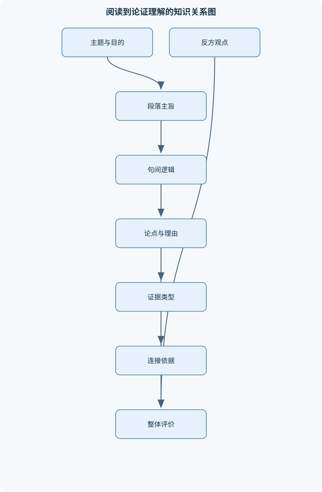
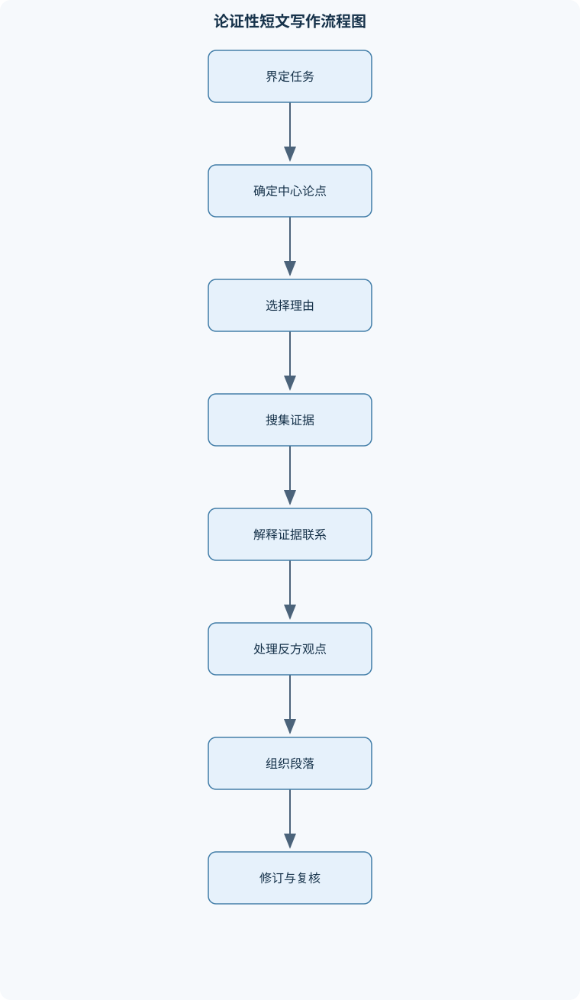

# 大学英语IV

## 一、课程整体知识框架

### 课程边界与先修知识

《大学英语IV》面向具备基础英语语法、常用词汇和一般阅读能力的大学生，重点发展综合英语运用能力：围绕休闲生活、性别角色、体育与社会责任、代际与校园生活、科学技术等主题，训练说明文与议论文阅读、篇章分析、词汇语法运用、听说表达、段落与短文写作、论据评价及学习表现分析。课程包含从文本理解到观点表达的语言技能整合，不等同于专门的英语语言学课程、文学史课程或标准化考试应试课程。先修知识包括基本句子结构、常见时态、主谓一致、基础词汇、段落阅读和简短书面表达；不预设特定英语考试版本或专门学科背景。





### 1. 课程定位、目标与先修条件

《大学英语IV》以综合语言运用为核心，训练学生在真实或近似真实的语境中理解英语信息、分析篇章结构、评价论据、参与讨论并完成书面表达。课程不是专门的英语语言学、英美文学史或某一标准化考试训练，而是将词汇、语法、阅读、听力、口语和写作整合到主题任务中。

课程预设学习者已经能够识别基本句子结构，理解一般现在时、一般过去时等常见时态，掌握常用词汇，阅读短段落并完成简短书面表达。在此基础上，课程进一步处理三个层面的能力：

1. **语言形式层面**：辨析词义、词性、构词、搭配、句法和句间关系。
2. **篇章理解层面**：识别主题、中心论点、段落主旨、信息顺序、衔接手段和作者立场。
3. **综合表达层面**：围绕休闲、性别角色、体育责任、代际经验、科学技术等议题提出观点，使用理由和证据进行口头或书面论证，并根据反馈修订表达。

课程中的核心论证结构可表示为：

$$
T \leftarrow R \leftarrow E
$$

其中，$T$ 表示中心论点，即作者希望读者接受的主要主张；$R$ 表示理由；$E$ 表示证据。证据不能仅因真实就自动支持论点，还需要 $W$，即论证连接依据，说明证据为什么能够支持理由或论点。因此较完整的结构是：

$$
T \Leftarrow R \Leftarrow (E+W)
$$

$C$ 表示反方观点或不同立场。一个成熟的议论文结构通常包括 $T$、若干 $R$ 和 $E$，并对 $C$ 进行准确概括和有限回应。上述符号是分析工具，不是要求所有文章都机械采用固定段落数量。短篇表达可以只有一个主要理由；复杂议题则需要多个理由、限定条件和反方处理。

### 2. 语言知识、篇章知识与表达任务的关系

词汇理解不是孤立的词典释义匹配。一个词在具体句子中的意义取决于四类信息：

- **句法位置**：例如一个词位于冠词后，可能承担名词功能；位于主语之后并带宾语，可能是动词。
- **搭配关系**：常用动词与名词、形容词与名词存在相对稳定的组合限制。
- **上下文主题**：同一个词在休闲、科技或社会议题中可能激活不同义项。
- **语域和感情色彩**：正式写作、日常对话和评论性表达对词语的选择不同。

例如，*develop* 可以表示“发展、形成、研制、患上”等意义。判断其含义时，不能只依据词形，而应先观察宾语和上下文。如果宾语是某种技术，通常接近“研制”；如果宾语是能力或习惯，通常接近“培养、形成”；如果主语是人并且后接疾病名称，则可能表示“患上”。推断生词的合理顺序是：先看句法位置，再看搭配对象，最后用上下文主题验证。若多个义项都成立，应保留不确定性，而不能把猜测写成确定事实。

构词分析也必须结合句法。前缀和后缀可能改变词义或词性，但并非所有词形变化都能机械推导。例如，名词后缀可能形成抽象名词，形容词后缀可能表示性质；然而词缀的具体意义受词根和约定俗成用法影响。词形变化还会影响句法功能：名词可以作主语或宾语，形容词通常修饰名词或作表语，副词常修饰动词、形容词或整个句子。阅读中遇到生词时，应同时判断“它是什么意思”和“它在句子中承担什么功能”。

句法分析先确定主干，再处理修饰成分。简单句通常包含主语和谓语；并列句由两个或多个具有相对独立结构的分句组成；复杂句则通过从句或非谓语结构组织信息。定语从句修饰名词，名词性从句充当主语、宾语或表语，状语从句表达时间、原因、条件、让步、目的等关系。非谓语结构可以压缩信息，但压缩后逻辑主语必须清楚，否则容易产生悬垂修饰。

句间关系决定篇章能否连贯。转折、让步、因果、条件和递进关系不能只依靠连接词判断。例如，*however* 只能提示说话者想建立转折关系；如果前后两个句子没有可比较的内容，连接词仍然不能制造逻辑。代词也必须有明确的先行对象。若一个段落连续出现多个可能的名词，而 *they*、*this* 或 *it* 没有明确指向，读者便需要反复回溯，理解负担随之增加。

### 3. 主题阅读与休闲生活

休闲生活主题用于训练从说明性文章中提取事实、组织关系和作者态度。阅读时要区分三个概念：

- **文章主题**：文章大体讨论的范围，例如居家娱乐和户外活动。
- **中心论点**：作者关于该主题提出的主要判断，例如休闲方式受到技术、收入和年龄等因素影响。
- **段落主旨**：某一段在全文中的局部焦点，例如家庭娱乐设备增多，或体育活动仍具有健康价值。

判断段落重点时，先寻找主题句，再检查后续句子是否解释、举例、比较或补充限制。若主题句不在段首，应通过关键词复现、代词指代和信息收束判断。居家娱乐、网络社交、在线购物、体育活动和现场表演可以作为文本信息分类，但分类不能替代作者意图分析。

说明关系常见于：

- **列举**：介绍多种休闲方式；
- **比较**：对照居家活动和外出活动；
- **因果**：说明技术发展为何改变娱乐方式；
- **让步**：承认居家娱乐增加，同时指出体育和现场表演仍然存在。

阅读结论必须不超出文本。文章说“许多人选择在家娱乐”，只能推出某种趋势或现象，不能推出“所有人都不再参加户外活动”。个案、列举和概括的证明范围不同：列举能说明存在多种形式，不能单独证明其中一种形式占绝对优势。

### 4. 性别角色与文化解释

性别角色主题要求区分生理因素、社会化过程与文化规范。生理差异是关于身体或生物条件的描述；社会化过程指个体在家庭、同伴、学校和媒体互动中学习行为期待；文化规范则是某一群体对“适当行为”的共同期待。三者可能相互作用，但不能互相替代。

分析行为差异时，应区分：

1. 观察到的群体差异；
2. 对差异的因果解释；
3. 个体是否符合该群体的总体趋势。

例如，若材料说某类兴趣在一个群体中更常见，只能说明分布差异，不能证明所有成员都具有该兴趣。直接教导是明确告诉儿童应当怎样做；观察模仿是通过模仿重要他人的行为学习；社会规范则通过表扬、批评、奖励、排斥等互动方式持续强化。一个行为结果可能由多个中介因素共同造成，不能仅凭时间先后断言原因。

较严谨的英语表达应使用限定词，如 *many*, *some*, *tend to*, *in certain contexts*，并避免 *all*, *always*, *naturally* 等无条件概括。若提出因果主张，应说明机制，并考虑家庭环境、教育机会、媒体暴露、经济条件等替代解释。群体比较还必须说明比较对象、年龄范围、文化环境和比较维度。

### 5. 体育、竞争与社会责任

体育主题用于分析个人成就如何被社会叙事塑造。竞技能力、道德品质和公众声望是三个不同维度：

- 竞技能力关注成绩、技术、速度、力量或战术表现；
- 道德品质关注公平、责任、诚实和对他人的尊重；
- 公众声望是社会对某人的认知和评价。

一个人竞技能力突出，不等于其道德品质必然优秀；一个运动员具有公众影响力，也不等于其所有行为都值得肯定。体育英雄形象可能受到媒体叙事、商业利益、制度奖励和公众期待共同影响。

分析体育责任时，可以把论证链拆成：

$$
\text{制度激励} \rightarrow \text{行为选择} \rightarrow \text{社会后果} \rightarrow \text{责任评价}
$$

该链条不是确定公式，而是分析框架。制度激励可能包括奖金、名誉、选拔机会和商业合同；行为选择可能涉及训练、竞争、违规或公益活动；社会后果可能影响队友、对手、青少年和公共信任。评价个人责任时，还要判断其是否具有选择能力、是否了解后果以及制度是否制造了明显压力。

“有条件自我价值”指个体把自我尊重完全建立在成绩、排名或他人认可之上。其风险是：成功时自我评价上升，失败时整体自我评价迅速下降。讨论这一概念时，不能把追求成绩本身等同于错误，而应分析评价标准是否过度单一，以及个体是否拥有多元身份和稳定的自我判断。

### 6. 代际经验与校园表达

代际比较必须先确定比较对象和比较维度。可以比较学习资源、沟通方式、娱乐方式、校园设施或时间安排，但不能在没有说明维度的情况下直接说“某一代更好”。时间先后只表示变化发生在不同阶段，不能自动证明某项技术导致了所有生活变化。

组织代际材料时，适合使用时间线、共同维度或对照结构。比较段落可采用以下形式：

- 主题句：说明两代人在哪一方面可比；
- 第一组材料：介绍较早阶段的经历；
- 第二组材料：介绍较晚阶段的经历；
- 解释句：说明差异及其可能意义；
- 限定句：指出材料不能支持的更大结论。

表达校园主题时，要区分个人体验、群体判断和文化价值陈述。“我在校园中经常使用在线平台”是个人体验；“许多学生依赖在线平台完成协作”是群体判断；“技术使学习更加开放”则可能包含价值判断。受众不同，正式程度也应调整。面向同学的口头讨论可以较直接，面向教师、行政部门或正式报告则需要更明确的范围、证据和礼貌表达。

### 7. 科学技术与公共议题

科学技术主题重点训练事实、预测、价值判断和政策主张的区分：

- **科学事实**：基于可观察或可重复检验的信息；
- **预测**：关于未来可能发生情况的判断；
- **价值判断**：关于好坏、重要性或优先次序的评价；
- **政策主张**：关于社会应当采取何种行动的建议。

讨论太空探索或其他技术项目时，应分别分析直接收益、潜在收益、成本、机会成本和风险。机会成本不是项目本身花费的金额，而是同一资源若用于其他项目可能获得的收益。数据、个案和类比的证明范围不同：数据可以显示数量关系，但需要说明样本和测量方式；个案可以展示某种可能性，通常不能证明普遍规律；类比有助于解释复杂概念，但相似点不足以证明两种事物在所有方面都相同。

因果判断应区分相关关系和因果关系。两个现象同时出现，或一个现象先于另一个现象，只能提供线索。更强的因果解释需要说明机制、排除替代因素，并明确适用条件。口头讨论应同时处理反方意见，例如先说明支持投入的理由，再承认成本或风险，最后说明在何种条件下仍然支持该方案。

### 8. 篇章组织、学术阅读与论证写作

段落的基本单位是围绕一个焦点组织的相关句子。可用 $Q$ 表示主题句，用 $S$ 表示支持句。一个有效段落通常包括：

$$
Q + S_{\text{解释}} + S_{\text{证据}} + S_{\text{联系或限定}}
$$

主题句提出段落焦点，支持句解释概念、提供例证或比较材料，最后的联系句说明材料为什么支持焦点。每个句子都应服务于同一段落主题；如果一个句子无法与主题句建立明确关系，应删除、改写或移至其他段落。

衔接由四类手段共同形成：

1. 关键词复现；
2. 同义替换或上位词替换；
3. 代词和省略；
4. 连接表达和逻辑关系。

连接词不能替代语义关系，代词也不能替代明确指代。信息顺序应符合读者预期：时间顺序适用于经历叙述，因果顺序适用于解释机制，比较顺序适用于对照分析，问题—回应顺序适用于议论文本。

学术阅读中应区分事实证据、逻辑推理、统计材料和轶事。评价证据至少包括相关性、可信度、代表性和适用范围。若证据只能说明某个案例，就不能外推为整个群体；若证据与主张相关但样本很小，则应限制结论范围。摘要概括原文主要内容，释义用不同表达解释原意，直接引语保留原文措辞；三者不能互相混用。

论证性写作应先把题目转化为范围明确、可以讨论的 $T$，再安排 $R$、$E$ 和 $W$。结论应综合已经展开的理由和证据，不应突然引入正文没有论证的新主张。反方观点 $C$ 应被公平呈现，回应应针对其真实理由，而不是制造容易反驳的弱化版本。

### 9. 写作评价与表现分析

本课程采用 $U$、$O$、$Coh$、$V$、$G$、$M$ 作为写作分析维度：

- $U$：内容适切性，是否回应任务并保持范围适当；
- $O$：组织，论点和段落是否按合理顺序展开；
- $Coh$：衔接，指代、关键词和逻辑连接是否清楚；
- $V$：词汇，词义、搭配、语域和变化是否恰当；
- $G$：语法，句法、时态、主谓一致等是否影响理解；
- $M$：书写规范，包括拼写、标点和格式。

整体评分能够快速形成总体判断，但诊断较粗；分项评分能够显示“内容充分但语法薄弱”或“语言准确但论证不足”等不均衡表现，却需要更多评分时间。评分者必须依据共同标准和文本证据，不应让个人偏好替代维度定义。修订也不能只纠正语法，应依次检查任务回应、论点范围、段落顺序、证据联系、词汇搭配和句法形式。

## 二、章节和模块划分

### 核心知识覆盖清单

本清单用于检查正文是否覆盖本课程的主要知识模块：

- **主题阅读与休闲生活**：区分文章主题、中心论点与段落主旨、从主题句和支持细节推断段落重点、概括居家娱乐、社交和体育活动的文本信息、识别比较、列举和因果等说明关系、根据上下文判断多义词和短语含义、区分作者陈述、例证与个人判断。
- **性别角色与文化解释**：区分生理因素、社会化过程与文化规范、分析行为和兴趣如何在家庭及社会互动中习得、识别概括性陈述的范围和限定条件、比较直接教学与观察模仿等解释路径、识别因果论证中的中介因素和替代解释、用谨慎措辞表达群体差异及个体例外。
- **体育、竞争与社会责任**：分析体育英雄形象的社会建构、区分竞技能力、道德品质与公众声望、梳理制度激励、特权和行为后果的论证链、理解有条件自我价值的含义和形成机制、评价例证能否支持一般性结论、比较个人责任与制度责任的不同论据。
- **代际经验与校园表达**：按时间线索组织不同代际的经历、识别比较对象、比较维度与相似差异、描述科技条件变化与学习生活经验、区分个人体验、群体判断与文化价值陈述、运用举例和对照支持校园主题表达、根据受众调整正式程度和表达范围。
- **科学技术与公共议题**：区分科学事实、预测、价值判断和政策主张、分析太空探索议题中的支持与反对理由、识别成本、机会成本、风险和潜在收益、评价数据、个案和类比证据的证明范围、识别因果推断中的时间先后与相关关系差异、组织包含反方观点和回应的口头讨论。
- **词汇、构词与搭配**：依据上下文辨析常见多义词、区分词义、词性、语域和感情色彩、识别词根词缀及词形变化对句法功能的影响、掌握常用动词与名词的搭配限制、辨析近义词在语义范围和使用场景上的差异、利用上下文、构词线索和句法位置推断生词。
- **句法与句间关系**：识别简单句、并列句和复杂句的主干、分析定语从句、名词性从句和状语从句的功能、理解非谓语结构与从句在信息组织上的差异、分析代词指代和省略所依赖的语境、识别转折、让步、因果、条件和递进关系、修正主谓一致、时态、冠词、介词和句子残缺问题。
- **篇章组织与衔接**：围绕单一中心安排段落内容、识别主题句、解释、例证和小结的功能、通过关键词复现、同义替换和代词形成语义衔接、使用连接词准确标示逻辑关系、分析信息顺序如何影响篇章连贯性、判断段落切分是否对应话题转换或对比关系。
- **学术阅读与证据评价**：区分事实证据、逻辑推理、统计材料和轶事、检查证据的相关性、充分性与适用范围、识别论点、理由、证据和隐含连接依据、判断作者如何处理不同立场和反例、区分摘要、释义和直接引语的功能、避免把单个案例外推为普遍规律。
- **论证性写作**：将写作任务转化为范围明确的中心论点、按论点与理由安排主体段落、用证据支持理由并解释证据为何相关、公平呈现反方观点并作有根据的回应、结论综合既有论证而非机械重复、依据写作目的和读者调整语域与措辞。
- **听说整合与课堂讨论**：区分听力材料的主旨、要点和具体细节、利用语境和重音识别说话者立场、做有层级的听力笔记并复述核心信息、提出可回应的观点并给出理由或例证、通过澄清、追问和转述推进讨论、控制语速、语域和表达结构以适应受众。
- **修订、反馈与写作评价**：按内容、组织、衔接、词汇、语法和规范检查文本、区分整体评分与分项评分所提供的信息、用评分描述语定位具体表现而非只看总分、区分影响理解的重大问题与局部形式错误、根据反馈识别文本问题并实施针对性修订、理解评分者训练、评分一致性和时间成本之间的关系。


### 1. 主题阅读模块

#### 1.1 休闲生活

本模块围绕居家娱乐、网络社交、体育活动和现场表演展开。阅读任务包括概括文章主题，判断段落主旨，区分事实描述与个人判断，并识别列举、比较、因果和让步关系。分析文章时，应特别注意表示范围的词，如 *many*, *some*, *often* 和 *more and more*。这些词限制了陈述范围，不能被改写成绝对结论。

#### 1.2 性别角色与文化解释

本模块要求学生分析行为如何受到直接教导、观察模仿、家庭互动和社会规范影响。重点不是给群体贴标签，而是识别论证中的因果链、中介因素和替代解释。表达时应使用谨慎措辞，并区分群体趋势和个体例外。

#### 1.3 体育、竞争与社会责任

本模块分析体育英雄形象、竞争制度、公众声望和个人责任。重点是区分竞技成功与道德品质，分析制度激励如何影响行为，并评价例证是否足以支持一般性结论。个人责任与制度责任可以同时存在，不能因为制度有问题就完全取消个人责任，也不能把所有后果都归咎于个人。

#### 1.4 代际经验与校园表达

本模块训练时间线索、比较结构和校园主题表达。比较前必须确定对象和维度，比较后必须区分观察到的差异与导致差异的原因。表达应根据受众调整正式程度，避免把个人经历直接推广为所有学生或整个时代的共同经验。

#### 1.5 科学技术与公共议题

本模块围绕技术投入、太空探索、公共资源、机会成本和风险展开。学生需区分事实、预测、价值判断和政策主张，并在口头讨论中提出理由、回应反方意见。任何结论都应受证据范围限制。

### 2. 语言形式与篇章模块

#### 2.1 词汇、构词与搭配

分析词汇时采用“句法位置—搭配—上下文—语域”顺序。近义词不能仅按中文对译选择，还要检查语义范围、正式程度和感情色彩。动词与名词的搭配限制会直接影响表达自然度，例如某些动词适合表示抽象变化，另一些动词适合表示具体动作。构词线索能帮助推断词性和大致意义，但不能替代上下文验证。

#### 2.2 句法与句间关系

本模块处理简单句、并列句、复杂句、定语从句、名词性从句、状语从句和非谓语结构。修订时先找主干，再检查修饰关系，最后检查主谓一致、时态、冠词、介词和句子完整性。常见问题包括句子残缺、并列结构不平行、代词指代不明和悬垂修饰。

#### 2.3 篇章组织与衔接

篇章分析从段落焦点开始，逐句判断其功能。主题句提出中心，解释句说明含义，例证句提供具体材料，小结句收束或过渡。段落切分应对应话题转换、时间变化、比较关系或论证功能变化，而不是按照句子数量机械切分。

### 3. 听说整合模块

#### 3.1 听力信息提取

听力记录应分层：第一层记录主旨，第二层记录主要理由或事件，第三层记录关键细节。重音、停顿、转折表达和语气可帮助判断说话者立场，但语气推断必须与明确措辞相互验证。听到的信息与根据语境推测的信息应分开记录。

#### 3.2 课堂讨论与口头表达

口头表达应包括立场、理由、例证和回应。有效追问包括请求澄清、询问证据、确认范围和比较条件。转述他人观点时，应准确保留其立场和限制条件，不能为了便于反驳而过度简化。流利度并不等于论证质量；表达还必须具备结构清楚、证据适切和回应有效等特征。

### 4. 论证性写作与反馈模块

#### 4.1 段落写作流程

**输入**：一个主题和明确观点。  
**输出**：围绕单一焦点、展开充分的英语段落。

步骤如下：

1. 确定 $Q$，即段落主题句；
2. 选择直接服务于 $Q$ 的理由或解释；
3. 提供事实、文本细节、比较或例证作为 $E$；
4. 写出 $W$，说明证据为何支持观点；
5. 检查代词、关键词和连接词；
6. 删除偏题句，或将其移动到合适段落。

不变量是每个句子都服务于同一焦点。若句子数为 $k$，逐句检查的工作量随 $k$ 增长；这里的复杂度只描述检查步骤，不代表写作质量可以由句子数量决定。

#### 4.2 论证短文规划流程

**输入**：题目、受众和篇幅限制。  
**输出**：提纲及完整短文。

先界定题目范围，形成有边界的 $T$；再列出 $R$、$E$ 和 $W$；随后补充 $C$ 及回应；最后按引言、主体和结论安排信息。终止条件是每个主体段都能连接到 $T$，关键理由有相应证据，反方观点没有被歪曲。结论只能综合已经论证的内容，不应突然加入新证据。

#### 4.3 写作分项评价流程

**输入**：任务、学生文本和评价标准。  
**输出**：各维度表现说明及修订建议。

先判断内容是否回应任务，再分别检查 $O$、$Coh$、$V$、$G$ 和 $M$。每项评价都要指出文本证据，并区分影响理解的重大问题与不影响整体理解的局部错误。评分者需要理解维度定义并使用样例校准；评分项数量增加并不自动保证一致性。

### 5. 代表性分析流程与伪代码

#### 5.1 学术阅读分析流程

输入一篇文章，输出文章主旨、段落功能、核心论点、证据关系和作者立场。先通读判断主题和目的，再逐段标记主题句和支持细节，随后识别比较、因果、转折、让步等关系，最后整理论点、理由和证据。若文本没有提供足够信息，应将结论标为推测。

```text
输入：英语文章 A
输出：主题、段落功能、T、R、E、W、作者立场

阅读 A，确定讨论范围和写作目的
对于 A 中的每个段落 P：
    找出或概括 Q
    标记解释、例证、比较和限制条件
    判断 P 与相邻段落的逻辑关系
从全文中整理 T
将支持 T 的理由记为 R
将支撑 R 的事实、数据、文本细节或例证记为 E
检查每个 E 是否有明确或可合理补出的 W
若信息不足：
    将相关结论标为“推测”，不标为“文本事实”
返回分析结果
```

#### 5.2 论据质量分析流程

输入一个主张和支持材料，输出相关性、可信度、充分性和适用范围评价。逐条检查证据是否直接涉及主张，材料是否可靠，样本是否具有代表性，结论是否超出材料范围，并寻找反例和替代解释。所有关键证据均完成评价且推论范围不超过证据支持范围时结束。

### 6. 代表性例题

#### 例题一：区分主题、中心论点和段落主旨

**题干**：一篇文章介绍居家娱乐增加、网络社交发展，同时指出体育活动和现场表演仍然受到欢迎。请分别写出文章主题、可能的中心论点和一个段落主旨。

**分析**：主题应是讨论范围；中心论点必须是对范围的主要判断；段落主旨只对应局部信息。

**逐步解答**：  
第一步，确定范围：休闲方式。  
第二步，概括全文关系：技术改变了休闲方式，但没有消除线下活动。  
第三步，选择局部段落：体育活动对健康有益。

**结果验证**：若答案只写“电视、网络、体育”，这是信息罗列，不是中心论点；若写“所有人都喜欢在家娱乐”，则超出材料范围。

**变式**：若文章只介绍网络购物，不提体育和表演，中心论点应相应缩小，不能保留“线下活动仍然重要”的结论。

#### 例题二：分析性别差异的因果边界

**题干**：材料指出，某类兴趣在一个群体中出现得更多，并提到家庭教导、同伴模仿和社会奖励。能否据此断言该兴趣由单一生理因素决定？

**分析**：材料同时提供多个可能解释，且群体差异不等于个体必然差异。

**逐步解答**：  
第一步，列出观察结果：群体分布存在差异。  
第二步，列出解释路径：直接教导、模仿和社会奖励。  
第三步，检查替代解释：家庭、同伴和文化环境可能是中介因素。  
第四步，限定结论：材料不能证明单一因素决定行为，也不能证明所有个体都符合群体趋势。

**结果验证**：合格答案应同时提到群体趋势、个体例外和多因素机制。

**变式**：若材料包含长期控制条件下的多组数据，也只能增强某种解释的可信度，不能因此删除所有限定条件。

#### 例题三：评价体育英雄论据

**题干**：某运动员连续获得冠军，因此作者认为其一定具有高尚道德。请评价该推理。

**分析**：冠军成绩属于竞技能力证据，道德品质属于不同维度。

**逐步解答**：  
第一步，确定论点：运动成绩证明道德高尚。  
第二步，识别证据：连续冠军。  
第三步，检查相关性：成绩与训练能力、竞技表现有关，但不能直接证明诚实、公平或责任感。  
第四步，指出缺少的 $W$：需要道德行为方面的具体证据。  
第五步，得出结论：该证据不足以支持原论点。

**结果验证**：如果只说“运动员也可能犯错”，说明了可能性，但还应明确“竞技证据不能直接推出道德结论”。

**变式**：若材料同时提供其长期遵守规则、帮助队友和承担责任的事实，论据会更相关，但仍应说明这些行为支持的是哪些具体道德品质。

#### 例题四：代际比较段落

**题干**：比较两个时期的校园学习生活。时期甲主要依靠纸质材料和面对面讨论，时期乙更多使用在线平台。请写出合理的比较维度和结论边界。

**分析**：应先确定共同维度，如资料获取、协作方式和反馈速度，不能直接比较“哪一代更优秀”。

**逐步解答**：  
第一步，确定对象：两个时期的校园学习者。  
第二步，确定维度：资料获取方式。  
第三步，对照材料：甲依靠纸质材料，乙使用在线平台。  
第四步，解释差异：技术条件改变了资料获取和协作方式。  
第五步，限定结论：材料不能证明乙学习效果在所有方面都更好。

**结果验证**：若结论加入“乙一定更聪明”，则属于无证据价值判断。

**变式**：若增加学习成绩数据，仍需说明样本、测量方式和其他影响因素。

#### 例题五：科学技术议题中的机会成本

**题干**：公共部门计划增加某项太空探索投入。请列出支持和反对理由，并区分成本与机会成本。

**分析**：直接成本是项目需要支付的资源；机会成本是资源不用于其他项目而放弃的潜在收益。

**逐步解答**：  
支持理由可以包括科学发现、技术外溢和长期公共能力建设；反对理由可以包括财政压力、项目失败风险和其他公共服务被挤压。若投入资金用于太空项目，直接成本包括设备、人员和运行费用；若这些资金原本可用于教育、医疗或基础设施，则放弃的相应改善构成机会成本。

**结果验证**：不能把所有社会担忧都称为“费用”，风险和机会成本需要分别说明。

**变式**：若项目规模较小、风险较低，结论可能从“反对投入”改为“在设定预算上限、公开评估和阶段审查条件下支持投入”。

### 7. 实验与项目任务

#### 7.1 项目一：休闲生活主题篇章分析

**输入数据**：一篇包含居家娱乐、网络社交、体育活动和现场表演的英语说明文。  
**步骤**：

1. 标出每段主题句；
2. 为每段写一句中文或英文主旨概括；
3. 标记列举、比较、因果和让步关系；
4. 将事实描述、作者判断和推测分别归类；
5. 整理全文主题、中心论点和证据范围。

**评价标准**：段落主旨必须有文本依据；逻辑关系不能只凭连接词；概括不得引入原文没有的新信息；事实和推断必须区分。

**排错方法**：若概括过于宽泛，回到段落关键词；若判断作者立场不稳，寻找评价词、让步结构和结尾句；若把例子当中心论点，应检查该句是否能统摄全文。

#### 7.2 项目二：科技公共议题口头讨论

**输入数据**：一则关于公共资源投入技术项目的短文或课堂材料。  
**步骤**：

1. 写出一个有范围的 $T$；
2. 列出至少两项 $R$；
3. 为每项理由提供 $E$；
4. 写出 $W$，解释证据与理由的联系；
5. 补充一个公平表述的 $C$；
6. 用两分钟完成口头陈述；
7. 接受同伴追问并修订观点。

**评价标准**：事实、预测和价值判断区分清楚；理由与证据相关；反方观点没有被歪曲；回应能够说明条件或限制；语速、语域和结构适合受众。

**排错方法**：若只有个人感受而无证据，应补充材料细节；若观点互相矛盾，应检查是否混淆不同条件；若回应反方时只重复原观点，应明确指出对方理由的适用范围并作针对性回答。

### 8. 常见易错点

1. 把文章主题、中心论点和段落主旨当成同一概念。
2. 把段落中的一个例子误当成全文结论。
3. 仅凭 *however*、*therefore* 等连接词判断逻辑。
4. 把时间先后直接当作因果关系。
5. 把单个案例外推为整个群体规律。
6. 把竞技能力等同于道德品质。
7. 把个人经历写成所有学生的共同经验。
8. 忽略 *some*、*many*、*tend to* 等范围限定词。
9. 为了追求词汇变化而使用不自然的近义词或搭配。
10. 只纠正拼写和语法，不修订论点范围和段落组织。
11. 代词没有明确先行对象。
12. 使用非谓语结构时逻辑主语不一致。
13. 把相关关系写成确定因果。
14. 结论引入正文没有论证的新主张。
15. 把整体评分当作完整诊断。
16. 把口语流利度等同于论证质量。

### 9. 典型笔试问题与解答思路

#### 问题一：如何区分主题与中心论点？

**解答思路**：主题是讨论范围，中心论点是作者对该范围提出的可争辩判断。先圈定反复出现的对象，再寻找作者对对象的总体判断。

#### 问题二：为什么一个例子不能证明普遍规律？

**解答思路**：例子能证明某种情况存在，但不能说明该情况具有代表性。应检查样本数量、选择方式和结论范围。

#### 问题三：如何判断段落主题句？

**解答思路**：观察哪一句能够统摄后续解释、例证和比较。若段首句过于具体，可能只是引入；应结合全文信息判断。

#### 问题四：证据和论点之间为什么需要 $W$？

**解答思路**：$W$ 说明证据支持结论的机制。没有连接依据，即使证据真实，也可能只与论点相关而不足以证明论点。

#### 问题五：如何分析性别角色差异？

**解答思路**：先区分群体差异与个体差异，再列出生理、社会化和文化规范等解释，最后说明材料不能排除哪些替代因素。

#### 问题六：比较两个代际群体时最先确定什么？

**解答思路**：先确定比较对象和共同维度，再选择材料。没有共同维度，比较就会变成无标准的价值判断。

#### 问题七：机会成本是什么？

**解答思路**：机会成本是选择某方案后放弃的最佳替代收益，不等于项目账面支出。回答时需指出被放弃的替代用途。

#### 问题八：整体评分和分项评分各有什么限制？

**解答思路**：整体评分快速但诊断较粗；分项评分能显示能力差异，但耗时较多，且维度间需要清晰定义和评分者校准。

### 10. 典型面试问题与回答要点

#### 问题一：你如何概括一篇英语文章？

**参考答案**：我先确定主题和写作目的，再逐段提取主旨，区分作者观点与例证，最后用不超过原文范围的语言概括中心论点。  
**追问要点**：如果主题句不明显，应说明如何利用关键词复现、结尾句和段落功能判断。

#### 问题二：你如何判断一条证据是否有效？

**参考答案**：我会检查相关性、可信度、代表性和适用范围，并说明证据与论点之间的连接依据。  
**追问要点**：个案可支持“某种情况存在”，但通常不能单独支持普遍结论。

#### 问题三：如何处理群体差异的英语表达？

**参考答案**：我会使用限定词，说明比较范围，并区分群体趋势与个体例外，避免使用绝对化表达。  
**追问要点**：若材料信息有限，应主动降低结论强度。

#### 问题四：如何回应与你不同的观点？

**参考答案**：先准确复述对方的理由和条件，再指出证据范围或适用条件，最后提出有依据的回应，而不是攻击对方人格。  
**追问要点**：如果双方证据都有限，应保留不确定性。

#### 问题五：你怎样修订一篇英语短文？

**参考答案**：先检查任务回应和中心论点，再检查段落组织、衔接、词汇、语法和书写规范，优先处理影响理解和论证完整性的重大问题。  
**追问要点**：不能只做拼写和语法表面修改。

#### 问题六：如何在讨论中澄清他人的观点？

**参考答案**：可以使用确认、复述和追问，例如先确认“你的意思是……吗”，再询问证据、范围或适用条件。  
**追问要点**：澄清的目的不是拖延，而是避免误解后进行无效反驳。

#### 问题七：你如何解释相关关系与因果关系的区别？

**参考答案**：相关关系表示两个现象共同变化，因果关系还需要机制、时间顺序和对替代解释的考量。  
**追问要点**：时间先后本身不能证明因果。

#### 问题八：为什么同一篇文章可能整体印象不错但分项表现不均衡？

**参考答案**：文章可能内容和组织较好，但词汇搭配或语法问题较多。整体评分提供总体判断，分项评价则揭示能力结构。  
**追问要点**：修订时应依据具体维度安排优先级，而不能只看总分。

### 11. 岗位关联

#### 11.1 英语语言服务与编辑助理

实际任务包括校对英文通知、整理双语材料和检查段落逻辑。使用词汇搭配、句法分析、篇章衔接和分项评价知识。产出应包括修订文本和问题说明；验收标准是语法、拼写和标点准确，指代清楚，语域符合使用场景，不能改变原意。

#### 11.2 国际业务沟通专员

实际任务包括阅读业务资料、撰写英文邮件和参与会议讨论。使用信息提取、正式语域、观点组织和澄清追问知识。产出包括结构清楚的邮件、会议摘要或口头陈述；验收标准是事实准确、请求明确、语气得体、行动事项和责任边界清楚。

#### 11.3 跨文化交流与项目协调人员

实际任务包括比较不同群体的沟通习惯、整理会议意见和解释文化差异。使用群体差异限定、比较结构、反方处理和因果边界知识。产出包括比较报告、会议纪要和协调方案；验收标准是避免刻板化概括，区分观察与解释，并明确材料支持范围。

#### 11.4 学术写作与内容整理助理

实际任务包括提炼文章主旨、整理论据、撰写摘要和检查论证链。使用 $T$、$R$、$E$、$W$ 结构以及摘要、释义和直接引语的区别。产出包括摘要、论证提纲和修订稿；验收标准是中心论点清晰，证据与主张对应，结论不超出材料，引用或转述不歪曲原意。

#### 11.5 会展、国际接待与涉外行政岗位

实际任务包括接待、说明流程、处理询问和转述安排。使用听力主旨提取、语域调整、澄清、复述和礼貌表达知识。产出包括口头说明、英文邮件和事项清单；验收标准是信息完整、时间地点准确、表达适合受众，并能及时发现和纠正理解偏差。

## 三、核心概念的详细解释

### 3.1 主题、中心论点与段落主旨

英语阅读中，**主题**是文章讨论的范围，通常可概括为一个名词性短语，例如“现代休闲方式”“体育与社会责任”或“科技对校园生活的影响”。主题本身不一定表达作者立场，也不必是完整句子。**中心论点**是作者希望读者接受的可争辩主张，通常可以改写为完整陈述句。**段落主旨**则是某一段围绕文章中心所承担的局部任务。

例如，文章主题可以是“居家娱乐”，中心论点可能是“数字化居家娱乐扩大了休闲选择，但不能完全取代体育和面对面社交”，某一段的主旨则可能是“网络活动为年轻人提供了新的社交方式”。三者的范围依次由大到小，但并非简单重复关系。判断中心论点时，应检查作者是否通过比较、因果、评价或建议表达了立场；若一句话只是说明“许多人使用网络购物”，它更接近事实细节，而不是中心论点。

段落通常围绕一个相对集中的焦点组织。主题句 $Q$ 概括段落的主要内容或论证功能，支持句 $S$ 负责解释、举例、比较、限定或补充。一个完整段落不要求每句话都重复主题句，而要求每句话都能回答“这句话如何帮助读者理解本段焦点”。如果段落同时讨论家庭娱乐、体育锻炼和演出活动，却没有共同的上位关系，读者就难以判断段落中心。

### 3.2 说明关系与篇章衔接

主题阅读不仅要求找出“写了什么”，还要识别“信息之间如何联系”。常见说明关系包括：

- **列举关系**：连续提供多个同类项目，例如电视、网络、游戏和在线购物共同说明居家娱乐形式多样。
- **比较关系**：围绕相同维度对照两个对象，如不同代际的学习工具、休闲习惯或校园生活。
- **因果关系**：说明某种条件如何导致结果，或某种现象可能产生什么影响。
- **转折与让步关系**：承认前一信息后，引出限制、例外或相反观点。
- **条件关系**：说明某结论只在特定条件下成立。

连接词能够提示关系，但不能单独创造关系。*however* 表示说话者希望建立转折，前后内容仍必须存在可比较的方向；*therefore* 表示推论，前文必须提供足以支持结论的理由。篇章衔接还依赖关键词复现、同义替换、代词、重复的语义框架以及信息顺序。代词的先行词必须明确，否则即使句法正确，也会增加理解负担。

信息顺序会影响连贯性。叙述代际经验时，按时间顺序组织能够突出变化；比较两类校园生活时，按“学习工具—交流方式—休闲方式”等共同维度组织，通常比先完整讲完一代、再完整讲另一代更便于逐项比较。因果说明则应尽量先交代条件和机制，再说明结果；若结果先出现，后文必须明确补充其原因，否则读者容易误把时间先后当作因果。

### 3.3 词汇意义、构词与搭配

词汇理解由词义、词性、语域、感情色彩和搭配共同决定。一个词的词典义并不等于其在句中的实际意义。判断多义词时，宜依次观察：

1. **句法位置**：冠词后常出现名词，情态动词后接动词原形，系动词后常接形容词或名词性成分。
2. **搭配对象**：*develop a skill* 通常表示“培养技能”，*develop a technology* 可表示“研制或发展技术”，*develop a disease* 则表示“患上疾病”。
3. **主题语境**：科技文章中的 *issue* 可能指“议题”，日常交流中也可能指“问题”或“发行物”。
4. **语域与色彩**：正式议论文更倾向于使用 *benefit, consequence, demonstrate*；口语中可能使用更简短的表达。

近义词不能仅按中文对应词替换。*alike* 常作表语或后置补语，说明两个或多个对象相似；*similar* 通常作前置定语或表语；*same* 强调相同身份或相同内容。词形变化也会改变句法功能，例如 *responsible* 是形容词，*responsibility* 是名词，*responsibly* 是副词。后缀可提供线索，但不能保证意义完全可由词根机械推出，最终仍需用句法和上下文验证。

搭配限制是英语自然表达的重要条件。某些名词与动词形成稳定组合，例如“take responsibility”“make a decision”“draw a conclusion”。将汉语中“承担一个决定”直接译为 *undertake a decision*，虽然形式上可以理解，通常却不符合常用搭配。词汇选择还应考虑范围：*sport* 可指体育运动或某一运动项目，*exercise* 更常指锻炼，*game* 往往指具体比赛或游戏，三者不能在所有语境中互换。

### 3.4 句法主干与句间关系

复杂句分析应先确定主干，再判断从句和非谓语结构的功能。定语从句修饰名词；名词性从句在句中充当主语、宾语或表语；状语从句表达时间、原因、条件、让步、目的等逻辑关系。例如：

> Although online entertainment is convenient, physical activities remain important because they support health.

其中，*Although online entertainment is convenient* 是让步状语从句，主句是 *physical activities remain important*，*because they support health* 是原因状语从句。主句主语是 *physical activities*，谓语是 *remain*，*important* 为表语。分析时不能把从句中的 *entertainment* 或 *health* 误判为主句成分。

非谓语结构能够压缩信息，但其逻辑主语应与主句主语保持合理关系：

> Using online platforms, students can communicate with classmates.

这里 *using online platforms* 的逻辑主语是 *students*。若写成：

> Using online platforms, the communication problem was solved.

则表面上像是“communication problem 使用了平台”，形成悬垂修饰。修订时可改为 *By using online platforms, students solved the communication problem*，或改为完整从句。

句法正确并不等于篇章清楚。主谓一致、时态、冠词、介词和句子完整性都必须结合语境判断。一般现在时常用于说明普遍事实，过去时用于叙述已完成经历；若同一段叙述时间线发生变化，应通过时间副词或时态变化标示。不可数名词、复数名词和专有名词对冠词和谓语形式的要求不同，不能仅凭中文习惯处理。

### 3.5 性别角色与文化解释

分析性别角色时，必须区分**生理因素、社会化过程和文化规范**。生理因素涉及身体条件或生物机制；社会化过程指个体在家庭、学校、同伴和媒体互动中学习行为期待；文化规范则是群体对“适当行为”的共同评价和制度化安排。三者可能相互影响，但不能把其中一个因素自动当成全部原因。

直接教导是一条解释路径，例如成人明确告诉儿童某种行为“适合”或“不适合”某类人。观察模仿则强调个体通过观察他人的行为及其后果形成倾向。社会规范还可能通过奖励、批评、角色分工和媒体形象发挥作用。若文本发现某群体更常选择某项活动，这只能说明存在差异或关联；要提出因果解释，还需说明中介因素，例如可获得的资源、家庭期待、同伴评价和制度机会。

群体判断必须有范围限定。*Some students may prefer...*、*In certain contexts...*、*This pattern does not apply to every individual* 等表达能够避免把统计倾向写成个人必然特征。个体差异不是对群体研究的否定，而是对结论适用范围的必要限制。

### 3.6 体育、竞争与社会责任

竞技能力、道德品质和公众声望是三个不同概念。运动成绩可以证明某人在特定规则和训练条件下具有较强竞技能力，却不能单独证明其诚实、负责或具有公共道德。公众声望是社会评价结果，可能受媒体叙事、商业利益、制度奖励和偶像形象影响，因此也不能简单等同于道德品质。

体育英雄形象往往由个人表现、媒体选择、制度激励和观众期待共同建构。若某运动员因获胜得到广告、荣誉和更多资源，这些奖励可能增强其继续成功的动机；但若制度对违规行为处罚不足，成功也可能被错误地解释为可以免除责任。分析时应分别追问：个人做了什么、制度奖励了什么、谁承担行为后果、是否存在受影响却没有发言权的群体。

“有条件的自我价值”指个体把自我尊重完全建立在成绩、排名或他人认可之上。当成功时自我评价提高，失败时则可能产生整体性否定。该概念可用于解释竞争压力，但不能据此诊断所有运动员或学生。论证个人责任与制度责任时，应避免二选一：个人需要对可控制的选择负责，制度则需要设计透明规则、合理激励和可执行的问责机制。

### 3.7 代际经验、校园生活与受众

代际比较必须先确定比较对象、时间范围和共同维度。可以比较学习资料、信息获取、社交方式、娱乐活动或校园管理，但不能仅凭“过去”和“现在”两个标签概括所有个体。技术条件改变了信息速度和工具形式，却不必然决定学习质量；学习质量还受教学方式、资源可及性、学习目标和使用方式影响。

表达时应区分三类陈述：

- **个人体验**：*In my experience, ...*，范围仅限说话者自身。
- **群体判断**：*Many students appear to...*，需要材料或观察支持，并说明范围。
- **文化价值陈述**：*A society may value...*，说明某种规范或评价，不等于所有成员都认同。

受众决定语域、信息密度和解释程度。面向同学的课堂发言可以使用较直接的表达；面向正式机构的邮件应交代目的、背景、请求和后续安排。正式程度不是单纯使用长词，而是体现为礼貌、准确、避免绝对化和结构清晰。

### 3.8 科学技术与公共议题

科学技术议题中必须区分四类陈述：

1. **事实判断**：可通过观察、测量或可靠记录检验。
2. **预测**：对未来结果的推断，具有条件和不确定性。
3. **价值判断**：评价某结果是否值得、是否公平或是否重要。
4. **政策主张**：建议公共机构采取或不采取某项行动。

讨论太空探索或其他大型科技项目时，应同时分析直接收益、潜在收益、成本、机会成本和风险。机会成本不是“所有缺点”的同义词，而是选择某方案后放弃的其他资源用途。支持方可能强调科学发现、技术外溢和国际合作；反对方可能强调财政负担、风险不确定性和资源分配公平。成熟回应不是否认反方，而是限定结论，例如“在预算约束和风险评估透明的条件下，某类投入可能具有合理性”。

时间先后不等于因果关系。若技术普及后学习方式发生变化，只能先提出相关线索；还需考虑设备可及性、课程改革、家庭条件和社会环境等替代解释。个案、类比和统计材料的证明范围不同：个案能说明某种情形确实存在，统计材料可描述一定样本中的趋势，类比只能帮助理解结构相似性，不能直接证明结论成立。

### 3.9 听说整合、论证写作与反馈评价

听力理解应区分主旨、要点、细节和立场。重音、转折词、语气和限定词常帮助判断说话者是否赞同某观点。笔记不应逐词抄写，而应记录主题词、关系词、数字、因果链和不确定处。复述时要区分“材料明确说出”与“听者根据材料推断”。

口头讨论的基本论证单位是观点、理由、例证和回应。提出观点后应说明原因；提供例子后应解释例子为何相关；听不清或理解不确定时，应使用澄清、追问和转述，而不是直接反驳。流利度不能代替论证质量，语速快也不能弥补立场模糊或证据不足。

写作评价可使用 $U、O、Coh、V、G、M$ 六个维度：内容适切性、组织、衔接、词汇、语法和书写规范。整体评分能反映总体印象，但诊断较粗；分项评分能够显示“内容充分但语法薄弱”或“语言准确但论证不足”等不均衡状态，代价是耗时较多。修订不能只改拼写和语法，还应检查论点范围、段落焦点、证据相关性、代词指代和结论是否超出材料。

## 四、重要定义、公式、定理和推导

### 专业审校补充：关键定义与适用边界

本课程中的英语表达不能只按“语法正确”判断，还要区分命题内容、说话者立场和语气强度。事实陈述通常描述可核对的信息；预测表示对未来的推断；价值判断表达“应当、值得或不合理”等评价；政策主张则提出行动要求。情态动词和限定副词会改变结论范围：*may、can、tend to、in some cases* 表示可能性或有限范围，*must、always、all* 则表示较强断言。以“Online learning improves students’ performance”为例，它是未经限定的因果主张；若材料只显示部分学生成绩提高，更稳妥的表达是“Online learning may improve performance for some students under certain conditions”。但弱化语气并不等于逃避论证：*may* 仍需说明适用条件、证据类型和可能的替代解释。反例是“Because the program is popular, it must be effective”：受欢迎只能说明接受度，不能单独证明学习效果。阅读和写作时应同时检查语气词、主语范围、时间范围及因果关系，避免把作者的谨慎推断改写成绝对结论。


### 4.1 论证结构及其适用边界

本课程使用如下分析式：

$$
T \Leftarrow R \Leftarrow (E+W)
$$

其中，$T$ 为中心论点，$R$ 为理由，$E$ 为证据，$W$ 为论证连接依据。若有反方观点，则以 $C$ 表示。该式不是数学等式，而是表示论证依赖关系：$E$ 通过 $W$ 支持 $R$，$R$ 再支持 $T$。

推导过程如下：

1. 先把文章中的评价、建议或可争辩陈述改写成 $T$。
2. 找出作者回答“为什么这样主张”的句子，形成 $R$。
3. 找出事实、数据、文本细节或例证，标记为 $E$。
4. 明确补出“为什么这个证据能够支持该理由”的隐含规则，即 $W$。
5. 检查 $W$ 是否合理、证据是否具有代表性，以及结论范围是否超过材料。

例如，若 $T$ 为“校园应提供更多体育活动”，$R$ 为“体育活动有助于学生保持身心健康”，$E$ 可以是研究数据、课程记录或有条件的观察材料，$W$ 则是“在研究对象和活动条件相近时，相关健康收益可用于支持校园活动安排”。如果只有一名学生表示运动后心情更好，该个案可以支持“某些学生可能受益”，却不足以独立证明所有学生都受益。

### 4.2 证据评价的四个维度

证据质量可用四个问题分析，而不是用单一分数替代判断：

- **相关性**：证据是否直接涉及所主张的对象、时间和变量？
- **可信度**：材料是否清楚说明来源、方法和上下文？
- **充分性**：现有材料是否足以支持该结论，而不是只提供一个孤立例子？
- **适用范围**：证据能支持个人、某类情境、某样本，还是更广泛群体？

可以将结论强度理解为受这些条件共同限制：

$$
\text{可接受的结论范围}
\leq
\text{证据的实际覆盖范围}
$$

这不是可计算的数值公式，而是范围约束原则。若调查只涉及某一班学生，就不能不加限定地推出“所有大学生都如此”；若材料只说明相关关系，也不能直接改写为因果关系。

### 4.3 段落的统一性、连贯性与充分展开

一个功能完整的段落可抽象为：

$$
Q + S_1 + S_2 + \cdots + S_n
$$

$Q$ 是主题句，$S_i$ 是支持句。每个 $S_i$ 应至少承担解释、证据、比较、限定或小结中的一种功能。段落质量不是由句子数量决定，而取决于三个条件：

1. **统一性**：句子围绕同一焦点，不混入无法服务于 $Q$ 的内容。
2. **连贯性**：信息顺序合理，代词指代明确，句间逻辑可恢复。
3. **充分展开**：主题句得到解释或证据支持，不能只作空泛断言。

因此，增加连接词并不必然提高连贯性。若两个句子没有语义联系，加入 *however* 或 *therefore* 只会形成表面衔接。连接词、词汇复现、代词和逻辑关系应共同工作。

### 4.4 学术阅读分析流程

**输入**：一篇英语说明文或议论文。  
**输出**：文章主题、中心论点、各段功能、证据关系和作者立场。

```text
READ_ANALYSIS(text):
    1. 通读全文，记录反复出现的关键词和讨论对象
    2. 判断主题，并区分作者是在说明、评价、解释还是主张
    3. 逐段寻找Q；若无明确主题句，根据段内重复信息概括Q
    4. 标记S：事实、例证、比较、因果、让步和解释
    5. 建立T-R-E-W关系，区分作者陈述与读者推断
    6. 检查反方观点C、限定词和结论适用范围
    7. 输出确定判断；证据不足时标注为推测
```

不变量是：每个段落功能必须有文本依据，不能只凭标题猜测。终止条件是全文各段均已标记，且中心论点能解释主要段落之间的关系。若文本长度为 $n$，在不进行外部资料核验的情况下，逐段扫描和标注的工作量随 $n$ 线性增长，可记为 $O(n)$；这不表示理解难度必然相同，因为隐含论证和专业背景会增加解释成本。

### 4.5 论证性短文规划流程

**输入**：题目、受众、篇幅和已有材料。  
**输出**：中心论点、主体段提纲、反方处理和结论。

步骤如下：

1. 界定题目对象、时间范围和评价标准。
2. 写出可争辩且有限定条件的 $T$，避免“科技很重要”这类不可检验的空泛句。
3. 选择两项或多项 $R$，确保理由之间不重复。
4. 为每项 $R$ 配置 $E$，并写出 $W$。
5. 准确概括 $C$，说明其合理部分或适用条件。
6. 形成回应，不把反方改写成容易攻击的极端版本。
7. 撰写引言、主体段和结论；结论只能综合已经论证的内容。
8. 依据 $U、O、Coh、V、G、M$ 复核。

每个主体段都应能回答：“本段如何支持 $T$？”若不能回答，应删除、移动或改写。结论不得突然引入没有展开的新证据或新主张。

### 4.6 代表性例题一：主题与中心论点

**题干**：一段文章介绍电视、网络、在线购物和体育活动，最后指出休闲方式增多，但锻炼仍有健康和心理价值。问：主题、中心论点和一个段落主旨分别是什么？

**分析**：全部信息围绕休闲活动，故主题是范围；“仍有价值”体现作者评价，可能构成论点；若某段只介绍网络聊天，其主旨不能扩大为全文结论。

**解答**：主题为“现代社会的休闲活动”；中心论点可概括为“数字化居家娱乐扩大了选择，但体育等线下活动仍具有不可替代的健康和心理价值”；网络段主旨为“网络服务使居家社交和娱乐形式更加多样”。

**验证**：中心论点必须同时解释“居家娱乐增加”和“体育活动仍重要”两类信息。若只写“人们喜欢娱乐”，范围过大且没有作者立场。

**变式**：若结尾只列举演出活动而无评价，则不能强行推断作者支持或反对某种休闲方式，应将结论降为“文章说明了多种休闲渠道”。

### 4.7 代表性例题二：词义与搭配

**题干**：判断 *develop* 在以下句中的意义：*The university plans to develop a digital learning platform.* 另写出 *develop* 在 *She developed a strong interest in music* 中的含义。

**分析**：第一句中 *develop* 的宾语是技术平台，语境是建设或研制；第二句中宾语是兴趣，表示逐渐形成或培养。

**解答**：第一句可译为“开发、建设数字学习平台”；第二句可译为“逐渐形成对音乐的浓厚兴趣”。不能两句都译成“发展”，因为中文译词应体现搭配和过程意义。

**验证**：将 *develop* 替换为 *suffer from* 后，第一句语义不成立；将第二句改为“研制兴趣”也不成立，说明宾语限制参与了词义判断。

**变式**：*He developed a fever after the trip* 中，*develop* 表示“出现或患上”，主语为人，宾语为身体状况。

### 4.8 代表性例题三：因果与替代解释

**题干**：材料显示，在线学习平台普及后，学生使用电子资料的时间增加。能否得出“平台普及导致学习效果提高”？

**分析**：材料只显示时间先后和可能的相关关系，没有直接提供学习效果指标，也没有排除课程改革、设备条件和教师指导等因素。

**解答**：不能直接得出该因果结论。较谨慎的表述是“平台普及与电子资料使用增加同时出现，可能为学习方式变化提供了条件”。若要支持因果主张，还需明确学习效果的测量方式、比较组、时间范围和中介机制。

**验证**：若增加材料证明在相近课程、相近基础和相同评价标准下，使用平台的学生效果持续提高，因果论证才更有力，但仍需说明研究范围。

**变式**：若只有一名学生表示平台帮助了复习，只能说明该学生的经历，不能代表整个群体。

### 4.9 代表性例题四：比较段落组织

**题干**：比较过去与现在的校园学习生活。下列两种组织哪一种更适合逐项比较：A. 先完整介绍过去，再完整介绍现在；B. 先比较学习资料，再比较交流方式，最后比较休闲活动。

**分析**：比较需要共同对象和共同维度。B 在每一段都保持同一比较维度，读者容易识别相同点和差异。

**解答**：在篇幅有限、目标是逐项比较时，B 通常更清楚。主题句可写为：“过去和现在的校园生活在学习资料、交流方式和休闲活动上都发生了变化，但变化程度并不相同。”

**验证**：每一段都应同时出现两代际或两时期的证据，并明确比较词，如 *while, whereas, similarly, in contrast*。若一段只讲过去，比较关系会被削弱。

**变式**：若任务要求叙述一位学生从入学到毕业的经历，则按时间线组织可能比按维度组织更自然。

### 4.10 代表性例题五：反方观点与结论边界

**题干**：围绕“是否应增加校园体育活动”写出 $T、R、E、C$，并说明结论不能超出什么范围。

**分析**：需要同时考虑健康、学习安排、资源成本和学生差异，不能只列支持理由。

**解答**：

- $T$：校园可以在课程和资源允许的条件下增加可选择的体育活动。
- $R_1$：规律活动可能支持身心健康。
- $E_1$：有关学生参与活动后身体活动量或压力变化的材料。
- $W_1$：若材料对象、活动形式和时间范围相近，则这些结果可支持增加选择的合理性。
- $R_2$：多样化活动能满足不同兴趣。
- $C$：增加活动可能占用场地、教师和学生时间，并加重组织成本。
- 回应：该反方指出了实施条件，因此主张应采用分时段、分层次或试点方式，而不是无限增加项目。

**验证**：结论只能支持“在条件允许时增加有规划的选择”，不能推出“体育活动必然提高所有学生成绩”或“每个学生都应参加同样项目”。

**变式**：若材料只涉及健康收益，结论应进一步限定为健康和校园参与层面，不能扩展到学业成绩或社会道德。

### 4.11 实验与项目一：主题阅读和证据标注

**输入数据**：一篇约六至八段的英语短文，主题为居家娱乐、体育活动或科技使用；每段保留原有句子顺序。  
**步骤**：

1. 首轮阅读，圈出反复出现的名词、动词和评价词。
2. 第二轮为每段写不超过一句的 $Q$。
3. 将句子标为事实、例证、解释、比较、因果或评价。
4. 建立 $T-R-E-W$ 表格，注明每项判断对应的句子功能。
5. 写出一段摘要，区分文章明示内容和推断内容。

**评价标准**：主题不能写成过细的例子；中心论点必须包含作者立场或文章主要结论；段落主旨应覆盖本段主要信息；证据分类必须有句法或语义依据；摘要不得加入原文没有的因果关系。

**排错方法**：若各段主旨互不相关，检查是否把细节误写成主旨；若所有句子都被标为“事实”，检查是否忽略评价词和因果词；若中心论点超出全文，回到结尾和转折段寻找限定条件。

### 4.12 实验与项目二：议论文写作与分项修订

**输入数据**：一个科技或校园议题、明确受众、篇幅限制、两到三条可用材料。  
**步骤**：

1. 写出范围明确的 $T$，标明对象和条件。
2. 设计两个主体段，每段包含 $Q、R、E、W$。
3. 补充一个公平表述的 $C$，再写回应。
4. 完成引言、主体和结论。
5. 依次检查 $U、O、Coh、V、G、M$，每项记录至少一处证据。
6. 先修订论点范围和证据关系，再修订段落顺序、代词、搭配和语法。

**评价标准**：内容回应题目且不偏题；组织使每段服务于 $T$；衔接依靠真实逻辑而非堆叠连接词；词汇准确、搭配自然、语域适合受众；语法和书写错误不应持续影响理解；结论不引入未论证的新主张。

**排错方法**：若文章像说明文而没有立场，重新检查 $T$ 是否可争辩；若证据出现但论点仍显得跳跃，补写 $W$；若反方容易被一两句话击倒，检查是否歪曲了 $C$；若总评较高但文本仍有明显短板，查看分项记录，不要用总分替代诊断。

## 五、算法、流程和实现思路

### 方法与流程覆盖索引

下列方法或流程应在正文中说明输入、步骤、适用条件、结果检查和边界：

- 学术阅读分析流程：输入一篇英语文章；输出文章主旨、段落功能、核心论点及证据关系。先通读并判断主题与写作目的；再逐段标记主题句和支持细节；随后识别比较、因果、转折、让步等关系；最后整理论点、理由、证据及作者立场。检查条件是每个段落功能都有文本依据；若关键信息不足，应将判断标为推测而非事实。文章有限，逐段阅读和标注的时间复杂度为O(n)，其中n表示文本长度。
- 论据质量分析流程：输入一个主张及其支持材料；输出证据是否相关、可信、充分以及适用范围。先明确主张；检查证据是否直接涉及主张；核对来源性质、材料类型和上下文；判断样本或例证能支持多大范围；寻找反例和替代解释；据此保留、限定或撤回主张。终止条件是每条关键证据均已有评价且推论范围不超过证据支持范围。若有m条证据，逐条分析的时间复杂度为O(m)，不含外部核验成本。
- 段落写作流程：输入一个任务主题和明确观点；输出围绕单一焦点且展开充分的段落。先确定Q；选择与Q直接相关的R或解释；提供E；说明E与观点的联系；检查句间指代、关键词复现和逻辑连接；删除偏题内容或移动到合适段落。检查不变量是每个句子都服务于同一段落焦点；当解释和证据足以支持该焦点且句间关系明确时结束。若有k个句子，线性检查复杂度为O(k)。
- 论证性短文规划流程：输入写作题目、受众和篇幅限制；输出提纲及完整文章。界定题目范围；形成可争辩且有边界的T；列出支持理由和可用证据；检查反方意见及回应；按论证顺序分配段落；撰写引言、主体和结论；按内容、组织、衔接、词汇、语法及规范复核。终止条件是所有主体段均连接到T，关键理由有相应支持，反方处理不歪曲对方观点。若有p个论证单元，规划检查通常为O(p)，资料搜集不计入此复杂度。
- 英语听力信息提取流程：输入一段英语口语材料；输出主旨、关键细节、说话者立场和不确定信息。先依据语境预判话题范围；听取整体主旨；第二轮记录关键词、转折和因果提示；将细节归入主旨或论点；依据语气和明确措辞判断立场；最后复核不确定处。若材料只有一次播放，则不假设可以反复聆听；输出应区分听到的事实与推断。分析时间随音频时长线性增长。
- 写作分项评价流程：输入写作任务、学生文本和预先公布的评价标准；输出各维度表现描述及可执行反馈。先判断内容是否回应任务；再检查组织、衔接、词汇、语法及书写规范；为每项依据量表描述定位文本证据；分别记录问题和优势；给出优先级明确的修订方向。评分者需先理解维度定义并通过样例校准；维度间不得以个人印象互相替代。处理一篇长度为n的文本时，阅读和标注工作随文本长度增长；评分一致性取决于标准清晰度与评分者训练，不能仅由评分项数量保证。





### 5.1 学术阅读分析流程：从信息识别到论证关系

该流程适用于说明文、议论文以及围绕休闲生活、性别角色、体育责任、代际经验和科学技术展开的主题阅读。输入是一篇英语文章，输出包括文章主题、中心论点 $T$、段落主旨 $Q$、主要理由 $R$、证据 $E$、连接依据 $W$ 和作者立场。流程的基本原则是：先理解文章讨论什么，再判断作者主张什么，最后检查作者凭什么提出这一主张。

**步骤一：确定主题和写作目的。**通读标题、首段、结尾和反复出现的关键词，先用名词性短语概括主题，例如“居家娱乐方式”“科技对代际学习经验的影响”。随后判断写作目的：文章可能是在说明现象、比较对象、解释原因、评价利弊，或提出公共政策主张。主题不等于中心论点，只有包含可争辩立场的完整陈述才可能是 $T$。

**步骤二：逐段标记 $Q$ 和 $S$。**判断每段是否有主题句，并区分主题句与支持句。支持句可能提供例证、解释、数据、对照或限定。若段首没有明显主题句，应综合段尾总结句、关键词复现和各句共同指向的内容。一个段落的所有重要句子应能回答“它如何服务于本段焦点”。

**步骤三：识别句间和段间关系。**标记列举、比较、因果、转折、让步、条件和递进关系。连接词是线索而不是充分证明。例如，*however* 只提示转折意图，前后内容还必须有可比较的方向；*therefore* 只有在前文确实提供理由时，才构成合理推论。

**步骤四：重建论证链。**把作者的主要主张写为 $T$，把支持它的解释写为 $R$，把具体事实、文本细节、数据或例证写为 $E$，再补出 $W$：

$$
T \Leftarrow R \Leftarrow (E+W)
$$

如果文章说“体育活动有助于心理健康”，其中“有助于心理健康”是主张，“体育活动能转移人们对烦恼的注意力”是理由，关于具体活动和心理变化的材料是证据，而“转移注意力能够减少短时压力”则是连接依据。若 $W$ 未被说明，读者不能仅因 $E$ 真实就接受 $T$。

**步骤五：标记确定性等级。**直接陈述并有文本依据的内容记为事实；由多处信息综合得出的内容记为合理推断；缺乏充分依据的内容只能记为推测。阅读答案不应把“作者承认某种可能”改写成“作者证明该结果必然发生”。

该流程的不变量是：每一个段落功能都有文本依据，每一个重要推论都不超过原文支持范围。终止条件是主题、$T$、各段 $Q$、主要 $R$ 和 $E$ 均已定位，且作者的立场与限定条件已经记录。若文章长度为 $n$ 个词或句法单位，顺序阅读和标注的主要工作量通常随 $n$ 线性增长，可表示为 $O(n)$；反复核验隐含意义、查找替代解释的时间不由文本长度单独决定。

#### 例题一：区分主题、中心论点和段落主旨

**题干**：一篇文章介绍电视、网络聊天、在线购物、体育活动和现场演出。作者指出，居家娱乐选择不断增加，但体育和面对面活动仍有不可替代的作用。请分别概括主题、中心论点和其中一个段落主旨。

**分析**：文章涉及多个休闲形式，主题应概括讨论范围，而不是直接复制某一个细节。中心论点必须体现“居家娱乐增加”和“线下活动仍有价值”之间的关系。若某段集中说明网络聊天和在线购物，则该段主旨只覆盖局部信息。

**解答**：主题是“现代休闲活动及其形式变化”。中心论点是“数字化居家娱乐扩大了休闲选择，但体育活动和面对面娱乐仍具有独立价值”。相关段落主旨可以是“网络服务使聊天、交友和购物能够在家中完成”。

**结果验证**：若把“在线购物”作为中心论点，不能解释体育活动和现场演出段落；若把“现代休闲活动”作为中心论点，又没有表达作者对不同活动价值的判断。因此三者不能混同。

**变式**：若文章只列举各种活动，没有评价或比较，则只能确定主题和段落主旨，不能强行归纳出“某种活动更有价值”的中心论点。

#### 例题二：判断因果关系是否成立

**题干**：某段说，许多年轻人长时间使用电脑，随后指出他们也更容易接触网络社交。能否据此断言“长时间使用电脑导致年轻人社交能力下降”？

**分析**：材料只说明电脑使用和网络社交同时出现，未提供“社交能力下降”的结果，也没有解释作用机制，更没有排除学习需要、家庭环境、个体兴趣等替代因素。

**解答**：不能。原材料最多支持“电脑使用为网络社交提供了条件”或“二者在材料中同时出现”。若要支持“导致社交能力下降”，至少需要定义社交能力、提供变化前后的可比较证据，并说明电脑使用如何通过中介因素产生该结果。

**验证**：把结论改为“部分年轻人可能把更多社交活动转移到网络空间”，其范围和强度较低，更符合材料。

**变式**：若材料进一步说明随机分组、持续观察和控制其他因素，因果推断的可信度会提高，但仍需说明研究对象和适用范围。

#### 例题三：评价个案证据的范围

**题干**：一名学生通过在线课程提高了英语成绩，因此有人认为“在线课程对所有大学生都有效”。请评价这一推论。

**分析**：个案能证明一种可能性存在，但不能说明效果对所有人稳定成立。学生原有基础、学习时间、课程质量、教师反馈和评价方式都可能影响结果。

**解答**：证据与“在线课程可能帮助某些学生”相关，但代表性和充分性不足，不能单独支持“对所有大学生都有效”。更谨慎的结论是：“该个案表明在线课程在某些学习条件下可能有效，效果还取决于学习者特征和课程设计。”

**验证**：结论加入“某些”“可能”“在特定条件下”等限定词后，推论范围不再明显超出证据。

**变式**：若有不同地区、不同基础和不同课程的多组数据，证据代表性增强，但仍需区分相关关系和因果关系。

#### 例题四：词汇语境推断

**题干**：比较下列句子中 *develop* 的意义：  
1. *The team developed a new learning platform.*  
2. *She developed a strong interest in sports.*  
3. *The patient developed a serious illness.*

**分析**：先看句法结构和宾语，再用主题语境验证。三个句子都使用过去式动词，但宾语分别是技术平台、兴趣和疾病。

**解答**：第一句表示“研制、开发”；第二句表示“形成、培养”；第三句表示“患上、出现”。不能把三个句子都机械译为“发展”。

**验证**：替换为近义词后，第一句可用 *created*，第二句可用 *formed*，第三句可用 *contracted* 或 *came to have*，说明语境确实改变了词义。

**变式**：若 *develop* 后没有明确宾语，应结合前后句和语域判断；多个义项都成立时，应保留不确定性。

#### 例题五：代词指代和逻辑衔接

**题干**：*Online entertainment is convenient for students. They can use it at any time, but this may reduce physical activity.* 判断 *they*、*it* 和 *this* 的指代。

**分析**：*they* 需要寻找复数、具有行动能力的先行词；*it* 通常指单数事物；*this* 可以指前一句的事实或状态，但必须保证读者能明确恢复其内容。

**解答**：*they* 指 students，*it* 指 online entertainment，*this* 指过度依赖或频繁使用在线娱乐这一情况，而不是简单指“学生”。若原文没有“过度使用”的语境，*this may reduce physical activity* 的因果强度可能过高。

**验证**：将代词展开为 *students can use online entertainment at any time, but excessive use of online entertainment may reduce physical activity*，意义更明确，但有词汇重复。正式写作可用同义替换，但不能牺牲指代清晰度。

**变式**：若先行词存在两个同样合理的复数名词，应改写句子，不能依靠读者猜测。

### 5.2 段落写作与修订流程

该流程的输入是写作题目、受众、篇幅限制和明确观点，输出是围绕单一焦点、信息顺序合理且语言准确的段落。段落结构可表示为：

$$
Q \rightarrow S_1+S_2+\cdots+S_k
$$

其中 $Q$ 是主题句，$S_i$ 是支持句。这个表示不要求段落机械包含固定句数，而是要求每个 $S_i$ 都对 $Q$ 作出解释、举例、比较、限定或推导。

1. 先把宽泛题目缩小为一个可处理的问题。例如，“科技的影响”过宽，可缩小为“网络娱乐如何改变大学生的休闲安排”。
2. 写出包含对象、方向和范围的 $Q$。避免只写“科技很重要”这类不可检验的空泛句。
3. 选择与 $Q$ 直接相关的理由或解释。
4. 提供事实、文本细节、例证或对照，并补写 $W$，说明材料为什么支持该观点。
5. 检查词汇复现、同义替换、代词和连接表达。
6. 删除偏题句；若某句有价值但服务于另一个焦点，应移动到新段落。
7. 最后检查主谓一致、时态、冠词、介词、句子残缺和拼写。

伪代码如下：

```text
FUNCTION ReviseParagraph(topic, audience, draft):
    Q ← identify_topic_sentence(draft, topic)
    IF Q is unclear:
        Q ← write_scope_limited_claim(topic, audience)

    FOR each sentence S in draft:
        IF not serves_focus(S, Q):
            mark_for_deletion_or_move(S)
        ELSE:
            identify_relation(S, previous_sentence)
            IF relation is unsupported:
                add_explanation_or_change_connector(S)

    check_pronoun_reference(draft)
    check_word_choice_and_register(draft)
    check_subject_verb_agreement(draft)
    check_tense_articles_prepositions(draft)

    RETURN revised_draft
```

不变量是每个保留句都服务于同一段落焦点，且每个连接词所标示的逻辑关系真实存在。终止条件是主题句明确、支持内容充分、句间关系可恢复、偏题信息已移除。若段落有 $k$ 个句子，逐句检查通常为 $O(k)$；若反复重写主题句和论证关系，实际时间会增加。

### 5.3 议论文规划、听说整合与写作评价

议论文规划的输入包括题目、受众、篇幅和材料，输出是提纲或完整文章。流程如下：

1. 界定议题范围，区分事实判断、预测、价值判断和政策主张。
2. 提出可争辩且有边界的 $T$。
3. 列出若干 $R$，为每项 $R$ 配置 $E$ 和 $W$。
4. 准确概括 $C$，不能把反方意见改写成容易驳倒的极端版本。
5. 说明回应的条件和限度。
6. 按引言、主体段和结论安排信息。
7. 检查结论是否只是综合已论证内容，而不是突然加入新证据。

听力信息提取应区分“听到的内容”和“根据内容作出的推断”。第一次听整体主旨，随后关注重音、转折和因果提示；记录时使用“主题—要点—细节”的层级结构。*but, however, in contrast* 可能提示立场变化，重读词也可能显示说话者强调的内容。若材料只播放一次，不能假设能够反复核对；不确定信息应标注为不确定。

写作评价可按 $U、O、Coh、V、G、M$ 六个维度展开：$U$ 表示内容适切性，$O$ 表示组织，$Coh$ 表示衔接，$V$ 表示词汇，$G$ 表示语法，$M$ 表示书写规范。整体评分反映总体印象，反馈简洁但诊断较粗；分项评分能显示“内容充分但语法薄弱”或“语言正确但论证不足”等不均衡表现，却需要更多时间。评分者应依据预先定义的维度和文本证据，不得用个人偏好互相替代不同维度。

### 5.4 实验与项目一：主题阅读和证据评价

**输入数据**：一篇关于休闲生活、代际校园经验或科学技术的英语短文，长度可按教学任务确定；另附若干事实、个案或统计材料。

**实施步骤**：

1. 学生独立标记主题、$T$、每段 $Q$ 和作者立场。
2. 用不同符号区分 $R$、$E$、$W$ 和 $C$。
3. 把每条证据归入“事实、数据、个案、类比、推理”之一。
4. 对每条证据评价相关性、可信度、代表性和适用范围。
5. 小组比较分歧，必须引用具体句子解释判断。
6. 形成一段不超过材料范围的总结。

**评价标准**：主题与论点不混淆；段落功能有文本依据；证据分类合理；没有把单个个案外推为普遍规律；因果判断包含机制或明确限定；总结不加入原文没有的新事实。

**排错方法**：若所有句子都被标成证据，检查是否忽略了作者的评价和解释；若每个连接词都被视为逻辑证明，重新检查前后命题是否真正相关；若总结出现“必然”“所有”“完全”等绝对词，回到原文寻找限定条件。

### 5.5 实验与项目二：议论文写作和分项修订

**输入数据**：一个校园或科技议题、受众说明、篇幅限制、两至三条支持材料和至少一种反方意见。

**实施步骤**：

1. 写出范围明确的 $T$，说明对象、立场和条件。
2. 设计两个主体段，每段包含 $Q、R、E、W$。
3. 公平陈述 $C$，再说明回应适用的条件。
4. 完成引言、主体和结论。
5. 分别检查 $U、O、Coh、V、G、M$。
6. 先修订论点范围、证据关系和段落顺序，再修订词汇、语法与拼写。
7. 将修改前后句子并列，说明每次修改解决了什么问题。

**评价标准**：文章回应题目；中心论点可争辩但不过度；主体段之间有清楚分工；证据与理由相关；反方观点没有被歪曲；结论不引入未经论证的新主张；语言错误不持续妨碍理解。

**排错方法**：文章若只是列举信息而没有立场，应重写 $T$；若证据与结论之间跳跃，应补充 $W$；若反方只有一句空泛让步，应补写其真实理由；若总评较高但问题明显，应查看各分项记录，而不能用总分掩盖短板。

## 六、概念之间的关系与对比

### 6.1 主题、中心论点、段落主旨和支持细节

| 概念 | 回答的问题 | 常见形式 | 不能替代的概念 |
|---|---|---|---|
| 主题 | 文章讨论什么 | 名词性短语，如“校园科技” | 不能直接表示作者立场 |
| 中心论点 $T$ | 作者希望读者接受什么 | 可争辩的完整陈述 | 不能只写一个事实 |
| 段落主旨 $Q$ | 本段主要完成什么任务 | 局部概括句 | 不能覆盖全文所有内容 |
| 支持句 $S$ | 如何解释或展开 $Q$ | 解释、例证、比较、限定 | 不能与段落焦点无关 |
| 细节或证据 $E$ | 凭什么作出判断 | 事实、数据、文本细节、例证 | 不能自动证明更强的结论 |

主题范围最大，但信息强度最低；$T$ 的范围小于主题，却包含立场；$Q$ 只对某一段负责；$E$ 的具体程度最高，但证明范围通常有限。判断文章结构时，应先找上位主题，再判断全文立场，最后分析局部段落如何支持全文主张。

### 6.2 事实、推断、价值判断和政策主张

**事实陈述**原则上可以通过观察、文本核对或其他适当方式判断真假，例如“许多家庭使用网络服务”。事实陈述并不自动客观可靠，还要考察材料质量。

**推断**是由已有信息得到的结论，例如由“学生长时间使用网络娱乐”推断“部分学生的休闲时间可能发生转移”。推断必须标明强度，不能把可能性写成必然性。

**价值判断**评价某种现象是否有益、合理、公平或值得支持，例如“公共资源应优先投入基础教育”。它不仅需要事实依据，还涉及价值标准。

**政策主张**提出应采取什么行动，例如“学校应提供更多体育活动空间”。政策主张必须说明目标、成本、受益者、风险和实施条件，不能仅凭个人偏好成立。

四者的关系可以表示为：事实材料可能支持推断，推断和事实共同为价值判断提供依据，价值判断再可能参与政策主张；但后一层不能自动由前一层推出。即使事实完全准确，也不等于某项政策必然正确，因为政策还涉及资源分配和价值权衡。

### 6.3 相关、因果与替代解释

两个现象同时出现，只能说明相关线索，不能直接证明因果。因果主张至少需要考虑：

1. 原因是否先于结果发生；
2. 二者是否有合理作用机制；
3. 是否存在第三因素同时影响二者；
4. 是否有反向因果可能；
5. 证据是否适用于所声称的群体和时间范围。

例如，某代学生更频繁使用数字设备，同时学习方式发生变化。不能只凭时间先后断言“数字设备导致学习能力提高或下降”。家庭收入、教育政策、教师培训和学生基础都可能是中介或替代因素。较严谨的表达是“数字设备可能通过获取资料、交流方式和任务组织影响学习经验，但影响方向取决于使用方式和支持条件”。

### 6.4 比较、类比与因果解释

比较要求对象和维度可比。比较代际经验时，应先确定“学习工具”“交流方式”“休闲安排”等共同维度，再分别呈现差异和相似之处。只写“过去和现在不同”没有说明比较依据。

类比是借助相似结构帮助理解或提出假设，但类比本身不是证明。把太空探索类比为长期基础设施建设，可能帮助讨论前期投入与长期收益，却不能证明二者成本、风险和收益必然相同。

比较回答“两个对象在哪些方面相同或不同”；类比回答“一个对象可否帮助理解另一个对象”；因果回答“一个因素是否通过机制造成另一个结果”。三者都可能使用相似材料，但论证目的不同，不能互相替代。

### 6.5 个人经验、群体判断与文化解释

个人经验具有具体性，能够说明某种情形真实存在；群体判断需要更广泛、具有代表性的材料；文化解释则要说明社会规范、家庭互动、教育制度和历史条件如何影响行为。一个人的兴趣不能直接代表整个性别、代际或文化群体。

分析性别角色时，应区分生理因素、社会化过程和文化规范。直接教导是明确告诉个体“应当怎样”；观察模仿是从家庭、同伴和媒体中学习行为模式；社会规范则通过奖惩、期待和身份评价影响选择。即使群体之间观察到平均差异，也不能据此断言所有个体都相同，更不能省略中介因素。

谨慎表达可使用“部分”“在特定环境下”“可能与……有关”“平均而言”“材料显示”等限定语。限定语不是削弱观点，而是使观点与证据范围相匹配。

### 6.6 竞技能力、道德品质与公众声望

体育成就、道德品质和公众声望属于不同评价维度。竞技能力关注成绩、技术和比赛表现；道德品质涉及诚实、公平、责任和对他人的尊重；公众声望受到媒体叙事、商业利益、社会身份和偶发事件影响。

因此，“某运动员成绩突出”不能推出“其道德品质高尚”；“公众广泛赞誉”也不能替代对行为事实的评价。分析体育英雄形象时，应拆分论证链：竞技成绩如何产生关注，制度激励如何放大声望，特权如何改变行为后果，公众评价又如何反过来影响社会角色。个人责任与制度责任也不能互相取消：个人应对可控制的行为负责，制度则应审查规则、激励和监督是否制造了不合理后果。

### 6.7 证据类型及其证明范围

| 证据类型 | 能够较好说明 | 主要限制 |
|---|---|---|
| 直接事实 | 某事件或文本内容确实存在 | 不一定说明原因 |
| 统计材料 | 群体中的分布、差异或变化 | 依赖样本、指标和统计方法 |
| 个案或轶事 | 某种情形可能发生 | 通常不能代表整体 |
| 专家或研究结论 | 在相应条件下的专业判断 | 需考察研究范围和方法 |
| 类比 | 帮助解释复杂概念 | 相似不等于相同 |
| 逻辑推理 | 从前提推出结论 | 前提或连接依据可能不成立 |

证据评价至少包括相关性、可信度、代表性和适用范围。相关性问“它是否直接涉及主张”；可信度问“材料是否可靠、语境是否完整”；代表性问“个案或样本能否代表更大群体”；适用范围问“结论能推广到哪些对象、时间和条件”。证据越具体，未必越强；关键是它与主张的匹配程度。

### 6.8 说明文、议论文和论证性短文

说明文的主要任务是介绍现象、过程、分类或原因，重点是准确、清楚和有条理；议论文则要求提出立场并用理由、证据和回应支持立场。议论文可以包含说明性段落，但说明事实本身不等于完成论证。

论证性短文通常包含 $T、R、E、W$，复杂文章还需要 $C$。固定段落数量不是有效性的必要条件：简单任务可能只需一个主要理由，复杂任务则需要多个维度、限定条件和反方处理。真正重要的是每个主体段都连接到 $T$，证据得到解释，结论不超出已展开的论证。

### 6.9 词义、词性、搭配和语域

词义回答“词在此处表示什么”；词性回答“它在句中承担什么语法功能”；搭配回答“它通常与哪些词共同出现”；语域回答“这种表达适合什么场合”。四者必须同时判断。

例如，*responsible* 是形容词，可作表语或前置修饰语；*responsibility* 是名词，可作主语或宾语。*make a decision* 是常见搭配，不能因为 *do* 也可译为“做”就随意替换。正式议论文中使用过于口语化的表达，或为了追求词汇变化而使用不自然近义词，都会降低 $V$ 维度的表现。

### 6.10 从句、非谓语和信息压缩

定语从句修饰名词，名词性从句充当名词性成分，状语从句说明时间、原因、条件、让步或目的。非谓语结构能够压缩信息，但其逻辑主语必须与主句主语或明确成分对应。

比较：

- *Because students use online resources, they can access more materials.*  
- *Using online resources, students can access more materials.*

第二句默认 *using* 的逻辑主语是 *students*。若写成 *Using online resources, more materials can be accessed by students*，形式上可能造成悬垂修饰，因为“材料”不能主动使用资源。信息压缩提高简洁性，但不能牺牲逻辑主语和因果关系的清晰度。

### 6.11 连接词衔接与真正连贯

衔接包括词汇复现、同义替换、代词、连接表达和信息顺序。连贯则要求这些形式背后存在可理解的意义关系。一个段落即使使用许多 *however, therefore, moreover*，如果句子内容互不相关，仍然只是表面衔接。

代词必须有清楚先行词，连接词必须符合真实逻辑，关键词复现不能导致机械重复。衔接和连贯是相互作用的：衔接手段帮助读者恢复关系，连贯关系决定衔接手段是否恰当。

### 6.12 整体评分、分项评分与修订反馈

整体评分适合快速判断一篇文本的总体完成度，能够反映读者对内容、组织和语言的综合印象，但不容易说明问题具体在哪里。分项评分分别考察 $U、O、Coh、V、G、M$，可以揭示能力不均衡，却需要评分者理解维度定义、参考样例并保持一致。

评分一致性并不由评分项数量自动保证。若评分者把“语言优美”误当作“内容充分”，或把语法错误直接等同于论证失败，就会发生维度混淆。有效反馈应包含文本证据、问题类型和修订行动，例如“第二段的例子与 $Q$ 关系不明，应补写 $W$”，而不是只写“论证不够充分”。

### 6.13 口头讨论与书面论证

口头讨论强调即时回应、澄清、追问、转述和语速控制；书面论证强调结构完整、措辞精确和修改后的稳定性。口头表达可以使用较短句和互动表达，但不能以流利度代替论证质量；书面表达可以展开更复杂的从句，但必须保证读者能够恢复主干和逻辑关系。

围绕太空探索、体育责任或校园科技议题发言时，可采用“立场—理由—例证—限定—回应”的顺序。面对不同意见，先准确转述对方，再指出其适用条件或证据限制。这样既避免把讨论变成简单对立，也能体现 $C$ 与回应之间的逻辑关系。

## 七、典型例题和应用场景

### 专业审校补充：综合例题

题干：阅读下面一段英语材料，完成四项任务，并据此写出一个不超过两句的准确摘要。材料：“Many students use translation applications when reading difficult English texts. These tools can help them identify unfamiliar words quickly, but immediate translation may also discourage close attention to sentence structure. A small classroom observation found that students who first guessed meaning from context remembered more words in a later activity. The observation does not prove that translation applications are harmful; their effect may depend on how and when students use them。”任务：一，指出作者的中心论点；二，区分事实、研究观察和作者限定；三，将最后两句改写成不改变范围的间接表达；四，写摘要。分析与解答：第一步，文章主题是英语阅读中的翻译应用，中心论点不是“翻译软件有害”，而是“翻译工具有帮助也有局限，其作用取决于使用方式和时机”。第二步，“许多学生使用翻译应用”是现象陈述；“工具能快速识别生词”与“即时翻译可能削弱对句子结构的关注”分别是功能说明和带有可能性的推断；“一项小规模课堂观察发现……”是研究观察，不能自动推广到所有学习者；最后一句明确限制了因果结论。第三步，间接改写为：The passage reports that a small classroom observation linked context-based guessing with better later word recall, but it does not establish that translation applications cause harm. Their effects may vary according to the timing and manner of use.第四步，摘要可写为：Translation applications can make difficult reading easier, but relying on them immediately may reduce attention to context and structure. A limited classroom observation suggests that guessing meaning first may support later recall, while the overall effect still depends on how the tools are used。结果验证：摘要保留了双面性、观察的有限范围和条件性，没有把“linked”改成“caused”，也没有将“小规模观察”扩大为普遍规律。变式：若题目要求写支持使用翻译应用的两句观点，可写“Translation applications are useful when readers use them after making an initial attempt to infer meaning. This conditional use preserves access to difficult vocabulary while encouraging attention to context.”若材料新增“所有使用翻译应用的学生成绩都下降”，才可以提高结论强度，但仍需说明样本和测量条件。


### 典型题型与应用覆盖索引

建议通过下列题型或应用检查概念是否能够迁移：

- 休闲生活主题阅读：给定一段介绍居家娱乐、网络活动和体育活动的文章，逐段概括主旨，找出作者用于说明生活方式变化的细节，并区分事实描述与价值判断；完整答案说明每项判断所依赖的具体语句功能。
- 性别角色文本分析：给定讨论行为、情感和兴趣如何受到遗传与文化影响的短文，分别整理直接教导、观察模仿和社会规范的作用，并指出文本不能据此证明所有个体都按相同方式发展的边界。
- 体育与社会责任论证：围绕竞技成功是否足以代表社会意义，构造中心论点、两项理由、相应证据和连接依据；补充一种反方意见并作有限度回应，避免把运动能力和道德品质等同。
- 代际比较段落：根据两组关于校园生活和技术条件的文字材料，选择共同的比较维度，写出主题句、两组对照证据和解释句；检查结论是否超出材料范围。
- 科学技术议题讨论：围绕太空探索的公共资源投入，分别整理潜在收益、机会成本和风险；识别主张中的事实判断与价值判断，并形成包含反方观点的口头陈述提纲。
- 词汇语境推断：给定包含develop或alike等多义词的句子及上下文，先判断句法位置，再利用搭配和语义关系确定当前词义，并说明为何其他常见义项不适用。
- 段落修订：给定主题不集中、代词指代不清且连接词误用的英文段落，标出偏题句，明确每个代词的先行对象，按真实逻辑重排句子，并解释修订如何改善统一性与衔接。
- 论证短文完整作答：给定校园或科技类议题，依次完成任务界定、中心论点、主体段论证、反方处理、结论和分项自评；逐项说明内容、组织、衔接、词汇、语法与规范的具体表现。
- 写作量表判读：给定一篇内容较充分但语法错误较多的短文，分别记录内容、组织、词汇、语言使用和书写规范的证据，避免用单一总印象抹去维度差异；说明分项评价的诊断收益和时间成本。


### 7.1 主题阅读：从主题、中心论点到段落主旨

#### 例题一：休闲生活主题的篇章分析

**题干**：阅读下列短文：

> Modern leisure activities are no longer limited to places outside the home. Television, online shopping, Internet chatting, and computer games allow people to relax and communicate at home. However, physical activities and public performances still attract many people. Exercise can improve physical health and may also help people temporarily turn their attention away from worries. Concerts and plays provide experiences that home entertainment cannot completely replace.

请回答：

1. 文章主题是什么？
2. 作者的中心论点 $T$ 是什么？
3. 第二句和第三句之间是什么关系？
4. 哪些内容是事实描述，哪些内容带有解释或评价性质？

**分析**：  
第一步，提取反复出现的语义范围。文章反复谈到 *leisure activities, home entertainment, physical activities, concerts and plays*，因此主题不是“网上购物”这一单一细节，而是“现代休闲活动及其形式变化”。

第二步，判断作者是否提出了可争辩的主张。文章没有只列举活动，而是用 *however* 转向线下体育和公共演出的价值，并用 *cannot completely replace* 作出限制性判断。因此中心论点应包含“居家娱乐扩大了选择”和“线下活动仍有不可替代之处”两个部分。

第三步，观察逻辑连接。第二句说明居家娱乐的形式，第三句用 *however* 表示转折，说明作者并不认为居家娱乐已经完全取代线下活动。

**逐步解答**：

1. **主题**：现代休闲活动及居家娱乐、体育活动和公共演出的关系。
2. **中心论点 $T$**：数字化居家娱乐扩大了人们的休闲和社交选择，但体育活动与公共演出仍具有居家娱乐不能完全替代的价值。
3. **第二句与第三句的关系**：转折关系。第二句强调居家娱乐的发展，第三句承认这种发展，同时指出线下活动仍然存在吸引力。
4. **信息分类**：
   - “Television, online shopping, Internet chatting, and computer games allow people to relax and communicate at home”主要是对活动和功能的说明。
   - “Exercise can improve physical health”是带有一般性因果解释的陈述；若没有进一步数据，只能理解为有限度的概括。
   - “may also help people temporarily turn their attention away from worries”使用 *may* 限定了确定性，属于谨慎的可能性判断。
   - “public performances cannot completely replace”是作者的评价性判断，说明两类休闲方式具有不同价值。

**结果验证**：若把“在线购物”写成全文中心论点，无法覆盖体育和公共演出内容；若把主题写成“人们喜欢在家看电视”，则范围过窄。正确答案必须同时解释居家娱乐和线下活动两组材料。

**变式**：如果原文只列出电视、网络、游戏等活动，而没有 *however*、比较或评价表达，则可以概括主题，却不能无依据地补写“居家娱乐优于线下活动”或“线下活动更健康”等中心论点。

#### 应用场景：说明文阅读与信息复述

在阅读介绍居家娱乐、社交和体育活动的说明文时，可采用“主题—分段功能—细节—关系”的顺序。口头复述不应逐句翻译，而应先说明文章讨论的范围，再按照“居家活动—体育活动—公共演出”的顺序重组信息。复述时必须区分“文本明确说了什么”和“自己根据常识推断了什么”。例如，文章说运动有助于转移注意力，不等于文章证明运动能够解决所有心理问题。

### 7.2 词汇、构词与搭配：依据语境判断词义

#### 例题二：多义词和词性判断

**题干**：判断下列句子中 *develop* 的含义，并说明判断依据。

1. The university plans to develop a low-cost learning platform.
2. Regular practice helps students develop confidence.
3. Some people develop health problems after years of inactivity.

**分析**：  
不能只把 *develop* 固定翻译为“发展”。应先看句法位置和宾语，再结合主题。

**逐步解答**：

1. *develop a low-cost learning platform*：宾语是学习平台，语境涉及技术或产品，因此表示“开发、研制”。
2. *develop confidence*：宾语是抽象能力或心理品质，因此表示“培养、形成”。
3. *develop health problems*：主语是人，宾语是健康问题，表示“逐渐出现或患上健康问题”。

**结果验证**：三个句子的词形相同，但搭配对象不同，导致词义不同。若把第一句译为“患上学习平台”，句法和语义均不成立；若把第三句理解为“开发健康问题”，也不符合英语搭配。

**变式**：在 *The city developed rapidly after new transport services were introduced* 中，*developed* 表示“发展起来”；在 *She developed an interest in science* 中，表示“逐渐产生兴趣”。判断时应同时检查主语、宾语、搭配和上下文主题。

#### 例题三：近义词与词性辨析

**题干**：选择 *alike, similar, same* 中最合适的词填空，并说明理由。

1. The two generations had ______ experiences of adapting to new technology.
2. The two students look ______, but they have different opinions.
3. Both groups used the ______ online learning system.

**逐步解答**：

1. **similar**：位于名词前作定语，表示“相似的经历”。*alike* 通常不直接放在名词前作普通前置定语。
2. **alike**：位于系动词后作表语，说明两名学生“看起来相像”。
3. **same**：强调使用的是同一个系统，而不仅仅是相似系统。

**结果验证**：词义相近不代表句法位置和语义强度相同。*similar* 强调相似但不完全相同，*same* 强调同一或一致，*alike* 常用于表语或后置结构。

### 7.3 句法、衔接和段落修订

#### 例题四：分析复杂句并修正指代

**题干**：分析句子结构，并判断 *they* 的指代是否清楚。

> Although online services make communication easier, students may feel isolated when they use them without meaningful interaction.

**分析**：  
句首 *Although* 引导让步状语从句，主句由 *students may feel isolated* 构成；*when they use them without meaningful interaction* 是时间或情境状语从句。第一个 *they* 指 *students*，*them* 指 *online services*。由于两个代词的先行对象不同，读者需要依靠语义判断。

**解答**：

- 让步从句：*Although online services make communication easier*。
- 主句：*students may feel isolated*。
- 情境从句：*when they use them without meaningful interaction*。
- 第一个 *they*：指学生。
- *them*：指在线服务。

更清楚的改写是：

> Although online services make communication easier, students may feel isolated when students use these services without meaningful interaction.

改写后重复 *students*，不如原句自然，但明确性更高。更自然且清晰的写法是：

> Although online services make communication easier, students may feel isolated when these services are used without meaningful interaction.

此时使用被动结构，避免两个代词承担不同指代任务。

**结果验证**：改写没有改变原句的核心意义，只减少了指代歧义。若将 *them* 改为 *students*，则会产生“学生使用学生”的语义错误。

#### 例题五：段落统一性和连接词修订

**题干**：修订下列段落：

> Online learning is convenient for many students. However, some students attend sports events at weekends. Therefore, a stable Internet connection is important. In addition, public performances can bring people together.

**分析**：  
第一句讨论在线学习便利；第二句转向体育活动，但没有解释体育活动与在线学习的转折关系；第三句用 *therefore* 推出网络连接重要，实际上与第二句没有直接因果联系；第四句又转向公共演出。段落存在话题跳跃，连接词不能弥补缺少的逻辑关系。

**解答方案一：围绕“数字化生活与线下活动并存”重组**

> Digital services have made many daily activities more convenient. Online learning allows students to study from home, and a stable Internet connection is often necessary for this form of learning. However, digital activities do not replace all face-to-face experiences. Sports events and public performances can bring people together in ways that online services cannot fully reproduce.

**修订说明**：

- 第一、二句形成列举和解释关系。
- *However* 前后分别是数字活动的便利与线下活动的独立价值，转折成立。
- 体育活动和公共演出被归入同一语义类别，不再是孤立信息。
- 结尾句概括前文，而不是引入无关新主题。

**结果验证**：每句话都服务于“数字化活动便利但不能完全替代线下体验”这一段落焦点。段落具备 $Q$、$S$ 和小结功能，衔接不仅依靠连接词，也依靠关键词复现和语义关系。

### 7.4 性别角色与文化解释：限定因果推断

#### 例题六：区分生理因素、社会化和文化规范

**题干**：某段文字称：“Children often develop different interests because families give boys and girls different toys. Boys may receive construction sets, while girls may receive dolls. Children also imitate adults around them.”请回答：这段话能否证明男孩和女孩天生具有完全不同的兴趣？

**分析**：  
材料提供的是一种社会化解释：家庭通过玩具选择和成人示范影响儿童接触的活动。它说明环境可能参与兴趣形成，但没有排除生理差异、同伴影响、媒体、学校和个体选择等其他因素，也没有证明所有儿童都遵循同一模式。

**解答**：不能。材料至多支持以下有限结论：家庭提供的玩具和成人行为示范可能影响儿童的兴趣发展，观察模仿可能是其中的中介过程。它不能单独证明兴趣差异完全由社会化造成，也不能证明所有男孩和女孩都会形成相同兴趣。

可以使用如下谨慎表达：

- *Family practices may influence children’s interests.*
- *Some children may imitate the behavior of adults around them.*
- *These patterns do not apply equally to every individual.*

不能直接写成：

- *All boys naturally like construction sets.*
- *Families completely determine children’s interests.*

**结果验证**：将“可能影响”改成“完全决定”，将“部分儿童”改成“所有儿童”，都扩大了材料支持范围，属于过度外推。

### 7.5 体育、竞争与社会责任：重建论证链

#### 例题七：竞技成功是否代表道德品质

**题干**：围绕“竞技成功是否足以证明一个人的社会价值”构造 $T、R、E、W、C$。

**分析**：  
首先必须区分竞技能力、道德品质和公众声望。运动员的比赛成绩可以直接说明竞技能力，但不能自动证明其诚实、责任感或公共行为。体育英雄形象还可能受到媒体叙事、商业利益、制度奖励和公众期待的共同建构。

**参考答案**：

- $T$：竞技成功能够带来社会影响力，但不能单独证明一个人的完整社会价值或道德品质。
- $R_1$：竞技成绩主要衡量特定规则下的训练成果和比赛表现。
- $E_1$：一个运动员可能在比赛中表现出色，但其场外行为仍需通过独立材料评价。
- $W_1$：由于竞技能力与道德品质属于不同评价维度，前者的证据不能自动支持后者。
- $R_2$：公众声望还受到媒体曝光、商业赞助和制度激励影响。
- $E_2$：媒体持续报道和商业包装可能使某些运动员成为“英雄形象”。
- $W_2$：如果声望部分由传播和制度机制形成，就不能把声望本身当作道德品质的直接证据。
- $C$：反方可能认为，长期训练、遵守规则和承担压力通常反映了自律与责任感。
- **回应**：这一观点可以说明竞技经历可能提供某些道德表现线索，但“可能相关”不等于“足以证明”。还需观察具体行为、制度环境和反例。

**结果验证**：答案没有把运动能力和道德品质等同，也没有完全否定体育活动的社会意义。它通过 $W$ 说明证据与结论之间的关系，并对 $C$ 作了有限回应。

### 7.6 代际经验与校园生活：建立可比维度

#### 例题八：代际比较的有效组织

**题干**：材料甲描述早期大学生主要通过图书馆、纸质教材和面对面讨论学习；材料乙描述当代大学生使用在线数据库、移动设备和即时通信工具。请写出一个比较段落的主题句，并选择两个可比维度。

**分析**：  
比较不能只写“过去和现在不同”，而应先确定对象和维度。可比维度包括学习资料获取、同伴交流、时间安排和反馈速度。不能把“过去的生活更真实”“现在的学生更懒惰”当作由材料直接支持的结论。

**参考答案**：

> Earlier and contemporary university students differ mainly in how they obtain learning materials and communicate with classmates, although both groups depend on cooperation to complete academic tasks.

可展开为：

- 学习资料：纸质教材和图书馆资料，对比在线数据库和移动设备。
- 交流方式：面对面讨论，对比即时通信和在线协作。
- 共同点：两代学生都需要筛选信息、理解课程要求并与他人合作。

**结果验证**：主题句同时包含差异和共同点，且比较维度对两个对象都适用。结论没有把技术变化直接解释成能力变化，也没有将个人体验扩大为整个代际群体的共同特征。

### 7.7 科学技术与公共议题：事实、预测、价值和政策主张

#### 例题九：太空探索投入的论证评价

**题干**：某发言称：“公共资金应该优先用于太空探索，因为太空技术能够带来科学发现、技术创新和国际合作。反对者认为，相关资金本可以用于教育、医疗和环境治理。”请将内容分为事实、预测、价值判断和政策主张，并提出一个需要追问的问题。

**逐步解答**：

1. **可能的事实或经验性陈述**：太空探索涉及科学研究和技术开发；公共预算存在不同用途。
2. **预测**：太空技术未来可能带来新的科学发现或技术应用。
3. **价值判断**：科学发现、技术创新、国际合作或公共服务中哪一项更值得优先，是价值排序问题。
4. **政策主张**：公共资金应该优先用于太空探索。
5. **反方理由**：投入太空探索存在机会成本，即同一资金不能同时充分用于教育、医疗和环境治理。
6. **关键追问**：所称潜在收益的实现条件是什么？投入规模、时间周期、风险和替代用途是否被比较？

**结果验证**：不能把“可能带来收益”写成“必然带来收益”，也不能把“值得优先”伪装成纯粹科学事实。成熟讨论应同时处理潜在收益、成本、风险、机会成本和受益范围。

### 7.8 学术阅读与论据质量：证据范围不能超过结论

#### 例题十：个案、数据和一般结论

**题干**：某学生写道：“我的一位朋友通过在线课程提高了英语成绩，所以在线课程对所有大学生都有效。”请评价这段论证。

**分析**：

- 结论：在线课程对所有大学生都有效。
- 证据：一位朋友的个人经历。
- 主要问题：样本只有一个，且没有说明课程质量、学习时长、原有水平、教师反馈和其他学习因素。
- 缺失的 $W$：即使该朋友进步，也不能证明进步主要由在线课程造成，更不能证明所有学生都会获得同样结果。

**参考评价**：该个案可以说明“至少有一名学习者在使用在线课程后取得进步”，但不能单独支持“对所有大学生都有效”。更谨慎的结论是：在线课程可能对部分学习者有帮助，其效果取决于课程设计、学习投入、反馈质量和学习者基础。

**变式**：如果材料包含多个不同学校、不同基础水平学生的结果，并有明确比较组，证据的代表性和因果解释会增强，但仍需说明样本范围、测量方式和适用条件。

### 7.9 听说整合：听取主旨并组织回应

#### 例题十一：从听力材料形成口头陈述

**题干**：听力材料大意如下：一名学生认为校园体育活动能促进健康和同伴交往；另一名学生承认体育活动有价值，但担心设施不足、参与成本和对非运动型学生不够友好。请形成一分钟左右的讨论发言。

**分析**：  
发言要区分听到的观点和自己的立场，不应把第二名学生的担忧省略。可采用“转述—立场—理由—回应—限定”的结构。

**参考答案**：

> The speakers agree that campus sports can support health and social interaction, but they differ on access and fairness. I support expanding campus sports, provided that the university offers low-cost activities for students with different abilities. Sports can help students build routines and meet classmates. However, facilities alone are not enough. The program should include beginner-friendly options and flexible schedules so that participation does not favor only experienced athletes.

**结果验证**：

- 先准确转述两种立场；
- 明确自己的观点；
- 提供健康和社交两个理由；
- 回应设施与公平问题；
- 用 *provided that* 限定政策主张。

### 7.10 写作修订与分项评价

#### 例题十二：区分内容问题和语言问题

**题干**：一篇文章论点明确，两个主体段均有例子，但第二段的例子与主题句关系不清，且存在主谓一致、冠词和介词错误。如何安排修订顺序？

**解答**：

1. 先修订 $U$：检查例子是否真正回应题目，是否支持段落主题句。
2. 再修订 $O$ 和 $Coh$：明确两个主体段的功能，补写 $W$，修复代词和连接关系。
3. 再处理 $V$：检查词语是否准确、搭配是否自然、语域是否适合议论文。
4. 最后集中处理 $G$ 和 $M$：修正主谓一致、冠词、介词、拼写和标点。

**原因**：如果例子与论点无关，仅修改语法不能使论证成立。形式错误会影响理解，但内容和组织问题通常决定文章是否真正完成了写作任务。

**结果验证**：修订后应能回答三个问题：文章是否明确回应题目？每个主体段是否支持 $T$？句子之间是否能通过语义关系和语言形式顺利连接？不能只依据总分判断修订是否成功，还应查看 $U、O、Coh、V、G、M$ 的分项表现。

## 八、实验、实践和项目相关知识

### 专业审校补充：实践任务

任务：完成一次“校园英语信息回应”案例分析，训练阅读、语域判断、摘要、论证和口头表达的整合能力。输入材料包括：一则约150词的英语校园活动通知，内容涉及活动目的、时间安排、报名条件和费用；两条约80词的英语学生反馈，其中一条支持活动，另一条担心费用和时间冲突；一项具体任务：向活动组织者写一封约180词的正式英语邮件，并准备一分钟口头回应。步骤如下：第一，标出通知中的事实、要求、建议和未说明信息，区分明确内容与推断；第二，分别概括两条反馈的中心理由，不把一方改写成容易反驳的极端观点；第三，确定受众为活动组织者，形成一个有边界的主张，例如“活动值得保留，但应提供低成本或弹性安排”；第四，列出两项理由、对应材料证据、证据与理由之间的解释，以及对费用或时间问题的回应；第五，写邮件，包含称呼、目的、具体建议、理由、礼貌收束和署名格式，避免过度口语化；第六，将邮件核心内容压缩成一分钟发言，并使用澄清或让步表达；第七，逐项复核内容、组织、衔接、词汇搭配、语法和语域。输出包括事实—观点标注表、邮件、口头提纲和一段自我修订说明。评价标准：事实与推断区分准确占25%；观点有材料支持且范围适当占25%；邮件结构、语域和礼貌表达占20%；口头表达能清楚转述反方意见并回应占15%；词汇、句法和衔接不持续影响理解占15%。排错方法：若邮件像简单复述通知，补充明确请求；若建议没有证据，回到反馈材料并补写解释；若使用“everyone、always”等绝对词，检查材料覆盖范围；若语气过于直接，将命令改为条件性建议；若口头稿与邮件完全相同，删去细节并保留主张、理由和回应。


### 8.1 实践项目一：主题阅读、篇章标注与证据评价

#### 项目目标

针对一篇关于休闲生活、性别角色、体育责任、代际经验或科学技术的英语短文，完成从理解到论证评价的整合分析。项目不以逐句翻译为目标，而以识别信息功能、逻辑关系和证据边界为目标。

#### 输入数据

- 一篇长度适中的英语说明文或议论文；
- 文章标题、正文和必要的题目说明；
- 一张分析记录表，至少包括段落编号、主题句 $Q$、支持句 $S$、关系类型、论点符号和确定性等级。

#### 操作步骤

1. 通读全文，用一个英语或中文名词性短语记录文章主题。
2. 判断作者写作目的，是说明现象、比较对象、解释原因、评价利弊还是提出主张。
3. 逐段标注 $Q$ 和 $S$，说明每个支持句属于解释、例证、数据、比较还是限定。
4. 标记 *however, therefore, because, although, similarly, for example* 等逻辑线索，并核对连接词是否与实际内容一致。
5. 提取中心论点 $T$，列出主要理由 $R$ 和证据 $E$。
6. 为每条关键证据补写 $W$，说明证据为何能够支持相应理由。
7. 标记作者明确陈述、合理推断和无法确认的推测。
8. 检查是否存在把单一个案外推为普遍结论、把相关关系当作因果关系、把群体趋势写成个体必然特征等问题。
9. 用一段英语或中文完成摘要，摘要不得加入原文没有的因果关系或价值判断。

#### 评价标准

- **主题识别**：概括范围准确，不以单一细节代替全文主题。
- **段落分析**：每个 $Q$ 都有文本依据，$S$ 与 $Q$ 有直接关系。
- **逻辑识别**：比较、因果、转折、让步和条件关系判断准确。
- **论据评价**：能区分事实、数据、个案、预测和价值判断。
- **范围控制**：结论不超过证据支持范围。
- **语言表达**：使用谨慎措辞，如 *may, can, tends to, under certain conditions*，避免绝对化。

#### 排错方法

- 如果所有段落都被概括成同一个主题，检查是否遗漏了段落功能差异。
- 如果看到 *however* 就标为转折，重新比较其前后命题是否确实存在方向差异。
- 如果无法找到 $W$，尝试写出“这条证据为什么能够支持这个理由”；若写不出，说明论证可能存在跳跃。
- 如果结论出现 *all, always, completely*，回到原文检查是否真的有覆盖全部对象的证据。
- 如果摘要比原文更肯定，降低语气强度，并区分事实与推断。
- 如果代词指代不清，记录可能的两个先行对象，并依据语义、数和格判断；无法确定时应改写而不是强行选择。

### 8.2 实践项目二：主题讨论与听说整合

#### 项目目标

围绕“体育与社会责任”“代际校园生活”或“太空探索与公共资源”等议题，完成听取信息、整理观点、口头表达和回应追问的连续任务。

#### 输入数据

- 一段三至五分钟的英语访谈、课堂发言或议题说明；
- 一张听力记录表；
- 一个限定受众，例如同学、课程讨论小组或校园管理人员；
- 一个具体讨论问题，例如“校园是否应增加体育活动资源”或“公共资金是否应支持太空探索”。

#### 操作步骤

1. 第一次听取时只记录话题、说话者数量、总体立场和明显转折。
2. 第二次听取时记录关键词、例证、因果线索、限定条件和不确定信息。
3. 将笔记分为主旨、主要理由、证据、反方观点和未解决问题。
4. 区分听到的内容与自己的推断，不把没有明确说出的信息写成事实。
5. 准备两分钟发言提纲，包含 $T、R、E、W$，并至少公平转述一个 $C$。
6. 进行口头陈述，控制语速，使用清楚的段落标记表达，如 *first, however, for example, as a result, in contrast*。
7. 接受追问时，先复述问题，再回答；若信息不足，应使用限定表达，而不是假装确定。
8. 根据录音或同伴记录，修订发音、语法、逻辑和回应方式。

#### 评价标准

- **听力理解**：能区分主旨、主要观点和细节，准确记录转折与因果。
- **论证质量**：$T$ 明确，$R$ 与 $E$ 对应，$W$ 不被省略。
- **反方处理**：准确概括 $C$，不把对方观点简化为容易驳倒的版本。
- **口语组织**：开头明确议题，中段展开理由，结尾总结有限度结论。
- **受众适切性**：面向同学可以使用较自然的表达；面向管理人员则应更正式、具体并说明可执行条件。
- **互动能力**：能够澄清、追问、转述和承认不确定性。

#### 排错方法

- 若发言流利但观点松散，重新检查是否有明确 $T$ 和两个相互独立的 $R$。
- 若引用了材料却没有解释其意义，补写 $W$。
- 若反方回应只说“我不同意”，先准确说明 $C$ 的理由和适用条件。
- 若听力笔记充满完整句子而遗漏主旨，应改用关键词和层级结构。
- 若无法回答追问，区分“没有听清”“材料没有提供”和“需要额外证据”三种情况。
- 若口语过于正式或过于随意，根据受众调整词汇、句式和礼貌程度。

### 8.3 实践项目三：议论文写作、同伴反馈与分项修订

#### 项目目标

完成一篇围绕校园、科技、体育或休闲生活的短篇议论文，并通过分项评价实施针对性修订。项目重点是把观点转化为可检查的论证链，而不是机械套用固定段落数量。

#### 输入数据

- 一个具有争议性且范围明确的题目；
- 受众和篇幅限制；
- 两至三条可用材料，可以是文本细节、调查摘要、案例或课堂讨论信息；
- 预先确定的评价维度：$U、O、Coh、V、G、M$。

#### 操作步骤

1. 将宽泛题目缩小为可论证问题，例如把“科技有利还是有害”缩小为“校园在线学习是否应作为面对面课堂的补充”。
2. 写出有边界的 $T$，说明对象、条件和程度。
3. 列出支持理由 $R_1、R_2$，为每项理由选择相应 $E$。
4. 为每项理由写出 $W$，避免证据和结论直接跳接。
5. 设计 $C$，准确呈现反方担忧，再写出承认、限定或回应。
6. 组织引言、主体段和结论。主体段的数量由论证单元决定，不要求所有题目使用相同结构。
7. 完成初稿后进行两轮修订：第一轮检查内容与组织，第二轮检查语言与规范。
8. 根据同伴反馈区分重大问题和局部错误。影响理解或论证成立的问题优先处理；不影响意义的个别冠词错误可在后续统一修正。
9. 撰写修订说明，指出修改前的问题、修改动作和修改后的效果。

#### 评价标准

- **$U$ 内容适切性**：回应题目，观点具体，证据与任务相关。
- **$O$ 组织**：引言提出问题和立场，主体段各自承担清晰功能，结论综合已论证内容。
- **$Coh$ 衔接**：关键词复现、代词、连接词和信息顺序共同形成连贯关系。
- **$V$ 词汇**：词义准确、搭配自然、语域适合受众，不为追求变化而滥用近义词。
- **$G$ 语法**：主谓一致、时态、冠词、介词、从句和非谓语结构基本准确。
- **$M$ 书写规范**：拼写、标点、大小写和段落格式不持续影响理解。

#### 排错方法

- 文章看似有观点但像说明文：检查 $T$ 是否可争辩，是否表达了取舍、评价或政策方向。
- 主体段有例子但不具说服力：补写 $W$，明确例子如何支持 $R$。
- 结论出现全文没有的新理由：删除新理由，改为综合前文已展开的内容。
- 连接词很多但段落仍不连贯：删除无效连接词，重新检查句子之间的语义关系。
- 反方观点过于简单：补充对方可能依据的现实条件和合理担忧。
- 语言错误过多导致无法定位论证问题：先用简单、准确的句式完成内容，再逐步增加复杂结构。
- 总体印象不错但分项差异明显：分别记录 $U、O、Coh、V、G、M$ 的证据，不能用总评掩盖“内容强、语法弱”或“语言流利、证据不足”等不均衡表现。

### 8.4 课堂微型分析流程：词汇、句法和篇章的联合检查

#### 输入、输出与过程

**输入**是一句含有生词、复杂结构或连接表达的英语句子；**输出**包括词义、词性、句法主干、从句功能、句间关系和中文或英语释义。分析过程如下：

1. 标记主语、谓语和主要宾语。
2. 判断目标词的词性和句法位置。
3. 检查其搭配对象和上下文主题。
4. 区分定语从句、名词性从句、状语从句和非谓语结构。
5. 判断连接词表达的逻辑关系，并核对前后内容是否真的匹配。
6. 检查代词先行词、时态、主谓一致和介词。
7. 用简洁语言说明为什么选择当前解释，以及其他解释为什么不适用。

#### 终止条件与适用边界

当目标词义、句法主干和逻辑关系均有文本依据，且不存在未说明的关键歧义时，分析可以结束。若上下文不足以排除多个义项，应明确写出“存在两种可能解释”，并说明需要哪些额外语境才能判断。该流程适合课堂阅读、写作修订和听力复述，不适合把所有英语表达机械归纳为固定规则，因为自然语言中的词义和搭配受到语域、语境及惯用法影响。

## 九、常见错误和易混淆内容

### 重点易错项核对清单

复习和回答问题时应逐项检查以下边界：

- 把文章主题、中心论点和段落主旨当作同一概念；主题是讨论范围，论点是可争辩主张，段落主旨是局部焦点。
- 仅凭连接词判断段落逻辑；however等词不能让不相关的句子自动形成有效转折。
- 把时间先后或群体差异直接当作因果证明；因果解释还需机制和对替代因素的考量。
- 将单个轶事或个案外推为整个群体的稳定特征。
- 把反方观点简化成容易驳倒的版本；回应前应准确概括其理由和适用条件。
- 把证据和论点之间的解释省略；读者不一定能自行补足隐藏的连接依据。
- 把复杂议题硬套成固定五段结构；篇幅和论证单元应由任务复杂度决定。
- 为追求词汇变化而使用不自然搭配或不合语域的近义词。
- 把分项评分的总分当作完整诊断；综合分数可能掩盖内容强而语法弱等不均衡表现。
- 把纠正语法和拼写等同于完成修订；内容、组织、证据和衔接问题需要独立检查。
- 把个人观察当作所有文化或群体成员的共同经验；表达群体判断时需要限定范围和承认个体差异。
- 把口头表达中的流利度当作论证质量；清楚的立场、理由、证据及回应同样重要。


### 9.1 主题、中心论点与段落主旨混淆

**主题**是文章讨论的范围，通常可以用名词短语概括，例如“现代休闲方式”“体育与社会责任”“科技对代际校园生活的影响”。主题本身不一定表达作者立场。**中心论点**是作者希望读者接受的主要主张，通常是可以争辩、需要理由支持的完整句子。**段落主旨**是某一段在全文中承担的局部焦点。

例如，一篇文章同时介绍电视、网络聊天、体育活动和现场演出，其主题可以是“现代休闲活动的变化”；若作者认为“数字化娱乐扩大了选择，但不能完全替代体育和面对面活动”，这才是中心论点。若某一段只说明网络服务如何改变居家社交，该内容属于段落主旨，不等于全文中心论点。

判断时可依次检查三个问题：

1. 该表达覆盖全文还是只覆盖一个段落？
2. 该表达只是说明对象，还是包含作者的判断？
3. 该表达能否由全文多个段落共同支持？

把一个例子或一个细节当作中心论点，会导致阅读答案范围过窄；把宽泛主题当作中心论点，则会遗漏作者的立场和限制条件。

### 9.2 把连接词当作逻辑关系本身

连接词只能提示作者想建立的关系，不能自动使前后句具有逻辑联系。*however* 表示转折意图，但前后内容必须存在可比较或相反的方向；*therefore* 表示推论，但前文必须提供足以支持结论的理由；*moreover* 表示递进或补充，后文必须在内容上增加同一论证方向的信息。

例如：

> Many students use online platforms. However, some students prefer tea.

两句之间没有明确的比较维度，*however* 并不能使其成为有效转折。修订时应补足共同维度，例如：

> Many students use online platforms for communication. However, some students still prefer face-to-face discussion when the topic is complex.

这里的转折对象是交流方式，逻辑关系才清楚。

### 9.3 将时间先后、相关关系当作因果关系

“现象A先发生，现象B后发生”只能说明时间顺序，不能直接证明A导致B。“两个现象同时出现”只能提供相关线索，也不能排除第三个因素。例如，某代学生更常使用数字设备，同时学习方式发生变化，不能仅凭时间先后断言“数字设备必然造成学习方式变化”。还需要说明作用机制，并考虑家庭环境、教育制度、经济条件等替代解释。

完整的因果分析至少应区分：

- **原因**：可能推动结果发生的条件；
- **结果**：被解释的现象；
- **中介因素**：原因通过何种过程影响结果；
- **替代解释**：也可能造成同一结果的其他因素；
- **适用边界**：结论在哪些人群、时间或情境中成立。

写作中宜使用 *may, can, is likely to, under certain conditions* 等限定表达，避免把有限材料写成绝对规律。

### 9.4 把个案、轶事外推为普遍规律

一个运动员的成功经历可以说明某种可能性，但不能单独证明所有运动员都能通过同样方式成功。一个学生的校园体验可以作为例证，但不能代表整个代际群体。个案证据的证明范围通常是“这种情况确实存在”，而不是“这种情况普遍存在”。

评价例证时，应检查：

1. 例证是否直接涉及论点？
2. 例证是否具有代表性？
3. 是否有多个独立材料相互支持？
4. 结论是否超出了材料覆盖的人群和情境？

若证据只有一个个案，论点应改为“这个案例表明……可能……”，而不是“这证明所有人都……”。

### 9.5 把生理因素、社会化过程和文化规范混为一谈

讨论性别角色时，不能把行为差异简单归因于生理因素，也不能反过来认为所有差异都完全由文化造成。行为和兴趣可能受到多种因素共同影响：

- 生理条件可能影响某些能力或倾向；
- 家庭教育可能通过直接教导、奖励和限制塑造行为；
- 个体会通过观察和模仿学习社会认可的行为；
- 同伴、媒体和制度会强化某些性别期待；
- 个体经验、性格和具体环境会造成明显差异。

“许多男孩喜欢某项运动”不等于“所有男孩都喜欢该运动”；“某种行为在一个社会中常见”也不等于“该行为具有普遍的自然必然性”。表达群体差异时，应使用 *many, some, tend to, in certain contexts* 等限定词，并承认个体例外。

### 9.6 将竞技能力、道德品质和公众声望等同

体育成绩能够证明一个人的竞技能力或训练成效，但不能自动证明其道德品质。公众声望还可能受到媒体叙事、商业利益、制度奖励和个人形象塑造的影响。分析体育英雄形象时，应分别回答：

- 他或她在竞技层面取得了什么成绩？
- 公众为何把这些成绩解释为社会价值？
- 该人物是否表现出可由材料支持的责任行为？
- 制度是否给予其特殊待遇？
- 成功之后是否承担相应的行为后果？

“赢得比赛”与“值得公众尊敬”之间需要论证连接依据 $W$，不能直接用竞技结果替代道德判断。

### 9.7 把个人责任和制度责任简化为二选一

体育违规、校园不公平或公共资源分配问题，往往同时涉及个人选择和制度环境。个人责任关注行为者是否知情、是否具有选择空间、是否违反明确规则；制度责任关注规则设计、激励机制、监督机制和利益分配是否促成了问题。

成熟的论证可以承认：个人应对直接行为负责，但制度也可能扩大或限制个人选择。若只强调个人责任，可能忽略制度激励；若只强调制度责任，又可能回避行为者的实际选择。

### 9.8 比较不同代际时缺少共同维度

比较不能只写“过去和现在不同”，必须说明比较对象和比较维度。有效维度可以包括：

| 比较维度 | 可能观察的内容 |
|---|---|
| 学习工具 | 纸质材料、计算机、移动设备 |
| 交流方式 | 面对面交流、电话、即时通信 |
| 信息获取 | 图书馆、电视、网络平台 |
| 休闲方式 | 户外活动、电视、网络娱乐 |
| 学习节奏 | 固定场所学习、随时随地学习 |

比较时应保持对象和维度一致。不能先用“学习工具”比较两代，再突然用“家庭收入”比较，除非明确说明比较维度已经转换。观察到差异后，还要区分“差异是什么”和“差异为什么出现”。

### 9.9 把科学事实、预测、价值判断和政策主张混为一谈

科学事实是可以由观察或研究材料支持的陈述；预测是关于未来的推断；价值判断涉及“应当”“更值得”“更公平”；政策主张则提出具体行动。例如：

- “某技术已经降低了通信成本”可能是事实判断；
- “该技术将继续改变校园生活”是预测；
- “公共资金应优先用于基础教育”是价值判断和政策主张；
- “政府应减少某项目投入”是需要成本、收益和替代方案支持的政策建议。

不同类型的主张需要不同证据。事实判断不能只靠个人态度，政策主张还必须讨论成本、机会成本、风险和可行性。

### 9.10 只写科技项目的潜在收益，忽略机会成本和风险

讨论太空探索或其他大型科技项目时，不能只列举创新、就业和知识增长等收益。完整分析还应考虑：

- 直接成本：设备、人员、维护和长期运行支出；
- 机会成本：同一资源如果投入教育、医疗或基础设施，可能产生的替代收益；
- 技术风险：失败、事故、数据不确定性和环境影响；
- 分配问题：收益由谁获得，成本由谁承担；
- 长期收益：当前投入是否可能形成持续的知识或技术回报。

“项目昂贵”并不自动证明“不值得”；“项目可能带来技术突破”也不自动证明“应当优先投入”。结论必须说明评价标准和条件。

### 9.11 为追求词汇变化而误用近义词

近义词在语义范围、词性、搭配和语域上并不完全相同。*alike* 常作表语或后置补语，*similar* 可以作前置定语或表语，*same* 强调相同身份或内容。例如：

- *The two experiences are alike.*
- *The two experiences are similar.*
- *They had the same experience.*

三句并非可以无条件互换。词汇选择应优先考虑准确和自然，而不是机械避免重复。正式议论文可以使用 *consequence, demonstrate, limitation*，但在日常口语中可能需要更自然、简洁的表达。

### 9.12 忽略词性、构词和句法位置

生词推断不能只看词根。先判断词在句中的位置，再判断词性和功能。例如，冠词后常接名词，情态动词后接动词原形，系动词后常接形容词或名词性成分。后缀可能提示词性，但不能机械推导全部意义。

*develop* 的意义依赖宾语和主题：

- *develop a skill*：培养或形成技能；
- *develop a technology*：发展或研制技术；
- *develop a disease*：患上疾病。

如果只记住一个中文释义，就容易产生搭配错误。

### 9.13 句法主干不清，导致从句和非谓语误判

长句分析应先找主语和谓语，再处理从句、介词短语、分词短语和定语。定语从句修饰名词，名词性从句充当主语、宾语或表语，状语从句表示时间、原因、条件、让步等关系。非谓语结构虽然压缩了句子，但其逻辑主语必须清楚。

例如：

> Having finished the experiment, the students discussed the results.

“完成实验”的逻辑主语是 *the students*。若写成：

> Having finished the experiment, the results were discussed.

就会出现逻辑主语不当，因为“结果”不能完成实验。

### 9.14 代词指代不明、省略不当和主谓不一致

代词必须有明确先行词。若一个段落同时出现 *students, teachers, parents*，使用 *they* 时应让读者能够确定所指对象。省略结构也必须保证恢复后意义清楚。

常见形式错误包括：

- 第三人称单数主语后误用动词原形；
- 不可数名词误用复数；
- *each, every, either, neither* 后的主语与谓语不一致；
- *one of the students are* 等结构中的主谓不一致；
- 时态在同一叙述中无理由跳换；
- 冠词和介词因中文直译而遗漏或滥用。

修订时应先处理影响理解的主干错误，再处理局部拼写和标点问题。

### 9.15 误以为语法正确就等于篇章连贯

句子可以逐句语法正确，但整体仍然偏题、跳跃或缺少解释。段落质量至少涉及统一性、连贯性和充分展开。每个句子都应服务于段落主题句 $Q$；证据出现后，应解释其与理由 $R$ 的关系，即补充 $W$。

例如，段落主题句是“线上学习提高了信息获取效率”，随后却连续讨论体育明星和家庭娱乐，即使句法没有错误，也属于内容偏离。修订不能只改语法，还要删除、移动或重新解释偏题内容。

### 9.16 把反方观点写成容易攻击的版本

公平呈现反方观点要求准确概括对方的主要理由和适用条件。不能把“科技项目可能具有长期公共收益，但应评估机会成本”简化为“反对方认为科技没有用”。前者是有条件的 $C$，后者是歪曲。

回应反方时，可以：

1. 承认其合理部分；
2. 指出其证据范围有限；
3. 补充被忽略的条件；
4. 说明自己的结论为何仍然成立；
5. 必要时缩小原论点范围。

### 9.17 把整体评分当作完整诊断

整体评分反映读者对全文的总体印象，简洁但诊断较粗。分项评价可分别考察 $U、O、Coh、V、G、M$，有助于发现“内容充分但语法薄弱”或“语言流利但证据不足”等不均衡表现。

修订反馈必须指向具体文本证据。例如，“第二段例子没有说明与主题句的关系，应补写 $W$”比“论证不够”更可执行。评分者还需要依据统一描述和样例保持标准一致，不能把个人偏好当作评价标准。

### 9.18 听说中只关注流利度，忽略信息准确性

口头表达的质量不仅取决于语速和流利度，还取决于立场是否清楚、理由是否充分、例证是否相关、回应是否准确。听力笔记应区分：

- 听到的明确事实；
- 说话者表达的立场；
- 根据语境作出的推断；
- 尚不确定的信息。

一次播放的材料不能假设可以反复确认。复述时不能把自己的推断说成原话事实。

## 十、笔试重点、题型和解题方法

### 专业审校补充：笔试题型

一、语篇推断与作者立场题：给出一篇关于校园体育、代际生活或科技议题的短文，要求判断中心论点、作者态度、某个代词指代对象，或说明某个例子能支持到什么范围。解题关键是先区分主题、段落主旨和中心论点，再依据转折、让步、情态词及结尾判断立场；代词要结合数、句法和语义，而不能只选距离最近的名词。常见失分点是把文章介绍的对象当成作者观点，把“may”理解成必然，把一个个案外推为整个群体，或忽略反方段落中的限定条件。二、句法改写与篇章衔接题：给出含定语从句、非谓语结构、因果或让步关系的句子，要求划分主干、合并或拆分句子、修正连接词和代词指代。解题关键是先确定主语和谓语，再判断从句功能，最后依据真实逻辑选择连接表达；改写后必须保持原命题范围和时间关系。常见失分点是把从句谓语误判为主句谓语，将*although*与因果关系混用，使用无明确先行词的*it/they*，或为了追求复杂句式而产生句子残缺。三、限定材料的论证性写作题：围绕校园活动、公共资源或科学技术给出若干英语材料，要求提出中心论点、安排主体段、使用材料证据、处理反方意见并完成结论。解题关键是先限定对象、条件和受众，再建立“观点—理由—证据—解释”的链条；反方观点应准确呈现，结论不得引入材料中未论证的新主张。常见失分点是只表达个人态度而没有理由，用材料中的例子代替解释，把相关关系改写成因果关系，机械堆叠*however、therefore*，以及只检查语法而不修订内容和组织。


### 10.1 笔试总体解题流程

笔试任务虽然形式不同，但通常可按照“识别任务—定位证据—建立关系—检查范围—组织答案”的顺序完成。

```text
输入：阅读材料或写作题目
1. 判断任务：主旨、细节、词义、句法、论证或写作
2. 圈定关键词：主题词、转折词、因果词、限定词
3. 回到原文定位证据
4. 区分事实、推断、评价和建议
5. 检查答案范围是否超过材料
6. 用准确、简洁、符合语域的英语作答
输出：有文本依据且范围适当的答案
终止条件：每个关键判断都有依据，且没有无关扩展
```

这不是机械寻找关键词。阅读题中的正确答案通常需要结合同义替换、指代关系和段落功能。写作题则需要进一步检查 $T、R、E、W、C$ 是否形成完整论证链。

### 10.2 题型一：主旨、标题和中心论点题

**典型题目**：一篇文章介绍居家娱乐、体育活动和公共演出，并指出三者各有价值。下列哪项最适合作为文章主旨？

**解题步骤**：

1. 快速浏览首段、转折段和结尾；
2. 找出全文反复出现的对象；
3. 排除只覆盖一个细节的选项；
4. 排除过于绝对的选项；
5. 选择既概括范围又包含作者立场的表达。

**答案思路**：不能选“网络购物的兴起”，因为它只是细节；也不能选“所有人都偏爱居家娱乐”，因为原文通常存在 *many, some, however* 等限定。较好的答案应表达“现代休闲形式更加多样，但居家和线下活动各有不可替代的价值”。

**变式**：若文章只是列举不同活动，没有比较、评价或建议，则主旨应采用中性概括，不应擅自添加作者立场。

### 10.3 题型二：段落主旨与主题句判断

**典型题目**：某段先说明年轻人使用网络聊天和在线购物，随后举例说明这些活动如何在家中完成。问本段主旨。

**解题步骤**：

1. 判断段落主要对象；
2. 删除时间、地点、数量等细节；
3. 用一句覆盖所有支持句的话概括；
4. 检查是否与全文中心保持联系。

**参考答案**：网络服务扩展了居家休闲和社交的形式。

答案不宜写成“年轻人购物”，因为该内容不能覆盖网络聊天；也不宜写成“现代生活发生了巨大变化”，因为范围过于宽泛。

### 10.4 题型三：词义、词性与构词推断

**典型题目**：判断句中 *develop* 的含义：

> The program helps students develop the ability to evaluate evidence.

**分析**：

1. *develop* 位于主语 *the program* 后，后接宾语 *the ability*，因此是及物动词；
2. 宾语是能力，不是技术或疾病；
3. 结合教育主题，最合适的义项是“培养、发展”。

**答案**：培养或发展能力。

**变式**：

- *The laboratory developed a new device.*：研制或开发设备；
- *She developed a serious illness.*：患上疾病；
- *The problem developed gradually.*：逐渐形成或出现。

解题不能只凭中文词典第一义项，还要结合搭配和语境。

### 10.5 题型四：句法主干与从句功能

**典型题目**：分析句子：

> Although online entertainment is convenient, many students still choose activities that allow them to meet people face to face.

**逐步解答**：

1. 主句主干是 *many students choose activities*；
2. *Although online entertainment is convenient* 是让步状语从句；
3. *that allow them to meet people face to face* 是定语从句，修饰 *activities*；
4. *them* 指代 *many students*；
5. 主句使用一般现在时，表示一般性现象。

**常见错误**：把 *that allow...* 误判为主句，或认为 *Although* 引导原因关系。*although* 表示让步，即“尽管……，仍然……”。

### 10.6 题型五：句间逻辑与连接词填空

**典型题目**：选择合适的连接词：

> Online platforms provide convenient access to information. ______, they may also expose students to unreliable claims.

**答案**：*However* 或 *Nevertheless*。

**分析**：前句强调便利，后句指出风险，存在让步或转折关系。不能使用 *therefore*，因为后句不是前句必然推出的结果；不能使用 *for example*，因为后句不是对前句的具体举例。

**验证方法**：暂时删除连接词，分别说出两句之间的关系。若关系仍可清楚表述，再选择能够准确标示该关系的词。

### 10.7 题型六：事实、推断、评价和政策主张辨析

**典型题目**：判断下列句子类型：

1. Many students use online platforms to communicate.
2. Online communication may reduce the need for face-to-face interaction.
3. Universities should provide more opportunities for in-person discussion.

**解答**：

1. 事实描述或基于材料的现象陈述；
2. 预测或因果推断，*may* 表示不确定性；
3. 政策主张，含有 *should*，需要价值标准和可行性论证。

**易错点**：不能因为句子“听起来合理”就把它当作原文事实。判断必须依赖材料是否直接支持。

### 10.8 题型七：论据评价题

**典型题目**：某作者说“所有大学生都喜欢在线娱乐”，证据是“我的三位同学每天使用网络平台”。评价该论证。

**参考答案**：该证据与“部分学生使用在线平台”有关，但样本数量少且来源于个人熟人，代表性不足，不能支持“所有大学生”这一普遍结论。较谨慎的改写是“至少有一些学生经常使用在线平台”。

**评价维度**：

- 相关性：证据是否直接涉及主张；
- 可信度：材料是否可靠；
- 代表性：样本是否能够覆盖结论对象；
- 充分性：证据数量和类型是否足够；
- 适用范围：结论是否超过材料支持范围。

### 10.9 题型八：比较与代际经验题

**典型题目**：根据材料比较两代学生的校园生活。

**解题方法**：

1. 先确定比较对象；
2. 选择共同维度，如学习工具、交流方式、休闲方式；
3. 对每个维度分别记录两代材料；
4. 区分可观察差异与原因解释；
5. 结论加上范围限定。

**参考表达**：

> Earlier students relied more heavily on printed materials and scheduled face-to-face communication, whereas current students can access information and maintain contact through digital devices. This difference reflects changes in technology, but it may also be influenced by educational and social conditions.

这里没有把技术变化直接写成唯一原因，而是承认其他因素可能参与其中。

### 10.10 题型九：议论文写作题

**典型题目**：Should universities encourage more face-to-face activities in the age of online communication?

**作答流程**：

1. 界定范围：讨论大学校园中的交流活动，而非否定所有网络交流；
2. 写出 $T$：大学应鼓励一定数量的面对面活动，但不必取代线上交流；
3. 设计理由 $R$：面对面活动有助于复杂讨论和关系建立；
4. 提供证据 $E$：课堂讨论、团队项目或校园活动中的具体情境；
5. 补充 $W$：复杂交流需要即时反馈和非语言线索；
6. 写出 $C$：线上交流成本低、参与范围广；
7. 回应 $C$：因此应采用互补模式，而不是简单排斥线上平台；
8. 结论综合已展开的理由，不增加新论据。

主体段可采用以下结构：

> **Q**：Face-to-face activities remain valuable for complex cooperation.  
> **R**：They provide immediate feedback and richer interaction.  
> **E**：For example, students can clarify misunderstandings during group projects more quickly in person.  
> **W**：Immediate clarification helps groups coordinate tasks and resolve disagreement.  
> **C/回应**：Online tools are more convenient for routine communication, so universities should combine both forms rather than treat them as alternatives.

### 10.11 题型十：写作错误诊断与分项评价

**典型题目**：一篇文章观点明确、例证充分，但存在较多语法错误。应如何评价？

**参考答案**：不能用语法问题否定全部文本质量。应分别记录：

- $U$：是否回应任务，论点是否明确；
- $O$：引言、主体和结论是否有合理顺序；
- $Coh$：代词、关键词和连接关系是否清楚；
- $V$：词义和搭配是否准确；
- $G$：语法错误是否影响理解；
- $M$：拼写、标点和格式是否规范。

若语法错误大多是局部形式错误，且不影响理解，内容和组织仍可保持较好评价；若主谓、时态和从句错误造成事实关系不清，则应提高修订优先级。

### 10.12 听力、口语与综合题的作答方法

听力材料通常应记录四层信息：

1. 主题和说话目的；
2. 主要观点或事件；
3. 支持细节、例证和因果关系；
4. 说话者态度及不确定内容。

听到转折词、因果词、让步词和重音时，应特别注意，因为它们常标示观点变化。口头回答可使用“立场—理由—例证—限定—回应”的顺序：

> I believe universities should support both online and face-to-face communication. Online tools are efficient for routine contact, while in-person discussion is useful for complex cooperation. Therefore, the two forms should complement each other rather than replace one another.

### 10.13 面试问题一：如何分析一篇英语文章？

**参考答案**：我会先确定主题和写作目的，再区分中心论点 $T$ 与段落主旨 $Q$。随后逐段寻找理由 $R$ 和证据 $E$，检查作者是否提供了连接依据 $W$。最后分析反方观点、限定条件和作者立场，避免把推断误写成事实。

**深入追问要点**：如果主题句不明显，应依据关键词复现、段尾总结和支持句共同判断；如果证据不足，应把结论标记为推测，并说明推断依据。

### 10.14 面试问题二：如何判断一条证据是否足以支持观点？

**参考答案**：我会从相关性、可信度、代表性、充分性和适用范围五方面评价。证据必须直接涉及主张，材料本身要可靠，样本或例证要有一定代表性，数量和类型要足够，最后还要确认结论没有超过材料范围。

**深入追问要点**：单个案例可以证明某种情况存在，但通常不能证明普遍规律；如果只支持有限结论，应缩小主张，而不是强行扩大证据含义。

### 10.15 面试问题三：如何处理性别或文化差异类话题？

**参考答案**：我会区分生理因素、社会化过程和文化规范，并避免把群体趋势写成个体必然特征。表达时使用“some”“many”“tend to”“in certain contexts”等限定语，同时承认个体差异和替代解释。

**深入追问要点**：如果材料只提供一个文化中的观察，不能直接外推到所有文化；如果出现群体差异，还要分别讨论观察到的差异和造成差异的原因。

### 10.16 面试问题四：体育明星是否一定具有社会责任感？

**参考答案**：不一定。竞技能力只能说明运动表现，公众声望可能由成绩、媒体形象和商业机制共同塑造。是否具有社会责任感，需要考察其具体行为、承担的义务以及行为后果，不能把获胜直接等同于道德品质。

**深入追问要点**：若运动员拥有特殊资源和公众影响力，可能承担更高的示范责任；但责任范围仍需依据实际承诺、规则和情境判断。

### 10.17 面试问题五：如何评价“科技越先进，校园生活就越好”？

**参考答案**：这是一个范围过大的因果主张。科技可能提高信息获取和交流效率，但校园生活还涉及公平、隐私、学习质量、人际关系和资源分配。应把“更好”具体化，再分别分析收益、成本、风险和机会成本。

**深入追问要点**：如果材料只证明使用率上升，不能直接推出生活质量改善；还要寻找中介机制和替代解释。

### 10.18 面试问题六：你如何修改一段逻辑混乱的英语文字？

**参考答案**：我先检查内容是否围绕单一焦点，再确定主题句 $Q$，删除或移动偏题句。然后检查信息顺序、代词先行词和连接关系，补写必要的解释句 $W$。最后才处理词汇、语法、拼写和标点。

**深入追问要点**：如果连接词很多但逻辑仍不清，应先重新建立语义关系，不能继续增加连接词；如果段落内容不足，应补充解释或证据，而不是重复主题句。

### 10.19 面试问题七：整体评分和分项评分有什么区别？

**参考答案**：整体评分反映读者对全文的总体印象，速度较快，但诊断较粗；分项评分分别考察 $U、O、Coh、V、G、M$，能显示能力不均衡，但需要较多时间和明确标准。有效反馈应结合两者，既判断总体完成度，也指出可执行的修订方向。

**深入追问要点**：评分一致性依赖评分标准的清晰度、评分者训练和样例校准，不能认为增加评分项目就一定提高一致性。

### 10.20 面试问题八：如何在英语讨论中回应不同意见？

**参考答案**：我会先准确复述对方观点，再指出其合理条件或证据范围，然后提出自己的理由和证据。例如：“I understand the concern that online communication is more efficient. However, for complex group work, face-to-face discussion may provide faster clarification.” 这样既承认 $C$，又说明回应依据。

**深入追问要点**：不能把对方观点简化成极端版本；如果双方证据都有限，应使用条件性结论，而不是声称自己绝对正确。

### 10.21 岗位关联：英语语言服务与编辑助理

实际任务包括审阅英文通知、说明文、短文和邮件，检查词义、搭配、句法、段落组织及语域。使用的知识包括多义词辨析、主干分析、衔接判断、$U、O、Coh、V、G、M$ 分项评价和修订流程。

主要产出可以是修订稿、问题清单和修改说明。验收标准包括：信息没有被误改，中心意思清楚，代词指代明确，连接关系准确，正式程度适合受众，拼写和标点统一。不能只检查语法而遗漏事实范围和论证关系。

### 10.22 岗位关联：国际业务沟通与项目协调

实际任务包括阅读英文项目材料、提取时间地点和责任分工、撰写邮件、参加会议并复述决定。使用听力主旨提取、细节记录、澄清追问、语域调整和信息核验知识。

产出包括英文邮件、会议纪要、事项清单和口头汇报。验收标准是关键事实准确，行动项明确，时间和责任人无歧义，语气礼貌而直接；若存在不确定信息，应明确标注，不得将推断写成已经确认的事实。

### 10.23 岗位关联：跨文化交流与会展接待

实际任务包括介绍活动流程、回应不同背景人员的询问、处理误解和调整表达方式。使用主题概括、信息重组、正式与非正式语域区分、澄清、转述和礼貌表达知识。

产出包括双语流程说明、现场口头说明和问题记录。验收标准是受众能够准确理解活动时间、地点、顺序和注意事项；表达避免不必要的绝对化群体判断；遇到文化差异时，能够说明范围和条件，而不是把个人经验当成普遍规则。

### 10.24 岗位关联：英语教学及语言学习支持

实际任务包括分析学习者作文、解释词汇和语法错误、根据表现提供反馈。使用分项评价、句法分析、篇章衔接、词义推断和错误优先级判断知识。

产出包括批注稿、反馈报告和修订示例。验收标准是反馈具体、可执行并有文本证据；先处理影响理解和论证的重大问题，再处理局部形式错误；不能只给出“语言不够好”等无法操作的总评。

### 10.25 岗位关联：学术写作与内容整理助理

实际任务包括整理英文材料、概括文章、提取论点和证据、撰写议题摘要或短文。使用 $T、R、E、W、C$ 论证框架，区分摘要、释义和直接引语，评价证据范围和结论强度。

产出包括结构化摘要、论证图式、比较表和修订文本。验收标准是摘要不加入原文没有的因果关系，证据与主张对应，反方观点不被歪曲，结论不超出材料支持范围，语言符合正式书面语域。

## 十一、面试重点、追问方向和回答要点

### 专业审校补充：面试追问

问题一：阅读一篇没有明确主题句的英语段落时，你怎样判断它的主旨？参考回答：我会先找关键词复现、代词指代和句子之间的逻辑关系，再区分例子、解释和结论。若多个句子围绕同一对象展开，我会用能够覆盖主要支持句、但不加入新评价的一句话概括；如果存在两个可能主旨，我会说明依据和不确定性，而不会只凭首句判断。深入追问：如果段末出现一个看似新的观点怎么办？回答要点：检查它是否总结前文、转折到新话题，还是提出全文立场；依据连接词、内容覆盖范围和后文功能判断，不能因为位置靠后就自动认定为中心论点。问题二：在英语讨论中，如何回应一个你不同意的观点？参考回答：我会先准确转述对方的理由，再承认其适用条件，然后提出自己的有限度主张和材料依据。例如，我可以说：“I understand the concern about cost, but the proposal may still be reasonable if low-cost options are provided.”随后说明理由、证据及证据与结论的联系，避免把对方观点夸张成绝对立场。深入追问：如果现场想不起具体证据怎么办？回答要点：应明确区分记得的事实和临时推断，使用“based on the information available”或“one possible reason is”等限定表达；可以先提出机制或条件，再说明需要更多材料验证，不能编造数据来增强说服力。


### 11.1 课程能力的总体表达框架

面试中介绍《大学英语IV》时，不宜只说“学习了词汇、语法、阅读和写作”，因为这种表述不能体现综合英语课程的能力结构。较完整的回答应说明：课程把语言形式、篇章理解、证据评价和口头书面表达结合起来，要求学习者不仅理解英语材料，还能够说明信息之间的关系、评价作者的论证，并根据受众调整表达。

可采用“主题—语言—篇章—表达—修订”的顺序组织回答：

1. **主题理解**：能够围绕休闲生活、性别角色、体育与社会责任、代际经验、校园生活及科学技术等议题提取信息。
2. **语言分析**：能够根据句法位置、搭配、上下文和语域判断多义词，分析词根词缀、词性变化、从句和非谓语结构。
3. **篇章分析**：能够区分主题、中心论点 $T$、段落主旨 $Q$ 和支持细节，识别比较、列举、因果、转折、让步与条件关系。
4. **证据评价**：能够区分事实、预测、价值判断、政策主张、统计材料和个案，检查证据的相关性、可信度、代表性和适用范围。
5. **综合表达**：能够围绕 $T$ 提出理由 $R$，使用证据 $E$，并通过 $W$ 解释证据如何支持理由，同时公平呈现反方观点 $C$。
6. **反馈修订**：能够依据 $U、O、Coh、V、G、M$ 分项检查文本，而不是只纠正拼写和语法。

回答论证性写作能力时，可使用如下结构：

$$
T \Leftarrow R \Leftarrow (E+W)
$$

其中，$T$ 是中心论点，$R$ 是理由，$E$ 是证据，$W$ 是证据与理由之间的连接依据。若需要处理不同意见，还应加入 $C$ 及回应。这个结构不是固定段落模板，而是检查论证是否完整的分析工具。

### 11.2 常见面试问题一：请介绍这门课程的主要内容

#### 参考答案

《大学英语IV》是一门综合英语运用课程。它以主题阅读和真实表达任务为载体，训练词汇、构词、句法、篇章分析、听力理解、口头讨论、论证性写作和修订反馈。课程阅读材料涉及休闲活动、性别角色、体育与社会责任、代际经验、校园生活以及科学技术等公共议题。

课程特别强调从“理解内容”发展到“分析和表达观点”。阅读时要区分文章主题、中心论点和段落主旨，分析作者使用的理由和证据；写作和讨论时则要提出范围明确的观点，说明理由，提供证据，并处理反方意见。课程还要求根据受众、语域和任务目的调整语言，不把英语学习简化为词汇记忆或语法纠错。

#### 深入追问：这门课程与一般英语基础课有什么不同？

回答时应指出，基础英语通常重点处理基本句型、常用词汇和日常交流，而本课程进一步要求学习者分析篇章结构和论证关系。例如，看到一段关于居家娱乐的文章，不能只说“文章介绍了电视和网络”，还要判断作者是否认为居家娱乐能够完全替代体育和面对面活动，并检查这一判断由哪些理由和证据支持。

还应说明，本课程也不等同于专门的英语语言学或文学史课程。它关注的是综合语言运用：语言知识服务于阅读理解、观点表达、听说互动和书面修订。

### 11.3 常见面试问题二：如何区分主题、中心论点和段落主旨？

#### 参考答案

主题是文章讨论的范围，通常可以用名词短语概括，例如“现代休闲方式”。中心论点 $T$ 是作者希望读者接受的可争辩主张，通常是一个完整陈述句，例如“数字化居家娱乐扩大了休闲选择，但不能完全替代体育和面对面活动”。段落主旨是某一段在全文中承担的局部焦点，例如“网络服务使人们能够在家中完成聊天和购物”。

判断时要检查表达覆盖的范围、是否包含作者立场，以及能否由全文多个部分共同支持。一个具体例子通常不能直接充当中心论点；一个过于宽泛的主题也不能代替作者的评价。

#### 深入追问：如果文章没有明确主题句，怎样判断段落主旨？

应综合段落中的关键词复现、代词指代、句子之间的逻辑关系以及段尾总结。如果某个句子只是举例，不能直接当作主旨；应寻找能够概括多个支持句的上位表达。若存在两种合理解释，应说明判断依据和不确定性，而不能把推测写成文本明确陈述。

### 11.4 常见面试问题三：怎样根据上下文判断多义词？

#### 参考答案

判断多义词应按“句法位置—搭配对象—主题语境—语域色彩”的顺序进行。以 *develop* 为例，*develop a skill* 通常表示“培养或形成技能”，*develop a technology* 可表示“研制或发展技术”，*develop a disease* 则可能表示“患上疾病”。同一个词的意义不是由词形单独决定的。

首先看目标词在句中作什么成分；其次观察它与什么名词、介词或副词搭配；然后结合文章主题验证；最后判断当前用法是否适合正式写作、日常交谈或评论语境。如果多个义项都能成立，应保留必要的不确定性。

#### 深入追问：能否只依靠词根和词缀猜词义？

不能。词根词缀可以提供线索，但不能代替上下文。词缀可能改变词义或词性，但具体用法还受到固定搭配、历史约定和语域限制。正确做法是先判断词形功能，再结合句法和上下文验证，而不是机械地把某个后缀等同于一个固定中文意思。

### 11.5 常见面试问题四：如何评价一条论据是否有说服力？

#### 参考答案

先明确论点，再判断证据是否直接涉及该论点。评价证据至少包括四个方面：

- **相关性**：证据是否真的涉及所支持的主张；
- **可信度**：材料是否清楚、可核查，是否存在明显误读；
- **充分性**：一条材料是否足够，是否需要多个理由或独立证据；
- **适用范围**：材料最多能够支持多大范围的结论。

还要检查 $W$。真实材料不一定自动支持结论，必须说明证据为何能够推出相应理由。例如，一个运动员获得冠军，可以证明其竞技能力突出，但不能单独证明其道德品质高尚。若文章据此作出普遍评价，论证就混淆了竞技能力、道德品质和公众声望。

#### 深入追问：个案什么时候有价值？

个案能够证明某种情况确实存在，也可以帮助解释抽象机制，或作为提出假设的起点。但个案通常不能单独证明普遍规律。回答时应限定结论，如“该案例表明这种结果可能发生”，而不是“该案例证明所有人都会如此”。

### 11.6 常见面试问题五：如何分析性别角色相关文本而避免刻板化？

#### 参考答案

应区分生理因素、社会化过程和文化规范。某种行为或兴趣的差异可能与多种因素共同相关，不能仅凭群体平均差异推断每个个体。文本中若提到家庭直接教导、成人示范、同伴反馈或媒体形象，应分别分析这些因素如何影响行为习得。

表达群体差异时，要使用有范围的措辞，例如“部分研究或材料显示”“在特定环境中可能出现”“这种趋势不适用于所有个体”。还要区分相关关系和因果关系：观察到家庭分工与兴趣差异同时存在，并不等于已经证明家庭分工是唯一原因。

#### 深入追问：如何处理“遗传决定行为”的绝对说法？

应要求说明证据类型、作用机制和适用边界。即使存在生理倾向，也可能受到教育、家庭互动、同伴评价和文化规范的调节。更稳妥的表达是：某种因素可能影响倾向，但行为表现通常是多种条件共同作用的结果。回答不能把复杂的群体现象简化为单一原因。

### 11.7 常见面试问题六：体育明星能否代表社会责任？

#### 参考答案

不能直接等同。竞技能力说明一个人在特定规则和训练体系下取得了成绩；道德品质涉及责任、诚信、公平和对他人的影响；公众声望则受到媒体传播、制度激励和社会期待影响。这三个维度可能重合，也可能分离。

分析体育英雄形象时，应梳理“竞技成功—媒体塑造—公众认同—制度待遇—行为后果”的论证链。个人应对自己的行为负责，但制度也可能通过奖励、特权和监督机制影响行为。成熟回答应同时考虑个人责任和制度责任，避免把所有后果归于个人，也避免以制度因素完全免除个人责任。

#### 深入追问：为什么“有条件的自我价值”可能带来问题？

如果一个人把自我价值完全建立在胜负、排名或公众赞誉上，成绩下降时可能产生强烈的失落感，甚至采取不当方式维持声望。较稳妥的观点是，竞技成就可以构成个人价值的一部分，但不应成为唯一来源。讨论这一问题时，应区分心理机制、社会评价和具体行为后果，不能凭一个故事概括所有运动员的经历。

### 11.8 常见面试问题七：如何组织一次关于科学技术或太空探索的英语讨论？

#### 参考答案

先界定议题范围，再区分事实判断、预测、价值判断和政策主张。例如，“某技术需要较高投入”是成本事实或估计；“未来可能带来新发现”是预测；“公共资源应优先用于民生”是价值判断或政策主张。

发言可以按“立场—理由—证据—限定—反方—回应”组织。讨论太空探索时，应同时考虑直接成本、机会成本、技术外溢收益、科学知识价值、失败风险和长期不确定性。支持方可能强调科学发现、技术发展和国际合作；反方可能强调资源分配、风险和现实需求。回应时不能简单说对方“完全错误”，而应指出其理由在哪些条件下成立，以及为什么仍支持或反对某一方案。

#### 深入追问：如何区分相关关系和因果关系？

时间先后或共同变化只能提供线索，不能直接证明因果。提出因果解释时，应说明作用机制，考虑替代解释，并限定适用条件。例如，数字设备使用增加与学习方式变化同时出现，不足以证明前者单独造成后者，还需考虑教学制度、家庭资源和学习目标等因素。

### 11.9 常见面试问题八：如何完成一次有效的英语写作修订？

#### 参考答案

修订不能只查拼写和语法。应先检查内容是否回应任务，中心论点 $T$ 是否清楚，主体段是否分别围绕理由 $R$ 展开，证据 $E$ 是否与理由相关，是否补充了 $W$。随后检查段落顺序、主题句 $Q$、支持句 $S$、代词指代、连接表达和关键词复现。最后再处理词汇搭配、时态、主谓一致、冠词、介词、标点和拼写。

可以使用 $U、O、Coh、V、G、M$ 六个维度记录问题。重大内容和组织问题优先于局部形式错误，因为语法全部正确的文章如果论点不清或证据失配，仍然不能有效沟通。

#### 深入追问：整体评分和分项评分各有什么作用？

整体评分便于快速判断文本总体完成度，但诊断较粗，可能掩盖能力不均衡。分项评分能显示内容强而语法弱、语言流利但证据不足等问题，便于制定具体修订方向，但耗时更多，且要求评分者准确理解维度定义。两者不能互相替代。

### 11.10 面试作答中的语言与互动要求

英语面试中，回答应先给出直接结论，再补充理由和例证。若问题范围较大，可主动限定条件，例如“在特定教育环境中”“根据这段材料”“从证据适用范围看”。这类限定不是回避问题，而是避免把有限材料扩大成绝对结论。

当面试者没有听清问题时，应使用澄清表达，例如：

- *Could you clarify whether you mean the language form or the argument?*
- *Do you want me to discuss the evidence or the practical application?*
- *Let me restate your question to make sure I understand it correctly.*

回答不同意见时，可先转述再回应：

> *The opposing view is that public investment should focus on immediate social needs. That concern is reasonable when resources are limited. However, the decision also depends on whether the proposed project has long-term scientific or technological benefits and whether its risks can be controlled.*

这种表达体现了听说整合能力、语域意识和公平处理 $C$ 的能力。流利度重要，但不能代替内容准确性、论证完整性和回应针对性。

## 十二、与岗位技能和实际工作的关联

### 12.1 英语语言服务与编辑助理

#### 实际任务

常见任务包括整理英文材料、检查句子和段落、制作内容摘要、统一术语、发现指代不清和逻辑跳跃，并根据读者需要调整正式程度。处理一篇说明文或议论文时，编辑不能只逐句翻译，而应先确定主题、中心论点 $T$、段落主旨 $Q$ 以及理由和证据关系。

#### 使用的课程知识

- 利用句法位置、搭配和上下文判断多义词；
- 分析定语从句、名词性从句、状语从句和非谓语结构；
- 运用关键词复现、同义替换、代词和连接表达检查衔接；
- 用 $T、R、E、W、C$ 判断文本是否存在论证断裂；
- 区分事实、评价、预测和政策主张；
- 按 $U、O、Coh、V、G、M$ 实施分项修订。

#### 典型产出与验收标准

产出可以是英文摘要、段落修订稿、术语表、论证结构说明和内容核对表。验收时应检查：摘要覆盖主要信息但不加入原文没有的因果关系；译写内容不歪曲作者立场；段落围绕单一焦点；代词先行词清楚；连接词与真实逻辑一致；正式文本中的搭配和语域自然；修改后没有因追求词汇变化而产生不准确表达。

### 12.2 国际业务沟通专员

#### 实际任务

工作可能包括阅读英文产品说明、会议材料和客户需求，撰写邮件、会议纪要、项目更新和问题说明，参与线上会议并确认对方意见。任务的关键不是逐词转换，而是准确提取行动事项、责任人、时间要求、风险和待确认信息。

#### 使用的课程知识

阅读时需要区分事实和预测，识别条件句、让步句及因果说明；写邮件时需要根据受众调整语域，使用清晰主题句和分段结构；在会议中需要听取主旨、记录关键细节、澄清歧义并通过转述确认理解。若客户提出“某方案一定能够降低成本”，应检查其证据、适用条件和潜在机会成本，不能无条件复述为确定事实。

#### 典型产出与验收标准

产出包括英文邮件、会议纪要、项目摘要、风险说明和客户回复。验收标准包括：事实、推测和建议分开；数字、日期、责任分工和条件准确；邮件目的在开头清楚呈现；每段只承担一个主要功能；对方能够明确下一步行动；语气礼貌而不含糊；涉及不确定信息时使用适当限定词，如 *may, expected to, subject to, at this stage*。

### 12.3 跨文化交流与项目协调人员

#### 实际任务

实际工作包括安排跨地区会议、协调不同团队、解释流程差异、处理意见分歧和跟进项目节点。协调者不仅要表达自己的观点，还要识别不同参与者对时间、责任、风险和沟通方式的理解差异。

#### 使用的课程知识

课程中的性别角色、代际经验和文化规范分析有助于避免把个人行为直接归因于某一群体的固定特征。表达时应区分个人体验、群体判断和文化价值陈述，并使用范围明确的措辞。讨论校园或代际差异时，必须先确定比较对象和比较维度，再说明观察到的差异，不能仅凭时间先后断言因果。

在会议中，协调者可以使用澄清、追问和转述：

> *If I understand you correctly, the main concern is not the cost itself but the timing of the investment.*

这类表达能够确认对方立场，减少因词义或语气造成的误解。

#### 典型产出与验收标准

产出包括双语会议议程、讨论纪要、任务分工表、问题升级说明和协调邮件。验收时应确认：参与者的意见没有被过度概括；不同意见被准确转述；比较维度清楚；行动事项、责任人和截止条件明确；文本语域适合不同受众；存在歧义时记录待确认事项，而不是擅自补充结论。

### 12.4 英语教学及语言学习支持人员

#### 实际任务

工作包括设计阅读问题、讲解词汇和句法、组织课堂讨论、批改段落与短文、分析学习者错误并提供反馈。教学或辅导时，应把错误分为内容、组织、衔接、词汇、语法和书写规范问题，避免只标注语言表面错误。

#### 使用的课程知识

教学者可以用休闲生活或科技议题训练主题、中心论点和证据分析；用性别角色和代际经验训练限定表达及因果推理；用体育与社会责任训练个人责任和制度责任的区分；用太空探索训练事实、预测、价值判断和政策主张的辨析。

批改论证段落时，可检查：

1. $Q$ 是否明确；
2. 每个 $S$ 是否服务于同一焦点；
3. $R$ 是否与 $T$ 相关；
4. $E$ 是否有足够具体性；
5. $W$ 是否解释证据与理由的关系；
6. 是否公平呈现 $C$；
7. 结论是否超出材料范围。

#### 典型产出与验收标准

产出包括阅读任务单、词汇语境练习、讨论提纲、写作反馈单和修订前后对照稿。验收标准不是“标出的错误越多越好”，而是反馈能否定位问题并指导行动。例如，“第二段例子与主题句关系不清，应补充解释”比“论证不充分”更可执行。反馈还应区分影响理解的重大错误和不影响基本理解的局部形式问题。

### 12.5 学术写作与内容整理助理

#### 实际任务

实际任务包括阅读英文资料、制作摘要、整理观点、比较不同材料、撰写议题说明和校对引用表达。处理材料时，需要区分摘要、释义和直接引语：摘要压缩主要信息，释义用自己的语言重组原意，直接引语则保留原文措辞并明确其边界。

#### 使用的课程知识

岗位最直接使用 $T、R、E、W、C$ 论证框架。整理材料时先确定作者主张，再标记理由和证据，随后检查隐含连接依据。若材料只提供个案，应限制概括范围；若材料表达的是预测，应保留不确定性；若材料提出政策主张，应区分事实前提和价值选择。

处理多篇材料时，应使用共同比较维度，例如成本、收益、风险、适用对象和时间范围。不能把一篇材料中的“可能”改写为另一篇材料中的“必然”，也不能把作者的个人判断伪装成群体共识。

#### 典型产出与验收标准

产出包括结构化摘要、论据表、比较报告、英文短文和内容审核记录。验收标准包括：核心论点完整；证据归属清楚；释义不改变原意；事实与评价分开；每项结论都有材料依据；反方观点未被简化为容易攻击的版本；文章结论只综合已经展开的理由和证据，不引入未经论证的新主张。

### 12.6 会展与国际接待服务人员

#### 实际任务

工作包括接待来访者、介绍会场和活动流程、回答时间地点问题、处理临时变化、转述通知以及确认宾客需求。此类岗位通常要求快速听取信息并用简洁、礼貌、明确的英语回应。

#### 使用的课程知识

听力时要区分主旨、细节、说话者立场和不确定信息。面对复杂说明，应记录人物、时间、地点、行动和限制条件；不能只记零散关键词。口头表达中要控制语速，优先使用清楚的主干句，并通过复述确认：

> *The registration desk is on the first floor, and the workshop will begin at 2 p.m. Is that the information you need?*

如果宾客的问题涉及多个条件，应先确认核心需求，再提供分步骤说明。遇到不确定事项，应明确表示需要确认，不能为了保持流利而猜测。

#### 典型产出与验收标准

产出包括英文口头说明、接待邮件、活动流程卡、异常情况记录和事项确认信息。验收标准是：时间、地点、活动名称和行动要求准确；语气礼貌；信息按照受众最容易理解的顺序组织；关键限制条件没有遗漏；出现误解时能够及时澄清并修正。

### 12.7 涉外行政与客户沟通岗位

#### 实际任务

工作包括撰写和回复英文邮件、安排会议、整理客户问题、跟踪事项状态、制作通知和处理投诉。沟通内容往往同时包含事实、解释、承诺和后续行动，因此必须严格区分信息类型。

#### 使用的课程知识

课程中的句法和篇章知识有助于减少歧义。例如，长句应先确定主干，再处理从句和非谓语结构；邮件段落应围绕单一功能组织。课程中的论据评价能力可用于审查客户投诉中的事实、推断和评价，避免把未经确认的推断当作已证实事实。

处理投诉时，可以按“确认问题—复述事实—说明已知原因—提出下一步—限定承诺范围”组织语言。若原因尚未确认，应使用 *we are investigating* 或 *the cause has not yet been confirmed* 一类准确表达，而不能直接承诺某种结果。

#### 典型产出与验收标准

产出包括英文邮件、客户问题清单、会议安排、处理进度说明和正式通知。验收标准是：邮件目的明确；事实和承诺可核对；语气专业且不失礼；责任和时间节点清楚；不使用超出权限的绝对承诺；涉及争议时能够准确区分个人判断、客户主张和已确认事实。

### 12.8 需要阅读英语资料和撰写英文邮件的综合岗位

#### 实际任务

许多岗位不以英语为唯一工作内容，但要求阅读说明、政策、项目资料或行业信息，并完成英文邮件、摘要、表格说明和会议沟通。这类岗位的核心不是文学化表达，而是稳定、准确、可追踪的信息处理。

#### 使用的课程知识

综合岗位需要把全部课程能力连成工作流程：

1. **阅读定位**：确定主题、写作目的和中心论点；
2. **信息分类**：区分事实、预测、评价、建议和反方意见；
3. **语言确认**：检查多义词、搭配、介词、时态、主谓一致和指代；
4. **结构输出**：按照受众和任务组织邮件、摘要或说明；
5. **证据控制**：不扩大个案范围，不把相关关系写成因果；
6. **修订验收**：按 $U、O、Coh、V、G、M$ 逐项复核。

#### 综合产出与验收标准

综合岗位常见产出包括英文邮件、双语摘要、会议纪要、项目更新、风险提示和客户答复。验收可以采用以下标准：

- **内容**：回应任务，信息完整，事实和推测区分清楚；
- **组织**：开头明确目的，主体按逻辑展开，结尾说明行动或结论；
- **衔接**：代词指代明确，连接词准确，段落之间有真实逻辑；
- **词汇**：搭配自然，语域适合受众，不为追求复杂而使用不确定词；
- **语法**：主干清楚，时态、主谓一致、冠词和介词基本准确；
- **规范**：拼写、标点、大小写、日期和格式统一；
- **实用性**：收件人能够据此采取下一步行动，且不需要反复猜测发送者意图。

因此，《大学英语IV》与岗位技能的关系，不是把课堂练习简单对应到某个职务，而是把语言理解、证据判断、逻辑组织、跨文化表达和修订反馈转化为可检查的工作产出。
