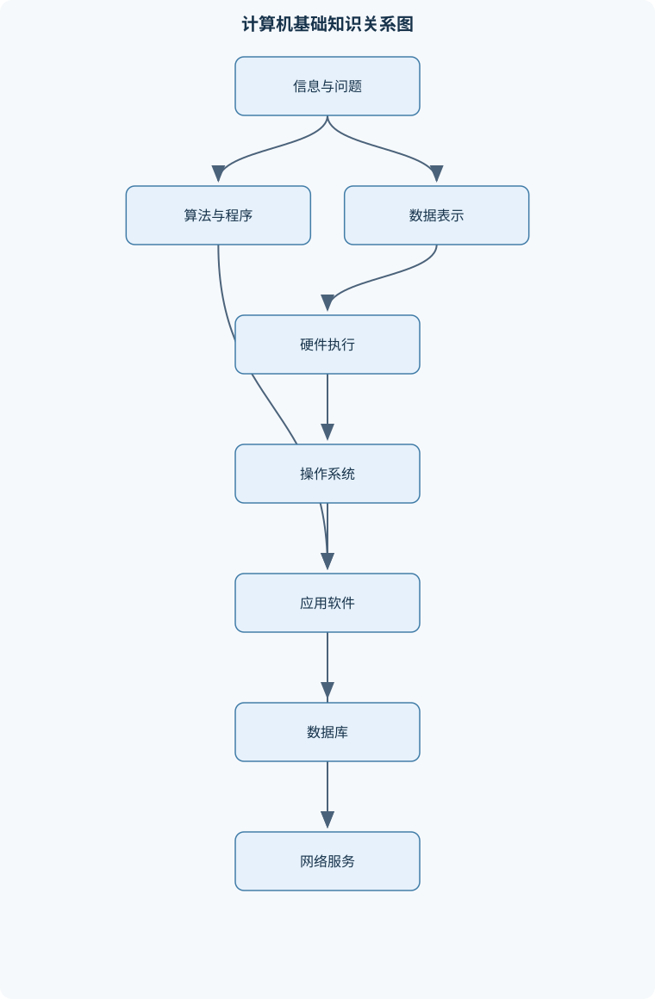
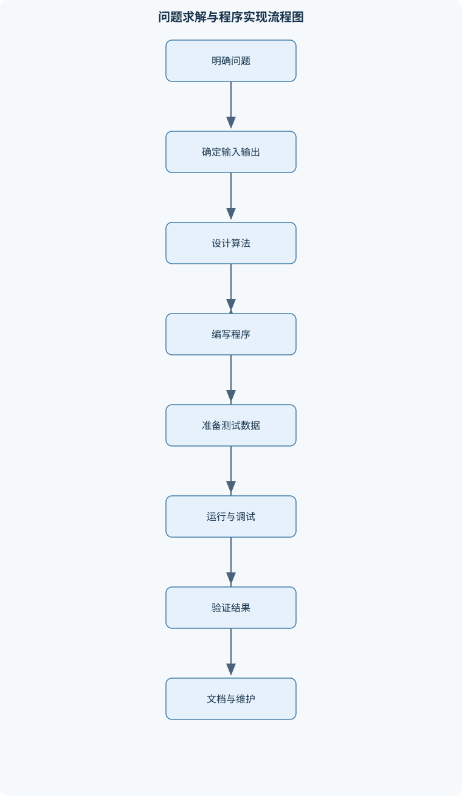

# 大计基A_23.1.6

## 一、课程整体知识框架

### 课程边界与先修知识

本课程是面向非计算机专业学生的计算机基础与程序设计入门课程，内容边界包括计算系统组成、数据表示与信息编码、逻辑运算、操作系统基本原理、问题求解与算法、Python程序设计、关系数据库、计算机网络与互联网，以及常用办公信息处理。先修知识为基本数学运算、初等逻辑、文件与文件夹操作；不要求先修程序设计。课程强调从信息表示到硬件执行、从算法描述到Python实现、从数据组织到数据库查询、从网络协议到应用服务的完整链条。办公软件部分用于说明表格计算、文档组织和演示表达，不扩展为专门的办公软件认证课程；Python部分覆盖变量、基本数据类型、顺序与分支循环、函数、序列、字典、文件、异常、模块和面向对象基础，不以大型软件工程、复杂数据结构或深度学习为课程重点。





### 1. 课程定位与主线

本课程面向非计算机专业学生，先修要求是基本数学运算、初等逻辑以及文件和文件夹操作，不要求先修程序设计。课程研究的对象不是某一种软件的操作技巧，而是信息如何被表示、存储、处理、传输和组织，以及人如何把现实问题转化为可执行的计算过程。

课程主线可以概括为：

$$
\text{现实问题}
\rightarrow
\text{信息表示}
\rightarrow
\text{算法描述}
\rightarrow
\text{程序实现}
\rightarrow
\text{数据组织}
\rightarrow
\text{网络服务与信息表达}
$$

其中，计算机系统负责执行指令；数据表示规定信息如何编码为二进制；逻辑运算和数字电路解释硬件如何完成判断与算术；操作系统负责管理处理器、内存、文件和设备；算法描述解决问题的步骤；Python把算法转化为可运行程序；数据库组织结构化数据；网络使不同系统能够交换信息；办公信息处理则把这些能力用于文档、表格、演示和综合信息系统。

### 2. 计算系统与计算思维

计算机系统可以看作对输入信息进行处理并产生输出结果的系统。基本过程是输入、处理、输出和存储。输入可以是键盘字符、传感器数据或文件内容；处理包括计算、比较、分类和转换；输出可以是屏幕显示、文件、打印结果或网络消息；存储用于保留程序和数据。

计算机的优势在于可重复计算和自动化。若程序 $P$ 对输入 $I$ 产生输出 $O$，可抽象表示为：

$$
P(I)=O
$$

当程序、输入和运行条件相同，通常应得到可重复的结果。但“可重复”不等于“必然正确”：程序可能含有逻辑错误，输入可能不符合约定，硬件或外部环境也可能发生故障。计算机能够高效执行可形式化、可分解的任务，但不能自动替代问题定义、目标选择和结果解释。不可计算问题、信息不完整的问题以及需要价值判断的问题，不能仅靠增加计算速度解决。

冯·诺依曼结构把程序和数据统一存放在存储器中，由中央处理器按指令顺序取指、译码和执行。硬件是处理器、存储器、输入输出设备及连接部件；软件是程序、数据和相关配置。程序是静态的指令集合，运行中的程序实例称为进程。计算系统具有层次性：应用软件依赖操作系统，操作系统依赖硬件，程序设计语言又为人提供了比机器指令更易理解的抽象层。

### 3. 计算机硬件组成

中央处理器 CPU 主要包括控制器 CU、运算器以及寄存器。控制器从存储器取出指令，对指令代码进行译码，并产生控制信号；运算器中的算术逻辑单元 ALU 执行加、减、比较、逻辑与和逻辑或等操作；寄存器保存当前指令、地址、中间数据或运算结果，访问速度通常高于主存。

Cache 是位于 CPU 与主存之间的高速缓存。若所需数据已经在 Cache 中，称为命中，可以减少访问延迟；若未命中，则需要从较低层存储器读取。Cache 不是永久存储器，内容会因空间有限而被替换。其有效性依赖程序访问的局部性，包括近期访问过的数据可能再次访问的时间局部性，以及相邻地址可能连续访问的空间局部性。

主存由多个存储单元组成，每个单元有唯一地址。地址标识位置，容量表示能够存放的信息量，二者不能混同。若有 $m$ 根地址线，每根地址线只有 $0$ 或 $1$ 两种状态，则可产生 $2^m$ 个不同地址。若每个地址对应 $1$ 字节，且地址从 $0$ 开始连续编址，则可寻址容量为：

$$
2^m\text{ B}
$$

例如 $16$ 根地址线可表示 $2^{16}$ 个地址；只有在“一个地址对应一个字节”的条件下，容量才是 $2^{16}\text{ B}$。若一个地址对应多个字节或一个字，必须按实际编址单位换算。

RAM 是随机存取存储器，通常具有易失性，断电后内容丢失；ROM 通常用于保存不应随意改变的初始化程序，但不同类型的 ROM 在可写次数、擦除方式和断电保持能力上有所区别。硬盘和固态存储属于外部持久存储，容量通常较大。机械硬盘依赖旋转盘片和磁头；固态存储以闪存等电子存储单元为基础，没有机械旋转部件。

总线用于在部件之间传输信息，通常区分数据总线、地址总线和控制总线。输入输出系统连接键盘、显示器、磁盘和网络适配器等外设；设备驱动程序把操作系统的统一请求转换为具体设备能够理解的操作。即插即用要求设备、接口和操作系统共同遵守相应识别与配置机制，不能简单理解为任意设备插入后都无需驱动。

精简指令集 RISC 通常使用数量较少、格式较规整的指令，便于流水化和快速译码；复杂指令集 CISC 通常提供较多、功能较复杂的指令。二者是处理器指令集设计思想的区别，不能仅凭指令条数判断处理器整体性能。

### 4. 数据表示与信息编码

计算机内部以二进制位表示信息。bit 记作 b，是一个二进制位；Byte 记作 B，$1\text{ B}=8\text{ b}$。$R$ 进制使用 $0$ 至 $R-1$ 的数码，位置权值为 $R$ 的整数次幂。一个 $k$ 位的 $R$ 进制整数可表示为：

$$
(d_{k-1}d_{k-2}\cdots d_0)_R
=
\sum_{i=0}^{k-1}d_iR^i
$$

其中 $d_i$ 是第 $i$ 位数码，满足 $0\le d_i<R$。将任意进制整数转换为十进制时，逐位乘以相应权值后求和；将十进制整数转换为 $R$ 进制时，反复除以 $R$，记录余数，最后逆序读取余数。十进制小数转换通常反复乘以 $R$，依次读取整数部分。小数能否有限表示取决于约分后分母的质因数是否都属于目标进制基数的质因数。例如 $0.25=1/4$，分母只有因子 $2$，因此在二进制中可有限表示为 $0.01_2$；某些十进制有限小数在二进制中会成为无限循环小数。

无符号 $n$ 位二进制数的范围是 $0$ 至 $2^n-1$，因为各位全为 $1$ 时：

$$
1\times2^{n-1}+1\times2^{n-2}+\cdots+1\times2^0
=2^n-1
$$

该结论不适用于有符号编码和浮点数。原码、反码和补码都必须结合位宽讨论。以 $8$ 位补码表示 $-11$ 为例，先写出 $11$ 的二进制形式 $00001011$，按位取反得 $11110100$，再加 $1$ 得 $11110101$。按补码权值验证：

$$
-128+64+32+16+4+1=-11
$$

补码加法可以把正负整数加法统一为二进制加法，但若结果超出固定位宽的表示范围，就会溢出，不能直接把截断结果当作正确答案。

定点数约定小数点位置固定，表示简单但范围和精度受限；浮点数通常由符号、阶码和尾数构成，能够表示更大范围，但存在舍入误差、下溢、上溢和特殊值等问题。字符编码把字符映射为数字代码；汉字、英文、数字和符号的编码空间可能不同，显示字符还需要相应字体支持。图像由像素组成，分辨率表示像素数量；位图放大可能出现锯齿，矢量图以几何描述为基础，适合无损缩放。音频数字化包括采样和量化，采样频率决定单位时间取样次数，量化位数影响幅度刻画精度。视频可看作连续图像帧与音频的组合，压缩利用空间、时间和感知冗余。无损压缩可完整恢复原数据，有损压缩以牺牲部分信息换取更高压缩率。

### 5. 逻辑运算与数字电路

逻辑变量通常取 $0$ 或 $1$，分别表示假和真。与、或、非、异或分别记为：

- $A\cdot B$ 或 $AB$：只有 $A$、$B$ 都为 $1$ 时结果为 $1$；
- $A+B$：只要至少一个为 $1$，结果就为 $1$；
- $\neg A$：对 $A$ 取反；
- $A\oplus B$：恰有一个输入为 $1$ 时结果为 $1。

逻辑表达式可以通过真值表验证。含 $k$ 个逻辑变量时，共有 $2^k$ 种输入组合，因此真值表适合变量较少的表达式验证，但变量增多后行数指数增长。布尔代数中的德摩根定律为：

$$
\neg(A\cdot B)=\neg A+\neg B
$$

$$
\neg(A+B)=\neg A\cdot\neg B
$$

可以逐行列出两边真值验证。逻辑化简还常用分配律、结合律、交换律、吸收律。例如：

$$
F=A+AB=A(1+B)=A
$$

化简结果必须与原式在所有输入组合下保持相同输出。

逻辑门电路实现基本逻辑运算，组合逻辑电路的输出只取决于当前输入。半加器处理两个一位二进制数：

$$
S=A\oplus B,\qquad C=A\cdot B
$$

其中 $S$ 为和位，$C$ 为进位位。当 $A=B=1$ 时，输出为和位 $0$、进位 $1$，即二进制结果 $10$。全加器还接收低位进位 $C_{\mathrm{in}}$：

$$
S=A\oplus B\oplus C_{\mathrm{in}}
$$

$$
C_{\mathrm{out}}=AB+AC_{\mathrm{in}}+BC_{\mathrm{in}}
$$

多个全加器级联可以完成多位二进制加法，但固定位宽仍存在溢出边界。

### 6. 操作系统与文件管理

操作系统向应用程序提供统一运行环境，并管理处理器、内存、文件、设备和用户权限。内核负责核心资源管理；Shell 接收用户或应用程序的命令，再请求内核执行。程序是静态代码，进程是程序的一次执行实例，作业通常是提交给系统处理的任务单位。

进程调度决定就绪进程获得 CPU 的次序。先来先服务 FCFS 按到达顺序排队，适合规则简单的场景，但长作业可能使后到的短作业长期等待。若单核、无抢占且忽略切换开销，三个进程运行时间为 $5$、$2$、$3$，按顺序运行时完成时间为 $5$、$7$、$10$；等待时间为 $0$、$5$、$7$，平均等待时间为：

$$
\frac{0+5+7}{3}=4
$$

死锁不是普通的运行缓慢，而是进程相互等待导致永久停滞。其必要条件包括互斥、占有且等待、不可剥夺和循环等待；破坏其中任一条件，理论上即可避免死锁。

内存分区管理把内存划分为若干区域，分区可能产生外部碎片。分页把程序分成页、把内存分成大小相等的页框，页可以分散装入，减少连续分配要求，但需要页表进行地址转换，并可能产生页表开销和缺页中断。虚拟内存允许程序使用大于物理内存的逻辑地址空间，但频繁换页会导致性能下降，不能理解为获得了同等速度的实际内存。

文件系统负责文件命名、目录组织、权限控制和磁盘空间分配。FAT 等文件分配表记录簇的使用状态及链接关系。文件管理还涉及路径、扩展名、读写权限、编码和备份。操作系统的用户界面可以是命令行或图形界面，但界面形式不改变文件和进程管理的基本原理。

## 二、章节和模块划分

### 核心知识覆盖清单

本清单用于检查正文是否覆盖本课程的主要知识模块：

- **计算系统与计算思维**：计算机系统的功能与边界、信息输入处理输出存储、冯·诺依曼结构、硬件与软件的关系、指令与程序的基本概念、计算机系统的层次结构、计算问题的可计算性、可重复计算与自动化、系统可靠性与安全意识。
- **计算机硬件组成**：中央处理器组成、控制器与指令译码、运算器与算术逻辑单元、寄存器与高速缓存、主存储器与存储单元、输入输出系统、总线及其分类、硬盘与固态存储、精简指令集与复杂指令集、外设接口与即插即用。
- **数据表示与信息编码**：二进制八进制十六进制、任意进制转换、整数的原码反码补码、定点数与浮点数概念、字符编码与汉字编码、图像的像素与分辨率、位图与矢量图、音频采样与量化、视频帧与压缩、数据容量与传输速率。
- **逻辑运算与数字电路**：命题与真值表、与或非基本运算、异或运算、布尔代数基本定律、德摩根定律、逻辑表达式化简、门电路及组合逻辑、半加器工作原理、全加器工作原理、逻辑电路与二进制运算。
- **操作系统与文件管理**：操作系统的功能、内核与命令解释器、进程与程序的区别、进程调度基本思想、先来先服务调度、死锁的必要条件、内存分区管理、分页与虚拟内存、文件系统与文件分配表、设备驱动与用户界面。
- **问题求解与算法基础**：问题定义与输入输出、算法的有穷性与确定性、顺序选择循环结构、流程图与伪代码、迭代与递归思想、查找问题、排序问题、最大值最小值与统计、算法正确性与循环不变量、时间复杂度与空间复杂度。
- **Python程序设计基础**：Python程序结构与缩进、变量对象与赋值、整数浮点数布尔值字符串、运算符与表达式、输入输出与类型转换、条件语句、for与while循环、break与continue、列表元组集合字典、函数参数与返回值。
- **Python程序组织与调试**：字符串切片与格式化、列表推导式、可变对象与不可变对象、变量作用域、文件读写流程、异常与异常处理、模块导入与标准库、类对象属性与方法、继承与方法重写、语法错误运行时异常与逻辑错误。
- **关系数据库与数据管理**：数据库与数据库管理系统、关系模型与二维表、字段记录主键、实体完整性与参照完整性、关系代数基本思想、SQL数据查询、条件筛选与排序、分组聚合与连接、数据库规范化初步、事务与数据安全。
- **计算机网络与信息应用**：网络的功能与分类、网络拓扑与传输介质、分层思想与协议、OSI参考模型、TCP/IP体系结构、IP地址与子网概念、域名系统、HTTP与万维网、电子邮件协议、交换机路由器防火墙与网络安全。
- **办公信息处理与综合实践**：文档结构与样式、表格公式与单元格引用、相对引用绝对引用混合引用、排序筛选与分类汇总、数据图表表达、演示文稿主题与母版、幻灯片放映与自定义放映、文件格式与数据交换、信息检索与版权意识、综合信息系统案例。


### 第一模块：计算系统与计算思维

本模块先建立“输入—处理—输出—存储”模型，说明计算机的功能边界、硬件与软件的关系、程序与指令的区别，以及从现实问题抽象为可执行步骤的方法。重点不是把计算机描述成万能工具，而是识别输入是否明确、输出是否可检验、过程是否能够有限执行。系统可靠性包括结果正确性、故障恢复、数据备份、权限控制和安全使用意识。

### 第二模块：硬件组成与数据表示

本模块把 CPU、主存、Cache、外存、总线和输入输出设备联系起来，再解释数据如何由位、字节和进制构成。学习时必须区分存储单元、地址和容量，区分 RAM 的易失性与外存的持久性，区分二进制整数、小数、字符、图像、音频和视频的编码方式。容量与传输速率也不能混淆：容量常以 B 为单位，传输速率常以 b/s 为单位，换算时必须使用 $1\text{ B}=8\text{ b}$。

#### 代表性算法：进制转换

**输入**：十进制非负整数 $n$ 和目标基数 $R$，其中 $R\ge2$。  
**输出**：$n$ 的 $R$ 进制表示。  
**过程**：反复计算商 $q=n\div R$ 和余数 $r=n\bmod R$，保存余数后令 $n=q$；商变为 $0$ 时，逆序输出余数。$n=0$ 时直接输出 $0$。  
**不变量**：已经记录的余数对应原数从低位开始的部分。  
**复杂度**：若 $n>0$，位数约为 $O(\log_R(n+1))$。  
**边界**：该方法直接处理整数；小数必须改用反复乘以 $R$ 的方法，而且可能无限循环。

```python
def decimal_to_base(number, base):
    """将非负十进制整数转换为 2 至 16 进制字符串。"""
    if number < 0 or not 2 <= base <= 16:
        raise ValueError("number 必须非负，base 必须在 2 到 16 之间")
    if number == 0:
        return "0"

    digits = "0123456789ABCDEF"
    result = []
    while number > 0:
        number, remainder = divmod(number, base)
        result.append(digits[remainder])
    return "".join(reversed(result))

print(decimal_to_base(1321, 2))  # 10100101001
```

### 第三模块：逻辑运算与数字电路

本模块由命题、真值表和布尔表达式进入门电路，再连接到半加器、全加器和二进制运算。逻辑或是允许同时为真的普通 OR，不等同于要求“只能一个为真”的 XOR。化简表达式后，应通过真值表或代入边界组合验证。门电路说明硬件并不是直接“理解”数学意义，而是按照电信号的逻辑状态完成组合运算。

### 第四模块：操作系统与文件管理

本模块围绕资源管理展开：进程使用 CPU，页和页框管理内存，文件系统管理持久数据，驱动程序连接设备。FCFS 计算必须明确到达顺序、运行时间、是否抢占以及是否考虑切换开销。分页允许程序非连续装入，但不意味着没有地址转换和换页成本。死锁分析必须检查四个必要条件，不能把所有卡顿都称为死锁。

### 第五模块：问题求解与算法基础

一个问题的算法描述至少应明确输入、输出、处理步骤、终止条件和正确性标准。顺序、选择、循环是结构化算法的基本控制结构；迭代通过重复更新逐步逼近结果，递归通过把问题化为更小的同类问题求解。递归必须有基例，否则会无限调用。

#### 代表性算法：顺序查找与二分查找

顺序查找逐个比较目标和序列元素，最坏情况下比较 $n$ 次，时间复杂度为 $O(n)$，不要求数据有序。二分查找要求数组按升序排列且支持按下标访问，每次比较中间元素后排除约一半候选，时间复杂度为 $O(\log n)$。二分查找的循环不变量是：若目标存在，则它始终位于当前闭区间。区间为空时终止。对无序数据直接使用二分查找会破坏正确性。

#### 代表性算法：选择排序与最大值统计

选择排序第 $i$ 轮在未排序区间寻找最小值，再与第 $i$ 个位置交换；前 $i$ 个位置始终是全体元素中最小且已排序的元素。它的时间复杂度为 $O(n^2)$，额外空间复杂度为 $O(1)$，适合说明循环不变量，但不适合大规模数据。最大值算法先把首元素作为当前最大值，再逐项比较；处理前 $i$ 个元素后，当前值就是这部分数据的最大值，时间复杂度为 $O(n)$。

### 第六模块：Python 程序设计基础

Python 程序以缩进表示代码块，变量名绑定到对象而不是固定类型的存储盒。整数、浮点数、布尔值和字符串是常见基本数据类型；`=` 是赋值，`==` 是相等比较，索引通常从 $0$ 开始，切片遵循左闭右开区间。条件语句根据布尔表达式选择分支，`for` 遍历可迭代对象，`while` 在条件为真时重复执行。若每轮循环都使未处理规模严格减少且规模有下界，循环才能保证终止；仅写出循环条件不能证明终止。

列表、元组、集合和字典分别适合有序可变序列、有序不可变序列、无重复元素集合以及键值映射。函数通过参数接收数据、通过返回值提供结果。函数调用会创建局部作用域；可变列表作为参数传入时，函数内部修改其内容可能被调用者观察到，但把参数重新绑定到新对象不会改变调用者变量的绑定。

### 第七模块：Python 程序组织与调试

字符串切片、格式化和列表推导式用于简洁处理序列；文件处理应遵循校验路径、选择编码、使用 `with` 打开、读取或写入、完成后自动关闭的流程。异常处理可以捕获运行时异常，但不能替代输入校验。语法错误通常在解析阶段发现，运行时异常在执行期间触发，逻辑错误则可能使程序正常运行却产生错误结果。

模块用于拆分程序和复用功能，标准库提供文件、数学、日期等常用工具。类把数据属性和操作方法组合起来，对象是类的实例；继承允许子类复用父类行为，方法重写使子类对同一操作提供不同实现。面向对象基础用于理解程序组织，不扩展到大型软件工程、复杂框架或深度学习。

### 第八模块：关系数据库与数据管理

关系数据库用表组织数据，表中的行对应记录或元组，列对应字段或属性。主键唯一标识记录；实体完整性要求主键有效且不重复，参照完整性要求外键引用已有的相关记录或遵循空值规则。关系代数强调选择、投影、连接等操作，SQL 则描述所需结果。

SQL 的基本分析顺序是识别数据源，确定连接条件，使用 `WHERE` 筛选记录，使用 `GROUP BY` 分组，使用聚合函数统计，再用 `HAVING` 筛选分组结果，最后用 `ORDER BY` 排序。`WHERE` 不能直接代替对聚合结果的筛选；连接缺失条件可能产生笛卡尔积。规范化通过拆分重复信息减少更新异常，但表拆分过度也可能增加连接成本。事务强调一组操作的整体性、并发控制和故障恢复，数据安全还包括权限、备份和审计。

### 第九模块：计算机网络与信息应用

网络按照覆盖范围、拓扑和传输方式组织设备。分层思想把复杂通信拆成相对独立的功能层；OSI 模型用于理解层次，TCP/IP 体系用于实际互联网通信。TCP 强调面向连接、可靠传输和有序交付；UDP 不保证可靠交付，但协议开销较小，适合对实时性或简单传输有要求的场景。不能只按“快”或“慢”判断二者优劣。

IP 地址标识网络中的接口，子网概念用于划分网络和确定本地通信范围；域名便于人记忆，DNS 负责把域名解析为 IP 地址。URL 描述资源位置。HTTP 属于应用层协议，万维网通常由浏览器、HTTP 服务和资源组成；电子邮件涉及发送和接收等不同协议。交换机主要在局部网络中转发数据帧，路由器连接不同网络，防火墙依据规则控制通信。网络故障应依次检查物理连接、网卡配置、IP 与网关、DNS、端口、应用服务和权限策略，不能因为域名能解析就断定网页服务正常。

### 第十模块：办公信息处理与综合实践

文档处理强调标题层级、段落结构、样式统一和目录生成；表格处理强调公式、数据类型、引用和可复核性。相对引用、绝对引用和混合引用的区别在于复制公式时哪些行列随位置变化。例如 `=A3+$B$3+C$3` 从 D3 复制到 E4 后为 `=B4+$B$3+D$3`：`A3` 的行列都变化，`$B$3` 都固定，`C$3` 只改变列。

排序、筛选和分类汇总必须先确认字段类型、空值含义和汇总范围。图表应服务于数据比较、趋势观察或结构说明，不能用装饰替代数据含义。演示文稿的主题规定整体设计，母版控制版式结构，背景是外观元素，动画控制呈现过程。文件格式和数据交换还涉及兼容性、编码、公式丢失和权限问题。信息检索必须记录关键词、筛选依据和版权边界，综合信息系统案例通常要求把表格、数据库、程序和网络服务组合成可验收的业务流程。

## 三、核心概念的详细解释

### 1. 计算系统、硬件与软件的层次关系

计算机系统的基本任务，是把输入的信息按照预定规则进行处理，形成输出，并在必要时保存中间结果或最终结果。输入可以来自键盘、文件、传感器或网络；处理包括计算、比较、分类、检索、编码和格式转换；输出可以表现为屏幕内容、打印文件、数据库记录或网络消息。存储既包括运行时的主存，也包括用于长期保存程序和数据的外部存储。

计算系统具有层次性。最底层是电子器件和数字电路，向上依次形成处理器指令集、操作系统、程序设计语言、应用程序和面向用户的办公或网络服务。上层可以利用下层提供的抽象，而不必直接操作全部底层细节。例如，Python程序通过解释器或编译执行环境使用操作系统提供的文件接口，操作系统再通过设备驱动控制磁盘或显示设备。层次化降低了复杂性，但也意味着故障可能跨层传播：程序逻辑错误、文件权限错误、网络协议错误和硬件故障，表面上都可能表现为“程序不能正常运行”。

冯·诺依曼结构的核心是“程序和数据存储在同一存储体系中”。CPU从存储器取出指令，经过译码后产生控制信号，再由运算器执行算术或逻辑操作，并把结果写回寄存器或存储器。程序是静态的指令集合；程序被装入内存并开始执行后，形成一个进程。一个程序可以同时产生多个进程，一个进程也可能在执行期间打开文件、申请内存和使用网络设备。

计算机擅长执行可形式化、可重复的任务。若程序 $P$ 对输入 $I$ 产生输出 $O$，可以写为 $P(I)=O$。该表示要求输入格式、程序版本、运行环境和外部依赖明确；否则即使“程序相同”，结果也可能不同。计算机不会自动判断问题目标是否合理，也不能把缺少定义的业务要求直接转化为正确程序。因此，问题求解必须先明确输入、输出、约束和验收标准。

### 2. CPU、存储器和输入输出系统

CPU主要由控制器、运算器和寄存器组成。控制器负责取指、译码和发出控制信号；算术逻辑单元 ALU 执行加法、减法、比较、与、或、非等运算；寄存器用于暂存指令地址、操作数和中间结果。数据寄存器保存参与运算的数据，指令寄存器保存当前指令，程序计数器则通常保存下一条待取指令的地址。不同处理器的具体寄存器名称和数量可能不同，但“快速暂存、协调执行”是寄存器的共同作用。

指令执行通常可抽象为取指、译码、取操作数、执行和写回。这个抽象不表示所有处理器都严格按五个阶段串行工作，现代处理器可能使用流水线、乱序执行和多级缓存；它主要用于理解指令如何从二进制编码转化为控制动作。CPU性能不能只用主频判断，因为指令集、缓存命中率、并行度、内存延迟和程序本身的访问模式都会影响实际运行时间。

主存由存储单元构成，每个单元有唯一地址。地址是位置标识，容量是可保存信息量，两者不能混为一谈。若有 $m$ 根地址线，每根地址线为 $0$ 或 $1$，则地址组合数为 $2^m$。只有在每个地址对应 $1$ 字节时，可寻址容量才是 $2^m\text{ B}$。例如，$16$ 根地址线产生 $2^{16}$ 个地址；若按字节编址，则容量为 $2^{16}\text{ B}=64\text{ KiB}$，其中 $1\text{ KiB}=2^{10}\text{ B}$。若系统按字或其他单位编址，必须重新换算。

RAM通常是可读写且易失的，断电后其中内容通常丢失；ROM及其不同类型用于保存相对固定的启动或固件信息，但“只读”并不意味着所有ROM都永远不可改写。Cache位于CPU和主存之间，利用时间局部性和空间局部性减少平均访问时间。Cache命中表示所需数据已在缓存中，并不表示数据永久保存；缓存内容可能被替换，断电后通常也不会保留。

外存包括磁盘、固态存储和其他持久化介质。磁盘通过磁性介质保存数据，固态存储通过闪存等非易失介质保存数据。外存容量大、断电保持，但访问延迟通常高于寄存器、Cache和RAM。程序通常先从外存装入主存，CPU再从主存或缓存取指。输入输出系统通过总线、控制器、设备接口和驱动程序连接外设。即插即用要求设备、接口和操作系统共同支持自动识别与配置，不能理解为任何设备插入任意端口后都必然可用。

精简指令集与复杂指令集是两种设计取向。精简指令集通常强调指令格式较规整、操作简单、便于流水线实现；复杂指令集通常提供更丰富的指令和寻址方式，单条指令可能完成更复杂的操作。二者不是“快”和“慢”的绝对分类，实际性能还取决于编译器、微体系结构、缓存和工作负载。

### 3. 数据表示、逻辑运算与数字电路

计算机以二进制位保存信息。位 bit 记作 b，字节 Byte 记作 B，满足 $1\text{ B}=8\text{ b}$。容量和传输速率必须区分：容量表示能够保存多少信息，传输速率表示单位时间内传送多少位，常用单位为 $\text{b/s}$。例如，文件大小为 $10\text{ MB}$而链路速率为 $10\text{ Mb/s}$时，不能直接认为传输时间为 $1$ 秒，还要统一十进制或二进制前缀，并考虑协议开销、拥塞和重传。

$R$ 进制中，从右向左第 $i$ 位的权值为 $R^i$。整数

$$
(d_kd_{k-1}\cdots d_1d_0)_R
$$

的十进制值为

$$
\sum_{i=0}^{k}d_iR^i,
$$

其中 $0\le d_i<R$。十进制整数转为 $R$ 进制时反复除以 $R$，记录余数并逆序读取；十进制小数则反复乘以 $R$，依次读取每次乘积的整数部分。小数转换不一定终止，例如十进制 $0.1$ 转为二进制通常是无限循环小数，因此有限位表示只能是近似值。

无符号 $n$ 位二进制数的范围为 $0$ 到 $2^n-1$。有符号整数的原码、反码和补码必须在确定位宽后讨论。以 $8$ 位补码为例，正数按普通二进制表示；负数先写对应正数，再按位取反并加 $1$。$-11$ 的表示为：

$$
11=(00001011)_2
$$

$$
\text{按位取反}=11110100
$$

$$
11110100+1=11110101.
$$

将 $11110101$ 按8位补码解释为

$$
-128+64+32+16+4+1=-11.
$$

8位补码的表示范围是 $-2^7$ 到 $2^7-1$，即 $-128$ 到 $127$。补码加法在固定位宽内可以统一处理正负数，但若结果超出范围会溢出，不能把截断后的位串直接当作正确数学结果。定点数的小数位置固定，浮点数则用符号、阶码和尾数等部分表示，适合较大范围数值，但存在舍入误差和精度边界。

字符编码把字符映射为数字码。英文字符、汉字、表情符号和不同语言文字可能占用不同字节数；“字符数”和“字节数”不是同一个概念。文本乱码常见原因是保存编码与读取编码不一致。图像由像素组成，分辨率表示像素数量，颜色深度表示每个像素所需的位数；未压缩位图的近似存储量可表示为：

$$
\text{容量}=\text{宽度}\times\text{高度}\times\text{每像素位数}\div 8.
$$

该式忽略文件头、调色板和压缩。矢量图保存几何对象及其属性，放大时通常不受固定像素网格限制；位图放大可能出现锯齿。音频数字化包括采样和量化，采样频率决定单位时间取样次数，量化位数决定每个样本的离散精度。视频可看作按时间排列的图像帧，同时还包含音频和编码信息。

逻辑变量通常取 $0$ 或 $1$。与、或、非分别表示：

$$
A\cdot B,\qquad A+B,\qquad \neg A.
$$

异或 $A\oplus B$ 在两个输入不同时为 $1$。普通或允许两个输入同时为 $1$，不能与排他或混淆。德摩根定律为：

$$
\neg(A\cdot B)=\neg A+\neg B,
$$

$$
\neg(A+B)=\neg A\cdot\neg B.
$$

逻辑表达式可以用真值表验证。若有 $k$ 个变量，需要检查 $2^k$ 组输入；变量较多时，真值表规模指数增长，因此实际电路设计还会使用代数化简或其他方法。门电路把逻辑运算实现为电子电路。半加器没有低位进位输入，其输出为：

$$
S=A\oplus B,\qquad C=A\cdot B.
$$

全加器增加输入进位 $C_{\mathrm{in}}$：

$$
S=A\oplus B\oplus C_{\mathrm{in}},
$$

$$
C_{\mathrm{out}}=AB+AC_{\mathrm{in}}+BC_{\mathrm{in}}.
$$

### 4. 操作系统、算法与程序设计

操作系统管理处理器、内存、文件和设备，并向应用程序提供进程、文件、网络和权限等服务。内核负责核心资源管理；Shell是命令解释器，接收用户或程序发出的命令并请求内核执行。程序是静态代码，进程是程序的一次执行实例，二者不能视为同义词。

进程调度是在多个就绪进程之间选择下一运行对象。先来先服务 FCFS 按到达顺序执行，规则简单但可能造成短任务长时间等待。进程间因竞争资源而永久等待，可能形成死锁。死锁通常需要同时具备互斥、占有且等待、不可剥夺和循环等待四个条件；破坏其中一个条件，才可能从制度上避免死锁。

连续分区管理把内存分为若干连续区域，容易产生外部碎片。分页把内存划分为固定大小的页框，把程序划分为同样大小的页，页可分散装入不同页框，通过页表完成地址转换。虚拟内存允许程序的一部分暂不装入物理内存，按需调入，但会产生页表维护和缺页处理开销，不能理解为“内存无限扩大”。

算法是解决问题的有限、确定步骤。一个合格算法需要明确输入、输出、每一步动作、终止条件和正确性依据。顺序、选择、循环是三种基本控制结构。循环能够终止，通常需要一个不断变化且有下界或上界的量；仅写出循环条件，并不能自动保证终止。

Python使用缩进表示程序块。变量名绑定到对象，赋值符号是 `=`，相等比较使用 `==`。整数、浮点数、布尔值和字符串是常见基本类型；列表、字典和集合通常是可变对象，元组和字符串通常不可变。函数调用会形成局部作用域；把可变对象传入函数后，函数内部修改其内容可能被调用者观察到，但给参数重新赋值不会改变调用者变量的绑定。

文件处理应遵循“确认路径和编码—打开—读取或写入—转换校验—关闭”的流程。使用 `with` 可以在离开代码块后自动关闭文件。语法错误发生在解析阶段；运行时异常在执行过程中触发；逻辑错误可能不报错但产生错误结果。异常处理应捕获能够合理处理的具体异常，不能用裸 `except` 掩盖未知问题，也不能代替输入校验。

### 5. 数据库、网络与办公信息处理

关系数据库用表组织数据，表对应关系，记录对应元组，字段对应属性。主键唯一标识记录，不能依赖可能重复或经常变化的描述性字段。实体完整性要求主键有效，参照完整性要求外键引用存在的主表记录或符合空值规则。规范化通过拆分重复信息减少更新、插入和删除异常，但拆分过度也可能增加连接成本。

SQL主要描述需要什么结果，而不是规定数据库管理系统必须采用的具体执行步骤。`SELECT`指定结果字段，`FROM`指定数据源，`WHERE`筛选分组前的记录，`GROUP BY`形成分组，`HAVING`筛选分组后的聚合结果，`ORDER BY`排序。连接必须写明相关字段；缺少连接条件可能产生笛卡尔积。`COUNT(*)`统计记录数时不忽略整行，`COUNT(字段)`通常不统计该字段为 `NULL` 的记录，二者语义不同。

网络通过协议规定数据格式、传输顺序、错误处理和解释方式。OSI模型强调分层，TCP/IP体系则用于实际互联网通信。IP地址标识网络中的接口，子网划分需要结合地址和子网掩码；域名不是IP地址，DNS负责把域名解析为IP地址。TCP提供面向连接、可靠、有序传输，UDP开销较小但不保证可靠交付。HTTP是应用层协议，通常用于万维网资源传输；浏览器能够解析域名，只说明DNS环节可能正常，并不能证明目标端口、HTTP服务或权限策略正常。

办公信息处理同样涉及数据模型和信息表达。文档样式用于统一标题、正文和目录结构；表格公式必须区分相对引用、绝对引用和混合引用。排序前要确认是否扩展整个数据区域，否则可能使记录错位；筛选隐藏的是不符合条件的记录，不等于删除。图表应服务于比较、趋势或结构说明。演示文稿主题控制整体设计，母版控制版式结构，背景控制外观，动画控制呈现过程，四者不能混为一谈。

## 四、重要定义、公式、定理和推导

### 专业审校补充：关键定义与适用边界

分页地址转换必须区分虚拟地址、物理地址、页号、页内偏移量和页框号。设页面大小为 $2^p$ 字节，虚拟地址为 $v$，则页号为 $q=\lfloor v/2^p\rfloor$，页内偏移量为 $d=v\bmod 2^p$。若页表把页号 $q$ 映射到物理页框 $f$，且该页已在内存中，则物理地址为 $f\times2^p+d$。这里假设按字节编址、页大小固定且页表项有效；若页表项无效，不能直接计算物理地址，而应发生缺页异常，由操作系统从外存调入页面，并可能置换其他页。页表只负责地址映射，不等于Cache；TLB是缓存部分页表映射的高速结构，TLB未命中不必然缺页。分页减少了外部碎片并允许页面分散装入，但会产生页表存储、地址转换和缺页调入开销。页面大小越大，页表项数量通常减少，但单次调入的无关数据可能增加；页面大小、编址单位和页表有效位必须由题目明确后才能计算。


### 1. 数制、容量与编码公式

任意 $R$ 进制整数转换为十进制的公式为：

$$
(d_kd_{k-1}\cdots d_0)_R
=\sum_{i=0}^{k}d_iR^i.
$$

推导依据是位置计数法：最右位表示 $R^0$ 个单位，向左一位表示 $R^1$ 个单位，以此类推。该公式只适用于各位数码满足 $0\le d_i<R$ 的合法 $R$ 进制整数。

十进制整数转换为 $R$ 进制采用带余除法。设当前数为 $n$，则：

$$
n=qR+r,\qquad 0\le r<R.
$$

余数 $r$ 是当前最低位；继续对商 $q$ 除以 $R$，直到商为 $0$，再逆序读取余数。若输入 $n=0$，输出应直接为 $0$。对于负数，应先规定符号处理方式，不能把负号当作普通数码参与除法。

$n$ 位无符号数的最大值为：

$$
\sum_{i=0}^{n-1}1\cdot2^i=2^n-1.
$$

因此取值范围为 $0$ 至 $2^n-1$。该结论不适用于有符号补码、浮点数或带校验位的编码。若有 $m$ 根地址线，每根有两种状态，则地址总数为：

$$
2^m.
$$

若一个地址对应 $u$ 字节，则总容量为 $2^mu\text{ B}$，不能默认 $u=1$。

无压缩位图的近似容量公式为：

$$
S=\frac{WHc}{8},
$$

其中 $W$ 为图像宽度，单位为像素；$H$ 为图像高度，单位为像素；$c$ 为每像素位数，单位为 bit；$S$ 的单位为字节。实际文件还可能包含文件头、行对齐、调色板和压缩数据，因此该公式只用于估算。

### 2. 补码运算与溢出判断

在 $n$ 位补码中，最高位权值为 $-2^{n-1}$，其余位权值为 $2^{n-2}$ 到 $2^0$。因此位串 $b_{n-1}\cdots b_0$ 的值为：

$$
-b_{n-1}2^{n-1}+\sum_{i=0}^{n-2}b_i2^i.
$$

补码加法先按普通二进制相加，保留低 $n$ 位，最高位产生的进位丢弃。若两个同号数相加后结果符号改变，则发生有符号溢出。例如，8位补码中 $127+1$ 的位运算结果为 `10000000`，解释为 $-128$，这不是数学上的正确结果，而是超出8位有符号范围后的溢出。

### 3. 布尔代数与加法器推导

吸收律为：

$$
A+AB=A.
$$

推导如下：

$$
A+AB=A(1+B)=A\cdot1=A.
$$

德摩根定律可以通过真值表逐行验证。以 $\neg(A\cdot B)=\neg A+\neg B$ 为例：当 $A=B=1$ 时，左边为 $0$，右边为 $0$；其他三种输入中，至少一个变量为 $0$，左边为 $1$，右边也为 $1$，所以两边对所有输入一致。

半加器中，两个输入相加时，和位在输入不同的情况下为1，因此是异或：

$$
S=A\oplus B.
$$

只有两个输入都为1时产生进位，因此：

$$
C=AB.
$$

全加器可以先把 $A$ 和 $B$ 相加，再把低位进位加入。和位为：

$$
S=A\oplus B\oplus C_{\mathrm{in}}.
$$

当三个输入中至少两个为1时产生进位，因此：

$$
C_{\mathrm{out}}=AB+AC_{\mathrm{in}}+BC_{\mathrm{in}}.
$$

该公式适用于一位二进制全加法器，不应直接当作多位整数加法的完整电路；多位加法需要把前一位的进位连接到后一位。

### 4. 算法正确性与复杂度

算法的正确性可以用循环不变量说明。以顺序扫描求最大值为例，输入为非空序列 $a_0,a_1,\ldots,a_{n-1}$。初始化时令当前最大值为 $a_0$。每处理到下标 $i$，保持不变量：

> 当前最大值等于已处理元素 $a_0$ 至 $a_i$ 中的最大值。

若下一个元素大于当前最大值，就更新；否则保持不变。处理完 $a_{n-1}$ 后，不变量说明结果是整个序列的最大值。算法需要 $n$ 次数量级的比较，时间复杂度为 $O(n)$，额外空间复杂度为 $O(1)$。输入为空时不能直接取首元素，必须事先规定返回值或抛出异常。

二分查找要求数组已按非降序排列，并且通常要求能够按下标随机访问。设置左右边界后取中点；若目标小于中间元素，保留左半区间；若目标大于中间元素，保留右半区间；相等时返回位置。循环不变量是：目标若存在，必位于当前候选区间。每轮大约排除一半元素，时间复杂度为 $O(\log n)$；无序数据使用二分查找会破坏正确性。

选择排序第 $i$ 轮在未排序区间中寻找最小元素，再与位置 $i$ 交换。其不变量是：前 $i$ 个位置已经有序，并且是全体元素中最小的 $i$ 个。每轮扫描规模依次为 $n-1,n-2,\ldots,1$，比较次数为：

$$
(n-1)+(n-2)+\cdots+1=\frac{n(n-1)}{2},
$$

所以时间复杂度为 $O(n^2)$，额外空间复杂度为 $O(1)$。它适用于数据规模较小或需要控制额外空间的场景，不适合大规模数据的高效排序。

### 5. 代表性算法与Python实现

#### 顺序扫描统计偶数和

输入是一个整数列表，输出是所有偶数之和。算法依次检查每个元素，若满足 $x\bmod2=0$，则累加。空列表的结果约定为 $0$。循环不变量是：处理过的元素中，`total` 等于所有偶数的和。

```python
def sum_even(numbers):
    total = 0
    for x in numbers:
        if x % 2 == 0:
            total += x
    return total


print(sum_even([3, -2, 5, 8]))  # 6
```

该算法时间复杂度为 $O(n)$，额外空间复杂度为 $O(1)$。负偶数仍满足余数为0；全为奇数时返回0。若列表中混入字符串，取模运算会触发类型异常，实际程序应先约定输入类型或进行校验。

#### 文件逐行处理流程

文件处理的输入包括路径、编码和处理规则，输出可以是统计结果、转换后的文件或错误报告。推荐使用上下文管理器，确保发生异常时也能关闭文件：

```python
def count_nonempty_lines(path, encoding="utf-8"):
    count = 0
    with open(path, "r", encoding=encoding) as file:
        for line in file:
            if line.strip():
                count += 1
    return count
```

该方法按行处理，额外空间通常为 $O(1)$，适合大文件；若使用 `read()` 一次性读入全部内容，额外空间可能达到 $O(n)$。编码不一致会导致解码异常或乱码，不能仅靠删除异常处理来“修复”编码问题。

### 6. 代表性例题

#### 例题一：数制转换

**题干：** 将十进制 $1321.25$ 转换为二进制。

**分析：** 整数部分使用反复除2取余，小数部分使用反复乘2取整数位。

**解答：**

整数部分：

$$
1321\div2=660\cdots1
$$

$$
660\div2=330\cdots0,\quad
330\div2=165\cdots0
$$

继续除法，逆序读取全部余数得到：

$$
1321=(10100101001)_2.
$$

小数部分：

$$
0.25\times2=0.5
$$

取整数位0；再计算：

$$
0.5\times2=1.0
$$

取整数位1，因此小数部分为 $(0.01)_2$。结果为：

$$
1321.25=(10100101001.01)_2.
$$

**验证：**

$$
10100101001_2=1024+256+32+8+1=1321,
$$

$$
0.01_2=\frac{1}{4}=0.25.
$$

**变式：** 若小数为 $0.1$，二进制转换通常无限循环，只能截取有限位近似表示；不能因为十进制小数有限，就断定任意进制表示也有限。

#### 例题二：补码表示

**题干：** 在8位有符号补码中表示 $-11$，并验证结果。

**解答：** 先写正数：

$$
11=(00001011)_2.
$$

按位取反：

$$
11110100.
$$

加1：

$$
11110101.
$$

按8位补码解释：

$$
-128+64+32+16+4+1=-11.
$$

**结果验证：** 补码必须指定8位；如果改成16位，表示形式会变为 `1111111111110101`。脱离位宽讨论“负数的补码”是不完整的。

**变式：** 计算8位补码 $01111111+00000001$，结果位串为 `10000000`，对应 $-128$，说明发生有符号溢出。

#### 例题三：FCFS调度

**题干：** 单核系统中，进程 $P_1,P_2,P_3$ 按此顺序到达，运行时间分别为5、2、3，采用FCFS且忽略切换开销，求各进程完成时间、等待时间和平均等待时间。

**解答：** 执行顺序为 $P_1\rightarrow P_2\rightarrow P_3$。完成时间依次为5、7、10。等待时间是开始运行时间减到达时间，因此分别为0、5、7。平均等待时间为：

$$
\frac{0+5+7}{3}=4.
$$

**验证：** 每个进程的开始时间等于前一进程完成时间；最后一个进程完成时间等于总运行时间10。该结果依赖单核、无抢占、同时按给定顺序到达等条件。

**变式：** 若 $P_2$ 在时间6才到达，则不能简单沿用原顺序，需要重新依据到达时刻构造就绪队列。

#### 例题四：SQL分组统计

**题干：** 查询员工表中每个部门的员工人数，并筛选人数不少于5的部门。

**解答：**

```sql
SELECT department_id, COUNT(*) AS employee_count
FROM employee
GROUP BY department_id
HAVING COUNT(*) >= 5
ORDER BY department_id;
```

`GROUP BY`先形成部门分组，`COUNT(*)`计算每组记录数，`HAVING`再筛选聚合结果。不能写成 `WHERE COUNT(*) >= 5`，因为 `WHERE`作用于分组前的记录，聚合值此时尚未形成。

**结果验证：** 检查部门编号是否按预期分组，确认员工表是否存在重复记录，并区分“没有员工的部门”是否需要通过外连接从部门表补出。

**变式：** 若要统计每个部门不同岗位数，应使用 `COUNT(DISTINCT position)`，但要明确 `NULL` 是否应被计入。

#### 例题五：Python函数与边界条件

**题干：** 编写函数，去掉一组成绩中的一个最高分和一个最低分后求平均值。输入长度至少为3；若有多个相同最高分或最低分，只去掉一个。

**解答：**

```python
def trimmed_average(scores):
    if len(scores) < 3:
        raise ValueError("成绩数量至少为3")
    return (sum(scores) - max(scores) - min(scores)) / (len(scores) - 2)
```

先检查长度，避免分母为0或无法同时去掉两个元素；`max`和`min`各只提供一个数值，因此即使最高分或最低分重复，也只减去一次。若成绩中含有非数值对象，函数可能触发类型异常，输入格式应在函数接口中明确。

**验证：** 对 `[60, 80, 100, 100]`，结果为：

$$
\frac{60+80+100+100-100-60}{2}=90.
$$

**变式：** 若业务要求去掉所有最高分和最低分，则不能使用该实现，必须重新定义统计规则。

### 7. 实验与综合项目流程

#### 实验一：数制、编码与文件容量分析

**输入数据：** 给定若干十进制整数、小数、8位补码位串、图像宽高与颜色深度、文本文件字符数。

**步骤：**

1. 使用除法取余完成整数进制转换，使用乘法取整完成小数转换。
2. 按位权验证转换结果。
3. 对补码位串按固定位宽解释，检查是否超出表示范围。
4. 使用位图容量公式估算未压缩大小。
5. 比较字符数、字节数和文件实际大小，说明编码和文件头造成的差异。
6. 将计算结果记录为表格，并标注公式、单位和假设。

**评价标准：** 数值正确；位宽、单位和进制标注完整；能区分精确值与截断近似值；能解释公式不适用的情形。

**排错方法：** 若进制转换错误，检查余数读取方向；若容量错误，检查 bit 与 Byte 是否混用；若文本大小不符，检查字符编码和换行符；若补码结果异常，先确认位数再解释最高位。

#### 实验二：网络分层故障排查

**输入数据：** 一个无法访问的网页现象，以及本机网络配置、域名解析结果、目标地址和端口测试信息。

**步骤：**

1. 检查网线、无线连接、网卡状态和设备指示。
2. 检查本机IP地址、子网掩码、默认网关和DNS配置。
3. 测试域名是否能解析为IP地址。
4. 若解析成功，检查到网关和目标地址的连通性。
5. 检查目标端口、代理设置、防火墙规则和应用服务状态。
6. 根据每一步结果定位物理层、网络层、传输层或应用层问题。
7. 记录现象、测试条件、结果和修复措施，避免只写“重启后恢复”。

**评价标准：** 排查顺序具有分层依据；每一步有可观察证据；能够区分DNS故障、路由故障、端口阻断和HTTP服务故障；结论不超出测试证据。

**排错方法：** 能解析域名不代表网页服务正常；能访问网关不代表目标服务器可达；TCP端口可达也不代表应用返回内容正确。若多个设备同时无法访问，应优先检查共享网关、DNS或出口策略；若只有一个设备异常，应优先检查本机配置和权限。

## 五、算法、流程和实现思路

### 方法与流程覆盖索引

下列方法或流程应在正文中说明输入、步骤、适用条件、结果检查和边界：

- 进制转换算法：输入为十进制整数n和目标基数R，输出为R进制表示；反复执行“商n整除R、记录余数、令n等于商”，直到商为0，再逆序输出余数；循环不变量是已记录余数对应原数的低位；输入为0时直接输出0；复杂度为O(log_R(n+1))。
- 真值表验证算法：输入为含k个逻辑变量的表达式，输出为表达式在全部输入组合下的值；按二进制计数生成2^k组输入，逐组计算子表达式并记录结果；终止条件是处理完全部组合；复杂度至少为O(2^k)，适合变量数量较少的逻辑验证。
- 循环最大值算法：输入为非空数列，输出最大元素及其位置；先将首元素设为当前最大值，再逐项比较并在更大时更新；不变量是处理过的前i个元素中当前值为最大值；处理完所有元素终止；时间复杂度O(n)，额外空间复杂度O(1)。
- 二分查找算法：输入为升序数组和目标值，输出目标位置或未找到；设置左右边界，计算中点并比较，依据大小保留左半段或右半段；不变量是目标若存在必在当前区间；区间为空时终止；时间复杂度O(log n)，要求数组有序。
- 选择排序算法：输入为可比较序列，输出非降序序列；第i轮在未排序区间寻找最小元素并与第i位交换；不变量是前i个位置已经按序且为全体元素中最小的i个；完成n-1轮终止；时间复杂度O(n²)，额外空间复杂度O(1)。
- Python程序调试流程：输入为程序、测试数据和预期结果，输出为定位并修正后的程序；先检查语法，再用边界和代表性数据运行，依据异常信息定位调用栈，使用断点或中间变量缩小范围，修正后回归测试；终止条件是所有测试通过且结果满足问题规格；复杂度取决于测试规模，不应以一次运行通过作为正确性证明。
- 文件处理流程：输入为文件路径、读写模式和处理规则，输出为处理结果或错误报告；校验路径与编码，使用with打开文件，按行或按块读取，转换和校验数据，写入目标文件，自动关闭资源；终止条件是到达文件结束符；时间复杂度通常为O(n)，额外空间可控制为O(1)或O(n)。
- SQL查询分析流程：输入为表结构、字段关系和查询需求，输出为符合条件的记录或统计结果；识别目标表和字段，确定连接条件，应用WHERE筛选，执行分组聚合，应用HAVING，再排序和限制结果；检查主键、连接条件和空值语义；终止条件是查询执行计划完成；性能取决于数据量、索引和连接方式，不能仅由SQL文本长度判断。
- 网络故障排查流程：输入为无法访问的网络服务和现象，输出为故障层级与修复措施；依次检查物理连接、网卡配置、IP与网关、域名解析、端口连通性、应用协议和权限策略；每一步记录可复现证据并排除一个可能原因；终止条件是服务恢复或明确需要更高权限的处理；复杂度取决于检查项数量，适合分层定位而非盲目重装。





### 1. 从问题定义到可执行方案

计算问题不能从“写代码”直接开始，而应先把现实任务转换为明确的输入、输出、约束和验收条件。设输入为 $I$，程序或算法为 $P$，输出为 $O$，可抽象为：

$$
P(I)=O
$$

其中，$I$必须说明数据类型、数量范围和合法性；$O$必须说明结果形式及正确标准；约束包括时间、空间、精度、权限和资源限制。例如，“统计成绩”至少要明确成绩是否允许缺失、成绩范围是否为 $0$ 到 $100$、统计的是人数还是平均分，以及空数据时返回什么。

一个合格算法应满足有穷性、确定性和可执行性。有限性要求在合法输入下经过有限步骤结束；确定性要求每一步的后继动作明确；可执行性要求每一步能够由计算机或操作者实际完成。存在循环语句不等于算法一定终止。只有当每轮循环都使尚未处理的问题规模严格减少，并且规模具有下界时，才能据此说明终止。例如，二分查找每轮至少排除一个候选位置；而“只要条件成立就重复”若没有改变条件所依赖的数据，可能无限循环。

算法设计通常遵循“分解—抽象—描述—验证—实现”的顺序。先把任务拆分为输入、预处理、核心处理和输出，再忽略与当前目标无关的细节，使用自然语言、流程图或伪代码描述步骤，最后用代表性数据、边界数据和异常数据检查结果。算法正确性不能只由一次运行通过证明，还要检查循环不变量、边界条件和输入约束。

### 2. 顺序、分支和循环的统一实现

顺序结构按照固定先后执行；分支结构根据条件选择不同路径；循环结构重复执行某一组操作。三者可以组合表达大量基础算法。

Python中，`=`是赋值，`==`是相等比较；缩进表示语句块。完整示例如下：

```python
def classify_scores(scores):
    """返回及格人数、最高分和平均分。要求 scores 为非空数值序列。"""
    if not scores:
        raise ValueError("成绩序列不能为空")

    passed = 0
    total = 0.0
    highest = scores[0]

    for score in scores:
        if not 0 <= score <= 100:
            raise ValueError("成绩必须在0到100之间")
        total += score
        if score >= 60:
            passed += 1
        if score > highest:
            highest = score

    average = total / len(scores)
    return passed, highest, average
```

该程序的输入是非空成绩序列，输出为及格人数、最高分和平均分。循环不变量是：处理前 $i$ 个成绩后，`total` 等于这 $i$ 个成绩之和，`passed` 等于其中及格成绩数，`highest` 等于其中最大值。循环结束时 $i=n$，因此三个变量分别代表全部数据的统计结果。时间复杂度为 $O(n)$，额外空间复杂度为 $O(1)$；若要求保存排序后的成绩，则空间需求可能增加。

`for`适合遍历已经存在的序列、字符串或字典等可迭代对象；`while`适合循环次数取决于条件的情形。使用`while`时必须在循环体内改变条件相关变量。例如：

```python
number = 128
count = 0
while number > 1:
    number //= 2
    count += 1
```

这里每轮使`number`至少减小，最终达到 $1$，所以循环终止。若忘记更新`number`，条件始终为真，程序会陷入无限循环。`break`用于提前结束当前循环，`continue`用于跳过本轮剩余语句并进入下一轮；二者不能代替对循环终止条件的设计。

### 3. 数制转换算法

数制的基数记为 $R$，使用 $0$ 到 $R-1$ 的数码。一个整数各位数码按位置权展开为：

$$
(d_kd_{k-1}\cdots d_1d_0)_R
=\sum_{i=0}^{k}d_iR^i
$$

该公式只适用于各位数码合法且位置权从低位的 $R^0$ 开始的整数部分。将十进制整数转换为 $R$ 进制时，反复除以 $R$，记录余数，再将余数逆序排列。算法输入为非负十进制整数 $n$ 和目标基数 $R$，要求 $2\le R\le 36$；输出为目标进制字符串。若 $n=0$，直接输出“0”。循环不变量是：已经记录的余数构成原数表示的低位部分。若 $n>0$，循环次数为 $O(\log_R(n+1))$，额外空间复杂度为 $O(\log_R(n+1))$。

例如将 $1321$ 转换为二进制：

- $1321\div2=660$，余数 $1$；
- $660\div2=330$，余数 $0$；
- $330\div2=165$，余数 $0$；
- $165\div2=82$，余数 $1$；
- $82\div2=41$，余数 $0$；
- $41\div2=20$，余数 $1$；
- $20\div2=10$，余数 $0$；
- $10\div2=5$，余数 $0$；
- $5\div2=2$，余数 $1$；
- $2\div2=1$，余数 $0$；
- $1\div2=0$，余数 $1$。

逆序读取余数得到 $10100101001_2$。小数部分不能使用整数除法；应反复乘以 $R$，依次取整数部分。例如 $0.25\times2=0.5$，取 $0；0.5\times2=1.0$，取 $1$，所以 $0.25_{10}=0.01_2$。并非所有十进制有限小数都能在二进制中有限表示，只有约分后的分母只含因子 $2$ 时才具有有限二进制表示。

### 4. 查找算法：顺序查找与二分查找

顺序查找适用于无序或有序序列。输入为长度为 $n$ 的序列和目标值，输出目标首次出现的位置或“未找到”。算法从第一个元素开始逐项比较，找到目标立即返回，遍历结束仍未找到则返回失败。最好情况只比较一次，最坏情况比较 $n$ 次，时间复杂度为 $O(n)$，额外空间复杂度为 $O(1)$。

二分查找要求数据按非降序排列，并且能够根据下标快速访问。设当前候选区间为闭区间 $[left,right]$，中点为：

$$
mid=\left\lfloor\frac{left+right}{2}\right\rfloor
$$

若目标等于中间元素，查找成功；若目标较小，保留左半区间；若目标较大，保留右半区间。其不变量是：若目标存在，则一定位于当前候选区间。区间为空时终止。每次迭代大约将候选数减少一半，因此时间复杂度为 $O(\log n)$，额外空间复杂度为 $O(1)$。如果数组无序，直接使用二分查找会破坏不变量；如果先排序，必须把排序成本计入总成本。

例题：升序数组 `[2, 5, 8, 12, 16, 21, 30]` 查找 `16`。初始区间为 $[0,6]$，中点为 $3$，元素为 $12$，目标较大，区间改为 $[4,6]$；中点为 $5$，元素为 $21$，目标较小，区间改为 $[4,4]$；中点为 $4$，元素为 $16$，查找成功。若查找 `10`，候选区间最终为空，结果为未找到。

### 5. 最大值、统计和排序算法

最大值算法输入非空数列，输出最大值及其位置。先把第一个元素设为当前最大值，再逐项比较；发现更大元素时更新。处理前 $i$ 个元素后，当前最大值就是这 $i$ 个元素的最大值，这是循环不变量。算法需要遍历全部元素，时间复杂度为 $O(n)$，额外空间复杂度为 $O(1)$。空序列没有最大值，不能直接读取第一个元素；可以返回约定结果，也可以抛出明确异常。

选择排序的输入是可比较序列，输出非降序序列。第 $i$ 轮在未排序区间 $[i,n-1]$ 中寻找最小元素，再与第 $i$ 个元素交换。循环不变量是：前 $i$ 个位置已经有序，并且是全部元素中最小的 $i$ 个元素。共进行 $n-1$ 轮，每轮查找的比较次数逐渐减少，总时间复杂度为 $O(n^2)$，额外空间复杂度为 $O(1)$。它适合说明排序思想，但不适合大规模数据。

冒泡排序每一轮比较相邻元素，把较大值逐步交换到未排序区间末端。若某轮没有发生交换，说明序列已经有序，可以提前终止。基本实现最坏时间复杂度为 $O(n^2)$；带提前终止时，已有序数据的最好情况为 $O(n)$。排序前必须明确是升序还是降序，且要说明相同元素的相对顺序是否需要保留。

### 6. 递归、迭代与流程验证

递归函数由基本情况和递归情况组成。基本情况直接给出结果；递归情况把问题缩小为规模更小的同类问题。例如阶乘满足：

$$
n!=
\begin{cases}
1,&n=0\\
n\cdot(n-1)!,&n>0
\end{cases}
$$

递归实现直观，但每次调用需要保存局部状态，递归深度过大可能导致栈空间不足。若问题可以用循环逐步推进，迭代实现通常更节省空间。递归和迭代的结果可以相同，但时间和空间代价不一定相同。

流程验证应至少包括四类数据：正常数据、最小规模数据、最大或边界数据、非法数据。例如统计偶数和时，应测试 `[2, 4, 6]`、`[]`、`[1, 3]`、`[-2, 5]` 和包含非数值元素的输入。正常输出只能说明某些路径正确，不能证明所有分支正确。调试流程通常是先检查语法，再运行代表性测试，依据异常类型和调用栈定位，再通过中间变量、断点或缩小输入范围确认原因，修正后执行回归测试。

### 7. 文件处理、异常处理与模块化流程

文件处理流程包括确认路径和权限、选择文本或二进制模式、确定字符编码、打开文件、读取或写入、校验内容、关闭文件。Python中使用`with`可以在代码块结束后自动关闭文件：

```python
def count_nonempty_lines(path, encoding="utf-8"):
    count = 0
    try:
        with open(path, "r", encoding=encoding) as file:
            for line in file:
                if line.strip():
                    count += 1
    except FileNotFoundError:
        raise ValueError("文件不存在")
    except UnicodeDecodeError:
        raise ValueError("文件编码与指定编码不一致")
    return count
```

输入是文件路径和编码，输出是非空行数量或明确错误。按行处理时，时间复杂度通常为 $O(n)$，其中 $n$ 是文件总字符数；若只保存计数器，额外空间复杂度可控制为 $O(1)$。一次性使用`read()`读取整个大文件，空间复杂度可能达到 $O(n)$。

语法错误通常发生在解析阶段，程序尚未正常执行；运行时异常是在执行过程中触发的错误；逻辑错误可能不报错但产生错误结果。`try`应包围可能发生异常的最小代码范围，`except`应捕获明确异常类型。裸`except`会掩盖未知错误，不利于排错。异常处理不能代替输入校验，例如捕获了`ValueError`只能说明转换失败，并不能说明成功转换后的数值符合业务范围。

模块化要求将重复或独立功能封装为函数或模块，使输入、输出和副作用清晰。函数调用会创建局部作用域；可变对象如列表传入函数后，函数内部修改其内容可能被调用者观察到，但给参数重新赋值不会改变调用者变量的绑定。设计函数时应避免不必要地修改外部列表，并通过返回值传递结果。

### 8. 数据库查询和网络故障排查流程

SQL查询流程是先确定目标字段和数据表，再确定连接关系，之后使用`WHERE`筛选行，使用`GROUP BY`分组，使用聚合函数计算，必要时用`HAVING`筛选分组结果，最后用`ORDER BY`排序。示例：

```sql
SELECT department_id, COUNT(*) AS employee_count
FROM employee
WHERE status = 'active'
GROUP BY department_id
HAVING COUNT(*) >= 5
ORDER BY employee_count DESC;
```

`WHERE`作用于分组前的记录，`HAVING`作用于分组后的结果，因此不能把`COUNT(*) >= 5`直接写在`WHERE`中。连接查询必须明确连接条件，否则可能产生笛卡尔积，结果行数接近两表行数的乘积。还要注意空值不能简单地用`= NULL`判断，通常应使用`IS NULL`或`IS NOT NULL`。

网络故障排查应按层次进行：先检查网线、无线连接和网卡状态，再检查IP地址、子网掩码、默认网关，之后测试域名解析、目标端口、应用协议和权限策略。浏览器能解析域名但无法打开网页，只能说明DNS环节可能正常，不能证明网关、端口、代理、防火墙和HTTP服务均正常。每一步应记录现象和测试结果，避免在没有证据时反复重装软件。

### 9. 表格和综合信息处理流程

电子表格中的引用分为相对引用、绝对引用和混合引用。相对引用复制时行列都会改变，例如`A3`从D3复制到E4后变为`B4`；绝对引用`$B$3`行列都固定；混合引用`C$3`固定行而列随位置变化，复制到E4后变为`D$3`。公式复制与剪切不能混同，实际结果还取决于软件对引用关系的处理语义。

表格综合处理应先清理字段名、空值和数据类型，再进行排序、筛选、分类汇总和图表表达。分类汇总前必须确认排序字段和统计范围，否则可能把不同类别混在一起。图表选择应服从数据目的：折线图适合趋势，柱形图适合类别比较，结构比例图只适合类别较少且总量关系明确的情况。图表不能掩盖单位、时间范围或样本数量。

一个综合项目可以采用以下流程：从表格或文件导入业务数据，进行格式检查和重复记录处理；将稳定实体保存到关系数据库；使用SQL生成统计结果；用Python完成批量校验或文件导出；通过网络服务或办公文档呈现结果。验收标准包括结果数值正确、字段含义明确、非法数据有提示、权限边界清晰、输出文件可打开且格式不丢失。项目排错应先判断错误发生在输入、处理、存储、传输还是呈现层，而不是把所有问题归因于程序代码。

## 六、概念之间的关系与对比

### 1. 硬件、软件、程序、进程和操作系统

| 概念 | 主要含义 | 运行状态 | 典型作用 |
|---|---|---|---|
| 硬件 | CPU、内存、磁盘、设备等物理部件 | 实体存在 | 提供计算、存储和输入输出能力 |
| 软件 | 程序、数据及配置的统称 | 可被存储和执行 | 向硬件提出操作要求 |
| 程序 | 静态指令集合 | 未执行时是文件或代码 | 描述解决问题的步骤 |
| 进程 | 程序的一次执行实例 | 动态运行 | 拥有执行状态、地址空间和资源 |
| 操作系统 | 管理硬件资源并提供服务的软件 | 启动后持续运行 | 管理进程、内存、文件和设备 |

程序和进程不能混为一谈。同一个程序可以同时启动多个进程；一个进程运行时还可能创建子进程、打开文件或等待网络数据。操作系统内核负责资源管理和核心服务，Shell是接收命令并请求内核执行的外壳程序；二者都属于软件，但职责不同。

### 2. CPU寄存器、Cache、RAM、外存和虚拟内存

寄存器、Cache、RAM和外存构成速度、容量和持久性不同的存储层次。寄存器离运算器最近，容量最小但访问快；Cache利用局部性减少CPU访问主存的等待；RAM保存正在运行的程序和数据；外存容量较大且断电后通常保留内容。速度越快的存储层次通常成本越高、容量越小。

虚拟内存不是把外存变成真正等速的RAM，而是通过分页等机制为进程提供比物理内存更大的地址空间。页面可以分散装入不同页框，甚至只有部分页面驻留内存。发生缺页时，系统需要从外存调入页面，这会产生明显延迟。因而“虚拟内存容量较大”不等于“程序运行速度更快”，过多缺页可能导致系统性能下降。

### 3. 连续分区、分页、分段和文件分配

连续分区管理要求一个程序占用一段连续内存，实现简单，但容易产生外部碎片：空闲空间总量足够，却没有一块连续空间满足请求。分页把内存分成固定大小的页框，把程序分成同样大小的页，页面可分散存放，从而减少外部碎片；但页表转换和内部碎片会带来额外开销。

分页解决的是内存装入和地址转换问题，文件分配表解决的是磁盘文件数据块的组织问题，二者不能视为同一机制。FAT通过表项记录簇的使用状态和后继关系；现代文件系统还可能使用其他索引和日志结构。文件系统的核心任务包括文件命名、目录组织、空间分配、权限控制和故障恢复。

### 4. RISC与CISC

| 对比方面 | RISC | CISC |
|---|---|---|
| 指令数量 | 通常较少 | 通常较多 |
| 指令形式 | 较规则，长度较统一 | 形式复杂，长度可能不同 |
| 单条指令功能 | 倾向于简单操作 | 可能完成较复杂操作 |
| 编译器依赖 | 需要较多简单指令组合 | 可使用较丰富的单条指令 |
| 设计目标 | 简化译码、便于流水线 | 提高单条指令表达能力 |

RISC和CISC是指令集设计思想，不应简单等同于“快”和“慢”。实际性能还受缓存、编译器、流水线、功耗和程序负载影响。某一处理器可能在硬件内部把复杂指令拆分为更简单的微操作，因此不能仅凭指令数量判断整体性能。

### 5. 原码、反码、补码与浮点数

原码、反码和补码都是有符号整数的编码方式，讨论时必须先给定位宽。以8位表示 $-11$ 为例，$11$ 的二进制为`00001011`；按位取反得到反码`11110100`；加1得到补码`11110101`。按补码权值解释：

$$
-128+64+32+16+4+1=-11
$$

补码能够把加法器统一用于正数和负数运算，但存在固定位宽溢出。例如8位有符号整数范围是 $-128$ 到 $127$，结果超出该范围时，截去高位不能视为数学上正确的结果。浮点数使用符号、阶码和尾数等部分表示更大范围的数，但通常存在舍入误差；因此不应直接用浮点数判断两个理论上相等的小数是否完全相等。

### 6. 逻辑运算、自然语言判断和数字电路

逻辑与要求两个条件都为真，逻辑或只要求至少一个条件为真，异或要求恰有一个条件为真。普通“或”允许两个条件同时为真，不能与自然语言中的排他性“或者”自动等同。德摩根定律为：

$$
\neg(A\cdot B)=\neg A+\neg B
$$

$$
\neg(A+B)=\neg A\cdot\neg B
$$

可用真值表验证：分别列出 $A,B$ 的四种组合，计算等式左右两边，若每行结果相同，则对布尔变量成立。

半加器处理两个一位二进制数：

$$
S=A\oplus B,\qquad C=A\cdot B
$$

其中 $S$ 是和位，$C$ 是进位位。全加器还接收低位进位 $C_{in}$：

$$
S=A\oplus B\oplus C_{in}
$$

$$
C_{out}=AB+AC_{in}+BC_{in}
$$

例如 $A=1,B=1,C_{in}=1$ 时，和位为 $1$，进位为 $1$，即三个一相加得到二进制`11`。逻辑表达式描述功能，门电路描述实现；化简表达式可能减少门电路数量，但还需考虑传播延迟和硬件实现条件。

### 7. 顺序、分支、循环与递归

顺序结构适合固定步骤的数据处理；分支结构适合根据条件选择路径；循环适合对多个元素重复执行相同规则；递归适合问题具有自相似结构且能自然缩小规模的场景。它们不是互相排斥的结构，而是可以嵌套组合。

循环必须关注初始化、条件更新和终止；递归必须关注基本情况、规模缩小和递归深度。循环通常使用固定的少量空间，递归会使用调用栈。对于求和、查找、逐项统计等任务，迭代往往更直接；对于树状结构或分治问题，递归表达可能更自然。选择方式应依据可读性、资源限制和正确性证明，而不是认为递归一定高级。

### 8. 顺序查找、二分查找与排序的前提

顺序查找不要求数据有序，但最坏需要检查全部元素。二分查找时间复杂度较低，但要求数据有序、边界维护正确，并且通常需要支持按下标访问。若数据只需要查找一次，先排序再二分可能不如顺序查找；若数据需要多次查询，排序成本可能通过多次查询摊薄。

排序算法也有不同目标。选择排序交换次数较少但比较次数固定；冒泡排序实现直观，并可通过“本轮无交换”提前结束；更高效的排序方法通常涉及分治或更复杂的数据结构，但复杂度和实现细节超出基础排序的直接范围。评价算法不能只看最坏时间复杂度，还应考虑数据是否已有序、稳定性、额外空间和实现成本。

### 9. 语法错误、运行时异常、逻辑错误和数据错误

| 错误类型 | 发生阶段 | 典型表现 | 排查方法 |
|---|---|---|---|
| 语法错误 | 解析阶段 | 缩进、括号、关键字使用不合法 | 根据报错位置检查语法结构 |
| 运行时异常 | 执行阶段 | 除零、文件不存在、类型转换失败 | 查看异常类型和调用栈 |
| 逻辑错误 | 执行完成后 | 程序运行但结果不符合要求 | 对照规格和测试数据检查中间过程 |
| 数据错误 | 输入或交换阶段 | 编码错、字段错、空值或重复值 | 检查格式、范围、来源和转换过程 |

异常处理只能处理已经触发的运行时异常，不能证明程序逻辑正确。输入校验应在数据进入核心计算前进行；异常捕获应明确区分“可恢复输入问题”和“需要开发者修复的程序问题”。如果把所有错误都用默认值替代，可能使错误数据悄悄进入数据库或报表，造成比程序中断更难发现的问题。

### 10. 可变对象、不可变对象与变量作用域

Python变量保存的是对象引用关系，而不是简单的固定内存数值。整数、浮点数、布尔值、字符串和元组通常不可变；列表、字典和集合是可变对象。函数接收列表后执行`append`，调用者可以观察到列表内容变化；但函数内部执行`items = []`只是改变局部变量绑定，不会让调用者变量指向新列表。

局部变量通常只在函数内部有效；全局变量可被多个函数访问，但过度依赖全局状态会增加调试困难。函数应尽量通过参数接收输入、通过返回值输出结果，减少隐式修改。默认参数若使用可变对象，可能在多次调用之间保留状态，因此应谨慎设计。

### 11. 数据库、表格和文件的关系

文件适合保存自然形成的文档或一次性数据交换；表格适合小规模、人工观察和计算；关系数据库适合多用户共享、结构化查询、完整性约束和事务管理。数据库中的关系对应表，元组对应记录，属性对应字段，主键用于唯一标识记录。

表格可以通过单元格公式直接计算，数据库则通过SQL声明所需结果。表格中复制公式会根据相对引用调整；数据库查询依赖字段名、连接条件和约束。二者都能进行筛选、排序和汇总，但数据库更适合大规模、并发和一致性要求高的场景。把同一事实重复存放在多张表中，可能产生更新异常；规范化通过拆分实体和建立关系减少冗余，但过度拆分也可能增加连接复杂度。

事务强调一组操作的整体性、一致性、隔离性和持久性。普通文件写入若在中途失败，可能留下部分结果；数据库事务可以在满足条件时提交，否则回滚。事务不是备份，不能替代定期备份、权限控制和日志审计。

### 12. OSI、TCP/IP、IP、TCP、UDP、DNS与HTTP

网络分层把复杂通信任务拆分为不同职责。OSI参考模型是概念性七层模型；TCP/IP体系结构是互联网实践中常用的分层体系。不同教材可能对层的合并方式略有差异，但核心思想相同：应用负责具体服务，传输负责端到端通信，网络层负责寻址和路由，链路或接入层负责相邻节点之间的传输。

IP地址标识网络接口，路由器依据网络层地址转发数据包；交换机主要依据链路层地址在局域网内转发。TCP面向连接，提供可靠、有序的数据流；UDP不保证可靠交付和顺序，但报文开销较小。不能简单说TCP一定比UDP“更快”或“更好”，应根据可靠性、延迟、重传和应用需求选择。

DNS负责把域名解析为IP地址；HTTP负责万维网中的请求与响应。DNS成功只能说明名称解析环节可能可用，不能证明目标端口开放、服务器正常或权限允许。防火墙可以按地址、端口、协议和状态控制通信，既可能保护系统，也可能阻断合法服务。网络排错必须区分物理、配置、解析、传输、应用和安全策略问题。

### 13. 无损压缩、有损压缩与多媒体数据

无损压缩解压后能够逐位恢复原数据，适合文本、程序和需要精确恢复的表格；有损压缩通过舍弃部分不易察觉的信息获得更高压缩率，常用于图像、音频和视频。压缩率越高不一定质量越好，评价还要考虑失真、编码时间、解码资源和用途。

位图由像素组成，分辨率越高通常需要保存更多像素数据；矢量图由几何路径和参数描述，放大时通常更适合保持边缘清晰。音频数字化涉及采样和量化，采样频率决定单位时间取样次数，量化位数影响幅度表示精细程度；视频可视为连续帧与音频的组合，帧率、分辨率和编码方式共同影响数据量。原始数据量计算必须明确单位、声道数、位深、帧率和压缩状态，不能只根据文件扩展名判断质量或容量。

### 14. 信息安全、可靠性和可重复计算

可重复计算要求程序、输入和关键环境条件明确，但不等于结果绝对正确。安全性关注机密性、完整性和可用性；可靠性关注系统在规定条件下持续正确工作的能力。权限配置错误可能导致数据泄露，备份缺失可能导致数据不可恢复，输入未校验可能导致程序异常或错误记录。

自动化流程应保留输入版本、处理时间、程序版本和输出校验信息；数据库操作应限制权限并记录关键变更；网络服务应采用适当的身份认证和访问控制；办公文件应注意共享权限、宏或外部链接风险。任何自动化系统都不能仅以“能运行”为验收标准，还应检查异常输入、资源耗尽、部分失败、重复执行和恢复能力。

## 七、典型例题和应用场景

### 专业审校补充：综合例题

题干：某系统按字节编址，页面大小为1 KiB，即1024 B。某进程的页表如下：虚拟页0映射到物理页框3，虚拟页1映射到页框7，虚拟页2无效，虚拟页3映射到页框1。求虚拟地址1850和2500的物理地址，并判断是否发生缺页。

分析：先用“页号=虚拟地址整除页面大小，偏移量=虚拟地址除以页面大小的余数”分解地址，再查页表。物理地址的计算式为“页框号×1024+页内偏移量”。

解答：对1850，1850÷1024的商为1，余数为826，所以它位于虚拟页1，页内偏移量为826。页表显示虚拟页1在物理页框7，因此物理地址为7×1024+826=7168+826=7994。该页表项有效，不发生缺页。

对2500，2500÷1024的商为2，余数为452，所以它位于虚拟页2，偏移量为452。但页表中页2无效，说明该页当前不在主存，不能写成某个物理地址；访问时先产生缺页异常。操作系统需要检查访问是否合法，从外存找到该页，选择空闲页框或置换页面，更新页表后重新执行导致异常的指令。若调入页框为4，则重新执行后物理地址为4×1024+452=4548。

结果验证：1850=1×1024+826，4548=4×1024+452，两个分解式均满足“页号对应页面、余数小于1024”。变式：若页面大小改为2048 B，虚拟地址2500的页号为1、偏移量为452，必须重新查改写后的页表，不能沿用原来的页号2；这说明页面大小改变会同时改变地址分解结果和页表结构。


### 典型题型与应用覆盖索引

建议通过下列题型或应用检查概念是否能够迁移：

- 数制转换例题：将十进制1321.25转换为二进制。整数部分1321反复除以2，余数逆序得到10100101001；小数部分0.25反复乘以2，得到0.01，因此结果为10100101001.01。应说明有限小数是否能在目标进制中有限表示取决于分母因子。
- 补码例题：在8位有符号整数中表示-11。先写11的二进制00001011，按位取反为11110100，再加1得11110101；验证时将该补码按权值解释为-128+64+32+16+4+1=-11。
- 逻辑化简例题：化简F=A+AB。利用分配律F=A(1+B)，再由1+B=1得到F=A；也可用吸收律直接判断。应通过真值表检查化简前后每种输入的输出一致。
- 加法器例题：输入A=1、B=1的半加法。和位S=1⊕1=0，进位C=1·1=1，因此结果为二进制10；若再有Cin=1，则全加器输出S=1⊕1⊕1=1，Cout=1。
- 操作系统例题：三个进程按到达顺序P1、P2、P3进入就绪队列，运行时间分别为5、2、3，采用FCFS。执行顺序为P1→P2→P3；完成时间分别为5、7、10；等待时间分别为0、5、7；平均等待时间为4。该计算假设单核、无抢占且忽略切换开销。
- Python例题：统计列表中偶数的和。先遍历列表，对每个元素判断x%2==0，满足时累加到total，最后输出total；需覆盖空列表、负数和全为奇数的情况，时间复杂度O(n)，额外空间复杂度O(1)。
- Python函数例题：编写函数计算一组成绩的去掉一个最高分和一个最低分后的平均值。必须先检查列表长度至少为3，使用sum、max、min和len计算；若存在多个相同最高或最低值，只去掉一个数值；输入不满足条件时应明确报错或返回约定结果。
- 异常处理例题：读取用户输入的整数并计算100除以该整数。先用int转换，捕获ValueError处理非整数输入，再捕获ZeroDivisionError处理0；不要使用裸except掩盖未知错误；应说明异常处理不能保证输入符合业务范围。
- 数据库例题：查询每个部门的员工人数。使用SELECT department_id, COUNT(*)，FROM employee，GROUP BY department_id；若还要筛选人数不少于5的部门，使用HAVING COUNT(*)>=5，而不是WHERE COUNT(*)>=5，因为聚合结果在分组后产生。
- 网络例题：浏览器能解析域名但无法建立网页连接。应依次检查解析得到的IP、默认网关、目标端口、代理设置、防火墙策略和HTTP服务状态；不能仅凭能解析域名就断定网络完全正常。
- 电子表格例题：单元格D3中公式为=A3+$B$3+C$3，复制到E4。相对引用A3变为B4，绝对引用$B$3不变，行绝对列相对的C$3变为D$3，因此结果为=B4+$B$3+D$3；若剪切而非复制，引用关系通常随原公式整体移动，需区分软件操作语义。


### 1. 计算机系统组成与存储容量综合题

#### 题干

某计算机有 $16$ 根地址线，按字节编址；主存中每个存储单元保存 $1\text{ B}$。系统采用处理器、主存、外存和输入输出设备组成的冯·诺依曼结构。回答：

1. 主存最多可以编址多少个存储单元？
2. 主存容量是多少？
3. 一个保存在磁盘上的程序为什么不能直接由 CPU 执行，而要先装入主存？
4. 若程序访问的数据已经位于 Cache 中，这会对执行产生什么影响？

#### 分析与解答

每根地址线有 $0$ 和 $1$ 两种状态，$16$ 根地址线可以形成：

$$
2^{16}=65536
$$

个不同地址。由于题目规定按字节编址，每个地址对应 $1\text{ B}$，所以主存容量为：

$$
65536\text{ B}=64\text{ KiB}
$$

这里使用的是 $1\text{ KiB}=2^{10}\text{ B}$。如果题目规定每个地址对应一个 $4\text{ B}$ 的存储字，则容量应为 $2^{16}\times4\text{ B}$，不能直接套用 $2^{16}\text{ B}$。

CPU的指令执行需要通过主存或高速缓存取得指令和操作数。磁盘属于外存，容量较大且具有持久性，但访问延迟通常高于主存，不能直接作为CPU当前指令执行的主要工作空间。因此，操作系统会把程序代码和所需数据装入主存，建立进程的运行环境，再由CPU取指、译码和执行。

当CPU需要访问的数据已经在Cache中，称为Cache命中。处理器可以直接从Cache取得数据，避免或减少访问主存的等待时间。Cache并不是永久存储器，也不保证每次访问都命中；程序访问具有时间局部性和空间局部性时，Cache的加速效果通常更明显。

#### 结果验证与边界

地址线数量决定地址组合数，编址单位决定每个地址对应的容量。若题目只给出“16位地址”，却没有说明按字节还是按字编址，不能唯一确定容量。把“地址数”直接当作“字节数”是常见错误。Cache命中也不表示数据永久保存，断电或缓存替换后，数据可能不在Cache中。

---

### 2. 数制、补码与逻辑运算题

#### 题干

完成下列任务：

1. 将十进制整数 $1321$ 转换为二进制。
2. 将十进制小数 $0.25$ 转换为二进制。
3. 在8位有符号整数中表示 $-11$ 的补码。
4. 化简逻辑表达式 $F=A+AB$。
5. 计算半加器输入 $A=1$、$B=1$ 时的和位与进位位。

#### 分析与逐步解答

整数部分采用“除基取余、逆序排列”的方法：

$$
\begin{aligned}
1321\div2&=660\text{ 余 }1\\
660\div2&=330\text{ 余 }0\\
330\div2&=165\text{ 余 }0\\
165\div2&=82\text{ 余 }1\\
82\div2&=41\text{ 余 }0\\
41\div2&=20\text{ 余 }1\\
20\div2&=10\text{ 余 }0\\
10\div2&=5\text{ 余 }0\\
5\div2&=2\text{ 余 }1\\
2\div2&=1\text{ 余 }0\\
1\div2&=0\text{ 余 }1
\end{aligned}
$$

将余数从下向上读取，得到：

$$
1321_{10}=10100101001_2
$$

小数部分采用“乘基取整、正序排列”：

$$
0.25\times2=0.5
$$

取整数部分 $0$；继续计算：

$$
0.5\times2=1.0
$$

取整数部分 $1$，小数部分变为 $0$，因此：

$$
0.25_{10}=0.01_2
$$

所以：

$$
1321.25_{10}=10100101001.01_2
$$

表示 $-11$ 时，先写出正数 $11$ 的8位二进制：

$$
11=00001011_2
$$

逐位取反：

$$
11110100
$$

再加 $1$：

$$
11110101
$$

因此，$-11$ 的8位补码为 $11110101$。验证时，将最高位按负权解释：

$$
-128+64+32+16+4+1=-11
$$

逻辑表达式化简如下：

$$
F=A+AB=A(1+B)=A\cdot1=A
$$

这里利用了分配律和布尔代数中的恒等律 $1+B=1$。也可以直接使用吸收律 $A+AB=A$。

半加器的和位与进位位分别为：

$$
S=A\oplus B
$$

$$
C=A\cdot B
$$

当 $A=1$、$B=1$ 时：

$$
S=1\oplus1=0
$$

$$
C=1\cdot1=1
$$

因此输出为二进制的 $10$，即和位为 $0$，进位位为 $1$。

#### 变式与边界

若要求表示 $-11$ 的补码，必须明确位宽。8位、16位补码的位模式不同，不能脱离位宽讨论。二进制小数是否有限，取决于分母在目标进制下的因子。例如十进制 $0.1$ 转换为二进制通常是无限循环小数，实际存储时必须截断或舍入。逻辑或 $A+B$ 是普通或运算，允许 $A$ 与 $B$ 同时为1；异或 $A\oplus B$ 则要求恰有一个输入为1。

---

### 3. 操作系统进程调度题

#### 题干

单核系统中，三个进程按到达顺序进入就绪队列，采用先来先服务 FCFS 调度，且不考虑进程切换开销。

| 进程 | 到达顺序 | 运行时间 |
|---|---:|---:|
| P1 | 1 | 5 |
| P2 | 2 | 2 |
| P3 | 3 | 3 |

求各进程完成时间、等待时间和平均等待时间。

#### 分析与逐步解答

FCFS按照进入就绪队列的先后执行，因而执行顺序为：

$$
P1\rightarrow P2\rightarrow P3
$$

将 $P1$ 的开始时刻记为0，则：

- $P1$ 在时刻0开始，运行5个时间单位，在时刻5完成；
- $P2$ 在时刻5开始，运行2个时间单位，在时刻7完成；
- $P3$ 在时刻7开始，运行3个时间单位，在时刻10完成。

等待时间是“开始执行时刻减到达时刻”。若题目中的“按到达顺序进入队列”只表示顺序而没有要求以实际时刻参与计算，通常可将到达时刻统一视为0，得到：

$$
\begin{aligned}
W_1&=0\\
W_2&=5\\
W_3&=7
\end{aligned}
$$

平均等待时间为：

$$
\overline W=\frac{0+5+7}{3}=4
$$

若严格使用题目给出的到达时刻，则应计算：

$$
\begin{aligned}
W_1&=0-1
\end{aligned}
$$

这会产生不合理结果，说明“到达顺序”与“到达时刻”的标注不一致。规范解题时必须先统一时间起点和到达定义。若将三个进程分别视为在时刻0、1、2到达，则等待时间应为 $0、4、5$，平均等待时间为 $3$。这说明调度题不能只看运行时间，还要确认到达时刻的含义。

#### 变式与应用

FCFS实现简单且公平性直观，但短作业可能因排在长作业之后而等待较久，形成“护航效应”。分页管理允许程序页分散装入不同页框，避免程序必须整体连续装入，但需要页表完成虚拟地址到物理地址的转换。若访问的页不在内存中，会发生缺页并产生额外开销。死锁则不是一般的“运行慢”，而是进程因互斥、占有且等待、不可剥夺和循环等待等条件相互等待，长期无法推进。

---

### 4. 查找、排序与循环不变量题

#### 题干

给定升序列表：

```python
numbers = [3, 8, 12, 17, 25, 31, 44]
```

1. 使用二分查找寻找目标值 $25$。
2. 使用顺序查找寻找目标值 $25$。
3. 比较两种算法的适用条件和复杂度。
4. 说明选择排序的主要循环不变量。

#### 解答

二分查找先取当前区间的中间位置。初始区间为下标 $0$ 到 $6$，中点为下标 $3$，元素为 $17$。因为 $25>17$，目标若存在，只可能在右半区间，下标变为 $4$ 到 $6$。新的中点为下标 $5$，元素为 $31$。因为 $25<31$，区间缩小为下标 $4$ 到 $4$，该位置元素为 $25$，查找成功。

每轮都保持以下不变量：如果目标存在，它一定位于当前搜索区间。由于每次排除约一半候选位置，时间复杂度为：

$$
O(\log n)
$$

顺序查找从下标0开始逐项比较，依次比较 $3、8、12、17、25$，共5次比较。最坏情况下目标在末尾或不存在，需要比较 $n$ 次，时间复杂度为：

$$
O(n)
$$

二分查找要求数据有序，并且通常需要能够根据下标快速访问中间元素。顺序查找不要求有序，适合数据量较小、数据经常变化或数据结构不支持随机访问的场景。

选择排序每一轮在未排序区间中寻找最小元素，并将其放到当前边界位置。第 $i$ 轮结束后的不变量是：前 $i$ 个位置已经按非降序排列，并且它们是全部元素中最小的 $i$ 个。完成 $n-1$ 轮后排序结束，基本实现的时间复杂度为 $O(n^2)$，额外空间复杂度为 $O(1)$。

#### 边界测试

应测试空列表、只有一个元素、目标位于首位、目标位于末位、目标不存在以及存在重复元素的情况。二分查找若未正确更新左右边界，可能出现死循环；使用区间 $[left,right]$ 时，终止条件通常是 $left>right$。对重复值，如果题目要求返回第一次出现的位置，还需在找到目标后继续向左搜索，不能直接返回任意一个匹配位置。

---

### 5. Python数据处理、异常和文件题

#### 题干

编写函数，统计一个数值列表中偶数的和，并从文本文件中读取整数。要求：

- 空行跳过；
- 非整数行记录错误但不中断全部处理；
- 返回偶数和、有效数据条数和错误行数；
- 文件处理完成后自动关闭文件。

#### 完整代码

```python
def summarize_integers(path):
    even_sum = 0
    valid_count = 0
    error_count = 0

    try:
        with open(path, "r", encoding="utf-8") as file:
            for line_number, line in enumerate(file, start=1):
                text = line.strip()

                if text == "":
                    continue

                try:
                    value = int(text)
                except ValueError:
                    error_count += 1
                    print(f"第{line_number}行不是整数")
                    continue

                valid_count += 1
                if value % 2 == 0:
                    even_sum += value

    except OSError as error:
        raise OSError(f"文件无法读取：{error}") from error

    return even_sum, valid_count, error_count
```

函数输入是文件路径，输出是三元组。`with open(...)`建立上下文管理，即使读取过程中出现异常，也会尝试关闭文件。内部的`try-except`只处理每一行整数转换产生的`ValueError`，不会用裸`except`掩盖其他错误。外层捕获`OSError`，用于处理路径不存在、权限不足或设备读写失败等文件系统问题。

若文件内容为：

```text
12
7

abc
-4
```

处理过程如下：

1. 读取 `12`，它是偶数，`even_sum`变为12，`valid_count`变为1；
2. 读取 `7`，它是奇数，`valid_count`变为2；
3. 空行跳过；
4. 读取 `abc`，整数转换失败，`error_count`变为1；
5. 读取 `-4`，它是偶数，`even_sum`变为8，`valid_count`变为3。

最终结果为：

```python
(8, 3, 1)
```

时间复杂度通常为 $O(n)$，其中 $n$ 是文件中字符或数据行的规模。按行处理时，额外空间可控制为 $O(1)$，不需要一次性把整个文件读入内存。

#### 变式与错误分析

若输入文件使用其他编码，必须在已知编码的前提下修改`encoding`参数；不能把编码错误简单当作数据格式错误。若要求所有数据必须在 $0$ 到 $100$ 之间，还需要在整数转换成功后增加范围校验。异常处理不能代替业务规则检查：`-100`是合法整数，但未必是合法成绩。语法错误、运行时异常和逻辑错误也要分开诊断；程序能够运行不代表输出一定正确。

---

### 6. SQL查询与办公表格综合题

#### 题干

有员工表 `employee`：

| employee_id | department_id | salary |
|---:|---:|---:|
| 1 | 10 | 6000 |
| 2 | 10 | 8000 |
| 3 | 20 | 7000 |
| 4 | 20 | 9000 |
| 5 | 20 | 5000 |

要求查询每个部门的员工人数和平均工资，只保留人数不少于2人的部门，并按平均工资降序排列。

#### 解答

```sql
SELECT department_id,
       COUNT(*) AS employee_count,
       AVG(salary) AS average_salary
FROM employee
GROUP BY department_id
HAVING COUNT(*) >= 2
ORDER BY average_salary DESC;
```

执行逻辑可以分为：

1. `FROM employee`确定数据来源；
2. `GROUP BY department_id`按照部门编号分组；
3. `COUNT(*)`统计每组记录数，`AVG(salary)`计算每组平均工资；
4. `HAVING COUNT(*) >= 2`筛选分组后的聚合结果；
5. `ORDER BY average_salary DESC`按平均工资从高到低排序。

部门10有2人，平均工资为：

$$
\frac{6000+8000}{2}=7000
$$

部门20有3人，平均工资为：

$$
\frac{7000+9000+5000}{3}=7000
$$

因此两个部门都保留，平均工资相同。`WHERE`用于分组前筛选原始记录，不能直接写`WHERE COUNT(*) >= 2`，因为此时聚合结果尚未产生。

在电子表格中，如果计算每名员工的工资等级，可以使用条件公式；若公式从一个单元格复制到其他位置，必须区分相对引用、绝对引用和混合引用。例如：

```text
=A3+$B$3+C$3
```

从D3复制到E4后变为：

```text
=B4+$B$3+D$3
```

其中`A3`的行列均相对变化，`$B$3`完全固定，`C$3`只改变列。表格排序前应选中完整数据区域，否则可能只移动一列而破坏记录对应关系。

---

### 7. 网络服务和故障定位题

#### 题干

用户在浏览器中输入域名。浏览器能够完成域名解析，但页面始终无法打开。请设计分层排查流程。

#### 分析流程

首先检查物理连接和无线连接状态，确认网卡、网线或无线接入点工作正常。其次检查本机IP地址、子网掩码、默认网关和DNS配置。域名能够解析说明DNS环节至少取得了某个IP地址，但不能证明网络路径和应用服务正常。

接着测试到默认网关的连通性，再检查到目标IP的路径。若目标主机可达但页面打不开，应检查目标服务端口是否开放、代理设置是否正确、防火墙是否阻断，以及服务器是否正在运行HTTP服务。若只有某个域名异常，还要考虑域名解析结果过期、服务端配置或访问权限；若多个网站都异常，则应优先检查本机网关、出口网络或公共网络策略。

排查时每一步都应记录现象和证据，避免同时修改多个配置导致无法判断原因。该流程体现分层思想：物理层、网络配置、名称解析、传输连通性、应用协议和安全策略分别承担不同职责。不能因为“能解析域名”就断定网络完全正常，也不能因为浏览器报错就直接重装系统。

## 八、实验、实践和项目相关知识

### 专业审校补充：实践任务

任务：制作一个“分页地址转换模拟器”，可用纸笔、电子表格或Python实现。输入材料包括页面大小、虚拟地址列表和页表；页表至少包含页号、页框号、有效位，部分页面设置为无效。输出每个虚拟地址的页号、页内偏移量、转换后的物理地址或“缺页”，并汇总有效访问数和缺页数。

实施步骤：第一步检查页面大小是否为2的幂且大于0，确认系统按字节编址。第二步对每个虚拟地址计算页号和偏移量。第三步查找对应页表项；有效时按“页框号×页面大小+偏移量”计算物理地址，无效时记录缺页，不得擅自生成物理地址。第四步用反向公式验证物理地址：物理地址除以页面大小的商应为页框号，余数应等于原偏移量。第五步增加缺页处理模拟：为缺页页面指定调入页框，更新有效位后重新转换。算法逐个处理有限地址列表后终止，时间复杂度为O(n)；若页表采用线性查找，单次查找还需计入页表项数量，使用字典映射时平均为O(1)。

评价标准：页号和偏移量计算正确；有效位处理正确；物理地址单位统一为字节；缺页与非法地址区分清楚；结果可由反向验证；至少测试页面首地址、页面末地址、跨页地址、无效页和虚拟地址等于页面大小整数倍的情况。

排错方法：若边界地址被分到下一页，检查整除和取余是否写反；若所有物理地址偏小，检查是否漏乘页面大小；若无效页仍输出地址，检查是否先判断有效位；若改变页面大小后结果不变，说明程序仍使用旧常量。


### 1. 实验一：从二进制表示到逻辑电路验证

#### 实验目标

本实验将数制转换、补码、真值表和加法器联系起来，观察信息如何从数值表示转化为逻辑运算。实验不要求搭建真实电子电路，可以使用纸笔、电子表格或Python程序完成验证。

#### 输入数据与步骤

选取以下数据：

- 十进制整数：$0、1、5、11、127、128、255$；
- 8位有符号整数：$-128、-11、-1、0、1、127$；
- 逻辑变量组合：$(A,B)=(0,0),(0,1),(1,0),(1,1)$。

按以下步骤操作：

1. 将无符号整数转换为8位二进制，位数不足时在左侧补0；
2. 对可表示的负数构造8位补码，并反向验证其十进制值；
3. 计算 $A\land B$、$A\lor B$、$A\oplus B$ 和非运算；
4. 对 $F=A+AB$ 分别计算化简前后的结果；
5. 使用半加器公式计算和位与进位位；
6. 将每组输入的结果整理为真值表。

#### 评价标准

实验结果应满足：

- $n$ 位无符号数的范围为 $0$ 到 $2^n-1$；
- 8位有符号补码范围为 $-128$ 到 $127$；
- 化简前后的逻辑表达式在全部输入组合下输出一致；
- 半加器在 $1+1$ 时输出和位0、进位位1；
- 转换过程能够说明整数部分使用除法取余，小数部分使用乘法取整。

#### 排错方法

若补码反向验证错误，先检查是否固定为8位，再检查“取反后加1”是否产生进位。若逻辑表达式的真值表不一致，检查是否把普通或误写成异或。若二进制转换结果位数不一致，检查是否遗漏前导0或逆序读取余数。对于超出8位有符号范围的数，不能强行解释为普通有符号整数，应说明发生溢出或需要更大位宽。

---

### 2. 实验二：Python文件统计与调试

#### 实验目标

实现一个文件统计程序，读取包含整数、空行和非法文本的文件，输出有效数据条数、偶数和、最大值及错误行数。实验同时训练函数、循环、序列、异常、文件和调试流程。

#### 输入数据

建立文本文件，内容如下：

```text
18
-3
42

hello
7
100
-8
```

程序要求：

1. 忽略空行；
2. 将可转换为整数的行计为有效数据；
3. 统计偶数之和；
4. 找出有效整数中的最大值；
5. 对非法行给出行号；
6. 文件不存在或无权限时给出明确错误。

#### 实施步骤

第一步，定义函数接口，例如输入文件路径，输出统计结果。第二步，使用`with open`打开文件并指定文本编码。第三步，使用`enumerate`获得行号，使用`strip`去除换行符和首尾空白。第四步，空行直接跳过，非空行使用`int`转换。第五步，在转换成功后更新计数、偶数和以及最大值。第六步，分别处理`ValueError`和`OSError`。第七步，用空文件、全是非法文本、只有一个整数、包含负数和文件不存在等数据回归测试。

对于给定文件，有效整数为 $18、-3、42、7、100、-8$，有效数据数为6，偶数和为：

$$
18+42+100-8=152
$$

最大值为100，错误行数为1。

#### 评价标准

程序验收应包括：

- 正确处理空行和首尾空白；
- 非法行不会导致整个程序异常终止；
- 统计结果与人工计算一致；
- 文件资源在读取结束后关闭；
- 空文件不产生“无最大值”的未定义结果；
- 错误信息能够区分数据格式错误和文件系统错误；
- 代码中不使用裸`except`掩盖未知故障。

#### 排错方法

若所有行都被判为非法，检查文件编码、`strip()`结果以及是否误把整行列表传给`int`。若最大值初始化为0，遇到全为负数时会得到错误结果，应在读到第一个有效数时初始化，或使用明确的“尚未找到有效值”状态。若修改列表时出现元素遗漏，应避免在遍历同一列表时直接删除元素。若程序语法错误，先检查缩进、括号和冒号；若能够运行但结果错误，则使用中间变量打印、断点或小规模输入检查循环不变量。

---

### 3. 实验三：关系数据库查询与数据质量检查

#### 实验目标

建立员工、部门和工资记录，完成筛选、排序、分组聚合和连接查询，并检查主键、外键和空值问题。

#### 输入数据设计

建立三张逻辑表：

- `department(department_id, department_name)`；
- `employee(employee_id, employee_name, department_id)`；
- `salary(employee_id, month, amount)`。

要求每名员工有唯一的`employee_id`，部门编号在部门表中存在，工资记录中的金额为非负数。故意加入一条不存在的部门编号或重复员工编号，用于观察完整性检查。

#### 实施步骤

1. 录入部门和员工基础数据；
2. 检查员工主键是否重复；
3. 检查员工的`department_id`能否在部门表中找到；
4. 查询每个部门的员工人数；
5. 连接员工表和工资表，查询员工姓名及工资；
6. 按部门汇总平均工资；
7. 对异常记录进行修正或隔离；
8. 使用多组查询结果与人工抽样结果比对。

连接查询必须明确连接条件。例如：

```sql
SELECT e.employee_name, s.month, s.amount
FROM employee AS e
JOIN salary AS s
  ON e.employee_id = s.employee_id
WHERE s.amount >= 0
ORDER BY s.month, e.employee_name;
```

如果省略`ON e.employee_id = s.employee_id`，可能生成笛卡尔积，结果行数变为两表行数的乘积，且不同员工的工资会被错误组合。

#### 评价标准与排错

评价重点包括：主键唯一、外键关系有效、金额校验正确、查询结果无重复错误、分组统计与明细记录一致。若统计人数异常，应先检查连接是否一对多；一名员工有多个月工资时，直接连接后统计可能把员工重复计算。此时应先按员工去重，或明确统计的是工资记录数还是员工人数。

若查询结果为空，应依次检查表名、字段名、连接条件和筛选条件；若结果行数突然增加，应重点检查是否缺少连接条件或连接字段存在重复值；若平均值与人工结果不一致，应检查空值、重复记录和数值类型。

---

### 4. 实践项目：小型综合信息系统

#### 项目主题

设计一个“课程资料与成绩管理”综合系统，将文档、电子表格、Python程序、关系数据库和网络访问意识结合起来。项目规模应保持在基础课程可完成范围内，不要求开发大型网站。

#### 项目输入与功能

输入包括：

- 学生或成员基本信息；
- 课程或项目名称；
- 多次成绩或任务结果；
- 课程说明文档；
- 查询和汇总需求。

系统至少实现以下功能：

1. 用结构化文档说明数据字段、录入规则和异常处理规则；
2. 用电子表格录入原始数据并进行筛选、排序和图表表达；
3. 用Python检查空值、重复编号、成绩范围和非法字符；
4. 将合格数据组织为关系表；
5. 使用SQL查询个人成绩、课程平均分和未提交名单；
6. 生成简洁的结果报告或演示文稿；
7. 明确文件命名、版本、权限和数据备份方式。

#### 项目实施流程

第一阶段是需求定义，写明输入字段、输出报表、成绩范围、缺失值含义和验收标准。第二阶段是数据设计，区分学生表、课程表和成绩表，避免把所有信息重复塞入一张大表。第三阶段是数据清洗，先检查编号唯一性，再检查外键是否存在，最后检查成绩范围和空值。第四阶段是程序处理，使用函数分别完成读取、校验、统计和输出，避免把全部逻辑堆在一个代码块中。第五阶段是数据库查询，明确连接条件、分组字段和排序规则。第六阶段是信息表达，表格用于精确查看，图表用于比较趋势或结构，演示文稿用于呈现结论而不是堆放原始数据。第七阶段是测试和交付，使用正常、边界和异常数据进行回归验证。

#### 评价标准

项目产出应包括数据字典、清洗后的数据表、可重复运行的Python程序、SQL查询结果、汇总表和简短演示材料。验收至少检查：

- 输入数据和字段定义一致；
- 重复编号能够被发现；
- 缺失值没有被悄悄当作0；
- 越界成绩被拒绝或单独标记；
- SQL连接无笛卡尔积错误；
- 汇总结果可由明细抽样验证；
- 程序重新运行能得到一致结果；
- 文件格式、编码和权限适合交换；
- 演示文稿中的图表标题、单位和数据范围清楚；
- 资料使用遵守授权和版权边界。

#### 故障排查与现实限制

如果Python程序输出与表格不一致，应先确认两者读取的是同一版本数据，再检查空值、重复行和数值类型。若数据库人数与表格人数不一致，应区分“记录数”“去重后的人员数”和“满足条件的人员数”。若网络共享文件无法打开，应检查路径、权限、网关、域名解析和服务状态，而不是直接修改数据。若不同软件打开文件后公式或格式变化，应考虑文件格式兼容性和数据交换边界。

该项目体现计算系统的完整链条：现实业务先被抽象为字段和规则，数据以二进制形式存储，程序按照算法处理，数据库负责组织和查询，网络提供交换条件，文档、表格和演示文稿负责向人表达结果。项目验收的核心不是界面是否复杂，而是数据定义清楚、处理过程可重复、结果能够验证、异常能够解释。

## 九、常见错误和易混淆内容

### 重点易错项核对清单

复习和回答问题时应逐项检查以下边界：

- 把存储器地址、存储单元和存储容量混为一谈；地址标识位置，容量表示可存放的信息量。
- 把RAM和ROM都理解为断电后保持数据；RAM通常具有易失性，ROM的可写特性还取决于具体类型。
- 把Cache命中理解为数据永久存在；Cache是利用局部性提高访问速度的高速缓存，内容可能被替换。
- 把程序、进程和作业当作同义词；程序是静态代码，进程是程序的一次执行实例，作业是提交给系统处理的任务单位。
- 认为分页后程序必须连续装入内存；分页允许页分散装入不同页框，但地址转换和页面调入会产生额外开销。
- 认为死锁等同于程序运行慢；死锁是多个进程相互等待资源而永久停滞，需分析互斥、占有且等待、不可剥夺和循环等待条件。
- 把补码、反码和原码的符号位规则混用；负数补码是在固定位宽下按位取反再加1，不能脱离位宽讨论。
- 把二进制小数转换中的乘2过程与整数除2过程混用；整数取余数并逆序，小数取整数部分并正序读取。
- 把逻辑或与自然语言中的排他性或混淆；普通OR允许两个条件同时为真，XOR要求恰有一个为真。
- 把Python中的=当作相等判断；赋值用=，比较相等用==，不等用!=。
- 误以为for循环只适合整数计数；Python的for可遍历字符串、列表、元组、字典等可迭代对象。
- 修改列表时直接删除正在遍历的元素可能跳过元素；应使用新列表、倒序索引或明确的过滤策略。
- 把语法错误、异常和逻辑错误混为一类；语法错误阻止解析，异常在运行时触发，逻辑错误可能正常运行但结果错误。
- 把SQL看作过程化语言；标准SQL主要描述所需结果，查询优化和具体执行步骤由数据库管理系统决定。
- 在SQL连接中不写连接条件；这会产生笛卡尔积，结果数量可能达到两表行数乘积。
- 把HTTP、TCP、IP和DNS视为同一层协议；它们承担应用、传输、网络和名称解析等不同职责。


### 1. 计算系统、硬件与软件层次中的混淆

#### 1.1 把程序、进程和作业当作同一概念

程序是静态的指令和数据集合，保存在文件或存储介质中；进程是程序被装入内存并开始执行后形成的动态实例，具有程序计数器、寄存器状态、地址空间和打开的资源；作业通常表示用户提交给系统处理的一项任务，可能包含一个或多个程序。一个程序可以被多次运行，形成多个进程；一个作业也可能依次启动多个进程。

因此，“程序占用了CPU”这种表述不够准确，更严格的说法是“某个进程正在获得CPU时间”。程序本身不会主动申请内存、打开文件或参与调度，执行中的进程才具有这些运行时行为。

#### 1.2 把计算机的可重复性理解为必然正确

当程序、输入和运行条件一致时，计算机通常能够重复产生相同结果，但这只说明执行过程具有确定性，不说明结果符合问题目标。例如，统计平均值的程序若把总人数写错，程序每次运行都可能稳定地产生同一个错误结果。输入数据错误、浮点数舍入、外部文件改变、随机数种子不同或网络服务返回内容变化，也可能使结果不同。

可重复计算的正确使用方式是同时固定输入、程序版本、关键配置和运行环境，并通过测试数据与预期结果验证输出。计算机能够自动执行形式化规则，但不能替代对问题目标、数据含义和结果合理性的判断。

#### 1.3 混淆CPU、主存、Cache与外存

CPU中的寄存器用于保存当前运算所需的数据、指令和地址，容量很小但访问速度快；Cache位于CPU与主存之间，利用程序访问的时间局部性和空间局部性提高平均访问速度；主存通常由RAM构成，是进程运行时的主要工作区域；硬盘或固态存储属于外存，容量较大且具有持久性。

Cache命中只表示所需数据当前在缓存中，不表示数据永久保存。RAM断电后通常丢失运行内容；外存中的文件在断电后通常仍能保留。程序存储在外存中并不意味着CPU直接从外存执行，通常需要先将程序和相关数据装入主存，再由CPU取指执行。

#### 1.4 混淆地址、存储单元和容量

地址是存储位置的编号，存储单元是该位置实际保存数据的基本单位，容量表示整个存储系统能够保存的信息量。若有 $m$ 根地址线，每根地址线有两种状态，则可以形成 $2^m$ 个不同地址。只有在每个地址对应 $1\text{ B}$ 时，才能直接得到 $2^m\text{ B}$ 的容量。

例如，$16$ 根地址线能够表示 $2^{16}$ 个地址。若按字节编址，容量为 $2^{16}\text{ B}=64\text{ KiB}$；若每个地址对应一个 $4\text{ B}$ 的字，则容量为 $2^{16}\times4\text{ B}$。因此，不能脱离“编址单位”讨论容量。

### 2. 指令系统与存储器中的易错点

#### 2.1 把CISC和RISC简单理解为“复杂机器”和“简单机器”

CISC通常包含数量较多、功能较复杂、长度可能不固定的指令；一条指令可能完成多个较高层次的操作。RISC强调使用数量较少、格式较规整、便于流水线执行的指令，复杂操作往往由多条简单指令组合完成。二者是指令集设计思想的差异，不等价于“某一种一定更快”或“某一种一定更先进”。

实际性能还受编译器、缓存、流水线、功耗、内存访问和应用程序特征影响。考试题若问二者区别，应围绕指令数量、指令格式、寻址方式、执行复杂度和设计目标回答，不能只写“CISC复杂、RISC简单”。

#### 2.2 把ROM理解为永远不能改写

ROM是非易失性存储器的统称或传统分类名称，具体类型的写入和擦除方式不同。早期可擦除可编程只读存储器需要使用紫外线擦除；电可擦除类型可以通过电信号修改；闪存可以按块擦除和写入。因而，“ROM断电后通常保持内容”与“ROM所有类型永远只读”不是同一命题。

启动固件常保存在非易失性存储器中，以便计算机加电后执行基本初始化。固件是否能够升级、升级方式和擦除粒度取决于具体硬件设计，不能仅凭“ROM”三个字作绝对判断。

#### 2.3 把即插即用理解为无条件自动可用

即插即用是指符合相应接口和系统管理要求的设备接入后，系统能够自动识别设备、分配资源并加载适当驱动。它依赖硬件接口、设备固件、操作系统支持、驱动程序和权限配置。若驱动缺失、设备损坏、接口不兼容或权限不足，设备仍可能无法使用。

因此，遇到外设不能工作时，应区分“没有识别设备”“识别但没有驱动”“驱动正常但权限不足”和“设备本身故障”，不能一律归因于插拔操作。

### 3. 数据表示和逻辑运算中的易错点

#### 3.1 混淆bit、Byte、KiB与KB

bit是二进制位，记作b；Byte是字节，记作B，且：

$$
1\text{ B}=8\text{ b}
$$

在二进制容量换算中，$1\text{ KiB}=2^{10}\text{ B}$，而某些存储设备容量标称使用十进制前缀，$1\text{ kB}=10^3\text{ B}$。题目若明确采用哪种单位，必须按题目规定计算。传输速率常以bit/s表示，文件大小常以Byte表示，二者换算时必须除以或乘以8。

#### 3.2 混淆整数转换和小数转换

十进制整数转换为 $R$ 进制，采用反复除以 $R$、记录余数、逆序读取；小数部分转换采用反复乘以 $R$、读取每次乘积的整数部分、按正序排列。例如：

$$
0.25\times2=0.5,\qquad 0.5\times2=1.0
$$

所以 $0.25_{10}=0.01_2$。整数部分和小数部分应分别处理。并非所有十进制有限小数都能在二进制中有限表示，例如 $0.1_{10}$ 的二进制展开通常是无限循环，实际计算机只能保存有限精度的近似值。

#### 3.3 混用原码、反码和补码

在固定位宽下，正数的原码、反码和补码通常相同；负数的编码规则不同。以8位表示 $-11$ 为例：

1. $11$ 的二进制为 `00001011`；
2. 按位取反得到 `11110100`；
3. 加1得到补码 `11110101`。

验证时按8位补码解释：

$$
-128+64+32+16+4+1=-11
$$

补码必须结合位宽讨论。8位有符号补码的范围为 $-2^7$ 到 $2^7-1$，即 $-128$ 到 $127$。若运算结果超出此范围，发生溢出，不能把截断后的位串直接当作数学上的正确结果。

#### 3.4 混淆逻辑或与异或

逻辑或 $A+B$ 在 $A$ 或 $B$ 至少一个为1时为1，两个同时为1时仍为1；异或 $A\oplus B$ 要求两个输入恰有一个为1。真值表为：

| $A$ | $B$ | $A+B$ | $A\oplus B$ |
|---:|---:|---:|---:|
| 0 | 0 | 0 | 0 |
| 0 | 1 | 1 | 1 |
| 1 | 0 | 1 | 1 |
| 1 | 1 | 1 | 0 |

半加器的和位使用异或，进位位使用与：

$$
S=A\oplus B,\qquad C=A\cdot B
$$

普通自然语言中的“或者”不一定表示异或，必须根据题目是否允许两个条件同时成立来判断。

### 4. 操作系统与文件管理中的易错点

#### 4.1 把进程调度等同于程序同时运行

在单核CPU上，同一时刻通常只有一个进程真正占用处理器，操作系统通过快速切换造成多个进程并发推进。FCFS按照到达顺序排队，非抢占式FCFS中，正在运行的进程通常要执行完或主动阻塞后，后续进程才能获得CPU。

若进程到达顺序为 $P_1,P_2,P_3$，运行时间分别为5、2、3，且都在时刻0到达，则完成时间为5、7、10，等待时间为0、5、7，平均等待时间为：

$$
\frac{0+5+7}{3}=4
$$

该结果假设单核、无抢占且忽略上下文切换开销。若到达时间不同，必须先计算每个进程实际进入就绪队列的时间，不能直接套用。

#### 4.2 把死锁理解成普通的运行缓慢

死锁是多个进程因竞争资源而相互等待，且在没有外力介入时都无法继续推进的状态。经典必要条件包括：

- 互斥：资源同一时刻只能由一个进程占用；
- 占有且等待：进程已占有资源，同时等待其他资源；
- 不可剥夺：资源不能被系统强行收回；
- 循环等待：进程之间形成环形等待关系。

满足这些条件意味着死锁可能发生，但具体系统还要结合资源分配图和调度行为判断。网络拥塞、程序计算量大或磁盘速度慢不一定是死锁。

#### 4.3 混淆分区、分页与虚拟内存

分区管理把内存划分为若干区域，程序通常需要连续空间，容易产生外部碎片。分页把程序划分为页、把内存划分为页框，页与页框大小相等，程序可以分散装入不同页框，减少连续分配要求，但需要页表进行地址转换。

虚拟内存允许程序的部分页面留在外存，运行时按需调入主存。它能够扩大程序可使用的逻辑地址空间，但页面频繁换入换出会增加开销，不能理解为“外存和主存速度相同”。若缺页过多，系统可能出现严重性能下降。

#### 4.4 误以为文件分配表保存了文件全部内容

文件分配表记录文件占用的磁盘簇及其链接关系等管理信息，文件数据实际存放在磁盘数据区域。删除文件、文件损坏或文件分配表损坏，可能导致数据无法正确定位。文件系统还需要目录、权限、时间信息和空闲空间管理等结构，不能把文件分配表等同于整个文件系统。

### 5. 算法与复杂度中的易错点

#### 5.1 认为循环存在就一定会终止

循环终止需要有明确的终止条件，并且每轮循环使状态朝终止方向变化。例如，二分查找每轮缩小候选区间；遍历序列每轮处理一个新元素。若循环条件始终不变，或变量变化方向与终止条件相反，程序可能无限循环。

证明循环正确性时，应说明循环不变量、初始化、保持和终止四个方面。循环不变量必须在循环开始前成立，每轮执行后仍成立，循环结束时结合终止条件推出最终结果。

#### 5.2 把排序、查找的所有算法复杂度混为一谈

顺序查找最坏需要比较 $n$ 次，时间复杂度为 $O(n)$；二分查找每轮约排除一半候选，时间复杂度为 $O(\log n)$，但要求数据有序并且能够快速访问中间位置。若数据无序，先排序的成本也应计入整体流程。

选择排序无论数据原本是否有序，通常都要在未排序区间寻找最小元素，时间复杂度为 $O(n^2)$，额外空间复杂度为 $O(1)$。带提前终止条件的冒泡排序在已有序时可达到 $O(n)$，但最坏情况仍为 $O(n^2)$。

#### 5.3 把“运行得快”作为算法唯一评价标准

算法评价还包括正确性、可读性、稳定性、空间占用、可维护性和适用条件。二分查找比顺序查找渐近时间复杂度低，但若数据很小、数据经常变化或排序成本很高，顺序查找可能更合适。复杂度描述的是输入规模增大时的增长趋势，不是任何具体机器上的精确运行秒数。

### 6. Python程序设计中的易错点

#### 6.1 混淆赋值、比较和对象

Python中 `=` 用于赋值，`==` 用于相等比较，`!=` 用于不等比较。变量名绑定到对象，变量本身不是固定类型的存储盒。例如：

```python
x = 3
x = "3"
```

前后两次赋值使 `x` 分别绑定整数对象和字符串对象。`3` 与 `"3"` 的类型不同，不能直接按数值相等处理。

#### 6.2 误以为函数内部重新赋值会改变外部变量

函数调用会建立局部作用域。若参数绑定到可变列表，函数内部修改列表元素，调用者可能观察到变化；但函数内部让参数重新绑定到新对象，不会改变调用者原变量的绑定。

```python
def add_item(items):
    items.append("new")

def replace_items(items):
    items = ["another"]
```

调用 `add_item` 后，原列表内容会改变；调用 `replace_items` 后，外部变量仍指向原列表。理解这一点需要区分“修改对象”和“改变变量绑定”。

#### 6.3 在遍历列表时直接删除元素

如下做法可能跳过相邻元素：

```python
for x in numbers:
    if x < 0:
        numbers.remove(x)
```

删除一个元素后，后续元素向前移动，而循环索引继续向后推进，可能漏检。更安全的方式是构造新列表：

```python
numbers = [x for x in numbers if x >= 0]
```

也可以倒序按索引删除，或使用明确的过滤策略。

#### 6.4 混淆三类错误

语法错误发生在解析阶段，例如括号不匹配、缩进结构错误；运行时异常发生在执行过程中，例如将字符串转换为整数失败或除数为零；逻辑错误则是程序能够运行但结果不符合要求。异常处理只能处理被触发的运行时异常，不能替代输入校验，也不能掩盖所有未知错误。

不应使用裸 `except` 直接吞掉错误。应捕获能够预期和处理的具体异常，并保留错误信息。例如读取整数并计算 $100/x$ 时，可分别处理 `ValueError` 和 `ZeroDivisionError`，但仍需检查业务范围是否允许负数。

#### 6.5 混淆文件读写模式和编码

`"r"`通常表示读取，`"w"`通常表示覆盖写入，`"a"`通常表示追加写入。使用`"w"`会清空原文件内容，因此写入前必须确认是否确实需要覆盖。文本文件还涉及字符编码，读取和写入应尽量明确编码，避免不同环境下出现乱码。

推荐使用`with`管理文件：

```python
with open("scores.txt", "r", encoding="utf-8") as file:
    for line in file:
        print(line.strip())
```

`with`结束后会自动关闭文件。文件处理还应考虑路径不存在、权限不足、内容格式错误和空文件等情况。

### 7. 数据库、网络和办公信息处理中的易错点

#### 7.1 把SQL中的WHERE和HAVING混用

`WHERE`在分组前筛选记录，`HAVING`在分组和聚合后筛选组。例如，查询员工人数不少于5人的部门：

```sql
SELECT department_id, COUNT(*) AS employee_count
FROM employee
GROUP BY department_id
HAVING COUNT(*) >= 5;
```

不能写成 `WHERE COUNT(*) >= 5`，因为聚合结果尚未在`WHERE`阶段产生。若要先筛选在职员工，再统计部门人数，应把在职条件写在`WHERE`中，把人数条件写在`HAVING`中。

#### 7.2 忘记SQL连接条件

两张表连接时，必须明确相关字段。例如员工表和部门表可依据`department_id`连接。若缺少连接条件，可能产生笛卡尔积，结果行数接近两表行数的乘积，造成重复或错误统计。连接前应确认主键、外键、空值和一对多关系。

#### 7.3 把IP、DNS、TCP和HTTP视为同一层

IP负责网络寻址和路由；TCP负责可靠、有序的端到端字节流；UDP提供较轻量的无连接报文传输；DNS负责域名解析；HTTP负责应用层请求和响应。能够解析域名，只能说明名称解析环节可用，不能证明目标服务器端口开放、HTTP服务正常或访问权限允许。

#### 7.4 把交换机和路由器作用混同

交换机主要在局域网内依据链路层地址转发帧；路由器在不同网络之间依据网络层地址选择路径；防火墙依据规则检查和控制通信。现实设备可能集成多种功能，但分析网络故障时仍应区分这些逻辑职责。

#### 7.5 混淆表格中的相对引用、绝对引用和混合引用

复制公式时，相对引用的行列会随位置变化，绝对引用保持不变，混合引用只固定行或列。例如，D3中的：

```text
=A3+$B$3+C$3
```

复制到E4后变为：

```text
=B4+$B$3+D$3
```

其中`A3`行列均相对变化，`$B$3`行列均固定，`C$3`只固定行、列发生变化。复制和剪切的语义也可能不同，不能仅凭视觉位置判断引用结果。

#### 7.6 把主题、母版、背景和动画混为一谈

主题规定整体字体、颜色和设计风格；母版控制多个页面共享的版式、占位符和统一元素；背景是页面外观的一部分；动画控制对象在放映过程中的出现或运动。演示文稿设计应优先保证信息层次、文字可读性和数据图表含义，过多动画可能干扰理解。

## 十、笔试重点、题型和解题方法

### 专业审校补充：笔试题型

题型一：给定页面大小、页表和若干虚拟地址，要求完成地址分解、物理地址计算并判断缺页。解题关键是先确定编址单位和页面大小，再用整除得到页号、取余得到偏移量，最后检查页表项有效位。常见失分点是把页号和页框号混淆、忘记乘页面大小、将无效页强行映射，以及把1 KiB误写成1000 B。

题型二：给出页面访问序列和有限物理页框，要求按指定置换策略模拟页面调入，并统计缺页次数。解题关键是逐次维护“当前驻留页面集合”，每次访问先判断命中；未命中时记录缺页，再按题目规定的先进先出或其他策略选择被置换页面。常见失分点是把首次装入漏记为缺页、置换后未更新队列或表格、把访问时间与调入时间混为一谈，以及未说明初始页框为空这一假设。

题型三：比较分区存储、分页和虚拟内存，要求说明它们在连续性、碎片、地址转换和性能方面的差异。解题关键是指出分页允许页面分散装入，主要缓解外部碎片，但仍可能产生页内碎片；虚拟内存扩大了进程可见地址空间，却依赖缺页调入，过多缺页会降低性能。常见失分点是说“分页完全消除碎片”、把虚拟内存等同于扩大物理内存，或认为发生缺页就一定是程序错误。


### 1. 数制转换、补码和容量计算题

#### 常见题型

常见题目要求完成进制互换、计算无符号整数范围、求补码、判断溢出或依据地址线数量计算可寻址容量。

#### 解题方法

先确认数的类型、位数、进制和编址单位。无符号 $n$ 位二进制数范围为：

$$
0\leq x\leq2^n-1
$$

有符号补码必须先确认位宽。整数转换使用“除基取余”，小数转换使用“乘基取整”。地址线问题先求地址数，再根据每个地址对应的字节数或字数换算总容量。

#### 变式和验证

若题目出现负数，不能使用无符号范围；若题目出现小数，不能把整数转换步骤直接套用；若结果超出位宽范围，应判断溢出，而不是只保留低位。转换结果可通过反向按权展开验证。

### 2. 逻辑表达式化简与真值表题

#### 常见题型

题目可能要求写真值表、化简逻辑表达式、判断两个表达式是否等价，或根据输入求门电路输出。

#### 解题方法

先明确逻辑与、或、非和异或的含义，再按括号和运算优先级分层计算。常用恒等式包括：

$$
A+0=A,\quad A\cdot1=A,\quad A+\overline{A}=1,\quad A\cdot\overline{A}=0
$$

吸收律：

$$
A+AB=A
$$

德摩根定律：

$$
\overline{A\cdot B}=\overline{A}+\overline{B},\qquad
\overline{A+B}=\overline{A}\cdot\overline{B}
$$

变量较少时，可列出全部 $2^k$ 种输入逐行验证；变量较多时，可先用代数法化简，再选边界组合检查。

### 3. 半加器、全加器和补码加法题

#### 常见题型

半加器要求计算和位与进位位；全加器还要考虑低位输入进位；多位二进制加法则需要逐位传递进位。

#### 解题方法

半加器：

$$
S=A\oplus B,\qquad C=A\cdot B
$$

全加器：

$$
S=A\oplus B\oplus C_{\mathrm{in}}
$$

$$
C_{\mathrm{out}}=AB+AC_{\mathrm{in}}+BC_{\mathrm{in}}
$$

解题时先列输入，再分别计算和位、进位位，不能把和位和进位位合并为一个逻辑输出。对于有符号补码加法，还需结合位宽检查符号溢出。

### 4. 操作系统调度计算题

#### 常见题型

题目给出进程到达时间、运行时间和调度策略，要求计算执行顺序、完成时间、等待时间、周转时间或平均值。

#### 解题方法

先画出时间轴，标出每个进程开始和结束的时刻。等待时间为：

$$
\text{等待时间}=\text{开始时间}-\text{到达时间}
$$

周转时间为：

$$
\text{周转时间}=\text{完成时间}-\text{到达时间}
$$

FCFS按照到达顺序执行；若题目规定无抢占，当前进程开始后通常不会被后到进程打断。必须明确单核、多核、是否考虑切换开销以及进程是否同时到达。

### 5. 死锁判断题

#### 常见题型

题目描述多个进程占有和请求资源，要求判断是否可能死锁，或指出死锁的必要条件。

#### 解题方法

逐项检查互斥、占有且等待、不可剥夺、循环等待四个条件。四个条件同时存在时，系统可能发生死锁；若明确不存在其中一个条件，则可据此排除经典死锁。回答时不能只写“进程互相等待”，还要指出等待的是资源以及等待关系是否形成循环。

### 6. 分页、虚拟内存和文件系统题

#### 常见题型

题目可能比较分区与分页，解释页和页框的关系，说明虚拟内存作用，或询问文件分配表的功能。

#### 解题方法

围绕“连续性、碎片、地址转换和调入方式”比较。分区通常要求连续分配；分页允许页分散在不同页框；虚拟内存允许部分页面暂时留在外存并按需调入。分页并不消除所有开销，因为页表查询、缺页中断和页面置换都会耗费时间。

文件分配表主要记录磁盘簇的使用和链接关系，不等于文件内容本身。分析文件损坏时，要区分目录信息、分配信息和数据区域。

### 7. Python输出、流程控制和数据类型题

#### 常见题型

题目给出一段Python代码，要求判断输出、指出异常、补全代码或说明变量在循环后的值。

#### 解题方法

逐行跟踪变量的绑定和类型，特别注意整数除法`//`、取余`%`、字符串拼接、切片左闭右开、布尔表达式短路以及循环中`break`和`continue`的作用。不要凭代码外观猜结果，应建立“初始值—每轮变化—终止条件—最终输出”的表格。

例如，切片`text[1:4]`包含索引1、2、3，不包含索引4。字典遍历默认遍历键；若要同时获得键和值，应使用`items()`。集合无重复元素且不应依赖其顺序进行结果判断。

### 8. 函数、可变对象、异常和面向对象题

#### 常见题型

题目可能要求判断函数返回值、解释默认参数、分析列表是否被修改、区分异常类型，或说明类、对象、属性和方法的关系。

#### 解题方法

函数题先确认参数绑定、局部变量、返回值和调用者可见状态。修改可变对象与重新给参数赋值必须分开分析。异常题先判断错误发生阶段：语法错误无法由运行时`try`捕获；运行时异常应捕获具体类型；逻辑错误需要通过测试数据发现。

面向对象题中，类是创建对象的类型和结构描述，对象是类的实例，属性保存状态，方法描述行为。继承允许子类复用或扩展父类行为；方法重写是子类提供同名但不同实现。不能把“有多个函数”直接称为面向对象。

### 9. 数据库SQL查询题

#### 常见题型

常见要求包括条件筛选、排序、分组统计、连接查询、去重、空值判断和子查询。

#### 解题方法

先确定目标字段和数据来源，再确定表之间的连接关系，之后安排筛选、分组、聚合、分组后筛选和排序。一般分析顺序可写为：

1. `FROM`确定数据源；
2. `JOIN`组合相关表；
3. `WHERE`筛选明细记录；
4. `GROUP BY`形成分组；
5. 聚合函数计算统计值；
6. `HAVING`筛选分组；
7. `ORDER BY`排序。

空值不能直接使用`= NULL`判断，通常需要使用`IS NULL`或`IS NOT NULL`。连接条件必须明确，否则可能出现笛卡尔积。`COUNT(*)`统计记录行数，`COUNT(field)`通常不统计该字段为`NULL`的行，二者含义不同。

### 10. 网络分层和故障排查题

#### 常见题型

题目可能要求区分交换机、路由器、防火墙，解释DNS、HTTP、TCP和UDP，或分析“能解析域名但网页打不开”的故障。

#### 解题方法

按层次和依赖关系排查：

1. 检查网线、无线连接和网卡状态；
2. 检查本机IP、子网掩码、默认网关；
3. 检查是否能访问网关；
4. 检查DNS是否能把域名解析为IP；
5. 检查目标端口是否可达；
6. 检查代理、防火墙和访问控制；
7. 检查HTTP服务、路径、证书和权限。

能解析域名只能说明DNS环节可能正常；能连接端口也不代表应用返回正确内容。排错应记录每一步现象，避免在没有证据时直接重装系统或更换全部设备。

### 11. 表格公式、数据汇总和演示表达题

#### 常见题型

题目可能要求推导复制后的公式、判断引用类型、选择排序筛选方法，或分析图表和演示文稿结构。

#### 解题方法

处理公式时逐个识别列和行是否带美元符号。排序前确认是否选中了完整数据区域，避免只排序一列而破坏记录对应关系；筛选不是删除数据，只是暂时隐藏不符合条件的记录；分类汇总前应先明确分类字段和汇总字段。

图表类型应与问题匹配：趋势通常使用折线图，类别比较可使用柱形图，构成比例可使用适当的饼图或堆积图，但类别过多时饼图难以阅读。演示文稿应通过标题、层级、图表和备注传达重点，母版用于统一结构，不应把所有内容压缩在一页。

### 12. 实验与综合实践的笔试分析方法

#### 12.1 Python数据处理实验

**输入数据：**包含若干成绩的文本文件，允许出现空行、非法字符和超出范围的数值。  
**处理步骤：**

1. 使用`with`按文本模式打开文件并明确编码；
2. 逐行去除空白；
3. 尝试转换为数值；
4. 检查是否在规定范围；
5. 统计有效记录数、平均值、最大值和最小值；
6. 将非法行号及原因写入错误报告；
7. 输出汇总结果。

**评价标准：**合法数据统计正确；非法数据不使程序意外终止；空文件有明确处理；文件资源自动关闭；结果可通过手工计算复核。  
**排错方法：**先用只有一行的数据验证转换，再测试空文件、全非法、边界值、重复值和混合非法输入。若平均值错误，优先检查有效记录数是否与累加范围一致。

#### 12.2 数据库与报表综合实践

**输入数据：**员工表、部门表和考勤表，分别包含主键、外键、日期和状态字段。  
**处理步骤：**

1. 检查主键是否唯一；
2. 检查外键是否能对应父表记录；
3. 按部门连接员工和部门信息；
4. 按月份筛选考勤记录；
5. 按部门分组统计人数和异常次数；
6. 对统计结果排序；
7. 导出报表并抽取样本人工核对。

**评价标准：**连接不产生不合理重复；部门人数与原始记录一致；空值和无记录部门按业务规则处理；SQL能够重复执行；报表标题、单位、时间范围和统计口径明确。  
**排错方法：**先分别查询每张表的记录数，再测试连接后的行数；若结果异常增加，检查连接条件和一对多关系；若统计缺少部门，检查是否误用了内连接，必要时采用左连接并解释空值含义。

#### 12.3 网络分层排错实践

**输入现象：**客户端可以连接无线网络，但无法打开某个网站。  
**处理步骤：**

1. 查看本机IP、网关和DNS配置；
2. 测试网关连通性；
3. 测试域名解析；
4. 使用目标IP检查端口可达性；
5. 检查代理和防火墙；
6. 检查HTTP响应状态和服务端路径；
7. 记录每一步的时间、结果和判断。

**评价标准：**能够把故障定位到物理、配置、解析、传输、应用或权限层之一；每个结论都有对应证据；不把“DNS成功”当作网站一定正常。  
**排错方法：**若网关不可达，先处理本地连接；若网关可达但域名解析失败，检查DNS；若解析成功但端口不通，检查路由、防火墙或服务状态；若端口可达但页面错误，转向HTTP状态、路径和应用日志。

### 13. 常见面试问题及参考回答

#### 问题一：为什么程序相同，结果仍可能不同？

**参考回答：**程序文本相同并不保证输入、运行环境、依赖版本、随机数状态、系统时间和外部数据相同。可重复计算需要同时固定关键条件，并用测试数据验证输出。即使结果可重复，也还要判断其是否符合业务要求。

**深入追问要点：**应说明浮点数精度、文件编码、数据库数据变化和网络服务响应都可能影响结果；不要把可重复性说成绝对正确性。

#### 问题二：CPU、内存和外存如何协同工作？

**参考回答：**程序和长期数据通常保存在外存中，运行时操作系统将程序和所需数据装入主存，CPU从主存或Cache中取指和取操作数，通过控制器和ALU执行，再把结果写回寄存器、主存或外存。Cache利用局部性减少CPU访问主存的等待。

**深入追问要点：**应区分寄存器、Cache、RAM和外存的速度、容量与易失性，不能只回答“内存比硬盘快”。

#### 问题三：如何判断一个循环是否可能无限执行？

**参考回答：**检查循环条件是否存在，条件涉及的变量是否在循环体内改变，以及变量变化是否朝终止方向推进。还可以构造循环不变量和一个有下界的规模函数，证明每轮规模严格减少。

**深入追问要点：**举例说明`while x > 0: x -= 1`能够终止，而`while x > 0: print(x)`不会改变条件变量，可能无限执行。

#### 问题四：列表作为参数传入函数时为什么可能被修改？

**参考回答：**函数参数是对对象的绑定。列表是可变对象，函数内部调用`append`或修改元素是在改变同一个列表对象，调用者可以观察到；如果函数内部只是让参数重新绑定到新列表，则不会改变外部变量的绑定。

**深入追问要点：**应区分可变对象与不可变对象，并说明必要时可通过复制列表避免意外共享。

#### 问题五：为什么不能用裸`except`处理所有异常？

**参考回答：**裸`except`会把无法预期的错误也吞掉，导致程序表面继续运行但结果不可信，增加排错难度。应捕获具体异常，在能够恢复或提示用户的范围内处理，并让未知错误保留完整信息。

**深入追问要点：**输入转换失败和除零可以分别处理；文件权限、程序逻辑错误或系统中断不能简单隐藏。

#### 问题六：二分查找为什么比顺序查找快？什么时候不能用？

**参考回答：**二分查找每次比较都能排除约一半候选，因此时间复杂度为 $O(\log n)$；顺序查找逐项检查，最坏为 $O(n)$。二分查找要求数据已经有序，并且能够有效访问中间位置。若数据频繁插入、规模很小或无序且排序成本高，顺序查找可能更合适。

**深入追问要点：**整体性能要把预排序成本纳入考虑，不能只比较单次查找复杂度。

#### 问题七：SQL中为什么使用HAVING而不是WHERE筛选聚合结果？

**参考回答：**`WHERE`在分组前筛选原始记录，`HAVING`在分组和聚合后筛选分组。部门人数是`COUNT(*)`产生的聚合结果，因此应使用`HAVING COUNT(*) >= 5`。

**深入追问要点：**可以补充“先用WHERE筛选在职员工，再用GROUP BY统计，最后用HAVING筛选人数”的完整执行逻辑。

#### 问题八：域名能解析但网页仍打不开，说明什么？

**参考回答：**说明DNS名称解析环节可能正常，但不能说明目标IP可达、端口开放、服务器运行正常或访问权限允许。还需要检查网关、路由、TCP连接、代理、防火墙、HTTP服务和资源路径。

**深入追问要点：**应采用分层排错，而不是直接判断“网络正常”或“DNS故障”。

#### 问题九：如何设计一个可验收的办公自动化结果？

**参考回答：**先明确输入文件格式、字段含义、输出模板、统计口径和异常规则，再选择表格公式、Python程序或数据库查询。输出应包含时间范围、单位、字段说明和错误记录，并通过样例、边界数据和人工抽查验证。

**深入追问要点：**应说明复制公式的引用检查、完整数据区域排序、空值处理、文件格式兼容和权限控制。

#### 问题十：如何判断一张图表是否表达准确？

**参考回答：**先确认图表回答的问题，再检查横纵轴、单位、时间范围、分类口径、数据来源和比例是否正确。图表类型要匹配数据结构，不能用装饰性效果掩盖缺失值、截断坐标轴或样本数量差异。

**深入追问要点：**应关注误导性坐标轴、类别过多、百分比总和不为100%、图例不清和颜色对色觉差异不友好等问题。

### 14. 岗位关联与实际产出要求

#### 14.1 信息技术支持与桌面运维

实际任务包括安装或配置外设、检查系统启动、处理文件访问问题和排查网络连接。需要使用硬件组成、操作系统、设备驱动、文件权限、IP配置、DNS和防火墙知识。产出应包括故障现象、检查步骤、证据、处理结果和恢复验证。验收标准是问题可复现、处理过程可追踪，且没有因误操作删除数据或扩大故障范围。

#### 14.2 数据录入与数据质量专员

实际任务包括整理表格、检查重复记录、统一字段格式、处理空值和编制质量报告。需要理解数据类型、编码、表格公式、筛选排序、主键和完整性约束。产出包括清洗后的数据、异常清单、字段说明和处理规则。验收标准是记录数量变化可解释、关键字段无非法值、重复和缺失规则明确，并能由另一人员复核。

#### 14.3 业务数据分析助理

实际任务包括按时间、部门或类别进行筛选、分组、聚合和图表呈现。需要使用Python序列与字典、SQL分组连接、表格引用和图表表达。产出包括可复算的数据表、查询语句、统计口径说明和图表报告。验收标准是样本人工核对通过，分母、单位、时间范围和空值处理清楚，不能只给出没有解释的数字。

#### 14.4 数据库应用与报表开发助理

实际任务包括设计基础表结构、编写查询、处理主外键关系和生成报表。需要理解关系模型、主键、参照完整性、连接、聚合、事务和权限。产出包括表结构说明、SQL脚本、测试数据、查询结果和异常处理记录。验收标准是连接条件完整，统计结果不重复，非法外键能被发现，查询在数据变化后仍保持正确语义。

#### 14.5 Python自动化脚本开发助理

实际任务包括批量处理文本、重命名或整理数据文件、生成统计结果和输出错误日志。需要使用变量、函数、循环、异常、文件读写、模块和基本数据结构。产出包括可读的源代码、使用说明、输入输出示例和测试记录。验收标准是空输入、边界值、非法数据和重复运行均有明确行为，文件资源能够关闭，错误不会被无条件吞掉。

#### 14.6 软件测试与质量保证助理

实际任务包括根据需求设计测试用例、执行程序、记录异常并进行回归测试。需要理解算法正确性、边界条件、异常分类、复杂度和调试流程。产出包括测试数据、预期结果、实际结果、缺陷描述和修复后的回归记录。验收标准是测试覆盖正常、边界和异常路径，缺陷能够稳定复现，修复后没有破坏原有功能。

#### 14.7 网络运维与技术支持助理

实际任务包括检查终端配置、局域网连通性、域名解析、端口和应用访问。需要使用网络分层、IP、子网、DNS、TCP、UDP、HTTP、交换机、路由器和防火墙知识。产出包括拓扑或配置记录、分层排查日志和修复建议。验收标准是故障定位有证据、处理措施与故障层级对应，恢复后能够进行连通性和应用层验证。

#### 14.8 办公信息化与文档管理专员

实际任务包括建立文档结构、维护样式、编制表格、生成图表和组织演示文稿。需要使用样式与母版、相对和绝对引用、筛选汇总、文件格式和版权意识。产出包括结构清晰的文档、可复算的表格、含单位和口径的图表以及统一版式的演示文稿。验收标准是文件可打开、内容层级明确、公式引用正确、数据和图表一致、共享权限适当，且没有未经授权使用受版权保护的材料。

## 十一、面试重点、追问方向和回答要点

### 专业审校补充：面试追问

问题一：为什么进程看到的是虚拟地址，而不是直接使用物理地址？参考回答：虚拟地址为每个进程提供相对独立的地址空间，操作系统通过页表把虚拟页映射到物理页框，从而实现进程隔离、页面分散装入和按需调入。不同进程可以使用相同的虚拟地址而映射到不同物理位置。深入追问：这种机制的代价是什么？回答要点包括页表占用内存、TLB和地址转换带来额外开销、缺页时需要访问外存，频繁缺页可能导致系统抖动；因此虚拟内存不是无成本的“内存扩容”。

问题二：一次内存访问为什么可能引发缺页异常，缺页后程序如何继续？参考回答：CPU根据虚拟地址查找TLB或页表，若对应页表项无效，说明该页面当前不在相应进程的物理内存中，硬件转入操作系统的缺页处理流程。操作系统先判断访问地址是否合法，再从外存调入页面，必要时选择页框置换，更新页表和相关缓存，最后重新执行原指令。深入追问：无效页是否一定代表程序越界？回答要点是“不一定”：它可能是合法但尚未调入的页面，也可能是未分配或无权限的地址；只有经合法性检查确认访问非法时，才应终止进程并报告访问错误。


### 1. 如何说明计算机系统“输入—处理—输出—存储”的完整过程

#### 参考回答

计算机系统接收来自键盘、文件、传感器或网络的输入，将信息按照程序规定的指令进行处理，产生屏幕显示、文件、数据库记录或网络消息等输出，并可以把程序、原始数据、中间结果和最终结果保存到存储设备中。冯·诺依曼结构的特点是程序和数据统一存放在存储器中，CPU通过取指、译码、执行和写回完成处理。

硬件提供实际执行能力，包括CPU、主存、外存、输入输出设备和总线；软件提供处理规则，包括操作系统、应用程序和配置数据。程序是静态代码，程序运行后形成进程，进程具有运行状态、地址空间和系统资源。

#### 深入追问与回答要点

- **计算机是否能够解决所有问题？**  
  不能。问题必须能够被形式化为明确输入、处理规则和输出要求。涉及价值判断、目标选择、信息不完整或不可计算的问题，不能仅靠提高处理速度解决。
- **相同输入是否一定得到相同输出？**  
  在程序、版本、运行环境和外部依赖均相同且程序是确定性的情况下，通常应得到相同结果。但随机数、当前时间、网络服务、文件变化和硬件故障都可能使结果发生变化。
- **为什么程序需要先装入主存？**  
  外存适合长期保存，容量较大但访问延迟通常高；CPU执行指令需要较快地取得指令和数据，因此操作系统通常先将程序和相关数据装入主存，并建立进程运行环境。

### 2. CPU、Cache、主存和外存有什么区别

#### 参考回答

CPU包括控制器、运算器和寄存器。控制器对指令译码并发出控制信号，ALU完成算术和逻辑运算，寄存器保存当前指令、地址、操作数和中间结果。主存通常由RAM构成，是进程运行时的主要工作空间；Cache位于CPU与主存之间，利用时间局部性和空间局部性降低平均访问延迟；硬盘和固态存储属于外存，容量较大且具有持久性。

Cache命中只说明所需数据当前位于缓存中，不表示数据永久存在。RAM断电后通常丢失内容，而外存中的文件通常能够保留。

#### 深入追问与回答要点

- **16根地址线、按字节编址时容量是多少？**  
  地址组合数为 $2^{16}$，每个地址对应 $1\text{ B}$，所以容量为 $2^{16}\text{ B}=64\text{ KiB}$。如果一个地址对应一个字或多个字节，必须重新换算。
- **为什么不能只看CPU主频判断性能？**  
  性能还受指令集、缓存命中率、内存访问延迟、流水线、并行能力、编译器和程序访问模式影响。
- **RISC与CISC如何比较？**  
  RISC倾向于使用数量较少、格式规整、便于流水线处理的指令；CISC通常提供数量更多、功能更复杂的指令。二者是设计思想差异，不能直接断言某一类在所有任务中更快。

### 3. 如何解释二进制、补码和信息编码

#### 参考回答

计算机以二进制位表示信息。$n$位无符号二进制数的范围是 $0$ 到 $2^n-1$。十进制整数转换为 $R$进制时，反复除以 $R$并记录余数，最后逆序读取；$R$进制转换为十进制时，将各位数码乘以对应位置权值 $R^i$ 后求和。

有符号整数必须说明位宽和编码方式。以8位补码表示 $-11$：先写 $11$ 的二进制 `00001011`，按位取反得到 `11110100`，再加1得到 `11110101`。补码加法可以把正负数加法统一到同一套二进制加法电路中，但运算结果必须在规定位宽的可表示范围内；超出范围会溢出。

字符、图像、音频和视频也都需要编码。图像可用像素和颜色值表示，音频数字化涉及采样和量化，视频通常由连续帧和音频组成。无损压缩能够完整恢复原数据，有损压缩则通过舍弃部分信息换取更高压缩率。

#### 深入追问与回答要点

- **为什么补码不能脱离位宽讨论？**  
  同一串二进制位在不同位宽下含义不同，负数的取反、加1和最高位权值都依赖位宽。
- **如何区分OR和XOR？**  
  OR允许两个输入同时为真；XOR要求恰有一个输入为真。半加器的和位使用XOR，进位位使用AND。
- **十进制小数转换为什么有时不能结束？**  
  小数部分采用“乘基取整”。若最简分数的分母含有目标进制以外的质因数，可能出现无限循环小数。例如某些十进制有限小数转换为二进制后并不有限。

### 4. 如何说明逻辑电路与布尔代数的联系

#### 参考回答

逻辑变量通常取0或1，基本运算包括与、或、非，异或表示两个输入恰有一个为1。布尔代数用于化简逻辑表达式，德摩根定律为：

$$
\neg(A\cdot B)=\neg A+\neg B
$$

$$
\neg(A+B)=\neg A\cdot\neg B
$$

逻辑门把这些运算转换为实际电路。半加器的和位和进位位分别为：

$$
S=A\oplus B,\qquad C=A\cdot B
$$

全加器还接收低位进位 $C_{\mathrm{in}}$：

$$
S=A\oplus B\oplus C_{\mathrm{in}}
$$

$$
C_{\mathrm{out}}=AB+AC_{\mathrm{in}}+BC_{\mathrm{in}}
$$

#### 深入追问与回答要点

- **如何验证逻辑化简是否正确？**  
  对所有输入组合建立真值表，逐行比较化简前后的输出。含 $k$ 个变量时需要检查 $2^k$ 种组合。
- **如何化简 $F=A+AB$？**  
  由分配律，$F=A(1+B)$；由于 $1+B=1$，所以 $F=A$。也可以直接使用吸收律。
- **半加器为什么不能直接处理低位进位？**  
  半加器只有两个输入；多位二进制加法的中间位还需要处理来自低位的进位，因此要使用全加器。

### 5. 进程、调度、死锁和虚拟内存如何区分

#### 参考回答

程序是静态代码，进程是程序的一次执行实例。操作系统负责管理进程、处理器、内存、文件和设备。FCFS调度按照到达顺序排队，适合说明基本调度思想，但可能使短作业长时间等待。调度计算必须明确单核、是否抢占、是否计入切换开销等条件。

死锁是多个进程相互等待资源而永久停滞，不等同于运行缓慢。经典死锁需要同时具备互斥、占有且等待、不可剥夺和循环等待四个必要条件。

分页管理把内存划分为固定大小的页框，把程序划分为同样大小的页，页可分散装入内存；虚拟内存还允许程序的部分页面暂不装入主存，在需要访问时调入。分页和虚拟内存可以扩大可用地址空间或提高内存利用率，但会产生页表管理、地址转换和页面调入开销。

#### 深入追问与回答要点

- **FCFS如何计算等待时间？**  
  设三个进程运行时间为5、2、3，按顺序到达且无抢占，则等待时间依次为0、5、7，平均等待时间为4。该结果不适用于有抢占或到达时间不同的情况。
- **分页后程序是否必须连续存放？**  
  不需要。页可以分布在不同页框中，但系统要通过页表完成虚拟地址到物理地址的转换。
- **如何处理死锁？**  
  可以通过预防、避免、检测与恢复等思路处理。具体方案取决于资源类型、系统代价和是否允许撤销或回滚进程。

### 6. 如何判断一个算法是否正确、是否会终止

#### 参考回答

算法应明确输入、输出、步骤、终止条件和适用范围，并满足有穷性、确定性和可执行性。循环正确性可以通过循环不变量说明：初始化时不变量成立，每轮执行后仍成立，循环结束时结合终止条件推出结论。

例如，线性扫描求最大值时，处理前 $i$ 个元素后，当前最大值应等于这 $i$ 个元素中的最大值。扫描结束时 $i=n$，因此得到整个序列的最大值。时间复杂度为 $O(n)$，额外空间复杂度为 $O(1)$。

二分查找每轮保留一个可能包含目标的有序区间，区间大约缩小一半，时间复杂度为 $O(\log n)$。它要求数据有序，并且通常要求能够高效访问中间位置。

#### 深入追问与回答要点

- **为什么存在while不代表一定终止？**  
  如果循环体没有改变条件相关变量，或者变量变化不能使问题规模接近边界，循环可能无限执行。
- **排序算法的复杂度是否决定所有实际性能？**  
  复杂度描述输入规模增大时的增长趋势，实际性能还受常数、数据分布、内存访问和实现细节影响。
- **冒泡排序何时可以提前结束？**  
  某一轮没有发生交换，说明当前序列已经有序，可以终止。带此判断时，最好情况为 $O(n)$，一般和最坏情况仍可能为 $O(n^2)$。

### 7. Python中变量、对象、函数和异常如何理解

#### 参考回答

Python变量更准确地说是对象的名称绑定。整数、浮点数、布尔值和字符串通常是不可变对象；列表、字典和集合是可变对象。函数调用会创建局部作用域。将列表传给函数时，函数内部修改列表内容，调用者可能观察到变化；如果只是让形参重新绑定到另一个对象，则不会改变调用者原来的绑定。

Python使用缩进表示代码块，`=`用于赋值，`==`用于相等比较，索引通常从0开始，切片为左闭右开。异常处理应针对可预期的错误，例如非整数输入导致的`ValueError`或除零导致的`ZeroDivisionError`，不能用裸`except`掩盖未知问题。语法错误发生在解析阶段，运行时异常发生在执行过程中，逻辑错误则可能没有报错但结果错误。

#### 深入追问与回答要点

- **`for`只能遍历整数吗？**  
  不能。`for`可以遍历字符串、列表、元组、集合、字典以及其他可迭代对象。
- **为什么不能随意删除正在遍历的列表元素？**  
  删除会改变后续元素索引，可能跳过元素。可使用列表推导式、构造新列表或倒序索引。
- **文件处理的规范流程是什么？**  
  校验路径和编码，使用`with`打开文件，按行或按块读取，转换并校验数据，写入结果，依靠上下文管理自动关闭资源。

### 8. 如何说明关系数据库、SQL和数据完整性

#### 参考回答

关系数据库用表组织数据，表中的行是记录，列是字段。主键唯一标识记录；实体完整性要求主键有效且不重复；参照完整性要求外键引用的对象存在或符合空值规则。SQL主要描述需要什么结果，而具体执行计划由数据库管理系统根据数据量、索引和连接方式决定。

典型查询顺序是识别数据源、确定连接条件、使用`WHERE`筛选记录、使用`GROUP BY`分组、使用`HAVING`筛选聚合结果，再用`ORDER BY`排序。若连接条件遗漏，会产生笛卡尔积，结果行数可能达到两表行数的乘积。

例如查询部门人数：

```sql
SELECT department_id, COUNT(*) AS employee_count
FROM employee
GROUP BY department_id
HAVING COUNT(*) >= 5
ORDER BY employee_count DESC;
```

`WHERE`作用于分组前的记录，`HAVING`作用于分组后的聚合结果，因此不能用`WHERE COUNT(*) >= 5`替代。

#### 深入追问与回答要点

- **为什么要规范化？**  
  减少重复数据，避免插入、更新和删除异常。但拆分过度会增加连接复杂度，应根据查询需求和一致性要求权衡。
- **事务和备份有什么区别？**  
  事务保证一组操作的整体性和一致性；备份用于故障后的数据恢复，二者不能相互替代。
- **空值是否等于0或空字符串？**  
  不等于。空值通常表示未知、缺失或不适用，SQL中的比较和聚合对空值有专门语义。

### 9. 如何排查“能解析域名但网页打不开”

#### 参考回答

DNS解析成功只说明域名到IP地址的名称解析环节可能正常，不能证明服务器可用。应按层次排查：先检查物理连接和网卡状态，再检查IP地址、子网掩码、默认网关和路由；随后确认DNS结果和目标IP；再检查目标端口、代理、防火墙和访问控制；最后检查HTTP服务状态、URL路径、证书和应用返回内容。

交换机主要在局域网内依据链路层地址转发，路由器负责不同网络之间的转发，防火墙按照安全策略控制通信。TCP强调可靠、有序传输，UDP开销较小但不保证可靠交付，不能仅凭“速度”判断二者优劣。

#### 深入追问与回答要点

- **DNS正常能否证明网络完全正常？**  
  不能。目标端口可能关闭，路由可能中断，防火墙可能阻断，HTTP服务也可能故障。
- **如何区分本机故障和共享网络故障？**  
  比较多个设备的现象。只有本机异常时优先检查本机配置；多个设备同时异常时优先检查网关、DNS、交换设备或出口策略。
- **为什么网络排错不能一开始就重装系统？**  
  重装可能破坏现有配置和证据，且不能解决网关、DNS、端口或服务端问题。应先记录现象并按层定位。

### 10. 如何保证电子表格和文档结果可复核

#### 参考回答

表格处理首先应明确字段含义、单位、空值规则和计算范围。相对引用会随复制位置变化，绝对引用保持行列不变，混合引用只固定行或列。例如公式`=A3+$B$3+C$3`从D3复制到E4后变为`=B4+$B$3+D$3`。

排序和筛选前必须确认数据范围完整，分类汇总前应检查字段类型和分组口径。图表要表达比较、趋势或结构，不能只追求装饰。文档应使用标题层级、样式和目录保持结构；演示文稿应区分主题、母版、背景和动画。文件交换还要检查格式兼容、编码、公式丢失、权限和版权。

#### 深入追问与回答要点

- **复制和剪切公式是否相同？**  
  通常复制会根据目标位置调整相对引用，剪切通常保持公式引用关系的语义，但应结合具体软件行为验证。
- **如何验证表格结果？**  
  用独立计算、抽样复核、边界数据和合计关系检查结果，并确认公式没有把标题行、空值或隐藏行错误纳入范围。
- **图表为什么可能误导？**  
  坐标轴截断、单位缺失、分类顺序不当、颜色含义不一致或把不同口径数据放在一起，都可能造成错误解读。

## 十二、与岗位技能和实际工作的关联

### 1. 信息技术支持与桌面运维

#### 实际任务与知识应用

常见任务包括安装和配置操作系统、排查文件访问失败、处理外设无法识别、检查网络连接和协助用户恢复办公环境。需要使用操作系统的内核与Shell关系、进程和资源管理、文件系统、设备驱动、即插即用、IP地址、DNS、交换机、路由器和防火墙等知识。

排错时应先记录现象和复现条件，再区分硬件、操作系统、文件权限、网络配置和应用程序问题。不能把所有故障都归因于“电脑慢”，也不能通过删除系统文件或随意修改权限解决问题。

#### 产出与验收标准

产出包括故障记录、配置变更记录、处理步骤和恢复验证结果。验收要求是问题能够复现或有明确现象描述，处理措施与故障层级对应，用户文件和权限不被误伤，网络和外设恢复后能够通过实际业务操作验证。

### 2. 数据录入与数据质量专员

#### 实际任务与知识应用

工作包括录入表格、清理重复记录、检查缺失值、统一日期和编码格式、验证数值范围并导入数据库。需要使用数据类型、文件读写、Python字符串和序列处理、异常处理、主键、字段约束和数据完整性知识。

数据质量检查不能只看程序是否运行，还要定义规则。例如成绩应在 $0$ 到 $100$ 范围内，身份证明字段不能重复，日期必须符合统一格式，必填字段不能为空。异常记录应单独输出，不能静默丢弃。

#### 产出与验收标准

产出包括清洗后的数据文件、异常清单、字段说明和处理日志。验收标准包括记录数可解释、重复值处理规则明确、关键字段完整、抽样复核通过、原始数据未被覆盖，并且清洗过程能够重复执行。

### 3. 业务数据分析助理

#### 实际任务与知识应用

常见任务包括统计人数、金额、分类占比、时间趋势和部门汇总。需要使用Python列表、字典、函数、排序和统计算法，也需要使用SQL筛选、分组、聚合、连接和空值处理。电子表格可用于小规模快速核验，数据库适合多表和较大规模数据。

分析前必须明确统计口径。例如“客户数”是记录数还是去重后的客户数，“平均值”是否排除缺失值，“本月”按自然月还是业务周期计算。连接多表时必须确认主键和外键关系，防止连接条件错误造成重复计数。

#### 产出与验收标准

产出包括查询脚本、分析表、图表和口径说明。验收标准是数字能够由原始数据复算，筛选和汇总条件完整，单位与时间范围明确，异常值和空值处理有记录，图表与表格结论一致。

### 4. 数据库应用与报表开发助理

#### 实际任务与知识应用

工作包括设计简单表结构、编写SQL报表、维护主键和外键、建立查询视图以及协助处理事务和权限。需要理解关系模型、字段和记录、实体完整性、参照完整性、规范化初步、连接、分组聚合和事务。

编写查询时，应先确定所需字段，再识别数据源和连接关系，随后添加筛选、分组、聚合、排序和限制条件。必须检查连接条件和空值语义，防止产生笛卡尔积或错误统计。修改数据时要区分查询、插入、更新和删除，并在适当场景使用事务。

#### 产出与验收标准

产出包括表结构说明、SQL脚本、报表样例和测试数据。验收标准是字段关系清楚、主键不重复、外键引用有效、报表结果通过人工或独立查询复核，异常情况下不会造成部分更新或不可恢复的数据损坏。

### 5. Python自动化脚本开发助理

#### 实际任务与知识应用

典型任务包括批量读取文件、整理文件名、统计文本内容、转换表格数据、生成汇总结果和进行重复性检查。需要使用变量、字符串、列表、字典、函数、循环、文件读写、模块和异常处理。

脚本应把输入、处理规则和输出位置明确分开，避免把路径、编码和业务规则散落在程序各处。文件处理应使用`with`自动关闭资源；输入数据应进行类型和范围校验；异常应被记录并分类，不能使用裸`except`掩盖真实问题。

#### 产出与验收标准

产出包括源代码、运行说明、示例输入、预期输出和错误日志。验收标准是正常数据得到正确结果，空文件、缺失字段、非法编码和重复执行等边界情况有明确行为，脚本不覆盖原始数据，结果能够通过抽样或独立计算验证。

### 6. 软件测试与质量保证助理

#### 实际任务与知识应用

工作包括根据需求设计测试用例、执行功能测试、记录缺陷、验证修复并进行回归测试。需要使用问题定义、输入输出规格、边界分析、分支和循环逻辑、异常分类、算法正确性和调试流程。

测试数据不能只选“正常情况”。应覆盖空输入、最小值、最大值、重复值、非法类型、缺失字段、极端长度和错误权限。例如统计程序要测试空列表、全为奇数、含负数和仅一个元素等情况。

#### 产出与验收标准

产出包括测试用例、执行记录、缺陷报告和回归结果。缺陷报告应包含环境、前置条件、复现步骤、实际结果、预期结果和影响范围。验收标准是需求中的功能路径和异常路径均有覆盖，修复后原有功能不被破坏，不能以“一次运行成功”代替正确性证明。

### 7. 网络运维与技术支持助理

#### 实际任务与知识应用

工作包括检查局域网连通性、维护IP和网关配置、协助处理DNS故障、确认端口状态、排查代理和防火墙策略。需要使用OSI与TCP/IP分层思想、IP地址和子网概念、DNS、HTTP、TCP、UDP、交换机、路由器和防火墙知识。

排查流程应由底层到高层：先检查物理连接和网卡，再检查IP、子网和默认网关，接着检查DNS解析、目标端口、代理和防火墙，最后验证HTTP服务和应用权限。每一步都应记录证据，避免凭猜测反复修改配置。

#### 产出与验收标准

产出包括网络配置表、故障排查记录、拓扑说明和恢复验证结果。验收标准是能够说明故障属于物理、配置、解析、传输、应用还是安全策略层，修复后既能完成连通性测试，也能完成真实业务访问测试。

### 8. 信息系统实施顾问助理

#### 实际任务与知识应用

工作包括协助分析业务流程、配置基础信息系统、导入主数据、培训用户和编写操作文档。需要把现实问题转化为输入、处理、输出和存储过程，并综合使用数据库、网络、操作系统、Python脚本和办公软件知识。

实施时要区分业务规则与技术实现。例如“自动生成报表”需要明确数据来源、统计口径、生成时间、权限范围和异常处理，而不能只描述为“增加一个按钮”。系统上线前还应检查数据迁移、用户权限、备份和恢复流程。

#### 产出与验收标准

产出包括需求记录、字段映射表、配置清单、测试报告、用户手册和培训材料。验收标准是业务流程能够端到端运行，迁移数据数量和关键字段正确，权限符合职责分离要求，异常操作有提示，用户能够按照文档完成实际任务。

### 9. 办公信息化与文档管理专员

#### 实际任务与知识应用

工作包括维护结构化文档、制作统计表、建立数据模板、生成图表和统一演示文稿版式。需要使用标题层级与样式、表格公式、相对引用和绝对引用、排序筛选、分类汇总、图表、主题、母版、文件格式和版权意识。

表格模板应固定字段、单位和计算规则，避免使用者随意覆盖公式。文档应使用样式而不是手工改变每个标题；演示文稿应通过母版统一版式；图表应标注数据范围、单位和时间口径。文件交换前要检查兼容性、编码、公式、链接和权限。

#### 产出与验收标准

产出包括模板文件、统计表、分析图表、规范文档和演示文稿。验收标准是文档层级清晰、目录或导航可用，表格公式可复算，引用方式正确，图表与数据一致，演示页面风格统一，文件能够在规定环境中打开，所使用的图片、文字和数据具有合法使用边界。

### 10. 综合信息系统案例中的协同能力

#### 实际任务与知识应用

一个完整的综合案例可能要求：用户通过网络提交数据，应用程序进行格式校验，数据库保存记录，SQL生成统计结果，Python脚本输出文件，表格和演示文稿向管理者展示结果。此时，单个模块的知识必须连接起来。

例如，在“活动报名与统计”系统中，输入是用户提交的姓名、部门和报名项目；程序负责检查必填项、类型和重复报名；数据库使用主键保存报名记录；SQL按部门和项目分组统计；网络部分负责浏览器与服务器之间的HTTP通信；办公部分负责生成汇总表和图表。

#### 产出与验收标准

综合项目的产出应包括数据字典、处理程序、数据库表结构、查询脚本、统计表、图表和操作说明。验收应覆盖：

1. 合法输入能够被正确保存和统计；
2. 缺失、重复和非法输入能够被识别并给出明确反馈；
3. 数据库连接条件正确，不产生重复统计；
4. 网络访问失败时能够区分解析、端口、权限和服务故障；
5. 表格公式、SQL结果和程序输出相互一致；
6. 文件权限、备份和原始数据保护措施有效；
7. 处理过程能够重复执行，结果能够由输入数据和规则复核。
