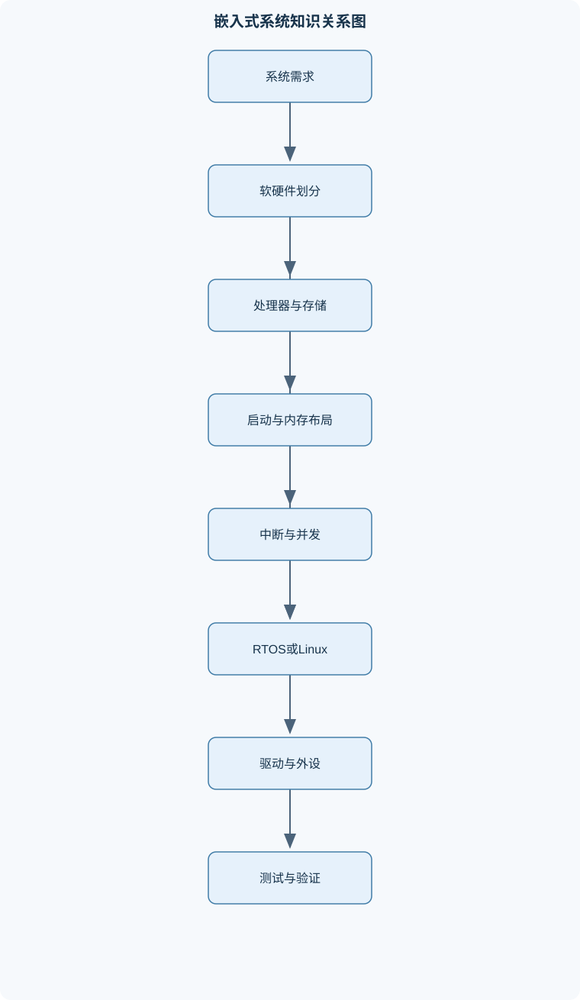
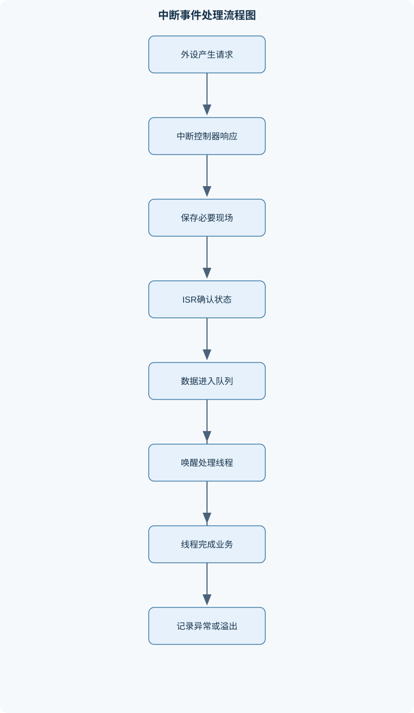

# 嵌入式系统

## 一、课程整体知识框架

### 课程边界与先修知识

嵌入式系统是以处理器执行软件为基本条件，面向特定功能、资源约束、实时性、可靠性、功耗、体积和成本要求进行软硬件协同设计的计算系统。本课程覆盖嵌入式系统组成与开发流程、MCU与MPU架构、ARM处理器基础、启动与链接、异常和中断、裸机并发模型、RTOS任务调度与同步、嵌入式Linux启动与驱动、GPIO与常用串行接口、Flash存储与文件系统、调试验证和系统级设计。课程不以某一具体芯片型号或操作系统版本为前提，但要求能够将抽象原理映射到典型MCU、Cortex-M类实时处理器、带MMU的应用处理器以及常见RTOS或嵌入式Linux环境。先修知识包括C语言、数字电路基础、计算机组成原理、操作系统基本概念、数据结构、二进制与十六进制表示、基本电路测量和编译链接基础。





### 1. 嵌入式系统的定义、边界与核心约束

嵌入式系统是以处理器执行软件为基本条件，面向特定功能和特定运行环境设计的计算系统。它通常将处理器、存储器、输入输出接口、通信控制器、电源管理和应用软件组合为一个完整产品。这里的“嵌入式”不等于“只有单片机”，采用带内存管理单元（MMU）的应用处理器并运行嵌入式 Linux 的设备，同样属于嵌入式系统。

嵌入式系统与通用计算机的主要差别不在于是否能够运行程序，而在于目标、约束和评价标准不同。通用计算机强调通用性、可扩展性和丰富的软件生态；嵌入式系统强调特定功能下的确定性、可靠性、功耗、体积、成本和长期运行能力。嵌入式设备可能没有键盘、显示器或磁盘等传统外设，但必须在规定输入下产生正确输出，并在规定时间内完成关键处理。

系统设计通常同时受到以下约束：

- **功能约束**：必须完成采集、控制、通信、存储、显示或执行器驱动等规定功能。
- **时间约束**：任务可能必须在截止期限 $T_d$ 前完成。实时性不是平均速度快，而是对最坏延迟和最坏执行时间有可验证保证。
- **资源约束**：处理器主频、RAM、Flash、总线带宽、GPIO数量和DMA通道均可能有限。
- **能耗约束**：电池供电设备需要控制运行功耗、待机功耗和唤醒次数。
- **可靠性约束**：系统需要处理复位、通信异常、传感器失效、存储损坏和掉电等情况。
- **成本与体积约束**：芯片、存储器、晶振、电源、连接器和PCB面积都会影响产品成本和尺寸。
- **环境约束**：温度、振动、电磁干扰、湿度和供电波动可能改变系统行为。

硬实时系统要求关键任务在规定截止期限前完成，错过期限可能造成安全事故或功能失效；软实时系统允许偶尔超时，但超时会降低服务质量。因而仅报告平均执行时间是不充分的，至少还需要考虑最坏情况执行时间、最坏中断响应时间、任务阻塞时间、总线等待时间和调度延迟。

### 2. 软硬件协同与系统分层

嵌入式系统不是“先做硬件、再写软件”的简单串行过程，而是软硬件协同设计。设计者需要决定哪些功能由硬件完成，哪些功能由软件完成。例如，定时波形可由硬件定时器和PWM模块自动产生，也可由CPU软件翻转GPIO产生。前者时序稳定且CPU负担低，后者灵活但容易受到中断和任务调度影响。

系统通常可分为以下层次：

1. **硬件层**：处理器、存储器、时钟、电源、总线、GPIO、定时器、ADC、通信控制器和外部器件。
2. **启动与底层初始化层**：复位入口、启动代码、链接布局、时钟初始化、内存控制器初始化和异常向量配置。
3. **驱动与板级支持层**：将寄存器和硬件时序封装为可使用的接口。
4. **操作系统或并发支撑层**：包括裸机前后台模型、RTOS调度器或嵌入式 Linux 内核。
5. **中间件层**：文件系统、网络协议、消息机制、图形库或设备管理框架。
6. **应用层**：实现具体产品功能、状态机、控制算法、用户交互和故障处理。

硬件抽象可以降低应用代码对具体芯片的依赖，但抽象层不能掩盖电气和时序限制。例如，GPIO接口可以提供“输出高电平”的统一函数，但高电平的实际电压仍由器件供电电压、输出驱动能力、负载和输入阈值决定，不能把逻辑值 $1$ 固定理解为某一个电压。

### 3. MCU、MPU、SoC与DSP的区别

$CPU$ 是执行指令的中央处理核心。$MCU$ 通常在一颗芯片中集成CPU、Flash、SRAM、GPIO、定时器、ADC和串行通信接口，适合控制任务、低功耗设备和实时响应场景。$MPU$ 通常强调处理器核心及其基础系统，外部可能需要扩展DDR、Flash、网卡或其他控制器，适合运行复杂操作系统和较大应用软件。

$SoC$ 强调较高程度的系统集成，可能在一颗芯片内集成多个CPU核心、GPU、视频处理器、内存控制器和通信模块。它不等同于MCU，二者都可能是片上系统，但资源规模、应用定位和软件环境不同。DSP针对乘加、滤波、快速傅里叶变换等数字信号处理任务进行结构优化，常具有专用乘法累加单元、并行数据通路或特殊存储访问机制。

处理器选择需要从功能和约束出发：

- 需要极低启动延迟、少量RAM和确定性中断响应时，常选择MCU或实时处理器。
- 需要虚拟内存、图形界面、复杂网络协议和大型文件系统时，常选择带MMU的MPU。
- 需要高速音频、图像或通信信号处理时，可考虑DSP或带DSP扩展的SoC。
- 需要同时满足实时控制和复杂应用时，可能采用异构SoC，分别使用实时核和应用核。

### 4. 处理器、存储器与总线体系

处理器通过地址、数据和控制信息访问存储器及外设。程序存储器保存指令，数据存储器保存变量、栈、堆和运行时缓冲区；在某些架构中，程序和数据使用统一地址空间，在另一些架构中则可能采用不同的访问通路。

常见存储器特点如下：

| 存储器 | 主要特征 | 典型用途 | 主要限制 |
|---|---|---|---|
| ROM | 内容固定或难以改写 | 固化启动代码 | 更新不灵活 |
| Flash | 非易失、可电擦写 | 固件、参数、文件 | 按页写、按块擦，寿命有限 |
| SRAM | 读写快、无需刷新 | 变量、栈、缓冲区 | 掉电丢失、容量成本较高 |
| SDRAM | 容量大、需刷新 | Linux运行内存、帧缓冲 | 初始化复杂、访问有时序延迟 |
| NOR Flash | 可随机读取，部分器件支持就地执行 | 启动代码、少量固件 | 容量和单位成本通常不利于大容量存储 |
| NAND Flash | 密度高、块擦除、需管理坏块 | 大容量镜像和数据 | 不能简单按普通RAM地址访问，需要控制器或转换层 |

Cache、写缓冲和总线等待状态会使实际执行时间与主频计算结果不同。若某段代码执行 $C$ 个时钟周期，时钟频率为 $f_{clk}$，理想时间为：

$$
T=\frac{C}{f_{clk}}
$$

其中 $T$ 的单位为秒，$C$ 为时钟周期数，$f_{clk}$ 的单位为Hz。这个公式只适用于周期数已知且不再引入额外等待的理想情况。若存在Cache未命中、Flash等待、总线竞争、中断插入或SDRAM刷新，实际时间应增加相应延迟。主频更高的处理器不一定完成任务更快，因为其存储器等待、Cache行为和外设带宽可能更差。

片上总线将CPU、DMA、存储器控制器和外设连接起来。AHB等总线的基本思想是通过统一的地址、数据和控制传输规则共享片上资源。多个主设备同时请求总线时需要仲裁；当目标设备速度较慢时，可能插入等待周期。分析系统吞吐量时不能只看CPU主频，还要考虑总线宽度、传输频率、突发长度、协议开销和外设服务时间。

### 5. ARM处理器与指令执行基础

ARM处理器通常采用Load/Store架构，即算术逻辑指令主要操作寄存器，内存数据需要先通过加载指令读入寄存器，再进行运算，结果需要通过存储指令写回内存。处理器具有程序计数器 $PC$、栈指针 $SP$、链接寄存器 $LR$ 和通用寄存器。$PC$ 保存下一条待执行指令地址，$SP$ 指向当前栈，$LR$ 通常保存函数调用后的返回地址。

ARM指令集、Thumb编码和Cortex产品系列属于不同层次：

- ARM或Thumb表示指令体系及编码形式。
- Thumb通常使用更紧凑的编码，提高代码密度；具体指令宽度和可用指令集合取决于处理器架构版本。
- Cortex-M、Cortex-R和Cortex-A表示不同定位的处理器系列。Cortex-M面向微控制器和实时控制，Cortex-R强调实时性和可靠性，Cortex-A面向复杂操作系统和应用处理。

处理器状态寄存器保存条件码和控制状态。$N$、$Z$、$C$、$V$ 分别表示负、零、进位和溢出标志。需要区分无符号溢出与有符号溢出：加法产生最高位进位不一定表示有符号溢出；有符号溢出取决于两个同号操作数相加后结果符号是否异常。

函数调用通常需要保存返回位置和被调用者必须保持的寄存器。栈帧用于保存局部变量、临时寄存器、返回地址以及必要的参数。具体寄存器保存范围由处理器调用约定和编译器规则决定，不能仅根据C语言变量数量推断。

### 6. 启动、链接与固件更新

复位后，处理器不会直接从应用程序的 `main` 函数开始执行。典型启动流程是：

1. 处理器根据复位规则读取初始栈指针和复位入口地址。
2. 启动代码建立基本执行环境。
3. 初始化时钟、必要的内存控制器和异常向量。
4. 将已初始化数据从加载地址复制到运行地址。
5. 将BSS段清零。
6. 初始化运行库、堆和栈相关环境。
7. 最终调用应用入口。

常见链接段包括：

- `.text`：程序指令和只读代码。
- `.rodata`：只读常量。
- `.data`：具有初始值的可写全局变量。
- `.bss`：未显式初始化或初始化为零的全局变量。
- 栈和堆：运行时使用的动态区域。

链接脚本决定各段的加载地址、运行地址、对齐方式和边界。代码能够通过编译并不表示能够在目标板启动；如果向量表地址、Flash边界、RAM边界或栈顶配置错误，系统可能在复位后立即异常。

Bootloader负责完成最小硬件初始化、选择镜像、校验镜像、搬运代码或建立执行映射，并跳转到合法入口。一级启动通常由芯片内部固化逻辑或固定启动介质完成，二级Bootloader再完成更复杂的存储器、通信和镜像管理。若代码可以从Flash直接执行，则不必搬运到SDRAM；若代码运行在SDRAM，则必须先初始化SDRAM并完成代码复制。

ISP、ICP和IAP分别代表不同更新路径。ISP通常通过外部编程接口或系统启动模式更新，ICP强调使用专用编程器，IAP则由运行中的应用或Bootloader接收新镜像并写入存储器。可靠升级需要镜像长度、版本、目标地址、校验值和状态标记。双分区升级时，新镜像先写入备用分区并校验，只有完整验证后才切换启动标志，从而在升级失败或掉电时保留旧版本。

### 7. 异常、中断与裸机并发

异常是处理器执行过程中因系统事件而转移控制流的机制，外部中断是异常的一类来源。IRQ通常表示可屏蔽中断请求。异常向量表保存不同异常入口，处理器根据异常类型定位对应处理程序。

中断响应时间 $T_r$ 是从中断请求产生到ISR开始执行的时间。它受到当前指令完成时间、关中断区间、异常优先级、向量查找、现场保护和总线等待影响。ISR应完成硬件状态确认、状态清除、必要数据读取和事件投递，不应执行长时间计算、阻塞等待、复杂打印或动态内存分配。

若ISR执行时间为 $T_{ISR}$，中断到达间隔为 $T_{int}$，在不考虑嵌套和其他任务时，ISR占用率近似为：

$$
U=\frac{T_{ISR}}{T_{int}}
$$

其中 $U$ 为无量纲占用率。若 $U$ 接近或超过 $1$，系统无法持续处理所有中断。应降低中断频率、缩短ISR、采用DMA或批量处理。这个估算只适用于中断服务时间和到达间隔较稳定、没有嵌套和其他竞争的近似场景。

裸机系统常见三种模型：

- **轮询模型**：主循环依次检查状态。结构简单，适合事件少、响应时间要求不高的设备。
- **前后台系统**：中断完成快速采样和置位，主循环处理事件。它兼顾实时响应和实现简单性。
- **事件队列模型**：ISR将事件写入队列，主循环按顺序读取并处理，适合事件来源多、数据需要排队的系统。

中断与主循环共享变量时存在竞态。共享变量应根据访问宽度、处理器原子性、编译器优化和内存可见性选择原子访问、临界区、锁或消息传递。`volatile` 只能抑制部分编译器优化，不能自动保证复合操作的原子性，也不能替代互斥锁。

### 8. RTOS任务调度与同步

RTOS将应用拆分为多个任务或线程。每个任务具有独立栈空间、优先级、状态和调度信息，这些信息通常保存在任务控制块 $TCB$ 中。任务至少可能处于：

- **运行态**：当前占用CPU。
- **就绪态**：具备运行条件，等待调度。
- **阻塞态**：等待事件、信号量、消息或延时结束。
- **挂起态**：被显式停止，不参与调度。

抢占式优先级调度中，如果存在优先级高于当前运行任务的就绪任务，并且当前不处于禁止调度或不可抢占区域，系统保存当前任务上下文，恢复目标任务上下文，然后切换执行。上下文通常包括栈指针、返回位置以及由异常入口和调用约定规定的寄存器。

时间片轮转适合同一优先级的多个任务；协作式调度依赖任务主动让出CPU，若任务不主动让出，其他任务可能长期得不到运行。实时系统中，任务是否能按时完成还取决于高优先级任务干扰、锁等待、中断延迟和最坏执行时间。

同步和通信机制有不同语义：

- **信号量**：适合表示资源数量或事件到达。
- **互斥锁**：用于保护共享资源，通常支持所有权和优先级继承。
- **事件标志**：表示一个或多个条件是否发生。
- **消息队列**：传递具有明确边界的数据，适合任务之间解耦。
- **环形缓冲区**：适合连续字节流，常用于串口接收。

优先级反转是指高优先级任务等待被低优先级任务持有的锁，而中优先级任务持续运行，使低优先级任务无法释放锁。优先级继承可临时提高锁持有者优先级，减少反转持续时间，但不能消除所有阻塞。

### 9. 嵌入式Linux启动与驱动模型

带MMU的处理器可以通过页表将虚拟地址映射到物理地址，使进程拥有相对独立的地址空间，并提供访问权限隔离。嵌入式Linux启动通常包括BootROM或固化启动、Bootloader、内核启动、设备描述和根文件系统挂载等阶段。

内核镜像负责提供内核代码和必要数据；根文件系统包含初始化程序、动态库、配置文件、设备节点和应用程序。内核启动后建立内存管理、进程调度、中断、驱动框架和文件系统，随后启动用户空间的第一个进程。

系统调用路径通常是用户程序调用库函数或系统调用封装，经过处理器特权级切换进入内核，再由内核完成参数检查、权限验证和设备操作，最后将结果返回用户空间。用户程序不能直接任意访问内核地址和硬件寄存器。

字符设备适合串口、GPIO、传感器等按字节或操作请求访问的设备；块设备适合磁盘、NAND存储等按块随机访问的设备。主设备号用于标识设备驱动类别，次设备号用于区分同一驱动管理的不同设备实例。驱动通过 `file_operations` 提供打开、读取、写入、控制和关闭等接口，用户空间则通过设备文件访问驱动。

内核模块的初始化过程应依次完成设备号申请、设备对象创建、硬件资源申请、寄存器初始化和接口注册。卸载时应先阻止新访问，再注销用户可见接口，停止中断和工作线程，释放DMA、时钟、GPIO及内存资源。资源释放顺序错误可能导致卸载后仍有中断访问已释放内存。

### 10. GPIO、UART、SPI、I2C及模拟外设

GPIO引脚通常支持输入、推挽输出、开漏输出和多种复用功能。配置GPIO时至少需要确认引脚复用、输入输出方向、有效电平、上拉下拉、输出驱动能力和中断触发方式。输入引脚悬空时，受噪声影响可能随机变化；上拉或下拉可提供默认状态，但具体配置必须符合外部电路。

UART是异步串行传输机制，常见帧由起始位、数据位、可选校验位和停止位组成。若一帧包含 $L$ 个比特，波特率为 $B$ bit/s，则：

$$
T_{frame}=\frac{L}{B}
$$

例如8N1格式包含1个起始位、8个数据位和1个停止位，因此 $L=10$。在 $B=9600$ bit/s 时：

$$
T_{frame}=\frac{10}{9600}\approx1.0417\text{ ms}
$$

若每帧传输一个字节，理论字节吞吐量约为 $960$ 字节/s，尚未扣除软件处理和缓冲开销。UART机制不能与RS-232电气标准混为一谈。单片机UART引脚通常是TTL或CMOS逻辑电平，RS-232使用不同的电压范围和极性，二者通常需要电平转换器。

SPI通常使用时钟线、主出从入、主入从出和片选线，支持全双工传输。多个从设备通常需要独立片选或外部译码器。SPI没有统一的设备寻址和应答机制，时钟极性、相位、最高频率和片选时序必须根据具体从设备确定。

I2C使用两根信号线，并采用开漏结构和外部上拉。设备只能主动拉低总线，释放后由上拉电阻恢复高电平。地址、起始、停止、应答和数据方向共同构成事务。总线电容越大、上拉电阻越大，上升时间越长；上拉过小则低电平驱动电流增大。I2C适合设备较多、引脚较少的场景，但通常不如短距离高速SPI。

ADC将模拟电压转换为数字量，分辨率为 $n$ 位时理想量化级数为 $2^n$，但实际精度还受到参考电压、噪声、采样保持、输入阻抗和线性误差影响。DAC完成相反方向转换。PWM通过调整周期内高电平持续时间改变平均输出，适合电机、LED和功率控制，但负载是否能够直接接受PWM取决于其电气特性。

### 11. Flash存储、文件系统与掉电一致性

Flash不能像SRAM一样任意覆盖写。写入通常只能在页范围内进行，擦除则以块为单位。由于某些位状态不能直接从一种状态变为另一种状态，目标数据所在块可能必须先擦除再写入。擦除时间通常明显长于普通读取，设备忙期间还可能不能接受新的访问。

Flash存储系统需要考虑：

- 页大小和页边界；
- 块擦除时间；
- 写入寿命；
- 坏块管理；
- 写入对齐；
- 掉电时记录是否完整；
- 垃圾回收和擦写均衡。

如果生产者速率为 $r_p$、消费者速率为 $r_c$，观察时间为 $T$，环形缓冲区占用变化近似为：

$$
\Delta n=(r_p-r_c)T
$$

若长期满足 $r_p>r_c$，缓冲区必然溢出。扩大缓冲区只能延迟溢出，不能解决长期平均速率不匹配。

日志型Flash文件系统通常采用追加写入，为记录附加序号、长度、状态和校验值；当空间不足时，选择失效记录较多的块，搬移仍有效的记录，再擦除旧块。记录提交可以采用“先写数据、后写有效标志”或双副本策略，使掉电后能够识别完整记录。

FAT类文件系统适合需要与通用计算机交换文件、文件目录结构较复杂的场景，但其元数据更新和小文件频繁写入可能放大Flash擦写。Flash转换层可将块设备语义转换为Flash物理操作，负责逻辑到物理映射、垃圾回收和磨损均衡。

固件、参数和日志通常应分区管理。固件区需要校验和回滚保护，参数区需要版本和默认值恢复机制，日志区需要控制增长速度并处理空间耗尽。NAND启动时还需考虑坏块表、ECC和启动介质的可访问性。

### 12. 调试、验证与系统级设计

交叉编译工具链通常包括编译器、汇编器、链接器、调试器、二进制转换工具和构建工具。构建系统通过目标、依赖和命令描述源文件到镜像的生成关系。链接地图文件可用于检查代码段、数据段、栈和堆的占用。

调试应结合多种手段：

- 串口日志：适合记录状态机、错误码和启动阶段。
- 调试器：可查看寄存器、栈、变量、断点和异常现场。
- 逻辑分析仪：适合观察数字信号时序、UART帧、SPI事务和GPIO脉冲。
- 示波器：适合观察模拟电压、边沿、噪声、过冲和电源波动。
- 性能计数器：可测量中断延迟、任务执行时间和CPU利用率。
- 内存检测：可检查栈溢出、越界访问、堆碎片和未初始化数据。

系统级验证不能只测试“功能是否成功”，还要测试异常路径。应验证启动失败、镜像校验失败、串口溢出、队列满、传感器断线、Flash掉电、任务超时、栈不足和高负载下的中断延迟。理想模型中的时间计算、无竞争访问和无限可靠存储，必须通过真实硬件测量和故障注入进行修正。

## 二、章节和模块划分

### 核心知识覆盖清单

本清单用于检查正文是否覆盖本课程的主要知识模块：

- **嵌入式系统概念与系统设计**：嵌入式系统定义与边界、嵌入式系统与通用计算机区别、功能安全与可靠性目标、实时性、功耗、成本和体积约束、硬件软件协同划分、MCU、MPU、SoC与DSP区别、片上资源与外扩资源权衡、通用器件与专用器件选择、需求到原型的开发流程、仿真、仿真器与真实硬件差异。
- **处理器、存储器与总线体系**：CPU、内存和外设的组织方式、程序存储器与数据存储器、SRAM、SDRAM、ROM和Flash、Cache、写缓冲和存储访问延迟、地址空间与内存映射I/O、AHB等片上总线基本思想、NOR与NAND Flash差异、页、块、擦除和写入粒度、存储容量与带宽估算、资源不足时的扩展方案。
- **ARM架构与指令执行基础**：Load/Store架构、ARM与Thumb指令编码、Cortex-M、Cortex-R和Cortex-A定位、寄存器组与程序状态寄存器、条件执行与条件码、加减法和移位操作数、单寄存器加载与存储、多寄存器加载与存储、分支、函数调用与返回、调用约定和栈帧组织。
- **启动流程、链接与固件更新**：复位入口与向量表、初始栈指针设置、startup代码的复制与清零、代码段、数据段和BSS段、链接脚本与地址布局、Bootloader职责、一级和二级启动流程、Flash到SDRAM的代码搬移、ISP、ICP和IAP更新方式、启动失败与回滚设计。
- **异常、中断与裸机并发**：异常与外部中断的关系、IRQ、异常优先级和向量表、中断服务程序结构、中断嵌套与响应延迟、中断现场保护与恢复、轮询模型的适用条件、前后台系统与事件标志、共享数据与临界区、中断到队列的工作转移、ISR中禁止阻塞和长时间计算。
- **实时操作系统原理与应用**：实时性与截止期限、硬实时和软实时、任务、线程与线程控制块、就绪态、运行态和阻塞态、优先级抢占式调度、时间片轮转与协作式调度、上下文切换与任务栈、信号量、互斥锁和事件标志、消息队列与任务间通信、优先级反转与栈空间监测。
- **嵌入式Linux启动与驱动模型**：带MMU处理器与虚拟内存、Linux启动阶段划分、内核镜像和根文件系统、系统调用路径、内核模块加载与卸载、字符设备和块设备、主设备号与次设备号、file_operations接口、设备文件与用户空间访问、驱动初始化和资源释放。
- **片上外设与低速通信接口**：GPIO输入输出与复用、GPIO方向和电平控制、上拉下拉与输入悬空、UART异步帧格式、波特率和采样误差、奇偶校验与帧错误、RS-232电平与逻辑电平区别、SPI四线全双工通信、I2C地址、应答与开漏结构、ADC、DAC、PWM和定时器应用。
- **非易失存储与文件系统**：Flash读写限制、擦除先于写入的原因、页写入和块擦除、写入寿命与擦写均衡、坏块和掉电一致性、日志型Flash文件系统、Flash转换层、FAT类文件系统的适用场景、NAND启动与运行时存储布局、参数、日志和固件分区设计。
- **嵌入式系统调试与综合设计**：交叉编译工具链、Makefile目标依赖、下载与调试接口、串口日志和故障定位、寄存器级调试、逻辑分析仪与示波器使用、栈溢出和内存越界检测、中断延迟和CPU利用率测量、软硬件联合测试、从需求到可验证原型的综合项目。


### 1. 嵌入式系统概念与系统设计

本章从系统边界开始，说明嵌入式系统为何需要软硬件协同。课程分析需求、约束、器件选择、资源预算、原型验证和量产维护之间的关系。设计流程通常为需求定义、架构划分、器件选型、最小原型、驱动开发、应用集成、系统测试和升级维护。

仿真工具可快速验证指令执行、寄存器行为或任务逻辑，但不能完全替代真实硬件。纯软件仿真通常不能准确还原引脚电气特性、供电噪声、总线波形、外设时序和电磁干扰；真实硬件测试也不能完全替代仿真，因为仿真便于构造边界状态和重复故障。

### 2. 处理器、存储器与总线体系

本章建立CPU、内存和外设的地址访问模型，解释内存映射I/O，即将外设寄存器映射到处理器地址空间，使CPU能够通过读写地址访问外设。寄存器读写必须遵守访问宽度、只读位、写一清零位和时序要求。

资源不足时可以采用外扩SRAM或SDRAM、增加Flash、使用DMA、压缩数据、降低缓存峰值或重新划分功能。但扩展资源会增加PCB布线、功耗、初始化复杂度和成本，不能只按容量选择。

### 3. ARM架构与指令执行基础

本章通过加载、存储、加减、移位、分支和多寄存器传送说明指令执行过程。多寄存器加载和存储可用于函数现场保存和恢复，但寄存器顺序、地址递增方向和栈类型必须依据具体架构规则。函数调用需要分析参数传递、返回值、栈帧和调用者或被调用者保存寄存器。

### 4. 启动流程、链接与固件更新

启动模块重点分析复位入口、向量表、初始栈指针、`.text`、`.data`、`.bss`以及Bootloader之间的关系。启动镜像必须同时满足存储地址、运行地址、入口地址和内存边界约束。

#### 启动镜像加载流程

**输入**：Flash中的镜像、内存布局、镜像长度、校验信息和硬件状态。  
**输出**：已初始化并跳转到合法入口的系统，或进入恢复/安全停机路径。

**过程**：

1. 读取复位向量并设置初始栈指针。
2. 初始化必要时钟和存储器控制器。
3. 检查镜像起始地址、长度和结束地址是否落在合法区域。
4. 计算镜像校验值并与元数据比较。
5. 将需要运行在RAM中的代码或数据复制到目标地址。
6. 清零BSS段，设置异常向量位置和启动参数。
7. 检查入口地址对齐和可执行区域属性。
8. 跳转到内核或应用入口。

**不变量**：跳转前，栈地址、入口地址、镜像边界和异常向量均合法。  
**终止条件**：完成合法跳转，或校验失败后进入恢复路径。  
**适用条件**：裸机、RTOS和嵌入式Linux启动。镜像复制复杂度与镜像大小 $S$ 成正比，通常为 $O(S)$。

### 5. 异常、中断与裸机并发

本章将硬件中断与应用事件联系起来。ISR只负责快速确认和转移事件，主循环或线程负责解析、计算和存储。事件转移可以使用标志、计数器、环形队列或消息队列。

#### 中断到线程的事件转移

**输入**：硬件中断、状态寄存器、数据缓冲区和处理线程。  
**输出**：已入队事件、唤醒请求或溢出记录。

**过程**：

1. ISR读取并清除硬件状态。
2. 提取最小必要数据，例如接收字节、时间戳或状态码。
3. 以无阻塞方式写入队列。
4. 若队列由线程等待，则触发线程唤醒或设置事件。
5. 线程读取队列并完成协议解析、日志记录或复杂计算。
6. 队列满时按设计丢弃旧数据、丢弃新数据、覆盖或记录错误。

单个事件入队通常为 $O(1)$。不变量是ISR不阻塞，队列索引始终处于合法范围。该流程适用于耗时处理可以延后的系统，但不能用于必须在ISR内立即完成的紧急保护动作。

#### 环形缓冲区读写伪代码

```c
// C语言风格伪代码：单生产者、单消费者
typedef struct {
    uint8_t data[N];
    volatile size_t head;
    volatile size_t tail;
    volatile uint32_t overflow_count;
} RingBuffer;

bool ring_push(RingBuffer *q, uint8_t value)
{
    size_t next = (q->head + 1U) % N;

    if (next == q->tail) {
        q->overflow_count++;
        return false;                 // 队列已满
    }

    q->data[q->head] = value;
    q->head = next;
    return true;
}

bool ring_pop(RingBuffer *q, uint8_t *value)
{
    if (q->head == q->tail) {
        return false;                 // 队列为空
    }

    *value = q->data[q->tail];
    q->tail = (q->tail + 1U) % N;
    return true;
}
```

该伪代码假设只有一个生产者修改 `head`、一个消费者修改 `tail`，并且单次索引读写具有原子性。多生产者或多消费者场景不能直接套用，需要锁、禁中断或原子读改写操作。若使用“空出一个位置”区分空和满，实际可存储元素数为 $N-1$，而不是 $N$。

### 6. 实时操作系统原理与应用

本章从任务状态、优先级、调度点、上下文切换和同步机制展开。调度分析的输入包括任务集合、优先级、执行时间、周期、阻塞事件和时间片配置；输出是每个时刻运行的任务及其状态变化。

#### 抢占式任务调度分析

1. 更新延时结束、消息到达、信号量释放等事件。
2. 将满足运行条件的任务加入就绪集合。
3. 从就绪集合中选择最高优先级任务。
4. 若目标任务优先级高于当前任务且当前允许抢占，则保存当前上下文。
5. 恢复目标任务栈指针和寄存器。
6. 运行目标任务，直到阻塞、主动让出、时间片耗尽或更高优先级任务就绪。

不变量是阻塞任务不进入运行态，单核系统同一时刻最多有一个任务运行。直接扫描 $n$ 个任务的就绪表复杂度为 $O(n)$；使用优先级位图时，选择最高优先级任务通常可降为与优先级层数相关的近似常数时间。

### 7. 嵌入式Linux启动与驱动模型

本章说明Bootloader、内核、根文件系统和驱动之间的边界。字符设备驱动重点包括设备号申请、设备节点、`file_operations`、用户空间访问、并发保护和资源释放。驱动初始化失败时必须按已完成资源申请的逆序释放，避免泄漏或悬挂中断。

驱动接口的验证不能只看用户程序是否读到一个数，还要检查并发打开、非法参数、阻塞与非阻塞模式、中断竞争、设备断开和模块卸载。用户空间和内核空间之间的数据复制必须进行边界检查，不能直接相信用户传入的指针和长度。

### 8. 片上外设与低速通信接口

#### 例题一：UART帧时间与接收能力

**题干**：UART采用8N1格式，波特率为9600 bit/s。求单字节帧时间和理论接收速率；若接收线程最长每隔20 ms运行一次，接收缓冲区应如何设计？

**分析**：8N1包含1个起始位、8个数据位和1个停止位，因此每字节占10 bit。

**解答**：

$$
T_{frame}=\frac{10}{9600}\approx1.0417\text{ ms}
$$

理论接收速率为：

$$
R=\frac{9600}{10}=960\text{ byte/s}
$$

20 ms内接收字节数约为：

$$
n=960\times0.020=19.2
$$

因此缓冲区至少需要容纳20字节，并应额外留出中断抖动、线程延迟和突发输入余量。若缓冲区只容纳20字节，边界时刻仍可能因调度延迟而溢出，工程上应选择更大容量并设置溢出计数器。

**结果验证**：实际还需扣除协议间隔和软件开销；若波特率误差过大，可能出现帧错误，即使缓冲区容量足够也无法正确接收。

**变式**：若协议增加1个校验位和2个停止位，$L=12$，理论吞吐量变为 $9600/12=800$ byte/s。

#### 例题二：中断占用率

**题干**：定时器每1 ms产生一次中断，ISR平均执行20 μs。估算ISR占用率，并判断若最坏执行时间为1.2 ms是否可持续。

**解答**：

平均占用率：

$$
U=\frac{20\ \mu s}{1000\ \mu s}=0.02=2\%
$$

若最坏执行时间为1.2 ms，而中断间隔仅1 ms，则：

$$
U_{worst}=\frac{1.2\text{ ms}}{1\text{ ms}}=1.2
$$

这表示每次中断尚未处理完，下一次中断已经到达，系统无法长期维持处理能力。应缩短ISR、降低中断频率、使用DMA或将工作转移到线程。

**结果验证**：平均占用率不能替代最坏情况分析；偶发的长ISR可能导致任务截止期限失败。

**变式**：若改为每2 ms中断一次，最坏占用率为 $1.2/2=60\%$，但仍需考虑其他中断和任务竞争。

#### 例题三：环形队列溢出

**题干**：串口平均生产速率为960 byte/s，处理线程平均消费速率为800 byte/s，缓冲区可用容量为128 byte。估算理论溢出时间。

**解答**：

净增长速率为：

$$
r_p-r_c=960-800=160\text{ byte/s}
$$

理想情况下：

$$
T=\frac{128}{160}=0.8\text{ s}
$$

因此约0.8 s后溢出。若采用空出一个位置的环形队列，有效容量为127 byte，时间约为：

$$
T=\frac{127}{160}\approx0.794\text{ s}
$$

**结果验证**：该计算未考虑突发输入、线程调度抖动、协议解析时间和中断丢失，实际溢出可能更早。

**变式**：扩大缓冲区只能将0.8 s延长，不能解决长期生产速率大于消费速率的问题；必须提升消费能力、降低波特率或允许丢弃策略。

#### 例题四：Flash日志写入

**题干**：一页Flash容量256 byte，每页写入耗时1 ms。若每条记录40 byte，逐条写入和累计5条后批量写入有何差异？

**分析与解答**：逐条写入不能简单认为每条都占用40 byte并只耗时一次，因为页写入通常受页边界和控制器限制。若记录按40 byte追加，前6条可放在一页内，但跨页时需要额外处理。批量5条共200 byte，可在同一页内完成一次页编程，理想写入时间约1 ms；逐条写入至少需要5次编程，理想时间约5 ms。

**结果验证**：批量写入降低协议和忙等待开销，但掉电时可能丢失尚未提交的多条记录；应为批次增加长度、序号和校验，并在重启时丢弃不完整批次。

**变式**：若单条记录大于页剩余空间，必须分割或提前换页，不能让一次写入跨越不允许的页边界。

#### 例题五：RTOS优先级反转

**题干**：高优先级任务H等待锁，中优先级任务M持续运行，低优先级任务L持有锁。说明系统现象和解决方法。

**解答**：

1. L获得互斥锁后运行。
2. H请求同一把锁并阻塞。
3. M变为就绪并抢占L。
4. L无法运行，也就无法释放锁。
5. H长期等待，表现为高优先级任务被中优先级任务间接阻塞。

解决方法包括使用支持优先级继承的互斥锁、缩短锁保护区、避免在锁内阻塞或执行长计算、拆分共享资源以及使用消息传递替代共享内存。

**结果验证**：优先级继承只能降低优先级反转，不会消除高优先级任务等待资源的基本阻塞时间。

**变式**：若共享资源只需传递少量数据，可让低优先级任务写入消息队列，由高优先级任务异步读取，减少锁竞争。

### 9. 非易失存储与文件系统

#### Flash日志回收流程

**输入**：块集合、有效记录标记、序号、校验值和擦写次数。  
**输出**：拥有足够可写空间且仍可恢复最新记录的块集合。

**步骤**：

1. 新记录以追加方式写入空闲页。
2. 写入记录头、数据和校验值。
3. 最后写入提交标志，避免掉电时误认半条记录。
4. 扫描块并识别失效记录。
5. 选择有效记录少、擦写次数合适的块。
6. 搬移仍有效的记录。
7. 擦除旧块并更新逻辑到物理映射。
8. 记录新的擦写次数和块状态。

不变量是掉电后至少保留一个校验正确的最新记录副本。终止条件是可用空间恢复到设定阈值以上。该流程适合参数和日志，但掉电保护需要额外元数据，不能仅依靠文件名或RAM中的索引。

### 10. 调试与综合设计实验

#### 实验一：UART与GPIO故障定位

**输入数据**：一块具有UART和LED引脚的目标板、一条串口线、逻辑分析仪或示波器、原理图和编译后的固件。  
**步骤**：

1. 核对供电电压、公共地和串口交叉连接关系。
2. 检查GPIO与UART复用寄存器。
3. 检查GPIO方向、输出寄存器和输入状态寄存器。
4. 用示波器观察LED引脚实际电平。
5. 用逻辑分析仪测量UART起始位、数据位和停止位。
6. 根据时间间隔计算实际波特率。
7. 构造只发送固定字节的最小程序。
8. 恢复中断、缓冲区和应用协议，观察故障在哪一层重新出现。

**评价标准**：能够区分供电故障、引脚复用错误、波特率错误、逻辑电平不兼容、ISR未触发和缓冲区溢出；测试记录应包含寄存器配置、波形结论和复现步骤。

**排错方法**：若没有波形，先检查复用和时钟；若波形存在但乱码，检查波特率、数据位、校验和停止位；若偶发丢字节，检查中断延迟、队列容量和线程消费速率；不能只依据串口日志判断电气问题。

#### 实验二：启动与固件升级验证

**输入数据**：Bootloader镜像、应用镜像、Flash分区、镜像长度、校验值和升级通信接口。  
**步骤**：

1. 规划Bootloader区、应用主区、备用区、参数区和日志区。
2. 编译并生成带长度、版本和校验字段的应用镜像。
3. 验证合法镜像能够启动。
4. 修改镜像内容，验证校验失败时不会跳转。
5. 在写入过程中断电，重新上电观察是否回滚。
6. 验证备用镜像完整后才切换启动标志。
7. 检查旧版本仍能启动的条件。
8. 统计升级时间、擦除次数和恢复时间。

**评价标准**：合法镜像可启动，损坏镜像不执行，升级中断不会导致设备永久失效，启动日志能够区分校验失败、版本不兼容和硬件初始化失败。

**排错方法**：若复位后无输出，先检查向量表和初始栈指针；若Bootloader能运行但应用失败，检查入口地址、链接地址和RAM初始化；若掉电后无法恢复，检查提交标志是否最后写入以及旧镜像是否被提前擦除。

### 11. 具体易错点

1. 把嵌入式系统等同于单片机，忽略带MMU处理器和嵌入式Linux。
2. 把CPU、MCU、MPU和SoC当作同义词。
3. 认为复位后第一段代码就是 `main`，忽略向量表和启动代码。
4. 混淆ARM指令集、Thumb编码和Cortex处理器系列。
5. 只按主频比较性能，忽略Cache、等待状态和总线竞争。
6. 把实时性理解为运行速度快，而不是截止期限内完成。
7. 在ISR中执行阻塞操作、长时间计算或复杂打印。
8. 认为 `volatile` 可以解决所有共享变量竞态。
9. 将逻辑高电平固定等同于某个电压。
10. 混淆UART通信机制与RS-232电气标准。
11. 认为SPI天然提供设备寻址且不需要片选。
12. 忽略I2C上拉电阻、总线电容和上升时间。
13. 认为Flash可以任意覆盖写，不考虑页写和块擦。
14. 忽略Flash坏块、擦写寿命和掉电一致性。
15. 认为代码编译通过就能启动，不检查链接脚本和内存布局。
16. 只看平均CPU利用率，不分析最坏中断延迟、栈余量和队列峰值。
17. 卸载驱动时先释放内存，却没有先停止中断和注销接口。
18. 把虚拟机、仿真器和真实硬件测试视为同一种验证手段。

### 12. 典型笔试问题与解答思路

#### 问题一：为什么不能只用主频比较两个嵌入式处理器？

应从每条指令所需周期、Cache命中率、Flash等待、总线带宽、流水线停顿、中断和外设访问等方面分析。主频只给出时钟周期 $T_{clk}=1/f_{clk}$，不能直接推出程序总执行时间。

#### 问题二：为什么`.bss`段需要清零？

`.bss`保存未显式初始化或初始化为零的全局及静态变量。镜像中通常只保存其大小而不保存一大片零数据，因此启动代码必须按边界清零，否则程序可能读到复位后不确定的RAM内容。

#### 问题三：UART 8N1为什么每个字节不是8 bit？

8N1包含1个起始位、8个数据位和1个停止位，总计10 bit。若无校验位，仍然有起始和停止开销，因此吞吐量为波特率除以10，而不是除以8。

#### 问题四：中断为什么要尽量短？

长ISR会增加其他中断和任务的响应延迟，可能造成嵌套、丢数据和截止期限失败。应在ISR中完成确认、清状态和最小数据搬运，把解析、存储和复杂计算转移到线程或队列。

#### 问题五：为什么Flash写入前经常需要擦除？

Flash位状态转换受物理结构限制，写入不能像RAM一样任意改变全部位。擦除以块为单位恢复可写状态，因此文件系统必须管理有效记录、失效记录和垃圾回收。

#### 问题六：优先级继承解决什么问题？

它主要缓解优先级反转：低优先级锁持有者在高优先级任务等待时临时提升优先级，使其尽快运行并释放锁。但它不消除锁本身的阻塞时间，也不能解决死锁或锁顺序错误。

#### 问题七：为什么I2C需要上拉电阻？

I2C采用开漏输出，设备只能主动拉低总线，释放后必须依靠上拉恢复高电平。上拉值与总线电容共同决定上升时间，过大可能导致上升过慢，过小则增加低电平驱动电流。

#### 问题八：Bootloader为什么需要校验和回滚？

下载过程中可能出现通信错误、掉电或Flash写入失败。校验可阻止损坏镜像执行，回滚可保证新镜像不可用时仍能启动旧镜像，从而避免设备进入不可恢复状态。

### 13. 典型面试问题、参考答案与追问要点

#### 问题一：如何设计一个按键中断控制LED的系统？

参考答案：按键GPIO配置为输入并设置合适的上拉或下拉，边沿中断只记录事件或时间戳，不在ISR中延时消抖；任务或主循环读取事件，经过稳定时间判断后改变LED输出。共享事件变量需要原子访问或临界区。

深入追问要点：如何处理机械抖动、按键长按、重复触发和低功耗唤醒；有效电平是否与硬件连接一致。

#### 问题二：如何定位串口乱码？

参考答案：依次检查公共地、电平标准、引脚复用、时钟、波特率、数据位、校验位和停止位，再使用逻辑分析仪确认实际帧时序。若波形正确但软件仍乱码，应检查采集寄存器、FIFO、ISR和缓冲区。

深入追问要点：波特率误差来源、采样点、帧错误状态位和高负载下的丢字节。

#### 问题三：如何避免Flash参数掉电损坏？

参考答案：采用带序号和校验的双副本或日志追加策略，先写完整数据，再写提交标志；启动时选择校验正确且序号最新的副本。更新时不直接覆盖唯一有效副本。

深入追问要点：块擦除失败、空间回收、擦写均衡和版本迁移。

#### 问题四：RTOS中任务栈如何确定？

参考答案：根据调用深度、局部变量、ISR嵌套、库函数和最大路径估算，并通过栈填充、栈边界检测和运行时高水位监测验证。不能只按任务代码行数估计。

深入追问要点：浮点上下文、递归、printf造成的大栈消耗以及栈溢出后的故障处理。

#### 问题五：如何设计ISR与线程分工？

参考答案：ISR只读取必要硬件状态、清除中断、保存少量数据并投递事件；线程完成协议解析、数据转换、日志和文件写入。队列满时必须有明确策略并统计溢出。

深入追问要点：队列是否多生产者、多消费者，是否需要DMA，事件丢失是否允许。

#### 问题六：Linux字符设备驱动卸载时应注意什么？

参考答案：先阻止新用户访问，再注销设备节点和接口，停止硬件中断和工作线程，等待正在执行的操作退出，最后释放DMA、GPIO、时钟和内存资源。

深入追问要点：并发打开文件、引用计数、阻塞读唤醒以及卸载期间的中断竞态。

#### 问题七：SPI和I2C如何选择？

参考答案：若需要较高吞吐、全双工和确定时序，通常选择SPI；若设备较多、引脚有限、数据量较小且适合地址寻址，可选择I2C。还要考虑线长、上拉、片选数量、设备兼容性和功耗。

深入追问要点：SPI片选管理、I2C仲裁、总线恢复和时钟拉伸。

#### 问题八：如何验证系统是否满足实时性？

参考答案：定义任务截止期限和中断响应指标，测量最坏执行时间、最坏中断延迟、锁等待、队列峰值和CPU利用率，使用高负载、突发中断和异常输入进行压力测试，不能只看平均值。

深入追问要点：测量工具是否侵入系统、时间戳精度、Cache和调试状态对结果的影响。

### 14. 岗位关联与课程产出

#### MCU固件工程师

实际任务包括启动代码、GPIO、定时器、ADC、UART、SPI、I2C、低功耗和Bootloader开发。使用的知识包括寄存器访问、中断、裸机并发、Flash管理和调试测量。主要产出是可编译固件、驱动接口、内存布局、测试记录和故障修复报告。验收标准包括功能正确、启动稳定、中断延迟满足指标、无明显越界和升级失败可恢复。

#### RTOS应用工程师

实际任务包括任务划分、优先级设计、消息队列、互斥锁、事件处理和性能监控。使用的知识包括任务状态、抢占调度、上下文切换、优先级反转和栈监测。产出包括任务时序说明、接口定义、资源配置和压力测试结果。验收标准包括关键任务按截止期限完成、无死锁、队列不出现未处理的长期溢出、栈余量满足安全边界。

#### 嵌入式Linux驱动工程师

实际任务包括字符设备、块设备、设备树或硬件描述、内核模块、DMA和用户空间接口。使用的知识包括MMU、系统调用、设备号、`file_operations`、中断和并发保护。产出包括驱动代码、设备节点、接口文档、模块加载测试和异常处理说明。验收标准包括并发访问正确、参数检查完整、资源释放无泄漏、模块加载和卸载稳定。

#### Bootloader与固件升级工程师

实际任务包括启动介质初始化、镜像校验、分区管理、在线升级、回滚和故障恢复。使用的知识包括向量表、链接脚本、Flash页写块擦、镜像布局和掉电一致性。产出包括Bootloader、镜像格式、升级协议、恢复流程和断电测试报告。验收标准包括损坏镜像不可执行、升级中断可恢复、版本切换明确、旧版本保留策略有效。

#### 嵌入式测试与验证工程师

实际任务包括板级调试、协议波形分析、压力测试、故障注入、性能测量和回归验证。使用的知识包括UART、SPI、I2C、逻辑分析仪、示波器、中断延迟、CPU利用率和栈溢出检测。产出包括测试用例、波形记录、缺陷报告、复现步骤和验收结论。验收标准是故障能够稳定复现、定位到硬件或软件层级、修复后有回归证据，并覆盖正常路径与异常路径。

## 三、核心概念的详细解释

### 1. 嵌入式系统与软硬件协同

嵌入式系统是以处理器执行软件为基本条件、面向特定功能和运行环境设计的计算系统。它可以由低功耗 MCU、带 MMU 的应用处理器、专用加速器、存储器、传感器和执行器组成，也可以运行裸机程序、RTOS 或嵌入式 Linux。判断一个系统是否属于嵌入式系统，关键不在于是否使用某一种芯片，而在于系统是否围绕特定产品功能进行软硬件一体化设计，并受到实时性、资源、功耗、体积、成本和可靠性等约束。

MCU 通常在单芯片内集成 CPU、Flash、SRAM、GPIO、定时器、ADC、UART、SPI 和 I2C 等资源，适合低成本控制、传感器采集和实时响应。MPU 更强调处理器核心和运行复杂软件的能力，常需要外接 DDR、启动存储器或网络控制器，适合运行嵌入式 Linux。SoC 强调较高程度的系统集成，可能同时包含 CPU、GPU、DSP、内存控制器、通信控制器和安全模块。DSP 面向数字信号处理，通常具有适合乘加、滤波和频谱运算的结构，但 DSP 不是 MCU 或 MPU 的同义词。

硬件与软件的划分应依据时序确定性、灵活性、资源消耗和开发成本共同决定。例如，使用 PWM 外设产生固定频率波形，CPU 只需配置寄存器，输出抖动小且占用率低；若由软件不断翻转 GPIO，则实现灵活，但会受到中断、缓存、总线等待和调度的影响。硬件适合完成高频、固定、并行和对时序敏感的工作，软件适合完成协议解析、状态机、参数管理和经常变化的控制逻辑。

### 2. 处理器、存储器与总线

CPU 通过地址、数据和控制通路访问存储器及外设。程序存储器保存指令和常量，数据存储器保存变量、栈和缓冲区。SRAM 读写速度较快、无需擦除，但掉电丢失数据；Flash 具有非易失性，适合保存启动代码、应用镜像和参数，但写入通常以页为单位，擦除以块为单位，且有擦写寿命。

NOR Flash 通常支持较细粒度的随机读取，部分系统可直接从 NOR 执行代码；NAND Flash 容量较大、单位容量成本较低，但通常需要控制器处理页、块、坏块和纠错，应用代码常先由 Bootloader 搬运到 SDRAM 或 DDR 中执行。所谓“从 Flash 执行”并不意味着 Flash 与 RAM 完全等价，执行速度、等待状态、写保护和缓存行为仍可能不同。

内存映射 I/O 将外设寄存器放入处理器地址空间。软件对某个地址的读写可能实际对应 GPIO 电平、定时器状态或串口数据寄存器，因此寄存器必须使用 `volatile` 等适当语义，避免编译器错误消除必要访问。片上总线通常将 CPU、DMA、SRAM 和外设连接起来，并按照不同带宽、延迟和仲裁要求划分层级。访问时间不仅由 CPU 主频决定，还受到总线竞争、等待状态、Cache 未命中、写缓冲和外部存储器时序影响。

### 3. ARM 架构与指令执行

ARM 处理器通常采用 Load/Store 架构：算术逻辑指令主要操作寄存器，访问内存需要显式使用加载和存储指令。$PC$ 保存下一条待执行指令地址，$SP$ 指向当前栈，$LR$ 通常保存函数调用返回地址。处理器状态寄存器保存条件码和控制状态，$N,Z,C,V$ 分别表示负、零、进位和有符号溢出。

ARM 与 Thumb 主要表示不同的指令编码和执行状态，不能与 Cortex-M、Cortex-R、Cortex-A 这些处理器系列混为一谈。Cortex-M 面向微控制器和实时控制，通常具有较短的中断响应路径；Cortex-R 面向高可靠实时应用；Cortex-A 面向复杂应用系统，常配合 MMU 和操作系统运行。

函数调用通常需要保存返回位置和被调用者必须保留的寄存器。栈帧可能保存局部变量、参数、返回地址和现场寄存器。具体保存哪些寄存器由处理器异常入口、编译器调用约定和 RTOS 移植层共同决定，不能只根据 C 语言局部变量推断。

### 4. 启动、链接与固件更新

复位后，处理器不会直接从 `main` 开始执行，而是从复位向量指定的启动入口开始。典型启动过程包括设置初始栈指针、建立时钟、初始化必要的内存控制器、复制已初始化数据段、清零 BSS 段、设置异常向量表，最后调用运行库初始化和 `main`。

链接脚本决定代码段、只读数据段、已初始化数据段、BSS、堆和栈的加载地址与运行地址。若数据段存放在 Flash、运行在 RAM，则启动代码需要从加载地址复制到运行地址；BSS 没有初始文件内容，但 C 语言要求其运行时初值为零，因此必须清零。链接成功只说明地址计算一致，不代表向量表、外部 RAM 初始化和镜像布局一定正确。

Bootloader 位于应用之前，负责最小硬件初始化、镜像选择、完整性校验、版本判断、搬运或定位代码，并跳转到合法入口。固件更新可通过 ISP、ICP 或 IAP 实现。可靠升级通常采用双镜像、备用分区、版本号、校验值和提交标志，使升级中掉电时仍能保留一个可启动版本。

### 5. 异常、中断与裸机并发

异常是处理器执行过程中转入特殊处理流程的总称，外部 IRQ 是其中由外设请求产生的一类。中断向量表保存各异常入口，优先级决定多个请求同时存在时的处理次序。ISR 应完成确认中断来源、读取必要状态、清除硬件请求和投递事件，不应在其中执行长时间计算、阻塞等待或复杂文件操作。

裸机系统常采用轮询、前后台系统和中断驱动三种组织方式。轮询简单，但响应时间取决于循环长度；前后台系统由中断快速记录事件，主循环再处理事件；中断驱动方式适合外部事件不规律且要求较快响应的设备。共享变量可能同时被 ISR 和主循环访问，需要使用原子访问、短临界区或事件队列，并考虑编译器优化和处理器内存可见性。

### 6. RTOS、Linux 与设备驱动

RTOS 将独立执行单元组织为任务。任务通常具有任务栈、优先级、状态和栈指针，并由 TCB 保存调度所需信息。任务主要处于运行态、就绪态或阻塞态。优先级抢占式调度在高优先级任务就绪且允许抢占时保存当前上下文，再恢复目标任务；时间片轮转适用于同一优先级任务之间的公平共享。

信号量适合资源计数或事件通知，互斥锁用于保护互斥资源，事件标志适合表示多个条件，消息队列适合传递结构化数据。优先级反转表现为高优先级任务等待被低优先级任务占用的资源，而中优先级任务持续运行，导致高优先级任务反而无法执行。优先级继承可在一定程度上缓解这种问题，但不能替代合理的临界区设计。

嵌入式 Linux 启动通常包括 Bootloader、内核、设备树或硬件描述、根文件系统和用户空间初始化。系统调用从用户空间进入内核，再由驱动访问硬件。字符设备适合按字节流或命令访问，块设备适合按块读写存储介质。设备驱动通过主设备号和次设备号标识设备，并通过 `file_operations` 提供打开、读、写、控制和关闭等接口。模块卸载时必须先阻止新访问，再停止中断和工作线程，释放 DMA、内存、设备号和设备节点。

### 7. GPIO、串行接口与模拟外设

GPIO 引脚通常具有输入、输出和复用功能。配置为输入时应考虑上拉、下拉和悬空；配置为输出时应确认电压、电流、负载和推挽或开漏模式。逻辑值 $1$ 不等于固定电压，实际高低电平必须满足具体器件的输入阈值。

UART 是异步串行传输机制，常用格式为起始位、数据位、可选校验位和停止位。RS-232 则是电气接口规范，电压范围和极性与 MCU 常见的 TTL/CMOS UART 引脚不同，不能直接混接。SPI 通常使用时钟、发送、接收和片选信号，支持较高速度和全双工，但多个设备一般需要独立片选。I2C 使用开漏输出和上拉电阻，以地址、应答和停止条件组织事务；总线电容会影响上升时间。

ADC 将模拟电压量化为数字码，DAC 完成相反方向转换；PWM 通过改变周期内高电平占比控制平均功率或模拟等效量；定时器可产生周期事件、捕获输入边沿和测量时间间隔。

### 8. Flash、文件系统与系统调试

Flash 写入通常不能任意覆盖。若目标位状态不能直接由当前状态变为目标状态，就必须先擦除所在块，再执行页写入。日志系统通常采用追加写入、记录序号、长度和校验值，并在空间不足时回收有效记录、擦除旧块和更新映射。需要考虑掉电时记录可能只写入一部分，因此至少应保留一个可校验的最新副本。

Flash 转换层将逻辑地址映射到物理页和块，并处理坏块、擦写均衡和垃圾回收。FAT 类文件系统适合与通用主机交换文件，但对频繁小记录和掉电保护需额外设计。参数、日志和固件通常应分区保存，避免日志频繁擦写影响启动镜像。

调试应结合交叉编译工具链、下载调试接口、串口日志、寄存器检查、逻辑分析仪和示波器。软件日志只能说明软件观察到的状态，不能代替对实际供电、GPIO 电平、串口波形和时序的测量。常见故障还包括栈溢出、数组越界、错误复用配置、中断未清除、队列溢出和链接地址错误。

## 四、重要定义、公式、定理和推导

### 专业审校补充：关键定义与适用边界

DMA、Cache 与内存可见性是嵌入式系统中容易被忽略的边界问题。CPU 访问带 Cache 的缓冲区时，数据可能只存在 Cache 中；DMA 直接访问内存，不会自动看到尚未回写的 Cache 数据，也不会自动更新 CPU 已缓存的旧副本。因此，CPU 将数据交给 DMA 前，通常需要对待发送区域执行 Cache 清理（clean）；DMA 写入完成后，CPU 读取前通常需要使接收区域失效（invalidate）。缓冲区地址和长度最好按 Cache 行对齐，否则维护一个共享 Cache 行可能误伤相邻变量。`volatile` 只能抑制编译器对特定内存访问的部分优化，不能保证多核、DMA 或中断场景下的数据同步，也不能替代原子操作、锁和内存屏障。该结论适用于存在数据 Cache 或非一致性 DMA 的处理器；无 Cache、硬件具备 DMA 一致性或平台已由驱动封装维护操作时，具体步骤不同。判断是否需要维护，应依据处理器内存属性、DMA 控制器一致性能力和驱动接口约定，而不能仅凭变量声明决定。


### 1. 时间、吞吐量与资源利用率

时钟频率 $f_{clk}$ 的单位是 Hz，单个时钟周期为

$$
T_{clk}=\frac{1}{f_{clk}}.
$$

若一段代码理想情况下需要 $C$ 个时钟周期，则执行时间为

$$
T=\frac{C}{f_{clk}}.
$$

该式假设每个周期都能按预期完成，未计入 Cache 未命中、外部存储器等待、总线竞争、中断和分支预测等因素。因此提高主频不必然按相同比例提高实际性能。

UART 每帧包含起始位、数据位、校验位和停止位。若总位数为 $L$，波特率为 $B$ bit/s，则

$$
T_{frame}=\frac{L}{B}.
$$

以 8N1 为例，数据位为 8 位、无校验、1 个停止位，加上 1 个起始位，共 $L=10$ 位。在 $B=9600$ bit/s 时，

$$
T_{frame}=\frac{10}{9600}\approx1.0417\text{ ms}.
$$

若连续发送且无额外协议开销，理论字节吞吐量为

$$
R=\frac{9600}{10}=960\text{ byte/s}.
$$

实际吞吐量还会受到软件缓冲、帧间空闲、流控和处理延迟影响。8E1、8O1 等格式都需要额外校验位，因此每字节传输时间不同。

若 ISR 执行时间为 $T_{ISR}$，中断平均到达间隔为 $T_{int}$，且不考虑嵌套、其他任务和突发到达，则 ISR 占用率近似为

$$
U=\frac{T_{ISR}}{T_{int}}.
$$

当 $U$ 接近 $1$ 时，系统几乎没有余量；当 $U\geq1$ 时，持续到达的中断无法全部及时处理。该公式不能直接用于具有严重突发流量、多个优先级或 DMA 批处理的系统，但可作为初步容量估算。

### 2. 队列容量与溢出推导

设环形缓冲区生产速率为 $r_p$、消费速率为 $r_c$，单位均为元素每秒，观察时间为 $T$，则占用量变化近似为

$$
\Delta n=(r_p-r_c)T.
$$

若初始占用量为 $n_0$，容量为 $N$，在不考虑突发边界和调度抖动时，缓冲区不溢出的条件为

$$
n_0+(r_p-r_c)T<N.
$$

当长期满足 $r_p>r_c$ 时，任意有限容量最终都会溢出；扩大缓冲区只能延迟溢出，不能解决平均处理能力不足。解决方法包括降低采样或接收速率、提高消费任务优先级、使用 DMA、批量处理、增加存储容量，或明确允许丢弃策略。

环形队列容量为 $N$ 时，索引通常按模 $N$ 更新：

$$
head=(head+1)\bmod N,\qquad tail=(tail+1)\bmod N.
$$

一种常用约定是空队列满足 $head=tail$，满队列通过保留一个空槽判断，即

$$
(head+1)\bmod N=tail.
$$

这种约定的有效容量实际为 $N-1$。若希望容量为 $N$，则需要额外保存计数器或使用状态位。单生产者、单消费者场景可通过分别维护读写索引减少锁竞争；多生产者或多消费者则必须增加锁、原子操作或无锁算法所需的内存序保证。

### 3. 抢占式调度与上下文切换

抢占式调度的输入包括任务集合、任务状态、优先级、阻塞事件和调度点。调度器首先更新超时、阻塞和唤醒状态，再从就绪任务中选择最高优先级任务。若目标任务优先级高于当前任务，且系统不在不可抢占临界区，则保存当前任务上下文，更新两个任务状态，恢复目标任务上下文并运行。

调度不变量包括：阻塞任务不能被选为运行任务；单核系统同一时刻最多只有一个运行任务；任务栈指针必须指向其合法栈空间。若直接扫描 $n$ 个任务，选择过程复杂度为 $O(n)$；若使用优先级位图，查找可接近与优先级层数相关的常数时间，但仍需考虑位图更新和架构指令支持。

上下文至少需要保存会被切换破坏的寄存器、栈指针和返回位置。具体保存集合由异常自动压栈机制、编译器调用约定和 RTOS 移植代码决定。若任务栈不足，可能发生栈溢出，表现为随机崩溃或返回地址损坏，因此应设置栈填充检测、水位线统计和越界保护。

### 4. 启动镜像加载流程

启动流程的输入是 Flash 中的镜像、内存布局、校验信息和当前硬件状态；输出是已建立合法执行环境并跳转到内核或应用。其过程为：

1. 复位入口读取向量表，设置初始 $SP$；
2. 初始化时钟和启动所需的存储控制器；
3. 检查镜像长度、版本、入口地址和校验值；
4. 将数据段从加载地址复制到运行地址；
5. 清零 BSS，设置异常向量和必要启动参数；
6. 根据执行位置设置缓存、MPU 或 MMU 属性；
7. 跳转到内核、RTOS 或应用入口。

跳转前必须满足入口地址在允许区域内、栈地址对齐且落在有效 RAM 范围、镜像边界不越界、校验成功。若校验失败，应进入备用镜像、恢复模式或安全停机路径。代码若支持 XIP，可直接从 NOR Flash 执行，但仍需完成时钟、异常向量和只读存储属性配置。

### 5. 代表性算法与伪代码

#### 中断到线程的事件转移

输入为硬件中断、状态寄存器、环形队列和处理线程；输出为已入队事件或溢出记录。ISR 只进行读取状态、清除请求、保存少量数据和无阻塞入队，线程负责解析、计算、存储和错误恢复。单个事件入队复杂度为 $O(1)$。

```c
// 伪代码：单生产者中断、单消费者线程
typedef struct {
    uint32_t status;
    uint32_t data;
} event_t;

#define N 32
volatile event_t queue[N];
volatile unsigned head = 0;
volatile unsigned tail = 0;
volatile unsigned overflow = 0;

void ISR_device(void)
{
    uint32_t status = DEVICE_STATUS();
    DEVICE_CLEAR(status);

    unsigned next = (head + 1u) % N;
    if (next == tail) {
        overflow++;
        return;
    }

    queue[head].status = status;
    queue[head].data = DEVICE_READ_DATA();
    head = next;
    signal_worker();       // 只通知，不阻塞
}

void worker_thread(void)
{
    for (;;) {
        wait_event();

        while (tail != head) {
            event_t e = queue[tail];
            tail = (tail + 1u) % N;
            process_event(e);  // 可执行耗时操作
        }
    }
}
```

该实现的关键不变量是 `head` 和 `tail` 始终在 $0$ 到 $N-1$ 范围内，ISR 不等待线程、不执行延时，队列满时通过计数器记录丢失。若存在多个生产者或多个消费者，以上代码不足以保证正确性，必须增加互斥或原子同步。

### 6. 代表性例题

#### 例题一：处理器执行时间

**题干：** 处理器频率为 $48$ MHz，某段代码需要 $2400$ 个理想时钟周期，执行期间增加 $120$ 个存储等待周期，并插入一次持续 $5$ $\mu$s 的中断。求理想时间、包含等待的时间和总时间。

**分析与解答：**

理想执行时间为

$$
T_0=\frac{2400}{48\times10^6}=50\ \mu s.
$$

等待时间为

$$
T_w=\frac{120}{48\times10^6}=2.5\ \mu s.
$$

因此不计中断时为 $52.5\ \mu s$，加入中断后总时间为

$$
T=52.5+5=57.5\ \mu s.
$$

**结果验证：** 三项时间均为时间单位，且中断时间直接叠加的前提是中断期间没有抵消原代码执行周期。若中断与等待周期重叠，不能简单相加，需要依据总线和流水线时序测量。

**变式：** 两个系统主频相同但 Cache 命中率不同，不能仅根据主频判断性能，应比较实际周期数、等待状态和中断负载。

#### 例题二：UART 缓冲区溢出

**题干：** UART 采用 9600 bit/s、8N1 格式，接收线程最大可能每 20 ms 运行一次。若使用容量为 16 字节的环形缓冲区，判断是否会溢出。

**分析与解答：**

8N1 每字节需要 10 位，因此接收速率为

$$
r_p=\frac{9600}{10}=960\text{ byte/s}.
$$

20 ms 内到达数据量为

$$
n=960\times0.020=19.2\text{ byte}.
$$

若环形队列保留一个空槽，容量为 16 的数组只能存放 15 字节，显然不能覆盖 20 ms 的最大间隔，因此会溢出。

**结果验证：** 需要至少 20 个有效字节，并考虑边界和突发，实际容量应大于 20；也可以缩短线程最大调度间隔或使用 DMA。

**变式：** 若线程每 10 ms 运行一次，理论到达量为 $9.6$ 字节，容量 16 通常足够，但仍需考虑线程抖动、临界区和瞬时突发。

#### 例题三：Flash 页写入性能

**题干：** 每页可写 256 字节，页写入时间为 2 ms，块擦除时间为 100 ms。写入 600 字节日志，比较按页批量写入与每条 20 字节记录立即写入的影响。

**分析与解答：**

600 字节至少需要

$$
\left\lceil\frac{600}{256}\right\rceil=3
$$

页。若已预先擦除，批量写入时间约为

$$
3\times2=6\text{ ms}.
$$

若每条 20 字节记录都触发一次页写入，则需要

$$
\left\lceil\frac{600}{20}\right\rceil=30
$$

次写操作，理论时间约为 $60$ ms，且页边界处理和协议开销会进一步增加。若还需擦除一个块，则两种方案都要增加 100 ms，但频繁更新更容易造成寿命消耗和掉电中间态。

**结果验证：** 批量写入减少页操作次数，但不能超过页边界，也不能把未擦除区域当作 RAM 覆盖。

**变式：** 参数需要高频更新时，可采用追加日志、序号和校验，而不是反复擦除同一页。

#### 例题四：RTOS 优先级抢占

**题干：** 任务 A 优先级最高，任务 B 次之，任务 C 最低。C 持有互斥锁，A 运行后请求该锁，B 此时一直就绪。分析任务顺序。

**分析与解答：**

A 请求锁失败后进入阻塞态，C 持有锁，B 和 C 均就绪。若没有优先级继承，B 优先级高于 C，会抢占 C，导致 C 无法及时释放锁，A 反而长期等待，形成优先级反转。若采用优先级继承，C 临时提升到 A 的优先级，先运行并释放锁；锁释放后 C 恢复原优先级，A 被唤醒并运行。

**结果验证：** 互斥锁保护的是资源所有权，不能用普通计数信号量简单替代所有互斥场景。

**变式：** 若临界区很短，也可通过缩短锁持有时间、禁止无关任务在临界区内运行来降低阻塞，但仍需分析最坏阻塞时间。

#### 例题五：I2C 与 SPI 选择

**题干：** 一个传感器每 1 ms 产生一次 16 位数据，系统还需连接多个低速配置器件。比较 SPI 和 I2C 的选择。

**分析与解答：**

SPI 通常具有更高吞吐量、确定的时钟和全双工能力，但每个从设备常需独立片选，设备数量增加会消耗 GPIO 或译码资源。I2C 使用地址区分设备，线路少，适合多个低速配置器件，但开漏上拉使上升时间受总线电容影响，且存在应答、仲裁和半双工限制。

若传感器采样对时延和吞吐要求较高，可选择 SPI；多个低速器件可使用 I2C。最终还需核对电压兼容、线长、地址冲突、片选时序和 DMA 支持。

**结果验证：** 不能仅凭“SPI 更快”做决定，还要检查布线、GPIO 数量和设备协议。

### 7. 实验与项目流程

#### 实验一：UART 缓冲区与波形验证

**输入数据：** 目标波特率、数据格式、接收缓冲区容量、线程处理间隔和一段已知测试数据。

**步骤：**

1. 配置 UART 为 8N1，确认引脚复用和电平标准；
2. 使用逻辑分析仪测量起始位、数据位和停止位；
3. 计算理论帧时间并与实测值比较；
4. 使用环形队列接收数据，记录写入、读取和溢出计数；
5. 人为增加线程阻塞时间，观察溢出条件；
6. 改变队列容量或使用 DMA，重复测试。

**评价标准：** 波特率误差在目标器件和协议允许范围内；接收数据校验正确；队列满时能记录溢出；高负载下不存在越界写入。

**排错方法：** 若波形错误，先检查供电、地和电平转换；若帧错误，检查波特率、数据位、校验和停止位；若数据丢失，检查中断清除、队列索引、线程调度间隔和缓冲区容量。

#### 实验二：Bootloader 断电恢复验证

**输入数据：** Flash 起始地址、Bootloader 大小、两个应用镜像分区、镜像长度、版本号和校验算法。

**步骤：**

1. 规划向量表、Bootloader、主镜像、备用镜像和参数区边界；
2. 制作包含长度、版本、校验值和提交标志的镜像头；
3. 正常启动主镜像，验证入口和数据段初始化；
4. 在擦除、写入、校验和提交等阶段分别模拟掉电；
5. 重启后检查是否选择完整镜像；
6. 对损坏镜像、版本回退和双镜像切换进行测试。

**评价标准：** 未完成校验的镜像不能执行；任意规定的掉电点都能进入旧版本或恢复模式；镜像边界不越界；启动失败原因可记录。

**排错方法：** 若复位后无输出，检查初始栈、向量表地址和时钟初始化；若校验不一致，检查 Flash 读写粒度、缓存刷新和端序；若回滚失败，检查提交标志是否采用原子更新以及旧镜像是否被提前擦除。

### 8. 常见笔试问题与解答思路

1. **为什么复位后不是直接执行 `main`？**  
   应说明向量表、初始 $SP$、启动代码、数据段复制和 BSS 清零的必要性。

2. **为什么实时系统不能只看平均执行速度？**  
   应分析截止期限、最坏执行时间、最坏中断延迟和阻塞时间。

3. **NOR 与 NAND Flash 有何区别？**  
   应从随机读取、容量、写擦粒度、坏块管理和代码执行方式比较。

4. **ISR 为什么不能执行阻塞操作？**  
   阻塞会延长中断占用、阻止低优先级事件处理，并可能造成死锁或实时性失效。

5. **UART、RS-232 和 TTL/CMOS UART 是否相同？**  
   UART 是通信时序，RS-232 是电气接口，TTL/CMOS 是常见逻辑电平，三者层次不同。

6. **如何判断环形队列会不会溢出？**  
   计算生产速率、消费速率、最大调度间隔和有效容量，并考虑突发数据。

7. **优先级反转如何产生？**  
   说明高优先级任务等待低优先级任务持有的锁，而中优先级任务抢占低优先级任务的过程。

8. **链接脚本错误会造成什么现象？**  
   可能出现向量表错误、数据段未复制、BSS 未清零、栈越界或程序跳转到非法地址。

### 9. 典型面试问题与深入追问

#### 问题一：如何设计一个可靠的固件升级系统？

参考答案：采用 Bootloader、镜像头、长度和校验值，使用主备分区或旧版本保留机制，只有镜像完整校验并完成提交后才切换启动标志。

深入追问要点：说明掉电时序、版本回滚、防止重复升级、镜像认证与完整性校验的区别，以及启动失败后的安全停机策略。

#### 问题二：如何降低中断延迟？

参考答案：缩短临界区和 ISR，合理设置优先级，避免长时间关中断，将耗时工作转移到任务或队列，必要时使用 DMA。

深入追问要点：区分中断响应时间、ISR 执行时间和任务响应时间，并说明高优先级中断嵌套、总线等待和 Cache 影响。

#### 问题三：如何定位 GPIO 没有输出的问题？

参考答案：依次检查供电和地、引脚复用、方向寄存器、输出寄存器、实际电平和负载，再用最小程序排除任务和驱动影响。

深入追问要点：说明开漏输出、上拉、输入阈值、电平转换和示波器测量不能被日志替代。

#### 问题四：如何估算 RTOS 任务栈大小？

参考答案：统计调用深度、局部数组、库函数和中断嵌套造成的额外栈使用，运行压力测试并观察栈水位，预留安全余量。

深入追问要点：说明递归、格式化输出、异常路径和编译优化可能改变栈使用，不能只按平均运行路径估算。

#### 问题五：Linux 字符设备驱动的用户访问路径是什么？

参考答案：用户程序调用系统调用，内核根据设备号找到驱动，再通过 `file_operations` 调用驱动的打开、读写或控制函数，驱动最终访问寄存器或缓冲区。

深入追问要点：说明 `copy_to_user`、`copy_from_user`、并发保护、中断唤醒、设备卸载和资源释放顺序。

#### 问题六：如何处理 Flash 掉电一致性？

参考答案：采用追加记录、序号、长度、校验和提交标志，写入新记录后再使其生效；启动时扫描并选择最新的完整记录。

深入追问要点：讨论记录跨页、块擦除中断、重复序号、垃圾回收和至少一个有效副本的保证。

#### 问题七：什么时候选择 SPI 而不是 I2C？

参考答案：当吞吐量、时延确定性或全双工要求较高时优先考虑 SPI；当设备多、速率低且希望节省引脚时 I2C 更合适。

深入追问要点：分析片选数量、总线电容、上拉电阻、地址冲突、电压兼容和线长。

#### 问题八：如何证明系统满足实时要求？

参考答案：建立关键任务的最坏情况执行时间、最坏中断延迟、阻塞时间和截止期限模型，进行压力测试和故障注入，并用逻辑分析仪或时间戳测量实际边界。

深入追问要点：指出平均 CPU 利用率不足以证明实时性，还需检查优先级关系、队列峰值、栈余量和最坏路径。

### 10. 岗位任务与验收关联

嵌入式软件工程师需要完成设备驱动、任务状态机、通信协议和故障恢复，使用处理器架构、RTOS、外设和调试知识，产出可编译固件与接口文档；验收标准包括功能正确、异常路径可恢复、资源无泄漏和关键时序满足要求。

MCU 固件工程师重点完成启动代码、GPIO、定时器、ADC、UART、SPI、I2C 和低功耗控制，产出板级固件、寄存器配置和测试记录；验收时应核对实际波形、电气电平、中断延迟和复位行为。

嵌入式 Linux 驱动工程师负责字符设备、块设备、内核模块、设备树和用户接口，产出驱动模块、设备节点、接口说明和并发测试；验收标准包括模块加载卸载稳定、用户访问边界检查完整、错误路径释放资源正确。

RTOS 应用工程师负责任务划分、优先级配置、队列和互斥设计，产出任务时序图、栈使用报告和实时性测试结果；验收标准包括截止期限满足、无死锁、无明显优先级反转和队列不发生不可控溢出。

Bootloader 与固件升级工程师负责镜像格式、启动选择、校验、回滚和掉电恢复，产出 Bootloader、升级工具接口和故障注入报告；验收标准包括损坏镜像不可执行、升级中断可恢复、旧版本可保留且启动入口合法。

嵌入式测试与验证工程师负责波形测量、压力测试、栈溢出检测、通信异常注入和回归验证，产出测试用例、测量数据、缺陷复现步骤和验收报告；验收标准是问题可重复、定位到具体层级、修复后有回归证据，并覆盖正常、边界和故障场景。

## 五、算法、流程和实现思路

### 方法与流程覆盖索引

下列方法或流程应在正文中说明输入、步骤、适用条件、结果检查和边界：

- 抢占式任务调度分析：输入为任务集合、优先级、状态、调度点和时间片配置；输出为下一运行任务及上下文切换条件；过程是更新阻塞与唤醒状态、将就绪任务按优先级组织、比较当前任务与最高优先级就绪任务、在允许抢占时保存当前上下文并恢复目标任务；不变量是阻塞任务不进入运行态且同一时刻最多一个任务占用单核CPU；终止条件是选出唯一最高优先级可运行任务；适用于固定优先级RTOS，直接扫描就绪表复杂度为$O(n)$，位图查找可降为与优先级层数相关的近似常数时间。
- 中断到线程的事件转移：输入为硬件中断、状态寄存器、环形队列和处理线程；输出为已入队的事件或溢出记录；过程是ISR读取并清除硬件状态、保存必要数据、以无阻塞方式写入队列、唤醒处理线程，线程再执行解析和耗时操作；不变量是ISR不执行可能阻塞的操作且队列索引保持有效；终止条件是当前中断状态处理完成；适用于耗时工作可延后的系统，单个事件入队复杂度$O(1)$。
- 启动镜像加载流程：输入为Flash中的镜像、内存布局、校验信息和硬件状态；输出为已初始化并跳转到合法入口的系统；过程是复位入口执行、设置栈、初始化时钟和必要控制器、建立内存映射、校验镜像、复制数据段并清零BSS、设置向量表和启动参数、跳转到内核或应用；不变量是跳转前入口地址、栈地址和镜像边界均合法；校验失败时进入恢复或安全停机路径；适用于裸机、RTOS和嵌入式Linux启动。
- 环形缓冲区读写：输入为容量$N$、读写索引和生产或消费请求；输出为成功写入、成功读取或满空状态；过程是判断$head$与$tail$对应的满空条件，写入或读取一个元素后按模$N$更新索引；不变量是有效元素数量始终位于$0$到$N$之间，单生产者单消费者场景下读写端不同时修改对方索引；队列操作复杂度为$O(1)$；多生产者或多消费者需要额外锁或原子操作。
- GPIO和串口故障定位流程：输入为现象、原理图、引脚复用配置、供电和波形；输出为故障类别及验证结论；过程是确认供电和地、核对引脚复用与方向、读取寄存器和状态位、测量实际电平或波形、检查波特率与帧格式、检查中断和缓冲区、构造最小复现程序、逐层恢复系统功能；终止条件是故障在硬件、驱动、协议或应用层被定位；适用于板级调试，不能用软件日志替代电气测量。
- Flash日志回收流程：输入为块集合、有效记录标记、擦写次数和剩余空间；输出为已回收并均衡使用的可写块；过程是追加写入新记录、为记录附加序号和校验、识别失效记录、选择有效记录较少且擦写次数合适的块、搬移有效记录、擦除旧块并更新映射；不变量是掉电后至少存在一个可校验的最新记录副本；终止条件是可用空间恢复到阈值以上；适用于日志和参数存储，复杂度取决于块扫描范围，掉电保护需要额外元数据和原子提交设计。





### 1. 从需求到可验证原型的系统设计流程

嵌入式系统设计不能从“先写一个主函数”开始，而应将功能、时间、资源、接口和故障条件转化为可验证的工程约束。一个完整流程可分为以下步骤：

1. **提取需求**：明确输入、输出、采样周期、响应上限、数据保存周期、通信速率、工作温度、供电方式和允许故障。例如温度采集终端可能要求每 $100\ \mathrm{ms}$ 采样一次，每次采样结果必须在 $20\ \mathrm{ms}$ 内完成处理，异常数据必须记录。
2. **划分功能与时序**：将功能分为采集、控制、通信、显示、日志、升级和故障处理，并区分周期任务、事件任务和后台任务。对必须在截止期限 $T_d$ 前完成的任务，估算最坏情况执行时间，而不能只使用平均时间。
3. **选择处理器和存储器**：若功能以GPIO、ADC、PWM和低速通信为主，且需要低功耗和确定性，可选择MCU；若需要复杂文件系统、网络协议栈和图形界面，通常需要带MMU的MPU及外部DDR；若需要高吞吐数字信号处理，可增加DSP或专用硬件加速单元。
4. **进行软硬件划分**：固定频率的波形生成、输入捕获、DMA搬运和高频计数优先交给硬件外设；协议解析、状态机、参数校验和升级策略通常由软件完成。
5. **规划地址与存储布局**：确定向量表、Bootloader、应用镜像、校验信息、参数、日志和运行时数据的地址边界。每个分区必须满足起始地址对齐、容量足够、互不重叠和升级可恢复等条件。
6. **建立最小原型**：先验证供电、复位、时钟、下载接口、串口日志和一个最小外设，再逐步加入传感器、存储和通信功能。这样可以区分板级问题、驱动问题和应用问题。
7. **建立验收指标**：用示波器或逻辑分析仪验证引脚电平和时序，用时间戳验证响应延迟，用压力测试验证队列和栈余量，用掉电和损坏镜像测试验证恢复能力。

仿真环境可以提前验证指令执行、地址访问和部分驱动逻辑，但不能完全替代真实硬件。纯软件虚拟设备通常不能准确重现供电波动、引脚电气负载、总线反射、外部脉冲和真实中断抖动；仿真器或调试器能够提供寄存器观察、单步和断点能力，但仍需在真实板卡上验证电气时序。

### 2. 启动、链接与镜像加载流程

复位后，处理器通常不会直接进入 `main`。启动入口由向量表或处理器规定的复位机制确定。典型启动流程如下：

1. 处理器从规定位置取得初始栈指针 $SP$ 和复位入口地址；
2. 启动代码建立最小执行环境，必要时关闭或配置看门狗；
3. 初始化时钟、PLL、引脚复用和必要的内存控制器；
4. 根据链接脚本确定代码段、只读数据段、已初始化数据段和未初始化的 `BSS` 段；
5. 将存放在Flash中的已初始化数据复制到RAM；
6. 将 `BSS` 段清零；
7. 设置异常向量表、缓存、内存属性和运行时堆栈；
8. 初始化C运行库，最后进入 `main`、RTOS内核或Linux内核入口。

链接脚本中的“加载地址”和“运行地址”可能不同。代码从Flash直接执行时，加载地址和运行地址可以相同；代码需要搬到SDRAM或片上RAM执行时，镜像在Flash中保存，启动代码必须复制到运行地址，再跳转到合法入口。若没有正确初始化外部SDRAM，跳转到其中执行会产生取指异常，不能仅凭链接成功判断系统可以启动。

一个通用的启动镜像加载伪代码如下：

```c
/* 伪代码：不依赖具体芯片寄存器 */
int boot_load_image(const image_header_t *h)
{
    if (h == NULL) {
        return BOOT_BAD_HEADER;
    }

    if (h->load_size == 0 ||
        h->load_size > RAM_IMAGE_LIMIT) {
        return BOOT_BAD_SIZE;
    }

    if (!range_inside_flash(h->flash_offset, h->load_size)) {
        return BOOT_BAD_FLASH_RANGE;
    }

    if (!range_inside_ram(h->run_address, h->load_size)) {
        return BOOT_BAD_RAM_RANGE;
    }

    if (!header_version_is_allowed(h->version)) {
        return BOOT_BAD_VERSION;
    }

    flash_read(h->flash_offset, ram_ptr(h->run_address),
               h->load_size);

    if (crc32(ram_ptr(h->run_address), h->load_size) != h->crc) {
        return BOOT_BAD_CRC;
    }

    clear_bss();
    set_vector_base(h->vector_address);
    set_stack_pointer(h->initial_sp);
    jump_to_entry(h->entry_address);

    return BOOT_JUMP_FAILED; /* 正常跳转不应返回 */
}
```

该流程的不变量是：在跳转前，镜像范围、入口地址、初始栈地址和校验结果均合法；校验失败不能进入应用。升级系统通常采用旧版本和新版本分区、状态记录和回滚标志。只有当新镜像写入完整、校验通过并成功启动到规定阶段后，才将其标记为有效。若升级中途掉电，Bootloader应依据状态记录继续写入、恢复旧版本或进入安全恢复模式。

### 3. 中断到线程的事件转移算法

中断服务程序（$ISR$）适合完成确认中断来源、读取必要寄存器、清除硬件状态和搬运少量数据，不适合执行长时间计算、等待外设、打印大量日志或调用可能阻塞的接口。耗时工作应转移到线程、任务或主循环。

设环形队列容量为 $N$，$head$ 指向下一次写入位置，$tail$ 指向下一次读取位置。单生产者、单消费者时，生产者和消费者分别维护自己的索引；索引更新为：

$$
head=(head+1)\bmod N,\qquad tail=(tail+1)\bmod N
$$

若采用一个空槽区分满和空，则空条件为 $head=tail$，满条件为：

$$
(head+1)\bmod N=tail
$$

此时实际可存放的元素数为 $N-1$。若希望使用全部 $N$ 个位置，需要额外维护计数器或状态位。

流程为：

1. ISR读取状态寄存器并确认中断来源；
2. 读取数据寄存器或保存时间戳；
3. 检查队列是否已满；
4. 未满则写入数据并以适当的内存顺序发布新的 $head$；
5. 满时增加溢出计数器，按照协议决定丢弃最旧数据、丢弃新数据或触发故障；
6. 清除硬件中断状态；
7. 唤醒处理线程；
8. 线程批量读取队列，执行解析、校验、控制和日志操作。

不变量是队列索引始终位于 $0$ 到 $N-1$，有效元素数量不超出容量，ISR不执行阻塞操作。单个入队或出队的时间复杂度为 $O(1)$。多生产者或多消费者不能直接套用单生产者模型，必须增加互斥锁、原子操作或专门的无锁队列算法。

#### 环形缓冲区溢出分析例题

**题干**：UART采用 $9600\ \mathrm{bit/s}$、8N1格式，接收缓冲区可保存 $128$ 个字节。处理线程最长可能连续 $100\ \mathrm{ms}$ 不运行，判断是否会溢出。

**分析**：8N1每帧包括1个起始位、8个数据位和1个停止位，共 $L=10$ 位。单字节传输时间为：

$$
T_{frame}=\frac{L}{B}=\frac{10}{9600}\ \mathrm{s}\approx1.0417\ \mathrm{ms}
$$

理论接收速率为：

$$
r_p=\frac{B}{L}=\frac{9600}{10}=960\ \mathrm{byte/s}
$$

在 $100\ \mathrm{ms}$ 内接收的字节数约为：

$$
n=r_pT=960\times0.1=96\ \mathrm{byte}
$$

若没有此前积压，容量为128字节的缓冲区可以容纳这段时间的数据；但若采用“一个空槽表示满”，实际有效容量为127字节，仍然可以容纳96字节。若处理线程恢复后消费速率长期小于960字节/s，缓冲区最终仍会溢出。

**结果验证**：不能只比较缓冲区容量和一次接收长度，还要考虑已有占用量、线程恢复后的消费速率、突发输入以及软件处理每帧的额外开销。若初始已有40字节，则100毫秒后占用约136字节，必然溢出。

**变式**：若消费速率为 $r_c=1200\ \mathrm{byte/s}$，输入恢复稳定后，平均占用会下降；若 $r_c=800\ \mathrm{byte/s}$，则每秒净增加160字节，即使短时间不溢出，长期也必然溢出。

#### ISR占用率分析例题

若定时器中断每 $1\ \mathrm{ms}$ 到达一次，单次ISR执行 $40\ \mu\mathrm{s}$，忽略嵌套和其他任务，则：

$$
U=\frac{T_{ISR}}{T_{int}}
=\frac{40\ \mu\mathrm{s}}{1000\ \mu\mathrm{s}}
=4\%
$$

这个结果只表示该ISR占用的理想CPU比例，不代表系统一定满足实时要求。若另一个高优先级中断可能连续到达，或者ISR中包含不可预测的总线等待，实际最坏响应时间仍需单独测量。若单次ISR执行时间达到 $1.2\ \mathrm{ms}$，则 $U=120\%$，系统无法持续处理每次中断，必须降低中断频率、缩短ISR、使用DMA或批量处理。

### 4. 裸机前后台、RTOS与Linux执行流程

#### 裸机轮询与前后台模型

轮询适合外设数量少、事件周期固定、实时要求不高且程序结构简单的系统。主循环不断检查状态标志并处理事件，优点是开销小、调试直观；缺点是某个任务执行时间过长会阻塞后续任务，响应时间取决于循环中所有前序任务的执行时间。

前后台系统通常由ISR完成快速采集和置位，前台主循环读取事件标志并执行耗时工作。共享标志必须考虑原子性和可见性。若一个变量可能被ISR修改，不能只依赖普通C语言赋值来推断安全性；应根据数据宽度、处理器原子访问能力、编译器优化和内存可见性使用 `volatile`、临界区或原子操作。`volatile`只能要求编译器保留访问，不能自动解决复合操作的竞态。

#### 抢占式优先级调度

RTOS通常维护任务的就绪、运行和阻塞状态。调度步骤为：

1. 更新延时到期、信号量释放、消息到达等事件；
2. 将满足运行条件的任务放入就绪集合；
3. 找出最高优先级就绪任务；
4. 若它不是当前任务且当前处于允许抢占的状态，则保存当前上下文；
5. 恢复目标任务的栈指针、返回位置和规定寄存器；
6. 执行目标任务；
7. 在阻塞、唤醒、时间片耗尽或中断返回等调度点重复上述过程。

不变量是阻塞任务不能进入运行态，单核同一时刻最多有一个运行任务。直接扫描 $n$ 个任务的就绪表，选择任务的复杂度为 $O(n)$；按优先级位图组织时，可将查找降为与优先级层数相关的近似常数时间。

任务上下文切换至少涉及栈指针、返回位置和由处理器异常机制及调用约定规定的寄存器。不能因为某个C变量没有显式保存，就认为它不需要保存；编译器可能将变量放入寄存器，RTOS移植层必须依据ABI和异常入口规则保存完整现场。

#### 优先级反转示例

低优先级任务持有互斥锁，中优先级任务持续运行，高优先级任务等待该锁。此时高优先级任务反而被低优先级任务间接阻塞，中优先级任务还可能延长阻塞时间。解决方式包括优先级继承、优先级上限协议、缩短临界区和避免在锁内执行阻塞操作。信号量适合表示资源数量或事件计数，互斥锁用于保护具有所有者概念的共享资源，事件标志适合表示多个状态条件，消息队列适合传递数据和所有权。

#### 嵌入式Linux启动与字符设备访问

带MMU的应用处理器通常经历Bootloader、内核启动、设备描述解析、驱动初始化、根文件系统挂载和用户空间初始化等阶段。系统调用从用户程序进入内核，经过参数检查和权限检查，再调用相应驱动或文件系统接口。

字符设备驱动的基本流程为：

1. 模块初始化时申请或注册主设备号和次设备号；
2. 创建设备对象和设备节点；
3. 初始化硬件、锁、中断和缓冲区；
4. 注册 `file_operations` 中的打开、读取、写入、控制和释放接口；
5. 用户通过设备文件访问驱动；
6. 驱动检查用户地址、长度、状态和并发条件；
7. 模块卸载时先禁止新访问，再注销中断、停止硬件、销毁设备节点、释放缓冲区和注销设备号。

设备节点只是用户空间访问内核设备的接口，不等同于真实硬件本身。主设备号用于区分设备驱动类别，次设备号用于区分同一驱动管理的不同设备实例。卸载顺序错误可能造成中断仍访问已释放内存、用户文件描述符悬空或硬件仍在运行。

### 5. GPIO、UART、SPI和I2C实现流程

GPIO配置必须依次确认时钟、引脚复用、输入输出方向、上下拉、驱动能力和有效电平。一个管脚通常具有复用功能，配置为UART、SPI或定时器功能后，普通GPIO寄存器写入可能不会控制该引脚。逻辑高电平不能直接等同于固定电压，必须检查供电电压、输入高阈值、输入低阈值和负载。

UART采用异步帧传输。8N1表示8位数据、无奇偶校验、1位停止位。奇校验要求数据位中逻辑1的总数满足奇数，偶校验则满足偶数。波特率偏差、采样时钟误差、帧格式不一致会造成帧错误或数据错位。UART描述收发时序，RS-232描述电气电平，MCU的CMOS或TTL逻辑引脚通常不能直接连接RS-232电平接口。

SPI一般使用时钟、主出、主入和片选四类信号，常支持全双工。多个从设备通常需要独立片选或译码器；还必须核对时钟极性、相位、最大频率、片选建立时间和数据位顺序。I2C使用开漏结构和外部上拉，设备只能主动拉低总线，释放后由上拉恢复高电平。起始、地址、读写位、应答和停止条件共同组成事务。上拉电阻过大时上升沿过慢，过小时器件拉低电流可能超限；总线电容和线长会限制速度。

### 6. Flash日志、参数和文件系统流程

Flash通常按页写入、按块擦除。若目标位状态不能通过写操作直接变成目标状态，就必须先擦除整个块。因此，参数和日志不能像RAM数组一样任意覆盖。常用日志流程是：

1. 在可写块尾部追加记录；
2. 记录中保存序号、长度、数据、校验和和提交标志；
3. 写入数据后再写提交标志，避免掉电时将半条记录误认为有效；
4. 启动时扫描记录，选择序号最大且校验正确的记录；
5. 有效空间不足时选择有效记录较少且擦写次数合适的块；
6. 搬移仍有效的记录；
7. 擦除旧块并更新映射；
8. 通过擦写计数实现均衡。

掉电一致性的核心不变量是：任何时刻至少保留一个可校验的最新有效副本。若先擦除旧记录、再写新记录，掉电可能造成数据全部丢失；更安全的顺序是先追加新记录，确认完整后再使旧记录失效。

NOR Flash通常具有较好的随机读取能力，适合存放启动代码或直接执行的代码；NAND Flash容量较大，但需要处理页、块、坏块和纠错，常由控制器或Flash转换层提供逻辑块映射。FAT类文件系统适合需要与通用计算机交换介质的场景，但其更新方式和元数据一致性不一定适合频繁小记录写入。日志型Flash文件系统更适合参数、事件日志和掉电恢复，但会引入垃圾回收、映射和擦写均衡开销。

## 六、概念之间的关系与对比

### 1. 处理器、系统集成与运行环境对比

| 概念 | 主要特征 | 典型适用场景 | 主要限制 |
|---|---|---|---|
| CPU | 执行指令的处理核心 | 所有处理器系统 | 本身不等于完整系统 |
| MCU | CPU、片上存储器和外设高度集成 | 控制、采集、低功耗终端 | RAM、计算能力和外设资源有限 |
| MPU | 处理器核心及基础系统，常需外接内存 | 图形、网络、复杂应用 | 硬件和启动系统更复杂 |
| SoC | 将多个处理、控制和外设单元集成到芯片 | 高集成度终端 | 内部结构复杂，调试门槛较高 |
| DSP | 针对乘加、滤波、频谱等运算优化 | 音频、通信、信号处理 | 通用控制和系统管理能力不一定突出 |

MCU、MPU和SoC不是同一分类维度的严格互斥概念：MCU强调控制器集成方式，MPU强调处理器形态，SoC强调系统集成程度。一个SoC内部可以同时包含CPU、DSP、GPU和外设控制器。

Cortex-M、Cortex-R和Cortex-A也不能与ARM指令编码直接等同。Cortex-M主要面向微控制器和实时响应，常用于裸机或RTOS；Cortex-R强调实时性和可靠性；Cortex-A面向复杂应用，通常配合MMU、缓存和嵌入式Linux。ARM与Thumb表示指令编码或执行状态，属于指令层概念；Cortex系列属于处理器内核定位。

### 2. 存储器和执行方式对比

| 类型 | 掉电后数据 | 典型操作粒度 | 优势 | 关键限制 |
|---|---|---|---|---|
| SRAM | 丢失 | 字节或字操作 | 速度快，适合栈、堆、缓冲区 | 容量和成本受限 |
| SDRAM/DDR | 丢失 | 按控制器时序访问 | 容量大，适合Linux和大型数据 | 需要初始化和刷新 |
| NOR Flash | 保留 | 页写、块擦 | 随机读取较方便，可用于启动或执行 | 容量和写寿命受限 |
| NAND Flash | 保留 | 页写、块擦 | 容量大、单位容量成本低 | 坏块、纠错、映射复杂 |
| ROM | 保留 | 通常不可改写 | 可靠、成本稳定 | 内容不可更新 |

“代码在Flash中”不等于“代码一定直接执行”。NOR可支持较方便的随机读取，某些系统可直接执行；NAND通常需要先由Bootloader搬运到SDRAM或DDR。即使采用直接执行，也仍要考虑等待状态、缓存、总线竞争和写保护。

### 3. 轮询、中断、DMA与线程的关系

轮询由CPU主动检查状态，控制简单但可能浪费CPU，并且响应时间受检查周期影响。中断由硬件事件触发，适合低延迟、非连续事件，但ISR必须短小，过高的中断频率会增加上下文保存和调度开销。DMA由硬件控制器搬运数据，适合连续大块数据，可降低CPU负担，但需要处理缓存一致性、缓冲区所有权、传输完成中断和错误状态。线程或任务适合执行复杂解析、协议处理和文件操作，但其响应受调度、锁和其他高优先级任务影响。

因此，“中断比轮询快”并不是无条件结论。若事件频率极高，逐次中断可能使CPU长期处于ISR中，此时DMA加批量通知可能更合适；若事件周期严格且处理极短，定时轮询反而可能具有更可预测的执行时间。选择依据应包括事件频率、数据量、响应期限、CPU占用、实现复杂度和故障处理需求。

### 4. 实时性、吞吐量和平均性能的区别

吞吐量表示单位时间内完成的数据量或任务量，实时性关注任务是否在截止期限 $T_d$ 前完成。系统可能平均吞吐量很高，但因偶发锁等待或中断阻塞而错过关键期限；也可能平均吞吐量一般，却能稳定满足每次控制周期。

理想情况下，若代码执行 $C$ 个时钟周期，时钟频率为 $f_{clk}$，则：

$$
T=\frac{C}{f_{clk}}
$$

实际执行时间还需增加等待状态、Cache未命中、总线竞争、DMA冲突和中断插入时间。因此不能仅用主频比较两个系统。实时性分析应至少考虑：

$$
T_{\mathrm{response}}
=
T_{\mathrm{interrupt}}
+
T_{\mathrm{ready}}
+
T_{\mathrm{blocking}}
+
T_{\mathrm{execute}}
$$

其中各项分别表示中断响应、就绪等待、锁或资源阻塞、任务执行所需时间。该式是分析框架，不是对所有处理器都精确成立的硬件时序公式；不同RTOS的调度和中断模型会改变各项定义。

### 5. 信号量、互斥锁、事件和消息队列对比

| 机制 | 主要作用 | 是否传递数据 | 典型使用 |
|---|---|---|---|
| 信号量 | 计数或同步 | 通常不传递数据 | 资源数量、完成通知 |
| 互斥锁 | 保护共享资源 | 不传递数据 | 共享总线、文件、设备状态 |
| 事件标志 | 表示一个或多个条件 | 通常不传递数据 | 多条件唤醒、状态通知 |
| 消息队列 | 传递数据和事件 | 可以 | ISR到线程、任务间通信 |

互斥锁具有所有者和解锁约束，适合保护临界资源；信号量不一定具有所有者概念，适合表示资源计数。将互斥锁当作普通信号量使用，可能导致错误释放或优先级反转处理失效。消息队列可以转移数据所有权，减少共享内存竞态，但队列容量有限，必须设计满队列策略。

### 6. UART、SPI、I2C与RS-232的关系

UART是异步串行通信控制方式，规定帧结构、波特率和校验；RS-232是电气接口规范，规定电压范围、信号极性和连接方式；二者处于不同层次。一个UART控制器通常输出MCU逻辑电平，若要连接RS-232设备，需要电平转换器。

SPI通常具有较高吞吐量、较低协议开销和确定的时钟，但需要片选线，设备数量增加时引脚消耗明显。I2C通过地址共享两根信号线，适合连接多个低速器件，但开漏上拉使上升时间受总线电容限制，通信带宽和线长通常不如SPI。SPI没有统一的设备地址、应答和仲裁格式；I2C则具有地址、应答和多主仲裁机制。

### 7. Bootloader、启动代码、驱动和应用的边界

Bootloader负责在应用运行前完成启动介质初始化、镜像选择、校验、搬运、升级和恢复；启动代码负责建立C或操作系统能够使用的最低运行环境；驱动负责将硬件寄存器、时序和中断封装为系统接口；应用负责实现产品功能。这些层次可以协同，但不能相互替代。

例如，Bootloader可以校验应用镜像，却不应承担完整的业务协议解析；驱动可以提供读取ADC的接口，却不应决定温度超限后的全部业务策略；应用可以请求串口发送数据，却不应直接绕过驱动随意修改共享寄存器。边界清晰有利于测试、升级和故障定位。

### 8. 典型易错点及纠正

1. **把嵌入式系统等同于单片机**：带MMU并运行嵌入式Linux的设备同样属于嵌入式系统。
2. **把CPU、MCU、MPU和SoC当作同义词**：CPU是核心，MCU强调片上控制集成，MPU强调处理器系统，SoC强调高集成。
3. **认为复位后第一段代码就是 `main`**：通常必须先设置栈、复制数据段并清零 `BSS`。
4. **混淆ARM、Thumb和Cortex系列**：前两者属于指令编码或状态，后者属于处理器内核系列。
5. **认为主频越高系统实时性越好**：实时性还受最坏中断延迟、阻塞、缓存和总线竞争影响。
6. **把平均执行时间当作实时证明**：硬实时分析必须关注最坏情况。
7. **在ISR中延时或执行复杂协议解析**：会增加中断延迟并阻塞其他中断。
8. **认为 `volatile` 可以解决所有共享变量问题**：它不能保证复合读改写操作的原子性，也不能替代锁。
9. **忽略优先级反转**：共享资源应使用优先级继承等协议或缩短临界区。
10. **把GPIO逻辑高电平固定理解为某个电压**：实际电平由供电、输入阈值和负载决定。
11. **混淆UART和RS-232**：通信帧机制与电气电平标准不是同一概念。
12. **认为SPI天然不需要片选**：多数设备需要独立片选或译码。
13. **忽略I2C上拉和总线电容**：上升时间可能导致边沿不满足要求。
14. **把Flash当作RAM覆盖写**：Flash通常需要页写、块擦和寿命管理。
15. **认为校验成功就一定能启动**：还需检查入口地址、栈地址、内存控制器和异常向量。
16. **模块卸载时只注销设备号**：还必须停止硬件、注销中断、释放缓冲区并处理正在访问的文件描述符。

### 9. 典型笔试问题及解答思路

#### 问题一：为什么启动代码要复制数据段并清零BSS？

已初始化全局变量的初始值通常保存在非易失性镜像中，运行时变量必须位于可写RAM，因此启动时需要复制。未初始化全局变量在镜像中无需逐字节保存，启动代码只需将其对应的BSS范围清零。若遗漏复制，变量会使用错误初值；若遗漏清零，可能读取到复位后的随机内容。

#### 问题二：为什么不能用主频直接比较两个嵌入式系统性能？

主频只表示时钟周期 $T_{clk}=1/f_{clk}$，不表示每条指令所需周期数、缓存命中率、总线宽度、外部存储等待和DMA竞争。应结合实际代码的周期数、存储访问和中断情况计算或测量。

#### 问题三：8N1在9600 bit/s下每秒最多传输多少字节？

每帧10位，因此：

$$
r=\frac{9600}{10}=960\ \mathrm{byte/s}
$$

这是理论上限，未扣除软件协议头、空闲间隔、错误重传和处理开销。

#### 问题四：为什么ISR中不能阻塞？

阻塞会使当前中断占用处理器或中断上下文，导致同级及低优先级中断无法及时响应；若ISR等待一个只能由被阻塞任务释放的资源，还可能形成死锁。正确做法是ISR保存最小数据并通知线程。

#### 问题五：环形队列为什么需要区分满和空？

若只保存读写索引，$head=tail$既可能表示空，也可能表示写指针绕回后覆盖了全部数据。常用解决方法是保留一个空槽、增加元素计数或增加满状态位。

#### 问题六：Flash为什么不能直接覆盖写？

Flash编程通常只能将某些位从擦除态变为编程态，反向改变需要对整个块执行擦除。擦除粒度大于写入粒度，因此需要记录追加、垃圾回收和掉电保护。

#### 问题七：互斥锁和信号量有什么区别？

互斥锁用于保护资源并具有所有者概念，通常要求持有者解锁；信号量主要用于计数或同步，不一定绑定所有者。二者都可能阻塞任务，但语义和优先级反转处理方式不同。

#### 问题八：如何判断UART缓冲区会不会溢出？

先由帧长度和波特率计算生产速率 $r_p$，再比较观察窗口内的输入量、初始占用量、队列容量和消费速率 $r_c$。若长期 $r_p>r_c$，则无论容量多大最终都会溢出，只能提高消费能力、降低输入速率、扩大缓冲或制定丢弃策略。

### 10. 典型面试问题、岗位任务与验收标准

#### 面试问题一：如何设计一个可靠的Bootloader？

参考答案：划分Bootloader、应用镜像、参数和恢复区；定义镜像头、长度、版本、入口和校验字段；写入新镜像后先校验，再通过提交标志激活；启动失败时保留旧版本或进入恢复模式。

深入追问要点：说明掉电发生在擦除、写入、校验和切换状态各阶段时的处理，并说明如何防止非法入口跳转。

#### 面试问题二：如何降低中断延迟？

参考答案：缩短ISR，避免在ISR中打印、阻塞和复杂计算；合理配置优先级；使用DMA搬运数据；减少不必要的关中断区域；将耗时处理移到高优先级线程。

深入追问要点：区分中断响应时间、ISR执行时间和任务调度延迟，并说明如何用GPIO翻转和逻辑分析仪测量边界。

#### 面试问题三：如何定位GPIO没有输出的问题？

参考答案：依次检查供电和地、引脚复用、GPIO时钟、方向寄存器、输出数据寄存器、有效电平和外部负载；读取寄存器并用示波器测量实际管脚，而不是只看软件日志。

深入追问要点：分析管脚是否被其他外设复用、是否为开漏输出、是否存在上拉冲突和电平兼容问题。

#### 面试问题四：UART出现乱码如何排查？

参考答案：核对波特率、数据位、校验位、停止位、时钟源和电平转换；检查收发双方地线、采样误差、FIFO溢出和帧错误状态；使用逻辑分析仪查看实际位宽和帧格式。

深入追问要点：说明8N1一帧10位，并分析波特率偏差累积导致采样点偏移的原因。

#### 面试问题五：如何避免RTOS中的优先级反转？

参考答案：使用带优先级继承的互斥锁或优先级上限协议，缩短锁持有时间，避免锁内执行阻塞操作，减少共享资源范围。

深入追问要点：要求描述低优先级任务持锁、中优先级任务运行、高优先级任务等待的具体时序。

#### 面试问题六：如何判断任务栈是否足够？

参考答案：在栈区域填充检测值，运行压力测试后检查峰值使用量；结合调用深度、局部数组、异常嵌套、库函数和上下文切换开销设置余量，并配置栈溢出检测。

深入追问要点：说明递归、大型局部数组、格式化输出和中断嵌套可能突然增加栈需求。

#### 面试问题七：什么时候用DMA而不是逐字节中断？

参考答案：当数据连续、速率较高、缓冲区较大且CPU不应频繁响应时使用DMA；当数据量极小、事务不连续或需要逐字节立即决策时，中断或轮询可能更简单。

深入追问要点：分析DMA缓冲区所有权、缓存一致性、半传输中断、完成中断和错误恢复。

#### 面试问题八：如何设计Flash参数存储以应对掉电？

参考答案：采用追加记录、序号、长度、校验和和提交标志；新记录完整后再使其生效；启动时选择最新有效记录；空间不足时进行垃圾回收和擦写均衡。

深入追问要点：讨论跨页写入、记录重复、块擦除中断、坏块和至少一个有效副本的保持。

#### 面试问题九：如何选择SPI和I2C？

参考答案：高吞吐、低延迟、较短板内连线和全双工需求倾向SPI；设备多、引脚紧张、速率较低且需要地址寻址时倾向I2C。

深入追问要点：比较片选数量、地址冲突、上拉电阻、总线电容、线长和电压兼容性。

#### 面试问题十：如何证明系统满足实时要求？

参考答案：建立任务周期、最坏执行时间、最坏中断延迟、阻塞时间和截止期限模型，并通过压力测试、故障注入和示波器测量验证实际边界。

深入追问要点：指出平均CPU利用率不能证明实时性，还要检查队列峰值、优先级关系、栈余量、锁等待和最坏路径。

### 11. 实验与综合项目流程

#### 实验一：UART接收缓冲区与故障定位

**输入数据**：配置UART为9600 bit/s、8N1，建立容量为128字节的环形缓冲区，设置一个处理线程和可控的消费延迟。

**步骤**：

1. 核对供电、地线、收发方向和电平转换；
2. 配置UART帧格式并读取状态寄存器；
3. 在ISR中只读取数据并入队；
4. 在线程中读取队列并统计有效帧、校验错误和溢出次数；
5. 分别注入波特率不匹配、故意延长线程调度间隔和拔除通信线；
6. 用逻辑分析仪测量实际位宽和帧结构；
7. 比较理论接收速率与实测吞吐量。

**评价标准**：正常输入无丢帧；队列满时有明确计数和策略；波特率或帧格式错误能够被状态寄存器和波形共同定位；恢复通信后系统不进入死锁。

**排错方法**：若没有波形，先查引脚复用和电源；若波形正确但数据错误，查波特率、校验和位序；若数据正确但应用丢失，查队列索引、线程消费速率和并发保护。

#### 实验二：掉电安全的Flash参数记录

**输入数据**：设置固定大小参数记录、多个Flash块、记录序号和CRC校验；在写入过程中可人为触发复位或断电。

**步骤**：

1. 设计记录头、数据区、CRC和提交标志；
2. 按追加方式写入新记录，不覆盖旧有效记录；
3. 启动时扫描所有块，过滤长度非法、CRC错误和提交标志缺失的记录；
4. 选择序号最大的有效记录；
5. 当剩余空间低于阈值时执行垃圾回收；
6. 统计各块擦写次数；
7. 在页边界、块边界和写入中途反复注入掉电；
8. 重启后检查参数是否回退到最近一次完整提交的版本。

**评价标准**：任何测试点都不能返回未校验的半条记录；至少保留一个可用版本；垃圾回收后有效数据不丢失；擦写次数不会长期集中在单一块。

**排错方法**：若出现随机参数，检查CRC覆盖范围和提交顺序；若启动扫描错误，检查序号回绕处理；若频繁擦除同一块，检查块选择和擦写均衡；若跨页记录损坏，检查页边界分割和分段提交设计。

综合温度采集终端时，应将ADC采样、滤波、阈值判断、UART或I2C通信、日志记录、故障报警和固件升级分别建模。硬件侧验收供电、采样精度、接口波形和复位行为；软件侧验收任务截止期限、队列峰值、栈余量、异常恢复和Flash掉电一致性。只有功能、时序、资源和故障路径均有测试证据，原型才可视为可验证，而不是仅仅“能够运行”。

## 七、典型例题和应用场景

### 专业审校补充：综合例题

题干：某带数据 Cache 的 100 MHz 单核处理器使用 DMA 接收 UART 数据。串口配置为 8N1、115200 bit/s，DMA 采用 64 字节一块的循环接收方式，每收到一块产生一次中断。CPU 每块数据需要检查帧头、计算校验并更新统计量，共执行 2400 个时钟周期。Cache 行大小为 32 字节，接收缓冲区从 32 字节对齐地址开始，长度为 64 字节。要求计算数据到达速率、DMA 中断间隔和 CPU 处理占用率，并说明 DMA 与 CPU 的正确交接流程。

分析与解答：8N1 每个有效字节占 10 位，因此字节到达速率为 115200/10=11520 byte/s。填满 64 字节所需时间为 64/11520 s≈5.556 ms，这也是理想情况下 DMA 块中断的间隔。CPU 处理一块的时间为 2400/(100×10^6) s=24 μs。若忽略中断入口、Cache 维护和其他任务开销，CPU 用于处理接收块的占用率为 24 μs/5.556 ms≈0.432%。因此，从平均计算能力看，CPU 有足够余量，但这不能单独证明系统一定可靠，因为突发调度延迟、DMA 覆盖未处理数据和 Cache 数据不一致仍可能造成错误。

正确流程是：首先将 64 字节缓冲区按 Cache 行边界分配，并明确该缓冲区当前归 DMA 还是 CPU 所有。DMA 写入前，驱动把缓冲区交给 DMA，禁止 CPU 同时读取该区域；DMA 收到 64 字节后产生中断，ISR 只确认状态并记录完成块，必要时唤醒处理线程。线程读取前对该 64 字节区域执行 Cache invalidate，使 CPU 不再使用旧 Cache 副本，然后检查帧头和校验，处理完成后重新把缓冲区交还 DMA。若使用双缓冲，DMA 写入缓冲区 A 时，CPU 可处理缓冲区 B，但交接标志必须通过原子操作或合适的内存屏障发布，避免 CPU 看到“完成”标志却读到旧数据。

结果验证：用逻辑分析仪测量 UART 位宽，单个位理想宽度约为 1/115200≈8.681 μs；统计 1 秒内 DMA 完成次数，理想值约为 11520/64=180 次；检查接收数据序号是否连续，并故意省略 invalidate，观察在开启 Cache 时是否出现旧数据或重复数据。若平台声明 DMA 一致性由硬件保证，则不应把“省略维护后仍能工作”推广到所有平台。

变式：若改为 230400 bit/s、128 字节一块，字节速率为 23040 byte/s，块间隔为 128/23040≈5.556 ms；若每块处理周期增加到 12000 个，CPU 处理时间为 120 μs，平均占用率约为 2.16%。但缓冲区应覆盖 4 个 32 字节 Cache 行，且必须重新检查 DMA 最长占用时间、线程最坏调度延迟和循环缓冲区是否会在下一次 DMA 完成前被及时释放。


### 典型题型与应用覆盖索引

建议通过下列题型或应用检查概念是否能够迁移：

- 处理器执行时间计算：给定时钟频率、指令周期数、Cache等待周期和一次中断插入，分别计算理想执行时间、含等待时间的执行时间和中断造成的额外延迟，并说明为什么不能只用主频比较两个系统。
- UART缓冲区溢出分析：给定9600 bit/s、8N1格式、接收缓冲区容量和线程最大调度间隔，计算单位时间接收字节数、最大可容忍处理间隔和溢出条件，再设计环形缓冲区及溢出计数器。
- GPIO按键与LED控制：设计按键中断置事件标志、线程消抖并控制LED的方案，说明输入复用、有效电平、共享变量原子性和中断中不延时的原因。
- SPI与I2C外设选择：给定传感器数据量、设备数量、线长和实时采样要求，比较片选、地址、双工、上拉和带宽，选择接口并画出事务时序。
- Bootloader内存布局：给定Flash起始地址、Bootloader大小、应用镜像大小和RAM范围，规划向量表、镜像、校验区和运行数据区，计算地址边界并说明升级失败时如何保留旧版本。
- RTOS优先级抢占：给定三个任务的优先级、周期、执行时间和阻塞事件，绘制时间线，标出任务状态转换、上下文切换和截止期限，分析优先级反转并提出互斥锁或优先级继承方案。
- ISR与线程分工：给定高频定时器和低速数据处理任务，估算ISR占用率，设计事件队列，说明哪些寄存器在ISR中读取、哪些工作延后到线程，以及队列满时的处理策略。
- Linux字符设备访问：设计一个GPIO字符设备的接口模型，说明模块初始化、设备号、file_operations、用户读写路径、并发保护和模块卸载时的资源释放顺序。
- Flash页写入性能：给定页大小、每页写入时间、块擦除时间和记录大小，比较逐条写入与批量写入的总时间，分析页边界、掉电一致性和擦写寿命影响。
- 综合温度采集终端：从需求出发选择MCU、ADC、通信接口、任务模型、存储布局和升级方式，给出硬件软件划分、异常处理、测试指标和最坏情况时序。


### 1. 处理器执行时间与中断开销

#### 题干

某处理器时钟频率为 $f_{clk}=48\ \mathrm{MHz}$。一段程序的主体执行需要 $C=2400$ 个时钟周期，执行过程中发生一次中断。中断服务程序（ISR）执行需要 $800$ 个时钟周期，中断入口和出口的现场保护、恢复共需要 $200$ 个时钟周期。假设没有 Cache 未命中、总线等待和其他中断，求：

1. 不发生中断时的理想执行时间；
2. 发生中断后的总执行时间；
3. 中断造成的额外延迟；
4. 若该程序必须在 $100\ \mu\mathrm{s}$ 内完成，是否满足截止期限。

#### 分析与逐步解答

时钟周期由频率定义为：

$$
T_{clk}=\frac{1}{f_{clk}}
$$

其中，$f_{clk}$ 的单位是 $\mathrm{Hz}$，$T_{clk}$ 的单位是秒。代入 $48\ \mathrm{MHz}$：

$$
T_{clk}=\frac{1}{48\times10^6}\ \mathrm{s}\approx20.833\ \mathrm{ns}
$$

不发生中断时，程序需要 $2400$ 个时钟周期，因此：

$$
T_0=C T_{clk}
=\frac{2400}{48\times10^6}\ \mathrm{s}
=50\ \mu\mathrm{s}
$$

发生中断时，额外消耗包括 ISR 执行时间和现场保护、恢复时间，共有：

$$
C_{extra}=800+200=1000
$$

所以总周期数为：

$$
C_{total}=2400+1000=3400
$$

总执行时间为：

$$
T_{total}=\frac{3400}{48\times10^6}\ \mathrm{s}
\approx70.833\ \mu\mathrm{s}
$$

中断造成的额外延迟为：

$$
\Delta T=T_{total}-T_0
=\frac{1000}{48\times10^6}\ \mathrm{s}
\approx20.833\ \mu\mathrm{s}
$$

由于 $70.833\ \mu\mathrm{s}<100\ \mu\mathrm{s}$，在给定理想条件下满足截止期限。

#### 结果验证与边界

上述计算只适用于时钟频率稳定、每个周期都能有效执行、没有 Cache 未命中、没有总线竞争、没有更高优先级中断插入的理想模型。真实系统中还需要增加：

- Flash 等待状态和外部存储器访问延迟；
- DMA、CPU 与外设共享总线产生的竞争；
- ISR 嵌套和临界区延迟；
- RTOS 调度和上下文切换时间；
- 分支路径不同导致的最坏情况执行时间。

因此，不能仅用主频比较两个处理器。主频较高的处理器如果存在较长存储器等待、复杂的缓存失效或较高调度开销，未必具有更短的确定性响应时间。

#### 变式

若中断每隔 $T_{int}=200\ \mu\mathrm{s}$ 到达一次，单次 ISR 及现场开销为 $20.833\ \mu\mathrm{s}$，则在不考虑嵌套和其他任务时，中断占用率近似为：

$$
U=\frac{T_{ISR}}{T_{int}}
=\frac{20.833}{200}
\approx10.42\%
$$

当 $U$ 接近 $100\%$ 时，处理器几乎全部时间都在处理中断，前台任务将无法稳定运行。此时应缩短 ISR、降低中断频率、使用 DMA 或将多个事件批量交给线程处理。

### 2. UART 帧时间与接收缓冲区溢出

#### 题干

UART 配置为 $9600\ \mathrm{bit/s}$、8N1，即 1 个起始位、8 个数据位、无校验位、1 个停止位。接收数据持续到达，接收线程最迟每 $100\ \mathrm{ms}$ 执行一次。环形缓冲区容量为 $128$ 字节。忽略软件处理时间，判断缓冲区是否可能溢出，并给出改进方法。

#### 分析与逐步解答

8N1 每帧包含：

- 起始位：1 位；
- 数据位：8 位；
- 校验位：0 位；
- 停止位：1 位。

所以帧长度为：

$$
L=1+8+0+1=10\ \mathrm{bit}
$$

单字节传输时间为：

$$
T_{frame}=\frac{L}{B}
=\frac{10}{9600}\ \mathrm{s}
\approx1.0417\ \mathrm{ms}
$$

理论接收字节速率为：

$$
r_p=\frac{9600}{10}=960\ \mathrm{byte/s}
$$

线程最长间隔为 $100\ \mathrm{ms}=0.1\ \mathrm{s}$，这段时间内可能到达的数据量为：

$$
n=r_pT=960\times0.1=96\ \mathrm{byte}
$$

因为 $96<128$，在“线程每次被调度后能够取走全部已有数据、没有其他生产者、没有调度抖动”的条件下，容量足以覆盖一次最长调度间隔。

#### 结果验证

实际环形队列还必须考虑：

1. 队列中原有的未消费数据；
2. 线程执行期间继续到达的数据；
3. 中断延迟和连续突发输入；
4. 帧错误、无效数据是否也占用缓冲区；
5. 环形队列索引的满、空判定是否正确。

如果生产速率为 $r_p$，消费速率为 $r_c$，观察时间为 $T$，缓冲区占用变化近似为：

$$
\Delta n=(r_p-r_c)T
$$

当长期满足 $r_p>r_c$ 时，任何有限容量的缓冲区最终都会溢出。扩大缓冲区只能延迟溢出，不能解决长期生产速度高于消费速度的问题。

#### 实现要点

接收 ISR 不应进行复杂协议解析，也不应等待线程或延时。它只需完成：

1. 读取数据寄存器；
2. 检查必要的帧错误状态；
3. 写入环形缓冲区；
4. 更新写索引；
5. 记录溢出次数；
6. 唤醒接收线程。

示例代码采用单生产者、单消费者模型。ISR 是生产者，线程是消费者。

```c
#include <stdint.h>
#include <stdbool.h>

#define RX_CAPACITY 128u

typedef struct {
    uint8_t data[RX_CAPACITY];
    volatile uint32_t head;
    volatile uint32_t tail;
    volatile uint32_t overflow;
} ring_buffer_t;

static ring_buffer_t rx_queue;

bool rx_push_from_isr(uint8_t value)
{
    uint32_t next = (rx_queue.head + 1u) % RX_CAPACITY;

    if (next == rx_queue.tail) {
        rx_queue.overflow++;
        return false;
    }

    rx_queue.data[rx_queue.head] = value;
    rx_queue.head = next;
    return true;
}

bool rx_pop(uint8_t *value)
{
    if (value == NULL || rx_queue.tail == rx_queue.head) {
        return false;
    }

    *value = rx_queue.data[rx_queue.tail];
    rx_queue.tail = (rx_queue.tail + 1u) % RX_CAPACITY;
    return true;
}
```

该代码适合单生产者、单消费者，并且处理器对索引读写具有足够的原子性。若存在多个生产者或多个消费者，必须增加互斥锁、禁中断保护或适合处理器的原子操作。仅使用 `volatile` 不能自动解决复合操作的竞态问题。

#### 变式

若改为 8E1，每帧增加 1 个校验位，则：

$$
L=1+8+1+1=11\ \mathrm{bit}
$$

理论字节速率变为：

$$
r_p=\frac{9600}{11}\approx872.7\ \mathrm{byte/s}
$$

帧格式改变会影响吞吐量，因此通信两端必须同时配置数据位、校验方式和停止位。UART 描述的是异步通信机制，RS-232 描述的是电气接口规范，不能把 MCU 的 CMOS/TTL 引脚直接等同于 RS-232 电平。

### 3. GPIO 按键、消抖与事件转移

#### 题干

一个按键连接到 GPIO 输入端，按下时产生低电平，LED 连接到另一个 GPIO 输出端。要求按键按下一次，LED 状态翻转一次；按键抖动时间不超过 $20\ \mathrm{ms}$。设计中断与线程的分工。

#### 分析与方案

按键输入通常具有机械抖动。一次按下动作可能在高、低电平之间快速变化，导致多个边沿中断。如果在 ISR 中直接翻转 LED，可能一次按键产生多次翻转。

合理流程如下：

1. GPIO 配置为输入并启用合适的上拉或下拉；
2. 根据电路确定有效电平，不能仅凭逻辑值判断电压；
3. 配置下降沿或电平触发中断；
4. ISR 读取并清除中断状态；
5. ISR 设置 `key_event` 标志或向队列写入一个按键事件；
6. ISR 立即返回，不执行延时；
7. 线程收到事件后启动消抖计时；
8. 延时至少覆盖规定的抖动窗口；
9. 再次读取 GPIO，确认仍为有效电平；
10. 确认按键状态发生稳定变化后翻转 LED，并等待按键释放。

ISR 中不能通过忙等待 $20\ \mathrm{ms}$ 完成消抖，因为这会阻塞同优先级或低优先级中断，并增加系统响应延迟。消抖可以使用定时器、RTOS 延时线程或状态机实现。

#### 结果验证

测试时应分别验证：

- 按住按键不放只产生一次有效按下事件；
- 快速连续按键能够被区分；
- 按键释放不会被错误识别为按下；
- 中断期间其他定时任务仍能按时执行；
- GPIO 输入悬空时不会随机触发。

#### 变式

如果按键由外部电路完成硬件消抖，软件仍应保留异常保护，例如忽略过短时间内的重复事件。硬件消抖降低软件负担，但不能替代对输入电平、复用配置和中断状态寄存器的检查。

### 4. SPI 与 I2C 外设选择

#### 题干

系统需要连接一个高速采样传感器和三个低速配置器件。高速传感器要求连续读取，低速器件只需周期性读写少量寄存器。比较 SPI 与 I2C 的适用性并提出连接方案。

#### 分析

SPI 通常使用时钟线、主出从入、主入从出和片选线，具有较高吞吐量、时序直观和全双工能力。多个从设备通常需要独立片选线，或者通过译码器扩展片选。SPI 不规定统一的设备地址机制，设备选择依赖片选。

I2C 使用两根信号线：串行时钟线和串行数据线。总线采用开漏结构和外部上拉，设备通过地址区分，传输中包含应答位。多个设备可以共享总线，但要考虑：

- 设备地址是否冲突；
- 上拉电阻是否适合总线电容；
- 线长和上升时间是否满足速率要求；
- 多个设备同时拉低时的电流；
- 不同供电电压之间是否需要电平转换。

#### 选择结果

高速连续采样传感器优先使用 SPI，因为 SPI 通常具有更高吞吐量和更低协议开销，片选还能明确界定一次事务。三个低速配置器件可以共享 I2C，只要地址不冲突且总线电容、上拉电阻和电平兼容。

#### 结果验证与变式

应使用逻辑分析仪检查：

- SPI 的片选建立、时钟极性和相位；
- I2C 的起始条件、地址、应答、停止条件；
- 数据是否在规定边沿采样；
- 总线是否因某个设备持续拉低而被占用。

如果高速器件数据量很小、引脚数量极其有限，也可以选择 I2C；如果设备地址冲突且不能修改，可能需要 I2C 地址转换器、独立总线或改用 SPI。

### 5. Bootloader 内存布局与升级回滚

#### 题干

某 MCU 的片上 Flash 地址范围为 $0x08000000$ 至 $0x0807FFFF$，总容量为 $512\ \mathrm{KiB}$。Bootloader 占用 $64\ \mathrm{KiB}$，应用镜像最大为 $192\ \mathrm{KiB}$，要求保留一个备用应用区，并设置镜像校验信息。请给出一种地址布局。

#### 分析与逐步解答

Flash 总容量为：

$$
512\ \mathrm{KiB}=512\times1024=524288\ \mathrm{byte}
$$

结束地址为：

$$
0x08000000+0x80000-1=0x0807FFFF
$$

可按如下方式规划：

| 区域 | 起始地址 | 结束地址 | 容量 |
|---|---:|---:|---:|
| Bootloader | `0x08000000` | `0x0800FFFF` | $64\ \mathrm{KiB}$ |
| 应用区 A | `0x08010000` | `0x0803FFFF` | $192\ \mathrm{KiB}$ |
| 应用区 B | `0x08040000` | `0x0806FFFF` | $192\ \mathrm{KiB}$ |
| 状态与校验区 | `0x08070000` | `0x0807FFFF` | $64\ \mathrm{KiB}$ |

Bootloader 启动时应完成：

1. 读取 A、B 两个镜像的头部；
2. 检查版本、长度和加载边界；
3. 校验镜像 CRC 或其他完整性校验值；
4. 检查镜像入口地址和向量表地址是否合法；
5. 选择状态为“完整提交”的较新版本；
6. 设置向量表和栈；
7. 跳转到应用入口。

升级时先将新镜像写入未运行的备用区，写入完成后再校验，最后以原子方式更新“当前版本”或“待启动版本”标志。若写入中途断电，旧镜像仍保留；若新镜像启动后未完成确认，Bootloader 可以在下次复位时回滚。

#### 结果验证与边界

必须检查：

- 应用镜像是否跨越分区边界；
- Flash 页写入和块擦除是否满足对齐要求；
- 镜像校验信息是否被自身覆盖；
- 入口地址是否位于合法可执行区域；
- 升级过程中是否可能同时破坏旧镜像和新镜像。

如果 Flash 空间不足以容纳两个完整镜像，可以采用外部存储器暂存、分块升级或差分升级，但这些方法会增加掉电恢复和版本一致性设计的复杂度。

### 6. RTOS 优先级抢占与优先级反转

#### 题干

系统有三个任务：

- 任务 A：高优先级，周期 $10\ \mathrm{ms}$，执行时间 $2\ \mathrm{ms}$；
- 任务 B：中优先级，周期 $20\ \mathrm{ms}$，执行时间 $5\ \mathrm{ms}$；
- 任务 C：低优先级，周期 $50\ \mathrm{ms}$，执行时间 $8\ \mathrm{ms}$。

任务 C 持有互斥锁访问共享 Flash 参数区。任务 A 也需要该锁。分析可能出现的问题。

#### 分析

在固定优先级抢占式调度中，就绪任务中优先级最高者运行。如果任务 C 获得锁后被任务 A 抢占，任务 A 请求同一把锁并阻塞。此时任务 C 虽然持有任务 A 所需的资源，却因为优先级低而无法运行；任务 B 可能继续抢占任务 C，使任务 A 长时间等待。这种现象称为优先级反转。

#### 解决方案

1. 缩短持锁区域，只在必要的共享数据访问期间持有锁；
2. 禁止在持锁期间执行 Flash 擦除、复杂日志压缩等长时间操作；
3. 使用支持优先级继承的互斥锁；
4. 将 Flash 操作拆分为非阻塞状态机；
5. 由专门的存储任务串行处理请求，其他任务通过消息队列提交操作。

#### 结果验证

测试时应记录：

- 任务 A 请求锁的时间；
- 任务 C 获得和释放锁的时间；
- 任务 B 插入运行的时间；
- 任务 A 的最大阻塞时间；
- 任务 A 是否在截止期限 $T_d$ 前完成。

只看平均 CPU 利用率不能证明实时性满足要求。即使平均利用率很低，某次锁等待、Flash 忙等待或中断屏蔽也可能导致关键任务超时。

## 八、实验、实践和项目相关知识

### 专业审校补充：实践任务

实验任务：实现一个“DMA 接收、Cache 一致性与故障注入”验证程序。输入材料包括具有 DMA UART 或等价 DMA 外设的目标板、串口发送端、逻辑分析仪或示波器、编译链接工具链，以及一段带递增序号、长度字段和校验字段的测试帧。若目标平台没有可观察的 Cache，可将实验改为验证 DMA 缓冲区所有权、双缓冲交接和内存屏障，不能据此宣称完成了 Cache 一致性测试。

步骤：第一，确认 UART 电平、供电、地线、引脚复用和 DMA 请求源；第二，配置 8N1 和固定波特率，建立两个按 Cache 行对齐的接收缓冲区；第三，设计状态机，使每个缓冲区只能处于“DMA 写入、待处理、CPU 处理、重新交给 DMA”之一；第四，DMA 完成中断只记录缓冲区编号、长度和错误状态，不在 ISR 中做完整协议解析；第五，处理线程在读取前执行平台规定的失效或同步操作，验证长度、序号和校验；第六，分别测试正常交接、故意延迟线程、跳过 Cache 维护、缩短缓冲区和提高发送速率；第七，用逻辑分析仪测量实际波特率，并记录 DMA 完成次数、校验失败数、缓冲区覆盖数、最大处理延迟和 CPU 占用率。

输出应包括状态转换图、缓冲区地址与对齐说明、DMA 配置记录、连续接收日志、波形截图或测量记录、故障注入结果及修复前后对比。评价标准是：正常情况下序号连续且无未解释丢帧；DMA 与 CPU 不同时拥有同一缓冲区；队列满或处理超时时有明确计数；跳过必要同步时能在适用平台复现不一致，或能说明硬件一致性为何掩盖该现象；串口位宽与配置相符；ISR 无阻塞和长时间解析；复位后统计数据不会被错误地当成新数据。

排错方法：无 DMA 中断时，依次检查请求映射、通道使能、外设状态清除和引脚波形；有中断但数据重复时，检查缓冲区所有权和索引更新；数据仅在关闭 Cache 后正确时，重点检查 clean、invalidate、对齐和内存属性；校验偶发失败时，比较发送端波形、DMA 实际长度、线程处理延迟和缓冲区覆盖计数，不得只依赖串口日志判断电气层是否正常。


### 1. 实验一：UART 环形缓冲区、帧错误与溢出定位

#### 实验目标

构建一个 UART 接收系统，验证异步帧格式、环形缓冲区、ISR 与线程分工，并通过人为改变波特率、消费延迟和通信连接来区分硬件、驱动和应用层故障。

#### 输入数据与初始条件

- UART：$9600\ \mathrm{bit/s}$；
- 帧格式：8N1；
- 接收缓冲区容量：128 字节；
- 接收端使用中断；
- 解析线程采用阻塞等待事件的方式运行；
- 测试数据包括固定长度帧、随机长度帧和带校验的数据帧。

#### 实验步骤

1. 检查供电、地线、收发方向以及电平转换器；
2. 核对 GPIO 复用是否切换到 UART 功能；
3. 配置波特率、数据位、停止位和校验方式；
4. 在 ISR 中读取数据寄存器，检查帧错误状态，并将数据放入环形缓冲区；
5. 在线程中取出数据，按协议头、长度、数据区和校验字段进行解析；
6. 统计接收字节数、完整帧数、帧错误数和队列溢出数；
7. 逐步增加线程最大调度间隔；
8. 将发送端波特率改为 $4800$ 或 $115200\ \mathrm{bit/s}$，观察错误表现；
9. 使用逻辑分析仪测量起始位、数据位和停止位的实际宽度；
10. 拔除地线或改变电平转换条件，验证电气问题与软件问题的区别。

#### 评价标准

- 正常配置下连续发送不会出现不可解释的丢帧；
- 队列满时能够增加溢出计数，而不是静默覆盖有效数据；
- 波特率不匹配时能够观察到帧错误或解析校验失败；
- 逻辑分析仪测得的位宽与 $1/B$ 基本一致；
- ISR 不执行阻塞调用、不进行长时间协议解析；
- 线程恢复运行后，系统不会因一次错误帧进入死循环。

#### 排错方法

若没有任何波形，先检查供电、地线、引脚复用和输出使能；若波形存在但位宽错误，检查时钟源和波特率分频；若位宽正确但数据错误，检查数据位顺序、校验配置和采样边沿；若底层数据正确但应用帧丢失，检查环形队列索引、满空判定、线程消费速率和并发保护。

### 2. 实验二：GPIO 按键中断与 LED 状态机

#### 实验目标

验证 GPIO 输入输出、引脚复用、中断事件转移、按键消抖和共享变量保护，理解“ISR 做最少工作，线程完成复杂处理”的设计原则。

#### 输入数据与硬件条件

- 一个按键输入端；
- 一个 LED 输出端；
- 按键按下时产生低电平；
- 按键机械抖动时间预计不超过 $20\ \mathrm{ms}$；
- 使用 GPIO 中断产生按键事件；
- 使用定时器或 RTOS 延时实现消抖。

#### 实验步骤

1. 根据原理图确认按键有效电平；
2. 配置 GPIO 输入方向、上拉或下拉和中断触发边沿；
3. 配置 LED GPIO 为输出，并验证高低电平对应的亮灭关系；
4. ISR 读取并清除中断标志，仅写入事件队列或置位事件标志；
5. 线程收到事件后进入“等待消抖”状态；
6. 经过 $20\ \mathrm{ms}$ 后再次读取按键电平；
7. 若仍为有效低电平，则确认一次按下事件；
8. 翻转 LED 状态并等待释放；
9. 记录每次中断到线程处理的时间；
10. 连续按压、长按、快速连按和按键悬空等情况。

#### 评价标准

- 一次物理按键动作只产生一次逻辑事件；
- 长按不会无限快速翻转 LED；
- 快速连续按压能按设计被识别或明确丢弃；
- 其他定时任务的响应时间不因按键消抖而显著增加；
- 输入悬空或外部干扰时不会产生大量随机事件；
- 共享标志或队列访问不存在竞态。

#### 排错方法

若一次按键翻转多次，检查机械抖动、边沿配置和消抖状态机；若完全没有中断，检查 GPIO 复用、方向、中断屏蔽和中断状态清除；若 LED 状态相反，确认输出有效电平和电路是否为低电平点亮；若系统卡顿，检查是否在 ISR 中进行了延时或循环等待。

### 3. 实验三：Flash 参数记录与掉电一致性

#### 实验目标

验证 Flash 页写入、块擦除、追加日志、CRC 校验、擦写均衡和掉电恢复，理解 Flash 不能像 RAM 一样任意覆盖写入的原因。

#### 输入数据与存储设计

为每条参数记录设计如下字段：

- 记录序号；
- 数据长度；
- 参数数据；
- CRC；
- 提交标志。

记录状态应区分“空闲”“写入中”“已提交”和“已失效”。提交标志必须在数据、长度和 CRC 写入并验证后最后更新。

#### 实验步骤

1. 根据 Flash 页大小确定记录是否需要跨页分割；
2. 将新参数追加到当前可写位置；
3. 写入序号、长度和数据；
4. 计算并写入 CRC；
5. 回读记录并验证；
6. 最后写入提交标志；
7. 启动时扫描各块，过滤长度非法、CRC 错误和提交标志缺失的记录；
8. 选择序号最大的有效记录；
9. 剩余空间低于阈值时，搬移有效记录到新块；
10. 擦除旧块并更新块状态；
11. 在数据写入前、写入中、写入 CRC 后和写入提交标志后分别断电；
12. 重启并验证系统是否选择最近一次完整记录。

#### 评价标准

- 断电后不会使用半条记录；
- 至少存在一个可校验的有效参数版本；
- 垃圾回收后有效记录不丢失；
- 多个块的擦写次数不会长期集中在单一块；
- 页边界和块边界处的数据均能正确恢复；
- 记录序号回绕时不会错误选择旧版本。

#### 排错方法

若出现随机参数，检查 CRC 覆盖范围、写入顺序和提交标志；若恢复到旧版本，检查序号比较和回绕处理；若跨页记录损坏，检查页写入限制和分段提交；若频繁擦除同一块，检查垃圾回收选择策略和擦写均衡；若断电后完全没有可用记录，检查是否错误地先擦除旧块再写入新块。

### 4. 综合项目：温度采集与远程维护终端

#### 项目需求

设计一个周期采集温度、判断阈值、保存历史数据、通过串行接口上报并支持固件升级的嵌入式终端。系统需要在传感器异常、通信异常、Flash 空间不足和升级中断时保持可恢复状态。

#### 输入与硬件划分

可使用 MCU、ADC 或数字温度传感器、UART 或 I2C、片上 Flash，以及必要的看门狗和状态指示 GPIO。若需要复杂网络协议、图形界面或大型文件系统，则可以改用带 MMU 的 MPU、外部 DDR 和嵌入式 Linux。

硬件侧负责：

- 定时触发采样；
- ADC 转换或传感器时序；
- UART、I2C 等接口收发；
- DMA 数据搬运；
- PWM 或 GPIO 报警输出；
- 看门狗复位。

软件侧负责：

- 温度校准和滤波；
- 阈值判断；
- 任务调度；
- 通信协议解析；
- 参数与日志管理；
- 镜像校验和升级回滚；
- 故障状态机。

#### 实施步骤

1. 明确采样周期、允许延迟、温度范围、数据保存周期和通信格式；
2. 估算 ADC 采样时间、滤波计算时间、日志写入时间和通信带宽；
3. 将采样、通信、存储和升级划分为独立任务或事件处理流程；
4. 使用定时器触发采样，避免依赖不稳定的软件延时；
5. ISR 只保存采样完成状态或搬运结果，滤波和异常判断放在线程中；
6. 使用队列传递采样结果和通信事件；
7. 采用追加记录和 CRC 保存参数、校准值与关键日志；
8. 设计 Bootloader、应用区、备用镜像区和状态区；
9. 对传感器断线、数据越界、UART 帧错误和 Flash 写失败建立故障处理；
10. 使用示波器或逻辑分析仪测量采样触发、通信波形和报警响应；
11. 使用压力输入观察队列峰值、CPU 利用率和任务栈余量；
12. 通过随机复位、掉电和损坏镜像验证恢复路径。

#### 评价标准

项目验收不能只看“能够显示温度”，还应包括：

- 采样任务在规定截止期限内完成；
- 传感器异常能够被识别并产生明确故障状态；
- 通信帧错误不会破坏后续数据；
- Flash 掉电后至少恢复一个完整参数版本；
- 升级失败时旧版本仍可启动；
- 队列不发生无记录溢出；
- 关键任务具有足够栈余量；
- 看门狗不会因正常的长时间 Flash 操作而误复位；
- 实际波形、电平和软件时间戳相互一致。

### 5. 实践中的工具选择与结果解释

交叉编译工具链负责在主机上生成目标处理器能够执行的代码，链接器根据链接脚本确定向量表、代码段、数据段和 `BSS` 段的位置。编译成功只说明语法和链接约束基本满足，不代表目标板一定能够启动。必须进一步检查镜像大小、段地址、栈位置、入口地址和外部内存初始化。

调试器适合观察寄存器、内存、调用栈和断点现场；串口日志适合记录长时间运行状态；逻辑分析仪适合观察数字协议时序；示波器适合检查电压幅度、上升下降时间、复位波形、电源波动和模拟信号。四者不能互相完全替代。例如，串口日志显示“发送成功”，并不能证明引脚确实产生了符合电气规格的波形；示波器观察到波形，也不能证明驱动正确处理了接收缓冲区。

验证嵌入式系统时，应同时覆盖正常路径、边界路径和故障路径。正常路径验证功能是否完成，边界路径验证容量、速率、长度和时间极限，故障路径验证断电、复位、通信中断、存储损坏、传感器失效和任务阻塞。只有将功能结果、时间测量、资源使用和异常恢复结合起来，才能形成可验收的系统级证据。

## 九、常见错误和易混淆内容

### 重点易错项核对清单

复习和回答问题时应逐项检查以下边界：

- 把嵌入式系统等同于单片机；带处理器并执行程序是基本条件，但系统也可能采用带MMU的应用处理器和嵌入式Linux。
- 把MCU、MPU、CPU和SoC当作同义词；CPU是处理核心，MCU通常集成存储器和外设，MPU的外设和实时控制资源可能需要外扩，SoC强调较高程度的系统集成。
- 认为主函数是上电后第一段代码；复位后通常先进入向量表指定的启动入口，完成栈、时钟、数据段和BSS初始化后才进入main。
- 混淆ARM指令集、Thumb编码和Cortex产品系列；指令编码宽度、处理器内核系列和应用定位是不同层次。
- 把所有中断工作都放进ISR；ISR应尽快完成硬件确认、状态清除和最小数据搬运，耗时或可能阻塞的工作应转移到线程或队列。
- 认为实时就是运行速度快；实时性关注在规定截止期限前完成，必须分析最坏延迟和最坏执行时间。
- 忽略共享数据的竞态；中断与主循环或多个线程共同访问数据时，需要原子访问、临界区、锁或消息传递，并考虑编译器和处理器内存可见性。
- 将GPIO逻辑高电平直接固定为某个电压；具体高低阈值取决于器件供电、输入规格和电气负载。
- 混淆UART、RS-232和TTL/CMOS电平；UART描述异步收发机制，RS-232描述电气接口标准，单片机引脚电平通常不能直接承受RS-232电压。
- 认为SPI天然支持多个设备且无需片选；多数SPI设备需要独立片选或额外译码，具体连接取决于控制器和从设备设计。
- 忽略I2C上拉电阻和总线电容；开漏总线的上升时间会限制速率和线长，多个设备同时拉低时还需满足电流规格。
- 认为Flash可以像RAM一样覆盖写；Flash通常按页写、按块擦，存在忙等待、寿命、坏块和掉电一致性问题。
- 把仿真器和虚拟机等同；仿真器可连接或模拟更接近真实硬件的处理器和外设，纯软件虚拟设备对真实电气脉冲、时序和引脚行为的还原有限。
- 只依据平均CPU占用率判断系统安全；还必须检查中断延迟、优先级关系、栈余量、队列峰值和最坏执行时间。
- 忽略链接脚本和地址布局；代码能编译不代表能在目标板正确启动，必须验证向量表、加载地址、运行地址和各段边界。


### 1. 系统分类、处理器和软硬件边界的混淆

#### 1.1 把嵌入式系统等同于单片机

嵌入式系统的判定依据是“面向特定功能进行软硬件一体化设计，并受到资源、实时性、功耗、成本和可靠性约束”，而不是是否使用单片机。采用 MCU、带 MMU 的 MPU、专用 SoC、DSP 或多处理器组合的设备，都可能属于嵌入式系统。

MCU 通常在单芯片内集成 CPU、片上 Flash、SRAM、GPIO、定时器和串行接口，适合控制、采集和低功耗场景。MPU 更强调运行复杂操作系统和大型应用的能力，可能需要外接 DDR、启动 Flash、网络控制器等。CPU 只是处理器核心，不能与 MCU、MPU 或 SoC 互换。SoC 强调较高程度的系统集成，可能同时集成 CPU、GPU、DSP、内存控制器和安全模块。

#### 1.2 误以为硬件越快，实时性越好

实时性关注的是任务是否能在截止期限 $T_d$ 前完成，而不是平均运行速度是否较高。一个主频较高的处理器，如果存在较长的 Cache 未命中、总线等待、锁竞争或不可预测的中断延迟，仍可能不满足实时要求。

对一个周期任务，至少要考虑最坏情况执行时间 $C$、最坏阻塞时间 $B$、中断和调度开销 $I$。简单判断可写为：

$$
C+B+I\leq T_d
$$

其中，$C$、$B$、$I$ 和 $T_d$ 必须采用相同的时间单位。这个式子是基本约束，不是所有实时调度理论的完整替代；多任务系统还需要分析高优先级任务干扰、周期关系和资源访问。

#### 1.3 把“由硬件完成”理解为完全不需要软件

硬件外设虽然可以完成计数、采样、PWM 输出、DMA 搬运或串行移位，但仍需要软件进行初始化、配置、状态读取、错误处理和生命周期管理。例如，UART 硬件能够按照波特率移位数据，但软件仍必须设置帧格式、读取接收寄存器、处理溢出和将数据交给协议解析模块。

正确的软硬件划分应考虑时序稳定性、可变性、CPU 占用、功耗、开发成本和故障处理。固定频率且对抖动敏感的波形适合由定时器或 PWM 生成；协议解析、参数校验和状态机通常适合由软件完成。

### 2. 启动、链接和存储器的混淆

#### 2.1 认为复位后直接执行 `main`

复位后通常先进入向量表指定的复位入口，而不是直接执行 `main`。典型顺序是：

1. 取得初始 $SP$ 和复位入口地址；
2. 建立最小栈和时钟环境；
3. 初始化必要的引脚、内存控制器和异常向量；
4. 将已初始化数据从加载地址复制到运行地址；
5. 清零 `BSS` 段；
6. 初始化 C 运行库；
7. 进入 `main`、RTOS 内核或 Linux 内核入口。

如果 `BSS` 未清零，全局和静态变量可能包含随机值；如果数据段未复制，程序读取到的初始变量也会错误。因此，“能够跳转到 `main`”并不等于启动过程正确。

#### 2.2 混淆加载地址和运行地址

代码或数据可能保存在 Flash 中，但运行时需要位于 SRAM、SDRAM 或 DDR 中。链接脚本必须同时描述加载地址和运行地址。启动代码复制完成后，才能跳转到合法的运行入口。

从 NOR Flash 直接执行代码时，可以减少搬运步骤，但仍需考虑 Flash 等待状态、缓存、总线宽度和访问权限。NAND Flash 通常按页读写、按块擦除，还要处理坏块和纠错，不能简单地当作可直接执行的普通内存。

#### 2.3 把 Flash 当作可以任意覆盖的 RAM

Flash 写入受物理位状态变化限制，通常需要先擦除所在块，再按页或更小的写入粒度写入。一次写入可能不能把已有位直接改成任意目标状态。Flash 还具有擦写寿命和忙等待时间。

正确的参数或日志存储流程通常是：

1. 追加写入新记录，而不是直接覆盖旧记录；
2. 为记录加入长度、序号、版本和 CRC；
3. 写入数据后再写提交标志；
4. 启动时只接受完整且校验正确的记录；
5. 空间不足时搬移有效记录并擦除旧块；
6. 通过擦写均衡避免某一块过早损坏。

掉电时若只写入了一半记录，系统应回退到上一条完整记录，而不能把半条记录当作最新参数。

### 3. ARM 指令、寄存器和调用过程的混淆

#### 3.1 混淆 ARM、Thumb 和 Cortex 系列

ARM、Thumb 和 Cortex 处于不同层次。ARM 或 Thumb 主要描述指令执行状态和编码形式；Cortex-M、Cortex-R、Cortex-A 描述处理器内核系列及其应用定位。不能因为 Thumb 指令常见于 MCU，就认为 Thumb 等于 Cortex-M。

Cortex-M 面向微控制器和实时控制；Cortex-R 强调实时性和可靠性；Cortex-A 通常具备更复杂的内存系统和 MMU，适合运行嵌入式 Linux。是否使用 16 位或 32 位编码，也不能单独决定处理器属于哪一类。

#### 3.2 认为函数调用只需要保存 `PC`

函数调用涉及返回地址、栈指针、参数、局部变量以及调用约定规定的寄存器。$LR$ 通常保存函数返回位置，但当函数继续调用其他函数时，可能需要先将 $LR$ 保存到栈中，否则返回地址会被覆盖。

任务切换还需要保存任务的栈指针、返回位置和由处理器异常入口、ABI 以及 RTOS 移植层规定的寄存器集合。不能根据 C 语言中可见的变量数量推断完整上下文。

#### 3.3 忽略内存映射 I/O 的访问语义

外设寄存器不是普通变量。状态寄存器可能随硬件变化，读数据寄存器可能触发数据出队，写控制寄存器可能产生动作。因此，驱动访问寄存器时需要使用适当的 `volatile` 语义、访问宽度和读写顺序。

对具有“写 1 清零”语义的状态寄存器，如果采用普通的读—改—写，可能误清除其他状态位。对并发修改的寄存器，还要遵守芯片规定的原子置位、清零或临界区操作。

### 4. 异常、中断和并发模型的混淆

#### 4.1 把异常、IRQ 和普通函数混为一谈

异常是处理器或系统运行过程中进入特殊处理流程的总称，可能包括复位、同步异常、系统调用和外部中断。IRQ 是可屏蔽的外部中断请求，属于异常体系中的一种。普通函数由程序显式调用，通常没有硬件异步到达的特征。

中断入口通常由向量表确定，并可能自动保存部分现场。ISR 返回时必须使用符合处理器规则的异常返回机制，不能把 ISR 当作普通函数直接返回。

#### 4.2 在 ISR 中执行延时、阻塞或复杂计算

ISR 的首要任务是确认中断来源、读取必要数据、清除硬件状态并快速转移事件。ISR 中不应执行可能阻塞的队列发送、互斥锁等待、文件写入、长时间循环或复杂协议解析。

较好的结构是“顶半部—线程处理”：

1. ISR 读取状态寄存器；
2. 搬运最少的数据到环形队列或事件对象；
3. 记录溢出或错误状态；
4. 唤醒线程；
5. 线程完成协议解析、日志写入和耗时计算。

若 ISR 执行时间为 $T_{ISR}$，中断到达间隔为 $T_{int}$，在不考虑嵌套时，中断占用率近似为：

$$
U=\frac{T_{ISR}}{T_{int}}
$$

当 $U$ 接近 $1$ 时，系统将没有足够时间处理普通任务。

#### 4.3 忽略共享数据的竞态和可见性

中断与主循环、多个线程之间共享变量时，可能出现读写交错、编译器优化、处理器缓存或内存访问顺序问题。仅声明一个普通全局变量，不能自动解决并发问题。

根据访问场景，可使用：

- 单次原子读写；
- 关闭中断的短临界区；
- 互斥锁；
- 信号量；
- 消息队列；
- 生产者—消费者环形缓冲区；
- 合适的内存屏障和原子操作。

临界区不能无限扩大。关闭中断时间过长会增加 $T_r$，并可能导致定时器丢失、串口溢出或高优先级任务延迟。

#### 4.4 错误理解轮询、协作式和抢占式调度

轮询模型中，主循环依次检查设备状态。它结构简单，适合事件少、响应要求不高且任务执行时间可控的系统，但某个任务执行过久会阻塞其他任务。

协作式调度要求任务主动让出 CPU。若任务不主动让出，其他任务可能长期得不到执行。抢占式调度则在调度点允许更高优先级任务获得 CPU，但临界区、关中断和互斥锁仍会限制立即切换。抢占式并不等于自动满足实时性，还需要合理优先级、可控的阻塞时间和足够的栈空间。

### 5. RTOS、Linux 和设备驱动的混淆

#### 5.1 混淆信号量、互斥锁、事件和消息队列

互斥锁主要用于保护临界资源，并具有“同一时刻由一个任务持有”的所有权语义；信号量用于同步或资源计数；事件标志适合表达多个条件的组合；消息队列用于传递具有数据内容的消息。

用信号量替代所有同步机制可能导致资源所有权不清、优先级反转或错误释放。若高优先级任务等待低优先级任务持有的锁，而中优先级任务持续运行，就会出现优先级反转。可使用优先级继承、优先级上限或重新设计资源访问路径。

#### 5.2 认为线程栈可以随意设置

每个 RTOS 任务通常有独立栈空间，栈需要容纳函数调用层次、局部变量、中断嵌套、库函数临时数据和上下文保存区域。栈太小会导致越界，太大则浪费 RAM。

验收时应进行栈填充、峰值检测、保护区检测和长路径测试。不能只在正常功能下测量，因为错误处理、协议解析和日志输出往往会增加栈深度。

#### 5.3 把 Linux 用户程序直接当作驱动

嵌入式 Linux 中，用户程序通过系统调用访问设备文件，内核驱动再通过寄存器、中断、DMA 或总线与硬件交互。字符设备通常使用主设备号和次设备号标识，驱动通过 `file_operations` 提供打开、读取、写入、控制和关闭等操作。

驱动模块初始化时应申请设备号、注册设备、创建设备节点或相关接口并初始化硬件；卸载时应反向释放资源，确保没有正在执行的访问、工作队列或中断处理。只删除模块而不注销中断、释放 DMA 或销毁设备对象，可能造成悬空指针和系统崩溃。

### 6. GPIO、UART、SPI 和 I2C 的混淆

#### 6.1 把逻辑电平等同于固定电压

逻辑 $1$ 和逻辑 $0$ 是数字抽象，实际电压必须根据供电电压、输入高阈值、输入低阈值、输出驱动能力和负载确定。不能笼统地说“高电平就是 5 V”或“低电平就是 0 V”。

GPIO 还涉及输入、推挽输出、开漏输出、上拉、下拉、复用功能和电气方向。一个引脚通常不能在同一时刻既作为普通推挽输出又作为 UART 或 SPI 功能使用，必须先配置复用控制器。

#### 6.2 混淆 UART、RS-232 和 TTL/CMOS

UART 描述异步串行收发机制，涉及起始位、数据位、校验位、停止位和波特率。RS-232 描述电气接口特性，电压范围和逻辑极性与 MCU 的 TTL/CMOS 引脚不同。MCU UART 引脚通常不能直接连接 RS-232 线路，必须使用电平转换器。

8N1 表示 8 个数据位、无校验、1 个停止位，加上 1 个起始位，每帧共 10 位。若波特率为 $B$，单帧传输时间为：

$$
T_{frame}=\frac{10}{B}
$$

在 $9600\ \mathrm{bit/s}$ 下，单帧时间约为 $1.0417\ \mathrm{ms}$，理论有效字节速率约为 $960$ 字节每秒，尚未扣除软件协议和缓冲开销。

#### 6.3 认为 SPI 不需要片选或 I2C 不需要上拉

SPI 通常使用时钟、发送、接收和片选信号。多个从设备往往需要独立片选，或使用译码器扩展片选。SPI 的具体信号名称和是否支持三线模式取决于控制器与器件。

I2C 采用开漏结构，设备只能主动拉低总线，释放后由外部上拉电阻恢复高电平。上升时间受上拉电阻、总线电容和漏电流影响。上拉过大可能导致上升过慢，过小则增加低电平驱动电流。I2C 调试时必须检查地址、应答、起始和停止条件，以及总线是否被某个设备持续拉低。

### 7. 调试、仿真和系统验证的混淆

#### 7.1 把仿真器、调试器和虚拟机等同

调试器或仿真器可以连接目标硬件，观察寄存器、内存、调用栈和断点现场；虚拟机或纯软件仿真则是在主机上模拟处理器、外设或操作系统环境。软件仿真通常不能准确重现真实引脚电压、上升沿、总线反射、电源波动和外部脉冲。

串口日志适合观察长时间状态，逻辑分析仪适合数字协议时序，示波器适合电压幅度、边沿、电源和模拟波形。日志显示“发送成功”不能代替实际波形测量。

#### 7.2 只看平均 CPU 利用率判断系统安全

平均 CPU 利用率低，不代表系统没有实时风险。仍需检查：

- 最坏中断响应时间；
- 任务截止期限；
- 最高优先级任务是否被阻塞；
- 消息队列峰值和溢出；
- 任务栈余量；
- Flash 忙等待时间；
- 内存越界和异常复位；
- 升级或掉电过程中的恢复能力。

## 十、笔试重点、题型和解题方法

### 专业审校补充：笔试题型

1. DMA 与 Cache 一致性分析题。题目方向：给出带数据 Cache 的处理器、DMA 发送或接收缓冲区、Cache 行大小和缓冲区地址，要求判断何时执行 clean、何时执行 invalidate，并分析未对齐缓冲区可能产生的副作用。解题关键：先区分 DMA 直接访问内存、CPU 可能访问 Cache 副本这一事实，再按“CPU 写后交给 DMA”和“DMA 写后交给 CPU”分别说明数据交接、所有权转换和内存屏障。若题目给出硬件一致性 DMA，应明确指出维护动作可能由硬件或驱动封装完成。常见失分点：把 `volatile` 当作 Cache 同步；只写“刷新 Cache”而不区分清理与失效；忽略 Cache 行边界导致相邻变量被误处理；没有说明 CPU 与 DMA 不能同时写同一缓冲区。

2. 链接地址、加载地址与启动搬运计算题。题目方向：给出 Flash 起始地址、代码段大小、数据段加载地址、数据段运行地址、BSS 范围和栈顶地址，要求画出内存布局，计算各段边界，并写出启动阶段的复制与清零顺序。解题关键：区分 LMA（镜像存放地址）和 VMA（运行访问地址），按半开区间计算段末地址，检查对齐、重叠和栈向下增长的空间，再说明外部 RAM 初始化必须早于向其中搬运或访问数据。常见失分点：把数据段在 Flash 中的地址当成运行地址；漏清零 BSS；只检查镜像大小而不检查入口、栈和向量表是否合法；未考虑地址单位是字节还是字。

3. 看门狗与故障恢复时序题。题目方向：给出看门狗超时时间、任务周期、最长临界区、Flash 擦除时间和喂狗策略，要求判断是否可能误复位，设计喂狗条件并分析任务卡死、优先级反转和中断失控时的结果。解题关键：不能让一个低层定时器无条件喂狗掩盖高层任务失效；应由监督机制收集关键任务的心跳，在规定窗口内全部满足条件后再喂狗，并比较最坏阻塞时间、擦除时间和复位恢复时间。常见失分点：只用平均执行时间而不看最坏情况；把看门狗当作软件延时器；未保存复位原因；复位后未区分上电复位、看门狗复位和异常复位；没有验证喂狗代码自身可能因死循环或中断关闭而停止。


### 1. 概念辨析题

#### 问题一：MCU、MPU、CPU 和 SoC 有什么区别？

**解题方法**：先说明 CPU 是处理核心，再按集成程度和应用定位比较。

**参考答案**：CPU 负责执行指令；MCU 通常将 CPU、存储器和典型外设集成在一颗芯片内；MPU 更强调处理器核心和运行复杂软件的能力，外部资源可能较多；SoC 强调较高程度的系统集成，可能包含 CPU、GPU、DSP、内存控制器和安全模块。四者不是同义词。

**易失分点**：不能把“能运行操作系统”作为 MCU 和 MPU 的唯一分界，也不能把所有 SoC 都简单称为 MCU。

#### 问题二：为什么嵌入式系统不等于单片机系统？

**解题方法**：从定义边界、处理器类型和操作系统三个方面回答。

**参考答案**：嵌入式系统是面向特定功能、受到资源和实时性约束的软硬件系统。它可以采用低端 MCU，也可以采用带 MMU 的 MPU、SoC 或 DSP，并运行裸机、RTOS 或嵌入式 Linux。单片机只是其中一种常见硬件形态。

#### 问题三：为什么实时系统不能只比较平均执行速度？

**解题方法**：指出截止期限和最坏情况，列出影响因素。

**参考答案**：实时系统要求关键任务在截止期限 $T_d$ 前完成。平均执行时间不能反映最坏中断延迟、锁等待、Cache 未命中、总线竞争和异常路径。应分析最坏情况执行时间、阻塞时间、中断响应时间和调度开销。

### 2. 时间、通信和缓冲区计算题

#### 问题四：给定时钟频率和周期数，如何计算执行时间？

**解题步骤**：

1. 统一频率单位，例如 $48\ \mathrm{MHz}=48\times10^6\ \mathrm{Hz}$；
2. 计算时钟周期：
   $$
   T_{clk}=\frac{1}{f_{clk}}
   $$
3. 用周期数 $C$ 乘以时钟周期：
   $$
   T=\frac{C}{f_{clk}}
   $$
4. 额外加入等待、ISR 和上下文切换周期；
5. 与截止期限比较。

**边界说明**：该计算假设时钟频率稳定且周期数已包含所有路径。若存在 Cache、总线等待或外部存储器延迟，必须增加相应时间。

#### 问题五：UART 配置为 8N1、9600 bit/s 时，理论字节速率是多少？

**解题步骤**：

1. 起始位 1 位，数据位 8 位，校验位 0 位，停止位 1 位；
2. 每帧共 $L=10$ 位；
3. 单帧时间：
   $$
   T_{frame}=\frac{10}{9600}\ \mathrm{s}\approx1.0417\ \mathrm{ms}
   $$
4. 每帧携带 1 字节，因此理论速率：
   $$
   R=\frac{9600}{10}=960\ \mathrm{byte/s}
   $$

**结果边界**：实际有效速率还要扣除协议头、校验、帧间空闲、ISR 和线程处理开销。

#### 问题六：为什么接收缓冲区最终会溢出？如何判断？

若生产速率为 $r_p$，消费速率为 $r_c$，观察时间为 $T$，则占用量变化近似为：

$$
\Delta n=(r_p-r_c)T
$$

当长期满足 $r_p>r_c$ 时，有限容量的缓冲区必然溢出。判断时应计算：

1. 每秒输入字节数；
2. 消费线程的最坏调度间隔；
3. 期间产生的数据量；
4. 缓冲区剩余容量；
5. ISR 是否存在丢弃或覆盖策略。

缓冲区增大只能延后溢出，不能解决长期生产速率高于消费速率的问题。

### 3. 启动、链接和存储题

#### 问题七：启动代码为什么要复制数据段并清零 BSS？

**参考答案**：已初始化的全局和静态变量通常以初始值存放在 Flash 中，运行时需要位于 RAM，因此启动代码要将其复制到 RAM。未初始化的全局和静态变量属于 `BSS` 段，按 C 语言运行环境要求应初始化为零，所以启动代码必须清零。完成这些操作后，C 程序的变量语义才成立。

**深入分析**：如果数据段复制错误，变量初值不正确；如果 `BSS` 未清零，程序可能依赖随机上电值。若代码从 Flash 搬运到 SDRAM 执行，还必须先初始化 SDRAM 控制器。

#### 问题八：Bootloader 的主要职责是什么？

**参考答案**：Bootloader 在复位后完成最小硬件初始化，识别启动介质，校验镜像，选择有效版本，必要时将代码从 Flash 搬运到 RAM，设置栈、向量表和启动参数，最后跳转到应用或内核。

**深入追问要点**：

- 如何防止损坏镜像被执行；
- 升级中断时如何保留旧版本；
- 如何处理版本号回退；
- 镜像校验与镜像认证的区别；
- 代码直接在 Flash 执行和搬运到 SDRAM 执行的差异。

#### 问题九：NOR Flash 和 NAND Flash 有什么区别？

**参考答案**：NOR Flash 通常具有较好的随机读取能力，适合保存启动代码和在一定条件下直接执行代码；NAND Flash 容量较大、单位容量成本较低，但具有页读写、块擦除、坏块和纠错等管理要求，常由控制器或 Flash 转换层管理。

**易错点**：不能简单认为 NOR 永远比 NAND 快，也不能认为 NAND 不能存放程序。具体性能取决于接口、控制器、缓存和访问模式。

### 4. 中断、RTOS 和并发题

#### 问题十：ISR 中应做什么，不应做什么？

**参考答案**：ISR 应确认中断来源、读取必要状态、清除中断标志、保存最小数据并以无阻塞方式通知线程。ISR 不应执行文件写入、长时间计算、无限等待、普通互斥锁阻塞或复杂协议解析。

**深入追问要点**：如果硬件 FIFO 很小，ISR 可以先批量搬运 FIFO 数据；如果事件队列已满，应设计计数、丢弃、覆盖或降级策略，不能静默丢失。

#### 问题十一：抢占式调度何时发生？

**参考答案**：调度器发现有更高优先级任务进入就绪态，并且当前不处于禁止调度或不可抢占的临界状态时，才可能发生抢占。常见触发点包括中断唤醒任务、当前任务阻塞、任务主动让出 CPU、时间片耗尽或调度器显式运行。

**易错点**：有高优先级任务不代表任何指令之间都能立即切换；关中断、调度锁和持锁状态都会影响切换时机。

#### 问题十二：如何分析优先级反转？

**解题步骤**：

1. 找出高、中、低三个优先级任务；
2. 判断低优先级任务是否持有高优先级任务需要的锁；
3. 判断中优先级任务是否能抢占低优先级任务；
4. 若中优先级任务持续运行，高优先级任务将间接等待低优先级任务；
5. 采用优先级继承、优先级上限或缩短临界区；
6. 重新测量高优先级任务的最坏阻塞时间。

### 5. 外设和驱动题

#### 问题十三：GPIO 输入悬空会产生什么问题？

输入悬空时，输入电压可能受噪声、漏电流和附近信号影响，在高低电平之间不稳定变化，表现为随机按键、虚假中断或读值抖动。应根据电路结构配置内部或外部上拉、下拉，必要时采用硬件滤波和软件消抖。

#### 问题十四：I2C 为什么必须使用上拉电阻？

I2C 采用开漏输出，设备只能拉低总线，不能主动驱动高电平。释放总线后，高电平由上拉电阻和总线电容共同形成。上升时间过长会造成采样失败或限制通信速率；上拉过小则会增加低电平驱动电流并超出器件能力。

#### 问题十五：Linux 字符设备驱动的用户访问路径是什么？

用户程序调用 `open`、`read`、`write` 或 `ioctl` 等系统调用；内核根据设备号找到对应字符设备；驱动通过 `file_operations` 进入设备操作函数；操作函数访问寄存器、缓冲区、中断或 DMA；结果再返回用户空间。

驱动初始化需要完成设备号申请、字符设备注册、设备对象建立和硬件初始化。卸载时应停止新访问、注销中断和工作队列、释放 DMA 和内存、销毁设备节点，顺序必须避免并发访问悬空资源。

### 6. 面试问题与回答要点

#### 面试问题一：请说明一个嵌入式系统从上电到应用运行的过程。

**参考答案要点**：复位向量取得 $SP$ 和入口地址；Bootloader 初始化时钟、内存和启动介质；校验并选择镜像；启动代码复制数据段、清零 `BSS`、设置向量表；进入 RTOS 或 Linux；驱动初始化外设；应用任务启动。

**深入追问要点**：加载地址与运行地址、异常向量重定位、升级失败回滚、看门狗和安全停机。

#### 面试问题二：如何降低中断延迟？

**参考答案要点**：缩短关中断区，减少 ISR 现场工作，合理设置中断优先级，避免 ISR 中阻塞，使用硬件 FIFO、DMA 和批量处理，降低不必要的锁竞争。

**深入追问要点**：必须同时验证最坏延迟，而不能只测平均值；应区分中断产生时间、处理器响应时间和 ISR 完成时间。

#### 面试问题三：如何设计一个中断到线程的事件队列？

**参考答案要点**：ISR 读取并清除硬件状态，将固定大小事件以无阻塞方式写入环形队列，更新写索引并唤醒线程；线程读取事件并完成耗时处理。队列满时记录溢出计数，并根据事件重要性选择丢弃、覆盖或合并。

**深入追问要点**：单生产者单消费者可以用无锁索引；多生产者或多消费者需要原子操作或锁；必须保证索引边界和内存可见性。

#### 面试问题四：如何判断任务栈是否足够？

**参考答案要点**：结合静态调用深度、局部数组、库函数、中断嵌套和上下文保存估算；运行时填充栈空间并检查最低水位；使用栈保护区或硬件检测越界；对异常路径和压力场景进行测试。

**深入追问要点**：栈余量不能只在启动阶段测量；日志、格式化输出和错误处理经常增加栈峰值。

#### 面试问题五：UART 波形正常但接收数据错误，如何排查？

**参考答案要点**：先核对波特率、数据位、校验位和停止位，再检查电平转换、采样时钟误差、数据位序、接收寄存器读取顺序和帧错误状态；随后检查环形缓冲区索引和协议解析。

**深入追问要点**：逻辑分析仪只能说明某一端波形，仍要确认接收端输入阈值、电平兼容和地电位差。

#### 面试问题六：如何设计可靠的 Flash 参数保存机制？

**参考答案要点**：采用追加记录、版本号或单调序号、长度、CRC 和提交标志；启动时选择最新完整记录；空间不足时搬移有效记录并擦除旧块；通过多个块轮换实现擦写均衡；掉电时保留旧记录。

**深入追问要点**：处理序号回绕、跨页写入、块擦除中断、坏块、垃圾回收期间掉电和至少一个有效副本的保持。

#### 面试问题七：何时选择 RTOS，何时选择嵌入式 Linux？

**参考答案要点**：功能以确定性控制、低功耗和有限资源为主时，MCU 加 RTOS 更合适；需要复杂网络协议、文件系统、用户空间隔离、图形界面或大量第三方软件时，带 MMU 的 MPU 加嵌入式 Linux 更合适。

**深入追问要点**：Linux 并不自动满足硬实时要求；RTOS 也不能替代驱动、存储管理和故障恢复设计。

#### 面试问题八：如何定位 GPIO 不工作的问题？

**参考答案要点**：确认供电和地；核对引脚复用、方向、上下拉和输出模式；读取配置寄存器；用示波器或逻辑分析仪测量实际引脚；检查外部负载、电平转换和短路；最后用最小程序隔离驱动和应用问题。

**深入追问要点**：如果寄存器显示输出为高但引脚为低，应检查是否仍处于复用功能、外部器件是否强拉低、输出驱动能力是否不足。

### 7. 岗位任务与答题联系

#### MCU 固件和 RTOS 应用岗位

实际任务包括启动代码、GPIO、ADC、PWM、UART、SPI、I2C、任务划分和低功耗控制。笔试应能完成时钟周期、UART 速率、缓冲区容量和中断占用率计算；面试应能说明 ISR 与线程分工、栈检测、优先级反转和故障恢复。产出通常包括固件、外设驱动、任务时序说明和测试记录，验收标准包括波形正确、截止期限满足、无明显溢出和复位后状态确定。

#### 嵌入式 Linux 驱动岗位

实际任务包括字符设备、块设备、设备文件、内核模块、设备树、DMA 和并发保护。需要掌握主设备号、次设备号、`file_operations`、系统调用路径、模块初始化和资源释放。产出包括驱动模块、用户接口、设备节点和并发测试报告，验收标准包括加载卸载稳定、错误参数不会破坏内核、设备访问同步正确、硬件异常能够返回明确错误。

#### Bootloader 与升级岗位

实际任务包括启动介质初始化、镜像校验、分区布局、版本切换、回滚和掉电恢复。需要掌握向量表、链接地址、Flash 页写块擦、镜像边界和 CRC 或其他完整性校验。产出包括 Bootloader、镜像格式、升级状态机和故障注入报告，验收标准包括损坏镜像不可启动、升级中断可恢复、旧版本可保留、入口地址和栈地址均合法。

#### 嵌入式测试与验证岗位

实际任务包括协议波形测量、边界压力测试、栈溢出检测、中断延迟测量、掉电测试和故障定位。需要综合使用调试器、串口日志、逻辑分析仪、示波器和软件计数器。产出包括测试用例、复现步骤、波形记录和回归报告，验收标准是故障能够稳定复现，问题能够定位到硬件、驱动、协议或应用层，修复后有可重复的验证证据。

## 十一、面试重点、追问方向和回答要点

### 专业审校补充：面试追问

问题一：DMA 接收数据时，为什么“中断已经发生”仍不能证明 CPU 读到的是最新数据？参考回答：中断只说明 DMA 控制器报告了某个传输事件，不等于 CPU 的 Cache 已经与内存一致。若 CPU 先前缓存过接收区域，DMA 写入内存后，CPU 仍可能读取旧 Cache 行；因此驱动要根据平台一致性规则执行 invalidate，并通过缓冲区所有权和内存屏障保证完成状态与数据的发布顺序。还要说明 DMA 不能与 CPU 同时修改同一缓冲区。深入追问：为什么接收缓冲区要按 Cache 行对齐？回答要点：Cache 维护通常以整行而非任意字节为单位，未对齐可能把相邻变量所在的同一 Cache 行一起清理或失效；若无法对齐，应采用专用缓冲区、不可缓存内存或平台提供的安全接口。

问题二：如何设计一个可靠的嵌入式看门狗方案，而不是简单地在主循环中周期性喂狗？参考回答：看门狗应作为故障恢复的最后防线。系统设置监督任务或硬件协同机制，分别接收关键任务的心跳、状态和截止期限结果；只有在所有必要任务在窗口内完成且系统状态合法时才喂狗。喂狗周期必须依据最坏执行时间、最长阻塞、Flash 操作和中断关闭时间确定，并保留安全余量。复位入口应读取并保存复位原因，记录最小故障上下文，限制连续复位循环，并进入恢复、降级或安全停机路径。深入追问：某任务卡死但低优先级监督任务仍能运行时怎么办？回答要点：监督任务不能只检查自身运行，应检查各关键任务的递增心跳、状态机进度和截止期限；若关键任务未更新，即使监督任务正常，也不得喂狗。若高优先级任务长期占满 CPU，还需结合中断延迟、调度统计和硬件复位路径分析。


### 1. 如何定义嵌入式系统？它与通用计算机、MCU、MPU、SoC有什么区别？

#### 参考答案

嵌入式系统是以处理器执行软件为基本条件，面向特定功能和特定运行环境进行软硬件协同设计的计算系统。它通常受到实时性、资源、功耗、体积、成本、可靠性和环境适应性约束。嵌入式系统不等于单片机系统，采用带 MMU 的应用处理器并运行嵌入式 Linux 的设备同样属于嵌入式系统。

$CPU$ 是执行指令的处理核心；$MCU$ 通常在单芯片中集成 CPU、Flash、SRAM、GPIO、定时器、ADC 和串行接口，适合控制、采集和低功耗场景；$MPU$ 通常强调处理器核心和运行复杂软件的能力，可能需要外接 DDR、启动存储器和其他控制器；$SoC$ 强调较高程度的系统集成，可能包含 CPU、GPU、DSP、内存控制器和安全模块。DSP 是面向数字信号处理优化的处理器或处理单元，不能与 MCU、MPU 直接视为同义词。

#### 深入追问要点

如果面试者只回答“嵌入式系统就是单片机”，说明其系统边界理解不完整。应进一步说明：低端 MCU、带 RTOS 的实时控制器、运行嵌入式 Linux 的网络终端、带专用加速器的智能设备，都可能属于嵌入式系统。

还应能解释软硬件划分。例如固定频率 PWM 波形适合由定时器硬件产生，因为硬件时序稳定且 CPU 占用低；协议解析、参数校验、状态机和升级策略通常由软件完成，因为软件更灵活。硬件并非越多越好，软件也并非越灵活越好，最终要在实时性、成本、功耗、开发周期和可维护性之间权衡。

### 2. 复位后为什么不是直接执行 `main`？请说明启动和链接过程。

#### 参考答案

复位后，处理器通常先从规定位置取得初始栈指针和复位入口地址，再执行启动代码。典型流程包括：

1. 设置初始 $SP$，建立最小栈环境；
2. 配置必要的时钟、PLL、引脚复用和看门狗；
3. 初始化外部 SDRAM 或 DDR 控制器；
4. 根据链接脚本确定代码段、只读数据段、已初始化数据段和 `BSS` 段；
5. 将存放在 Flash 中的数据段复制到运行地址；
6. 将 `BSS` 段清零；
7. 设置异常向量表、缓存和内存属性；
8. 初始化 C 运行库；
9. 进入 `main`、RTOS 内核或 Linux 内核入口。

如果全局变量的初始值存放于 Flash，而运行时变量应该位于 RAM，则必须完成数据复制。未初始化的全局变量和静态变量通常位于 `BSS` 段，启动代码必须将其清零，否则程序会读到不确定值。

#### 深入追问要点

应区分加载地址和运行地址。代码可以保存在 Flash 中，运行时直接从 Flash 执行；也可以由 Bootloader 搬运到 SRAM、SDRAM 或 DDR 后执行。链接脚本必须描述这些地址关系，启动代码也必须在跳转前完成内存控制器初始化和镜像搬运。

还应说明 Bootloader 的职责：初始化最小硬件、识别启动介质、校验镜像、选择应用版本、设置启动参数、必要时搬运镜像并跳转。若校验失败或升级中断，Bootloader 应进入恢复、备用镜像或安全停机路径，而不能无条件跳转到损坏入口。

### 3. ARM 中的 $PC$、$SP$、$LR$ 和处理器状态寄存器分别有什么作用？

#### 参考答案

$PC$ 是程序计数器，保存下一条待执行指令的地址；$SP$ 是栈指针，指向当前栈顶，用于保存局部变量、返回地址和上下文；$LR$ 是链接寄存器，通常保存函数调用后的返回地址，也可能参与异常返回。

处理器状态寄存器保存条件码和控制状态。$N,Z,C,V$ 分别表示负标志、零标志、进位标志和有符号溢出标志。算术指令可以根据运算结果更新这些标志，条件分支再根据标志决定是否跳转。

ARM 通常采用 Load/Store 架构，算术逻辑运算主要在寄存器之间完成，访问内存需要显式使用加载和存储指令。ARM 与 Thumb 是指令编码或执行状态层面的概念，Cortex-M、Cortex-R 和 Cortex-A 是处理器内核系列，三者不属于同一分类层次。

#### 深入追问要点

函数调用时，返回地址可能保存在 $LR$ 中；如果被调用函数还要继续调用其他函数，就必须按调用约定保存原有 $LR$，通常保存到栈中。上下文切换时不能只保存 C 语言变量，还必须保存会被新任务覆盖、且由处理器异常规则或调用约定要求保留的寄存器、栈指针和返回位置。

如果追问“为什么不能只保存 $PC$”，应回答：任务恢复不仅要回到正确指令，还要恢复寄存器、栈、状态寄存器以及可能的浮点上下文，否则任务会使用错误的局部变量、参数或条件状态。

### 4. 中断服务程序为什么不能承担所有工作？

#### 参考答案

ISR 的职责通常是快速确认硬件事件、读取必要状态、清除中断源、保存少量数据，并通过事件标志、队列、信号量或任务通知唤醒后续处理线程。解析协议、执行复杂算法、写入 Flash、打印大量日志和等待外设完成等耗时操作，应尽量转移到线程或主循环。

如果 ISR 执行时间为 $T_{ISR}$，中断到达间隔为 $T_{int}$，在不考虑嵌套和其他任务时，中断占用率近似为：

$$
U=\frac{T_{ISR}}{T_{int}}
$$

其中 $U$ 无量纲。若 $T_{ISR}$ 接近或超过 $T_{int}$，系统将无法持续处理每个中断，可能出现丢事件、延迟累积和其他任务饥饿。

#### 深入追问要点

中断中不能调用可能阻塞的函数，例如等待队列空间、等待互斥锁、延时等待外设或执行不确定时长的文件写入。中断和线程共享数据时，需要考虑原子性、编译器优化、处理器内存可见性和数据生命周期。

典型的“中断到线程”流程是：ISR 读取接收寄存器并清除硬件状态，将数据以无阻塞方式写入环形队列，然后唤醒处理线程；线程负责协议解析、错误恢复和业务处理。若队列满，应根据业务选择丢弃最旧数据、丢弃新数据、记录溢出、暂停输入或触发故障，而不能默默覆盖有效数据。

### 5. 如何解释实时性？平均速度快是否代表满足实时要求？

#### 参考答案

实时性表示系统能否在规定截止期限 $T_d$ 前完成关键任务，而不是简单比较平均运行速度。硬实时系统错过期限可能导致安全或功能失效；软实时系统允许少量超时，但超时会降低服务质量。

基本分析应包含最坏情况执行时间、最坏中断延迟、任务阻塞时间、调度开销和高优先级任务干扰。对一个简化任务，可以检查：

$$
C+B+I\leq T_d
$$

其中 $C$ 是最坏情况执行时间，$B$ 是锁或资源导致的最大阻塞时间，$I$ 是中断及调度等额外开销，所有量必须使用相同时间单位。这个式子是基本约束，复杂的多任务系统还需结合任务周期、优先级、抢占关系和资源访问进行分析。

#### 深入追问要点

平均 CPU 利用率不能证明实时性。系统可能平均只占用 30% 的 CPU，但某个关键任务在极端输入、缓存失效、Flash 忙等待或锁竞争下仍然超时。实际验证应记录最坏响应时间、最坏执行路径、队列峰值、任务栈余量和中断延迟。

还应区分抢占式和协作式调度。抢占式调度允许就绪的高优先级任务在调度点抢占低优先级任务；协作式调度通常要求当前任务主动让出 CPU，因此一个任务长时间不让出 CPU 就可能阻塞其他任务。抢占式并不自动等于硬实时，仍受临界区、锁、不可抢占代码和硬件等待影响。

### 6. 任务、线程、TCB 和上下文切换之间有什么关系？

#### 参考答案

任务或线程是一个独立的可调度执行单元。它至少需要自己的栈、入口函数、运行状态和优先级。$TCB$ 是任务控制块，通常保存任务状态、优先级、栈指针、调度链表信息、延时信息以及必要的任务标识。

任务通常处于运行态、就绪态或阻塞态。运行态任务正在占用 CPU；就绪态任务具备运行条件但等待 CPU；阻塞态任务等待时间、消息、信号量、事件或外设完成。调度器从就绪任务中选择可运行任务。固定优先级抢占式调度中，若存在优先级高于当前任务的就绪任务，且当前不处于禁止抢占的临界区，系统可以保存当前上下文并恢复目标任务。

上下文切换至少涉及栈指针、返回位置和需要保存的寄存器集合，具体集合由处理器异常入口、调用约定和 RTOS 移植层决定。

#### 深入追问要点

任务栈必须进行峰值监测，不能只凭“任务函数看起来很短”估计容量。深层函数调用、局部数组、格式化输出、异常路径和中断嵌套都可能增加栈使用量。可采用栈填充、运行水位统计、编译器分析和压力测试共同判断余量。

优先级反转是另一个重点：低优先级任务持有互斥锁，高优先级任务等待该锁，而中优先级任务持续运行，导致低优先级任务无法释放锁。常用措施包括优先级继承、优先级上限协议、缩短临界区和重新划分资源访问任务。

### 7. UART、SPI 和 I2C 应如何选择？UART 的 9600 8N1 代表什么？

#### 参考答案

UART 是异步串行通信，通常使用独立收发线，不提供共享时钟；SPI 通常使用时钟线、主出从入、主入从出和片选线，适合较高吞吐和较低时延场景；I2C 使用时钟线和数据线，通过地址区分设备，采用开漏输出和外部上拉，适合多设备共享总线和节省引脚的场景。

“9600 8N1”表示波特率为 $9600\ \mathrm{bit/s}$，8 个数据位、无校验位、1 个停止位。每帧通常包含 1 个起始位、8 个数据位和 1 个停止位，共 $L=10$ 位。单帧时间为：

$$
T_{frame}=\frac{L}{B}
=\frac{10}{9600}\ \mathrm{s}
\approx1.0417\ \mathrm{ms}
$$

理论数据吞吐量约为 $960$ 字节每秒，未计软件协议、空闲间隔和缓冲开销。

#### 深入追问要点

UART 描述的是异步收发机制，RS-232 描述的是电气接口标准，MCU 的 CMOS 或 TTL 逻辑电平不能直接等同于 RS-232 电平。SPI 通常需要片选，设备数量增多会增加片选线或需要译码。I2C 的上升时间取决于上拉电阻、总线电容和器件漏电流，线长增加或设备增多时，不能只看标称通信速率。

### 8. GPIO 配置正确但引脚没有预期电平，如何排查？

#### 参考答案

应从硬件、复用、寄存器和测量四个层次排查：

1. 确认供电、地线、复位状态和电平转换；
2. 确认引脚没有被复用为 UART、SPI、定时器或其他外设功能；
3. 检查 GPIO 方向、输出数据、输入使能、上拉下拉和驱动模式；
4. 检查外部器件是否强拉高或强拉低，是否存在短路或负载过重；
5. 读取寄存器确认软件配置；
6. 用示波器或逻辑分析仪测量实际引脚；
7. 使用最小化程序隔离驱动、任务调度和应用逻辑。

逻辑高电平不能直接固定为某个电压，必须根据具体器件的供电电压、输入高阈值、输入低阈值、输出驱动能力和负载判断。

#### 深入追问要点

若寄存器显示输出为高，但引脚仍为低，可能是引脚仍处于复用功能、外部电路强拉低、输出驱动能力不足或测量参考地不正确。若输入信号不稳定，应检查输入是否悬空以及是否需要适当的上拉或下拉。

### 9. 如何设计可靠的 Flash 参数和日志存储？

#### 参考答案

Flash 不能像 RAM 一样任意覆盖写，通常按页写入、按块擦除，并具有擦写寿命、忙等待、掉电中断和坏块等问题。可靠设计通常采用追加记录，而不是反复覆盖同一地址。

一条记录可包含版本号或序号、长度、类型、数据、CRC 和提交标志。写入时先写数据和校验信息，确认完整后再写提交标志。启动扫描时只接受长度合法、CRC 正确且提交标志完整的记录，并选择序号最新的记录。空间不足时，选择有效记录较少且擦写次数合适的块，搬移有效记录，擦除旧块并更新映射。

#### 深入追问要点

必须考虑写入跨页、块擦除中断、序号回绕、坏块、垃圾回收期间掉电和至少保留一个有效副本。若每条日志都立即写入并触发块擦除，寿命和吞吐量都会恶化。应根据记录大小、页大小和业务重要性选择批量写入、环形日志、磨损均衡和掉电保护策略。

FAT 类文件系统适合需要通用文件访问、可交换存储介质或较复杂目录结构的场景；裸 Flash 或 NAND 不能简单套用普通磁盘文件系统，通常需要 Flash 转换层、坏块管理、纠错和日志式文件系统。

### 10. 嵌入式 Linux 字符设备驱动的访问路径是什么？

#### 参考答案

字符设备驱动通常由内核模块或内核内建代码提供。初始化阶段申请或注册设备号，创建设备对象和设备节点，初始化硬件、中断、缓冲区及并发保护，并注册 `file_operations` 接口。

用户程序打开设备文件后，系统调用进入内核，再由虚拟文件系统根据主设备号和次设备号找到对应驱动。驱动通过 `open`、`read`、`write`、`ioctl`、`poll` 等接口完成用户空间和硬件之间的数据交互。驱动必须检查用户参数、缓冲区长度、设备状态和权限，不能直接信任用户传入地址。

卸载时，应先阻止新访问，停止中断和 DMA，唤醒或终止等待线程，释放缓冲区和同步对象，注销设备节点与设备号，最后释放硬件资源。资源释放顺序错误可能导致中断访问已释放内存、用户继续访问失效设备或模块卸载崩溃。

#### 深入追问要点

应说明字符设备与块设备的区别：字符设备通常以字节流或事件流方式访问，强调顺序和即时交互；块设备以固定大小数据块为主要访问单位，通常与缓存和文件系统结合。还需考虑多个进程并发读写、阻塞与非阻塞语义、等待队列和模块引用计数。

### 11. Bootloader 如何保证升级失败后仍能启动？

#### 参考答案

升级系统需要将镜像存储、校验、选择和回滚设计为一个状态机。常见布局包括 Bootloader 区、当前应用区、备用应用区、参数区、升级状态区和日志区。升级时先将新镜像写入备用区，完成长度检查、版本检查、完整性校验和必要的签名或权限检查，再通过原子状态标志将其标记为候选版本。

下一次启动时，Bootloader 读取状态区，尝试启动候选版本。应用启动成功后写入确认标志；如果启动失败、看门狗复位或升级过程掉电，Bootloader 仍可根据状态回退到旧版本。状态标志本身也需要采用 CRC、冗余副本或追加记录，避免状态区损坏造成错误选择。

#### 深入追问要点

需要区分完整性校验和身份认证。CRC 能发现随机传输或存储错误，但不能证明镜像来自可信来源；若系统有安全启动要求，还需要结合数字签名、密钥管理和版本回退保护。

### 12. 仿真器、虚拟机和真实硬件测试有什么区别？

#### 参考答案

调试器或仿真器通常可以连接真实目标板，提供断点、单步、寄存器观察和内存访问能力；某些仿真设备还可以模拟部分处理器或外设行为。虚拟机主要在软件环境中提供虚拟处理器、内存和设备，其对真实引脚电平、供电波动、电磁干扰、外部脉冲和总线电气时序的还原有限。

仿真适合提前验证指令执行、地址布局、部分驱动逻辑和异常路径；真实硬件必须验证复位、电源、时钟、引脚复用、输入阈值、上拉下拉、总线波形、外部器件时序和实际中断延迟。串口日志也不能替代示波器，因为日志只能说明软件认为发生了某件事，不能证明引脚产生了符合规格的波形。

## 十二、与岗位技能和实际工作的关联

### 1. 嵌入式软件工程师

#### 典型实际任务

嵌入式软件工程师通常负责设备初始化、外设驱动封装、业务状态机、通信协议、故障处理和系统集成。工作对象可能是 MCU 加裸机、MCU 加 RTOS，也可能是带应用处理器的嵌入式 Linux 系统。

实际开发时，需要将需求转化为输入、输出、周期、截止期限和异常条件。例如，一个传感器采集模块不仅要“读到数据”，还要明确采样周期、采样完成时间、传感器断线处理、数据范围检查、滤波策略和日志保存策略。

#### 使用的课程知识

需要综合使用启动代码、链接脚本、内存布局、异常和中断、GPIO、UART、SPI、I2C、ADC、定时器、任务调度、消息队列、互斥锁和 Flash 存储等知识。对于带操作系统的设备，还要理解系统调用路径、设备文件、内核模块和用户空间接口。

#### 主要产出与验收标准

主要产出包括固件代码、驱动接口、任务时序说明、通信协议文档、故障处理说明和测试记录。验收时应检查：

- 代码能在目标硬件正确启动；
- 关键任务在规定截止期限内完成；
- 中断服务程序不存在不必要的阻塞；
- 共享数据访问没有明显竞态；
- 队列、栈和堆使用有边界；
- 通信错误、传感器失效和复位能够恢复；
- 关键 GPIO、UART、SPI 和 I2C 波形符合设计要求。

### 2. MCU 固件工程师

#### 典型实际任务

MCU 固件工程师常负责启动文件、时钟树、GPIO、ADC、PWM、定时器、UART、SPI、I2C、DMA、低功耗和看门狗配置。工作中经常需要根据芯片参考手册设置寄存器，并通过测量工具验证实际行为。

例如，使用 PWM 控制电机时，不能只验证寄存器写入成功，还要测量频率、占空比、边沿抖动和异常复位后的输出状态。使用 ADC 采集传感器时，还要考虑采样时间、参考电压、输入阻抗、量化误差、滤波和过量程处理。

#### 使用的课程知识

重点使用 GPIO 复用、输入输出方向、电平阈值、定时器、ADC、PWM、DMA、中断、裸机前后台模型、RTOS 任务划分和低功耗唤醒等知识。还要理解 Flash 页写和块擦对参数保存与固件升级的影响。

#### 主要产出与验收标准

产出包括板级初始化代码、外设驱动、寄存器配置说明、低功耗状态机和接口测试报告。验收应包含：

- 复位后时钟和引脚状态确定；
- 外设配置与原理图、引脚复用表一致；
- 输入悬空、错误电平和外部强拉状态得到处理；
- 中断延迟和 ISR 执行时间满足要求；
- ADC、PWM 和串行接口的实测波形符合设计；
- 看门狗能够发现失控任务，但不会因合法的长时间操作误复位。

### 3. RTOS 应用工程师

#### 典型实际任务

RTOS 应用工程师需要将系统划分为采集任务、通信任务、控制任务、日志任务、升级任务和故障监控任务，确定每个任务的优先级、周期、栈大小、阻塞条件和通信方式。

一个合理设计不是简单地“一个功能创建一个任务”，而是要分析任务是否需要独立时序、是否可能阻塞、数据是否共享、是否需要确定性响应以及是否会造成过多上下文切换。

#### 使用的课程知识

重点使用任务状态、TCB、优先级抢占、时间片轮转、协作式调度、信号量、互斥锁、事件标志、消息队列、任务通知、临界区、优先级反转和栈监测。

进行实时性分析时，应测量或估算最坏情况执行时间、最大阻塞时间、最大中断延迟和任务截止期限。若某任务周期为 $T$，执行时间为 $C$，还要考虑高优先级任务干扰和共享资源等待，不能仅判断 $C<T$。

#### 主要产出与验收标准

产出包括任务划分表、优先级配置、队列容量分析、任务栈报告、实时性测量报告和故障恢复设计。验收标准包括：

- 同一时刻单核 CPU 只有一个任务处于运行态；
- 阻塞任务不会被错误调度；
- 高优先级任务能够在规定时间内获得 CPU；
- 互斥锁使用不会产生不可控死锁；
- 共享资源访问具有明确的同步策略；
- 任务栈具有经过压力测试验证的余量；
- 队列满、消息丢失和任务超时都有可观测处理。

### 4. 嵌入式 Linux 驱动工程师

#### 典型实际任务

嵌入式 Linux 驱动工程师负责 GPIO、串行控制器、传感器、显示设备、存储设备、网络控制器和自定义硬件的驱动开发。任务包括硬件初始化、中断处理、DMA、设备节点、用户接口、并发控制和电源管理。

驱动开发不能只完成“读写寄存器”。还必须考虑用户空间如何访问、错误如何返回、设备断开时如何处理、模块卸载时如何释放资源，以及多个进程并发访问时是否会发生数据破坏。

#### 使用的课程知识

需要掌握带 MMU 的处理器、虚拟内存、Linux 启动阶段、内核镜像、根文件系统、系统调用、字符设备、块设备、主设备号、次设备号、`file_operations`、中断上下文、等待队列和模块加载卸载。

字符设备常通过设备文件向用户空间提供读写接口。驱动的 `read`、`write` 或 `ioctl` 函数必须检查用户缓冲区长度、设备状态和访问权限，不能把用户输入直接当作可信内核数据。

#### 主要产出与验收标准

产出包括驱动模块、设备节点、设备树或平台资源描述、用户空间测试程序和接口文档。验收包括：

- 模块加载、初始化和卸载路径完整；
- 设备号和设备节点配置正确；
- 中断、DMA 和等待队列使用符合上下文限制；
- 用户空间非法参数不会破坏内核；
- 多进程并发访问结果一致；
- 设备异常和拔出路径能够返回明确错误；
- 释放顺序不会导致中断访问已释放内存。

### 5. Bootloader 与固件升级工程师

#### 典型实际任务

该岗位负责复位入口、启动介质初始化、镜像格式、分区管理、完整性校验、版本选择、在线升级、回滚和恢复模式。工作中必须同时理解处理器启动机制、链接地址、Flash 物理限制和产品故障场景。

典型问题包括：升级过程突然断电怎么办、镜像下载完成但校验失败怎么办、备用镜像如何确认启动成功、Bootloader 如何避免覆盖自身、多个版本如何防止错误回退。

#### 使用的课程知识

需要使用向量表、初始栈指针、加载地址和运行地址、NOR 与 NAND 差异、页写块擦、擦写均衡、CRC、镜像状态机、看门狗、备用分区和回滚机制等知识。

Bootloader 在跳转前必须确认入口地址、栈地址、镜像边界和校验结果合法。若应用需要运行在 SDRAM 或 DDR 中，还必须先初始化内存控制器并完成镜像搬运。

#### 主要产出与验收标准

产出包括 Bootloader、镜像头格式、升级协议、分区布局、恢复流程和掉电测试报告。验收标准包括：

- 损坏、截断或越界镜像不会被执行；
- 升级中断后能够进入恢复或启动旧版本；
- 应用未确认启动成功时，Bootloader 不会永久切换到新版本；
- Flash 写入跨页和擦除失败能够被识别；
- 状态区损坏时具有冗余或安全默认路径；
- 版本管理不会允许不符合策略的回退。

### 6. 硬件与固件协同设计工程师

#### 典型实际任务

该岗位需要在原理图、PCB、芯片选型、接口定义和固件配置之间建立一致性。工作内容包括处理器和存储器选择、GPIO 复用规划、供电和复位设计、通信接口电平匹配、DMA 和中断资源分配，以及硬件调试点设计。

#### 使用的课程知识

需要掌握 MCU、MPU、SoC 的选型差异，片上与外扩资源权衡，SRAM、SDRAM、NOR、NAND 和 Flash 的访问特点，GPIO 电气属性，UART、SPI、I2C 的时序和电平，定时器、ADC、PWM、DMA 及中断资源。

硬件选型不能只看主频和存储容量。还要估算带宽、峰值数据率、响应延迟、功耗、外设数量、引脚复用冲突、启动介质和升级空间。例如，UART 的理论数据速率可以根据帧长度计算，但实际系统还需考虑协议开销、软件消费能力和缓冲区峰值。

#### 主要产出与验收标准

产出包括芯片选型报告、资源分配表、引脚复用表、接口时序说明、硬件调试记录和软硬件联合测试报告。验收时检查：

- 原理图引脚与固件配置一致；
- 电平、驱动能力和上拉下拉满足器件规格；
- 启动介质和镜像空间足够；
- 片上总线、DMA 和中断资源不存在不可解决的冲突；
- 真实波形与协议时序一致；
- 复位、掉电、外部干扰和异常输入不会导致不可恢复状态。

### 7. 嵌入式测试与验证工程师

#### 典型实际任务

嵌入式测试与验证工程师负责功能测试、边界测试、压力测试、协议波形测量、故障注入、性能测量和回归验证。测试对象既包括软件逻辑，也包括电源、时钟、复位、接口电平和存储器行为。

测试用例不能只覆盖正常路径，还应覆盖 UART 帧错误、I2C 无应答、SPI 片选异常、Flash 写入中断、传感器断线、队列满、任务阻塞、栈接近耗尽、看门狗复位和升级失败。

#### 使用的课程知识

需要综合使用交叉编译、Makefile 依赖、调试器、串口日志、寄存器级调试、逻辑分析仪、示波器、栈溢出检测、中断延迟测量、CPU 利用率分析和掉电一致性验证。

逻辑分析仪适合检查数字协议的位宽、片选和应答；示波器适合检查电压幅度、上升下降时间、复位波形和电源波动；调试器适合观察寄存器、调用栈和内存；软件日志适合记录长时间状态。不同工具提供的证据不能互相完全替代。

#### 主要产出与验收标准

产出包括测试计划、测试用例、波形记录、故障复现步骤、性能报告、缺陷单和回归报告。验收标准包括：

- 故障能够稳定复现；
- 能够定位到硬件、启动、驱动、协议、并发或应用层；
- 修复后有同一场景的回归证据；
- 关键实时指标有最坏情况测量；
- 栈、队列、Flash 和 CPU 资源具有边界数据；
- 正常、边界和故障路径均有明确的通过条件。

### 8. 物联网终端和设备应用工程师

#### 典型实际任务

物联网终端通常需要完成传感器采集、本地控制、低功耗管理、串行通信、数据缓存、日志保存、网络或上位机交互和固件升级。设备可能长期无人值守，因此异常恢复、掉电保护和远程升级比单次功能演示更重要。

#### 使用的课程知识

需要结合 ADC、GPIO、定时器、UART、SPI、I2C、RTOS、Flash 文件系统、Bootloader、队列和故障状态机。采集任务应由硬件定时器或可靠的系统时钟触发，数据处理可以由线程完成；通信数据可进入环形缓冲区，日志和参数则使用具有校验和版本管理的非易失存储方案。

#### 主要产出与验收标准

产出包括终端固件、通信协议、参数管理、远程升级模块、故障码表和现场日志分析工具。验收应覆盖：

- 采样周期和处理截止期限满足要求；
- 通信中断、帧错误和设备无应答可恢复；
- 断电后参数和关键日志保持一致；
- 升级失败不会使设备永久失去启动能力；
- 低功耗唤醒后外设状态重新初始化正确；
- 长时间运行无队列失控、内存泄漏和栈溢出。

### 9. 底层系统软件工程师与系统架构师

#### 典型实际任务

底层系统软件工程师负责启动框架、板级支持包、内存布局、异常处理、调试基础设施和跨平台抽象；系统架构师则需要在需求层面确定处理器、操作系统、存储布局、通信机制、升级策略和测试方法。

#### 使用的课程知识

需要把课程中的各模块联系起来：用系统约束指导 MCU、MPU 或 SoC 选择；用实时性要求决定裸机、RTOS 或嵌入式 Linux；用带宽和功耗决定片上或外扩资源；用可靠性要求设计看门狗、异常恢复、日志、Flash 分区和升级回滚。

架构决策应明确理想模型和现实限制。例如，理论上某总线带宽足以传输数据，但实际还要扣除协议开销、等待状态、CPU 处理、DMA 竞争和存储器写入时间。理论上任务平均负载很低，但最坏中断、锁等待和 Flash 忙等待仍可能造成截止期限违约。

#### 主要产出与验收标准

产出包括系统架构文档、软硬件划分方案、地址空间图、任务与中断模型、存储分区方案、故障恢复策略和验证计划。验收标准包括：

- 需求能够映射为可测量的功能和时序指标；
- 处理器、存储器、接口和操作系统选择有约束依据；
- 启动、运行、升级和恢复路径完整；
- 关键资源具有容量、带宽、功耗和最坏时间分析；
- 硬件、底层软件、应用和测试之间的接口定义一致；
- 每项关键需求都有对应的测试方法和通过条件。
