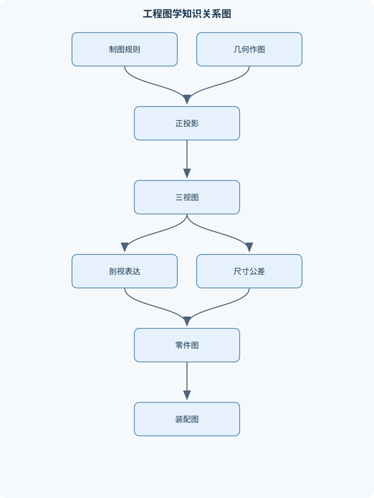
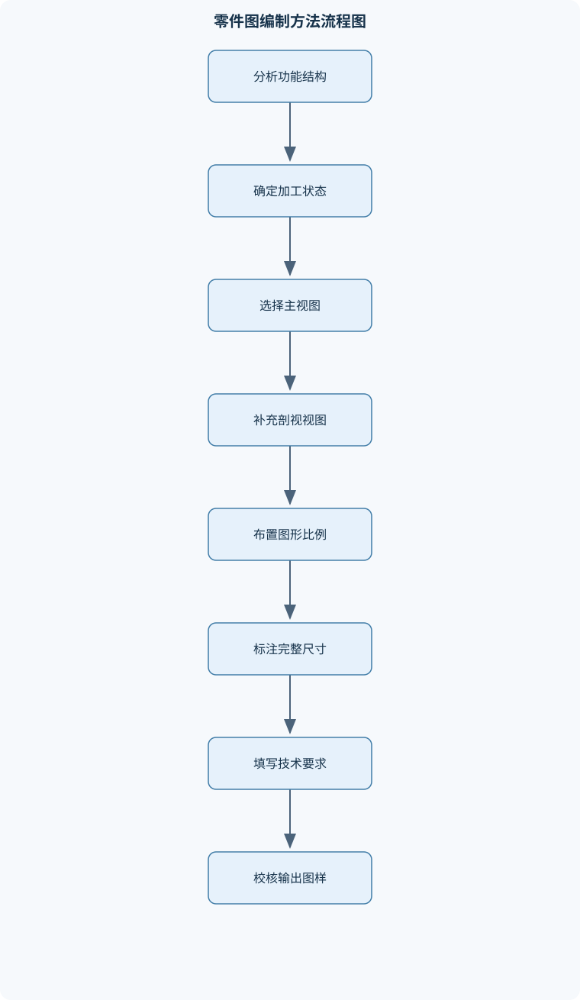

# 工程图学

## 一、课程整体知识框架

### 课程边界与先修知识

《工程图学》研究机械工程对象的图形表达、空间几何投影、技术制图规则、尺寸与技术要求标注、零部件及装配体图样阅读与绘制，以及二维和三维CAD辅助制图的基本方法。课程对象包括平面图形、基本立体、组合体、机械零件、标准件、常用机构和装配体，不展开材料力学、工程静力学、机械原理计算或制造工艺参数设计。先修知识包括初等几何与三角函数、基本空间想象能力、长度和角度单位换算、简单机械结构常识，以及计算机文件和图形界面的基本操作。





### 1. 课程对象、任务与知识边界

《工程图学》研究如何把机械工程对象的空间形状、大小、位置、结构关系和技术要求，准确地表达为可制造、可检验、可装配和可交流的工程图样。其对象包括平面图形、基本立体、组合体、机械零件、标准件、常用机构和装配体，也包括使用二维、三维 CAD 工具建立和管理图样的方法。

工程图样不是物体的照片，也不是按比例缩小的实物复制品，而是依据投影法和制图规则建立的符号化技术文件。图样中的线段长度通常受到图纸比例影响，但尺寸标注表达的是零件的真实尺寸。例如，图纸采用比例 $1\!:\!2$ 时，图形长度缩小为实物的一半；若实物长度为 $40\ \mathrm{mm}$，图上长度约为 $20\ \mathrm{mm}$，但尺寸标注仍应写真实尺寸 $40\ \mathrm{mm}$。因此，不能直接用尺量图得到尺寸标注值。

课程的基本任务可分为四个层次：

1. **建立图形表达基础**：学习图纸幅面、标题栏、比例、图线、字体、尺寸标注和投影法。
2. **完成空间形体表达**：从点、线、面和基本体出发，形成三视图、轴测图、剖视图和断面图。
3. **表达机械结构与技术要求**：学习零件图、标准件、螺纹连接、齿轮、轴承、弹簧和装配图。
4. **形成数字化制图能力**：使用 CAD 进行几何绘图、参数标注、三维建模、工程图生成和文件检查。

本课程不替代材料力学、工程静力学、机械原理计算和制造工艺参数设计。图样可以表达零件的结构、尺寸、公差、表面要求和装配关系，但不能仅凭图样完成强度校核、动力学计算或工艺参数优化。一个零件图中标注了轴径和材料，并不等于已经完成轴的强度设计；一个齿轮装配图表达了啮合关系，也不等于已经完成齿轮承载能力计算。

### 2. 统一符号、单位与投影约定

工程图学中，点通常用大写字母表示，如 $A、B$；直线可用小写字母或两点字母表示，如直线 $a$ 或 $AB$；平面通常用大写希腊字母表示，如平面 $\alpha、\beta$。正投影面常用 $V$ 表示，水平投影面用 $H$ 表示，侧投影面用 $W$ 表示。由这三个相互垂直的投影面得到的视图，分别对应正面图、水平面图和侧面图，通常称为主视图、俯视图和左视图。

本课程的线性尺寸统一使用毫米 $\mathrm{mm}$，角度使用度。图样中线性尺寸一般不在每个数字后重复写单位，但计算、说明和结果验证必须明确单位。比例记为 $1\!:\!n$ 或 $n\!:\!1$：前者表示缩小，后者表示放大。比例只改变图形显示大小，不改变尺寸标注的真实数值。

直径用符号 $\phi$ 表示，半径用 $R$ 表示，球面直径和球面半径分别用 $S\phi$ 和 $SR$ 表示。中心线通常采用细点画线。螺纹外径用 $d$ 表示，内螺纹对应的公称直径通常用 $D$ 表示；螺距为 $P$，导程为 $P_h$，线数为 $n$，多线螺纹满足

$$
P_h=nP
$$

其中 $P_h$ 和 $P$ 的单位均为 $\mathrm{mm}$，$n$ 为无量纲整数。单线螺纹中 $n=1$，所以 $P_h=P$。该关系只适用于把螺距定义为相邻牙、导程定义为同一螺旋线相邻牙轴向距离的通常约定，不能把二者在多线螺纹中混为一谈。

齿轮分度圆直径用 $d$ 表示，齿数为 $z$，模数为 $m$。在采用标准模数制且尺寸单位为毫米时，有

$$
m=\frac{d}{z}
$$

因此 $d=mz$。该式只说明分度圆直径、齿数和模数之间的基本关系；齿顶圆、齿根圆、压力角和变位系数等参数还取决于齿轮制式和具体设计约定，不能仅凭 $m$ 和 $z$ 推出全部齿形尺寸。

### 3. 从空间对象到工程图样的逻辑链

工程图学的核心逻辑是“对象分析—投影表达—技术标注—图样审核”。首先分析对象的功能、结构、加工状态和装配关系；其次选择主视图、辅助视图、剖视图或轴测图，表达形状和相对位置；再次标注定形尺寸、定位尺寸、总体尺寸、公差、粗糙度和技术要求；最后检查投影关系、线型、尺寸完整性、可制造性和可检验性。

一个合格图样应满足三个基本条件：

- **完整**：零件各部分的形状、大小、位置和技术要求均能确定。
- **正确**：投影关系、线型、剖切方法、尺寸含义和符号使用正确。
- **清楚**：图形层次明确，重要结构不被虚线、剖面线或重复标注干扰。

例如，支架可能由底板、支撑板和轴承孔组成。若只画正面图，观察者可能无法确定底板宽度和孔的贯通方向；若只增加一个没有投影对应关系的侧视图，又可能造成孔位置歧义。正确做法是先分析支架的基准方向和主要功能，再选择能表达支撑板厚度、轴承孔轴线和底板安装面的视图组合。

### 4. 工程图样的信息层次

工程图样中的信息可以分为四层：

1. **几何信息**：轮廓、孔、槽、台阶、圆角、倒角、螺纹和相贯线。
2. **尺寸信息**：长度、直径、半径、角度、中心距、深度、位置坐标和总体尺寸。
3. **质量信息**：尺寸公差、几何公差、表面粗糙度、材料和热处理等。
4. **管理信息**：标题栏、零件名称、材料、比例、图号、数量、修改记录和明细栏。

这些信息相互制约。视图表达不完整时，尺寸无法唯一定位；尺寸基准不合理时，公差即使书写正确也难以加工和检验；装配图缺少序号和明细栏时，零件之间的对应关系就不完整。工程图学因此不是单纯的绘图技巧，而是几何表达、设计意图和生产信息的统一载体。

## 二、章节和模块划分

### 核心知识覆盖清单

本清单用于检查正文是否覆盖本课程的主要知识模块：

- **工程制图基础与国家制图规则**：工程图样的作用与分类、图纸幅面与标题栏、比例与图线类型、字体与数字书写、尺寸标注基本规则、投影法和视图概念、第一角与第三角画法、图样技术信息的完整性。
- **几何作图与平面图形**：直线和圆弧的连接、圆的切线作图、等分线段与圆周、正多边形作图、椭圆近似作图、斜度与锥度标注、平面图形尺寸分析、尺寸驱动的几何约束。
- **正投影与三视图**：投影面和投影轴、点线面的投影规律、三视图的形成、三视图的投影关系、点线面相对位置判断、基本体的投影、组合体的形体分析、三视图补图与读图。
- **轴测投影与立体表达**：轴测投影的形成、正等轴测图、斜二轴测图、轴测轴和轴向变形、平面图形的轴测画法、圆和圆弧的轴测表达、组合体轴测图、轴测图的适用边界。
- **机件的视图、剖视与断面**：基本视图与向视图、局部视图和斜视图、全剖视图、半剖视图、局部剖视图、单一与阶梯剖切、旋转剖切的表达、移出断面与重合断面、剖面线和剖切标注、规定画法与简化画法。
- **尺寸标注、公差与表面要求**：尺寸基准的选择、定形尺寸与定位尺寸、链式和坐标式标注、直径半径和球面标注、角度弧长和锥度标注、尺寸公差与极限尺寸、配合类别与公差带、几何公差基本概念、表面粗糙度符号、技术要求的组织方式。
- **零件结构与零件图**：零件图的组成、轴类零件表达、盘盖类零件表达、支架和箱体表达、铸造圆角与拔模斜度、退刀槽和越程槽、倒角与螺纹退尾、零件图视图方案比较、零件图尺寸完整性、零件图读图流程。
- **螺纹、紧固件与连接**：螺纹的形成与要素、大径小径和中径、螺距导程与线数、内外螺纹规定画法、螺纹标注信息、螺栓螺母和垫圈、螺钉和螺柱连接、键连接的用途与表达、销连接的用途与表达、连接装配图简化画法。
- **齿轮、轴承与弹簧**：圆柱齿轮的基本几何要素、齿轮规定画法、齿轮啮合表达、齿轮齿条啮合、滚动轴承结构组成、轴承类型和代号信息、轴承简化画法、圆柱螺旋弹簧参数、弹簧自由高度关系、弹簧装配图表达。
- **装配图与部件表达**：装配图的作用和内容、装配图视图选择、装配关系与工作原理、装配图剖视规则、零件序号和明细栏、装配尺寸与安装尺寸、配合尺寸和性能尺寸、装拆顺序的图形表达、由装配图拆画零件图、由零件图拼读装配图。
- **CAD辅助制图与图样管理**：图层与线型管理、坐标输入和对象捕捉、几何绘图与编辑命令、尺寸和文字样式、块与属性信息、二维零件图绘制流程、三维实体建模基础、工程图视图生成、模型与图样关联、文件版本和输出检查。


### 1. 工程制图基础与国家制图规则

#### 1.1 图样作用、分类与图纸组成

工程图样按用途可以分为零件图、装配图、总成图、示意图和工艺图等。零件图用于表达单个零件的形状、尺寸和技术要求，是制造和检验单个零件的主要依据；装配图用于表达部件或机器中各零件的组成、连接、装配关系、工作原理和必要技术要求。

一张完整的零件图通常包括一组视图、完整尺寸、技术要求和标题栏。一组视图回答“形状是什么”，尺寸回答“大小和位置是多少”，技术要求回答“加工和检验应达到什么状态”，标题栏回答“图样对应什么零件以及采用何种基本信息”。任何一项缺失都可能造成图样信息不完整。

#### 1.2 图幅、比例、图线与字体

图纸幅面决定图样的布置空间，标题栏用于记录名称、材料、比例、图号等信息。比例应根据对象大小和结构复杂程度选择，但不应为了放大局部细节而随意改变尺寸含义。粗实线一般用于可见轮廓，细实线可用于尺寸线、尺寸界线和剖面线，虚线用于不可见轮廓，细点画线用于中心线和对称线。

图线的意义不仅由颜色或屏幕显示决定，还由线型、线宽和所在图层共同决定。中心线应穿过圆心或对称轴，并适当超出轮廓；若把中心线画成粗实线，可能被误读为实体边界。字体和数字应清晰、统一，尤其要避免数字 $1、7$ 与字母的混淆。

#### 1.3 投影法、第一角与第三角画法

正投影是投射线相互平行且垂直于投影面的投影方法。第一角画法中，物体位于观察者与投影面之间，展开后视图位置与第三角画法不同；第三角画法中，投影面位于观察者与物体之间。两种方法都能正确表达物体，但必须在图样中明确采用的投影法，不能混用。

三视图的对应关系可由投影过程推得：空间点 $A$ 分别向 $V、H、W$ 作垂直投影，得到正面投影、水平投影和侧面投影；展开投影面后，三个投影必须处于同一投影关系中。正面图与俯视图共同反映宽度，正面图与左视图共同反映高度，俯视图与左视图共同反映深度或长度。若某个孔在主视图中表现为圆，在其他视图中应能找到与该圆对应的轴线、宽度或隐藏轮廓。

### 2. 几何作图与平面图形

#### 2.1 直线、圆弧连接与切线

圆弧连接的本质是相切。若半径为 $r$ 的圆弧与一条直线相切，圆心必须位于距该直线为 $r$ 的平行线上；若与半径为 $R$ 的已知圆外切，连接圆圆心到已知圆心的距离为 $R+r$；若内切，则距离为 $|R-r|$。将这些轨迹相交即可得到连接圆心，再由圆心向已知曲线作垂线或连心线，确定切点。

作图步骤通常为：先确定连接圆弧半径；再作相应的等距轨迹；求圆心；确定切点；最后修剪多余线段。若只凭目测使两条曲线“看起来接上”，可能出现位置相接但切线方向突变的情况，这种连接不满足相切条件。

#### 2.2 等分、正多边形与椭圆近似

等分线段可采用平行线法或比例作图；圆周等分可根据圆心角关系完成。正六边形可用圆规以半径为弦连续截取圆周，其他正多边形可使用相应几何作图或近似方法。椭圆在工程图中常由长轴、短轴和辅助点确定，也可采用四心法等近似作图。近似作图适合图形表达，但不应把近似曲线当作精密加工轮廓的数学定义。

#### 2.3 斜度、锥度与尺寸约束

斜度表示某一长度方向上的高度变化与对应长度之比，可写成

$$
J=\frac{\Delta h}{L}
$$

其中 $\Delta h$ 为高度差，单位为 $\mathrm{mm}$，$L$ 为基准长度，单位为 $\mathrm{mm}$，因此 $J$ 为无量纲量。锥度通常表示同一轴向长度内直径差与长度之比：

$$
C=\frac{D-d}{L}
$$

其中 $D$、$d$ 为大、小端直径，$L$ 为锥体长度。若图样采用角度表示，还需说明角度对应的母线或轴线关系。斜度和锥度不能仅凭图形倾斜程度判断，必须依据标注基准和定义计算。

### 3. 正投影与三视图

#### 3.1 点、直线和平面的投影规律

点的三面投影由其空间坐标决定。同一空间点的三个投影不能任意移动，必须分别位于对应投影线体系中。直线的投影可能是一般长度的线段，也可能因直线平行投影面而反映真实长度，或因直线垂直投影面而退化为一点。平面同样可能表现为真实形状、缩小形状或一条直线，取决于平面与投影面的相对位置。

判断点、线、面相对位置时，应同时观察至少两个投影，不能只依据单个视图。例如，两个点在正面图中重合，只能说明它们的高度和宽度投影相同，不能直接断定空间中是同一点；还要检查俯视图或左视图。

#### 3.2 基本体和组合体

圆柱、棱柱、棱锥、圆锥和球是常见基本体。圆柱轴线垂直某投影面时，在该投影面上表现为圆，在另外两个投影面上通常表现为矩形；若轴线倾斜，圆在一般正投影中会表现为椭圆或其他缩短形状，不能直接把所有倾斜圆都画成圆。

组合体的三视图由基本体投影叠加，并处理相贯、切割和遮挡关系。形体分析法的过程是：按封闭轮廓和结构特征分解基本体；确定各基本体的相对位置；补出相贯线、切割线和孔槽；依据可见性使用粗实线、虚线或剖视。组合体读图时，关键不变量是同一结构在各视图中的长度、宽度、高度和投影位置必须相互一致。

### 4. 轴测投影与立体表达

轴测投影是在一个投影面上同时表达物体三个坐标方向的投影方法。正等轴测图中三个轴向的变形规律相同，常用于直观表现结构；斜二轴测图通常使一个坐标面保持较清晰的形状，另一个方向按规定比例缩短。轴测轴的方向和轴向变形必须统一，否则会出现同一零件不同方向比例不一致的问题。

圆在轴测投影中通常表现为椭圆。椭圆的长、短轴方向与圆所在平面及轴测轴有关，不能直接把正投影中的圆复制到轴测图中。轴测图适合说明空间结构、装配关系和外观形态，不适合作为精确量尺寸的依据；精确尺寸仍应以正投影视图和尺寸标注为准。

### 5. 机件的视图、剖视与断面

#### 5.1 视图选择

基本视图用于表达常规方向的形状；向视图用于从指定方向投影；局部视图只表达机件某一局部；斜视图用于表达与投影面倾斜的结构真实形状。视图选择应满足完整、正确、清楚三个条件，并尽量减少不必要的视图数量。

#### 5.2 剖视图和断面图

当内部结构复杂、使用大量虚线会造成混乱时，可用剖视图表达。全剖适用于内形复杂而外形相对简单的对象；半剖适用于内外形都需要表达且零件具有明显对称性的对象；局部剖适用于只需表达局部孔、槽或内部结构的情况；阶梯剖适用于多个不在同一剖切平面的结构需要同时表达；旋转剖适用于通过旋转使若干结构处于同一表达位置的情况。

剖切过程必须明确剖切位置和观察方向，剖面线通常采用规则的细实线。相邻零件的剖面线方向或间距应有区别，以识别零件边界。轴、销、键、紧固件等标准件沿长度方向被剖切时通常按规定不剖或简化表达，但横向切到实体部分时不能一概省略。

断面图只表示剖切平面与物体相交所得的截面形状，通常不表达剖切面后面的结构。将断面图误当作剖视图，会导致内部轮廓和前后关系表达错误。

### 6. 尺寸标注、公差与表面要求

#### 6.1 尺寸类型和标注原则

尺寸可按作用分为定形尺寸、定位尺寸和总体尺寸。定形尺寸确定孔径、槽宽、厚度等形状大小；定位尺寸确定孔中心距、台阶位置和基准间距离；总体尺寸确定零件总长、总宽和总高。尺寸标注必须具有唯一性，既不能遗漏，也不能重复表达同一独立设计尺寸。

链式标注便于表达相邻特征间的尺寸，但多个尺寸误差可能累积；坐标式标注从同一基准出发，适合定位要求严格的孔系，但基准选择不合理时会增加读图和检验难度。封闭尺寸链通常不应把所有尺寸都作为独立要求，否则最后一个尺寸会由前面尺寸决定，产生过约束。

#### 6.2 极限尺寸、配合与公差

基本尺寸是理论尺寸，极限尺寸是允许变化的最大尺寸和最小尺寸。上极限偏差、下极限偏差分别表示相对于基本尺寸的允许偏移。孔、轴具有同一基本尺寸时，最大间隙和最小间隙分别为

$$
X_{\max}=D_{\max}-d_{\min}
$$

$$
X_{\min}=D_{\min}-d_{\max}
$$

其中 $D_{\max}$、$D_{\min}$ 是孔的最大、最小极限尺寸，$d_{\max}$、$d_{\min}$ 是轴的最大、最小极限尺寸，单位均为 $\mathrm{mm}$。若 $X_{\min}>0$，必为间隙配合；若 $X_{\max}<0$，必为过盈配合；若 $X_{\min}\leq 0\leq X_{\max}$，则可能为过渡配合。若计算结果跨越零，不能只看某一个极限尺寸判断配合性质。

一般尺寸公差控制尺寸范围，几何公差控制形状、方向、位置或跳动等几何误差，配合用于描述孔轴装配后的间隙或过盈。三者概念不同，不能用一个尺寸公差代替同轴度、平面度等几何要求。

#### 6.3 表面粗糙度与技术要求

表面粗糙度符号用于说明加工表面的微观几何质量要求。不同表面可能因密封、滑动、定位、装配或外观需要而采用不同要求。技术要求应按加工、检验和使用需要组织，内容可包括未注尺寸公差、材料、热处理、表面处理、去毛刺、倒角、表面粗糙度和检验要求。技术要求不能代替图形和尺寸；例如“表面光滑”不能代替明确的粗糙度要求。

### 7. 零件结构与零件图

零件图表达单个零件的制造信息。轴类零件通常以轴线水平放置，主要用长度方向的主视图表达各轴段、轴肩、退刀槽和螺纹，必要时增加断面图表示键槽方向和形状。盘盖类零件常以轴线垂直于投影面布置，用端面视图表达孔系，用剖视表达台阶、密封槽和内腔。支架、箱体类零件结构复杂，通常需要主视图、俯视图、侧视图和剖视图共同表达。

工艺结构包括铸造圆角、拔模斜度、退刀槽、越程槽、倒角和螺纹退尾等。铸造圆角用于减少尖角处应力集中和充型缺陷；拔模斜度便于铸件从模具中取出；退刀槽为刀具退出提供空间；倒角用于去除尖锐边缘并改善装配。是否需要表示这些结构，应结合零件加工方法和功能，不能为追求复杂而任意增加。

零件图绘制的推导流程是：分析零件功能和加工状态；选择能反映主要结构特征的主视图；用最少的辅助视图补足内部结构和定位关系；标注完整尺寸；加入公差、粗糙度、材料和技术要求；最后检查制造者和检验者能否不依赖口头说明确定零件。

### 8. 螺纹、紧固件与连接

螺纹由截面轮廓沿圆柱面或圆锥面作螺旋运动形成。主要要素包括牙型、公称直径、螺距、导程、线数、旋向和螺纹长度。外螺纹和内螺纹的牙顶、牙底使用不同线型表达，螺纹终止线用粗实线表示。剖视图中，螺纹连接应同时表达内外螺纹的套合关系，而不能只画两组相互重叠的圆。

双线螺纹若 $P=3\ \mathrm{mm}$，则

$$
P_h=nP=2\times3=6\ \mathrm{mm}
$$

结果中的导程为 $6\ \mathrm{mm}$。螺纹标注还需表达公称直径、螺距或导程、旋向以及必要的精度信息，不能只写一个直径。

螺栓连接通常由螺栓、螺母和垫圈组成；螺钉直接旋入被连接件的螺纹孔；螺柱一端固定在机体中，另一端用螺母连接。键连接用于轴与轮毂之间传递转矩并限制相对转动，销连接常用于定位、连接或安全保护。标准件按规定标记和简化画法表达，不应凭比例随意改变标准件结构尺寸。

### 9. 齿轮、轴承与弹簧

圆柱齿轮的基本几何参数包括齿数 $z$、模数 $m$、分度圆直径 $d$、齿顶圆和齿根圆等。齿轮图样通常用规定线型表达分度圆、齿顶圆和齿根圆，不逐齿绘制全部轮齿。啮合图中应表达两齿轮轴线、分度圆关系和必要的啮合区域，不能把两组完整齿形简单重叠。

滚动轴承由内圈、外圈、滚动体和保持架等组成，常用主要尺寸为内径 $d$、外径 $D$ 和宽度 $B$。轴承型号涉及类型、尺寸系列和内径信息，具体外径、宽度及结构形式必须依据相应型号资料确定，不能仅凭某一位代号臆测全部尺寸。

圆柱螺旋压力弹簧的外径、内径和簧丝直径满足

$$
D_2=D+d,\qquad D_1=D-d
$$

其中 $D$ 为弹簧中径，$d$ 为簧丝直径，$D_2$ 和 $D_1$ 分别为外径和内径，单位均为 $\mathrm{mm}$。若有效圈数为 $n$、支撑圈数为 $n_2$、总圈数为 $n_1$，则

$$
n_1=n+n_2
$$

自由高度还取决于节距、端部形式和支撑圈结构，不能脱离这些条件套用单一公式。

### 10. 装配图与部件表达

装配图表达部件的组成、装配关系、工作原理、连接方式、配合关系、装拆顺序和必要尺寸。视图选择应突出工作原理和关键装配关系，而不是把每个零件都孤立地完整绘出。剖视装配图中，相邻零件的剖面线方向或间距应有所区别；标准紧固件、轴、销、键等按规定简化或不剖。

装配图中的零件序号应与明细栏一致。常见尺寸包括装配尺寸、安装尺寸、配合尺寸和性能尺寸。装配尺寸说明零件装配后的相对关系，安装尺寸说明与外部设备连接所需的位置和大小，配合尺寸说明孔轴等相互作用关系，性能尺寸说明影响工作性能的关键参数。

由装配图拆画零件图时，应先依据序号和剖面线识别本零件边界，再删除其他零件的装配表达，重新选择适合单个零件制造的视图，补齐加工尺寸、基准、公差和技术要求。由零件图拼读装配图时，应根据接触面、轴线、孔中心和配合关系重建部件结构，不能只把零件外形机械叠加。

### 11. CAD辅助制图与图样管理

#### 11.1 二维 CAD

二维 CAD 绘图的基本流程是：设置单位、图层、线型、线宽、文字样式和尺寸样式；建立坐标系和基准；使用对象捕捉绘制轮廓；通过偏移、修剪、延伸、圆角、倒角、镜像和阵列完成结构；添加剖面线、尺寸和文字；设置图框并进行打印或输出检查。

CAD 坐标可采用绝对坐标、相对坐标和极坐标。极坐标通常写作“长度<角度”，长度单位为当前图形单位，角度正方向由当前坐标系确定。若坐标系发生旋转，未检查当前坐标系就输入极坐标，可能造成图形方向错误。

#### 11.2 三维建模与工程图

三维实体建模通常从草图、拉伸、旋转、扫掠、放样、孔特征、圆角和倒角等操作建立模型，再由模型生成正投影视图、剖视图和轴测图。模型与工程图具有关联时，模型修改可能传递到图样，但自动生成不等于自动正确。隐藏线、剖视范围、标准件表达、尺寸语义、基准和技术要求仍需人工审核。

文件管理应保持模型、工程图、外部引用和输出文件之间的版本一致性。输出检查包括单位、比例、图框、线宽、字体、图层、剖面线、尺寸可读性和打印范围。屏幕上显示正确而打印线宽失真的图样，不能视为合格交付物。

### 12. 代表性算法与工作流程

#### 12.1 三视图补图流程

**输入**：已有两个或三个投影视图、投影法信息和图形基准。  
**输出**：投影关系正确、结构完整的补全视图。  
**过程**：

1. 识别基准线、对称线和投影方向。
2. 建立同一空间点在各视图中的对应关系。
3. 先补主要外轮廓，再补孔、槽、台阶和相贯结构。
4. 依据可见性确定粗实线、虚线和中心线。
5. 用宽度传递线、辅助线或辅助视图校核。
6. 检查每个结构特征是否能在其他视图中找到唯一对应。

**不变量**：同一空间特征在不同视图中的投影位置和尺寸关系保持一致。  
**终止条件**：所有特征均已表达，且不存在未解释的轮廓线。  
**适用条件**：对象可由正投影表达；复杂倾斜面应增加辅助视图。  
**复杂度说明**：若以特征数量 $k$ 计，人工检查通常需逐一处理，工作量近似为 $O(k)$；若还需比较多个视图中的对应边界，则与视图数 $v$ 有关，可近似为 $O(kv)$。

#### 12.2 剖视方案选择流程

**输入**：零件内外形复杂程度、对称性和需要表达的区域。  
**输出**：全剖、半剖、局部剖、阶梯剖或旋转剖方案。  
**步骤**：

1. 判断内部结构是否为主要表达对象。
2. 判断零件是否具有明显对称性。
3. 外形简单、内形复杂时，优先全剖。
4. 内外形均需表达且零件对称时，考虑半剖。
5. 只需表达局部孔槽时，采用局部剖。
6. 多个不共面的孔槽需同时表达时，考虑阶梯剖或旋转剖。
7. 检查剖切线、投射方向、剖面线和标准件规定画法。

终止条件是内部结构清楚、剖切标注完整且没有不必要的虚线。局部剖的分界线不能与零件外轮廓混淆，也不能随意穿越空白区域。

#### 12.3 尺寸标注审查流程

**输入**：零件图和设计功能要求。  
**输出**：无遗漏、无重复、可加工、可检验的尺寸方案。  
**步骤**：

1. 确定主要设计基准和可能的工艺基准。
2. 标注总体尺寸、定形尺寸和定位尺寸。
3. 检查同一方向是否形成不必要的封闭尺寸链。
4. 补充直径、半径、孔中心距、槽深和台阶位置。
5. 核对尺寸是否能由量具或检具实际测量。
6. 删除重复尺寸，必要时将非独立尺寸改为参考尺寸。

不变量是每个独立设计要求都能被唯一识别，且尺寸之间不存在矛盾。尺寸完整不等于尺寸越多越好，重复标注可能造成不同尺寸值之间的冲突。

#### 12.4 CAD 二维绘图伪代码

```text
伪代码
输入：图纸单位 U，几何尺寸集合 G，比例 S，图幅 F
输出：二维工程图样

设置单位(U)
设置图层：粗实线、细实线、虚线、中心线、尺寸、文字、剖面线
设置线型、线宽、文字样式和尺寸样式
建立主视图基准线和坐标系

绘制主要轮廓(G)
使用对象捕捉约束端点、圆心、切点和交点
使用偏移、修剪、圆角、倒角、镜像或阵列完成结构
绘制中心线、对称线和必要的隐藏线
若内部结构复杂：
    选择合适剖视方案
    绘制剖切边界和剖面线

标注定形尺寸、定位尺寸和总体尺寸
标注公差、粗糙度和技术要求
填写标题栏并设置图框(F)
按比例(S)检查图纸布局和打印范围

若存在断线、线宽错误、尺寸重复或投影不一致：
    返回相应绘图步骤修改
否则：
    输出图样文件和固定比例打印文件
```

### 13. 代表性例题

#### 例题一：比例与真实尺寸

**题干**：某零件图采用比例 $1\!:\!2$，图上某轴段长度为 $18\ \mathrm{mm}$。求零件真实长度，并说明尺寸标注应填写什么数值。

**分析**：比例 $1\!:\!2$ 表示图上长度与实物长度之比为 $1/2$。设真实长度为 $L$，则图上长度 $l=L/2$。

**解答**：

$$
L=2l=2\times18=36\ \mathrm{mm}
$$

因此真实长度为 $36\ \mathrm{mm}$。图样上的尺寸标注应写 $36$，不能写 $18$。

**结果验证**：按比例缩小后，$36\ \mathrm{mm}$ 的实物在图上应为 $18\ \mathrm{mm}$，与题设一致。

**变式**：若采用比例 $2\!:\!1$，图上长度仍为 $18\ \mathrm{mm}$，则实物长度为 $9\ \mathrm{mm}$。比例变化不改变尺寸标注的真实值，但必须先判断比例方向。

#### 例题二：圆弧与直线相切

**题干**：已知一条直线和半径为 $10\ \mathrm{mm}$ 的连接圆弧，要求圆弧与直线相切。说明作图步骤。

**分析**：相切时，连接圆弧圆心到直线的距离必须等于半径 $10\ \mathrm{mm}$。

**解答**：

1. 在直线一侧作与已知直线平行、距离为 $10\ \mathrm{mm}$ 的轨迹线。
2. 根据另一相切条件确定连接圆心所在的第二条轨迹。
3. 两条轨迹的交点为连接圆心。
4. 从连接圆心向已知直线作垂线，垂足为切点。
5. 以该圆心和半径 $10\ \mathrm{mm}$ 作圆弧，修剪多余部分。

**结果验证**：圆心到直线的距离等于半径，半径线垂直于切线，因此满足相切条件。

**变式**：若要求同时与一个半径为 $R$ 的圆外切，应再作以已知圆心为圆心、半径 $R+10\ \mathrm{mm}$ 的轨迹；若要求内切，则使用 $|R-10|\ \mathrm{mm}$。

#### 例题三：双线螺纹导程

**题干**：某双线螺纹的螺距为 $P=3\ \mathrm{mm}$，求导程，并说明单线螺纹的情况。

**分析**：多线螺纹的导程等于螺距乘线数。

**解答**：

$$
P_h=nP=2\times3=6\ \mathrm{mm}
$$

所以导程为 $6\ \mathrm{mm}$。若为单线螺纹，$n=1$，则

$$
P_h=P=3\ \mathrm{mm}
$$

**结果验证**：双线螺纹每转一周，螺旋线沿轴向前进两个牙距，因此前进 $6\ \mathrm{mm}$。

**变式**：若导程为 $8\ \mathrm{mm}$、螺距为 $2\ \mathrm{mm}$，则线数为

$$
n=\frac{P_h}{P}=\frac{8}{2}=4
$$

#### 例题四：孔轴配合分析

**题干**：孔的极限尺寸为 $20.000\ \mathrm{mm}$ 至 $20.021\ \mathrm{mm}$，轴的极限尺寸为 $19.980\ \mathrm{mm}$ 至 $19.995\ \mathrm{mm}$。求最大间隙、最小间隙并判断配合类型。

**分析**：最大间隙由最大孔和最小轴形成，最小间隙由最小孔和最大轴形成。

**解答**：

$$
X_{\max}=D_{\max}-d_{\min}
=20.021-19.980
=0.041\ \mathrm{mm}
$$

$$
X_{\min}=D_{\min}-d_{\max}
=20.000-19.995
=0.005\ \mathrm{mm}
$$

因为 $X_{\min}>0$，所以该配合必为间隙配合。

**结果验证**：即使孔取最小值、轴取最大值，仍有 $0.005\ \mathrm{mm}$ 间隙，说明不会出现过盈。

**变式**：若轴的最大极限尺寸改为 $20.006\ \mathrm{mm}$，则最小间隙为 $-0.006\ \mathrm{mm}$，而最大间隙仍为正，配合状态跨越零，属于过渡配合范围。

#### 例题五：选择支架的剖视方案

**题干**：某支架外形由底板和支撑板组成，支撑板中有贯通轴承孔，零件左右对称，要求同时表达轴承孔内部结构和外部支撑轮廓。应选择何种剖视方案？

**分析**：零件具有对称性，内外形均需表达；全剖会丢失一部分外形信息，单纯外视图又不能清楚表达孔腔。

**解答**：

1. 判断支架左右对称。
2. 确定剖切平面通过对称轴和轴承孔中心。
3. 采用半剖视图，一半表达外部形状，另一半表达内部结构。
4. 对轴承孔、底板和支撑板画出相应轮廓。
5. 对称轴处使用中心线，剖面区域绘制统一方向的剖面线。
6. 检查孔轴线在其他投影中的对应位置。

**结果验证**：半剖同时保留外部轮廓和内部孔腔，且利用对称性避免增加多余视图。

**变式**：若支架不对称，或只需表达某一个局部槽孔，则不能机械采用半剖，应改用全剖或局部剖。

### 14. 实验与项目任务

#### 14.1 实验一：组合体三视图与补图

**输入数据**：一个由底板、矩形凸台、圆柱孔和侧向槽组成的组合体实物或轴测表达；给定投影法、图幅和单位。

**步骤**：

1. 分析组合体由哪些基本体组成，确定底板、凸台、孔和槽的相对位置。
2. 选择能够反映主要结构特征的主视方向。
3. 绘制主视图基准线和外轮廓。
4. 依据投影关系建立俯视图和左视图。
5. 补充圆孔轴线、槽边界和隐藏轮廓。
6. 对内部结构较复杂的区域增加局部剖或全剖。
7. 检查三视图中的宽度、高度和长度传递关系。

**评价标准**：投影关系正确占主要评价内容；孔槽位置、中心线、可见与不可见轮廓、线型和图面布局均应清楚；不能只凭单个视图猜测结构。

**排错方法**：

- 若俯视图宽度与主视图不一致，检查宽度传递线。
- 若左视图孔位置错误，检查孔轴线在主视图和俯视图中的对应关系。
- 若虚线过多导致结构不清，重新判断是否应采用剖视。
- 若出现无法解释的轮廓线，回到基本体分解步骤检查相贯和切割关系。

#### 14.2 项目二：带孔法兰的 CAD 工程图

**输入数据**：法兰外径、内孔直径、厚度、螺栓孔数量、螺栓孔分布圆直径、图幅、比例和单位。

**步骤**：

1. 设置毫米单位、图层、线型、线宽、文字样式和尺寸样式。
2. 建立中心线和圆心基准。
3. 绘制法兰外圆、内孔和螺栓孔分布圆。
4. 使用圆形阵列保持螺栓孔等分关系。
5. 根据表达需要绘制主视图、端面图或剖视图。
6. 标注外径、内径、厚度、孔径、孔数和分布圆直径。
7. 添加中心线、剖面线、技术要求和标题栏。
8. 设置打印比例，输出并检查纸面线宽和文字可读性。

**评价标准**：几何尺寸与输入数据一致；螺栓孔等分关系正确；中心线和剖面线符合图样规则；尺寸不重复、不遗漏；打印输出不发生截断、线宽失真或比例错误。

**排错方法**：

- 螺栓孔未等分时，检查阵列中心和角度参数。
- 打印后中心线与轮廓线粗细相同，检查图层线宽设置。
- 尺寸值与模型不一致，检查标注关联对象和当前单位。
- 屏幕显示完整但打印缺少图框，检查打印范围和图纸空间设置。
- 三维模型自动生成的视图出现多余隐藏线时，人工调整可见性和剖视范围，不能直接交付。

## 三、核心概念的详细解释

### 1. 工程图样的性质、作用与信息层次

工程图样是依据投影法、图线、符号、尺寸和技术要求，把机械对象的形状、大小、位置关系及制造检验要求表达出来的技术文件。它不是实物照片，也不是仅供观察的示意图，而是设计、制造、检验、装配、维修和技术交流的共同依据。

一张完整图样至少包含四类信息：

1. **形状信息**：由主视图、俯视图、左视图、剖视图、断面图和局部视图表达零件的外部与内部结构。
2. **大小信息**：由线性尺寸、直径、半径、角度、深度、中心距以及尺寸公差确定零件各部分的大小。
3. **位置信息**：由尺寸基准、定位尺寸、中心线、对称线、孔系坐标和装配尺寸确定各结构之间的相对位置。
4. **质量与功能信息**：由尺寸公差、几何公差、表面粗糙度、材料、热处理及其他技术要求规定零件应达到的使用和检验条件。

零件图针对单个零件，主要用于加工制造和检验；装配图针对由多个零件组成的部件或机器，主要用于表达装配关系、工作原理、零件序号、明细栏及装拆关系。零件图和装配图不能相互替代：装配图可说明零件之间如何连接，却不一定包含制造单个零件所需的全部尺寸；零件图可说明某个零件怎样加工和检验，却不能完整说明整个部件的装配顺序和工作关系。

### 2. 图纸幅面、比例、图线与标题栏

图纸幅面是图样的有效工作区域。选择幅面时，应使图形、尺寸、技术要求、标题栏和明细栏均有足够空间，同时避免因幅面过大造成阅读和归档不便。标题栏通常包含零件或部件名称、材料、比例、图号、数量及必要的签署信息。标题栏中的材料和比例不能凭图形外观推断，必须以图样标注为准。

比例表示图形线性尺寸与实物相应尺寸的比值。比例为 $1\!:\!2$ 时，图形线性长度是实物的一半；比例为 $2\!:\!1$ 时，图形线性长度是实物的两倍。比例改变的是图形显示大小，而尺寸数字表示零件的真实尺寸。例如，实物长度为 $40\ \mathrm{mm}$，按 $1\!:\!2$ 绘图时图上长度约为 $20\ \mathrm{mm}$，但尺寸仍应标注为 $40$，不能标为 $20$。

图线的粗细和形式具有语义。可见轮廓通常采用粗实线；尺寸线、尺寸界线、引出线和剖面线通常采用细实线；不可见轮廓采用虚线；轴线、对称中心线和圆心定位线采用细点画线；局部剖视的边界通常采用波浪线或双折线表示。线型不是装饰，而是帮助读者判断轮廓的可见性、结构的对称性和尺寸的指向。若粗实线与细线重合，应优先保证可见轮廓的清楚表达；中心线一般应超出轮廓少量，但不宜过长。

### 3. 投影法、视图与空间对应关系

#### 3.1 正投影和三视图

正投影是投射线相互平行且垂直于投影面的投影方法。设空间点为 $A$，向正投影面 $V$、水平投影面 $H$ 和侧投影面 $W$ 分别作垂线，可得到正面投影、水平投影和侧面投影。将投影面按规定展开后，三个投影形成主视图、俯视图和左视图。

三视图中存在稳定的尺寸对应关系：

- 主视图与俯视图反映同一物体的宽度，二者之间应保持上下对正；
- 主视图与左视图反映同一物体的高度，二者之间应保持水平对齐；
- 俯视图与左视图反映同一物体的长度或深度，通常借助 $45^\circ$ 斜线或等距传递关系保持对应。

这种关系来自同一空间点的三个投影。空间点的位置一旦确定，其在三个投影面上的投影不能任意移动。因此，补画第三视图时，不能只根据某一个视图猜测，而应把同一结构在各视图中的投影位置联系起来。

#### 3.2 第一角画法与第三角画法

第一角画法中，物体位于观察者和投影面之间，展开后各视图的位置与第三角画法不同；第三角画法中，投影面位于观察者和物体之间。两种画法均能准确表达空间形体，但视图布置规则不能混用。

判断视图布置时，必须先确认图样采用的投影法识别符号或说明。若把第一角画法误认为第三角画法，最常见的结果是俯视图和左视图位置颠倒，导致尺寸对应和结构判断全部错误。投影法信息属于图样的基础约定，不能根据图纸上某一个局部结构自行猜测。

### 4. 点、直线、平面和基本立体的投影特征

点是空间形体投影分析的基本元素。一个空间点在三个投影面上有三个对应投影，三个投影必须满足投影线关系。直线由两个点确定，但直线在某一投影面上的投影可能缩短为线段，也可能退化为一个点。

当直线平行于某投影面时，在该投影面上的投影反映真实长度；当直线垂直于某投影面时，其投影退化为一个点；当直线倾斜于投影面时，投影长度小于真实长度。因而不能直接用某一个投影视图中的线段长度代替空间直线的真实长度，除非已经证明该直线平行于该投影面。

平面的投影形状取决于其相对于投影面的姿态。平面平行于投影面时，该投影面上的投影反映真实形状；平面垂直于投影面时，投影通常表现为一条直线；平面倾斜于投影面时，投影发生缩短。对于倾斜孔、斜面和斜槽，不能把主视图中的投影轮廓直接当作真实形状，必要时应采用辅助视图。

基本立体包括棱柱、棱锥、圆柱、圆锥和球等。圆柱轴线垂直于某投影面时，在该投影面上表现为圆，在另外两个投影面上通常表现为矩形。圆锥在轴线垂直于投影面的情况下，一面可表现为圆，其他投影面表现为三角形或相应轮廓。球在任意正投影面上的投影均为圆，但圆形投影不能直接说明球的直径方向；球面直径应使用 $S\phi$ 标注。

### 5. 平面图形与几何作图

平面图形由直线、圆、圆弧、椭圆和多边形等组成。工程制图中的几何作图不仅要求图形看起来连续，还必须满足几何约束，例如相切、平行、垂直、同心、等分和对称。

#### 5.1 圆弧连接与相切条件

圆弧与直线相切时，圆心到该直线的距离等于连接圆弧半径 $R$。因此，圆心应位于距已知直线为 $R$ 的平行线上。圆弧与已知圆外切时，两圆心距离应为两半径之和；内切时，两圆心距离应为两半径之差的绝对值。作图时，分别作出这些轨迹，轨迹交点即为待求圆心，再由圆心向已知曲线作垂线或连心线确定切点。

相切条件只保证局部接触方向一致，不能自动保证连接后的轮廓满足设计意图。完成作图后还需修剪多余线段，检查切点是否位于实际圆弧范围内。若切点落在圆弧延长线上，说明选取了错误的圆心或错误的相切分支。

#### 5.2 斜度、锥度与尺寸约束

斜度描述一条直线或一个平面相对于基准方向的倾斜程度，可用高度差与相应长度之比表示。锥度描述圆锥或截锥的直径变化程度，常用两端直径之差与锥体长度之比表示。斜度和锥度在图样中通常采用规定符号和数值标注，标注方向必须能够明确其基准和变化方向。

尺寸驱动的几何约束是 CAD 参数化建模的基础。一个平面轮廓若只给出若干线段长度，却没有规定平行、垂直、相切、同心和定位关系，可能存在多个不同形状；若约束过多，又可能出现尺寸冲突。因此，尺寸标注必须同时满足完整性、独立性和可检验性。

### 6. 轴测投影及其适用边界

轴测投影是在一个投影面上同时表达物体三个方向尺寸关系的立体图。正等轴测图中三个轴向通常具有相同的缩短规律，轴测轴之间的夹角按规定布置；斜二轴测图中一个投影面通常保持真实形状，另一方向发生缩短。

轴测图中的圆通常表现为椭圆。圆所在平面若不平行于轴测投影面，不能直接画成圆，否则会破坏空间方向关系。轴测图适合说明组合体的整体结构、凸台、孔、槽和相贯关系，尤其适合读图和方案交流；但它不是精确尺寸依据，尺寸标注和加工检验仍应以正投影零件图为准。

### 7. 组合体的形体分析与三视图补画

组合体是由若干基本体叠加、切割、相交或相贯形成的复杂形体。读图时应先确定主视图和基准方向，再按封闭轮廓、轴线和结构连接关系分解基本体。常见分析顺序为：

1. 识别底板、凸台、支撑板、圆柱体、孔、槽等基本形体；
2. 判断各形体是叠加关系、切割关系还是相贯关系；
3. 确定每个形体的长度、宽度和高度；
4. 在各视图之间传递投影关系；
5. 判断轮廓的可见性；
6. 用粗实线、虚线和中心线表达外形、隐藏结构及对称轴。

三视图补图时，应先补主要外轮廓，再补孔、槽、台阶和内部结构，最后检查各视图中同一特征的尺寸和位置是否一致。复杂倾斜面若在三个基本视图中都不能反映真实形状，应增加辅助视图，而不能强行从变形投影中量取真实尺寸。

### 8. 视图、剖视图和断面图

基本视图用于表达物体的外部形状。向视图通过箭头和字母明确观察方向，适用于基本视图位置不便布置的情况。局部视图只表达物体某一部分的形状，边界通常采用波浪线；斜视图用于表达倾斜结构的真实形状。

剖视图是假想用剖切平面剖开机件，移去观察者与剖切平面之间的部分，投影剩余部分得到的图形。剖视图同时表达剖切面后的内部结构和剖切面与实体接触的断面。剖面线通常为相互平行的细实线，方向和间距应均匀；相邻零件的剖面线方向或间距应有所区别，以便识别零件边界。

常用剖视形式包括：

- **全剖视图**：适合外形简单而内部结构复杂的零件；
- **半剖视图**：适合内外形均需表达且具有对称性的零件；
- **局部剖视图**：只剖开需要说明的局部区域；
- **阶梯剖视图**：剖切平面由相互平行但不在同一平面内的部分组成，用于同时表达不同位置的孔槽；
- **旋转剖视图**：将不在同一投影平面内的结构绕规定方向旋转到同一平面表达。

轴、销、键、紧固件等标准结构沿长度方向被纵向剖切时，通常按规定不画剖面线或采用简化画法，以免破坏其结构识别。但若同一零件被横向剖切，仍应依据相应规定表达断面。

### 9. 尺寸标注、基准和尺寸完整性

尺寸标注必须回答三个问题：对象有多大、结构位于哪里、尺寸如何检验。尺寸可分为：

- **定形尺寸**：确定某一结构自身大小，如孔径、槽宽、圆角半径；
- **定位尺寸**：确定结构相对于基准的位置，如孔中心距、台阶位置；
- **总体尺寸**：确定零件整体长度、宽度和高度。

基准是尺寸定位的起点。设计基准反映零件功能关系，工艺基准便于加工，检验基准便于测量。三者可能相同，也可能不同。尺寸标注应尽量从明确基准出发，避免使加工者或检验者自行推断基准。

链式标注把相邻结构逐段标出，便于表示各段相对尺寸，但各段公差可能累积；坐标式标注从同一基准标出多个位置，适合孔系和精确定位，可减少累积误差。一个方向上的尺寸若首尾封闭，且每个尺寸都具有独立公差，可能形成过度约束。此时应删除非必要尺寸，或将其改为参考尺寸。

直径用 $\phi$ 标注，半径用 $R$ 标注，球面直径用 $S\phi$ 标注；角度应标注角度值，圆弧长度应明确采用弧长标注。尺寸数字表达真实设计尺寸，不应按图面测量结果填写。

### 10. 公差、配合、几何公差与表面粗糙度

基本尺寸是设计确定的理论尺寸。极限尺寸包括允许的最大尺寸和最小尺寸。上极限偏差、下极限偏差分别表示相对于基本尺寸的允许偏移。尺寸公差是最大极限尺寸与最小极限尺寸之差，反映线性尺寸允许变化范围。

孔和轴的配合由各自极限尺寸比较决定。设孔的最大、最小极限尺寸分别为 $D_{\max}$、$D_{\min}$，轴的最大、最小极限尺寸分别为 $d_{\max}$、$d_{\min}$，则：

$$
S_{\max}=D_{\max}-d_{\min}
$$

$$
S_{\min}=D_{\min}-d_{\max}
$$

其中 $S_{\max}$ 和 $S_{\min}$ 的单位均为 $\mathrm{mm}$。若 $S_{\min}>0$，装配后必有间隙；若 $S_{\max}<0$，装配后必有过盈；若 $S_{\min}\leq 0\leq S_{\max}$，则可能出现间隙，也可能出现过盈，属于过渡状态。计算时必须使用同一单位，并区分偏差值与极限尺寸，不能把二者直接相减。

一般尺寸公差控制尺寸大小，几何公差控制形状、方向、位置或跳动等几何误差，表面粗糙度控制表面微观轮廓质量。三者作用不同：一个孔的直径合格，并不代表孔轴线位置、圆柱度和表面质量一定合格。技术要求应根据功能需要设置，不能无依据地把所有尺寸都规定为高精度。

### 11. 零件结构、典型零件与零件图

零件按结构和功能可分为轴类、盘盖类、支架类、箱体类及标准件等。轴类零件通常以轴线水平放置作为主视方向，重点表达各轴段直径、长度、轴肩、键槽、退刀槽、螺纹和中心孔。盘盖类零件常以轴线垂直于投影面布置，重点表达孔系、凸台、凹槽和安装面。支架和箱体类零件应突出底板、支撑板、轴承孔、加强筋、内腔和安装孔之间的关系。

工艺结构是为加工、装配和检验设置的结构，如铸造圆角、拔模斜度、退刀槽、越程槽、倒角和螺纹退尾。工艺结构不是任意添加的装饰，而是与刀具退让、铸件脱模、装配导入和应力集中控制有关。零件图若只表达理论几何形状而遗漏这些结构，可能无法加工或装配。

零件图绘制的基本过程是：分析零件功能和加工状态，选择主视图与必要辅助视图，布置图幅和比例，绘制外轮廓及内部结构，标注尺寸和基准，加入公差、表面粗糙度、材料和技术要求，填写标题栏，最后检查投影关系、线型、尺寸完整性和可制造性。

### 12. 螺纹、标准件、齿轮、轴承和弹簧的表达

螺纹由螺旋线形成。螺纹主要要素包括公称直径、牙型、螺距、导程、线数、旋向和精度。螺距 $P$ 是相邻牙在轴向的距离，导程 $P_h$ 是同一条螺旋线旋转一周的轴向前进距离。多线螺纹中：

$$
P_h=nP
$$

其中 $n$ 为线数。双线螺纹若 $P=3\ \mathrm{mm}$，则 $P_h=2\times3=6\ \mathrm{mm}$。单线螺纹中 $n=1$，所以导程等于螺距。

螺纹规定画法不追求画出每个牙的真实螺旋线，而采用牙顶线、牙底线和螺纹终止线表达。外螺纹和内螺纹的粗细线位置必须区分，剖视图中还要遵守螺纹与剖面线的表达规则。螺栓、螺母、垫圈、螺钉和螺柱属于标准件，图样中通常采用规定画法和标记，不能仅凭外形随意改写其规格。

键连接用于轴与轮毂之间传递转矩并限制相对转动，销连接常用于定位、连接或安全保护。齿轮图样通常用分度圆、齿顶圆、齿根圆等规定线表示，不逐齿绘制全部真实齿廓。采用模数制时，分度圆直径 $d$、齿数 $z$ 和模数 $m$ 满足：

$$
m=\frac{d}{z}
$$

该式不能单独确定全部齿形尺寸，还需知道齿轮制式、压力角及其他参数。

滚动轴承主要由内圈、外圈、滚动体和保持架组成，常用主要尺寸为内径 $d$、外径 $D$ 和宽度 $B$。轴承型号涉及类型和尺寸系列，不能在没有产品标准或型号数据时仅凭部分代号推断全部尺寸。圆柱螺旋弹簧的外径、内径和簧丝直径满足：

$$
D_2=D+d,\qquad D_1=D-d
$$

其中 $D$ 为弹簧中径，$d$ 为簧丝直径，$D_2$ 和 $D_1$ 分别为外径和内径。若有效圈数为 $n$、支撑圈数为 $n_2$、总圈数为 $n_1$，则：

$$
n_1=n+n_2
$$

弹簧自由高度还取决于端部结构、节距和压紧状态，不能只凭有效圈数套用一个固定高度公式。

### 13. 装配图的组成与读图逻辑

装配图主要表达部件的组成、装配关系、工作原理、连接方式、配合关系、运动关系和技术要求。其组成通常包括视图、必要剖视、尺寸、零件序号、明细栏、标题栏和技术要求。

读装配图时，应先看标题栏和明细栏，明确部件名称及零件组成；再按序号寻找各零件，依据接触面、剖面线变化和轴线关系判断装配位置；随后分析螺纹、键、销、轴承、密封件等连接关系；最后结合运动方向和配合关系判断工作原理及拆装顺序。

装配尺寸可分为装配尺寸、安装尺寸、配合尺寸和性能尺寸。装配图中不应把所有零件制造尺寸全部重复标出，而应突出影响装配、安装和工作性能的尺寸。由装配图拆画零件图时，应删除其他零件的轮廓信息，仅保留本零件的结构，并补齐制造、检验所需的尺寸和技术要求。

### 14. CAD辅助制图与图样管理

二维 CAD 制图的基本对象包括直线、圆、圆弧、多段线、图案填充、文字和尺寸。图层用于组织对象的用途、颜色、线型和线宽，例如可分别设置粗实线层、细实线层、中心线层、虚线层、尺寸层和文字层。图层管理的目的不是改变几何形状，而是保持图样语义清楚并便于统一修改。

坐标输入可采用绝对坐标、相对坐标和极坐标。极坐标常写作“长度<角度”，但角度正方向由当前坐标系和软件设置决定。对象捕捉用于准确取得端点、中点、圆心、交点、切点和垂足，能够避免凭屏幕视觉定位造成的微小误差。

二维零件图绘制通常先设置单位、图层、线型、文字样式和尺寸样式，再建立中心线与基准，绘制主要轮廓，使用偏移、修剪、延伸、圆角、倒角和镜像完成结构，最后添加剖面线、尺寸、技术要求、图框和标题栏。三维建模则通常通过拉伸、旋转、扫描、放样、布尔运算和参数修改建立实体，再由模型生成工程图视图。

三维模型自动生成的工程图不能直接视为最终图样。隐藏线、剖切范围、标准件简化画法、尺寸基准、公差、表面粗糙度和技术要求仍需人工审核。文件输出时还应检查单位、图纸比例、打印范围、线宽、字体、图层状态、版本兼容性和模型与图样的关联关系。

## 四、重要定义、公式、定理和推导

### 专业审校补充：关键定义与适用边界

辅助视图用于表达倾斜于基本投影面的平面或结构的真实形状。若某一平面相对基本投影面倾斜，其正投影通常发生缩短，投影轮廓不能直接作为真实尺寸依据；应设置与该平面平行的辅助投影面，再作正投影，所得辅助视图可反映该平面的真实形状和真实大小。作图时必须先确定辅助投影方向，并从原视图中沿垂直于投影轴的方向传递各特征点，不能把辅助视图任意旋转后仍按原位置判断尺寸。辅助视图只表达需要说明的倾斜部分，其他无关结构可省略。若平面与投影面平行，则基本视图已能反映真实形状，不必重复设置辅助视图；若结构包含多个不同倾斜面，应分别判断是否需要辅助视图。辅助视图适合确定斜面轮廓、孔的真实形状和斜槽宽度，但不能替代尺寸、公差和技术要求标注。


### 1. 三视图投影关系的推导

设空间点 $A$ 的三个投影分别为 $A_V$、$A_H$ 和 $A_W$。从点 $A$ 向投影面 $V$、$H$、$W$ 作相互垂直的投影线，可分别得到三个投影。由于 $V$ 与 $H$ 相交形成投影轴，点到两个投影面的距离分别决定其高度和深度；展开投影面后，正面图和俯视图必须沿垂直于投影轴的方向对应。侧投影面展开后，俯视图中的深度需通过转向关系传递到左视图。

因此：

- 主视图与俯视图的对应方向表示宽度；
- 主视图与左视图的对应方向表示高度；
- 俯视图与左视图的对应方向表示深度。

推导的前提是三个投影面相互垂直，采用正投影，且视图未发生局部旋转或任意移动。若使用斜视图、局部视图或轴测图，则不能直接套用基本三视图的位置关系。

### 2. 相切圆弧的作图推导

#### 2.1 与直线相切

已知直线 $l$ 和连接半径 $R$。设待求圆心为 $O$，切点为 $T$。圆的半径 $OT$ 必须垂直于切线 $l$，因此圆心到直线 $l$ 的距离为 $R$。作出直线 $l$ 两侧与其平行、距离为 $R$ 的轨迹线，轨迹线与另一相切条件的轨迹线交点即为圆心 $O$。从 $O$ 向 $l$ 作垂线，垂足为切点 $T$。

#### 2.2 与圆相切

已知圆心 $O_1$、半径 $R_1$，待求连接圆半径为 $R$。若外切，两个圆心之间的距离满足：

$$
O_1O=R_1+R
$$

若内切，则满足：

$$
O_1O=\left|R_1-R\right|
$$

以 $O_1$ 为圆心作相应半径的轨迹圆，再与其他约束轨迹相交，即可确定待求圆心。连接两圆心，连心线与已知圆的交点或其延长方向上的交点为切点。该推导的边界是圆弧半径必须为正值，且所选交点应位于实际保留的圆弧范围内。

### 3. 斜度和锥度的几何关系

若某斜面在基准长度 $L$ 内的高度变化为 $\Delta h$，则斜度可表示为：

$$
i=\frac{\Delta h}{L}
$$

其中 $i$ 为无量纲比值，$\Delta h$ 和 $L$ 使用相同长度单位。若斜面倾角为 $\theta$，且基准长度取斜面在基准方向上的投影，则有：

$$
i=\tan\theta
$$

锥度常表示为：

$$
C=\frac{D-d}{L}
$$

其中 $D$ 和 $d$ 为同一轴向截面两端的直径，单位为 $\mathrm{mm}$；$L$ 为两截面间的轴向距离，单位为 $\mathrm{mm}$。上述式子适用于以直径差定义锥度的圆锥或截锥。若题目采用半径差或其他定义，必须先确认定义，不能直接套用。

### 4. 螺纹螺距与导程的推导

设螺纹有 $n$ 条起始线。沿同一条螺旋线转一周，轴向前进距离为导程 $P_h$；相邻两条螺旋线对应牙型之间的轴向距离为螺距 $P$。一周内依次经过 $n$ 个螺旋起始线间隔，因此：

$$
P_h=\underbrace{P+P+\cdots+P}_{n\text{ 个}}
=nP
$$

单线螺纹中只有一条螺旋线，故 $n=1$，有 $P_h=P$。该关系适用于普通螺旋螺纹的通常定义。若不同资料对“螺距”和“导程”的测量方向另有约定，应先统一术语再计算。

### 5. 孔轴配合的极限尺寸分析

设基本尺寸为 $D_0$。孔的上、下极限偏差分别为 $ES$、$EI$，轴的上、下极限偏差分别为 $es$、$ei$，则：

$$
D_{\max}=D_0+ES,\qquad D_{\min}=D_0+EI
$$

$$
d_{\max}=D_0+es,\qquad d_{\min}=D_0+ei
$$

最大间隙出现在孔最大而轴最小时：

$$
S_{\max}=D_{\max}-d_{\min}
$$

最小间隙出现在孔最小而轴最大时：

$$
S_{\min}=D_{\min}-d_{\max}
$$

将极限尺寸代入可得：

$$
S_{\max}=ES-ei
$$

$$
S_{\min}=EI-es
$$

这里偏差可以采用 $\mathrm{mm}$ 或统一换算后的其他长度单位，但孔和轴必须使用相同单位。若计算结果为负，表示实际为过盈，其绝对值表示过盈量。该分析只适用于具有相同基本尺寸并按孔轴关系装配的情况，不能直接用于非圆柱配合或几何位置误差未纳入的复杂装配分析。

### 6. 齿轮基本几何关系

在采用模数制的圆柱齿轮中，分度圆周长近似由齿数和周节共同确定：

$$
\pi d=z p
$$

其中 $d$ 为分度圆直径，单位为 $\mathrm{mm}$；$z$ 为齿数；$p$ 为分度圆齿距，单位为 $\mathrm{mm}$。定义模数为：

$$
m=\frac{p}{\pi}
$$

代入可得：

$$
d=mz
$$

该推导说明模数、齿数和分度圆直径之间的基本关系。它不包含齿顶高、齿根高、压力角和变位等信息，因此仅凭 $m$ 和 $z$ 不能完整确定齿轮齿形。齿轮图样表达时应区分齿顶圆、分度圆和齿根圆的规定线型，不能把所有圆都用同一种线表示。

### 7. 弹簧尺寸关系的推导

设圆柱螺旋弹簧的中径为 $D$，簧丝直径为 $d$。弹簧外缘到中径两侧各增加半个簧丝直径，因此外径为：

$$
D_2=D+d
$$

同理，内径为：

$$
D_1=D-d
$$

设有效圈数为 $n$，支撑圈数为 $n_2$，总圈数为 $n_1$，则总圈数由有效圈和支撑圈组成：

$$
n_1=n+n_2
$$

若采用节距 $t$ 表示相邻有效圈的轴向距离，自由高度可由有效圈的轴向累加长度与端部支撑结构共同确定。端部结构不同，支撑圈数和端部压紧状态不同，因此不能在没有说明端部形式时把自由高度简单写成 $n_1t$。

### 8. 尺寸标注审查的逻辑条件

完整尺寸标注必须满足以下条件：

1. 每个功能结构都有确定大小的定形尺寸；
2. 每个需要定位的结构都有相对于基准的定位尺寸；
3. 零件总体范围能够由尺寸体系确定；
4. 同一尺寸不重复作为独立设计尺寸标注；
5. 尺寸能够被加工和检验；
6. 尺寸公差、几何公差和表面粗糙度之间不存在明显矛盾。

若某一方向上有 $n$ 个连续尺寸形成封闭链，则其中一个尺寸通常可以作为由其他尺寸计算得到的参考尺寸。过度封闭会使多个尺寸公差相互制约，可能导致图样无法同时满足。删除尺寸时不能删除决定功能或定位关系的关键尺寸，应优先删除重复表达的总体尺寸或将其改为参考尺寸。

### 9. 零件图视图方案的判定原则

视图方案应同时满足“完整、正确、清楚”：

- **完整**：所有结构均能被唯一确定；
- **正确**：投影关系、剖切关系、线型和符号符合规定；
- **清楚**：图形简洁，内部结构不被大量虚线遮挡，尺寸有明确标注位置。

选择主视图时，应优先考虑零件的主要工作位置、加工位置或最能反映形状特征的方向。轴类零件通常按轴线水平布置，支架类和箱体类零件通常按工作状态或安装状态布置。主视图不是面积最大的视图，而是最能表达主要结构和功能关系的视图。

### 10. 装配图中剖视和标准件表达的边界

装配图剖视的目标是表达内部装配关系，而不是把所有实体机械地剖开。相邻零件的剖面线方向、间距或分区应有区别；同一零件在不同剖视位置一般保持一致的剖面线特征。轴、销、键、螺栓等沿长度方向被剖切时，通常遵守不剖或简化规定，以保持标准件的识别性。

若某一标准件被错误地画出普通剖面线，读图者可能误认为其被加工成了特殊截面；若相邻零件剖面线完全相同，则装配边界难以判断。因此，剖视既要服从几何投影，又要服从装配识别规则。

### 11. CAD图样的几何约束不变量

CAD 编辑过程中，几何对象的位置可能发生变化，但设计意图不应因普通编辑而丢失。例如：

- 两条线应保持平行；
- 圆孔应保持同心或等分；
- 对称结构应保持关于中心线对称；
- 圆弧与相邻边应保持相切；
- 尺寸标注应继续指向正确的几何对象。

因此，CAD 绘图应优先使用对象捕捉、几何约束、阵列、镜像和参数尺寸，而不是凭屏幕坐标反复拖动。图样输出前还必须检查模型单位、图纸比例、线宽、图层、隐藏线、剖面线和打印范围。只有在这些语义信息均正确时，二维或三维 CAD 文件才具备工程图样的可用性。

## 五、算法、流程和实现思路

### 方法与流程覆盖索引

下列方法或流程应在正文中说明输入、步骤、适用条件、结果检查和边界：

- 三视图补图流程：输入已有两个或三个投影视图及投影法信息；输出结构完整且投影关系正确的视图。过程为识别基准线和对称线，建立同一空间点的投影对应关系，先补主要外轮廓，再补孔、槽、台阶等内部结构，依据可见性确定实线和虚线，最后用宽度传递线或辅助线校核。终止条件是所有特征均能在投影体系中找到唯一对应且不存在未解释轮廓。适用条件是对象可用正投影表达；复杂倾斜面应增加辅助视图。
- 组合体读图流程：输入一组视图；输出零件的形体组成、相对位置和空间结构。过程为确定主视图和基准方向，按封闭轮廓分解基本体，利用投影对应关系识别高度、宽度和长度，分析相贯与切割关系，再把各基本体重新组合并检查孔槽是否贯通。关键不变量是同一特征在各视图中的尺寸和投影位置必须一致。
- 剖视方案选择流程：输入零件的内外形复杂程度、对称性和需要表达的区域；输出全剖、半剖、局部剖或阶梯剖方案。先判断内部结构是否为主要表达对象，再判断机件是否对称；外形简单且内形复杂时优先全剖，内外形均需表达且对称时考虑半剖，只需表达局部内部结构时采用局部剖，多个不共面的孔槽需要同时表达时采用阶梯或旋转剖。终止条件是内部结构清楚、剖切线和剖面线标注完整且无多余虚线。
- 尺寸标注审查流程：输入零件图和设计功能要求；输出无遗漏、无重复、可加工和可检验的尺寸方案。过程为确定主要设计基准和工艺基准，标注总体尺寸、定形尺寸和定位尺寸，检查同一方向是否形成封闭尺寸链，补充直径、半径、深度、中心距等特征尺寸，再核对技术要求和尺寸可测性。若存在重复尺寸或尺寸链过度封闭，应删除非必要尺寸或改用参考尺寸。
- 公差与配合分析流程：输入基本尺寸、孔轴极限偏差或公差带；输出最大间隙、最小间隙及配合类型。先求孔的上、下极限尺寸和轴的上、下极限尺寸，再计算最大间隙、最小间隙或相应过盈，比较结果符号，最后结合功能判断是否满足装配、定位或相对运动要求。适用条件是孔轴为同一基本尺寸且采用同一单位；计算不得混用偏差值和极限尺寸。
- 零件图绘制流程：输入零件草图、功能要求、材料和加工信息；输出完整零件工作图。过程为分析结构和加工状态，选择主视图及必要剖视，布置图幅和比例，绘制基准线与外轮廓，补充内部结构，标注完整尺寸，加入表面粗糙度、公差、材料和技术要求，填写标题栏并进行投影、线型和可制造性检查。终止条件是制造者和检验者无需依赖口头说明即可确定形状、大小和技术要求。
- 装配图读图流程：输入装配图、明细栏和序号；输出部件组成、连接关系、运动关系及拆装逻辑。过程为先看标题栏和明细栏，再按序号识别零件，依据接触面和剖面线判断装配关系，沿轴线和孔中心分析配合，结合局部剖和运动方向判断工作原理，最后形成零件拆分清单。适用条件是图样的序号、剖视和明细栏齐全；对被简化的标准件应结合规定标记识别。
- CAD二维绘图流程：输入图纸要求、单位、比例和几何尺寸；输出符合制图规则的二维图样文件。过程为设置单位、图层、线型和文字尺寸样式，建立基准和坐标系，使用对象捕捉绘制主轮廓，采用偏移、修剪、圆角和镜像完成结构，添加剖面线和尺寸，检查线型层级与图框，最后以固定比例打印或导出。关键不变量是几何约束和尺寸标注所表达的设计意图不因编辑而改变；复杂版本功能不可作为通用前提。





### 1. 三视图补图与组合体读图流程

#### 1.1 输入、输出与适用条件

三视图补图流程的输入是已有的两个或三个正投影视图、采用的投影法、图样比例和必要的中心线信息；输出是投影关系正确、形体特征完整、线型符合规定的视图。该流程适用于形体能够由正投影清楚表达的零件和组合体。若零件含有多个倾斜面、斜孔或非平行特征，仅靠主视图、俯视图和左视图可能无法确定真实形状，应增加辅助视图、局部视图或剖视图。

同一空间点在 $V$、$H$、$W$ 三个投影面上的投影具有唯一对应关系。主视图与俯视图之间保持宽度对应，主视图与左视图之间保持高度对应，俯视图与左视图之间保持深度或长度对应。因此，补图的核心不是“凭外形补线”，而是从已有投影中恢复空间点、棱线、面和孔槽之间的对应关系。

#### 1.2 操作步骤

1. **确认投影法和视图位置**。先判断采用第一角画法还是第三角画法，不能把两种画法的视图位置混用。
2. **建立投影基准**。找出各视图的基准线、对称中心线、轴线和主要外轮廓。中心线通常采用细点画线，是判断圆孔、圆柱和对称结构位置的重要依据。
3. **分解形体**。把组合体分解为底板、凸台、支撑板、圆柱、孔、槽、切口等基本形体，判断每个形体是叠加、切割还是相贯形成的。
4. **传递主要尺寸**。主视图和俯视图之间传递宽度，主视图和左视图之间传递高度；俯视图与左视图之间可借助 $45^\circ$ 斜线或等距传递线传递深度。
5. **先补外轮廓，后补内部结构**。外轮廓决定总体形状，孔、槽、台阶、凹坑等内部特征必须与已有视图中的投影位置一致。
6. **判断可见性**。可见轮廓采用粗实线；不可见轮廓可采用虚线，但若内部结构复杂，应优先考虑剖视而不是堆积大量虚线。
7. **校核投影关系**。同一个孔的圆心、轴线、直径和深度必须在各视图中保持一致；同一台阶的边界不能在不同视图中出现互相矛盾的高度或宽度。
8. **整理图线**。删除仅用于作图的辅助线，保留必要中心线、尺寸界线和剖面线，检查粗细线层次。

流程终止的条件是：所有结构特征都能在至少两个相关投影中找到对应关系；每一条主要轮廓线都能解释为某个实体的边界、相贯线或切割边界；视图之间不存在宽度、高度和深度冲突。

#### 1.3 典型例题：由两个视图补画支架第三视图

**题干**：已知支架的主视图和俯视图。支架由底板、竖直支撑板和水平轴承孔组成，要求补画左视图，并表达轴承孔内部结构。

**分析**：底板提供长度和宽度，支撑板提供高度，轴承孔的轴线方向由主视图中的圆形或孔口轮廓确定。不能单独依据主视图猜测左视图中孔的形状，必须由俯视图确定孔轴线与底板的相对位置。

**步骤**：

1. 从主视图读取底板上表面的高度、支撑板顶端高度和轴承孔中心高度。
2. 从俯视图读取底板宽度、支撑板厚度及孔轴线相对于左右基准的位置。
3. 在左视图位置建立高度基准线，把主视图中的高度逐条水平传递。
4. 从俯视图向左视图传递宽度或深度，确定底板前后边界和支撑板位置。
5. 根据孔轴线方向画出孔的可见轮廓、不可见轮廓和中心线；若孔内部结构是主要特征，可采用局部剖或全剖。
6. 检查孔中心在三个视图中的投影是否处于同一投影体系，检查支撑板是否与底板正确相交。

**结果验证**：左视图应同时反映底板的高度和深度、支撑板的厚度和高度以及轴承孔的空间位置。若左视图中的孔中心无法与主视图、俯视图对正，说明宽度传递或投影法判断错误。

**变式**：若轴承孔轴线与投影面均不平行，孔在左视图中不应直接画成圆；应增加辅助视图求孔的真实形状，或在正投影中画出椭圆性投影的相应轮廓。

### 2. 剖视方案选择流程

#### 2.1 判断依据

剖视图用于表达机件内部结构。选择剖视方案时，要同时分析内部结构的复杂程度、零件是否对称、需要表达的区域以及剖切后外形是否仍然清楚。

- **全剖视图**：适合外形相对简单而内部结构复杂的零件。
- **半剖视图**：适合内外形均需表达且具有对称结构的零件，通常一半画外形、一半画剖视。
- **局部剖视图**：只需表达局部孔、槽、腔体等内部结构时采用。
- **阶梯剖**：多个重要内部特征不在同一平面内，但可通过相互平行的剖切平面同时表达时采用。
- **旋转剖**：剖切平面相互成角度，且需要把不同方向的结构旋转到同一投影位置表达时采用。

剖切是假想的表达手段，不是把零件真实切开。剖切后仍需依据投影关系确定轮廓；剖面线只表示被剖切到的实体截面，不应填满孔、槽和空腔。

#### 2.2 剖视方案算法

**输入**：零件外形、内部结构、对称性和需要表达的区域。  
**输出**：全剖、半剖、局部剖、阶梯剖或旋转剖方案。

```text
输入：零件视图、内部特征集合 F、对称性 S、剖切需求 R
若 F 为空：
    采用普通视图，不设置剖视
否则：
    若内部结构是主要表达对象，且外形简单：
        选择全剖
    否则若零件对称，且内外形均需表达：
        选择半剖
    否则若只需表达 F 的局部区域：
        选择局部剖
    否则若 F 中的多个特征不共面但剖切方向平行：
        选择阶梯剖
    否则若 F 中的特征需要改变剖切平面方向才能同时表达：
        选择旋转剖
    设置剖切符号、箭头和字母
    绘制剖面线，避开孔和空腔
    检查相邻零件的剖面线方向或间距是否可区分
输出：内部结构清楚且标注完整的剖视方案
```

该流程的关键不变量是：剖视改变表达方式，但不改变零件的实际几何关系。终止条件是内部结构能够被唯一识别，剖切位置和观察方向明确，剖面线范围正确，且没有因剖视产生无法解释的轮廓。

#### 2.3 典型例题：轴套的剖视表达

**题干**：一个轴套外形为圆柱，具有贯通内孔，外圆和内孔均需要标注直径，要求选择合理视图方案。

**分析**：轴套具有旋转对称结构，单纯外形视图无法同时清楚表达内孔；若采用大量虚线，内孔边界和尺寸标注容易混乱。因此可采用沿轴线的全剖视图，必要时再配合端面视图。

**步骤**：

1. 以轴线作为主视图的水平中心线。
2. 沿轴线剖切，主视图中画出外圆柱轮廓和内孔轮廓。
3. 对被剖切的套筒实体画均匀剖面线，内孔空白不画剖面线。
4. 在剖视图中标注外径 $\phi D$、内径 $\phi d$ 和长度 $L$。
5. 画出轴线和必要的端面轮廓，检查尺寸界线是否从正确的圆柱轮廓引出。

**结果验证**：读图者无需依赖虚线即可判断轴套是实心外壁加贯通内孔，而不是盲孔或实心圆柱。

**变式**：若轴套只有一侧有沉孔，不能使用对称半剖替代局部结构，应采用局部剖或在适当位置设置阶梯剖，以表达沉孔深度和底面位置。

### 3. 尺寸标注审查与公差配合分析

#### 3.1 尺寸标注流程

**输入**：零件图、功能要求、加工方式和检验要求。  
**输出**：完整、无重复、可加工、可检验的尺寸方案。

步骤如下：

1. 分析零件功能，确定主要基准，如轴线、底面、端面或对称中心面。
2. 标注总体尺寸，确定零件的最大长度、宽度和高度。
3. 标注定形尺寸，如孔径、槽宽、台阶高度、圆角半径和螺纹公称直径。
4. 标注定位尺寸，如孔中心距、孔中心到基准面的距离、槽到端面的距离。
5. 对圆柱孔、圆弧、球面、角度、锥度和斜度采用相应符号和标注方法。
6. 检查同一方向的尺寸链是否过度封闭。若一个尺寸可由其他尺寸唯一推得，通常不再把它作为独立设计尺寸；必要时可改为参考尺寸。
7. 检查尺寸能否被加工和测量。尺寸若没有明确基准，检验者无法判断量具的定位方式。

#### 3.2 公差与配合计算

设孔的基本尺寸为 $D_0$，轴的基本尺寸为 $d_0$，且二者基本尺寸相同。孔的上、下极限尺寸分别为 $D_{\max}$、$D_{\min}$；轴的上、下极限尺寸分别为 $d_{\max}$、$d_{\min}$。则：

$$
S_{\max}=D_{\max}-d_{\min}
$$

$$
S_{\min}=D_{\min}-d_{\max}
$$

其中 $S_{\max}$ 和 $S_{\min}$ 的单位均为 $\mathrm{mm}$。当 $S_{\min}>0$ 时，配合必为间隙配合；当 $S_{\max}<0$ 时，所有状态均为过盈配合；当 $S_{\min}\leq 0$ 且 $S_{\max}\geq 0$ 时，可能出现间隙，也可能出现过盈，属于过渡配合。若只得到一个正值或负值而未比较两个极限状态，不能完整判断配合类型。

#### 3.3 典型例题：孔轴极限尺寸

**题干**：孔的基本尺寸和轴的基本尺寸均为 $40\ \mathrm{mm}$。孔的极限尺寸为 $40.025\ \mathrm{mm}$ 和 $40.000\ \mathrm{mm}$，轴的极限尺寸为 $39.990\ \mathrm{mm}$ 和 $39.975\ \mathrm{mm}$。求最大间隙、最小间隙并判断配合类型。

**解答**：

孔的最大、最小尺寸分别为：

$$
D_{\max}=40.025\ \mathrm{mm},\qquad D_{\min}=40.000\ \mathrm{mm}
$$

轴的最大、最小尺寸分别为：

$$
d_{\max}=39.990\ \mathrm{mm},\qquad d_{\min}=39.975\ \mathrm{mm}
$$

最大间隙为：

$$
S_{\max}=40.025-39.975=0.050\ \mathrm{mm}
$$

最小间隙为：

$$
S_{\min}=40.000-39.990=0.010\ \mathrm{mm}
$$

因为 $S_{\min}>0$，所以无论孔、轴实际尺寸如何变化，都保持间隙，属于间隙配合。

**结果验证**：孔的最小尺寸仍大于轴的最大尺寸，即 $40.000>39.990$，因此最小间隙为正，判断一致。

**变式**：若轴的最大尺寸改为 $40.010\ \mathrm{mm}$，则

$$
S_{\min}=40.000-40.010=-0.010\ \mathrm{mm}
$$

而最大间隙仍为正，说明可能出现间隙或过盈，配合变为过渡配合。

### 4. 螺纹、齿轮、弹簧和标准件的参数流程

#### 4.1 螺纹参数判断

螺纹由牙型、直径、螺距、导程、线数、旋向和精度等信息共同确定。螺距 $P$ 是相邻螺纹牙在轴向的距离，导程 $P_h$ 是同一条螺旋线转一周在轴向前进的距离。线数为 $n$ 时：

$$
P_h=nP
$$

$P$ 和 $P_h$ 的单位为 $\mathrm{mm}$，$n$ 为无量纲整数。双线螺纹若 $P=3\ \mathrm{mm}$，则 $P_h=2\times3=6\ \mathrm{mm}$。单线螺纹中 $n=1$，所以导程与螺距相等。

**易错边界**：不能仅凭螺纹外观判断线数；不能在多线螺纹中把螺距直接当作导程；不能只标公称直径而不说明螺距、旋向或精度要求。

#### 4.2 齿轮参数计算

在采用模数制且尺寸单位为毫米时，圆柱齿轮分度圆直径 $d$、齿数 $z$ 和模数 $m$ 满足：

$$
d=mz
$$

例如，$m=2\ \mathrm{mm}$、$z=30$ 时：

$$
d=2\times30=60\ \mathrm{mm}
$$

该关系不能推出齿顶圆、齿根圆和全部齿形尺寸，因为这些参数还受到齿轮制式、压力角、变位和齿顶高系数等条件影响。工程图中的齿轮通常采用规定画法，不需要逐齿绘制全部轮齿；分度圆一般用细点画线表达，齿顶圆和齿根圆按规定线型表达。

#### 4.3 弹簧参数检查

圆柱螺旋压力弹簧的外径、内径和簧丝直径分别可用 $D_2$、$D_1$、$d$ 表示，若中径为 $D$，则：

$$
D_2=D+d,\qquad D_1=D-d
$$

若有效圈数为 $n$，支撑圈数为 $n_2$，总圈数为 $n_1$，则：

$$
n_1=n+n_2
$$

自由高度还与节距、端部结构、支撑圈数和压紧状态有关，不能脱离端部形式直接套用一个固定公式。

### 5. 二维 CAD 绘图和模型—图样关联流程

#### 5.1 二维 CAD 流程

**输入**：图纸幅面、单位、比例、几何尺寸、技术要求和输出格式。  
**输出**：符合工程制图规则的二维零件图或装配图文件。

1. 设置单位为毫米，确认当前坐标系和角度正方向。
2. 建立图层，例如粗实线层、细实线层、中心线层、虚线层、尺寸层和剖面线层。
3. 设置文字样式、尺寸样式、箭头大小和线宽。
4. 以基准点、中心线或轴线建立几何框架。
5. 使用对象捕捉绘制端点、中点、圆心、切点、垂足和交点。
6. 使用偏移、修剪、延伸、圆角、倒角、镜像和阵列完成细节。
7. 添加剖面线、尺寸、技术要求、标题栏和明细栏。
8. 按打印比例检查图框、线宽、字体高度和输出范围。
9. 对模型关联视图进行人工复核，尤其检查隐藏线、剖视范围、标准件简化画法和尺寸语义。

几何约束应保持的设计意图包括平行、垂直、同心、相切、对称和等距。复杂软件版本中的自动约束、参数化建模或专用插件不是通用前提，但“单位正确、图层清楚、对象捕捉准确、输出可检查”是所有 CAD 环境都应保持的基本要求。

#### 5.2 典型项目：带孔法兰二维 CAD 绘制

**输入数据**：法兰外径 $\phi100\ \mathrm{mm}$，中心孔 $\phi40\ \mathrm{mm}$，四个等分螺栓孔分布在节圆直径 $\phi80\ \mathrm{mm}$ 上，法兰厚度 $10\ \mathrm{mm}$。

**步骤**：

1. 设置毫米单位和图层。
2. 以原点建立水平、竖直中心线。
3. 绘制外圆、中心孔圆和构造节圆。
4. 在节圆上建立一个螺栓孔圆，使用圆形阵列复制三个孔。
5. 删除或隐藏不应出图的构造节圆。
6. 选择合适视图表达厚度，必要时使用剖视表达中心孔和螺栓孔。
7. 标注外径、中心孔直径、螺栓孔数量及分布圆直径、厚度。
8. 检查四孔是否关于中心对称，尺寸是否指向正确对象。
9. 进行打印预览，确认中心线、轮廓线和尺寸线有明显层次。

**评价标准**：孔数为四个且等分；孔中心位于同一节圆上；中心孔与外圆同心；尺寸不重复、不遗漏；线型、线宽和比例符合图样要求；打印后文字和尺寸可读。

**排错方法**：若阵列孔不等分，检查阵列中心和角度设置；若中心孔偏心，检查圆心捕捉而非仅凭屏幕位置；若打印时中心线过粗，检查图层线宽和打印样式；若剖面线覆盖孔腔，检查剖面边界和填充区域。

### 6. 装配图读图与零件图拆画流程

#### 6.1 装配图读图

**输入**：装配图、序号、明细栏、剖视和技术要求。  
**输出**：部件组成、装配关系、工作原理、运动关系和拆装逻辑。

1. 先读标题栏，确认部件名称和图样用途。
2. 阅读明细栏，根据序号识别零件名称、数量、材料或标准件标记。
3. 观察接触面、配合面、轴线和孔中心，判断零件的相对位置。
4. 根据剖面线方向和间距区分相邻零件。
5. 沿轴线分析轴、套、齿轮、轴承、端盖和紧固件之间的装配关系。
6. 结合运动方向判断固定连接、转动连接或可拆连接。
7. 按从外到内、从固定件到运动件的顺序形成拆装清单。

#### 6.2 由装配图拆画零件图

拆画端盖零件图时，应保留端盖自身的轮廓、安装孔、密封槽、轴承配合孔和端面结构，删除属于相邻零件的轮廓线、装配间隙和其他零件的剖面线。装配图中的配合尺寸可以作为零件图设计依据，但不能把装配关系直接当作零件制造尺寸；零件图必须补齐本零件加工和检验所需的定形尺寸、定位尺寸、公差、粗糙度及技术要求。

### 7. 实验与项目任务

#### 7.1 实验一：组合体三视图与轴测图互译

**输入数据**：由底板、圆柱凸台、通孔和矩形槽组成的组合体模型或实体。  
**步骤**：

1. 分析基本体的叠加、切割和相贯关系。
2. 选定主视方向，画出主视图基准和主要轮廓。
3. 投影得到俯视图和左视图，补充孔、槽和中心线。
4. 依据三视图绘制正等轴测图。
5. 对照模型检查孔的贯通方向、槽的位置和各实体的相对高度。

**评价标准**：三视图投影关系正确；孔槽在三个视图中对应一致；可见线、虚线和中心线使用正确；轴测图能直观反映空间结构但不承担精确尺寸依据。

**排错方法**：若轴测图与三视图矛盾，优先检查主视方向和孔轴线；若一个视图中出现无法解释的边界，检查是否把相贯线误画成轮廓线；若圆孔在错误视图中画成圆，检查圆柱轴线与投影面的垂直关系。

#### 7.2 实验二：零件图尺寸与公差审查

**输入数据**：一张含轴肩、键槽、螺纹和退刀槽的齿轮轴零件图，以及轴与齿轮、轴承的装配要求。  
**步骤**：

1. 按轴线方向确定各段长度和轴向基准。
2. 检查各轴段直径、键槽宽度和深度、退刀槽尺寸及螺纹长度。
3. 区分定形尺寸、定位尺寸和总体尺寸。
4. 检查轴承配合段是否给出适当的尺寸公差和表面粗糙度。
5. 审查是否存在重复尺寸、封闭尺寸链或不能测量的定位尺寸。
6. 将审查结果整理为“遗漏、重复、表达错误、技术要求不足”四类问题。

**评价标准**：所有功能结构有尺寸；关键配合面有相应公差和表面要求；尺寸基准明确；零件图可独立用于制造和检验。

**排错方法**：若轴向尺寸无法确定，检查是否漏标台阶端面间距；若键槽看似有尺寸但无法加工，检查是否缺少槽深或定位基准；若装配关系正确但零件无法检验，检查是否缺少几何公差或基准说明。

## 六、概念之间的关系与对比

### 1. 零件图、装配图与工程图样信息层次

| 对比项目 | 零件图 | 装配图 |
|---|---|---|
| 表达对象 | 单个零件 | 多个零件组成的部件或机器 |
| 主要目的 | 制造、加工和检验 | 表达装配关系、工作原理和拆装关系 |
| 核心内容 | 视图、完整尺寸、技术要求、标题栏 | 视图、剖视、序号、明细栏、装配尺寸 |
| 尺寸重点 | 定形、定位、总体尺寸、公差和粗糙度 | 配合尺寸、安装尺寸、性能尺寸和装配关系 |
| 能否独立制造 | 通常应能 | 通常不能直接替代全部零件图 |
| 典型误区 | 把装配间隙或相邻零件轮廓画入本零件 | 把所有零件都按制造细节完整表达 |

零件图解决“这个零件怎样做、怎样检验”，装配图解决“这些零件怎样组成、怎样连接和工作”。由装配图拆画零件图时，必须重新建立零件自身的基准和尺寸体系；由零件图拼读装配图时，必须根据接触面、配合面和轴线恢复零件之间的相对位置。

### 2. 视图、剖视图、断面图与轴测图

普通视图主要表达外部形状；剖视图通过假想剖切表达内部结构；断面图只表达剖切平面与机件相交所得的截面形状；轴测图则以较直观的立体形式表现空间结构。

| 表达方法 | 主要信息 | 优点 | 边界 |
|---|---|---|---|
| 三视图 | 精确的正投影关系和尺寸位置 | 适合制造、标注和检验 | 空间直观性较弱 |
| 剖视图 | 内部孔、槽、腔和壁厚 | 减少虚线，内部结构清楚 | 需要正确选择剖切位置 |
| 断面图 | 某一截面的形状和尺寸 | 适合表达杆、肋、槽等局部截面 | 不能替代完整的长度和位置表达 |
| 轴测图 | 立体结构和相对位置 | 直观，适合说明结构 | 轴向长度有变形，不宜作为精确尺寸依据 |

轴测图中的圆通常表现为椭圆，不能把所有圆都按真实圆形绘制。正等轴测图三个轴向的变形规律相同，但图上长度不等于真实长度；因此，轴测图适合辅助读图和结构说明，三视图、剖视图和尺寸标注才是制造检验的主要依据。

### 3. 全剖、半剖、局部剖、阶梯剖和旋转剖

全剖与半剖的主要区别不在于剖面线多少，而在于表达目标。全剖强调内部结构，半剖兼顾内外形并要求零件具有适合的对称性。局部剖只揭示局部内部结构，不能任意把波浪线画过整个零件。阶梯剖通过多个平行剖切平面同时表达不同位置的孔槽；旋转剖则改变剖切平面方向，把多个方向的结构转换到同一表达位置。

若零件不对称却采用半剖，会造成剖切边界和结构位置误判；若外部轮廓简单、内部结构复杂却继续使用虚线，尺寸标注会与虚线混杂；若多个孔不在同一平面而强行采用单一剖切，会遗漏孔的空间位置。

### 4. 一般尺寸公差、配合公差和几何公差

一般尺寸公差控制线性尺寸或角度尺寸允许的变化范围；配合公差研究孔与轴组合后的间隙、过盈和装配状态；几何公差控制形状、方向、位置和跳动等几何误差。三者相互关联但不能互相替代。

例如，轴径尺寸公差只能限制轴的局部尺寸范围，不能保证轴线相对于基准轴线的同轴性；孔径合格也不能保证孔轴线位置正确。若齿轮轴既要求轴径满足轴承配合，又要求轴肩端面对轴线垂直，则需分别设置尺寸要求和相应几何要求，不能仅用一个直径公差替代全部要求。

### 5. 设计基准、工艺基准和检验基准

设计基准用于确定零件功能结构之间的相对位置；工艺基准用于加工时定位；检验基准用于测量和判定。三者有时重合，有时不重合。尺寸标注若只考虑图面美观而不考虑基准关系，可能出现设计尺寸无法加工、加工尺寸无法测量的问题。

例如，底板上的孔若在工作中相对于安装底面定位，则孔中心到安装底面的尺寸应优先作为关键定位尺寸。若改为从另一端面连续标注，虽然几何上可以确定孔的位置，但加工和检验可能产生基准转换误差。

### 6. 螺距、导程、线数与螺纹规定画法

螺距是相邻牙的轴向间距，导程是同一螺旋线转一周的轴向位移，线数决定一周内有多少条起始螺旋线。三者关系为 $P_h=nP$。单线螺纹中 $P_h=P$，但多线螺纹中二者不同。

螺纹规定画法不是把真实螺旋线逐条画出，而是用牙顶、牙底和终止线等规定线型表达。外螺纹通常以大径轮廓为主要外形，牙底用细线；内螺纹则依据孔内结构和投影方向采用相应规定画法。错误地把外螺纹和内螺纹的大径、小径线型互换，会导致读图者误判连接结构。

### 7. 标准件与一般零件

螺栓、螺母、垫圈、销、键和滚动轴承等标准件具有统一的结构、尺寸系列和标记方法。标准件在装配图中常采用简化画法，但简化不等于可以随意改变结构。标准件的型号、规格和数量应通过规定标记、明细栏或技术文件确认。

一般零件则需要在零件图中完整表达制造所需的形状、尺寸和技术要求。把标准件只画成模糊外轮廓而不填写标记，会造成采购和装配歧义；把标准件按自定义尺寸画成非标准结构，也会破坏互换性。

### 8. 齿轮、轴承和弹簧的表达边界

齿轮图样强调分度圆、齿顶圆、齿根圆和啮合关系，不要求在一般装配图中逐个绘制轮齿。齿轮的几何参数可由模数 $m$、齿数 $z$ 和分度圆直径 $d$ 的关系联系，但完整齿形仍需其他设计参数。

滚动轴承图样强调内圈、外圈、滚动体和保持架的相对关系，轴承外径 $D$、内径 $d$ 和宽度 $B$ 应依据具体型号或产品标准确定，不能仅凭内径代号臆测全部尺寸。

弹簧图样强调簧丝直径、中径、圈数、节距、旋向、端部结构和自由高度。自由高度不能仅由有效圈数决定，因为支撑圈和端部形式会改变总高度。

### 9. 常见易错点及纠正方法

1. **把图纸比例当成尺寸标注比例**：图纸按 $1\!:\!2$ 缩小，尺寸数字仍填写实物真实值。
2. **混淆第一角和第三角画法**：先看投影法标识和视图布置，再确定俯视图、左视图位置。
3. **只凭一个视图猜空间结构**：至少结合两个相关视图，利用投影对应关系确认。
4. **把圆柱轴线倾斜时的投影仍画成圆**：只有圆柱端面平行于投影面或轴线垂直于投影面时，才可直接得到圆形投影。
5. **大量使用虚线表达内部结构**：内部结构复杂时优先选择剖视图。
6. **半剖用于不对称零件**：半剖通常要求具有适合的对称结构。
7. **局部剖波浪线穿过空白区域或与轮廓线重合**：局部剖边界应清楚区分剖面区域。
8. **剖面线填入孔、槽和空腔**：剖面线只表示被剖切到的实体。
9. **把轴、销、键和螺栓沿长度方向错误剖开**：应遵守装配图中的规定不剖或简化画法。
10. **把螺距当成多线螺纹导程**：使用 $P_h=nP$ 判断。
11. **混淆螺纹牙顶和牙底线型**：依据内、外螺纹规定画法分别判断。
12. **把分度圆、齿顶圆和齿根圆混画**：先明确齿轮参数的几何含义和规定线型。
13. **未经查表由轴承代号臆测外径和宽度**：轴承具体尺寸应依据型号和适用标准确认。
14. **尺寸链重复封闭**：删除重复设计尺寸或改为参考尺寸，但不能删除功能定位尺寸。
15. **用尺寸公差代替几何公差**：直径合格不代表轴线位置、圆跳动或垂直度合格。
16. **把装配尺寸直接当成零件制造尺寸**：拆画零件图时要重新补齐本零件的加工和检验信息。
17. **CAD图层和线宽设置混乱**：打印预览时检查轮廓、中心线、虚线、尺寸线的层次。
18. **三维模型自动生成工程图后直接交付**：必须人工核对隐藏线、剖视、标准件、尺寸和技术要求。

### 10. 常见笔试问题及解答思路

#### 问题一：为什么主视图与俯视图必须上下对正？

答题思路：说明二者来自同一空间点向 $V$、$H$ 投影面作正投影，主视图和俯视图共同反映物体的宽度；展开投影面后，对应投影必须处于同一投影线体系内。若不对正，则同一棱线或孔中心会在两个视图中对应到不同位置。

#### 问题二：什么时候使用半剖视图？

答题思路：应同时具备内外形均需表达、零件具有适合的对称性、剖切后半边外形和半边内部结构能够清楚表达等条件。不应只因为“想少画虚线”就使用半剖。

#### 问题三：如何判断孔轴配合类型？

答题思路：先求孔、轴四个极限尺寸，再计算 $S_{\max}$ 和 $S_{\min}$。若最小间隙为正，属于间隙配合；若最大间隙为负，属于过盈配合；若一正一负或一个为零，属于过渡状态。

#### 问题四：螺距和导程有什么区别？

答题思路：螺距是相邻牙的轴向距离，导程是同一螺旋线转一周的轴向位移；多线螺纹满足 $P_h=nP$，单线螺纹才有 $P_h=P$。

#### 问题五：为什么轴测图不能直接作为精确尺寸依据？

答题思路：轴测投影具有轴向变形，图上长度与真实长度一般不相等；圆也通常投影为椭圆。轴测图适合直观表达空间结构，精确尺寸应以正投影视图和尺寸标注为准。

#### 问题六：零件图的视图方案为什么要求“完整、正确、清楚”？

答题思路：完整保证结构唯一确定，正确保证投影和规定画法无误，清楚保证制造者和检验者能快速识别形状、尺寸和技术要求。视图越少不一定越好，关键是用最少的视图完整、准确地表达结构。

#### 问题七：为什么同一方向的尺寸不宜形成过度封闭的尺寸链？

答题思路：封闭尺寸链中的某一尺寸可由其他尺寸计算得到，重复标注会造成公差叠加和相互矛盾。应保留功能尺寸、定位尺寸和工艺关键尺寸，删除重复尺寸或改为参考尺寸。

#### 问题八：装配图中相邻零件的剖面线为什么要有区别？

答题思路：剖面线是识别被剖切零件边界的重要符号。相邻零件若方向、间距和分区完全相同，边界难以判断；适当区别有助于恢复装配关系，但同一零件在不同剖视中应保持表达的一致性。

### 11. 常见面试问题、参考答案与追问要点

#### 问题一：你如何从零件草图确定主视图？

**参考答案**：先分析零件功能、主要结构、工作位置和加工状态，再选择最能反映主要形体特征、长度方向和内部结构的方向作为主视方向。主视图不是面积最大的视图，而是信息量和识别性最合适的视图。

**追问要点**：若存在多个可行方案，应比较视图数量、剖视需求、尺寸标注位置和是否有重复表达，选择完整、正确、清楚且简洁的方案。

#### 问题二：如果两个视图看起来都能作为主视图，如何取舍？

**参考答案**：优先选择能减少辅助视图和虚线、能反映主要功能面及加工状态的方向。对于轴类零件通常考虑轴线水平布置；对于支架和箱体类零件，通常考虑工作或安装状态。

**追问要点**：若一个方向外形清楚但内部结构复杂，另一个方向能通过剖视同时表达内外形，应比较剖视后的尺寸标注便利性。

#### 问题三：你怎样检查一张零件图的尺寸完整性？

**参考答案**：先确定基准，再分别检查总体尺寸、定形尺寸和定位尺寸；逐一核对孔、槽、台阶、圆角、螺纹和中心距；最后检查尺寸链是否重复或封闭、关键尺寸是否可测量。

**追问要点**：不能只看数字是否很多，还要检查每个数字是否有明确对象、基准和功能意义。

#### 问题四：CAD 中如何保证孔系等分和同心？

**参考答案**：先建立中心线或构造圆，使用对象捕捉确定圆心，再采用阵列、同心和对称约束，而不是凭鼠标逐个复制。修改外圆或节圆后，应检查孔系是否仍保持设计意图。

**追问要点**：若软件没有参数化阵列，也可使用构造几何和精确坐标，但必须通过尺寸和几何关系复核。

#### 问题五：三维模型自动生成的工程图为什么还要人工检查？

**参考答案**：模型可以自动生成部分轮廓和投影，但隐藏线显示、剖切范围、标准件不剖、尺寸语义、公差、粗糙度、标题栏和装配简化画法仍可能不符合图样要求。工程图是技术文件，不能把自动生成等同于最终审核。

**追问要点**：重点检查模型单位、视图方向、比例、线型、剖面线、孔槽表达和打印结果。

#### 问题六：如何处理标准件与自制零件的表达差异？

**参考答案**：标准件按规定简化画法和标准标记表达，不随意改变其结构尺寸；自制零件则需要完整表达制造所需的几何形状、尺寸、公差和技术要求。

**追问要点**：若标准件标记缺失，不能仅凭外形臆测型号，应根据规格、装配关系和明细栏信息确认。

#### 问题七：发现装配图和零件图尺寸矛盾时如何排查？

**参考答案**：先确认单位、比例和投影法，再核对零件序号、基准和配合位置；区分装配尺寸、性能尺寸与零件制造尺寸；最后检查是否存在视图简化、剖视位置差异或参考尺寸。

**追问要点**：不能简单修改一个尺寸，应追溯该尺寸对装配、运动和检验的功能影响。

#### 问题八：如何判断一张图是否可以交付制造和检验？

**参考答案**：检查形状是否完整且唯一确定，尺寸是否完整、无重复并有明确基准，关键尺寸是否有公差，配合面是否有相应技术要求，粗糙度和材料是否明确，视图和线型是否正确，CAD 文件和打印输出是否一致。

**追问要点**：交付标准不是“看起来像零件”，而是制造者无需口头补充即可确定形状、大小和质量要求，检验者能够据此建立测量依据。

### 12. 岗位任务与课程知识的对应关系

| 岗位 | 实际任务 | 主要使用知识 | 主要产出 | 验收标准 |
|---|---|---|---|---|
| 机械制图员 | 绘制零件图和装配图 | 投影、剖视、尺寸、公差、标准件 | 可打印图样和明细栏 | 视图完整、标注正确、线型规范 |
| CAD 绘图员 | 建立二维图层和三维模型并生成工程图 | 坐标、对象捕捉、约束、视图生成 | CAD 源文件和输出图 | 单位、图层、比例、打印效果正确 |
| 机械设计工程师 | 设计轴、支架、箱体和连接结构 | 结构分析、配合、技术要求、装配关系 | 零件图、装配图、设计变更文件 | 功能尺寸明确，结构可制造、可装配 |
| 工艺工程师 | 根据零件图安排加工和检验基准 | 尺寸基准、工艺结构、公差、粗糙度 | 工艺依据和检验项目 | 尺寸可加工、可测量，基准关系清楚 |
| 质量检验工程师 | 按图样检验尺寸、形位和表面质量 | 极限尺寸、配合、几何公差、粗糙度 | 检验记录和不合格判定 | 测量基准明确，判定与图样要求一致 |
| 装配工艺工程师 | 分析装配关系、配合和拆装顺序 | 装配图、标准件、剖视、配合 | 装配流程和零件清单 | 零件关系、装配方向和连接方式清楚 |
| 设备维护与改造工程师 | 根据旧图或实物恢复零部件图样 | 读图、测绘、视图选择、尺寸链 | 替换件零件图和装配示意图 | 关键接口、安装尺寸和互换关系明确 |

岗位任务中，图样验收不能只检查图形是否闭合。对机械制图员，还要检查视图和标注；对 CAD 绘图员，还要检查图层、单位、对象关联和输出；对工艺与检验岗位，还要检查基准、公差、粗糙度和可测量性；对装配岗位，还要检查标准件、配合关系和拆装逻辑。工程图学知识的实际价值，最终体现在图样能否在设计、制造、检验、装配和维护之间稳定传递技术信息。

## 七、典型例题和应用场景

### 专业审校补充：综合例题

题干：一个支架的安装底面为水平面，支承板上的矩形斜面与水平面成30°，斜面实际宽度为40 mm、沿斜面方向长度为50 mm。斜面上有一个直径20 mm的圆孔，孔轴线垂直于斜面，孔中心距斜面两条侧边各20 mm，距斜面下端30 mm。要求判断基本三视图能否直接表达斜面真实形状，并补充适当的辅助视图表达方案。

分析：斜面与水平面成30°，因此在俯视图中，沿斜面方向的长度会发生投影缩短，不能直接按50 mm确定真实长度；在主视图中斜面可能表现为一条倾斜线或部分轮廓，也不能完整显示斜面矩形。由于斜面上的圆孔轴线垂直于斜面，圆孔在与斜面平行的辅助投影面上应表现为真实圆，在基本投影面上通常表现为椭圆或缩短形状，不能误画成真实圆。

解答：第一步，确认斜面实际宽度为40 mm，斜面实际长度为50 mm，孔径为20 mm。第二步，在包含斜面轮廓的基本视图中确定斜面的边界和孔中心投影，并作出与斜面垂直的投影方向。第三步，建立一个平行于斜面的辅助投影面，将斜面四个顶点沿投影方向投射到辅助面，连接所得四点，得到40 mm×50 mm的真实矩形。第四步，在辅助视图中以斜面两侧边为定位基准，作直径20 mm的圆；圆心距两侧边各20 mm，距下端30 mm。第五步，辅助视图只保留斜面及其孔的必要轮廓，标明投影方向和视图名称，主视图、俯视图中的孔投影则按可见性使用相应线型。

结果验证：辅助视图中斜面长宽应分别为50 mm和40 mm，孔应为直径20 mm的圆；孔中心到两侧边的距离之和为40 mm，说明横向定位闭合；基本视图中的同一孔中心必须能通过投影线与辅助视图对应。若基本视图把该孔直接画成直径20 mm的圆，或把斜面投影长度直接标成50 mm，均属于把真实形状与投影形状混淆。

变式：若斜面上的孔轴线不垂直于斜面，而是与斜面成45°，辅助视图中孔不再必然是圆；此时应根据孔轴线与辅助投影面的关系增加必要视图或剖视，不能仅凭斜面真实形状确定孔的真实轮廓。


### 典型题型与应用覆盖索引

建议通过下列题型或应用检查概念是否能够迁移：

- 由两个视图补画支架第三视图：分析底板、支撑板和轴承孔的形体组成，利用投影关系确定宽度和高度，采用局部剖或全剖表达孔腔，并检查轴线、中心线和虚线位置。
- 绘制带圆弧连接的平面轮廓：给定两条相交直线、一个圆和连接半径，分别作等距平行线或同心圆，求连接圆心，确定切点，修剪多余线段并标注半径和定位尺寸。
- 根据组合体轴测图绘制三视图：识别底板、凸台、孔和槽，建立主视图基准，依次投影俯视图和左视图，区分可见轮廓、不可见轮廓和中心线。
- 选择并绘制轴套的剖视表达：比较外形简单、内孔规则和尺寸标注需求，说明为何可用单一视图加剖视或简化表达，完成剖面线、孔径和长度尺寸标注。
- 计算螺纹导程：已知双线螺纹螺距P=3 mm，依据Ph=nP得到导程Ph=2×3=6 mm，并说明螺纹标注中需要同时表达公称直径、螺距或导程、旋向及精度信息。
- 完成孔轴配合的极限尺寸分析：给定基本尺寸、孔和轴的上限偏差及下限偏差，先求四个极限尺寸，再计算最大和最小间隙，根据结果判定间隙、过渡或过盈状态。
- 绘制螺栓连接装配图：输入两块被连接板厚度、螺栓公称直径和垫圈螺母规格，确定通孔、螺栓有效长度和标准长度，按简化画法表达剖面线、螺纹终止线和标准件不剖规则。
- 绘制齿轮轴零件图：根据轴肩、键槽、退刀槽和螺纹结构选择主视图及断面图，按轴向基准标注各段长度和直径，补充键槽尺寸、公差、粗糙度和热处理等技术要求。
- 由装配图拆画端盖零件图：根据序号和剖视识别端盖轮廓、安装孔、密封槽及配合面，重新选择零件图视图，删除装配关系中的非本零件信息，补齐制造所需尺寸和技术要求。
- 使用CAD绘制带孔法兰：先建立中心线和圆形阵列基准，绘制外圆、内孔和螺栓孔，使用阵列保持等分关系，设置线型和尺寸样式，检查中心线、剖面线与打印比例。


### 1. 零件图的完整组成与应用判断

零件图是表达单个零件结构、尺寸、技术要求和制造检验依据的工程图样。它通常由一组视图、完整尺寸、技术要求和标题栏组成。视图解决“是什么形状”，尺寸解决“有多大、位于何处”，技术要求解决“加工和检验应达到什么质量”，标题栏则提供零件名称、材料、比例、图号等识别信息。

零件图与装配图的使用目的不同。零件图主要用于加工、检验和测量；装配图主要用于表达多个零件的装配关系、工作原理、零件序号、明细栏和拆装逻辑。装配图中给出的某一配合尺寸，不能自动替代零件图中该零件的全部加工尺寸；由装配图拆画零件图时，必须把属于本零件的结构、基准、尺寸、公差和表面要求重新整理完整。

零件可按结构和功能分为轴类、盘盖类、支架类、箱体类和标准件等。轴类零件通常具有回转轴线，主要结构是不同直径的轴段、轴肩、键槽、螺纹、退刀槽和倒角；盘盖类零件常具有圆盘外轮廓、中心孔、螺栓孔和密封槽；支架类零件一般由底板、支撑板、凸台和孔系组成；箱体类零件内部空间复杂，通常需要剖视表达。分类不是为了套用固定画法，而是为了帮助确定主视图方向、加工状态和尺寸基准。

#### 例题一：判断零件图信息是否完整

**题干**：某轴套图样只有一个主视图，图中标注外径 $\phi18$、内径 $\phi10$、长度 $25$，标题栏注明材料。判断该图样是否可以作为加工依据。

**分析**：轴套为回转体，外圆、内孔和长度均可由一个轴向视图表达。若内孔为贯通孔，主视图中的内孔轮廓、中心线和直径标注可以确定其基本形状。但还需检查孔是否贯通、端面是否有倒角或退刀槽、尺寸公差和表面粗糙度是否满足功能要求。

**解答步骤**：

1. 检查视图：一个轴向主视图能表达外圆柱面和内孔的轴向轮廓。
2. 检查定形尺寸：外径 $\phi18$、内径 $\phi10$、长度 $25$ 能确定基本大小。
3. 检查定位和结构：若无台阶、槽、倒角和盲孔，基本结构可确定；若存在但未表达，则不完整。
4. 检查质量要求：若轴套与轴配合，内孔至少需要明确尺寸公差或配合要求；若外圆用于装配，也应明确相应要求。
5. 检查表面要求：内孔和外圆的表面粗糙度可能直接影响配合和运动，不能只依靠材料信息推断。

**结果验证**：若该轴套仅为普通无配合套筒，且图样明确内孔贯通、无其他结构，并已给出必要公差和表面要求，则一个视图可能足够。若内孔为盲孔或存在密封槽，仅靠当前尺寸不能唯一确定结构，必须增加剖视、局部视图或补充标注。

**变式**：若内孔为阶梯孔，主视图中需要用剖视或断面表达孔的深度和台阶位置；不能只写两个直径而不标注各段长度或深度。

### 2. 零件图视图方案的选择

视图选择必须同时满足完整、正确、清楚。完整是指各结构、形状及相对位置能够唯一确定；正确是指投影关系、剖视关系和线型符合投影法；清楚是指图形不被过多虚线、重复细节或不必要视图干扰。

选择视图时，先分析零件的功能、主要形体、工作状态和加工状态，再确定主视图。主视图不一定是面积最大的视图，而应尽量反映主要结构特征和零件的功能关系。轴类零件通常按轴线水平放置，便于表达各轴段的直径和轴向长度；支架和箱体类零件通常按工作位置或安装状态布置；盘盖类零件常以能反映厚度和孔系的方向作为主视图。

选择其他视图时，先补充主要形体，再表达次要结构。内形复杂而外形简单时，可采用全剖；内外形都需要表达且零件具有对称性时，可采用半剖；只需表达局部孔、槽或腔体时，可采用局部剖。少量虚线可以节省视图，但不应让大量隐藏线成为主要表达手段，也不宜在难以辨认的虚线上布置关键尺寸。

#### 例题二：为支架选择视图方案

**题干**：某支架由底板、竖直支撑板和水平轴承孔组成，底板上有两个安装孔，支撑板中部有贯通轴承孔。要求选择零件图的视图方案。

**分析**：支架的主要功能是支撑轴，轴承孔的轴线和支撑板与底板的连接关系是主要结构。单独使用主视图可能无法清楚表示底板安装孔和孔的深度，因此需要主视图配合俯视图或剖视图。

**解答步骤**：

1. 以支架正常安装状态或最能表达支撑关系的方向作为主视图方向。
2. 在主视图中表达底板、支撑板、轴承孔中心高度和主要外轮廓。
3. 用俯视图表达底板宽度、安装孔位置、支撑板厚度及轴承孔轴线在平面内的位置。
4. 若轴承孔内部结构被支撑板遮挡，采用局部剖或全剖，避免在主视图中堆积虚线。
5. 安装孔若为对称孔系，应标出中心线、孔径和孔中心距，不能只画圆而不标定位尺寸。
6. 检查底板、支撑板和轴承孔在两个视图中的投影关系是否一致。

**结果验证**：读图者应能确定支架的总体长、宽、高，轴承孔直径和中心位置，安装孔数量、孔径及定位关系。若缺少底板宽度或安装孔中心距，图样不能作为完整制造依据。

**变式**：若轴承孔轴线相对投影面倾斜，则孔口在相关视图中不能直接画成圆；应增加辅助视图或采用适当剖视表达真实孔口形状。

### 3. 零件工艺结构在图样中的表达

零件结构应考虑加工、装配和检验的可行性。轴肩处常设置退刀槽，以便车刀退出并保证相邻端面靠紧；螺纹末端常设置螺纹退尾或退刀槽，防止螺纹加工不能到达端面；锐边常设置倒角，既便于装配又可降低磕碰风险；铸造或锻造零件的转折处常设置圆角，以减少尖角和改善成形；铸件脱模方向可能需要拔模斜度。

这些工艺结构必须在视图中有明确表达，并用尺寸或技术要求确定。倒角不能只凭图形比例猜测，退刀槽不能用普通凹槽的画法替代，铸造圆角也不能把所有圆弧都误认为加工圆角。图样表达的是结构意图，具体加工方法和参数仍需结合工艺文件确定。

### 4. 尺寸标注合理性与尺寸链审查

零件尺寸可按用途分为定形尺寸、定位尺寸和总体尺寸。定形尺寸确定孔径、槽宽、圆角半径、台阶高度等；定位尺寸确定孔、槽、轴肩和端面相对于基准的位置；总体尺寸确定零件的长、宽、高或最大外形范围。

标注尺寸时，应先确定主要设计基准和工艺基准，再标注总体尺寸、主要定形尺寸和定位尺寸。尺寸链不应无意义地封闭。若同一方向上连续尺寸之和已经确定总体尺寸，再重复标注总体尺寸，可能形成过度封闭，使多个公差相互制约。功能尺寸、安装尺寸和检验必须使用的尺寸应优先保留；重复表达的尺寸可删除或改为参考尺寸。

#### 例题三：审查法兰孔系尺寸

**题干**：法兰外径为 $\phi100\ \mathrm{mm}$，中心孔为 $\phi40\ \mathrm{mm}$，周向均布四个安装孔，孔径为 $\phi10\ \mathrm{mm}$。图样只标注四个孔径和相邻孔之间的直线距离，没有标注孔中心圆直径。判断尺寸是否完整。

**分析**：四孔均布需要确定孔的数量、孔径、分布圆直径和角位置。仅有孔径及相邻孔之间的距离，在某些几何约束下可能推导出孔中心圆直径，但图样应优先直接表达设计意图和检验依据。若没有明确“均布”和起始角位置，孔系可能存在旋转方向不确定。

**解答步骤**：

1. 标注中心孔 $\phi40\ \mathrm{mm}$。
2. 标注安装孔数量、孔径和均布关系，例如“4-孔径”并明确等分条件。
3. 标注孔中心圆直径，作为孔系的定位尺寸。
4. 若安装孔需要与某基准方向对齐，补充角度或基准线关系。
5. 检查孔中心圆与外圆、中心孔之间是否存在足够间距，避免结构干涉。
6. 根据检验方式确认孔中心圆直径和孔的位置能够被测量。

**结果验证**：制造者可据此加工孔系，检验者可据此检查孔径、孔数、分布圆和角位置。若只给相邻孔距离而没有均布说明，图样信息不够稳定。

**变式**：若孔不是均布，而是两个孔靠近某一安装方向，则必须分别标注孔中心相对于基准的坐标，不能继续采用均布标注。

### 5. 极限尺寸、配合与公差分析

基本尺寸是设计计算或图样标注的理论尺寸；上极限尺寸和下极限尺寸是允许达到的最大、最小尺寸。上极限偏差和下极限偏差分别表示极限尺寸相对于基本尺寸的偏移。尺寸公差是上极限尺寸与下极限尺寸之差，必须使用同一单位。

对于同一基本尺寸的孔和轴，设孔的最大、最小极限尺寸分别为 $D_{\max}$、$D_{\min}$，轴的最大、最小极限尺寸分别为 $d_{\max}$、$d_{\min}$。最大间隙为

$$
X_{\max}=D_{\max}-d_{\min}
$$

最小间隙为

$$
X_{\min}=D_{\min}-d_{\max}
$$

若 $X_{\min}>0$，必然为间隙配合；若 $X_{\max}<0$，说明最大情况下仍为过盈，属于过盈配合；若 $X_{\min}\leq0$ 且 $X_{\max}\geq0$，则可能出现间隙或过盈，属于过渡配合。该判断的前提是孔和轴的尺寸采用同一单位，并且比较的是极限尺寸而不是单独的偏差值。

#### 例题四：孔轴配合的极限尺寸计算

**题干**：基本尺寸为 $40\ \mathrm{mm}$。孔的上极限偏差为 $+0.025\ \mathrm{mm}$，下极限偏差为 $0$；轴的上极限偏差为 $-0.010\ \mathrm{mm}$，下极限偏差为 $-0.025\ \mathrm{mm}$。求孔、轴的极限尺寸及最大、最小间隙，并判断配合类型。

**解答步骤**：

1. 孔的最大极限尺寸：
   $$
   D_{\max}=40+0.025=40.025\ \mathrm{mm}
   $$
2. 孔的最小极限尺寸：
   $$
   D_{\min}=40+0=40.000\ \mathrm{mm}
   $$
3. 轴的最大极限尺寸：
   $$
   d_{\max}=40-0.010=39.990\ \mathrm{mm}
   $$
4. 轴的最小极限尺寸：
   $$
   d_{\min}=40-0.025=39.975\ \mathrm{mm}
   $$
5. 最大间隙：
   $$
   X_{\max}=40.025-39.975=0.050\ \mathrm{mm}
   $$
6. 最小间隙：
   $$
   X_{\min}=40.000-39.990=0.010\ \mathrm{mm}
   $$

因为 $X_{\min}>0$，所以任何合格孔和轴装配后都存在间隙，为间隙配合。

**结果验证**：最小孔配最大轴仍有 $0.010\ \mathrm{mm}$ 间隙，最大孔配最小轴有 $0.050\ \mathrm{mm}$ 间隙，计算结果满足间隙配合定义。

**变式**：若轴的最大极限尺寸改为 $40.010\ \mathrm{mm}$，则最小间隙为 $40.000-40.010=-0.010\ \mathrm{mm}$，最大间隙仍可能为正，配合类型变为过渡配合，而不是简单的间隙配合。

### 6. 表面粗糙度、几何公差与尺寸公差的区别

尺寸公差控制尺寸大小的允许范围，例如孔径实际值不得超出上、下极限尺寸。几何公差控制形状、方向、位置或跳动等几何误差，例如轴线相对于基准的同轴、平行或垂直要求。表面粗糙度控制加工表面的微观不平度。三者控制对象不同，不能相互替代。

例如，给轴标注直径尺寸公差，只能限制轴径大小，不能保证轴线笔直；标注轴线的直线度或圆跳动要求，也不能替代直径尺寸公差；标注表面粗糙度不能推出尺寸公差。技术要求应根据功能、装配、运动和检验需要合理设置，不能把所有表面都规定为过严要求。

### 7. 零件图绘制与读图流程

#### 7.1 零件图绘制流程

输入为零件草图、功能要求、材料、加工信息和必要尺寸；输出为可制造、可检验的完整零件图。流程如下：

1. 分析零件功能、主要结构和加工状态。
2. 选择主视图、剖视图、断面图和必要的辅助视图。
3. 确定图幅、比例、基准线和中心线。
4. 绘制主要外轮廓，再补孔、槽、台阶、圆角和倒角。
5. 标注总体尺寸、定形尺寸和定位尺寸。
6. 添加尺寸公差、几何公差、表面粗糙度、材料和技术要求。
7. 填写标题栏，检查视图、投影关系、线型和尺寸完整性。
8. 审查可加工性、可测量性和图样输出效果。

终止条件是：制造者无需口头说明即可确定形状、大小和技术要求，检验者可以建立明确的测量基准和判定依据。

#### 7.2 零件图读图流程

读图时先看标题栏，确认零件名称、材料、比例和图号；再分析主视图和投影关系，判断零件总体形状；随后结合剖视、断面和局部视图识别内部结构；最后按基准整理尺寸、公差、粗糙度和技术要求。不能只看主视图推断三维形状，也不能把装配图中的接触边界直接当作零件加工轮廓。

### 8. 算法：尺寸公差与配合分析

下面的伪代码实现孔轴极限尺寸和配合类型判断。输入单位统一为毫米；偏差输入采用带符号数值，例如 $+0.025$ 或 $-0.010$。输出包括四个极限尺寸、最大间隙、最小间隙和配合类型。

```python
def analyze_fit(basic_size, hole_upper_dev, hole_lower_dev,
                shaft_upper_dev, shaft_lower_dev):
    """
    输入：
        basic_size: 基本尺寸，单位 mm
        hole_upper_dev, hole_lower_dev: 孔的上、下极限偏差，单位 mm
        shaft_upper_dev, shaft_lower_dev: 轴的上、下极限偏差，单位 mm
    输出：
        孔、轴极限尺寸，最大/最小间隙，配合类型
    """

    if basic_size <= 0:
        raise ValueError("基本尺寸必须为正")
    if hole_upper_dev < hole_lower_dev:
        raise ValueError("孔的上极限偏差不能小于下极限偏差")
    if shaft_upper_dev < shaft_lower_dev:
        raise ValueError("轴的上极限偏差不能小于下极限偏差")

    hole_max = basic_size + hole_upper_dev
    hole_min = basic_size + hole_lower_dev
    shaft_max = basic_size + shaft_upper_dev
    shaft_min = basic_size + shaft_lower_dev

    max_clearance = hole_max - shaft_min
    min_clearance = hole_min - shaft_max

    if min_clearance > 0:
        fit_type = "间隙配合"
    elif max_clearance < 0:
        fit_type = "过盈配合"
    else:
        fit_type = "过渡配合"

    return {
        "孔最大极限尺寸_mm": hole_max,
        "孔最小极限尺寸_mm": hole_min,
        "轴最大极限尺寸_mm": shaft_max,
        "轴最小极限尺寸_mm": shaft_min,
        "最大间隙_mm": max_clearance,
        "最小间隙_mm": min_clearance,
        "配合类型": fit_type
    }
```

该算法的关键不变量是：孔、轴的基本尺寸和偏差必须使用同一单位；最大间隙必须由最大孔减最小轴得到，最小间隙必须由最小孔减最大轴得到。输入数据量固定，时间复杂度为 $O(1)$，空间复杂度为 $O(1)$。它适用于圆柱孔轴配合的极限尺寸判断，不适用于未经转换的锥面配合、非圆配合或需要考虑温度、弹性变形和表面形貌的实际精密装配分析。

### 9. 典型应用场景与岗位任务

#### 9.1 机械制图员和 CAD 绘图员

实际任务包括根据零件草图绘制轴、法兰、支架和箱体零件图，根据装配图整理零件序号和明细栏。主要使用视图选择、剖视、尺寸标注、极限与配合、图层、线型、对象捕捉和打印检查等知识。产出为二维 CAD 源文件、可打印工程图和必要的装配图。验收标准包括投影关系正确、结构表达完整、尺寸无遗漏或重复、图层和线宽清楚、比例和单位一致、打印输出不丢失图框与标注。

#### 9.2 机械设计和产品结构岗位

实际任务包括设计轴、端盖、支架、法兰和连接结构，确定装配接口、孔系、配合面和拆装空间。主要使用零件图、装配图、标准件表达、尺寸基准、配合、公差和技术要求。产出为零件图、装配图、三维模型和设计变更文件。验收标准包括功能尺寸明确、零件能够装配、加工结构合理、检验基准清楚，且三维模型与二维工程图中的关键尺寸一致。

#### 9.3 工艺和质量检验岗位

工艺人员根据零件图分析加工基准、工艺结构、表面要求和尺寸链；检验人员根据极限尺寸、公差、几何误差和粗糙度要求制定测量项目。产出可以是工艺依据、检验记录和不合格判定。验收标准是每项检测均能找到对应图样要求，测量基准与设计基准关系清楚，不能把普通尺寸公差误当作形位公差，也不能用表面粗糙度要求替代尺寸或位置要求。

#### 9.4 装配工艺与设备维护岗位

装配人员根据装配图识别零件序号、配合关系、连接方式和拆装顺序；设备维护人员根据旧图或实物恢复替换件零件图。主要使用装配图剖视、标准件、螺纹连接、轴承、键、销、零件图拆画和尺寸测绘。产出为装配流程、零件清单、替换件图样或改造图样。验收标准包括连接方式明确、安装尺寸和配合关系完整、标准件规格可识别、替换件与原装配接口相容。

### 10. 常见笔试问题及解答思路

#### 问题一：为什么图纸比例改变后尺寸标注值不改变？

比例只改变图形在图纸上的显示长度，尺寸标注值表示零件真实尺寸。按比例 $1\!:\!2$ 绘图时，实物 $40\ \mathrm{mm}$ 的线段图上约为 $20\ \mathrm{mm}$，但标注仍为 $40$。若把图上测量值直接作为尺寸，制造尺寸将错误缩小。

#### 问题二：三视图补图时为什么不能只根据一个视图猜测？

一个投影视图会丢失部分空间信息，多个不同立体可能具有相同的单一投影。必须利用主视图、俯视图和左视图之间的宽度、高度、深度对应关系恢复空间结构；若特征倾斜或投影不唯一，还要增加辅助视图。

#### 问题三：全剖、半剖和局部剖如何选择？

内部结构复杂且外部形状相对简单时，可优先全剖；零件内外形均需表达并具有对称性时可采用半剖；只需表达孔、槽或腔体局部结构时采用局部剖。选择标准是内部结构是否清楚，而不是剖切范围越大越好。

#### 问题四：为什么不能用大量虚线代替剖视？

大量虚线会与尺寸线、中心线和其他轮廓交叉，使内部结构难以识别和标注。剖视通过移除观察者与剖切面之间的部分实体，直接表达断面后的结构，通常比密集虚线更清楚。

#### 问题五：尺寸公差、几何公差和表面粗糙度有什么区别？

尺寸公差控制尺寸大小范围；几何公差控制形状、方向、位置或跳动误差；表面粗糙度控制微观表面不平度。三者对象不同，不能互相替代。轴径合格并不代表轴线直，表面粗糙度合格也不代表孔径合格。

#### 问题六：最大间隙和最小间隙如何计算？

最大间隙取最大孔减最小轴，即 $X_{\max}=D_{\max}-d_{\min}$；最小间隙取最小孔减最大轴，即 $X_{\min}=D_{\min}-d_{\max}$。判断时先求四个极限尺寸，再比较两个间隙的符号，不能直接比较某一对偏差。

#### 问题七：为什么主视图不一定是零件面积最大的视图？

主视图的任务是最清楚地表达主要结构、功能关系和加工状态，而不是追求投影面积最大。面积大的视图可能包含大量重叠轮廓，反而不利于识别孔、槽和装配面。

#### 问题八：由装配图拆画零件图时要删除哪些信息？

应删除属于其他零件的轮廓、剖面线、装配间隙和序号等信息，只保留本零件的形状和结构；同时根据制造需要补齐本零件的尺寸、公差、粗糙度、材料和技术要求。装配图中的接触关系不能直接作为本零件的全部加工尺寸。

### 11. 常见面试问题、参考答案与深入追问

#### 问题一：如何判断一张零件图是否可以直接加工？

参考答案：先检查视图是否完整、投影是否正确，再检查总体尺寸、定形尺寸和定位尺寸是否齐全，随后检查公差、粗糙度、材料、热处理及其他技术要求，最后确认尺寸具有明确基准且可测量。  
深入追问要点：若发现尺寸链过度封闭，应区分功能尺寸和重复尺寸；若发现孔槽位置不能测量，应重新选择设计基准或工艺基准。

#### 问题二：你如何为复杂箱体选择视图？

参考答案：先按工作状态和主要安装关系确定主视图，再根据内部腔体、孔道和台阶选择全剖、局部剖、阶梯剖或辅助视图，尽量用较少视图完整表达结构，避免大量虚线。  
深入追问要点：多个不共面的孔需要同时表达时，可考虑阶梯剖，但剖切路径、剖视标记和剖面线必须清楚，不能为了凑视图而破坏投影逻辑。

#### 问题三：CAD 图形屏幕上正确但打印不清楚，如何排查？

参考答案：依次检查单位、图纸比例、图层、线型比例、线宽、打印样式、打印范围和图纸空间设置，再检查是否存在重复线、未闭合边界或被关闭的图层。  
深入追问要点：三维模型自动生成工程图后，仍需人工检查隐藏线、剖面线、标准件不剖规则和尺寸关联，不能把自动生成结果直接视为最终图样。

#### 问题四：如何处理零件图和三维模型尺寸不一致？

参考答案：先确认两者的版本、单位和修改状态，区分设计尺寸、参考尺寸和模型驱动尺寸，再以当前有效设计依据为准进行差异记录。不能直接修改图纸或模型而不保留变更关系。  
深入追问要点：重点核对接口尺寸、配合尺寸、孔系、总体尺寸和材料技术要求，因为这些差异可能直接影响装配和制造。

#### 问题五：为什么轴、销、键在装配剖视中通常不画剖面线？

参考答案：沿长度方向剖切时，标准件和典型连接件通常采用规定的简化或不剖表达，以保持零件识别性，避免误认为其被加工成特殊截面。横向切到的实体部分仍需按相应规定表达。  
深入追问要点：不剖并不表示该零件不存在，而是表达规则的简化；相邻普通零件仍需用剖面线区分边界。

#### 问题六：怎样判断一个尺寸标注方案是否过度封闭？

参考答案：沿同一方向检查尺寸是否形成闭合链。若一个总体尺寸可由若干连续尺寸相加得到，再重复标注该总体尺寸，就可能形成过度封闭。应保留功能和定位所必需的尺寸，删除重复尺寸或改为参考尺寸。  
深入追问要点：并非所有连续尺寸都不能同时存在，关键是公差分配、功能要求和是否允许尺寸链闭合。

#### 问题七：标准件在图样中为什么不能随意修改外形？

参考答案：标准件的结构和主要尺寸具有统一性，随意修改会导致规格识别错误、采购困难和装配不一致。图样中应通过规定标记或型号信息表达规格，非必要时采用简化画法。  
深入追问要点：若确需特殊结构，应将其作为非标准零件单独设计和出图，不能继续沿用普通标准件标记。

#### 问题八：如何评价一张装配图是否表达清楚？

参考答案：应检查部件组成、零件序号、明细栏、装配关系、配合关系、连接方式、剖视规则、装配尺寸和工作原理是否完整。读图者应能够说明零件如何接触、定位、连接和拆装。  
深入追问要点：剖面线方向和间距必须能够区分相邻零件，标准紧固件、轴、销、键等要遵守简化表达，不能为了表现剖切而破坏识别性。

### 12. 实践项目一：绘制带孔法兰零件图

#### 项目目标

完成一个带中心孔和均布安装孔的法兰二维零件图，训练视图选择、中心线、孔系定位、尺寸标注、剖视、粗糙度和 CAD 文件管理能力。

#### 输入数据

法兰外径为 $\phi100\ \mathrm{mm}$，厚度为 $12\ \mathrm{mm}$，中心通孔为 $\phi40\ \mathrm{mm}$；四个安装孔直径为 $\phi10\ \mathrm{mm}$，孔中心位于直径 $\phi80\ \mathrm{mm}$ 的分布圆上，四孔均布。若图样需要表达端面或孔内结构，还应根据实际设计补充倒角、沉孔或密封槽信息，不能自行臆造未给出的结构。

#### 实施步骤

1. 设置毫米单位、图层、线型和线宽。
2. 建立水平、垂直中心线和孔中心圆的构造基准。
3. 绘制外圆、中心孔和一个安装孔。
4. 使用等分或阵列方法形成其余三个安装孔，保持孔系的几何约束。
5. 根据零件厚度绘制主视图；若中心孔或沉孔结构需要表达，增加剖视或断面。
6. 标注外径、中心孔径、厚度、安装孔数量与孔径、分布圆直径。
7. 添加中心线、表面粗糙度、必要公差和标题栏。
8. 删除不应出现在最终图样中的构造线，检查线型、图层和打印范围。

#### 评价标准

- 四个安装孔数量正确且保持均布关系；
- 中心孔、外圆和孔中心圆同心关系正确；
- 所有尺寸均以真实尺寸标注，不按屏幕测量值填写；
- 视图、剖面线、中心线和轮廓线层次清楚；
- 图样能够唯一确定法兰形状、大小和孔系位置；
- CAD 源文件与打印输出单位、比例和线宽一致。

#### 排错方法

若四孔不等分，检查阵列中心、数量和角度设置；若孔中心圆与外圆不同心，检查对象捕捉和中心线基准；若打印时中心线过粗，检查图层线宽和打印样式；若尺寸标注随编辑失效，检查尺寸是否真正关联几何对象，而不是手工输入文本。

### 13. 实践项目二：由装配图拆画端盖零件图

#### 项目目标

根据一个含端盖、箱体、轴承和紧固件的装配图，识别端盖结构并拆画为独立零件图，训练装配图读图、零件边界识别、剖视转换和制造尺寸补全能力。

#### 输入数据

输入包括装配图、零件序号、明细栏和必要的配合尺寸。端盖可能包含外圆定位面、安装螺栓孔、轴承孔、密封槽和端面台阶。若装配图未给出某一加工尺寸，不能凭比例直接测量作为最终设计值，应将其识别为需要进一步确定的设计信息，并在正式图样中依据明确的设计数据补足。

#### 实施步骤

1. 根据明细栏和序号确定端盖对应的零件。
2. 在装配剖视中沿端盖轮廓追踪其外形、孔、槽、台阶和接触面。
3. 删除箱体、轴承、螺栓和垫圈等其他零件的轮廓信息。
4. 根据端盖自身结构重新选择主视图和剖视图。
5. 以安装端面、轴承孔中心线或外圆定位面建立尺寸基准。
6. 标注外形尺寸、孔径、孔中心距、台阶高度、槽宽和槽深等制造尺寸。
7. 根据功能补充配合、公差、粗糙度、材料和技术要求。
8. 检查端盖与装配图中的安装接口、孔系和配合关系是否一致。

#### 评价标准

- 只保留端盖本身的结构；
- 端盖与箱体、轴承的配合关系能够由尺寸和技术要求重新建立；
- 装配图中的序号、剖面线和其他零件信息没有错误带入零件图；
- 视图数量适当，内部结构清楚；
- 关键接口尺寸、孔系位置和配合面均可加工、可检验。

#### 排错方法

若端盖轮廓与装配图不一致，检查是否把箱体边界误认作端盖边界；若安装孔位置缺失，回到装配图查找中心线和相邻零件对应关系；若轴承孔尺寸与轴承外径不一致，检查是否混淆了轴承内径 $d$、外径 $D$ 和宽度 $B$；若剖面线无法区分端盖与箱体，重新调整相邻零件剖面线方向或间距。

### 14. 实践项目三：螺栓连接装配图表达

#### 项目目标

绘制两块板用螺栓、螺母和垫圈连接的装配图，理解标准紧固件、剖视规则、螺纹规定画法和明细栏的组织方式。

#### 输入数据

两块被连接板厚度分别为 $8\ \mathrm{mm}$ 和 $12\ \mathrm{mm}$，采用公称直径为 $10\ \mathrm{mm}$ 的螺栓连接。螺栓长度、垫圈和螺母规格应依据装配所需夹紧长度及相应标准件信息确定，不能只凭板厚简单相加后任意选取。

#### 实施步骤

1. 确定两板接触面、通孔轴线和螺栓安装方向。
2. 根据连接厚度、垫圈和螺母空间确定螺栓有效长度。
3. 用规定的简化画法表达螺栓、螺母和垫圈。
4. 在剖视中正确处理两块板的剖面线，并按规定处理螺栓沿长度方向的剖切表达。
5. 表达外螺纹大径、牙底线、螺纹终止线和螺母内螺纹的规定图线。
6. 填写零件序号和明细栏，注明标准件规格信息。
7. 检查螺母、垫圈、板件和螺栓的接触关系是否合理。

#### 评价标准与排错

验收时应检查连接件数量、位置、装配方向、螺纹表达、剖面线和明细栏是否一致。若螺栓穿过板件后螺纹长度不足，检查有效长度计算；若把螺栓沿轴向错误画满剖面线，检查装配剖视中的标准件简化规则；若内外螺纹线型混淆，重新区分牙顶、牙底和螺纹终止线。

## 八、实验、实践和项目相关知识

### 专业审校补充：实践任务

任务：完成一个带倾斜安装面的支架辅助视图与孔系表达，并制作可审查的二维图样。

输入材料：给定支架轴测图或实体模型，尺寸包括底板长120 mm、宽80 mm、厚10 mm，斜面宽40 mm、沿斜面方向长50 mm，斜面与底面夹角30°，斜面上有两个直径12 mm的安装孔；另提供主视图和俯视图的绘图基准。可使用方格纸、直尺、量角器或二维CAD软件，单位统一为mm。

实施步骤：先分析底板、支承板、斜面和孔系的形体关系，确认采用的投影法及主视图方向；再绘制主视图和俯视图，标出斜面边界、孔中心线和主要基准；判断基本视图是否能表达斜面的真实轮廓，若不能，则建立平行于斜面的辅助投影面；沿规定投影方向传递斜面顶点和孔中心，完成辅助视图；在辅助视图中按真实宽度、长度和孔径绘制斜面及孔；最后补充尺寸、中心线、视图名称和投影方向，并检查线型与图层。

输出：一张含主视图、俯视图和辅助视图的完整图样，以及一份简短检查记录，记录斜面真实尺寸、孔中心定位依据和采用辅助视图的理由。

评价标准：投影方向和视图位置正确，占25%；斜面真实形状及孔的表达正确，占25%；尺寸、中心线和定位基准完整，占20%；线型、可见性和图面布置规范，占15%；能说明基本视图不能直接替代辅助视图的原因，占15%。

排错方法：若辅助视图尺寸缩短，检查辅助投影面是否真正平行于斜面；若孔在辅助视图中仍画成椭圆，检查孔轴线与投影面的关系；若两个视图中的孔中心不对应，回到中心线和投影线重新传递；若斜面长度与角度不一致，检查是否把斜面的水平投影长度误当成真实长度；若CAD图形变形，检查对象捕捉、单位、旋转角度和关联尺寸。


### 1. 实验一：组合体三视图测绘与补图

#### 实验目的

通过测绘一个由底板、凸台、孔和槽组成的组合体，建立从实物或轴测图到三视图的转换方法，训练形体分析、投影对应、可见性判断和尺寸记录能力。

#### 输入数据与器材

输入可以是组合体实物、轴测图或已有两个投影视图。需要准备直尺、游标卡尺或其他适当量具、方格纸或 CAD 绘图环境。测量数据统一使用毫米；角度若涉及斜面，应以度记录。测量值应区分设计尺寸、实测尺寸和图样标注尺寸，不能把一次实测结果直接当作最终设计公称值。

#### 实验步骤

1. 观察对象，按底板、凸台、圆柱、孔、槽和切割体分解形体。
2. 确定主视图方向，使主要结构和功能关系尽量清楚。
3. 建立主视图、俯视图和左视图的投影基准。
4. 先绘制总体外轮廓，再投影孔、槽、台阶和内部结构。
5. 根据可见性分别使用粗实线、虚线和中心线。
6. 对孔、槽和腔体选择适当剖视，避免用过多虚线表达复杂内部结构。
7. 标注总体尺寸、定形尺寸和定位尺寸。
8. 用反向投影检查：从任一视图中的特征出发，都能在其他相关视图中找到唯一对应。
9. 在 CAD 环境中重新绘制或校核，检查图层、线型、单位和打印比例。

#### 评价标准

- 三个视图投影关系正确；
- 主视图与俯视图宽度对应，主视图与左视图高度对应，俯视图与左视图深度对应；
- 同一孔、槽或台阶在各视图中的位置和大小一致；
- 可见轮廓、隐藏轮廓和中心线的线型使用正确；
- 形体能被唯一确定，且无明显重复或遗漏；
- 尺寸标注不依赖图上量取，能够支持制造和检验。

#### 排错方法

若第三视图无法闭合，先检查第一角或第三角画法是否混用；若孔在不同视图中错位，检查中心线和投影传递；若斜面被误画成矩形，检查其与投影面的相对位置；若内部结构过于拥挤，考虑采用剖视或局部视图；若尺寸与图形冲突，优先检查测量基准和是否把比例误认为真实尺寸。

### 2. 实验二：轴类零件零件图绘制

#### 实验目的

完成一个具有轴肩、键槽、退刀槽和螺纹的齿轮轴零件图，综合使用轴类零件视图、断面、尺寸基准、工艺结构、公差、粗糙度和技术要求。

#### 输入数据

输入包括轴的结构草图、各轴段基本尺寸、键槽位置、螺纹公称直径与螺距、配合要求和材料信息。螺纹导程与螺距的关系为

$$
P_h=nP
$$

其中 $P_h$ 和 $P$ 的单位为毫米，$n$ 为螺纹线数。若为单线螺纹，$n=1$，则 $P_h=P$；不能在未说明线数时把螺距和导程混为一谈。

#### 实验步骤

1. 按轴线水平布置主视图，分析各轴段的直径和轴向长度。
2. 用中心线表示回转轴线，依次绘制轴肩、台阶、键槽、退刀槽、倒角和螺纹。
3. 对键槽等局部结构采用局部视图或断面图表达，避免主视图中线型过度重叠。
4. 选择一个端面或轴肩作为轴向尺寸基准，标注各轴段长度和总长。
5. 对配合轴段标注尺寸公差或配合要求，对有方向和位置要求的结构补充几何公差。
6. 对工作表面、配合表面和非工作表面分别设置合理的表面粗糙度要求。
7. 填写材料、热处理和其他技术要求。
8. 检查螺纹外径、小径、终止线和退刀槽表达是否符合规定。
9. 结合轴承、齿轮或联轴器的装配接口，检查各段尺寸是否相互协调。

#### 评价标准

零件图应能确定每个轴段的直径、长度、位置和工艺结构；键槽和螺纹应能被加工者正确识别；配合表面、基准和粗糙度要求应明确；图样中不能把齿轮装配尺寸、轴承外形或其他零件轮廓误画成轴本身结构。

#### 排错方法

若轴向尺寸相加与总长不一致，检查是否遗漏倒角、退刀槽或端面位置；若键槽深度无法确定，补充键槽宽度、深度或相应标准信息；若螺纹标注只给直径而缺少螺距，检查螺纹标记完整性；若轴承配合位置不清楚，重新确定轴肩、配合段和轴向定位基准。

### 3. 实验三：二维 CAD 图层、尺寸与打印检查

#### 实验目的

建立符合工程图样要求的二维 CAD 文件，验证几何约束、图层管理、尺寸关联和输出质量。

#### 输入数据

输入为一张已有零件草图或尺寸表，包含单位、比例、主要几何尺寸、剖视要求和标题栏信息。软件版本不作为课程通用前提，实验应使用具备基本图层、对象捕捉、尺寸标注和打印功能的二维 CAD 工具。

#### 实验步骤

1. 设置绘图单位为毫米，确认当前坐标系和角度方向。
2. 建立轮廓线、中心线、尺寸线、剖面线、文字和辅助线图层。
3. 使用绝对坐标、相对坐标或极坐标输入基准点；极坐标中的长度单位为毫米，角度应明确正方向。
4. 使用对象捕捉保证端点、圆心、切点、交点和垂足关系准确。
5. 使用偏移、修剪、圆角、镜像和阵列完成几何结构。
6. 添加尺寸、文字、剖面线和技术要求。
7. 检查尺寸是否关联正确对象，是否存在重复尺寸和断裂标注。
8. 设置图纸比例、打印范围和线宽，输出预览或纸面图样。
9. 重新打开文件，确认图层、文字、尺寸和图框没有丢失。

#### 评价标准

几何关系应保持同心、对称、平行、垂直和相切；尺寸数字应反映真实尺寸；粗实线、细实线、虚线和中心线层次应清楚；打印后最小文字和线宽仍可辨识；文件保存后对象关联和图层结构保持稳定。

#### 排错方法

若圆孔阵列不等分，检查阵列中心和角度设置；若圆弧与直线不相切，检查是否使用切点捕捉或几何约束；若打印线宽失真，检查图层线宽、打印样式和比例；若尺寸不随几何变化更新，检查是否使用了手工文字代替关联尺寸；若图框缺失，检查打印范围、布局和图纸空间设置。

### 4. 项目：装配图读图、拆画与复核

#### 项目任务

给定一个包含轴、端盖、齿轮、滚动轴承、螺栓和箱体的装配图，完成以下成果：

1. 列出零件组成和标准件信息；
2. 说明轴、齿轮、轴承和端盖之间的装配关系；
3. 判断主要配合面和定位面；
4. 说明可能的拆装顺序；
5. 选择一个端盖或齿轮轴拆画零件图；
6. 使用二维 CAD 或三维模型进行一致性复核。

#### 项目分析方法

先看标题栏和明细栏，确认部件名称、比例和零件序号；再沿轴线和孔中心分析零件的同轴关系、接触面和配合面；结合剖视线识别相邻零件边界；根据螺纹、键、销和轴承的表达判断连接与定位方式；最后从装配关系反推零件的拆装方向。

标准件、轴、销、键等沿长度方向剖切时通常采用不剖或简化画法。齿轮通常用分度圆、齿顶圆和齿根圆等规定线型表达，不能在普通装配图中机械地画出全部轮齿。滚动轴承主要尺寸包括内径 $d$、外径 $D$ 和宽度 $B$，具体数值应以型号和相应产品信息为准，不能仅凭代号臆测。

#### 项目验收标准

- 明细栏、序号和图中零件对应一致；
- 每个主要零件均能根据剖视、轮廓和序号识别；
- 配合关系、定位关系和连接方式解释合理；
- 拆画零件图只包含目标零件自身结构；
- 零件图中的接口尺寸与装配图一致；
- 标准件标记、螺纹表达、轴承表达和剖视规则没有混用；
- CAD 模型、二维工程图和打印输出中的关键尺寸一致。

### 5. 工程图样质量审查清单

#### 5.1 投影与视图

- 是否确认第一角或第三角画法？
- 主视图、俯视图和左视图是否保持投影对应？
- 所有孔、槽、台阶和倾斜面是否能够唯一确定？
- 是否存在本可用剖视却堆积大量虚线的情况？
- 是否使用了不必要的重复视图？

#### 5.2 尺寸与技术要求

- 是否有总体尺寸、定形尺寸和定位尺寸？
- 是否遗漏孔中心距、槽深、台阶高度或基准定位尺寸？
- 是否形成过度封闭尺寸链？
- 尺寸公差、几何公差和表面粗糙度是否分别表达？
- 尺寸是否能够加工和检验？
- 直径、半径、球面尺寸、角度、弧长和锥度符号是否使用正确？

#### 5.3 结构与标准件

- 是否表达倒角、圆角、退刀槽、螺纹退尾和拔模斜度？
- 螺纹大径、小径和终止线是否画反？
- 螺距 $P$ 与导程 $P_h$ 是否根据线数 $n$ 区分？
- 轴、销、键、螺栓和轴承的简化画法是否正确？
- 齿轮分度圆、齿顶圆和齿根圆的线型是否混淆？
- 标准件是否具有可识别的规格标记？

#### 5.4 CAD 与文件输出

- 单位、比例、坐标系和角度方向是否明确？
- 图层、线型、线宽和文字样式是否统一？
- 尺寸是否关联正确几何对象？
- 模型修改后工程图是否同步更新？
- 是否检查隐藏线、剖面线、中心线和打印范围？
- 是否保留清晰的文件版本和输出文件，避免交付过期图样？

### 6. 综合易错点与纠正原则

1. 把图纸比例当成尺寸标注比例，纠正方法是始终按真实尺寸标注。
2. 混用第一角和第三角画法，纠正方法是先确认投影法和视图布置。
3. 只看单一视图判断空间结构，纠正方法是建立同一特征的多视图对应。
4. 用大量虚线表达内部结构，纠正方法是根据结构复杂程度选全剖、半剖或局部剖。
5. 把剖面线画到轴、销、键和螺栓上，纠正方法是遵守装配剖视中的简化规则。
6. 把内外螺纹的大径、小径线型画反，纠正方法是按螺纹外形和规定线型逐项检查。
7. 把螺距当成导程，纠正方法是使用 $P_h=nP$，先确认线数。
8. 用齿顶圆代替齿轮分度圆，纠正方法是区分齿轮基本几何圆及其表达线型。
9. 未查明轴承型号就填写外径和宽度，纠正方法是根据明确型号和产品信息确定。
10. 尺寸链过度封闭，纠正方法是保留功能尺寸和定位尺寸，删除重复尺寸。
11. 将装配关系直接作为零件尺寸，纠正方法是拆画时重新建立本零件的制造尺寸。
12. 认为三维模型自动生成的工程图无需审核，纠正方法是人工检查隐藏线、剖视、标准件和尺寸语义。
13. CAD 屏幕上看似闭合但实际存在微小断点，纠正方法是使用对象捕捉、几何检查和端点审查。
14. 打印时线宽层次消失，纠正方法是同时检查图层线宽、打印样式、比例和输出设备设置。
15. 把表面粗糙度当作尺寸精度，纠正方法是分别检查尺寸公差、几何公差和表面质量要求。
16. 缺少材料、热处理或关键技术要求，纠正方法是从零件功能、加工和检验需求反向审查技术信息完整性。

## 九、常见错误和易混淆内容

### 重点易错项核对清单

复习和回答问题时应逐项检查以下边界：

- 把图纸比例误认为尺寸比例，导致标注值按图上量取而不是按真实尺寸填写。
- 混淆第一角和第三角画法，造成俯视图、左视图位置关系错误。
- 只凭单个视图猜测空间结构，忽略同一特征在其他视图中的投影约束。
- 把不可见轮廓大量用虚线表达，导致本应用剖视或局部视图表达的内部结构不清楚。
- 全剖、半剖和局部剖的适用条件混用；局部剖的波浪线与轮廓线重合或穿过空白区域。
- 剖面线方向、间距和延伸范围不符合相邻零件区分要求，或把轴、销、键等规定不剖零件错误剖开。
- 将螺纹的大径、小径线画反，或把内螺纹和外螺纹的牙顶、牙底规定线型混淆。
- 把螺距当作导程；多线螺纹未使用Ph=nP判断，导致螺纹标注参数错误。
- 标准件只画外形而不填写规定标记，或自行改变标准件结构尺寸。
- 齿轮分度圆、齿顶圆和齿根圆的线型混淆，在啮合图中错误绘制全部轮齿。
- 轴承型号中的类型、尺寸系列和内径信息混读，未经查表就直接假定外径和宽度。
- 尺寸标注形成封闭尺寸链并重复标注同一设计尺寸，或缺少孔中心距、槽深、基准定位等关键尺寸。
- 将一般尺寸公差、配合公差和几何公差视为同一概念，未说明它们分别控制尺寸范围、装配关系和形状位置误差。
- 在零件图中把装配关系当作零件尺寸，遗漏加工、检验或表面质量要求。
- CAD图层、线宽、单位和比例设置不一致，导致屏幕显示正确但打印图样线型层次失真。
- 把三维模型自动生成的工程图视为无需审核的最终图纸，忽略隐藏线、剖视、标准件和尺寸语义仍需人工检查。


### 1. 把零件图、装配图和示意图混为一谈

零件图面向单个零件的制造、检验和测量，必须表达该零件的形状、大小、位置、尺寸公差、表面要求及必要技术要求。装配图面向部件或机器，重点表达零件之间的装配关系、连接方式、工作原理、运动关系、序号和明细栏。示意图则可以采用符号化或简化表达，主要说明原理、流程或连接关系，通常不能直接作为加工依据。

由装配图拆画零件图时，不能把装配图中某一条尺寸直接当作零件的完整制造尺寸。例如，装配图中的两轴承座之间距离可能只是安装尺寸，拆画轴或箱体时还需要补充轴肩、退刀槽、倒角、配合段、基准和公差等信息。判断零件图是否完整，应检查制造者能否仅依据该图确定形状、大小、位置和技术要求。

### 2. 混淆图纸比例与尺寸标注值

比例只改变图形在图纸上的显示大小，不改变尺寸数字所代表的真实尺寸。若图纸比例为 $1\!:\!2$，实物长度为 $40\ \mathrm{mm}$，图上长度约为 $20\ \mathrm{mm}$，但尺寸标注仍应为 $40$。若按图纸比例 $2\!:\!1$ 放大绘图，实物直径为 $\phi10\ \mathrm{mm}$，图上圆的直径约为 $20\ \mathrm{mm}$，标注仍写 $\phi10$。

常见错误是用直尺量图后直接填写尺寸，或在 CAD 中把模型按图纸比例缩放后再标注。正确做法是：二维 CAD 模型通常按真实尺寸 $1:1$ 建立，图纸比例通过视口或图框设置实现；尺寸标注应关联真实几何尺寸。只有在识图估算时，才可根据比例进行图上量取，而且所得结果只能作为估计值，不能替代标注尺寸。

### 3. 混淆第一角画法和第三角画法

第一角画法与第三角画法的根本差别在于物体、观察者和投影面三者的相对位置，展开后视图布置不同。不能仅凭“俯视图在主视图下方”或“左视图在主视图右侧”机械记忆，因为不同投影法下位置关系可能不同。读图时应先识别图样中的投影法标志或依据整体视图布置判断，再建立主视图、俯视图和左视图之间的对应关系。

混用投影法会造成系统性错误：宽度、高度和深度传递方向可能颠倒，孔、槽和台阶在视图中的位置也会随之错误。补画第三视图前，第一步不是画轮廓，而是确认投影法、主视图位置、视图间距和投影传递方向。

### 4. 只凭一个视图猜测空间形体

一个视图通常只能反映物体在两个方向上的投影信息，不能唯一确定三维形状。一个矩形轮廓可能表示实体凸台、凹槽的投影，也可能表示平板、圆柱或被遮挡结构。只有把主视图、俯视图和左视图中的对应轮廓联系起来，才能判断结构是凸起、凹入、贯通还是封闭。

三视图补图时，应把同一特征作为同一空间对象处理。例如，圆孔在一个视图中表现为圆，在另一个视图中可能表现为两条平行线；若两个视图中的圆心位置、轴线方向和孔径对应不上，就不能把它们视为同一个孔。对斜面、斜孔和倾斜槽，不能直接套用圆柱轴线垂直投影面的结论，应增加辅助视图或采用适当剖视。

### 5. 虚线、中心线、轮廓线和剖面线使用错误

可见轮廓通常用粗实线，不可见轮廓用虚线，轴线和对称中心线用细点画线，尺寸线、引出线和剖面线用细实线。不同线型表达的是不同语义，不能仅按“粗细好看”进行设置。

常见错误包括：把中心线画成连续实线；把可见轮廓画成虚线；把剖面线画到空腔中；虚线与粗实线混合后无法辨认；中心线未穿过圆心或未反映对称关系。若内部结构复杂，继续增加虚线会导致尺寸无法布置、孔槽关系难以辨认，此时应采用全剖、半剖或局部剖，而不是让隐藏线无限增加。

### 6. 全剖、半剖、局部剖、阶梯剖和断面图混用

全剖适用于外部形状较简单、内部结构需要完整表达的零件。通过剖切后，观察者看到剖切平面后的内部结构，剖切到的实体部分画剖面线。半剖适用于具有对称性且内外形状都需要表达的零件，通常一半表达外形，另一半表达内部结构。局部剖只揭示某一局部内部结构，边界通常用波浪线或双折线表示，边界不能任意穿越空白区域或与主要轮廓线混为一体。

阶梯剖用于需要用多个相互平行但不在同一平面内的孔、槽或腔体同时表达的情况。旋转剖适用于具有回转结构或分布在不同位置、通过旋转剖切面可在同一投影中表达的结构。移出断面和重合断面主要表达剖切位置的截面形状，不能把断面图当作完整剖视图使用。

### 7. 剖面线和装配图不剖规则错误

同一零件在同一剖视图中的剖面线方向和间距通常保持一致；相邻零件应通过方向、间距或区域差别加以区分。若相邻零件剖面线完全相同，装配边界会变得不清楚。剖面线必须画在真正被剖切的实体区域内，孔、槽和空腔不应填充剖面线。

装配图中，轴、销、键、螺栓等细长标准件沿长度方向被剖切时，通常按规定不画剖面线或采用简化表达，以保持其识别性；如果这些零件被横向切到，则不能简单套用纵向不剖规则。错误地把轴画成剖面实体，容易使读者误认为轴具有特殊截面。

### 8. 混淆螺纹大径、小径、牙顶线和牙底线

外螺纹的牙顶对应外径，通常用较粗的线表示；牙底对应小径，通常用较细的线表示。内螺纹的表示关系与外螺纹相反，应根据内、外螺纹的规定画法判断，不能把外螺纹图形直接复制给内螺纹。螺纹终止线通常用粗实线表示，表示螺纹有效部分的终止位置。

螺纹标注不能只写一个直径数字。完整信息通常需要根据用途表达螺纹类型、 公称直径、螺距或导程、旋向、精度等级及必要的长度信息。内外螺纹的配合还应判断公称直径、旋合长度和精度要求是否相互匹配。

### 9. 把螺距和导程混为一谈

螺距 $P$ 是同一螺旋线上相邻牙或相邻对应牙在轴向的距离约定；导程 $P_h$ 是螺纹旋转一周时同一条螺旋线沿轴向前进的距离。对于线数为 $n$ 的多线螺纹：

$$
P_h=nP
$$

其中 $P_h$ 和 $P$ 的单位均为 $\mathrm{mm}$，$n$ 为无量纲整数。双线螺纹若 $P=3\ \mathrm{mm}$，则 $P_h=2\times3=6\ \mathrm{mm}$。单线螺纹中 $n=1$，所以 $P_h=P$。

错误地把多线螺纹的导程当作螺距，会使螺纹运动距离、标注参数和装配判断全部错误。计算前应先确认题目给出的是相邻牙距还是每转前进量。

### 10. 齿轮、轴承和弹簧表达中的混淆

齿轮图样不能把全部轮齿逐一精确画出作为常规工程表达。圆柱齿轮通常需要表达齿顶圆、分度圆和齿根圆的规定线型；啮合齿轮还要表达两轮轴线、中心距和啮合关系。齿轮分度圆直径满足

$$
d=mz
$$

其中 $d$ 为分度圆直径，单位为 $\mathrm{mm}$；$m$ 为模数，单位为 $\mathrm{mm}$；$z$ 为齿数。该关系不能单独推出齿顶圆和齿根圆尺寸，因为后者还与齿轮制式及设计参数有关。

滚动轴承的内径 $d$、外径 $D$ 和宽度 $B$ 必须依据明确型号或产品资料确定，不能仅凭代号的某一位数字臆测全部尺寸。弹簧的外径、内径和簧丝直径满足

$$
D_2=D+d,\qquad D_1=D-d
$$

其中 $D$ 为弹簧中径，$d$ 为簧丝直径，$D_2$ 和 $D_1$ 分别为外径和内径。自由高度还与有效圈数、支撑圈数、节距和端部结构有关，不能脱离端部形式套用单一公式。

### 11. 尺寸标注不完整、重复或形成不合理封闭链

尺寸标注应覆盖定形尺寸和定位尺寸。定形尺寸确定孔径、槽宽、台阶高度、圆弧半径等结构大小；定位尺寸确定孔中心距、槽位置、台阶相对于基准的位置；总体尺寸确定零件外形范围。三类尺寸不能互相替代。

一个方向上的连续尺寸若首尾封闭，可能形成过度封闭的尺寸链。假设三段尺寸分别为 $a$、$b$、$c$，总体尺寸为 $L$，且几何关系为

$$
L=a+b+c
$$

若同时给出 $a$、$b$、$c$、$L$ 的独立公差，就可能要求四个尺寸同时满足不必要的约束。此时应根据功能保留基准尺寸和关键定位尺寸，把重复尺寸改为参考尺寸或删除。不能为追求“尺寸越多越完整”而重复标注同一设计信息。

### 12. 混淆尺寸公差、几何公差和表面粗糙度

尺寸公差控制实际尺寸允许变化的范围；几何公差控制形状、方向、位置或跳动等几何误差；表面粗糙度反映表面微观形貌的质量要求。三者作用对象不同，不能互相替代。

例如，孔的直径公差合格，并不意味着孔轴线相对于基准的位置正确；轴线位置正确，也不意味着孔壁表面粗糙度满足密封要求。读图时应分别检查尺寸数值、公差带、基准符号、几何公差框格和表面粗糙度符号。

### 13. 极限尺寸、偏差、间隙和过盈计算错误

基本尺寸是设计确定的理论尺寸；上、下极限尺寸是允许尺寸范围的两个边界；上、下极限偏差是相对于基本尺寸的允许偏移。偏差不能直接当作极限尺寸使用，必须先进行加减运算。

对于同一基本尺寸的孔和轴，设孔上、下极限尺寸为 $D_{\max}$、$D_{\min}$，轴上、下极限尺寸为 $d_{\max}$、$d_{\min}$，则：

$$
X_{\max}=D_{\max}-d_{\min}
$$

$$
X_{\min}=D_{\min}-d_{\max}
$$

其中 $X_{\max}$ 和 $X_{\min}$ 为最大间隙和最小间隙。若 $X_{\min}>0$，必为间隙配合；若 $X_{\max}<0$，必为过盈配合；若 $X_{\min}\leq0\leq X_{\max}$，则可能为过渡配合。计算时必须统一使用极限尺寸，不能一边使用偏差、一边使用极限尺寸而不换算。

### 14. 工艺结构被遗漏或被误认为装饰

退刀槽、越程槽、螺纹退尾、倒角、铸造圆角和拔模斜度都具有工艺或装配意义。退刀槽为刀具退出和保证加工长度提供空间；倒角有助于装配并减少锐边；铸造圆角可降低尖角处缺陷风险；拔模斜度便于铸件从模具中取出。这些结构不能随意删除，也不能只凭外观猜测尺寸。

另一方面，不能把所有圆角都当作铸造圆角。加工圆角、密封圆角和结构过渡圆角的作用可能不同，应结合零件材料、加工方法和工作要求判断。零件图中若给出圆角半径或技术要求，应按图样执行，不能自行改成直角。

### 15. CAD绘图设置正确但图样语义仍错误

CAD软件可以自动完成修剪、阵列、镜像、剖面线和视图生成，但不能替代工程判断。常见问题有：单位设置为英寸而输入毫米；图层颜色正确但线宽不正确；对象捕捉未开启导致孔心偏移；阵列数量正确但角度基准错误；三维模型剖视中标准件被错误剖开；自动生成的隐藏线过多；尺寸关联到错误边界。

应建立“模型—视图—标注—输出”四层检查。模型层检查几何约束、闭合性和真实尺寸；视图层检查投影、剖视、隐藏线和中心线；标注层检查尺寸语义、基准、公差和技术要求；输出层检查图框、比例、线宽、打印范围和文件版本。屏幕上显示正确，不等于打印图样或制造文件正确。

## 十、笔试重点、题型和解题方法

### 专业审校补充：笔试题型

题型一：辅助视图判定与补图。题目方向是给出含倾斜面的零件两视图，判断是否需要辅助视图，并补画斜面的真实形状。解题关键是先判断目标平面与基本投影面的相对位置，再确定辅助投影面必须平行于该平面，沿正确投影方向传递顶点、孔中心和边界。常见失分点是把倾斜面的投影长度当成真实长度，辅助视图方向错误，或将不垂直于辅助投影面的孔直接画成圆。

题型二：表面粗糙度、尺寸公差与几何公差的区分。题目方向是根据零件功能要求，为轴承配合面、非配合面和定位端面选择应表达的技术信息，或判断某标注控制的对象。解题关键是区分尺寸公差控制大小范围，几何公差控制形状、方向、位置或跳动，表面粗糙度控制表面微观几何特征；还要说明基准与被测要素之间的关系。常见失分点是用尺寸公差代替同轴度或垂直度要求，把粗糙度数值当作尺寸公差，或在没有功能依据时任意添加技术要求。

题型三：装配图拆画零件图与明细信息分析。题目方向是给出带序号、剖视和明细栏的装配图，要求识别指定零件、说明其装配关系，并拆画零件图的必要视图和尺寸。解题关键是沿零件轮廓和接触面追踪其在不同视图中的投影，区分本零件结构与相邻零件轮廓，再依据装配接口确定配合面、安装孔和定位尺寸。常见失分点是把相邻零件的轮廓画入零件图，把装配尺寸直接当成全部加工尺寸，漏画不可见内腔、倒角或螺纹退尾，或忽略剖视中标准件的规定表达。


### 1. 投影关系与三视图补图题

**常见题型**：给出主视图和俯视图，补画左视图；或给出轴测图，绘制三视图。

**解题方法**：

1. 先确认第一角或第三角画法。
2. 找出中心线、对称线和主要基准。
3. 按“主视图—俯视图传宽度，主视图—左视图传高度，俯视图—左视图传深度”的关系建立投影。
4. 先画总体外轮廓，再画台阶、孔、槽和切口。
5. 最后判断可见性，分别使用粗实线、虚线和中心线。
6. 检查同一孔、槽、台阶在各视图中的位置和大小是否一致。

**评分关键**：视图位置正确、投影关系正确、主要结构无遗漏、可见性判断正确、中心线和虚线使用恰当。只凭单个视图猜形状，即使局部轮廓相似，也可能整体失分。

### 2. 组合体形体分析题

**常见题型**：分析一个组合体由哪些基本体叠加、切割或相贯而成，并说明三视图中的轮廓来源。

**解题方法**：先以封闭轮廓和接触面为线索，把对象分解为底板、柱体、凸台、孔、槽等基本形体；再判断各形体的相对位置和连接方式；最后分析外轮廓、相贯线、切割边界和遮挡关系。读图时应保持一个关键不变量：同一空间特征在不同视图中必须具有相同的尺寸和对应位置。

**易错点**：把相邻实体的接触线误画成可见轮廓；把孔的出口误判为凹槽；忽略孔是否贯通；把圆柱在非正对投影面上仍画成圆。

### 3. 剖视图选择与画法题

**常见题型**：判断应采用全剖、半剖、局部剖、阶梯剖还是断面，并补充剖面线和剖切标注。

**解题方法**：

- 内部结构复杂、外部形状简单：优先考虑全剖；
- 零件内外形均重要且具有对称性：考虑半剖；
- 只需表达一个局部孔、槽或腔体：采用局部剖；
- 多个不在同一剖切平面上的孔槽需同时表达：考虑阶梯剖；
- 只需表达截面形状：使用移出断面或重合断面。

随后检查剖切位置、剖视方向、剖面线范围、相邻零件区别及标准件不剖规则。局部剖边界不能与主要轮廓线混淆；空腔不能画剖面线；轴、键、销和螺栓纵向剖切时应按规定简化。

### 4. 尺寸标注与基准分析题

**常见题型**：指出尺寸标注错误，补全零件图尺寸，判断链式、坐标式或基准式标注方式。

**解题方法**：

1. 先确定零件的主要功能面、装配面和加工基准。
2. 区分总体尺寸、定形尺寸和定位尺寸。
3. 对孔系、槽系和台阶结构，优先从同一基准标注关键位置。
4. 检查同一方向是否形成不必要的封闭尺寸链。
5. 检查直径、半径、深度、中心距、角度和锥度符号是否正确。
6. 判断每个尺寸是否能被加工和检验。

若一组尺寸满足 $L=a+b+c$，同时把 $a$、$b$、$c$ 和 $L$ 都作为独立功能尺寸，可能造成过度封闭。应根据功能保留必要尺寸，把重复尺寸改为参考尺寸，而不能机械地全部删除。

### 5. 螺纹参数与规定画法题

**常见题型**：计算螺纹导程，判断内外螺纹画法，填写螺纹标注。

**典型计算**：双线螺纹的螺距为 $P=3\ \mathrm{mm}$，线数为 $n=2$。根据

$$
P_h=nP
$$

得到

$$
P_h=2\times3=6\ \mathrm{mm}
$$

结果中 $P_h$ 的单位为 $\mathrm{mm}$。若为单线螺纹，则 $P_h=P=3\ \mathrm{mm}$。

**解题检查**：确认题目给出的是螺距还是导程；确认线数；区分外螺纹和内螺纹；检查大径、小径、螺纹终止线和剖视图中牙纹表达。填写标注时还需考虑公称直径、螺距或导程、旋向和精度等信息，不能只写“螺纹”二字。

### 6. 齿轮、轴承和弹簧识读题

**常见题型**：根据齿数和模数求分度圆直径，说明齿轮图样中的圆线含义，识别轴承或弹簧的主要结构参数。

齿轮计算采用

$$
d=mz
$$

例如，若 $m=2\ \mathrm{mm}$、$z=30$，则

$$
d=2\times30=60\ \mathrm{mm}
$$

这里 $d$ 为分度圆直径，不能把它误认为齿顶圆直径。若题目没有说明齿轮制式和其他参数，不应继续擅自推导齿顶高、齿根高和全齿高。

轴承题中，若只给出型号片段而没有明确产品信息，不能臆测外径 $D$ 和宽度 $B$。弹簧题应区分中径、外径、内径和簧丝直径，并检查端部结构对总圈数和自由高度的影响。

### 7. 配合与极限尺寸计算题

**常见题型**：给出孔、轴基本尺寸和上下极限偏差，求极限尺寸、最大间隙、最小间隙并判断配合类型。

**解题步骤**：

1. 根据基本尺寸和偏差求孔的 $D_{\max}$、$D_{\min}$。
2. 根据基本尺寸和偏差求轴的 $d_{\max}$、$d_{\min}$。
3. 计算

$$
X_{\max}=D_{\max}-d_{\min}
$$

和

$$
X_{\min}=D_{\min}-d_{\max}
$$

4. 依据结果符号判断配合类型。
5. 结合功能判断配合是否适合相对运动、定位或固定连接。

例如，若孔的极限尺寸为 $20.020\ \mathrm{mm}$ 和 $20.000\ \mathrm{mm}$，轴的极限尺寸为 $19.990\ \mathrm{mm}$ 和 $19.980\ \mathrm{mm}$，则

$$
X_{\max}=20.020-19.980=0.040\ \mathrm{mm}
$$

$$
X_{\min}=20.000-19.990=0.010\ \mathrm{mm}
$$

由于 $X_{\min}>0$，该配合必为间隙配合，间隙范围为 $0.010\ \mathrm{mm}$ 至 $0.040\ \mathrm{mm}$。验证时应检查单位统一，并确认计算使用的是极限尺寸而不是偏差值。

### 8. 零件图读图与拆画题

**常见题型**：给出零件图，说明零件组成、加工特征、技术要求和读图步骤；或由装配图拆画某个零件。

**标准读图顺序**：

1. 先看标题栏，确认零件名称、材料、比例和图号。
2. 看视图配置，判断主视图、剖视图、断面图和局部视图的关系。
3. 按投影关系分析总体形状。
4. 根据中心线、轴线、剖视和相贯线识别孔、槽、台阶、螺纹及内部腔体。
5. 按基准整理尺寸，区分定形尺寸和定位尺寸。
6. 检查公差、配合、粗糙度、材料、热处理和其他技术要求。
7. 综合判断零件的功能、装配部位和可能的加工方法。

拆画时必须删除其他零件的轮廓和装配剖面线，只保留本零件的结构；同时补足制造所需尺寸、基准、公差和表面要求。装配图中的接触关系不能直接替代零件图中的全部尺寸。

### 9. 简答与论述题的组织方式

工程图学简答题不宜只写术语，应采用“定义—作用—条件—结果—边界”的结构。例如回答“为什么采用剖视图”，应说明剖视图通过假想剖切揭示内部结构；适用于内部结构成为主要表达对象的零件；剖切到的实体画剖面线，空腔不画；相邻零件需通过剖面线区别；对于标准件和轴、键、销等还要遵守规定的简化或不剖规则。

回答“如何选择零件图主视图”，应说明先分析功能、结构、加工状态和工作状态，再选择最能反映主要形体特征的投射方向；轴类零件通常按轴线布置，支架、箱体可按工作或安装状态布置；最终用最少且必要的视图满足完整、正确、清楚。

### 10. 面试问题一：如何判断一张零件图是否完整？

**参考答案**：应从四个方面判断。第一，视图能否唯一表达零件全部外形和内部结构；第二，尺寸是否包括总体尺寸、定形尺寸和定位尺寸；第三，公差、配合、几何公差、表面粗糙度、材料和热处理等技术要求是否完整；第四，标题栏、比例、图号等识别信息是否齐全。完整的零件图应使制造者和检验者无需依靠口头说明即可确定形状、大小和质量要求。

**深入追问要点**：若结构简单的回转体一个视图即可，但不能因此忽略孔的贯通关系、公差和粗糙度；若装配图中已有某尺寸，拆画零件图时仍要建立适用于制造和检验的尺寸体系。

### 11. 面试问题二：如何选择零件的主视图？

**参考答案**：先分析零件的功能、主要形体、工作位置和加工状态，再选择最能反映主要结构特征和相对位置的投射方向。主视图不一定是面积最大的视图。轴类零件常按轴线水平放置，支架和箱体常按工作或安装状态布置，复杂内部结构可通过剖视增强表达。

**深入追问要点**：需要比较多个方案，选择视图数量较少、重复细节较少、主要尺寸容易标注、内部结构清楚且符合加工状态的方案。

### 12. 面试问题三：什么时候使用全剖、半剖和局部剖？

**参考答案**：内部结构复杂而外部形状简单时，可采用全剖；零件具有对称性且内外形都需表达时，可采用半剖；只需揭示局部孔、槽或腔体时，采用局部剖。多个不共面孔槽需要同时表达时，可考虑阶梯剖。选择的原则是用最少的表达手段清楚传递内部信息，避免大量虚线遮挡。

**深入追问要点**：还要检查剖面线范围、局部剖边界、相邻零件区别和标准件不剖规则，不能把所有实体一律剖开。

### 13. 面试问题四：如何审查一组尺寸是否合理？

**参考答案**：先确定功能基准和工艺基准，再分别检查总体尺寸、定形尺寸和定位尺寸；确认孔、槽、台阶等关键特征均有大小和位置尺寸；检查同一方向是否存在重复尺寸或过度封闭的尺寸链；最后检查尺寸是否便于加工、测量和检验。

**深入追问要点**：如果一个总体尺寸可由连续尺寸计算得到，应根据功能决定是否保留；不能仅为保证图面“尺寸多”而重复标注，也不能删除决定装配和功能的关键尺寸。

### 14. 面试问题五：尺寸公差、几何公差和粗糙度有什么区别？

**参考答案**：尺寸公差控制实际尺寸的允许范围；几何公差控制形状、方向、位置和跳动等几何误差；表面粗糙度控制表面微观形貌。它们的作用对象不同。例如孔径合格不代表孔轴线位置合格，孔轴线位置合格也不代表孔壁粗糙度满足密封或滑动要求。

**深入追问要点**：应进一步说明几何公差通常需要基准，尺寸公差则主要围绕基本尺寸和极限偏差判断；检验时应根据不同要求选择相应测量方法。

### 15. 面试问题六：多线螺纹中螺距和导程如何区分？

**参考答案**：螺距 $P$ 是相邻牙在轴向的距离，导程 $P_h$ 是螺纹旋转一周同一螺旋线前进的轴向距离。线数为 $n$ 时满足 $P_h=nP$。单线螺纹中 $n=1$，因此螺距和导程数值相等；多线螺纹中二者通常不相等。

**深入追问要点**：回答时应说明二者单位均为 $\mathrm{mm}$，并结合运动功能判断导程对每转轴向位移的影响，不能只背公式而不解释物理含义。

### 16. 面试问题七：如何从装配图拆画零件图？

**参考答案**：先看标题栏、明细栏和序号，确定目标零件；再通过剖面线、接触面、孔轴线和配合关系识别其真实轮廓；删除其他零件信息，重新选择适合单个零件的视图和剖视；最后建立本零件的尺寸基准，补充制造、检验和表面质量要求。

**深入追问要点**：装配图中的安装尺寸、配合尺寸和性能尺寸不能直接替代零件图的全部尺寸；还要核对标准件连接、密封槽、退刀槽、倒角和装配间隙等细节。

### 17. 面试问题八：如何保证CAD图样可以交付？

**参考答案**：首先确认单位、图层、线型、线宽、文字和尺寸样式；其次检查几何对象是否闭合、相切、同心和对称，尺寸是否关联正确；然后检查投影视图、隐藏线、中心线、剖视和标准件表达；最后检查图框、比例、打印范围、文件版本和输出效果。三维模型自动生成工程图后仍需人工审查，因为软件不能自动判断所有制图语义。

**深入追问要点**：应区分屏幕检查和打印检查；打印前重点查看线宽层次、剖面线密度、文字可读性和图样比例，避免“模型正确但图纸不可制造”的情况。

### 18. 岗位关联与实际验收标准

机械制图员的实际任务是依据设计意图绘制零件图、装配图和明细栏，主要使用投影、剖视、尺寸、公差、标准件和装配表达知识，产出可打印图样和可编辑源文件。验收时应检查视图完整、投影正确、尺寸无遗漏、技术要求明确、标题栏和明细栏一致。

CAD绘图员的任务是建立图层、绘制二维轮廓、创建三维模型并生成工程图，主要使用坐标、对象捕捉、几何约束、阵列、镜像、剖视和文件管理知识。验收标准包括真实单位正确、几何关系稳定、图层和线宽符合要求、打印输出清晰、模型与图样关联未失效。

质量检验工程师依据零件图检验尺寸、公差、形位和表面质量，需要正确识别基准、极限尺寸、配合和粗糙度。验收重点是测量基准与图样基准一致、测量结果单位统一、合格判定依据明确，不能把一般尺寸合格误判为几何位置或表面质量全部合格。

装配工艺工程师需要从装配图识别零件组成、配合关系、连接方式和装拆顺序，主要使用剖视、标准件、螺纹连接、键销连接和装配尺寸知识。验收标准是零件序号与明细栏一致，配合和连接关系清楚，拆装方向合理，关键安装尺寸和性能尺寸可追溯。

## 十一、面试重点、追问方向和回答要点

### 专业审校补充：面试追问

问题一：为什么三维CAD模型能够自动生成视图，却不能直接作为合格工程图？参考回答：模型主要保证几何形体和空间位置，但工程图还必须正确表达投影法、视图取向、剖视规则、隐藏线、尺寸公差、几何公差、表面粗糙度、材料、明细栏和打印线宽。自动生成的视图可能遗漏设计意图，也可能把标准件、剖面线或尺寸关联表达错误，因此必须逐项人工审查。深入追问：模型修改后最应优先检查哪些内容？回答要点：检查视图是否更新、尺寸是否仍指向正确对象、剖切范围和隐藏线是否改变、孔槽及装配接口是否出现遗漏，并进行打印预览。

问题二：如何判断一个零件的视图数量是否足够？参考回答：不能以视图数量多少作为标准，而应判断零件的形状、尺寸和技术要求能否被唯一确定。规则回转体可能用一个主视图加剖视或断面表达；含复杂内腔、倾斜面或交错孔系的零件，则需要增加剖视、辅助视图或局部视图。多余视图会增加重复线和误读风险，视图不足则会使制造者依赖猜测。深入追问：什么时候应优先增加辅助视图而不是继续增加基本视图？回答要点：当关键平面倾斜、基本视图不能显示真实形状，或斜面上的孔槽轮廓难以判断时，应设置与该平面平行的辅助视图；若主要问题是内部结构，则优先考虑适当剖视。


### 1. 面试中的知识组织方式

回答工程图学问题时，应先说明图样要解决的工程问题，再解释所用表达方法、成立条件和检查依据。例如，回答“怎样补画第三视图”，不能只说“按投影关系补线”，还应说明采用何种投影法、哪些尺寸在视图间对应、如何判断可见性，以及遇到倾斜面或复杂内腔时为何需要辅助视图或剖视。

图样表达具有明确边界：正投影用于准确表达形状和尺寸关系，但单个视图一般不能唯一确定立体；轴测图便于观察空间形状，但其轴向长度受投影缩短影响，不能代替尺寸标注；CAD 三维模型能辅助生成视图，但模型中的几何对象不会自动保证技术要求、尺寸语义和打印效果正确。

### 2. 典型笔试问题及解答思路

#### 问题一：比例为 $1\!:\!2$ 的图样中，某段实物长度为 $40\ \mathrm{mm}$，图上长度和尺寸标注值分别是多少？

**解答思路：**比例 $1\!:\!2$ 表示图形长度为实物长度的二分之一，因此图上长度为 $40/2=20\ \mathrm{mm}$。尺寸标注表示实物真实尺寸，仍标注 $40$，不能把图上量得的 $20$ 当作尺寸值。该结论适用于按比例绘制的图形；若图样注明不按比例或局部放大，则不能单纯量图。

#### 问题二：为什么补画第三视图时不能只凭一个视图猜形状？

**解答思路：**一个正投影视图只保留空间对象在投影面上的二维信息，沿投射方向的深度会重叠，因此可能对应多个不同立体。补图应先辨认主视图、俯视图和左视图的投影关系，再把同一结构的投影一一对应。主视图与俯视图对应宽度，主视图与左视图对应高度，俯视图与左视图对应深度。若结构倾斜而常规三视图不能清楚表达真实形状，应增加辅助视图。

#### 问题三：轴套只有一个视图是否一定不完整？

**解答思路：**不一定。若轴套为规则回转体，且一个视图已表达外形、内孔、长度和必要结构，一个视图可能足够。还要检查孔是否贯通、是否有台阶或槽、尺寸公差和表面要求是否满足其功能。视图数量少不是目的，结构能否被唯一确定才是判断标准。

#### 问题四：何时选用全剖、半剖或局部剖？

**解答思路：**内部结构是主要表达对象、外形相对简单时可考虑全剖；零件对称，且内外形都需要同时表达时可考虑半剖；只需说明局部孔槽或腔体时可用局部剖。剖视方案还应检查剖切位置是否经过关键结构、剖面线是否落在实体材料上、是否违反标准件等规定画法。不能为了减少虚线而无条件采用全剖。

#### 问题五：螺距为 $3\ \mathrm{mm}$ 的双线螺纹，导程是多少？

**解答思路：**多线螺纹满足 $P_h=nP$，其中 $P_h$ 为导程、$n$ 为线数、$P$ 为螺距。代入 $n=2$、$P=3\ \mathrm{mm}$，得到 $P_h=6\ \mathrm{mm}$。螺距与导程的定义不能互换；单线螺纹才有 $P_h=P$。

#### 问题六：孔的极限尺寸为 $20.020\ \mathrm{mm}$ 和 $20.000\ \mathrm{mm}$，轴的极限尺寸为 $19.990\ \mathrm{mm}$ 和 $19.980\ \mathrm{mm}$，求配合性质。

**解答思路：**最大间隙等于孔的最大极限尺寸减去轴的最小极限尺寸，即 $20.020-19.980=0.040\ \mathrm{mm}$；最小间隙等于孔的最小极限尺寸减去轴的最大极限尺寸，即 $20.000-19.990=0.010\ \mathrm{mm}$。两个结果均为正，因此该尺寸范围内始终有间隙。单位必须一致，且不能把偏差直接当作极限尺寸相减。

#### 问题七：尺寸公差、几何公差和表面粗糙度分别控制什么？

**解答思路：**尺寸公差限制尺寸的允许变化范围；几何公差限制形状、方向、位置或跳动等几何误差；表面粗糙度描述表面微观轮廓特征。三者关注对象不同，不能互相替代。尺寸合格并不自动意味着位置关系或表面质量合格。

#### 问题八：为什么装配图中的尺寸不能直接当作零件图的全部制造尺寸？

**解答思路：**装配图的尺寸主要表达装配、安装和性能关系，通常不包含单个零件的全部定形、定位、加工与检验信息。拆画零件图时，要识别该零件的完整边界和基准，补充必要尺寸、公差、表面要求及结构细节，并删除属于相邻零件或装配关系的信息。

### 3. 常见面试问题、参考回答与深入追问

#### 问题一：怎样判断一组零件视图是否表达完整？

**参考回答：**检查零件各结构能否由视图唯一确定，尺寸是否覆盖定形和定位要求，视图之间投影是否一致，隐藏结构是否清楚，技术要求是否完整。判断依据是制造和检验人员能否仅依图样获得所需信息，而不是视图数量是否达到某个固定值。

**追问要点：**若有大量虚线，先判断是否应改用剖视；若倾斜孔的真实形状不清，应考虑辅助视图。若存在重复尺寸，应检查是否形成封闭尺寸链。

#### 问题二：怎样为支架选择主视图和其他视图？

**参考回答：**先分析支架的功能、主要形体和安装状态，通常让主视图突出支撑结构、轴承孔或主要连接特征；随后选择能补足宽度、深度和内部结构的视图。安装孔、轴承孔等关键特征应在相关视图中保持投影对应。

**追问要点：**主视图不是面积最大的视图。若孔腔遮挡较多，可采用剖视；若轴线与投影面倾斜，不能把孔口直接画作真实圆形。

#### 问题三：怎样处理零件图中的尺寸基准？

**参考回答：**先识别功能基准和设计位置关系，再结合加工、测量可达性安排尺寸。重要孔系、配合面和轴肩位置应从适当基准标注，避免让检验人员通过多个累积尺寸间接推算关键位置。基准选择要服务于零件功能和可检验性。

**追问要点：**设计基准、工艺基准和测量基准可能不完全相同。变换基准时应检查尺寸链和误差传递，不能只为了图面整齐而改变功能尺寸的标注依据。

#### 问题四：如何选择剖视表达？

**参考回答：**根据内部结构的复杂程度、零件对称性和需要保留的外形信息选用全剖、半剖或局部剖。剖切位置应通过要表达的孔、槽或腔体；相邻零件剖面线应便于区分，标准件则应遵循相应规定画法。

**追问要点：**若多个不共面的孔槽需要同时表现，可评估阶梯剖等表达方式；若剖切结果造成误解，应调整剖切方案，而不是仅靠增加说明文字补救。

#### 问题五：如何判断螺纹标注中是否混淆螺距和导程？

**参考回答：**先确认螺纹线数。若为单线螺纹，$P_h=P$；若为多线螺纹，则按 $P_h=nP$ 计算。螺纹图样还要表达其类型、公称尺寸、必要的螺距或导程信息及旋向等规定内容，不能只凭一段简化图形推测。

**追问要点：**多线螺纹的相邻螺旋线会影响轴向距离的解释。回答时应说明采用的定义，并核对标注约定，而不是把“每转前进距离”和“相邻牙距离”当成同一个量。

#### 问题六：孔轴配合怎样从极限尺寸判定？

**参考回答：**分别求出孔和轴的最大、最小极限尺寸，再计算最大和最小间隙。若最小间隙大于零，为间隙配合；若最大间隙小于零，表示始终有过盈；若区间跨越零，则可能出现间隙或过盈，属于过渡配合。计算时必须统一单位。

**追问要点：**仅计算一个名义尺寸之差不足以判定配合。还要说明尺寸公差并未直接代替功能验证，具体配合是否适用需结合运动、定位或连接要求判断。

#### 问题七：如何从装配图拆画一个端盖的零件图？

**参考回答：**先按序号和明细栏识别端盖，再结合视图、剖面线和接触关系确定其边界、安装孔、配合面和密封槽。随后为单个端盖重新选择视图，补齐加工所需尺寸、基准、公差和表面要求，并去掉相邻零件的线条与尺寸信息。

**追问要点：**装配图可能只给出安装尺寸和配合尺寸；拆画时不能臆造缺失的零件结构。应区分图样已表达的信息与需要由设计定义的信息，并保证最终零件图能够独立制造和检验。

#### 问题八：用 CAD 画完图后，交付前检查什么？

**参考回答：**检查单位、投影关系、图层、线型、线宽、文字与尺寸样式、图框比例、打印范围和输出效果；检查关键几何关系是否由捕捉、约束或尺寸保持；检查尺寸是否关联正确几何对象，模型与工程图是否同步。

**追问要点：**屏幕显示正确不代表打印正确。应检查实际输出中的线宽层次、虚线比例、字体、剖面线和图幅；三维模型自动生成的工程图仍需人工核查隐藏线、剖切和标准件表达。

### 4. 代表性工作流程及伪代码

#### 4.1 零件图完整性审查

输入为零件图、零件功能信息和适用的制图规则；输出为通过审查的图样或明确的问题清单。审查顺序是先检查投影方案，再检查尺寸、公差与技术要求，最后检查图纸输出。该流程适用于零件工作图审查，不代替强度、工艺参数或法规符合性审查。

```text
过程 审查零件图(图样, 功能信息)
    检查投影法、视图位置和视图间投影关系
    对每个结构特征:
        确认其形状和位置能否由视图唯一确定
        若内部结构不清:
            标记为需要剖视、局部视图或辅助视图
    对每个关键尺寸:
        确认单位、基准、定形和定位关系
        检查尺寸是否重复或形成不必要的封闭尺寸链
    检查配合、公差、粗糙度和技术要求是否对应功能
    检查标准件标记、标题栏、线型、图层和打印输出
    若所有检查项均通过:
        返回“可交付”
    否则:
        返回问题清单及对应视图或标注位置
结束
```

该流程的不变量是同一结构在各视图中的几何关系和尺寸意义保持一致。终止条件为所有检查项均通过或每项问题均被明确记录。其工作量随图样中的视图数、结构数和尺寸数增加，通常可按 $O(V+F+D)$ 理解，其中 $V$ 为视图数量、$F$ 为结构特征数量、$D$ 为尺寸与技术要求项目数；实际审查复杂度还取决于结构耦合程度，不能仅以项目数判断难度。

#### 4.2 CAD 二维绘图与输出检查

输入为设计尺寸、投影方案、图幅和输出要求；输出为二维 CAD 图样及可读打印文件。先设置真实单位、图层和样式，再按基准建立几何，使用对象捕捉、约束、镜像或阵列形成结构，最后标注、检查并输出。绘图完成的终止条件不是“线条齐全”，而是几何与尺寸一致、图层语义清楚且输出可读。

关键不变量是编辑过程中设计意图不被破坏。例如圆孔阵列应保持等分，中心线与孔中心应重合，相切轮廓不应因拖动而产生间隙。适用边界是二维工程图绘制和管理；复杂曲面或参数化实体应使用适当的三维建模流程，不能以二维线条代替完整实体定义。

### 5. 代表性例题

#### 例题一：带圆弧连接的平面轮廓

**题干：**两条直线需要用半径 $R=10\ \mathrm{mm}$ 的圆弧连接，要求圆弧分别与两直线相切。

**分析：**与直线相切的圆心到直线的距离等于圆弧半径。对两条直线分别作距离为 $10\ \mathrm{mm}$ 的平行线，候选平行线的交点为连接圆心。

**步骤：**确定切线所在的一侧；作两条平行于已知直线的辅助线，并保持垂距 $10\ \mathrm{mm}$；取辅助线交点为圆心；从圆心向两直线作垂线，垂足是切点；以交点为圆心、半径 $10\ \mathrm{mm}$ 画弧并修剪多余部分。

**结果验证：**圆心到两直线的垂距均为 $10\ \mathrm{mm}$，切点处半径与切线垂直，因此满足相切条件。

**变式：**若一条边为已知圆而非直线，圆心应位于距已知圆心为两圆半径之和或之差的圆弧上，再与另一条直线的等距轨迹求交。外切和内切对应的半径关系不同，不能只用半径和处理全部情况。

#### 例题二：两个视图补画支架第三视图

**题干：**已知支架主视图和俯视图，结构包括底板、支撑板和贯通轴承孔，要求补画左视图。

**分析：**主视图提供主要高度，俯视图提供深度及孔轴线位置。左视图须综合传递两类信息，不能凭支架外形任意补线。

**步骤：**确认第一角或第三角画法；以主视图为依据水平传递高度；从俯视图传递深度，必要时用 $45^\circ$ 传递线；确定底板与支撑板轮廓；依据孔轴线方向绘制孔的投影、中心线和必要隐藏线；若内部结构不清，选择剖视表达。

**结果验证：**左视图中支撑板与底板连接关系正确；孔中心在对应视图中保持投影一致；底板宽度、高度和深度无矛盾。

**变式：**若孔轴线与三个投影面均不平行，常规投影不能直接给出孔口真实圆形，应增加辅助视图表达真实形状。

#### 例题三：孔轴配合判定

**题干：**孔的最大、最小极限尺寸分别为 $30.030\ \mathrm{mm}$、$30.000\ \mathrm{mm}$；轴的最大、最小极限尺寸分别为 $29.990\ \mathrm{mm}$、$29.970\ \mathrm{mm}$。判断配合性质。

**分析与步骤：**最大间隙为 $30.030-29.970=0.060\ \mathrm{mm}$；最小间隙为 $30.000-29.990=0.010\ \mathrm{mm}$。两者都大于零，因此任何允许尺寸组合下均有间隙。

**结果验证：**最紧状态由最小孔配最大轴得到，仍有 $0.010\ \mathrm{mm}$ 间隙；最松状态由最大孔配最小轴得到，间隙为 $0.060\ \mathrm{mm}$，与判定一致。

**变式：**若最小间隙为负而最大间隙为正，尺寸组合可能产生间隙或过盈，应判为过渡配合；不能只依据基本尺寸相等就认定为间隙配合。

#### 例题四：多线螺纹导程

**题干：**三线螺纹的螺距为 $P=2\ \mathrm{mm}$，求导程。

**分析与步骤：**导程是同一条螺旋线转一周的轴向前进距离。线数为 $n=3$，按 $P_h=nP$，得 $P_h=3\times2=6\ \mathrm{mm}$。

**结果验证：**一周内沿轴向依次跨过三段螺距，每段为 $2\ \mathrm{mm}$，总前进量为 $6\ \mathrm{mm}$。

**变式：**单线螺纹中 $n=1$，所以导程等于螺距；不能把此特例推广到多线螺纹。

#### 例题五：拆画端盖零件图

**题干：**从装配图拆画端盖，装配图显示端盖与箱体接触，端盖有安装孔、中心孔和密封槽，要求形成可制造的零件图。

**分析：**装配图能帮助辨认端盖边界、接触面和装配位置，但可能未给出端盖所有厚度、槽深、公差和表面要求。拆画的重点是把属于端盖的信息分离出来，并检查制造信息是否完整。

**步骤：**按序号识别端盖及相邻零件；追踪端盖的可见边界和剖面线；确定安装孔、中心孔、密封槽及基准面的相对位置；选择能表达端盖外形和内部结构的视图；补充尺寸、公差、粗糙度和必要技术要求；清除属于箱体或其他零件的线条与尺寸。

**结果验证：**端盖的形状、孔槽位置和关键配合面能够唯一确定；制造与检验所需的尺寸和质量要求可在零件图中找到。若装配图未提供必要设计信息，不应臆造数值，应将缺失项作为设计定义问题处理。

**变式：**若中心孔为阶梯孔，可用剖视表达各级孔径和深度；仅标出多个直径而未标各段轴向位置，仍不能确定结构。

### 6. CAD 与制图检查的排错要点

CAD 线条交叉处看似连接但实际存在微小断点时，应检查端点坐标、对象捕捉和几何约束；图形闭合而填充失败时，应检查重叠线、间隙和自交轮廓。屏幕显示正确、打印后虚线或中心线层次不明显时，应检查线型比例、图层线宽、打印样式和图纸比例。视图更新后尺寸指向错误对象时，应重新核对尺寸关联，而不是仅拖动文字位置。三维模型生成工程图后，必须逐项检查隐藏线、剖面线、标准件表达和尺寸语义；自动生成结果不是无需审核的制造文件。

## 十二、与岗位技能和实际工作的关联

### 1. 机械制图员与 CAD 绘图员

机械制图员根据设计输入绘制零件图、装配图或修改既有图样。主要使用正投影、视图选择、剖视、断面、尺寸标注、公差、表面粗糙度和标准件规定画法。产出包括可编辑图样、正式输出文件及必要明细信息。验收时检查视图完整、投影正确、尺寸无重复或遗漏、技术要求与结构对应、标题栏信息完整。

CAD 绘图员还需管理图层、线型、坐标、文字样式、尺寸样式和打印设置，使用对象捕捉、阵列、镜像、修剪、偏移等工具提高绘图一致性。交付不仅看屏幕画面，还要检查文件单位、图层可识别性、打印比例、线宽层次和图形是否闭合。若使用三维模型生成二维图，仍需人工审查隐藏线、剖视、标准件和尺寸关联。

### 2. 机械设计工程师与产品结构工程师

机械设计工程师将结构方案转化为可制造、可装配、可检验的图样。轴、盘盖、支架和箱体的表达方式不同，视图方案应体现功能特征；配合面、安装孔、轴肩和密封槽应有明确尺寸基准。产出通常包括零件图、装配图、明细栏以及设计变更后的图样版本。

产品结构工程师还需要在多零件关系中处理空间布置和接口表达。工程图学能帮助其从三维结构中识别干涉风险、连接方向和装配边界，但图样本身不能替代强度校核、机械原理分析或工艺参数设计。验收应关注结构定义是否明确、关键接口是否可测、零件图与装配图是否一致，且变更没有造成图样与模型脱节。

### 3. 工艺工程师与数控编程、工艺技术岗位

工艺工程师读取零件图中的材料、基准、尺寸公差、几何公差、粗糙度和结构特征，据此判断加工与检验所需的信息是否充分。工程图学相关产出可以是工艺文件中的图样依据、工序基准说明和需要澄清的设计问题。验收标准是关键尺寸可追溯、基准关系清楚、图样标注能支持工艺安排，而不是从图上自行推测未定义的要求。

数控编程与工艺技术人员会使用二维轮廓、孔系、槽和基准信息建立加工几何。若工程图中的中心线、坐标基准或轮廓封闭性不清，可能导致路径定义错误。工程图学提供几何解释和图样识别能力，但不提供切削参数、刀具寿命或加工策略的完整设计依据。

### 4. 质量检验工程师

质量检验工程师按照图样确定测量对象、基准和合格判定依据。线性尺寸应与对应极限尺寸比较；配合应根据孔轴极限尺寸判断间隙或过盈范围；几何公差和粗糙度需要按其各自的评价对象处理，不能用尺寸测量结果代替全部质量判定。

检验产出包括测量记录、偏差判定和不合格信息。验收标准是测量基准与图样要求一致、单位统一、数据能追溯，并明确区分尺寸超差、几何误差和表面质量问题。当图样缺少可执行的基准或测量要求时，应形成明确的技术澄清，而不是自行改变判定条件。

### 5. 装配工艺工程师

装配工艺工程师从装配图识别零件组成、接触关系、螺纹连接、键销定位、轴承安装关系和拆装方向。螺栓、螺母、垫圈、螺钉和螺柱等标准件应依据规定标记识别；剖视中轴、销、键等零件的表达还需遵守相应简化规则。

工作产出包括装配顺序、零件清单核对和关键配合关系说明。验收时检查零件序号与明细栏一致、连接关系清楚、安装尺寸完整、装拆路径合理。装配图能够表达结构关系，但不能单独替代装配力、预紧要求或运动性能计算。

### 6. 设备维护与改造工程师

维护和改造工作常需要依据既有图样识别替换件、安装接口和装配方向；缺少完整图样时，可能要测绘并建立替换件零件图。此时应综合使用三视图读图、形体分析、尺寸基准、螺纹与标准件识别、配合判断和 CAD 建模。

产出可能包括测绘草图、替换件图样、接口尺寸清单和改造装配图。验收重点是接口尺寸和孔系位置准确、配合关系明确、零件在装配空间中不冲突，且新图样区分实测尺寸、设计要求和推定信息。测绘得到的几何尺寸不能自动代表原设计公差或材料要求，缺失的质量信息必须有明确的工程定义。

### 7. 三维建模与数字化设计岗位

三维建模与数字化设计工程师建立零件实体、装配关系并生成工程图。工程图学提供投影视图、剖视、断面、尺寸语义和标准件表达基础，使模型能够转换为可读的二维技术文件。实际工作还涉及模型与图样版本关联、文件命名、输出检查和变更管理。

验收不仅看三维模型外观，还应检查实体结构是否可识别、装配约束是否合理、工程图视图是否完整、尺寸是否表达设计意图、模型更新是否正确传递到图样。对复杂曲面、版本兼容和专用软件功能的处理依赖具体工具与项目约定；工程图学的一般原则仍是保证图样技术信息准确、可追溯、可检验。

### 8. 跨岗位共同的交付标准

不同岗位的产出形式不同，但图样交付通常需要通过以下检查：

- **形状可确定**：视图、剖视和线型能够唯一表达结构，必要的倾斜特征有辅助表达。
- **尺寸可使用**：定形、定位和总体尺寸齐全，单位一致，尺寸基准明确，无不必要的重复尺寸。
- **质量要求可判定**：尺寸公差、几何公差、配合与表面粗糙度各自表达清楚，且与零件功能相符。
- **装配关系可理解**：标准件、接触面、配合尺寸、序号和明细信息能够相互对应。
- **数字文件可交付**：模型与图样一致，图层和线型清楚，比例与打印范围正确，输出结果可读。
- **信息边界清楚**：图样未定义的材料、工艺参数或性能结论不能由制图者自行补造；需要设计决定的内容应明确提出并完成定义。
