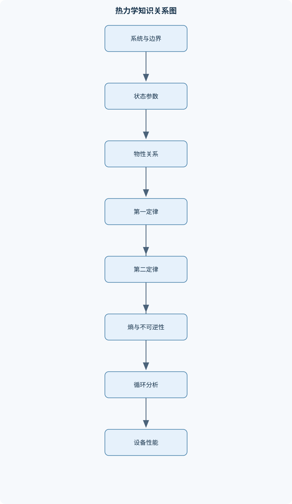
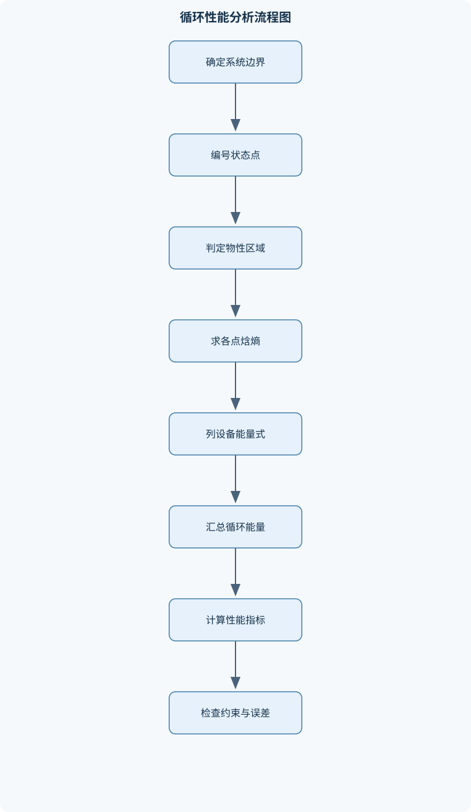

# 工程热力学

## 一、课程整体知识框架

### 课程边界与先修知识

工程热力学研究热、功与其他能量形式之间的转换规律，以及工质在热力设备中的状态变化、能量转换效率和不可逆损失。课程边界包括热力学基本概念与定律、纯物质和理想气体性质、稳态稳流能量分析、熵与可用能、动力循环、制冷与热泵循环、湿空气基础及工程系统性能分析。重点对象包括锅炉、汽轮机、压气机、燃烧室、换热器、冷凝器、内燃机、燃气轮机、蒸汽动力装置、制冷机和热泵。通常先修高等数学、普通物理、大学化学和流体力学基础；应掌握微积分、常微分方程、单位换算、能量守恒和基本状态方程。课程不深入核反应堆物理、材料强度、传热设备详细设计和电站安全法规，但可将核能发电作为热力系统边界分析案例。





### 1. 课程对象、任务与边界

工程热力学研究热量、功、内能以及其他能量形式之间的转换规律，重点分析工质在锅炉、汽轮机、压气机、燃烧室、冷凝器、换热器、制冷机和热泵中的状态变化、能量传递、性能上限与不可逆损失。课程的核心问题不是“系统含有多少热量”，而是：系统处于什么状态，状态如何变化，热量和功如何跨越边界传递，能量转换能达到什么程度，以及实际损失来自哪里。

课程建立在三个层次上。第一层是状态描述：用压力 $p$、温度 $T$、比容 $v$、内能 $u$、焓 $h$ 和比熵 $s$ 等参数描述工质状态。第二层是过程分析：利用热力学第一定律计算热量、功和能量变化。第三层是性能评价：利用第二定律、熵产生和火用分析判断过程方向性、能量品质及不可逆损失。

工程分析必须首先明确系统边界。闭口系统的质量保持不变，能量可以通过热量和功跨越边界；控制体允许质量随流动进出，适用于汽轮机、压气机、泵、锅炉、换热器和节流阀。状态点通常用“状态1”“状态2”编号。闭口系统质量用 $m$ 表示，控制体质量流率用 $\dot m$ 表示；压力、温度、比容、内能、焓和熵分别用 $p,T,v,u,h,s$ 表示。

### 2. 基本符号、单位与建模假设

压力必须区分绝对压力与表压。绝对压力以绝对真空为基准，状态方程和纯物质相平衡性质通常要求使用绝对压力；表压是相对于当地大气压的压力。若当地大气压为 $p_{\mathrm{atm}}$，表压为 $p_g$，则绝对压力为

$$
p_{\mathrm{abs}}=p_{\mathrm{atm}}+p_g。
$$

温度在热力学温标中使用开尔文，摄氏温差与开尔文温差的数值相同，但绝对温度不能把摄氏数值直接代入温度比。例如卡诺效率中的 $T_L/T_H$ 必须使用开尔文。比容定义为

$$
v=\frac{V}{m},
$$

其中 $V$ 的单位为 $\mathrm{m^3}$，$m$ 的单位为 $\mathrm{kg}$，故 $v$ 的单位为 $\mathrm{m^3/kg}$；密度为 $\rho=1/v$。焓定义为

$$
h=u+pv,
$$

其中 $u$ 的单位为 $\mathrm{kJ/kg}$，$pv$ 也必须换算为相同的单位。热量 $Q$ 和功 $W$ 的单位为 $\mathrm{J}$ 或 $\mathrm{kJ}$，传热率和功率分别用 $\dot Q$、$\dot W$ 表示，单位为 $\mathrm{W}$ 或 $\mathrm{kW}$。

本课程常采用稳态、准静态、绝热、忽略动能和位能等理想化假设，但每项假设都必须说明。稳态只表示控制体内宏观参数不随时间明显变化，不表示没有质量流和能量流；准静态表示过程由一系列接近平衡的状态组成，不等同于可逆；可逆过程还要求不存在摩擦、有限温差传热、非平衡混合和不可逆压降等因素。

### 3. 能量守恒与方向性约束

闭口系统采用“传入系统的热量为正、系统对外做功为正”的约定时，热力学第一定律为

$$
\Delta U=Q-W。
$$

若过程只有准静态边界功，则

$$
W_b=\int_1^2 p\,\mathrm dV。
$$

该积分要求系统内部压力与边界处压力在过程中可以视为一致；快速膨胀、强非平衡过程或存在显著外部阻力时，不能直接用系统内部压力代替边界压力。

控制体的稳态稳流能量方程为

$$
\dot Q-\dot W_s
=
\dot m\left[
(h_2-h_1)
+\frac{c_2^2-c_1^2}{2}
+g(z_2-z_1)
\right].
$$

式中 $\dot W_s$ 为控制体输出的轴功率，$c^2/2$ 为单位质量动能，$gz$ 为单位质量位能。汽轮机通常输出轴功，压气机和泵通常需要输入轴功，锅炉和冷凝器主要通过热量交换改变工质焓，节流阀在忽略散热、轴功、动能和位能时近似满足 $h_1=h_2$。

第一定律只能说明能量总量守恒，不能单独判断过程能否自然发生。例如摩擦会把机械功耗散为内能，但内能不能在没有其他影响的条件下全部恢复为机械功；热量可由高温物体传给低温物体，却不会自发地由低温物体传给高温物体。热力学第二定律正是对能量转换方向和品质的约束。

### 4. 课程知识的主线关系

课程可按“状态性质—过程规律—设备模型—循环性能—系统优化”组织。纯物质和理想气体模型提供状态参数；第一定律完成各设备的能量收支；第二定律计算熵变和熵产生；火用分析进一步定位不可逆损失；循环分析将锅炉、汽轮机、冷凝器、泵或压气机、燃烧室等设备组合起来，评价热效率、制冷系数、供热系数和净功。

热机从高温热源吸收热量 $Q_H$，向低温热源放出热量 $Q_L$，输出净功

$$
W_{\mathrm{net,out}}=Q_H-Q_L,
\qquad
\eta_{\mathrm{th}}=\frac{W_{\mathrm{net,out}}}{Q_H}
=1-\frac{Q_L}{Q_H}.
$$

制冷机消耗功，将热量从低温空间搬运到高温环境，制冷系数为

$$
\mathrm{COP_R}=\frac{Q_L}{W_{\mathrm{net,in}}},
$$

热泵以高温侧供热为目的，供热系数为

$$
\mathrm{COP_{HP}}=\frac{Q_H}{W_{\mathrm{net,in}}}.
$$

两者功能不同，不能用热效率替代制冷系数。对于给定高、低温热源，所有可逆热机的效率上限为

$$
\eta_{\mathrm{Carnot}}=1-\frac{T_L}{T_H},
$$

其中 $T_H$、$T_L$ 必须是绝对温度。该式是理想上限，不是实际设备的普遍计算式。

## 二、章节和模块划分

### 核心知识覆盖清单

本清单用于检查正文是否覆盖本课程的主要知识模块：

- **热力学基本概念与系统描述**：热力学系统、边界与外界、闭口系统与控制体、平衡状态与状态公理、状态参数与过程量、强度量与广延量、准静态过程与可逆过程、温度与热力学第零定律、压力、真空度与绝对压力、单位制、量纲与有效数字。
- **纯物质的状态与热力性质**：纯物质的相态与相变、饱和液、饱和蒸气和湿蒸气、汽化潜热与干度、临界点和三相点、过冷液体与过热蒸气、压力—体积—温度关系、焓、内能和熵的物理意义、水和水蒸气热力性质表、温熵图、焓熵图与压焓图、状态参数的插值和单位一致性。
- **理想气体与实际气体**：理想气体状态方程、气体常数与摩尔质量、比热容和热容比、理想气体内能与焓的温度依赖性、定容、定压、定温和绝热过程、多变过程及指数、混合气体分压力和分容积、压缩因子与偏差分析、实际气体状态方程、理想气体模型的适用边界。
- **热力学第一定律与能量守恒**：热量、功和内能的符号约定、闭口系统第一定律、边界功与体积功、定容功、定压功和多变功、稳态稳流能量方程、焓的引入与流动功、动能、位能和轴功、循环过程的能量平衡、相变过程中的热量和功、能量方程的系统边界选择。
- **热力学第二定律与熵**：热力学第二定律的两种表述、热机、制冷机和热泵的方向性、卡诺循环及其组成过程、热力学温标、熵和熵变、克劳修斯不等式、可逆过程与不可逆过程、孤立系统熵增原理、控制体熵平衡、熵产生与摩擦、节流、有限温差传热。
- **可用能与能量品质分析**：能量数量与能量品质、环境基准状态、物理火用和化学火用的概念、闭口系统和稳流系统火用、火用损失与熵产生、燃料燃烧的火用分析、换热器、汽轮机和压气机的火用效率、不可逆损失定位、火用分析与能量分析的区别、火用方法的适用条件和边界。
- **气体动力循环**：内燃机循环的理想化假设、奥托循环及压缩比、狄塞尔循环及截止比、混合加热循环、燃气轮机布雷顿循环、压气机与膨胀机等熵效率、回热、间冷和再热、循环净功与热效率、实际燃烧、压降和机械损失、理想循环与实际装置性能差异。
- **蒸汽动力循环**：朗肯循环及其设备组成、锅炉、汽轮机、冷凝器和给水泵、蒸汽动力循环的状态点确定、汽轮机等熵膨胀和排汽干度、过热、再热和回热循环、给水加热器与抽汽过程、循环热效率和净功、冷凝压力对循环性能的影响、核能或工业余热驱动的蒸汽循环、汽水两相流性质对设备运行的影响。
- **制冷机与热泵循环**：制冷机、热泵和热机的功能区别、制冷系数和供热系数、逆卡诺循环、蒸气压缩制冷循环、压缩机、冷凝器、节流阀和蒸发器、节流过程的等焓特征、过热和过冷对性能的影响、制冷剂状态点分析、吸收式制冷的能量转换特点、制冷系统的实际压降和不可逆性。
- **湿空气与空气调节基础**：湿空气与干空气的组成、含湿量和相对湿度、露点温度、湿球温度与焓湿图、加热、冷却和加湿过程、冷却除湿过程、混合空气过程、空气调节设备的能量平衡、显热比和送风状态、湿空气模型的压力和温度适用范围。
- **换热器与热力设备综合分析**：换热器控制体建模、逆流与顺流换热、换热器能量平衡、温差推动力与对数平均温差、换热器有效度方法、锅炉和冷凝器的热力分析、管路压降对循环性能的影响、泵、风机和压缩机功率、设备性能系数和等熵效率、系统级能量与熵分析。
- **热力系统建模、实验与性能评价**：热力系统流程图和状态点编号、状态方程与性质表的联合使用、测量压力、温度、流量和功率、稳态数据筛选与误差传播、能量平衡残差检查、熵产生和性能退化诊断、循环性能计算流程、理想模型与实验结果对比、参数敏感性分析、工程设计中的安全边界和运行约束。


### 1. 热力学基本概念与系统描述

本模块定义热力学系统、边界和外界，区分闭口系统与控制体。系统边界可以是实际壁面，也可以是为分析方便假想的控制面。状态是系统宏观性质的集合；平衡状态要求热平衡、力平衡和相平衡等条件同时满足。状态公理说明，简单可压缩单相系统通常由两个相互独立的强度状态量确定。

温度是状态参数，热量和功是过程量。温度由热力学第零定律建立测量基础：若系统甲与系统乙分别和系统丙处于热平衡，则甲与乙彼此处于热平衡。压力是单位面积上的法向力，真空度不能替代绝对压力。强度量不随系统质量改变，如温度、压力和比容；广延量随系统规模改变，如质量、体积、内能和熵。准静态过程便于使用路径积分，但只有可逆过程才能达到理想的最大功或最小功边界。

### 2. 纯物质的状态与热力性质

纯物质的化学组成固定，但可以发生固态、液态和气态之间的相变。饱和液体和饱和蒸气分别表示即将汽化和即将凝结的状态；两者之间为饱和两相区。湿蒸气是饱和液与饱和蒸气的平衡混合物，其干度为蒸气质量占总质量的比例：

$$
x=\frac{m_g}{m_f+m_g},
\qquad 0\le x\le1。
$$

对比容、比内能、比焓和比熵等性质，均可在两相区按

$$
y=y_f+x(y_g-y_f)
$$

计算，其中下标 $f$ 表示饱和液，下标 $g$ 表示饱和蒸气。该式只适用于平衡两相混合物，不能用于过热蒸气、过冷液体，也不能把干度当作体积含气率。

临界点是液、汽两相性质逐渐趋于一致的状态；超过临界温度后，不能通过单纯加压使气体液化。三相点表示固、液、汽三相共存。低于饱和温度的液体通常称为过冷液体或压缩液体，高于饱和温度的蒸气称为过热蒸气。水和水蒸气的性质通常通过饱和表、过热表和压缩液体表获得，使用时要统一压力、温度和比性质单位，并检查插值区间。温熵图、焓熵图和压焓图分别突出熵变、焓变和制冷循环压力焓差等信息。

### 3. 理想气体与实际气体

理想气体模型满足

$$
pv=RT,
$$

其中 $R$ 为比气体常数，单位为 $\mathrm{J/(kg\cdot K)}$；若摩尔质量为 $M$，则 $R=\bar R/M$。理想气体的内能和焓主要由温度决定：

$$
\Delta u=c_v(T_2-T_1),\qquad
\Delta h=c_p(T_2-T_1),
$$

在比热容可视为常数时成立，并且

$$
c_p-c_v=R,\qquad k=\frac{c_p}{c_v}。
$$

定容、定压、定温和绝热过程分别对应不同的状态关系。理想气体可逆绝热且比热容近似不变时，有

$$
pv^k=\text{常数},\qquad
Tv^{k-1}=\text{常数},\qquad
T^kp^{1-k}=\text{常数}.
$$

多变过程可写为 $pv^n=\text{常数}$，指数 $n$ 由过程特征决定，不能任意当作 $k$。混合气体分析使用分压力和分容积；当各组分近似理想气体时，道尔顿分压定律适用。高压、低温、接近饱和线或临界区时，理想气体误差增大，应使用压缩因子 $Z$ 或实际气体状态方程。理想气体不能用于描述液体、两相混合物和明显凝结过程。

### 4. 热力学第一定律与能量守恒

第一定律将热量、功和内能变化联系起来。定容过程中边界功为零，但系统仍可能通过轴功、电功、化学反应或热量改变能量；因此“定容”不等于“没有功”。定压且仅有边界功、动能位能变化可忽略时，才有

$$
Q_p=\Delta H。
$$

若存在轴功、化学能变化或显著流动能，该结论不能直接套用。循环过程中系统回到初态，状态函数变化为零，因此

$$
\Delta U_{\mathrm{cycle}}=0,\qquad
W_{\mathrm{net}}=Q_{\mathrm{net}}。
$$

相变过程中温度可保持不变，但系统仍可吸收汽化潜热；这说明热量不是温度的同义词。能量方程的正确形式取决于边界：将锅炉单独作为控制体时，燃料化学能或外部热量是输入；将整个动力装置作为系统时，内部设备之间的热量传递可能成为内部交换，不应重复计算。

### 5. 热力学第二定律与熵

第二定律可由热机表述和制冷机表述说明：不可能制造一种循环工作的热机，只从单一热源吸热并把全部热量转化为功；不可能制造一种循环工作的制冷机，不消耗功而把热量从低温物体传向高温物体。

卡诺循环由两个可逆等温过程和两个可逆绝热过程组成，是给定两个热源温度时的可逆极限。熵通过可逆路径定义：

$$
\Delta S=\int_1^2\frac{\delta Q_{\mathrm{rev}}}{T}.
$$

实际不可逆过程不能简单写成 $\delta Q/T$ 来求系统熵变；应根据初、末状态寻找可逆替代路径，或使用熵平衡。克劳修斯不等式为

$$
\oint\frac{\delta Q}{T}\le0。
$$

孤立系统满足 $\Delta S_{\mathrm{isolated}}\ge0$。摩擦、节流、有限温差传热、混合和压降均会产生熵。控制体熵平衡必须同时计入热传递熵流和质量携带的熵流；忽略其中一项会造成错误的熵产生。节流阀近似等焓，但通常不是等熵过程。

### 6. 可用能与能量品质分析

能量数量守恒，但能量品质不同。环境基准状态由环境温度 $T_0$ 和压力 $p_0$ 等确定；火用表示系统相对于环境最多能够产生的有用功，其数值依赖所选环境基准。火用可包括由温度、压力等差异产生的物理火用，也可包括由化学组成差异产生的化学火用。

不可逆性导致火用损失。火用损失与熵产生满足

$$
Ex_{\mathrm{destroyed}}=T_0S_{\mathrm{gen}},
$$

其中 $T_0$ 必须使用开尔文。能量分析回答“有多少能量进出设备”，火用分析还回答“高品质能量在哪里被降级”。换热器、汽轮机、压气机、锅炉和燃烧室均可用火用效率评价。火用方法适合比较不同损失来源，但必须明确系统边界、环境基准和物质流组成；若环境状态未定义，火用数值没有完整意义。

### 7. 气体动力循环

奥托循环用于理想化火花点火内燃机，通常包括定熵压缩、定容加热、定熵膨胀和定容放热，压缩比是影响理想热效率的重要参数。狄塞尔循环采用定压加热，截止比描述加热阶段的体积变化。混合加热循环同时包含定容和定压加热，用于介于两种理想循环之间的分析。

布雷顿循环是燃气轮机的基本理想模型，由压气机等熵压缩、定压加热、膨胀机等熵膨胀和定压放热组成。实际分析必须考虑压气机和膨胀机等熵效率、燃烧室压降、机械损失、冷却空气抽取和换热损失。回热利用排气余热预热压气机出口空气；间冷降低压气机压缩功；再热提高膨胀过程的平均吸热温度或改善输出功，但会增加设备数量和压力损失。理想循环的高效率不等于实际燃气轮机的净效率。

### 8. 蒸汽动力循环

朗肯循环由锅炉、汽轮机、冷凝器和给水泵组成。锅炉向水输入热量使其汽化并可能过热，汽轮机膨胀输出功，冷凝器向冷却介质放热，给水泵提高冷凝水压力。状态点分析必须依次确定泵入口、泵出口、锅炉出口、汽轮机出口等状态，并通过焓差计算各设备能量变化。

汽轮机理想膨胀通常取等熵，实际出口焓高于理想等熵出口焓。汽轮机等熵效率为

$$
\eta_t=\frac{h_1-h_{2,\mathrm{actual}}}
{h_1-h_{2s}}。
$$

排汽过湿会引起叶片冲蚀，因此需要关注排汽干度。过热、再热和回热通常能够改善循环性能：过热提高平均吸热温度并降低末级湿度，再热减少低压级湿度，回热利用抽汽预热给水。但这些措施会增加设备、控制和材料约束。降低冷凝压力通常提高循环净功和热效率，却会增大冷凝器体积、冷却需求以及排汽湿度。核能或工业余热可作为锅炉侧热源进行蒸汽动力循环边界分析，但热源内部的核反应、中子输运和安全设计不属于本课程的循环热力学范围。

### 9. 制冷机与热泵循环

制冷机以低温侧吸热为功能目标，热泵以高温侧放热为功能目标。逆卡诺循环给出理想上限：

$$
\mathrm{COP_R}=\frac{T_L}{T_H-T_L},
\qquad
\mathrm{COP_{HP}}=\frac{T_H}{T_H-T_L}.
$$

蒸气压缩制冷循环主要由压缩机、冷凝器、节流阀和蒸发器组成。压缩机提高压力和温度，冷凝器向环境放热，节流阀使制冷剂压力下降，理想节流近似满足 $h_3=h_4$，蒸发器从低温空间吸热。过热可防止压缩机吸入液体，过冷可减少节流前闪蒸并提高制冷量，但过度过热或过冷会改变压缩功、排气温度和系统安全边界。实际系统还存在管路压降、换热温差、压缩机摩擦和制冷剂充注偏差。

吸收式制冷以热能驱动吸收、发生、冷凝和蒸发过程，机械压缩功较小，但需要高温热源，系统通常更复杂。评价制冷系统时必须区分蒸发器制冷量、压缩机输入功、冷凝器排热量和系统总功耗。

### 10. 湿空气与空气调节基础

湿空气是干空气与水蒸气的混合物。含湿量通常表示单位质量干空气所含水蒸气质量；相对湿度表示实际水蒸气分压力与同温度下饱和水蒸气压力之比。空气冷却到露点温度时开始凝结；继续冷却会发生冷却除湿，析出的水分必须纳入质量平衡。

湿球温度反映蒸发冷却条件下的热湿交换状态，焓湿图可同时表示干球温度、含湿量、相对湿度、焓和湿球温度等参数。加热通常近似为含湿量不变、焓增加；加湿会增加水蒸气质量和湿空气焓；冷却除湿同时降低温度和含湿量。混合空气过程必须按干空气质量守恒、水蒸气质量守恒和总焓守恒分析。显热比用于表示总冷负荷中显热所占比例，送风状态需同时满足显热、潜热和舒适性要求。湿空气模型主要适用于常见空调温度和压力范围；高压、极低温或水蒸气含量较高时，理想混合气体近似需要修正。

### 11. 换热器与热力设备综合分析

换热器分析首先建立控制体并分别列冷热流体能量平衡。无外部散热且无相变时，冷热侧换热量应满足

$$
\dot Q_h=\dot m_h c_{p,h}(T_{h,\mathrm{in}}-T_{h,\mathrm{out}})
=
\dot m_c c_{p,c}(T_{c,\mathrm{out}}-T_{c,\mathrm{in}}).
$$

顺流和逆流的温差分布不同，常用对数平均温差方法或有效度—传热单元数方法评价性能。发生沸腾或冷凝时，不能只用 $mc_p\Delta T$，应使用焓差，包括显热和潜热。

锅炉与冷凝器既是换热设备，也是动力循环的边界设备；管路压降会改变泵功、汽轮机膨胀比、制冷系统冷凝压力和循环净功。泵、风机和压缩机的功率应结合质量流率、压升或焓升以及设备效率计算。系统级分析需同时检查能量守恒、熵产生、压降、设备性能系数和运行安全约束，不能只依据单台设备的热效率判断整个系统。

### 12. 热力系统建模、实验与性能评价

热力系统建模从流程图和状态点编号开始。每个状态点应记录压力、温度、流量、焓、熵和相态；状态方程、性质表与设备性能方程需要联合使用。稳态实验通常测量压力、温度、流量、功率和环境参数，并在数据筛选后计算时间平均值。

能量平衡残差可用于发现散热、泄漏、流量波动、设备储能或仪表偏差，但不能把全部残差直接归因于测量误差。熵产生应满足非负性；若算得负值，应优先检查压力是否误用表压、温度是否误用摄氏值、质量流方向、单位换算和熵流符号。参数敏感性分析可研究冷凝压力、压比、过热度、流量和设备效率变化对循环性能的影响。工程设计还必须考虑材料耐温、压力容器强度、湿蒸气侵蚀、制冷剂安全性、燃烧稳定性、排放、控制范围和联锁保护；这些约束决定了理想热力模型能否转化为可运行设备。

## 三、核心概念的详细解释

### 1. 系统、边界与状态描述

热力学系统是被选定用于分析的物质集合或空间区域，系统之外称为外界，系统与外界之间的分界面称为边界。边界可以是真实壁面，也可以是人为规定的控制面。选择边界并不是形式上的步骤，因为热量、功和质量是否穿过边界，直接决定所用能量方程的形式。

闭口系统与外界之间没有质量交换，但可以有热量和功交换。例如活塞气缸内的气体通常作为闭口系统；控制体则允许质量通过控制面流入和流出，适合分析汽轮机、压气机、锅炉、冷凝器、换热器和节流阀。稳态控制体内的压力、温度和流量在平均意义上不随时间变化，但质量和能量仍可以持续通过控制面。

状态是系统在某一时刻的宏观状况。压力 $p$、温度 $T$、比容 $v$、比内能 $u$、比焓 $h$ 和比熵 $s$ 是常用状态参数。状态参数只由初、终状态决定，与实际经历的路径无关；热量 $Q$ 和功 $W$ 则是过程量，不能说系统“含有多少热量”或“含有多少功”。

对于简单可压缩纯物质，在平衡状态下通常只需给出两个相互独立的强度状态量，即可确定其余状态参数。但在两相区，压力和温度并非独立变量，因为二者由饱和关系确定，此时还需要干度 $x$ 或其他性质确定具体状态。接近临界点时，性质对状态变量的变化十分敏感，低精度表格插值可能造成明显误差。

### 2. 温度、压力与单位一致性

热力学温度必须使用开尔文。摄氏温差与开尔文温差数值相同，即

$$
\Delta T[\mathrm{K}]=\Delta t[^\circ\mathrm{C}],
$$

但绝对温度不能直接使用摄氏数值。例如 $20^\circ\mathrm{C}=293.15\ \mathrm{K}$，不能在理想气体状态方程或卡诺效率中把 $20$ 作为绝对温度。

压力状态方程和蒸汽性质表要求使用绝对压力。若表压为 $p_g$，当地大气压为 $p_{\mathrm{atm}}$，则

$$
p_{\mathrm{abs}}=p_{\mathrm{atm}}+p_g。
$$

真空表给出的真空度通常不是绝对压力，必须先根据仪表定义换算。将表压直接代入 $pv=RT$，会造成密度、比容和焓值全部错误。

工程计算还必须统一能量单位。若压力用 $\mathrm{kPa}$、比容用 $\mathrm{m^3/kg}$，则 $pv$ 的单位为 $\mathrm{kJ/kg}$，因为

$$
1\ \mathrm{kPa}\cdot\mathrm{m^3}=1\ \mathrm{kJ}.
$$

若压力使用 $\mathrm{MPa}$，则必须将其换算为 $\mathrm{kPa}$，或把最终能量单位统一换算。有效数字不应超过输入测量量的可信精度，计算结果还应通过量纲和数量级检查。

### 3. 纯物质、相变与干度

纯物质是化学组成固定的物质，例如水、氨或某种单一制冷剂。纯物质可以处于固态、液态或气态，也可以处于两相共存状态。液态水加热到饱和状态称饱和液，继续吸热后形成液汽混合物，全部汽化后成为饱和蒸气；继续加热则成为过热蒸气。

在饱和两相区，干度定义为蒸气质量与总质量之比：

$$
x=\frac{m_g}{m_f+m_g},\qquad 0\le x\le1。
$$

干度是质量分数，不是体积分数。由于液相和汽相的密度差异很大，质量干度为 $0.1$ 时，蒸气占据的体积比例可能远大于 $0.1$。干度只适用于饱和液与饱和蒸气组成的平衡两相混合物，不能用于过热蒸气或过冷液体。

两相区任意比性质 $y$ 可按下式计算：

$$
y=y_f+x(y_g-y_f)=y_f+xy_{fg},
$$

其中 $y$ 可以是 $v$、$u$、$h$ 或 $s$；下标 $f$ 表示饱和液，下标 $g$ 表示饱和蒸气，$y_{fg}=y_g-y_f$。例如已知压力和比焓时，若该压力下饱和焓满足 $h_f<h<h_g$，则

$$
x=\frac{h-h_f}{h_g-h_f}。
$$

若 $h<h_f$，状态通常为过冷液；若 $h>h_g$，状态为过热蒸气。临界点以上不存在通常意义上的液汽相界面，因而不能使用干度公式。

### 4. 理想气体与实际气体

理想气体模型满足

$$
pv=RT,
$$

其中 $R$ 为比气体常数，单位为 $\mathrm{J/(kg\cdot K)}$ 或 $\mathrm{kJ/(kg\cdot K)}$。若使用摩尔形式，则

$$
pV=n\overline R T,\qquad R=\frac{\overline R}{M},
$$

其中 $n$ 为物质的量，$M$ 为摩尔质量，$\overline R$ 为通用气体常数。

理想气体的内能和焓只取决于温度，因此

$$
\Delta u=\int_{T_1}^{T_2}c_v(T)\,\mathrm dT,\qquad
\Delta h=\int_{T_1}^{T_2}c_p(T)\,\mathrm dT。
$$

当比热容可视为常数时，

$$
\Delta u=c_v(T_2-T_1),\qquad
\Delta h=c_p(T_2-T_1),
$$

并且

$$
c_p-c_v=R,\qquad k=\frac{c_p}{c_v}.
$$

在低压、远离饱和线和临界区时，理想气体近似通常较好；高压、低温、接近凝结或临界状态时，应采用压缩因子 $Z$ 或实际气体状态方程。写成

$$
pv=ZRT
$$

时，$Z=1$ 才对应理想气体。不能因为某种物质是气体，就在所有温度和压力下直接使用理想气体模型。

### 5. 第一律、焓与稳态设备

按“传入系统的热量为正、系统对外做功为正”的约定，闭口系统第一定律为

$$
\Delta U=Q-W。
$$

若只有准静态边界功，则

$$
W_b=\int_1^2p\,\mathrm dV。
$$

这里的 $p$ 必须是过程中系统内部压力，并且过程应足够缓慢，使系统近似处于连续平衡状态。快速爆炸、突然放空和强烈非平衡膨胀不能直接用系统内部压力积分计算边界功。

焓定义为

$$
H=U+pV,\qquad h=u+pv。
$$

焓并不是一种独立于内能的“新能量”，而是把流动功 $pv$ 与内能合并后形成的便于流动系统分析的状态函数。稳态、单入口单出口控制体的能量方程为

$$
\dot Q-\dot W_s
=
\dot m\left[
(h_2-h_1)+\frac{c_2^2-c_1^2}{2}+g(z_2-z_1)
\right]。
$$

汽轮机通常近似绝热，动能和位能变化可忽略，此时出口轴功近似为

$$
\dot W_{s,\mathrm{out}}\approx \dot m(h_1-h_2)。
$$

压气机和泵需要输入轴功，若忽略散热、动能和位能，则输入功近似为

$$
\dot W_{s,\mathrm{in}}\approx \dot m(h_2-h_1)。
$$

节流阀没有轴功，通常也忽略热交换、动能和位能变化，因此

$$
h_1=h_2。
$$

等焓不等于等熵。节流过程存在不可逆压力降，通常有熵增加。

### 6. 第二律、熵与可逆性

热力学第二律说明能量转换具有方向性和品质限制。热量可自发地从高温物体传向低温物体，但不能在无其他影响的情况下由低温物体传向高温物体。热机不可能把从单一热源吸收的全部热量转化为循环功；制冷机则必须消耗外界功，才能把热量从低温端输送到高温端。

熵的定义必须沿可逆路径书写：

$$
\mathrm dS=\frac{\delta Q_{\mathrm{rev}}}{T},
$$

因此实际不可逆过程中不能直接用 $\delta Q/T$ 代替系统熵变。对任意循环，克劳修斯不等式为

$$
\oint\frac{\delta Q}{T}\le0。
$$

可逆循环取等号，不可逆循环取小于号。孤立系统满足

$$
\Delta S_{\mathrm{isolated}}\ge0。
$$

熵增来自摩擦、有限温差传热、节流、混合、非弹性变形和流动压降等。熵增并不表示能量凭空增加，而表示能量中可转化为有用功的部分减少。

控制体熵平衡的一般形式为

$$
\frac{\mathrm dS_{\mathrm{cv}}}{\mathrm dt}
=
\sum\frac{\dot Q_j}{T_{b,j}}
+\sum_{\mathrm{in}}\dot m s
-\sum_{\mathrm{out}}\dot m s
+\dot S_{\mathrm{gen}},
$$

其中 $T_{b,j}$ 是热量通过边界处的边界温度，$\dot S_{\mathrm{gen}}\ge0$。稳态时控制体内熵不积累。若传热边界温度、流向或单位使用错误，可能计算出负的熵产生，此时应优先检查符号和绝对温度。

### 7. 循环、性能指标与设备关联

热机循环的初末状态相同，因此

$$
\Delta U_{\mathrm{cycle}}=0,\qquad W_{\mathrm{net}}=Q_{\mathrm{net}}。
$$

热效率为

$$
\eta_{\mathrm{th}}=\frac{W_{\mathrm{net,out}}}{Q_{\mathrm{in}}}.
$$

卡诺热机在高温热源 $T_H$ 和低温热源 $T_L$ 之间运行时，最大可能效率为

$$
\eta_{\mathrm{Carnot}}=1-\frac{T_L}{T_H},
$$

温度必须用开尔文。实际循环效率不可能超过该上限。

蒸汽动力循环通常由锅炉、汽轮机、冷凝器和给水泵构成。提高锅炉出口温度、降低冷凝压力、采用再热和给水回热通常有利于提高性能，但会受到材料耐温、汽轮机末级湿度、设备成本、冷却条件和安全压力的限制。核能或工业余热可以作为锅炉等效热源，但热源释放过程与蒸汽动力循环仍属于不同分析层次。

燃气轮机理想布雷顿循环由压缩、定压加热、膨胀和定压放热组成。实际性能受压气机和膨胀机等熵效率、燃烧室压降、散热、机械摩擦和环境温度影响。内燃机理想循环则用奥托、狄塞尔或混合加热过程近似真实燃烧，压缩比和供热过程决定理想循环性能，但实际燃烧、换气损失和冷却损失会降低输出。

制冷机和热泵都属于逆向循环。制冷系数和供热系数分别为

$$
\mathrm{COP_R}=\frac{Q_L}{W_{\mathrm{net,in}}},
\qquad
\mathrm{COP_{HP}}=\frac{Q_H}{W_{\mathrm{net,in}}}.
$$

蒸气压缩制冷系统包括压缩机、冷凝器、节流阀和蒸发器。节流阀近似等焓，压缩机消耗轴功，蒸发器吸收低温侧热量。过热、过冷、压力降和压缩机效率会改变制冷量及功耗，不能仅用理想逆卡诺系数评价实际装置。

### 8. 湿空气与换热器

湿空气可近似视为干空气与水蒸气的混合物。含湿量通常定义为单位质量干空气所含水蒸气质量：

$$
\omega=\frac{m_v}{m_a}.
$$

相对湿度是实际水蒸气分压力与同温度下饱和水蒸气压力之比：

$$
\phi=\frac{p_v}{p_{v,\mathrm{sat}}(T)}。
$$

空气冷却到水蒸气开始凝结的温度称露点温度。冷却除湿过程不仅改变显热，还会释放凝结潜热，因此应使用湿空气焓差计算总冷负荷。湿球温度受蒸发和空气含湿量影响，不能简单等同于露点温度或干球温度。

换热器无外部散热且无相变时，冷热侧能量平衡为

$$
\dot Q
=
\dot m_hc_{p,h}(T_{h,\mathrm{in}}-T_{h,\mathrm{out}})
=
\dot m_cc_{p,c}(T_{c,\mathrm{out}}-T_{c,\mathrm{in}})。
$$

发生沸腾或冷凝时，应改用焓差：

$$
\dot Q=\dot m(h_{\mathrm{out}}-h_{\mathrm{in}})。
$$

换热器的顺流、逆流布置改变温差分布和可达到的出口温度。有限温差传热必然产生熵，增大传热面积可降低传热温差，但会增加材料、体积和压降成本。

### 9. 火用与能量品质

能量守恒只能说明数量平衡，不能说明能量是否容易转化为有用功。火用是在给定环境温度 $T_0$、环境压力 $p_0$ 和环境组成下，系统相对于环境理论上能够获得的最大有用功。火用数值依赖环境基准，不能脱离 $T_0,p_0$ 讨论。

不可逆损失与熵产生满足

$$
E_{x,\mathrm{destroyed}}=T_0S_{\mathrm{gen}}。
$$

因此，热量损失不一定等于火用损失。高温热源传递的同样数量热量通常具有更高火用；低温冷却水排出的热量虽然数量可能很大，但可转化为功的能力较低。火用分析适合定位锅炉燃烧、换热器有限温差、汽轮机膨胀、压气机压缩和节流过程中的品质损失，但必须明确系统边界和环境基准。

## 四、重要定义、公式、定理和推导

### 专业审校补充：关键定义与适用边界

换热器的对数平均温差法适用于稳态、无轴功、外部散热可忽略，且冷热流体沿程比热容近似不变的单相换热过程。冷热侧能量平衡为 $\dot Q=\dot m_h c_{p,h}(T_{h,in}-T_{h,out})=\dot m_c c_{p,c}(T_{c,out}-T_{c,in})$，其中 $\dot m$ 为质量流率，单位为 $\mathrm{kg/s}$；$c_p$ 为定压比热容，单位为 $\mathrm{kJ/(kg\cdot K)}$；温度差可用摄氏温标表示，因为这里只涉及温差。对数平均温差定义为 $\Delta T_{lm}=(\Delta T_1-\Delta T_2)/\ln(\Delta T_1/\Delta T_2)$，其中 $\Delta T_1$、$\Delta T_2$ 是两端冷热流体温差，必须保持同一流动布置下的对应关系。换热量满足 $\dot Q=UA F\Delta T_{lm}$，$U$ 为总传热系数，$A$ 为传热面积，$F$ 为多流程修正因子。若两端温差相等，应取极限 $\Delta T_{lm}=\Delta T_1=\Delta T_2$，不能直接代入造成 $0/0$。发生沸腾、冷凝、显著变比热或温差发生交叉时，应改用分段焓差、有效度方法或数值积分；若计算得到温差交叉，通常说明出口温度假设或流量、热容数据不相容。


### 1. 定温理想气体膨胀例题

**题干：** $1\ \mathrm{kg}$ 理想气体在 $300\ \mathrm{K}$ 下准静态定温膨胀，体积由 $V_1$ 变为 $V_2=2V_1$。求边界功、内能变化及吸热量。设气体比气体常数为 $R$，比热容视为常数。

**分析：** 定温理想气体满足 $pV=mRT$，故 $p=mRT/V$。准静态条件使边界功可以用系统压力积分。

**解答：**

$$
W_b=\int_{V_1}^{V_2}p\,\mathrm dV
=\int_{V_1}^{V_2}\frac{mRT}{V}\,\mathrm dV
=mRT\ln\frac{V_2}{V_1}
=mRT\ln2。
$$

理想气体内能只由温度决定，且 $T_2=T_1$，所以

$$
\Delta U=mc_v(T_2-T_1)=0。
$$

由第一定律，

$$
Q=\Delta U+W_b=mRT\ln2。
$$

**结果验证：** 膨胀时系统对外做功，$W_b>0$；内能不变，因此必须从外界吸热，$Q>0$。若误用摄氏温度代入 $mRT$，结果会失去物理意义。

**变式：** 若过程不是准静态，最终状态仍相同，但边界功取决于实际外压路径，不能仅由初末体积比确定；内能变化仍由初末温度决定。

### 2. 定压汽化例题

**题干：** 质量为 $m$ 的饱和液态水在恒压下完全汽化，汽化潜热为 $h_{fg}$，初末比容分别为 $v_f$ 和 $v_g$。求吸热量、边界功和内能变化。

**分析：** 定压且仅有边界功时，吸热量等于焓升。边界功由 $p(V_2-V_1)$ 给出。

**解答：**

$$
Q=m h_{fg}.
$$

边界功为

$$
W_b=p\,m(v_g-v_f)。
$$

闭口系统第一定律给出

$$
\Delta U=Q-W_b
=m\left[h_{fg}-p(v_g-v_f)\right]。
$$

由焓定义，

$$
h_{fg}=u_{fg}+p v_{fg},
$$

所以也可写成

$$
\Delta U=m u_{fg}。
$$

**结果验证：** 汽化过程中温度在给定压力下保持饱和温度，但系统仍吸收大量热量，这说明温度不是热量，潜热主要用于改变相态和分子间作用状态。若把 $Q$ 全部当作内能增加，会漏掉膨胀功。

**变式：** 若只汽化到干度 $x$，则

$$
Q=mxh_{fg},\qquad
\Delta U=mxu_{fg},\qquad
W_b=mpx(v_g-v_f)。
$$

### 3. 两相状态与干度例题

**题干：** 某纯物质在给定压力下的比焓为 $h$，查表得饱和液焓 $h_f$、饱和蒸气焓 $h_g$，且 $h_f<h<h_g$。求相态和干度，并写出比容和比熵。

**分析：** 焓位于饱和液和饱和蒸气之间，状态必在湿蒸气区。使用两相线性质量加权关系。

**解答：**

$$
x=\frac{h-h_f}{h_g-h_f}。
$$

随后由

$$
v=v_f+x(v_g-v_f),
$$

$$
s=s_f+x(s_g-s_f),
$$

求比容和比熵。若还需要比内能，则

$$
u=u_f+x(u_g-u_f)。
$$

**结果验证：** 必须满足 $0\le x\le1$。若计算得到 $x<0$ 或 $x>1$，说明状态并非两相区，或输入性质、压力单位和表格区域选择错误。

**变式：** 若给定的是过热蒸气比焓，则应查过热蒸气表，不能继续使用干度公式；若状态接近临界点，应避免用相距过大的表格点线性插值。

### 4. 理想气体可逆绝热压缩例题

**题干：** 理想气体进行可逆绝热压缩，已知初态 $T_1,p_1$、压力比 $r_p=p_2/p_1$ 和比热比 $k$。求出口温度，并说明压缩功如何计算。

**分析：** 可逆绝热过程满足 $\delta Q=0$ 且 $s_2=s_1$。比热容近似常数时，有

$$
\frac{T_2}{T_1}
=
\left(\frac{p_2}{p_1}\right)^{(k-1)/k}。
$$

**解答：**

$$
T_2=T_1r_p^{(k-1)/k}。
$$

闭口系统中，绝热压缩且无其他功时，

$$
\Delta U=-W。
$$

系统对外做功为负，因此外界输入功的正值为

$$
W_{\mathrm{in}}=mc_v(T_2-T_1)。
$$

若分析稳态压气机，忽略动能、位能和散热，则轴功输入为

$$
\dot W_{\mathrm{in}}
=
\dot m c_p(T_2-T_1)。
$$

**结果验证：** 压缩应使 $T_2>T_1$，输入功为正。若温度下降，通常表示指数、压力比或功符号使用错误。

**变式：** 实际压气机存在摩擦和流动损失，在相同进出口压力下，实际出口温度通常高于等熵出口温度。压气机等熵效率定义为

$$
\eta_c=
\frac{h_{2s}-h_1}{h_{2a}-h_1},
$$

其中 $2s$ 为等熵出口，$2a$ 为实际出口。

### 5. 汽轮机膨胀例题

**题干：** 蒸汽以状态1进入汽轮机，出口压力已知。由性质表确定等熵出口焓 $h_{2s}$，汽轮机等熵效率为 $\eta_t$。求实际出口焓和单位质量输出功。

**分析：** 汽轮机输出功，实际焓降小于理想等熵焓降。

**解答：**

汽轮机等熵效率为

$$
\eta_t=
\frac{h_1-h_{2a}}{h_1-h_{2s}}。
$$

整理得

$$
h_{2a}=h_1-\eta_t(h_1-h_{2s})。
$$

若忽略散热、动能和位能变化，单位质量输出功为

$$
w_t=h_1-h_{2a}。
$$

若实际出口焓落在饱和区，则用出口压力下的饱和性质计算干度：

$$
x_2=\frac{h_{2a}-h_f}{h_g-h_f}。
$$

**结果验证：** 应满足 $h_{2a}>h_{2s}$，且 $0<\eta_t\le1$。出口干度过低意味着液滴增多，可能造成叶片冲蚀；提高入口过热度、采用再热或调整冷凝压力可改善湿度，但受到材料和系统成本限制。

### 6. 简单布雷顿循环的计算流程

理想布雷顿循环采用理想气体、定比热、压气机和膨胀机可逆绝热、燃烧室和冷却器定压等假设。给定压气机压比 $r_p=p_2/p_1$、压气机入口温度 $T_1$ 和燃气轮机入口温度 $T_3$，先计算

$$
T_2=T_1r_p^{(k-1)/k},
$$

$$
T_4=T_3r_p^{-(k-1)/k}。
$$

压气机单位质量功为

$$
w_c=c_p(T_2-T_1)，
$$

膨胀机单位质量功为

$$
w_t=c_p(T_3-T_4)。
$$

循环净功和加热量为

$$
w_{\mathrm{net}}=w_t-w_c,
$$

$$
q_{\mathrm{in}}=c_p(T_3-T_2)。
$$

因此

$$
\eta_{\mathrm{th}}=\frac{w_{\mathrm{net}}}{q_{\mathrm{in}}}。
$$

实际计算应分别引入压气机和膨胀机等熵效率，并考虑燃烧室压降。压比并非越高越好，因为压气机耗功会随压比增加，存在净功和效率的折中。

### 7. 代表性计算流程与伪代码

#### 循环状态点分析算法

**输入：** 循环流程、各设备入口状态、压力或温度约束、质量流率、设备效率和环境参数。  
**输出：** 各状态点 $p,T,v,u,h,s$、设备热负荷、设备功率、净功和性能指标。  
**过程：**

1. 绘制流程边界并编号状态点。
2. 判断每个设备是闭口系统还是稳态控制体。
3. 根据已知压力、温度、干度或焓判定纯物质区域。
4. 对汽轮机、压气机、泵等设备先求理想状态，再用等熵效率修正实际状态。
5. 对锅炉、冷凝器和换热器使用焓差列能量方程。
6. 汇总循环吸热、放热和净功。
7. 检查质量守恒、能量平衡、熵产生非负性以及状态物理范围。

**不变量：** 每个状态点的单位必须一致；两相区干度必须在 $0$ 到 $1$ 之间；无泄漏稳态设备的入口总质量流率等于出口总质量流率。  
**终止条件：** 所有状态点和设备性能均已确定，且能量平衡残差不超过预设工程容许值。  
**适用条件：** 稳态或准稳态热力设备，且物性模型适用于工作压力和温度范围。  
**主要计算量：** 若每个状态点性质查询和设备计算视为常数时间，按状态点数 $N$ 计算的流程复杂度为 $O(N)$；若性质表采用迭代反算，复杂度还取决于插值或根求解次数。

```text
伪代码
输入：流程设备列表 D，入口状态，设备参数，环境状态
输出：状态表、各设备热负荷和功率、循环性能

编号所有状态点
对每个设备 d 按流程顺序执行：
    建立控制体并检查入口、出口数量
    写稳态质量守恒
    若 d 为汽轮机：
        由出口压力求等熵出口状态
        用 ηt 求实际出口焓
        计算输出功
    若 d 为压气机或泵：
        由出口压力求等熵出口状态
        用 ηc 求实际出口焓
        计算输入功
    若 d 为节流阀：
        设置 h_out = h_in
        由出口压力和焓确定出口相态
    若 d 为锅炉、冷凝器或换热器：
        用焓差计算热负荷
    检查压力、温度、干度和单位范围
汇总 Qin、Qout、Wnet
计算 ηth 或 COP
建立总能量平衡和熵平衡
若残差超限或 Sgen < 0：
    检查流向、表压、温标、单位和物性区域
返回结果
```

### 8. 实验与项目流程

#### 稳态换热器性能实验

**输入数据：** 冷、热流体入口和出口温度，质量流率，压力，环境温度，以及设备功率或辅助加热量。  
**步骤：**

1. 检查温度传感器量程、压力传感器零点和流量计单位。
2. 启动系统，待入口、出口温度和流量在一段时间内波动稳定。
3. 对稳定时间段进行时间平均，避免只采用单个瞬时读数。
4. 按冷热侧焓差计算换热量。
5. 比较冷热侧能量，计算相对残差：

$$
\varepsilon_E=
\frac{|\dot Q_h-\dot Q_c|}
{\max(|\dot Q_h|,|\dot Q_c|)}。
$$

6. 根据顺流或逆流布置计算对数平均温差，并评估传热能力与压降。
7. 对残差进行不确定度分析，区分散热、流量波动、传感器偏差和未达到稳态等原因。

**评价标准：** 能量平衡方向正确；冷热侧换热量在测量不确定度范围内一致；出口温度符合热力学方向约束；压力降和流量处于设备允许范围。  
**排错方法：** 若热侧放热量小于冷侧吸热量，检查流量单位、温度传感器位置和是否存在外部加热；若计算熵产生为负，检查温度是否用摄氏值、热量边界温度是否取错以及质量流方向。

#### 小型蒸汽动力循环性能项目

**输入数据：** 锅炉压力和出口温度、冷凝压力、汽轮机和泵效率、蒸汽流量、燃料或外部热源输入、各状态点压力温度。  
**步骤：**

1. 绘制锅炉—汽轮机—冷凝器—泵流程并编号状态点。
2. 使用饱和表和过热表确定各点焓、熵及相态。
3. 先求汽轮机等熵出口，再用等熵效率求实际出口焓。
4. 求冷凝器出口液体焓和泵出口焓。
5. 计算循环吸热、汽轮机功、泵功和净功。
6. 计算热效率，并进行熵产生定位。
7. 改变冷凝压力、过热温度或再热参数，进行敏感性分析。

**评价标准：** 各状态点相态判定正确；汽轮机出口干度不低于设备约束；循环能量残差可解释；性能变化趋势符合能量和第二定律。  
**排错方法：** 重点排查把表压当绝对压力、把泵功符号写反、在过热区使用干度、将等焓节流误当等熵以及遗漏冷凝器放热。

### 9. 常见易错点与典型问题

#### 具体易错点

1. 把热量当作状态参数；热量只有在过程发生时才有定义。
2. 用表压代替绝对压力进入状态方程。
3. 在卡诺效率和温度比公式中使用摄氏温度。
4. 将定压过程直接等同于 $Q=\Delta H$，忽略轴功和动能、位能条件。
5. 把干度理解为体积含气率。
6. 在过热蒸气区域使用干度公式。
7. 把节流过程误判为等熵过程。
8. 把稳态误解为控制体内没有质量流动。
9. 忽略汽轮机、压气机中的动能、位能项，却不说明假设。
10. 混用“系统对外做功为正”和“外界对系统做功为正”两种符号约定。
11. 用热效率评价制冷机，混淆 $\eta_{\mathrm{th}}$ 与 COP。
12. 认为提高锅炉温度或压气机压比必然提高系统整体性能。
13. 将能量平衡残差全部归结为仪表误差。
14. 计算火用时不声明环境温度和压力。
15. 认为理想可逆设备能够直接代表实际设备。
16. 将核反应堆热源过程与蒸汽动力循环混为同一层次。

#### 典型笔试问题及解答思路

1. **为什么定温理想气体膨胀仍需吸热？**  
   理想气体内能只由温度决定，定温时 $\Delta U=0$；膨胀对外做功，因此由第一定律必须吸收等量热量。

2. **为什么节流阀近似等焓而非等熵？**  
   对控制体列能量方程，忽略散热、轴功、动能和位能后得 $h_1=h_2$；阀内存在强不可逆压力降，熵通常增加。

3. **卡诺效率为什么必须用开尔文？**  
   推导来自可逆传热的熵平衡 $Q_H/T_H=Q_L/T_L$，温度是热力学绝对温度，摄氏零点不是绝对零点。

4. **如何判断给定纯物质的相态？**  
   先根据压力或温度查饱和条件，再比较给定焓、比容或温度与饱和值；位于饱和液、饱和蒸气之间才可求干度。

5. **汽轮机和压气机的等熵效率为何定义不同？**  
   汽轮机目标是最大化焓降和输出功，压气机目标是最小化压缩功；因此前者用实际焓降除以理想焓降，后者用理想功除以实际功。

6. **降低朗肯循环冷凝压力有什么影响？**  
   通常增大汽轮机膨胀焓降并提高效率，但会降低排汽干度、增加冷却负荷和设备真空要求，存在运行边界。

7. **能量分析与火用分析有什么区别？**  
   能量分析回答数量是否守恒，火用分析还回答能量品质损失在哪里；换热器可能能量损失很小，却因有限温差产生明显火用损失。

8. **为什么实际换热器不能达到无限大的换热量？**  
   受热容率、有限温差、传热面积、污垢、压降和材料强度限制。即使增加面积，边际收益也会降低。

### 10. 面试问题、参考答案与岗位联系

1. **如何分析一台汽轮机的性能退化？**  
   参考答案：比较入口和出口焓差、等熵效率、排汽压力及干度，并建立熵产生分布。深入追问可从叶片结垢、密封泄漏、湿蒸气冲蚀和测量偏差区分原因。

2. **压气机功率突然升高应检查什么？**  
   参考答案：检查入口温度、出口压力、流量、压气机效率和过滤器压降。深入追问应说明实际出口温度升高通常意味着摩擦、污染或喘振风险增加。

3. **换热器冷热侧能量不平衡如何处理？**  
   参考答案：先检查流量和温度单位，再检查稳态条件、外部散热、相变和传感器位置，不能直接把残差当作散热。深入追问可引入不确定度传播和熵平衡。

4. **为什么工业节能项目要做火用分析？**  
   参考答案：单看能量可能优先改造热量最大的设备，而火用分析能定位高品质能量的主要破坏位置。深入追问应说明环境基准变化会改变火用数值。

5. **制冷系统如何评价，而不是只看制冷量？**  
   参考答案：同时考察 $\mathrm{COP_R}$、压缩机功率、蒸发和冷凝压力、过热度、过冷度、压降与安全约束。深入追问可讨论环境温度升高导致冷凝压力和功耗增加。

6. **实验中熵产生算成负值怎么办？**  
   参考答案：先检查绝对温标、压力基准、质量流方向、热量符号、单位和入口出口编号；若仍异常，再检查稳态假设和传感器校准。熵产生为负通常说明模型或数据处理错误。

7. **如何解释核能蒸汽动力装置的热力边界？**  
   参考答案：将反应堆或蒸汽发生器视为循环热源，分析蒸汽膨胀、冷凝和给水泵功；不把裂变反应机理与汽轮机循环混为一体。深入追问可讨论热源温度对卡诺上限和材料约束的影响。

8. **如何判断理想模型是否适用于实际设备？**  
   参考答案：比较压力、温度和相态是否处于模型适用范围，再用实验数据检查能量残差、熵产生、效率和压降。深入追问应说明理想气体、定比热、绝热和稳态假设各自可能失效的条件。

### 11. 岗位任务与验收产出

热能工程师通常负责锅炉、汽轮机或综合能源系统的热平衡，使用第一律、性质表、循环分析和火用方法，产出状态点表、热效率、热耗率、能量平衡和改造建议；验收重点是边界清晰、单位一致、残差可解释。

制冷与空调工程师需要根据室内负荷、湿空气状态和制冷剂循环确定蒸发器、冷凝器及压缩机工况，使用焓湿图、COP、过热度、过冷度和除湿计算，产出冷量、功耗、送风状态和运行范围；验收重点是满足显热与潜热负荷、压力不超限、设备功率和环境条件匹配。

换热器设计工程师需要进行冷热侧能量平衡、对数平均温差、有效度、压降和污垢裕量分析，产出换热面积、出口温度、压降和性能校核；验收重点是热量守恒、温差方向正确、流速和压降处于设备约束内。

热工测试与仪表工程师负责压力、温度、流量和功率测量，使用稳态筛选、误差传播、能量平衡与熵平衡方法，产出校准记录、时间平均数据、不确定度和诊断报告；验收重点是数据可追溯、异常点有判据、残差不被任意解释。

能源系统分析师则比较不同循环、热源和设备组合的效率、火用损失、经济代价与运行边界，产出方案比较表、敏感性分析和性能退化诊断；验收重点是同时满足能量守恒、第二定律约束和工程运行条件。

## 五、算法、流程和实现思路

### 方法与流程覆盖索引

下列方法或流程应在正文中说明输入、步骤、适用条件、结果检查和边界：

- 闭口系统过程分析流程：输入初末状态、过程约束、质量、热量和功的符号约定；输出状态变化、热量、功和内能变化。过程为：确定系统边界→列出已知量与未知量→判断是否存在相变→选择状态方程或性质表→计算边界功及其他功→代入第一定律→检查单位、符号和能量平衡。适用于活塞气缸、定容容器和相变容器；若存在化学反应或显著非平衡，应扩展模型。
- 稳态稳流设备分析流程：输入入口和出口状态、质量流率、热交换、轴功以及速度和高度；输出设备功率、热负荷或出口状态。过程为：画控制体→确定入口和出口→列稳态质量守恒→列稳态能量方程→判断是否可忽略动能、位能和散热→使用性质表或状态方程求焓→进行残差校验。适用于汽轮机、压气机、泵、喷管、节流阀、锅炉和换热器。
- 纯物质状态点求解流程：输入任意两项独立强度状态量；输出相态、比容、比内能、比焓和比熵。过程为：比较给定压力与温度下的饱和条件→判定过冷液、两相区或过热蒸气→查对应区域性质→在两相区利用干度公式→进行单位和物理范围检查。若状态接近临界点，简单插值和低精度表格可能产生较大误差。
- 理想气体多变过程计算流程：输入 p1、T1、V1、p2、T2、V2 中的足够独立参数及过程指数 n；输出末态、功、热量和内能变化。过程为：用状态方程补齐状态量→根据 n 判断定压、定温、定容或一般多变过程→计算边界功→利用 Δu=cvΔT 和第一定律求热量→检查过程是否满足给定约束。只适用于理想气体且状态变化不涉及相变。
- 循环性能分析流程：输入循环各状态点和设备模型；输出净功、吸热、放热、热效率或制冷系数。过程为：建立流程图→编号状态点→确定各点压力、温度、焓和熵→逐个设备应用能量方程→汇总循环净功与总吸热→计算性能指标→与可逆上限和设备约束比较。适用于奥托、狄塞尔、布雷顿、朗肯和蒸气压缩制冷循环。
- 熵产生诊断流程：输入过程边界、热交换温度、进出口质量流和状态参数；输出系统熵变、熵传递和熵产生。过程为：确定控制体或闭口系统→计算各质量流熵流→计算热交换项∑Q/Tb→建立熵平衡→求 Sgen→检验 Sgen≥0→按摩擦、节流、混合、传热温差和压降定位不可逆来源。若结果为负，优先检查温标、流向、单位和符号。
- 换热器性能分析流程：输入冷热流体进出口温度、质量流率、比热容、总传热能力或有效度；输出换热量和出口状态。过程为：列冷热侧能量平衡→计算热容率→根据顺流或逆流确定对数平均温差或有效度关系→检查热量守恒→评估压降和不可逆性。若存在相变，应使用焓差而不是简单的比热容乘温差。
- 实验数据质量控制流程：输入压力、温度、流量、功率和环境参数的时间序列；输出稳态平均值、能量平衡误差和不确定度。过程为：校验传感器量程和单位→剔除明显失稳区段→判断是否达到稳态→计算时间平均量→建立能量平衡→报告相对残差→传播仪器不确定度。该流程不替代传感器校准，也不能把能量平衡残差直接解释为全部热损失。





### 1. 热力系统通用建模流程

工程热力学计算的第一步不是代公式，而是确定系统边界、状态点和能量流向。对闭口系统，边界内质量不变，适用于活塞气缸、定容容器和封闭相变容器；对控制体，质量可以通过入口和出口流动，适用于汽轮机、压气机、泵、锅炉、换热器、冷凝器和节流阀。

统一流程如下：

1. **确定系统边界和过程类型**：判断是闭口过程、稳态稳流过程还是循环过程；说明是否忽略散热、动能、位能、泄漏和设备储能。
2. **编号状态点**：例如汽轮机入口为状态1，出口为状态2；分别记录 $p,T,v,h,u,s$ 以及相态。
3. **确认单位和基准**：压力通常使用绝对压力，温度比例关系使用开尔文；统一质量、流量、能量和功率单位。
4. **选择性质模型**：理想气体使用 $pv=RT$；水蒸气、制冷剂等纯物质使用性质表、状态方程或软件性质库；两相区使用饱和性质和干度关系。
5. **列守恒方程**：至少包括质量守恒和第一定律；若分析不可逆性，还需列熵平衡。
6. **计算性能指标**：热机使用 $\eta_{\mathrm{th}}$，制冷机使用 $\mathrm{COP_R}$，热泵使用 $\mathrm{COP_{HP}}$，设备使用等熵效率、有效度或火用效率。
7. **进行物理校验**：检查压力方向、温度范围、干度是否在 $0\le x\le1$、熵产生是否满足 $\dot S_{\mathrm{gen}}\ge0$，并检查能量平衡残差。

### 2. 闭口系统过程分析算法

#### 输入、输出与适用条件

输入包括质量 $m$、初末状态、过程约束、热量和功的符号约定。输出为 $\Delta U$、边界功、热量及其他能量变化。采用“传入系统的热量为正、系统对外做功为正”时：

$$
\Delta U=Q-W.
$$

若只有准静态边界功，则

$$
W_b=\int_1^2p\,\mathrm dV.
$$

这个积分要求内部压力可代表边界压力。快速膨胀、存在活塞摩擦或过程明显非平衡时，不能直接把系统内部压力代入积分。

#### 计算步骤

1. 判断工质是理想气体还是纯物质。
2. 由两个独立状态量确定初末状态；两相区必须先判断饱和条件。
3. 根据过程约束确定功：
   - 定容过程：$W_b=0$；
   - 定压准静态过程：$W_b=p(V_2-V_1)$；
   - 定温理想气体过程：$pV=mRT$，可积分得到功；
   - 一般多变过程：$pV^n=C$，且 $n\ne1$ 时
     $$
     W_b=\frac{p_2V_2-p_1V_1}{1-n}.
     $$
4. 由状态性质求 $\Delta U=m(u_2-u_1)$。
5. 代入第一定律求 $Q=\Delta U+W$。
6. 检查膨胀时功是否为正、压缩时功是否为负；若定容加热，因 $W=0$，应有 $Q=\Delta U$。

**示例一：理想气体定温膨胀。**某理想气体质量为 $1\ \mathrm{kg}$，$T=300\ \mathrm K$，$V_1=0.10\ \mathrm{m^3}$，$V_2=0.20\ \mathrm{m^3}$，$R=0.287\ \mathrm{kJ/(kg\cdot K)}$。定温准静态过程的边界功为

$$
W_b=mRT\ln\frac{V_2}{V_1}
=1\times0.287\times300\times\ln2
\approx59.7\ \mathrm{kJ}.
$$

理想气体内能只与温度有关，故 $\Delta U=mc_v(T_2-T_1)=0$，第一定律给出 $Q=W_b\approx59.7\ \mathrm{kJ}$。验证结果：气体膨胀对外做正功，必须从外界吸收等量热量以保持温度不变。若过程改为绝热，$Q=0$，则温度必然下降，不能继续使用定温结论。

**示例二：定压汽化。**质量为 $2\ \mathrm{kg}$ 的饱和液体在定压下完全汽化，汽化潜热为 $r=2257\ \mathrm{kJ/kg}$，比容从 $v_f=0.001\ \mathrm{m^3/kg}$ 增至 $v_g=1.694\ \mathrm{m^3/kg}$，压力为 $100\ \mathrm{kPa}$。若只有边界功，

$$
Q=mr=4514\ \mathrm{kJ},
$$

$$
W_b=p\,m(v_g-v_f)
=100\times2\times(1.694-0.001)
\approx338.6\ \mathrm{kJ}.
$$

因此

$$
\Delta U=Q-W_b\approx4175.4\ \mathrm{kJ}.
$$

这里温度虽保持饱和温度不变，但系统仍大量吸热；热量主要用于改变相态。定压过程只有在无轴功、动能位能变化可忽略且边界与焓定义匹配时，才能写成 $Q_p=\Delta H$。

### 3. 稳态稳流设备分析流程

控制体稳态质量守恒为

$$
\sum\dot m_{\mathrm{in}}=\sum\dot m_{\mathrm{out}}。
$$

单入口、单出口且忽略动能和位能时，稳态能量方程为

$$
\dot Q-\dot W_s=\dot m(h_2-h_1).
$$

完整形式为

$$
\dot Q-\dot W_s
=\dot m\left[
(h_2-h_1)+\frac{c_2^2-c_1^2}{2}
+g(z_2-z_1)
\right].
$$

其中 $\dot W_s$ 为控制体输出轴功率，$c^2/2$ 和 $gz$ 的单位为 $\mathrm{J/kg}$。汽轮机通常 $\dot W_s>0$；压气机和泵需要输入功，若仍采用输出功为正的约定，则其 $\dot W_s<0$。

#### 设备分类与判断

- **汽轮机**：通常绝热，焓降低并输出轴功；
- **压气机或泵**：通常绝热，焓升高并消耗轴功；
- **节流阀**：无轴功、近似绝热，若动能位能可忽略，则 $h_1=h_2$；
- **锅炉、蒸发器**：主要输入热量；
- **冷凝器**：主要排出热量；
- **换热器**：冷热流体之间换热，通常无外部轴功。

**示例三：汽轮机等熵效率。**入口焓为 $h_1=3400\ \mathrm{kJ/kg}$，理想等熵出口焓为 $h_{2s}=2200\ \mathrm{kJ/kg}$，实际等熵效率为 $\eta_t=0.85$。汽轮机效率定义为

$$
\eta_t=\frac{h_1-h_{2,\mathrm{actual}}}{h_1-h_{2s}}。
$$

所以

$$
h_{2,\mathrm{actual}}
=h_1-\eta_t(h_1-h_{2s})
=3400-0.85(1200)
=2380\ \mathrm{kJ/kg}.
$$

若流量为 $\dot m=10\ \mathrm{kg/s}$，忽略散热、动能和位能，则

$$
\dot W_s=\dot m(h_1-h_2)
=10(3400-2380)
=10200\ \mathrm{kW}.
$$

验证：实际出口焓高于理想出口焓，实际膨胀功低于等熵膨胀功。若根据出口压力查得实际状态位于饱和两相区，还必须由 $h_2=h_f+xh_{fg}$ 求干度，并检查 $0\le x\le1$。

**示例四：压气机功率。**空气入口温度为 $T_1=300\ \mathrm K$，压力比为 $r_p=p_2/p_1=8$，$k=1.4$，$c_p=1.005\ \mathrm{kJ/(kg\cdot K)}$，质量流率为 $2\ \mathrm{kg/s}$，等熵效率为 $0.80$。理想等熵出口温度为

$$
T_{2s}=T_1r_p^{(k-1)/k}
=300\times8^{0.4/1.4}
\approx543.4\ \mathrm K。
$$

理想焓升为

$$
\Delta h_s=c_p(T_{2s}-T_1)
\approx1.005(243.4)=244.6\ \mathrm{kJ/kg}.
$$

压气机等熵效率定义为

$$
\eta_c=\frac{h_{2s}-h_1}{h_{2,\mathrm{actual}}-h_1},
$$

因此实际焓升为

$$
\Delta h_{\mathrm{actual}}=\frac{244.6}{0.80}
\approx305.8\ \mathrm{kJ/kg}.
$$

轴功率输入为

$$
\dot W_{\mathrm{in}}=\dot m\Delta h_{\mathrm{actual}}
\approx611.6\ \mathrm{kW}.
$$

验证：压气机实际功大于理想等熵功；若计算出的实际功更小，通常是效率定义或功方向使用错误。

**示例五：节流阀。**制冷剂通过节流阀，入口焓为 $h_1=250\ \mathrm{kJ/kg}$。若阀门绝热、无轴功且动能位能变化可忽略，则

$$
h_2=h_1=250\ \mathrm{kJ/kg}.
$$

但压力由高压侧降至低压侧，熵通常增加，因此节流不是等熵过程。若低压侧饱和液、饱和蒸气焓分别为 $h_f=80\ \mathrm{kJ/kg}$、$h_g=240\ \mathrm{kJ/kg}$，则 $h_2=250\ \mathrm{kJ/kg}$ 已超过饱和蒸气焓，出口应为过热蒸气，不能使用干度公式。若 $h_2$ 位于 $h_f$ 与 $h_g$ 之间，才可用

$$
x_2=\frac{h_2-h_f}{h_g-h_f}.
$$

### 4. 循环性能计算流程

循环分析必须先逐设备计算，再汇总热量和功。一般流程为：

1. 画出设备连接关系并编号状态点；
2. 确定各状态的压力、温度、焓、熵和相态；
3. 对汽轮机、压气机、泵、锅炉、冷凝器和节流阀分别列能量方程；
4. 汇总
   $$
   W_{\mathrm{net,out}}=W_{\mathrm{out}}-W_{\mathrm{in}};
   $$
5. 求热机效率
   $$
   \eta_{\mathrm{th}}=\frac{W_{\mathrm{net,out}}}{Q_{\mathrm{in}}};
   $$
6. 检查第一定律和第二定律。

**朗肯循环示例。**设锅炉吸热 $Q_{\mathrm{in}}=3000\ \mathrm{kJ/kg}$，汽轮机输出功 $W_t=1100\ \mathrm{kJ/kg}$，给水泵耗功 $W_p=20\ \mathrm{kJ/kg}$。则净功为

$$
W_{\mathrm{net}}=1100-20=1080\ \mathrm{kJ/kg},
$$

循环热效率为

$$
\eta_{\mathrm{th}}=\frac{1080}{3000}=36.0\%。
$$

由循环能量平衡，冷凝器放热为

$$
Q_{\mathrm{out}}=Q_{\mathrm{in}}-W_{\mathrm{net}}
=1920\ \mathrm{kJ/kg}.
$$

若降低冷凝压力，通常可增大汽轮机膨胀焓降并提高理想效率，但排汽湿度可能增大，叶片侵蚀、冷却水需求和真空维持难度也会加重。因此“降低冷凝压力必然更好”只在设备和环境约束允许时成立。

**制冷循环示例。**蒸气压缩制冷机的蒸发器吸热为 $Q_L=150\ \mathrm{kJ/kg}$，压缩机功为 $W_{\mathrm{in}}=50\ \mathrm{kJ/kg}$，则

$$
\mathrm{COP_R}=\frac{Q_L}{W_{\mathrm{in}}}=3.0,
$$

冷凝器放热为

$$
Q_H=Q_L+W_{\mathrm{in}}=200\ \mathrm{kJ/kg}.
$$

同一设备若用于供热，其性能系数为

$$
\mathrm{COP_{HP}}=\frac{Q_H}{W_{\mathrm{in}}}=4.0
=\mathrm{COP_R}+1。
$$

### 5. 可执行的循环计算伪代码

下面的伪代码适合对已知状态焓和设备功进行循环汇总，不负责替代性质表或相平衡判断。

```python
def evaluate_cycle(heat_inputs, work_outputs, work_inputs, heat_outputs):
    """
    输入：
        heat_inputs: 各吸热设备的热量，单位 kJ/kg
        work_outputs: 各输出功设备的功，单位 kJ/kg
        work_inputs: 各输入功设备的功，单位 kJ/kg
        heat_outputs: 各放热设备的热量，单位 kJ/kg
    输出：
        净功、总吸热、总放热、能量残差、热效率
    假设：
        所有数据按单位质量计；符号已按正数分类输入。
    """
    q_in = sum(heat_inputs)
    q_out = sum(heat_outputs)
    w_net = sum(work_outputs) - sum(work_inputs)
    residual = q_in - q_out - w_net

    if q_in <= 0:
        raise ValueError("总吸热必须为正")
    if q_out < 0 or sum(work_outputs) < 0 or sum(work_inputs) < 0:
        raise ValueError("分类输入不能为负")
    if abs(residual) > 1e-6:
        status = "需要检查数据或未建模热损失"
    else:
        status = "能量平衡通过"

    efficiency = w_net / q_in
    return {
        "net_work_kJ_per_kg": w_net,
        "heat_input_kJ_per_kg": q_in,
        "heat_output_kJ_per_kg": q_out,
        "energy_residual_kJ_per_kg": residual,
        "thermal_efficiency": efficiency,
        "status": status
    }
```

算法的不变量是分类输入均为非负，且满足 $Q_{\mathrm{in}}-Q_{\mathrm{out}}-W_{\mathrm{net}}=0$。终止条件是完成所有列表求和与一次残差判断；若输入规模为 $N$，时间复杂度为 $O(N)$，额外空间复杂度为 $O(1)$。若循环含相变、变流量或多入口多出口，必须先把各项统一折算为总能量流率，不能直接套用单位质量结果。

### 6. 熵产生和火用损失诊断流程

对闭口系统，熵平衡可写为

$$
\Delta S=\int\frac{\delta Q}{T_b}+S_{\mathrm{gen}},
$$

其中 $T_b$ 是边界传热温度，$S_{\mathrm{gen}}\ge0$。对稳态控制体，需要同时考虑热传递熵流和质量携带熵流。计算步骤为：

1. 明确热量传递边界温度，而不是随意使用系统平均温度；
2. 按流向计入入口和出口熵流；
3. 建立熵平衡并求 $S_{\mathrm{gen}}$；
4. 检查 $S_{\mathrm{gen}}\ge0$；
5. 根据摩擦、节流、有限温差传热、混合和压降定位不可逆源。

若环境基准温度为 $T_0$，火用损失为

$$
E_{x,\mathrm{destroyed}}=T_0S_{\mathrm{gen}}。
$$

该式要求 $T_0$ 使用开尔文，且火用数值必须说明环境基准压力和温度。若熵产生算出负值，应检查表压误用、摄氏温度代入、熵流方向、单位换算和状态性质查表错误。

### 7. 换热器、湿空气与实验项目流程

#### 换热器性能分析

输入冷热流体的入口温度、质量流率、比热容或焓值，以及顺流或逆流布置。无外部散热时：

$$
\dot Q_h=\dot m_h(h_{h,\mathrm{in}}-h_{h,\mathrm{out}})
=\dot m_c(h_{c,\mathrm{out}}-h_{c,\mathrm{in}}).
$$

无相变时可用 $\dot Q=\dot m c_p\Delta T$；沸腾或冷凝时应使用焓差。计算对数平均温差时，必须分别确定两端温差；若出现温差为零、符号相反或冷热流出口温度越过物理极限，应检查流向和相态假设。验收标准包括冷热侧能量平衡残差、出口温度在入口温度边界内、压降满足设计限制。

#### 湿空气实验项目

输入干球温度、湿球温度、相对湿度、空气流量和加热或冷却功率。步骤为：

1. 校验温度计、湿度计量程和单位；
2. 连续记录达到稳态后的干球温度、湿球温度和流量；
3. 由湿空气性质关系或焓湿图求含湿量、相对湿度、露点和焓；
4. 对加热、冷却、加湿或冷却除湿过程列质量与能量平衡；
5. 计算显热比并与设备额定值比较。

评价标准是含湿量变化方向正确、能量平衡残差在测量不确定度范围内、露点不高于干球温度。排错时首先检查湿球读数是否受气流速度影响、压力是否采用绝对压力，以及冷却除湿时是否漏计冷凝水质量。

#### 热力系统实验数据质量控制

输入压力、温度、流量、功率和环境参数的时间序列。步骤包括：剔除启动和停机段；用时间窗口判断温度、压力和流量是否稳定；计算稳态平均值和标准不确定度；列总能量平衡；报告相对残差。能量残差不能直接等同于散热，可能来自流量波动、泄漏、传感器偏差、设备储能或性质模型误差。若熵产生为负，必须先排查符号和温标，而不能用“测量误差”掩盖基础建模错误。

### 8. 常见易错点、笔试题与面试题

#### 具体易错点

1. 把热量当作状态量；热量和功都是过程量。
2. 将表压直接代入状态方程或饱和表。
3. 在卡诺效率和制冷系数中使用摄氏温度。
4. 认为定压必然有 $Q=\Delta H$，忽略轴功和动能位能。
5. 将稳态误认为控制体没有质量流。
6. 把准静态过程等同于可逆过程。
7. 把干度当作体积含气率。
8. 在过热蒸气区使用干度公式。
9. 把节流过程误判为等熵过程。
10. 混淆汽轮机和压气机的等熵效率定义。
11. 忽略汽轮机排汽湿度对叶片的影响。
12. 认为降低冷凝压力没有代价。
13. 只用热效率评价制冷机。
14. 把能量平衡残差全部归因于仪表误差。
15. 火用分析不声明环境基准状态。
16. 将核热源、蒸汽发生器和蒸汽动力循环混为同一个层次。

#### 典型笔试问题及解答思路

1. **为什么理想气体定温膨胀仍需吸热？**  
   因为理想气体内能只由温度决定，定温时 $\Delta U=0$；膨胀对外做功，所以由 $\Delta U=Q-W$ 得 $Q=W>0$。

2. **推导稳态稳流能量方程中的焓。**  
   流体进入控制体需携带流动功 $pv$，将内能和流动功合并定义 $h=u+pv$，再加上动能、位能和轴功即可得到控制体能量方程。

3. **为什么节流阀近似等焓而非等熵？**  
   阀门无轴功、通常绝热，入口出口动能位能差可忽略，因此能量方程给出 $h_1=h_2$；压力降和局部耗散使熵产生为正。

4. **比较卡诺效率和实际热机效率。**  
   $\eta_{\mathrm{Carnot}}=1-T_L/T_H$ 是给定两个热源温度的可逆上限；实际摩擦、有限温差传热和压降使效率低于该上限。

5. **为什么干度不能用于过热蒸气？**  
   干度定义要求状态是饱和液与饱和蒸气的平衡混合物；过热蒸气不含平衡液相，$x$ 没有定义。

6. **汽轮机实际出口焓为什么高于等熵出口焓？**  
   不可逆性使膨胀可获得的焓降减少，因此 $h_{2,\mathrm{actual}}>h_{2s}$，并有 $\eta_t<1$。

7. **回热为什么能提高朗肯循环效率？**  
   抽汽预热给水，提高平均吸热温度，减少锅炉所需外部吸热中低温部分；代价是部分蒸汽不再通过末级汽轮机，设备和控制复杂度增加。

8. **能量分析与火用分析有何区别？**  
   能量守恒只说明数量不变；火用分析还考虑能量相对环境的可用程度，利用 $E_{x,\mathrm{destroyed}}=T_0S_{\mathrm{gen}}$ 定位品质损失。

#### 典型面试问题及回答要点

1. **如何分析一台汽轮机性能下降？**  
   先核对入口出口压力、温度、流量和功率，再计算实际等熵效率、排汽干度和熵产生；深入追问应考虑叶片结垢、密封泄漏、进汽参数下降和排汽压力升高。

2. **压气机功率突然升高，如何排查？**  
   检查入口温度、出口压力、流量和效率变化，区分环境温度升高、压比升高、叶轮污染和机械摩擦；验收依据是功率测量与焓升计算能够闭合。

3. **如何判断换热器是否结垢？**  
   比较相同流量和入口温度下的换热量、传热能力、出口温度和压降；若换热能力下降且压降升高，应结合流量计和温度计校验，不能仅凭单点温度下结论。

4. **制冷系统制冷量下降有哪些原因？**  
   可能是制冷剂充注异常、蒸发压力变化、压缩机效率下降、冷凝器散热不足或节流装置异常；应同时检查过热度、过冷度、压缩功和高低压侧状态。

5. **实验能量平衡不闭合怎么办？**  
   先统一单位和边界，再检查流量方向、热损失、设备储能、传感器零点和性质表；只有在模型和数据均正确后，才将剩余部分归入未测热损失。

6. **为什么不能只看热效率选择动力循环？**  
   还需考虑火用损失、设备成本、材料耐温、湿蒸气侵蚀、排放、负荷变化和维护要求；系统最优不等于某一台设备效率最高。

7. **核能蒸汽动力系统中热力工程师的分析边界是什么？**  
   可将反应堆或蒸汽发生器作为热源边界，分析蒸汽参数、汽轮机功率、冷凝器放热和循环效率；不应把热力循环模型替代中子学、材料强度和安全法规分析。

8. **如何解释火用效率低但能量效率不低？**  
   某设备可能守恒了大量能量，却把高温热降级为低温热，例如大温差换热或节流过程；火用效率能揭示能量品质损失，必须结合环境基准解释。

### 9. 岗位任务与热力学产出

- **热能工程师**：计算锅炉、汽轮机和换热器的热负荷与效率，产出能量平衡表和性能报告；验收要求是状态点完整、单位统一、残差可解释。
- **动力系统工程师**：建立朗肯、布雷顿和联合循环模型，进行压比、冷凝压力、再热和回热敏感性分析；验收要求是模型满足第一、第二定律及运行边界。
- **制冷与空调工程师**：确定制冷剂状态点、压缩机功率、制冷系数、过热度和过冷度；验收要求是系统不进入液击或异常高压范围。
- **换热器设计工程师**：根据焓差、对数平均温差、有效度和压降确定换热能力；验收要求是换热量、出口温度和压降同时达标。
- **热工测试与仪表工程师**：采集压力、温度、流量和功率，完成稳态筛选、不确定度和残差诊断；验收要求是数据可追溯且异常点有判据。
- **能源系统分析师**：比较不同热源、循环和设备方案的热效率、火用效率与运行约束；验收要求是结论不仅有数值，还说明环境基准、模型假设和适用边界。

## 六、概念之间的关系与对比

### 1. 状态量、过程量与守恒关系

状态量由状态决定，与路径无关，例如 $p,T,v,u,h,s$；过程量依赖路径，例如 $Q$ 和 $W$。同一初末状态可以有不同过程路径，因此热量和功可能不同，但状态函数变化量相同：

$$
\Delta U=U_2-U_1.
$$

第一定律连接两类量：

$$
\Delta U=Q-W.
$$

它规定能量数量守恒，却不决定过程方向。第二定律通过熵产生补充方向性约束：

$$
S_{\mathrm{gen}}\ge0。
$$

因此，第一定律回答“能量账是否相等”，第二定律回答“过程是否可能以及损失在哪里”。

### 2. 闭口系统与控制体

| 对比项目 | 闭口系统 | 控制体 |
|---|---|---|
| 质量交换 | 无 | 可有入口、出口 |
| 典型对象 | 活塞气缸、定容容器 | 汽轮机、压气机、锅炉、阀 |
| 能量表达 | $\Delta U=Q-W$ | 焓流、轴功、热流、动能和位能 |
| 关键假设 | 质量固定 | 稳态时控制体宏观量不随时间变 |
| 常见错误 | 忽略边界功 | 把稳态误认为无质量流 |

焓不是“额外储存的一种能量”，而是为流动系统把内能和流动功合并后的状态函数。闭口系统也可以使用焓，但必须确保系统边界和能量方程相互匹配。

### 3. 准静态过程、可逆过程与实际过程

准静态过程由一系列接近平衡状态组成，便于使用状态方程和 $\int p\,\mathrm dV$；可逆过程不仅要求准静态，还要求没有摩擦、有限温差传热、非平衡混合和不可逆压降。故有：

$$
\text{可逆过程}\subset\text{准静态过程的理想范围}
$$

但并非所有准静态过程都可逆。例如活塞以极慢速度移动，但存在干摩擦时，过程可近似准静态，却有摩擦熵产生。实际设备只能接近可逆极限，不能达到完全可逆。

### 4. 理想气体与实际气体

理想气体满足

$$
pv=RT,
$$

并通常认为分子间作用力和分子体积可以忽略。理想气体内能和焓主要取决于温度：

$$
\Delta u=\int_{T_1}^{T_2}c_v(T)\,\mathrm dT,\qquad
\Delta h=\int_{T_1}^{T_2}c_p(T)\,\mathrm dT。
$$

若比热容近似常数，则 $\Delta u=c_v\Delta T$、$\Delta h=c_p\Delta T$。实际气体在高压、低温、接近饱和线或临界点时偏离明显，可用压缩因子

$$
Z=\frac{pv}{RT}
$$

表示偏差。$Z=1$ 只是理想气体近似成立的标志之一，不是所有状态下的恒定值。

### 5. 纯物质相态与理想气体模型

纯物质两相区的压力和温度由饱和关系联系，不再相互独立；理想气体模型则忽略相变和液汽共存。水蒸气在低压、高温过热区可近似为理想气体，但在锅炉高压区、湿蒸气区和临界附近应查蒸汽性质。两相区性质可用

$$
y=y_f+xy_{fg}
$$

求得，而理想气体没有“干度”这一状态变量。

### 6. 热机、制冷机与热泵

三者都可视为循环装置，但功能方向不同：

| 装置 | 主要目的 | 性能指标 |
|---|---|---|
| 热机 | 从高温热源吸热并输出功 | $\eta_{\mathrm{th}}=W_{\mathrm{net,out}}/Q_H$ |
| 制冷机 | 从低温空间移走热量 | $\mathrm{COP_R}=Q_L/W_{\mathrm{net,in}}$ |
| 热泵 | 向高温空间供热 | $\mathrm{COP_{HP}}=Q_H/W_{\mathrm{net,in}}$ |

热机满足

$$
W_{\mathrm{net,out}}=Q_H-Q_L,
$$

必须向低温热源排热；制冷机和热泵需要外界输入功。对同一逆循环有

$$
\mathrm{COP_{HP}}=\mathrm{COP_R}+1。
$$

效率不是所有热力设备的统一评价指标，制冷机的 $\mathrm{COP}$ 甚至可能大于1，因为它表示搬运热量与输入功的比值，而不是把输入热量全部转化为功。

### 7. 卡诺循环与实际循环

卡诺循环由两个等温过程和两个可逆绝热过程组成，给定热源温度 $T_H$ 和冷源温度 $T_L$ 时：

$$
\eta_{\mathrm{Carnot}}=1-\frac{T_L}{T_H},
$$

$$
\mathrm{COP_{R,Carnot}}=\frac{T_L}{T_H-T_L},
\qquad
\mathrm{COP_{HP,Carnot}}=\frac{T_H}{T_H-T_L}.
$$

这些公式是温度边界确定时的可逆上限。奥托、狄塞尔、布雷顿和朗肯循环包含不同的设备和过程约束，不能直接把卡诺效率当作实际循环效率。实际循环还受燃烧不完全、压降、摩擦、换热温差、泄漏和设备等熵效率限制。

### 8. 汽轮机与压气机等熵效率

汽轮机以理想等熵膨胀功为基准：

$$
\eta_t=\frac{h_1-h_{2,\mathrm{actual}}}{h_1-h_{2s}}。
$$

压气机以理想等熵压缩功为基准：

$$
\eta_c=\frac{h_{2s}-h_1}{h_{2,\mathrm{actual}}-h_1}。
$$

两者分母和分子形式不同，原因是汽轮机追求焓降和输出功最大，压气机追求焓升和输入功最小。泵的分析逻辑与压气机类似，但液体比容小，单位质量压缩功通常远小于气体压缩功。

### 9. 节流、换热与膨胀做功的区别

节流阀在常见近似下满足 $h_1=h_2$，但有压力降和熵增；汽轮机则通过有组织的膨胀输出轴功，理想情况为等熵膨胀，实际情况熵增；换热器主要通过温差传热，通常无轴功。三者都可能导致压力或温度变化，但能量转换路径不同：

- 节流：焓近似不变，火用被破坏；
- 汽轮机：焓降部分转化为轴功；
- 换热器：焓从高温流体转移到低温流体。

因此，不能把节流阀替代膨胀机，也不能把换热量直接视为轴功输出。

### 10. 能量分析与火用分析

能量分析关注数量守恒：

$$
\dot Q_{\mathrm{in}}-\dot Q_{\mathrm{out}}
+\dot W_{\mathrm{in}}-\dot W_{\mathrm{out}}=0
$$

在适当边界下成立。火用分析还关心相对于环境状态 $(T_0,p_0)$ 的可用程度。高温热量的火用品质通常高于同数量低温热量；有限温差传热、节流和混合会产生火用损失：

$$
E_{x,\mathrm{destroyed}}=T_0S_{\mathrm{gen}}。
$$

能量守恒残差为零并不表示系统性能优良，因为不同能量形式的品质可能已经明显下降。火用数值也不是脱离环境的绝对属性，改变 $T_0$ 或 $p_0$，物理火用和火用效率的计算结果可能随之改变。

### 11. 顺流与逆流换热器

顺流时冷热流体同向进入，沿程温差下降较快；逆流时两股流体反向运动，通常能维持更均匀的温差，并使冷流体出口温度接近甚至高于热流体出口温度。两种布置都必须满足第二定律，出口温度不能违反局部传热方向。

无相变换热器可用热容率

$$
C=\dot m c_p
$$

表示温度变化能力。发生冷凝或沸腾时，温度可能近似不变但焓变化很大，此时使用 $c_p\Delta T$ 会漏计潜热，应改用焓差。换热器有效度反映实际换热量与最大可能换热量之比，而对数平均温差方法直接关联传热面积、总传热系数和温差推动力，两者适用于不同的已知条件和设计阶段。

### 12. 湿空气与纯水蒸气系统

湿空气是干空气与水蒸气的混合物，通常可近似为理想气体混合物；水蒸气动力循环则常把水和蒸汽作为纯物质处理。湿空气中的含湿量是单位质量干空气所含水蒸气质量，不能与纯物质蒸汽干度混淆：

- **含湿量**：空气混合物的组成指标；
- **相对湿度**：实际水蒸气分压力与同温饱和压力之比；
- **干度**：饱和液汽两相混合物中蒸气的质量分数。

空气冷却到露点以下会发生冷凝除湿，过程同时包含显热和潜热；单纯使用干球温度变化不能完整计算冷负荷。

### 13. 理想循环与实际装置

理想循环便于研究压比、压缩比、截止比、冷凝压力和最高温度等参数的作用，通常假设可逆绝热、无压降、定比热、完全燃烧和无机械损失。实际装置存在：

- 压气机和泵的等熵效率低于1；
- 汽轮机排汽湿度和叶片损失；
- 燃烧室压降与不完全燃烧；
- 锅炉、冷凝器和管路的散热及压降；
- 密封泄漏、机械摩擦和负荷波动；
- 材料耐温、压力和安全控制限制。

因此，理想循环用于建立趋势和上限，实际性能评价必须引入设备效率、测量数据、环境条件和运行约束。

### 14. 循环性能与参数变化的边界

提高燃气轮机压比、锅炉出口温度、过热度或降低冷凝压力，通常可在理想模型中改善循环性能，但结论不是无条件成立。压比过高会增加压气机功并可能使净功下降；汽轮机入口温度升高受材料和冷却限制；过度降低冷凝压力需要更强冷却和更好的密封；过热度过大可能带来设备材料和润滑问题。工程判断必须同时比较净功、热效率、火用损失、设备成本和安全边界，而不能只观察单一参数的局部变化。

## 七、典型例题和应用场景

### 专业审校补充：综合例题

题干：一台逆流空气—水换热器中，热水以 $\dot m_h=2.0\ \mathrm{kg/s}$ 进入，入口温度为 $90\ ^\circ\mathrm C$，出口温度为 $60\ ^\circ\mathrm C$；冷空气以 $\dot m_c=1.5\ \mathrm{kg/s}$ 进入，入口温度为 $20\ ^\circ\mathrm C$。取水和空气定压比热分别为 $c_{p,h}=4.18\ \mathrm{kJ/(kg\cdot K)}$、$c_{p,c}=1.005\ \mathrm{kJ/(kg\cdot K)}$，忽略散热，传热系数与面积乘积为 $UA=1.20\ \mathrm{MW/K}$。求空气出口温度、两端对数平均温差及换热器所需面积；设总传热系数 $U=0.080\ \mathrm{kW/(m^2\cdot K)}$。分析：这是稳态、单相、逆流换热，先由热侧焓降求换热量，再由冷侧能量平衡求出口温度。热水放热率为 $\dot Q=\dot m_hc_{p,h}(90-60)=2.0\times4.18\times30=250.8\ \mathrm{kW}$。因此空气出口温度为 $T_{c,out}=20+250.8/(1.5\times1.005)=186.5\ ^\circ\mathrm C$。逆流两端温差分别为：热水入口对空气出口，$\Delta T_1=90-186.5=-96.5\ \mathrm K$；热水出口对空气入口，$\Delta T_2=60-20=40\ \mathrm K$。出现负温差，说明给定数据不可能由该换热器实现：冷空气出口温度超过热水入口温度，违反无相变逆流换热的温度可行性。结果验证：冷侧热容率为 $1.5\times1.005=1.5075\ \mathrm{kW/K}$，热侧热容率为 $2.0\times4.18=8.36\ \mathrm{kW/K}$；冷侧最大可能出口温度不应超过 $90\ ^\circ\mathrm C$，对应最大换热量为 $1.5075(90-20)=105.5\ \mathrm{kW}$，小于题设热侧放热量。因此题设不是可实现工况，不能继续计算真实面积。变式：若空气流量改为 $4.0\ \mathrm{kg/s}$，空气出口温度为 $20+250.8/(4.0\times1.005)=82.4\ ^\circ\mathrm C$，两端温差为 $7.6\ \mathrm K$ 和 $40\ \mathrm K$，故 $\Delta T_{lm}=(40-7.6)/\ln(40/7.6)=19.2\ \mathrm K$；所需面积为 $A=UA/(U\Delta T_{lm})=1200/(0.080\times19.2)=781\ \mathrm{m^2}$。该面积很大，表明小温差与较低总传热系数会显著增加设备尺寸。


### 典型题型与应用覆盖索引

建议通过下列题型或应用检查概念是否能够迁移：

- 活塞气缸内理想气体的定温准静态膨胀：给定物质的量、温度和初末体积，推导边界功，利用理想气体内能只由温度决定的性质求 ΔU，并由第一定律求吸热量；说明准静态条件为何必要。
- 定压下液态水汽化：给定质量、汽化潜热和体积变化，计算吸热量、对外膨胀功及内能变化；区分相变潜热造成的能量变化与温度变化。
- 理想气体绝热压缩：给定初态和压缩比，利用可逆绝热关系求终态温度和压力，再计算压缩功；比较可逆绝热和实际有摩擦压缩。
- 含湿蒸气状态确定：给定压力和比焓，查饱和性质确定相态和干度，再求比容、比内能和比熵；说明干度不能用于过热蒸气。
- 汽轮机稳态膨胀：给定入口压力、温度、出口压力和等熵效率，确定理想出口状态和实际出口焓，计算功率与排汽干度；讨论湿蒸气对叶片的影响。
- 压气机功率计算：给定入口状态、出口压力、质量流率和等熵效率，先求等熵出口温度，再由效率关系求实际出口焓和轴功率；检查压气机功率方向。
- 小型热机性能：给定平均功率、运行时间和热效率，求循环输出功及排向环境的热量；说明热效率定义中的输入热量和输出功边界。
- 卡诺热机上限分析：给定高温热源和低温热源温度，计算最大热效率，并在给定吸热量下求最大功和最小排热；强调热源温度必须使用开尔文。
- 朗肯循环状态点分析：给定锅炉压力、过热温度和冷凝压力，依次求锅炉出口、汽轮机出口、冷凝器出口和泵出口状态，计算循环热效率；比较降低冷凝压力和增加再热的作用。
- 简单布雷顿循环：给定压比、压气机入口温度和燃气轮机入口温度，按理想气体定比热模型求压气机功、膨胀机功、加热量和热效率；再引入等熵效率评估实际性能。
- 蒸气压缩制冷循环：给定蒸发温度、冷凝温度、制冷剂状态点和压缩机效率，求制冷量、压缩功、排热量和制冷系数；说明节流阀近似等焓但不可逆。
- 换热器能量平衡：给定冷热流体入口温度、质量流率和比热容，求出口温度及换热量，并使用对数平均温差或有效度方法判断换热器是否满足设计要求。


### 1. 闭口系统定温膨胀：热量、功与内能的区分

#### 题干

$1\ \mathrm{kg}$ 理想气体在 $300\ \mathrm K$ 下进行定温准静态膨胀，初始体积为 $V_1=0.10\ \mathrm{m^3}$，终态体积为 $V_2=0.20\ \mathrm{m^3}$。气体常数为 $R=0.287\ \mathrm{kJ/(kg\cdot K)}$。求边界功、内能变化和吸热量。

#### 分析与逐步解答

采用闭口系统符号约定：传入系统的热量 $Q$ 为正，系统对外做功 $W$ 为正。理想气体定温准静态过程满足

$$
pV=mRT.
$$

因此边界功为

$$
W_b=\int_{V_1}^{V_2}p\,\mathrm dV
=\int_{V_1}^{V_2}\frac{mRT}{V}\,\mathrm dV
=mRT\ln\frac{V_2}{V_1}.
$$

代入数据：

$$
W_b=1\times0.287\times300\times\ln\frac{0.20}{0.10}
\approx59.6\ \mathrm{kJ}.
$$

理想气体的内能只与温度有关。由于过程为定温过程，

$$
\Delta U=m c_v(T_2-T_1)=0.
$$

闭口系统第一定律为

$$
\Delta U=Q-W,
$$

所以

$$
Q=\Delta U+W=59.6\ \mathrm{kJ}.
$$

#### 结果验证与边界

气体膨胀，对外做功为正；理想气体内能不变，因此必须从外界吸收与所做功等量的热量。若把过程理解为快速自由膨胀，则系统内部压力不能直接用于计算边界功，此时不能照搬上述积分。定温并不意味着没有热量传递，定温理想气体膨胀正是热量转化为边界功的典型情形。

---

### 2. 定压汽化：潜热、边界功和内能变化

#### 题干

$1\ \mathrm{kg}$ 饱和液态水在压力 $p=100\ \mathrm{kPa}$ 下完全汽化为饱和蒸气。已知该压力下汽化潜热约为 $r=2257\ \mathrm{kJ/kg}$，饱和液比容为 $v_f=0.001043\ \mathrm{m^3/kg}$，饱和蒸气比容为 $v_g=1.694\ \mathrm{m^3/kg}$。求吸热量、边界功和内能变化。

#### 分析与逐步解答

定压汽化过程中，吸收的热量为

$$
Q=m r=1\times2257=2257\ \mathrm{kJ}.
$$

边界功为

$$
W_b=p(V_2-V_1)=mp(v_g-v_f).
$$

由于 $1\ \mathrm{kPa\cdot m^3}=1\ \mathrm{kJ}$，有

$$
W_b=100(1.694-0.001043)
\approx169.3\ \mathrm{kJ}.
$$

由闭口系统第一定律：

$$
\Delta U=Q-W_b
=2257-169.3
\approx2087.7\ \mathrm{kJ}.
$$

也可由比内能差计算：

$$
\Delta u=u_g-u_f=h_{fg}-p(v_g-v_f),
$$

其中 $h_{fg}=r$。这说明汽化潜热并不全部表现为内能增加，其中一部分用于克服外界压力、推动边界膨胀。

#### 结果验证与变式

汽化过程中温度保持在该压力对应的饱和温度，吸收的热量主要用于相变，而不是升高温度。若只给出干度从 $x_1$ 增加到 $x_2$，则

$$
Q=m(x_2-x_1)h_{fg}
$$

仅在压力保持不变、过程近似定压且忽略其他功的条件下成立。若存在轴功、显著动能变化或压力变化，就必须重新建立系统边界和能量方程。

---

### 3. 含湿蒸气状态确定：干度计算及适用边界

#### 题干

某水蒸气处于压力 $p$ 的饱和两相区，测得比焓为 $h$。由该压力的饱和性质表查得饱和液比焓为 $h_f$，饱和蒸气比焓为 $h_g$。若给定数值为

$$
h_f=640\ \mathrm{kJ/kg},\qquad
h_g=2776\ \mathrm{kJ/kg},\qquad
h=1700\ \mathrm{kJ/kg},
$$

求干度，并表达比容和比熵的计算方法。

#### 分析与逐步解答

饱和两相混合物的比焓满足

$$
h=h_f+x(h_g-h_f).
$$

因此

$$
x=\frac{h-h_f}{h_g-h_f}
=\frac{1700-640}{2776-640}
\approx0.496.
$$

该蒸气的质量中约有 $49.6\%$ 为蒸气，约有 $50.4\%$ 为液体。干度是质量分数，不是体积分数。

若由同一压力下的饱和比容和比熵查表得到 $v_f,v_g,s_f,s_g$，则

$$
v=v_f+x(v_g-v_f),
$$

$$
s=s_f+x(s_g-s_f).
$$

#### 结果验证与边界

干度必须满足 $0\le x\le1$。若计算得到 $x<0$，说明状态不是两相混合物，而更接近过冷液；若 $x>1$，说明状态可能处于过热蒸气区。干度不能用于过热蒸气，因为过热蒸气不再由饱和液和饱和蒸气的平衡混合物组成。接近临界点时，饱和性质变化剧烈，简单线性插值的误差可能增大。

---

### 4. 汽轮机实际膨胀：等熵效率与排汽干度

#### 题干

某汽轮机入口状态为状态1，出口压力为 $p_2$。根据入口状态和出口压力查表，得到理想等熵出口焓 $h_{2s}$。实际汽轮机等熵效率为 $\eta_t$，入口焓为 $h_1$。求实际出口焓和单位质量输出功，并说明如何判断排汽湿度。

#### 分析与逐步解答

汽轮机等熵效率定义为

$$
\eta_t=
\frac{h_1-h_{2,\mathrm{actual}}}
{h_1-h_{2s}}.
$$

因此实际出口焓为

$$
h_{2,\mathrm{actual}}
=h_1-\eta_t(h_1-h_{2s}).
$$

若忽略散热、动能和位能变化，稳态稳流能量方程给出单位质量输出功

$$
w_t=h_1-h_{2,\mathrm{actual}}.
$$

若质量流率为 $\dot m$，则轴功率为

$$
\dot W_t=\dot m(h_1-h_{2,\mathrm{actual}}).
$$

实际出口状态确定后，将 $p_2$ 与 $h_{2,\mathrm{actual}}$ 同时代入蒸汽性质表。若出口处于饱和两相区，则

$$
x_2=
\frac{h_{2,\mathrm{actual}}-h_f(p_2)}
{h_g(p_2)-h_f(p_2)}.
$$

#### 结果验证与工程含义

由于实际膨胀存在摩擦、叶栅损失和泄漏，通常有

$$
h_{2,\mathrm{actual}}>h_{2s},
$$

所以实际输出功小于等熵膨胀功。若排汽干度过低，液滴会冲蚀叶片并降低级效率，因此蒸汽动力循环常采用过热、再热或合理提高排汽压力等措施改善排汽品质。降低冷凝压力虽通常有利于增加膨胀焓降，但可能使排汽湿度增大，且对冷却系统和密封性能提出更高要求。

---

### 5. 压气机功率计算：等熵压缩与实际压缩

#### 题干

空气进入压气机时温度为 $T_1$，压力为 $p_1$，出口压力为 $p_2$。空气可视为定比热理想气体，$k=c_p/c_v$。压气机等熵效率为 $\eta_c$，质量流率为 $\dot m$。求理想出口温度、实际出口温度和轴功率。

#### 分析与逐步解答

理想等熵压缩满足

$$
\frac{T_{2s}}{T_1}
=
\left(\frac{p_2}{p_1}\right)^{(k-1)/k}.
$$

因此

$$
T_{2s}
=
T_1
\left(\frac{p_2}{p_1}\right)^{(k-1)/k}.
$$

压气机等熵效率定义为

$$
\eta_c=
\frac{h_{2s}-h_1}{h_{2,\mathrm{actual}}-h_1}.
$$

对于定比热理想气体，$h=c_pT$，所以

$$
T_{2,\mathrm{actual}}
=
T_1+\frac{T_{2s}-T_1}{\eta_c}.
$$

若忽略散热、动能和位能变化，压气机输入功率为

$$
\dot W_c
=
\dot m(h_{2,\mathrm{actual}}-h_1)
=
\dot m c_p(T_{2,\mathrm{actual}}-T_1).
$$

#### 结果验证与变式

压缩过程实际出口温度应高于等熵压缩出口温度，即

$$
T_{2,\mathrm{actual}}\ge T_{2s},
$$

且当 $\eta_c<1$ 时严格大于。若计算结果低于 $T_{2s}$，通常是把汽轮机效率公式误用于压气机，或将功率方向写反。实际燃气轮机常通过间冷降低压气机出口温度和压缩功，但间冷设备本身会增加压降和投资，不能只依据压气机功降低来判断系统性能。

---

### 6. 简单布雷顿循环：燃气轮机的能量分析

#### 题干

理想简单布雷顿循环由等熵压缩、定压加热、等熵膨胀和定压放热组成。空气按定比热理想气体处理，已知压气机入口温度 $T_1$、压比 $r_p=p_2/p_1$、燃气轮机入口温度 $T_3$、比热容 $c_p$ 和热容比 $k$。求循环净功和热效率。

#### 计算过程

压气机出口温度为

$$
T_2=T_1r_p^{(k-1)/k}.
$$

理想膨胀满足

$$
\frac{T_4}{T_3}
=
\left(\frac{p_4}{p_3}\right)^{(k-1)/k}
=
r_p^{-(k-1)/k},
$$

故

$$
T_4=T_3r_p^{-(k-1)/k}.
$$

压气机单位质量耗功为

$$
w_c=c_p(T_2-T_1),
$$

膨胀机单位质量输出功为

$$
w_t=c_p(T_3-T_4).
$$

循环净功为

$$
w_{\mathrm{net}}=w_t-w_c.
$$

定压加热量为

$$
q_{\mathrm{in}}=c_p(T_3-T_2).
$$

理想循环热效率为

$$
\eta_{\mathrm{th}}
=
\frac{w_{\mathrm{net}}}{q_{\mathrm{in}}}.
$$

#### 结果验证与工程边界

压比增加会提高理想循环热效率，但同时压气机耗功增加，净功存在最佳压比附近的权衡。实际燃气轮机还要考虑压气机和膨胀机等熵效率、燃烧室压降、进排气压损、回热器有效度以及环境温度。因而用理想模型预测实际燃气轮机时，应把结果视为性能上限或趋势判断，而不是设备最终输出。

---

### 7. 蒸气压缩制冷循环：制冷量与制冷系数

#### 题干

蒸气压缩制冷循环包括压缩机、冷凝器、节流阀和蒸发器。各状态点依次为：压缩机入口1、压缩机出口2、冷凝器出口3、节流阀出口4。已知制冷剂各状态的比焓，且节流过程满足 $h_4=h_3$。求单位质量制冷量、压缩功、冷凝器放热量和制冷系数。

#### 逐步解答

蒸发器从环境吸收的单位质量热量为

$$
q_L=h_1-h_4.
$$

压缩机单位质量输入功为

$$
w_c=h_2-h_1.
$$

冷凝器向环境放出的单位质量热量为

$$
q_H=h_2-h_3.
$$

制冷系数为

$$
\mathrm{COP_R}
=
\frac{q_L}{w_c}
=
\frac{h_1-h_4}{h_2-h_1}.
$$

由于节流阀无轴功、通常近似绝热，且进出口动能和位能变化可忽略，稳态能量方程给出

$$
h_3=h_4.
$$

但节流过程存在明显不可逆性，通常有

$$
s_4>s_3.
$$

若制冷剂质量流率为 $\dot m$，则制冷量和压缩机功率分别为

$$
\dot Q_L=\dot m(h_1-h_4),
$$

$$
\dot W_c=\dot m(h_2-h_1).
$$

#### 工程应用与边界

蒸发器需要保持较低压力以获得较低蒸发温度，冷凝器则需要向环境排热。提高冷凝压力会增加压缩功并降低制冷系数；适度过冷可减少节流后闪蒸气，提高单位质量制冷量；适度过热可避免液击，但过热过大可能增加压缩功。实际系统还存在管路压降、换热温差、压缩机容积效率和制冷剂充注量等影响。

---

### 8. 换热器能量平衡与出口温度

#### 题干

热流体质量流率为 $\dot m_h$，比热容为 $c_{p,h}$，入口温度为 $T_{h,\mathrm{in}}$；冷流体质量流率为 $\dot m_c$，比热容为 $c_{p,c}$，入口温度为 $T_{c,\mathrm{in}}$。在无外部散热、无相变条件下，已知热流体出口温度 $T_{h,\mathrm{out}}$，求冷流体出口温度。

#### 逐步解答

热流体放热量为

$$
\dot Q_h
=
\dot m_hc_{p,h}
(T_{h,\mathrm{in}}-T_{h,\mathrm{out}}).
$$

冷流体吸热量为

$$
\dot Q_c
=
\dot m_cc_{p,c}
(T_{c,\mathrm{out}}-T_{c,\mathrm{in}}).
$$

无外部散热时，

$$
\dot Q_h=\dot Q_c.
$$

所以

$$
T_{c,\mathrm{out}}
=
T_{c,\mathrm{in}}
+
\frac{\dot m_hc_{p,h}}
{\dot m_cc_{p,c}}
(T_{h,\mathrm{in}}-T_{h,\mathrm{out}}).
$$

计算后应检查冷流体出口温度是否违反传热方向。例如逆流换热器中，冷流体出口温度可以高于热流体出口温度，但不能高于热流体入口温度而没有额外热源。若存在沸腾或冷凝，应改用焓差：

$$
\dot Q=\dot m(h_{\mathrm{out}}-h_{\mathrm{in}}),
$$

不能简单套用 $\dot m c_p\Delta T$。

---

### 9. 典型应用场景比较

| 应用对象 | 主要控制体 | 核心守恒关系 | 关键性能指标 | 主要不可逆因素 |
|---|---|---|---|---|
| 锅炉或蒸汽发生器 | 流动控制体 | $\dot Q\approx\dot m(h_2-h_1)$ | 吸热量、火用效率 | 燃烧、排烟、有限温差传热 |
| 汽轮机 | 流动控制体 | 输出功约为 $\dot m(h_1-h_2)$ | 等熵效率、功率 | 摩擦、湿蒸气、泄漏 |
| 压气机 | 流动控制体 | 输入功约为 $\dot m(h_2-h_1)$ | 等熵效率、压比 | 摩擦、喘振、泄漏 |
| 冷凝器 | 流动控制体 | 放热量由焓降决定 | 冷凝压力、排热量 | 有限温差传热、压降 |
| 制冷机 | 循环控制体 | $\mathrm{COP_R}=Q_L/W_{\mathrm{in}}$ | 制冷量、制冷系数 | 节流、压缩、换热温差 |
| 热泵 | 循环控制体 | $\mathrm{COP_{HP}}=Q_H/W_{\mathrm{in}}$ | 供热量、供热系数 | 与制冷机相同 |
| 燃气轮机 | 循环系统 | 膨胀功减压缩功 | 净功、热效率 | 燃烧压降、机械损失 |
| 湿空气处理系统 | 空气控制体 | 干空气和水分质量守恒 | 显热比、除湿量 | 混合、盘管温差、风机功 |

---

### 10. 循环性能计算的程序化流程

#### 输入、输出和不变量

输入包括循环设备顺序、各状态点压力或温度、工质性质以及设备效率。输出包括各状态点性质、净功、总吸热量、总放热量和性能指标。计算过程中必须保持单位一致，并满足循环总能量平衡；若用熵平衡分析，所有实际设备的熵产生不得为负。

#### Python 示例

```python
from dataclasses import dataclass

@dataclass
class State:
    h: float  # 比焓，单位 kJ/kg

def rankine_balance(state1, state2, state3, state4, mass_flow):
    """
    简化朗肯循环能量平衡。
    状态1：汽轮机入口
    状态2：汽轮机出口
    状态3：泵入口
    状态4：泵出口
    mass_flow：质量流率，单位 kg/s
    """
    turbine_work = state1.h - state2.h
    pump_work = state4.h - state3.h
    boiler_heat = state1.h - state4.h
    condenser_heat = state2.h - state3.h

    net_work = turbine_work - pump_work
    thermal_efficiency = net_work / boiler_heat

    balance_residual = boiler_heat - condenser_heat - net_work

    return {
        "turbine_power_kW": mass_flow * turbine_work,
        "pump_power_kW": mass_flow * pump_work,
        "net_power_kW": mass_flow * net_work,
        "boiler_heat_kW": mass_flow * boiler_heat,
        "condenser_heat_kW": mass_flow * condenser_heat,
        "thermal_efficiency": thermal_efficiency,
        "specific_balance_residual_kJ_per_kg": balance_residual,
    }

states = (
    State(h=3400.0),
    State(h=2400.0),
    State(h=190.0),
    State(h=205.0),
)

result = rankine_balance(*states, mass_flow=10.0)
print(result)
```

#### 过程说明、终止条件与复杂度

该程序先按设备顺序计算汽轮机功、泵功、锅炉吸热和冷凝器放热，再汇总循环净功和热效率。能量平衡残差

$$
r=q_{\mathrm{in}}-q_{\mathrm{out}}-w_{\mathrm{net}}
$$

应接近零；若残差显著不为零，应检查焓值单位、状态点顺序和功的正负号。程序在有限个状态点上进行固定次数的加减运算，时间复杂度为 $O(N)$，其中 $N$ 为状态点或设备数；空间复杂度为 $O(N)$。该代码只适用于输入焓值已经由可靠性质模型确定的情况，不能代替两相区状态判定、压力单位检查或设备性能校核。

## 八、实验、实践和项目相关知识

### 专业审校补充：实践任务

开展“换热器能量平衡与可行性诊断”实验或案例项目。输入材料包括逆流板式或管壳式换热器、冷热流体入口和出口温度传感器、两侧质量流量计、环境温度记录、设备传热面积及总传热系数估计值；若使用水—空气系统，应记录压力和运行时间，并确认不存在沸腾或冷凝。步骤如下：首先检查传感器零点、流量计量程和管路泄漏；其次分别设定三组冷热侧流量，待入口、出口温度在连续记录窗口内基本稳定后取平均值；再次按两侧焓差计算换热量，比较 $\dot Q_h=\dot m_hc_{p,h}(T_{h,in}-T_{h,out})$ 与 $\dot Q_c=\dot m_cc_{p,c}(T_{c,out}-T_{c,in})$；然后根据流动方向计算两端温差和 $\Delta T_{lm}$，反推总传热系数 $U_{exp}=\dot Q/(A\Delta T_{lm})$；最后检查熵产生，稳态绝热近似下可用 $\dot S_{gen}=\dot m_h(s_{h,out}-s_{h,in})+\dot m_c(s_{c,out}-s_{c,in})$ 评价不可逆性。输出应包括原始数据表、稳态筛选规则、冷热侧热量、能量平衡相对残差、$\Delta T_{lm}$、实验总传热系数、三组工况对比图和误差解释。评价标准：温度和流量单位统一；热量不平衡应给出测量不确定度或散热解释；两端温差不能出现违反流动可行性的交叉；熵产生不得为负。排错时，先检查流量方向、温度探头位置和摄氏温差计算，再检查是否把体积流量误当质量流量、是否将顺流公式用于逆流、是否存在未计入的旁路或外部散热；若出口温度超过热侧入口或低于冷侧入口，应优先判定数据、流向或稳态假设存在问题。


### 1. 活塞气缸定压加热或汽化实验

#### 实验目的

通过测量工质压力、温度、体积和加热量，验证闭口系统第一定律，区分显热、潜热、边界功和内能变化。实验对象可以是低压空气活塞装置，也可以是受控的水蒸气相变装置；不同装置的安全边界和测量范围必须分别确定。

#### 输入数据与设备

应记录初末压力 $p_1,p_2$、温度 $T_1,T_2$、体积 $V_1,V_2$、工质质量 $m$、加热器输入功率 $\dot W_{\mathrm{elec}}$、加热时间 $\Delta t$ 和环境温度。压力应明确是绝对压力还是表压。若用电功率估计输入热量，应说明加热器效率和散热修正：

$$
Q_{\mathrm{in,measured}}
\approx
\eta_{\mathrm{heater}}\dot W_{\mathrm{elec}}\Delta t.
$$

#### 实验步骤

1. 检查活塞密封、压力传感器、温度传感器和位移测量装置。
2. 记录初始状态，确认活塞可在规定范围内运动。
3. 以较小功率逐步加热，待压力和温度变化进入稳定范围后记录数据。
4. 若研究定压过程，调节载荷或活塞位置，使压力在允许误差内近似恒定。
5. 分阶段记录 $p$、$T$、$V$ 和输入功率，避免只记录起点和终点。
6. 关闭加热并等待系统达到新的稳定状态，记录末态数据。
7. 根据性质模型计算 $\Delta U$，根据边界功公式计算 $W_b$，再与测得热量比较。

#### 评价标准

闭口系统能量平衡残差可写为

$$
r_Q=Q_{\mathrm{measured}}-\Delta U-W_b.
$$

应报告绝对残差和相对残差。若残差超过预先设定的测量不确定度范围，不能直接判定第一定律失效，而应检查散热、活塞摩擦、加热器效率、非稳态储能和读数不同步等因素。定压汽化实验还应检查压力是否对应正确的饱和温度，以及是否将干度错误解释为体积分数。

#### 排错方法

- **压力长期漂移**：检查活塞摩擦、载荷不平衡和泄漏。
- **温度读数滞后**：比较升温和降温阶段，确认传感器安装位置和响应时间。
- **能量残差偏大**：检查加热器输入功是否被误当作工质吸热，必要时估计外壁散热。
- **计算出负干度或超过1**：重新确认相态、压力绝对值和性质表单位。
- **定压条件不满足**：缩小数据选取区间，或将过程作为变压过程重新建模。

---

### 2. 小型蒸气压缩制冷循环性能测试

#### 实验目的

测定压缩机、冷凝器、节流阀和蒸发器组成的制冷循环的制冷量、压缩机功率、排热量和制冷系数，并识别节流、压降、有限温差换热和压缩机效率对系统性能的影响。

#### 输入数据与测量量

需要测量：

- 制冷剂高压侧和低压侧压力；
- 压缩机入口、出口，冷凝器出口和蒸发器出口温度；
- 制冷剂质量流率，或由能量平衡间接估计；
- 压缩机电功率；
- 冷却水或空气侧进出口温度及流量；
- 环境温度和实验时间。

压力必须换算为绝对压力后再用于制冷剂状态判定。制冷剂状态点的比焓、比熵和相态应由性质模型确定。

#### 实验步骤

1. 检查制冷剂回路是否泄漏，确认高低压保护和流量计量程。
2. 启动系统，逐步调节负荷，使蒸发压力和冷凝压力进入稳定区。
3. 连续记录各测点数据，待主要变量的时间变化率低于设定阈值后取稳态数据。
4. 根据压力和温度判断状态1至状态4的相态，查得各点比焓。
5. 计算单位质量制冷量：

$$
q_L=h_1-h_4.
$$

6. 计算压缩机单位质量功：

$$
w_c=h_2-h_1.
$$

7. 计算制冷系数：

$$
\mathrm{COP_R}=\frac{q_L}{w_c}.
$$

8. 检查节流阀前后是否近似满足

$$
h_3\approx h_4.
$$

#### 评价标准

至少应同时检查三个方面：

1. **能量平衡**：蒸发器吸热、压缩机输入功和冷凝器放热应满足近似关系
   $$
   q_H\approx q_L+w_c。
   $$
2. **状态合理性**：压缩机入口通常不应含有大量液体；冷凝器出口应处于液态或过冷液区；节流后可能进入两相区。
3. **性能趋势**：在其他条件近似不变时，冷凝温度升高通常使压缩功增加、制冷系数下降；蒸发温度升高通常有利于降低压比，但具体结果还受换热器和压缩机特性影响。

#### 排错方法

- **节流前后焓差过大**：检查状态点编号、制冷剂性质模型和流量波动。
- **计算出的制冷系数异常高**：检查压缩机电功率是否包含电机损失，或是否把表压当成绝对压力。
- **高压侧温度低于预期**：检查温度传感器是否接触良好，以及冷凝器是否存在旁路气流。
- **蒸发器出口出现液态状态**：检查膨胀阀调节和过热度；液体进入压缩机可能导致液击。
- **能量平衡残差随时间变化**：判断系统是否尚未达到稳态，而不是立即归因于传感器误差。

---

### 3. 换热器顺流与逆流性能比较项目

#### 项目任务

搭建或使用已有的冷热流体换热器，比较顺流和逆流布置下的换热量、出口温度、对数平均温差和有效度。项目重点不是只求一个出口温度，而是分析流动方向对温差分布和不可逆损失的影响。

#### 输入数据

冷热流体的质量流率、入口温度、出口温度、比热容以及换热器布置方式。若流体发生相变，应输入焓值而不是只输入比热容和温度。

#### 计算步骤

1. 分别计算冷热侧热容率：
   $$
   C_h=\dot m_hc_{p,h},\qquad
   C_c=\dot m_cc_{p,c}.
   $$
2. 由冷热侧焓差计算换热量，并检查两侧结果是否一致。
3. 对顺流换热器，端部温差为
   $$
   \Delta T_1=T_{h,\mathrm{in}}-T_{c,\mathrm{in}},
   \qquad
   \Delta T_2=T_{h,\mathrm{out}}-T_{c,\mathrm{out}}.
   $$
4. 对逆流换热器，端部温差为
   $$
   \Delta T_1=T_{h,\mathrm{in}}-T_{c,\mathrm{out}},
   \qquad
   \Delta T_2=T_{h,\mathrm{out}}-T_{c,\mathrm{in}}.
   $$
5. 计算对数平均温差：
   $$
   \Delta T_{\mathrm{lm}}
   =
   \frac{\Delta T_1-\Delta T_2}
   {\ln(\Delta T_1/\Delta T_2)}.
   $$
6. 若已知总传热系数和面积，可检验
   $$
   \dot Q=UA\Delta T_{\mathrm{lm}}。
   $$
7. 用热容率计算最大可能换热量，并求有效度：
   $$
   \varepsilon=
   \frac{\dot Q_{\mathrm{actual}}}
   {C_{\min}(T_{h,\mathrm{in}}-T_{c,\mathrm{in}})}.
   $$

#### 评价标准与排错

换热量必须满足冷热侧能量平衡；若两侧计算差异较大，应检查外部散热、流量计误差、温度测点位置和稳态条件。计算对数平均温差时，两个端部温差必须为正；若出现负值，说明出口温度组合不符合该流动布置或存在测量、编号错误。逆流换热器通常具有更大的平均温差利用能力，但实际性能还会受到压降、污垢、流量分配和制造误差影响。

---

### 4. 朗肯循环性能诊断项目

#### 项目任务

以锅炉—汽轮机—冷凝器—给水泵组成的朗肯循环为对象，建立状态点表，比较冷凝压力、汽轮机等熵效率和锅炉出口过热温度变化对循环热效率、净功和排汽干度的影响。

#### 建模步骤

1. 绘制循环流程并编号状态点。
2. 对锅炉出口给定压力和温度，查得 $h_1,s_1$。
3. 根据冷凝压力确定汽轮机理想出口状态 $s_{2s}=s_1$，再由等熵效率求实际出口焓。
4. 由冷凝器出口状态确定泵入口焓 $h_3$。
5. 根据泵效率或近似不可压缩液体关系求泵出口焓 $h_4$。
6. 计算各设备单位质量能量：
   $$
   w_t=h_1-h_2,
   $$
   $$
   w_p=h_4-h_3,
   $$
   $$
   q_{\mathrm{in}}=h_1-h_4,
   $$
   $$
   q_{\mathrm{out}}=h_2-h_3.
   $$
7. 计算循环净功和热效率：
   $$
   w_{\mathrm{net}}=w_t-w_p,
   \qquad
   \eta_{\mathrm{th}}=\frac{w_{\mathrm{net}}}{q_{\mathrm{in}}}.
   $$
8. 若汽轮机出口处于两相区，计算干度并评价湿蒸气侵蚀风险。

#### 评价标准

项目报告至少应包括状态点表、假设清单、能量平衡残差、设备效率、热效率、净功和排汽干度。参数变化的结论必须说明边界条件。例如降低冷凝压力通常增加汽轮机焓降，但可能降低排汽干度；提高锅炉出口温度通常改善循环性能，但受材料耐温、冷却和压力等级约束。若只比较热效率而不报告净功和排汽状态，不能完整评价循环方案。

#### 结果排错

- **汽轮机实际出口焓低于等熵出口焓**：检查等熵效率公式和状态点方向。
- **泵功大得不合理**：检查液体比容单位、压力单位以及是否误把汽轮机焓差用于泵。
- **热效率超过卡诺上限**：检查高低温热源温度、压力单位、焓值基准和热量边界。
- **循环能量残差不闭合**：检查锅炉吸热是否使用 $h_1-h_4$，以及冷凝器放热是否使用 $h_2-h_3$。
- **排汽干度不在 $0$ 到 $1$ 之间**：重新判定出口相态，不能在过热区直接套用干度公式。

## 九、常见错误和易混淆内容

### 重点易错项核对清单

复习和回答问题时应逐项检查以下边界：

- 把热量和温度混为一谈：热量是过程量，温度是状态参数，系统可以在温度不变时吸热，例如理想气体定温膨胀或纯物质相变。
- 混用功的符号约定：有的教材规定系统对外做功为正，有的规定外界对系统做功为正；列式前必须声明约定并全程一致。
- 把表压直接代入状态方程：状态方程和相平衡性质通常要求绝对压力。
- 把摄氏温度直接代入卡诺效率、理想气体绝热关系或制冷系数公式；涉及温度比和绝对温标时必须使用开尔文。
- 认为定压过程必然有 Q=ΔH：该结论需要无轴功、动能位能变化可忽略，并且系统边界和焓定义必须匹配。
- 将干度理解为体积含气率：干度是两相混合物中蒸气的质量分数，不能直接等同于体积分数。
- 在过热区或过冷区使用干度公式：干度只适用于饱和两相平衡区。
- 把节流过程理解为等熵过程：理想节流近似等焓，但通常熵增加，属于不可逆过程。
- 把稳态误认为系统内所有量不变：稳态表示控制体内宏观参数随时间不变，但质量和能量可以持续流入流出。
- 忽略动能、位能和压降却不说明假设：高速喷管、大型高差管路和换热器压降分析中，这些项可能不可忽略。
- 把可逆过程当作现实设备过程：可逆过程是理想极限，实际设备存在摩擦、有限温差传热、泄漏、混合和压降。
- 用热效率评价制冷机：热机使用热效率，制冷机使用制冷系数，热泵使用供热系数，三者分子分母的功能边界不同。
- 认为提高所有设备入口温度都必然提高系统性能：材料耐温、润滑、燃烧、排放、湿蒸气侵蚀和冷却能力会形成约束。
- 将能量守恒残差全部归因于测量误差：残差还可能来自未建模散热、流量波动、设备储能、泄漏或状态性质误差。
- 在火用分析中不声明环境基准：火用不是只由系统状态决定的绝对量，其数值依赖环境温度和压力等基准。
- 把核电站的反应堆热源直接等同于热力循环：核裂变负责释放热量，蒸汽动力循环负责将部分热量转换为功，两者属于不同层次的模型。


### 1. 系统边界、状态量与过程量混淆

热力学分析的第一步是确定系统边界。闭口系统质量不穿过边界，适用于活塞气缸、定容容器等；控制体允许质量流入和流出，适用于汽轮机、压气机、锅炉、冷凝器、换热器和节流阀。若同一问题先按闭口系统列式，后又把质量流率项加入方程，就会造成重复计算或漏项。

压力、温度、比容、内能、焓和熵是状态参数，只由状态决定；热量和功是过程量，必须说明传递过程和符号。不能说“系统含有多少热量”或“系统储存了多少功”，正确表述应是系统在某过程中吸收了多少热量、对外做了多少功。定温过程也不代表没有热量传递，例如理想气体定温膨胀时 $\Delta U=0$，但若对外做功，仍需从外界吸热。

### 2. 表压、绝对压力和真空度混用

状态方程、饱和性质表、卡诺效率和火用计算通常要求绝对压力或由绝对压力确定的状态。若表压为 $p_g$，当地大气压为 $p_{\mathrm{atm}}$，则

$$
p_{\mathrm{abs}}=p_{\mathrm{atm}}+p_g。
$$

真空表读数通常表示低于大气压的程度，不能直接当作负的绝对压力。若真空度为 $p_{\mathrm{vac}}$，则在简单定义下

$$
p_{\mathrm{abs}}=p_{\mathrm{atm}}-p_{\mathrm{vac}}。
$$

例如某容器表压为 $500\ \mathrm{kPa}$，不能把 $500\ \mathrm{kPa}$ 直接用于汽水性质表；应先加上当地大气压。若把表压误作绝对压力，计算得到的饱和温度、密度、焓和熵都会偏离真实状态。

### 3. 摄氏温度与开尔文温度混用

温差可以用摄氏度或开尔文表示，数值相同；绝对温度却不能直接使用摄氏数值。卡诺热机效率为

$$
\eta_{\mathrm{Carnot}}=1-\frac{T_L}{T_H},
$$

其中 $T_H$ 和 $T_L$ 必须用开尔文。若高温热源为 $500^\circ\mathrm C$，低温热源为 $30^\circ\mathrm C$，应换算为 $773.15\ \mathrm K$ 和 $303.15\ \mathrm K$，而不能使用 $500$ 和 $30$ 直接相除。

理想气体绝热关系

$$
\frac{T_2}{T_1}
=
\left(\frac{p_2}{p_1}\right)^{(k-1)/k}
$$

同样要求使用绝对温度。只涉及温差的公式，例如 $Q=mc_p\Delta T$，在温差单位为摄氏度时数值上没有问题，但仍应明确温差而非绝对温度。

### 4. 功的符号约定前后不一致

本课程采用闭口系统约定：传入系统的热量 $Q$ 为正，系统对外做功 $W$ 为正。因此

$$
\Delta U=Q-W。
$$

膨胀通常使 $W>0$，压缩通常使 $W<0$；但这只是系统对外做边界功的约定结果。若采用“外界对系统做功为正”的教材约定，则第一定律应改写为 $\Delta U=Q+W_{\mathrm{on}}$，不能只改变功的符号而保留原方程。

控制体中的轴功又应结合控制体边界说明。汽轮机通常输出轴功，压气机和泵通常需要输入轴功。将压气机输入功误写成输出功，会导致出口焓、功率和效率全部出现方向错误。

### 5. 将定压过程错误地写成 $Q=\Delta H$

闭口系统在定压、只有边界功、无轴功、动能和位能变化可忽略时，才有

$$
Q_p=\Delta H。
$$

推导如下：

$$
\Delta U=Q-p(V_2-V_1),
$$

且 $H=U+pV$。当 $p$ 为常数时，

$$
\Delta H=\Delta U+p\Delta V=Q。
$$

若系统还有轴功、搅拌功、化学反应能变化或显著动能变化，就不能直接使用 $Q=\Delta H$。稳态流动设备中的热量通常与焓差、轴功、动能和位能共同构成能量平衡，也不能机械套用闭口系统定压结论。

### 6. 把干度当成体积分数，或在错误区域使用干度

饱和两相混合物的干度为

$$
x=\frac{m_g}{m_f+m_g},
\qquad 0\le x\le1。
$$

它是蒸气质量分数，不是蒸气体积分数。由于饱和蒸气比容通常远大于饱和液比容，即使干度较小，蒸气也可能占据大部分总体积。

两相区的比焓可写为

$$
h=h_f+xh_{fg},
$$

相应地，

$$
v=v_f+xv_{fg},\qquad
u=u_f+xu_{fg},\qquad
s=s_f+xs_{fg}.
$$

这些公式只适用于饱和液—饱和蒸气平衡混合物。过热蒸气和过冷液体没有相应的两相干度，必须直接查相应区域的性质。

### 7. 将节流误认为等熵过程

节流阀通常在绝热、无轴功、入口出口动能和位能变化可忽略时满足

$$
h_1=h_2。
$$

但节流过程存在明显的局部阻力和不可逆压降，通常有

$$
s_2>s_1。
$$

因此，节流是近似等焓而非等熵过程。将节流出口按 $s_2=s_1$ 计算，会高估或低估制冷循环的制冷量，并错误判断制冷剂相态。节流后的制冷剂可能发生部分闪发，必须根据出口压力和入口焓重新判断状态。

### 8. 稳态与静止、准静态与可逆混淆

稳态表示控制体内宏观状态量随时间基本不变，但不表示质量或能量没有流动。稳定运行的汽轮机仍有连续蒸汽流入、排出和轴功输出。

准静态过程是由一系列接近平衡的状态组成，便于使用系统内部压力进行边界功积分；可逆过程除要求过程足够缓慢外，还要求无摩擦、无有限温差传热、无非平衡混合和无不可逆压降。活塞缓慢移动但存在明显密封摩擦时，可以近似准静态，却不是可逆过程。

### 9. 忽略动能、位能和压降却不说明假设

控制体稳态能量方程为

$$
\dot Q-\dot W_s
=
\dot m\left[
(h_2-h_1)
+\frac{c_2^2-c_1^2}{2}
+g(z_2-z_1)
\right].
$$

锅炉、冷凝器和一般压气机中，动能和位能项常可忽略；喷管、扩压器、高速流道和大型高差输水系统中则可能不可忽略。换热器若压降明显，出口压力变化会影响饱和温度、泵功、压缩机功和循环性能。工程答案必须写明“忽略某项”的依据，而不是默认所有设备都可删去相关项。

### 10. 等熵效率公式用于错设备

汽轮机等熵效率定义为

$$
\eta_t
=
\frac{h_1-h_{2,\mathrm{actual}}}
{h_1-h_{2s}},
$$

其中状态 $2s$ 是在相同出口压力下的等熵出口状态。实际汽轮机膨胀功小于理想等熵膨胀功，因此实际出口焓通常高于等熵出口焓。

压气机等熵效率则为

$$
\eta_c
=
\frac{h_{2s}-h_1}
{h_{2,\mathrm{actual}}-h_1}.
$$

实际压缩需要更多功，因此实际出口焓高于等熵出口焓。把汽轮机效率公式直接套在压气机上，会得到错误的实际出口焓和轴功率。

### 11. 热效率、制冷系数和供热系数混用

热机热效率为

$$
\eta_{\mathrm{th}}
=
\frac{W_{\mathrm{net,out}}}{Q_H}
=
1-\frac{Q_L}{Q_H}.
$$

制冷机的目标是从低温侧吸热，其性能指标为

$$
\mathrm{COP_R}
=
\frac{Q_L}{W_{\mathrm{net,in}}}.
$$

热泵的目标是向高温侧供热，其性能指标为

$$
\mathrm{COP_{HP}}
=
\frac{Q_H}{W_{\mathrm{net,in}}}.
$$

同一逆循环中有

$$
\mathrm{COP_{HP}}=\mathrm{COP_R}+1。
$$

制冷系数大于1并不违反能量守恒，因为分子是从低温环境搬运来的热量，不是循环产生的功。不能用热效率评价制冷机，也不能把热泵供热量误写成制冷量。

### 12. 把理想循环趋势当成实际设备规律

理想奥托、狄塞尔、布雷顿和朗肯循环通常假设可逆绝热、无压降、定比热、无机械损失和理想换热。实际设备存在摩擦、泄漏、燃烧不完全、燃烧室压降、叶片损失、湿蒸气侵蚀、换热器污垢和环境散热。

例如提高燃气轮机压比在某些理想条件下可提高热效率，但同时增加压气机功，可能降低净功；降低朗肯循环冷凝压力通常增加汽轮机焓降，却可能使排汽干度过低并增加冷却负荷。因此参数优化必须同时检查效率、净功、设备效率、材料温度、排汽湿度和运行安全边界。

### 13. 能量守恒残差与熵产生残差的解释错误

实验中能量平衡残差可表示为输入能量与输出能量的差值。残差可能来自散热、泄漏、流量波动、设备储能、测点位置、仪表偏差和性质数据误差，不能全部归因于测量误差。

熵产生必须满足

$$
\dot S_{\mathrm{gen}}\ge0。
$$

若计算得到负值，应先检查温度是否使用开尔文、质量流向是否正确、热量边界温度是否正确、熵流符号是否统一，以及压力是否误用表压。不能通过简单取绝对值“修正”负熵产生，因为这会掩盖模型或数据错误。

### 14. 火用分析不声明环境基准

火用表示系统相对于给定环境所具有的最大理论有用功，必须先规定环境温度 $T_0$、环境压力 $p_0$ 及必要的物质基准。火用破坏满足

$$
E_{x,\mathrm{destroyed}}
=
T_0S_{\mathrm{gen}}。
$$

因此，火用不是只由系统本身状态决定的绝对量。改变环境基准，物理火用和火用效率可能变化。能量分析回答“有多少能量”，火用分析进一步回答“能量品质损失在哪里”，二者不能互相替代。

### 15. 湿空气含湿量、相对湿度与蒸汽干度混淆

湿空气含湿量通常定义为单位质量干空气所含水蒸气质量；相对湿度为实际水蒸气分压力与同温饱和压力之比；纯物质蒸汽干度是饱和液汽混合物中蒸气的质量分数。这三个量的对象、定义和适用场景不同。

空调冷却到露点以下会发生冷凝除湿，冷负荷应包含显热和潜热。若只使用干球温度变化计算冷量，会漏掉水蒸气凝结释放的潜热。

### 16. 核能热源与蒸汽动力循环边界混淆

核裂变过程负责释放热量，蒸汽动力循环负责将部分热量转换为轴功和电功。若把反应堆、蒸汽发生器、汽轮机和冷凝器作为一个整体，可进行系统级能量和火用分析；若只研究朗肯循环，则应将蒸汽发生器外部热源作为热量输入边界。不能用蒸汽循环模型替代核反应堆中子学、燃料行为或安全设计分析。

## 十、笔试重点、题型和解题方法

### 专业审校补充：笔试题型

题型一：换热器综合计算题。给定冷热流体入口温度、流量、比热容和一个出口温度，求另一出口温度、换热量及对数平均温差。解题关键是先用两侧能量平衡求温度，再按顺流或逆流正确配对两端温差，最后检查热侧放热是否等于冷侧吸热。常见失分点是把质量流量与体积流量混用、温差端点配错、忽略流动布置，或在两端温差相等时错误计算对数。题型二：稳态稳流设备能量方程题。给定汽轮机、压气机、泵或喷管的进出口焓、速度和高度，求轴功率或出口速度。解题关键是先画控制体，写出质量守恒和完整能量方程 $\dot Q-\dot W_s=\dot m[(h_2-h_1)+(c_2^2-c_1^2)/2+g(z_2-z_1)]$，再依据题设逐项判断可否忽略。常见失分点是把焓差当成内能差、遗漏动能项单位换算、混淆设备输入功与输出功，或未说明绝热和稳态假设。题型三：熵平衡与不可逆性诊断题。给定热交换温度、入口出口熵和质量流率，求熵产生并判断过程是否可实现。解题关键是按控制体写 $\dot S_{gen}=\sum\dot m s_{out}-\sum\dot m s_{in}-\sum\dot Q/T_b$，其中 $T_b$ 是热量穿过边界时的绝对温度；结果必须满足 $\dot S_{gen}\ge0$。常见失分点是用摄氏温度代入熵传递项、热流方向符号错误、把节流过程当作等熵过程，或看到负值就修改数据而不检查边界、流向和单位。


### 1. 基本概念辨析题

#### 常见问题

说明状态参数与过程量的区别，并解释为什么热量不能称为系统的状态函数。

#### 解题思路与参考答案

状态参数只由初、终状态决定，例如 $p$、$T$、$v$、$u$、$h$ 和 $s$。过程量依赖实际经历的路径，例如 $Q$ 和 $W$。同一初、终状态可以通过不同过程实现，边界功和传热量通常不同，但内能变化 $\Delta U$ 相同。可用闭合循环说明：循环初末状态相同，$\Delta U_{\mathrm{cycle}}=0$，但循环净功和净热量一般不为零。

### 2. 闭口系统第一定律题

#### 常见问题

给出质量、初末状态和过程约束，求热量、功或内能变化。

#### 解题方法

先写符号约定，再判断是否存在边界功、轴功和其他功。采用本课程约定时：

$$
\Delta U=Q-W。
$$

若只有准静态边界功，则计算

$$
W_b=\int_1^2p\,\mathrm dV。
$$

理想气体用 $\Delta U=mc_v(T_2-T_1)$；纯物质用性质表求 $\Delta u$。最后由

$$
Q=\Delta U+W
$$

求热量。验证时检查膨胀功、压缩功和热量方向是否符合过程物理意义。

### 3. 纯物质状态判定题

#### 常见问题

给定压力和比焓，判断水或制冷剂处于过冷液、饱和两相区还是过热蒸气，并求干度。

#### 解题方法

在给定压力下查饱和液焓 $h_f$ 和饱和蒸气焓 $h_g$：

- 若 $h<h_f$，通常为过冷液区；
- 若 $h_f\le h\le h_g$，为饱和两相区；
- 若 $h>h_g$，通常为过热蒸气区。

在两相区计算

$$
x=\frac{h-h_f}{h_g-h_f}.
$$

再由

$$
v=v_f+x(v_g-v_f)
$$

或相应的内能、熵公式求其他性质。若所得 $x<0$ 或 $x>1$，说明相态判断、单位或查表过程有误，不能继续套用两相公式。

### 4. 理想气体多变过程题

#### 常见问题

给定初态、压比或容积比以及多变指数 $n$，求末态温度、压力、功和热量。

#### 解题方法

先用理想气体方程

$$
pV=mRT
$$

补齐状态量。多变过程满足

$$
pV^n=\text{常数}.
$$

当 $n\ne1$ 时，边界功为

$$
W_b=
\frac{p_2V_2-p_1V_1}{1-n};
$$

当 $n=1$ 时，

$$
W_b=mRT\ln\frac{V_2}{V_1}.
$$

然后计算

$$
\Delta U=mc_v(T_2-T_1),
\qquad Q=\Delta U+W_b。
$$

需要说明比热容是否视为常数。若温度变化范围很大，定比热近似可能造成误差，应使用温度相关的比热容。

### 5. 稳态稳流设备题

#### 常见问题

求汽轮机功率、压气机功率、泵功率、节流阀出口状态或换热器热负荷。

#### 解题方法

先画控制体，标出入口、出口、热量和轴功方向。稳态质量守恒为

$$
\sum\dot m_{\mathrm{in}}
=
\sum\dot m_{\mathrm{out}}。
$$

单入口单出口且忽略动能、位能时：

$$
\dot Q-\dot W_s
=
\dot m(h_2-h_1)。
$$

汽轮机绝热输出功为

$$
\dot W_s=\dot m(h_1-h_2)；
$$

压气机绝热输入功的大小为

$$
\dot W_{\mathrm{in}}=\dot m(h_2-h_1)。
$$

节流阀在适用假设下为 $h_1=h_2$。计算后必须检查焓升或焓降方向与设备功能是否一致。

### 6. 熵平衡和不可逆性题

#### 常见问题

求闭口系统或控制体的熵产生，判断过程是否可逆。

#### 解题方法

闭口系统熵平衡可写为

$$
\Delta S
=
\int\frac{\delta Q}{T_b}
+
S_{\mathrm{gen}},
$$

其中 $T_b$ 是热量跨越边界处的温度。控制体还必须计入质量携带的熵流。稳态单入口单出口控制体可写成

$$
0=
\dot m s_1-\dot m s_2
+\sum_j\frac{\dot Q_j}{T_{b,j}}
+\dot S_{\mathrm{gen}}。
$$

整理后求 $\dot S_{\mathrm{gen}}$，并检查

$$
\dot S_{\mathrm{gen}}\ge0。
$$

不可逆来源包括摩擦、有限温差传热、节流、混合、泄漏和压降。不能用实际热量除以系统某一温度直接代替熵变，除非过程确实是可逆传热且边界温度定义明确。

### 7. 卡诺循环和性能上限题

#### 常见问题

给定高、低温热源温度，求最大热效率、最大输出功、最小排热量或逆卡诺循环的性能系数。

#### 解题方法

热机最大效率为

$$
\eta_{\mathrm{Carnot}}
=
1-\frac{T_L}{T_H}。
$$

若吸热量为 $Q_H$，则最大功为

$$
W_{\max}=\eta_{\mathrm{Carnot}}Q_H，
$$

最小排热量为

$$
Q_{L,\min}=Q_H-W_{\max}.
$$

逆卡诺制冷机和热泵分别为

$$
\mathrm{COP_R}
=
\frac{T_L}{T_H-T_L},
\qquad
\mathrm{COP_{HP}}
=
\frac{T_H}{T_H-T_L}。
$$

必须将温度换算为开尔文。卡诺公式是给定热源温度之间的可逆上限，不是实际装置的普遍效率公式。

### 8. 朗肯循环计算题

#### 常见问题

给定锅炉压力、过热温度、冷凝压力和设备效率，求汽轮机出口状态、泵功、循环热效率或排汽干度。

#### 解题方法

按流程逐点确定状态：

1. 锅炉出口：由锅炉压力和过热温度查 $h_1,s_1$。
2. 汽轮机等熵出口：令 $s_{2s}=s_1$，并使用冷凝压力确定状态。
3. 实际汽轮机出口：
   $$
   \eta_t=\frac{h_1-h_2}{h_1-h_{2s}}。
   $$
4. 冷凝器出口：通常为冷凝压力下的饱和液或过冷液。
5. 泵出口：根据泵效率或液体近似计算 $h_4$。
6. 汇总：
   $$
   q_{\mathrm{in}}=h_1-h_4,
   \qquad
   w_{\mathrm{net}}=(h_1-h_2)-(h_4-h_3),
   $$
   $$
   \eta_{\mathrm{th}}=\frac{w_{\mathrm{net}}}{q_{\mathrm{in}}}。
   $$

若汽轮机出口在两相区，再计算干度并检查湿蒸气侵蚀风险。不得在过热区使用干度公式。

### 9. 布雷顿循环和压气机效率题

#### 常见问题

给定压比、入口温度、燃气轮机入口温度和压气机、膨胀机等熵效率，求净功和热效率。

#### 解题方法

理想气体定比热、可逆绝热时，压气机出口温度满足

$$
\frac{T_{2s}}{T_1}
=
\left(\frac{p_2}{p_1}\right)^{(k-1)/k}。
$$

压气机实际出口温度由

$$
\eta_c=
\frac{T_{2s}-T_1}{T_{2}-T_1}
$$

求得。膨胀机则先求等熵出口温度，再使用

$$
\eta_t=
\frac{T_3-T_4}{T_3-T_{4s}}
$$

求实际出口温度。最后计算

$$
w_c=c_p(T_2-T_1),
\qquad
w_t=c_p(T_3-T_4),
$$

$$
q_{\mathrm{in}}=c_p(T_3-T_2),
\qquad
\eta_{\mathrm{th}}=\frac{w_t-w_c}{q_{\mathrm{in}}}。
$$

应检查燃烧室压降、定比热假设和实际最高温度限制。

### 10. 制冷循环计算题

#### 常见问题

给定蒸发器出口、压缩机出口、冷凝器出口和节流阀状态，求制冷量、压缩功、冷凝器放热量及制冷系数。

#### 解题方法

蒸气压缩制冷循环通常包括压缩机、冷凝器、节流阀和蒸发器：

- 压缩机：由入口状态和出口压力确定实际出口焓；
- 冷凝器：放热，制冷剂焓降低；
- 节流阀：近似等焓，$h_3=h_4$；
- 蒸发器：吸热，制冷剂焓升高。

单位质量制冷量、压缩功和冷凝放热量分别为

$$
q_L=h_1-h_4,
\qquad
w_{\mathrm{in}}=h_2-h_1,
\qquad
q_H=h_2-h_3。
$$

制冷系数为

$$
\mathrm{COP_R}=\frac{h_1-h_4}{h_2-h_1}。
$$

验证时检查

$$
q_H=q_L+w_{\mathrm{in}}。
$$

若节流前过冷或蒸发器出口过热，必须按照实际状态点查焓值，不能只用饱和温度近似。

### 11. 笔试计算的统一检查清单

#### 解题顺序

1. 画系统边界或循环流程。
2. 编号状态点并标出流向。
3. 写明绝对压力、开尔文温度和功热符号约定。
4. 判断物质区域：过冷液、两相区、过热蒸气或理想气体。
5. 列质量守恒、第一定律和必要的熵平衡。
6. 查性质或使用状态方程，保持单位一致。
7. 计算设备功、热负荷和性能指标。
8. 检查量纲、数值范围、相态、能量残差和熵产生。

#### 常见结果校验

- 汽轮机应有焓降和轴功输出；
- 压气机、泵应有焓升和轴功输入；
- 节流阀近似等焓但通常熵增加；
- 制冷剂冷凝器放热量应等于制冷量与压缩功之和；
- 循环净功应等于循环净吸热；
- 热机效率不应超过相应热源温度下的可逆上限；
- 两相干度必须满足 $0\le x\le1$；
- 火用破坏和熵产生不能为负。

### 12. 常见面试问题及参考回答

#### 问题一：为什么汽轮机出口通常要关注干度？

参考回答：汽轮机膨胀到低压侧时，蒸汽可能进入湿蒸气区。液滴高速冲击叶片会造成冲蚀，并改变流动损失和级效率。因此不仅要计算焓降和功率，还要检查出口干度或湿度。若干度过低，可采用过热、再热或调整排汽压力等措施，但这些措施受材料、成本和冷却条件限制。

深入追问要点：说明等熵出口与实际出口的区别；指出实际不可逆会使出口焓升高；结合排汽压力变化分析干度和功率的权衡。

#### 问题二：节流阀为什么等焓而不是等熵？

参考回答：在绝热、无轴功、动能和位能变化可忽略时，稳态能量方程给出 $h_1=h_2$。节流过程存在局部阻力和不可逆压降，因此熵通常增加，不满足等熵条件。

深入追问要点：解释节流后可能出现闪发；说明节流是制冷循环中降低压力的简单方法；比较节流与膨胀机，指出膨胀机可以输出功而节流通常不能。

#### 问题三：能量分析和火用分析有什么区别？

参考回答：能量分析依据第一定律，计算热量、功和能量守恒；火用分析还考虑能量相对于环境的可用程度，并用熵产生定位不可逆损失。换热器中高温热量虽然能量数量守恒，但有限温差传热会破坏火用。

深入追问要点：说明环境基准 $T_0,p_0$ 的作用；给出 $E_{x,\mathrm{destroyed}}=T_0S_{\mathrm{gen}}$；指出火用效率依赖系统边界和评价目的。

#### 问题四：为什么降低朗肯循环冷凝压力通常能提高效率？

参考回答：冷凝压力降低后，汽轮机膨胀终点压力降低，通常增加汽轮机焓降和循环净功，同时降低平均放热温度，有利于提高热效率。但排汽湿度可能增加，冷凝器真空要求、冷却负荷和密封要求也会提高，因此不是无条件降低。

深入追问要点：分析排汽干度、冷却水温度和环境条件；说明过低压力下压降、泄漏和设备成本的影响。

#### 问题五：如何判断一个热力实验是否达到稳态？

参考回答：应观察压力、温度、流量和功率等关键测量量在一段时间内仅围绕平均值波动，没有持续漂移；同时检查输入输出能量平衡是否在允许残差范围内。稳态不是单个测点不变，而是控制体宏观状态和流量整体稳定。

深入追问要点：说明稳态窗口的选择；区分随机波动和趋势变化；指出能量残差还可能来自散热、泄漏、储能和仪表误差。

#### 问题六：压气机和汽轮机的等熵效率为什么形式不同？

参考回答：汽轮机的理想过程是膨胀并输出最大功，实际功小于等熵功，因此用实际焓降除以等熵焓降。压气机的理想过程是压缩并需要最小输入功，实际功大于等熵功，因此用等熵功除以实际功。

深入追问要点：写出两类效率公式；解释两者效率通常不超过1；分析效率降低对循环净功和出口温度的影响。

#### 问题七：换热器中为什么不能始终使用 $Q=mc_p\Delta T$？

参考回答：该式适用于无相变且比热容可近似确定的流体。若发生沸腾或冷凝，温度变化可能很小，但潜热使焓变化很大，此时应使用

$$
\dot Q=\dot m(h_{\mathrm{out}}-h_{\mathrm{in}})。
$$

深入追问要点：比较锅炉、冷凝器与显热换热器；说明对数平均温差法和有效度法的适用条件；讨论压降和外部散热对能量平衡的影响。

#### 问题八：为什么制冷机的制冷系数可以大于1？

参考回答：制冷系数定义为低温侧吸收的热量与输入功之比：

$$
\mathrm{COP_R}=\frac{Q_L}{W_{\mathrm{in}}}。
$$

输入功驱动循环从低温侧搬运热量，低温侧热量不等于输入功，因此制冷量可以大于压缩机功。能量守恒仍要求 $Q_H=Q_L+W_{\mathrm{in}}$。

深入追问要点：区分制冷机和热泵的目标；解释蒸发温度降低或冷凝温度升高会使温差增大、制冷系数通常下降；分析过热、过冷和压降的影响。

#### 问题九：理想气体模型何时不适用？

参考回答：在压力较高、温度接近饱和线或临界点、分子间作用明显时，理想气体模型可能产生较大误差。此时可使用压缩因子 $Z$ 修正状态方程：

$$
pv=ZRT。
$$

接近相变区时，应优先使用纯物质性质表或适用的实际气体状态方程。

深入追问要点：说明 $Z=1$ 仅表示理想气体近似；比较低压高温和高压低温的适用性；指出制冷剂在冷凝、蒸发过程中不能简单视为理想气体。

#### 问题十：如果熵产生算出负值，应如何排查？

参考回答：首先检查温度是否全部使用开尔文，压力是否误用表压，质量流方向和热量符号是否正确；其次检查入口、出口状态的熵值和性质表单位；再次检查控制体是否漏计了热传递熵流、混合流或旁路流。熵产生为负通常代表数据、符号或模型错误，不能把结果取绝对值代替排查。

深入追问要点：区分系统熵变和熵产生；说明有限温差传热、节流和摩擦的熵产生来源；结合实验不确定度判断小幅负值是否可能由测量误差造成。

### 13. 岗位关联与知识产出

#### 热能工程师与动力系统工程师

实际任务包括建立锅炉、汽轮机、燃气轮机和余热系统的流程模型，计算热效率、净功、热负荷和设备出力。需要使用第一定律、状态性质表、等熵效率、循环分析和参数敏感性分析。主要产出为状态点表、能量平衡表、性能计算报告和运行边界说明。验收标准包括状态点相态正确、循环能量闭合、设备功率方向正确，并说明理想模型与实际测量的差异。

#### 锅炉、汽轮机与压力设备工程师

实际任务包括核对蒸汽参数、排汽干度、过热和再热方案、压力等级及设备热力裕度。需要使用纯物质相变、湿蒸气性质、朗肯循环、换热器能量平衡和不可逆损失分析。产出包括热力设计输入、设备工况表、排汽湿度校核和性能退化诊断。验收重点是压力温度不超运行边界，排汽湿度满足设备要求，热负荷和流量计算能够闭合。

#### 制冷与空调工程师

实际任务包括确定蒸发温度、冷凝温度、压缩机功率、制冷量、制冷剂状态点和空气处理过程。需要使用蒸气压缩制冷循环、节流等焓、压缩机等熵效率、湿空气含湿量、露点和焓湿分析。产出包括制冷循环状态表、制冷量计算、压缩机选型输入和空气处理过程报告。验收标准是制冷剂状态点无液击风险，制冷系数和功率计算能量闭合，空气冷却除湿过程同时满足显热与潜热负荷。

#### 换热器设计工程师

实际任务包括计算冷热侧出口温度、换热量、对数平均温差、有效度和压降。需要使用控制体能量平衡、焓差、热容率、顺流与逆流换热以及熵产生分析。产出包括换热器热力计算书、温差分布、流量范围和性能校核表。验收标准包括冷热侧换热量一致，温度方向合理，发生相变时正确计入潜热，并对压降、污垢和外部散热作出说明。

#### 热工测试与仪表工程师

实际任务包括采集压力、温度、流量、功率和环境参数，筛选稳态数据并进行不确定度分析。需要使用单位换算、能量守恒、熵平衡、误差传播和数据残差诊断。产出包括原始数据处理记录、稳态平均值、能量平衡残差、不确定度和异常说明。验收标准是测量单位和量程正确，稳态判据明确，异常点处理可追溯，不能把未建模热损失直接归为仪表误差。

#### 能源系统分析师与工业节能工程师

实际任务包括比较不同热源、循环、余热回收和热泵方案，定位能量品质损失较大的设备。需要使用热效率、制冷系数、火用效率、熵产生、环境基准和参数敏感性分析。产出包括方案比较表、火用损失分布、改造前后性能预测和运行边界。验收标准不仅是能量守恒，还应说明火用损失来源、环境基准、投资或运行约束以及改造方案对安全和稳定性的影响。

## 十一、面试重点、追问方向和回答要点

### 专业审校补充：面试追问

问题一：为什么换热器设计中需要同时检查能量平衡和熵产生？参考回答：能量平衡只说明热量数量守恒，不能反映传热温差、流动压降和混合造成的能量品质损失。通过熵平衡可判断过程不可逆程度；在绝热换热器中，冷热流体熵变之和应为非负，若计算为负，通常说明测量或符号处理有误。深入追问：如果两侧换热量相等，为什么熵产生仍可能不同？回答要点：熵传递取决于热量通过边界的绝对温度，有限温差越大，单位热量对应的熵产生通常越大；两侧温度分布和压降不同，也会导致不可逆性不同。问题二：汽轮机实际出口焓为什么高于同一出口压力下的等熵出口焓？参考回答：等熵膨胀代表给定出口压力下的理想最大做功过程；实际设备存在叶片摩擦、泄漏、尾流和非均匀流动，熵增加，使实际出口焓高于理想值，因而输出功减少。汽轮机等熵效率可写为 $\eta_t=(h_1-h_2)/(h_1-h_{2s})$，其中 $h_{2s}$ 是等熵出口焓。深入追问：若实际出口进入湿蒸气区，应额外检查什么？回答要点：应由出口压力和焓确定干度，评价液滴对叶片的冲蚀风险；若干度过低，可考虑过热、再热或降低膨胀末端湿度，而不能只看功率效率。


### 1. 面试回答的总体组织方法

工程热力学面试通常不只考察公式记忆，还会追问系统边界、假设条件、能量流向、不可逆损失和实际设备限制。回答一个问题时，应按“对象—边界—状态—守恒方程—性能指标—适用边界”的顺序展开。

例如分析汽轮机，不能只说“汽轮机利用蒸汽膨胀做功”，还应说明：汽轮机是稳态稳流控制体，入口和出口存在质量流，通常忽略散热、动能和位能变化时，可由

$$
\dot W_{\mathrm{out}}\approx \dot m(h_1-h_2)
$$

计算轴功率。实际出口焓高于等熵出口焓，原因包括叶片摩擦、流动损失和泄漏。若排汽进入湿蒸气区，还必须检查干度和叶片侵蚀风险。

### 2. 典型笔试问题及解答思路

#### 问题一：热量、功和内能有什么区别？

热量和功都是跨越系统边界的能量传递方式，不能作为系统状态的属性；内能是系统状态函数，反映微观动能和势能等内部储能的宏观总和。采用传入系统热量为正、系统对外做功为正的约定，闭口系统第一定律为

$$
\Delta U=Q-W。
$$

定温理想气体膨胀时，$\Delta U=0$，但系统仍可吸热并对外做功；这说明“温度不变”不等于“没有热量交换”。

追问时应补充：焓也是状态函数，定义为 $H=U+pV$，常用于流动系统；热量和功必须结合具体过程讨论，不能说“系统拥有某个热量值”。

#### 问题二：为什么稳态稳流系统仍然有能量变化？

稳态表示控制体内宏观参数随时间不变，不表示没有质量和能量通过。单入口、单出口、忽略动能和位能时，稳态能量方程为

$$
\dot Q-\dot W_s=\dot m(h_2-h_1).
$$

汽轮机中焓降低并转化为轴功；压气机中外界输入轴功使焓升高；换热器中质量流量可以恒定，但热量持续从一侧传到另一侧。若将稳态误认为“系统没有能量流”，就会错误地把所有设备的功率写成零。

#### 问题三：定压过程是否一定满足 $Q=\Delta H$？

不一定。闭口系统只有在压力恒定、仅存在边界功、无轴功和其他功、动能与位能变化可忽略时，才有

$$
Q_p=\Delta H。
$$

推导为

$$
\Delta U=Q-p\Delta V,
$$

而

$$
\Delta H=\Delta U+p\Delta V
$$

在定压条件下成立。如果系统有搅拌轴功、化学反应、显著动能变化或质量流动，简单使用 $Q=\Delta H$ 就不再适用。流动系统中焓包含流动功，不能把闭口系统结论无条件移植到控制体。

#### 问题四：干度的定义是什么？为什么不能用于过热蒸气？

干度为饱和两相混合物中蒸气质量占总质量的比例：

$$
x=\frac{m_g}{m_f+m_g},\qquad 0\le x\le1。
$$

在两相平衡区，任意比性质可写为

$$
y=y_f+x(y_g-y_f)。
$$

干度是质量分数，不是体积分数。过热蒸气不含饱和液相，过冷液体也不是液汽两相混合物，因此不能使用干度公式。若由压力和焓查表发现 $h>h_g$，应判断为过热蒸气，而不是计算出大于1的“干度”。

#### 问题五：节流阀为什么近似等焓但不是等熵？

以节流阀为控制体，若稳态运行、无轴功、近似绝热，且入口出口动能和位能变化可忽略，则能量方程给出

$$
h_1=h_2。
$$

但节流过程存在明显压力降和局部流动不可逆性，熵通常增加，即

$$
s_2>s_1。
$$

因此节流阀不能用等熵关系求出口状态。蒸气压缩制冷循环中，节流阀通过降压使部分液体闪蒸，出口通常为低压湿蒸气；其等焓特征使节流过程成为制冷剂状态分析的关键。

#### 问题六：如何区分汽轮机和压气机的等熵效率？

汽轮机的理想过程是给定出口压力下的等熵膨胀，实际膨胀做功较少，因此

$$
\eta_t=
\frac{h_1-h_{2,\mathrm{actual}}}
{h_1-h_{2s}}。
$$

压气机的理想过程是给定出口压力下的等熵压缩，实际压缩需要更多功，因此

$$
\eta_c=
\frac{h_{2s}-h_1}
{h_{2,\mathrm{actual}}-h_1}.
$$

两者分子分母方向不同，原因在于汽轮机评价“实际得到的功占理想功的比例”，压气机评价“理想所需功占实际输入功的比例”。如果把两种公式混用，可能得到超过1的效率。

#### 问题七：降低朗肯循环冷凝压力为什么通常能提高热效率？

降低冷凝压力通常会增大汽轮机膨胀比和焓降，使汽轮机输出功增加，同时降低循环平均放热温度，从而有利于热效率提高。但该结论存在边界：排汽湿度可能增大，导致叶片水滴侵蚀；冷凝器需要更低的冷却水温度和更好的真空密封；冷凝压力过低还可能增加设备尺寸、泄漏风险和运行不稳定性。因此不能只依据理想循环趋势确定运行压力。

#### 问题八：能量分析和火用分析有什么区别？

能量分析依据第一定律，关注能量数量是否守恒；火用分析进一步考虑能量相对于环境基准状态的可用程度。火用分析必须先声明环境温度 $T_0$ 和压力 $p_0$。不可逆损失满足

$$
E_{x,\mathrm{destroyed}}=T_0S_{\mathrm{gen}}。
$$

例如换热器两侧总能量基本守恒，但有限温差传热会产生熵，使高品位能量转化为较低可用程度的能量。火用损失不能简单等同于热量损失，也不能在未声明环境基准时比较不同系统的火用数值。

### 3. 典型面试问题、参考答案与深入追问

#### 问题一：你如何分析一个陌生热力系统？

先画流程图并选择系统边界，再编号状态点，明确入口、出口、热流和功流。之后根据工质选择性质表、理想气体模型或实际气体模型，列质量守恒、能量方程和必要的熵平衡。最后计算效率、制冷系数、等熵效率或火用损失，并检查单位、相态、能量平衡残差和运行边界。

追问要点包括：若系统包含多个设备，应先逐设备分析再汇总；若存在相变，使用焓差而不是简单的 $c_p\Delta T$；若结果违反熵产生非负条件，应检查温标、压力基准、流向和符号。

#### 问题二：理想气体模型什么时候不适用？

理想气体假设分子间作用力和分子自身容积可以忽略，适合压力不太高、温度远离饱和状态的气体。接近液化区、临界点、高压状态或低温状态时，压缩因子 $Z$ 可能明显偏离1，应采用实际气体状态方程或可靠性质数据库。

追问时应说明：即使实际气体存在偏差，也应根据目标精度判断是否必须修正；不能因为设备名称是“气体系统”就默认使用 $pv=RT$。水蒸气在动力循环中通常不能在全流程使用理想气体模型，特别是在饱和区和湿蒸气区。

#### 问题三：如果实验能量平衡不闭合，你会如何排查？

先确认系统是否真正达到稳态，再检查压力单位、温度单位、流量单位和功率单位。随后核对控制体边界，确认是否漏计散热、泵功、风机功、管路泄漏或设备储能。还应检查传感器零点、量程、安装位置、响应时间和时间同步关系。

追问要点：能量残差不能全部直接解释为测量误差；应分别估计仪表不确定度和未建模热损失。若残差随负荷变化，应进行参数敏感性分析；若残差长期偏向同一方向，应优先怀疑系统边界遗漏或传感器系统误差。

#### 问题四：如何判断汽轮机排汽是否存在湿蒸气风险？

先由出口压力和实际出口焓确定状态。若状态位于饱和两相区，则使用

$$
x=\frac{h-h_f}{h_{fg}}
$$

求干度，并结合设备允许范围评价水滴侵蚀风险。若出口为过热蒸气，则不能使用干度公式。提高入口过热温度、采用再热或调整冷凝压力可能改善排汽湿度，但会增加材料、设备和冷却系统约束。

#### 问题五：为什么换热器通常不只看换热量？

相同换热量可能对应不同的温差、面积、压降和熵产生。评价换热器需要同时检查冷热侧焓差、对数平均温差或有效度、流量范围、压降和不可逆性。逆流布置通常能更充分利用温差，但不代表在所有结构、流量和污垢条件下都一定优于顺流。

追问时应说明：发生沸腾或冷凝时必须使用焓差；若只使用 $mc_p\Delta T$，可能漏计潜热。压降还会增加泵功或改变循环压力比，因而影响系统级性能。

#### 问题六：制冷机和热泵的区别是什么？

两者可以使用相同的逆循环，但评价目标不同。制冷机关注从低温空间吸收的热量：

$$
\mathrm{COP_R}=\frac{Q_L}{W_{\mathrm{net,in}}},
$$

热泵关注向高温端提供的热量：

$$
\mathrm{COP_{HP}}=\frac{Q_H}{W_{\mathrm{net,in}}}.
$$

由于能量平衡满足 $Q_H=Q_L+W_{\mathrm{net,in}}$，因此

$$
\mathrm{COP_{HP}}=\mathrm{COP_R}+1。
$$

追问时应说明，制冷系数或供热系数可以大于1，因为分子是搬运的热量，不是全部由功直接转化的热量；但这不违反能量守恒。

#### 问题七：火用分析在工业节能中有什么价值？

火用分析能够定位“能量数量损失不大但品质损失严重”的环节。例如燃烧过程、有限温差换热、节流和混合可能产生较大的熵。通过计算各设备的火用损失，可以优先改造损失较大的环节，而不是只关注热量损失最大的设备。

追问要点：火用结果依赖环境基准 $T_0,p_0$；物理火用和化学火用的边界不同；燃料燃烧的化学火用不能只用温度和压力变化代替。工程决策还需考虑设备投资、控制复杂度、安全和维护。

#### 问题八：理想循环结果与实际设备性能差异很大时，你会怎么解释？

先逐项核对理想模型假设，包括可逆绝热、无压降、定比热、无散热、完全燃烧和无机械损失。然后引入汽轮机、压气机或泵的等熵效率，加入燃烧室、锅炉、冷凝器和管路压降，再考虑散热、泄漏、湿蒸气、流量波动和环境温度。

如果模型与实验仍有较大差异，应检查状态性质计算、测量不确定度和系统边界。不能简单把差异全部归因于“设备效率低”，因为未计入的旁路流、冷却空气、启动储能和仪表偏差也可能造成差异。

## 十二、与岗位技能和实际工作的关联

### 1. 热能工程师与动力系统工程师

#### 实际任务

热能工程师通常分析锅炉、汽轮机、燃气轮机、余热锅炉、热网和综合能源系统的能量流。动力系统工程师还需要比较蒸汽动力循环、布雷顿循环、联合循环以及余热回收方案。

#### 使用的课程知识

需要根据控制体建立稳态能量方程，使用焓、熵、等熵效率和循环热效率评价设备。蒸汽系统要查水和水蒸气性质，燃气轮机系统常采用理想气体或实际气体模型。对于联合循环，需要分别分析燃气轮机顶部循环和蒸汽动力底部循环，并在余热锅炉处建立热量匹配关系。

#### 主要产出与验收

产出包括热力系统流程图、状态点表、设备热负荷、轴功率、净功率、热效率和性能敏感性分析。验收时应检查质量守恒、能量平衡残差、压力和温度层级、材料耐温边界以及启停和变负荷工况。若报告只给出循环效率而不说明热源、冷源和设备边界，不能视为完整性能分析。

### 2. 汽轮机、燃气轮机和压气机工程师

#### 实际任务

工作内容包括级间膨胀或压缩分析、流量和压比匹配、设备效率评估、排汽湿度控制、喘振或失速边界分析，以及运行性能退化诊断。

#### 使用的课程知识

汽轮机需要使用

$$
\eta_t=\frac{h_1-h_{2,\mathrm{actual}}}{h_1-h_{2s}}
$$

分析实际膨胀；压气机需要使用

$$
\eta_c=\frac{h_{2s}-h_1}{h_{2,\mathrm{actual}}-h_1}
$$

分析实际压缩。还要结合动能项、压降、泄漏、冷却空气和机械效率判断轴功率。燃气轮机分析需关注压气机功占膨胀机功的比例、燃烧室压降、透平入口温度和环境温度。

#### 主要产出与验收

产出包括性能地图、压比—流量关系、等熵效率、排气温度、功率和退化趋势。验收标准包括效率定义正确、状态点相态合理、出口压力与系统背压匹配、异常工况不会导致超温或湿蒸气侵蚀。若压气机计算得到负输入功或汽轮机效率超过1，应立即检查功方向和等熵状态求解。

### 3. 锅炉、压力容器和热力设备设计工程师

#### 实际任务

需要完成锅炉受热面热负荷估算、过热器和再热器状态分析、给水加热器热量平衡、蒸发器和冷凝器负荷计算，以及设备入口出口状态校核。

#### 使用的课程知识

沸腾和冷凝过程必须使用焓差：

$$
\dot Q=\dot m(h_{\mathrm{out}}-h_{\mathrm{in}})。
$$

不能仅用 $\dot m c_p\Delta T$ 表示包含相变的总热负荷。设计分析还要考虑压力降、给水泵功、汽水两相流、排汽干度、换热温差和熵产生。

#### 主要产出与验收

产出包括热力计算书、状态点表、各受热面热负荷、流量分配和安全运行范围。验收标准包括压力等级与相态一致，换热量闭合，过热和再热出口温度不超过材料约束，汽轮机入口蒸汽满足规定状态，且对异常压力、流量和温度有联锁或保护逻辑。

### 4. 制冷与空调工程师

#### 实际任务

制冷工程师负责蒸气压缩制冷、热泵、冷水机组和冷库系统的性能分析；空调工程师还要计算湿空气处理过程、冷却除湿、混合空气和送风状态。

#### 使用的课程知识

蒸气压缩制冷循环由压缩机、冷凝器、节流阀和蒸发器组成。节流过程通常近似满足 $h_3=h_4$，但熵增加。系统性能由

$$
\mathrm{COP_R}=\frac{q_L}{w_{\mathrm{comp}}}
$$

评价，而不是使用热机效率。空气处理还需要区分干球温度、相对湿度、含湿量、露点温度和湿空气焓，冷却除湿时必须同时计算显热和潜热。

#### 主要产出与验收

产出包括制冷剂状态点、制冷量、压缩机功率、冷凝放热量、制冷系数、空气处理过程和送风参数。验收标准包括状态点不能发生液击或压缩机吸气带液，冷凝压力和排气温度处于允许范围，空气侧同时满足显热负荷、潜热负荷和湿度要求。若只根据温度变化计算冷负荷而忽略凝结水量，空调系统的性能评价是不完整的。

### 5. 换热器设计与热系统设备工程师

#### 实际任务

主要包括换热面积估算、冷热侧出口温度预测、顺流与逆流方案比较、有效度评价、流量分配和压降校核。

#### 使用的课程知识

无相变换热器可按冷热侧焓差列能量平衡：

$$
\dot m_h(h_{h,\mathrm{in}}-h_{h,\mathrm{out}})
=
\dot m_c(h_{c,\mathrm{out}}-h_{c,\mathrm{in}})。
$$

在定比热近似下，可写成 $\dot m c_p\Delta T$。对数平均温差方法用于已知传热系数和面积等设计信息的场景；有效度方法适合根据热容率和传热单元数评价换热潜力。还需分析有限温差传热造成的熵产生。

#### 主要产出与验收

产出包括换热量、出口温度、传热面积、有效度、压降和运行范围。验收时应确认两个端部温差符号正确，冷热侧能量平衡一致，出口温度没有违反传热方向，发生相变时正确使用焓差，并将污垢、外部散热和流量偏差纳入误差说明。

### 6. 热工测试、仪表与性能试验工程师

#### 实际任务

负责压力、温度、流量、功率和环境参数的采集，判断系统是否达到稳态，计算设备性能并定位异常。

#### 使用的课程知识

应建立完整测量链路，统一单位和时间基准，利用稳态筛选、时间平均、能量平衡残差和熵平衡检查数据质量。对控制体可计算

$$
\dot Q-\dot W_s-\dot m
\left[
(h_2-h_1)+\frac{c_2^2-c_1^2}{2}+g(z_2-z_1)
\right]
$$

作为能量残差，并结合仪表不确定度判断异常来源。

#### 主要产出与验收

产出包括原始数据处理表、稳态区间、平均值、性能指标、不确定度和异常诊断报告。验收标准是稳态判据明确，异常点剔除有理由，传感器量程和校准状态可追溯，能量残差和熵产生满足物理边界。若计算出的熵产生为负，应优先检查绝对温度、压力基准、质量流方向和熵流符号，而不是直接修改结果以满足理论判断。

### 7. 能源系统分析师与工业节能工程师

#### 实际任务

分析余热回收、热泵替代、蒸汽系统优化、燃料利用、冷热电联供和综合能源系统的节能潜力。

#### 使用的课程知识

首先用第一定律核算各环节能量数量，再用第二定律和火用分析确定不可逆损失。燃烧、节流、有限温差换热、混合和压降通常是重要熵产生来源。火用分析必须声明环境状态 $T_0,p_0$，并区分物理火用和化学火用。

#### 主要产出与验收

产出包括能量平衡表、火用损失分布、改造前后效率、设备负荷范围、敏感性分析和运行约束。验收不能只看节能量，还应检查供热温度是否满足需求、设备是否有足够调节范围、压降和泵功是否增加、低温余热是否真正具有可利用价值。一个合格方案必须同时满足守恒关系、第二定律、设备能力、控制稳定性和安全运行边界。

### 8. 新能源与综合能源系统工程师

#### 实际任务

涉及太阳能热利用、工业余热、热泵、储热、冷热电联供以及不同热源驱动的动力循环组合。

#### 使用的课程知识

需要把热源、循环和用能端分层建模。核能或其他高温热源可以作为蒸汽动力循环的热源边界进行分析，但热源释放机理与汽轮机循环属于不同层次，不能将热源过程直接等同于循环过程。方案比较应同时考虑热效率、火用效率、环境温度、负荷变化和储热过程的损失。

#### 主要产出与验收

产出包括系统流程模型、热源和负荷匹配结果、年运行性能、参数敏感性和改造边界。验收标准是各子系统能量守恒，接口状态定义清晰，峰谷负荷和极端环境条件得到考虑，且不把理想循环的上限直接当作实际工程可达到的性能。
