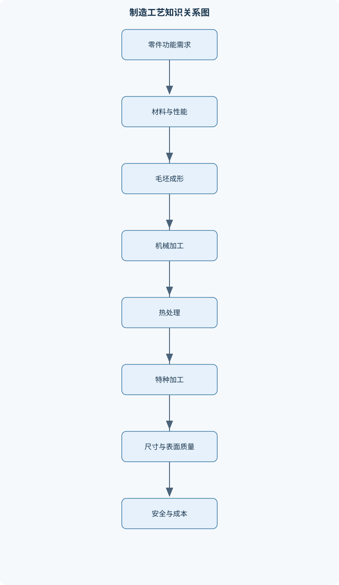
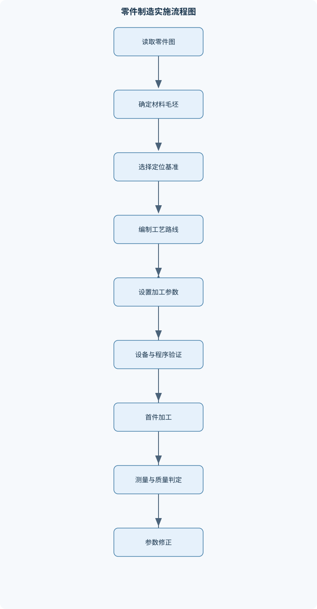

# 工程训练

## 一、课程整体知识框架

### 课程边界与先修知识

工程训练是一门面向机械、材料、制造、机电与数字化生产基础的实践课程，内容边界包括工程安全、工程材料与热处理、铸造、锻压与板料冲压、焊接、钳工、普通车削、数控加工、特种加工、CAD/CAM、逆向工程、增材制造、激光加工、机电系统与质量检测。课程重点是理解材料—工艺—设备—参数—质量—安全之间的因果关系，并能依据零件图、材料性质、加工精度、表面质量、批量和设备条件选择合理工艺。先修知识包括基础机械制图、材料基本性质、初等数学、单位换算和基本电工常识；不以完整的理论力学、材料力学或高等数学为先决条件，但使用力、力矩、功率、速度、几何尺寸和误差等基本概念。课程不替代特种设备操作资格培训，实际设备操作必须遵守现场安全规程、设备说明和经授权的教师或工程师指导。





### 1. 课程定位与主线

《工程训练》面向机械、材料、制造、机电和数字化生产的基础实践。课程不是若干设备操作的简单集合，而是围绕“材料—工艺—设备—参数—质量—安全”建立工程因果链：材料决定可采用的成形和加工方法，工艺决定设备、刀具、模具及参数，设备状态和参数影响尺寸精度、表面质量、生产效率与安全风险，检测结果又反过来修正工艺。

一项完整的工程任务通常从零件图或实物要求开始，依次完成需求识别、材料与毛坯确定、基准和定位方案选择、工艺路线安排、设备与刀具选择、参数设定、加工或成形、质量检测、异常分析和工艺改进。工艺选择不能只看材料硬度或单一精度指标，还应综合考虑零件形状、尺寸、批量、加工余量、设备能力、成本、交货要求以及操作者的授权范围。

课程使用长度单位毫米（mm）、质量单位千克（kg）、时间单位秒（s）、力单位牛顿（N）、功率单位瓦特（W）、转速单位转每分钟（r/min）。涉及米、微米、千瓦等单位时必须进行显式换算。例如，$1\,m=1000\,mm$，$1\,kW=1000\,W$。课程涉及的力学知识以工程估算和工艺判断为主，不以完整的理论力学、材料力学或高等数学为前提。

### 2. 安全与规范化作业是所有模块的共同前提

工程危险源包括旋转件卷入、刀具和工件夹挤、切削飞屑、砂轮或脆性材料碎裂、高温熔融物、压力机滑块运动、焊接弧光和烟尘、气瓶高压、激光辐射、电击、液压和气动能量释放等。设备正常运行并不意味着没有危险；防护罩缺失、工件夹持不牢、刀具伸出过长、程序坐标错误和人员进入危险区都可能在设备无故障时造成事故。

风险控制通常遵循由强到弱的层级：优先消除危险源或改变工艺，其次采用防护罩、联锁、挡屑板、限位和隔离等工程控制，再采用操作规程、培训、警示标志和作业许可等管理控制，最后使用护目镜、防护鞋、焊接面罩、隔热手套等个人防护用品。个人防护用品不能替代防护罩和联锁装置。

设备开机前应确认人员具有相应培训和授权，检查急停、接地、防护罩、润滑、气路、冷却、夹具、刀具、程序、坐标系和工作区。工件和刀具必须可靠固定，工作区不得有无关物品。首次运行程序时，应采用低速、单段或空运行方式验证。出现异常声音、振动、漏气、漏液、刀具松动、保护装置失效或坐标含义不明时，应禁止开机或立即停机。测量、清理切屑和调整工件必须在主轴、刀具和危险运动完全停止后进行，不能用手接触旋转工件检查尺寸或粗糙度。

### 3. 材料性能、应力应变与热处理

强度表示材料抵抗塑性变形和断裂的能力，硬度表示材料抵抗局部压入或划伤等局部变形的能力，塑性表示材料在断裂前发生永久变形的能力，韧性表示材料在断裂前吸收变形能量的能力。四者不是同一指标。高硬度材料不一定具有高冲击韧性；铸铁可能硬而脆，铝合金可能塑性较好但耐磨性不足。

在轴向均匀受力的理想条件下，正应力为

$$
\sigma=\frac{F}{A}
$$

其中，$\sigma$为正应力，单位为Pa；$F$为垂直于受力面的力，单位为N；$A$为受力面积，单位为$m^2$。该式由截面平衡得到：截面承受的总力等于平均应力乘以面积，即$F=\sigma A$，整理得$\sigma=F/A$。如果截面存在孔、缺口、螺纹根部、焊趾或接触边缘，应力会集中，平均应力不能直接代表局部最大应力。

工程应变定义为

$$
\varepsilon=\frac{\Delta L}{L_0}
$$

其中，$\varepsilon$为无量纲工程应变，$\Delta L$为长度变化，$L_0$为初始标距。断后伸长率为

$$
\delta=\frac{L_u-L_0}{L_0}\times100\%
$$

其中，$L_u$为断后标距。冲击吸收功用$A_k$表示，单位为J，它反映规定冲击试验条件下试样吸收的能量，不能等同于材料在任意温度、缺口形状和载荷下的韧性。硬度值必须连同标尺表示，例如HRC或HV，不同标尺不能直接比较，除非采用适用的换算关系。

钢铁材料的组织和性能可通过退火、正火、淬火和回火调节。退火一般通过加热、保温和缓慢冷却降低硬度、改善切削性、消除部分内应力；正火通常采用空冷，细化组织并改善低碳钢或低合金钢的综合性能；淬火通过加热到适当温度、保温后快速冷却获得较高硬度，但同时可能产生较大残余应力和变形；回火是淬火后的后续处理，用于调整硬度、韧性和尺寸稳定性。热处理工艺不能只写一个温度点，必须同时说明加热、保温和冷却条件。

淬硬性表示钢淬火后获得高硬度的能力，淬透性表示硬化层能够深入截面的能力。表面硬度高不代表整个截面都淬硬。淬火变形来自热应力和组织转变应力：表层与心部冷却速度不同，不同方向的尺寸收缩不同，马氏体转变又伴随体积变化。因此，工件形状、装夹方向、淬火介质和冷却均匀性共同影响结果。

### 4. 铸造、锻压与板料冲压

铸造是将金属熔化为液态，充入与零件形状相应的型腔，冷却凝固后获得铸件的方法。它适合形状复杂、具有内腔或尺寸较大的零件，也适合批量生产，但铸件内部可能出现缩孔、气孔、夹砂和组织不均等缺陷。砂型铸造中，模样用于形成型腔，铸件通常需要加工余量；拔模斜度有利于模样从砂型中取出；分型面应便于造型、取模、清理和检验。

浇注系统负责引导金属液进入型腔，冒口用于补偿凝固收缩。金属液凝固时体积收缩，如果厚大部位没有得到液态金属补给，容易形成缩孔或缩松。型砂需要具有足够的强度、透气性和耐火性：强度不足会塌型和砂眼，透气性不足会造成气孔，耐火性不足会产生粘砂。浇注温度过低会导致流动性不足、冷隔和浇不足，过高则可能增加氧化、吸气和粘砂。

锻造利用金属塑性使坯料发生体积基本不变的形变。自由锻适合单件、小批量和大型锻件，形状依靠工具和操作逐步形成；模锻依靠模具型腔获得较稳定的形状和尺寸，适合批量生产，但模具成本较高。锻造温度必须处于材料允许的塑性成形窗口内：温度过低，变形抗力大并可能产生裂纹；温度过高，可能出现过热、过烧和晶粒粗大。终锻温度过低会使最后变形难以完成并增加缺陷风险。

板料冲压包括冲裁、落料、冲孔、弯曲、拉深等工序。冲裁时，凸模进入板料后，材料经历弹性变形、塑性剪切和裂纹扩展，裂纹相遇后分离。冲裁间隙过小，挤压、磨损和冲压力增加；间隙过大，断面斜度和毛刺增大。弯曲卸载后会发生回弹，需要通过过弯、模具补偿或工艺调整控制角度。拉深时，压边力不足会起皱，压边力过大、圆角过小或材料变形量过大可能拉裂。压力机危险区必须通过模具防护、双手操作、联锁或其他工程措施隔离，不能用手直接取放危险区内的板料。

### 5. 焊接与切割

焊接通过加热、加压或二者同时作用，使两个分离表面形成原子间结合。焊接接头通常包括焊缝、熔合区和热影响区。熔化焊使母材或填充材料局部熔化；压力焊主要依靠压力和热量形成接头；钎焊使钎料熔化而母材通常不熔化。手工电弧焊中，焊条由焊芯和药皮组成，焊芯提供填充金属，药皮可形成保护气体和熔渣，并改善电弧稳定性和冶金条件。

焊条直径和焊接电流应根据母材厚度、焊接位置、接头形式和焊条类型选择。电流过小可能造成未熔合和夹渣，电流过大可能导致烧穿、飞溅和变形。焊接质量不由焊材强度等级单独决定，还取决于焊接性、坡口、间隙、热输入、焊接顺序、层间清理和焊后处理。

气焊火焰按气体比例和火焰特征区分，适用材料和厚度不同。氧—燃料气切割依赖金属在氧气中的氧化燃烧和熔渣排出条件，不是所有金属都适合普通氧气切割。低碳钢较适合，铝合金、铜合金和铸铁通常需要其他切割方法或专门工艺。

焊接热量输入不均匀会导致焊接变形和残余应力。可通过合理坡口、对称焊接、分段退焊、夹具约束和预留反变形等方法控制，但过度约束可能增加裂纹风险。焊前应清除油污、锈层和水分，检查接头间隙及定位焊；焊后应清理熔渣、检查外观和尺寸，并按质量要求进行必要的无损检测。焊接区还必须控制弧光、烟尘、火花、气瓶倾倒和可燃物风险。

### 6. 钳工、装配与普通车削

钳工以划线、锯削、锉削、钻孔、攻丝、套扣和装配为主要内容。划线基准应选择稳定、清晰且便于后续定位的表面；加工基准是实际加工时用于确定工件位置的基准，二者可以相同，也可能不同。台虎钳装夹应使工件稳定、受力合理，夹持面不能损伤精加工表面。

锉刀按断面和齿纹分为平锉、半圆锉、圆锉及粗齿、细齿等类型。粗齿适合去除较多余量，细齿适合修整和精加工。交叉锉利于快速去除材料，顺向锉有利于获得较平整的纹理，推锉适合较小余量的精修。钻孔前应在实体材料上定位并形成可靠的钻头引导；镗孔是在已有孔的基础上改善尺寸精度和表面质量，不能把镗孔当作无孔条件下的普通钻孔。

攻丝底孔直径可用

$$
d\approx D-P
$$

作初步估算，其中$d$为底孔直径，$D$为螺纹公称直径，$P$为螺距，单位均为mm。该式只适用于特定牙型、材料和螺纹填充率的工程估算，精密螺纹、硬脆材料和盲孔必须按适用螺纹表确定，并为排屑和丝锥退出留出空间。

普通车床的主运动通常是工件绕主轴旋转，进给运动由刀具沿纵向或横向移动完成。三爪卡盘具有自动定心特点，但仍存在装夹和卡爪误差；四爪卡盘可独立调整各卡爪，适合偏心工件和精确找正。车削外圆、端面、内孔、切槽、锥面和螺纹时，必须根据工件形状安排装夹、刀具、基准和测量节点。

车削切削速度为

$$
v_c=\frac{\pi Dn}{1000}
$$

其中，$v_c$为切削速度，单位为m/min；$D$为工件或刀具直径，单位为mm；$n$为主轴转速，单位为r/min。推导过程是：工件每分钟转过的圆周长度为$\pi Dn$，单位为mm/min，再除以$1000$换算为m/min。该式描述几何运动速度，不等于材料去除率，也不能代替刀具材料、工件材料和机床刚度所要求的参数范围。

每转进给量$f$的单位为mm/r，进给速度为

$$
v_f=fn
$$

其中$v_f$单位为mm/min。外圆车削中，直径由$D_0$变为$D_1$时，径向背吃刀量为

$$
a_p=\frac{D_0-D_1}{2}
$$

因为刀具沿半径方向的移动量在直径上体现为两倍。车刀伸出过长、工件悬伸过大、装夹刚度不足会造成振动；降低进给量只是可能的措施，不能替代缩短悬伸、改进装夹、调整刀具角度和选择合适切深。螺纹车削时，工件每转一周刀具必须沿轴向移动一个导程。单线螺纹导程等于螺距，多线螺纹导程等于线数与螺距的乘积。

### 7. 数控加工、CAD/CAM与特种加工

数控机床由机械本体、主轴和进给系统、数控装置、刀库或换刀机构、测量反馈及辅助系统组成。$X、Y、Z$表示机床坐标方向，但正方向必须以设备坐标系和控制系统定义为准，不能凭观察者面对机床的方向判断。数控程序中的地址通常包括坐标、主轴、进给、刀具号和准备功能等信息。工艺分析应先确定基准、毛坯、装夹、刀具和加工顺序，再设置工件坐标系、刀具补偿、切削参数和安全退刀路径。

数控车削常用于回转体轮廓，数控铣削和加工中心可完成平面、槽、孔和曲面加工。直线插补、圆弧插补和螺纹插补控制刀具按规定轨迹运动；循环指令和子程序可减少重复编程，但必须明确调用条件、坐标模式和退刀位置。CAD负责几何建模和参数化特征，CAM根据模型、刀具和工艺生成刀具路径，仿真用于检查过切、欠切、夹具干涉、超程和未加工区域。仿真无异常仍不能替代首件低速验证和尺寸检测。

电火花加工依靠工具电极与工件之间的脉冲放电去除材料，电极与工件不发生持续机械接触。脉冲峰值电流$I$、脉冲持续时间$t_{on}$和脉冲间隔$t_{off}$共同影响放电能量、加工速度、电极损耗和表面粗糙度。电火花成形适合加工导电材料的盲腔、复杂型腔和难切削材料；电火花线切割通常需要导电工件和贯通轮廓，不能把普通线切割当作盲孔加工方法。线径、放电间隙和轨迹补偿决定成品轮廓尺寸。

激光加工将激光能量转化为材料内部的热能，可用于切割、焊接、打标和表面处理。功率密度、扫描速度、焦点位置、脉冲宽度、频率、材料吸收率和辅助气体共同决定熔化、汽化、切缝、飞溅和热影响区。高反射材料、透明材料、厚板和高导热材料的加工条件不能直接套用普通钢材参数。激光安全必须控制直射、反射和散射辐射，不能仅依靠普通护目镜。

### 8. 逆向工程、增材制造、检测与机电制造系统

逆向工程从实物获取几何数据，再经过点云处理、配准、曲面重构和实体建模形成可编辑模型。接触式测量通常精度和基准稳定性较好，但采点速度较慢；非接触式扫描速度快，适合复杂曲面，却容易受到反光、遮挡、表面颜色和设备标定影响。点云处理应先保留原始数据，再删除孤立噪声点、完成多视角配准、修补孔洞和重构曲面。曲率变化大、尖角和薄壁区域应提高采样密度；过度平滑会损失真实边界。

增材制造通过逐层叠加材料成形，常见工艺包括熔融沉积和光固化。打印方向影响支撑数量、表面质量、尺寸误差和各向异性；层厚影响成形效率、台阶效应和表面粗糙度；路径、填充率、冷却和首层附着影响强度与变形。增材制造不是高精度切削的同义词，打印件通常还需要去支撑、清洗、固化、热处理或机械后处理。不同工艺的材料和参数不能混用，熔融沉积设备不能直接使用金属粉末或光敏树脂。

质量检测包括尺寸、形位、表面粗糙度、硬度、外观和必要的无损检测。$R_a$为轮廓算术平均偏差，单位通常为$\mu m$，它只是表面粗糙度参数之一，不能单独代表全部表面质量。检测结果必须注明测量方法、单位、基准、环境和仪器状态。

加工中心自动换刀、机械手、柔性制造系统和计算机集成制造系统构成数字化制造的主要内容。柔性制造系统通过加工设备、物流、检测和控制系统协同工作，以适应多品种生产；计算机集成制造系统进一步连接设计、工艺、生产、质量和管理数据。机电系统中，传感器采集位置、压力、温度或速度信号，控制器根据反馈调整执行器。PCB制造涉及原理图、网络标号、元件封装、布局布线、导线宽度和载流能力。焊接和调试前应断电检查极性、短路、虚焊、元件方向和网络连通性，通电检查不能替代断电检查。制造数据还应记录材料批次、程序版本、设备状态、检测结果和异常处理，以实现质量追溯。

## 二、章节和模块划分

### 核心知识覆盖清单

本清单用于检查正文是否覆盖本课程的主要知识模块：

- **工程安全与规范化作业**：机械危险源与伤害类型、电气设备与触电防护、旋转设备和切削飞屑防护、压力机与冲压危险区、焊接、气瓶和激光安全、个人防护用品与安全标志、设备开机前检查流程、停机、清理与异常处置、风险识别与风险控制层级。
- **工程材料与热处理**：金属材料的强度硬度韧性塑性、应力应变与材料失效、钢铁和铸铁的基本组织、有色金属及其工程特性、退火正火淬火回火、淬硬性与淬透性的区别、热处理变形与残余应力、硬度试验及结果表达、材料选用的使用性能与工艺性能。
- **铸造工艺**：铸造的成形原理与适用范围、砂型铸造设备和工具、模样、铸件与加工余量、整模造型与分模造型、分型面和拔模斜度、浇注系统与冒口补缩、型砂强度透气性和耐火性、浇注温度与金属液流动性、气孔粘砂砂眼错箱和缩孔缺陷、铸件质量检查与工艺改进。
- **锻压与板料冲压**：锻造的塑性成形机理、自由锻与模锻的工艺特点、锻造温度窗口与终锻温度、锻件缺陷及其成因、板料冲压的分离工序、剪切与冲裁间隙、弯曲回弹及补偿、拉深起皱与拉裂、压力机、模具和危险区、冲压件精度与毛刺控制。
- **焊接与切割**：焊接的原子结合与接头组成、熔化焊压力焊和钎焊、手工电弧焊设备与焊条结构、焊芯和药皮的作用、焊条直径与焊接电流选择原则、气焊火焰类型与适用材料、氧气燃料气切割的条件、焊接变形与残余应力、焊接缺陷及其检测、焊前准备与焊后清理流程。
- **钳工与装配基础**：划线基准和加工基准、台虎钳装夹与工件定位、手锯锯削姿势和锯条选择、锉刀类型及齿纹选择、交叉锉顺向锉和推锉、平面与曲面锉削方法、钻孔和孔口倒角、攻丝与套扣工艺、螺纹底孔和外圆尺寸计算、钳工工序安排与装配检查。
- **普通车削与切削加工**：普通车床的组成和运动、主运动与进给运动、三爪卡盘和四爪卡盘装夹、车外圆端面内孔和切槽、车削锥面和螺纹、车刀几何角度与刀具材料、切削速度进给量和背吃刀量、切削热振动与表面粗糙度、工件找正与刀具安装、尺寸测量和加工误差控制。
- **数控加工与CAD/CAM**：数控机床组成与坐标系、数控车削和数控铣削运动、程序字地址和准备功能、工艺分析与加工顺序、刀具补偿和工件坐标系、直线圆弧和螺纹插补、循环指令与子程序、CAD几何建模和参数化特征、CAM刀具路径与加工仿真、过切欠切和后处理检查。
- **特种加工与激光加工**：特种加工的能量去除机理、电火花成形加工、电火花线切割加工、工具电极和工件间非接触放电、脉冲电流脉宽和脉冲间隔、线切割通透轮廓限制、激光切割焊接和打标、激光吸收反射与聚焦、辅助气体和热影响区、特种加工材料与表面质量边界。
- **逆向工程、增材制造与检测**：接触式和非接触式三维测量、点云采集与噪声处理、点云配准和坐标统一、曲面重构与实体建模、三维打印的增材成形原理、熔融沉积与光固化工艺、切片层厚和路径生成、打印方向与支撑设计、打印误差和后处理、尺寸精度表面粗糙度与质量检测。
- **机电系统、PCB与制造系统**：加工中心自动换刀、柔性制造系统的加工物流检测控制、计算机集成制造系统的功能层次、机械手在制造系统中的作用、原理图与PCB布局布线、元件封装和网络标号、导线宽度与载流能力、手工焊接和通电前检查、传感器执行器与反馈控制、制造数据和质量追溯。


### 1. 模块一至三：安全、材料、铸造与锻压

模块一为“工程安全与规范化作业”，重点形成危险源识别、开机前检查、规范操作、异常停机和清理复位的闭环。模块二为“工程材料与热处理”，重点比较钢铁、铸铁和有色金属的使用性能与工艺性能，并用强度、硬度、塑性、韧性和硬化层等指标解释材料选择。模块三为“铸造工艺”，重点建立模样、型腔、分型面、浇注系统、冒口和型砂性能之间的关系，并根据气孔、粘砂、砂眼、错箱和缩孔的形貌追踪工艺原因。模块四为“锻压与板料冲压”，重点理解塑性成形、温度窗口、模具间隙、回弹、起皱、拉裂和压力机危险区。

### 2. 模块五至七：焊接、钳工与普通切削

模块五为“焊接与切割”，从焊接接头组成、焊接方法和焊材作用出发，分析热输入、焊接顺序、变形、残余应力及缺陷检测。模块六为“钳工与装配基础”，以基准、装夹和手工去除材料为主线，安排划线、锯削、锉削、钻孔、倒角、攻丝、套扣和装配检查。模块七为“普通车削与切削加工”，围绕车床运动、卡盘找正、车刀安装、外圆与端面、内孔、切槽、锥面和螺纹加工展开，并通过$v_c$、$v_f$和$a_p$建立参数与质量之间的联系。

### 3. 模块八至十：数控、CAD/CAM与特种加工

模块八为“数控加工与CAD/CAM”，按照零件图分析、工艺路线、坐标系建立、刀具补偿、程序编制、仿真、首件加工和检测的顺序组织。模块九为“特种加工与激光加工”，比较电火花成形、线切割和激光加工的能量去除机理、材料限制、加工形状和表面质量边界。模块十为“逆向工程、增材制造与检测”，将三维扫描、点云配准、曲面重构、实体建模、切片打印和尺寸评价连接为完整流程。

### 4. 模块十一：机电系统、PCB与制造系统

模块十一把单台设备扩展到自动化生产系统。内容包括加工中心自动换刀、机械手上下料、柔性制造系统中的加工—物流—检测—控制，以及计算机集成制造系统的数据层次。PCB部分从原理图和网络标号进入封装、布局、布线、手工焊接和通电前检查；机电控制部分进一步分析传感器、执行器、反馈和故障诊断。该模块的产出不是单个零件，而是能够运行、检测、追溯并满足安全边界的机电制造单元。

### 5. 代表性工程流程

#### 5.1 工艺路线选择流程

**输入：**零件图、材料、批量、尺寸精度、表面粗糙度、毛坯状态和可用设备。  
**输出：**工序顺序、设备选择、定位方案、主要参数和检测节点。

步骤如下：

1. 识别关键表面、孔、槽、螺纹、形位要求和余量。
2. 判断毛坯采用铸造、锻造、板料、棒料或增材制造。
3. 选择粗基准和精基准，确定装夹和定位方式。
4. 按先基准后其他、先粗加工后精加工、先面后孔、先主要表面后次要表面的原则安排工序。
5. 将热处理、去应力和清洗安排在合适节点。
6. 检查机床行程、主轴功率、刀具、夹具和测量条件。
7. 对复杂变形、特殊材料或极限精度零件增加试制、仿真或工艺试验。

该流程的不变量是基准关系、加工余量和安全边界不被破坏；终止条件是工艺路线能够覆盖全部技术要求，并且每道工序均有可执行的设备、刀具和检测手段。

#### 5.2 普通车削参数分析流程

**输入：**直径$D$、推荐切削速度$v_c$、进给量$f$、余量、刀具材料、工件材料和机床限制。  
**输出：**主轴转速$n$、进给速度$v_f$、背吃刀量$a_p$及风险说明。

先计算

$$
n=\frac{1000v_c}{\pi D}
$$

再计算$v_f=fn$，根据粗、精加工分配$a_p$，最后检查机床最高转速、夹持长度、刀具悬伸、功率和刚度。计算结果必须按设备可调档位或控制系统能力修正。试切后测量尺寸和表面粗糙度，再根据刀具磨损、振动和热变形调整参数。

#### 5.3 数控程序验证流程

输入为零件模型、工艺卡、刀具表、工件坐标系和程序；输出为经验证的加工程序。先核对单位、绝对或增量坐标、主轴和进给状态，再检查刀具号、补偿号、工件原点、安全高度和退刀路径。随后进行图形模拟或离线仿真，检查过切、欠切、超程、夹具干涉和无效空行程。现场采用单段、低倍率和首件测量验证。仿真通过不是放行的唯一条件，必须结合实际装夹和首件结果。

#### 5.4 点云逆向与增材制造流程

输入为实物、扫描设备、材料和打印设备，输出为带单位、基准和版本信息的CAD模型及打印件。先标定扫描设备并建立坐标系，分区域采集具有足够重叠的数据；保留原始点云，删除孤立噪声点并进行多视角配准；随后重建曲面、修补孔洞、形成实体并进行偏差分析。打印前检查模型封闭性、法向、最小壁厚和成形范围，选择打印方向、层厚、填充和支撑，切片后检查悬空、首层附着和路径。打印后去支撑、清理并测量关键尺寸。

### 6. 带语言标注的伪代码：设备安全开机判定

```text
伪代码
输入：设备、工件、刀具、作业任务、加工程序
输出：允许开机或禁止开机

过程 SafetyStartCheck:
    if 未确认培训授权:
        return 禁止开机

    检查防护罩、急停、接地和联锁
    检查润滑、冷却、气路和电源状态
    检查夹具、工件、刀具和刀具伸出量
    清除工作区内无关物品

    if 任一防护装置失效:
        return 禁止开机
    if 工件或刀具未可靠固定:
        return 禁止开机
    if 程序、单位、坐标系或补偿号不明确:
        return 禁止开机
    if 发现漏气、异常声响、松动或严重振动:
        return 禁止开机

    低速空运行或单段检查
    if 运动轨迹、退刀高度或夹具间隙不安全:
        return 禁止开机

    return 允许开机
```

安全不变量是防护装置有效、人员不进入危险区、工件和刀具可靠固定；终止条件是所有检查项通过，或任一重大风险被发现。该流程适用于车床、铣床、数控机床和部分自动化设备，但不能替代具体设备说明书、现场安全规程和授权人员指导。

### 7. 代表性例题

#### 例题一：车削参数计算

**题干：**工件直径$D=40\,mm$，推荐切削速度$v_c=80\,m/min$，每转进给量$f=0.20\,mm/r$，机床最高转速为700 r/min。求理论主轴转速和进给速度，并判断是否需要限速。

**分析：**切削速度由直径和转速共同决定，不能把$v_c$直接当作$n$。

**解答：**

$$
n=\frac{1000v_c}{\pi D}
=\frac{1000\times80}{\pi\times40}
\approx636.6\,r/min
$$

理论转速约为637 r/min，小于机床最高转速700 r/min，因此可以采用约637 r/min的设定值。进给速度为

$$
v_f=fn=0.20\times636.6\approx127.3\,mm/min
$$

若机床只能选择整数或固定档位，应选择接近且不超过允许范围的转速，再重新计算$v_f$。

**结果验证：**将$n=637\,r/min$代回$v_c=\pi Dn/1000$，得$v_c\approx80.05\,m/min$，与目标值接近。

**变式：**若直径改为80 mm而仍使用637 r/min，则切削速度约为160 m/min，可能超过刀具允许范围。因此改变直径后不能保持转速不变。

#### 例题二：攻丝底孔估算

**题干：**加工公称直径$D=10\,mm$、螺距$P=1.5\,mm$的普通内螺纹，估算底孔直径，并说明盲孔加工注意事项。

**分析：**采用$d\approx D-P$仅是工程初估。

**解答：**

$$
d\approx10-1.5=8.5\,mm
$$

因此可将8.5 mm作为初步估算值。实际加工前还需确认螺纹牙型、材料、丝锥类型和目标螺纹填充率。孔口应倒角以便丝锥导入；盲孔底部应留出超过有效螺纹长度的排屑和退出空间；攻丝过程中应保持同轴，按工艺要求正转切削并适时反转断屑，不能强行连续推进。

**结果验证：**检查底孔是否贯通、孔深是否满足有效螺纹长度、丝锥是否有排屑空间，并用螺纹规或配套螺栓检查。

**变式：**脆性铸铁、精密螺纹和小直径螺纹不能机械套用$D-P$，必须按适用螺纹表和刀具要求修正。

#### 例题三：铸造缺陷诊断

**题干：**某砂型铸件表面出现粘砂，局部有气孔，厚大部位内部出现缩孔。如何分析？

**分析：**三个缺陷可能分别由型砂耐火性、排气能力和补缩条件不足造成，但应结合缺陷位置和浇注记录判断。

**解答：**

1. 粘砂：检查型砂耐火性、含水量、紧实度和浇注温度；温度过高或型砂耐火性不足会使金属液与砂粒反应并粘附。
2. 气孔：检查型砂透气性、排气孔、砂芯排气和金属液含气量；透气性不足或排气路径堵塞会使气体滞留。
3. 缩孔：检查冒口位置、补缩通道、厚大截面和凝固顺序；厚大部位最后凝固而又没有液态金属补给时容易形成缩孔。

**验证方案：**先保持其他条件不变，只改进冒口补缩验证缩孔；再单独调整排气和型砂透气性验证气孔；最后单独改变耐火性或浇注温度验证粘砂。每次只改变一个主要变量，便于建立因果关系。

**结果验证：**通过外观、剖切或无损检测比较缺陷位置和尺寸，并记录浇注温度、型砂状态和冒口效果。

**变式：**若缺陷是错箱，应优先检查分型面定位、模样和砂箱对合，而不能继续调整浇注温度。

#### 例题四：焊接工艺设计

**题干：**两块低碳钢板需进行对接焊，要求焊后变形较小。应考虑哪些工艺要素？

**分析：**焊缝质量取决于母材焊接性、坡口、间隙、焊材、热输入和焊接顺序，不能只按焊条强度等级选择。

**解答：**

1. 清除锈蚀、油污和水分，确认板厚和接头形式。
2. 根据厚度选择是否开坡口，并控制坡口角度和根部间隙。
3. 选用与母材相容的焊条或焊丝，确认焊材状态。
4. 先定位焊，检查错边和间隙。
5. 采用对称、分段或跳焊顺序，控制层间清理和热输入。
6. 焊后清渣，检查咬边、未焊透、气孔、裂纹和角变形。
7. 根据质量要求进行尺寸检查和必要的无损检测。

**结果验证：**测量焊后平面度、错边量和焊缝外观，必要时进行内部缺陷检测。

**变式：**若板厚增大或接头受力重要，不能仅增加电流，还应重新确定坡口、焊层、预热和检验要求。

#### 例题五：线切割与电火花成形选择

**题干：**导电淬硬钢板上有一个贯通二维轮廓和一个盲腔，分别选择何种特种加工方法？

**分析：**线切割要求电极丝沿贯通路径运动，电火花成形可利用成形电极加工盲腔。

**解答：**贯通二维轮廓可采用电火花线切割，但需设置穿丝孔或引入位置，并根据线径和放电间隙进行轨迹补偿。盲腔不能用普通线切割直接完成，可考虑电火花成形加工，设计相应工具电极，并控制电极损耗、放电间隙和排屑条件。

**结果验证：**检查材料导电性、轮廓是否贯通、加工深度、尖角和表面粗糙度要求；通过仿真或试切确认补偿方向。

**变式：**非导电陶瓷不能直接按普通电火花加工流程处理；需考虑其他能量加工方法或特殊工艺条件。

### 8. 实验与项目任务

#### 实验一：普通车削参数与表面质量关系

**输入数据：**直径40 mm的低碳钢棒料、车刀、车床、游标卡尺或外径千分尺、表面粗糙度比较样块；设置两组进给量和至少两种切削速度。

**步骤：**

1. 检查卡盘、刀具、工件悬伸和防护状态。
2. 车削端面和外圆，记录直径、转速、进给量和背吃刀量。
3. 每组参数完成相同长度的加工。
4. 停机后测量直径、圆柱度变化和表面状态。
5. 对比振动、切屑形态、刀具磨损和表面粗糙度。

**评价标准：**尺寸误差应满足任务图样要求；记录数据完整；参数单位正确；能解释进给量、切削速度、刚度和刀具状态对表面质量的影响；操作中无违规伸手测量和带旋转清屑行为。

**排错方法：**若直径偏大，检查刀具补偿、测量方法和刀具磨损；若振动，检查悬伸、夹紧、刀尖高度和工件刚度；若表面粗糙度变差，区分参数原因、刀具磨损和积屑瘤，不能只降低进给量。

#### 实验二：实物扫描—逆向建模—增材制造综合项目

**输入数据：**具有曲面和安装孔的实物外壳、三维扫描设备、点云处理软件、CAD建模工具和增材制造设备。

**步骤：**

1. 标定扫描设备并建立基准坐标系。
2. 分区域采集点云，保证相邻区域有足够重叠。
3. 保存原始点云，删除孤立噪声点并完成多视角配准。
4. 识别安装孔、基准面和关键曲面，重构曲面并形成封闭实体。
5. 将重构模型与原始点云进行偏差分析。
6. 选择打印方向、层厚、支撑和填充参数，完成切片。
7. 检查悬空、最小壁厚、首层附着和成形范围后打印。
8. 去除支撑并测量孔径、壁厚、外形尺寸和关键曲面偏差。

**评价标准：**原始点云保留且处理过程可追溯；模型单位、基准和版本明确；重构模型无明显孔洞和非封闭错误；打印件形状完整，关键尺寸在任务允许范围内；能说明打印方向、支撑和层厚对误差及表面质量的影响。

**排错方法：**配准失败时检查重叠区域和坐标标记；曲面出现波纹时区分扫描噪声、过度平滑和真实曲率变化；打印翘曲时检查首层附着、冷却和摆放方向；孔径偏小时检查扫描偏差、切片补偿和打印收缩，不能把所有误差归因于建模软件。

## 三、核心概念的详细解释

### 1. 工程训练的统一分析框架

工程训练的核心不是孤立记忆设备名称，而是建立“材料—工艺—设备—参数—质量—安全”的因果链。材料的强度、硬度、塑性、韧性、熔点、导电性和热处理状态，会限制可采用的成形方法；工艺方法又决定设备、刀具、模具、夹具和能量形式；参数变化会影响加工效率、尺寸精度、表面质量、变形、刀具磨损和安全风险。

零件工艺分析通常从零件图或实物要求开始。首先识别材料、毛坯形状、关键尺寸、形位公差、表面粗糙度和批量；其次确定加工基准、定位方式和装夹方案；然后选择铸造、锻压、焊接、切削、特种加工或增材制造等主要工艺；最后安排粗加工、热处理、半精加工、精加工和检测工序。工序安排一般遵循“先基准后其他、先粗后精、先面后孔、先主要表面后次要表面”的原则，但薄壁件、易变形件、焊接结构件和热处理件需要根据变形规律调整。

### 2. 工程安全与规范化作业

机械危险源包括旋转件卷入、刀具切割、工件夹挤、切削飞屑、砂轮破裂、压力机闭合、焊接高温和激光辐射。电气危险源包括裸露带电体、绝缘破损、接地失效、漏电和错误接线。气瓶还具有高压、倾倒、阀门损坏和可燃气体泄漏等风险。

风险控制应优先采用消除危险源、改变工艺、防护罩、联锁、限位、隔离和挡屑板等措施，再使用操作规程、培训、警示和作业许可，最后使用护目镜、防护鞋、焊接面罩、隔热手套等个人防护用品。个人防护用品不能代替防护罩、联锁和可靠接地。

设备开机前检查包括：人员是否得到授权；急停、防护罩、接地、润滑、冷却、气路是否正常；工件、刀具、模具和夹具是否可靠固定；程序单位、坐标系、刀具补偿和工件原点是否明确；工作区是否清洁。首次运行数控程序应采用空运行、单段、低倍率进给或低速方式确认。发生异常声响、异常振动、漏气、刀具松动、保护装置失效或坐标不明时，应立即停止并报告。

停机后必须等主轴、刀具、滑块和其他运动部件完全停止，才能测量、清理切屑和调整夹具。切屑不能直接用手抓取，应使用刷子、钩子或专用工具。压力机的模具闭合区、焊接弧光区、激光光路区和高压气瓶附近，未经授权人员不得进入。

### 3. 工程材料、力学性能与热处理

强度表示材料抵抗塑性变形和断裂的能力；硬度表示材料抵抗局部压入、划伤或塑性变形的能力；塑性表示材料在断裂前发生永久变形的能力；韧性表示材料在断裂前吸收变形能量的能力。四个指标不可互相替代。例如，淬硬钢硬度较高但冲击韧性可能下降；铸铁抗压能力较好，却通常塑性和抗冲击能力较低；铝合金密度较小、塑性通常较好，但不必然具有最高耐磨性。

在轴向均匀受力的理想条件下，正应力为

$$
\sigma=\frac{F}{A}
$$

其中，$\sigma$为正应力，单位为Pa；$F$为垂直于受力面的力，单位为N；$A$为受力面积，单位为$m^2$。推导依据是截面总承载力等于平均应力与面积的乘积，即$F=\sigma A$，整理得到上述关系。孔、缺口、螺纹根部、焊趾和接触边缘会产生应力集中，此时$\sigma=F/A$只能给出平均应力，不能直接判断局部最大应力。

工程应变为

$$
\varepsilon=\frac{\Delta L}{L_0}
$$

其中，$\varepsilon$为无量纲工程应变，$\Delta L$为长度变化，$L_0$为初始标距。断后伸长率为

$$
\delta=\frac{L_u-L_0}{L_0}\times100\%
$$

其中，$L_u$为断后标距，$\delta$通常用百分数表示。冲击吸收功$A_k$的单位为J，只反映规定试样、缺口、温度和冲击速度条件下的吸收能量，不能等同于材料在所有载荷下的韧性。硬度必须带试验标尺表示，例如HRC或HV，不同标尺不能直接比较。

钢的退火通常通过缓慢加热、保温和缓慢冷却降低硬度、改善切削性并减小内应力；正火冷却速度通常高于退火，可细化组织、改善低碳钢和部分中碳钢的综合性能；淬火通过快速冷却获得较高硬度和强度，但可能产生较大残余应力和变形；回火是在淬火后重新加热到较低温度并保温，以调整组织、降低脆性和稳定尺寸。低温回火通常有利于保持较高硬度，但不能笼统地说它一定提高所有综合性能。

淬硬性是钢获得高硬度的能力，主要与含碳量和合金元素有关；淬透性是硬化层能够深入截面的能力。小尺寸低碳钢可能表面和心部硬度差别不大，但并不意味着其淬硬性或淬透性都高。淬火变形来自热应力和组织转变应力：表层、心部及不同方向的冷却速度不同，且马氏体转变伴随体积变化，因此工件形状、装夹方向、冷却介质和加热均匀性都会影响结果。

### 4. 铸造、锻压与板料冲压

铸造是将液态金属充入型腔，冷却凝固后获得铸件的方法，适合制造形状复杂、内腔较多或难以切削成形的零件。砂型铸造设备和工具包括模样、型箱、型砂、捣砂工具、浇注系统和清理工具。模样尺寸通常要考虑收缩量和机械加工余量；分型面应便于起模、合箱和清理，并尽量减少错箱、飞边和复杂活块。

拔模斜度使模样能够从砂型中顺利取出。浇注系统负责引导金属液，冒口用于补偿凝固收缩。若补缩通道不足，易形成缩孔或缩松；型砂透气性不足、排气不良或金属液卷入气体，可能形成气孔；型砂强度过低可能产生砂眼，温度过高或型砂耐火性不足可能导致粘砂。浇注温度过低会使流动性不足、产生冷隔和浇不足，过高则可能增加氧化、吸气、粘砂和晶粒粗化。

锻造利用金属塑性变形获得锻件。自由锻适应性强，适合单件和小批量；模锻依靠模具型腔获得较复杂形状和较高生产率，但模具成本高。锻造温度必须处在适当塑性窗口内：温度过低，变形抗力大且容易开裂；温度过高，可能出现过热、过烧和晶粒粗大。终锻温度过低会使后续变形困难并增加裂纹风险。

板料冲压包括冲裁、落料、冲孔、弯曲和拉深。冲裁时，冲头与凹模之间的间隙必须与材料、板厚和质量要求匹配。间隙过小，挤压和摩擦增加，模具磨损严重；间隙过大，断裂带不理想、毛刺和塌角增大。弯曲后材料存在弹性恢复，即回弹，需要通过过弯、模具补偿或工艺调整修正。拉深时，压边力过小容易起皱，过大则材料流动受阻、壁部拉裂；圆角半径、润滑、板料塑性和拉深比都必须综合考虑。

### 5. 焊接与切割

焊接通过加热、加压或两者共同作用，使工件形成原子间结合。熔化焊使母材或填充材料局部熔化；压力焊主要依靠压力和热量形成接头；钎焊熔化钎料而不使母材整体熔化。焊接接头包括焊缝、熔合区和热影响区，热影响区虽未完全熔化，但组织和性能可能发生变化。

手工电弧焊中，焊条由焊芯和药皮组成。焊芯承担导电和填充金属作用；药皮可产生保护气体和熔渣，改善电弧稳定性、脱氧、合金化和成形。焊条直径和焊接电流应根据板厚、焊接位置、接头形式、焊条类型和设备能力选择，不能仅凭焊条强度等级判断焊缝质量。

气焊火焰按氧气和燃料气比例形成不同特征，选择应依据母材和工艺要求。氧—燃料气切割依赖金属在氧气中的氧化燃烧，并要求生成物能被气流吹走，因此并非所有金属都适合普通氧气切割。铝合金、铜合金和铸铁通常需要其他切割方法或专门工艺。

焊接热输入会引起热胀冷缩、残余应力和变形。控制方法包括合理坡口、对称焊接、分段退焊、夹具约束、减小不必要的热输入和焊后校正。常见缺陷有气孔、夹渣、未熔合、未焊透、咬边、裂纹和焊缝尺寸不足。焊前应清除油污、锈蚀和水分，检查坡口、间隙和定位焊；焊后应清渣、检查外观和尺寸，必要时进行无损检测。

### 6. 钳工、装配与普通车削

钳工以划线、锯削、锉削、钻孔、攻丝、套扣和装配为主要内容。划线基准应与设计基准、加工基准尽量统一，以减少尺寸传递误差。台虎钳装夹时，夹紧力应足够但不能使薄壁件变形；工件伸出量应尽量小，以提高刚度。

锯削时锯条齿向应适合切削方向，推进时施力，回程减小压力；锉削可采用交叉锉、顺向锉和推锉。交叉锉适合快速去除余量，顺向锉有利于改善表面直线度，推锉适合精整小余量表面。钻孔前应划线、冲中心样并检查工件夹紧；孔口倒角可去除毛刺。钻孔是在实体材料上形成孔，镗孔则通常以已有孔为基础提高尺寸精度、形状精度和表面质量。

攻丝前应加工底孔并倒角。塑性材料可用

$$
d\approx D-P
$$

作初步估算，其中$d$为底孔直径，$D$为螺纹公称直径，$P$为螺距，三者单位均为mm。该式只适合工程估算，精密螺纹、硬脆材料和盲孔应查适用螺纹表，并为丝锥排屑留出空间。

普通车床的主运动是工件旋转，进给运动由刀具沿纵向、横向或其他方向移动完成。三爪卡盘具有自动定心特点，适合规则回转件，但仍存在夹持误差；四爪卡盘可独立调整各爪，适合偏心件和精确找正。车削外圆、端面、内孔、切槽、锥面和螺纹时，应根据装夹刚度、刀具几何角度、材料和精度要求选择参数。车刀伸出过长、工件悬伸过大、垫片过多或夹紧不足，都会增加振动。车刀安装时应尽量使用少量较厚的垫片，使刀具支承稳定。

### 7. 数控加工、CAD/CAM与质量控制

数控机床由机械本体、主轴系统、进给系统、数控装置、刀库或刀架、测量反馈和辅助系统组成。$X、Y、Z$轴的方向必须以机床坐标系和控制系统定义为准，不能只凭视觉方向判断。工件坐标系将零件图尺寸转换为程序坐标，刀具补偿用于修正刀具长度、半径或磨损误差。

数控程序中的地址通常包含坐标、进给、主轴、刀具和辅助功能。直线插补使刀具沿直线运动，圆弧插补按给定圆心或半径运动，螺纹加工要求工件每转一周刀具沿轴向移动一个导程。单线螺纹的导程等于螺距，多线螺纹的导程等于线数与螺距的乘积。循环指令和子程序可以减少重复编程，但必须确认控制系统语法和调用方式。

CAD通过几何建模、尺寸约束和参数化特征表达零件；CAM根据模型生成刀具路径。粗加工应优先高效去除余量，精加工重点控制残料、步距和表面质量。曲率较大或曲率变化较快的区域需要更密的采样点或更小的步距，否则会产生明显弦高误差；但路径过密会增加加工时间。球头铣刀尖部切削速度接近零，容易造成挤压和表面质量下降，精加工时应合理选择接触区域和走刀方向。

质量检测应与工艺过程相结合，而不是只在最后测量。尺寸可用游标卡尺、千分尺、内径量具或三坐标测量；表面粗糙度可用粗糙度仪或比较样块评价。$R_a$是轮廓算术平均偏差，单位通常为$\mu m$，不能单独代表全部表面质量。检测结果应记录基准、测量条件、仪器分辨力和环境条件。

### 8. 特种加工与激光加工

电火花加工利用工具电极与工件之间的脉冲放电，在局部产生高温，使材料熔化或汽化并被工作液带走。工具电极与工件不直接接触，因此电极硬度不必高于工件硬度，但电极仍需具备适当导电性、耐热性、尺寸稳定性和可加工性。

电火花成形加工使用成形电极，可加工盲腔、型孔和复杂三维轮廓；电火花线切割使用连续移动电极丝，通常要求工件导电，并加工能够由电极丝贯通的轮廓，不能把普通线切割用于一般盲孔。放电参数包括脉冲峰值电流$I$、脉冲持续时间$t_{on}$和脉冲间隔$t_{off}$。一般而言，电流和脉宽增大，单次放电能量、加工速度和表面粗糙度可能增加，同时电极损耗、热影响和微裂纹风险也可能增加；具体关系还受工作液、极性、排屑和材料影响。

激光加工将光能通过吸收转化为热能，可用于切割、焊接和打标。激光功率密度、扫描速度、焦点位置、脉冲宽度、频率、材料吸收率和辅助气体共同决定熔化、汽化、切缝、热影响区和飞溅。反射率较高的材料可能需要改变波长、焦点和能量输入。激光设备必须采取光路封闭、联锁、护目和烟尘排出措施，不能因光束不可见而降低警惕。

### 9. 逆向工程、增材制造与机电制造系统

逆向工程从实物测量获得点云，再经过配准、去噪、特征提取、曲面重构和实体建模，形成可编辑的CAD模型。接触式测量通常精度和基准稳定性较好，但速度较慢；非接触式扫描速度较快，适合复杂曲面，却容易受反光、遮挡、表面颜色和噪声影响。去噪不能简单地过度平滑，否则会损失尖角、薄壁和边界特征。多视角点云必须在统一坐标系中配准，并保留原始数据和处理记录。

增材制造通过逐层叠加材料成形，常见工艺包括熔融沉积和光固化。打印方向影响支撑量、层间结合、各向异性、表面质量和变形；层厚影响成形效率、阶梯效应和尺寸精度；支撑影响悬空结构成形，也会增加后处理工作。三维打印不是高精度切削的同义词，打印件通常需要去支撑、清洗、固化、热处理或机械加工。

加工中心通过自动换刀实现多工序集中加工；柔性制造系统还包括加工设备、物流、检测和控制单元；计算机集成制造系统则进一步连接设计、工艺、生产、质量和数据管理。机械手可承担上下料、搬运、焊接和检测，但必须设置工作范围、限位、互锁和异常停机逻辑。PCB制造中，原理图描述电气连接，PCB布局布线将连接关系转化为实际铜箔和封装；通电前必须断电检查极性、元件方向、短路、虚焊和网络连通性。传感器提供状态信息，执行器实施动作，反馈控制根据测量结果修正输出，制造数据则用于质量追溯和异常定位。

## 四、重要定义、公式、定理和推导

### 专业审校补充：关键定义与适用边界

工艺尺寸链描述同一零件上相互关联尺寸在加工、测量和装配中的传递与累积关系。对一维直线尺寸链，若封闭环为 $A_0$，增环为 $A_i$，减环为 $A_j$，则 $A_0=ΣA_i−ΣA_j$；在忽略弹性变形、热变形和测量误差，且各组成环取最不利极值组合时，封闭环公差 $T_0=ΣT_i$。各尺寸必须采用统一单位并首尾相接；增环增大会使封闭环增大，减环增大会使封闭环减小。设计基准、工序基准、定位基准和测量基准不重合时，不能把图样尺寸直接作为工序尺寸，必须画出尺寸链并求工序尺寸及上下偏差。该模型适用于平行直线尺寸的完全互换法校核；角度尺寸链、三维尺寸链、修配装配、调整装配和概率法需要另行建模。若设计公差之和已经超过封闭环要求，应改变基准、压缩相关工序公差或调整工艺，不能任意放宽关键功能尺寸。


### 1. 切削运动参数及其推导

车削时，工件外圆表面每分钟转过的圆周长度为$\pi Dn$，其中$D$为直径，单位为mm；$n$为主轴转速，单位为r/min。由于需要将mm换算为m，除以$1000$得到切削速度：

$$
v_c=\frac{\pi Dn}{1000}
$$

其中$v_c$单位为m/min。整理得主轴转速：

$$
n=\frac{1000v_c}{\pi D}
$$

该公式只描述几何运动关系，不代表所有材料和刀具都能使用该速度。实际转速还受机床最高转速、刀具材料、工件材料、冷却条件、装夹刚度和表面质量要求限制。

每转进给量$f$单位为mm/r，主轴每分钟转$n$转，因此每分钟的进给距离为：

$$
v_f=fn
$$

其中$v_f$单位为mm/min。进给量和进给速度不能混淆：当主轴转速改变而$f$保持不变时，$v_f$会随之改变；在数控系统按每分钟进给时，则必须根据控制方式重新设定。

外圆车削中，直径由$D_0$变为$D_1$，直径减少量为$D_0-D_1$。由于刀具沿半径方向切入，径向背吃刀量为：

$$
a_p=\frac{D_0-D_1}{2}
$$

例如，$D_0=40\,mm$，目标直径$D_1=36\,mm$，则

$$
a_p=\frac{40-36}{2}=2\,mm
$$

不能把直径减少量$4\,mm$直接当作径向切深。该关系不适用于必须按实际坐标方向定义切深的端面、内孔和复杂轮廓加工。

### 2. 代表性算法一：普通车削参数分析流程

**输入：**工件直径$D$、推荐切削速度$v_c$、工件材料、刀具材料、粗精加工要求、机床转速上限和装夹条件。  
**输出：**主轴转速、进给速度、背吃刀量及风险说明。

**过程：**

1. 统一单位，确认$D$用mm、$v_c$用m/min。
2. 用$n=1000v_c/(\pi D)$计算理论转速。
3. 将理论转速与机床最高转速比较；若超限，应按机床上限取值。
4. 粗加工优先考虑去除余量和刚度，精加工优先考虑尺寸、粗糙度和刀具稳定性。
5. 由$v_f=fn$计算进给速度。
6. 根据余量、机床功率、夹持长度和刀具悬伸确定$a_p$。
7. 试切后检测尺寸和表面质量，再修正刀具补偿或参数。

**不变量：**工件和刀具可靠固定，防护装置有效，切削参数不超过机床和刀具能力。  
**终止条件：**理论参数经设备能力校核，试切尺寸和表面质量达到要求。  
**适用边界：**该流程适合常规车削估算；难加工材料、断续切削、薄壁件和极限精度加工需要工艺试验。计算量为常数级，主要误差来自刀具磨损、材料批次、装夹刚度和测量误差。

### 3. 代表性算法二：数控程序验证流程

**输入：**零件模型、工艺卡、刀具表、工件坐标系、刀具补偿数据和数控程序。  
**输出：**经过仿真、首件验证和安全检查的可执行程序。

1. 检查程序单位、绝对或增量坐标模式、主轴方向、进给方式和安全高度。
2. 核对刀具号、补偿号、刀具长度、刀尖半径和工件原点。
3. 检查快速移动是否可能穿过工件、夹具或尾座。
4. 进行离线或机内图形模拟，重点观察过切、欠切、超程、干涉和漏加工。
5. 在机床上采用空运行、单段、低倍率和较高安全高度进行首次验证。
6. 加工首件后测量关键尺寸、孔位、轮廓和表面质量。
7. 根据测量结果修改刀具补偿或程序，保留版本和修改记录。

**不变量：**危险区内无人，防护装置有效，坐标系含义不变，刀具补偿与实际刀具一致。  
**终止条件：**仿真无明显异常、首件无干涉且关键尺寸合格。仿真不能替代现场首件检查，因为实际夹具、刀具磨损和机床误差可能与模型不同。

### 4. 代表性算法三：点云逆向建模流程

**输入：**实物、扫描设备、标定数据和测量坐标系。  
**输出：**带单位、基准、版本和偏差报告的曲面或实体模型。

1. 标定扫描设备，确定测量坐标系和基准特征。
2. 分区域采集点云，确保相邻区域有足够重叠。
3. 保存原始点云，不直接覆盖原始数据。
4. 删除孤立噪声点，但保留真实尖角、边界和薄壁点。
5. 通过标记点、特征面或最佳拟合完成多视角配准。
6. 进行曲面重构和实体封闭，检查孔洞、法向和最小壁厚。
7. 将重构模型与原始点云进行偏差分析，输出色谱或尺寸偏差。
8. 以关键基准和功能尺寸为准修订模型。

**评价标准：**模型单位正确，坐标基准明确，原始数据可追溯，关键曲面偏差符合要求，模型可用于后续制造。配准失败通常源于重叠区域不足或特征不明显；曲面波纹可能来自扫描噪声、过度平滑或真实曲率；孔径偏小可能由扫描偏差、重构收缩或打印补偿共同造成。

### 5. 代表性算法四：增材制造准备流程

**输入：**封闭三维模型、材料、设备成形范围、精度要求和功能要求。  
**输出：**经过检查的摆放方案、支撑方案、切片文件和制造记录。

1. 检查模型封闭性、法向、最小壁厚、孔洞和单位。
2. 根据强度方向、表面质量、支撑量和变形风险选择打印方向。
3. 设置层厚、填充率、边界数量、支撑、冷却和首层参数。
4. 检查悬空区域、薄壁、首层附着和设备成形范围。
5. 模拟路径，检查断层、漏填、支撑干涉和预计时间。
6. 打印后去支撑、清理或固化，并测量关键尺寸。
7. 根据尺寸偏差和表面质量修改方向、补偿或参数。

不同工艺的材料和参数不能互换。熔融沉积、光固化和金属粉末工艺的成形机理、材料状态和安全要求不同。

### 6. 代表性例题一：车削参数计算

**题干：**工件直径$D=40\,mm$，推荐切削速度$v_c=80\,m/min$，每转进给量$f=0.20\,mm/r$，机床最高转速为800 r/min。求理论转速和进给速度，并判断是否需要限速。

**分析：**先由切削速度公式求理论转速，再与机床上限比较，最后用实际转速计算进给速度。

**解答：**

$$
n=\frac{1000\times80}{\pi\times40}
\approx636.6\,r/min
$$

理论转速约为637 r/min，小于800 r/min，可以采用约637 r/min。进给速度为

$$
v_f=fn=0.20\times636.6\approx127.3\,mm/min
$$

因此可取$n\approx637\,r/min$，$v_f\approx127\,mm/min$。

**结果验证：**代回切削速度公式，$\pi\times40\times636.6/1000\approx80\,m/min$，单位一致。  
**变式：**若工件直径为20 mm，理论转速约为1273 r/min，超过机床上限，应取800 r/min；此时实际切削速度为

$$
v_c=\frac{\pi\times20\times800}{1000}\approx50.3\,m/min
$$

不能在机床超速条件下强行使用理论值。

### 7. 代表性例题二：外圆背吃刀量

**题干：**毛坯外径为52 mm，第一次车削后直径为46 mm，求径向背吃刀量；若最终直径为40 mm，剩余余量应如何分配？

**分析：**直径变化是刀具两侧半径变化的两倍，因此必须除以2。

**解答：**

第一次切削：

$$
a_p=\frac{52-46}{2}=3\,mm
$$

从46 mm加工到40 mm时：

$$
a_p=\frac{46-40}{2}=3\,mm
$$

若设备刚度、刀具和材料允许，可进行一次粗加工；若需要精加工，应将余量分为粗加工和精加工两部分，例如粗加工保留0.3 mm直径余量，再由精加工去除0.15 mm径向余量，具体分配须结合尺寸公差和表面质量要求。

**结果验证：**径向切深为3 mm时，直径减少$2\times3=6\,mm$，与52 mm到46 mm相符。  
**变式：**内孔由28 mm扩大到34 mm时，切深同样按径向尺寸计算，但必须结合镗刀悬伸、孔深和排屑条件，不能照搬外圆装夹参数。

### 8. 代表性例题三：攻丝底孔估算

**题干：**加工公称直径$D=10\,mm$、螺距$P=1.5\,mm$的内螺纹，初步估算底孔直径。

**分析：**采用塑性材料攻丝的工程估算式，但不能将结果当作所有材料和所有螺纹的标准值。

**解答：**

$$
d\approx D-P=10-1.5=8.5\,mm
$$

因此初步估算底孔为8.5 mm。钻孔后应进行孔口倒角，检查孔深；盲孔必须比有效螺纹深度留出排屑和丝锥端部空间。攻丝时保持丝锥轴线与孔轴线一致，按工艺要求正转切削、适时反转断屑。

**结果验证：**底孔小于公称直径，能够保留部分材料形成牙顶；若底孔过小，扭矩和断丝锥风险增加。  
**变式：**铸铁、硬脆材料、精密螺纹和特殊牙型不能直接套用8.5 mm，应按适用螺纹表、材料塑性和目标牙型填充率确定。

### 9. 代表性例题四：铸造缺陷诊断

**题干：**某砂型铸件表面出现孔洞，内部局部出现缩松。试分析可能原因和验证顺序。

**分析：**表面孔洞可能与型砂透气性、排气、金属液卷气和浇注系统有关；缩松主要与凝固收缩和补缩路径不足有关，不能只归因于浇注温度。

**解答：**

1. 检查孔洞形态：圆滑、内壁光洁的孔洞更像气孔；不规则夹砂孔可能是砂眼。
2. 检查型砂含水量、透气性、紧实度和排气孔。
3. 检查浇注过程是否卷入空气，浇口是否过高或流态紊乱。
4. 对缩松检查冒口位置、尺寸、保温能力和补缩通道。
5. 检查铸件壁厚变化，厚大部位是否最后凝固但缺少补缩。
6. 采用一次只改变一个主要变量的试验，例如先改善排气而保持浇注温度不变，再比较缺陷变化。

**结果验证：**若改善排气后孔洞显著减少，说明气体因素重要；若缩松仍存在，则应继续调整冒口和凝固顺序。  
**变式：**若出现粘砂，应重点检查型砂耐火性、浇注温度、砂型表面质量和涂料，而不是优先改变冒口。

### 10. 代表性例题五：螺纹车削进给

**题干：**单线螺纹螺距为2 mm，主轴转速为300 r/min。求理论轴向进给速度；若为三线螺纹且单牙距仍为2 mm，求进给速度。

**分析：**螺纹车削中刀具每转移动的是导程。单线螺纹导程等于螺距，多线螺纹导程等于线数乘螺距。

**解答：**单线螺纹导程为2 mm，因此每转进给量为2 mm/r：

$$
v_f=2\times300=600\,mm/min
$$

三线螺纹导程为

$$
P_L=3\times2=6\,mm
$$

因此轴向进给速度为

$$
v_f=6\times300=1800\,mm/min
$$

**结果验证：**单线工件旋转一周，刀具前进2 mm；三线螺纹同一转中轴向前进三个牙距，即6 mm。  
**变式：**若把三线螺纹的2 mm直接当作导程，程序会导致螺纹导程错误，形成不合格螺纹。

### 11. 实验或项目一：普通车削工艺与质量检测

**输入数据：**阶梯轴零件图、圆钢毛坯、材料状态、三爪卡盘、外圆车刀、端面车刀、中心钻、螺纹刀、量具和机床能力。

**步骤：**

1. 阅读图样，标出端面、外圆、台阶、中心孔和螺纹等关键表面。
2. 选择装夹方式，检查毛坯伸出长度和夹紧状态。
3. 先车端面和中心孔，再进行外圆、台阶和螺纹加工。
4. 粗加工后测量直径，保留精加工余量。
5. 精加工前检查刀具高度、刀尖状态和机床停稳情况。
6. 加工螺纹前核对螺距、导程、退刀槽和退刀路径。
7. 用千分尺、卡尺和螺纹量具检测尺寸，记录偏差和表面质量。
8. 停机、断电或按规定状态清理切屑，提交工艺卡和检测记录。

**评价标准：**装夹可靠；工序顺序合理；关键尺寸和螺纹合格；无明显振纹、碰伤和毛刺；测量数据具有基准和单位；能解释参数与质量之间的关系。  
**排错方法：**尺寸呈规律性偏大或偏小，优先检查刀具补偿和测量基准；尺寸沿轴向逐渐变化，检查床身导轨、装夹和刀具运动；出现振纹，检查悬伸、夹紧、刀具几何角度和切削参数，而不能只降低进给量；螺纹不合格，检查导程设定、同步信号、刀具对中和退刀路径。

### 12. 实验或项目二：实物逆向、打印与检测

**输入数据：**带曲面和薄壁结构的实物外壳、三维扫描设备、标记点、CAD软件、增材制造设备、材料和量具。

**步骤：**

1. 清洁实物并确定功能基准、装配面和关键尺寸。
2. 标定扫描设备，分区域采集并保证相邻区域重叠。
3. 保存原始点云，删除孤立噪声点，保留边界和尖角。
4. 完成多视角配准，统一坐标系。
5. 重构曲面和实体，检查封闭性、法向和最小壁厚。
6. 将模型与点云进行偏差分析，标出重点修正区域。
7. 根据薄壁方向、曲面质量和支撑需求选择打印方向。
8. 设置层厚、支撑、填充和首层参数，检查悬空区域。
9. 打印后去支撑、清理或固化，测量外形、孔径、壁厚和关键曲面。
10. 比较扫描模型、CAD模型和打印件的偏差，形成质量记录。

**评价标准：**原始点云保留；配准过程可追溯；CAD模型单位、基准和版本明确；打印件无明显缺层、翘曲和支撑损伤；关键尺寸在任务允许范围内；能够说明打印方向、层厚和支撑对质量的影响。  
**排错方法：**配准失败时检查重叠区域和标记点；曲面波纹时区分扫描噪声、过度平滑和真实曲率；打印翘曲时检查首层附着、冷却和摆放方向；孔径偏差时分别检查扫描、重构、切片补偿和材料收缩，不能把所有误差归因于单一软件。

### 13. 重要适用边界

“材料越硬越好”是错误判断。硬度高可能提高抗压入和耐磨能力，但可能降低切削性、焊接性和冲击韧性。  
“特种加工可以加工任何材料和任何形状”也是错误判断。电火花通常要求工件具有适合放电的导电条件；线切割还要求轮廓具有贯通条件；激光加工受吸收率、反射率、厚度和热影响区限制。  
“数控加工一定比普通加工精度高”不能脱离设备状态、刀具、夹具、程序和检测条件讨论；数控系统提高了运动控制和重复加工能力，但程序错误、坐标错误和装夹误差仍会造成废品。  
“增材制造不需要工艺设计”同样不成立。打印方向、层厚、支撑、冷却、材料状态和后处理共同决定成形质量。  
“测量值就是实际尺寸”也不严谨。测量结果受到仪器分辨力、校准状态、温度、测量力、基准选择和操作者方法影响，必须结合测量条件解释。

## 五、算法、流程和实现思路

### 方法与流程覆盖索引

下列方法或流程应在正文中说明输入、步骤、适用条件、结果检查和边界：

- 设备安全开机流程：输入为设备、工件、刀具和作业任务，输出为允许开机或禁止开机的判定。先阅读设备操作边界并确认培训授权；再检查防护罩、急停、接地、气路、润滑、夹具和刀具；清除工作区无关物品；确认程序、坐标系、刀具伸出量和工件装夹；低速空运行或单段检查；若发现松动、漏气、异常声响、保护装置失效或程序坐标不明，则立即禁止开机并报告。安全不变量是防护装置有效、人员不进入危险区、工件和刀具可靠固定；终止条件是检查项全部通过或发现任一重大风险。
- 工艺路线选择流程：输入为零件图、材料、批量、尺寸精度、表面粗糙度和设备条件，输出为工序顺序及设备选择。先识别毛坯和关键表面；再确定基准和定位方案；按先基准后其他、先粗加工后精加工、先面后孔、先主要表面后次要表面的原则初排工序；估算余量和热处理节点；校核夹具、刀具、测量和安全条件；最后通过试制或仿真验证。适用条件是图样信息完整且材料状态已知；若存在复杂变形、特殊材料或极限精度，应增加工艺试验。
- 普通车削参数分析流程：输入为工件直径、刀具材料、工件材料、目标表面质量和机床能力，输出为转速、进给量、切深及风险说明。先根据允许切削速度计算$n=1000v_c/(\pi D)$；再按粗加工或精加工选择进给量；根据余量和机床刚度分配$a_p$；检查主轴最高转速、功率、夹持长度和刀具悬伸；试切后测量尺寸和粗糙度并修正参数。复杂度为常数级计算，主要不确定性来自刀具磨损、装夹刚度和材料批次。
- 数控程序验证流程：输入为零件模型、工艺卡、刀具表、坐标系和数控程序，输出为可执行且无明显干涉的程序。先逐字检查单位、坐标模式、主轴和进给状态；再核对刀具号、补偿号、工件原点和安全高度；进行机内图形模拟或离线仿真；检查过切、欠切、超程、夹具干涉和空运行距离；采用单段、低倍率和首件测量进行现场验证。终止条件是仿真无异常、试切尺寸合格且现场人员确认；不能以仿真结果替代实际首件检查。
- 电火花线切割路径分析流程：输入为二维封闭轮廓、工件材料、线径、放电间隙和加工精度，输出为补偿后的切割轨迹。先判断工件是否导电以及轮廓是否具有贯通起始条件；确定穿丝孔或引入位置；根据线径和放电间隙计算轨迹补偿；规划引入、切割和退出路径；设置脉冲参数与进给范围；模拟检查尖角、窄槽、闭合路径和断丝风险。线切割适用于导电材料的贯通轮廓，不能把盲孔加工能力归于普通线切割。
- 焊接工艺分析流程：输入为母材、厚度、接头形式、焊接位置和质量要求，输出为焊接方法、坡口、填充材料、参数范围和检验项目。先判断材料焊接性和预热需求；选择熔化焊、压力焊或钎焊；确定接头间隙、坡口、焊接顺序和定位焊；选择与母材相容的焊材；控制热输入、层间清理和变形约束；焊后进行外观、尺寸及必要的无损检查。适用边界是实际参数必须依据设备、材料牌号和现行工艺文件确认，不能仅凭焊条强度等级选择。
- 铸造缺陷诊断流程：输入为缺陷外观、位置、形态、浇注记录和型砂状态，输出为可能原因及改进措施。先区分气孔、缩孔、砂眼、粘砂、错箱和裂纹；再追踪型砂透气性、紧实度、排气、浇注温度、补缩路径、分型面和模样定位；建立缺陷与工艺变量的对应关系；一次只改变一个主要变量进行验证。该流程适用于教学试验和一般工艺分析，不能替代关键铸件的专门质量体系。
- 点云逆向建模流程：输入为实物或扫描点云，输出为可编辑的曲面或实体模型。先标定设备和建立测量坐标系；分区域采集并保留足够重叠；删除孤立噪声点但不得删除真实尖角；进行多视角配准；修补孔洞并重建曲面；与点云进行偏差分析；输出带单位、基准和版本信息的CAD模型。关键不变量是原始点云应保留，任何平滑和删点操作都要可追溯；曲率变化大的区域应提高采样密度。
- 增材制造准备流程：输入为封闭三维模型、材料、设备成形范围和精度要求，输出为可打印切片和验证后的工艺文件。先检查模型法向、封闭性和最小壁厚；选择摆放方向以平衡支撑量、表面质量和各向异性；设置层厚、填充、支撑、边界和冷却条件；切片并检查悬空区域、首层附着和成形范围；仿真路径与估算时间；打印后去支撑、清理并测量关键尺寸。适用边界是不同成形工艺的材料和参数不能互换，FDM不能直接使用金属粉末或光敏树脂。





### 1. 工艺路线选择与安全开机的统一流程

工程训练中的“算法”主要表现为可重复执行的工程决策流程，而不是脱离设备条件的纯数学计算。工艺路线选择的输入包括零件图或实物、材料及热处理状态、关键尺寸、形位公差、表面粗糙度、批量、毛坯形状、可用设备、刀具和检测条件；输出包括毛坯方案、定位基准、工序顺序、设备与刀具选择、主要参数、检测节点以及安全控制措施。

工艺路线选择可按以下顺序进行：

1. **识别技术要求。**区分主要加工表面、基准表面、配合表面、非加工表面和需要热处理或表面处理的区域。
2. **确定材料和毛坯。**铸铁、钢、铝合金等材料在铸造性、塑性、焊接性、切削性和导热性方面不同；批量较大时可考虑模具或自动化成形，单件小批量时通常更重视通用设备的柔性。
3. **确定定位和装夹。**优先选择面积较大、稳定且与关键尺寸关系明确的表面作为基准。定位不能只看夹紧是否牢固，还要分析是否会造成基准转换误差、薄壁变形或加工干涉。
4. **安排工序。**通常先加工基准，再加工其他表面；先粗加工去除大部分余量，再精加工；先加工平面，再以平面定位加工孔；先完成主要表面，再加工次要表面。热处理、焊接和增材制造后可能发生变形，因此应把校正、半精加工和最终检测纳入路线。
5. **校核设备和参数。**检查机床行程、主轴转速、功率、夹具刚度、刀具伸出量、模具闭合高度、激光或放电设备能力以及检测量程。
6. **设置质量控制点。**粗加工后检查余量，热处理后检查变形和硬度，精加工后检查尺寸、形位和表面粗糙度，焊接件还应检查焊缝外观、变形和必要的内部缺陷。
7. **进行安全审查。**任何工艺若需要拆除防护罩、进入冲压危险区、接触带电部件或绕过设备联锁，都不能作为正常操作方案。

设备安全开机流程的输入为设备、工件、刀具、模具、程序和任务要求，输出为“允许开机”或“禁止开机”。检查顺序为：确认人员授权；检查急停、防护罩、联锁、接地、润滑、冷却、气路和液压系统；确认工件、刀具、模具和夹具可靠固定；清除工作区无关物品；核对程序单位、坐标系、刀具补偿、工件原点和安全高度；采用空运行、单段或低速方式验证；最后才进入正式加工。安全不变量是防护有效、人员不进入危险区、运动部件和工件可靠约束。发现漏气、松动、异常声响、异常振动、坐标不明或保护失效时，流程立即终止，不能以“先试运行再说”替代排故。

### 2. 普通车削参数分析流程

车削参数分析的输入为工件或刀具直径、工件材料、刀具材料、推荐切削速度、进给量、加工余量、表面质量要求和机床能力，输出为主轴转速、进给速度、背吃刀量及风险说明。

切削速度与主轴转速的关系为

$$
v_c=\frac{\pi Dn}{1000}
$$

其中，$v_c$为切削速度，单位为m/min；$D$为工件或刀具直径，单位为mm；$n$为主轴转速，单位为r/min。推导过程是：工件每转一周，切削点沿圆周移动$\pi D$毫米；每分钟转$n$周，移动距离为$\pi Dn$毫米；将毫米换算为米后除以1000，得到上式。因此，切削速度不是主轴转速，换用不同直径时即使转速不变，切削速度也会改变。

每转进给量为$f$，单位为mm/r；进给速度为$v_f$，单位为mm/min。在单刀连续车削的理想条件下：

$$
v_f=fn
$$

外圆车削中，若直径从$D_0$减小到$D_1$，径向背吃刀量为

$$
a_p=\frac{D_0-D_1}{2}
$$

该式只适用于外圆直径变化对应的径向切削。端面、内孔和复杂轮廓加工不能机械套用，必须按实际刀具运动方向定义切深。

参数分析步骤如下：

1. 根据工件当前直径和允许切削速度计算$n$；
2. 将计算值与机床最高转速、最低稳定转速比较；
3. 根据粗加工或精加工选择$f$，粗加工优先考虑材料去除率和刚度，精加工优先考虑尺寸和表面质量；
4. 按加工余量和机床刚度分配$a_p$；
5. 检查工件悬伸、刀具悬伸、卡盘夹持长度和薄壁变形；
6. 试切后测量尺寸、粗糙度和振动情况，再修正参数。

```text
# 车削参数分析伪代码
输入：D_mm, vc_m_min, f_mm_r, D0_mm, D1_mm,
      n_max_r_min, machine_power, workpiece_state
输出：n_r_min, vf_mm_min, ap_mm, risk

n_r_min = 1000 * vc_m_min / (pi * D_mm)
如果 n_r_min > n_max_r_min:
    n_r_min = n_max_r_min
    risk = "需重新核对实际切削速度及刀具允许范围"
否则:
    risk = "转速在机床范围内"

vf_mm_min = f_mm_r * n_r_min
ap_mm = (D0_mm - D1_mm) / 2

如果 ap_mm <= 0:
    输出 "加工方向或直径数据错误"
如果工件悬伸过大或刀具悬伸过长:
    risk = risk + "；存在振动风险"
如果目标为精加工且 f_mm_r 过大:
    risk = risk + "；表面粗糙度可能不合格"

输出 n_r_min, vf_mm_min, ap_mm, risk
```

该流程的终止条件是参数已与机床能力、刀具材料、夹持刚度和质量要求一致。计算本身为常数级，主要不确定性来自刀具磨损、材料批次、装夹刚度、冷却条件和实际机床状态，不能把计算结果直接视为唯一正确参数。

### 3. 数控程序验证与CAD/CAM实现流程

数控加工的输入包括零件模型、工艺卡、刀具表、工件坐标系、机床坐标系和加工程序，输出为经过仿真和首件验证的可执行程序。数控机床的$X、Y、Z$轴正方向必须以设备和控制系统定义为准，不能凭观察者面对机床的方向猜测。

程序验证分为四层：

1. **语法和状态检查。**检查单位、绝对或增量坐标模式、主轴正反转、进给模式、刀具号、补偿号和程序结束状态。
2. **几何和工艺检查。**检查刀具是否覆盖轮廓、粗加工是否留下合理余量、精加工是否会重复切削、螺纹进给是否等于导程。
3. **干涉和超程检查。**核对刀具、刀柄、夹具、尾座与工件之间的间隙；检查退刀路径和安全高度；识别过切、欠切和机床行程超限。
4. **现场首件验证。**采用单段、低倍率进给、低速或空运行；首件完成后测量关键尺寸，不能以仿真无异常代替实物检查。

CAD建模应保证单位、基准、参数和特征历史清晰。CAM路径需要根据曲率、刀具直径、余量和表面质量选择步距。曲率较大或变化迅速的区域若步距过大，会产生明显弦高误差；步距过小虽然能改善理论表面，但会增加路径长度、加工时间和程序数据量。球头铣刀尖部切削速度接近零，复杂曲面精加工时应结合刀轴倾角、刀具姿态和允许表面质量选择路径，不能只增加主轴转速。

### 4. 特种加工、逆向工程和增材制造流程

电火花成形和线切割都依靠工具电极与工件之间的脉冲放电去除材料，放电时二者通常不直接接触。放电峰值电流$I$、脉冲持续时间$t_{on}$和脉冲间隔$t_{off}$共同影响放电能量、加工速度、电极损耗、热影响层和表面粗糙度。电火花线切割通常要求工件导电，并需要电极丝穿过工件，因此适用于具有贯通起始条件的轮廓；盲腔或盲孔一般应考虑电火花成形、铣削或其他工艺。特种加工并非能加工任何材料，导电性、热物性、排屑条件、设备能量和夹具结构都会构成边界。

点云逆向工程的输入是实物、扫描设备和测量基准，输出是带单位、基准和版本信息的曲面或实体模型。流程为：设备标定；分区域采集并保留重叠区域；剔除孤立噪声点；多视角配准；修补孔洞；重建曲面或实体；将模型与点云进行偏差分析；记录每次删点、平滑和修补操作。原始点云必须保留。去噪不能简单删除所有尖角、薄壁边界和小孔边缘，否则模型会被过度平滑。

增材制造流程包括：检查模型封闭性、法向和最小壁厚；选择打印方向；设计支撑；设定层厚、填充、边界和冷却条件；切片并检查悬空区域、首层附着和成形范围；打印；去支撑和后处理；测量关键尺寸。打印方向、层厚、支撑和冷却同时影响尺寸误差、各向异性、表面粗糙度和翘曲。熔融沉积、光固化和粉末床工艺的材料与参数不能直接互换。

### 5. 代表性例题与逐步解答

#### 例题一：车削转速和进给速度

**题干：**工件直径$D=40\,mm$，推荐切削速度$v_c=80\,m/min$，每转进给量$f=0.20\,mm/r$，机床最高转速为800 r/min。求主轴转速和进给速度。

**分析：**先由切削速度公式计算理论转速，再与机床上限比较。

**解答：**

$$
n=\frac{1000v_c}{\pi D}
=\frac{1000\times80}{\pi\times40}
\approx636.6\,r/min
$$

理论转速低于800 r/min，因此可取约637 r/min。进给速度为：

$$
v_f=fn=0.20\times636.6\approx127.3\,mm/min
$$

**结果验证：**代回公式，$\pi\times40\times636.6/1000\approx80\,m/min$，单位一致。

**变式：**若直径改为80 mm而仍使用637 r/min，切削速度将约为160 m/min，可能超过刀具允许范围，说明切削速度和主轴转速不能混为一谈。

#### 例题二：外圆背吃刀量

**题干：**轴类毛坯直径为52 mm，粗车后直径为46 mm，求径向背吃刀量。

**解答：**

$$
a_p=\frac{52-46}{2}=3\,mm
$$

直径减少6 mm，由刀具沿半径方向切入3 mm产生。若把6 mm直接作为背吃刀量，会把直径变化误判为径向切深。

#### 例题三：攻丝底孔估算

**题干：**加工公称直径$D=10\,mm$、螺距$P=1.5\,mm$的普通内螺纹，估算塑性材料底孔直径。

**解答：**

$$
d\approx D-P=10-1.5=8.5\,mm
$$

该值只是初步估算，不是所有螺纹的统一标准值。实际操作还要检查丝锥表、材料塑性、螺纹精度、盲孔深度和排屑空间。孔口应倒角，盲孔底部应留出不完整牙和切屑容纳空间。若材料硬脆或要求精密螺纹，必须采用适用的工艺表和试验结果修正。

#### 例题四：铸造缺陷诊断

**题干：**铸件内部出现圆滑孔洞，表面局部粘附砂粒，厚大部位又出现缩孔，应如何排查？

**分析与解答：**

- 圆滑孔洞优先检查型砂透气性、排气通道、含水量和浇注时卷气；
- 粘砂优先检查型砂耐火性、紧实度、型腔表面状态和浇注温度是否过高；
- 厚大部位缩孔优先检查冒口位置、补缩通道、浇注温度和凝固顺序；
- 不应同时大幅改变多个参数，否则无法判断缺陷改善的原因。

验证时可先改善排气条件并保持其他变量不变，再观察气孔是否减少；随后单独调整型砂耐火性或浇注温度；最后检查冒口补缩。该方法适合一般工艺分析，关键铸件还需要专门的检测和质量控制程序。

#### 例题五：焊接变形控制

**题干：**两块薄钢板对接焊后发生角变形，如何分析和改进？

**解答：**焊缝局部受热膨胀，冷却收缩不均会产生残余应力和变形。可从以下方面改进：采用合理坡口和间隙，减少不必要的焊缝截面；使用对称、分段或跳焊顺序；设置合理夹具和反变形；控制热输入，避免电流、速度和层间温度不合理；焊前清除油污、锈蚀和水分；焊后先进行外观、尺寸检查，再按要求进行内部缺陷检查。不能仅以“提高焊材强度”解决变形，因为焊接顺序、热输入和约束条件同样重要。

### 6. 实验与项目流程

#### 实验一：普通车削参数与质量关系实验

**输入数据：**同一材料和直径的试棒、车床、同一刀具、测量工具、三组不同进给量或切削速度、目标尺寸和粗糙度要求。

**步骤：**

1. 检查卡盘、刀具安装高度、刀具伸出量和工件悬伸；
2. 计算三组参数，并检查主轴上限；
3. 先低速空运行，确认退刀方向和刀具路径；
4. 分别加工试样，记录转速、进给、切深、加工时间和振动；
5. 停机后测量直径、圆柱度或径向差异，并测量表面粗糙度；
6. 比较参数变化与尺寸误差、粗糙度、振纹和刀具磨损的关系。

**评价标准：**计算单位正确；试样装夹可靠；数据记录完整；能区分测量误差、装夹误差、刀具磨损和参数影响；结论不能仅写“速度越高越好”。

**排错方法：**若振动明显，先检查悬伸和刚度，再检查刀具磨损和参数；若尺寸逐渐变小，检查刀具磨损和热漂移；若表面粗糙度异常，检查进给、刀尖状态、切削液和测量方向。

#### 实验二：实物扫描、重构、打印与检测项目

**输入数据：**具有曲面、孔和薄壁特征的实物，三维扫描设备，建模软件，增材制造设备和尺寸检测工具。

**步骤：**

1. 标定扫描设备，建立统一测量坐标系；
2. 对曲率变化大的区域增加采样密度；
3. 保留原始点云，删除孤立噪声但保留真实边界；
4. 通过重叠区域完成多视角配准；
5. 重构曲面和实体，并检查模型封闭性；
6. 选择打印方向，比较支撑量、表面质量和各向异性；
7. 设置层厚、填充、边界和支撑后切片；
8. 打印、去支撑和清理；
9. 测量外形、孔径、壁厚和关键曲面，与模型进行偏差比较。

**评价标准：**点云、模型和切片文件版本可追溯；模型单位和基准明确；打印件无明显缺层、翘曲和支撑残留；关键尺寸偏差能够量化说明；结论能联系采样、配准、打印方向和后处理。

**排错方法：**配准失败时检查重叠面积和坐标标记；曲面波纹时区分扫描噪声与过度平滑；打印翘曲时检查首层附着、冷却和方向；孔径偏小时分别检查扫描误差、切片补偿、材料收缩和测量方法。

## 六、概念之间的关系与对比

### 1. 材料性能指标的区别

| 指标 | 主要含义 | 常见表达 | 不能替代的指标 |
|---|---|---|---|
| 强度 | 抵抗塑性变形和断裂 | 屈服或断裂相关应力 | 不能直接代替韧性 |
| 硬度 | 抵抗局部压入、划伤和局部塑性变形 | HRC、HV等 | 不能直接代替冲击韧性和塑性 |
| 塑性 | 断裂前发生永久变形的能力 | 断后伸长率$\delta$、断面收缩率 | 不能说明抗冲击能力全部情况 |
| 韧性 | 断裂前吸收变形能量的能力 | 冲击吸收功$A_k$等 | 不能等同于静态强度 |

材料选择必须结合载荷、温度、环境、磨损和失效模式。例如，轴件可能同时需要强度、疲劳性能和一定韧性；机架可能更重视刚度、减振和铸造性；薄壁外壳可能更重视质量、成形性和耐腐蚀性。不能按硬度一个指标排序后直接决定材料。

### 2. 热处理方法的关系

| 方法 | 加热—保温—冷却特征 | 主要目的 | 典型边界 |
|---|---|---|---|
| 退火 | 通常缓冷 | 降低硬度、改善切削性、减小内应力 | 不等于提高所有性能 |
| 正火 | 加热后空气冷却 | 细化组织、改善综合性能、消除部分内应力 | 冷却速度和截面尺寸会影响结果 |
| 淬火 | 加热、保温后快速冷却 | 获得较高硬度和强度 | 可能产生变形、开裂和残余应力 |
| 回火 | 淬火后再次加热并冷却 | 调整组织和性能、降低淬火应力 | 温度不同，硬度与韧性变化不同 |

淬硬性表示材料获得高硬度的能力，淬透性表示硬化层深入截面的能力。小截面高碳钢可能表面和心部都较硬，但大截面或低淬透性材料可能只有表层硬化。二者不能混用。

### 3. 钻孔、镗孔、车内孔与铰孔

钻孔是在实体材料上形成初始孔，主运动通常为钻头旋转，进给运动为钻头轴向移动。钻孔前应保证端面较平整，并使用中心钻或定位结构减少钻头偏移。钻孔精度和表面质量受钻头刚度、刃磨状态、工件材料、进给和冷却影响。

镗孔是在已有孔的基础上用镗刀改善尺寸、形状和表面质量，前提是工件已有可供刀具进入的孔。车内孔时工件旋转，刀具进行轴向或径向进给；镗刀可以针对材料和精度要求选择合适刀具。铰孔通常用于在已有孔基础上进行较小余量的精加工，不能把钻孔、镗孔和铰孔视为完全等价的工序。

### 4. 普通机床与数控机床

普通机床主要依靠操作者手动操作手柄、换刀和调整进给，适用于单件、小批量和现场教学，工艺灵活但重复性更多依赖操作者。数控机床由数控装置按照程序控制坐标运动，通常具有自动换刀、刀具补偿、程序重复执行和较高自动化能力，适合复杂轮廓和批量加工。

二者的本质差异不只是传动形式或是否使用某一种电动机，而是控制方式、运动协调、坐标系统、程序执行、反馈、换刀和自动化程度的差异。数控机床并不自动消除误差，坐标设定错误、刀补错误、夹具偏移、刀具磨损和程序过切仍会造成废品。

### 5. 三爪卡盘、四爪卡盘与装夹刚度

三爪卡盘具有联动定心特点，适合装夹规则圆柱形工件，装夹效率高，但不等于没有径向偏差，也不适合所有偏心或非圆工件。四爪卡盘的卡爪可以独立调整，适合方形、非圆形、偏心工件和需要精确找正的场合，但装夹和找正时间较长。

装夹刚度由夹持长度、接触面积、夹紧力、工件结构和刀具悬伸共同决定。车刀伸出过长、工件悬伸过大或薄壁件夹紧力过大，都会引发振动、变形和尺寸误差。仅降低进给量不能解决所有振动问题，还应检查刀具几何角度、夹持刚度、刀具磨损、切深和主轴状态。

### 6. 成形工艺与切削、特种加工的比较

铸造通过液态金属充型和凝固成形，适合复杂外形和较大尺寸，但可能出现气孔、缩孔、砂眼、粘砂和错箱，尺寸精度通常需要后续加工保证。锻造和冲压利用材料塑性变形成形，组织和纤维流线可能得到改善，适合承受载荷的零件，但受材料塑性、设备吨位、模具和温度窗口限制。

切削加工通过刀具相对运动去除材料，尺寸和表面质量容易控制，但材料利用率可能较低，并受刀具磨损、切削力、振动和夹持刚度影响。电火花和激光属于能量加工，能够处理部分高硬度或难加工材料，但存在导电性、吸收率、热影响区、电极损耗、放电间隙和排屑等边界，不能宣称“任何材料、任何形状都能加工”。

### 7. 焊接、钎焊与机械连接

熔化焊使母材局部熔化并形成焊缝，接头由焊缝、熔合区和热影响区组成，热输入可能引起变形、残余应力和组织变化。压力焊依靠压力、摩擦或电阻热等方式形成接头，通常不要求整个接头都熔化。钎焊利用熔点低于母材的钎料润湿并填充间隙，母材通常不熔化，适合某些异种材料连接，但接头强度和工作温度受钎料、间隙和界面状态限制。

焊条或焊丝的强度等级不能单独决定焊缝质量。母材相容性、坡口、间隙、焊接位置、热输入、焊接顺序、层间清理和焊后检验同样重要。氧—燃料气切割依赖金属在氧气中的氧化燃烧及熔渣排出条件，并非所有金属都适合该方法。

### 8. 电火花成形与电火花线切割

| 比较项 | 电火花成形 | 电火花线切割 |
|---|---|---|
| 工具电极 | 块状或专用成形电极 | 连续运动的金属丝 |
| 主要形状 | 盲腔、型腔和复杂三维轮廓 | 贯通二维轮廓或锥度轮廓 |
| 起始条件 | 可从工件表面逐步放电 | 通常需要穿丝孔或开放引入位置 |
| 电极损耗 | 成形电极会损耗 | 电极丝连续更换 |
| 主要限制 | 排屑、电极损耗、放电间隙 | 导电工件、贯通条件、线径和路径补偿 |

两种方法都不是靠工具硬度切削，因此工具电极不必比工件更硬；但电极材料的导电性、耐热性、尺寸稳定性和损耗特性仍会影响加工质量。

### 9. 点云逆向与CAD正向建模

正向CAD通常从尺寸、约束和设计意图出发建立参数化模型，模型结构清晰、尺寸修改方便。逆向工程则从实物测量点云出发恢复几何形状，优势是能够获取已有实物或复杂曲面，限制是测量噪声、遮挡、配准误差和设计意图缺失。点云不是天然等于CAD模型，必须经过坐标统一、去噪、特征识别、曲面重构和偏差验证。

曲率越大或变化越快，采样点和刀具路径通常需要更密；但无限增加密度会增加数据量、计算量和加工时间。去噪也不能将尖角、薄壁和真实边界一概平滑掉。

### 10. 增材制造与减材制造

增材制造按层叠加材料，材料利用率和复杂结构成形能力较好，但受到层厚、方向、支撑、收缩、翘曲、各向异性和表面台阶影响。减材制造从毛坯中去除材料，尺寸和表面质量通常更易通过刀具、夹具和参数控制，但复杂内腔、薄壁和材料利用率可能成为限制。

三维打印件不能简单等同于高精度切削件。需要高精度配合的孔、基准面或螺纹，常需预留加工余量并进行钻削、镗削、铰削或其他后处理。

### 11. 典型易错点

1. 把硬度、强度、韧性和塑性当作同一指标。
2. 认为硬度越高，所有工况下强度、耐磨性和寿命必然越好。
3. 把淬硬性误写成淬透性。
4. 只写热处理温度，不说明保温和冷却条件。
5. 把切削速度$v_c$直接当成主轴转速$n$。
6. 把外圆直径减少量直接当成径向背吃刀量。
7. 多线螺纹仍用螺距代替导程。
8. 认为三爪卡盘能实现绝对无偏差定心。
9. 认为振动只需降低进给量即可解决。
10. 把钻孔和镗孔看作同一工序。
11. 认为数控机床能自动纠正错误坐标和错误程序。
12. 认为焊条强度等级越高，焊缝质量必然越好。
13. 认为所有金属都适合氧气切割。
14. 认为电火花线切割可以加工普通盲孔。
15. 认为特种加工不受材料导电性和设备能力限制。
16. 认为所有三维打印工艺都采用熔融沉积。
17. 去除点云噪声时把真实尖角和薄壁边界一并删除。
18. 把表面粗糙度$R_a$当成全部表面质量。
19. 通电前不检查PCB极性、短路和虚焊。
20. 设备未完全停止时用手测量尺寸或清理切屑。

### 12. 典型笔试问题及解答思路

#### 问题一：为什么不能用硬度代替韧性？

**解答思路：**硬度反映局部压入或划伤抗力，韧性反映断裂前吸收能量的能力。材料可能硬度高但脆性大，因此必须根据载荷类型和失效模式分别选用硬度、冲击吸收功$A_k$、断后伸长率$\delta$等指标。

#### 问题二：外圆直径由50 mm车至44 mm，背吃刀量是多少？

**解答思路：**

$$
a_p=\frac{50-44}{2}=3\,mm
$$

因为直径变化由两侧半径方向共同产生。

#### 问题三：为什么切削速度不能等同于转速？

**解答思路：**切削速度由直径和转速共同决定，关系为$v_c=\pi Dn/1000$。直径变化而转速不变时，切削速度仍会变化。

#### 问题四：普通车削螺纹时刀具每转移动多少？

**解答思路：**刀具每转移动一个导程。单线螺纹导程等于螺距，多线螺纹导程等于线数乘以螺距。

#### 问题五：三爪卡盘和四爪卡盘如何选择？

**解答思路：**规则圆柱件、需要快速装夹时优先考虑三爪卡盘；非圆件、偏心件或需要独立找正时选择四爪卡盘。还要结合夹持长度、刚度和允许偏心量判断。

#### 问题六：缩孔和气孔如何区分及排查？

**解答思路：**缩孔多位于厚大或最后凝固区域，形状可能不规则，重点检查冒口补缩和凝固顺序；气孔较多呈圆滑孔洞，重点检查型砂透气性、排气路径、含水量和卷气。

#### 问题七：电火花线切割为什么不能直接加工普通盲孔？

**解答思路：**线切割依靠连续电极丝穿过工件并沿轮廓运动，通常要求贯通起始条件；盲腔应考虑电火花成形或其他适用方法。

#### 问题八：数控程序首件验证应检查什么？

**解答思路：**检查单位、坐标模式、刀具和补偿、工件原点、主轴和进给状态、安全高度、夹具干涉、过切欠切和超程；现场采用单段、低倍率或空运行，并通过首件测量确认，不能只依靠软件仿真。

### 13. 典型面试问题、参考答案与追问要点

#### 问题一：如何从零件图制定工艺路线？

**参考答案：**先识别材料、毛坯、关键尺寸、基准和表面质量，再确定定位装夹，按先基准后其他、先粗后精、先面后孔的原则安排工序，并把热处理、检测和安全条件纳入路线。  
**深入追问：**若薄壁件变形，应说明夹紧力、加工顺序、余量分配和辅助支撑需要重新设计，不能机械套用通用顺序。

#### 问题二：设备开机前你会检查什么？

**参考答案：**确认授权，检查急停、防护罩、联锁、接地、润滑、冷却、气路、夹具、刀具和程序；核对坐标系、补偿和安全高度，首次运行采用低速或单段验证。  
**深入追问：**若发现保护装置失效，应禁止开机并报告，不能通过提高注意力替代工程控制。

#### 问题三：加工中出现振动如何处理？

**参考答案：**先停机确认安全，再检查工件和刀具悬伸、夹持刚度、刀具磨损、刀尖高度、切深、进给、主轴和机床状态。  
**深入追问：**降低进给只是可能措施，若根因是夹持刚度不足或刀具伸出过长，单独降进给不能稳定解决。

#### 问题四：如何判断钻孔还是镗孔？

**参考答案：**实体材料首次成孔通常采用钻孔；已有孔需要改善尺寸、圆柱度和表面质量时可采用镗孔。  
**深入追问：**若孔精度和表面质量要求更高，还要考虑扩孔、铰孔或精镗，并分析余量和刀具刚度。

#### 问题五：如何控制焊接变形？

**参考答案：**从坡口和焊缝截面、装配间隙、焊接顺序、夹具约束、反变形和热输入等方面控制，并在焊前清理、层间清理和焊后检查。  
**深入追问：**不能仅选高强度焊材；焊材相容性和工艺执行同样关键。

#### 问题六：逆向建模时为什么不能直接平滑点云？

**参考答案：**平滑可能删除真实尖角、薄壁边界和小孔特征。应先判断噪声来源和几何特征，再进行可追溯的去噪和重构。  
**深入追问：**需保留原始点云，并通过偏差分析验证处理结果，而不是仅凭模型外观判断。

#### 问题七：如何选择增材制造打印方向？

**参考答案：**综合考虑支撑量、关键表面质量、受力方向、层间各向异性、首层附着、变形和后处理可达性。  
**深入追问：**若孔径和配合面精度要求高，应考虑打印后加工，而不是单纯改变层厚。

#### 问题八：如何判断一个程序可以上机？

**参考答案：**先做语法、单位、坐标、刀补和工艺检查，再进行仿真和干涉检查，最后通过低倍率、单段和首件测量验证。  
**深入追问：**仿真不能覆盖所有实际装夹、刀具磨损、机床状态和测量误差，因此不能替代现场确认。

### 14. 岗位关联、产出与验收标准

| 岗位 | 实际任务 | 使用知识 | 主要产出 | 验收标准 |
|---|---|---|---|---|
| 机械加工工艺员 | 编制车削、铣削和钳工路线 | 材料、基准、参数、检测 | 工艺卡、刀具表、检测点 | 工序合理、参数单位正确、风险明确 |
| 数控操作员 | 调试程序、装夹、首件加工 | 坐标系、刀补、仿真、安全 | 合格首件和加工记录 | 无干涉、尺寸合格、程序可追溯 |
| CAD/CAM工程师 | 建模、编程和路径优化 | 参数化建模、曲率、刀具路径 | CAD模型、CAM程序、仿真文件 | 模型封闭、路径无过切、版本清晰 |
| 铸造工艺技术员 | 设计分型、浇注系统和冒口 | 型砂、流动性、补缩、缺陷诊断 | 铸造工艺方案 | 缺陷原因可追溯，改进措施可验证 |
| 焊接工艺员 | 选择焊接方法并控制变形 | 接头、热输入、焊材、检验 | 焊接工艺文件 | 坡口、顺序、参数和检查项目完整 |
| 钳工与装配技术员 | 划线、钻孔、攻丝和装配 | 基准、底孔、定位、测量 | 合格部件和装配记录 | 孔位、螺纹、配合和功能满足要求 |
| 特种加工技术员 | 进行电火花或线切割加工 | 放电参数、补偿、导电性 | 加工件、轨迹和参数记录 | 轮廓无明显过切，表面和尺寸达标 |
| 逆向工程与增材制造工程师 | 扫描、重构、打印和检测 | 点云、配准、支撑、切片 | 点云、模型、切片和检测报告 | 数据可追溯，模型与实物偏差可说明 |
| 质量检验员 | 检查尺寸、硬度、粗糙度和外观 | 测量基准、误差、材料性能 | 检验记录和不合格分析 | 仪器、单位、基准和结论完整 |
| 机电系统调试员 | 检查传感器、执行器、PCB和反馈 | 电气安全、控制逻辑、通电前检查 | 调试记录和故障清单 | 极性、短路、网络标号和联锁检查合格 |

## 七、典型例题和应用场景

### 专业审校补充：综合例题

题干：某阶梯轴总长设计尺寸 $L=80±0.05$ mm，左端面至台肩的设计尺寸 $C=30±0.15$ mm。加工时左端面不便作为测量基准，改以右端面为测量基准，测量右端面至台肩的工序尺寸 $B$。求 $B$ 的标称值及按完全互换、最坏情况确定的极限尺寸，并判断 $B=50±0.10$ mm 是否满足要求。分析：$L$、$C$、$B$ 构成一维直线尺寸链，关系为 $C=L−B$，因此 $B=L−C$。封闭环是设计要求 $C$，$L$ 为增环，$B$ 为减环。按最坏情况，$T_C=T_L+T_B$，极限尺寸由各组成环极值组合得到。解答：标称值 $B=80−30=50$ mm。$L$ 的范围为 79.95～80.05 mm，候选 $B$ 的范围为 49.90～50.10 mm。对应 $C=L−B$ 的最小值为 79.95−50.10=29.85 mm，最大值为 80.05−49.90=30.15 mm，即 $C=30±0.15$ mm。验证：两端极值均与设计上下限一致，公差 0.30 mm=0.10 mm+0.20 mm，故 $B=50±0.10$ mm 可行。若实际误差不是最坏组合，合格率可能高于该估计，但不能用未经证实的统计假设替代完全互换判据。变式：若设计尺寸改为 $C=30+0.20/−0.10$ mm，$L$ 仍为 $80±0.05$ mm，求 $B$ 的极限尺寸。此时 $C$ 最小 29.90 mm、最大 30.20 mm，所以 $B$ 最小=79.95−30.20=49.75 mm，最大=80.05−29.90=50.15 mm，即 $B=50+0.15/−0.25$ mm。变式表明基准换算会改变工序尺寸偏差方向，必须用极值组合而不是只移动标称值。


### 典型题型与应用覆盖索引

建议通过下列题型或应用检查概念是否能够迁移：

- 材料与热处理选择题：给出低碳钢、中碳钢、铸铁、铝合金四种材料及轴、机架、耐磨冲头、薄壁外壳四类零件，完整解答应先列出强度、塑性、韧性、铸造性和焊接性的需求，再比较材料和工艺，说明为何不能只按硬度排序。
- 车削参数计算题：给定工件直径$D=40\,mm$、推荐切削速度$v_c=80\,m/min$、进给量$f=0.20\,mm/r$和切削长度，完整解答应计算$n$和$v_f$，检查机床转速上限，并说明粗加工、精加工和刀具磨损时参数如何调整。
- 攻丝底孔设计题：给出公称直径和螺距，分别对钢件和铸铁件估算底孔直径，完整解答应说明公式适用条件、倒角、排屑、盲孔余量和丝锥正反转操作，不能把估算值当作所有螺纹的标准值。
- 铸造缺陷分析题：给出铸件出现气孔、粘砂和缩孔的照片或文字现象，完整解答应从型砂透气性、紧实度、浇注温度、冒口补缩和排气路径逐项排查，并提出一次只改变一个变量的验证方案。
- 焊接工艺设计题：给出低碳钢板厚度、接头形式和焊接位置，完整解答应选择焊接方法、焊条或焊丝类别、坡口和焊接顺序，解释热输入、变形控制和焊后检查，避免把高强度焊材直接等同于高质量焊缝。
- 普通车床工艺题：给出带端面、外圆、台阶、中心孔和螺纹的轴类零件图，完整解答应确定装夹方式、基准、刀具、工序顺序、切削参数、测量节点和安全停机步骤。
- 数控车削坐标题：给出阶梯轴轮廓、刀具表和工件原点，完整解答应建立坐标系，标注绝对或增量坐标，解释刀具补偿、主轴与进给指令，并通过仿真检查端面、外圆和退刀路径。
- CAD/CAM曲面加工题：给出具有缓变曲率和急变曲率的曲面，完整解答应选择刀具、步距和走刀方式，估算弦高误差，解释球刀尖部切削速度接近零的影响，并比较粗加工、残料加工和精加工路径。
- 电火花线切割判定题：给出导电淬硬钢板上的贯通轮廓和盲孔要求，完整解答应判断哪些形状适合线切割，哪些需要电火花成形或其他工艺，并说明电极丝、放电间隙、补偿和表面质量的关系。
- 逆向工程与三维打印综合题：给出一个实物外壳，要求扫描、重构、打印和检测，完整解答应设计采点、配准、去噪、曲面重构、打印方向、支撑、切片和尺寸偏差评价流程。


### 1. 材料性能与热处理选择

#### 例题：按使用要求选择材料和热处理工艺

**题干：**有低碳钢、中碳钢、铸铁和铝合金四种材料，拟分别制造轴、机架、耐磨冲头和薄壁外壳。应如何选择材料及后续工艺？为什么不能只按硬度大小规律进行选择？

**分析：**轴类零件通常承受交变载荷和弯扭复合作用，需要一定强度、韧性和疲劳抗力；机架重视刚度、承载能力、减振性和制造成本；耐磨冲头要求较高表面硬度和抗塑性变形能力；薄壁外壳重视质量轻、成形性、耐腐蚀性和一定强度。材料选择必须同时考虑使用性能和工艺性能。

**解答：**

1. 轴可优先选择中碳钢。中碳钢具有比低碳钢更高的强度和较好的综合力学性能，可通过调质等热处理改善强度与韧性的配合。若轴承受冲击较大，则不能只追求硬度，应防止淬火后脆性增加。
2. 机架可选择铸铁。铸铁具有较好的铸造性和减振性，适合制造形状复杂、壁厚较大的底座和机架。其塑性和冲击韧性通常不如钢，因此不宜用于强冲击和严重拉伸载荷部位。
3. 耐磨冲头可选用适宜热处理的工具钢或合金工具钢，而不是简单地选择“最硬”的材料。冲头既要耐磨，又要避免因过脆而崩刃。工艺上通常采用淬火后回火，使硬度、强度和韧性达到合理平衡。
4. 薄壁外壳可选择铝合金。铝合金密度较小，成形性和耐腐蚀性通常较好，适用于对轻量化有要求的外壳。但铝合金硬度和耐磨性不一定优于钢，连接、切削和表面处理方法需另行考虑。
5. 低碳钢适合冲压、焊接和冷成形，也可用于一般支架和焊接结构，但其耐磨性和淬硬能力有限，不宜直接作为高耐磨冲头材料。

热处理的基本判断是：退火主要用于降低硬度、改善切削性、消除或减小内应力；正火可细化组织并改善低碳钢或中碳钢的综合性能；淬火用于获得较高硬度和强度，但会产生组织应力和热应力；回火用于调整淬火组织、降低脆性和残余应力。低温回火通常有利于保留较高硬度，但不能笼统地说它一定提高所有钢件的综合性能。

**结果验证：**若选择结果只写“硬度最高者用于冲头、强度最高者用于轴”，说明没有考虑韧性、加工性和失效方式。正确答案应能解释材料、载荷、工艺和热处理之间的因果关系。

**变式：**若轴要求焊接制造，应重新评价中碳钢的焊接性；若机架需要承受强冲击，则应比较铸铁和钢的冲击韧性，不能仍按原方案直接选铸铁。

### 2. 车削参数和运动计算

#### 例题：计算主轴转速、进给速度和背吃刀量

**题干：**车削直径$D=40\,mm$的钢制工件，推荐切削速度$v_c=80\,m/min$，每转进给量$f=0.20\,mm/r$。机床最高转速为800 r/min。求主轴转速和进给速度，并判断是否需要调整。

**解答：**

切削速度关系为

$$
v_c=\frac{\pi Dn}{1000}
$$

整理得

$$
n=\frac{1000v_c}{\pi D}
$$

代入数据：

$$
n=\frac{1000\times80}{3.1416\times40}
\approx636.6\,r/min
$$

因此理论主轴转速约为637 r/min。若机床只能采用整数挡位，可选择接近且不超过允许条件的转速，例如630 r/min。进给速度为

$$
v_f=fn
$$

取$n=630\,r/min$，则

$$
v_f=0.20\times630=126\,mm/min
$$

若外圆直径从$D_0=44\,mm$车削到$D_1=40\,mm$，径向背吃刀量为

$$
a_p=\frac{44-40}{2}=2\,mm
$$

这里的2 mm是刀具沿径向的切入量，而不是直径减少量4 mm。

**结果验证：**将$n=630\,r/min$代回：

$$
v_c=\frac{3.1416\times40\times630}{1000}
\approx79.2\,m/min
$$

与推荐值80 m/min接近，且低于机床最高转速800 r/min，计算合理。若误把切削速度80当作主轴转速，或者将背吃刀量写成4 mm，均属于概念混淆。

**变式：**精加工时通常需要减小进给量和背吃刀量，以改善表面粗糙度；但若刀具悬伸过长、工件刚度不足，单纯降低进给量不一定能消除振动，还应缩短悬伸、改善装夹或调整刀具几何角度。

### 3. 钳工钻孔、攻丝和装配

#### 例题：确定螺纹底孔并安排操作步骤

**题干：**在钢制零件上加工公称直径$D=10\,mm$、螺距$P=1.5\,mm$的内螺纹。试估算攻丝底孔直径，并写出操作步骤。若零件为盲孔，还需增加什么检查？

**解答：**

塑性材料攻丝底孔可用

$$
d\approx D-P
$$

进行初步估算。因此：

$$
d\approx10-1.5=8.5\,mm
$$

8.5 mm只是工程估算值，实际加工应依据适用的螺纹表、材料状态、丝锥类型和螺纹精度确定。底孔过小会使丝锥受到较大切削力，容易卡死、崩刃或折断；底孔过大则螺纹牙型填充不足，连接强度下降。

操作步骤如下：

1. 在零件图上确认孔的位置、螺纹有效深度和是否为通孔。
2. 划线、冲眼或使用可靠定位基准，防止钻头偏移。
3. 钻孔前将工件可靠夹紧，必要时先钻小直径引导孔。
4. 钻孔后对孔口倒角，使丝锥容易导入并减少孔口崩边。
5. 使用头锥、二锥或适用的机用丝锥逐步攻丝。
6. 手工攻丝时保持丝锥轴线与孔轴线重合，切入后适当正转并反转断屑。
7. 清除切屑后用相应螺栓或螺纹量具检查，不得用强行旋入代替检查。

盲孔还必须检查有效攻丝深度、孔底余量和排屑空间。丝锥长度不能简单按螺纹有效深度选择，否则可能因孔底顶住而折断。铸铁排屑特性与钢不同，底孔和操作方法也不能完全照搬。

**变式：**若加工外螺纹，应先按螺纹公称直径和材料塑性确定外圆预加工尺寸，不能将内螺纹底孔公式直接用于套扣。

### 4. 铸造缺陷诊断

#### 例题：根据缺陷现象判断工艺原因

**题干：**某砂型铸件出现三类缺陷：局部有圆滑孔洞，表面有粗糙的砂粒粘附，厚大部位内部有不规则空洞。应如何分析原因？

**分析与解答：**

1. **圆滑孔洞**可能属于气孔。应检查型砂透气性、含水量、紧实度、型腔排气、浇注时卷气和金属液含气量。若缺陷集中在上部或气体容易聚集的位置，应重点检查排气通道。改进时可降低不合理的浇注扰动、改善排气并调整型砂状态。
2. **砂粒粘附**可能属于粘砂。应检查型砂耐火性、紧实度、表面强度、涂料质量、浇注温度和金属液停留时间。浇注温度过高或型砂表面强度不足，容易使金属液渗入并熔粘砂粒。
3. **厚大部位内部空洞**可能属于缩孔或缩松。金属液凝固收缩时，如果没有足够的液态金属补充，就会在最后凝固区域形成缺陷。应检查冒口位置、冒口尺寸、补缩通道和浇注温度，并通过改变铸件结构或设置冷铁改善凝固顺序。

诊断不能只凭缺陷名称下结论。应结合缺陷位置、形状、浇注记录、型砂状态和分型面进行追踪。验证改进措施时，宜一次只改变一个主要变量，例如先只调整排气条件，再比较缺陷变化，避免多个变量同时变化导致无法判断原因。

**变式：**若缺陷沿分型面呈错位台阶，应优先检查模样定位、型箱合箱和夹紧情况，而不是首先改变浇注温度。

### 5. 数控、曲面加工与特种加工判定

#### 例题：判断加工方法并核对数控程序风险

**题干：**某淬硬钢板上有一个二维贯通轮廓和一个盲腔。要求轮廓精度较高、材料硬度较大。应如何选择电火花线切割和电火花成形加工？数控程序验证时应检查哪些内容？

**解答：**

电火花线切割利用连续运动的电极丝与导电工件之间的脉冲放电去除材料，通常适合加工导电材料的贯通轮廓。它需要穿丝孔、引入路径或其他贯通起始条件，不能把普通线切割当作加工盲腔的常规方法。

电火花成形加工使用成形电极，可加工盲腔、型腔和复杂三维表面。工具电极不直接接触工件，因此电极硬度不必高于工件硬度；但电极材料的导电性、耐热性、尺寸稳定性和损耗特性仍会影响加工质量。两种加工都受放电间隙、脉冲峰值电流$I$、脉冲持续时间$t_{on}$和脉冲间隔$t_{off}$影响。放电能量增大通常有利于提高去除率，但可能增大电极损耗、热影响和表面粗糙度。

数控程序验证应依次检查：

1. 程序单位是毫米还是其他单位；
2. 绝对坐标和增量坐标模式是否明确；
3. 工件坐标系原点是否与装夹实际位置一致；
4. 刀具号、刀具补偿号和刀具长度是否对应；
5. 主轴方向、转速、进给和冷却指令是否合理；
6. 快速移动路径是否避开工件、夹具和尾座；
7. 圆弧方向、半径、螺纹导程和退刀位置是否正确；
8. 通过仿真、单段、低倍率和首件测量确认结果。

**变式：**若工件是不导电陶瓷，普通电火花线切割不适用；应改用机械、激光、磨削或其他适合该材料的工艺。

### 6. 车削与数控程序检查的伪代码

```text
伪代码
输入：零件图、材料、毛坯直径D0、目标直径D1、刀具参数、机床限制
输出：车削工艺路线、参数建议、风险清单

1. 读取零件的基准、尺寸、公差和表面粗糙度要求
2. 检查材料状态、毛坯余量和是否需要热处理
3. 选择装夹方式：
   若工件悬伸过大，则增加尾座支承或改变装夹方案
4. 计算直径变化对应的背吃刀量：
   ap = (D0 - D1) / 2
5. 根据推荐切削速度vc计算：
   n = 1000 * vc / (π * D)
6. 若n超过机床上限，则令n为机床允许上限并记录调整原因
7. 按粗加工、半精加工、精加工分别确定进给量f
8. 计算进给速度：
   vf = f * n
9. 检查刀具伸出量、夹具干涉、切削深度和剩余余量
10. 生成仿真检查项：
    坐标系、刀具补偿、快速移动、退刀、过切和欠切
11. 若任一检查项不通过，则输出“禁止首件加工”和对应排错项
12. 若全部通过，则输出工艺卡、参数表和首件测量点
```

该流程的安全不变量是工件和刀具可靠固定、坐标系明确、防护有效、人员不进入危险区。它适用于一般车削工艺分析，不替代设备说明书、刀具制造商参数和现场授权程序。其计算步骤为常数级，但参数是否合理取决于材料、刀具磨损、刚度、冷却和机床状态。

## 八、实验、实践和项目相关知识

### 专业审校补充：实践任务

任务名称：基准不重合条件下的工序尺寸与检测验证。输入材料为 3 件已预加工的阶梯轴或阶梯块，图样给出 $L=80±0.05$ mm、$C=30±0.15$ mm，左端面为设计基准；另备外径千分尺、深度千分尺或高度尺、百分表、平板、V 形块、清洁用品、工序卡和检测记录表。步骤：1. 给试件编号，清洁基准面并检查毛刺。2. 在工序卡上画出 $L$、$C$、$B$ 的尺寸链图，标明增环、减环和封闭环。3. 从右端面测量 $B$，按 $B=50±0.10$ mm 判定，并记录三次重复测量值。4. 由每次 $L$ 和 $B$ 的实测值计算复原值 $C=L−B$，与直接测量 $C$ 的结果比较。5. 计算每件 $B$ 的允许极限，判断是否超差。6. 交换装夹位置复测同一试件，区分零件真实偏差、基准面附着物和量具读数误差。7. 输出尺寸链图、原始数据、极值判定、重复性结果和结论。评价标准：尺寸链方向正确，单位和基准明确，$B$ 的上下极限计算正确；三次重复测量分散不过大；能区分设计公差、工序公差和测量不确定度；报告能指出哪一件因何超差。排错方法：若复原 $C$ 与直接测量值系统性相差固定量，检查端面选择、量具零位和尺寸方向；若同一件重复测量波动大，检查基准面毛刺、夹持力、测力和读数姿势；若 $B$ 合格但复原 $C$ 超差，检查 $L$ 是否来自不同基准或单位记录错误；若三件均朝同一方向偏移，优先检查工序基准定义和量具校准，而不是修改设计尺寸。


### 1. 综合项目一：轴类零件从毛坯到检测

#### 项目目标

完成一个具有端面、外圆、台阶、中心孔和螺纹特征的轴类零件工艺设计与加工分析。项目重点不是单纯完成车削动作，而是建立零件图、基准、装夹、刀具、参数、检测和安全之间的对应关系。

#### 输入数据

输入包括零件图、材料牌号或材料类别、毛坯直径和长度、外圆尺寸、台阶长度、螺纹公称直径与螺距、表面粗糙度、机床型号、刀具清单和可用量具。若图样没有明确材料状态或关键公差，不能擅自假定为已知，应在工艺记录中标明条件限制。

#### 实施步骤

1. 阅读零件图，标出基准面、主要外圆、螺纹、端面和需要重点检测的尺寸。
2. 检查毛坯余量，确定先车端面、钻中心孔，再粗车外圆和台阶。
3. 根据装夹刚度决定是否使用尾座顶尖支承。细长轴不能只依靠三爪卡盘夹持。
4. 粗车时保留精加工余量，避免一次切除过多材料造成振动或尺寸失控。
5. 半精加工后检查外圆直径、台阶长度和同轴相关尺寸。
6. 精车关键外圆和端面，测量时必须在主轴完全停止后进行。
7. 车削螺纹前确认螺距、导程、刀具安装角度和退刀槽。单线螺纹中，工件每转一周刀具轴向移动一个螺距；多线螺纹则应按导程移动。
8. 加工完成后去除毛刺，清洁工件，并记录尺寸、表面状态、刀具磨损和异常现象。

#### 评价标准

评价内容包括：基准选择合理；工序顺序满足先粗后精原则；装夹可靠；切削参数单位正确；螺纹导程理解正确；关键尺寸在图样允许范围内；表面无明显振纹、碰伤和毛刺；加工记录可追溯；全程遵守停机测量和切屑清理要求。

#### 排错方法

若外圆尺寸呈锥形，应检查尾座偏移、刀具安装高度、工件刚度和测量位置；若表面出现周期性振纹，应检查工件悬伸、刀具伸出量、卡盘夹持和主轴状态；若螺纹牙型不完整，应检查刀具高度、进给导程、退刀槽和切削深度分配；若端面不平，应检查刀具安装、主轴轴向间隙和进给操作。

### 2. 综合项目二：铸造缺陷分析与工艺改进

#### 项目目标

通过砂型铸造试验件或给定缺陷样件，分析型砂、模样、分型面、浇注系统、冒口和排气条件对铸件质量的影响，形成“现象—原因—措施—验证”的闭环。

#### 输入数据

输入包括铸件结构、材料类别、模样和型箱条件、型砂配比或状态、浇注温度记录、缺陷位置和外观照片或实物、冒口与浇道布置。分析时应区分可直接观察的事实和根据经验提出的可能原因。

#### 实施步骤

1. 记录铸件尺寸、壁厚变化和缺陷所在区域。
2. 观察缺陷形态：圆滑孔洞倾向于气孔，粗糙夹砂区域可能与砂眼或粘砂相关，厚大热节内部空洞可能与缩孔或缩松相关。
3. 检查型砂的强度、透气性、耐火性和紧实度。型砂过松可能导致砂粒脱落，过紧或透气性差又可能使气体难以排出。
4. 检查分型面、模样定位和合箱状态，排除错箱和披缝等装配问题。
5. 分析浇注系统是否造成冲刷、卷气或流动不连续。
6. 分析冒口是否位于最后凝固区域，补缩通道是否畅通。
7. 设计单变量验证。例如先只改善排气条件并重复试验，再比较气孔数量；随后再调整冒口或浇注条件。
8. 对比改进前后的缺陷位置、数量和尺寸，形成分析记录。

#### 评价标准

报告应包含缺陷分类、依据、可能原因排序、改进措施、验证方案和结果。不能只写“温度不合适”或“型砂有问题”，而应说明温度、透气性、补缩和缺陷之间的因果关系。对于关键承载铸件，教学试验结论不能替代完整的专业质量检验。

#### 排错方法

若多种缺陷同时出现，不宜同时大幅改变浇注温度、型砂和冒口尺寸，否则无法确认有效因素；应先依据缺陷位置确定优先排查对象。若内部缺陷无法由外观判断，应结合剖切、尺寸测量或适用的无损检查方法，不能仅凭表面完好断定内部合格。

### 3. 综合项目三：逆向工程与增材制造外壳

#### 项目目标

对一个具有曲面、孔和薄壁特征的实物外壳进行三维扫描、点云处理、CAD重构、增材制造和尺寸检测，理解测量误差、建模误差、打印误差和后处理误差的叠加关系。

#### 输入数据

输入包括实物外壳、扫描设备、标定件或坐标标记、点云处理软件、三维建模软件、增材制造设备、打印材料和检测量具。实物若有透明、反光、深孔或遮挡区域，应在方案中说明其对扫描质量的影响。

#### 实施步骤

1. 标定扫描设备，建立统一坐标系。
2. 分区域采集点云，并保持相邻视角有足够重叠。
3. 保留原始点云，删除孤立噪声点，但不能随意平滑尖角、薄壁边界和孔口。
4. 通过特征点、标记点或重叠区域进行多视角配准。
5. 根据点云重构曲面和实体，检查法向、封闭性、最小壁厚和孔径。
6. 将CAD模型与原始点云进行偏差分析，确认关键曲面和安装孔的位置。
7. 选择打印方向。应综合考虑支撑数量、表面质量、层间方向、变形和关键尺寸。
8. 设置层厚、填充、边界、支撑和冷却条件，切片后检查悬空区域、首层附着和成形范围。
9. 打印完成后去除支撑，清理表面，并测量外形尺寸、孔径、壁厚和关键曲面。
10. 将扫描偏差、建模偏差、打印收缩和后处理影响分别记录，避免把所有误差归咎于打印设备。

#### 评价标准

原始数据、处理过程和模型版本应可追溯；模型单位和坐标基准明确；模型无明显非封闭错误；打印件形状完整；关键尺寸满足任务要求；报告能解释打印方向、层厚和支撑对尺寸精度、各向异性和表面粗糙度的影响。增材制造件不应被默认视为与切削加工具有相同精度和表面质量。

#### 排错方法

配准失败时检查扫描区域重叠度和坐标标记；曲面出现波纹时区分真实曲率、扫描噪声和过度平滑；孔径偏小时检查扫描遮挡、模型重构、切片补偿和材料收缩；打印翘曲时检查首层附着、冷却、打印方向和支撑，而不是只提高填充率。

### 4. 机电系统与PCB实践的通用流程

#### 输入、步骤与安全边界

机电系统实践可围绕传感器、执行器、控制器和反馈回路展开。输入包括原理图、元件清单、网络标号、PCB布局、供电条件、传感器量程和执行器额定参数；输出包括装配后的电路、通电检查记录、输入输出响应和故障分析。

操作步骤为：

1. 断电核对原理图、元件封装、极性、网络标号和连接器方向。
2. 检查PCB导线是否存在短路、断路、焊盘桥连、虚焊和元件反装。
3. 确认电源电压、电流能力、接地和保护措施。
4. 先进行不带负载或限流条件下的检查，再逐步接入传感器和执行器。
5. 观察输入信号变化与执行器响应是否具有正确的方向、范围和延迟。
6. 若系统有反馈控制，应比较给定值、测量值和输出动作，判断传感器极性与控制逻辑是否一致。
7. 记录异常现象、测量点、修复措施和复测结果。

#### 评价标准与排错

评价标准包括接线正确、极性无误、通电前检查完整、传感器输出在合理范围、执行器动作无异常、联锁和急停有效、调试记录可追溯。若通电后无输出，应先断电检查保险、供电、地线和连接器；若执行器反向动作，应检查反馈极性、控制逻辑和接线顺序；若系统间歇性失效，应重点检查虚焊、接触不良、电源压降和电磁干扰。电源短路保护不能等同于漏电保护，任何带电测量和调整都必须在授权、隔离和明确防护条件下进行。

## 九、常见错误和易混淆内容

### 重点易错项核对清单

复习和回答问题时应逐项检查以下边界：

- 强度、硬度、韧性和塑性不是同一个指标；硬度不能直接替代冲击韧性或断后伸长率。
- 材料硬度高不必然意味着强度、韧性和耐磨性在所有工况下都更优，材料性能必须结合载荷、温度、环境和失效模式判断。
- 淬硬性表示获得高硬度的能力，淬透性表示硬化层深入截面的能力，二者不能混用。
- 低温回火通常保留较高硬度并改善淬火应力状态，但不能笼统表述为一定提高所有钢件的综合性能。
- 钻孔是在实体材料上形成孔，镗孔通常是在已有孔基础上提高尺寸精度和表面质量，二者的工艺前提不同。
- 普通车床和数控车床的差别不应简化为皮带传动与电动机传动；应比较控制方式、坐标运动、换刀、反馈、自动化和适用批量。
- 切削速度不是主轴转速；切削速度由直径和转速共同决定，换用不同直径时不能保持二者数值不变。
- 三爪卡盘具有自动定心特点但不等于绝对无偏差；四爪卡盘适合独立找正和偏心装夹。
- 车刀伸出过长、工件悬伸过大或夹持刚度不足会引发振动，不能仅靠降低进给量解决所有振动问题。
- 螺纹车削中刀具每转移动的是导程；多线螺纹不能把螺距直接当作轴向进给距离。
- 焊条型号中的强度等级不等于焊接质量；焊材相容性、坡口、热输入、操作和焊后处理同样重要。
- 氧—燃料气火焰的种类应依据气体比例和火焰特征判断，不能照抄缺失或相互矛盾的比例数据。
- 气割依赖金属在氧气中的氧化燃烧条件，不是所有金属都适合氧气切割；铸铁、铝合金和铜合金通常需要其他切割方法或专门工艺。
- 线切割一般需要导电工件和贯通轮廓；电火花成形可以借助成形电极加工盲腔，但仍受放电间隙、电极损耗和排屑条件限制。
- 特种加工并非可以加工任何材料和任何形状；材料导电性、热物性、脆性、设备能量和夹具条件都会构成边界。
- 三维打印是增材制造，但不同工艺的材料、精度和成形机理不同；FDM、光固化和粉末床工艺不能相互替代。


### 1. 安全、规范作业与危险源判断

#### 1.1 把个人防护用品当作主要安全措施

护目镜、防护鞋、焊接面罩、隔热手套等只能降低人员暴露后的伤害，不能消除危险源。合理的风险控制顺序应是：首先消除危险或改变工艺，其次使用防护罩、联锁、挡屑板、限位和隔离等工程控制，再采用操作规程、培训、警示和作业许可，最后使用个人防护用品。例如，车床防护罩缺失时，不能认为“戴护目镜即可开机”；压力机危险区没有有效防护时，也不能用“提高注意力”替代联锁和隔离。

设备正常运行并不等于没有危险。旋转工件会卷入衣物和手套，刀具会产生飞屑，焊接会产生弧光、烟尘和高温熔滴，气瓶具有高压和倾倒风险，激光设备即使没有可见光也可能造成眼睛和皮肤损伤。开机前必须检查人员授权、急停、防护罩、接地、润滑、冷却、气路、夹具、刀具、程序和坐标系。出现漏气、异常声响、异常振动、刀具松动、保护装置失效或坐标不明时，判定为禁止开机，而不是“先试一下”。

#### 1.2 混淆停机、暂停和急停

暂停或进给保持通常只能停止某一部分运动，主轴、液压系统、激光源或其他能量源可能仍处于工作状态；急停用于紧急情况下迅速切断或抑制危险运动，但急停后仍需按设备规定进行复位和故障确认。任何测量、清理切屑、调整夹具或更换刀具的操作，都必须确认危险运动完全停止，并按需要切断相关能量。

清理切屑不能徒手抓取，尤其不能在主轴仍旋转时用抹布接触工件。手工焊接和PCB调试前，应先断电检查极性、短路、虚焊、元件方向和网络连通性。电源短路保护不能等同于漏电保护，接地良好也不能替代所有电气防护措施。

### 2. 材料性能、应力和热处理的混淆

#### 2.1 混淆强度、硬度、塑性和韧性

强度表示材料抵抗塑性变形和断裂的能力；硬度表示抵抗局部压入、划伤或局部塑性变形的能力；塑性表示断裂前发生永久变形的能力；韧性表示材料在断裂前吸收变形能量的能力。高硬度不必然意味着高冲击韧性，高强度也不必然意味着高塑性。

工程应力在轴向均匀受力的理想条件下为

$$
\sigma=\frac{F}{A}
$$

其中，$\sigma$为正应力，单位为Pa；$F$为垂直于受力面的力，单位为N；$A$为受力面积，单位为$m^2$。该式给出的是平均应力。孔、缺口、螺纹根部、焊趾和接触边缘会产生应力集中，不能仅用平均应力判断局部失效。

工程应变为

$$
\varepsilon=\frac{\Delta L}{L_0}
$$

断后伸长率为

$$
\delta=\frac{L_u-L_0}{L_0}\times100\%
$$

其中，$L_0$为原始标距，$L_u$为断后标距。冲击吸收功$A_k$的单位为J，只反映规定试样、缺口、温度和冲击速度条件下的吸能能力，不能等同于材料在所有载荷和环境中的韧性。硬度必须带标尺，如HRC或HV，不同标尺不能直接比较。

#### 2.2 混淆淬硬性和淬透性

淬硬性表示钢材淬火后获得高硬度的能力，主要与含碳量及组织有关；淬透性表示淬火时硬化层向截面内部深入的能力，受到合金元素、奥氏体晶粒和冷却条件等影响。某种钢淬硬性较高，并不表示大截面工件中心一定能够淬硬；反过来，淬透性较好的材料也不等于表面硬度必然最高。

退火、正火、淬火、回火不能只按“加热温度”记忆。完整热处理工艺应说明加热、保温和冷却条件。退火通常用于降低硬度、改善切削性、均匀组织或减小内应力；正火常用于细化组织和改善低碳钢、中碳钢的综合性能；淬火用于获得较高硬度和强度；回火用于调整淬火组织、降低脆性和残余应力。低温回火通常能保留较高硬度，但不能笼统地说它一定提高所有钢件的综合性能。

淬火变形来自热应力和组织转变应力的共同作用。表层与心部冷却速度不同，薄壁和厚壁区域冷却不同，都会造成变形；装夹方向、淬火介质、工件形状和材料状态同样重要。因此，不能把所有淬火变形归因于“冷却太快”。

### 3. 铸造、锻压和板料冲压中的错误判断

#### 3.1 把铸造、锻造和切削加工互相替代

铸造适合获得形状复杂、内腔较多或尺寸较大的毛坯，但可能存在气孔、缩孔、砂眼和夹渣等缺陷；锻造通过塑性变形改善组织和纤维分布，通常有利于获得较高的强韧性，但对复杂内腔和薄壁形状不如铸造方便；切削加工尺寸和表面质量较易控制，却会产生切屑并消耗较多材料。工艺选择必须综合材料、形状、批量、精度和设备条件。

分型面不是任意选择的平面。应尽量减少活块和复杂型芯，便于起模、排气、清理和检查，并使重要表面尽可能位于同一型腔或稳定区域。模样需要拔模斜度，否则起模时容易损坏砂型。冒口的作用是补充铸件凝固收缩，不能把冒口误认为单纯的浇注入口；浇口、横浇道、内浇口和冒口在功能上并不相同。

气孔通常与型砂透气性不足、排气不畅、金属液卷气或含水量过高有关；缩孔与凝固收缩和补缩路径不足有关；砂眼与砂型强度不足、冲刷或清理不充分有关；粘砂与型砂耐火性不足、浇注温度过高或砂型表面状态不良有关；错箱常与合型定位不准或模样、砂箱配合问题有关。缺陷诊断不能只看外观，应同时追踪型砂、浇注温度、补缩、排气和分型面。

#### 3.2 混淆锻造温度和淬火温度

锻造温度窗口取决于材料和工艺。温度过低，材料塑性下降、变形抗力增大并可能产生裂纹；温度过高，可能发生晶粒粗化、过热、氧化或局部熔化。终锻温度过低会使变形难以继续，也可能造成组织和性能问题。锻造温度不能用热处理温度代替。

冲压剪切的间隙过小，会增大挤压、摩擦和模具磨损；间隙过大，会使塌角、毛刺和撕裂倾向增加。弯曲后的回弹来自材料弹性变形恢复，需要通过过弯、模具补偿或工艺调整控制。拉深中，压边力不足容易起皱，压边力过大或变形过度则可能拉裂，不能简单认为压边力越大越好。

压力机和冲压模具的闭合区属于危险区。调整模具、排除卡料和清理废料时，必须按照设备规定断能、隔离和确认，不能将手伸入模具闭合区域。

### 4. 焊接与切割中的概念误区

#### 4.1 把焊材强度等级等同于焊缝质量

焊缝质量取决于母材焊接性、焊材相容性、坡口和间隙、焊接位置、热输入、焊接顺序、层间清理、操作稳定性和焊后检查。焊条或焊丝强度等级较高，并不意味着焊缝一定合格。焊条药皮可起到造渣、保护熔池、稳定电弧、脱氧和改善成形等作用；焊芯主要参与形成焊缝金属并传导电流。

熔化焊依靠局部熔化并凝固形成接头；压力焊主要依靠压力及热、塑性变形形成连接；钎焊使钎料熔化而母材不熔化。三者的热源、材料状态和接头形成机理不同，不能混为“都是熔化后连接”。

#### 4.2 混淆气焊火焰和气割条件

气焊火焰可根据氧气与燃料气比例和火焰特征分为不同类型，实际判断不能照抄相互矛盾的比例数据。气割不是简单地“用高温把材料吹开”，其基本条件是金属在氧气中能够较快氧化燃烧，生成物具有适合排出的流动性，并且预热火焰能维持反应。因此，并非所有金属都适合普通氧气切割；铝合金、铜合金和铸铁通常需要其他方法或专门工艺。

焊接变形和残余应力受热输入、焊接顺序、接头形式、拘束程度和板厚影响。减小变形不能只降低电流，还可以采用合理坡口、对称焊接、分段退焊、夹具约束和适当预热。约束过强又可能增大残余应力，必须综合权衡。

### 5. 钳工、钻孔和装配中的易错点

划线基准、定位基准和加工基准不一定完全相同。划线基准用于确定加工位置，加工基准用于保证尺寸关系，装配基准用于保证部件相互位置。基准转换过多会增加误差，薄壁件装夹过紧还会导致变形。

钻孔是在实体材料上形成孔，通常需要平整端面和可靠的定位中心；镗孔是在已有孔的基础上提高孔的尺寸精度、位置精度或表面质量。不能把镗孔理解为“另一种钻孔”，也不能在没有预制孔的条件下直接把普通镗刀当作钻头使用。扩孔、铰孔和镗孔的加工余量、刀具结构和精度目标也不同。

攻丝底孔直径可用

$$
d\approx D-P
$$

进行初步估算，其中$d$为底孔直径，$D$为螺纹公称直径，$P$为螺距，单位均为mm。该式只适用于特定牙型、材料和螺纹填充率，不能替代适用的螺纹表。盲孔还要考虑丝锥排屑和未加工螺纹长度，孔底应留出足够空间。攻丝时应保持垂直，依据材料和丝锥情况进行切削与回转排屑，不能强行连续旋入。

锉削时，交叉锉适合快速去除余量，顺向锉有利于改善表面纹理，推锉适合精细修整。锉刀不能当作撬棍使用，锉柄必须安装牢固。装配检查不仅要看零件是否“装得上”，还要检查配合间隙、螺纹有效长度、运动是否受阻、紧固顺序和功能是否满足要求。

### 6. 普通车削、数控加工和CAD/CAM中的混淆

#### 6.1 混淆切削速度、转速和进给量

车削切削速度为

$$
v_c=\frac{\pi Dn}{1000}
$$

其中，$v_c$单位为m/min，$D$单位为mm，$n$单位为r/min。切削速度是切削点的圆周运动速度，不是主轴转速。每转进给量$f$单位为mm/r，进给速度为

$$
v_f=fn
$$

因此，主轴转速增加时，若每转进给量保持不变，进给速度会增加；但“进给量”若特指每转进给量，则可以不变。题目必须先明确变量定义。

外圆车削的径向背吃刀量为

$$
a_p=\frac{D_0-D_1}{2}
$$

直径减少量不能直接当作切深。车刀伸出过长、工件悬伸过大、夹持刚度不足或刀具安装过高、过低都会引起振动。车刀下面垫片应尽量采用少量且较厚的垫片，避免多层薄垫片叠放造成不稳定。

三爪卡盘具有自动定心特点，但不等于没有装夹偏差；四爪卡盘可独立调整各卡爪，适合找正和偏心装夹。普通车床与数控车床的差别也不能简化为“皮带传动”和“电动机传动”，应从控制方式、坐标运动、刀具更换、反馈、自动化和适用批量等方面比较。

#### 6.2 混淆螺距、导程和螺纹进给

螺纹加工时，工件每转一周，刀具沿轴向移动一个导程。单线螺纹中导程等于螺距；多线螺纹中，导程等于线数乘以螺距。因此，多线螺纹不能把单个牙距直接作为每转进给距离。螺纹车削还需要正确同步主轴、选择退刀路径，并避免在未退出工件时改变运动状态。

#### 6.3 混淆坐标、补偿和仿真

数控机床的$X、Y、Z$正方向必须以机床坐标系和控制系统定义为准，不能根据视觉上的“向左、向右、向上”猜测。工件坐标系、机床坐标系、刀具长度补偿、刀具半径补偿和磨损补偿承担不同功能，坐标原点错误时，程序即使语法正确也可能发生撞刀或超程。

CAM仿真只能发现模型、刀具、夹具和程序条件下的部分干涉，不能替代首件试切。程序验证应检查单位、绝对或增量坐标模式、刀具号、补偿号、主轴方向、进给状态、安全高度、过切、欠切、夹具干涉和超程。首次运行应采用单段、低倍率和现场确认。

### 7. 特种加工、激光、逆向和增材制造中的易错点

#### 7.1 不能认为特种加工“可以加工任何材料和形状”

电火花加工依靠工具电极与工件之间的脉冲放电去除材料，工具电极与工件通常不直接接触，因此工具电极硬度不必高于工件硬度。但电火花加工通常要求工件具有适合放电的导电性，并受介质循环、放电间隙、电极损耗和排屑条件限制。

电火花线切割通常需要导电工件和贯通轮廓，必须有穿丝或引入条件，不能把普通线切割用于任意盲孔。电火花成形加工借助成形电极，可加工盲腔，也可加工某些通孔，但电极损耗、放电间隙和排屑仍会影响形状精度。

脉冲峰值电流$I$、脉冲持续时间$t_{on}$和脉冲间隔$t_{off}$共同影响放电能量、加工速度、电极损耗和表面粗糙度。增大放电能量可能提高去除率，却可能使表面粗糙度和热影响加重，不能只追求加工速度。

激光加工还受材料吸收率、反射率、焦点位置、功率密度、扫描速度、脉冲宽度、频率和辅助气体影响。功率提高不一定总能改善切割质量，可能导致切缝扩大、挂渣增多和热影响区扩大。激光安全必须防止直射光、反射光和散射光，不能只防可见光。

#### 7.2 混淆点云处理、曲面重构和增材制造精度

曲率越大或曲率变化越快的区域，通常需要更密的采样点和更小的刀具路径步距，否则会产生较大的弦高误差；但无限加密会增加数据量和加工时间。点云去噪不能简单地大量平滑，真实尖角、薄壁和边界点可能被错误删除。配准必须保留足够重叠区域，并统一坐标系和基准。

三维打印属于增材制造，但并非所有设备都采用熔融沉积。熔融沉积、光固化和粉末床等工艺的材料、能量形式和成形机理不同，参数不能互换。打印方向、层厚、支撑、冷却和后处理会影响尺寸误差、各向异性、表面粗糙度和翘曲。打印件不能默认具有与精密切削件相同的尺寸精度和表面质量。

## 十、笔试重点、题型和解题方法

### 专业审校补充：笔试题型

1. 工艺尺寸链与基准不重合计算：给出总长、台肩位置和一个待求工序尺寸，要求画尺寸链、判断增环减环、求工序尺寸极限并验证。解题关键是先确定封闭环为设计尺寸，写出 $A_0=ΣA_i−ΣA_j$，再用极值组合求上下限；常见失分是把图样尺寸直接抄成工序尺寸、增环减环判断反向、把公差带中心当极限，或忽略设计基准与测量基准不是同一端面。2. 冲裁间隙与断面质量分析：给出材料、板厚及冲裁件断面出现塌角、光亮带、断裂带和毛刺的示意，要求判断间隙偏小或偏大并说明对模具和零件的影响。关键是按间隙—应力状态—裂纹相遇—断面比例建立因果链，并指出间隙需结合材料、板厚和模具结构选择；常见失分是只写间隙越小越好、把毛刺全部归因于间隙，或忽略刃口磨损和模具刚度。3. 数控刀具半径补偿判断题：给出外轮廓或内轮廓的走刀方向、G41/G42 选择及补偿取消位置，要求判断刀具中心轨迹偏向和可能过切。关键是沿进给方向判断刀具位于编程轮廓左侧还是右侧，并保证建立和取消补偿时有安全引入、引出段；常见失分是把 G41/G42 当成固定内外轮廓指令、忘记补偿号与刀具实际半径一致、在工件内部直接建立或取消补偿。


### 1. 计算与公式应用题

#### 1.1 车削参数题

**题型：**给定直径$D$、切削速度$v_c$和每转进给量$f$，求主轴转速$n$和进给速度$v_f$。

**解题步骤：**

1. 统一单位，确认$D$用mm、$v_c$用m/min、$n$用r/min。
2. 使用
   $$
   n=\frac{1000v_c}{\pi D}
   $$
   计算理论转速。
3. 与机床最高转速、最低稳定转速和可选挡位比较。
4. 使用
   $$
   v_f=fn
   $$
   计算进给速度。
5. 说明粗加工、精加工、刀具磨损和机床刚度变化时的调整方向。

**示例：**$D=40\,mm$、$v_c=80\,m/min$、$f=0.20\,mm/r$。

$$
n=\frac{1000\times80}{\pi\times40}\approx637\,r/min
$$

若选用630 r/min，则

$$
v_f=0.20\times630=126\,mm/min
$$

若外圆由44 mm加工至40 mm，则

$$
a_p=\frac{44-40}{2}=2\,mm
$$

验证时将选定的$n$代回切削速度公式，检查单位和数量级。常见错误是把直径减少量4 mm直接写成背吃刀量，或把80 m/min直接当作主轴转速。

#### 1.2 应力、应变和伸长率题

**题型：**给定轴向力和截面积，计算平均正应力；给定标距变化，计算工程应变或断后伸长率。

解题时先写出理想条件：轴向受力、截面应力可近似均匀、忽略应力集中。若$F$以N、$A$以$m^2$给出，则$\sigma$单位为Pa；若面积以$mm^2$给出，应先换算为$m^2$，或明确采用工程上等价的单位表达。

题目若给出孔、缺口、螺纹根部或焊趾，必须说明$\sigma=F/A$只能得到平均应力，不能直接代表局部最大应力。若计算断后伸长率，应使用断后标距$L_u$与原始标距$L_0$：

$$
\delta=\frac{L_u-L_0}{L_0}\times100\%
$$

不能把冲击吸收功$A_k$、硬度$H$和伸长率$\delta$互相换算。

### 2. 材料和热处理判断题

#### 2.1 典型问题：为什么不能按硬度单一选材？

答题应先区分使用性能和工艺性能。轴类件可能需要强度、疲劳抗力和韧性；机架可能重视铸造性、刚度和减振性；冲头需要耐磨性、抗塑性变形能力和一定抗崩刃能力；薄壁外壳可能优先考虑轻量化、成形性和耐腐蚀性。硬度只能反映局部抗变形能力，不能替代冲击韧性、塑性、焊接性和耐蚀性。

#### 2.2 典型问题：淬硬性和淬透性有什么区别？

淬硬性是材料获得高硬度的能力，淬透性是硬化层深入截面的能力。答题时应指出，大截面工件即使表面硬度很高，中心也可能因冷却不足而未充分淬硬；判断淬透性还要考虑合金元素、截面尺寸和冷却介质。若只写“淬透性就是淬硬程度”，属于概念混淆。

### 3. 铸造、锻压和焊接工艺题

#### 3.1 铸造缺陷分析

**题型：**给出气孔、缩孔、砂眼、粘砂或错箱现象，要求判断原因和改进方法。

**解题框架：**

1. 描述缺陷位置、形状、数量和表面特征；
2. 判断其属于气体、收缩、型砂、定位或温度流动问题；
3. 分别排查型砂透气性、紧实度、排气路径、浇注温度、浇注速度、冒口补缩和分型面；
4. 提出一次只改变一个主要变量的验证方案；
5. 说明改进后如何通过外观、尺寸、剖切或无损检查验证。

例如，缩孔不能只通过“提高浇注温度”解决，因为过高温度可能加重收缩和粘砂；应检查冒口位置、补缩通道、凝固顺序和局部热节。

#### 3.2 焊接工艺设计

**题型：**给定低碳钢板厚度、接头形式和焊接位置，选择焊接方法、坡口、焊材、顺序和检验项目。

**答题顺序：**

1. 分析母材焊接性、板厚和接头拘束；
2. 选择熔化焊、压力焊或钎焊；
3. 确定坡口、根部间隙和定位焊方案；
4. 选择与母材相容的焊条或焊丝；
5. 安排对称、分段或合理退焊顺序，控制热输入和层间清理；
6. 进行外观、尺寸及必要的无损检查；
7. 说明焊后清理、变形校正和安全措施。

不能只写“选强度最高的焊条”，也不能忽略焊接位置、母材厚度和焊缝内部缺陷。

### 4. 机加工和装配工艺题

#### 4.1 普通车床工艺路线题

**题型：**给出带端面、中心孔、外圆、台阶、内孔或螺纹的轴类零件图，要求确定装夹、刀具、顺序、参数和测量节点。

**参考思路：**

1. 识别毛坯和主要基准；
2. 车端面并钻中心孔，保证后续顶尖定位可靠；
3. 粗车外圆和台阶，保留精加工余量；
4. 必要时进行热处理或校正；
5. 精车基准外圆、端面和配合表面；
6. 依次完成钻孔、镗孔、切槽和螺纹；
7. 在粗加工后、热处理后和精加工后分别测量；
8. 停机、清理和取件时确认主轴完全停止。

装夹方案应兼顾定位精度、夹持刚度和加工可达性。三爪卡盘适合规则回转件的快速定心，四爪卡盘适合独立找正、偏心或不规则装夹。

#### 4.2 攻丝底孔题

**题型：**给定公称直径$D$和螺距$P$，估算底孔并讨论工艺条件。

先用

$$
d\approx D-P
$$

得到初步值，再说明该值受牙型、材料、目标螺纹填充率和精度要求影响。钢件和铸铁件不能只因材料不同就机械套用同一经验值；应结合适用螺纹表、丝锥类型和排屑条件确定。盲孔必须为丝锥尖端和切屑留出空间，孔口应倒角，攻丝应防止丝锥歪斜和强行卡死。

### 5. 数控、CAD/CAM和特种加工题

#### 5.1 数控坐标与程序检查题

答题应包含工件原点、绝对或增量坐标、刀具号、补偿号、主轴方向、进给状态、安全高度和退刀路径。坐标正方向不能凭视觉判断，必须依据机床定义。程序检查不应停留在语法层面，还要进行空运行、图形模拟或仿真，检查过切、欠切、超程、夹具干涉和刀具悬伸。

#### 5.2 曲面加工题

曲率较大或变化快的区域需要更密的采样点和更小的路径步距，以减小弦高误差。球刀尖部的实际切削速度接近零，可能造成挤压、摩擦和表面质量下降，因此应通过合理的刀轴方向、步距和残料加工改善。粗加工应优先考虑去除效率和刚度，精加工再控制表面质量和形状误差，不能用一条极密的精加工路径替代全部工序。

#### 5.3 线切割与电火花成形判定

导电淬硬钢板上的贯通二维轮廓通常适合线切割，但必须有穿丝孔、引入路径和贯通条件；盲孔、盲腔或需要三维电极形状的结构更适合电火花成形。答题时还应说明线径、放电间隙和轨迹补偿会影响最终尺寸，脉冲能量增大可能提高加工速度但使表面粗糙度和电极丝断裂风险增加。

### 6. 逆向工程、增材制造、检测和机电系统题

#### 6.1 逆向与三维打印综合题

完整答案应按“标定—采点—去噪—配准—坐标统一—曲面重构—偏差分析—打印方向—支撑—切片—打印—后处理—检测”展开。去噪不能删除真实尖角和薄壁；点云配准要有足够重叠区域；模型必须检查封闭性、法向和最小壁厚；打印方向应综合支撑量、层间各向异性、表面质量和关键尺寸。检测时应区分扫描误差、建模误差、打印收缩和后处理误差。

#### 6.2 机电与PCB通电前检查题

通电前必须检查电源极性、电压等级、接地、短路、虚焊、元件封装方向、连接器、网络标号和执行器额定条件。若传感器信号方向错误，应检查极性、信号线和控制逻辑；若执行器不动作，应先断电检查供电、保险、接插件和驱动条件；若系统间歇性故障，应重点检查虚焊、接触不良、电源压降和干扰。不能用“通电看看”替代断电检查。

### 7. 常见面试问题、参考回答与深入追问

#### 7.1 “你如何选择一个零件的加工工艺？”

**参考回答：**先读取材料、形状、尺寸公差、形位公差、表面粗糙度、批量和设备条件，再确定毛坯、定位基准和装夹方式；通常按先基准后其他、先粗后精、先面后孔、先主要表面后次要表面安排工序；最后校核设备能力、刀具、检测和安全条件。

**深入追问要点：**若零件薄壁、焊后变形或热处理后变形，应增加支撑、校正、半精加工和最终检测，不能机械套用普通轴类工艺。

#### 7.2 “车削时为什么会振动？如何排查？”

**参考回答：**可能由工件悬伸过大、刀具伸出过长、装夹刚度不足、刀具磨损、切深或进给过大、机床间隙和切削速度不合适造成。应先停机确认安全，再检查装夹、刀具安装、刀尖高度、工件刚度和参数，不能只降低进给量。

**深入追问要点：**若降低进给仍振动，应进一步检查结构刚度、刀具几何角度、主轴和卡盘状态，以及是否存在周期性受迫振动。

#### 7.3 “三爪卡盘和四爪卡盘如何选择？”

**参考回答：**三爪卡盘具有自动定心特点，适合规则回转件和快速装夹，但仍可能存在偏差；四爪卡盘各卡爪独立调整，适合偏心、方形或不规则工件以及需要精确找正的场合。

**深入追问要点：**四爪卡盘找正时要依据基准面或百分表逐步调整，装夹力要足够但不能使薄壁件变形。

#### 7.4 “如何判断一个数控程序能否运行？”

**参考回答：**检查单位、坐标模式、工件原点、刀具号、补偿号、主轴方向、进给和安全高度；再进行仿真，检查过切、欠切、超程和夹具干涉；首件运行时采用单段、低倍率和低速，并在现场测量验证。

**深入追问要点：**仿真不能完全反映实际装夹误差、刀具磨损、机床动态和测量偏差，因此不能以仿真代替首件确认。

#### 7.5 “电火花加工为什么不要求工具电极比工件硬？”

**参考回答：**电火花加工依靠脉冲放电产生局部高温，使工件材料熔化或汽化，工具电极和工件通常不直接接触，因此材料去除不是由机械硬度直接决定。

**深入追问要点：**仍需考虑工件导电性、电极损耗、放电间隙、介质循环、脉冲参数和排屑条件，不能进一步推断为任何非导电材料都可用普通电火花加工。

#### 7.6 “如何控制焊接变形？”

**参考回答：**从接头设计、坡口、焊接顺序、热输入、定位焊、夹具约束和焊后校正入手，可采用对称焊、分段退焊和合理的焊接层次，控制层间温度和清理质量。

**深入追问要点：**过强拘束可能减小宏观变形，却增大残余应力和裂纹风险，因此应在变形和应力之间平衡。

#### 7.7 “逆向工程中点云为什么不能直接平滑？”

**参考回答：**平滑可以降低随机噪声，但也可能削弱真实尖角、薄壁、边界和局部曲率变化。应保留原始点云，区分孤立噪声与真实几何特征，并在偏差分析中验证处理结果。

**深入追问要点：**曲率变化大的区域应增加采样密度或分区处理；配准失败时应检查重叠区域、标记点和坐标统一，而不是盲目增加平滑程度。

#### 7.8 “三维打印为什么会出现翘曲和尺寸偏差？”

**参考回答：**逐层成形造成热收缩、层间应力和方向性差异；打印方向、首层附着、层厚、冷却、支撑、材料状态和后处理都会影响结果。应通过改变摆放方向、改善首层附着、调整冷却和支撑、进行尺寸补偿及后处理来控制。

**深入追问要点：**应把扫描误差、模型误差、切片误差、打印收缩和测量误差分开记录，不能把所有偏差归因于设备或软件。

### 8. 岗位关联与作答落点

#### 8.1 机械加工工艺员、数控操作员和CAD/CAM工程师

机械加工工艺员的实际任务是依据零件图确定毛坯、基准、工序、设备、刀具、参数和检测点，产出工艺路线、工序卡和质量记录，验收标准是工艺可执行、尺寸和表面质量满足图样要求、风险受控。数控操作员还要核对坐标系、刀具补偿、程序和首件，不能只关注程序是否能够运行。CAD/CAM工程师要完成参数化建模、刀具路径、仿真和后处理，验收重点是模型封闭、路径无过切、版本可追溯和首件合格。

#### 8.2 铸造、锻压、冲压和焊接工艺岗位

铸造工艺技术员需要确定分型面、拔模斜度、浇注系统、冒口和型砂条件，并根据缺陷位置追踪工艺变量，产出铸造工艺方案和缺陷改进记录。锻压与冲压工艺员需要控制成形温度、模具间隙、回弹、起皱、拉裂和毛刺，验收标准包括成形完整、尺寸稳定、模具和压力机安全。焊接工艺员需要确定接头、坡口、焊材、热输入、顺序和检验项目，验收不能只看焊缝外观，还要结合变形、尺寸和必要的无损检查。

#### 8.3 钳工装配、特种加工和质量检验岗位

钳工与装配技术员负责划线、钻孔、倒角、攻丝、套扣和装配检查，产出合格部件和装配记录，验收包括孔位、螺纹、配合间隙、运动功能和紧固可靠性。特种加工技术员要根据材料导电性、轮廓是否贯通、放电间隙和加工精度选择线切割或电火花成形，产出加工件、轨迹和参数记录，验收包括轮廓尺寸、表面质量和无明显过切。质量检验员必须记录仪器、单位、基准、测量条件和结果，不能只给出“合格”而不说明判定依据。

#### 8.4 逆向工程、增材制造和机电系统岗位

逆向工程与增材制造工程师负责扫描、点云处理、曲面重构、打印准备和尺寸检测，产出原始点云、可编辑模型、切片文件和检测报告，验收标准是数据可追溯、模型与实物偏差可解释、打印件关键尺寸满足要求。机电设备调试员负责传感器、执行器、PCB、反馈和联锁检查，产出调试记录和故障清单，验收标准包括通电前检查完整、极性和网络标号正确、反馈方向正确、执行器响应符合要求且急停和防护有效。

## 十一、面试重点、追问方向和回答要点

### 专业审校补充：面试追问

1. 为什么零件图上的设计尺寸不能直接作为所有工序的加工尺寸？参考回答：设计尺寸服务于功能和装配，工序尺寸服务于具体定位、测量和加工能力。当设计基准与工序基准或测量基准不重合时，二者通过尺寸链发生换算，直接照搬会造成封闭环超差或过约束。合理做法是选稳定、可重复的基准，画尺寸链，按加工能力分配工序公差，并用极值法或经过验证的统计方法校核；若公差不足，应改基准或调整工艺，而不是任意放宽功能尺寸。追问何时应改基准而不是继续换算：当换算后工序公差过小、现有设备能力不足、测量基准不稳定或装夹变形显著时，应优先改定位或测量方案；若功能结构不允许改基准，再考虑压缩前工序公差、增加精加工或在线测量。2. 数控加工首件出现尺寸整体偏移但轮廓形状基本正确，如何排查？参考回答：先区分系统偏移和形状误差。整体偏移通常优先检查工件坐标系、夹具偏置、刀具长度补偿和程序零点；若所有同类特征同向偏移，重点怀疑坐标原点或夹具定位；若只有带圆弧的轮廓尺寸偏差，检查刀具半径补偿和补偿方向；若沿深度方向偏差，检查长度补偿、对刀面和机床热状态。不要先改程序中的单段坐标，应复测基准、核对补偿表、空运行并做首件多点测量。追问半径补偿错误和长度补偿错误的表现有何不同：半径补偿主要改变轮廓法向偏置，常表现为外形整体变大变小、圆弧过切或欠切；长度补偿主要造成轴向或深度方向系统偏移，对平面轮廓尺寸影响较小，同时可能带来撞刀风险。


### 1. 如何说明工程训练的核心主线

#### 参考答案

工程训练不是设备操作项目的简单集合，而是围绕“材料—工艺—设备—参数—质量—安全”建立因果链。材料的强度、硬度、塑性、韧性、熔点、导电性和热处理状态，会限制可采用的成形和加工方法；工艺方法决定机床、模具、刀具、夹具、焊材或能量形式；设备状态和工艺参数又影响加工效率、尺寸精度、表面粗糙度、变形、刀具磨损和安全风险。最终必须通过测量、外观检查、功能试验或无损检测评价结果，并依据检测结果修正工艺。

面对一个零件，应先阅读图样或测量实物，识别材料、毛坯、关键尺寸、形位公差、表面粗糙度和批量；然后确定加工基准、定位方式和工序顺序；接着选择设备、刀具、模具和主要参数；加工后检查尺寸和表面质量，分析偏差来源，并确认人员授权、防护装置和异常处置措施。

#### 深入追问要点

若追问“为什么不能只按精度选择设备”，应说明：同一精度要求可能由切削、磨削、特种加工或增材制造后的精加工实现，但材料、形状、批量、设备刚度、加工余量和检测能力不同，最终方案不能只看机床标称精度。

若追问“质量和安全哪个优先”，应回答：安全是允许工艺实施的前提。若需要拆除防护罩、绕过联锁、进入压力机危险区或在旋转状态下测量，工艺即使可能获得合格尺寸，也不能作为规范方案。

### 2. 设备开机前如何进行风险识别和安全确认

#### 参考答案

设备安全检查的输入是设备、工件、刀具或模具、程序、能源条件和作业任务，输出是“允许开机”或“禁止开机”。首先确认操作者经过相应培训并获得授权；其次检查急停、防护罩、联锁、接地、润滑、冷却、气路、液压和照明；再次确认工件、夹具、刀具、模具和电极可靠固定，工作区没有无关物品；随后核对程序单位、坐标系、工件原点、刀具补偿、刀具伸出量、退刀高度和加工路径；首次运行时使用空运行、单段、低速或低倍率方式验证。

安全不变量包括：防护装置有效，人员不进入危险区，运动部件和工件可靠固定，测量和清理时设备完全停稳。发现漏气、异常声响、异常振动、刀具松动、保护装置失效、坐标含义不明或夹具未锁紧时，应禁止开机或立即停机并报告。

#### 深入追问要点

“暂停和急停是否相同？”不相同。进给保持可能只停止某一运动，主轴、激光源、液压或气动能量仍可能存在；急停用于紧急抑制危险运动，但急停后仍要按设备流程复位、排故和确认。

“个人防护用品能否替代防护罩？”不能。护目镜、面罩、防护鞋和手套只能降低暴露后的伤害，不能代替防护罩、联锁、挡屑板、接地和隔离措施。旋转设备附近还应避免宽松衣物、围巾和容易卷入的手套。

### 3. 如何区分强度、硬度、塑性和韧性，并说明热处理作用

#### 参考答案

强度是材料抵抗塑性变形和断裂的能力；硬度是材料抵抗局部压入、划伤或局部塑性变形的能力；塑性是材料断裂前发生永久变形的能力；韧性是材料在断裂前吸收变形能量的能力。高硬度不等于高冲击韧性，强度高也不等于塑性好。硬度结果必须带试验标尺，如HRC或HV；冲击吸收功$A_k$的单位为J，只反映规定试样和试验条件下的吸能能力。

在轴向均匀受力的理想条件下，正应力为

$$
\sigma=\frac{F}{A}
$$

其中，$\sigma$单位为Pa，$F$单位为N，$A$单位为$m^2$。这是平均应力关系，孔、缺口、螺纹根部、焊趾和接触边缘处存在应力集中，不能直接据此判断局部失效。工程应变为

$$
\varepsilon=\frac{\Delta L}{L_0}
$$

断后伸长率为

$$
\delta=\frac{L_u-L_0}{L_0}\times100\%
$$

退火通常用于降低硬度、改善切削性、均匀组织和减小内应力；正火可细化组织、改善部分钢材的综合性能；淬火用于获得较高硬度和强度；回火用于调整淬火组织、降低脆性和残余应力。淬硬性表示获得高硬度的能力，淬透性表示硬化层深入截面的能力，二者不能混用。

#### 深入追问要点

若问“提高耐磨性是否一定选择最高硬度”，应回答：不一定。还要考虑冲击载荷、接触应力、疲劳、断裂风险、工作温度和润滑条件。冲头、齿轮、轴和机架的失效模式不同，材料和热处理方案也不同。

若问“淬火为什么会变形”，应说明表层与心部冷却速度不同，会产生热应力；组织转变伴随体积变化，又会产生组织转变应力。工件形状、装夹方向、淬火介质和冷却均匀性共同影响变形。

### 4. 如何选择铸造、锻压、冲压、焊接和切削工艺

#### 参考答案

铸造适合制造形状复杂、内腔较多或难以直接切削成形的零件，但要考虑缩孔、气孔、砂眼、粘砂、错箱和裂纹。分型面应便于起模和清理，模样要有拔模斜度，浇注系统要保证金属液平稳充型，冒口用于补偿凝固收缩。型砂的强度、透气性和耐火性会影响铸件质量。

锻造利用金属塑性变形改善组织和纤维方向，适合承受较大载荷的轴、连杆等零件；自由锻适应性强但尺寸精度较低，模锻效率和精度较高但需要模具。板料冲压包括冲裁、弯曲和拉深，间隙过小会增加挤压和模具磨损，间隙过大会导致毛刺、塌角和尺寸偏差；弯曲还要考虑回弹，拉深要防止起皱和拉裂。

焊接适合制造整体尺寸较大、形状复杂或难以整体铸锻的结构。焊前要清理表面、确定坡口和装配间隙，焊接中控制热输入、焊接顺序和层间清理，焊后检查焊缝外观、变形及必要的内部缺陷。切削加工则依靠刀具相对工件的运动去除余量，适合获得较高尺寸精度和表面质量，但受刀具、刚度、切削参数和材料状态限制。

#### 深入追问要点

不能把“锻造一定比铸造强”作为无条件结论。实际性能还取决于材料、缺陷、热处理、纤维方向、截面变化和使用载荷。也不能认为焊材强度等级越高，焊缝质量就一定越好，焊材相容性、坡口、热输入、操作和焊后处理同样重要。

### 5. 普通车削中如何选择装夹、刀具和参数

#### 参考答案

普通车床的主运动通常是工件旋转，进给运动由刀具沿轴向、径向或复合方向移动完成。三爪卡盘具有自动定心特点，适合规则圆柱形工件，但不等于绝对无偏差；四爪卡盘可分别调整各爪，适合独立找正、偏心装夹和不规则工件。工件悬伸过大、刀具伸出过长、刀架刚度不足时容易振动。

车削参数包括切削速度$v_c$、主轴转速$n$、每转进给量$f$和背吃刀量$a_p$。它们的关系为

$$
v_c=\frac{\pi Dn}{1000}
$$

其中，$D$单位为mm，$n$单位为r/min，$v_c$单位为m/min；单刀连续车削时

$$
v_f=fn
$$

其中，$v_f$单位为mm/min；外圆直径由$D_0$变为$D_1$时

$$
a_p=\frac{D_0-D_1}{2}
$$

粗加工通常重视去除余量和刚度，精加工则更重视尺寸稳定、表面粗糙度和刀具状态。安装车刀时应尽量使用少量较厚的垫片，使刀具支承稳定，并将刀尖调整到适当中心高度。

#### 深入追问要点

若问“主轴转速增大，进给量是否必然改变”，应区分每转进给量和进给速度。每转进给量$f$可保持不变，但进给速度$v_f=fn$会随$n$增大而增大。若使用每分钟进给方式，则控制逻辑又不同。

螺纹车削时，刀具每转移动的是导程；单线螺纹导程等于螺距，多线螺纹导程为线数与螺距的乘积。把多线螺纹的螺距直接作为轴向进给距离会导致牙形错误。

### 6. 数控加工和CAD/CAM如何避免程序性错误

#### 参考答案

数控加工前应先分析零件图和工艺路线，确定毛坯、基准、装夹、刀具、工件坐标系、刀具补偿和加工顺序。程序检查包括单位、绝对或增量坐标模式、主轴方向、转速、进给、刀具号、补偿号、工件原点、安全高度和退刀路径。直线、圆弧、螺纹插补必须与机床坐标系和控制系统定义一致。

CAM编程不能只看刀具轨迹是否覆盖模型，还要检查刀具直径、刀具悬伸、步距、曲率变化、过切、欠切、残料和夹具干涉。曲率变化大的区域通常需要更小的步距或更密的采样，否则弦高误差会增大；但路径过密会延长加工时间。球头刀尖部的实际切削速度接近零，可能导致擦挤、表面质量下降，因此要合理选择走刀方向和接触区域。

#### 深入追问要点

仿真无干涉不等于现场绝对安全。实际加工还存在装夹位置偏差、刀具长度测量误差、刀具磨损、机床回差、工件材料差异和程序单位误设等问题。因此首件加工仍要采用单段、低倍率、现场观察和停机测量。

### 7. 如何判断电火花、线切割和激光加工的适用边界

#### 参考答案

电火花加工依靠工具电极与工件之间的脉冲放电产生局部高温，使材料熔化或汽化去除。工具电极与工件不直接接触，因此电极不必比工件更硬，但仍会发生电极损耗，并受到放电间隙、排屑和介质条件限制。电火花成形可加工盲腔或复杂型腔；普通电火花线切割通常要求工件导电，并加工具有贯通条件的轮廓，不能把普通线切割的能力扩展到任意盲孔。

脉冲峰值电流$I$、脉冲持续时间$t_{on}$和脉冲间隔$t_{off}$共同影响放电能量、加工速度、电极损耗和表面粗糙度。电流过大或脉冲时间过长，可能提高去除效率但加剧表面损伤、热影响和电极损耗。

激光加工则取决于材料对激光的吸收、反射、聚焦状态、功率密度、扫描速度、脉冲宽度、频率和辅助气体。激光切割、焊接和打标的参数不能互相照搬。激光安全还必须考虑不可见辐射、反射光、烟尘和高温熔融物，不能仅凭“看不见光”判断安全。

#### 深入追问要点

“特种加工能加工任何材料和形状”是错误表述。线切割通常要求导电材料和贯通轮廓；电火花成形受电极、排屑和型腔深宽比限制；激光加工受吸收率、反射率、热导率、厚度和设备功率限制。

### 8. 逆向工程、增材制造和质量检测如何形成闭环

#### 参考答案

逆向工程的流程是设备标定、建立测量坐标系、多视角采点、保留重叠区域、去除孤立噪声、点云配准、曲面重构、实体建模和偏差分析。曲率变化大、薄壁、尖角和边界区域需要更高采样密度；去噪不能简单地大范围平滑，否则会删除真实尖角和薄壁特征。原始点云必须保留，处理过程应能追溯。

增材制造按照切片逐层叠加材料。熔融沉积、光固化和粉末床等工艺的材料和成形机理不同，不能互换参数。打印准备包括检查模型封闭性、法向、最小壁厚和成形范围；选择打印方向；设置层厚、填充、边界、支撑和冷却；检查悬空、首层附着和路径；打印后去支撑、清理和测量。

检测结果应区分尺寸误差、形位误差、表面粗糙度、材料缺陷和功能误差。测量值还会受仪器分辨力、校准状态、温度、测量力、基准选择和操作者方法影响，不能把一次读数直接当作绝对真实尺寸。

#### 深入追问要点

打印翘曲可能来自首层附着不足、热收缩、冷却不均、打印方向、支撑不足或材料状态；孔径偏差还可能来自扫描遮挡、模型重构、切片补偿和材料收缩。排错时应分别记录扫描、建模、切片、打印、后处理和测量环节的误差。

### 9. 机电系统、PCB和制造系统的安全调试

#### 参考答案

机电系统调试应先断电核对原理图、网络标号、元件封装、极性、连接器方向和PCB走线，再检查短路、断路、桥连、虚焊和元件反装。确认电源电压、电流能力、接地和保护条件后，先在限流或低风险状态下检查供电，再逐步接入传感器、控制器和执行器。

传感器负责获取位置、速度、温度、压力或接近状态；控制器根据给定值与反馈值产生控制信号；执行器完成运动、夹紧、加热或其他动作。若执行器反向动作，应检查反馈极性、控制逻辑、接线顺序和机械安装方向。柔性制造系统还需关注加工物流、自动换刀、机械手、检测和质量追溯之间的协调。

#### 深入追问要点

通电前检查不能被通电试验替代。电源短路保护也不能等同于漏电保护。若系统间歇性失效，应优先检查虚焊、接触不良、电源压降、接地和电磁干扰，而不是立即修改控制程序。

## 十二、与岗位技能和实际工作的关联

### 1. 机械加工工艺员与数控操作员

#### 实际任务

机械加工工艺员根据零件图、材料、批量、精度和设备条件制定工艺路线，确定毛坯、定位基准、夹具、刀具、切削参数、热处理节点和检测项目。实际产出包括工艺路线卡、工序卡、刀具清单、参数表、首件记录和异常改进记录。

数控车削或数控铣削操作员还要完成装夹找正、刀具测量、工件坐标系设定、程序核对、空运行、首件加工和尺寸修正。必须理解三爪和四爪卡盘的适用差异、刀具补偿、主轴转速与切削速度的关系，以及粗加工和精加工的参数区别。

#### 使用知识与验收标准

使用的核心知识包括普通车削、数控坐标系、刀具几何角度、切削参数、测量误差和安全开机流程。验收不只是“机床完成了动作”，还应包括尺寸、形位、表面粗糙度、毛刺、装夹痕迹和批次一致性。程序应具有明确单位、坐标系、刀具号和版本信息，首件必须经过测量确认。

### 2. CAD/CAM工程师与模具制造技术员

#### 实际任务

CAD/CAM工程师负责参数化建模、特征修改、工艺基准建立、粗加工和精加工路径规划、后处理、仿真及现场问题反馈。模具制造技术员需要综合考虑型腔、型芯、分型面、拔模方向、电极、放电间隙、热处理变形和装配配合。

#### 使用知识与验收标准

实际工作中要运用几何建模、曲率与步距、刀具补偿、过切和欠切分析、工件坐标系、数控程序验证及特种加工边界。模型应封闭、单位明确、基准稳定，刀具路径不能与工件、夹具和机床发生干涉。模具验收还要检查型腔尺寸、分型面配合、表面质量、顶出或装配功能以及试模结果。

### 3. 铸造、锻压与冲压工艺岗位

#### 实际任务

铸造工艺技术员需要依据铸件结构设计模样、分型面、拔模斜度、浇注系统和冒口，控制型砂强度、透气性、紧实度和耐火性，并根据气孔、砂眼、粘砂、缩孔、错箱等缺陷进行原因追踪。

锻压与冲压工艺员负责选择自由锻、模锻、冲裁、弯曲或拉深工艺，确定成形温度、模具间隙、压力机能力和工序顺序。对弯曲件要控制回弹，对拉深件要防止起皱和拉裂，对冲裁件要控制毛刺和塌角。

#### 使用知识与验收标准

工作中需要把缺陷位置与工艺变量对应起来。例如，气孔应检查排气和型砂透气性；缩孔应检查补缩路径、冒口和浇注温度；粘砂应检查型砂耐火性、紧实度和金属液温度。工艺改进宜一次改变一个主要变量，避免多个变量同时变化而无法判断原因。

冲压件验收应包括外形尺寸、孔位、毛刺、裂纹、起皱、回弹和模具安全状态；铸件还应关注内部缺陷、尺寸变形和后续加工余量。

### 4. 焊接工艺员与焊接检验员

#### 实际任务

焊接工艺员根据母材、厚度、接头形式、焊接位置和质量要求选择熔化焊、压力焊或钎焊，确定坡口、装配间隙、填充材料、焊接顺序、热输入、预热或层间控制要求。焊接检验员负责外观、尺寸以及必要的内部缺陷检查，并记录焊接变形和返修情况。

#### 使用知识与验收标准

必须理解焊接接头由焊缝、熔合区和热影响区组成，热输入会影响熔深、变形、残余应力和组织。焊前需清理油污、铁锈和水分，焊中要控制层间清理和顺序，焊后要清除焊渣、飞溅并检查焊缝连续性、咬边、气孔、未熔合、裂纹和变形。

验收不能只看焊缝是否“成形好看”，还要结合接头受力、尺寸、气密性、内部缺陷要求和必要的无损检查。焊材强度等级高不代表焊接质量高，焊材相容性、坡口、操作和热过程同样重要。

### 5. 钳工、装配与热处理技术员

#### 实际任务

钳工与装配技术员负责划线、锯削、锉削、钻孔、倒角、攻丝、套扣、去毛刺和装配检查。工序安排应先确定划线和定位基准，再进行粗加工和精加工；钻孔前要保证端面平整并可靠定位，攻丝前要选择合适底孔、倒角和排屑空间。

热处理技术员负责确认材料状态、装炉方式、加热、保温、冷却和回火条件，并检查硬度、变形和裂纹。热处理不是单独的温度点，必须完整描述加热、保温和冷却过程。

#### 使用知识与验收标准

攻丝底孔可用

$$
d\approx D-P
$$

作初步估算，其中$d$为底孔直径，$D$为螺纹公称直径，$P$为螺距，单位均为mm。该式不能替代适用螺纹表，硬脆材料、精密螺纹和盲孔应考虑材料、填充率、丝锥形式和排屑空间。装配验收包括孔位、螺纹完整性、配合间隙、紧固可靠性、运动灵活性和功能试验。

### 6. 特种加工与激光加工技术员

#### 实际任务

特种加工技术员根据工件导电性、硬度、轮廓是否贯通、型腔深度、精度和表面质量，选择电火花成形、电火花线切割或其他加工方法。工作内容包括电极或电极丝准备、工件定位、补偿设定、放电参数选择、路径模拟、加工监控和表面质量检查。

激光加工技术员负责激光切割、焊接或打标的焦点、功率、扫描速度、脉冲条件、辅助气体和安全隔离。必须关注反射光、不可见辐射、烟尘、高温熔融物和热影响区。

#### 使用知识与验收标准

电火花加工中，$I$、$t_{on}$和$t_{off}$共同影响去除效率、电极损耗和表面粗糙度。线切割通常需要导电工件和贯通轮廓；电火花成形可加工盲腔，但受电极损耗、放电间隙和排屑能力限制。验收应检查轮廓尺寸、补偿方向、尖角、窄槽、表面质量和明显过切，不能只确认程序运行结束。

### 7. 逆向工程与增材制造工程师

#### 实际任务

逆向工程工程师负责实物扫描、点云采集、坐标统一、噪声处理、配准、曲面重构、实体建模和偏差分析。增材制造工程师负责模型修复、打印方向、支撑、层厚、填充、切片、打印监控、后处理和尺寸检测。

#### 使用知识与验收标准

实际任务要求区分真实几何特征与噪声点，保留原始点云并记录处理版本。曲率变化大的区域要提高采样密度，避免因点距过大造成弦高误差。打印方向会影响支撑量、各向异性、表面粗糙度和变形；层厚影响成形时间、阶梯效应和尺寸表现；支撑设计会影响悬空区域质量和后处理痕迹。

验收内容包括模型封闭性、单位、坐标基准、关键尺寸、壁厚、孔径、表面质量和打印件功能。检测报告应区分扫描、建模、切片、打印、后处理和测量造成的偏差，保证数据可追溯。

### 8. 机电设备调试员与柔性制造系统运维工程师

#### 实际任务

机电设备调试员负责传感器、执行器、控制器、PCB、连接器、急停、联锁和反馈回路的检查。柔性制造系统运维工程师还要处理加工中心自动换刀、机械手物流、工件识别、在线检测、设备通信和质量追溯。

#### 使用知识与验收标准

调试前应断电核对原理图、元件极性、封装、网络标号、PCB走线、导线宽度和载流能力，检查短路、虚焊、桥连和反装。通电后应逐步加载，观察传感器输入、控制器逻辑和执行器输出是否一致。若执行器方向错误，应检查反馈极性、控制逻辑和机械安装，而不是直接强行修改机械位置。

系统验收包括：急停和联锁有效，自动换刀位置正确，传感器信号稳定，执行器响应方向正确，异常状态能够报警或停机，制造数据能够关联工件、程序、设备和检测结果。质量追溯的核心不是保存大量数据，而是使“材料批次—工艺参数—设备状态—检测结果—异常处置”能够相互关联。

### 9. 质量检验员与计量技术员

#### 实际任务

质量检验员依据图样、工艺文件和检验规范选择量具、量仪和检测方法，完成尺寸、形位、硬度、表面粗糙度、外观和功能检查。计量技术员还要关注仪器量程、分辨力、校准状态、测量环境和测量方法的一致性。

#### 使用知识与验收标准

测量必须先明确基准、单位、测量位置和判定界限。硬度应写明HRC、HV等标尺；粗糙度$R_a$只是表面粗糙度参数之一，不能代表全部表面质量；尺寸测量应考虑温度、测量力、接触位置和仪器误差。旋转设备未停稳时不得测量，不能用手检查正在旋转工件的尺寸或表面。

合格记录应包含工件编号、测量项目、基准、仪器或量具、单位、测量值、允许范围、判定结果和异常处置。若结果不合格，应进一步区分材料、装夹、刀具磨损、参数、热处理变形、测量误差和操作者方法等原因，而不是简单标记“加工失败”。
