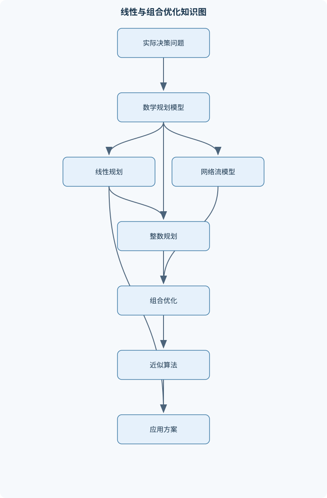
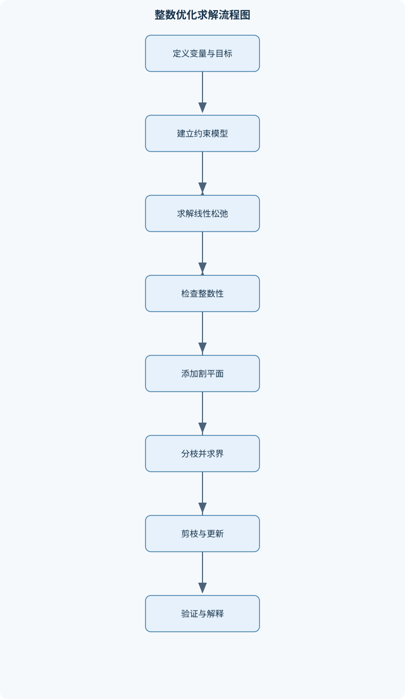

# 应用运筹学基础

## 一、课程整体知识框架

### 课程边界与先修知识

本课程研究在资源、需求和逻辑约束下进行决策优化的基本模型、理论与算法，重点覆盖线性规划、网络流、整数规划、组合优化、贪心方法和近似算法，并介绍实际建模与求解器使用。先修知识包括高等数学中的线性代数与基础微积分、概率与离散数学基础、图论基本概念，以及使用一种编程语言进行数据处理的能力。课程边界以确定性静态优化为主，不系统展开随机规划、动态规划、排队论、非线性规划、机制设计和深度学习优化；这些内容可作为后续拓展。理想模型通常假设参数已知、约束线性或具有明确组合结构，现实应用还需处理数据误差、模型遗漏、整数性、计算规模和多目标权衡。





### 1. 研究对象、决策结构与课程边界

应用运筹学研究在资源有限、需求明确、业务规则和逻辑关系约束下，如何选择一个可执行方案，使成本最小、收益最大、服务水平最高或综合效用达到较优。一个完整的优化模型通常包含决策变量、参数、目标函数和约束条件。设决策变量向量为 $x=(x_1,\ldots,x_n)^\mathsf{T}$，其中 $x_i$ 表示第 $i$ 类活动的决策量；$x_i$ 可以是连续变量、整数变量或二进制变量。参数包括资源容量、单位成本、单位收益、加工时间、运输费用等，必须明确数值单位和统计口径。

线性规划的一般最大化形式为

$$
\max\ c^\mathsf{T}x
$$

满足

$$
Ax\le b,\qquad x\ge 0.
$$

其中，$A$ 是约束系数矩阵，$a_{ij}$ 表示第 $j$ 个约束中变量 $x_i$ 的系数；$b$ 是右端项向量，表示资源上限或业务要求；$c$ 是目标系数向量，表示单位决策量带来的收益或成本。若 $x_i$ 的单位为“件”，$c_i$ 的单位可以是“元/件”，则目标函数单位为“元”；约束中相应系数必须使每一项具有相同单位。

课程以确定性、静态优化为主。确定性意味着参数被视为已知常数，静态意味着一次决策期内不重点处理状态随时间演化的问题。现实中需求、价格、运输时间和设备可用率可能存在误差，因此模型最优不等于实际执行必然最优。随机规划、动态规划、排队论、非线性规划、机制设计和深度学习优化属于后续拓展，而不是本课程的主要理论范围。

### 2. 从业务问题到数学模型

建模的第一步是确定决策对象。例如，生产计划中的 $x_i$ 可表示产品 $i$ 的生产量，设施选址中的 $y_j\in\{0,1\}$ 表示设施 $j$ 是否启用，运输问题中的 $x_{ij}$ 表示从节点 $i$ 向节点 $j$ 的运输量。第二步是写出目标函数。若产品利润为 $p_i$，则最大化总利润可写为

$$
\max \sum_{i=1}^{n}p_i x_i.
$$

第三步是把资源约束和业务约束写成数学表达。例如资源 $r$ 的单位消耗为 $a_{ri}$，总容量为 $b_r$，则

$$
\sum_{i=1}^{n}a_{ri}x_i\le b_r.
$$

库存平衡、最低服务量、工艺比例、覆盖关系和启停逻辑可能产生等式、不等式或整数约束。应特别区分“最多”“至少”和“恰好”：分别对应 $\le$、$\ge$ 和 $=$。变量域同样重要。若生产量允许按任意小数调整，可使用连续变量；若任务不可拆分，应使用整数变量；若表示是否选择，则使用二进制变量。

建模还必须检查量纲、上下界、重复约束和遗漏约束。若没有任何产能或需求上限，而目标为正收益最大化，模型可能无界；若同时要求同一资源使用量不超过 $10$ 且至少为 $20$，模型不可行。模型可行只说明存在满足约束的方案，不说明方案具有实际可操作性。

### 3. 线性规划的几何与代数基础

可行域是所有满足约束和变量非负条件的点的集合。线性不等式定义的可行域是凸集：若 $x$ 和 $y$ 都可行，且 $0\le\theta\le1$，则

$$
\theta x+(1-\theta)y
$$

也可行。证明只需利用线性性。例如，若 $Ax\le b$ 且 $Ay\le b$，则

$$
A[\theta x+(1-\theta)y]
=\theta Ax+(1-\theta)Ay
\le \theta b+(1-\theta)b=b.
$$

目标函数 $c^\mathsf{T}x$ 是仿射函数，既是凸函数又是凹函数。在线性规划存在有限最优值时，至少存在一个极点最优解，但并不表示所有最优解都是极点。若目标等值线与可行域的一条边重合，则整条边上的点都可能最优。

标准型通常写成

$$
Ax=b,\qquad x\ge0.
$$

将约束转为标准型时，$\le$ 约束加入松弛变量 $s\ge0$：

$$
a^\mathsf{T}x\le b
\quad\Longrightarrow\quad
a^\mathsf{T}x+s=b.
$$

$\ge$ 约束减去剩余变量 $s\ge0$：

$$
a^\mathsf{T}x\ge b
\quad\Longrightarrow\quad
a^\mathsf{T}x-s=b.
$$

等式约束通常不能直接提供一个显然的初始单位列，因此可能需要人工变量。若原模型含有变量下界或自由变量，还需通过平移或拆分处理。标准型转换改变的是表达形式，不应改变原问题的可行解含义。

设约束矩阵秩为 $m$，选取 $m$ 个线性无关列构成基矩阵 $B$，其余列构成 $N$。令非基变量为零，则基本变量满足

$$
Bx_B=b,\qquad x_B=B^{-1}b.
$$

如果 $x_B\ge0$，则得到基可行解。若至少一个基本变量等于零，则称该基可行解退化。退化可能导致单纯形法目标值不变但基发生变化，并可能引起循环，因此实际实现需要防循环规则或扰动机制。

### 4. 单纯形法、初始可行解与最优性

单纯形法在极点之间移动。以最大化问题为例，先声明检验数符号约定，再判断非基变量增加是否能够改善目标。若某变量入基，其他非基变量保持为零，基本变量变化由

$$
x_B=B^{-1}b-B^{-1}a_jx_j
$$

决定，其中 $a_j$ 是入基变量对应列。为了保持 $x_B\ge0$，对所有使变化方向导致基本变量下降的行进行比值检验，取最小非负比值对应的基本变量离基。主元变换后仍得到同一线性规划的基可行解。

若存在可改进的非基变量，但其对应方向没有任何变量限制其增加，则目标可以无限改善，模型无界。若一开始没有可行基，可使用两阶段法：第一阶段引入人工变量并最小化人工变量总和。第一阶段最优值大于零时，原问题不可行；等于零时只能说明找到原问题可行解，还必须删除人工变量并进行第二阶段原目标优化。大 $M$ 法把人工变量以极大惩罚系数加入目标，但 $M$ 过小可能无法排除人工变量，过大可能导致浮点数病态，因此两阶段法通常更便于数值控制。

### 5. 对偶、灵敏度与原始—对偶方法

对于最大化原问题

$$
\max\ c^\mathsf{T}x,\qquad Ax\le b,\quad x\ge0,
$$

其对偶问题为

$$
\min\ b^\mathsf{T}y,\qquad A^\mathsf{T}y\ge c,\quad y\ge0.
$$

原问题的资源约束对应对偶变量 $y$，原问题变量对应对偶约束。弱对偶定理给出

$$
c^\mathsf{T}x\le b^\mathsf{T}y
$$

对任意原始可行解 $x$ 和对偶可行解 $y$ 均成立。因此，最大化原问题的可行解提供下界，对偶可行解提供上界。若两者目标值相等，则已经证明最优。

强对偶定理说明，在适当可行且最优值有限时，原始与对偶最优值相等。互补松弛条件为

$$
y_j\bigl(b_j-a_j^\mathsf{T}x\bigr)=0,
$$

以及

$$
x_i\bigl((A^\mathsf{T}y)_i-c_i\bigr)=0.
$$

第一式表示原始约束若有剩余资源，则对应影子价格必须为零；第二式表示某项活动若取正值，则对应对偶约束必须紧。原始可行、对偶可行并满足互补松弛时，双方均最优。

影子价格只在当前最优基保持不变的参数区间内具有局部解释。若资源右端项从 $b_j$ 改为 $b_j+\Delta b_j$，且最优基不变，则目标值近似按 $y_j\Delta b_j$ 改变；超过允许范围后必须重新求解。目标系数变化、约束增删和变量界变化也可能改变最优基，不能把一次灵敏度结果外推到任意范围。

原始—对偶内点法同时维护原始可行性、对偶可行性和互补性，通过障碍函数使变量和松弛量保持正值，逐步减小原始—对偶间隙

$$
\Delta=z_D-z_P.
$$

当残差和间隙低于给定容差时，可认为达到数值意义上的最优。浮点计算中的“相等”通常是容差意义下的相等，不能要求计算机输出精确的理论分数。

### 6. 网络流与特殊线性规划

有向网络记为 $G=(V,E)$，弧 $(i,j)$ 的容量为 $u_{ij}$，流量为 $f_{ij}$。最大流模型要求

$$
0\le f_{ij}\le u_{ij},
$$

除源点 $s$ 和汇点 $t$ 外满足流量守恒：

$$
\sum_{(i,v)\in\delta^-(v)}f_{iv}
=
\sum_{(v,j)\in\delta^+(v)}f_{vj}.
$$

增广路算法在残量网络中寻找从 $s$ 到 $t$ 的路径，按路径瓶颈容量增加流量，同时加入反向残量弧以撤销先前决策。算法终止时不存在增广路，由此可构造一个容量等于当前流值的割，得到最大流最小割结论。整数容量网络存在整数最大流，但这一性质不意味着一般整数规划的线性松弛都产生整数解。

最小费用流在满足节点供需的同时最小化

$$
\sum_{(i,j)\in E}c_{ij}f_{ij}.
$$

若 $d(v)>0$ 表示供给，$d(v)<0$ 表示需求，必须满足所有节点供给量之和为零，并满足节点净流出量等于 $d(v)$。残量网络中不存在负费用环时，当前可行流满足费用最优性；若存在负费用环，沿环增流可以在不改变节点供需的条件下降低总费用。运输问题、指派问题和部分调度问题都可转化为网络流或其特殊形式。

### 7. 整数规划、组合优化、贪心与近似

整数规划要求部分或全部变量取整数。线性松弛 $LP$ 去掉整数限制，其最优值对最大化整数问题是上界，对最小化整数问题是下界。若松弛解不是整数，不能直接作为整数方案。分枝定界法选择非整数变量 $x_i^*$，建立

$$
x_i\le\lfloor x_i^*\rfloor
\quad\text{和}\quad
x_i\ge\lceil x_i^*\rceil
$$

两个子问题，并利用松弛值剪枝。割平面则加入对所有整数可行解有效、但切除当前非整数解的有效不等式。大 $M$ 逻辑约束应有尽可能紧的变量界，否则会导致松弛很弱和数值不稳定。

贪心算法每次作局部选择，只有在存在贪心选择性质和最优子结构时才能证明全局最优。最小生成树的割性质保证跨任意割的最轻边是安全边，因此 Kruskal 按边权排序并使用并查集，Prim 从已连接集合中选择最轻外连边。加权拟阵最大基是贪心正确性的典型结构。反之，背包、一般旅行商和许多装箱问题中，当前最优的局部选择可能破坏全局最优，必须提供反例或改用精确、近似或元启发式方法。

近似算法不要求总能得到最优，而要求给出性能保证。最小化问题的近似比通常为 $\mathrm{ALG}/\mathrm{OPT}$，最大化问题可用 $\mathrm{OPT}/\mathrm{ALG}$ 表示。最小顶点覆盖可由最大匹配的两个端点构造二近似；度量旅行商问题可利用最小生成树下界、树遍历和三角不等式构造常数近似；集合覆盖通常可通过按单位覆盖收益选择集合获得对数级保证。装箱和调度中的首次适应、列表调度等规则速度快，但必须结合下界、积分间隙或对抗实例进行评价。

### 8. 实际建模、求解器与结果解释

应用模型常见于生产计划、产品组合、设施选址、容量配置、任务分配、机器调度、网络路由和云资源调度。连续变量适合可分割产量和流量，整数变量适合不可拆分任务，二进制变量适合开关、选择和逻辑关系。模型输出不应只包括目标值，还应包括变量方案、约束松弛量、绑定约束、求解状态、整数最优性间隙和必要的敏感性结果。

求解器状态应区分最优、可行但未证明最优、不可行、无界、超时和数值异常。不可行时，应检查单位冲突、上下界、互相矛盾的业务要求和错误的符号；无界时，应检查缺少容量上限、需求上限或变量界；整数模型超时时，应分析松弛强度、对称性、变量界和有效不等式。最终还必须进行约束审计：将求解结果代回每条约束，逐项计算左端、右端和松弛量，并检查业务单位、整数性、实施顺序、切换成本和数据质量。

## 二、章节和模块划分

### 核心知识覆盖清单

本清单用于检查正文是否覆盖本课程的主要知识模块：

- **运筹学建模与线性规划基础**：决策变量、参数与目标函数、资源约束与业务约束的线性表达、最大化与最小化模型、标准型与规范型线性规划、可行解、可行域与最优解、凸集、凸组合与凸函数、极点、方向与无界性、松弛变量、剩余变量与人工变量。
- **线性规划几何性质与基可行解**：多面体与多面体的面、极点与基的对应关系、基矩阵与基本解、基可行解的代数定义、退化基与退化顶点、线性目标函数的极值性质、最优解存在的条件、二维图解法与等值线移动。
- **单纯形法与初始可行解**：单纯形表的构造、入基变量与出基变量、主元变换、检验数与改进方向、比值检验与可行性保持、退化与循环现象、大M法、两阶段法、不可行与无界的判别。
- **对偶理论与灵敏度分析**：原始问题与对偶问题的构造、弱对偶定理、强对偶定理、互补松弛条件、影子价格的经济解释、对偶单纯形法、右端项变化分析、目标系数变化分析、约束增删与最优基稳定性。
- **原始—对偶方法与线性规划求解**：原始可行与对偶可行、原始—对偶间隙、松弛变量与对偶松弛、可行方向与改进方向、原始—对偶内点法思想、中心路径与障碍函数、停止准则与最优性证书、浮点计算中的容差与数值稳定性。
- **网络流与特殊线性规划**：有向网络、弧容量与节点供需、流量守恒约束、最大流最小割定理、最小费用流模型、增广路与残量网络、最短路与费用改进、运输问题与指派问题、网络单纯形法、整数流性质及其适用条件。
- **整数规划与组合优化建模**：纯整数规划与混合整数规划、二进制变量与逻辑约束、大M约束的建模风险、线性松弛与整数可行域、割平面法、分枝定界法、有效不等式与多面体强化、对称性与变量界、整数性导致的计算复杂度。
- **贪心算法与拟阵结构**：贪心选择性质、最优子结构、交换论证、最小生成树的割性质、Kruskal算法、Prim算法、拟阵与独立集、加权拟阵最大基、贪心算法失效的反例、局部选择与全局最优的区别。
- **近似算法与组合优化专题**：近似比与性能保证、下界、松弛和积分间隙、装箱问题的装箱策略、调度问题的列表调度、度量旅行商问题、最小顶点覆盖的二近似、集合覆盖的对数近似、局部搜索与交换邻域、随机化近似的基本思想。
- **应用建模、求解器与结果分析**：生产计划与产品组合、设施选址与容量配置、任务分配与机器调度、网络路由与资源配置、求解器输入输出与状态码、连续变量和整数变量的选择、最优性、不可行性与无界性诊断、结果验证与约束审计、敏感性分析与方案比较、模型假设、数据质量和实施风险。


### 1. 模块一：运筹学建模与线性规划基础

本模块建立“业务语言—数学语言—求解结果”的转换链。核心内容包括决策变量、参数、目标函数、资源约束和逻辑约束。应能够区分最大化利润与最小化成本，理解约束方向与变量边界的含义，并把产品组合、产能限制、最低产量和库存平衡写成线性表达。重点不是机械套公式，而是判断线性假设是否合理：单位收益必须在模型范围内近似固定，不能把数量折扣直接写成常数系数。

### 2. 模块二：线性规划几何性质与基可行解

本模块从凸集、多面体、极点、面和方向解释线性规划。有限凸组合的系数满足 $\theta_i\ge0$ 且 $\sum_i\theta_i=1$，凸组合仍在凸集内。若可行域无界，不代表问题一定无解；例如最小化 $x$，约束 $x\ge0$ 的可行域无界，但最优解为 $x=0$。相反，最大化 $x$ 在同一可行域上无有限最优值。基、基本解和基可行解必须严格区分：基本解来自可逆基矩阵，基可行解还需满足非负性。

### 3. 模块三：单纯形法与初始可行解

本模块包括单纯形表、检验数、入基、离基、主元变换、比值检验、退化、循环、大 $M$ 法和两阶段法。以最大化表为例，若某非基变量的检验数表明增加该变量可提高目标，则它具有入基资格；比值检验只对会使基本变量下降的行进行。若没有有限比值，说明目标沿该方向无界。表格中的检验数符号随目标方向和表格定义变化，使用前必须声明约定。

### 4. 模块四：对偶理论与灵敏度分析

本模块通过原始—对偶对应关系解释资源价值。需要掌握弱对偶、强对偶和互补松弛，并能利用一组原始可行解和对偶可行解的相同目标值证明最优。灵敏度分析讨论右端项、目标系数、约束增删和最优基稳定性。影子价格是局部边际价值，不是任意变化范围内的固定承诺。

### 5. 模块五：原始—对偶方法与线性规划求解

本模块比较原始单纯形、对偶单纯形和原始—对偶内点法。原始单纯形保持原始可行性；对偶单纯形保持对偶可行性，适合右端项变化后的热启动；内点法沿中心路径接近最优解，适合大型稀疏模型。求解器使用中需理解原始残差、对偶残差、互补性和间隙，并根据容差而非字符串状态判断结果可信度。

### 6. 模块六：网络流与特殊线性规划

本模块覆盖最大流最小割、最小费用流、运输问题、指派问题、网络单纯形法和整数流性质。网络模型的优势在于结构清晰、约束稀疏，部分网络矩阵具有全酉模性质，使整数供给和容量下存在整数最优流。该结论适用于相应网络流结构，不适用于随意增加一般逻辑约束后的模型。

### 7. 模块七：整数规划与组合优化建模

本模块研究纯整数规划、混合整数规划、二进制逻辑、大 $M$ 约束、线性松弛、割平面和分枝定界。固定开机成本可用二进制变量 $y_j$ 与产量变量 $x_j$ 建模，例如

$$
0\le x_j\le U_jy_j.
$$

其中 $U_j$ 必须是合理的紧上界。若 $U_j$ 取极大值，模型虽可能保持逻辑正确，但线性松弛会非常松，导致搜索规模增大和数值问题。对称变量、过宽界和弱约束是整数模型难解的常见原因。

### 8. 模块八：贪心算法与拟阵结构

本模块解释贪心选择性质、最优子结构、交换论证和安全边性质。Kruskal 算法将边按非降序排列，若新边不形成环则加入；Prim 算法维护一个已连接顶点集合并选择最轻外连边。Kruskal 的正确性来自割性质，而不是“每次选最小边所以一定最优”。例如一般 0—1 背包按单位价值排序可能失败，说明局部选择规则必须有结构性证明。

### 9. 模块九：近似算法与组合优化专题

本模块包括近似比、下界、线性松弛、积分间隙、装箱、调度、度量旅行商、顶点覆盖、集合覆盖、局部搜索和随机化方法。分析一个近似算法至少要证明三点：输出可行、目标值与最优值的关系、运行时间或迭代终止条件。随机化算法还应说明期望性能、失败概率或随机种子对复现实验的影响。

### 10. 模块十：应用建模、求解器与结果分析

本模块把前述理论用于生产、设施、运输、调度和网络配置。建模流程为：统一数据单位，定义变量域，写出目标和约束，检查边界，求解并读取状态，复核可行性，分析敏感性，最后进行方案比较。求解器输出的“最优”只针对输入模型，不代表业务模型没有遗漏。应通过情景分析检验需求变化、容量下降、成本变化和实施规则变化下的方案稳定性。

### 11. 代表性算法与流程

#### 11.1 分枝定界法

**输入**：混合整数线性规划、变量上下界、停止容差。  
**输出**：最优整数解、不可行结论，或在给定间隙内的可接受解。

过程如下：

1. 求解根节点线性松弛。
2. 若松弛不可行，剪枝。
3. 若松弛解满足整数性，用其更新当前最好整数解。
4. 若松弛界不可能优于当前最好解，剪枝。
5. 选择非整数变量，按向下和向上取整建立两个子问题。
6. 继续处理未剪枝节点，直到没有待处理节点或达到时间、间隙等停止条件。

全局不变量是：所有未剪枝节点的界覆盖其潜在整数最优值。最大化问题中，松弛值是上界；最小化问题中，松弛值是下界。最坏运行时间可能呈指数增长。

```python
# Python：二维整数规划的简化分枝定界框架
from math import floor, ceil

def branch_and_bound(relax_solver, is_integer, choose_fractional,
                     incumbent=None, nodes=None):
    """
    relax_solver(bounds) 返回 (status, bound, solution)。
    bounds 是变量的上下界字典，例如 {0: (0, 10), 1: (0, 10)}。
    本示例针对最大化问题。
    """
    if nodes is None:
        nodes = [(0, {0: (0, 10), 1: (0, 10)})]
    best_value = float("-inf") if incumbent is None else incumbent[0]
    best_solution = None if incumbent is None else incumbent[1]

    while nodes:
        _, bounds = nodes.pop()
        status, bound, solution = relax_solver(bounds)

        if status == "infeasible" or bound <= best_value:
            continue

        if is_integer(solution):
            best_value, best_solution = bound, solution
            continue

        i = choose_fractional(solution)
        value = solution[i]
        left = dict(bounds)
        right = dict(bounds)

        lo, hi = bounds[i]
        left[i] = (lo, min(hi, floor(value)))
        right[i] = (max(lo, ceil(value)), hi)

        if left[i][0] <= left[i][1]:
            nodes.append((len(nodes), left))
        if right[i][0] <= right[i][1]:
            nodes.append((len(nodes), right))

    return best_value, best_solution
```

该代码是算法结构示意，`relax_solver` 必须正确返回线性松弛状态和目标上界；若把松弛目标值误当成整数可行解，会破坏算法正确性。

#### 11.2 增广路最大流算法

**输入**：有向图 $G=(V,E)$、容量 $u_{ij}$、源点 $s$ 和汇点 $t$。  
**输出**：最大流及一个最小割。  
**不变量**：所有弧满足容量约束，除源汇外节点满足流量守恒。  
**终止条件**：残量网络中不存在从 $s$ 到 $t$ 的路径。

每次在残量网络中寻找一条路径，计算其瓶颈容量

$$
\Delta=\min_{(i,j)\text{在路径上}}r_{ij},
$$

然后沿路径增加 $\Delta$，并沿反向弧减少可撤销的流量。使用广度优先搜索时，经典实现复杂度为 $O(VE^2)$。忽略反向弧会使早期错误选择无法撤销，因而可能得到非最大流。

#### 11.3 Kruskal 最小生成树算法

**输入**：带权无向连通图。  
**输出**：包含 $|V|-1$ 条边的最小生成树。  
**过程**：按边权非降序排序；依次检查每条边，若两端不在同一连通分量中则加入并查集；选出 $|V|-1$ 条边后终止。  
**不变量**：已选边无环，并可扩展为某棵最小生成树。  
**复杂度**：排序为 $O(E\log E)$，并查集操作在路径压缩和按秩合并下近似常数摊销。

#### 11.4 求解器建模与审计流程

输入业务数据、变量定义、目标和约束；输出模型状态、解、目标值、松弛量和敏感性信息。步骤包括：

1. 统一单位并记录每个参数的含义。
2. 为每个变量声明连续、整数或二进制域。
3. 逐条编码约束，并保留数学表达与代码表达的对应关系。
4. 设置目标方向和目标系数。
5. 求解并读取状态码、目标值和间隙。
6. 将解代回原约束，逐项检查可行性。
7. 解释绑定资源、剩余资源和业务风险。
8. 进行参数扰动和方案比较。

排错时，先构造小规模手算实例，再逐步增加数据；对不可行模型使用约束分组和逐步启用法定位冲突，对无界模型检查变量上界和正收益方向，对数值异常检查大 $M$、单位尺度和容差。

### 12. 例题一：产品组合线性规划

**题干**：产品甲、乙的单位利润分别为 $40$ 元和 $30$ 元。甲、乙分别消耗机器工时 $2$、$1$ 小时，原料 $1$、$2$ 千克。机器最多 $8$ 小时，原料最多 $8$ 千克，产量非负。求最大利润。

**分析**：设 $x_1,x_2$ 为两种产品的产量，单位为件。模型为

$$
\max 40x_1+30x_2
$$

满足

$$
2x_1+x_2\le8,
\qquad
x_1+2x_2\le8,
\qquad
x_1,x_2\ge0.
$$

**逐步解答**：顶点为 $(0,0)$、$(4,0)$、$(0,4)$，以及两条边界交点。解

$$
2x_1+x_2=8,\quad x_1+2x_2=8
$$

得 $x_1=x_2=8/3$。目标值分别为 $0$、$160$、$120$ 和 $560/3\approx186.67$，故连续模型最优解为 $(8/3,8/3)$。

**结果验证**：机器使用量为 $8$ 小时，原料使用量为 $8$ 千克，两条约束均绑定。  
**变式**：若产品不可分割，应增加 $x_1,x_2\in\mathbb Z_{\ge0}$，此时连续解不能直接执行。枚举附近整数点可得 $(3,2)$ 的利润为 $180$，而 $(2,3)$ 利润为 $170$，整数最优至少需在整数可行域中重新验证。

### 13. 例题二：标准型与基可行解

**题干**：将

$$
x_1+x_2\le4,\qquad
x_1+2x_2\ge3,\qquad
x_1,x_2\ge0
$$

转化为标准型，并构造一个基可行解。

**分析与解答**：加入松弛变量 $s_1$，引入剩余变量 $s_2$：

$$
x_1+x_2+s_1=4,
$$

$$
x_1+2x_2-s_2=3.
$$

变量均要求非负。取非基变量 $x_1=x_2=0$，则 $s_1=4$、$s_2=-3$，不满足非负性，因此不是基可行解。取 $x_1=3,x_2=0$，则 $s_1=1,s_2=0$，可行。对应的基可取 $x_1,s_1$，其列向量线性无关，基本变量均非负，因此是基可行解。

**结果验证**：原约束中 $3\le4$ 且 $3\ge3$，变量非负。  
**变式**：若第二个约束改为等式，通常需要人工变量才能建立显然的初始基。

### 14. 例题三：对偶与互补松弛

**题干**：原问题为

$$
\max 3x_1+2x_2
$$

满足

$$
x_1+x_2\le4,\qquad
2x_1+x_2\le5,\qquad
x_1,x_2\ge0.
$$

写出对偶，并验证 $x=(1,3)$ 是否最优。

**解答**：对偶为

$$
\min 4y_1+5y_2
$$

满足

$$
y_1+2y_2\ge3,
\qquad
y_1+y_2\ge2,
\qquad
y_1,y_2\ge0.
$$

原解 $x=(1,3)$ 的资源使用量为 $4$ 和 $5$，原目标值为 $9$。取对偶解 $y=(1,1)$，其约束为 $1+2=3$、$1+1=2$，可行；对偶目标值为 $4+5=9$。原始和对偶可行且目标值相等，由弱对偶定理可知二者均最优。

**结果验证**：两条原始约束均绑定，两个正的原始变量对应的对偶约束均取等号，符合互补松弛。  
**变式**：若资源一的上限从 $4$ 增加到 $4.5$，不能直接断言目标增加 $0.5$；必须确认当前最优基在该变化范围内保持不变。

### 15. 例题四：最大流

**题干**：网络弧及容量为 $s\to a:3$、$s\to b:2$、$a\to b:1$、$a\to t:2$、$b\to t:3$。求最大流。

**解答**：先沿 $s\to a\to t$ 增广 $2$，再沿 $s\to b\to t$ 增广 $2$，此时流值为 $4$。残量网络中还可沿 $s\to a\to b\to t$ 增广 $1$，流值为 $5$。此时源点流出容量已全部使用：$3+2=5$，因此以 $\{s\}$ 为源侧的割容量为 $5$。已有流值等于割容量，故最大流为 $5$。

**结果验证**：所有弧流量不超过容量，中间节点流入等于流出。  
**变式**：若忘记残量网络中的反向弧，可能无法重新分配先前流量；在更复杂网络中会得到小于最大值的结果。

### 16. 例题五：最小顶点覆盖二近似

**题干**：给定无向图，算法先取一条未覆盖边 $(u,v)$，把 $u,v$ 加入覆盖集合，并删除所有与它们相 incident 的边。说明算法的近似保证。

**解答**：每次选取的边互不相邻，因此这些边构成匹配。设匹配大小为 $M$，算法输出覆盖大小为 $2M$。任何顶点覆盖至少要覆盖匹配中的每条边，而匹配边两两不共享端点，因此任意顶点覆盖至少包含 $M$ 个顶点，即 $\mathrm{OPT}\ge M$。于是

$$
\mathrm{ALG}=2M\le2\mathrm{OPT}.
$$

所以该算法是二近似。

**结果验证**：算法输出确实覆盖每条边，因为每条边在处理时被覆盖或随后与已选顶点相 incident。  
**变式**：在二分图中还可以使用更强的精确方法；不能把二近似结论误认为所有图上的最优解。

### 17. 实验与项目一：生产计划混合整数模型

**输入数据**：产品收益、原料和机器消耗、设备容量、固定开机成本、最低订单量和库存上限。  
**步骤**：

1. 定义连续产量变量 $x_i$ 和开机二进制变量 $y_i$。
2. 写出资源约束、订单约束和 $x_i\le U_iy_i$ 的逻辑约束。
3. 分别求解线性松弛和整数模型。
4. 比较松弛目标值、整数目标值和积分间隙。
5. 将整数解代回所有约束，输出利用率和未使用资源。
6. 改变需求和固定成本，进行情景比较。

**评价标准**：整数可行；目标值与求解器状态一致；最优性间隙达到设定要求；每条约束通过审计；单位和固定成本未重复计算。  
**排错方法**：若模型不可行，先删除逻辑约束，再逐组恢复；若松弛与整数差距过大，检查 $U_i$ 是否过宽、是否存在对称变量；若结果开机但不生产，检查固定成本符号和最小产量逻辑。

### 18. 实验与项目二：网络运输与最小费用流

**输入数据**：供给节点、需求节点、弧容量、单位运输成本和节点供需量。  
**步骤**：

1. 检查所有节点供给量之和是否为零。
2. 为每条弧定义流量变量 $f_{ij}$ 和容量上下界。
3. 写出节点守恒约束及总运输费用目标。
4. 求解并记录每条弧流量、总费用和剩余容量。
5. 在一条弧容量下降或费用上升的情景下重新求解。
6. 检查是否存在未满足需求、超容量流量或负费用环处理错误。

**评价标准**：供需完全平衡；弧流量满足容量；总费用等于逐弧费用乘流量之和；方案在情景变化下可解释。  
**排错方法**：若不可行，检查网络连通性和容量总量；若费用异常低，检查费用单位、弧方向和反向弧费用；若使用负费用弧，不能直接套用只适用于非负权的最短路过程，应先处理势函数或负环问题。

## 三、核心概念的详细解释

### 1. 运筹学模型的基本结构与建模边界

应用运筹学模型把现实决策抽象为四类对象：决策变量、参数、目标函数和约束条件。决策变量表示可以主动选择的方案，例如产品产量、运输量、设施是否启用或任务分配关系。参数是模型输入，例如单位利润、资源容量、运输成本、加工时间和需求量。目标函数衡量方案优劣，约束条件描述资源、业务规则和逻辑关系。

线性规划的常用最大化形式为

$$
\max\ c^\mathsf{T}x
$$

满足

$$
Ax\le b,\qquad x\ge 0.
$$

其中，$x\in\mathbb{R}^n$ 为决策变量向量，$A$ 为约束系数矩阵，$b$ 为右端项向量，$c$ 为目标系数向量。若$x_i$的单位是“件”，$c_i$的单位可以是“元/件”，则目标值单位为“元”；若约束表示机器工时，$a_{ji}$的单位应为“小时/件”，$b_j$的单位应为“小时”。量纲不一致会使模型即使形式正确，也缺乏实际意义。

“最多”“至少”“恰好”分别通常写成$\le$、$\ge$和$=$。连续变量可以取实数，整数变量要求$x_i\in\mathbb{Z}$，二进制变量要求$x_i\in\{0,1\}$。任务能否拆分是变量类型选择的重要依据：可按比例生产的物料适合连续变量，不可拆分的车辆、人员或项目通常需要整数变量。

线性规划适用于目标和约束都可以表示为变量的一次函数的情形。若单位成本随产量变化、存在固定启用费用、变量之间有“如果……那么……”的逻辑关系，就可能需要混合整数线性规划。若收益呈平方增长、设备效率依赖产量等，则线性模型只能作为近似，不能无条件地解释为精确模型。

### 2. 可行域、凸性与线性规划的几何性质

可行域是满足全部约束的决策向量集合。线性不等式的交集是凸集。若$x$和$y$均可行，且$0\le\theta\le1$，则

$$
z=\theta x+(1-\theta)y
$$

也可行，因为

$$
Az=\theta Ax+(1-\theta)Ay
\le \theta b+(1-\theta)b=b.
$$

非负约束同样保持成立。有限个点的凸组合也属于该集合。若$\lambda_i\ge0$且$\sum_i\lambda_i=1$，则$\sum_i\lambda_i x^{(i)}$是这些点的凸组合。

凸性意味着局部结构与整体结构具有较强联系，但不能把“凸集”误认为“有界集合”。例如集合$\{(x_1,x_2):x_1\ge0,x_2\ge0\}$是凸的，却向无穷远延伸。无界可行域仍可能有有限最优解，例如最大化$-x_1$且$x_1\ge0$时最优值为$0$；也可能目标无界，例如最大化$x_1$且$x_1\ge0$。

线性目标函数的等值线为

$$
c^\mathsf{T}x=\alpha.
$$

在二维问题中，平行移动等值线可以直观寻找最优点。若等值线最后接触可行域的一个顶点，得到唯一极点最优解；若沿一条边重合，则该边上所有点都是最优解；若可以无限沿改进方向移动，则目标无界。图解法只适用于变量较少的模型，不能代替高维算法。

### 3. 多面体、极点、方向与最优解存在性

由有限个线性等式和不等式定义的集合称为多面体。多面体的面是通过把某些有效约束变成等式所得到的子集；维数较低的面包括顶点、边和面片。极点是不能表示为两个不同可行点的严格凸组合的可行点。

若线性规划存在有限最优值，则至少有一个极点最优解。原因是：从一个最优可行点出发，若它不是极点，就可以沿某个可行方向分解或移动；线性目标在该方向上要么改善、要么保持不变。由于原点、边界和约束交点构成有限的结构，最终可以到达极点而不降低目标值。该结论不表示所有最优解都是极点，也不适用于非凸可行域或一般非线性目标。

一个方向$d$称为可行方向，通常要求从当前点沿$x+\lambda d$移动一段正的$\lambda$后仍满足约束。若存在满足$Ad\le0$、$d\ge0$且$c^\mathsf{T}d>0$的方向，则最大化问题沿该方向可以持续改善，可能出现无界。若约束体系本身没有可行点，则问题不可行；不可行与无界是两种不同诊断结论。

### 4. 基、基本解与基可行解

考虑等式标准型

$$
Ax=b,\qquad x\ge0,
$$

其中$A$有$m$行且秩为$m$。从$A$的列中选取$m$个线性无关列组成基矩阵$B$，其余列组成$N$。令非基变量$x_N=0$，则基本变量为

$$
x_B=B^{-1}b.
$$

若$B$可逆，则得到基本解；若进一步满足$x_B\ge0$，则得到基可行解。基本解是代数概念，基可行解同时具有可行性，二者不能混同。

若某个基本变量等于零，则基可行解退化。退化可能导致一次换基后仍停留在同一个几何顶点，也可能使单纯形法出现循环。为避免循环，可使用字典序规则或Bland规则等反循环策略。不同基可能对应同一个顶点，因此“基的数量”和“顶点的数量”不必相等。

不等式转标准型时，$\le$约束加入松弛变量：

$$
a^\mathsf{T}x+s=b,\qquad s\ge0.
$$

$\ge$约束通常减去剩余变量：

$$
a^\mathsf{T}x-s=b,\qquad s\ge0.
$$

等式约束没有天然的单位列，初始基可能不存在，需要人工变量。人工变量不是业务决策量，只是寻找初始可行基的辅助变量，最终必须从模型中消除。

### 5. 单纯形法及其初始可行解

单纯形法在相邻基可行解之间移动。对最大化问题，若采用目标行写成“目标值减去变量项”的表格约定，检验数为正通常表示对应非基变量增加可以改善目标；若采用其他表格符号，判断方向会相反。因此必须先声明检验数约定，不能机械记忆正负号。

一次迭代包括四步：

1. 计算非基变量的检验数，判断当前基是否满足最优性。
2. 选择具有改进潜力的非基变量入基。
3. 对所有会限制入基变量增加的行进行比值检验，选择离基变量。
4. 以主元为中心进行行变换，保持等价性并得到新基。

若某个可改善变量入基，但所有约束都不限制其增加，则问题无界。若不存在可改善的非基变量，当前基可行解达到最优。比值检验的作用是保持基本变量非负；只考虑相应系数会使基本变量随入基变量增加而下降的行。

两阶段法适用于没有显然初始可行基的模型。第一阶段引入人工变量并最小化人工变量总和。若第一阶段最优值大于零，说明至少有人工变量无法消除，原问题不可行；若最优值为零，只说明找到了原问题的可行解，仍须删除人工变量并在第二阶段优化原目标。大$M$法把人工变量以极大惩罚系数加入目标，但$M$过小可能不能排除人工变量，$M$过大又会造成数值病态，因此实际计算中两阶段法通常更稳健。

### 6. 对偶、影子价格与灵敏度

对原始最大化问题

$$
\max\ c^\mathsf{T}x
\quad\text{s.t.}\quad
Ax\le b,\ x\ge0
$$

其对偶问题为

$$
\min\ b^\mathsf{T}y
\quad\text{s.t.}\quad
A^\mathsf{T}y\ge c,\ y\ge0.
$$

原始变量的数量对应对偶约束的数量；原始约束的数量对应对偶变量的数量。若原始约束表示资源上限，则对偶变量$y_j$可解释为资源$j$增加一个单位时最优目标值的局部增量，即影子价格。

弱对偶定理说明，任意原始可行解$x$和任意对偶可行解$y$都满足

$$
c^\mathsf{T}x\le b^\mathsf{T}y.
$$

因此，对偶可行解为最大化原始问题提供上界。若两者目标值相等，则原始解和对偶解均最优。影子价格并非在任意参数变化范围内都有效；它只在当前最优基保持不变的区间内具有局部解释。若资源变化导致基变化，应重新求解。

互补松弛条件为

$$
y_j\left(b_j-a_j^\mathsf{T}x\right)=0,
$$

以及

$$
x_i\left((A^\mathsf{T}y)_i-c_i\right)=0.
$$

第一式表示资源约束若有剩余，则其影子价格必须为零；第二式表示原始变量若为正，则对应对偶约束必须紧。原始、对偶均可行且满足互补松弛时，两者均为最优。

### 7. 原始—对偶方法与数值计算

原始—对偶间隙可表示为

$$
\Delta=z_D-z_P
$$

或使用其绝对值，其中$z_P$和$z_D$分别为原始与对偶目标值。最大化原始问题中，原始可行解给出下界，对偶可行解给出上界；间隙为零时，在精确算术下即可证明最优。

内点法不沿多面体边界移动，而是在可行域内部利用障碍函数和互补条件逐步接近最优解。典型障碍项形式为

$$
-\mu\sum_i\ln x_i,
$$

其中$\mu>0$控制远离边界的程度。随着$\mu$减小，迭代点沿中心路径接近最优边界。实际浮点计算中通常使用原始残差、对偶残差和相对间隙作为停止标准，而不是要求数学意义上的精确零。

容差必须结合数据尺度设置。若约束右端项达到百万数量级，绝对误差$10^{-6}$可能毫无意义；若变量表示数量且必须整数，求解后应检查其与最近整数的距离。数值病态常由极大的大$M$、单位混用、系数跨越很多数量级或近线性相关约束造成。

### 8. 网络流与特殊线性规划

有向网络记为$G=(V,E)$。弧$(i,j)$的容量为$u_{ij}$，流量为$f_{ij}$，通常满足

$$
0\le f_{ij}\le u_{ij}.
$$

最大流问题指定源点$s$和汇点$t$，除源汇外每个节点满足流入等于流出。残量网络不仅包含未使用的正向容量，也包含可以撤销既有流量的反向弧。忽略反向弧会使早期错误增流无法修正。

割将节点划分为含$s$的一侧和含$t$的一侧，割容量是从前一侧指向后一侧的弧容量之和。最大流最小割定理说明最大流值等于最小割容量。增广路算法终止时，若残量网络中不存在从$s$到$t$的路径，则从$s$可达节点集合定义出一个割，其容量等于当前流值，因而给出最优性证书。

最小费用流在满足节点供需的同时最小化

$$
\min\sum_{(i,j)\in E}q_{ij}f_{ij},
$$

其中$q_{ij}$为单位流量费用。节点$v$的供给量$d(v)>0$表示净流出，$d(v)<0$表示净流入，必须满足$\sum_{v\in V}d(v)=0$。增广时应在残量网络中寻找费用最短的改进路径；若存在负费用环，沿环增流可在不改变供需的情况下继续降低总费用。

运输问题是供给节点到需求节点的特殊最小费用流；指派问题是每个任务恰分配给一个对象、每个对象至多承担一个任务的特殊模型。若容量、供给和需求均为整数，网络流模型通常存在整数最优流，这是网络矩阵结构带来的性质，不代表所有整数规划的线性松弛都自动整数化。

### 9. 整数规划、逻辑约束与多面体强化

整数规划要求部分或全部变量取整数。纯整数规划所有决策变量均为整数，混合整数规划只要求部分变量整数。去掉整数限制得到线性松弛。对最大化问题，线性松弛最优值是整数问题最优值的上界；对最小化问题，它是下界。松弛解若含小数，不能直接作为整数方案执行。

二进制变量可表达启用决策。若产量$x_i$只有在设备启用时才能为正，可写

$$
0\le x_i\le U_i y_i,\qquad y_i\in\{0,1\}.
$$

其中$U_i$应是尽可能紧的真实上界。过大的$U_i$会削弱线性松弛并造成数值问题；过小则可能错误排除可行方案。逻辑关系“若$y_1=1$则$y_2=1$”可写为$y_1\le y_2$；“二者至多选一个”可写为$y_1+y_2\le1$。

分枝定界先求线性松弛。若松弛不可行、界不优于当前最好整数解，或松弛解已经整数，则节点剪枝；否则选择一个小数变量，建立

$$
x_i\le\lfloor x_i^*\rfloor
\quad\text{和}\quad
x_i\ge\lceil x_i^*\rceil
$$

两个子问题。割平面加入对所有整数可行解有效、但切除当前小数解的不等式。有效割不能切掉任何整数方案，但过多或过强的割可能增加计算和数值负担。对称变量会产生大量等价解，可用排序约束、固定代表变量等方式减少搜索。

### 10. 贪心、拟阵与近似算法

贪心算法每一步选择当前看来最有利的局部决策。局部合理不必然推出全局最优；要证明精确性，通常需要贪心选择性质和最优子结构。交换论证的基本形式是：从一个最优解出发，把其中第一步替换为贪心选择，证明替换后仍可得到不差于原解的最优解，然后递归处理剩余问题。

最小生成树的割性质是：对任意割，跨越该割的最轻边是安全边，即存在一棵最小生成树包含它。Kruskal算法按边权递增处理，若当前边不会形成环则加入；Prim算法从一个顶点开始，每次加入连接当前树与外部顶点的最轻边。Kruskal的主要复杂度为排序的$O(|E|\log|E|)$，并查集操作近似线性。

拟阵由底集和满足遗传性、交换性的独立集构成。加权拟阵最大基可以用按权重递减的贪心算法求解；一般组合问题不具备拟阵交换性质，因此不能套用该结论。最小顶点覆盖的匹配算法不是精确贪心，而是二近似：取匹配每条边的两个端点，输出规模不超过最优值的两倍。

近似算法必须同时说明可行性和性能保证。最小化问题的近似比通常为$\mathrm{ALG}/\mathrm{OPT}$，最大化问题常用$\mathrm{OPT}/\mathrm{ALG}$。度量旅行商问题可先求最小生成树作为下界，再进行遍历和三角不等式快捷化，得到常数近似；没有三角不等式时，快捷化可能增加总长度，经典保证不再成立。集合覆盖、装箱和调度中的局部规则也必须结合下界或反例分析，不能仅凭一个实例的效果声称最优。

### 11. 应用建模、求解器输出与结果审计

生产计划通常用产量变量、库存变量和启停变量描述；设施选址使用位置变量、服务分配变量和容量约束；机器调度使用任务分配、开始时间或先后关系变量；网络资源配置使用弧流量、容量扩展和连通性变量。模型输出必须包括状态、目标值、变量值、约束松弛量、整数性和最优性间隙。

“最优”表示在给定模型、参数和容差下没有更好的可行解；“可行”只表示找到一个满足约束的方案；“不可行”表示约束之间无法同时满足；“无界”表示目标可以无限改善。超时并不等于最优，求解器返回的可行解还应结合当前界和间隙解释。

结果审计至少包括：将变量代回每条约束；检查单位和数量级；核对目标值是否等于各项收益或成本之和；检查整数变量是否接近整数；确认固定成本没有重复计算；核对供需、容量和逻辑关系。模型可解也不代表方案可实施，现实中还要考虑需求误差、执行顺序、切换成本、人员规则和遗漏约束。

## 四、重要定义、公式、定理和推导

### 专业审校补充：关键定义与适用边界

全单模矩阵是整数规划与网络流之间的重要边界。矩阵A称为全单模，若其每个方形子式的行列式均属于{−1,0,1}。若A为全单模矩阵，且右端项b为整数，则多面体{ x≥0：Ax≤b }的每个极点都是整数向量；因此在目标函数系数为任意实数时，线性规划松弛与相应整数规划具有相同的最优值，且可直接获得整数最优解。该结论的前提是约束矩阵、变量符号和右端项均符合定理形式，不能仅因数据是整数就断言解必为整数。运输、指派和某些网络流模型具有这种整数性，但加入一般的固定费用、逻辑联结或任意侧约束后，全单模结构可能被破坏。此时仍需使用整数规划方法，不能把线性规划解直接作为可执行方案。


### 1. 凸组合与凸集的归纳证明

若$x^{(1)},\ldots,x^{(k)}$属于凸集$S$，且$\lambda_i\ge0$、$\sum_{i=1}^k\lambda_i=1$，则其凸组合

$$
\bar{x}=\sum_{i=1}^k\lambda_i x^{(i)}
$$

属于$S$。证明对$k$归纳。$k=2$时正是凸集定义。假设对$k$成立，考虑$k+1$个点。若$\lambda_{k+1}<1$，令

$$
y=\frac{\sum_{i=1}^{k}\lambda_i x^{(i)}}{1-\lambda_{k+1}}.
$$

则$y\in S$，且

$$
\bar{x}=(1-\lambda_{k+1})y+\lambda_{k+1}x^{(k+1)}\in S.
$$

若$\lambda_{k+1}=1$，则$\bar{x}=x^{(k+1)}\in S$。该结论用于说明可行域中任意可行方案的加权平均仍可行，但不表示平均方案一定具有更高目标值。

### 2. 标准型、规范型与对偶构造

常用标准型为

$$
\max\ c^\mathsf{T}x
\quad\text{s.t.}\quad
Ax=b,\ x\ge0.
$$

“标准型”在不同教材中可能指等式约束加非负变量，也可能指特定的最大化或最小化形式，因此使用时必须明确约定。$\le$约束通过加入松弛变量转为等式；$\ge$约束通过减去剩余变量转为等式；自由变量$x_i$可写成$x_i=x_i^+-x_i^-$，其中$x_i^+,x_i^-\ge0$。

由拉格朗日乘子或线性代数可得到对偶关系。对原始最大化问题，约束右端项$b$成为对偶目标系数，原始目标系数$c$成为对偶约束右端项，矩阵$A$转置为$A^\mathsf{T}$。方向关系由变量符号和约束方向共同决定：原始最大化中的$\le$约束对应非负对偶变量；原始变量非负对应对偶约束为$\ge$。

### 3. 弱对偶定理的推导

设$x$为原始可行解，$y$为对偶可行解。因为$x\ge0$且$A^\mathsf{T}y\ge c$，有

$$
c^\mathsf{T}x\le (A^\mathsf{T}y)^\mathsf{T}x
=y^\mathsf{T}Ax.
$$

又因$Ax\le b$且$y\ge0$，所以

$$
y^\mathsf{T}Ax\le y^\mathsf{T}b=b^\mathsf{T}y.
$$

因此

$$
c^\mathsf{T}x\le b^\mathsf{T}y.
$$

该推导的前提是两个解分别满足对应可行性和符号条件。它不能单独证明某个原始解最优，除非同时找到一个对偶可行解并使两个目标值相等。

### 4. 强对偶与互补松弛

在线性规划具有适当可行性且最优值有限时，原始和对偶最优值相等：

$$
z_P=z_D.
$$

由目标差可写出

$$
b^\mathsf{T}y-c^\mathsf{T}x
=
y^\mathsf{T}(b-Ax)+x^\mathsf{T}(A^\mathsf{T}y-c).
$$

两项均非负。若目标差为零，则每个非负项中的相应乘积必须为零，从而得到

$$
y_j(b_j-a_j^\mathsf{T}x)=0,
$$

以及

$$
x_i((A^\mathsf{T}y)_i-c_i)=0.
$$

这解释了互补松弛的经济含义：未耗尽的资源没有边际价值；使用量为正的活动必须恰好满足其对偶成本条件。强对偶是精确数学结论，浮点求解中只能要求间隙小于设定容差。

### 5. 单纯形法的最优性与无界性判别

在某一基下令$x_N=0$，得到$x_B=B^{-1}b$。若$x_B\ge0$，当前解基可行。将目标写成

$$
z=c_B^\mathsf{T}B^{-1}b+
\left(c_N^\mathsf{T}-c_B^\mathsf{T}B^{-1}N\right)x_N.
$$

其中

$$
r_N^\mathsf{T}=c_N^\mathsf{T}-c_B^\mathsf{T}B^{-1}N
$$

为一种常用最大化检验数定义。若所有$r_N\le0$，增加任何非基变量都不能改善目标，当前基可行解最优。若某个$r_k>0$，令$x_k$增加，基本变量变化为

$$
x_B=B^{-1}b-B^{-1}N_{\cdot k}x_k.
$$

若所有相关分量都不会使$x_B$下降到负数，则$x_k$可以无限增加，目标无界；否则对满足下降系数为正的行计算允许增量，最小比值确定离基变量。

### 6. 最大流最小割定理的证明思路

任意可行流$f$和任意$s$-$t$割$(S,T)$满足

$$
|f|\le \sum_{i\in S,j\in T}u_{ij}.
$$

原因是流值等于从$S$流向$T$的流量减去从$T$流向$S$的流量，而前者不超过割容量，后者为非负量。

增广路算法每次沿残量网络中的$s$-$t$路径增加流量。若终止时不存在增广路，令$S$为从$s$在残量网络中可达的节点集合，$T=V\setminus S$。任何从$S$到$T$的正向弧都没有剩余容量，否则终点仍可达；因此其流量等于容量。任何从$T$到$S$的弧不可能有正向流，否则对应反向残量弧会使起点可达。于是当前流值等于该割容量。结合任意流不超过任意割，得到最大流值等于最小割容量。

### 7. 整数规划松弛与分枝定界的正确性

设最大化整数规划的整数可行域为$I$，其线性松弛可行域为$LP$。因$I\subseteq LP$，有

$$
\max_{x\in I}c^\mathsf{T}x
\le
\max_{x\in LP}c^\mathsf{T}x.
$$

因此松弛目标值是上界。若当前已有整数可行解值$L$，某节点松弛上界$U\le L$，则该节点不可能产生更优整数解，可以剪枝。对最小化问题方向相反：松弛值是下界，若下界不小于当前最好整数解值即可剪枝。

分枝使用$x_i\le\lfloor x_i^*\rfloor$和$x_i\ge\lceil x_i^*\rceil$覆盖所有整数可能性，同时排除当前小数值$x_i^*$。因此只要节点界计算正确、分枝覆盖完整且剪枝条件合法，最终保留下来的最好整数解就是全局最优解。最坏情况下节点数呈指数增长，这也是整数规划与线性规划在计算复杂度上的重要差异。

### 8. 代表性算法流程与代码

#### 增广路最大流算法

**输入**：有向图$G=(V,E)$、容量$u_{ij}$、源点$s$和汇点$t$。  
**输出**：最大流值及各弧流量。  
**不变量**：容量约束和流量守恒始终成立。  
**终止条件**：残量网络中不存在从$s$到$t$的路径。  
**复杂度**：使用广度优先搜索寻找增广路的经典实现为$O(|V||E|^2)$。

```python
from collections import deque

def edmonds_karp(capacity, source, sink):
    """
    capacity[u][v]：弧(u,v)容量，节点编号为0,...,n-1
    返回最大流值和流量矩阵。
    """
    n = len(capacity)
    residual = [row[:] for row in capacity]
    flow = [[0] * n for _ in range(n)]
    value = 0

    while True:
        parent = [-1] * n
        parent[source] = source
        queue = deque([source])

        while queue and parent[sink] == -1:
            u = queue.popleft()
            for v in range(n):
                if parent[v] == -1 and residual[u][v] > 0:
                    parent[v] = u
                    queue.append(v)
                    if v == sink:
                        break

        if parent[sink] == -1:
            break

        bottleneck = float("inf")
        v = sink
        while v != source:
            u = parent[v]
            bottleneck = min(bottleneck, residual[u][v])
            v = u

        v = sink
        while v != source:
            u = parent[v]
            residual[u][v] -= bottleneck
            residual[v][u] += bottleneck
            flow[u][v] += bottleneck
            flow[v][u] -= bottleneck
            v = u

        value += bottleneck

    return value, flow
```

代码假设容量非负且图节点编号连续。若原图没有反向弧，残量矩阵仍须为反向更新预留位置。代码返回的`flow[u][v]`可能为负，因为它记录了净流量；审计时应依据原始弧集合检查容量，而不能把所有矩阵元素都当作原始弧。

#### 两阶段法

第一阶段输入含人工变量的模型，目标为人工变量总和。若最优值大于零，输出原问题不可行；若等于零，删除人工变量及其目标系数，保留得到的可行基进入第二阶段。其不变量是人工变量总和始终非负，且第一阶段优化不改变原约束的可行性判断。

#### 分枝定界法

输入整数或混合整数线性规划，输出最优整数解、不可行结论或在允许间隙内的解。流程为：求根节点线性松弛；若松弛不可行则剪枝；若解整数则更新最好解并剪枝；若为小数则选择变量分枝；用松弛界筛除不可能改进的节点。有限整数上界下算法终止，但最坏情况为指数级。

### 9. 例题一：产品组合线性规划

**题干**：产品$A$每件利润$3$元，消耗机器工时$2$小时；产品$B$每件利润$2$元，消耗机器工时$1$小时。机器总工时为$8$小时，且产品$A$最多生产$3$件。求最大利润。

**建模**：令$x_A,x_B$分别为两种产品产量，单位为件。

$$
\max 3x_A+2x_B
$$

满足

$$
2x_A+x_B\le8,\qquad x_A\le3,\qquad x_A,x_B\ge0.
$$

**逐步求解**：可行域顶点包括$(0,0)$、$(3,0)$、$(0,8)$和两条边$2x_A+x_B=8$、$x_A=3$的交点$(3,2)$。目标值依次为$0$、$9$、$16$和$13$，所以最优解为$x_A=0,x_B=8$，最大利润为$16$元。

**验证**：机器耗时$8$小时，满足容量；产品$A$上限满足。机器约束绑定，产品$A$上限有剩余。  
**变式**：若产品$A$利润改为$5$元，顶点目标值变为$(3,2)$处$19$元，最优方案改变，说明目标系数变化可能导致最优基变化。

### 10. 例题二：基可行解与退化

**题干**：给定

$$
x_1+x_2+s_1=2,\qquad
x_1+s_2=1,\qquad
x_1,x_2,s_1,s_2\ge0.
$$

取$x_1,x_2$为非基变量，$s_1,s_2$为基变量，判断是否为基可行解。

**解答**：非基变量置零，得到$x_1=x_2=0$。于是$s_1=2,s_2=1$，均非负，因此是基可行解。基矩阵对应$s_1,s_2$的单位列，可逆。若进一步把$x_1$作为基变量、令$x_2=s_1=0$，则$x_1=1,s_2=0$，仍为可行解，但出现基本变量为零，属于退化基可行解。

**验证**：将各变量代回等式，左右分别相等；所有变量非负。  
**变式**：若右端项把第二式改为$x_1+s_2=-1$，则$s_2=-1$，该基是基本解但不是基可行解。

### 11. 例题三：对偶与互补松弛

**题干**：原始问题为

$$
\max 3x_1+2x_2
$$

满足

$$
x_1+x_2\le4,\qquad
2x_1+x_2\le5,\qquad
x_1,x_2\ge0.
$$

写出对偶，并验证$x=(1,3)$是否可由对偶证实为最优。

**解答**：设两个资源的对偶变量为$y_1,y_2\ge0$，对偶为

$$
\min 4y_1+5y_2
$$

满足

$$
y_1+2y_2\ge3,\qquad y_1+y_2\ge2.
$$

取$y_1=1,y_2=1$，满足两条对偶约束，目标值为$9$。原始点$(1,3)$满足两条约束，目标值为$9$。原始和对偶可行且目标值相等，因此二者均最优。

**互补验证**：原始两条约束均取等式；$x_1,x_2$均为正，对应对偶约束也均取等式。  
**变式**：若只给出原始可行解而没有对偶可行解，不能仅凭一个目标值宣称原始解最优。

### 12. 例题四：分枝定界

**题干**：某最大化整数问题的线性松弛最优解为$x_1=2.5,x_2=1$，上界为$18$；已有整数可行解目标值为$16$。说明下一步分枝和剪枝规则。

**解答**：因$x_1$非整数，建立两个子问题：

$$
x_1\le2,\qquad x_1\ge3.
$$

两个子问题覆盖所有整数解，但排除了$x_1=2.5$。分别求解松弛：若某节点不可行则剪枝；若上界不超过$16$则剪枝；若松弛解整数且目标值高于$16$，更新最好解；否则继续分枝。

**结果验证**：任何整数$x_1$必满足$x_1\le2$或$x_1\ge3$，所以分枝没有遗漏整数方案。  
**变式**：若是最小化问题，松弛值是下界，只有当下界不小于当前最好整数目标值时才能剪枝。

### 13. 例题五：最小顶点覆盖二近似

**题干**：算法反复选取一条尚未覆盖的边$(u,v)$，将$u,v$加入集合$C$，删除所有与$u$或$v$相 incident 的边。证明算法为二近似。

**解答**：每次选取的边互不共享端点，因此它们构成匹配，设匹配大小为$M$。算法选取$2M$个顶点，且这些顶点覆盖所有边，因此$\mathrm{ALG}=2M$。任意顶点覆盖至少要覆盖匹配中的每条边；由于匹配边互不相交，任意覆盖至少包含$M$个顶点，所以$\mathrm{OPT}\ge M$。于是

$$
\mathrm{ALG}=2M\le2\mathrm{OPT}.
$$

**验证**：每条边要么在选取时被覆盖，要么与已选端点相 incident，故最终均被覆盖。  
**变式**：在二分图中存在更强的精确求解结构，不能把二近似误说成一般图上的精确算法。

### 14. 实验与项目：生产计划混合整数模型

**输入数据**：每种产品的单位利润、原料消耗、机器工时、固定启用成本、需求上下限和资源容量。  
**步骤**：

1. 定义连续产量$x_i$和启用变量$y_i\in\{0,1\}$。
2. 写出资源约束、需求约束和$x_i\le U_i y_i$。
3. 分别求解线性松弛和整数模型。
4. 记录目标值、整数最优性间隙、资源利用率和未满足需求。
5. 将变量值逐条代回约束，检查单位和固定成本。
6. 改变容量、需求和固定成本，进行情景比较。

**评价标准**：整数解可行；每条约束通过审计；目标值与逐项收益减成本一致；求解器状态明确；若未达到最优，报告界和间隙。  
**排错方法**：不可行时先暂时移除逻辑约束，再逐组恢复；若产量超过容量，检查系数单位；若启用设施但不生产，检查固定成本方向、最低产量约束和$U_i$逻辑。

### 15. 实验与项目：网络运输和最小费用流

**输入数据**：供给节点、需求节点、弧容量、单位运输费用和节点供需量。  
**步骤**：

1. 检查$\sum_v d(v)=0$。
2. 为每条弧定义$f_{ij}$，加入$0\le f_{ij}\le u_{ij}$。
3. 写出节点流量守恒和总费用目标。
4. 输出每条弧流量、总费用和剩余容量。
5. 改变一条弧容量或费用后重新求解。
6. 检查供需平衡、容量约束和费用求和。

**评价标准**：所有供需均满足；没有弧超容量；总费用等于$\sum q_{ij}f_{ij}$；模型状态与结果解释一致。  
**排错方法**：不可行时检查网络连通性和总容量；费用异常低时检查弧方向、费用单位和反向弧；存在负费用弧时不能直接使用只适用于非负权的最短路方法。

### 16. 常见易错点、笔试与面试考查

#### 具体易错点

1. 把可行域误认为必须有界。
2. 把基本解、极点和基可行解完全等同。
3. 忘记变量非负条件。
4. 将“至少”错误写成$\le$。
5. 忽略单位导致资源系数和右端项不匹配。
6. 混淆最大化与最小化的检验数符号。
7. 用大$M$取代变量真实上界。
8. 将第一阶段目标为零误认为原问题已经最优。
9. 只检查原始可行性，不验证对偶界或互补松弛。
10. 把影子价格当作任意范围内的固定价格。
11. 忽略最大流残量网络中的反向弧。
12. 将线性松弛解直接作为整数规划方案。
13. 把松弛上界当成整数可行解。
14. 认为任何局部最优选择都能用贪心法证明。
15. 把最小生成树长度当作旅行商巡回长度。
16. 只展示近似算法实例效果而不给出最坏情况保证。
17. 把求解器超时返回的可行解称为已证明最优。
18. 只看目标值而不做约束审计。

#### 典型笔试问题

1. **为什么线性规划有限最优时存在极点最优解？**  
   说明线性目标沿可行方向单调或保持不变，并可移动到极点；同时指出不代表所有最优解都是极点。

2. **如何判断一个基本解是否为基可行解？**  
   检查基矩阵是否可逆，再计算$x_B=B^{-1}b$并验证$x_B\ge0$。

3. **弱对偶有什么用途？**  
   用对偶可行解为原始最大化问题提供上界；若原始可行解达到该上界，则完成最优性证明。

4. **人工变量第一阶段最优值大于零说明什么？**  
   人工变量总和不能降为零，说明原约束没有可行解。

5. **为什么整数规划松弛能用于分枝定界？**  
   因为整数可行域包含于松弛可行域，最大化松弛值是上界，最小化松弛值是下界。

6. **残量网络反向弧有什么作用？**  
   允许撤销或重新分配已有流量，使后续增广能够修正早期路径选择。

7. **如何证明顶点覆盖算法是二近似？**  
   选边形成匹配，算法取每条匹配边两个端点；匹配大小给出最优覆盖下界。

8. **影子价格什么时候失效？**  
   当参数变化导致最优基改变、模型进入另一种活动组合，原影子价格不再代表新的边际价值。

#### 典型面试问题

1. **如何把业务需求转成优化模型？**  
   先定义决策对象和单位，再写目标、资源约束、业务约束及变量域，最后用极端情形和小规模手算数据验证。

2. **求解器报告不可行时如何排错？**  
   检查单位、上下界和方向；分组移除约束定位冲突；再检查是否错误加入了固定需求、逻辑约束或过小的$U_i$。

3. **如何解释整数模型的最优性间隙？**  
   说明当前整数解与松弛界之间的相对差距；间隙小表示接近最优，但只有零间隙或满足约定容差才可称已证明最优。

4. **为什么模型结果业务上不合理？**  
   可能存在目标遗漏、约束遗漏、单位错误、参数偏差或变量类型错误；应进行约束审计和极端情景测试，而不是先修改结果。

5. **什么时候使用网络流而不是一般整数规划？**  
   当问题具有节点守恒、弧容量和线性费用结构时优先使用网络流，因为可利用特殊整数性和专门算法。

6. **如何选择大$M$？**  
   从业务容量、需求和资源约束推导尽可能紧的上界；不能使用任意巨大常数，否则会削弱松弛并造成数值不稳定。

7. **贪心算法何时可信？**  
   必须有交换论证、割性质或拟阵结构等正确性依据；没有证明时只能称启发式或近似方法。

8. **如何验证一个优化程序？**  
   用手工可计算的小实例验证边界、目标和约束；对输出逐条复算；测试不可行、无界、退化和整数性边界；记录求解状态和容差。

### 17. 岗位关联与产出验收

生产计划与排程岗位需要使用线性规划、混合整数规划、分枝定界和灵敏度分析，产出包括生产量、开机计划、资源利用率和方案比较报告；验收标准是方案可执行、约束无违反、整数间隙达到要求且成本收益可复算。

供应链和物流网络岗位需要使用运输问题、最小费用流、容量约束和情景分析，产出包括运输路径、流量、总费用和瓶颈弧；验收标准是供需平衡、容量满足、费用计算一致，并能解释容量或费用变化造成的影响。

算法工程和决策科学岗位需要理解线性松弛、割平面、分枝定界、近似比和求解器状态，产出包括模型代码、求解日志、最优性证明或近似保证、约束审计报告；验收标准不仅是程序得到一个数值，还包括模型与业务定义逐项对应、边界情况可处理、结果可复现和误差范围明确。

## 五、算法、流程和实现思路

### 方法与流程覆盖索引

下列方法或流程应在正文中说明输入、步骤、适用条件、结果检查和边界：

- 单纯形法：输入标准型线性规划及一个基可行解；输出最优基、最优解或不可行/无界结论。过程为计算检验数，若满足最优条件则终止；否则选择入基变量，按正方向系数执行比值检验选择离基变量，进行主元变换并重复。不变量是当前表对应同一个线性规划且当前解始终基可行；检验数无改进方向时终止。每次迭代主要成本为表更新，朴素实现约为O(mn)，迭代次数通常不能由多项式上界保证；需处理退化和循环。
- 两阶段法：输入含等式、≥约束或缺少显然可行基的线性规划；输出可行基、最优解或原问题不可行结论。第一阶段引入人工变量并最小化人工变量总和；若第一阶段最优值大于零，则原问题不可行；若等于零，则删除人工变量并以所得基进入第二阶段优化原目标。不变量是第一阶段目标值为人工变量总和且非负；适用边界是线性约束模型，不适合直接处理非线性或整数性。
- 对偶单纯形法：输入一个对偶可行但原始不可行的基表；输出原始、对偶均可行的最优解，或不可行证书。选择违反原始可行性的基本变量离基，在其所在行选择能保持对偶可行的入基变量，按比值规则主元变换。每次迭代保持对偶可行并改善原始可行性；当所有基本变量非负时终止。适合右端项变化、增删约束后的热启动；朴素单次迭代表更新约为O(mn)。
- 原始—对偶内点法：输入原始和对偶线性规划；输出近似最优原始解、对偶解及间隙。建立带障碍参数的互补条件，利用牛顿方向同时修正原始可行性、对偶可行性和互补性，逐步减小障碍参数，直到间隙和残差低于容差。核心不变量是迭代点保持正的松弛变量和对偶变量；适合大规模稀疏模型，但解通常需要后处理才能获得精确基结构。
- 增广路最大流算法：输入带容量的有向网络、源点s和汇点t；输出最大流及对应割。初始化零流，构造残量网络，寻找从s到t的增广路，按路径上的最小残余容量增流并更新反向弧，直到不存在增广路。不变量是流量守恒和容量约束始终满足；终止条件是残量网络中s不能到达t。若每次使用广度优先搜索，经典实现复杂度为O(VE²)，其中V为节点数、E为弧数。
- 最小费用流增广算法：输入网络弧容量、单位费用和节点供需；输出满足供需的最小费用流或不可行结论。先获得可行流，在残量网络中寻找从供给剩余节点到需求剩余节点的最短费用路，沿瓶颈容量增流，更新残量费用并重复，直到全部供需满足。若存在负费用弧，应使用能正确处理负权的势函数或无负环初始化；整数容量和整数供需下可保持整数流。复杂度取决于最短路实现和增广次数，不能只用节点数概括。
- 分枝定界法：输入整数或混合整数线性规划；输出最优整数解、无解或在给定间隙下的可接受解。先求线性松弛，若不可行、界不优于当前最好整数解或解已整数则剪枝；否则选择一个非整数变量，建立xᵢ≤⌊xᵢ*⌋和xᵢ≥⌈xᵢ*⌉两个子问题并递归求界。全局不变量是未剪枝节点的界覆盖其潜在最优值；有限整数界下终止，但最坏情况为指数级。
- 割平面法：输入整数规划及其非整数线性松弛解；输出加强后的松弛模型和整数最优解或不可行结论。求解松弛，识别违反当前非整数解但对所有整数可行解有效的割，将割加入模型并重新求解，直至解整数或满足停止条件。不变量是每次加入的割不切除任何整数可行解；适用于具有可分离结构或可有效分离割的模型，割数量过多会导致模型膨胀。
- Kruskal最小生成树算法：输入带权无向连通图；输出总权最小的生成树。按边权非降序扫描，用并查集判断边两端是否已连通；若不连通则加入该边并合并两个集合，直到选出V−1条边。不变量是当前边集无环且可扩展为最小生成树；终止条件为选出V−1条边。排序复杂度为O(E log E)，并查集操作近似为常数摊销。
- 贪心装箱与调度分析流程：输入物品尺寸或作业处理时间、箱容量或机器数量；输出可行装箱方案或调度方案及上界分析。先明确排序规则和放置规则，再逐个处理对象；每次选择当前局部可行位置，记录资源剩余量，并用下界或对抗实例比较算法结果。不变量是已处理对象均已合法放置；终止条件是所有对象处理完毕。此类方法通常运行快速，但必须给出近似比或反例，不能仅凭局部合理性宣称最优。





### 1. 从数学模型到可执行算法的统一流程

应用运筹学算法的输入不是“一个目标函数”而已，而是完整的模型对象：决策变量及其类型、目标函数、约束矩阵、右端项、变量上下界、数据单位和求解精度要求。以混合整数线性规划为例，可写为

$$
\max\ c^\mathsf{T}x
$$

满足

$$
Ax\le b,\qquad \ell\le x\le u,\qquad x_i\in\mathbb{Z}\ \text{或}\ x_i\in\{0,1\}.
$$

其中，$x$为决策变量向量，$A$为约束系数矩阵，$b$为资源或需求边界，$\ell,u$为变量下界和上界。建模时必须先统一单位，例如产量用“件”，机器消耗用“小时/件”，机器容量用“小时”，则约束两侧均为“小时”。单位不一致会使算法得到形式上可行、实际上无意义的解。

一个可靠的实现流程包括以下步骤：

1. 明确决策对象、时间范围和参数口径，区分输入数据与待决策变量。
2. 写出目标函数，并确认是最大化收益、最小化成本，还是在多目标情况下采用加权或分层优化。
3. 逐条写出资源约束、供需平衡、上下界和逻辑约束。
4. 声明变量域。可拆分的产量通常使用连续变量，不可拆分的任务使用整数变量，启用与否使用二进制变量。
5. 检查明显的不可行性和无界性，例如同一变量同时要求$x_i\ge10$与$x_i\le5$，或正收益变量没有任何上界。
6. 根据模型结构选择算法：一般线性规划使用单纯形法或内点法，网络守恒模型使用网络流算法，整数模型使用分枝定界、割平面或二者结合。
7. 求解后不能只读取目标值，还要检查求解状态、变量取值、约束松弛量、整数性和最优性间隙。
8. 将解代回原始业务约束重新计算，确认代码模型、数学模型和业务解释三者一致。

求解器状态应与数学结论区分。返回“最优”通常表示在给定数值容差下已经获得证明或可接受证明；返回“可行”可能只表示找到一个可行解；返回“超时”表示尚未证明最优；返回“不可行”需要进一步确认模型是否真的无解以及是否存在数值尺度问题。

### 2. 单纯形法、两阶段法与对偶单纯形法

#### 2.1 单纯形法的代数过程

考虑标准型最大化问题：

$$
\max\ c^\mathsf{T}x
$$

满足

$$
Ax=b,\qquad x\ge0.
$$

假设$A$有$m$行，选取$m$个线性无关列组成基矩阵$B$，其余列组成$N$。令非基变量$x_N=0$，则基本变量为

$$
x_B=B^{-1}b.
$$

若$x_B\ge0$，当前解就是基可行解。单纯形法每次从一个基可行解沿可行边移动到另一个基可行解。以常见的最大化表约定为例，检验数可表示为

$$
\bar c_j=c_j-c_B^\mathsf{T}B^{-1}a_j,
$$

其中$a_j$是变量$x_j$对应的列，$c_B$是基变量的目标系数。如果某个非基变量的检验数$\bar c_j>0$，增加该变量可能改善目标值；若所有非基变量均满足$\bar c_j\le0$，当前基可行解达到最优。

选择入基变量$x_k$后，若其方向列为

$$
d=B^{-1}a_k,
$$

为保持$x_B-\theta d\ge0$，需要对$d_i>0$的分量执行比值检验：

$$
\theta\le\frac{(x_B)_i}{d_i}.
$$

取最小比值对应的基本变量离基，进行主元变换。若$d_i\le0$对所有$i$成立，则增加$x_k$不会破坏非负性，目标可以无限改善，说明问题无界。若当前没有初始基可行解，不能直接使用普通单纯形法。

退化发生在某个基本变量等于零时。此时一次换基可能使解的位置不变，目标值也不增加。若选择规则不当，可能在若干个基之间循环，因此实现中常采用字典序规则或其他防循环规则。单纯形法的单次表更新在朴素稠密实现中约需$O(mn)$运算，但迭代次数一般不能据此推出多项式时间保证。

#### 2.2 两阶段法

含有$\ge$约束、等式约束或缺少显然初始基的模型，需要构造人工变量。第一阶段不直接优化原目标，而是最小化人工变量之和：

$$
\min\ w=\sum_{k\in\mathcal A}a_k,
$$

其中$\mathcal A$是人工变量集合。由于人工变量均要求非负，$w\ge0$。

- 若第一阶段最优值$w^*>0$，至少有一部分人工变量无法消除，因此原问题不可行。
- 若$w^*=0$，说明存在满足原约束的解，但仍需删除人工变量，恢复原目标函数，再进行第二阶段优化。
- 若人工变量在第一阶段结束时仍处于基中但取值为零，应通过换基或删除冗余行处理，不能把它当成原问题的真实决策变量。

大$M$法把人工变量以极大的惩罚系数加入原目标。$M$过小可能使算法保留人工变量，错误影响原问题；$M$过大则造成目标系数尺度差异，引发浮点计算病态。两阶段法通常更容易解释和控制。

#### 2.3 对偶单纯形法

对偶单纯形法适合“对偶可行、原始不可行”的基表。它保持对偶可行性不变，通过选择负的基本变量离基并调整入基变量，逐步恢复原始可行性。对于右端项发生小幅变化的模型，如果原最优基仍具有对偶可行性但部分基本变量变为负数，对偶单纯形法可以热启动，通常比从头求解更合适。

终止条件是所有基本变量满足非负性。此时原始和对偶同时可行，根据强对偶定理即可证明最优。若某个违反原始可行性的行没有可保持对偶可行的入基列，则可据此构造不可行性证书。

### 3. 原始—对偶内点法

内点法不沿多面体边界移动，而是在可行域内部或其附近逐步逼近最优解。原始—对偶方法同时处理原始约束、对偶约束和互补条件。对非负变量，可将理想互补条件

$$
x_i s_i=0
$$

替换为带障碍参数$\mu>0$的条件

$$
x_i s_i=\mu.
$$

其中$x_i$是原始变量，$s_i$是对偶松弛变量。随着$\mu$逐步减小，迭代点趋近于最优解。算法每轮通常使用牛顿方向同时修正：

- 原始残差，即$Ax-b$；
- 对偶残差，即$A^\mathsf{T}y+s-c$；
- 互补残差，即$x_i s_i-\mu$。

输入是原始—对偶线性规划及数值容差，输出是原始解、对偶解、残差和原始—对偶间隙。最大化问题中可用

$$
\Delta=z_D-z_P
$$

衡量间隙，其中$z_P$为原始目标值，$z_D$为对偶目标值。若双方满足可行性且$\Delta$达到容差内的零，则可证明最优。内点法适合大规模稀疏模型，但得到的解可能位于最优面的内部，未必直接呈现一个清晰的基结构；需要精确基、影子价格或后续整数处理时，可能需要交叉优化或后处理。

### 4. 网络流算法

#### 4.1 最大流增广路算法

给定有向网络$G=(V,E)$、源点$s$、汇点$t$和弧容量$u_{ij}\ge0$，最大流模型要求

$$
0\le f_{ij}\le u_{ij},
$$

并对除$s,t$外的节点满足流量守恒：

$$
\sum_{(i,v)\in\delta^-(v)}f_{iv}
=
\sum_{(v,j)\in\delta^+(v)}f_{vj}.
$$

算法输入网络、容量、源点和汇点，输出最大流及一个$s$-$t$割。过程如下：

1. 初始化所有弧流量为零。
2. 根据当前流构造残量网络。正向弧的残量为$u_{ij}-f_{ij}$；若$f_{ij}>0$，加入容量为$f_{ij}$的反向残量弧。
3. 在残量网络中寻找从$s$到$t$的路径。
4. 计算路径瓶颈容量，即路径上最小残量。
5. 沿路径增流，并同步修改反向弧。
6. 若残量网络中不存在$s$到$t$的路径，则终止。

不变量是容量约束和流量守恒始终成立。终止时从$s$可达的节点集合与其余节点构成一个割，且割上所有正向弧均已饱和。当前流值等于该割容量，因此由最大流最小割定理，当前流为最大流。使用广度优先搜索寻找增广路时，经典实现复杂度为$O(VE^2)$。

#### 4.2 最小费用流

设弧$(i,j)$的流量为$f_{ij}$、容量为$u_{ij}$、单位费用为$q_{ij}$，节点供给为$d(v)$，其中$d(v)>0$表示供给，$d(v)<0$表示需求。最小费用流可写为

$$
\min\sum_{(i,j)\in E}q_{ij}f_{ij}
$$

满足

$$
\sum_{(i,j)\in\delta^-(v)}f_{ij}
-
\sum_{(v,j)\in\delta^+(v)}f_{vj}
=d(v),
$$

以及

$$
0\le f_{ij}\le u_{ij}.
$$

必须先检查

$$
\sum_{v\in V}d(v)=0.
$$

算法先构造可行流，再在残量网络中寻找费用最小的增广路径。若存在负费用弧，不能直接使用只适用于非负权的普通最短路过程；应通过势函数重标定、允许负权的最短路方法或先消除负环来保证正确性。若残量网络中存在负费用环，沿该环增流不会改变节点供需，却会降低总费用，说明当前流尚未最优。整数容量和整数供需下，增广过程可以保持整数流，但这只是网络流结构的性质，不代表一般整数规划的松弛解一定整数。

### 5. 整数规划的分枝定界与割平面

#### 5.1 分枝定界法

线性松弛是删除整数约束后的模型。对于最大化整数规划，线性松弛最优值是整数最优值的上界；对于最小化整数规划，线性松弛最优值是下界。

分枝定界法的输入是整数或混合整数线性规划，输出是最优整数解、不可行结论或满足给定间隙的可接受解。步骤如下：

1. 求根节点线性松弛。
2. 若松弛不可行，则剪枝。
3. 若松弛解满足整数性，则用该解更新当前最好整数解，并剪枝。
4. 若松弛界不优于当前最好整数解，则剪枝。
5. 选择分数变量$x_i^*$，建立两个子问题：
   $$
   x_i\le\lfloor x_i^*\rfloor,\qquad
   x_i\ge\lceil x_i^*\rceil.
   $$
6. 递归处理子节点，维护所有未剪枝节点的界。
7. 当所有节点均被处理或剪枝时，当前最好整数解即为最优。

全局不变量是：每个未剪枝节点的松弛界覆盖该节点可能产生的整数解目标值。最坏情况下，树的节点数呈指数增长。紧变量上界、有效不等式、较好的分枝变量选择、对称性消除和可行整数解的快速构造，都可以提高效率。

#### 5.2 割平面法

割平面必须满足两个条件：一是对所有整数可行解有效，二是切除当前非整数松弛解。加入有效割后，整数可行域不变，但连续松弛可行域缩小。算法反复执行“求松弛—识别违反割—加入割—重新求解”，直到得到整数解或达到时间、割数量等停止条件。

割过弱，松弛质量提升有限；割过多或系数过大，可能导致模型膨胀和数值不稳定。因此实际求解器通常将割平面和分枝定界结合为分枝割算法。

### 6. 贪心算法、近似算法与实现审计

贪心算法每一步选择当前看来最有利的局部决策。局部选择要推出全局最优，通常需要贪心选择性质和最优子结构。最小生成树满足安全边性质，因此可以使用Kruskal或Prim算法；一般背包、旅行商和装箱问题则不能仅凭局部收益宣称最优。

Kruskal算法输入带权无向图，按边权非降序扫描，若当前边连接两个不同连通分量，则加入该边并合并分量，直到选出$|V|-1$条边。其正确性来自割性质：跨越任意不含当前森林的割的最轻边是安全边。排序复杂度为$O(E\log E)$，并查集操作近似为常数摊销。

近似算法需要同时给出可行性和性能保证。设最小化问题算法输出为$\mathrm{ALG}$，最优值为$\mathrm{OPT}$，若

$$
\mathrm{ALG}\le\rho\mathrm{OPT},
$$

则称其为$\rho$近似。最小顶点覆盖的经典二近似先不断选取一条未覆盖边$(u,v)$，将两个端点加入覆盖并删除相关边。所选边构成匹配，设匹配大小为$M$，则算法输出$2M$个顶点，而任意覆盖至少需要$M$个顶点，因此

$$
\mathrm{ALG}=2M\le2\mathrm{OPT}.
$$

度量旅行商问题可用最小生成树作为下界，再对树进行遍历并利用三角不等式快捷化；三角不等式是该保证的必要条件，任意运输费用不满足三角不等式时，快捷化可能增加不可控成本。集合覆盖的贪心法通常只能给出与对数相关的近似保证；装箱和调度中的首次适应、列表调度等规则必须通过下界、上界或反例进行评价。

下面给出一个无副作用的Kruskal实现。输入为节点数和边列表，输出生成树边集及总权重；若图不连通，则明确返回无法生成生成树。

```python
def kruskal(num_vertices, edges):
    """
    edges: [(u, v, weight), ...]
    顶点编号为0到num_vertices-1。
    输出: (选中的边, 总权重)，不连通时抛出异常。
    """
    parent = list(range(num_vertices))
    rank = [0] * num_vertices

    def find(x):
        while parent[x] != x:
            parent[x] = parent[parent[x]]
            x = parent[x]
        return x

    def union(a, b):
        ra, rb = find(a), find(b)
        if ra == rb:
            return False
        if rank[ra] < rank[rb]:
            ra, rb = rb, ra
        parent[rb] = ra
        if rank[ra] == rank[rb]:
            rank[ra] += 1
        return True

    chosen = []
    total = 0
    for u, v, weight in sorted(edges, key=lambda e: e[2]):
        if union(u, v):
            chosen.append((u, v, weight))
            total += weight
            if len(chosen) == num_vertices - 1:
                break

    if len(chosen) != num_vertices - 1:
        raise ValueError("图不连通，无法生成生成树")
    return chosen, total
```

实现不变量是`chosen`始终无环，并且已处理边中的可行选择能够扩展为某棵最小生成树。排错时应检查边是否被误当成有向弧、权重是否为数值、顶点编号是否越界，以及不连通图是否被错误地报告为完整生成树。

## 六、概念之间的关系与对比

### 1. 可行解、极点、基本解与最优解

| 概念 | 必要条件 | 是否一定最优 | 关键边界 |
|---|---|---:|---|
| 可行解 | 满足全部约束和变量域 | 否 | 只能说明方案合法 |
| 基本解 | 选取可逆基矩阵，令非基变量为零 | 否 | 可能含负基本变量 |
| 基可行解 | 基本解且所有变量非负 | 否 | 对应多面体中的顶点或退化表示 |
| 极点 | 不能表示为两个不同可行点的严格凸组合 | 否 | 一个极点可能对应多个基 |
| 最优解 | 在全部可行解中目标最好 | 是 | 可能有多个，且不必全部是极点 |

在秩满足条件且约束已转为适当标准形式时，基与基可行解之间存在代数联系。但“极点”等几何概念与“基”等代数概念并非完全同义：退化顶点可能对应多个不同基。线性规划若有有限最优值，至少存在一个极点最优解；但当目标函数与某条可行边平行时，边上所有点都可能最优，其中只有端点是极点。

### 2. 线性规划、整数规划与线性松弛

| 对象 | 可行域 | 解的性质 | 主要算法 |
|---|---|---|---|
| 线性规划 | 连续多面体 | 可有小数解 | 单纯形法、内点法 |
| 纯整数规划 | 连续多面体与整数格点交集 | 所有指定变量必须整数 | 分枝定界、割平面 |
| 混合整数规划 | 连续变量与整数变量共同约束 | 部分变量整数 | 分枝割、启发式 |
| 网络流 | 具有守恒和容量结构的特殊多面体 | 特定条件下整数性 | 增广路、最短路、网络单纯形 |

整数可行域通常不是凸集。例如只有$x\in\{0,1\}$时，点$0$和$1$可行，但中点$0.5$不可行。线性松弛恢复凸性，便于求界，却可能产生不可实施的小数解。最大化问题的松弛值不小于整数最优值，最小化问题的松弛值不大于整数最优值。两者差距称为积分间隙的重要表现，松弛越紧，分枝定界通常越有效。

网络流是整数规划的特殊情形。若网络容量、供需和相关数据为整数，网络流模型具有整数最优流性质；这来自网络矩阵的特殊结构，而不是“所有线性规划都会自动产生整数解”。一般生产计划加入固定开机成本后，逻辑约束破坏了这种特殊结构，必须使用混合整数方法。

### 3. 单纯形法、内点法与对偶单纯形法

| 比较方面 | 原始单纯形法 | 原始—对偶内点法 | 对偶单纯形法 |
|---|---|---|---|
| 迭代位置 | 多面体顶点或边界 | 可行域内部附近 | 保持对偶可行 |
| 主要保持条件 | 原始可行性 | 正性及残差控制 | 对偶可行性 |
| 适用特点 | 需要基、影子价格和解释性 | 大规模稀疏模型 | 右端项变化、热启动 |
| 输出结构 | 易得到基结构 | 可能缺少清晰基 | 可恢复最优基 |
| 数值风险 | 退化和循环 | 线性方程组病态 | 容差和退化 |

三者不是互斥的竞争关系。实际求解器可以先用内点法快速获得高质量解，再通过交叉过程恢复基；模型发生小范围参数变化时，可使用原最优基进行对偶单纯形热启动。算法选择应考虑规模、稀疏性、是否需要灵敏度信息以及整数分枝过程中重复求解的特点。

### 4. 原始—对偶关系与最优性证明

对最大化原始问题

$$
\max\ c^\mathsf{T}x,\qquad Ax\le b,\ x\ge0,
$$

其对偶可写为

$$
\min\ b^\mathsf{T}y,\qquad A^\mathsf{T}y\ge c,\ y\ge0.
$$

若$x$是原始可行解、$y$是对偶可行解，则

$$
c^\mathsf{T}x
\le y^\mathsf{T}Ax
\le y^\mathsf{T}b
=b^\mathsf{T}y.
$$

这就是弱对偶，说明原始最大化值不超过对偶最小化值。若两者目标值相等，则无需枚举其他解即可证明双方最优。互补松弛进一步说明：

$$
y_j\bigl(b_j-a_j^\mathsf{T}x\bigr)=0,
$$

以及

$$
x_i\bigl((A^\mathsf{T}y)_i-c_i\bigr)=0.
$$

第一式表示原始约束若有剩余资源，则对应影子价格必须为零；第二式表示若某个活动取正值，则其对偶约束必须紧。互补松弛是验证最优解、解释资源价值和构造对偶解的桥梁。

影子价格只在最优基保持不变的参数区间内具有局部边际解释。例如资源右端项$b_j$增加一个单位时，目标值的局部变化可由对应对偶变量估计；如果增加幅度导致换基，原影子价格不能继续机械外推，必须重新求解。

### 5. 最大流、最小费用流、最短路与最小生成树

| 问题 | 决策对象 | 目标 | 核心约束或结构 |
|---|---|---|---|
| 最短路 | 一条源点到终点的路径 | 最小总长度或费用 | 路径连续 |
| 最大流 | 各弧流量 | 最大化源汇流量 | 容量与节点守恒 |
| 最小费用流 | 各弧流量 | 在满足供需下最小费用 | 容量、守恒、供需 |
| 最小生成树 | 无向边集合 | 连接所有节点且总权最小 | 无环、连通、选$|V|-1$条边 |

最短路通常描述单个单位或路径选择；最大流描述流量规模；最小费用流同时处理供需数量和运输成本；最小生成树不要求方向，也不处理流量守恒。把最短路结果直接当作最小费用流方案，会忽略容量和多单位供需；把最小生成树当作旅行商巡回路线，也会忽略回到起点、每个节点访问一次等要求。

最大流的残量网络允许反向弧，用来撤销或重分配先前流量。最小费用流的残量费用则允许通过反向弧修正早期高成本选择。两类算法都依赖残量结构，但最大流关注剩余容量，最小费用流还必须维护费用最优性。

### 6. 分枝定界、割平面与有效不等式

分枝定界通过划分可行域解决整数性：一个非整数解被分为$x_i\le\lfloor x_i^*\rfloor$和$x_i\ge\lceil x_i^*\rceil$两个互不重叠子域。割平面不划分，而是在原模型中加入对所有整数解有效的新不等式，以排除当前小数解。二者可以结合：

- 松弛界负责判断哪些区域不值得继续搜索；
- 整数可行解负责提供当前最好目标值；
- 有效割负责缩小松弛可行域；
- 分枝负责最终消除无法由割充分排除的分数结构。

大$M$约束也属于逻辑建模工具，例如用

$$
x_i\le U_i y_i,\qquad y_i\in\{0,1\}
$$

表示只有启用$y_i=1$时才能取正产量。$U_i$必须是由资源、需求或容量推导出的紧上界。过大的$U_i$会使线性松弛过松，过小则可能错误排除真实可行解。若存在更强的指示约束或分段结构，应优先使用更紧的建模方式。

### 7. 贪心、动态决策与近似方法的边界

贪心算法只保留当前选择，不系统保存所有未来状态；它在拟阵、最小生成树等具有交换结构的问题中能够保证最优，但在一般组合优化中可能失败。一个典型反例是一般背包：若按单位价值贪心，先选高单位价值但占用容量不协调的物品，可能错过组合价值更高的方案。不可把“最优子结构”单独当作贪心正确性的充分条件，还需要证明当前选择能够安全地固定。

近似算法不要求总能求出最优解，但必须给出可验证的性能界。下界可以来自线性松弛、匹配、最小生成树或容量除法；上界来自具体构造方案。若算法只在若干测试数据上表现良好，却没有最坏情况界，只能称启发式方法。随机化算法还需说明期望性能、随机性来源和重复实验的评价方式，不能将一次运行结果当作确定性保证。

### 8. 五类典型问题的分析与变式

#### 例一：资源生产计划

**题干**：产品$1$和产品$2$的单位利润分别为$30$元和$20$元，机器工时消耗分别为$2$小时和$1$小时，原料消耗分别为$1$千克和$2$千克；机器最多使用$8$小时，原料最多使用$8$千克。设产量为$x_1,x_2\ge0$。

**分析与解答**：

$$
\max\ 30x_1+20x_2
$$

满足

$$
2x_1+x_2\le8,\qquad x_1+2x_2\le8.
$$

两条资源边界交点满足

$$
2x_1+x_2=8,\qquad x_1+2x_2=8,
$$

解得$x_1=x_2=8/3$，目标值为$400/3$元。轴上顶点为$(4,0)$和$(0,4)$，目标值分别为$120$元和$80$元，因此连续模型最优点为$(8/3,8/3)$。

**验证**：机器使用$8$小时，原料使用$8$千克，两条约束均绑定。  
**变式**：若产品不可拆分，应改为整数规划。可行整数点中$(3,2)$目标为$130$元，$(2,3)$目标为$120$元；连续最优值不能直接作为整数方案。

#### 例二：对偶与资源价值

**题干**：对例一构造对偶，并判断资源的边际价值。

**解答**：令$y_1,y_2\ge0$分别表示机器和原料的对偶变量，则对偶为

$$
\min\ 8y_1+8y_2
$$

满足

$$
2y_1+y_2\ge30,\qquad
y_1+2y_2\ge20.
$$

由于原问题最优点两个变量均为正，互补松弛要求两条对偶约束取等号。解得

$$
y_1=\frac{40}{3},\qquad y_2=\frac{10}{3}.
$$

对偶目标值为

$$
8\cdot\frac{40}{3}+8\cdot\frac{10}{3}
=\frac{400}{3},
$$

与原问题一致，因此双方最优。局部上，机器容量增加一小时，最优目标值约增加$40/3$元；该解释只在最优基不变的范围内有效。

**变式**：若机器容量增加到很大，使原料约束成为唯一瓶颈，原最优基改变，原影子价格不能继续使用。

#### 例三：最大流与割

**题干**：源点$s$连接节点$a,b$，容量分别为$3,2$；$a,b$均连接汇点$t$，容量分别为$2,3$。求最大流。

**解答**：可沿$s\to a\to t$发送$2$单位，沿$s\to b\to t$发送$2$单位，总流量为$4$。从源点出发的割容量为$3+2=5$，从中间节点到汇点的割容量为$2+3=5$，上述方案尚未达到$5$。继续沿$s\to b\to t$增加$1$单位，得到$s\to a$流量$2$、$s\to b$流量$3$、$a\to t$流量$2$、$b\to t$流量$3$，总流量为$5$。

**验证**：所有弧不超容量，中间节点流入等于流出；源割和汇割容量均为$5$，故最大流为$5$。  
**变式**：若早期选择了不利路径，必须利用残量网络中的反向弧撤回部分流量；忽略反向弧可能停在非最大流。

#### 例四：分枝定界

**题干**：最大化整数模型的线性松弛最优解为$x_1=2.4,x_2=3$，目标上界为$50$；当前已知整数可行解目标值为$47$。如何分枝？

**解答**：由于$x_1$非整数，建立两个子问题：

$$
x_1\le2,\qquad x_1\ge3.
$$

两个子问题的整数可行解并集覆盖原整数可行域。分别求其松弛：

- 若左子节点上界为$46$，因为$46<47$，该节点剪枝；
- 若右子节点上界为$49$，仍可能优于当前解，需要继续分枝；
- 若某节点松弛解已经整数且目标为$48$，则更新当前最好解；
- 若某节点松弛不可行，也直接剪枝。

**验证**：所有剪枝依据分别是不可行、界不优或整数性，不得把非整数松弛值直接当作可执行方案。  
**变式**：最小化问题中界的方向相反，松弛值是下界，必须相应调整剪枝规则。

#### 例五：最小顶点覆盖近似

**题干**：无向图中依次选择互不相邻的边$(u,v)$和$(p,q)$，将四个端点加入集合。证明所得集合是二近似。

**解答**：被选择的边两两不相邻，因此构成匹配，匹配大小为$2$。任何顶点覆盖至少要从每条匹配边中选一个端点，所以$\mathrm{OPT}\ge2$。算法取每条匹配边的两个端点，输出大小为$4$，因此

$$
\mathrm{ALG}=4\le2\mathrm{OPT}.
$$

输出集合确实覆盖全部边，因为算法每次删除已被所选端点覆盖的边，终止时不存在未覆盖边。  
**变式**：在二分图中可利用更强的结构求精确最小顶点覆盖，不能把二近似误称为所有图上的精确算法。

### 9. 模型结果的验证、实验和项目验收

#### 9.1 生产计划混合整数模型实验

**输入数据**：产品利润、机器消耗、原料消耗、设备容量、固定开机成本、最低生产量和需求上限。  
**步骤**：

1. 定义连续产量$x_i$和二进制启用变量$y_i$。
2. 加入$x_i\le U_i y_i$及必要的最低产量逻辑。
3. 分别求解线性松弛和整数模型。
4. 记录松弛目标值、整数目标值、最优性间隙和资源利用率。
5. 将输出逐条代回约束，复算目标函数。
6. 改变固定成本和需求上限，进行情景比较。

**评价标准**：变量域正确；整数解满足所有约束；目标值可由原始数据复算；求解状态明确；最优性间隙达到预先设定的容差。  
**排错方法**：不可行时逐组移除约束定位冲突；结果“开机但不生产”时检查固定成本符号、最低产量和$x_i\le U_i y_i$；松弛与整数差距异常大时检查$U_i$是否过宽及是否存在对称变量。

#### 9.2 网络运输项目

**输入数据**：供给节点、需求节点、弧容量、运输费用和节点供需量。  
**步骤**：

1. 检查供给总量与需求总量是否平衡。
2. 定义弧流量$f_{ij}$及容量约束。
3. 写出节点守恒和费用目标。
4. 求解并输出各弧流量、未使用容量和总费用。
5. 改变一条关键弧容量或单位费用，重新求解。
6. 对两种方案比较总费用、瓶颈弧和需求满足率。

**评价标准**：所有供需守恒；弧流量不超容量；费用等于逐弧费用乘流量之和；情景变化的结果具有业务解释。  
**排错方法**：不可行时检查网络连通性和容量总量；费用异常低时检查弧方向、反向弧费用和费用单位；存在负费用弧时确认最短路过程处理了负权或势函数。

### 10. 常见易错点与面试式追问

#### 易错点

1. 把可行解误认为最优解；可行性只表示满足约束。
2. 把基本解、基可行解和极点完全等同；退化时一个极点可能对应多个基。
3. 忘记区分最大化与最小化的检验数符号。
4. 把第一阶段目标为零直接当作原问题最优；还必须执行第二阶段。
5. 大$M$取值过小会切除可行解，过大会造成数值病态。
6. 忽略网络流残量弧，导致无法撤销错误增流。
7. 将线性松弛解直接作为整数模型答案。
8. 把松弛目标值当作整数可行解更新当前最好方案。
9. 认为所有贪心算法都能得到最优解。
10. 把最小生成树、最短路和旅行商问题混为一类。
11. 把影子价格当成任意范围内恒定有效的价格。
12. 只检查原始约束，不检查整数性、对偶可行性和最优性间隙。
13. 使用不紧的大$M$导致分枝定界树异常膨胀。
14. 只看求解器返回的目标值，不复算单位、约束和业务含义。
15. 把一次测试实例的良好表现当作近似比证明。
16. 将模型可解误认为方案必然可实施，忽略参数误差、执行顺序和遗漏约束。

#### 面试问题与回答要点

**问题一：为什么线性规划可以优先检查极点？**  
参考答案：线性目标在多面体上若有有限最优值，至少存在一个极点最优解。算法上，单纯形法正是沿可行边在基可行解之间移动。追问时应指出：并非所有最优解都是极点；无界或不可行时不能直接套用该结论。

**问题二：如何判断整数规划的松弛界能否剪枝？**  
参考答案：最大化问题中，节点松弛值不超过当前最好整数解时剪枝；最小化问题中，节点松弛下界不小于当前最好整数解时剪枝。追问应说明松弛解本身若非整数，不能更新可行整数解。

**问题三：什么时候优先使用网络流模型？**  
参考答案：当问题具有节点守恒、弧容量、线性运输费用和供需结构时，网络流的特殊算法通常比一般整数规划更高效，并且在整数数据下可利用整数流性质。若加入复杂启停逻辑或跨期固定成本，则可能需要混合整数模型。

**问题四：如何解释影子价格？**  
参考答案：在最优基不变的小范围内，右端资源增加一单位引起的最优目标值边际变化可由对应对偶变量表示。追问应强调换基后影子价格可能改变，不能无限外推。

**问题五：大$M$如何确定？**  
参考答案：从需求、容量、库存和变量上界推导最紧的合法上界，而不是随意使用极大数。追问应说明过小会错误排除解，过大会削弱松弛并产生数值问题。

**问题六：如何证明一个贪心算法正确？**  
参考答案：先证明每次局部选择具有安全性，常用交换论证、割性质或拟阵结构；再证明剩余问题具有最优子结构。若无法证明，应给出反例或近似保证，不能只展示几个成功实例。

**问题七：求解器返回不可行时如何排查？**  
参考答案：先检查单位、变量上下界和不等号方向，再按约束组逐步恢复模型，定位冲突约束；同时检查需求总量、网络连通性和逻辑约束。若涉及数值问题，还需检查系数尺度和容差。

**问题八：如何评价一个近似算法？**  
参考答案：必须说明输出始终可行，并推导$\mathrm{ALG}$与$\mathrm{OPT}$之间的界。仅报告平均运行时间或少量实例上的效果不足以构成理论保证。追问时应区分确定性保证、期望保证和经验性启发式表现。

**问题九：如何确认优化代码与数学模型一致？**  
参考答案：建立变量、目标、约束的逐项映射表；用小规模手算实例测试；对输出重新计算目标和每条约束；专门测试不可行、无界、整数边界和零容量情形。验收标准应包括状态、可行性、目标复算和间隙，而不只是程序是否运行结束。

### 11. 岗位任务与验收标准

生产计划与排程岗位通常需要建立产品组合、设备启停、库存和订单满足模型，使用线性规划、混合整数规划、分枝定界及灵敏度分析。主要产出是生产量、开机计划、资源利用率和情景比较表；验收标准是所有生产和库存约束满足，整数变量合法，目标值可复算，方案能够解释瓶颈资源。

供应链和物流网络岗位需要处理运输、仓储、路径容量和供需平衡，使用最大流、最小费用流、运输模型和残量网络分析。主要产出是弧流量、运输费用、瓶颈节点和容量变化下的替代方案；验收标准是供需守恒、容量不超限、费用计算一致，并能说明关键弧变化的影响。

算法研发和决策科学岗位需要实现或调用单纯形、内点、分枝定界、割平面、贪心和近似算法，关注松弛质量、数值稳定性、复杂度和最优性证明。主要产出是模型程序、求解日志、可行性审计、最优性间隙或近似保证；验收标准是代码与数学模型逐项对应，边界情况可处理，结果可复现，并明确区分已证明最优、近似可接受和仅找到可行解三种状态。

## 七、典型例题和应用场景

### 专业审校补充：综合例题

题干：有3名员工和3项任务，每名员工恰好承担1项任务，每项任务恰好由1名员工承担。成本矩阵为：员工甲承担任务1、2、3的成本分别为9、2、7；员工乙分别为6、4、3；员工丙分别为5、8、1。求总成本最小的分配方案。分析：令xᵢⱼ∈{0,1}表示员工i是否承担任务j。模型为最小化ΣᵢΣⱼcᵢⱼxᵢⱼ，满足每个员工的分配和等于1、每个任务的承接和等于1。由于指派约束矩阵具有全单模性，右端项为整数，线性规划松弛也有整数极点，所以可先按连续模型求解，不必预先强制分枝。逐步解答：所有一一对应分配共有6种。排列为任务1、2、3分别分给甲、乙、丙时，成本为9+4+1=14；分给甲、丙、乙时为9+3+8=20；分给乙、甲、丙时为2+6+1=9；分给乙、丙、甲时为2+3+5=10；分给丙、甲、乙时为7+6+8=21；分给丙、乙、甲时为7+4+5=16。因此最优方案是甲—任务2、乙—任务1、丙—任务3，总成本为9。验证：每名员工恰分配一次，每项任务恰被承担一次，所有变量均为0或1。还可用对偶证书验证：取对偶变量u=(4,6,4)、v=(0,−2,−3)，满足uᵢ+vⱼ≤cᵢⱼ，且Σuᵢ+Σvⱼ=9，与原方案成本相等，故由弱对偶可知该方案最优。变式：若禁止乙承担任务1，则原最优方案失效；重新比较剩余可行分配，最优可改为甲—任务2、乙—任务3、丙—任务1，成本为2+3+5=10。此时必须把禁配约束x₂₁=0加入模型，不能只在结果阶段删除该分配。


### 典型题型与应用覆盖索引

建议通过下列题型或应用检查概念是否能够迁移：

- 产品组合线性规划：给定两种产品的利润、机器工时和原料用量，建立最大化利润模型，画出二维可行域，求出各顶点目标值，并解释绑定约束和剩余资源。
- 标准型与基可行解：将含≤、≥和=约束的模型转为标准形式，构造松弛、剩余和人工变量，列出一个可行基并验证B可逆、xB≥0。
- 单纯形表完整迭代：从一个初始基可行解开始，计算检验数，执行入基、离基、比值检验和主元变换，直到得到最优解，并识别退化或无界情形。
- 两阶段法判定不可行：构造含相互冲突约束的模型，完成第一阶段人工变量目标的求解，说明第一阶段正目标值为何能证明原问题无可行解。
- 对偶构造与验证：从一个资源分配最大化模型写出对偶最小化模型，给定一组原始和对偶可行解，使用弱对偶和互补松弛判断最优性。
- 灵敏度分析：在已知最优基的情况下改变一个资源上限或一个单位利润，计算目标值变化范围，判断最优基何时保持不变，并区分影子价格与重新求解结果。
- 最大流与最小割：给定含容量的六节点网络，逐步画出残量网络、寻找增广路、计算瓶颈容量，最终给出最大流和容量相同的最小割。
- 最小费用流：给定若干供给节点、需求节点、弧容量和单位运输费用，列出节点守恒约束与费用目标，逐步进行费用最小的增广并核验总费用。
- 整数生产计划：给定固定开机成本、产量收益和库存约束，使用二进制变量表示是否开机，展示线性松弛解与整数解的差异，并用分枝定界说明剪枝依据。
- 割平面与分枝定界比较：对一个二维整数规划先求连续松弛，再分别添加有效割和按变量分枝，比较节点数、界和最终整数解。
- 贪心算法正确性证明：对最小生成树或加权拟阵问题，先说明算法规则，再用割性质或交换论证证明每次选择均可安全地加入最优解。
- 近似算法性能分析：对最小顶点覆盖或度量旅行商问题，给出算法、可行性证明、目标值上界和最优值下界，最后推导近似比。


### 1. 生产组合：从资源约束到最优方案

**题干**：工厂生产甲、乙两种产品。每件甲、乙产品的利润分别为 3 元和 5 元；每件甲、乙分别消耗机器工时 1 小时、2 小时，消耗原料 2 千克、1 千克。机器最多可用 8 小时，原料最多可用 10 千克。产品可连续调整产量。求利润最大的生产方案。

**分析**：令 $x_1$ 和 $x_2$ 分别表示甲、乙产品的产量，单位为件。利润单位为元，机器约束的系数单位为小时/件，原料约束的系数单位为千克/件。该问题的目标与资源消耗均为线性，且产品可以拆分生产，因此可建模为线性规划：

$$
\max\ 3x_1+5x_2
$$

满足

$$
x_1+2x_2\le 8,\qquad 2x_1+x_2\le 10,\qquad x_1,x_2\ge0.
$$

**逐步解答**：可行域的边界顶点包括 $(0,0)$、$(5,0)$、$(0,4)$，以及两条资源约束边界的交点。联立
$x_1+2x_2=8$ 和 $2x_1+x_2=10$，得到 $x_1=4,\ x_2=2$。在四个顶点计算利润：原点为 0 元，$(5,0)$ 为 15 元，$(0,4)$ 为 20 元，$(4,2)$ 为 22 元。因此最优方案是生产甲 4 件、乙 2 件，利润为 22 元。

**结果验证**：机器工时为 $4+2\times2=8$ 小时，原料用量为 $2\times4+2=10$ 千克，两项资源均恰好用完。该解的两个资源约束都绑定。

**变式**：若产品必须按整件生产，本例的顶点恰好为整数，最优方案不变。不能据此推断线性规划总会得到整数解；若约束右端项改为 7 小时，两个边界的交点可能为分数，连续最优方案便不一定能直接执行。

### 2. 对偶与影子价格：资源增加值多少

**题干**：对上一例写出对偶问题，并判断最优方案附近每增加一小时机器工时、每增加一千克原料的边际价值。

**分析与推导**：原问题是“最大化、变量非负、资源约束为不等式”，其对偶为最小化资源容量加权和。令 $y_1$ 表示机器约束对应的对偶变量，$y_2$ 表示原料约束对应的对偶变量。两者均非负，单位为“元/单位资源”。每种产品的对偶约束要求其所耗资源的估值至少覆盖该产品的利润：

$$
\min\ 8y_1+10y_2
$$

满足

$$
y_1+2y_2\ge3,\qquad 2y_1+y_2\ge5,\qquad y_1,y_2\ge0.
$$

原、对偶可行解分别为 $(x_1,x_2)=(4,2)$ 和 $(y_1,y_2)=(7/3,1/3)$。两者目标值均为 22，故由弱对偶和强对偶关系可知两解最优。对偶变量在最优基保持不变的局部范围内可解释为边际价值：机器工时每增加 1 小时，最优利润约增加 $7/3$ 元；原料每增加 1 千克，约增加 $1/3$ 元。

**结果验证**：甲产品的对偶约束满足等式 $y_1+2y_2=3$，乙产品满足 $2y_1+y_2=5$。两个资源在原问题中均耗尽，因此互补松弛允许相应对偶变量为正。

**边界与变式**：影子价格是局部敏感性结论，不是可以无限外推的固定单价。资源增加到使最优基改变后，边际价值可能改变；若某资源有剩余，其对应影子价格可为零。重新改变容量较多时，应重新求解，而不能只用原影子价格估算。

### 3. 运输问题：供需平衡与最小费用流

**题干**：仓库甲、乙分别有 5 吨、4 吨货物，商店丙、丁分别需要 3 吨、6 吨。甲至丙、甲至丁、乙至丙、乙至丁的每吨运输费用分别为 2 元、4 元、3 元、1 元。各路线容量足够。求最小运输费用方案。

**分析与解答**：令 $f_{ij}$ 表示从仓库 $i$ 运至商店 $j$ 的吨数，单位为吨。总供给和总需求均为 9 吨，因此供需平衡。总费用以元计：

$$
\min\ 2f_{\text{甲丙}}+4f_{\text{甲丁}}+3f_{\text{乙丙}}+f_{\text{乙丁}}
$$

每个仓库发出的总量等于库存，每个商店收到的总量等于需求，且各流量非负。乙到丁每吨最便宜，应先满足丁的需求 6 吨，其中乙最多供 4 吨，故乙全部运往丁；甲再运 2 吨至丁。甲剩余 3 吨供丙，正好满足丙需求。总费用为 $4\times1+2\times4+3\times2=18$ 元。

**结果验证**：甲发出 5 吨、乙发出 4 吨；丙收到 3 吨、丁收到 6 吨。各仓库供给与商店需求均满足。交换甲至丁和乙至丙的一吨货物会使费用变化为 $(2+3)-(4+1)=0$，所以本例存在另一组同费用方案，最优解不必唯一。

**变式**：若乙至丁路线容量降为 2 吨，则剩余丁需求需由甲或其他路线补足，原方案不再可行。模型应显式写出弧容量；只验证总供给等于总需求并不足以证明网络运输可行。

### 4. 固定启用成本：混合整数建模与松弛界

**题干**：一条生产线启用后需支付固定成本 4 元，每生产一件产品获得 3 元收益，最多生产 3 件。决定是否启用及生产量，使净收益最大。

**分析与解答**：令 $x$ 为产量，单位为件；令 $y\in\{0,1\}$ 表示是否启用。模型为

$$
\max\ 3x-4y
$$

满足

$$
0\le x\le3y,\qquad x\in\mathbb{Z},\quad y\in\{0,1\}.
$$

若 $y=0$，约束强制 $x=0$，净收益为 0；若 $y=1$，最优产量为 3，净收益为 5。因此最优决策为启用并生产 3 件。约束 $x\le3y$ 将启用逻辑与产量联系起来，常数 3 是由真实产能得到的紧上界。

**松弛比较**：若把 $y$ 放宽为 $0\le y\le1$，连续松弛仍可取 $x=3,y=1$，本例松弛值与整数值相同。不能由这个例子推出松弛总是精确；例如固定成本、容量和多个产品共同作用时，松弛可能允许部分启用并产生实际不可执行的分数方案。

**变式**：若误将启用约束写为 $x\le My$ 且取 $M=1000$，松弛可能容许很小的 $y$ 配合较大的 $x$，使固定成本被不合理地摊薄。应从设备产能、需求上限等数据推导尽可能紧的 $M$。

### 5. 最大流：残量网络与最小割证书

**题干**：网络有源点 $s$、中间点 $a,b$ 和汇点 $t$，弧容量为 $s\to a:3$、$s\to b:2$、$a\to b:1$、$a\to t:2$、$b\to t:3$。求最大流。

**逐步解答**：先沿 $s\to a\to t$ 发送 2 单位，瓶颈为 $a\to t$；再沿 $s\to a\to b\to t$ 发送 1 单位；最后沿 $s\to b\to t$ 发送 2 单位。总流量为 5。每次增流后更新反向残量弧，使算法可以撤销部分先前流量并改走其他路线。

**结果验证**：从 $s$ 发出的总流为 5，进入 $t$ 的总流为 5；所有弧不超过容量，中间节点流入等于流出。割 $\{s\}$ 与其余节点之间的容量为 $3+2=5$。该流值等于割容量，故根据最大流最小割定理，流已最大且该割最小。

**变式**：若只沿正向弧计算而不建立反向残量弧，贪心选择可能无法撤回早期分配，算法可能停在非最大流。反向残量弧代表可取消的既有流量，不代表业务中存在一条真实反向运输路线。

### 6. 贪心算法与近似保证

**题干**：说明“反复选择未覆盖边，并把两个端点都加入顶点覆盖”为什么是二近似算法。

**解答**：每次选取一条未覆盖边 $(u,v)$ 后，将两个端点都加入集合，并删除所有与这两个端点相 incident 的边。被选边彼此没有公共端点，构成匹配。若选出 $M$ 条边，算法输出大小为 $2M$ 的顶点覆盖。任何顶点覆盖至少要从每条匹配边中选一个端点，且匹配边互不相交，所以最优覆盖大小 $\mathrm{OPT}\ge M$。因此

$$
\mathrm{ALG}=2M\le2\mathrm{OPT}.
$$

算法输出始终可行，且目标值不超过最优值的两倍。

**适用边界**：这是一般无向图上的二近似保证，不表示输出总是最优。若只依据局部边权选择而没有交换论证、割性质或拟阵等结构依据，不能推出贪心算法正确。

### 7. 典型应用场景及模型选择

#### 7.1 设施选址与容量配置

令 $y_j\in\{0,1\}$ 表示候选设施 $j$ 是否启用，$x_{ij}\ge0$ 表示需求点 $i$ 分配给设施 $j$ 的服务量。固定启用成本进入目标，设施容量约束将服务量与启用变量联系起来，例如 $\sum_i x_{ij}\le U_jy_j$。如果需求必须整体指派，$x_{ij}$ 需要采用二进制变量；若需求可以拆分，则连续变量可能足够。距离覆盖、单一来源和最低服务水平会产生额外约束。$U_j$ 应取自可信的产能或可服务需求上界，不宜随意设成极大数。

#### 7.2 任务分配与调度

在任务—人员一对一分配中，$x_{ij}\in\{0,1\}$ 表示任务 $i$ 是否分配给人员 $j$，任务费用为 $c_{ij}$。每个任务恰好分配一次，每名人员至多承担规定数量的任务。若任务可以并行、存在先后关系、机器启停或序列相关换型时间，简单指派模型不足以表达；需要增加时间变量、顺序变量或其他逻辑约束。列表调度等快速启发式适合快速构造可行方案，但其质量要通过下界、近似保证或经验测试评价。

#### 7.3 装箱与资源分配

装箱问题要求把物品放入容量有限的箱子，目标通常是最少箱数。首次适应等策略依次处理物品并放进当前第一个可容纳的箱子，过程快但通常不保证最优。物品大小、箱容量须采用相同单位；若物品不可拆分，不能用连续流量变量代替。评价算法时应同时给出可行性验证、装箱数的下界以及算法结果相对下界的差距。局部放置规则“看起来合理”不是全局最优证明。

#### 7.4 网络路由与资源配置

最大流适合回答给定弧容量下可输送的最大总量；最小费用流适合在满足供需的条件下最小化总运输成本；最短路适合寻找单一源汇之间的最小路径费用。三者的模型结构和目标不同，不能互相替代。若还需选择是否启用链路、承担固定费用或满足复杂逻辑，可能需要混合整数规划。现实网络中容量和成本可能随时间、拥塞或故障变化，静态确定性模型只描述所选时间口径下的近似状态。

### 8. 常见笔试问题及解答思路

#### 8.1 为什么线性规划有限最优解可在极点取得？

若最优点不是极点，可沿可行面的方向移动；线性目标沿该方向只能改善或保持。若已是最优，就可在不降低目标值的情况下继续移至该面的边界，最终到达极点。结论只保证至少有一个极点最优解，不表示最优解唯一。

#### 8.2 如何判断基可行解？

选取 $m$ 个线性无关列构成可逆基矩阵 $B$，令非基变量为零，计算 $x_B=B^{-1}b$。这是基本解；还需检查 $x_B\ge0$ 才是基可行解。若某基本变量为零，则该基可行解退化。

#### 8.3 单纯形法何时判定无界？

对所选入基变量，若其方向列没有任何可用于比值检验的正分量，则增加该变量不会使基本变量违反非负性。若其检验数同时指向目标改善，则可无限改善目标，问题无界。不能仅凭可行域看起来无界就判断目标无界。

#### 8.4 两阶段法如何证明原问题不可行？

第一阶段最小化人工变量之和。该目标非负；若第一阶段最优值严格大于零，则至少有人工变量不能消除，原约束不存在不依赖人工变量的可行解。若最优值为零，只说明找到原问题可行基，仍需删除人工变量并以原目标进入第二阶段。

#### 8.5 如何用弱对偶验证界？

最大化原问题的任一可行解值不超过最小化对偶问题任一可行解值，即 $z_P\le z_D$。因此对偶可行解给原问题最优值提供上界，原始可行解提供下界。若两者目标相等，双方均最优。

#### 8.6 影子价格何时可以用于估算资源价值？

当改变右端项后原最优基保持不变时，对偶变量可用于计算局部目标变化。允许变化范围需由基变量仍满足非负、检验数仍满足最优性等条件确定。超出该范围必须重新求解，不能把影子价格当作全局常数。

#### 8.7 整数规划的线性松弛界如何使用？

最大化问题中，放松整数限制得到的最优值是原整数问题的上界；最小化问题中是下界。分枝定界用该界与当前整数可行解比较以剪枝。松弛解若非整数不是整数问题的可行解，不能直接作为整数方案报告。

#### 8.8 最大流算法为什么需要反向残量弧？

反向残量容量表示可撤销的既有流量。后续增广路可以先撤回不理想的分配，再将流量改送到其他路线。没有反向残量弧，增广过程可能被早期选择限制，无法保证找到最大流。

### 9. 常见面试问题与参考回答

#### 9.1 如何把业务描述转成优化模型？

先界定决策期、决策对象和单位，再定义变量及其取值域；随后写目标、资源约束、供需平衡和逻辑规则。最后用小规模手算实例及极端数据检查模型。深入追问时，应说明模型遗漏可能导致形式上可行但不可执行的方案。

#### 9.2 求解器报告不可行，如何排查？

检查变量上下界、不等号方向、单位换算、总供给与总需求、容量以及逻辑约束。把约束按业务组分层加入，定位导致冲突的约束组；再检查数据和系数尺度。不可行诊断结果不能替代对实际业务定义的复核。

#### 9.3 如何说明整数解是否已经证明最优？

报告求解状态、当前整数可行解、全局界和相对间隙，并说明求解容差。超时但有可行解时只能称找到可行方案，不能称已证明最优。深入追问时应解释松弛界方向随最大化和最小化而不同。

#### 9.4 为什么生产计划结果会出现不合理的分数产量？

可能是连续变量选择不符合业务，任务或产品不可拆分时应加入整数限制；也可能是生产单位实际允许小数，但报告时需要按批量或工艺规则取整。取整后必须重新验证所有约束，不能假设向下或四舍五入自动保持可行。

#### 9.5 如何选取大 $M$？

从产能、需求、库存或其他约束推导每个逻辑关系的紧上界，并按变量分别设置。过小会排除真实可行方案，过大会削弱线性松弛并造成数值困难。深入追问时，应说明优先使用明确上下界或更强的逻辑建模方式。

#### 9.6 什么时候用网络流而不是一般混合整数规划？

若模型由节点供需守恒、弧容量和线性弧成本构成，应优先识别网络结构，利用专门算法与整数流性质。加入启停固定成本、跨期逻辑或非网络约束后，特殊结构可能消失，需要转为混合整数模型或分解求解。

#### 9.7 如何判断贪心策略是否可靠？

先验证每一步选择是否安全，再证明剩余子问题仍保留最优结构。常用依据包括交换论证、割性质和拟阵。若只能说明算法产生可行解而没有最优性证明，应将其定位为启发式，并通过近似界或实验比较评价。

#### 9.8 如何验证优化结果而不只依赖求解器状态？

将每个变量、目标项和约束映射回业务定义；独立复算目标值、资源用量、流量平衡和整数性；用已知答案的小实例做回归测试。验收还应检查数据版本、求解容差、最优性间隙及结果是否能被业务人员解释。

### 10. 易错点与边界判断

1. **把无界可行域等同于目标无界。** 可行域可无界而目标仍有有限最优值；判断须结合目标改进方向。
2. **把基本解等同于基可行解。** 基本解还需满足所有变量的非负性和其他变量界。
3. **忽略最大化、最小化表格的符号约定。** 检验数和入基条件须与采用的规范一致。
4. **认为两阶段法第一阶段目标为零就完成求解。** 这只证明原问题可行，第二阶段仍须优化原目标。
5. **把大 $M$ 取得越大越安全。** 过大的 $M$ 会导致松弛变弱和数值稳定性下降。
6. **把影子价格当成任意范围内的固定资源价值。** 它只在最优基稳定的参数范围内有局部意义。
7. **把松弛解当作整数可行解。** 非整数松弛点只能提供界，不能直接作为不可拆分业务的执行方案。
8. **用分枝节点的松弛目标值更新最佳整数解。** 只有整数可行解才能作为当前最好整数解。
9. **忘记最大流残量网络的反向弧。** 这会阻止算法撤销已有分配，可能漏掉增广路径。
10. **对含负费用弧的网络直接使用非负权最短路算法。** 必须采用能正确处理负权的初始化、势函数或其他适用方法，并检查负费用环。
11. **认为任何局部最优选择都能推出全局最优。** 贪心正确性需结构证明，近似算法则需明确性能保证。
12. **把最小生成树、最短路和旅行商巡回问题混为一谈。** 三者的可行结构、目标和计算难点不同。
13. **把最优值相同解释为最优方案唯一。** 线性目标可能沿可行边保持不变，出现多个最优解。
14. **只看求解器状态，不审计约束。** 数据单位、上下界和编码错误仍可能产生形式上最优但业务错误的结果。
15. **用经验表现替代理论近似比。** 少数实例运行良好不能证明最坏情况保证。
16. **把模型可行等同于方案可实施。** 执行顺序、切换成本、参数误差和遗漏规则可能使方案无法落地。

### 11. 岗位任务、知识使用与验收

#### 11.1 生产计划与排程

实际任务包括决定各产品产量、设备启停、订单满足和资源使用。常用线性规划、混合整数规划、分枝定界及灵敏度分析。产出通常包括产量计划、设备日程、资源利用率和不同需求情景的比较。验收应检查产量与设备逻辑、订单和资源约束、目标值复算、整数性以及最优性间隙。

#### 11.2 供应链与物流规划

实际任务包括货物运输、仓储流量、线路容量配置和网络瓶颈分析。常用运输模型、最大流、最小费用流和对偶解释。产出包括各路线流量、运输成本、容量使用率和关键瓶颈。验收应核对节点供需平衡、弧容量、费用单位和路线可行性，并说明关键容量变化对方案的影响。

#### 11.3 运筹优化与决策科学

实际任务包括建立可复用模型、选择算法、分析松弛界和评估多种方案。常用单纯形与内点法概念、分枝定界、有效割、贪心和近似算法。产出包括数学模型、程序、求解状态、最优性证书或近似保证，以及约束审计报告。验收应区分已证明最优、达到规定间隙的可接受方案和仅找到可行解，并记录数据口径、容差及可复现条件。

## 八、实验、实践和项目相关知识

### 专业审校补充：实践任务

开展“整数性结构与侧约束影响”实验。输入材料包括：3至6个员工与任务规模的成本矩阵、若干禁配关系、每名员工和每项任务的分配要求，以及记录目标值和运行时间的表格。第一步，对无禁配的指派模型建立0—1整数规划，同时建立去掉整数限制的线性规划松弛；明确变量xᵢⱼ、行列等式约束和成本单位。第二步，在规模不超过8的实例上用全排列枚举作为独立基准：输入为成本矩阵，输出为最小成本排列；枚举每个排列，计算总成本，保留当前最优排列，直到所有排列检查完毕，终止条件是排列集合扫描结束，复杂度约为O(n!·n)。第三步，用求解器分别求解整数模型和连续松弛，核对变量是否为整数、每条约束的左端值、目标值及求解状态。第四步，逐步加入禁配、最低服务量或一个员工最多承担两项任务等侧约束，比较松弛解与整数解、最优性间隙和运行时间。输出应包括模型文件或变量表、每个实例的整数最优值、松弛值、分配矩阵、约束审计表及结论：哪些结构保持整数性，哪条侧约束破坏了该性质。评价标准为：变量和单位定义清楚占20%，约束完整占25%，独立复算与可行性检查占25%，对松弛界和整数性的解释占20%，结果记录可复现占10%。排错时，若每行或每列和不为1，检查索引范围和等式方向；若出现分数解，先确认是否加入了非全单模侧约束，而不是立即判定求解器错误；若整数模型目标低于松弛模型，检查模型是否实际一致，因为最小化问题的整数可行域更小，整数最优值不应低于松弛值。


### 1. 求解器建模与结果审计流程

#### 输入与输出

输入包括业务参数、变量上下界、目标系数、约束关系和求解精度要求。输出不应只有目标值，还应包括变量取值、求解状态、约束松弛量、整数性检查和最优性间隙。若求解器报告不可行、无界或超时，输出应保留相应状态，而不能把未证明的结果描述为最优解。

#### 建模和核验步骤

1. 建立数据字典，记录每项参数的名称、含义、单位、时间范围和来源口径。
2. 建立变量表，说明决策含义、单位、连续或整数属性及上下界。
3. 将业务目标拆成逐项可复算的目标系数，防止成本重复计入或遗漏。
4. 将每条业务规则对应到一条或一组数学约束，记录不等号方向及其理由。
5. 用极小规模实例手算，再将同一实例交给求解器核对。
6. 求解后使用独立计算重新计算目标值与约束左端，检查变量界和整数性。
7. 对关键参数做情景变化，观察方案、目标值和瓶颈资源是否符合业务逻辑。

#### 停止与适用边界

若得到可行解且最优性间隙符合预先设定标准，可停止并记录容差；若只得到可行解，应说明尚未证明最优；若不可行，应定位冲突约束；若无界，应检查目标改善方向是否缺少边界。求解器只能优化已编码的数学模型，不能判断业务规则是否完整或参数是否可信。

### 2. 算法一：Kruskal 最小生成树及其正确性

#### 问题定义

输入为带权无向连通图 $G=(V,E)$，每条边具有权重 $w_e$，单位可为费用、距离或时间。目标是在连接所有节点且不形成环的边集中，使总权重最小。若图不连通，则不存在覆盖全部节点的生成树，算法输出的是各连通分量的最小生成森林。

#### 算法步骤

1. 按权重非降序排列所有边。
2. 初始化空边集和并查集，每个节点各自构成一个集合。
3. 依次检查边 $(u,v)$。若 $u,v$ 属于不同集合，则加入该边，并合并两个集合；若已连通则跳过，以免形成环。
4. 加入 $|V|-1$ 条边时终止；若边扫描完毕仍未达到该数量，则输入图不连通。

```text
Kruskal(G):
    T = 空边集
    对每个节点 v:
        建立只包含 v 的并查集集合
    将 E 按权重从小到大排序
    对每条边 (u, v) in E:
        若 Find(u) != Find(v):
            将 (u, v) 加入 T
            Union(u, v)
            若 |T| = |V| - 1:
                返回 T
    返回 T 及“图不连通”的状态
```

#### 不变量、正确性与复杂度

每次迭代后，$T$ 都是无环森林，并且可以扩展为某棵最小生成树。若当前加入的边跨越某个包含森林分量的割，它是该割上扫描到的最轻可选边；由最小生成树的割性质，该边是安全边，可以加入某棵最小生成树而不损害最优性。加入 $|V|-1$ 条边时得到连通无环树，因而是最小生成树。

排序成本为 $O(|E|\log|E|)$；并查集采用路径压缩和按秩合并时，所有连通性操作的摊销成本近似为常数级。算法适用于边权已知、目标为总边权最小的无向连通网络；它不解决有向最短路或旅行商巡回问题。

### 3. 算法二：增广路最大流

#### 输入、输出与过程

输入为有向网络、非负弧容量 $u_{ij}$、源点 $s$ 和汇点 $t$。输出为最大可行流以及一个容量相同的最小割。初始流量置零；每轮在残量网络中寻找一条 $s$ 到 $t$ 的路径，计算路径上最小残余容量 $\delta$，沿路径增加 $\delta$，并在反向弧上增加可撤销的残量。直到残量网络中不存在从 $s$ 到 $t$ 的路径。

#### 不变量与终止条件

每轮之后，流量仍满足弧容量和中间节点流量守恒，且流值不减。残量网络中若不存在增广路，则从 $s$ 可达的节点构成集合 $S$，其余节点构成集合 $T$；从 $S$ 到 $T$ 的弧均已饱和，流值等于该割容量。由最大流最小割定理，当前流为最大流。

若每轮用广度优先搜索选择最少弧数的增广路，经典 Edmonds–Karp 实现复杂度为 $O(|V||E|^2)$。该上界适用于该选路规则，不应泛化到任意增广路选择。若输入容量为整数，按整数瓶颈增广可得到整数流；这不代表一般整数规划的连续松弛解也具有整数性。

#### 最小费用流的流程差异

最小费用流还给每条弧单位费用，目标是满足节点供需的同时最小化总费用。每轮应从供给剩余节点到需求剩余节点寻找费用最小的可增广路径，增量取路径瓶颈和未满足供需量的较小值。存在负费用边时，不能直接使用只适用于非负权的 Dijkstra 算法；可通过适当的势函数重加权，或采用能处理负权的算法。若残量网络存在可增流的负费用环，沿环增流可在不改变节点供需的情况下继续降低费用，因此还需处理负环或使用满足最优性条件的算法框架。具体复杂度依赖最短路实现、增广次数和费用结构。

### 4. 项目一：生产计划混合整数规划

#### 输入数据

提供产品单位收益、每种产品的原料和机器消耗、设备容量、最低订单量、库存上限、固定启用成本和产量上界。统一使用明确单位，例如产量用件、机器容量用小时、原料容量用千克、成本用元。

#### 实施步骤

1. 为产品产量定义连续变量或整数变量，并为设备启用定义二进制变量。
2. 写出收益减去可变成本和固定成本的目标函数。
3. 建立资源容量、订单满足、库存平衡、产量上下界和启用逻辑约束。
4. 求解线性松弛与整数模型，记录目标值、运行状态、上下界和间隙。
5. 将解代回原始业务规则，复算每种产品产量、资源消耗、固定成本和净收益。
6. 改变需求、资源容量或固定成本，比较方案变化及其原因。

#### 评价标准与排错方法

评价至少包括整数可行性、资源约束审计、目标值独立复算、求解状态和间隙说明。若模型不可行，检查需求总量、最低产量与容量冲突，并分组恢复约束定位问题；若设备启用却无产量，检查固定成本符号和启用逻辑是否完整；若松弛值远高于整数值，检查大 $M$ 是否过松、变量上界是否遗漏以及是否存在对称选择。改进模型后须重新验证，不能只因数值结果更好就认定模型正确。

### 5. 项目二：最小费用运输与网络流

#### 输入数据

提供节点集合、弧方向、弧容量、单位费用、各节点供给或需求。采用供给量为正、需求量为负的约定时，所有节点供需量之和应为零。费用单位应与运输量单位对应，例如“元/吨”乘以“吨”得到“元”。

#### 实施步骤

1. 检查节点供需总和；若不为零，应确认是否存在外部供应、未满足需求或虚拟节点规则。
2. 为每条有向弧定义流量变量，设置零下界和容量上界。
3. 对供给节点、需求节点和转运节点分别建立流量守恒约束。
4. 最小化各弧流量与单位费用的乘积之和。
5. 求解后逐节点核对流入、流出和供需，逐弧检查容量，独立复算总费用。
6. 对瓶颈弧容量下降、单位费用上升或节点供需变化进行情景分析。

#### 评价标准与排错方法

方案必须满足节点平衡、弧容量和供需要求，目标值要能按弧逐项复算。若不可行，检查网络是否有足够容量把供给送至需求、弧方向是否正确以及总供需是否平衡；若费用异常低，检查单位换算、弧费用符号和是否误把反向残量弧当作真实业务弧；若使用负费用，检查算法是否能正确处理负权与负费用环。情景结果应能指出哪条容量或供需变化导致路径和成本改变。

### 6. 项目三：贪心装箱与调度方案评价

#### 输入数据

装箱实验使用物品尺寸和箱容量；调度实验使用作业处理时间、机器数量及必要的作业先后关系。尺寸与容量必须使用相同单位，作业时间与可用时间也应统一口径。

#### 实施步骤

1. 明确算法规则，例如首次适应、按处理时间排序的列表调度；将规则写成可以重复执行的确定流程。
2. 对每个物品或作业依次选择可行箱子或机器，记录剩余容量或完工时间。
3. 用独立程序或手算检查每个物品只放置一次、没有容量超限，并且作业先后约束得到满足。
4. 计算可比较的下界。例如装箱至少需要 $\lceil\sum_i s_i/C\rceil$ 个箱子，其中 $s_i$ 为物品尺寸、$C$ 为箱容量；调度总工期至少不小于总处理时间除以机器数，也不小于任何单个作业的处理时间。
5. 构造不同规模和排序方式的实例，比较算法解与下界的差距；若课程要求理论保证，应给出证明或明确说明该规则只是启发式。

#### 评价标准与排错方法

评价包括输出可行、目标值可复算、实例设置可复现，以及与下界或已知最优小实例的比较。若出现超容量，检查放置前是否正确更新剩余容量；若同一任务重复分配，检查遍历和状态更新；若算法结果比所用下界更好，通常说明下界计算或单位有误。少量随机实例上的良好表现不能替代最坏情况近似保证。

### 7. 项目报告与求解结果复核

#### 必要记录

每次实验应记录模型版本、输入数据口径、变量类型、目标与约束摘要、求解器状态、运行时间、数值容差和最优性间隙。报告中应把“数学模型最优”“在给定间隙内停止”“只找到可行解”区分开。对不可行或无界状态，应记录诊断依据和后续检查，不应只报告错误代码。

#### 复核流程

将程序输出的变量值重新代入未经求解器接口处理的业务公式，复算目标和约束左端；检查变量上下界、整数性、网络守恒和单位；再以小规模手算案例、边界参数或已知结构性质交叉验证。结果审计应覆盖代码模型与数学表达的对应关系，也应覆盖业务定义本身是否合理。

#### 评价边界

求解器能够证明其所接收模型在数值容差下的结论，但无法证明输入数据真实，也无法证明业务约束没有遗漏。最终方案还需评估执行切换成本、数据误差、计划频率和实际可用资源。若现实条件改变，原模型最优解不自动保持有效，应更新参数并重新求解或进行稳健性评估。

## 九、常见错误和易混淆内容

### 重点易错项核对清单

复习和回答问题时应逐项检查以下边界：

- 把线性规划的可行域误认为必须有界；无界可行域仍可能有有限最优解，也可能目标无界。
- 把极点、基本解和基可行解混为一谈；基本解需要基矩阵可逆，基可行解还必须满足所有变量非负。
- 忘记区分最大化和最小化时检验数、入基方向和最优性条件的符号约定。
- 使用大M法时M取值过小会错误切除可行解，取值过大又会造成严重数值病态。
- 认为两阶段法第一阶段目标为零就自动得到原问题最优解；还必须删除人工变量并完成第二阶段优化。
- 把影子价格当作在任意范围内都有效的固定价值；它只在最优基保持不变的参数区间内具有局部解释。
- 只验证原始解可行而不检查对偶可行或互补松弛，因而无法证明最优。
- 将线性规划松弛解直接当作整数规划答案；连续最优点可能不可行于整数模型，且整数最优值与松弛值可能相差很大。
- 分枝定界中把松弛目标值当成可行整数解；松弛值通常只是界，只有整数可行解才能更新当前最好解。
- 认为所有贪心算法都能得到最优解；必须证明贪心选择性质和最优子结构，或明确给出近似保证。
- 把最小生成树、最短路和旅行商问题混为一类；它们的可行结构、目标和复杂度边界不同。
- 在最大流模型中忽略反向残量弧，导致无法撤销早期不理想的增流决策。
- 最小费用流遇到负费用弧时直接使用不适用的非负权最短路算法，可能得到错误结果。
- 近似算法只报告一个实例的效果而不提供最坏情况界；经验表现不能替代理论近似比。
- 把求解器返回的数值状态直接解释为业务结论；必须检查单位、变量上下界、约束松弛、整数间隙和数据合理性。
- 把模型可解误认为决策可实施；现实中还需考虑参数不确定性、执行顺序、资源切换成本和约束遗漏。


### 1. 建模对象、参数与变量域混淆

决策变量表示可以由决策者选择的量，参数表示在本次模型中已给定的数据，二者不能混用。例如，产品单位利润 $p_i$ 是参数，生产量 $x_i$ 是变量；若把利润误写成变量而又未给出其上下界，模型就不再表达原来的生产决策。每个变量还必须声明单位和取值域：可拆分的产量可以使用连续变量，不可拆分的任务通常需要整数变量，是否启用设施则应使用二进制变量 $y_j\in\{0,1\}$。

“最多”“至少”“恰好”分别对应 $\le$、$\ge$ 和 $=$。把“至少满足需求”错写成“至多满足需求”，会使模型倾向于少生产；把“只能选择一个方案”写成多个独立的 $\le1$ 约束，则可能错误地允许同时选择多个方案。建模后应逐条把数学约束翻译回业务语言，检查方向、单位和边界是否一致。

### 2. 把可行域误认为必须有界

线性约束定义的可行域是凸多面体，但凸性不等于有界性。例如，集合
$$
\{x\in\mathbb{R}^2:x_1\ge0,\ x_2\ge0\}
$$
是凸集，却向无穷远延伸。无界可行域仍可能存在有限最优解，也可能导致目标无界。最大化 $-x_1$ 且 $x_1\ge0$ 时，最优值为 $0$；最大化 $x_1$ 且 $x_1\ge0$ 时，目标值可以无限增大。

因此，不能仅因可行域无界就判定问题无解。应检查目标函数沿可行方向的变化：若存在方向 $d$ 满足 $Ad\le0$、$d\ge0$ 且 $c^\mathsf{T}d>0$，则最大化问题无界；若不存在这样的改进方向，仍可能有有限最优解。

### 3. 混淆极点、基本解与基可行解

选取由 $m$ 个线性无关列组成的基矩阵 $B$，令非基变量为零并计算
$$
x_B=B^{-1}b,
$$
得到的是基本解。只有当 $x_B\ge0$，且其他变量也满足变量界限时，才是基可行解。极点是几何概念，基可行解是代数概念；在非退化情形下二者对应，但退化时同一个极点可能对应多个不同基。

退化意味着至少一个基本变量等于零，而不是“问题一定没有最优解”。退化可能导致单纯形法换基后点的位置不变、目标值不增加，甚至因选基规则不当出现循环。实际算法需要采用防循环规则或稳定的主元选择策略。

### 4. 忽略单纯形法的符号约定

检验数的定义依赖于目标方向、约束形式和单纯形表约定。例如，在最大化问题的一种常见约定下，
$$
\bar c_j=c_j-c_B^\mathsf{T}B^{-1}a_j,
$$
所有非基变量的检验数不大于零时达到最优；若使用相反的表格约定，符号判断会完全相反。因此，不能机械记忆“检验数大于零入基”或“小于零入基”，必须先写出检验数定义。

比值检验只对能使基本变量减少的方向分量进行，即通常只考虑 $d_i>0$ 的行。把所有行都拿来计算比值，可能选出不合法的离基变量。若入基列没有任何正的限制分量，则目标可以无限改善，应判定无界，而不是继续进行主元变换。

### 5. 错误使用松弛变量、剩余变量和人工变量

对于约束
$$
a^\mathsf{T}x\le b,
$$
应加入松弛变量 $s\ge0$，写成 $a^\mathsf{T}x+s=b$。对于
$$
a^\mathsf{T}x\ge b,
$$
通常先减去剩余变量 $s\ge0$，再视需要加入人工变量 $a\ge0$。人工变量只是求初始可行基的辅助变量，不是业务决策量，不能在最终模型中保留并解释为真实产量或流量。

两阶段法第一阶段最小化人工变量总和。若第一阶段最优值大于零，说明原问题不可行；若等于零，只能说明找到了原约束的可行基，还必须删除人工变量并进入第二阶段优化原目标。大 $M$ 法中，$M$ 取值过小可能使人工变量未被正确排除，取值过大则会造成系数尺度差异和数值病态。

### 6. 将弱对偶、强对偶和互补松弛混为一谈

对于最大化原问题和最小化对偶问题，任意原始可行解 $x$ 与对偶可行解 $y$ 都满足
$$
c^\mathsf{T}x\le b^\mathsf{T}y.
$$
这只是弱对偶，说明对偶目标是原问题目标的上界，并不能单独说明任一方已经最优。

强对偶要求相应问题具有适当可行性且最优值有限，结论是两者最优值相等。互补松弛条件进一步给出逐项关系：原始约束的剩余量与对应对偶变量的乘积为零，对偶约束的剩余量与对应原始变量的乘积为零。原始、对偶均可行且满足互补松弛时，才可据此证明双方最优。浮点求解中目标值不必精确相等，应结合容差判断。

### 7. 过度外推影子价格和灵敏度结论

影子价格是右端项在最优基不变的局部区间内对最优目标值的边际影响。若资源约束右端项从 $b_j$ 改为 $b_j+\Delta b_j$，在允许范围内可近似写成
$$
z_{\mathrm{new}}=z^*+y_j^*\Delta b_j.
$$
但当资源变化导致基改变时，原影子价格不再适用。目标系数变化也可能改变入基变量和最优结构；约束增删还可能改变可行域维度和对偶结构。因此，“影子价格为每单位资源的永久价值”是错误解释。

### 8. 把原始—对偶间隙当成原始或对偶目标值

最大化问题中，若原始可行解目标值为 $z_P$，对偶可行解目标值为 $z_D$，则间隙可写为
$$
\Delta=z_D-z_P\ge0.
$$
它衡量当前上下界之间仍有多大差距。间隙为零且双方均可行时，可以证明最优；间隙很小表示在给定容差下接近最优，但不等于已经获得精确的整数最优解。对整数规划，线性松弛界与当前整数可行解之间的差距尤其重要，松弛解本身通常不能直接作为整数方案。

### 9. 忽视网络流中的反向残量弧

最大流的残量网络不仅包含尚未使用的正向容量，还包含允许撤销已有流量的反向弧。若弧 $(i,j)$ 上已有流量 $f_{ij}$，残量网络中通常有容量为 $f_{ij}$ 的反向弧 $(j,i)$。遗漏反向弧会使早期增广决定无法修正，算法可能停在小于最大流的方案。

整数容量网络存在整数最大流，但这一性质依赖网络流的结构和整数数据，不能推广为“一般整数规划的线性松弛必然整数”。最小费用流遇到负费用弧时，也不能直接使用只适用于非负边权的普通最短路过程；应使用势函数、适当初始化或能够处理负权的算法，并检查残量网络中的负费用环。

### 10. 混淆最大流、最小费用流、最短路和旅行商问题

最大流只关心从源点 $s$ 到汇点 $t$ 的最大可行流量，目标不是路径长度；最小费用流在满足节点供需和容量约束的同时最小化总费用；最短路通常只寻找一个起点到终点的最小路径成本；旅行商问题要求每个节点恰好访问一次并返回起点，属于全局巡回结构问题。最小生成树则只要求连通且无环，不要求形成巡回。

因此，最小生成树不能直接替代旅行商路线，最短路也不能直接解决多商品、多容量的运输问题。选择算法前应先确认节点守恒、访问次数、容量、回路和费用结构。

### 11. 误认为贪心选择必然全局最优

贪心算法每一步只根据当前信息作局部选择。它能够得到最优解，通常需要贪心选择性质和最优子结构，并通过交换论证、割性质或拟阵结构证明。例如，Kruskal 算法利用割性质选择跨割最轻边；加权拟阵最大基问题具有相应的贪心正确性。

在一般装箱、旅行商、调度和背包问题中，局部最优选择可能破坏后续结构。证明贪心算法正确不能只列举几个成功实例；若不能证明，应给出反例，或明确算法只是启发式并分析近似比。

### 12. 误用近似比和下界

最小化问题的近似比通常为
$$
\frac{\mathrm{ALG}}{\mathrm{OPT}}\ge1,
$$
最大化问题则常用 $\mathrm{OPT}/\mathrm{ALG}$ 或等价形式。分析近似算法必须同时证明两件事：算法输出始终可行，以及目标值与最优值之间满足理论界。不能把一个实例上的结果称为“二近似”。

线性松弛值、匹配大小、最小生成树权重等可以作为下界或上界，但必须先说明问题方向。例如，最小化整数规划的线性松弛最优值是整数最优值的下界；最大化问题中则是上界。下界不可能高于一个已知可行解的最优值，否则说明推导或单位存在错误。

### 13. 大 $M$ 逻辑约束设置不当

若 $y\in\{0,1\}$ 表示设施是否启用，$x$ 表示产量，常见联结约束为
$$
0\le x\le Uy.
$$
当 $y=0$ 时强制 $x=0$，当 $y=1$ 时允许产量不超过 $U$。$U$ 必须由需求、产能和库存等条件推导出合法且尽量紧的上界。$U$ 过小会错误排除真实可行方案，过大则使线性松弛过松，增加分枝定界节点并造成数值不稳定。

### 14. 只看求解器状态，不做结果审计

“求解完成”不等于业务模型正确。必须检查模型状态、目标值、最优性间隙、变量上下界、整数性、每条约束的松弛量和单位。若是网络模型，还要核对节点流入流出守恒；若是生产模型，还要复算机器工时、原料用量和库存平衡。

不可行、无界、超时和数值异常应区分处理。不可行通常需要定位冲突约束；无界需要检查是否遗漏上界或资源约束；超时可能仍有可用整数解，但不能声称已证明最优；数值问题则需要检查系数尺度、容差和过大的 $M$。

## 十、笔试重点、题型和解题方法

### 专业审校补充：笔试题型

1. 题目方向：给定一个指派或运输约束矩阵，判断线性规划松弛是否必然存在整数最优解，并说明全单模性定理的适用条件。解题关键：先确认矩阵是否属于已知的网络流或二分图关联结构，再确认右端项为整数、变量界和侧约束未破坏结构；最后说明“存在整数最优极点”不等于每个最优解都整数。常见失分点：把整数系数矩阵误认为全单模，遗漏禁配或逻辑约束，或者把定理错误推广到任意整数规划。2. 题目方向：给出一个3×3或4×4成本矩阵，要求建立指派模型并用枚举、对偶界或匈牙利算法证明最优。解题关键：写清二进制变量、每行每列恰好为1的约束；枚举时不能遗漏排列，使用对偶时需验证所有uᵢ+vⱼ≤cᵢⱼ，并检查原始目标值等于对偶目标值。若使用匈牙利算法，应说明行列规约只改变每个可行解的目标值一个可追踪的常数。常见失分点：把“最多一次”误写成“恰好一次”，漏掉禁配约束，或只给出一个较小成本方案却没有最优性证书。3. 题目方向：比较整数模型与线性松弛在加入容量、固定启用费用或联结约束后的结果，解释最优性间隙。解题关键：最大化问题中松弛值是整数模型最优值的上界，最小化问题中松弛值是下界；用可行整数解更新另一侧界，并按约定计算间隙。还要判断新增约束是否改变了模型矩阵结构，不能只看结果是否为整数。常见失分点：把松弛解当作可执行方案，把松弛目标值称为整数可行解目标，忽略变量上下界或把相对间隙分母写错，以及在求解器超时且间隙非零时声称已经证明最优。


### 1. 线性规划建模与标准化题

**常见题型**：根据生产、运输、选址或排程文字建立目标函数、资源约束、逻辑约束和变量域；或者把含 $\le$、$\ge$、$=$ 的模型化为标准型。

**解题方法**：

1. 先写变量定义、单位和取值范围。
2. 区分收益与成本，确定最大化或最小化。
3. 逐条翻译“最多、至少、恰好、如果启用、不能同时选择”等语句。
4. 对 $\le$ 约束加入松弛变量，对 $\ge$ 约束减去剩余变量，缺少初始可行基时加入人工变量。
5. 检查每条约束左右两侧量纲一致，并检查极端情形。

**易失分点**：漏写非负约束、把固定成本写成单位成本、把二进制变量误设为连续变量，以及使用同一个变量表示不同单位的数量。

### 2. 可行域、凸性和极点判定题

**常见题型**：证明线性约束集合是凸集，判断某点是否为极点，分析目标函数在二维可行域上的最优位置。

若 $x$、$y$ 都满足 $Ax\le b$，对 $0\le\theta\le1$，有
$$
A[\theta x+(1-\theta)y]
=\theta Ax+(1-\theta)Ay
\le b,
$$
且非负约束同样成立，因此凸组合可行。判断某点是否为极点，可尝试证明它不能表示为两个不同可行点的严格凸组合；在非退化低维情形，也可检查是否有足够多的线性无关有效约束在该点同时成立。

应特别说明：有限最优值存在时至少有一个极点最优解，但所有最优点不必都是极点；若目标与某条可行边平行，整条边都可能最优。

### 3. 基矩阵、基本解和退化题

**常见题型**：给定 $A$、$b$ 和一个基，计算 $B^{-1}b$，判断基本解是否为基可行解，并识别退化。

设基矩阵 $B$ 可逆，令非基变量为零，则
$$
x_B=B^{-1}b.
$$
若 $x_B\ge0$ 且满足其他变量界限，则为基可行解；若某个基本变量等于零，则该基是退化的。若 $B$ 不可逆，则不能称为合法基。答题时要区分“代数上构造出的基本解”和“满足非负条件的基可行解”。

### 4. 单纯形法表格计算题

**常见题型**：给出初始单纯形表，要求确定入基变量、离基变量、主元变换，并判断最优、无界或退化。

应先写明检验数约定。以最大化常见约定为例，若
$$
\bar c_j=c_j-c_B^\mathsf{T}B^{-1}a_j,
$$
则选择正检验数变量入基；对入基方向中使基本变量下降的分量执行最小比值检验。若没有可用于限制步长的正分量，则问题无界；若最小比值为零，则发生退化。

完整书写应包括：当前基、当前解、检验数、入基变量、比值、离基变量、主元行变换和新的目标值。只写最终答案而不展示符号约定，容易因表格体系不同造成判断错误。

### 5. 两阶段法和不可行性判定题

**常见题型**：处理含 $\ge$ 或等式约束、没有显然初始可行基的线性规划；或者利用第一阶段判定原问题是否不可行。

第一阶段为人工变量总和最小化。若第一阶段最优值 $w^*>0$，由于人工变量均非负，说明至少有一部分人工变量无法消除，原约束系统不可行。若 $w^*=0$，只能说明原问题有可行解；接着删除人工变量，必要时处理退化基，再以原目标进入第二阶段。不能把第一阶段的目标值当作原问题的最优利润或成本。

### 6. 对偶构造与弱、强对偶题

**常见题型**：从原始问题写出对偶，判断给定原始解和对偶解是否最优，或利用弱对偶证明目标界。

对于
$$
\max\ c^\mathsf{T}x,\qquad Ax\le b,\quad x\ge0,
$$
对偶为
$$
\min\ b^\mathsf{T}y,\qquad A^\mathsf{T}y\ge c,\quad y\ge0.
$$
矩阵转置后，原问题每个变量对应一个对偶约束，原问题每个资源约束对应一个对偶变量。先检查双方可行，再比较目标值；若两个可行目标值相等，则由弱对偶立即得到双方最优。若目标值不等，只能说明存在间隙，不能据此断定某一方一定错误。

### 7. 互补松弛和影子价格题

互补松弛条件可写为
$$
y_j\left(b_j-(Ax)_j\right)=0,
$$
以及对每个原始变量对应的对偶剩余量
$$
x_i\left((A^\mathsf{T}y)_i-c_i\right)=0.
$$
解题时先看原始约束是否有剩余：若资源未用尽，对应对偶价格必须为零；若原始变量为正，对应对偶约束通常必须取等号。通过这些关系可以快速求解部分对偶变量，或判断一组原始、对偶解是否可能同时最优。

影子价格解释为最优基不变范围内的边际价值。若右端项变化超过允许范围，必须重新求解，不能机械使用原价格。

### 8. 灵敏度分析和最优基稳定性题

**常见题型**：改变资源上限、单位利润、约束数量，判断原最优解是否保持，或计算目标值的局部变化。

右端项变化时，应检查 $x_B=B^{-1}b$ 是否仍非负；若不再满足，则原基失效。目标系数变化时，应检查非基变量的检验数是否仍满足最优性条件。约束新增会缩小可行域，约束删除会扩大可行域，但原基是否仍可行、最优必须重新核对。灵敏度区间是保持当前基或当前最优性结构的范围，不是参数任意变化时的精确结论。

### 9. 原始—对偶方法和停止准则题

**常见题型**：解释原始可行、对偶可行、间隙和内点法停止条件；判断某个近似解能否作为最优性证书。

若最大化原始问题和最小化对偶问题都可行，且
$$
\Delta=z_D-z_P
$$
为零，则达到最优。若 $\Delta$ 很小，还需结合原始残差、对偶残差、变量非负性和数值容差判断。原始—对偶内点法通常同时修正原始可行性、对偶可行性和互补性，迭代点保持正的松弛变量与对偶变量；它适合大规模稀疏模型，但输出可能不直接给出精确的基结构。

### 10. 最大流、最小割和最小费用流题

**最大流题的步骤**：

1. 初始化零流并建立残量网络。
2. 找到从 $s$ 到 $t$ 的增广路。
3. 计算路径上最小残余容量作为瓶颈。
4. 沿路径增流，更新正向和反向残量弧。
5. 直到残量网络中 $t$ 不可达。

终止时，从 $s$ 可达节点集合与其余节点构成一个割；若当前流值等于该割容量，则由最大流最小割定理证明最优。整数容量下每次增广可保持整数流，但要明确这是网络流结构的性质。

最小费用流题应先检查供给总量与需求总量是否平衡，再写节点守恒、弧容量和总费用目标。残量网络中若存在负费用环，沿环增流可在不改变节点供需的情况下降低总费用，因此不存在负费用环是当前可行流达到费用最优的重要判据。

### 11. 整数规划、线性松弛和分枝定界题

**常见题型**：判断连续松弛与整数模型的关系，计算节点界，确定分枝和剪枝依据。

最大化整数规划的线性松弛最优值是上界，最小化整数规划的线性松弛最优值是下界。分枝定界步骤为：

1. 求根节点线性松弛。
2. 若松弛不可行则剪枝。
3. 若松弛解整数，则用它更新整数可行解。
4. 若松弛解含分数变量，则选择变量 $x_i$ 分成
   $$
   x_i\le\lfloor x_i^*\rfloor,\qquad
   x_i\ge\lceil x_i^*\rceil.
   $$
5. 若节点界不优于当前最好整数解，则剪枝。

松弛目标值不是整数可行解，不能直接作为生产量或分配方案。分枝定界有限终止依赖变量界和整数结构，但最坏情况下可能呈指数级增长。

### 12. 割平面、有效不等式和模型强化题

有效割必须满足两个条件：所有整数可行解都满足该不等式；当前非整数松弛解违反该不等式。加入割后不会切掉任何合法整数方案，但会缩小连续松弛区域。有效不等式还可以通过强化变量界、消除对称解和使用紧的大 $M$ 提升分枝定界效率。

答题时应区分“有效”与“有效率”：一个割可能理论上有效，但过弱，几乎不改善松弛；也可能过多加入，导致模型规模膨胀和数值困难。割平面与分枝定界通常结合使用，而不是相互排斥。

### 13. 拟阵、最小生成树和贪心正确性题

拟阵由地面集合和满足遗传性、交换性的独立集构成。加权拟阵最大基问题可按权重非增顺序扫描元素，若加入后仍保持独立则接受。证明核心是交换论证：若某个最优基没有贪心选择，可用交换性质替换其中一个元素而不降低总权重。

Kruskal 算法按边权非降序处理，用并查集判断加入边是否成环。其正确性来自割性质：对某个不含当前森林的割，跨割最轻边是安全边。排序复杂度为 $O(E\log E)$，并查集操作近似为常数摊销。Prim 算法则从已有树向外选择连接代价最小的边，二者都解决最小生成树，但过程和数据结构不同。

### 14. 近似算法性能证明题

#### 最小顶点覆盖二近似

算法反复取一条未覆盖边 $(u,v)$，将 $u,v$ 加入覆盖并删除与它们关联的边。所选边构成匹配，设匹配大小为 $M$，算法输出 $2M$ 个顶点。任意顶点覆盖至少需要覆盖匹配中的每条互不相邻边，因此
$$
\mathrm{OPT}\ge M.
$$
于是
$$
\mathrm{ALG}=2M\le2\mathrm{OPT}.
$$
必须同时证明输出确实覆盖所有边，才能完成二近似证明。

#### 度量旅行商问题

先求最小生成树，其权重不超过最优巡回长度，因为删除巡回中的一条边可得到生成树。对生成树进行遍历，重复访问的路径长度受树边总权重控制；再利用度量三角不等式跳过已访问节点，可以得到可行巡回，并据此推导常数近似保证。该方法依赖边权满足三角不等式，不能无条件用于一般非度量旅行商问题。

#### 装箱和调度

首次适应、最佳适应或列表调度通常运行较快，但不能仅凭局部规则保证最优。分析时应给出容量下界、机器负载下界或对抗实例，并比较算法输出与下界之间的关系。若只报告若干随机实例的平均结果，属于实验观察，不是理论近似证明。

### 15. 应用建模与求解器结果分析题

**常见题型**：给定生产计划、设施选址或运输网络，要求选择连续、整数或二进制变量，解释求解状态，进行结果审计。

建议按以下顺序作答：

1. 写变量、单位、上下界和变量类型。
2. 写目标函数和所有资源、需求、逻辑约束。
3. 说明选择线性规划、网络流或混合整数规划的理由。
4. 检查可行性、无界性和整数性。
5. 报告目标值、关键变量、约束松弛量和最优性间隙。
6. 对结果进行业务复核，说明哪些资源绑定、哪些资源有剩余。
7. 进行参数变化或情景比较，区分局部敏感性与重新求解结果。

求解器返回“最优”“可行”“不可行”“无界”“超时”或“数值异常”时，结论含义不同。超时得到的可行解可以作为当前方案，但不能直接称为已证明最优；不可行需要定位约束冲突；无界需要检查遗漏的上界、需求或容量；数值异常需要检查系数尺度、容差和大 $M$。

### 16. 常见面试问题与参考回答

#### 问题一：为什么线性规划可以重点检查极点？

**参考答案**：线性目标在多面体上若有有限最优值，至少存在一个极点最优解。单纯形法利用这一性质在基可行解之间沿可行边移动。  
**深入追问要点**：所有最优解不一定都是极点；若问题不可行或目标无界，不能直接使用“极点最优”结论；非线性目标和非凸可行域也不能机械套用。

#### 问题二：为什么不能直接把整数规划的松弛解作为答案？

**参考答案**：松弛解只去掉整数限制，虽然能提供界，但分数变量可能不满足不可拆分任务、整件生产或开关决策的业务要求。  
**深入追问要点**：说明最大化时松弛值是上界、最小化时是下界；解释积分间隙；指出取整可能违反容量和需求约束，不能简单四舍五入。

#### 问题三：如何处理求解器报告不可行？

**参考答案**：先检查单位、变量上下界、不等号方向和供需总量；再按约束组逐步恢复模型，定位导致冲突的约束；最后检查逻辑约束、大 $M$ 和数值尺度。  
**深入追问要点**：不可行不一定是算法错误，也可能是业务规则本身冲突；应使用小规模可解释数据复现，而不是随意放松约束。

#### 问题四：如何选择大 $M$？

**参考答案**：依据需求上限、资源容量、库存上限等数据推导最紧的合法上界。  
**深入追问要点**：过小会错误排除可行解，过大会使松弛过松、增加分枝节点并造成数值不稳定；若能用变量界或指示约束替代，应优先减少大 $M$ 依赖。

#### 问题五：什么时候使用网络流而不是一般混合整数规划？

**参考答案**：当模型主要由节点供需守恒、弧容量和线性弧费用构成时，网络流算法利用特殊结构，通常更高效且在整数数据下具有整数流性质。  
**深入追问要点**：若加入固定开通费、启停逻辑、跨期库存或多商品耦合，可能需要混合整数模型；网络流的整数性不能推广到任意整数规划。

#### 问题六：如何证明贪心算法正确？

**参考答案**：先证明每一步选择是安全的，常用交换论证、割性质或拟阵交换性质；再证明剩余问题仍具有最优子结构。  
**深入追问要点**：若无法建立证明，应提供反例或近似界；成功运行几个实例不能证明全局最优。

#### 问题七：如何解释影子价格？

**参考答案**：在最优基不变的局部范围内，资源右端项增加一单位对最优目标值的边际影响等于相应对偶变量。  
**深入追问要点**：说明该价格不是任意范围的固定价格；基改变后必须重新求解；影子价格为零可能表示资源有剩余，也可能是当前最优结构不使用该资源。

#### 问题八：如何评价近似算法？

**参考答案**：必须证明算法输出可行，并给出 $\mathrm{ALG}$ 与 $\mathrm{OPT}$ 的理论关系；还要说明运行时间、适用条件和三角不等式等假设。  
**深入追问要点**：区分最坏情况保证、期望保证和实验表现；说明下界、松弛值和积分间隙如何用于证明；不能以单个实例的优良结果代替近似比。

#### 问题九：如何验证模型代码与数学模型一致？

**参考答案**：建立变量、目标和约束的逐项映射；使用可手算小实例测试；将输出重新代入原始公式复算目标、容量、守恒和逻辑条件。  
**深入追问要点**：还需测试零需求、零容量、不可行、无界、整数边界、重复约束和超大系数等情况，并记录求解状态、容差和最优性间隙。

### 17. 岗位关联、实际任务与验收标准

#### 生产计划与排程

实际任务包括产品组合、设备启停、订单满足、库存平衡和批量生产。需要使用线性规划、混合整数规划、分枝定界、割平面和灵敏度分析。主要产出为生产量、开机计划、库存计划、设备利用率和情景比较报告。验收标准是生产和库存约束全部满足，整数变量合法，固定成本只计算一次，目标值可以独立复算，并明确说明求解器是否证明最优。

#### 供应链与物流网络规划

实际任务包括仓库到客户的运输分配、节点容量配置、供需平衡和运输费用优化。需要使用运输模型、最大流、最小费用流、残量网络和割分析。主要产出为各弧流量、总运输费用、瓶颈节点、未满足需求和替代方案。验收标准是节点守恒、弧容量不超限、供需总量一致、费用按单位和流量正确计算，并能解释容量变化对方案的影响。

#### 设施选址与容量配置

实际任务包括选择设施是否启用、分配客户需求、考虑固定开设成本和服务能力。需要使用二进制变量、容量约束、联结约束、大 $M$ 或更紧的变量上界，以及分枝定界。主要产出为设施启用清单、客户分配、固定成本、运输成本和总成本。验收标准是未启用设施不得承担业务，所有需求满足条件清晰，容量不超限，模型不存在因大 $M$ 过小造成的错误排除。

#### 算法研发与决策科学

实际任务包括选择单纯形、内点、网络流、分枝定界、贪心或近似算法，分析规模、结构、精度和运行时间。主要产出为模型程序、算法说明、求解日志、复杂度分析、最优性证明或近似保证。验收标准不仅是程序返回一个数值，还包括输入输出定义完整、终止条件明确、可行性可验证、边界情况可处理，并清楚区分精确最优、给定间隙内可接受和仅找到可行解。

#### 求解结果分析与业务实施

实际任务还包括数据质量检查、参数敏感性分析、方案比较和执行风险评估。需要检查单位、需求口径、资源可用率、约束遗漏、数据误差和计划切换成本。最终产出应包括方案表、约束审计表、关键参数变化结果和实施说明。验收不能只看目标值最大或成本最小，还应确认方案可执行、数据来源口径一致、资源在实际期间可用，并说明确定性静态模型对现实不确定性的限制。

## 十一、面试重点、追问方向和回答要点

### 专业审校补充：面试追问

1. 问题：为什么运输、指派和网络流模型常能在不显式分枝的情况下得到整数解？参考回答：这些模型的约束矩阵具有网络关联或二分图关联结构，通常是全单模的；当右端供需量为整数时，线性规划可行域的极点为整数点，因此连续求解得到的某个最优极点即可作为整数方案。回答必须同时说明整数右端项和结构保持是前提，不能把“数据为整数”作为充分条件。深入追问：加入固定启用费用或任意业务逻辑后怎么办？回答要点：新增二进制变量和大M联结约束通常破坏全单模性，应改用混合整数规划，并通过松弛界、可行整数解和最优性间隙评价结果。2. 问题：如何判断一个优化结果是可行、近似可接受还是已证明最优？参考回答：先独立复算所有变量界、整数性、约束左端和目标值；再检查求解状态及界信息。可行解只满足约束，不代表最优；若存在整数可行解和松弛界，可用最优性间隙衡量距离；只有间隙达到零或约定数值容差，并且求解器给出相应证明，才能称为已证明最优。深入追问：若结果业务上合理但模型有遗漏，能否接受？回答要点：不能仅凭结果合理性接受，应补充约束审计和极端情景测试；优化结论只对已编码的模型负责，业务规则遗漏属于建模错误而非算法误差。


### 1. 建模基本功：从业务语言到数学模型

#### 常见笔试问题一：如何建立一个生产计划线性规划模型？

**题目**：产品 $i$ 的产量为 $x_i$，单位利润为 $p_i$，资源 $r$ 的单位消耗为 $a_{ri}$，资源容量为 $b_r$。写出最大化总利润的模型，并说明变量类型。

**回答思路**：若产品可以连续生产，令 $x_i\ge0$ 为连续变量，模型为

$$
\max \sum_i p_i x_i
$$

满足

$$
\sum_i a_{ri}x_i\le b_r,\qquad \forall r,
$$

以及 $x_i\ge0$。其中，$x_i$ 的单位可以是“件”，$p_i$ 的单位为“元/件”，$a_{ri}$ 的单位为“资源单位/件”，$b_r$ 的单位为“资源单位”。如果产品只能按整件生产，应增加 $x_i\in\mathbb Z$；如果表示是否启用设备，则使用 $y_i\in\{0,1\}$。

**结果检查**：每条约束的左右两侧必须具有相同单位；“最多”对应 $\le$，“至少”对应 $\ge$，“恰好”对应 $=$。若正利润变量没有需求上限、产能上限或其他上界，最大化模型可能无界。

**深入追问要点**：  
一是区分参数和变量，单位利润是参数，产量是变量；二是说明连续模型可能给出不可执行的小数解；三是解释固定开机成本不能简单写成单位成本，而应使用二进制变量和联结约束，例如 $x_i\le U_i y_i$。

#### 常见笔试问题二：为什么线性规划的最优解可以在极点处寻找？

若线性规划存在有限最优值，则至少存在一个极点最优解。其逻辑是：线性目标函数沿任意线段呈线性变化，因此在一条可行边上，目标值要么向某个端点改善，要么在整条边上保持相同。若当前最优点不是极点，可以沿可行方向移动而不降低目标值，最终到达更低维的面或极点。

该结论依赖于可行域是由有限个线性约束构成的多面体，并且最优值有限。它不表示所有最优解都是极点；当目标函数与一条边平行时，边上可能有无穷多个最优解。它也不能直接推广到非凸可行域或一般非线性目标。

#### 常见笔试问题三：基本解、基可行解和退化基有什么区别？

选取 $m$ 个线性无关列组成基矩阵 $B$，令非基变量为零，并计算

$$
x_B=B^{-1}b
$$

得到基本解。若 $x_B\ge0$ 且满足所有变量界限，则该基本解是基可行解。若至少一个基本变量等于零，则发生退化。一个退化极点可能对应多个不同的基，因此“极点”和“基”并不总是一一对应。

回答时应强调：基本解的代数条件是基矩阵可逆；基可行解还要满足非负性和其他边界；退化不等于不可行，也不等于没有最优解。退化可能导致


## 十二、与岗位技能和实际工作的关联

应用运筹学的岗位价值不在于单独记忆某个算法名称，而在于把业务目标、资源限制、逻辑规则和数据口径转化为可验证的优化模型，并能解释模型输出为什么可行、是否最优以及在参数变化后是否仍然可靠。实际工作通常包括五个环节：明确决策对象，建立数学模型，选择适合的算法或求解器，审计计算结果，最后将方案转化为可执行计划。课程中的线性规划、网络流、整数规划、贪心算法和近似算法，分别对应这些环节中的不同问题结构。

### 1. 岗位任务中的建模能力：从业务语言到决策变量

生产计划岗位首先面对的往往不是“求解一个线性规划”，而是“下周每种产品生产多少”“哪些设备需要开机”“订单如何分配到产线”等业务问题。要回答这些问题，必须先区分决策变量、参数和约束。例如，令 $x_i$ 表示产品 $i$ 的生产量，单位为件；$p_i$ 表示产品单位利润，单位为元/件；$a_{ri}$ 表示生产一件产品 $i$ 消耗资源 $r$ 的数量；$b_r$ 表示资源 $r$ 的可用容量，则基本生产组合模型为

$$
\max \sum_{i=1}^{n}p_i x_i
$$

满足

$$
\sum_{i=1}^{n}a_{ri}x_i\le b_r,\qquad r=1,\ldots,m,
$$

$$
x_i\ge0,\qquad i=1,\ldots,n.
$$

这个模型适用于产品可按连续数量调整、利润与产量近似线性、资源容量在决策期内确定的情况。如果产品必须按整件生产，应增加 $x_i\in\mathbb Z$；如果设备是否启用会产生固定成本，则应使用二进制变量 $y_k\in\{0,1\}$。例如设备 $k$ 的最大产能为 $U_k$，设备启用后才能生产，可以写成

$$
x_k\le U_k y_k.
$$

若启用设备需要固定成本 $F_k$，目标函数可以写成

$$
\max \left(\sum_i p_i x_i-\sum_k F_k y_k\right).
$$

其中，$U_k$不能随意取一个极大的数。它应由设备产能、需求上限或其他资源约束推导。$U_k$过小会切除本来可行的方案，过大则使线性松弛过松，导致分枝定界产生更多节点，并可能引起数值不稳定。

在考试中，常见考法是根据“最多、至少、恰好、如果……那么……”等自然语言写出约束。业务人员说“至少满足客户需求”，通常对应

$$
\sum_i x_{ij}\ge d_j,
$$

其中 $d_j$ 是客户 $j$ 的需求；“每个客户只能由一个仓库服务”对应二进制分配变量和等式约束；“仓库未启用时不能向客户发货”则需要联结约束。答题时不仅要写公式，还要说明变量单位、变量类型和约束的业务含义。若忽略变量整数性，模型可能给出半台设备、半个任务或分数个车辆等不可执行结果。

### 2. 生产计划、排程与供应链岗位中的模型选择

生产计划与排程工程师通常需要同时处理产量、库存、设备启停、换线和交付期限。库存平衡是一个重要的建模结构。若 $I_t$ 表示期末库存，$P_t$ 表示当期产量，$D_t$ 表示需求，且期初库存为 $I_{t-1}$，则基本平衡式为

$$
I_{t-1}+P_t-D_t=I_t.
$$

若要求期末库存不低于安全库存 $S_t$，则有 $I_t\ge S_t$。当产能、单位生产成本和库存成本在计划期内被视为已知时，该模型通常属于线性规划；当存在开机固定成本、最小生产批量或“开机后至少连续运行若干期”等逻辑时，则需要混合整数线性规划。

实际岗位中，最优目标值并不是唯一验收标准。还应检查每期产能是否超限、库存是否出现负值、订单是否按时满足、二进制变量是否为 $0$ 或 $1$、固定成本是否只在启用时计算一次。若求解器返回一个整数可行解但状态为“达到时间上限”，该方案可以作为当前可行方案，却不能直接表述为已经证明全局最优。还需要报告当前最好整数解、松弛界以及最优性间隙。

例如，最大化生产利润的整数模型中，线性松弛最优值为 $10200$，当前最好整数方案利润为 $9800$。若最大化问题的松弛值是上界，则相对间隙可按

$$
\frac{10200-9800}{10200}
$$

计算，约为 $3.92\%$。这表示尚有一定范围不能排除更优整数解，而不是说明方案已经达到 $10200$ 的利润。考试中常要求解释为什么不能把线性松弛解四舍五入；原因是四舍五入可能破坏容量约束、需求约束和逻辑约束，且不能提供最优性保证。

供应链和物流网络岗位更关注节点供需、运输能力和费用。若从供给节点 $i$ 向需求节点 $j$ 运输的数量为 $x_{ij}$，单位费用为 $c_{ij}$，供给量为 $s_i$，需求量为 $d_j$，则运输模型可写成

$$
\min \sum_i\sum_j c_{ij}x_{ij}
$$

满足

$$
\sum_j x_{ij}\le s_i,\qquad
\sum_i x_{ij}\ge d_j,\qquad
x_{ij}\ge0.
$$

当供给总量等于需求总量并要求全部供给和需求严格平衡时，可以使用等式约束。若网络只包含节点守恒、弧容量和单位费用，网络流模型通常比一般混合整数模型更适合，因为整数容量和整数供需下可以得到整数最优流。若进一步加入仓库启用固定费、车辆是否发车、路径必须经过某节点等逻辑，网络结构可能被破坏，需要转为混合整数规划。

最大流岗位任务中的常见对象是带宽分配、订单处理能力和通信链路容量。增广路算法始终维护流量守恒、容量约束和残量网络；每次沿源点到汇点的增广路增加路径瓶颈容量。终止时，若残量网络中源点不能到达汇点，则当前流为最大流，并可通过可达节点与不可达节点构造一个容量等于流值的割。考试中经常要求同时给出最大流值和最小割，而不是只写最终流量。实际工作中还要指出瓶颈弧或瓶颈节点，因为它们直接决定扩容方案的边际收益。

### 3. 算法工程师和数据科学岗位中的算法判断

算法工程师需要根据模型结构、规模、精度要求和可证明性选择算法，而不是对所有问题都调用同一种方法。连续线性规划在模型规模较大、矩阵稀疏时，可以考虑内点法；若需要明确的基、影子价格或进行基于右端项的热启动，单纯形法可能更便于解释。若右端项发生变化导致当前基原始不可行，但对偶仍然可行，对偶单纯形法具有较好的适应性。

网络流问题应优先利用图结构。最小生成树适用于在连通无向图中选择总权重最小且无环的连接边，例如通信网络骨干连接或道路初步规划。Kruskal 算法按边权非降序扫描，并查集判断是否成环，复杂度主要来自排序，约为 $O(E\log E)$。但最小生成树不等于旅行商问题：最小生成树不要求从一个节点出发并访问每个节点后返回起点，而旅行商问题要求形成一个巡回路线，约束结构和计算难度不同。

当任务不可拆分、选择存在互斥关系或变量必须取整数时，分枝定界和割平面是常见工具。分枝定界的核心是不变量是：每个未剪枝节点的松弛界覆盖该节点可能达到的整数目标值。最大化问题中，松弛值是上界；若该上界不超过当前最好整数解，就可以剪枝。若松弛不可行，也可剪枝；若松弛解已经整数，则可用其更新当前最好解。该方法在有限整数界下终止，但最坏情况可能需要指数级节点，因此岗位上还需通过变量界、有效不等式、消除对称性和紧化大 $M$ 来强化模型。

贪心算法适合具有贪心选择性质和最优子结构的问题。最小生成树中的安全边性质能够证明每次选择是安全的；加权拟阵最大基也可通过交换论证证明贪心正确。但在一般装箱、排程和旅行商问题中，局部选择通常不能直接推出全局最优。例如，按当前物品尺寸最大或当前任务最短进行选择，可能导致后续出现无法填满的容量或关键任务延迟。若不能证明最优性，应转而给出近似比、下界或反例。工作中向业务方报告“快速得到一个方案”与“证明方案最优”是两种不同结论，必须明确区分。

### 4. 求解器使用、代码实现与结果审计

实际优化岗位不仅要求会写模型，还要求验证代码和数学模型的一致性。一个规范的求解流程应包括：统一数据单位，声明变量及其上下界，逐项编码目标和约束，调用求解器，读取状态码，重新计算目标值和约束松弛量，最后生成可解释的业务结果。

例如，模型代码中若运输量的单位是吨，而费用数据实际是元/公斤，则目标值会产生 $1000$ 倍偏差。若库存单位是箱、产能单位是件，也必须先建立换算关系。约束审计可以计算每条约束的左端值与右端值之差。对于资源上限约束

$$
a_r^\mathsf{T}x\le b_r,
$$

其剩余量为

$$
s_r=b_r-a_r^\mathsf{T}x.
$$

若 $s_r=0$，该资源约束绑定；若 $s_r>0$，表示仍有剩余资源。由于浮点计算存在误差，实际判断通常需要结合容差，例如把绝对值很小的负剩余量视为数值误差，而不能机械判断为业务违规。容差必须与数据尺度匹配，不能用一个不加分析的固定阈值掩盖明显的约束违背。

求解状态也必须被准确解释。状态为“最优”通常表示在给定模型、数据和容差下，求解器已获得相应的最优性证明；“不可行”表示当前约束系统不存在满足变量域的解，但仍需排查单位错误、上下界冲突、供需不平衡和逻辑约束矛盾；“无界”通常提示目标方向存在无限改善空间，常见原因是遗漏产量上限、容量约束或变量界；“超时”只说明在限定时间内未完成证明，不能等同于最优。

面试和实际验收中，常见要求是对模型进行小规模手算复核。应构造一个节点数少、参数为整数的测试实例，直接枚举或手工计算可行解，检查程序是否得到正确目标值。还应测试零需求、零容量、供需不平衡、单变量上下界相等、整数变量接近边界以及明显不可行的输入。通过这些测试，可以发现数组索引错误、约束方向写反、固定成本重复计算和变量类型声明错误。

### 5. 灵敏度分析与业务沟通能力

优化结果通常服务于采购、生产、物流或管理决策，因此必须回答“参数变化后方案是否仍然合理”。在线性规划中，资源右端项的影子价格表示在最优基保持不变的局部范围内，资源增加一单位对最优目标值的边际影响。若某资源约束的影子价格为 $6$ 元/单位，且增加资源不会导致最优基改变，则增加一单位资源的最优目标值大约增加 $6$ 元。

这一解释有两个重要边界。第一，影子价格是局部信息，不适用于任意大幅度变化；当资源变化使某个基变量变为负数或新的约束变为绑定时，原最优基会改变。第二，影子价格不等于现实中一定可以支付的采购价格。若新增资源需要固定开通费、运输费用或供应商最低订购量，单纯比较影子价格是不充分的。

目标系数变化也应区分“在原最优基下的局部稳定性”和“重新求解后的新最优方案”。例如产品利润发生变化时，原生产组合可能仍然最优，也可能出现新的极点优于原方案。若模型含整数变量，连续线性规划中的经典影子价格解释通常不再直接适用，整数最优方案可能因一个很小的参数变化而发生跳变。

岗位中的方案汇报应同时展示目标值和约束结构。例如，一个运输成本最低的方案可能集中使用某条弧，使其容量完全绑定；若该弧存在故障风险，单纯报告最低成本并不充分，还应比较备用弧、容量扩展和需求变化下的情景。多目标场景可以采用加权目标、分层优化或设置服务水平约束，但必须说明权重、优先级和业务含义，不能把不同单位的成本、时间和服务量直接相加。

### 6. 模型边界、实施风险与综合能力验收

本课程主要处理确定性、静态优化，即把需求、资源、成本和容量视为已知参数，并在一个决策期内求解方案。现实工作中，需求预测会有误差，设备可能故障，运输时间可能波动，计划还可能受到临时订单和人工执行能力影响。因此，模型最优只表示在给定数据和假设下目标最好，不表示实际运行结果必然最好。

实施前应检查模型是否遗漏切换成本、最小批量、人员班次、库存占用、车辆回程和安全冗余等条件。如果需求具有明显随机性，确定性模型可以作为基准方案或情景分析工具，但不能冒充随机规划；如果决策需要跨期根据新信息不断调整，也不能把一次性静态模型解释为完整的动态决策模型。对于高度不确定的业务，应至少比较乐观、基准和保守参数情景，并记录方案在不同情景下的可行性和目标变化。

综合岗位能力的验收可以分为四个层次。第一，模型层面，变量、目标、约束、单位和变量类型定义正确。第二，算法层面，能够说明选择线性规划、网络流、整数规划、贪心或近似算法的条件，并给出终止条件、复杂度或性能保证。第三，计算层面，能够解释不可行、无界、超时、数值异常和最优性间隙。第四，业务层面，能够复核方案的资源使用、任务分配、库存平衡和实施风险。

因此，考试中的完整答案不应只写最终数值。对于线性规划，应说明可行性、极点或基可行解、检验数和最优性；对于网络流，应说明守恒、容量、增广路和割；对于整数规划，应说明松弛界、整数可行解、分枝和剪枝；对于贪心和近似算法，应说明正确性证明或近似保证；对于求解器应用，则应报告状态、约束审计、最优性间隙和模型假设。实际工作中的合格成果同样如此：方案必须可执行、可复算、可解释，并明确其适用条件和不能保证的范围。
