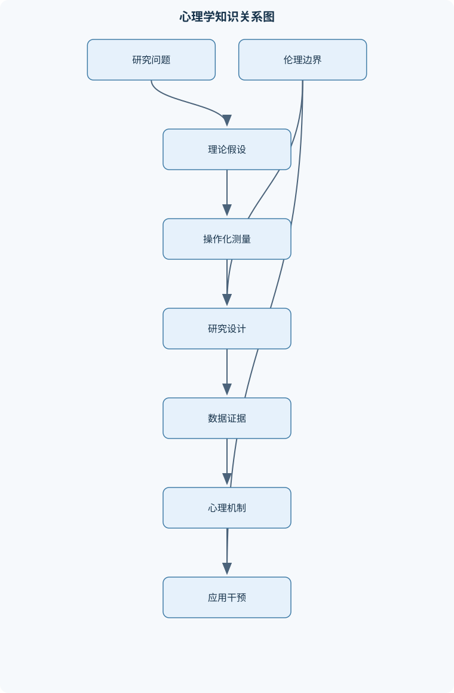
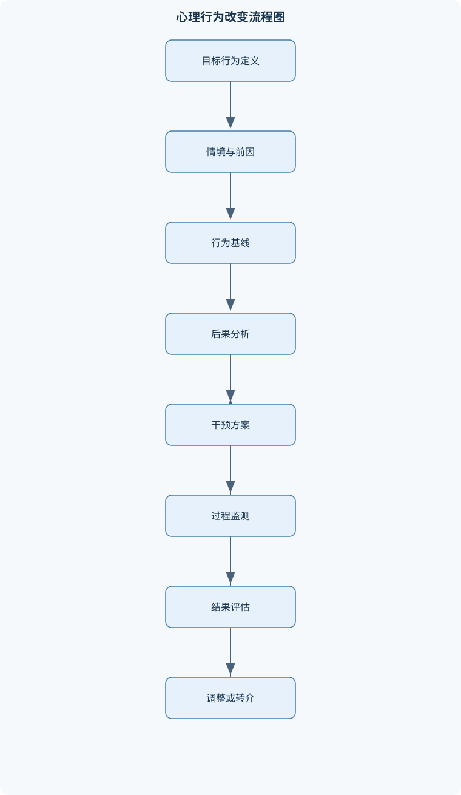

# 心理学及应用

## 一、课程整体知识框架

### 课程边界与先修知识

本课程研究心理活动与行为的基本规律及其现实应用，涵盖心理学的科学研究方法、生物基础、感觉与知觉、学习与记忆、认知、发展、动机与情绪、人格、社会心理、心理健康以及教育、组织和健康等应用领域。课程边界包括个体和群体层面的可观察行为、主观体验与认知过程，也包括对心理现象进行测量、解释、预测和干预的基本方法。不将心理学等同于日常经验、人格测试或临床诊断；心理学结论需要基于可操作化变量、适当样本、可靠测量和合乎伦理的证据。先修知识包括高中生物学的神经系统基础、基础统计中的均值与变异、相关与因果的区别，以及基本科学推理能力。





### 1. 学科对象、科学边界与研究逻辑

心理学研究个体和群体的心理活动与行为规律。行为包括可观察的动作、选择、反应时、语言报告和社会互动；心理过程包括感觉、注意、记忆、思维、情绪、动机和自我体验。心理学并不把日常直觉、人格标签或一次问卷分数直接当作科学结论，而是把理论概念转化为可观察、可重复测量的变量。

科学研究通常从现象和问题开始，经由理论提出可证伪假设，再进行操作化、抽样、测量、分析和解释。操作性定义规定“如何观察一个概念”。例如，“学习效果”可以操作为延迟一周后的正确率，“压力”可以由主观评分、生理指标和功能受损程度共同反映。同一构念可以有多个指标，因为单一指标可能只包含构念的一部分，也可能受到语言理解、动机和测量误差影响。

设自变量为 $X$，因变量为 $Y$。实验中研究者操纵或比较 $X$，观察 $Y$ 是否发生系统性变化。中介变量 $M$ 表示作用过程，例如睡眠改善可能通过注意恢复影响成绩；调节变量 $W$ 表示关系在什么条件下增强、减弱或改变方向，例如学习方式对成绩的影响可能受先前知识调节。相关系数 $r$ 描述两个变量线性共同变化的程度，取值范围为 $[-1,1]$。当 $r=0$ 时，只能说明没有线性相关，仍可能存在曲线关系；当 $r$ 较高时，也不能排除反向因果、第三变量和选择偏差。

描述性研究回答“现象是什么”，包括观察、问卷、访谈、个案和档案分析；相关研究回答“变量如何共同变化”，但不能单独确立因果。实验研究若具备有效操纵、随机分配和混淆控制，则组间 $Y$ 的平均差异可解释为 $X$ 的平均因果影响。没有随机分配时，即使两组结果不同，也可能是组间原有差异造成的。抽样代表性决定研究结果能否推广到目标人群；内部效度关注本研究中的因果解释，外部效度关注结果能否适用于其他人、情境和时间。

心理测量中，样本均值为

$$
M=\frac{1}{n}\sum_{i=1}^{n}x_i
$$

其中 $n$ 为样本量，$x_i$ 为第 $i$ 个观测值；$M$ 的单位与原始变量相同。标准差 $SD$ 表示观测值围绕均值的离散程度，单位与原变量相同，样本标准差通常使用分母 $n-1$。效应量 $d$ 常表示两组均值差除以合适的组内标准差，适用于比较具有可比量尺的均值差异；其大小不能脱离研究领域、测量精度和实际成本解释。$p$ 是零假设成立时获得当前或更极端数据的概率，不是“假设为真的概率”；$CI$ 是重复抽样程序下具有规定覆盖率的区间估计，不应理解为单次区间包含参数的主观概率。统计显著不等于实际重要，必须同时考察效应量、区间估计、样本代表性、测量误差和潜在伤害。

研究必须遵守知情同意、自愿参与、退出权、隐私保护、数据最小化和风险—受益平衡原则。涉及欺骗、敏感经历、未成年人或生理记录时，需要更严格的伦理审查和事后说明。研究结果应区分数据支持的结论、合理推断和尚不能确定的部分。

### 2. 生物基础与心理活动

神经元通常由树突、胞体和轴突组成。树突接收信号，胞体整合输入，轴突传导动作电位；动作电位具有“达到阈值后产生”的性质，不能简单理解为刺激越强电信号幅度越大。刺激强度更多通过放电频率、参与神经元数量和神经网络活动编码。突触前神经元释放神经递质，递质与突触后受体结合后可能产生兴奋性或抑制性影响，最终效应取决于受体类型、位置、时间和网络状态。

中枢神经系统包括脑和脊髓，周围神经系统连接中枢与身体；自主神经系统调节心率、消化、瞳孔和应激反应等相对自动的功能。大脑皮层不同区域在感觉、运动、语言和执行控制中具有相对专门化，但心理功能通常由多个脑区和网络协同完成，不能把一个复杂心理活动机械对应为一个固定脑区。功能侧化表示两侧半球在某些任务上的相对优势，不意味着任何一侧独立完成全部心理活动。

自主神经反应可表现为心率、呼吸、皮肤电和肌肉紧张变化；内分泌系统通过激素影响代谢、应激、睡眠和生殖行为。遗传提供反应倾向和发展条件，环境经验、营养、教育、社会关系和压力可改变其表达。行为遗传研究中的“遗传影响”描述群体差异在特定环境中的统计变异来源，不等于某个个体的行为有固定比例由基因决定。脑损伤、神经心理测验和脑成像可提供互补证据，但脑区活动与心理过程之间仍可能存在逆向推断、任务特异性和测量分辨率限制。

### 3. 感觉、知觉、注意与意识

感觉是感受器接收物理刺激并转化为神经信号的过程，知觉则是对信号进行组织、解释和赋予意义。感觉阈限是能够被检测到的最低刺激水平；信号检测还受背景噪声、期望、注意和判断标准影响，因此“未报告感觉到”不必然表示没有神经反应。感觉适应指持续刺激下反应减弱，例如持续气味逐渐不明显；它提高了系统对变化的敏感性，但不能解释所有知觉变化。

自下而上加工从刺激特征出发，自上而下加工受知识、目标、情境和期望影响。知觉组织涉及接近、相似、连续、闭合以及图形—背景分离。深度知觉利用双眼视差、线性透视、遮挡和相对大小等线索；运动知觉依靠连续位置变化和背景参照。错觉说明知觉并非刺激的被动复制，而是对不完整信息的推断；知觉恒常性则使物体在光照、距离和视角变化下仍被识别为相对稳定。

注意具有选择、分配和维持功能。有限注意资源使同时处理多个高难度任务时容易出现遗漏；熟练行为可自动化，但自动化并不意味着永远不受目标和情境影响。意识状态包括清醒、睡眠、梦、麻醉和其他改变状态。睡眠通常经历非快速眼动睡眠和快速眼动睡眠的周期性变化，与记忆巩固、情绪调节和身体恢复有关。意识研究可利用主观报告、行为反应和生理指标，但三者可能不一致，不能仅凭单一指标断定意识内容。

### 4. 学习：从先天反应到行为改变

反射是由特定刺激引起的相对简单的神经或运动反应；本能是较复杂的先天行为模式；学习则是经验导致的相对持久的行为或行为潜能变化。疲劳、药物影响和短暂情绪波动造成的变化，不应直接称为学习。

经典条件作用涉及无条件刺激 $US$、无条件反应 $UR$、条件刺激 $CS$ 和条件反应 $CR$。原本能引起反应的 $US$ 产生 $UR$；中性刺激与 $US$ 稳定配对后，可能成为 $CS$，单独出现时引起 $CR$。获得需要预测关系、时间接近和足够重复，但并非机械配对次数越多越好。消退是停止 $CS$ 与 $US$ 配对后，$CR$ 减弱；消退不等于原学习痕迹彻底消失，因为经过时间间隔可能出现自发恢复。相似刺激引起相似反应是泛化，个体学会区分不同刺激则是辨别。

操作性条件作用强调行为后果对行为未来概率的影响。强化使行为增加，惩罚使行为减少；“正”表示增加后果，“负”表示移除后果。因此，正强化是增加一个后果以提高行为，负强化是移除一个厌恶后果以提高行为，正惩罚是增加后果以降低行为，负惩罚是移除一个原本有价值的结果以降低行为。判断关键不在结果是否主观愉快，而在行为频率是否随后改变。固定比率 $FR$ 和变动比率 $VR$ 按反应次数安排后果，固定时距 $FI$ 和变动时距 $VI$ 按时间间隔安排后果。行为塑造通过逐步强化接近目标的行为建立复杂技能。

观察学习不要求个体亲自经历每个后果。学习者需要注意模型、保持信息、具备动作再现能力，并有足够动机；模型受到奖励或惩罚也会影响模仿概率。教育和行为改变中，应明确目标行为、前因、后果和替代行为，避免把惩罚当作唯一手段，并持续评估副作用和行为是否在新情境中泛化。

### 5. 记忆、思维、语言与智力

记忆包括编码、存储和提取。编码是把信息转化为可储存形式，存储是维持已编码信息，提取是把信息重新带入当前意识或行为操作。感觉记忆短暂保留感觉输入，工作记忆暂时保持并加工有限信息，长时记忆可较长时间保持信息。工作记忆不是单纯的“短时记忆时间标签”，其核心是有限容量下的主动加工。分组、复述和与既有知识建立联系，可以减少加工负荷，但效果受材料难度和个体差异影响。

长时记忆包括陈述性记忆和程序性记忆。陈述性记忆可以有意识报告，包括语义记忆、情景记忆和自传体记忆；程序性记忆表现为技能操作，未必能用语言完整说明。自动加工较少占用有意识资源，努力加工需要注意、重复和策略。提取线索与编码时线索越匹配，提取通常越容易，这体现编码特异性；情境依赖和状态依赖说明环境与内部状态也可能成为线索。

遗忘可能来自编码不足、提取失败、前摄干扰、倒摄干扰和线索改变。记忆不是录像，而是重构过程；提取、暗示、后续信息和当前信念都可能改变报告内容。错误记忆和证词不可靠不表示所有记忆都虚假，而是提示证词应结合时间间隔、询问方式、独立证据和陈述一致性解释。

思维依赖概念、类别、图式和心理表征。问题解决可使用算法，即按明确步骤穷尽可能性；也可使用启发式，即用较少认知资源快速判断，但可能产生系统偏差。功能固着使人只按物品熟悉用途使用它，定势效应使人沿用旧方法。可得性启发式依据容易想起的例子判断概率，代表性启发式依据与典型特征相似程度判断，二者都可能忽视基准率。框架效应说明同一结果用收益或损失表述时，选择可能不同。

语言包括语音、词法、句法、语义和语用。语言理解不仅是词义相加，还依赖语境、语法和说话者意图；语言产生涉及概念组织、词汇提取和句法编码。智力测量要求标准化施测、适当常模、可靠评分和效度证据，不能把单次分数当作固定本质；文化、语言、教育机会和测试熟悉度会影响结果。创造力通常涉及问题重新表征、发散产生和评价筛选；元认知监控则是对自身理解、记忆和决策质量进行评估与修正。

### 6. 发展心理学

发展研究关注个体从出生到老年在身体、认知、情绪和社会方面的连续变化与阶段差异。横断设计在同一时间比较不同年龄组，效率较高但混有队列效应；纵向设计追踪同一批个体，能观察变化轨迹，但受失访、练习效应和时间成本影响。年龄组均值差异不等于每个人都以同样方式变化，也不等于差异不可改变。

遗传成熟提供生理基础，环境经验塑造技能和适应方式。婴幼儿的感觉能力、依恋和社会互动会随照料稳定性与互动质量发展；依恋研究不能简单把一次分离反应当作终身人格判断。认知发展包括心理表征、执行控制和问题解决方式变化，语言发展受成熟、互动、输入质量和社会文化环境共同影响。道德判断从结果导向逐渐受到意图、公平、规则和社会关系影响，亲社会行为受同理心、规范、榜样和情境机会共同影响。

青春期同时发生身体成熟、抽象思维发展、同伴关系变化和身份探索。成年期可能在知识积累、情绪调节和社会角色方面继续发展；老年期某些加工速度和工作记忆可能下降，但知识、策略和适应方式并非同步衰退。发展差异必须与发展异常区分：异常判断需要考虑持续时间、功能受损、风险、文化规范和多方面评估，而不是依据单一年龄标准或一次表现。

### 7. 动机、情绪与压力

动机来自生理需要、认知目标、社会关系和价值判断。内在动机来自活动本身的兴趣或意义，外在动机来自奖励、评价或避免惩罚；二者并非永远互相排斥。目标行为受到期望、价值、反馈和自我调节影响。需要和驱力可解释部分行为，但不能解释所有复杂选择，因为社会意义、身份和长期目标也会改变行为方向。

情绪包含生理唤醒、主观体验、认知评价、表达和行动倾向。情绪并非只有固定的基本类别，文化规范和情境会影响表达、识别和解释。认知评价模型认为，个体对事件意义、控制感、责任和资源的判断，会影响情绪性质和强度。情绪调节可发生在情境选择、注意分配、认知重评和反应调节等环节；压制表达有时能改变外显行为，却可能增加内部负担。

压力反应可表示为：压力源出现后，个体进行事件评估和资源评估，继而出现生理、情绪和认知反应，采取应对行为，再由结果反馈到下一轮评估。同一事件不必对所有人产生相同影响。应对可包括问题解决、寻求支持、情绪调节和回避；回避短期可能降低痛苦，但长期可能维持恐惧和功能受限。心理韧性不是永远不受影响，而是经历压力后能够恢复、调整目标并利用资源。压力管理应同时关注个体技能、社会支持、工作环境和资源分配，不能简化为个人意志问题。

### 8. 人格与社会心理

人格是相对稳定、但会随情境、发展和文化表现不同的心理特征组织。特质理论用维度描述个体差异，社会认知观点强调观察学习、目标、自我效能和情境线索，动力观点关注冲突、需要和防御。行为遗传研究提示遗传和环境都参与人格差异形成，但不能据此把特质当成不可改变标签。

自我概念是对“我是谁”的组织性认识，自尊涉及自我价值评价，身份认同涉及个人与群体角色的连续感。人格测量必须考察信度、效度、常模、回答偏差、文化适配和使用目的。人格描述、行为预测和因果解释是三个不同层次：问卷能支持某种倾向描述，不必然能准确预测所有情境中的行为，更不能单独证明特质导致行为。

社会心理学研究人在他人实际、想象或暗示存在下的思维和行为。归因是解释行为原因的过程；基本归因偏差表现为过度强调他人特质、低估情境影响，但文化和信息条件会改变这种倾向。态度包括认知、情感和行为倾向，态度改变受信息来源、论据质量、受众动机和情境影响。服从、从众和群体规范说明社会压力会影响判断，但个体并非在任何条件下都会盲目服从。

群体角色、地位和规范会影响互动；群体极化可能使讨论后立场更极端，群体决策还可能受信息共享不足和责任分散影响。偏见是态度或判断倾向，刻板印象是关于群体的概括性信念，歧视是行为层面的不公平对待，三者有关但不等同。人际吸引和亲密关系受接近性、互惠、相似性、依恋和关系质量影响。助人行为受到成本、责任判断、情绪和规范影响；旁观者越多，责任可能越分散。攻击行为则受挫折、社会学习、唤醒、规范和即时情境共同影响。

### 9. 心理健康与心理学应用

心理异常不能等同于“与平均水平不同”。判断通常综合主观痛苦、功能损害、风险、持续时间、症状组合和文化情境。分类系统有助于沟通和研究，但可能带来标签化、类别边界僵化和共病重叠，不能替代个体化评估。

焦虑相关问题通常涉及过度担忧、恐惧、警觉和回避；抑郁相关问题可能涉及持续低落或兴趣下降、睡眠和精力变化、认知消极及功能受损。创伤相关反应可包括侵入性回忆、回避、警觉和情绪变化；强迫症状涉及侵入性想法或冲动与重复行为，回避可能短期缓解痛苦、长期维持问题；精神病性症状可能影响现实检验，包括妄想、幻觉或思维组织异常。物质使用和行为成瘾涉及奖赏、线索反应、冲动控制、耐受和功能损害，不能仅凭行为次数判断。

初步评估应了解主诉、持续时间、功能影响、身体和物质因素、发展与环境背景及安全风险。若存在自伤、伤人、严重现实检验受损或无法维持基本安全的迹象，应遵循机构流程进行风险分级和专业转介。心理教育应采用非污名化语言，不把症状清单等同于诊断，不提供超越权限的药物建议。心理治疗的不同取向在理论和技术上有差异，但治疗关系、共同目标、反馈和持续评估是重要共同因素。保密应向当事人说明边界，尤其涉及明确安全风险、法律要求或未成年人保护时。

教育心理学关注学习、动机、评价和课堂行为；组织心理学涉及选拔、培训、工作动机、领导和员工体验；健康心理学研究健康行为、依从性和风险沟通；人因工程关注人与设备、任务和环境的匹配以及安全行为；司法心理学强调证词、证据和测量边界。咨询、心理治疗、心理测验和精神科诊疗不是同一活动，专业资格和权限必须区分。

应用项目应明确干预目标、过程指标和结果指标。例如健康行为干预不能只问“是否有效”，还应记录参与率、目标行为频率、维持时间、不良影响和不同人群的获益差异。文化适配包括语言、价值、家庭结构和资源条件的调整；弱势群体保护要求减少歧视、避免强迫和审慎使用自动化评分。研究与实践还需管理利益冲突、访问权限、数据保存期限、去标识化和结果解释责任。

## 二、章节和模块划分

### 核心知识覆盖清单

本清单用于检查正文是否覆盖本课程的主要知识模块：

- **心理学学科基础与科学研究**：心理学的研究对象与学科边界、行为、认知与心理过程的关系、科学理论、假设与可证伪性、操作性定义与变量测量、描述性研究与相关研究、实验设计、随机分配与因果推断、抽样、代表性与外部效度、信度、效度与测量误差、研究伦理、知情同意与隐私保护。
- **心理学的生物基础**：神经元结构与神经冲动传导、突触传递与神经递质、中枢神经系统与周围神经系统、大脑皮层功能与功能侧化、自主神经系统与心理反应、内分泌系统和激素影响、遗传、环境与行为的交互作用、脑损伤研究与神经心理证据、生物解释的能力与局限。
- **感觉、知觉与意识**：感觉阈限与信号检测、感觉适应与感觉通道、自下而上和自上而下加工、知觉组织原则与图形背景、深度知觉与运动知觉、注意的选择、分配与自动化、错觉、知觉恒常性与情境效应、睡眠周期与睡眠功能、意识状态及其测量边界。
- **学习心理学**：先天行为、反射与本能、经典条件作用的基本结构、无条件刺激与条件刺激的关系、获得、消退、自发恢复与泛化、操作性条件作用与行为后果、正强化、负强化、正惩罚与负惩罚、强化时程与行为塑造、替代学习与观察学习、学习理论在教育和行为改变中的应用。
- **记忆系统与遗忘**：编码、存储与提取三个基本过程、感觉记忆、工作记忆与长时记忆、工作记忆容量与加工限制、陈述性记忆和程序性记忆、语义记忆、情景记忆与自传体记忆、自动加工与努力加工、提取线索、情境依赖与状态依赖、遗忘、干扰与记忆重构、错误记忆与证词可靠性。
- **思维、语言与智力**：概念形成与类别化、图式、心理表征与知识组织、问题解决的算法与启发式、功能固着与定势效应、判断中的可得性和代表性启发式、决策、风险知觉与框架效应、语言结构、语义和语用、语言理解与语言产生、智力的测量、标准化与文化公平、创造力与元认知监控。
- **发展心理学**：发展研究的横断与纵向设计、遗传成熟与环境经验、婴幼儿知觉、依恋与社会互动、认知发展与心理表征变化、语言发展与社会文化影响、道德判断与亲社会行为、青春期的身体、认知与社会变化、成年期的认知、情绪与社会角色、老年期的认知变化与适应、发展差异与发展异常的区分。
- **动机、情绪与压力**：动机的生理、认知与社会来源、内在动机与外在动机、目标、期望和价值对行为的影响、需要、驱力与自我调节、情绪的生理唤醒与主观体验、情绪的认知评价过程、基本情绪观点与文化差异、情绪表达、识别与情绪调节、压力源、压力反应与应对、心理韧性与压力管理的证据边界。
- **人格心理学**：人格的稳定性与情境差异、特质理论与人格维度、人格测量的信度与效度、自我概念、自尊与身份认同、社会认知观点与自我效能、行为遗传与环境影响、动机冲突与人格动力观点、文化、家庭和社会情境对人格的影响、人格评估的伦理边界、人格描述、预测与因果解释的区别。
- **社会心理学**：社会认知与他人知觉、归因过程与归因偏差、态度结构、态度改变与说服、从众、服从与群体规范、群体角色、群体极化与群体决策、偏见、刻板印象与歧视、人际吸引、亲密关系与依恋、亲社会行为与助人决策、攻击行为及其情境因素、旁观者效应与责任分散。
- **心理障碍与心理健康**：心理异常的定义标准与文化情境、分类系统的功能与局限、焦虑、抑郁及相关障碍的主要特征、创伤相关反应与适应问题、强迫症状与回避行为、精神病性症状与现实检验、物质使用与行为成瘾的心理机制、风险评估、转介与危机沟通原则、心理治疗的基本取向与共同因素、污名、保密和非诊断性心理教育。
- **心理学应用与专业伦理**：教育心理学中的学习与评价、组织心理学中的选拔、培训与工作动机、健康心理学中的健康行为改变、人因工程与安全行为、司法心理学中的证据与证词、咨询与助人工作的边界、心理测验的使用资格与解释限制、干预目标、过程评估与结果评估、文化适配与弱势群体保护、研究和实践中的利益冲突与数据管理。


### 1. 代表性研究与分析流程

#### 科学研究流程

**输入**：研究问题、已有现象和理论概念。  
**过程**：提出可证伪假设；定义 $X$、$Y$、$M$、$W$；选择描述、相关、实验或纵向设计；确定目标人群和抽样方式；制定测量与伦理方案；收集并检查数据；报告效应量、$CI$、不确定性和限制。  
**不变量**：数据分析前变量定义、主要结果和分析规则保持清晰，不能根据结果临时改变核心问题。  
**终止条件**：完成预定分析、质量控制和限制说明。  
**适用边界**：适用于经验研究，不适用于把单个轶事直接推广为普遍规律。研究成本随样本量、测量数量和随访次数增加，不适合用算法复杂度概括。

#### 实验因果分析流程

输入为自变量条件、因变量指标和潜在混淆变量。先随机分配或采用合理匹配，再实施操纵并检查操纵是否有效；统一指导语、材料、时间和测量条件；记录依从性、失访和异常数据；最后比较组间结果并报告 $d$、$CI$ 和实际意义。其关键不变量是除目标操纵外尽量保持条件一致。若伦理上不能操纵变量，例如严重创伤经历，应改用纵向、自然实验或匹配设计，不能把相关研究包装成实验因果证据。

#### 心理测量评估流程

输入为构念定义、测验工具和受测群体。先检查题目是否覆盖构念，再标准化施测，评估内部一致性或重测稳定性，检验测验结构和效标关系，识别文化、语言和回答方式偏差，最后结合测量误差解释分数。高信度只说明结果较一致，不保证测量了目标构念；高效度也不能脱离特定人群和用途。单次人格

## 三、核心概念的详细解释

### 1. 心理学的对象、边界与科学解释

#### 1.1 行为、心理过程与心理活动

心理学研究个体和群体的心理活动与行为规律。行为是能够被观察、记录或编码的活动，包括按键、选择、反应时、语言表达、面部动作、社会互动和生理反应。心理过程是行为背后的信息加工活动，包括感觉、注意、学习、记忆、思维、语言、情绪、动机和自我调节。主观体验虽然不能直接被他人观察，但可以通过结构化报告、行为指标和生理指标间接研究。

“看见某物”不能简单等同于眼睛受到光刺激。光刺激首先引起感觉系统活动，随后还要经过注意选择、知觉组织、记忆匹配和情境解释，才可能形成有意义的知觉经验。同样，“学习成绩提高”也不能直接证明学习能力发生了普遍变化，因为成绩可能受到练习、动机、题目熟悉度、测验策略和评分方式的影响。

心理学不等同于日常经验、性格标签或单次人格测试。日常观察可以产生研究问题，但不能单独证明普遍规律；人格测验可以提供某一构念的分数，但不能据此断定一个人永远具有某种行为，也不能替代临床诊断、职业资格判断或综合评估。

#### 1.2 理论、假设与操作性定义

理论是对一组现象及其关系的系统解释。理论应当能够生成可检验的预测，而不是仅仅能够在事后解释任何结果。假设是针对特定变量关系提出的、原则上可以被数据支持或反驳的陈述。例如，可以提出“在材料难度和学习时间相同的条件下，间隔学习比集中学习产生更高的延迟测验成绩”。

操作性定义规定研究者如何观察和测量抽象概念。若研究“压力”，可以将其操作为主观压力评分、皮质醇等生理指标、失眠天数或工作功能受损程度。不同操作性定义反映构念的不同侧面，不能把某一个指标完全等同于构念本身。由此可知，同一理论概念可以对应多个观测指标；当多个指标在不同方法下得到相近结论时，构念效度通常更有支持，但仍不能消除所有系统偏差。

自变量记为 $X$，表示研究者操纵或比较的条件；因变量记为 $Y$，表示行为或心理结果；中介变量记为 $M$，说明 $X$ 通过什么过程影响 $Y$；调节变量记为 $W$，说明这种影响在什么条件下更强、更弱或方向不同。例如，学习时间为 $X$，延迟成绩为 $Y$，注意保持可能是 $M$，先前知识水平可能是 $W$。

### 2. 研究设计、因果推断与心理测量

#### 2.1 描述、相关和实验

描述性研究回答“发生了什么”，常用自然观察、问卷、访谈、个案研究和档案分析。它适合了解行为分布、主观体验和现实情境，但容易受到观察者偏差、回忆偏差和样本选择的影响。

相关研究考察变量共同变化的程度。相关系数 $r$ 的取值范围为 $[-1,1]$。$r>0$ 表示一个变量较高时另一个变量通常也较高，$r<0$ 表示方向相反，$r=0$ 只表示没有线性关系，不排除曲线关系。相关关系不能单独证明因果，因为可能存在反向因果、第三变量和选择偏差。例如，睡眠时长与注意成绩相关，可能是睡眠影响注意，也可能是健康状况同时影响睡眠和注意，或注意能力较好的人更能保持规律作息。

实验研究通过操纵 $X$、测量 $Y$ 并控制混淆变量来检验因果。随机分配使不同条件下的被试在平均意义上具有可比性；统一材料、时间和指导语可以减少程序差异；操纵检查用于确认被试确实感受到预定条件。若随机分配、操纵有效且混淆变量得到控制，实验组与控制组 $Y$ 的系统差异才可解释为 $X$ 的平均因果影响。伦理上不能操纵的变量，如严重创伤经历或自然灾害暴露，应采用纵向、自然实验、匹配或统计控制，不能把相关结果表述为确定因果。

#### 2.2 抽样、效度与伦理

目标人群是研究希望推广到的总体，样本是实际参与研究的个体。随机抽样有助于提高代表性，但现实研究常使用便利样本，因此外部效度需要谨慎评估。内部效度关注本研究中的因果解释是否可信；外部效度关注结论能否推广到其他人群、场景和时间。控制得越严格的实验不一定越接近日常生活，生态效度需要单独讨论。

信度是测量结果在规定条件下的一致性或稳定性，包括内部一致性、重测稳定性和评分者一致性等。效度关注测量或研究是否支持目标解释，包括内容效度、结构效度、效标关联效度和构念效度。高信度不保证高效度：一台始终偏高的体重秤读数很稳定，但不一定准确。测量分数既包含构念相关变异，也包含随机误差和系统偏差。标准化施测、改善题目质量、增加合适项目和采用多方法测量可以降低部分误差，但不能自动消除文化偏差或社会赞许性回答。

研究伦理包括知情同意、自愿参与、退出权、风险—受益平衡、隐私保护和数据最小化。未成年人、认知能力受限者、经历创伤者及其他弱势群体需要额外保护。隐私保护不只是删除姓名，还包括限制访问权限、去标识化、控制数据用途和避免通过少量背景信息重新识别个体。

### 3. 心理活动的生物基础

#### 3.1 神经系统、突触与内分泌

神经元通常包含树突、胞体和轴突。树突接收输入，胞体整合输入，轴突将动作电位传向末梢。动作电位具有阈值和相对全或无特征，刺激更强通常不是使单个动作电位幅度无限增加，而是改变放电频率、参与神经元数量和网络活动。

突触前神经元释放神经递质，递质与突触后膜上的受体结合。某种递质并不必然固定地产生“兴奋”或“抑制”，其效应取决于受体类型、细胞位置、释放时间和网络状态。中枢神经系统包括脑和脊髓，周围神经系统连接中枢与身体；自主神经系统参与心率、消化、瞳孔和应激等相对自动的调节。

大脑皮层具有相对专门化的功能区域，但复杂心理活动通常依赖多个脑区和网络协作。功能侧化表示两侧半球在某些任务上的相对优势，不意味着一侧独立负责全部理性、情绪或创造活动。脑损伤研究可以提供功能与脑区关系的证据，但病灶常同时影响多个网络、运动能力、语言理解或情绪状态，因此不能据单个病例建立一对一的功能定位。

激素由内分泌系统释放，能够影响能量代谢、应激、繁殖、睡眠和社会行为。激素影响通常具有时间延迟、持续时间较长和依赖身体状态等特点。遗传与环境不是彼此排斥的两个原因，基因表达可能受到营养、压力、教育和社会关系影响；遗传倾向也不等于不可改变的命运。

### 4. 感觉、知觉、注意与意识

#### 4.1 从刺激到知觉

刺激记为 $S$，反应记为 $R$。感觉是感觉器官对物理能量或内部信号的初步转换，知觉则进一步组织和解释这些信息。绝对阈限是个体在规定条件下能够检测到刺激的最低强度；差别阈限是能够可靠区分两个刺激的最小差异。阈限不是固定常数，会受到注意、疲劳、动机、期待和背景噪声影响。

信号检测理论把刺激检测看作信号与噪声的区分过程。检测结果可能为命中、漏报、虚报或正确拒绝。提高判断标准通常会减少虚报，但也可能增加漏报，因此“没有报告刺激”不等于“没有感觉到刺激”。

自下而上加工从刺激特征出发，自上而下加工利用经验、目标、期待和情境。知觉组织涉及接近、相似、连续、封闭和共同运动等原则，也涉及图形—背景分离。深度知觉依赖双眼线索和单眼线索；运动知觉不仅来自物体位置的连续变化，也会受到参照物、眼球运动和情境的影响。知觉恒常性使人在光照、距离或视角变化时仍能相对稳定地识别物体，但在特殊情境下可能产生错觉。

#### 4.2 注意、睡眠与意识

注意是对有限加工资源的选择性分配。选择性注意使人优先加工目标信息；分配性注意允许同时处理多个任务，但任务复杂度和自动化程度会限制表现；持续性注意维持较长时间的警觉。自动加工较少依赖有意识资源，努力加工则需要更多注意和工作记忆。所谓“多任务”常是任务之间快速切换，切换会产生时间和准确性成本。

睡眠不是简单的意识关闭，而是具有周期性阶段的生理状态。不同睡眠阶段在脑电活动、肌肉状态、眼球运动和觉醒阈值方面不同。睡眠与记忆巩固、情绪调节、代谢恢复和免疫功能有关。睡眠不足可能影响注意、反应抑制、工作记忆和情绪稳定，但个体差异、睡眠质量和先前负荷会改变具体表现。

意识状态包括清醒、睡眠、梦境、麻醉或其他改变状态。意识不能只用“是否睁眼”判断，还需要结合反应能力、自主报告、生理指标和任务表现。单一指标无法穷尽意识体验。

### 5. 学习与行为改变

#### 5.1 先天行为、经典条件作用

反射是对特定刺激产生的相对简单的神经或运动反应，如瞳孔在强光下收缩；本能是较复杂的先天行为模式。学习是经验导致的、相对持久的行为或行为潜能变化，短暂疲劳、药物作用或成熟变化不能直接称为学习。

经典条件作用涉及四个要素：无条件刺激 $US$ 能自然引起无条件反应 $UR$；原本中性的条件刺激 $CS$ 经过与 $US$ 的稳定配对后，能够引起条件反应 $CR$。关键不只是时间接近，还包括预测关系。若声音稳定预测惊吓刺激，个体可能在仅听到声音时出现警觉。条件作用经历获得、消退、自发恢复和刺激泛化。消退通常表示新的抑制性学习，不等于原有联系彻底删除，因此一段时间后或在情境改变时可能出现恢复。对相似刺激产生反应是泛化，对不同刺激进行区分则是辨别。

#### 5.2 操作性条件作用与观察学习

操作性条件作用强调行为后果对未来行为频率的影响。强化使行为增加，惩罚使行为减少；“正”表示增加某种刺激，“负”表示移除某种刺激。正强化是在行为后增加结果，使行为增加；负强化是在行为后移除厌恶结果，使行为增加；正惩罚是在行为后增加厌恶结果，使行为减少；负惩罚是在行为后移除喜爱结果，使行为减少。某一后果是否属于强化，必须依据行为频率是否实际增加，而不能依据提供者主观上是否认为它是奖励。

强化可以按反应次数或时间间隔安排。固定比率 $FR$ 按固定反应次数提供强化，变动比率 $VR$ 按不确定反应次数提供强化；固定时距 $FI$ 按固定时间间隔后首次反应提供强化，变动时距 $VI$ 的时间间隔不固定。塑造是通过逐步强化接近目标的行为建立复杂行为。观察学习不要求直接经历后果，学习者还要注意模型、保持信息、具备动作再现能力，并有足够动机。模型受到奖励或惩罚会影响观察者是否表现出已学会的行为。

### 6. 记忆、思维、语言与智力

#### 6.1 记忆系统

记忆包括编码、存储和提取。编码是把信息转化为可储存形式，存储是维持已编码信息，提取是把信息重新带入当前意识或行为操作。感觉记忆短暂保留感觉输入；工作记忆暂时保持并加工有限信息；长时记忆能够在较长时间内保持信息。工作记忆不是单纯的“短期仓库”，还包括注意控制和信息加工；长时记忆也不是只按时间长短划分的单一系统。

陈述性记忆包括能够有意识报告的事实和事件，程序性记忆涉及技能和动作规则。语义记忆保存概念和一般知识，情景记忆保存特定时间和地点的事件，自传体记忆则是与个人经历和自我相关的记忆。自动加工通常不需要大量有意识资源，努力加工需要主动注意和策略。

提取具有线索依赖性。编码时形成的环境、情绪状态、概念联系和任务目标，可能成为提取线索。记忆不是录像式复制，而是重构过程，会受后续信息、暗示、期待、来源混淆和社会交流影响。错误记忆并不必然意味着故意撒谎；证词可靠性还受到观察条件、延迟、压力、提问方式和身份识别程序影响。

#### 6.2 思维、语言与智力

概念是对对象、事件或关系的心理分类；图式是组织知识和经验的结构。问题解决可以使用算法，也可以使用启发式。算法是按明确步骤搜索答案，通常更可靠但成本较高；启发式利用经验规则，速度较快但可能产生可得性、代表性和锚定等偏差。功能固着使人只按熟悉用途看待物品，定势则使人固守过去有效但当前不适用的解决方式。

决策受结果概率、损益大小、情境框架和主观风险知觉影响。同一客观结果用“获得”或“避免损失”表述，可能引起不同选择，这就是框架效应。语言包括形式结构、语义和语用。语言理解不仅依赖词义和句法，还依赖语境、说话者意图和共同知识。语言产生需要概念组织、词汇提取、句法编码和发音执行。

智力测量需要标准化施测、明确常模、稳定评分和适当解释。测验分数是特定任务、时间和文化背景下的表现，不是不可改变的本质。文化经验、语言、教育机会和测试焦虑会影响结果。创造力不仅是产生新颖想法，还包括适切性、可行性和问题重构能力。元认知监控是对自己理解、记忆和决策状态的评估，监控准确性不足会导致过度自信或不必要的放弃。

### 7. 发展、动机、情绪与压力

#### 7.1 发展的连续性与情境性

发展心理学研究从出生前后到老年期的心理和行为变化。横断设计在同一时间比较不同年龄组，成本较低，但年龄差异可能混入队列效应；纵向设计追踪同一批个体，能够观察变化轨迹，但会受到失访、练习效应和历史事件影响。遗传成熟和环境经验共同参与发展，不能把某种能力的年龄差异直接解释为固定的先天差异。

婴幼儿发展涉及感觉、运动、依恋、语言和社会互动。依恋反映儿童与照料者之间的情感联系，照料的一致性、敏感性和环境压力都会影响其表现。认知发展表现为心理表征、执行功能和问题解决方式变化；语言发展既受神经成熟影响，也依赖交流机会、语言输入和社会文化环境。道德判断与亲社会行为还受到情绪共情、规则理解、榜样和群体规范影响。

青春期包含身体成熟、认知控制和社会角色变化；成年期并非所有能力都同步变化；老年期可能出现处理速度、工作记忆或某些提取能力下降，但知识、策略、情绪调节和社会经验可能保持或补偿。发展差异不等于发展异常，异常判断必须结合持续时间、功能影响、文化规范和风险。

#### 7.2 动机、情绪和压力

动机是启动、选择、维持和调节行为的过程。生理需要、目标、期望、价值、社会评价和自我效能都可能影响动机。内在动机来自活动本身的兴趣或意义，外在动机来自奖励、惩罚、评价或社会压力。外在奖励有时能促进参与，但过度控制性奖励可能削弱对活动本身的兴趣，具体结果取决于奖励性质、任务和个体解释。

情绪包括生理唤醒、主观体验、认知评价、表达和行动倾向。认知评价涉及个体如何解释事件意义、可控性、责任归属和资源状况。同一事件对不同人的情绪影响不同，原因可能是目标、经验、资源和社会文化不同。情绪调节包括情境选择、注意部署、认知重评、表达调节和问题解决；压制表达不一定降低生理唤醒，也可能增加认知负荷。

压力反应可表示为压力源评估、资源评估、生理和情绪反应、应对行为及反馈循环。压力不是事件本身的固定属性，而是事件要求与个体资源、控制感和社会支持之间的关系。长期压力可能影响睡眠、免疫、注意和情绪，但具体影响受强度、持续时间、可控性和恢复机会调节。心理韧性不是永不受影响，而是受到冲击后能够恢复、适应或重新组织生活。压力管理不能被简化为个人意志问题，还必须考虑工作制度、经济资源、关系环境和社会支持。

### 8. 人格、社会心理与心理健康

#### 8.1 人格与自我

人格是相对稳定、但会随情境和发展变化的思维、情感和行为模式。特质理论用维度描述个体差异；社会认知观点强调观察学习、情境线索、自我效能和行为—环境相互作用；动力观点关注冲突、需要和防御过程。人格描述可以预测某些情境下的概率性倾向，但不能推出跨所有情境都相同的行为，更不能仅凭相关关系作出人格因果解释。

自我概念是对自己的知识和描述，自尊是对自我价值的评价，身份认同涉及“我是谁”及其连续性、归属和社会角色。家庭、文化、同伴、教育和社会结构会影响人格表达。人格测量必须考察信度、效度、常模、文化公平性和回答偏差，不得用单一分数决定升学、就业或诊断。

#### 8.2 社会认知与群体过程

社会认知研究人们如何理解自己、他人和社会情境。归因是解释行为原因的过程；基本归因偏差表现为过度重视他人特质而低估情境因素，行动者—观察者差异则与自我和他人的信息位置不同有关。态度包括认知、情感和行为倾向，态度改变受信息质量、来源可信度、情绪、重复暴露和群体规范影响。

从众是因群体压力而改变行为或判断，服从是对权威指令的反应。群体极化指讨论后群体意见向原有倾向的更极端方向移动；群体决策可能受到责任分散、信息共享不足和群体迷思影响。刻板印象是对群体的概括信念，偏见是带有评价色彩的态度，歧视是对群体成员实施的不平等行为，三者有关联但不等同。

人际吸引受接近性、相似性、互惠、外表线索和共同活动影响。亲密关系还涉及信任、依恋、沟通和冲突修复。助人行为受到同理心、成本收益、社会规范和责任判断影响；旁观者效应与责任分散、情境不确定和他人反应有关。攻击行为受个体冲动、挫折、社会学习、酒精或药物影响以及情境线索共同作用，不能归结为单一人格原因。

#### 8.3 心理异常、心理健康与专业边界

心理异常不能简单定义为“与平均人不同”。判断通常综合痛苦程度、功能损害、风险、持续时间、情境适切性和文化规范。分类系统有助于沟通、研究和服务安排，但类别边界可能重叠，不能替代个体化评估。焦虑和抑郁常涉及持续的担忧、回避、低落、兴趣下降、睡眠或精力变化；创伤相关反应可能包括再体验、回避、警觉和情绪变化；强迫症状涉及侵入性想法或冲动以及重复行为或心理活动；精神病性症状可能影响现实检验，包括妄想、幻觉或思维组织异常。

物质使用和行为成瘾涉及奖赏学习、线索反应、冲动控制、负性情绪调节和环境强化。初步心理健康评估应收集主诉、症状、持续时间、功能影响、身体和物质因素、发展史及安全风险。若存在自伤、他伤、严重现实检验受损或无法维持基本生活的风险，应优先进行危机沟通和专业转介。心理教育可以解释症状和求助路径，但不能凭症状清单作出确定诊断，也不能越权提供药物处方。

### 9. 心理学应用与专业伦理

教育心理学关注学习目标、反馈、测验、课堂管理和个体差异；组织心理学关注人员选拔、培训、工作动机、领导、团队和员工体验；健康心理学关注健康行为、风险知觉、依从性和行为改变；人因工程关注人与工具、环境和任务之间的匹配。司法心理学需要区分证据、证词、风险评估和法律结论，心理学意见不能替代司法裁判。

行为干预应先明确目标行为、发生情境、前因和后果，再识别维持行为的强化结果，设计低风险的替代行为并连续监测。干预评价必须区分过程指标和结果指标。例如，健康干预可以记录参与率、目标行为频率、健康指标和生活质量，不能只用一次满意度评分判断有效性。心理测验的使用必须符合施测资格、用途限制、解释边界和文化适配要求。专业工作还需要管理保密例外、利益冲突、数据访问、弱势群体保护和转介责任。

## 四、重要定义、公式、定理和推导

### 专业审校补充：关键定义与适用边界

信号检测理论区分“辨别能力”和“判断标准”。在检测任务中，命中率 $H$ 是目标刺激出现且被报告为出现的比例，虚报率 $FA$ 是目标刺激未出现却被报告为出现的比例。辨别能力可用 $d'=z(H)-z(FA)$ 表示，其中 $z$ 是标准正态分布的反函数；在等方差、近似正态分布和试次独立的假设下，$d'$ 越大，说明越能区分信号与噪声。判断标准可用 $c=-[z(H)+z(FA)]/2$ 表示，数值较高通常表示报告“有信号”较谨慎，数值较低表示较宽松。高命中率不一定意味着能力高，因为放宽标准也会同时提高虚报率。若命中率或虚报率为 $0$ 或 $1$，直接转换会得到无穷值，应采用预先规定的小幅校正。该模型适合分析注意、警觉、记忆再认和医学筛查中的判断，不适合把单一正确率直接解释为稳定能力，也不能仅凭 $d'$ 判断个体是否存在心理障碍。


### 1. 描述统计与测量误差

#### 1.1 均值、标准差与效应量

样本均值为

$$
M=\frac{1}{n}\sum_{i=1}^{n}x_i
$$

其中，$n$ 是样本量，$x_i$ 是第 $i$ 个观测值，$M$ 与 $x_i$ 使用相同单位。均值适合间隔或比率尺度数据，但容易受极端值影响。若数据明显偏斜，应同时报告中位数和分布范围。

样本标准差为

$$
SD=\sqrt{\frac{\sum_{i=1}^{n}(x_i-M)^2}{n-1}}
$$

分母使用 $n-1$ 是为了在估计总体方差时减少系统偏差。$SD$ 的单位与原变量相同，不能把标准差与均值相加后当成新的心理量。

两组均值差异可用效应量表示：

$$
d=\frac{M_1-M_2}{SD_{\text{pooled}}}
$$

其中，$M_1$、$M_2$ 是两组均值，$SD_{\text{pooled}}$ 是合适的合并组内标准差。若两组量尺、方差结构和测量目的不具备可比性，直接计算 $d$ 可能产生误导。$d$ 描述差异的标准化大小，不说明差异是否具有实际价值，也不自动说明因果。

#### 1.2 信度、效度与误差

可将观测分数抽象表示为

$$
X_{\text{observed}}=X_{\text{true}}+E
$$

其中，$X_{\text{observed}}$ 是实际得到的分数，$X_{\text{true}}$ 是在规定条件下希望测量的稳定成分，$E$ 是误差。该式是理想化测量模型，不意味着存在完全可直接观察的“真实分数”。随机误差会降低稳定性，系统误差则可能使结果稳定但偏离目标构念。

提高信度不能自动提高效度。例如，所有题目都只测量考试焦虑的某一部分，内部一致性可能很高，但不能据此推断测量了完整的心理健康。效度是针对特定解释、特定人群和特定用途的证据，不是测验永久拥有的单一属性。

### 2. 相关、回归与因果边界

#### 2.1 相关系数的解释

相关系数 $r$ 描述两个变量线性共同变化的方向和程度，范围为 $[-1,1]$。其基本形式为

$$
r=\frac{\operatorname{Cov}(X,Y)}{SD_XSD_Y}
$$

其中，$\operatorname{Cov}(X,Y)$ 是协方差，$SD_X$ 和 $SD_Y$ 分别是 $X$、$Y$ 的标准差。由于分母对尺度进行标准化，$r$ 没有原始单位。

当 $r=0$ 时，只能推出没有线性共同变化，不能推出两个变量完全无关。例如，若 $Y=X^2$，且 $X$ 的分布关于零对称，$X$ 与 $Y$ 可能呈现接近零的线性相关，但二者存在明显的非线性关系。高相关也不能确定因果方向，因为可能是 $X\rightarrow Y$、$Y\rightarrow X$、第三变量 $Z$ 同时影响二者，或样本选择造成的关系。

#### 2.2 实验因果推导

设实验条件为 $X=1$，控制条件为 $X=0$，两组因变量均值分别为 $\bar Y_1$ 和 $\bar Y_0$。在随机分配、操纵有效、程序一致且无严重失访的理想条件下，平均处理效应可表示为

$$
\widehat{\tau}=\bar Y_1-\bar Y_0
$$

推导步骤如下：

1. 随机分配使潜在结果的组间平均差异在期望意义上趋于平衡；
2. 研究者只改变目标自变量条件，尽量固定其他程序因素；
3. 两组观察到的 $Y$ 平均差异主要对应不同 $X$ 条件下的结果差异；
4. 因而 $\bar Y_1-\bar Y_0$ 可以估计 $X$ 对 $Y$ 的平均因果影响。

若没有随机分配，接受处理者和未接受处理者可能在先前能力、健康、动机或社会资源上不同，此时组间差异可以写成“处理效应加上选择差异”，不能直接归因于 $X$。该推导也不保证个体层面的效果完全相同，因为平均因果效应可能掩盖个体差异和调节变量 $W$ 的作用。

### 3. 条件作用与行为后果的推导

#### 3.1 经典条件作用

在条件化前，中性刺激 $CS$ 不足以稳定引发目标反应；无条件刺激 $US$ 自然引发 $UR$。经过多次稳定配对后：

$$
CS+US\longrightarrow UR
$$

逐渐形成：

$$
CS\longrightarrow CR
$$

推导的关键是：个体学习到 $CS$ 与 $US$ 之间的预测关系，因而 $CS$ 获得了引发类似反应或准备性反应的能力。若 $CS$ 与 $US$ 的配对缺乏稳定预测性，即使二者偶然同时出现，也不一定形成强条件化。时间间隔、刺激显著性、个体既有经验和情境都会调节条件化强度。

消退是在不再出现 $US$ 的情况下反复呈现 $CS$，使 $CR$ 减少。若隔一段时间再次出现反应，称为自发恢复；若对与原刺激相似的刺激也出现反应，是刺激泛化。泛化程度过高可能导致个体对安全刺激也产生警觉，但不能仅凭一次泛化反应判断存在心理障碍。

#### 3.2 操作性条件作用

设某行为为 $B$，行为后的结果为 $C$。若结果使未来行为概率增加，则为强化；若使行为概率减少，则为惩罚。符号“正”和“负”分别表示增加或移除刺激：

| 后果类型 | 结果变化 | 行为未来概率 |
|---|---|---|
| 正强化 | 增加结果 | 增加 |
| 负强化 | 移除结果 | 增加 |
| 正惩罚 | 增加结果 | 减少 |
| 负惩罚 | 移除结果 | 减少 |

例如，学生提问后获得具体表扬，若之后提问频率增加，表扬才构成正强化；若教师取消学生原本厌恶的额外任务，且提问增加，则可能是负强化。批评不必然是惩罚，只有在目标行为随后减少时，才符合惩罚的功能定义。

强化时程中，$FR$ 和 $VR$ 以反应次数为依据，$FI$ 和 $VI$ 以时间间隔为依据。固定时距不等于固定比率，因为前者的核心单位是时间，后者的核心单位是行为次数。强化程序能影响反应速度、持续性和消退抵抗，但具体效果还受强化价值、延迟、替代行为和情境稳定性影响。

### 4. 记忆提取的编码特异性

记忆提取可以抽象为线索与记忆表征之间的匹配过程。若编码时形成的线索集合为 $C_e$，提取时可用线索集合为 $C_r$，则在其他条件相近时，二者重合度越高，提取通常越容易：

$$
\text{Retrieval effectiveness}\propto \operatorname{Overlap}(C_e,C_r)
$$

式中“提取效果”不是严格的普适物理量，而是对正确率、反应时或回忆概率的概括；$\operatorname{Overlap}$ 表示编码线索与提取线索的匹配程度。

推导步骤是：

1. 学习阶段不仅编码材料本身，还编码环境、情绪状态、任务目标和概念联系；
2. 回忆阶段需要利用线索激活相关表征；
3. 若提取线索与编码时建立的联系重合较多，搜索范围更集中；
4. 因此相同环境、相似状态或适当概念提示可能提高回忆；
5. 但记忆仍可能受到重构、暗示和来源混淆影响，线索匹配不能保证报告完全准确。

自由回忆需要主动生成项目，再认则是在选项中判断熟悉性或来源。再认成绩较高不必然表示深层理解，可能受到选项线索和熟悉感影响。一次测验结果也不能断定个体具有固定不变的“记忆容量”。

### 5. 发展与压力的过程模型

#### 5.1 发展研究的推断边界

横断设计比较不同年龄组的均值：

$$
\Delta_{\text{cross-sectional}}=M_{\text{older}}-M_{\text{younger}}
$$

这个差异同时可能包含年龄变化、出生队列差异、教育经历差异、健康差异和测量熟悉度差异。因此不能把 $\Delta_{\text{cross-sectional}}$ 直接等同于个体随年龄产生的变化。

纵向设计关注同一个体或同一队列的前后变化：

$$
\Delta_{\text{longitudinal}}=Y_{t_2}-Y_{t_1}
$$

它更接近发展轨迹，但会受到失访、重复测验练习效应和历史事件影响。理想的解释需要结合横断、纵向和序列设计，并考察个体差异，而不是只比较年龄组均值。

#### 5.2 压力反应的推导

压力过程可表示为：

$$
\text{压力源}
\rightarrow
\text{初级评价}
\rightarrow
\text{资源评价}
\rightarrow
\text{生理与情绪反应}
\rightarrow
\text{应对行为}
\rightarrow
\text{结果反馈}
$$

初级评价涉及事件是否具有威胁、损失或挑战意义；资源评价涉及控制感、能力、时间、社会支持和可用工具。若个体将事件评估为要求高而资源不足，可能出现更强的焦虑、警觉或回避；若资源评价改善，反应可能减弱。应对行为又会改变环境结果和后续评价，因此这是反馈循环而不是单向链条。

该模型说明同一事件不必对所有人造成相同压力，也说明“压力反应强”不必然表示个人意志薄弱。长期压力的解释必须同时考虑事件持续时间、可控性、社会资源、睡眠、身体状况和恢复机会。心理韧性应理解为适应和恢复过程，不能简化为始终保持积极情绪或拒绝寻求帮助。

## 五、算法、流程和实现思路

### 方法与流程覆盖索引

下列方法或流程应在正文中说明输入、步骤、适用条件、结果检查和边界：

- 科学研究流程：输入为研究问题和已有可观察现象；过程包括提出理论解释、形成可证伪假设、操作化变量、选择设计与样本、收集数据、检查数据质量、分析结果、报告不确定性并根据结果修正理论；不变量是研究问题、变量定义和分析规则在数据分析前保持清晰；终止条件是完成预先规定的分析并报告限制；适用于经验研究，不适用于把个人轶事直接当作普遍规律；复杂度不适用，研究成本由样本量、测量数量和随访次数决定。
- 实验因果分析流程：输入为自变量条件、因变量指标和潜在混淆变量；过程包括随机分配或匹配、实施操纵、检查操纵是否有效、统一程序、记录依从性、比较组间结果并评估效应量和区间估计；不变量是除目标操纵外尽量保持条件一致；终止条件是预定样本完成且质量控制通过；适用于研究因果影响，不适用于伦理上不能操纵的变量；复杂度按受试者数量和测量次数线性增加。
- 心理测量评估流程：输入为构念定义、测验工具和受测群体；过程包括检查内容覆盖、标准化施测、计算内部一致性或重测稳定性、检验结构和效标关系、识别文化与语言偏差、结合误差解释分数；不变量是施测说明、评分规则和解释边界一致；终止条件是信度和效度证据达到预先设定的使用要求；适用于筛查、研究或教育评价，不适用于仅凭单次分数诊断个体；复杂度随题目数、样本量和验证模型数量增加。
- 行为改变功能分析流程：输入为目标行为及其发生情境；过程包括明确行为定义、记录前因、行为和后果、识别维持行为的强化结果、提出替代行为、设计低风险干预、连续监测并根据数据调整；不变量是目标行为的观察定义和记录单位不变；终止条件是达到预定行为标准或发现需要转介的风险；适用于教育、组织和健康行为场景，不替代临床诊断；复杂度随观察时段和行为类别数量增加。
- 记忆研究分析流程：输入为学习材料、编码条件和提取任务；过程包括区分自由回忆、再认和再学习，控制学习时间和材料难度，设置延迟间隔，记录正确率、反应时和错误类型，比较提取线索与情境条件；不变量是评分标准、材料呈现和延迟测量保持一致；终止条件是预定延迟和全部提取任务完成；适用于研究编码、存储和提取，不适用于据一次测验断定某人具有固定记忆能力；复杂度随试次和材料项目数线性增加。
- 心理健康初步评估流程：输入为当事人的主诉、症状、持续时间、功能影响和安全风险；过程包括建立沟通与保密边界、收集发展和环境信息、筛查风险、区分医学和物质因素、评估功能受损、提供适当解释和转介；不变量是尊重、自愿、非污名化和不越过专业权限；终止条件是完成风险分级并确定后续支持或紧急转介；适用于教育和助人场景的初步识别，不等同于临床诊断或药物处方；复杂度不适用，工作量取决于信息来源和风险等级。





### 1. 科学研究与因果推断流程

心理学研究不能从“我观察到一个现象”直接跳到普遍结论。规范流程的输入是研究问题、理论概念和可观察现象，输出是带有证据强度、适用范围和不确定性说明的研究结论。

#### 1.1 研究流程

1. **提出问题**：明确研究对象、情境和结果。例如，不问“什么方法更好”，而问“在学习材料、学习时间和先前知识相近时，间隔学习是否提高一周后的延迟测验成绩”。
2. **提出理论解释和可证伪假设**：设学习方式为自变量 $X$，延迟测验成绩为因变量 $Y$。假设可以写为“间隔学习组的平均 $Y$ 高于集中学习组”。假设必须存在可能被数据反驳的条件。
3. **操作化变量**：规定“间隔学习”包括几次学习、每次间隔多长；规定“成绩”是延迟测验的正确题数、正确率还是反应时。正确率是无量纲比例，反应时通常以毫秒计，二者不可在未经说明时混为同一指标。
4. **选择研究设计**：描述性研究适合回答现象分布；相关研究适合考察变量共同变化；实验研究适合在可操纵且符合伦理时检验因果；纵向研究适合观察变化过程，但仍需控制失访和历史事件影响。
5. **抽样和伦理审查**：说明目标人群、纳入排除标准、样本来源、知情同意、退出权、隐私保护和风险处理方案。便利样本的结果不能自动推广到所有年龄、文化或职业群体。
6. **收集和检查数据**：检查缺失、重复记录、极端反应时、未完成任务和操纵是否有效。数据清理规则应在主要分析前明确，不能为了得到理想结果而随意删除观测值。
7. **分析和报告**：报告组均值、标准差 $SD$、效应量 $d$、$CI$ 和必要的 $p$ 值。$p$ 只表示在零假设成立时获得当前或更极端数据的概率，不是研究假设为真的概率。
8. **解释边界**：区分数据直接支持的结论、合理推断和暂时不能确定的部分，并说明测量误差、样本代表性、失访和替代解释。

该流程的不变量是：在数据分析过程中，研究问题、变量定义、主要结果和核心分析规则保持清晰。终止条件是完成预定分析、质量控制和限制说明，而不是“得到显著结果”。研究成本通常随样本量、测量次数和随访次数增加，不能用一般计算机算法的时间复杂度替代实际研究成本评价。

#### 1.2 实验因果分析

实验因果分析的输入是可操纵的 $X$、可测量的 $Y$ 和可能混淆的变量；输出是组间差异、效应量及其不确定性。

具体步骤如下：

1. 将参与者随机分配到实验条件和控制条件。随机分配的作用是使已知和未知的个体差异在平均意义上更可比，不保证每次小样本研究都完全平衡。
2. 实施唯一的目标操纵，例如改变学习安排，但尽量保持材料总量、学习总时长和指导语一致。
3. 进行操纵检查，确认参与者确实经历了预期条件。例如，间隔学习组是否真的经历了多个时间间隔。
4. 统一测量程序，记录依从性、失访、异常反应和可能的练习效应。
5. 比较两组 $Y$ 的平均差异，计算适当的 $d$ 和 $CI$，同时报告实际意义。若提高正确率只有极小幅度，但成本很高，则统计显著未必具有应用价值。
6. 检查替代解释。若实验组同时获得了更多教师关注，则结果可能来自关注差异而非学习方式。

若不能随机分配，例如不能随机安排个体经历创伤、疾病或家庭贫困，应使用纵向、自然实验、匹配或统计控制，并降低因果表述强度。观察到的差异不应直接写成“$X$ 导致 $Y$”。

### 2. 心理测量与心理健康初步评估流程

#### 2.1 心理测量流程

输入为构念定义、测验工具、受测群体和使用目的；输出为分数、误差范围及是否支持特定解释的判断。

第一步是定义构念边界。例如，“焦虑”可以涉及主观担忧、生理唤醒、回避和功能影响；只测量心跳不能穷尽焦虑。第二步检查内容覆盖，判断题目是否遗漏关键维度或加入无关内容。第三步按照统一指导语、时间、环境和评分规则施测。第四步评价信度，包括内部一致性和重测稳定性，但要注意内部一致性高不等于测验有效，也可能只是题目内容过度重复。第五步检验效度，包括结构是否符合理论、与相关外部指标是否有合理关系、不同群体是否受到系统性语言或文化偏差影响。第六步结合误差解释分数，不把单次分数当作固定人格或确定诊断。

测量分数可概念性地表示为“构念相关变异加上误差变异”。随机误差会降低稳定性，系统偏差则可能使分数稳定但不准确，例如某语言版本对某群体持续不利。解释测验时应同时考虑测量目的、常模适用性、回答偏差、文化背景和其他信息来源。

#### 2.2 心理健康初步评估

该流程适用于教育、组织和一般助人场景中的初步识别，不等同于临床诊断或药物处方。输入包括主诉、症状、持续时间、功能影响和安全风险；输出是风险分级、支持方案或专业转介。

步骤包括：

1. 说明沟通边界和保密边界，尤其要说明涉及明确安全风险、法律要求或未成年人保护时，保密可能受到限制。
2. 了解症状起始、持续时间、频率、严重程度、睡眠、饮食、工作学习功能及社会支持。
3. 询问身体疾病、物质使用、药物变化和近期重大事件，因为相似心理表现可能有不同原因。
4. 评估安全风险，包括自伤、伤人、现实检验受损、严重失眠或无法维持基本生活等情况。
5. 用非污名化语言反馈：“这些表现可能说明你正经历较大压力或情绪困难，需要进一步评估”，而不是仅凭症状清单宣布诊断。
6. 根据风险等级提供一般支持、预约专业机构或紧急转介。面对紧急风险，重点是确保当事人处于安全环境并联系具备相应处置能力的专业服务。

### 3. 行为改变和学习研究流程

#### 3.1 功能分析流程

输入是目标行为及其发生情境，输出是行为的操作性定义、可能维持因素和低风险干预方案。

先把目标行为写成可观察定义。例如，“课堂参与度低”不能直接记录，应改为“在一节四十分钟课程中，主动回答、提问或完成指定互动任务的次数”。然后记录行为发生前的前因、行为本身和行为后的结果，即前因—行为—后果链。若某行为发生后获得教师关注，且未来发生频率增加，教师关注可能具有强化作用；但“看起来像奖励”不等于真正的强化，判断依据是行为频率是否增加。

干预时提出替代行为，例如用举手提问替代打断。随后选择低风险后果、连续记录行为频率或持续时间，根据数据调整。终止条件是达到预定行为标准，或发现安全风险、明显功能损害、疑似临床问题而需要转介。不应把该流程用于替代诊断。

#### 3.2 记忆研究流程

输入为学习材料、编码条件和提取任务，输出是关于编码、存储和提取的相对证据。

需要区分自由回忆、线索回忆、再认和再学习。自由回忆要求在没有选项时主动产生信息；再认是在选项中判断是否见过；再学习比较达到同一标准所需的时间或次数。实验应控制材料难度、呈现时间、学习次数和延迟间隔，记录正确率、反应时和错误类型。

若研究情境依赖效应，应让被试在相同或不同环境完成学习与回忆，同时保持光照、噪声、材料和指导语等条件尽量一致。若相同环境回忆更好，可以支持情境线索参与提取，但不能据此断定记忆储存在某个固定位置。记忆是重构过程，暗示、后续信息、情绪和提问方式都可能改变报告。

### 4. 可复现的简单数据分析示例

下面代码只处理已经输入的学习成绩，不联网、不读写文件，也不进行诊断。它计算两组均值、样本标准差和均值差。

```python
# Python 3
from math import sqrt

def mean(values):
    if len(values) == 0:
        raise ValueError("数据不能为空")
    return sum(values) / len(values)

def sample_sd(values):
    if len(values) < 2:
        raise ValueError("计算样本标准差至少需要两个观测值")
    m = mean(values)
    variance = sum((x - m) ** 2 for x in values) / (len(values) - 1)
    return sqrt(variance)

def compare_groups(group_a, group_b):
    m_a = mean(group_a)
    m_b = mean(group_b)
    sd_a = sample_sd(group_a)
    sd_b = sample_sd(group_b)
    return {
        "group_a_mean": m_a,
        "group_a_sd": sd_a,
        "group_b_mean": m_b,
        "group_b_sd": sd_b,
        "mean_difference_a_minus_b": m_a - m_b
    }

spaced = [82, 76, 91, 88, 79]
massed = [74, 70, 81, 77, 73]

print(compare_groups(spaced, massed))
```

输入是两个数值列表，单位必须相同，例如都使用百分制正确率或都使用毫秒反应时；输出包括各组均值、样本标准差和均值差。该程序不能判断随机分配是否成功、不能证明因果、不能计算完整的置信区间，也不能代替缺失值检查和研究设计。若两组使用不同测验、样本来自不同人群或分数存在严重偏态，直接比较均值的解释需要调整。

### 5. 综合例题与逐步解答

#### 例题一：相关与因果

**题干**：调查发现，睡眠时长与注意任务成绩呈正相关。能否得出“增加睡眠一定提高注意成绩”的结论？

**分析**：睡眠时长为一个变量，注意成绩为另一个变量。正相关只说明二者线性共同变化，不能排除第三变量、反向因果和选择偏差。

**解答**：健康状况、压力、作息规律和咖啡因使用可能同时影响睡眠与注意；注意能力较好者也可能更容易维持规律作息。更强的设计可以采用纵向测量，观察睡眠变化是否先于成绩变化；若伦理和操作条件允许，可随机安排不同睡眠管理方案，并统一测量时间。即使实验结果支持因果，也要报告效应量和适用人群。

**结果验证**：检查睡眠测量是自我报告还是客观记录，检查注意任务是否有练习效应，并报告样本代表性。

**变式**：若 $r=0$，只能说没有线性相关，仍不排除倒 U 形或其他非线性关系。

#### 例题二：经典条件作用

**题干**：某声音原本不会引起明显警觉，后来声音与轻微惊吓反复配对，单独播放声音也引起警觉。标记 $US$、$UR$、$CS$ 和 $CR$，并说明消退。

**解答**：轻微惊吓刺激是无条件刺激 $US$，自然产生的警觉或惊跳是无条件反应 $UR$；原本中性的声音经过配对后成为条件刺激 $CS$；声音单独引起的警觉是条件反应 $CR$。反复只呈现声音而不再呈现惊吓，条件反应通常逐渐减弱，这称为消退。消退不等于原有学习彻底删除，经过时间间隔后可能出现自发恢复。相似声音也引起警觉是刺激泛化，若只对特定声音反应而对相近声音反应减弱，则体现刺激辨别。

**验证**：应记录不同阶段的警觉反应，并控制声音强度、呈现顺序和时间间隔。

**变式**：若声音从未预测惊吓而仅因声音本身突然出现导致反应，不能直接称为经典条件作用。

#### 例题三：操作性条件作用

**题干**：学生主动提问后得到教师表扬，提问次数增加；另一学生完成作业后不再承担额外练习，作业完成率增加。分别判断后果类型。

**解答**：教师表扬是行为后增加的刺激，且提问增加，因此是正强化；取消额外练习是移除刺激，且作业行为增加，因此是负强化。这里“正”表示增加，“负”表示移除；“强化”表示行为频率增加。若教师批评后提问次数减少，批评可能是正惩罚；若取消学生原有奖励后行为减少，则可能是负惩罚。

**验证**：不能只根据后果是否令人愉快判断，必须比较后果出现前后的行为频率，并排除课程难度、教师变化等因素。

**变式**：如果表扬后提问次数没有增加，表扬在该情境中就不能依据结果称为强化。

#### 例题四：记忆提取

**题干**：两组被试学习同一词表。一组在安静教室回忆，另一组在嘈杂环境回忆。如何解释成绩差异？

**解答**：若学习时两组都在安静环境，而回忆时一组进入嘈杂环境，成绩差异可能来自情境线索不匹配，也可能来自噪声对注意和工作记忆的即时干扰。若要检验情境依赖，应同时设置“安静学习—安静回忆”“安静学习—嘈杂回忆”等条件，并控制学习时间、材料难度、延迟间隔和回忆方式。

**结果验证**：区分自由回忆和再认；记录正确率与错误类型；不能把一次回忆成绩直接解释为长时记忆容量。

**变式**：如果相同环境成绩更高，只能说明环境线索可能帮助提取，不能说明记忆内容原样储存在环境中。

#### 例题五：心理健康初步评估

**题干**：某人持续失眠、情绪低落且工作效率下降。应如何处理？

**解答**：先询问持续时间、症状变化、功能影响、身体疾病、物质使用和近期生活事件，再评估自伤、伤人和现实检验受损等安全风险。可以进行非诊断性心理教育，说明这些表现值得专业评估；不能仅凭三个症状作出确定诊断，也不能擅自提供具体药物剂量。若存在紧急风险，应优先保障安全并联系相应专业服务；若风险不高，也应根据功能受损程度安排专业咨询或医疗评估。

**验证**：记录信息来源和风险等级，避免把当事人的一次主观报告当作完整诊断证据。

**变式**：若睡眠问题伴随明显物质使用或身体症状，鉴别评估的重要性更高。

### 6. 实验与项目设计

#### 6.1 间隔学习与集中学习实验

**输入数据**：参与者编号、学习条件、学习时间、即时测验成绩、一周后延迟测验成绩、先前知识和失访记录。

**步骤**：随机分配学习条件；保持总学习时间和材料数量相同；间隔组分多次学习，集中组一次完成；完成即时测验和延迟测验；检查学习时间、依从性和失访；比较两组延迟成绩并报告均值差、$d$ 和 $CI$。

**评价标准**：主要结果应预先定义为延迟测验成绩；还要评价即时成绩与延迟成绩是否不同。实际应用评价包括延迟保持、学习时间成本和参与者负担，而非只看 $p$ 值。

**排错方法**：若两组总学习时间不同，说明操纵混淆；若间隔组接受更多教师反馈，应统一反馈；若延迟测验有大量失访，应报告失访比例并检查失访是否与条件有关；若两组使用不同难度题目，不能直接比较原始分数。

#### 6.2 健康行为改变项目

**输入数据**：目标行为的操作性定义、基线频率、前因、后果、可替代行为、依从性和结果指标。

**步骤**：先将“增加运动”改为“每周至少三天完成二十分钟中等强度活动”；记录基线；识别时间安排、环境便利性、社会支持和即时奖励；设计低风险提示与反馈；设置过程指标，如计划执行率，设置结果指标，如连续四周的行为频率；按周监测并调整。

**评价标准**：行为定义应可观察、可计数；过程指标用于判断干预是否真正实施，结果指标用于判断目标行为是否改变；还要记录副作用、负担和不同群体的可及性。

**排错方法**：若自我报告突然提高而客观记录不变，应检查社会期许偏差；若目标行为增加但睡眠或情绪恶化，应重新评价干预风险；若只有少数积极参与者完成项目，不能把结果推广到未参与者；若行为未改变，要区分干预未实施、强化不足、目标过高和环境障碍。

## 六、概念之间的关系与对比

### 1. 研究方法与证据强度

| 概念 | 核心问题 | 主要优势 | 主要限制 |
|---|---|---|---|
| 描述性研究 | 现象是什么 | 能呈现行为分布和现实情境 | 不能单独证明因果 |
| 相关研究 | 变量如何共同变化 | 可研究不能直接操纵的变量 | 受第三变量、反向因果和选择偏差影响 |
| 实验研究 | $X$ 是否导致 $Y$ | 随机分配和操纵有利于因果推断 | 可能受伦理、人工情境和样本代表性限制 |
| 纵向研究 | 变量如何随时间变化 | 可观察发展和时间顺序 | 成本高，存在失访、练习和历史事件影响 |
| 个案研究 | 个体或少数案例如何表现 | 信息丰富，适合生成假设 | 不宜直接推广到总体 |

内部效度和外部效度不是同一概念。内部效度高表示本研究中的因果解释较可信；外部效度高表示结果较可能推广到其他人、环境和时间。严格控制的实验可能内部效度较高但现实性有限；自然情境观察可能更贴近生活但因果混淆更多。研究设计应根据问题选择，而不能把某一种方法称为绝对优越。

### 2. 信度、效度与测量误差

信度描述测量在规定条件下的一致性或稳定性；效度描述测量或研究是否支持目标解释。高信度不保证高效度。例如，一台始终多显示十公斤的秤读数很稳定，但不准确。心理测量中，题目过度重复可能提高内部一致性，却未必增加构念覆盖。

效度也必须带有用途和人群边界。一个测验可能适合研究中的群体平均比较，却不适合对个体作高风险决策；可能具有较好的总分预测效度，却不能说明某一维度造成了结果。使用测验时要结合常模、语言文化、测量误差、回答偏差和其他证据。

### 3. 相关、回归与因果

相关系数 $r$ 描述线性共同变化，取值为 $[-1,1]$，没有单位。变量本身可以有单位，例如睡眠时长用小时、成绩用分数，但 $r$ 不继承这些单位。$r=0$ 不排除非线性关系，高相关也不自动说明因果。

中介变量 $M$ 解释过程，调节变量 $W$ 解释条件。例如，睡眠管理 $X$ 可能通过注意恢复 $M$ 影响成绩 $Y$；先前知识 $W$ 可能改变这种影响的大小。中介分析可以帮助描述机制，但如果研究设计是横断面相关，不能仅凭统计模型证明时间顺序和因果机制。调节关系也不能简单解释为“某类人本质上更适合某方法”，因为调节变量可能与环境资源、文化经验或测量偏差混合。

### 4. 感觉、知觉、注意与意识

感觉是感觉系统对刺激能量的初步登记，知觉是对感觉信息进行组织和解释。感觉阈限描述检测刺激所需的条件；信号检测还受到背景噪声、期待、动机和判断标准影响。感觉适应表示持续刺激下反应减弱，不等于刺激消失。

自下而上加工从刺激特征出发，自上而下加工利用期待、知识和情境。图形—背景组织、深度知觉和知觉恒常性都说明知觉不是刺激的机械复制。错觉不是感觉系统“失灵”的简单证据，而是正常加工机制在特定情境下产生了与物理测量不同的经验。

注意是有限资源的选择和分配；自动化加工通常较少占用有意识资源，但并非在所有任务中都完全不受控制。意识报告是意识研究的重要指标，但不能把“无法报告”直接等同于“没有任何加工”，也不能把生理唤醒直接等同于完整意识。

### 5. 先天行为、经典条件作用、操作性条件作用与观察学习

| 类型 | 学习是否必要 | 行为组织方式 | 关键证据 |
|---|---|---|---|
| 反射 | 通常不需要 | 对特定刺激的较简单反应 | 刺激出现后反应较直接 |
| 本能 | 通常不需要 | 较复杂的先天行为模式 | 个体未经过相关训练也可能出现 |
| 经典条件作用 | 需要刺激之间建立预测关系 | 刺激引发反应 | $CS$ 预测 $US$，形成 $CR$ |
| 操作性条件作用 | 需要行为后果改变概率 | 行为改变环境或结果 | 强化使行为增加，惩罚使行为减少 |
| 观察学习 | 可不直接经历后果 | 观察模型、保持并再现行为 | 注意、记忆、动作能力和动机共同作用 |

“正”和“负”表示增加或移除后果；“强化”和“惩罚”表示行为频率增加或减少。正强化不是所有奖励，负强化也不是惩罚。行为塑造通过逐步强化接近目标的行为实现，强化时程包括固定比率 $FR$、变动比率 $VR$、固定时距 $FI$ 和变动时距 $VI$；比率依据反应次数，时距依据时间间隔。不同强化时程会影响行为速度、稳定性和消退抗性，但实际效果还取决于后果价值、延迟、个体差异和情境。

观察学习不等于简单模仿。学习者必须注意模型，保持相关信息，具备动作再现能力，并有足够动机。模型受到奖励或惩罚也会影响观察者对行为结果的预期。

### 6. 工作记忆、长时记忆与记忆错误

编码是把信息转化为可储存形式，存储是维持已编码信息，提取是把信息重新带入当前意识或行为操作。工作记忆是暂时保持并加工信息的有限系统，不只是“短时间存放”；长时记忆能够保持较长时间，也不意味着信息永远准确。

陈述性记忆包括可以有意识报告的事实和事件，其中语义记忆保存一般知识，情景记忆保存特定事件，生物自传体记忆涉及个人经历。程序性记忆表现为技能和操作方式，未必能用语言完整说明。自动加工通常不需要持续努力，努力加工需要更多注意和控制，但二者不是绝对分离。

提取线索越接近编码时形成的线索，提取通常越容易，这体现编码特异性。遗忘可能来自痕迹减弱、提取线索不足、前摄或后摄干扰，也可能来自材料相似性和情境变化。记忆重构意味着回忆会受到后续信息、暗示、情绪和当前信念影响，因此目击证词不能被视为录像。再认正确也可能受熟悉感、猜测和暗示影响。

### 7. 算法、启发式、判断与创造性问题解决

算法是按明确步骤系统搜索答案的方法，若满足条件通常具有较高可靠性，但可能耗时、耗资源。启发式是利用经验规则快速判断的方法，效率较高，但容易受可得性、代表性、锚定和框架效应影响。

功能固着是把物品限制在熟悉用途内，定势效应是继续使用过去有效但当前不合适的策略。问题解决时，系统分析应先定义目标、约束和评价标准，再列出方案、预测后果并比较成本；启发式可以用于初步生成方案，但高风险决策不应只依靠直觉。

创造力并不等于完全无规则。它通常包括产生多个可能方案、转换表征、组合远距离信息和评价可行性。元认知监控负责判断“我是否理解问题”“当前策略是否有效”“是否需要改换方法”，能够减少盲目坚持。

### 8. 发展、人格与社会情境

横断设计比较不同年龄组，成本较低但混合了年龄效应和队列效应；纵向设计追踪同一批个体，更能观察变化，但会受到失访、练习和历史事件影响。年龄组均值差异不等于每个个体都按同一速度发展，也不等于差异不可改变。

人格特质描述跨情境的相对稳定倾向，但稳定性不是绝对不变。行为还受情境、角色、文化、发展阶段和即时目标影响。人格分数可以用于描述和概率性预测，不能直接作为因果解释或不可改变的标签。遗传与环境不是互相排斥的两个单独原因，个体可能主动选择、改变或塑造自己的环境。

社会心理学中的归因关注人们如何解释行为原因。基本归因偏差倾向于高估个人特征、低估情境因素，但在不同文化、信息条件和观察者立场下会变化。群体规范可能促成合作，也可能造成从众、群体极化和责任分散。偏见是态度或评价倾向，刻板印象是关于群体的概括性信念，歧视是行为层面的不公平对待，三者相关但不能混为一谈。

### 9. 心理异常、心理健康与专业边界

心理异常不能简单等同于“与平均水平不同”。判断需要综合主观痛苦、功能损害、安全风险、持续时间、文化规范和情境适切性。分类系统有助于沟通和研究，但会简化连续变化，可能受到文化差异、共病和标签化影响。

焦虑、抑郁、创伤相关反应、强迫症状、精神病性症状和物质使用问题之间可能存在相似表现或共病，不能凭单一症状直接贴标签。心理咨询、心理治疗、心理测验和精神科诊疗的目标、权限和专业训练不同。一般心理教育可以解释常见机制和求助路径，但不能代替诊断、处方或危机处置。

### 10. 常见易错点与典型问答

#### 10.1 具体易错点

1. 把相关当因果，忽略第三变量和反向因果。
2. 把 $p$ 值当作假设为真的概率。
3. 把统计显著等同于实际重要。
4. 把高信度等同于高效度。
5. 把单一指标当作完整心理构念。
6. 把正强化误认为“好结果”，把负强化误认为惩罚。
7. 把经典条件作用和操作性条件作用混为一谈。
8. 把观察学习等同于简单模仿。
9. 把工作记忆和短时记忆机械地按时间长短区分。
10. 把记忆当作录像，忽略重构和暗示。
11. 把一个脑区对应一个复杂心理功能。
12. 把人格特质理解为跨所有情境固定不变。
13. 把年龄组均值差异解释为个体不可改变的能力差异。
14. 把与平均不同直接等同于心理异常。
15. 把症状清单直接等同于临床诊断。
16. 把心理咨询、心理治疗、测验和医疗诊疗视为同一活动。

#### 10.2 典型笔试问题及解答思路

**问题一：为什么相关不能证明因果？**  
回答应写出反向因果、第三变量和选择偏差三个可能机制，并说明随机分配和有效操纵如何增强因果推断。

**问题二：解释正强化、负强化、正惩罚和负惩罚。**  
先说明“正负”表示增加或移除，再说明“强化惩罚”分别依据行为增加或减少定义，最后结合具体行为频率判断。

**问题三：比较信度和效度。**  
指出信度是稳定或一致，效度是是否支持目标解释；说明高信度不保证高效度，并给出稳定但偏离真实值的测量例子。

**问题四：解释编码特异性。**  
说明提取线索与编码时线索重合度较高时，提取通常更容易；同时指出记忆是重构的，情境线索并不等于记忆储存位置。

**问题五：为什么实验需要随机分配？**  
回答随机分配有助于平衡组间先前差异，使组间平均差异更可能归因于 $X$；还要说明小样本不保证完全平衡，操纵检查和程序控制仍然必要。

**问题六：比较横断和纵向研究。**  
横断设计比较不同年龄组，效率高但有队列效应；纵向设计追踪同一批人，能观察变化但成本高并受失访、练习和历史事件影响。

**问题七：如何解释人格测验分数？**  
应结合信度、效度、常模、文化适用性、回答偏差和测量误差，将分数用于概率性描述，不作为不可改变标签或单独的高风险决策依据。

**问题八：持续失眠和情绪低落时应如何进行初步评估？**  
先问持续时间、功能影响、身体和物质因素及安全风险，再进行非诊断性解释和适当转介；不能凭几个症状确定诊断或提供具体药物剂量。

#### 10.3 典型面试问题与回答要点

**问题一：如何设计一项学习方法评估？**  
参考答案：定义学习方式 $X$ 和延迟成绩 $Y$，随机分配，保持材料和总学习时间一致，设置延迟测验，报告效应量和 $CI$。追问时应说明练习效应、失访、样本代表性和实际成本。

**问题二：发现数据不符合预期怎么办？**  
参考答案：先检查数据质量、操纵是否成功和分析规则是否执行，再如实报告结果，不为追求显著而随意删除数据。追问重点是区分“理论未获支持”和“实验实施失败”。

**问题三：如何向非专业对象解释相关不等于因果？**  
参考答案：使用睡眠和注意的例子，说明两者共同变化可能由健康或压力造成，并提出需要时间顺序或实验设计。追问时应说明伦理上不能操纵的变量如何研究。

**问题四：如何判断一种奖励是否真正有效？**  
参考答案：看后果出现后目标行为是否增加，而不是看研究者主观上是否认为它令人愉快。追问时应说明强化效果可能随个体、时间和情境变化。

**问题五：如何处理可能存在心理危机的当事人？**  
参考答案：建立尊重和保密边界，直接而谨慎地评估安全风险，必要时联系具备处置能力的专业服务，不独自承诺绝对保密。追问时应说明紧急风险优先于一般心理教育。

**问题六：人格问卷能否用于招聘淘汰？**  
参考答案：不能仅凭单次分数作高风险决定；必须考察测量效度、岗位相关性、公平性、文化偏差和多源证据。追问时应说明候选人可能存在社会期许和作答策略。

**问题七：如何解释群体差异？**  
参考答案：先确认测量是否公平，再考察教育、资源、文化、环境和抽样差异，不能把均值差异直接归因于生物本质。追问时应区分描述差异和因果解释。

**问题八：如何评价一个心理干预是否有效？**  
参考答案：同时看过程指标、结果指标、效应量、区间估计、个体获益、潜在伤害、成本和适用人群。追问时应说明统计显著但效应很小，或平均有效但部分人受损时的处理方式。

### 11. 岗位关联与产出标准

#### 11.1 用户研究员和社会调查人员

实际任务包括设计问卷、访谈用户、观察使用行为、分析满意度和识别需求。需要使用操作性定义、抽样、信效度、相关与因果区分、访谈偏差和隐私保护知识。产出可以是研究方案、访谈编码表、数据质量报告和需求分析报告。验收标准包括变量定义清楚、样本与目标用户匹配、结论不超出证据、敏感数据得到保护。

#### 11.2 教育测评与课程设计人员

实际任务包括编写测验、比较学习方式、分析即时和延迟成绩、设计反馈与强化。需要使用学习理论、记忆编码与提取、实验设计、效应量、测量信效度和发展差异知识。产出包括测验蓝图、课程干预方案和学习结果报告。验收标准是题目覆盖目标内容，评分规则一致，延迟保持得到评价，不能只用一次即时成绩代表学习。

#### 11.3 组织发展和人才测评人员

实际任务包括岗位分析、结构化面试、培训评估、员工动机和工作环境调查。需要使用人格测量、社会心理、动机、群体规范、组织公平和数据伦理知识。产出包括岗位胜任力模型、标准化评分表和培训效果评估。验收标准是指标与岗位任务相关，评分者接受统一训练，避免用单一人格分数决定录用、晋升或淘汰。

#### 11.4 健康教育与行为干预专员

实际任务包括识别健康行为障碍、分析前因和后果、设计提醒和反馈、监测行为变化。需要使用功能分析、操作性条件作用、动机与自我调节、压力模型、风险沟通和文化适配知识。产出包括行为定义、基线报告、干预流程和过程—结果评估。验收标准是目标行为可观察、干预低风险、参与者隐私受保护，并同时评估行为收益、负担和潜在伤害。

#### 11.5 人因工程与司法心理辅助岗位

人因工程人员需要分析注意限制、知觉线索、反应时、错误类型和环境风险，产出可用性报告、警示设计和安全改进建议，验收标准是减少关键错误而非只提高操作速度。司法心理相关岗位需要理解证词记忆、暗示、压力、提问方式和证据边界，产出应区分事实记录、心理机制解释和不能确定的部分，不能把心理学知识包装成对个体有罪或无罪的直接结论。

## 七、典型例题和应用场景

### 专业审校补充：综合例题

题干：研究者考察颜色词与字体颜色不一致是否增加命名时间。每名参与者完成一致条件和不一致条件，顺序随机化。30人的平均反应时分别为一致条件 540 毫秒、不一致条件 670 毫秒；平均错误率分别为 4% 和 11%。请分析结果及其边界。分析：自变量是词义与字体颜色的一致性，因变量包括反应时和错误率。由于同一参与者接受两种条件，这是被试内实验，核心比较应使用每人的差值，而不是把两组当成相互独立的人群。逐步解答：第一，计算平均干扰效应：$670-540=130$ 毫秒，表示不一致条件平均多耗时 130 毫秒。第二，计算错误率差异：$11\%-4\%=7$ 个百分点，说明不一致条件不仅更慢，也更易出错。第三，解释机制：词义加工与颜色命名发生反应竞争，参与者需要抑制较自动化的词义反应；但仅凭均值不能断定具体神经机制。第四，检查顺序、练习、疲劳、颜色辨识能力和键盘延迟等混淆因素，并报告每人差值的变异、置信区间和配对分析结果。结果验证：若随机化顺序、两条件刺激数量和呈现时间相同，且错误率差异不是由少数异常值造成，则可支持“不一致增加任务负荷”的解释；不能直接推广为所有认知任务都会出现同样效应。变式：若不一致条件反应时更长但错误率更低，需讨论速度—准确性权衡，不能只依据反应时判断抑制能力下降。


### 典型题型与应用覆盖索引

建议通过下列题型或应用检查概念是否能够迁移：

- 研究设计例题：某研究比较两种学习方式对延迟测验成绩的影响。完整解答应明确自变量为学习方式、因变量为延迟测验成绩，设置相同材料和学习时间，随机分配被试，说明即时测验不能替代延迟保持测验，并讨论练习效应、样本代表性和实际效应大小。
- 相关与因果例题：调查睡眠时长与注意任务成绩。完整解答应计算并解释相关方向和强度，说明可能存在压力、健康状况或作息规律等第三变量，指出横断面相关不能证明延长睡眠必然提高成绩，并提出随机或纵向设计。
- 经典条件作用例题：将特定声音与轻微惊吓刺激配对后，个体仅听声音也出现警觉。完整解答应标记无条件刺激、无条件反应、条件刺激和条件反应，并解释获得、消退、恢复和刺激泛化。
- 操作性条件作用例题：分析课堂提问行为为何增加。完整解答应区分教师表扬是正强化、取消额外任务是负强化、批评不等同于任何情况下的惩罚，并依据行为发生频率判断后果是否真正具有强化作用。
- 记忆提取例题：被试在安静环境学习词表，在相同或不同环境进行回忆。完整解答应说明编码特异性和情境线索，区分回忆与再认，控制学习时长、材料难度和环境差异，并解释结果不能单独证明记忆位置。
- 问题解决例题：设计有限预算下的健康行为干预。完整解答应定义目标行为，列出前因和后果，比较启发式与系统分析的偏差，提出可测量的中介指标和结果指标，并说明成本、可行性和伦理风险。
- 发展研究例题：比较不同年龄群体的执行功能。完整解答应比较横断设计和纵向设计的推断边界，讨论队列效应、练习效应、教育和健康差异，避免把年龄组均值差异直接解释为不可改变的个体能力。
- 心理健康案例题：某人持续失眠、情绪低落且工作功能下降。完整解答应先确认持续时间、功能影响、物质和身体因素及安全风险，再进行非诊断性心理教育和专业转介；不得仅凭症状清单作出确定诊断或给出具体药物剂量。
- 测量解释例题：比较两份人格问卷的结果。完整解答应检查测量目的、信度、效度、常模适用性、回答偏差和文化公平性，说明人格分数是概率性和情境相关的描述，不是不可改变的标签。


### 1. 研究设计：相关、实验与因果解释

#### 例题一：睡眠时长与注意成绩

**题干**：研究者调查 120 名成年人前一晚的睡眠时长和持续注意任务成绩，发现睡眠越长者成绩通常越好。研究者据此认为“延长睡眠能够提高注意力”。请判断这一结论是否成立，并提出改进方案。

**分析**：睡眠时长是一个观测变量，可以视为 $X$；注意任务成绩是因变量 $Y$。若二者相关系数 $r>0$，只能说明它们存在线性共同变化，不能直接证明睡眠导致注意提高。可能的第三变量包括健康状况、压力、年龄、咖啡因使用、作息规律和工作负担；也可能存在反向关系，即注意状态较好的人更容易保持规律睡眠。

**逐步解答**：

1. 明确研究类型：这是横断面相关研究，同一时间或相近时间测量睡眠和注意成绩。
2. 解释统计关系：若 $r>0$，表示睡眠时长较高的个体通常有较高注意成绩；若 $r=0$，只说明没有线性关系，仍不能排除曲线关系。
3. 说明因果边界：横断面相关不能确定时间先后，也不能排除第三变量，因此不能写成“睡眠导致注意提高”。
4. 改进设计：可采用随机分配的睡眠管理实验，或至少采用纵向设计，连续记录睡眠与注意变化。实验中将睡眠安排作为 $X$，延迟注意任务成绩作为 $Y$，控制测量时间、咖啡因摄入和任务难度。
5. 评估结果：除了报告均值差异和 $p$ 值，还要报告效应量 $d$、$CI$、依从性、失访情况和实际改善幅度。

**结果验证**：若随机分配后两组基线特征大致平衡、睡眠操纵有效、除睡眠条件外程序一致，且实验组注意成绩稳定高于控制组，因果解释才得到较强支持。若效果仅在高压力人群出现，则压力可能是调节变量 $W$，而非简单的普遍效果。

**变式**：若研究发现睡眠 7—9 小时者成绩最好，过短和过长者均较低，这可能是非线性关系。此时 $r$ 接近 0 也不能说明睡眠与注意无关，应使用曲线模型或分段比较。

#### 例题二：两种学习方式的延迟保持

**题干**：比较集中学习和间隔学习对词汇记忆的影响。两组学习材料总量和总学习时间相同，一组在同一时段完成学习，另一组分三次学习，间隔一天；一周后进行测验。

**解题步骤**：

1. 自变量 $X$ 是学习方式，取“集中学习”和“间隔学习”两个条件。
2. 因变量 $Y$ 是一周后的延迟测验成绩。若以正确题数计，单位为“题”；若以正确率计，则是 $0$ 到 $1$ 的比例或 $0\%$ 到 $100\%$。
3. 需要随机分配被试，统一材料数量、总学习时间、指导语和测验难度。
4. 一周后进行延迟测验，不能只测即时成绩。即时测验容易受到短时保持和熟悉感影响，不能充分反映长期保持。
5. 解释机制时，可提出间隔学习增加了多次提取机会，并使每次学习都需要重新激活记忆；但不能把“间隔”解释为必然适合所有材料和所有学习者。
6. 比较两组均值，计算均值差和适当的 $d$，同时报告 $CI$。若间隔组均值较高但区间很宽，应谨慎说明样本量或测量稳定性不足。

**结果验证**：检查两组的实际学习次数、完成时间和一周内额外接触材料的情况。如果间隔组在课外接触了更多材料，学习方式与额外练习发生混淆。

**变式**：若研究对象是已有大量先前知识的专业人员，间隔效果可能受先前知识调节。应记录先前知识并检验 $W$ 的作用，而不是把不同人群的结果简单合并。

### 2. 学习与行为改变

#### 例题三：课堂提问行为为什么增加

**题干**：某班学生主动提问的次数明显增加。教师每次学生提问后都会给予具体表扬；对不提问的学生，教师没有额外处理。请用操作性条件作用分析这一现象。

**分析与解答**：

目标行为是“在课堂讨论环节主动提出与学习内容相关的问题”，记录单位可以是每节课的提问次数或每 10 分钟的提问率。教师表扬发生在提问之后，如果随后提问行为增加，表扬可能是正强化。这里“正”表示增加了一个后果，“强化”表示目标行为未来发生概率增加，不能仅凭表扬本身就断定强化成立。

需要区分四类后果：

| 后果类型 | 刺激变化 | 行为频率变化 | 例子 |
|---|---|---|---|
| 正强化 | 增加刺激 | 增加 | 提问后得到具体表扬，今后提问增多 |
| 负强化 | 移除刺激 | 增加 | 完成主动汇报后免除一次额外重复练习 |
| 正惩罚 | 增加刺激 | 减少 | 提问后受到批评，今后提问减少 |
| 负惩罚 | 移除刺激 | 减少 | 违反讨论规则后失去一次选择活动的机会 |

“负强化”不是惩罚，“正强化”也不等于任何奖励。最终分类必须依据行为频率的变化。若表扬只增加了举手次数，却没有提高问题质量，则应同时定义问题相关性、深度和重复率，避免把表面行为增加误判为学习改善。

**结果验证**：记录干预前后的多次课堂数据，比较不同教师、不同课题和不同学生的变化；设置观察者评分一致性检查。若撤除表扬后提问迅速消失，可能说明行为高度依赖外在强化；可逐步转向反馈、目标感和自主选择，以支持内在动机。

**变式**：教师取消一项额外作业后，学生提问增加。这是可能的负强化，但只有在“取消额外作业”确实提高提问频率时才成立。

### 3. 经典条件作用、情绪与压力

#### 例题四：声音与惊吓反应

**题干**：实验中，某个原本没有特殊意义的声音多次与轻微惊吓刺激同时出现。配对后，只播放声音也会引起警觉和心率加快。请标记 $US$、$UR$、$CS$ 和 $CR$，并解释后续现象。

**解答**：

- 轻微惊吓刺激是无条件刺激 $US$；
- 由惊吓自然引起的警觉和心率变化是无条件反应 $UR$；
- 配对前没有特殊意义的声音是中性刺激，配对后成为条件刺激 $CS$；
- 仅播放声音引起的警觉反应是条件反应 $CR$。

其推导是：中性刺激稳定预测 $US$，并且二者在时间上具有适当接近性，声音逐渐获得引发类似反应的能力。若之后反复播放声音而不再出现惊吓，$CR$ 可能逐渐减弱，这叫消退；但消退不一定意味着原有联结完全消失，间隔一段时间后反应可能自发恢复。与原声音相似的刺激也可能引发反应，这是刺激泛化；若只对原声音反应而对相似声音不反应，则表现出刺激辨别。

**应用场景**：创伤相关反应、考试焦虑、医疗场所恐惧和广告中的情绪联结都可用这一框架分析。但不能仅凭一次心率变化诊断心理障碍，必须结合持续时间、主观痛苦、回避程度和社会功能。

#### 例题五：压力反应与心理健康初步评估

**题干**：某学生近两个月持续失眠、情绪低落、回避同学，近期学习和出勤明显下降。如何进行规范的初步评估？

**逐步解答**：

1. 先建立沟通边界，说明谈话保密的范围及其例外，避免承诺绝对保密。
2. 询问症状的开始时间、频率、严重程度、日常功能影响和近期生活事件。
3. 了解睡眠、饮食、身体疾病、药物或物质使用，避免把身体或物质因素造成的表现直接解释为心理障碍。
4. 直接而尊重地评估安全风险，包括是否出现伤害自己或他人的想法、计划、准备行为及可获得的支持。
5. 从压力模型分析：识别压力源，了解当事人如何评价事件和自身资源，记录其应对方式、社会支持和恢复机会。
6. 根据风险等级提供心理教育、支持和专业转介。若存在紧急风险，应优先联系具备危机处置能力的专业服务和适当支持者。
7. 不凭症状清单直接作出确定诊断，也不提供未经专业评估的药物建议。

**结果验证**：后续评估应观察功能、睡眠、回避和安全风险是否改善，不能只看某一次情绪评分。若干预后主观情绪稍好但出勤持续下降，应重新评估目标和支持方案。

### 4. 记忆、思维与社会认知

#### 例题六：相同与不同环境中的词表回忆

**题干**：被试在安静教室学习词表。一组在相同环境回忆，另一组在嘈杂环境回忆。研究者发现相同环境组回忆正确率更高。如何解释？

**解答**：记忆包括编码、存储和提取。学习环境中的声音、空间和身体状态可能成为编码时的情境线索；提取时线索与编码时重合度较高，通常更容易回忆，这体现编码特异性。研究应区分自由回忆和再认：自由回忆要求主动产生答案，再认则从选项中判断见过的项目，二者难度和认知要求不同。

需控制学习时长、词表难度、音量、测验时间、被试对环境的熟悉度和注意状态。若不同环境组同时受到不同的噪声干扰，就不能把结果全部归因于情境线索。该结果也不能证明记忆存储在某个特定环境中，更不能说明记忆是对经历的录像式复制。提问方式、暗示信息和后续谈话都可能使记忆发生重构。

**变式**：若两组自由回忆差异明显，但再认差异很小，可能说明情境线索主要帮助提取，而不是使信息完全消失。若两种任务都无差异，应检查操纵强度和测量敏感性。

#### 例题七：有限预算下的健康行为干预

**题干**：某社区希望提高居民规律运动率，但预算有限。请设计一个心理学应用方案。

**解答步骤**：

1. 定义目标行为：例如“每周至少 3 次、每次 30 分钟的中等强度活动”，记录频率、持续时间和完成率。
2. 进行功能分析：记录行为发生前的时间、地点、提醒、情绪和社会线索，以及行为后的愉悦、疲劳、社交反馈和时间成本。
3. 识别障碍：缺少时间可能是资源问题，担心受伤可能是风险知觉问题，缺乏同伴可能是社会支持问题，不能把所有不执行归因于意志薄弱。
4. 设计低成本干预：使用明确行动计划、同伴支持、环境提示和阶段性反馈；避免羞辱、虚假健康承诺和强制公开个人健康信息。
5. 设置中介指标 $M$，如计划执行率、障碍知觉或自我效能；设置结果指标 $Y$，如客观活动记录、持续时间和三个月保持率。
6. 评价成本、参与率、不同群体的获益与负担，以及是否造成过度运动或不适当比较。

### 5. 发展、人格、社会心理与应用边界

#### 例题八：不同年龄群体的执行功能

**题干**：研究者比较青年组、中年组和老年组的执行功能，发现老年组平均成绩较低。研究者据此认为“年龄增长必然导致执行功能下降”。请评价。

**解答**：如果三组在同一时间接受测量，这是横断设计。组间差异可能来自年龄，也可能来自教育、健康、职业经验、技术熟悉度、队列经历和测试动机。不同年龄组的教育制度和生活环境不同，不能把群体均值差异直接解释为不可改变的个体能力。

若改用纵向设计，可以观察同一批人随时间的变化，但会受到失访、练习效应和历史事件影响。较合理的做法是结合横断和纵向证据，使用适合不同年龄的任务，检查测量是否具有跨年龄等值性，并报告个体差异和区间估计。

人格测量也应遵循同样边界。人格特质可以描述相对稳定的行为倾向，但情境、文化、发展阶段和角色要求都会影响实际表现。人格分数不是固定本质，不能单凭一次问卷决定升学、录用或诊断。

#### 社会心理应用场景

在团队决策中，应注意从众、服从、群体极化和责任分散。群体一致意见不必然等于正确意见；信息共享机制、不同观点的表达机会和领导者的权力结构都会影响决策质量。对偏见和歧视的分析，应区分社会认知中的刻板印象、情感态度和实际歧视行为，并考察制度环境和资源分配，不能把群体差异简单归因于个人恶意。

在司法证词场景中，压力、暗示性提问、时间延迟、面孔识别条件和后续信息都可能影响记忆。心理学可以解释证词可靠性的影响因素，但不能仅凭心理机制判断某一证人必然真实或虚假。

## 八、实验、实践和项目相关知识

### 专业审校补充：实践任务

项目任务：设计一个“后续信息是否改变记忆报告”的来源监测实验。输入材料包括若干中性图片或短句、初始呈现清单、延迟后的混合清单、部分带有轻微错误描述的干扰信息、自由回忆和来源判断记录表。步骤如下：1. 明确目标变量：初始材料的识别正确率、错误接受率，以及参与者能否判断信息来自原始呈现还是后续描述；不得把“记忆力好”作为不可观察指标。2. 随机呈现材料，统一呈现时间和项目数量。3. 延迟后向实验组提供包含错误细节的中性描述，控制组阅读无关材料；避免使用创伤、羞辱或个人隐私内容。4. 完成自由回忆，再进行再认和来源判断，记录正确、遗漏、错误细节和信心评分。5. 研究结束后立即说明实验目的，允许参与者询问并纠正错误信息。输出包括各组正确率、错误接受率、来源判断准确率、信心与准确性的关系，以及对记忆重构的限制性解释。评价标准：变量定义清楚，组间材料和延迟一致，评分规则预先规定，报告效应大小和不确定性，明确说明信心不等于准确性；不能把一次错误回忆诊断为虚假记忆倾向。排错方法：若两组初始学习成绩不同，检查随机化并将初始成绩作为质量指标；若干扰材料未被注意，增加理解检查但不能直接暗示正确答案；若错误接受率异常高，检查描述是否过于显眼、题目是否诱导；若参与者猜测目的，应记录并进行敏感性分析。


### 1. 实验项目：间隔学习与延迟记忆

#### 项目目的与输入

研究问题是：在材料总量和总学习时间相同的条件下，间隔学习是否比集中学习产生更好的延迟保持？输入包括词汇或图片材料、随机分配的参与者、学习程序、即时测验和延迟测验。

自变量 $X$ 为学习安排；因变量 $Y$ 为延迟测验成绩。可增加即时测验作为过程指标，但不能用即时成绩替代延迟保持。记录正确率、反应时、遗漏和错误类型。

#### 实施步骤

1. 制定纳入标准和排除标准，获得知情同意。
2. 将参与者随机分为集中学习组和间隔学习组。
3. 让两组接触相同材料，并尽量使总学习时间相同。
4. 记录即时测验成绩，防止两组在学习阶段已经出现不可比的任务差异。
5. 按预定时间进行延迟测验，例如隔数天或一周；延迟时间必须对所有人一致。
6. 记录额外练习、缺席、设备故障和是否讨论材料。
7. 比较两组的均值、$SD$、$d$ 和 $CI$，同时报告失访和依从性。

#### 评价标准

主要标准是延迟测验中的正确率或正确题数；次要标准包括反应时、错误类型和保持率。结果解释应同时考虑实际效应大小和学习成本。如果间隔学习只提高极少正确题，却显著增加时间和管理成本，应用价值需要重新评估。

#### 排错方法

- 若间隔组学习总时长更长，应重新计算实际接触时间或修正程序。
- 若两组材料难度不一致，应使用平衡材料或随机化材料顺序。
- 若延迟测验前一组额外复习，应记录并进行敏感性分析。
- 若大量参与者未完成延迟测验，应分析失访是否集中在某一组，不能只报告完成者结果。
- 若即时成绩差异很大，需检查学习程序是否已经改变了学习机会，而不只是改变了时间间隔。

### 2. 实验项目：情境线索与记忆提取

#### 项目目的与设计

研究编码环境与提取环境是否匹配会影响记忆。采用 $2\times2$ 设计：学习环境分为安静和有背景声，测试环境也分为安静和有背景声。因变量可以是自由回忆正确率、再认正确率和反应时。

输入包括标准化词表、两种环境条件、随机分配方案、延迟时间和评分规则。核心比较不是简单地看哪一组分数最高，而是考察“编码—提取环境是否匹配”与“不匹配”的差异。

#### 实施步骤

1. 对音量、词表长度、呈现时间和学习指导语进行标准化。
2. 随机决定每名参与者的学习环境和测试环境。
3. 学习阶段后设置统一延迟，避免一部分人立即测试而另一部分人等待。
4. 分别实施自由回忆和再认任务。
5. 记录正确、遗漏、混淆项目和反应时。
6. 检查参与者是否注意到环境操纵，避免把完全无效的背景声当作有效情境线索。

#### 评价标准与排错

若匹配条件在自由回忆中表现更好，可支持情境线索帮助提取的解释，但不能据此断言记忆痕迹只存在于该环境。若再认无明显差异，可能表明再认依赖的线索更丰富，或环境操纵只影响主动提取。若噪声同时降低注意和提高疲劳，应增加主观干扰评分，区分情境匹配效应与一般干扰效应。

### 3. 实践项目：课堂提问行为的功能分析

#### 项目输入与行为定义

输入是课堂录像或现场观察记录、目标行为、发生情境和后果信息。目标行为必须可观察，例如“学生在讨论时间内举手，经教师允许后提出与当前主题相关的问题”，不能使用“积极学习”这种无法直接计数的定义。

记录采用前因—行为—后果格式：

- **前因**：教师提问、任务难度、同伴发言、课堂时间；
- **行为**：是否举手、提问次数、问题相关性和等待时间；
- **后果**：教师表扬、答疑、同伴反应、任务变化或无反应。

#### 实施步骤

1. 连续观察若干节基线课程，记录目标行为的频率和情境。
2. 由两名观察者独立编码部分录像，比较评分一致性。
3. 提出功能假设，例如提问后获得具体反馈，因此提问被正强化。
4. 选择低风险干预，如提供清晰讨论规则、及时反馈、问题模板和逐渐减少外部提示。
5. 连续记录干预后的目标行为、问题质量和学生主观体验。
6. 若行为增加但问题质量下降，应调整目标定义，不能只追求次数。
7. 若学生出现明显焦虑、羞耻或被同伴排斥，应停止可能造成伤害的公开比较，并提供替代参与方式。

#### 评价标准与排错

评价包括提问频率、问题相关性、学生参与分布、学习成绩和主观安全感。若只有少数外向学生持续获益，应检查干预是否造成参与机会不平等。若教师表扬后行为没有增加，表扬不一定具有强化作用，可能需要分析表扬内容、时机、学生价值和同伴情境。该项目用于行为功能分析，不替代心理障碍诊断。

### 4. 实践项目：心理健康初步识别与转介流程

#### 工作目标

该项目适用于学校、组织或社区中的初步支持，不等同于临床诊断。输入包括当事人的主诉、症状持续时间、功能影响、身体与物质因素、社会支持和安全风险；输出是风险分级、适当心理教育、支持计划或专业转介。

#### 标准流程

1. **建立关系**：说明谈话目的、保密边界、自愿性和可能的转介安排。
2. **收集主诉**：询问情绪、睡眠、注意、回避、身体反应、工作或学习变化。
3. **确认时间与功能**：区分偶发波动、持续反应和明显功能受损。
4. **排查相关因素**：了解身体疾病、药物、物质使用、重大生活事件和环境压力。
5. **评估安全风险**：对自伤、他伤、现实检验明显受损或无法维持基本生活者，优先进行专业和紧急转介。
6. **提供非诊断性解释**：说明症状可能与压力、睡眠、身体状态和环境因素共同相关，避免贴标签。
7. **制定后续安排**：明确联系人、复评时间和转介路径，记录必要信息并保护隐私。

#### 评价标准与排错

评价重点不是“是否给出了诊断”，而是风险是否被识别、当事人是否获得清晰支持、转介是否真正完成、隐私是否得到保护。常见错误包括把保密承诺说成绝对保密、只使用症状清单而不问功能和安全、把沉默解释为没有风险，以及在超出权限时提供诊断或药物建议。出现紧急风险时，不能用一般压力管理技巧替代专业危机处置。

### 5. 综合项目：校园健康行为干预评估

#### 项目设计

项目可以围绕规律运动、睡眠规律或减少高风险物质使用等目标展开。研究者先界定目标行为，再分析前因、行为和后果，设计低风险干预，并进行过程评估和结果评估。

目标行为为 $Y$ 的具体表现，例如每周运动次数；中介变量 $M$ 可以是行动计划执行率、自我效能或障碍知觉；调节变量 $W$ 可以是工作时间、身体状况、社会支持或环境可及性。不能把“态度变好了”直接当作健康行为已经改变。

#### 输入数据与实施步骤

1. 收集基线行为记录、主观动机、可用资源和环境障碍。
2. 与参与者共同制定可行目标，避免目标过高造成挫败或伤害。
3. 实施提醒、同伴支持、环境调整和反馈。
4. 每周记录行为完成率、负担、不适和退出原因。
5. 评估短期过程指标与中期行为结果。
6. 分析不同人群的获益差异，检查文化适配和弱势群体是否承担了额外负担。
7. 根据数据调整方案；若出现明显身体或心理风险，停止不适当干预并转介专业服务。

#### 验收标准

项目验收需要同时满足：目标行为定义清晰；数据记录连续且隐私合规；干预过程可复现；结果指标与目标一致；报告效应量、不确定性、成本和潜在伤害；结论不超出样本和设计支持的范围。统计显著不等于干预值得推广，推广还必须考虑可行性、公平性、资源成本和长期保持。

## 九、常见错误和易混淆内容

### 重点易错项核对清单

复习和回答问题时应逐项检查以下边界：

- 把本能、反射和学习行为混为一谈；反射通常是对特定刺激的简单反应，本能是较复杂的先天行为模式。
- 把正强化误认为奖励、负强化误认为惩罚；正负表示增加或移除后果，强化和惩罚则依据行为频率增加或减少来定义。
- 把相关关系当作因果关系，忽视反向因果、第三变量和选择偏差。
- 把统计显著等同于实际重要，忽略效应量、置信区间、测量误差和样本代表性。
- 把工作记忆、短时记忆、长时记忆和程序性记忆按单一时间长短机械区分。
- 把记忆看作录像，忽略提取线索、重构、暗示和后续信息对记忆报告的影响。
- 把观察学习等同于简单模仿，忽视注意、记忆、动作能力、模型结果和学习动机。
- 把人格特质当作跨所有情境都稳定不变的本质，忽略情境、文化和发展阶段。
- 把心理异常完全等同于与平均水平不同，忽视痛苦、功能损害、风险、文化规范和持续时间。
- 把心理咨询、心理治疗、心理测验和精神科诊疗视为同一职业活动，忽略专业资质和权限边界。
- 把脑区与心理功能进行一对一对应，忽略网络协作、任务差异和证据来源的局限。
- 用单一人格或智力测验结果决定升学、就业或诊断，忽视测量公平、情境表现和多源证据。
- 把压力管理简化为个人意志问题，忽视工作环境、社会支持、资源分配和结构性因素。
- 把案例中的症状直接套入诊断标签，忽略鉴别评估、共病、身体因素和文化表达差异。


### 1. 把心理学等同于日常经验、人格标签或心理诊断

心理学研究的是心理活动与行为的规律，但“我见过某种情况”只能作为问题线索，不能直接推广为普遍结论。科学解释要求有明确的构念、操作性定义、适当样本、可靠测量和可重复的分析过程。人格问卷分数只能描述某一测量工具、某一时间和某一群体中的相对表现，不能说明一个人具有不可改变的本质，更不能仅凭一次测试进行临床诊断、录用淘汰或道德评价。

心理异常也不等于“与多数人不同”。判断心理问题通常需要综合考虑主观痛苦、社会或职业功能受损、持续时间、风险、文化情境和症状组合。某种行为在一种文化或发展阶段中可能正常，在另一种情境中才构成问题。心理健康教育、心理咨询、心理治疗、心理测验和精神科诊疗具有不同目标、权限和专业边界，不能相互替代。

### 2. 把相关关系误认为因果关系

设 $X$ 为自变量，$Y$ 为因变量，相关系数 $r$ 描述二者线性共同变化的程度。即使 $r$ 较高，也可能存在反向因果、第三变量、选择偏差或共同测量偏差。例如，睡眠时间与注意成绩正相关，不能直接推出“增加睡眠必然提高注意力”，因为健康状况、压力、咖啡因摄入和作息规律可能同时影响二者。

$r=0$ 只表示没有线性相关，不表示两个变量完全无关。倒 U 形关系、阈值关系或分组后关系可能使总体线性相关接近零。判断因果需要考察时间先后、操纵、随机分配、混淆控制和替代解释。对无法操纵的变量，应使用纵向设计、自然实验、匹配或统计控制，并降低因果表述强度。

### 3. 混淆内部效度、外部效度和生态效度

内部效度关注研究中观察到的差异是否确实由目标自变量造成；外部效度关注结果能否推广到其他人群、情境和时间；生态效度强调研究任务与现实生活的相似程度。实验室研究可能内部效度较高，但材料过于简单、参与者过于单一，外部效度可能有限。自然观察可能更贴近现实，却容易受到混淆变量影响。

随机分配主要改善组间可比性，不等于样本具有总体代表性。便利样本即使完成了严格实验，也不能自动代表所有年龄、文化、职业或健康状况的人群。答题时应分别说明“本研究中的因果解释是否可信”和“该结论能否推广”。

### 4. 把统计显著等同于实际重要

$p$ 值是在零假设成立时获得当前或更极端数据的概率，不是研究假设为真的概率，也不是效应大小。样本量很大时，极小差异也可能达到统计显著；样本量很小时，有实际意义的差异也可能未达到显著。解释结果还需要报告效应量 $d$、$CI$、测量误差、样本代表性、实施成本和潜在伤害。

例如，两组平均成绩相差 $1$ 分，如果标准差为 $2$ 分，则基本效应量可表示为 $d=1/2=0.5$；若标准差为 $20$ 分，则 $d=1/20=0.05$。相同的均值差在不同离散程度下含义不同。效应量也不能脱离具体领域和决策成本机械解释。

### 5. 混淆信度与效度

信度表示测量结果在规定条件下的一致性或稳定性，效度表示测量结果是否支持目标解释。高信度不保证高效度。例如，一台始终多显示相同数值的体重秤可能稳定但不准确；一份题目内容狭窄、重复性很高的问卷可能内部一致性较高，却没有覆盖完整构念。

测量分数同时包含构念相关变异和误差变异。标准化指导语、提高题目质量、增加适当项目和采用多方法测量通常有助于降低随机误差，但不能自动消除语言、文化、社会期许和系统性选择偏差。一次测验分数应结合测量误差、常模适用性、使用目的和其他证据解释。

### 6. 把脑区与心理功能进行一对一对应

大脑皮层具有相对专门化，功能侧化表示两个半球在某些任务上的相对优势，但复杂心理活动通常依赖多个脑区和网络协同。某脑区在任务中被激活，并不等于该脑区独立产生了全部心理功能；脑成像中的相关活动也不自动证明因果。

脑损伤研究可以通过损伤后功能变化提供因果线索，但必须考虑损伤范围、个体差异、代偿和术前能力。神经递质的作用也不能简单归结为“某种递质决定某种情绪”，因为作用取决于受体类型、脑区、时间和网络状态。生物解释应与学习经历、社会环境和认知过程结合，不能用“基因决定”或“脑区决定”替代完整解释。

### 7. 混淆感觉、知觉、注意与意识

感觉是感觉系统接受刺激并产生初步神经加工，知觉是对感觉信息进行组织和解释。自下而上加工依赖刺激特征，自上而下加工受到先验知识、期待、情境和目标影响。知觉恒常性使人能够在光照、距离或视角变化时保持对物体的相对稳定判断，但恒常性并不意味着知觉永远正确。

绝对阈限、差别阈限和信号检测不能机械等同于固定不变的生理常数。信号检测还受到判断标准、动机、疲劳和背景噪声影响。注意资源有限，自动化加工并不等于完全不受意识影响；注意分散或任务切换可能造成反应时增加和遗漏。意识状态的判断也不能仅凭是否有语言报告，还应结合行为、生理和神经指标，并承认测量边界。

### 8. 混淆本能、反射和学习行为

反射通常是由特定刺激引发的较简单、快速的神经或运动反应，如瞳孔对强光的收缩；本能是较复杂的先天行为模式。学习则是经验导致的相对持久的行为或知识变化。行为天生出现并不意味着完全不受环境影响，学习行为也不意味着不存在生物准备性。

在经典条件作用中，$US$ 是无条件刺激，$UR$ 是无条件反应，$CS$ 是原本中性的条件刺激，$CR$ 是条件刺激引发的条件反应。获得需要稳定的预测关系和适当时间关系；消退是条件刺激反应减弱，不等于原学习痕迹彻底消失；自发恢复表示一段时间后反应可能重新出现；泛化是相似刺激也引发反应，分化则是只对特定刺激反应。

### 9. 混淆强化与惩罚、正与负

“正”和“负”表示增加或移除后果，“强化”和“惩罚”表示行为发生概率增加或减少。正强化是在行为后增加结果，使行为增加；负强化是在行为后移除不适结果，使行为增加；正惩罚是在行为后增加不适结果，使行为减少；负惩罚是在行为后移除有价值结果，使行为减少。

强化是否成立，不能看后果是否被称为奖励，而要看目标行为未来发生频率是否增加。例如教师表扬只有在表扬后提问行为增加时才构成对该行为的正强化；取消额外任务只有在提问行为因此增加时才构成负强化。强化时程中，$FR$ 和 $VR$ 依据反应次数，$FI$ 和 $VI$ 依据时间间隔；“固定”表示规则稳定，“变动”表示间隔或次数不确定。

### 10. 把观察学习等同于机械模仿

观察学习不要求学习者直接经历每一个后果。学习者需要注意模型行为，保持相关信息，具备动作再现能力，并有足够动机实施行为。模型受到奖励、惩罚或没有明显后果，都会影响观察者对行为结果的预期。看到攻击行为并不必然导致攻击，个体差异、社会规范、情境线索和自我控制都会发挥作用。

### 11. 把记忆看成录像或按单一时间长短分类

记忆包括编码、存储和提取。编码是把信息转化为可储存形式，存储是维持信息，提取是把信息重新带入当前意识或行为操作。感觉记忆、工作记忆和长时记忆强调不同的加工与保持功能；工作记忆不是单纯由保持时间定义，而是包含暂时保持和加工的有限系统。

陈述性记忆包括可以有意识报告的事实和事件，程序性记忆涉及技能和动作程序。语义记忆是一般知识，情景记忆与具体时间、地点和经历相关，自传体记忆是个人经历与自我相关信息。记忆提取受编码特异性、情境线索、状态依赖、后续信息和提问方式影响。回忆、再认和再学习不是同一任务，回忆失败也不等于信息完全消失。

### 12. 混淆算法、启发式与创造性思维

问题解决的算法是按明确步骤保证找到答案的方法，但可能耗时较长；启发式是利用经验规则快速判断的方法，效率较高但可能产生可得性偏差、代表性偏差和锚定效应。功能固着使人难以把熟悉物品用于新用途，定势使人倾向于重复过去有效但当前不适用的解法。

创造力不能简单等同于“答案越多越好”。通常需要同时考虑流畅性、灵活性、独创性和适切性。元认知监控要求个体评估自己是否理解、策略是否有效，并根据反馈调整。框架效应表明，同一结果用收益或损失表达时，风险偏好可能改变；这不意味着人类决策完全非理性，而是说明判断依赖表述和情境。

### 13. 把发展差异误认为固定能力差异

横断设计比较不同年龄群体，效率较高，但年龄组差异可能混入队列效应；纵向设计追踪同一批个体，更适合研究变化，但会受到失访、练习效应和历史事件影响。发展结果由遗传成熟、环境经验、教育、家庭、社会文化和个体主动选择共同影响。

婴幼儿的依恋、语言和社会互动既受生物成熟影响，也受照料质量和互动经验影响。青春期包含身体、认知和社会角色变化，但不能将其概括为“必然叛逆”。成年期和老年期也存在显著个体差异；平均认知变化不等于每个人都会以相同速度下降。发展迟缓、个体差异和临床异常应依据功能、持续时间、文化背景和专业评估区分。

### 14. 把情绪等同于单一生理反应

情绪包含生理唤醒、主观体验、认知评价、表达和行为倾向。心跳加快本身不能唯一确定是恐惧、兴奋还是运动后的正常反应。情绪的意义取决于情境、目标、评价和文化规范。基本情绪观点强调某些情绪具有相对普遍性，但表达规则、识别准确性和情绪调节方式会受文化影响。

内在动机来自活动本身的兴趣或价值，外在动机来自奖励、惩罚、评价或社会压力。外在奖励可能促进短期行为，也可能在某些条件下削弱原有兴趣，因此不能简单断定“奖励总是好”或“奖励总是有害”。压力管理也不能被简化为个人意志问题，还需考虑工作负荷、资源、社会支持、可控性和结构性环境。

### 15. 把人格特质当作跨情境不变的本质

人格特质可以描述相对稳定的行为倾向，但行为还受情境、目标、文化、发展阶段和即时状态影响。同一人可能在熟悉朋友面前外向，在正式公开场合谨慎；这不是测量必然错误，而是说明特质与情境共同决定行为。

行为遗传研究通常讨论群体层面的变异来源，不能直接推断某个个体的行为由基因决定。自我概念、自尊、身份认同和自我效能彼此相关但不等同；自我效能主要指对完成特定任务能力的信念，不等同于整体自尊。人格评估应说明用途、常模、信效度、文化适配和隐私边界。

### 16. 把社会行为完全归因于个人性格

归因过程常受到基本归因错误、行动者—观察者差异和自利偏差影响。观察别人行为时，人们容易高估人格因素、低估情境因素；解释自己的失败时则更容易强调情境。态度由认知、情感和行为倾向构成，态度改变受信息质量、可信度、情绪、重复、认知失调和群体规范影响。

从众、服从、群体极化和责任分散不是同一现象。从众是根据群体标准调整行为，服从涉及权威命令，群体极化是讨论后群体立场趋于更极端，责任分散使多人在场时个人行动意愿下降。偏见是态度或评价，刻板印象是关于群体的概括性信念，歧视是行为层面的不公平对待，三者相关但不能混为一谈。

### 17. 把心理障碍套用成标签

焦虑、抑郁、创伤相关反应、强迫症状、精神病性症状、物质使用和行为成瘾需要结合症状组合、持续时间、功能影响、文化情境、身体因素和物质因素评估。一次情绪低落不等于抑郁障碍，反复担心也不必然等于焦虑障碍；现实检验明显受损是评估精神病性症状的重要方面，但不能仅凭异常观点或社会不合群作出判断。

分类系统有助于沟通、研究和服务安排，但可能造成标签化、共病被割裂和文化差异被忽略。初步心理健康评估应先确认主诉、持续时间、功能变化和安全风险，再进行非诊断性心理教育和适当转介。面对危机时，不能承诺绝对保密，也不能在超出权限时提供诊断或药物剂量建议。

### 18. 忽视应用场景中的伦理和公平

教育、组织、健康、司法和人因应用都需要明确目标、过程指标、结果指标、成本和风险。心理测验不能脱离使用资格和解释边界；自动化评分不能因为“客观”就自动公平，训练数据、指标选择和群体基线都可能造成系统偏差。司法证词研究可以解释记忆、暗示和提问方式的影响，但不能直接替代事实裁判。

研究与实践应遵守知情同意、自愿退出、隐私保护、数据最小化、去标识化、访问权限管理和利益冲突披露原则。对未成年人、残障者、少数群体和处于危机中的人，应特别关注强迫、污名和资源不平等。

## 十、笔试重点、题型和解题方法

### 专业审校补充：笔试题型

1. 信号检测计算题：给出目标出现次数、命中次数、目标未出现次数和虚报次数，要求计算命中率、虚报率并解释辨别能力与判断标准。解题关键是先区分命中、漏报、虚报和正确拒绝，再说明高命中率不能脱离虚报率解释。失分点是把虚报率当作错误总率、把正确率等同于 $d'$，或忽略极端比例转换问题。2. 机制辨析题：比较中介变量与调节变量，例如社会支持是否解释压力对睡眠的影响，或是否改变这种影响的强弱。解题关键是中介回答“通过什么过程”，调节回答“对谁、在什么条件下更强或更弱”，并提出相应测量和交互检验。失分点是把相关变量都称为中介、把调节误写成因果机制，或没有说明时间顺序。3. 心理健康伦理案例题：某来访者出现持续失眠、明显功能下降，并含糊表达“不想继续”。要求说明初步评估、风险沟通、保密边界和转介。解题关键是先确认具体风险、计划、可及手段、保护因素和当下安全，再根据风险程度联系合适的专业支持；同时说明初步筛查不等于诊断。失分点是直接贴诊断标签、只提供一般安慰、承诺绝对保密，或在缺乏资质和信息时给出药物建议。


### 1. 概念辨析题：先写定义，再写判别标准

概念题不能只列术语。规范答案通常包括“定义—关键特征—相邻概念区别—实例—适用边界”五步。例如解释负强化时，应先说明它使行为增加，再指出“负”表示移除后果，最后给出停止噪声使按键行为增加的例子，并说明只有行为频率增加才能确认强化成立。

### 2. 研究设计题：按变量、设计、因果和限制作答

遇到研究情境时，可以按照以下顺序：

1. 明确 $X$、$Y$、可能的 $M$ 和 $W$；
2. 指出研究是描述、相关、实验、横断还是纵向；
3. 说明样本来源、随机分配和测量方式；
4. 判断能否进行因果解释；
5. 列出反向因果、第三变量、选择偏差和测量误差；
6. 提出更合适的设计；
7. 报告效应量、$CI$、实际意义和外部效度。

#### 典型题一：睡眠与注意

**题干**：调查显示睡眠越长，注意任务正确率越高。能否得出“增加睡眠提高注意力”的结论？

**解题**：睡眠时长是 $X$，注意正确率是 $Y$，该研究属于相关设计。正相关只能说明二者共同变化，不能确定因果。可能的第三变量包括健康、压力、咖啡因和作息规律，也可能有反向因果。若要增强因果推断，可进行随机分配的睡眠安排实验，统一测量时间和任务难度，记录依从性，比较两组延迟注意成绩，并报告效应量和 $CI$。

**变式**：若睡眠不足和过长都对应较低成绩，则关系可能是曲线关系，不能仅用 $r$ 接近零判定“没有关系”。

#### 典型题二：抽样与推广

**题干**：某研究在一个班级中发现间隔学习有效，能否推广到所有学生？

**解题**：实验内部效度可能较高，但样本只来自一个班级，外部效度受到年龄、课程、先前知识、文化和教师情境限制。若样本不是目标人群的概率样本，还应谨慎推广。正确表述是“在该研究条件和相近人群中，间隔学习对延迟成绩产生了某种影响”，不能直接写成普遍规律。

### 3. 计算与统计解释题：先写公式，再核对单位和边界

样本均值为

$$
M=\frac{1}{n}\sum_{i=1}^{n}x_i
$$

其中 $x_i$ 是第 $i$ 个观测值，$n$ 是样本量，$M$ 与原变量单位相同。样本标准差使用分母 $n-1$ 时，表示样本观测值围绕均值的离散程度，单位仍与原变量相同。

#### 典型题三：均值和效应量

**题干**：实验组延迟测验均值为 $80$ 分，控制组为 $74$ 分，合并标准差为 $12$ 分。计算基本效应量并解释。

**解题**：

1. 均值差为 $80-74=6$ 分；
2. 以合并标准差为分母，基本效应量为
   $$
   d=\frac{80-74}{12}=0.5
   $$
3. $d$ 无原始分数单位，表示均值差相对于组内离散程度的大小；
4. 还需报告 $CI$、样本量、测量可靠性和实际意义；
5. 不能仅凭 $d=0.5$ 断定干预一定值得推广，因为成本、适用人群和潜在伤害仍需评估。

#### 典型题四：统计显著与实际重要

**题干**：一项大样本研究发现干预组平均分比控制组高 $0.5$ 分，$p<0.001$。如何评价？

**解题**：$p<0.001$ 说明在零假设成立时，观察到当前或更极端数据的概率较低；它不表示干预效果有多大，也不表示干预假设为真的概率是 $99.9\%$。应进一步查看 $d$、$CI$、测量标准误、实施成本和实际决策阈值。如果量表满分为 $100$，且测量误差大于 $0.5$ 分，该差异可能难以产生现实影响。

### 4. 学习理论题：用刺激、反应和后果逐项标记

#### 典型题五：经典条件作用

**题干**：某声音原本不会引起明显警觉，多次与突然巨响配对后，单独听到该声音也出现警觉。请标记 $US$、$UR$、$CS$ 和 $CR$，并说明消退与恢复。

**解题**：

- 突然巨响是 $US$；
- 巨响引起的警觉是 $UR$；
- 配对前中性的声音在配对后成为 $CS$；
- 声音单独引起的警觉是 $CR$；
- 若声音反复出现但不再伴随巨响，警觉逐渐减弱，称为消退；
- 消退后经过一段时间，反应可能重新出现，称为自发恢复；
- 与原声音相似的声音也引发警觉，属于刺激泛化。

不能把消退写成“原有学习完全删除”，因为情境变化或时间间隔可能使反应再次出现。

#### 典型题六：操作性条件作用

**题干**：学生主动提问后得到具体表扬，之后提问次数增加。该过程属于什么？

**解题**：提问是目标行为，具体表扬是行为后增加的结果，且提问次数增加，因此属于正强化。“正”表示增加结果，“强化”表示行为增加。若教师取消了学生不喜欢的额外任务，导致提问增加，则是负强化；若批评后行为减少，才可能构成正惩罚。不能依据结果是否令人愉快来直接命名，必须观察行为频率变化。

### 5. 记忆与认知题：区分过程、系统和任务

#### 典型题七：回忆、再认与情境依赖

**题干**：被试在安静教室学习词表，在相同教室回忆成绩高于陌生教室。如何解释？

**解题**：相同教室提供了与编码阶段重合的情境线索，符合编码特异性；提取线索与编码时建立的线索重合度较高，通常更容易提取。若要求被试主动写出词语，是回忆；若从选项中判断见过哪些词，是再认。该结果不能单独证明词语储存在某个固定“地点”，也不能排除情绪状态、噪音、期待和测验熟悉度差异。

#### 典型题八：错误记忆

**题干**：目击者在接受暗示性提问后报告了现场并未出现的细节。如何解释？

**解题**：记忆不是录像，而是编码、存储和提取共同作用的重构过程。后续信息可能与原事件记忆混合，提问方式、压力、注意范围、时间延迟和社会期待都会影响报告。应区分主观确信度和客观准确率；高确信度不必然代表高准确率。司法应用中应减少诱导性提问，记录原始陈述，避免把心理机制直接等同于个案事实判断。

### 6. 思维、决策和语言题：说明机制并指出偏差来源

#### 典型题九：可得性与代表性启发式

**题干**：某人因近期看到多起飞机事故报道，认为乘飞机比驾车危险得多。属于什么判断特点？

**解题**：近期、鲜明且容易回忆的事件更容易进入意识，属于可得性启发式。判断并非完全无效，但容易受到媒体暴露和情绪显著性的影响。代表性启发式则是依据某对象与典型形象的相似程度判断其概率，容易忽视基率。答题时应分别写出“可回忆程度”和“与典型特征相似度”，不能混为一个概念。

### 7. 发展题：解释设计限制，避免年龄本质化

#### 典型题十：横断与纵向

**题干**：研究者比较 20 岁、40 岁和 70 岁群体的执行功能，发现年龄越大平均成绩越低。能否说明执行功能随年龄必然下降？

**解题**：这是横断研究，年龄组差异可能来自队列效应，如教育、营养、技术经验和历史环境不同。还可能存在健康、视听能力、动机和测验熟悉度差异。纵向设计更适合观察个体变化，但会有失访和练习效应。正确结论应限定为“本样本中不同年龄组的平均成绩存在差异”，不能直接断定每个个体都会以同样速度下降，也不能推出能力不可改变。

### 8. 情绪、人格与社会心理题：区分个体因素和情境因素

#### 典型题十一：压力反应

**题干**：同一项公开演讲任务使一名学生兴奋，使另一名学生焦虑。如何解释？

**解题**：压力反应取决于初级评价和次级评价。前者涉及事件是否被评估为威胁、损失或挑战，后者涉及个体对能力、时间、控制感和社会支持的判断。两人的先前经验、自我效能、目标和资源不同，因此同一事件可能产生不同反应。分析不能只写“性格不同”，还应包括环境要求和可用资源。

#### 典型题十二：人格分数解释

**题干**：某人外向性分数较低，是否说明其在所有场合都不愿社交？

**解题**：人格特质是相对稳定的倾向，不是跨情境不变的行为命令。分数解释需结合测验信效度、常模、回答偏差和文化背景。低外向性可能表示偏好较少刺激或更小规模互动，但个体在熟悉领域、职业要求或明确目标下仍可能表现出较强社交能力。不能把特质量表分数转化为确定的道德或职业判断。

### 9. 心理健康与伦理题：先风险，再解释，再转介

#### 典型题十三：持续失眠和情绪低落

**题干**：某人持续失眠、情绪低落，且工作功能下降。如何处理？

**解题**：

1. 询问症状起始、持续时间、变化过程和功能影响；
2. 了解身体疾病、药物、物质使用、重大生活事件和社会支持；
3. 直接而尊重地评估自伤、他伤、现实检验受损和基本生活能力风险；
4. 明确保密边界，不能承诺绝对保密；
5. 提供非诊断性心理教育，说明症状可能由多种因素共同造成；
6. 根据风险和权限进行专业转介或紧急支持；
7. 不凭症状清单直接作出确定诊断，不提供未经专业确认的药物剂量。

### 10. 面试问题与参考回答

#### 面试问题一：相关能否说明因果？

**参考回答**：不能。需要排查反向因果、第三变量和选择偏差，并考察时间顺序、随机分配和操纵控制。  
**深入追问要点**：说明 $r=0$ 只排除线性关系；提出纵向、自然实验或随机实验；区分内部效度和外部效度。

#### 面试问题二：如何设计一个学习方式实验？

**参考回答**：明确学习方式为 $X$，延迟成绩为 $Y$，随机分配参与者，统一材料总量和学习总时间，设置即时与延迟测验，记录依从性和额外练习，并报告均值、$SD$、$d$ 和 $CI$。  
**深入追问要点**：说明练习效应、材料难度、先前知识、失访和样本代表性；解释即时成绩不能替代延迟保持。

#### 面试问题三：如何判断一个奖励是否有效？

**参考回答**：观察行为后果是否使目标行为未来频率增加。研究者认为某结果“有吸引力”并不等于它对所有人都是强化物。  
**深入追问要点**：区分正强化和负强化；说明强化时程；分析个体差异和行为功能。

#### 面试问题四：如何解释人格测验结果？

**参考回答**：先确认测量目的、构念定义、信度、效度、常模和文化适配，再结合回答偏差、情境表现和其他证据进行概率性解释，不把分数当作固定标签。  
**深入追问要点**：说明高信度不保证高效度；不能单凭一次测验决定录用、诊断或升学；强调隐私和知情同意。

#### 面试问题五：如何处理可能存在心理危机的当事人？

**参考回答**：先建立沟通和保密边界，直接、尊重地询问安全风险；若风险较高，应联系具有处置能力的专业服务或紧急支持，不独自承担超出权限的处置。  
**深入追问要点**：说明保密有风险例外；区分心理教育、初步筛查与诊断；记录必要信息并保护隐私。

#### 面试问题六：如何评价心理干预效果？

**参考回答**：同时评估过程指标、结果指标、效应量、$CI$、个体获益、潜在伤害、成本和适用人群。统计显著不能替代实际重要性。  
**深入追问要点**：解释中介变量 $M$ 和调节变量 $W$；区分短期行为变化和长期保持；检查弱势群体是否承担额外负担。

#### 面试问题七：如何解释群体间心理测验差异？

**参考回答**：先检查测量是否具有跨群体公平性，再考虑教育、语言、健康、社会资源、文化和抽样差异，不能把均值差异直接归因于生物本质。  
**深入追问要点**：区分描述差异和因果解释；说明测量不变性和常模适用性；讨论歧视风险。

#### 面试问题八：如何减少团队决策中的偏差？

**参考回答**：在讨论前明确评价标准，区分事实、假设和价值判断，鼓励独立形成意见，安排不同观点的系统表达，记录异议，并在决策后检查结果和错误。  
**深入追问要点**：说明群体极化、从众、服从和责任分散的区别；避免把“意见一致”误认为“判断正确”；保护少数意见表达。

### 11. 岗位关联：心理学知识如何转化为实际产出

#### 11.1 用户研究员和社会调查人员

实际任务包括设计问卷、访谈用户、观察行为、识别需求和分析满意度。使用的知识包括操作性定义、抽样、信效度、相关与因果区别、访谈偏差和隐私保护。主要产出包括研究方案、访谈提纲、编码表、数据质量报告和需求分析报告。验收标准是目标用户定义清楚，样本与问题匹配，结论不超出设计支持范围，敏感数据得到最小化和去标识化处理。

#### 11.2 教育测评与课程设计人员

实际任务包括编写测验、分析学习过程、设计反馈和评价间隔学习、提取练习等方法。使用学习理论、记忆系统、发展心理学、实验设计和心理测量知识。产出包括测验蓝图、评分规则、课程干预方案和学习结果报告。验收标准是题目覆盖课程目标，评分标准一致，既评估即时表现也评估延迟保持，不能只用一次成绩声称能力已经改变。

#### 11.3 组织发展与人才测评人员

实际任务包括岗位分析、结构化面试、培训评估、员工动机调查和团队协作改进。使用人格特质、动机、社会认知、群体规范、组织公平和测量伦理知识。产出包括岗位胜任力模型、行为化面试题、标准化评分表和培训评估报告。验收标准是指标与岗位任务相关，评分者接受统一训练，候选人有相对公平的机会，不能以单一人格分数决定录用、晋升或淘汰。

#### 11.4 健康教育与行为干预专员

实际任务包括识别健康行为障碍、分析行为前因和后果、设计提醒、反馈和社会支持。使用操作性条件作用、动机、自我调节、压力模型、风险沟通和文化适配知识。产出包括目标行为定义、基线记录、干预流程、过程评估和结果评估。验收标准是行为可观察、干预风险可控、参与者隐私受保护，同时报告行为收益、负担、退出和潜在伤害。

#### 11.5 人因工程、司法心理与转介协调岗位

人因工程人员分析注意限制、知觉线索、反应时、错误类型和环境风险，产出可用性报告、警示设计和安全改进建议；验收标准是减少关键错误，而不是只追求操作速度。司法心理辅助岗位需要理解证词记忆、暗示、压力和提问方式，产出应区分事实记录、心理机制解释和无法确定的部分，不能把心理学知识直接包装成对个体有罪或无罪的结论。转介协调人员则应掌握非诊断性沟通、风险识别、保密边界和专业权限，验收标准是风险被记录、转介路径清楚、当事人获得连续支持且隐私受到保护。

## 十一、面试重点、追问方向和回答要点

### 专业审校补充：面试追问

1. 问题：为什么心理测验分数不能直接代表一个人的真实人格或心理健康？参考回答：分数是特定测验、特定语言文化、特定施测条件下的观测结果，受到构念覆盖不足、回答偏差、测量误差、常模适用性和情境状态影响。解释分数必须结合信度、效度、使用目的和其他资料，不能凭单次分数进行诊断、录用或永久贴标签。深入追问：如果测验内部一致性很高，是否足够？回答要点：不够，高一致性可能只是题目重复测量狭窄内容，还需内容、结构、效标和跨群体公平性证据。2. 问题：面对可能存在自伤风险的当事人，你如何开展初步沟通？参考回答：先说明谈话目的、自愿性和保密边界，以非评判方式询问情绪、持续时间、功能影响和是否出现自伤想法，再确认是否有具体计划、准备程度、可及手段、既往行为和保护因素。若存在紧迫危险，应优先保障当下安全并联系具备相应权限的专业或紧急支持，不能单独承诺保密或把筛查结果当作诊断。深入追问：当事人拒绝继续谈话怎么办？回答要点：尊重其自主性，但清楚说明安全风险下的必要边界，记录已获信息，邀请其联系可信任支持者，并依风险等级完成转介和后续确认。


### 1. 面试回答的总体结构

心理学相关面试通常不仅考查术语记忆，更关注能否把抽象概念转化为可观察变量、研究设计、实际判断和伦理边界。回答一个问题时，可按“定义概念—说明机制—结合证据—指出限制—提出应用”的顺序展开。

首先，应明确问题中的核心概念。例如，题目问“某培训是否有效”，不能直接回答“有效”或“无效”，而要先说明“有效”是指即时成绩提高、延迟保持提高、工作行为改变，还是长期绩效改善。其次，要说明变量及其关系：培训方式可作为自变量 $X$，学习成绩或工作表现作为因变量 $Y$，先前知识、自我效能或工作支持可能是中介变量 $M$ 或调节变量 $W$。最后，应说明测量误差、样本代表性、因果推断和伦理风险。

面试中不宜把心理学结论说成绝对规律。较好的表达是：“在特定样本、测量指标和研究设计下，结果支持某种解释，但仍需考虑……”。这种回答既表明掌握知识，也能体现研究边界意识。

### 2. 学科基础与科学研究方法

#### 面试问题一：心理学研究什么？心理学与日常经验有什么区别？

**参考回答：**心理学研究个体和群体的心理活动与行为规律，包括感觉、注意、学习、记忆、思维、情绪、动机、人格、社会互动和心理健康。行为可以通过反应时、选择、语言报告、任务成绩或社会互动记录；主观体验则需要通过结构化报告和其他指标间接研究。日常经验可以提供问题线索，但不能代替科学证据，因为个人经验容易受到选择偏差、回忆偏差和事后解释影响。心理学研究需要明确构念、操作性定义、适当样本、可靠测量和合乎伦理的程序。

**深入追问要点：**

- “学习能力强”不能直接作为科学变量，应规定为延迟测验正确率、任务迁移成绩或其他可观察指标。
- 人格问卷分数是特定工具和情境下的描述，不是固定本质，也不能单独替代诊断或录用判断。
- 心理学并非只研究可观察行为，也研究主观体验，但主观体验必须采用可重复的测量方法。
- 科学结论需要区分数据直接支持的部分、合理推断和暂时无法确定的部分。

#### 面试问题二：如何把“压力”或“学习效果”操作化？

**参考回答：**操作性定义规定研究者如何观察一个理论概念。“压力”可以通过主观压力评分、睡眠变化、功能受损、回避行为或生理指标等多个指标反映；“学习效果”可以操作为即时测验成绩、延迟测验成绩、迁移任务成绩和实际行为改变。单一指标通常不能穷尽复杂构念，因此应根据研究目的采用多个指标，并检验它们的信度和效度。

**深入追问要点：**

- 主观压力评分反映体验，但可能受社会期许和语言理解影响。
- 生理唤醒不等同于压力，因为兴奋、运动和积极挑战也可能引起生理变化。
- 即时成绩高不等于长期学习效果好，必须区分短时熟悉、编码、存储和延迟提取。
- 多方法一致可以增强构念解释，但不能自动消除系统性偏差。

#### 面试问题三：相关关系能否证明因果关系？

**参考回答：**不能。相关系数 $r$ 描述两个变量线性共同变化的程度，取值范围为 $[-1,1]$。相关较高可能来自反向因果、第三变量、选择偏差或共同测量偏差；$r=0$ 只说明没有线性关系，不排除曲线关系。例如，睡眠时长与注意成绩相关，不能仅凭横断面调查断定延长睡眠一定提高注意力，因为健康状况、压力、年龄、咖啡因和作息规律可能同时影响二者。

**深入追问要点：**

- 若要增强因果推断，可采用随机分配、有效操纵、统一程序和操纵检查。
- 不能伦理性操纵的变量，可采用纵向研究、自然实验、匹配或统计控制，但因果表述应更谨慎。
- 报告结果时应同时说明 $d$、$CI$、样本代表性和实际意义，不能只报告 $p$。
- $p$ 是零假设成立时获得当前或更极端数据的概率，不是研究假设为真的概率。

#### 面试问题四：实验研究为什么需要随机分配和控制变量？

**参考回答：**随机分配的主要作用是使不同条件下的参与者在平均意义上具有可比性，从而减少先前差异对结果的影响。控制材料、时间、指导语和测量程序，是为了使除自变量 $X$ 外的条件尽量一致。如果实验组与控制组的因变量 $Y$ 存在系统差异，且操纵有效、依从性良好、混淆变量受到控制，那么差异才有较强的因果解释。

**深入追问要点：**

- 随机分配不能保证每个小样本研究都完全平衡，也不能提高样本对总体的代表性。
- 随机抽样主要关系到外部效度，随机分配主要关系到内部效度，二者不能混为一谈。
- 如果实验组获得更多教师关注，结果可能来自关注差异，而非目标干预。
- 伦理上不能操纵严重创伤、疾病或贫困经历，应改用非实验设计。

### 3. 生物基础与神经心理解释

#### 面试问题五：如何解释神经系统对心理活动的影响？

**参考回答：**神经元通过树突接收输入、胞体整合信号、轴突传导动作电位，并在突触处通过神经递质影响其他细胞。动作电位通常具有达到阈值后产生的特点，刺激强度更多通过放电频率、参与神经元数量和网络活动编码，而不是简单表现为单个动作电位幅度增加。中枢神经系统和周围神经系统共同参与心理活动，自主神经系统和内分泌系统也会影响唤醒、情绪和压力反应。

**深入追问要点：**

- 神经递质的作用取决于受体类型、脑区、时间和网络状态，不能把某种递质简单等同于某种情绪。
- 大脑皮层具有相对专门化，但复杂心理功能通常依赖多个区域和网络协作。
- 功能成像中的相关活动不自动证明某脑区因果地产生某心理功能。
- 遗传、环境和行为之间存在交互作用，不能把行为差异简单归因于“天生”或“后天”之一。

### 4. 感觉、知觉、注意与意识

#### 面试问题六：为什么人看到的东西不一定等于客观刺激？

**参考回答：**感觉是感觉系统对刺激的初步反应，知觉还包括组织、识别和意义解释。自下而上加工依赖刺激本身的物理特征；自上而下加工受到注意、经验、期待、语言和情境影响。图形—背景组织、深度线索、知觉恒常性和运动信息共同构成知觉经验，因此同一刺激在不同情境或不同注意状态下可能被解释为不同对象。

**深入追问要点：**

- 感觉阈限反映检测刺激的条件，信号检测还要考虑判断标准、误报和漏报。
- 感觉适应说明持续刺激下敏感性可能改变，但不等于感觉系统完全停止工作。
- 注意容量有限，自动化加工通常占用较少控制资源，但在新情境、冲突情境中仍可能需要注意。
- 错觉并不代表视觉系统“失灵”，而是说明知觉加工依赖线索和情境假设。

#### 面试问题七：睡眠和意识状态应如何解释？

**参考回答：**睡眠不是简单的“停止活动”，而是具有周期结构和多种生理、认知功能的意识状态。睡眠与记忆巩固、情绪调节、身体恢复和注意功能有关，但具体效果受睡眠时长、连续性、个体差异和睡眠质量影响。意识状态的测量需要结合主观报告、行为反应和生理指标，单一指标不能完全代表意识水平。

**深入追问要点：**

- 睡眠时间与认知表现可能呈非线性关系，不能只用线性相关概括。
- “睡得久”不等于“睡眠质量高”，应区分入睡、觉醒、连续性和主观恢复感。
- 意识报告可能受到语言能力、动机和记忆的影响，不能把无报告直接等同于无体验。
- 涉及持续失眠和明显功能受损时，应进行规范评估和专业转介，而不是仅给出一般化建议。

### 5. 学习、记忆与认知

#### 面试问题八：请区分经典条件作用、操作性条件作用和观察学习。

**参考回答：**经典条件作用关注刺激之间的预测关系。原本中性的条件刺激 $CS$ 与能自然引起反应的无条件刺激 $US$ 多次配对后，$CS$ 可能引发条件反应 $CR$。获得、消退、自发恢复和刺激泛化说明条件反应会随预测关系和情境变化。操作性条件作用关注行为后果对行为未来发生概率的影响；强化使行为增加，惩罚使行为减少，“正”和“负”分别表示增加和移除后果。观察学习不要求个体直接经历后果，还取决于对模型的注意、行为保持、动作再现能力和模仿动机。

**深入追问要点：**

- 正强化不等于任何奖励，必须观察目标行为是否增加。
- 负强化不等于惩罚，负强化是移除后果后行为增加。
- 固定比率、变动比率、固定时距和变动时距强化时程，会产生不同的反应模式。
- 观察到他人受到惩罚可能减少模仿，但不代表学习过程不存在。

#### 面试问题九：记忆为什么会出错？

**参考回答：**记忆包括编码、存储和提取。提取不是把录像原样播放，而是依据当前线索、情境、已有知识和后续信息进行重构。编码特异性表明，提取时的线索与编码时建立的线索越匹配，通常越容易提取。遗忘可能来自痕迹衰退、提取失败、前摄或后摄干扰，也可能来自错误信息和暗示造成的重构。

**深入追问要点：**

- 回忆需要主动产生信息，再认主要判断信息是否熟悉，二者难度和错误来源不同。
- 情境依赖和状态依赖可能影响提取，但不是绝对规律。
- 对证词和事件记忆，应避免暗示性提问、重复诱导和把主观确信度当作准确率。
- 单次记忆测验不能证明一个人拥有固定不变的记忆能力。

#### 面试问题十：如何分析一个人的问题解决和决策错误？

**参考回答：**问题解决可能采用算法，也可能依赖启发式。算法按系统步骤搜索答案，通常较全面但成本较高；启发式利用经验线索，速度快但可能出现可得性、代表性和锚定等偏差。问题表述还会影响选择，例如框架效应会使同一结果因表述为收益或损失而引发不同判断。分析时要区分信息不足、加工限制、情绪影响、风险知觉和利益冲突。

**深入追问要点：**

- 功能固着使人难以把熟悉物品用于新用途，定势则使人持续采用已有解法。
- 高风险决策不能只依赖直觉，应明确目标、选项、概率、成本和不确定性。
- 不能把所有直觉判断都视为错误；在经验丰富、反馈及时且情境稳定时，直觉可能有效。
- 创造力不仅是产生新想法，还包括问题重构、评价和执行。

### 6. 发展、动机、情绪与人格

#### 面试问题十一：如何解释发展中的年龄差异？

**参考回答：**发展由遗传成熟、身体变化、学习经验、家庭和社会文化环境共同影响。横断设计比较不同年龄群体，成本较低，但容易受到队列效应影响；纵向设计跟踪同一批个体，更能观察变化，但可能受到失访、练习效应和历史事件影响。某年龄组均值较低不等于每个个体都低，也不能直接说明能力不可改变。

**深入追问要点：**

- 婴幼儿发展需考虑知觉能力、依恋、语言、社会互动和照护环境。
- 青春期同时涉及身体、认知、情绪和同伴关系变化，不能把行为简单归因于“叛逆”。
- 老年认知变化存在个体差异，应区分正常年龄变化、疾病相关变化和环境适应。
- 发展异常的判断需要考虑持续时间、功能影响、发展阶段和文化背景。

#### 面试问题十二：如何解释动机与情绪对行为的影响？

**参考回答：**动机受到需要、驱力、目标、期望、价值和社会反馈影响。内在动机来自活动本身的兴趣或意义，外在动机来自奖励、评价和惩罚。情绪包含生理唤醒、主观体验、认知评价和表达行为。压力反应可理解为个体对事件要求和自身资源的评估过程，同一事件不必对所有人造成相同结果。

**深入追问要点：**

- 外部奖励在某些条件下可以促进参与，在另一些条件下可能削弱自主感，不能一概而论。
- 情绪调节不是压制所有情绪，而是根据目标调整注意、解释、表达和行动。
- 压力管理不能简化为个人意志问题，还要考虑工作负荷、控制感、社会支持和资源分配。
- 心理韧性是适应和恢复过程，不等于始终乐观或拒绝求助。

#### 面试问题十三：人格特质是否稳定？

**参考答案：**人格特质具有一定跨时间稳定性，但行为还受到情境、角色、文化、发展阶段和当前状态影响。同一个人在不同工作、家庭和社交情境中可能表现不同。人格测量应考察构念定义、信度、效度、常模、社会期许、语言文化偏差和使用目的。人格描述可以支持概率性预测，但不能直接进行因果解释或贴标签。

**深入追问要点：**

- 特质分数描述群体中的相对位置，不意味着行为在所有情境中必然一致。
- 自我效能是对完成特定任务能力的判断，不等同于总体人格自信。
- 遗传影响不意味着不可改变，环境和行为经验可能改变表现。
- 用人格测验进行高风险决策时，应采用多源证据、岗位相关指标和公平性检查。

### 7. 社会心理与群体行为

#### 面试问题十四：如何区分从众、服从和群体极化？

**参考回答：**从众是个体因真实或想象中的群体压力而调整判断或行为；服从是按照权威或指令行动；群体极化是群体讨论后，成员意见向原有倾向的更极端方向移动。三者都涉及社会规范和信息影响，但压力来源、行为机制和结果不同。

**深入追问要点：**

- 从众可能来自希望获得群体接纳，也可能来自认为多数人掌握更多信息。
- 服从不能简单解释为个体缺乏道德，应考察权威合法性、责任转移、情境压力和退出机会。
- 群体一致不等于判断正确，应设置独立思考、反方意见和决策复盘机制。
- 责任分散会削弱助人行动，明确分工和指定责任人有助于减少旁观者效应。

#### 面试问题十五：如何分析偏见、刻板印象和歧视？

**参考回答：**刻板印象是对群体特征的概括性认知，偏见通常包含带有评价色彩的态度，歧视则表现为不公平的行为或制度安排。三者相关但不完全等同。分析时要同时考虑个体信念、群体规范、资源竞争、社会分类和制度环境，不能把歧视完全归因于个人恶意。

**深入追问要点：**

- 研究和招聘测评要检查语言、文化、教育机会和测量不变性。
- 看到群体均值差异时，不能直接解释为能力本质差异。
- 结构化标准、盲评、统一评分规则和多源证据有助于降低任意判断。
- 保护弱势群体时，要兼顾隐私、自主、可申诉性和实际资源可及性。

### 8. 心理健康、伦理与专业边界

#### 面试问题十六：如何处理“持续失眠、情绪低落且工作受影响”的案例？

**参考回答：**不能仅凭几个症状直接作出确定诊断。首先了解症状的持续时间、严重程度、功能影响、身体状况、药物和物质使用、重大生活事件及安全风险；随后说明可能存在多种解释，提供非诊断性心理教育，并根据风险和权限进行专业转介。若存在自伤、他伤、现实检验明显受损或无法维持基本生活等紧急风险，应优先启动规范的危机处置和专业支持。

**深入追问要点：**

- 询问安全风险并不等于诱发风险，关键是使用尊重、直接、非评判的沟通方式。
- 不能承诺绝对保密，应事先说明保密例外和必要的信息共享边界。
- 不能越权提供具体药物剂量或替代精神科评估。
- 心理异常判断要结合痛苦、功能、风险、持续时间和文化情境，不能把与平均水平不同直接视为异常。

#### 面试问题十七：心理测验和心理咨询的边界是什么？

**参考回答：**心理测验是依据标准化程序对某些心理构念进行测量，心理咨询或心理治疗则涉及关系建立、问题理解、目标设定、干预和效果评估。测验分数不能脱离信效度、常模、误差和使用目的解释，也不能仅凭单次分数诊断或决定录用。非临床岗位可以进行心理健康宣传、初步识别和转介，但不能超越自身资质和权限开展诊断、治疗或药物管理。

**深入追问要点：**

- 保密、知情同意、自愿参与和数据最小化是基本伦理要求。
- 涉及未成年人、敏感经历、生理数据和高风险决策时，需要加强保护。
- 数据管理包括访问权限、去标识化、保存期限和结果反馈。
- 任何干预都要同时评估潜在获益、伤害、公平性和可持续性。

## 十二、与岗位技能和实际工作的关联

### 1. 心理学研究助理与用户研究员

#### 1.1 典型工作任务

心理学研究助理通常参与研究问题细化、文献概念整理、实验材料制作、被试招募、知情同意、数据清理和结果报告。用户研究员则可能访谈用户、观察产品使用过程、分析任务失败、测量满意度和提出设计改进建议。

这些岗位需要把“满意”“压力”“易用”“学习效果”等日常词汇转化为可测量变量。例如，“产品易用”可以由完成任务时间、错误次数、求助次数、任务成功率和主观负荷共同反映；不能只依据用户说“感觉还可以”就断定产品设计有效。

#### 1.2 主要产出与验收标准

主要产出包括研究方案、访谈提纲、实验脚本、问卷、编码表、数据质量报告和结论汇报。验收标准包括：

- 研究问题、目标人群、$X$、$Y$、$M$ 和 $W$ 定义清楚；
- 样本来源与推广对象匹配，明确便利样本的局限；
- 访谈和实验流程标准化，减少不同执行者造成的程序差异；
- 结论区分描述、相关和因果，不把用户个案直接推广为总体规律；
- 报告效应量、$CI$、缺失、失访和测量误差，而不是只报告显著性；
- 敏感信息经过最小化收集、分级访问和去标识化处理。

### 2. 教育测评与课程设计人员

#### 2.1 典型工作任务

教育岗位需要分析学生如何编码、保持和提取信息，设计学习材料、反馈、练习和评价。实际工作中应区分即时表现与延迟保持，也应区分记忆成绩与迁移、问题解决和实际应用。

设计学习干预时，可以把学习方式作为 $X$，延迟测验成绩作为 $Y$，先前知识、自我效能或学习动机作为 $W$，注意保持或提取练习次数作为 $M$。如果学生即时成绩高，但一周后成绩迅速下降，说明熟悉感可能被误认为长期学习。

#### 2.2 主要产出与验收标准

主要产出包括课程目标分解、测验蓝图、题目和评分规则、学习活动方案、学习数据分析报告和个别化反馈。验收标准包括：

- 题目覆盖目标知识和能力，而非只考记忆；
- 评分规则明确，评分者之间具有较高一致性；
- 同时报告即时测验和延迟测验；
- 关注题目难度、区分度、错误类型和学生的解决过程；
- 不把单次测验成绩当作稳定智力或固定能力；
- 考虑年龄、语言、文化、发展阶段和特殊需要，避免把发展差异简单标签化。

### 3. 学校心理健康教育人员

#### 3.1 典型工作任务

学校心理健康教育人员可能开展压力与情绪教育、同伴关系课程、学习适应支持、初步筛查和专业转介。其工作重点是识别风险、提供非诊断性心理教育、建立支持网络和保护学生权益，而不是根据问卷分数直接诊断。

初步评估时，需要了解主诉、持续时间、功能影响、睡眠、身体因素、物质使用、家庭和同伴环境，并进行适当的安全风险询问。对明显的自伤、他伤、现实检验受损或基本生活无法维持风险，应遵守机构流程，及时联系具备专业处置能力的人员。

#### 3.2 主要产出与验收标准

主要产出包括课程教案、筛查说明、个体支持记录、家校沟通方案和转介记录。验收标准包括：

- 向学生清楚说明自愿性、保密边界和信息使用方式；
- 不使用污名化标签，不把异常等同于道德失败；
- 区分一般压力反应、功能受损和需要专业评估的风险；
- 转介路径具体、可执行，并确认后续是否衔接；
- 记录最小必要信息，避免无关敏感信息扩散；
- 对危机情境优先处理安全，而不是继续进行普通课程活动。

### 4. 企业人力资源与人才测评人员

#### 4.1 典型工作任务

企业人力资源人员可能进行岗位分析、结构化面试、人才测评、培训需求分析、员工敬业度调查和绩效反馈。心理学知识可用于设计行为化面试、分析工作动机、识别群体规范和改善组织沟通。

结构化面试应先定义岗位胜任力，再为每项能力设计统一问题、追问和评分锚点。例如，不能只问“你是否有团队合作能力”，而应要求候选人描述具体情境、任务、行动和结果，再按照行为证据评分。这样可以减少印象整饰、首因效应、相似性偏好和刻板印象影响。

#### 4.2 主要产出与验收标准

主要产出包括岗位胜任力模型、结构化面试题库、评分表、测评报告和培训效果报告。验收标准包括：

- 测量指标与岗位实际任务存在明确关联；
- 测评工具具有适用人群的信度和效度证据；
- 统一施测、评分和反馈程序；
- 不用单一人格或智力分数决定录用、晋升或淘汰；
- 检查语言、文化、性别、年龄和残障相关的公平性；
- 向受测者说明测评用途、结果范围和申诉或反馈渠道；
- 组织数据遵守访问权限、保存期限和利益冲突管理要求。

### 5. 组织发展与员工体验专员

#### 5.1 典型工作任务

组织发展岗位关注团队沟通、领导行为、工作动机、心理安全、组织承诺、冲突和员工体验。需要结合社会心理学中的从众、服从、群体规范、群体极化、责任分散和归因偏差，分析团队为何形成某种决策或行为模式。

例如，员工不主动报告安全隐患，可能不是个人缺乏责任感，也可能是担心惩罚、认为别人会处理、组织缺少反馈或团队形成了沉默规范。改进方案应同时调整报告流程、领导回应、责任分配和心理安全，而不是单纯要求员工“提高主动性”。

#### 5.2 主要产出与验收标准

主要产出包括员工调查、焦点小组报告、团队诊断、领导力培训方案和组织改进建议。验收标准包括：

- 调查题目与组织问题相关，避免把复杂组织现象简化为单一分数；
- 对匿名性和保密边界做出真实承诺；
- 区分员工态度、实际行为和组织结果；
- 通过过程指标和结果指标评价培训；
- 关注干预是否造成额外工作负担、污名或报复风险；
- 对不同部门、职位和弱势群体进行公平性检查。

### 6. 健康教育与行为干预专员

#### 6.1 典型工作任务

健康教育岗位需要把“改善健康”转化为可观察行为，例如按计划运动、规律服药、减少高风险物质使用、改善睡眠作息或按时接受筛查。行为改变流程包括明确目标行为、记录前因和后果、识别维持行为的强化结果、设计替代行为、连续监测和必要时转介。

干预不能只强调个人意志。压力、收入、工作时间、交通、家庭照护、社会支持和健康资源都会影响行为。设计提醒或奖励时，还需考虑隐私、依赖、羞耻、过度控制和对特殊群体的不公平影响。

#### 6.2 主要产出与验收标准

主要产出包括基线行为报告、功能分析表、干预方案、过程评估、结果评估和风险报告。验收标准包括：

- 目标行为具有明确的观察定义和记录单位；
- 区分行为频率、持续时间、强度和质量；
- 同时测量行为结果、中介过程和不良反应；
- 对行为增加或减少的判断基于实际数据，而不是主观印象；
- 评估短期效果、长期保持、成本和参与者负担；
- 发现身体或心理风险时及时停止不适当干预并转介。

### 7. 人因工程与用户体验研究员

#### 7.1 典型工作任务

人因工程和用户体验岗位关注人在信息接收、注意分配、知觉识别、记忆保持、决策和操作中的限制。工作内容包括可用性测试、错误分析、警示信息设计、任务流程优化和安全行为研究。

分析系统时，需要区分用户不会操作、看不见提示、记不住步骤、误解反馈，还是在时间压力下使用了启发式。不能只通过增加文字说明解决所有问题，因为注意资源有限，信息过载可能使关键线索更难被发现。

#### 7.2 主要产出与验收标准

主要产出包括任务分析、用户测试报告、错误分类、界面改进方案和安全评估。验收标准包括：

- 任务目标、用户群体和操作环境定义清楚；
- 记录成功率、错误类型、反应时、求助次数和主观负荷；
- 区分偶然失误、系统性误导和高风险错误；
- 评估改进后是否降低关键错误，而不是只提高操作速度；
- 对视觉、语言、年龄和身体能力差异进行适配；
- 高风险场景必须优先考虑可逆性、冗余提示和人工复核。

### 8. 司法与矫治系统中的心理服务辅助岗位

#### 8.1 典型工作任务

司法心理相关辅助工作可能涉及证词记录、风险信息整理、矫治项目支持和心理教育。需要理解记忆重构、提取线索、暗示效应、压力、社会影响和判断偏差，但不能把心理学机制直接转化为对个体有罪或无罪的结论。

访谈和证词记录时，应减少诱导性提问、避免把重复陈述当作准确性的充分证明，并清楚区分当事人的原话、工作人员的观察和专业推断。风险评估也不能只依据某一个人格分数或一次访谈，应结合行为记录、情境因素、保护因素和专业标准。

#### 8.2 主要产出与验收标准

主要产出包括结构化记录、证据整理、项目参与报告和转介建议。验收标准包括：

- 事实、报告、推断和不确定性分开记录；
- 不夸大心理测量或证词研究的解释能力；
- 保护当事人隐私和程序权利；
- 对高风险信息采用必要范围内的共享原则；
- 不以心理学术语掩盖证据不足；
- 结论与资料来源、测量误差和适用边界一致。

### 9. 市场研究与消费者行为分析人员

#### 9.1 典型工作任务

市场研究人员分析消费者注意、知觉、态度、决策、风险知觉、品牌记忆和购买行为。实际任务包括问卷设计、广告测试、产品概念评估、用户分群和购买路径分析。

分析消费者态度时，应区分态度的认知、情感和行为倾向成分。消费者说“喜欢”不一定会购买，购买行为还受到价格、可得性、社会规范、习惯和即时情境影响。可得性启发式、框架效应和损失厌恶可能影响风险判断，但不能据此断定所有消费者都会按同一方式决策。

#### 9.2 主要产出与验收标准

主要产出包括消费者调查、实验广告测试、用户分群报告、决策路径分析和产品建议。验收标准包括：

- 抽样和问题表述适合目标消费者；
- 区分态度、意向和实际行为；
- 控制熟悉度、呈现顺序、社会期许和价格信息等混淆因素；
- 报告样本限制、效应量和不确定性；
- 不利用心理脆弱性进行误导、过度施压或歧视性定向；
- 对未成年人、健康相关产品和敏感消费数据采取更严格的隐私与伦理保护。

### 10. 心理咨询相关行政与转介协调人员

#### 10.1 典型工作任务

转介协调人员负责预约、信息登记、需求初筛、服务衔接、危机流程联络和后续跟进。其核心不是进行诊断，而是准确理解来访者诉求、说明服务边界、识别需要优先处理的风险，并将信息传递给具备相应资质的专业人员。

沟通时应使用非污名化语言，避免说“你就是某种障碍”，而应描述当事人报告的症状、持续时间和功能影响。对于保密问题，要说明哪些信息会被记录、谁可以访问、何种紧急情形下可能需要共享，以及当事人如何提出疑问。

#### 10.2 主要产出与验收标准

主要产出包括初筛记录、预约和转介记录、危机联络记录、服务满意度和流程改进报告。验收标准包括：

- 信息记录准确、必要且不过度收集；
- 保密边界在服务开始前说明；
- 风险等级和后续路径清楚；
- 转介不是只提供联系方式，而要确认服务是否可获得；
- 紧急风险按照机构流程及时升级；
- 不越过专业权限进行诊断、心理治疗或药物建议。
