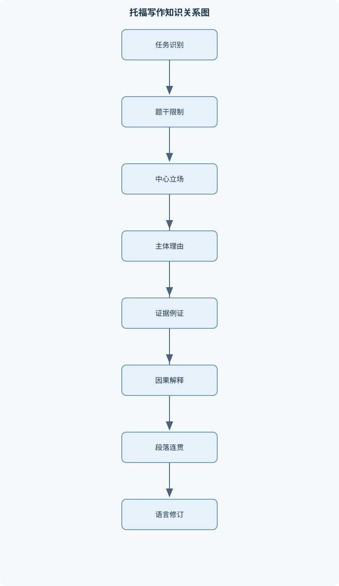
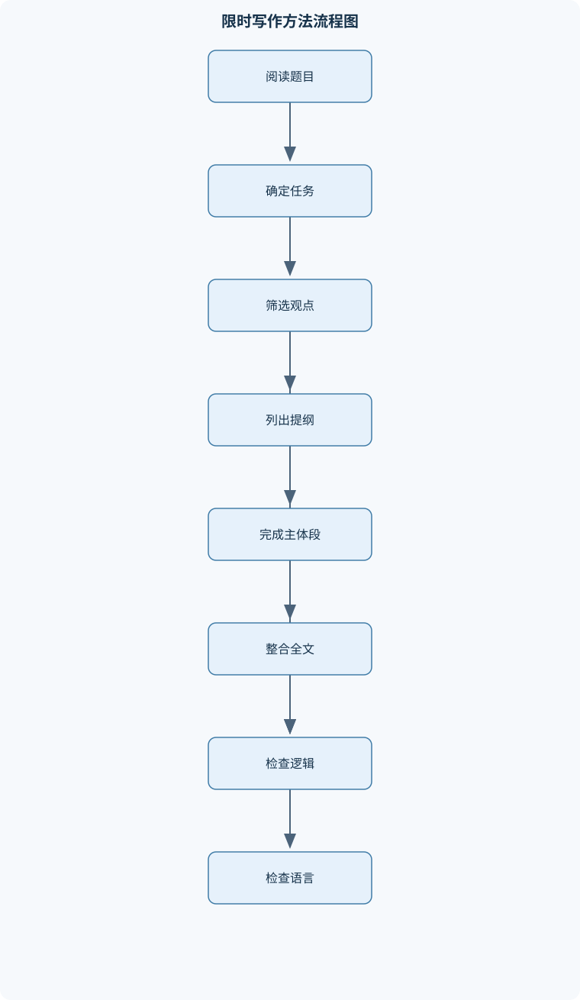

# 托福写作

## 一、课程整体知识框架

### 课程边界与先修知识

本课程聚焦托福英语写作中的学术表达、论证组织、语言准确性与限时写作流程，覆盖综合写作与学术讨论写作；对于仍采用独立写作练习的旧题型，作为论证训练材料使用，不将其等同于当前考试任务。课程不系统讲授文学创作、专业学术论文研究方法或完整实证研究。先修知识包括中学至大学初级英语语法、基本阅读理解能力、常见学术词汇和段落写作能力。学习者应理解英语基本句型、时态、从句、谓语一致和标点规则；若缺乏这些基础，需要先补充句法和词汇训练。具体考试任务、时间和评分说明应以目标考试版本的官方要求为准。





### 1. 课程对象、任务边界与先修条件

《托福写作》课程研究的是英语学术交际中的信息整合、观点回应、论证组织和语言控制。课程核心不是文学创作，也不是完整的专业学术论文研究；写作者不需要进行系统文献综述、实验设计或统计推断，而要在限定时间和篇幅内，准确回应任务，组织相关信息，并用清晰、可理解的英语表达逻辑关系。

课程覆盖两类主要写作任务。第一类是综合写作：考生阅读一段学术材料，再听取与之相关的讲座或陈述，最后说明听力信息如何支持、反驳、修正或补充阅读观点。第二类是学术讨论写作：考生针对一个具有学术或公共议题性质的问题，回应讨论主题或他人观点，提出明确立场和理由。旧独立写作题型仍可作为论证训练材料，但不能直接等同于当前考试的全部写作任务。具体题目形式、作答时间、字数提示和评分说明可能因考试版本而变化，因此课程中的流程用于建立通用能力，实际执行时必须以目标版本的任务要求为边界。

学习者应具备中学至大学初级英语基础，包括基本句型、常用时态、从句、主谓一致、冠词、可数名词、常见标点和基本学术词汇。如果学习者不能判断一个句子的主语与谓语，或不能读懂具有因果、转折和比较关系的段落，就应先补充句法和词汇训练。写作训练不能替代基础语言学习：论证思路正确，并不意味着存在严重句法错误的文章能够稳定传达含义。

### 2. 课程的核心对象：任务、论点、证据和语言

课程使用一组统一符号分析写作过程。$T$表示题目主张，即考生需要回应的命题；$P$表示作者立场，可以是同意、反对或有条件的判断；$R$表示支持立场的理由；$E$表示证据，包括具体例子、事实、经验、常识性情境或材料中的细节；$W$表示论证担保，即解释证据为什么能支持理由、理由为什么能支持立场的逻辑说明；$C$表示让步或反方观点；$Q$表示对反方观点的限定、回应或削弱。

完整的观点型论证可表示为：

$$
P\leftarrow R\leftarrow W\leftarrow E
$$

这个表示不是数学等式，而是论证依赖关系。写作者先提出具体证据$E$，再解释证据揭示的机制$W$，由此形成能够回答“为什么”的理由$R$，最后使理由服务于中心立场$P$。例如，题目讨论是否应鼓励学生参加社区服务。仅写“社区服务很有意义”只有结论，没有展开；若补充“学生在真实社区环境中与不同群体合作，能够练习沟通和责任分配”，其中“真实环境中的合作”是情境或证据，“练习沟通和责任分配”是机制，二者共同构成理由。

因果关系可记为$A\rightarrow B$，表示在明确条件下$A$可能导致$B$，不表示所有情况下都必然发生$B$。因此，“减少屏幕使用时间可能改善睡眠”比“减少屏幕使用时间一定治愈所有健康问题”更准确。论证强度取决于范围、时间、群体和条件。将“部分学生”扩大为“所有学生”，将“可能”改写为“必然”，都会增加反例风险。

综合写作使用$I$表示阅读观点，$L$表示听力观点，$M$表示二者关系。一个完整的信息对应关系可记为：

$$
I_1\leftrightarrow L_1
$$

其中箭头关系不预设具体方向，$M$必须由材料决定，可能是支持、反驳、修正或补充。综合段落的逻辑顺序是“阅读主张$I$—听力信息$L$—二者关系$M$—该关系对阅读主张的影响”。只摘录阅读和听力的句子，却不说明二者关系，属于信息罗列，不是信息整合。

段落分析使用$S$表示主题句，$D$表示主题句的具体展开，$Tr$表示句子或段落之间的过渡；$Coh$表示连贯性，即语义和逻辑关系是否清楚；$Uni$表示统一性，即段落是否围绕一个核心功能展开。句法分析使用$X$表示主语，$V$表示谓语，$O$表示宾语，$A$表示状语。这些符号是分析工具，不代表固定英语词汇。

### 3. 评分边界：内容完成、组织和语言质量

写作质量至少要从四个方面判断。第一是任务回应，文章是否真正回答题目，是否完成了综合写作的信息对应或学术讨论的观点回应。第二是内容发展，理由是否具体，例证是否与理由相关，是否解释了例证的作用。第三是组织与连贯，段落是否有明确功能，信息顺序是否便于读者理解。第四是语言控制，句法、词汇、搭配、拼写和标点是否足以支持准确表达。

这四个维度相互关联，但不能互相替代。词汇复杂不能弥补偏题；连接词很多不能弥补因果关系缺失；例子很多不能弥补例子与观点无关。一个简单但准确的句子通常优于一个结构复杂却无法判断主从关系的长句。复杂句的价值在于表达时间、条件、因果、让步和比较等关系，而不是增加从句数量。

### 4. 十一个知识模块之间的递进关系

#### 4.1 托福写作任务与评分边界

本模块区分综合写作、学术讨论写作和旧独立写作。综合写作要求忠实转述材料，原则上不加入个人立场；学术讨论要求参与讨论，必须有明确回应和独立展开；旧独立题主要训练审题、立场、理由和例证。三者都需要准确语言，但信息来源和写作者权限不同。

#### 4.2 审题与立场建构

审题首先识别题干动词和限制条件。题目可能要求同意或不同意、选择三项中的一项、解释原因、比较利弊或评价某种政策。题干中的“对谁”“在什么时间范围内”“最重要的标准是什么”都属于限制条件。中心论点句应同时包含对象、立场和必要限定。例如，面对“哪种能力对高中教师最重要”的三选一题，不能只写“我选择帮助学生”，还应说明“在识别需要支持的学生并提供及时帮助这一维度上，该能力比其他能力更直接地影响学生的学习和成长”。

#### 4.3 论证逻辑与证据展开

理由必须回答“为什么支持$P$”，例证必须具体到人物、场景、行为和结果，$W$则负责解释中间机制。比较题需要先建立共同评价维度$D$，再说明选项A和B在$D$上的差异。不能因为“A好”就推出“应选择A”，必须说明A为什么在题目要求的维度上更有优势。

让步论证的逻辑是：

$$
C\text{在特定条件下成立}\rightarrow Q\text{限定或削弱其重要性}\rightarrow P
$$

例如，可以承认锻炼有助于健康，但进一步指出，若题目要求选择“最容易长期坚持”的方法，饮食调整可能在时间限制较大的学生群体中更具可行性。让步不是同时支持两个相互冲突的结论，而是承认局部事实后说明总体判断为何仍然成立。

#### 4.4 文章结构与段落功能

引言通常完成三项任务：改写题目、明确立场、预示主要理由。主体段围绕一个$S$展开，常见顺序为“主题句—理由解释—具体情境—因果机制—回扣题目”。结论负责整合已有判断，不应引入新的理由或证据。

五段式结构可作为旧独立写作和较完整观点型文章的训练框架，但不是所有任务的固定格式。学术讨论写作篇幅有限，使用过长的背景和完整反方段可能挤压有效回应空间；综合写作则应根据阅读与听力的对应关系组织，通常每个主体段处理一组核心对应信息。结构必须服从任务，而不是为了凑段落数量。

#### 4.5 综合写作信息整合

阅读阶段记录每个主张$I_i$、支持理由和关键细节；听力阶段记录对应的$L_i$，并判断其与$I_i$的关系。信息取舍的标准是：该细节是否能解释阅读观点，是否能体现听力的态度，是否会改变读者对原主张的理解。不要把材料外知识、个人评价和未听清的推测写入正文。

#### 4.6 学术讨论写作

有效回应的顺序是“明确回应对象—表明同意、不同意或补充—提出直接相关的理由—加入具体例证或结果—简洁收束”。回应前一位发言者不能只重复其原句。例如，“我同意这一观点”之后，必须补充新的解释或从不同角度展开。礼貌表达不等于立场模糊，可以使用“I agree that...; however...”明确区分部分同意和完全同意。

#### 4.7 学术英语句法与词汇

句法训练从$X+V$基本结构开始，再扩展宾语、补语、定语从句、状语从句、名词性从句和分词结构。名词性从句可以充当主语、宾语或表语；定语从句修饰名词；状语从句表达时间、条件、原因、让步等关系。分词结构能够压缩重复主语，但只有在逻辑主语清楚时才适用。

应重点检查主谓一致、冠词、名词可数性、代词指代和搭配。例如，“improve people health”缺少所有格或限定结构，可改为“improve people’s health”；“many information”错误，因为information通常作为不可数名词使用，应改为“much information”或“many pieces of information”。词汇升级不能只追求生僻，而要同时满足词义、搭配和语域准确。

#### 4.8 衔接、语篇与段落连贯

连接词表达关系，但不能制造关系。只有前后内容确实存在转折时才能使用however；只有后句是前句结果时才能使用therefore。指代链必须清楚，this、they、such a policy等词不能让读者猜测所指对象。同义替换也不能改变范围和语气，例如“children”与“students”在所有语境中并不完全等同。

段落内部应遵循信息旧新安排：先承接读者已知的主题，再引入新的解释和结果。平行结构有助于比较和列举，例如“reducing costs, improving access, and encouraging participation”中的三个成分形式应保持一致。

#### 4.9 论证语言与表达升级

因果可用cause、lead to、result in、contribute to和enable，但不同表达的强度不同。cause通常表达较直接的原因，contribute to表示部分促成，prevent不应随意替换为reduce。让步可用although、even though、while和admittedly；比较可用more effective than、less costly than和compared with；程度可用to some extent、largely和particularly。

趋势表达需要对象和时间范围，例如“the use of online resources has increased among university students in recent years”。影响表达要说明影响对象和方向，而不是只写“have a big influence”。定义和举例应服务于论证，不能用空泛的“many people think”替代具体情境。

#### 4.10 常见社会议题素材分析

教育议题可从学习机会、教师职责、学生自主性和长期发展分析；健康议题可从可执行性、预防效果和生活习惯分析；环境议题可建立“政策措施—行为变化—环境结果”的因果链；科技议题可比较效率、可及性、隐私和依赖风险；金钱与慈善议题可讨论个人责任、资源分配和边际效用；工作与成功议题可区分收入、稳定、满足感和社会贡献；城市生活与交通可分析时间、成本和拥堵；风险与个人选择则要明确风险概率、潜在损失和个人承受能力。

这些素材只提供分析维度，不提供可随意冒充事实的统计数字。个人经历可以作为具体情境，但不能未经说明地扩展为普遍规律。

#### 4.11 限时写作与修订

限时流程包括审题、列提纲、成文和修订。审题阶段确定$T$、$P$和限制条件；提纲阶段筛选两至三个互不重复且能够解释的$R$；成文阶段先完成主体功能，再补充过渡和语言细节；修订阶段依次检查任务完成、段落功能、逻辑关系、句法、词汇和拼写。时间分配应服从目标版本的实际限制，不设定脱离考试版本的固定分钟数。

#### 4.12 范文评析与错误诊断

评析不能只给“语言高级”或“内容一般”的总体印象，而要指出可观察证据。例如，某段有主题句但没有$W$，说明发展不足；某结论引入新理由，说明组织边界失控；全文使用大量however但前后并无转折，说明连接词误用。错误应按偏题、任务要素缺失、论证断裂、句法错误、搭配错误和拼写错误排序，优先修改影响理解和逻辑的部分。

## 二、章节和模块划分

### 核心知识覆盖清单

本清单用于检查正文是否覆盖本课程的主要知识模块：

- **托福写作任务与评分边界**：综合写作任务结构、学术讨论任务结构、旧独立写作题型、阅读听力信息整合、学术回应的交际目的、内容完成与语言质量、评分维度与等级表现、考试版本差异。
- **审题与立场建构**：题干关键词识别、问题类型分类、同意与不同意立场、三选一比较题、原因与结果关系、让步条件识别、限定范围识别、中心论点句。
- **论证逻辑与证据展开**：主张与理由、理由与例证、解释机制、因果链条、比较与对比、利弊权衡、反方观点处理、证据相关性。
- **文章结构与段落功能**：引言的功能、背景句与改写题目、主体段组织、主题句设计、段落统一性、段落连贯性、结论的信息整合、五段式结构边界。
- **综合写作信息整合**：阅读材料观点提取、听力反驳关系、观点对应表、信息准确转述、因果关系保留、细节取舍、避免个人立场介入、综合段落模板。
- **学术讨论写作**：讨论话题回应、回应他人观点、补充独立理由、有限篇幅下的展开、观点之间的衔接、礼貌而明确的立场、例证的压缩表达、直接相关性。
- **学术英语句法与词汇**：简单句与复合句、名词性从句、定语从句、状语从句、分词结构、主谓一致、冠词与可数性、词汇搭配与语域。
- **衔接、语篇与段落连贯**：逻辑连接词、指代链、同义替换、主题推进、平行结构、信息旧新安排、段落间过渡、连接词误用。
- **论证语言与表达升级**：因果表达、让步表达、比较表达、程度表达、趋势表达、影响表达、定义与举例表达、避免空泛高级词。
- **常见社会议题素材分析**：教育与教师职责、健康与生活方式、环境保护、科技与互联网、金钱与慈善、工作与成功、城市生活与交通、风险与个人选择。
- **限时写作与修订流程**：时间分配、快速列提纲、首段起草、主体段展开、结论收束、句法检查、词汇与拼写检查、内容与逻辑复核。
- **范文评析与错误诊断**：评分证据识别、论点偏题诊断、段落发展不足、中式英语识别、语法错误分类、重复表达处理、反方处理失衡、修改前后对比。


### 1. 第一章：任务识别与考试版本边界

本章先建立任务地图。学习者需要比较三类题型的输入、输出和写作者权限：

| 任务 | 主要输入 | 核心输出 | 是否加入个人立场 |
|---|---|---|---|
| 综合写作 | 阅读与听力材料 | 说明$I$与$L$的对应关系 | 通常不加入 |
| 学术讨论 | 讨论问题与已有发言 | 直接回应并展开观点 | 需要明确回应 |
| 旧独立写作 | 观点型题干 | 独立论证$P$ | 需要明确立场 |

审题算法的输入是题目文本，输出是题型、关键词、立场和限制条件。步骤如下：

1. 找出任务动词，如agree、choose、explain、compare。
2. 圈定对象、群体和评价范围。
3. 标记时间、条件、程度和比较词，如most important、in the past、for students。
4. 判断题目要求选择、解释、比较还是整合材料。
5. 用一句话复述：“题目让我对什么对象作出什么判断。”

终止条件是写作者能够用一句话说清任务，而不是只认出主题词。该算法适用于观点型题目和学术讨论题，不适用于需要逐条对应阅读、听力的综合写作。

#### 例题一：最重要能力的三选一题

**题干**：高中教师最重要的能力是规划学生未来、识别并帮助需要帮助的学生，还是鼓励学生进行课外自主学习？

**分析**：题目要求选择一个“最重要”的能力，必须建立评价维度。可选维度包括影响范围、及时性、对困难学生的直接作用和长期效果。若选择“识别并帮助需要帮助的学生”，就不能只说它“很重要”，而要比较另外两项在特定维度上的不足。

**逐步解答**：

1. 设题目主张为$T$，立场为选择第二项$P$。
2. 理由$R_1$：及时识别能够防止学习困难扩大。
3. 证据$E_1$：一名学生因基础薄弱而不敢提问，教师若及时发现并提供分阶段任务，学生更可能恢复参与。
4. 担保$W_1$：早期支持改变了问题发展的路径，因此比只提供未来建议更直接。
5. 让步$C$：规划未来和鼓励自主学习也有价值。
6. 限定$Q$：但这些能力往往要求学生已经具备一定自我管理能力，不能完全替代对困难学生的及时支持。

**结果验证**：中心论点是否回答“哪一项最重要”？每个主体理由是否都能用“因为$R$，所以$P$”说明？是否明确比较了共同维度？若答案只罗列三个选项，没有选择依据，则任务未完成。

**变式**：若题目改为“哪项能力最能促进长期自主学习”，评价维度发生变化，第一选择可能改变；这说明“最重要”不是脱离标准的绝对判断。

### 2. 第二章：立场建构、理由筛选与主体段

立场与提纲算法的输入是题目和候选观点，输出是$P$以及两个或三个互不重复的$R$。流程为：列出候选理由，按相关性、可解释性和互不重复性筛选，为每个理由补充情境和因果链，再检查理由是否共同支持同一立场。终止条件是每个主体段都能完成“因为$R$，所以$P$”。

主体段展开算法的输入是一个理由$R$，输出是完整段落。过程是：

1. 写出只包含一个核心功能的主题句$S$。
2. 解释$R$的含义，避免直接重复题目。
3. 给出人物、场景、行为和结果组成的$E$。
4. 说明事件如何发生以及为何支持$R$，即补足$W$。
5. 用一句话回扣$T$或$P$。

伪代码如下：

```text
语言：伪代码
INPUT: 题目 T，候选理由集合 R_set
OUTPUT: 中心立场 P，主体段提纲 Outline

P ← 选择一个能够直接回答 T 的立场
Candidates ← []
FOR each reason r in R_set:
    IF r 与 T 直接相关 AND r 能够解释:
        添加 r 到 Candidates
按“相关性、可展开性、互不重复性”排序 Candidates
Outline ← 取前两个或三个理由
FOR each r in Outline:
    为 r 添加具体情境 E
    写出 E 如何导致结果的解释 W
    检查 r、E、W 是否共同支持 P
RETURN P, Outline
终止条件：每个 r 都能表达为“因为 r，所以 P”
```

算法的不变量是：筛选过程中，已保留的每个理由始终与题目直接相关；终止条件不是“列满三个理由”，而是每个理由都具备展开条件。其适用范围是观点型和旧独立写作训练，不适合直接生成综合写作内容，因为综合写作的核心约束来自材料。

#### 例题二：改善健康的选择题

**题干**：改善健康应主要依靠健康饮食、更多锻炼还是减少压力？

**分析**：不能机械罗列三项。应选择一个主要方案，并承认其他方案在特定条件下有效。若选择健康饮食，可将评价维度设为日常可执行性和持续影响。

**逐步解答**：

1. $P$：健康饮食是最稳定的基础措施。
2. $R_1$：饮食直接影响每日能量和营养摄入。
3. $E_1$：工作时间长的人可以通过提前准备简单餐食，减少高糖、高盐外卖。
4. $W_1$：由于饮食行为每天重复，较小的调整能够累积为长期结果。
5. $C$：锻炼和减压也能改善健康。
6. $Q$：但若工作安排不稳定或身体状态有限，持续高强度锻炼未必容易执行，因此饮食可以作为更普遍的起点。

**结果验证**：是否说明“最主要”的评价标准？是否避免把其他两项说成完全无效？是否解释了饮食如何影响健康，而不是只写“饮食很重要”？

**变式**：若题目限定“降低短期焦虑”，减少压力可能更直接；若限定“改善心肺能力”，锻炼的评价优势更明显。

### 3. 第三章：比较、让步与因果链

比较题的基本推导是：先确定共同维度$D$，再比较A与B在$D$上的表现，最后解释差异为何支持选择。形式可表示为：

$$
A\xrightarrow{D}结果_A,\qquad B\xrightarrow{D}结果_B
$$

这里$D$不是固定数值，而是成本、可及性、长期效果、实施难度等评价标准。该表示只适用于存在共同评价维度的比较，不适用于把完全不同性质的对象强行放在同一尺度上。

#### 例题三：减少生活费用的建议

**题干**：朋友想减少生活费用，建议合租、减少更换智能手机，还是购买便宜食品并在家烹饪？

**分析**：可以选择在家烹饪，但要区分短期成本和长期收益。不要只说“便宜”，应说明成本机制。

**逐步解答**：

1. $P$：购买经济食品并在家烹饪是较可持续的方案。
2. $R$：它同时减少单次餐饮支出并提高预算可控性。
3. $E$：朋友可以提前制定一周菜单，批量购买基本食材，减少临时外卖。
4. $W$：菜单规划降低冲动消费，家庭烹饪还使同一批食材服务于多餐，因此节约不是来自一次性牺牲，而来自消费流程改变。
5. $C$：合租可能显著降低房租，减少换手机也能避免大额支出。
6. $Q$：但合租受住房条件和室友关系限制，手机支出通常是间歇性支出；相比之下，饮食支出发生频率更高，调整后更容易形成持续效果。

**结果验证**：是否解释了三个方案的差异？是否说明选择的条件？是否避免假定所有城市房租、饮食价格和手机支出完全相同？

**变式**：若题目限定“立即减少最大一笔固定支出”，合租可能更有优势；若朋友不会做饭，经济食品方案必须增加“学习基本烹饪或选择简单菜谱”的实施条件。

#### 例题四：环境保护政策

**题干**：政府保护环境最重要的措施是研发清洁能源、保护自然区域，还是推广环保教育？

**分析**：选择清洁能源时，必须建立“政策措施—行为变化—环境结果”的链条，并承认研发不能立即解决所有问题。

**逐步解答**：

1. 政府投入研发，降低清洁能源的技术成本。
2. 成本下降提高企业和家庭采用清洁能源的可能性。
3. 能源结构改变后，化石燃料依赖和相关排放可能减少。
4. 因此，清洁能源研发在长期、系统性影响上具有优势。
5. 保护自然区域能直接防止栖息地破坏，环保教育能改变公众意识。
6. 但若缺乏可负担的替代能源，公众即使有意识也可能难以改变能源选择。

**结果验证**：每一步是否有明确条件？“可能减少”是否被错误写成“必然消除”？是否同时承认政策实施需要资金、基础设施和时间？

**变式**：若题目强调“短期保护某片森林”，保护自然区域可能比研发能源更直接；若强调“改变公众长期行为”，教育的评价权重会上升。

#### 例题五：是否应要求大学生参加社区服务

**题干**：大学是否应要求学生参加社区服务？请回应一位认为社区服务会增加学生负担的发言者。

**分析**：这是学术讨论写作，不宜套用过长五段式。必须明确回应对象、承认合理担忧、提出自己的理由并快速举例。

**逐步解答**：

1. 回应对象：承认社区服务可能增加时间压力。
2. 立场：在时间安排合理且服务形式多样的条件下，可以要求有限时长的社区服务。
3. 理由：它能把课堂中的社会责任转化为实际合作经验。
4. 例证：学生在社区辅导项目中与儿童和工作人员协作，学习沟通、分工和问题处理。
5. 收束：因此，合理设计的要求并非单纯增加负担，而是把学习延伸到真实环境。

**结果验证**：是否明确回应了前一位发言者？是否提出了新的展开，而不是重复“社区服务有意义”？是否说明“要求”的边界和条件？

**变式**：若题目改为“所有学生必须每周参加固定服务”，原立场需要重新限定，因为频率、强制程度和学生个人情况改变了论证条件。

### 4. 第四章：综合写作映射与忠实转述

综合写作信息映射流程的输入是阅读和听力材料，输出是三组左右的对应信息。步骤如下：

1. 阅读阶段记录$I_i$的主张、理由和关键细节。
2. 听力阶段记录$L_i$的态度、理由和细节。
3. 按主题而不是按出现位置匹配$I_i$与$L_i$。
4. 标记$M$为支持、反驳、修正或补充。
5. 每段按“I—L—M—影响”组织。
6. 检查是否加入材料外意见。

**输入数据示例**：

- 阅读$I_1$：某校园项目能够提高学生参与度。
- 听力$L_1$：讲座指出，参与度数据来自自愿报名者，不能代表全体学生。
- 关系$M_1$：听力质疑证据代表性，削弱$I_1$。

**段落分析**：不能只写“阅读认为项目提高参与度，听力也谈到参与度”。应说明听力如何改变阅读结论：样本由自愿报名者构成，可能本来就更积极，因此项目效果不能直接推广到全体学生。

**信息验证标准**：

- 三组对应关系是否完整；
- 每组是否同时包含阅读与听力；
- 是否明确$M$；
- 因果、条件和程度是否被保留；
- 是否没有个人立场和材料外评价。

常见排错方法是回到材料逐句定位，而不是凭记忆补写。若无法判断听力是在反驳还是补充，应先写出两者的具体命题，再比较它们是否冲突、是否改变范围，避免使用过强的标签。

### 5. 第五章：语言修订与错误诊断

语言修订算法的输入是初稿，输出是修改稿。第一遍检查是否回答题目；第二遍检查每段$S$、$D$和$E$是否完整；第三遍检查$X$、$V$、$O$和从句边界；第四遍检查冠词、可数性、搭配、连接词和拼写；最后逐句确认逻辑关系。

#### 练习文本与修改

**原句**：Heavy exposure to TV will exert a negative effect on our reading ability.

该句语法可接受，但“heavy exposure”表示过度接触，语域较正式；若原意只是“看太多电视”，可以写成“Watching too much television can negatively affect reading ability.” 如果强调名词化表达，原句更合适，但应确认“our”是否真的代表作者和读者共同群体。

**原句**：Failure to recognize the seriousness of growing population will lead to a big mistakes.

应改为“Failure to recognize the seriousness of population growth will lead to a big mistake.” “a”后接单数名词，因此mistakes必须改为mistake；“population growth”比“growing population”更适合表示人口增长这一过程。若要表达不确定性，可写“may lead to serious mistakes”，避免把结果写成必然发生。

**原句**：It brings students intensive pressure that some students cannot endure.

可改为“The situation places intense pressure on students, and some of them cannot cope with it.” 原句存在搭配不自然和指代不清问题；pressure通常与place pressure on搭配，intense比intensive更适合描述压力强度。

### 6. 第六章：课程实验与项目任务

#### 实验一：论证链完整性分析

**输入数据**：一段包含观点、理由和例子的作文，例如“学校应增加体育课，因为运动很重要。我的朋友每天跑步，所以他的学习成绩很好。”

**步骤**：

1. 标出$P$：“学校应增加体育课”。
2. 标出$R$：“运动很重要”。
3. 标出$E$：“朋友每天跑步且成绩好”。
4. 检查$W$：是否解释体育课如何改善学习，及朋友个案为何能支持学校政策。
5. 改写为主题句、机制、例证和回扣。

**评价标准**：理由必须具体；例证必须与理由直接相关；至少有一句解释$E$如何支持$R$；不得把单一个人经历写成普遍事实。

**排错方法**：若例子能被删除而段落逻辑完全不变，说明例子没有承担证明功能；若无法回答“为什么这个例子支持观点”，说明$W$缺失。

#### 项目二：综合写作对应表与段落重构

**输入数据**：包含三个阅读主张和逐条听力回应的材料。

**步骤**：

1. 建立四列记录表：阅读主张$I$、听力信息$L$、关系$M$、对原观点的影响。
2. 为每个$I_i$寻找主题对应的$L_i$。
3. 将“反驳事实”和“反驳机制”分开记录。
4. 每组写成一个段落。
5. 删除材料外推测和个人评价。

**评价标准**：三组关系均可追溯；每段都有$I$、$L$和$M$；因果方向不颠倒；不把听力的观点写成作者个人判断。

**排错方法**：若一段只有阅读细节，补写听力如何回应；若一段同时混入两个无关主张，拆分段落；若出现“this proves”而材料只表示可能，改为“this suggests”或保留原有程度。

### 7. 常见易错点、笔试问题与岗位任务

#### 7.1 具体易错点

1. 把旧独立写作当作当前全部写作任务。
2. 只写“我同意”而没有$R$、$E$和$W$。
3. 一个主体段放入多个未展开理由。
4. 把例子写成“很多人都这样”的空泛概括。
5. 把个人经历扩大为普遍事实。
6. 将“可能”误写成“必然”。
7. 忽视题干中的群体、时间和范围。
8. 比较题没有共同评价维度$D$。
9. 让步后没有$Q$，导致立场摇摆。
10. 综合写作只摘录$I$和$L$，不说明$M$。
11. 综合写作加入个人观点或材料外知识。
12. 连接词与真实逻辑关系不一致。
13. 复杂句过长，导致主谓和从句边界不清。
14. 使用生僻词替代普通词，却造成搭配和语域错误。
15. 结论新增未经展开的理由。
16. 代词指代不清，读者无法判断this或they所指对象。

#### 7.2 典型笔试问题与解答思路

1. **为什么例子不能替代理由？**  
   因为例子只说明发生了什么，理由解释为什么该事实支持立场；缺少$W$时，论证存在跳跃。

2. **综合写作能否表达自己的评价？**  
   通常不应加入。任务重点是准确呈现$I$与$L$的关系，个人评价会改变信息来源和交际目的。

3. **“最重要”题如何避免绝对化？**  
   先建立评价维度，再说明某选项在该维度上更有优势，并承认其他选项在不同条件下也有价值。

4. **五段式是否适用于所有写作任务？**  
   不适用。它是观点型文章的组织工具；学术讨论强调有限篇幅内的直接回应，综合写作强调材料对应。

5. **如何判断however是否误用？**  
   删除however后比较前后命题，若没有方向、条件或程度上的转折，就不应使用。

6. **什么时候使用分词结构？**  
   当分词逻辑主语与主句主语一致且关系清楚时使用；否则容易产生悬垂修饰。

7. **如何处理反方观点？**  
   先准确承认其成立条件，再用$Q$限定其范围、重要性或适用对象，最后回到$P$。

8. **为什么复杂词汇不一定提高表达质量？**  
   评分关注准确、清晰和适切。错误的复杂词会降低可理解性，普通但搭配正确的词更有功能。

#### 7.3 面试问题、参考答案与追问要点

1. **如何批改一篇托福作文？**  
   先看任务是否完成，再看论点和段落，再看语言。追问时应说明会如何区分偏题、发展不足和语法错误。

2. **如何设计综合写作练习？**  
   先训练$I$和$L$分别记录，再训练主题匹配和$M$判断，最后进行限时成段。追问重点是如何防止学生加入个人观点。

3. **学生写了很多例子但文章仍不充分，怎么办？**  
   检查是否缺少$W$。要求学生解释人物、行为和结果之间的机制，而不是继续增加例子。

4. **如何讲解连接词误用？**  
   先让学生判断前后命题关系，再选择连接词，不从词表反推逻辑。追问可要求举出一个没有连接词但仍然连贯的例子。

5. **如何处理中式英语？**  
   不只标记“地道或不地道”，而要指出主语选择、动词搭配、名词化结构和语域问题，并提供可迁移的改写方式。

6. **如何评价学术讨论回应？**  
   看回应对象是否明确、立场是否清楚、理由是否具体、例证是否直接相关、篇幅是否控制。追问可要求说明为什么不能套用完整五段式。

7. **如何设计限时修订流程？**  
   按内容、组织、句法、词汇和拼写排序，优先修改影响理解的错误。追问重点是时间不足时哪些错误可以暂缓。

8. **如何证明修改确实改善了文章？**  
   使用前后对比，指出修改后新增了哪条论证关系、消除了哪种歧义或修正了哪项任务偏差，而不是只说“更高级”。

### 8. 岗位关联与产出标准

托福写作教师的实际任务包括讲解题型、示范提纲、批改作文和设计反馈；使用的知识包括$P$、$R$、$E$、$W$论证链、段落统一性和语言诊断；产出应包括课堂讲义、示范段落、问题清单和修改稿；验收标准是反馈能对应具体句子或段落，且能说明问题属于内容、组织还是语言。

英语课程研发编辑需要把知识转化为可检索、可练习的模块，产出题目、解析、例文和评分维度；验收时应检查任务边界准确、术语前后一致、例题有完整推导、没有把旧题型误写成当前全部任务。

作文批改教师的核心产出是分层反馈和修改示例。反馈应优先指出偏题、缺少材料关系、论证断裂和严重句法错误，再处理重复表达和风格提升。不能只用“内容不够”“语言一般”等无法操作的评价。

学术英语写作教师和语言测评助理还需要区分语法错误与论证错误：前者影响句子形式，后者影响观点之间的支持关系。无论使用人工还是自动反馈，验收标准都应包括可追溯性、任务相关性、语言准确性和修改可执行性。

## 三、核心概念的详细解释

### 1. 托福写作任务的交际目的与评分边界

托福写作不是单纯测试“能否写出复杂句子”，而是测试考生能否在英语学术交际场景中完成指定任务。写作者必须同时处理四个问题：题目要求回应什么，文章或段落采取什么立场，信息之间如何组织，以及语言是否足够准确、清楚、自然。

综合写作的核心任务是信息整合。阅读材料提供若干观点或解释，听力材料通常围绕这些观点进行支持、反驳、修正或补充。考生的任务不是发表个人意见，也不是凭常识讨论主题，而是解释听力如何影响阅读中的观点。其基本关系可表示为：

$$
I_i \leftrightarrow L_i \xrightarrow{M_i} \text{对阅读观点的影响}
$$

其中，$I_i$表示第$i$个阅读观点，$L_i$表示与其对应的听力信息，$M_i$表示二者的关系。$M_i$必须依据材料确定，可能是反驳、支持、修正或补充。箭头不表示听力必然否定阅读，而只表示需要解释两部分材料之间的逻辑联系。

学术讨论写作的交际目的不同。它要求考生针对一个公共或学术议题作出回应，并在有限篇幅内表达明确立场、回应已有观点、提出相关理由和具体展开。它不等同于长篇五段式议论文，也不要求把所有可能观点都讨论一遍。有效回应通常包含“回应对象明确—立场明确—理由具体—解释充分”四个环节。

旧独立写作题型仍可用于训练立场、比较、让步、因果和例证，但不能将其直接视为当前所有写作任务。旧题中的“同意或不同意”和“三选一”尤其适合训练论证结构；综合写作则重点训练材料对应和客观转述；学术讨论则重点训练短篇幅中的直接回应和观点互动。

### 2. 题干、立场与限制条件

题目主张用$T$表示，作者立场用$P$表示。审题的第一步不是立即寻找理由，而是确认$T$的对象、范围和判断方式。例如：

> The most important way to improve public health is to clean the environment.

该题包含三个重要限制。第一，讨论对象是改善公众健康，而不是一般生活质量；第二，候选措施是清洁环境；第三，题目使用“the most important”，要求进行比较，而不是只证明该措施有一点好处。若只写“清洁环境能够减少污染”，只能证明环境措施有价值，不能证明它比健康饮食、医疗服务或锻炼更重要。

题干中的动词决定任务类型。agree or disagree要求支持、反对或有条件地判断；which one或which ability要求比较选项并作出选择；why或what are the reasons要求解释原因；how does the lecture respond要求整合听力与阅读；respond to a student要求明确回应讨论中的发言。时间、群体、地点和范围同样构成限制。例如“高中教师”“十五至十八岁学生”不能随意扩大为所有教师和所有人。

审题结果可以压缩为一句话：

> 题目要求我在限定的对象和范围内，对某一主张作出何种判断，并用什么关系展开。

如果这句话无法完成，说明题型、对象或限制条件尚未识别清楚。

### 3. 从中心立场到完整论证

一个完整的观点型论证可表示为：

$$
P\leftarrow R\leftarrow W\leftarrow E
$$

$P$是中心立场，$R$是支持立场的理由，$E$是例子、事实、情境或具体信息，$W$是论证担保，即解释证据为什么能够支持理由、理由为什么能够支持立场。

例如，题目讨论大学是否应要求学生参加社区服务。下列句子只有立场：

> Universities should require students to participate in community service.

加入理由后，论证变为：

> Community service helps students develop practical communication skills.

加入具体情境：

> For example, students who work with local residents must listen to different needs and coordinate tasks.

但这仍可能缺少$W$。需要继续解释：

> Because students must solve real problems rather than merely discuss them in class, they receive repeated practice in communication and responsibility.

完整链条是：参加社区服务这一$E$提供真实合作场景；在真实场景中协调任务这一$W$说明能力如何形成；沟通和责任能力这一$R$支持大学应要求参加社区服务这一$P$。

因果关系用$A\rightarrow B$表示，但它只表示在明确条件下$A$可能导致$B$，不表示无条件必然发生。更稳妥的句子是：

> Regular exercise can improve concentration when students follow a consistent routine.

这里的条件包括规律进行和持续一段时间。若写成“Exercise always makes every student more intelligent”，就把有限影响扩大为绝对结论，既不准确，也容易受到反例攻击。

### 4. 段落统一性、连贯性与信息推进

$Uni$表示段落统一性，即段落内的句子共同服务一个核心功能；$Coh$表示连贯性，即句子之间的语义、指代和逻辑关系清楚。二者并不相同。一个段落可能所有句子都围绕教育主题，但句子之间没有说明因果和转折关系，此时有一定统一性，却缺乏连贯性。

主体段通常可以按以下顺序展开：

$$
S\rightarrow D\rightarrow E\rightarrow W\rightarrow \text{回扣题目}
$$

$S$是主题句，指出本段唯一的主要理由；$D$解释理由的含义或作用范围；$E$提供具体情境；$W$解释情境产生结果的机制；最后回扣题目，说明该理由为何支持$P$。

例如，题目要求选择高中教师最重要的能力。若选择“帮助有困难的学生”，主题句应明确这一理由：

> The most important ability is recognizing students who need help and providing appropriate support.

随后说明“需要帮助”可能包括学习困难、心理压力或缺乏规划，给出教师发现问题并安排辅导的情境，再解释及时支持如何减少问题积累、提高学生继续学习的可能性。若同一段突然讨论教师鼓励课外阅读，却没有说明它与识别困难学生的关系，段落就出现主题漂移。

连接词不能代替逻辑。$however$只能连接真实的转折，$therefore$要求前文确实构成原因，$moreover$要求后文是同方向的补充。若前句说“合租可以分担房租”，后句说“因此学生应减少购买手机”，两句没有自然因果关系，加入$therefore$也不会使逻辑成立。

信息推进还依赖指代和同义替换。首次出现的新信息通常需要明确名词，后续可以使用代词或适当替换。例如先写“online courses”，后文可写“these courses”或“such programs”。但替换必须保持指代对象稳定，不能让“they”同时可能指学生、课程和教师。

### 5. 综合写作中的客观转述

综合写作必须区分材料信息和个人观点。一个段落的基本顺序是：

1. 指出阅读材料的主张；
2. 概括听力材料的对应信息；
3. 明确二者关系；
4. 说明听力如何削弱、支持、修正或补充阅读观点；
5. 保留材料中的必要因果和细节。

例如，阅读认为某项公共政策有效，听力指出实施成本过高。不能只写“阅读说政策有效，听力说政策昂贵”，还应说明“高成本如何影响政策效果”。如果成本导致地方机构无法实施，听力就不仅提供了一个独立事实，而是在削弱阅读关于“可广泛实施”的推断。

综合写作中的准确转述包括四项要求：不改变主语和因果方向，不把可能改成必然，不遗漏否定关系，不加入材料外的个人评价。阅读说“可能减少”，不能转述为“能够完全消除”；听力说“某些地区缺乏条件”，不能扩大为“所有地区都不能执行”。

### 6. 学术讨论中的回应与有限展开

学术讨论写作的篇幅有限，核心不是罗列三个理由，而是完成一个清晰、可验证的回应。有效结构可以表示为：

$$
\text{回应对象}\rightarrow \text{立场}\rightarrow R\rightarrow E\rightarrow W
$$

回应对象可以是前一位发言者的观点，也可以是讨论问题本身。例如：

> I agree that community service can benefit local communities, but I believe its main educational value is that it teaches students to cooperate with people outside the classroom.

这里先承认共同点，再提出自己的重点。若不同意，应针对观点而不是攻击发言者：

> I understand the concern about cost, but the long-term benefits may justify the initial expense.

有限篇幅下，例证应压缩为人物、场景、行为和结果四个要素，不必加入无关背景。比如“某大学安排学生帮助社区老人使用数字设备，学生需要解释操作步骤并耐心处理问题，因此锻炼了沟通能力”比“社区服务很有意义，许多人都受益”更具可解释性。

### 7. 学术英语句法、词汇与语域

句法准确性首先取决于能否识别$X$、$V$、$O$和$A$。句子必须有明确谓语，主语和谓语在数上保持一致，代词指代清楚。复杂句的价值不在于从句数量，而在于能否准确表达时间、原因、条件、让步和结果关系。

比较：

> Students face pressure. Some of them cannot endure it.

这两个简单句可以改为：

> Because academic competition creates intense pressure, some students cannot endure it.

改写后明确了原因和结果，但仍应避免把复杂句误写成中文式结构。自然表达通常要求主语和动词搭配合理：

> Heavy exposure to television can negatively affect reading ability.

比“Watching too much television will exert a negative effect on our reading ability”更紧凑；后者并非绝对错误，但“exert an effect”较正式，且“our”可能扩大了讨论范围。

词汇升级不能只替换为生僻词。应同时检查词义、搭配、语域和可数性。例如“make a big mistake”可用，但“lead to a big mistake”需要具体说明什么行为导致错误；“the style of living”通常不如“this lifestyle”自然；“more and more popular and accepted by more and more young people”可以压缩为“has gained increasing popularity and acceptance among young people”。

名词化可以提高正式程度，但过度名词化会降低清晰度。比较：

> If people fail to recognize the seriousness of population growth, they may make a serious mistake.

> Failure to recognize the seriousness of population growth may lead to serious policy errors.

第二句更适合学术语域，但“failure”后面的逻辑主语必须明确，且“policy errors”比泛泛的“a big mistake”更具体。

### 8. 让步、比较与范围限定

让步结构不是同时支持两个冲突结论，而是承认反方观点$C$在特定条件下成立，再用$Q$限制其重要性，最后回到$P$：

$$
C\rightarrow Q\rightarrow P
$$

例如：

> Although reducing stress can improve health, a healthy diet may be the most reliable starting point because it affects students’ daily energy and long-term habits.

这里承认减压有益，但通过“最可靠的起点”和“日常能量及长期习惯”缩小比较标准，最终支持健康饮食。若只写“运动也重要，减压也重要，饮食也重要”，则没有完成选择题要求。

比较题必须建立共同评价维度$D$。若比较环境保护政策，$D$可以是长期影响、实施范围或行为改变能力。不能先说研发清洁能源有益，再说保护自然区域也有益，然后直接宣布前者最好。需要说明二者在同一维度上的差异：

> Developing clean energy may reduce emissions across multiple sectors, whereas protecting a single natural area mainly limits damage in a particular location.

“most important”并不必然意味着绝对唯一，而是要求明确选择标准和适用条件。若题目要求选择三个方案之一，中心论点可以承认其他方案有价值，但必须说明为什么所选方案在规定维度上更有优势。

## 四、重要定义、公式、定理和推导

### 专业审校补充：关键定义与适用边界

托福综合写作中的“材料忠实度”是指：文章对阅读和听力的转述必须保持原材料的主张、因果方向、条件、程度和信息归属，不把考生推测当成材料事实。材料关系可分为支持、反驳、修正和补充，但分类必须由具体语义证据决定。若听力说某措施“may reduce costs”，只能写成“可能降低成本”，不能扩大为“必然节省大量费用”；若阅读归因于技术因素、听力改归因于管理因素，也不能把二者合并为一个笼统原因。综合写作允许使用概括和同义改写，但不应改变主客体、时间顺序或条件范围。其边界还包括：材料未提及的常识不能作为新证据，个人评价不能替代材料关系；即使考生认为阅读观点合理，也必须客观呈现听力的实际态度。检查时可逐句追问“谁提出了什么、在什么条件下、听力如何改变理解”，若句子无法回答其中一项，就可能存在归属、范围或推断越界。


### 1. 论证链的操作性定义

定义一：主张$P$是文章希望读者接受的判断；理由$R$是回答“为什么接受$P$”的概括性答案；证据$E$是可以被具体说明的情境或信息；担保$W$是连接证据、理由和主张的解释。

推导步骤如下：

1. 先写出可争论的$P$，不能只写主题。
2. 询问“为什么”，得到候选$R$。
3. 为$R$设计具体$E$，包括人物、场景、行为和结果。
4. 追问“这个例子为什么能证明理由”，补出$W$。
5. 检查$R$是否真的支持$P$，避免证据只与主题有关而与立场无关。

例如：

- $P$：大学应鼓励学生参加社区服务。
- $R$：社区服务能培养实际沟通能力。
- $E$：学生帮助社区成员解决数字设备使用问题。
- $W$：学生必须根据不同对象的需求调整解释方式，因而得到课堂练习无法完全替代的互动训练。

若只有$P+E$而没有$W$，读者只能知道发生了什么，不能知道该事件为什么能够支持结论。

### 2. 范围限定公式与反例边界

论证的可信度可用概念模型表示：

$$
\text{主张强度}\approx \text{证据支持程度}-\text{范围扩张风险}
$$

这不是评分公式，也没有固定单位；它用于说明写作中的逻辑关系。主张强度越大，通常需要越充分的证据。范围扩张包括以下变化：

- “some students”写成“all students”；
- “may improve”写成“will definitely solve”；
- “in the short term”写成“permanently”；
- “in large cities”写成“everywhere”。

边界反例是：如果题目只要求说明某方法“有帮助”，就不必证明它对所有人、所有时间都有效；如果题目要求说明“最重要”，则必须增加比较维度。准确限定并非削弱文章，而是使结论与证据规模相匹配。

### 3. 综合写作信息映射流程

**输入**：一篇阅读材料和一段听力材料。  
**输出**：三组或若干组$I_i\leftrightarrow L_i$及其关系$M_i$。  
**过程**：

1. 记录每个阅读主张、理由和关键细节；
2. 记录每个听力主张、理由和关键细节；
3. 根据主题、对象和因果关系匹配信息；
4. 标注$M_i$为支持、反驳、修正或补充；
5. 按“阅读—听力—关系—影响”写作；
6. 删除个人观点和材料外背景。

**不变量**：每个正文段围绕一个对应关系展开，不能把不同主题混在同一段。  
**终止条件**：每组对应信息都能回答“听力如何改变读者对阅读观点的理解”。  
**适用条件**：材料中存在可识别的观点对应关系。  
**边界**：如果两个材料只是在同一大主题下讨论不同问题，不能强行配对。

可用以下伪代码检查信息映射：

```text
Algorithm MapIntegratedInformation
Input: reading_points I, lecture_points L
Output: mappings M

for each point i in I:
    candidates = find_points_with_same_topic_or_object(i, L)
    if candidates is empty:
        mark "unmatched"
    else:
        choose candidate with the clearest causal or argumentative link
        relation = classify_as_support_refutation_revision_or_addition(i, candidate)
        save(i, candidate, relation)

for each mapping:
    verify that the written sentence states:
        reading claim + lecture information + relation + effect
return M
```

### 4. 五个代表性例题

#### 例题一：环境与健康

**题干**：Do you agree or disagree that cleaning the environment is the most important way to improve public health?

**分析**：题目不是问环境是否影响健康，而是要求比较“最重要”。需要确定评价维度，如影响人数、持续时间或预防作用。

**逐步解答**：

1. 立场$P$：基本同意，但承认医疗和生活方式也重要。
2. 理由$R_1$：减少空气和水污染可以预防大范围疾病。
3. 证据$E_1$：城市减少工业排放后，居民接触污染物的机会下降。
4. 担保$W_1$：环境治理作用于疾病发生之前，覆盖范围通常超过个体治疗。
5. 让步$C$：健康饮食和锻炼能改善个人状况。
6. 限定$Q$：这些方法主要依赖个人持续执行，环境治理则能同时影响大量居民。

**结果验证**：文章是否比较了至少两个方法？是否解释“最重要”的标准？若只写“污染很危险”，则没有完成比较。

**变式**：若题干改为“人们能做什么改善健康”，政府环境治理可能不再是最直接答案，因为行为主体从政府转为个人。

#### 例题二：高中教师能力三选一

**题干**：Which ability is most important for a high school teacher: planning students’ futures, identifying students who need help, or encouraging independent learning?

**分析**：必须建立共同评价维度，不能分别罗列三个优点。可选“对学生持续发展的基础作用”。

**逐步解答**：

1. 选择识别并帮助有困难的学生。
2. 主题理由：及时支持能防止短期学习困难发展为长期脱离。
3. 情境：教师发现学生连续缺交作业并与其沟通。
4. 机制：识别问题后，教师可以安排辅导、调整任务或联系家庭。
5. 比较：规划未来和自主学习同样重要，但如果学生已被压力或基础问题阻碍，先提供支持才有可能实现后两者。

**结果验证**：是否解释为什么“帮助有困难学生”优于另外两个选项，而不只是说它“很重要”。

**变式**：若题目限定学生已经学业稳定，则鼓励自主学习可能在“长期独立性”维度上更有优势。

#### 例题三：削减生活费用

**题干**：A friend wants to reduce living expenses. Should the friend share an apartment, replace the smartphone less often, or buy cheaper food and cook at home?

**分析**：建议必须转化为成本机制，不能只列三个选项。可选择合租和在家做饭，也可只选一个并充分展开。

**逐步解答**：

1. 选择合租作为主要建议。
2. 理由：房租通常是固定且金额较大的支出。
3. 情境：两名学生共同承担同一套住房的租金和公共设施费用。
4. 机制：支出由多人分担，节省效果具有持续性。
5. 让步：少换手机和自己做饭也能降低费用。
6. 限定：这些方法可能受个人饮食和工作安排影响，而合租直接改变主要固定成本。

**结果验证**：是否说明节省发生在哪一类成本上？是否考虑合租可能带来的隐私和协调问题？

**变式**：若朋友不喜欢与人共住，最优建议应改为在家做饭，并说明购买食材与外卖之间的长期差异。

#### 例题四：综合写作信息关系

**材料摘要**：阅读认为某种历史建筑保护政策能够促进旅游业。听力指出，建筑维护成本极高，地方政府需要削减其他公共服务预算，因此政策未必带来净收益。

**分析**：听力不是简单提供“成本高”的事实，而是在反驳阅读关于“政策有利”的总体推断。

**逐步解答**：

1. $I_1$：保护历史建筑能够促进旅游业。
2. $L_1$：维护建筑需要持续投入，并可能挤占教育或交通预算。
3. $M_1$：听力反驳或削弱阅读观点。
4. 影响：即使旅游收入增加，若公共服务损失超过收益，政策的总体效果仍不一定积极。

**结果验证**：若段落只写“阅读说有旅游收益，听力说维护很贵”，缺少“成本如何改变总体效果”的解释，信息整合不完整。

**变式**：若听力说“部分建筑采用新技术后维护成本下降”，关系就可能是修正，而非完全反驳。

#### 例题五：大学社区服务

**题干**：Should universities require students to participate in community service?

**分析**：学术讨论篇幅有限，应直接回应已有观点，并集中展开一个理由。

**逐步解答**：

1. 回应：承认社区服务可能增加学生时间压力。
2. 立场：支持适度要求，但允许学生选择服务类型。
3. 理由：选择权能提高参与意愿。
4. 例证：学生可在辅导儿童、环境维护或数字设备帮助中选择一项。
5. 机制：任务与个人能力匹配时，学生更可能持续投入并形成责任感。

**结果验证**：是否同时处理“强制”和“选择”的关系？若只说“社区服务有意义”，则没有回答是否应当要求参加。

**变式**：若题干问“社区服务是否比实习更有教育价值”，必须增加统一评价维度，如社会互动范围或职业技能直接性。

### 5. 两项文本分析项目

#### 项目一：综合写作信息映射实验

**输入数据**：一篇包含三个主张的阅读材料及一段逐条回应的听力材料。  
**步骤**：

1. 将阅读分为$I_1,I_2,I_3$，每项记录主张、原因和细节；
2. 将听力分为$L_1,L_2,L_3$，记录其对应信息；
3. 制作表格，填写主题、关系$M$、关键因果；
4. 每组写一个段落；
5. 用材料原文逐项核对主语、否定、程度和因果方向。

**评价标准**：三组对应关系完整；没有个人观点；每段都明确说明$M$；重要细节没有被改写成相反含义；语言错误不影响材料理解。

**排错方法**：若段落只有两项材料信息而没有关系，补写“这如何支持或削弱阅读”；若无法配对，先比较对象和因果，不要依据词汇重复强行匹配；若听力句子过长，拆成主张和原因分别转述。

#### 项目二：观点段落修改实验

**输入数据**：一段只有立场和抽象例子的作文段落。  
**步骤**：

1. 用下划线标出$S$；
2. 将每个句子标记为$D$、$E$、$W$或无关信息；
3. 删除第二个未展开的主要理由；
4. 补充人物、行为、结果和因果解释；
5. 检查最后一句是否回扣$P$；
6. 逐句检查$X$、$V$、主谓一致、冠词和可数名词。

**评价标准**：段落只有一个核心理由；证据具体；$W$能解释证据与理由的联系；连接词与真实逻辑一致；修改后没有把可能性扩大为必然性。

**排错方法**：如果例子仍然抽象，把“很多人”改成明确群体和情境；如果理由与题目关系弱，重新回答“这个理由为什么能支持$P$”；如果句子过长，先拆出主句，再用原因、条件或让步从句连接。

### 6. 限时写作与修订流程

适用于观点型任务的通用流程是：

1. 读题并圈定动词、对象、范围和比较标准；
2. 用一句话写出$P$；
3. 选择两个互不重复且可展开的$R$；
4. 为每个$R$补充$E$和$W$；
5. 快速安排引言、主体段和结论；
6. 成文后先检查任务完成，再检查论证链；
7. 最后检查主谓一致、时态、冠词、单复数、代词、拼写和连接词。

修订优先级应遵循：

$$
\text{偏题或漏答}>\text{论证断裂}>\text{严重句法错误}>\text{搭配与语域}>\text{重复和风格}
$$

这个顺序的边界是：若某个拼写或语法错误完全改变句意，应提前处理；若所谓“高级词”导致搭配错误，也不能保留。修订的目标不是让每句话都复杂，而是使任务要求、观点关系和语言形式能够被读者准确识别。

## 五、算法、流程和实现思路

### 方法与流程覆盖索引

下列方法或流程应在正文中说明输入、步骤、适用条件、结果检查和边界：

- 审题算法：输入为题目文本；输出为题型、关键词、立场和限制条件。步骤为识别任务动词，圈定比较对象，标记时间、群体和范围，判断是否要求选择或解释，最后用一句中文或英文复述题目。终止条件是能够回答“题目让我对什么作出什么判断”。适用于独立题、学术讨论题和大多数观点型任务；不适用于需要逐条整合材料的综合写作。
- 立场与提纲算法：输入为题目和可用观点；输出为中心论点及两个或三个主体段理由。步骤为列出候选理由，按相关性、可解释性和互不重复性筛选，给每个理由补充一个具体情境及因果链，再检查所有理由是否共同支持同一立场。终止条件是每个主体段均可用“因为R，所以P”解释。
- 主体段展开算法：输入为一个理由R；输出为完整主体段。过程为写主题句，说明R的含义，给出具体人物、场景或结果，解释事件如何发生及为何支持R，最后用一句话连接题目。段落不应引入第二个未展开的主要理由。
- 综合写作信息映射算法：输入为阅读和听力材料；输出为三组对应信息。过程为分别记录阅读的主张、理由和细节，再记录听力的主张、理由和细节，按主题匹配，标注支持、反驳、修正或补充关系，最后按对应关系写段落。终止条件是每组材料信息都能回答“听力如何影响阅读观点”。适用于综合写作；不应加入材料外的个人观点。
- 学术讨论回应算法：输入为讨论问题和已有发言；输出为一段独立回应。过程为明确回应对象，表明同意、不同意或补充立场，提出一个与问题直接相关的理由，加入一个具体例证或结果，使用简洁过渡完成收束。适用条件是篇幅有限、任务要求参与讨论；不宜套用过长的五段式文章。
- 语言修订算法：输入为初稿；输出为修改稿。第一遍检查是否回答题目，第二遍检查每段主题句和证据，第三遍检查主谓一致、时态、冠词、可数名词、代词指代，第四遍检查连接词、重复词和拼写，最后逐句确认主语、谓语和逻辑关系。终止条件是没有影响理解的关键错误，且每个段落功能明确。
- 错误诊断流程：输入为一篇作文和评分要求；输出为按严重程度排序的问题清单。先标记偏题和缺少任务要素，再标记论证断裂和段落失衡，随后标记句法错误、搭配错误和拼写错误，最后只优先修改会影响内容理解或逻辑的错误。适用于教师批改、自动反馈设计和自我修订。





### 1. 统一的任务识别与审题流程

审题流程的输入是题目文本，输出是题型、回应对象、立场方向、限制条件和可执行的写作任务。该流程适用于学术讨论写作、旧独立写作训练以及部分观点型练习；综合写作不能只依靠此流程，因为综合写作还必须处理阅读与听力材料之间的对应关系。

#### 1.1 输入、输出与处理步骤

**输入：**题目原文，以及在学术讨论任务中可能出现的其他发言。  
**输出：**$T$、题型、回应动作、$P$、范围限制和提纲要求。

处理步骤如下：

1. **识别任务动词。**  
   看到 *agree or disagree*，说明需要判断$T$并构造$P$；看到 *which one* 或 *what is the most important*，说明需要比较选项并选择一个主要方案；看到 *respond to*，说明需要明确回应已有发言；看到 *how does the lecture respond*，说明任务是信息整合，而不是个人评论。

2. **圈定命题对象。**  
   把题目中的人物、措施、行为和结果区分开。例如“改善公众健康”是目标，“清洁环境”是措施；文章需要说明措施如何影响目标，而不能把目标本身当成理由。

3. **标记限制条件。**  
   标记时间、群体、地点、程度和范围。例如“高中教师”“十五至十八岁学生”“最重要”“可能”“在过去”等词会限制论证边界。题目中的 *the most important* 还要求建立评价维度，如影响范围、持续时间、可实施性或直接效果。

4. **确定回应动作。**  
   题目要求“选择”时，必须说明为什么所选方案优于其他方案；题目要求“解释原因”时，不必机械讨论反方；题目要求“回应讨论”时，应先建立与前文发言的关系，再提出自己的$R$。

5. **用一句话复述任务。**  
   例如，环境题可以复述为：“我需要判断清洁环境是否比其他健康措施更重要，并用对比标准和因果解释支持判断。”如果无法复述，说明审题尚未结束。

#### 1.2 终止条件与边界

当写作者能够明确回答“题目让我对什么对象作出什么判断、面向哪个群体、在什么范围内判断”时，审题流程才终止。审题不要求提前写出完整句子，也不要求先寻找华丽词汇。

该流程不适用于综合写作的完整信息处理。综合写作的输入不只是题目，还包括阅读和听力内容；如果把综合写作误判为一般议论文，容易加入个人意见，或者用常识替代材料中的具体关系。

### 2. 立场与提纲生成流程

立场与提纲算法的输入是题目$T$和若干候选理由，输出是中心立场$P$、两个或三个互不重复的$R$，以及每个理由对应的$E$和$W$。

#### 2.1 理由筛选标准

候选理由应同时满足三个条件：

- **相关性：**能够直接回答题目，而不是只与主题沾边；
- **可展开性：**能够说明人物、行为、情境和结果；
- **独立性：**与其他理由的核心机制不同，不能把同一个原因换几个词重复。

例如，题目要求从“规划未来”“帮助需要帮助的学生”“鼓励课外自主学习”中选择高中教师最重要的能力。若选择“识别并帮助需要帮助的学生”，可以构造如下论证：

- $P$：识别并帮助有困难的学生最重要；
- $R$：及时支持能够防止短期学习问题转化为长期退步；
- $E$：教师发现学生持续缺交作业后，先判断其是否面临语言、家庭或学习方法问题，再提供针对性支持；
- $W$：问题被及早识别，干预就更可能匹配实际原因，学生也更可能恢复学习参与度。

这里的$W$不是重复$E$，而是解释“为什么及时支持能够产生长期影响”。

#### 2.2 提纲生成步骤

1. 列出至少三个候选$R$；
2. 删除只表达价值判断、无法说明机制的理由；
3. 删除与其他理由共享同一因果链的理由；
4. 为保留的每个$R$写一个具体情境；
5. 写出$E\rightarrow W\rightarrow R\rightarrow P$的关系；
6. 检查每个主体段是否只承担一个主要功能；
7. 如果题目有比较要求，给各方案建立同一评价维度$D$；
8. 写出中心论点句，明确主要选择和必要让步。

比较题的推导不能停留在“方案A很好”。若$D$表示评价维度，则至少应形成：

$$
A\text{在}D\text{上的结果} \quad \text{vs.} \quad B\text{在}D\text{上的结果}
$$

例如，环境政策题可把$D$设为“长期影响范围”。研发清洁能源能够改变能源生产和消费方式，影响范围可能大于只改变部分地区行为的措施；但这一判断仍需加上实施成本、技术成熟度或政策配套等条件，不能直接写成绝对结论。

#### 2.3 伪代码实现

```text
语言：伪代码

INPUT:
    prompt T
    candidate reasons R_list
    candidate examples E_list

OUTPUT:
    position P
    outline O

PROCESS:
    task_type <- identify_task(T)
    constraints <- mark_scope_time_group_degree(T)

    if task_type == "comparison":
        dimension <- choose_common_dimension(T)
    else:
        dimension <- None

    valid_reasons <- []
    for R in R_list:
        if relevant(R, T) and explainable(R) and not_duplicate(R, valid_reasons):
            valid_reasons.append(R)

    for R in valid_reasons:
        E <- select_specific_example(E_list, R)
        W <- explain_mechanism(E, R, T)
        if E is not None and W is not None:
            add_to_outline(O, R, E, W)

    P <- formulate_position(T, O, constraints, dimension)

    if every_reason_supports(P) and all_scope_constraints_respected(P, O):
        return P, O
    else:
        revise_reasons_and_repeat()
```

该流程的“不变量”是：任何加入提纲的$R$都必须直接支持同一个$P$，且不能违反题目范围。终止条件是每个主体段都能用“因为$R$，所以支持$P$”解释。其复杂度不宜用程序运行时间机械评价；在教学中更重要的质量标准是相关性、可展开性、互不重复性和范围准确性。

### 3. 主体段展开流程

主体段展开的输入是一个理由$R$，输出是具有统一性和连贯性的段落。基本顺序为：

$$
S\rightarrow D\rightarrow E\rightarrow W\rightarrow \text{回扣题目}
$$

其中$S$是主题句，$D$解释主题句中的抽象概念，$E$提供具体情境，$W$说明证据与结论之间的关系。

#### 3.1 五步展开

第一步写$S$。主题句应表达本段唯一的主要理由，而不是泛泛宣布“这是一个重要问题”。例如：

> Supporting students who are struggling is especially important because early assistance can prevent temporary difficulties from becoming permanent setbacks.

第二步写$D$，说明“困难”或“支持”具体指什么，例如学业基础不足、家庭压力或缺少学习方法。第三步写$E$，交代人物、场景、行为和结果，避免使用“很多人都这样”之类的空泛表达。第四步写$W$，解释为什么这个例子能够支持$R$。第五步回扣$P$，说明本段理由如何帮助回答题目。

若段落只有“观点+例子”，例如“教师应该帮助学生。我的老师帮助过一个学生，所以这很重要”，其中缺少$W$。读者不知道这个学生发生了什么，也不知道教师的行动为什么证明该能力比其他能力更重要。

#### 3.2 段落统一性的判定

设段落主题功能为$S$，段落中每个句子为$s_i$。若每个$s_i$都能回答“它如何服务于$S$”，则段落具有较强的统一性$Uni$。如果某句突然引入一个需要完整展开的新理由，就会产生主题漂移，应拆分段落或改写主题句。

连接词不能替代逻辑。例如，句子前加 *however* 并不会自动形成转折；前句与后句必须在方向、条件或结果上存在真实差异。*therefore* 前后的内容必须存在可解释的推导关系，否则只是形式上的衔接。

### 4. 综合写作信息映射流程

综合写作的输入是阅读材料$I$和听力材料$L$，输出是若干组对应信息$I_i\leftrightarrow L_i$及其关系$M_i$。此流程要求客观转述，不加入个人观点、材料外知识和主观评价。

#### 4.1 记录方法

阅读时分别记录每个主张、理由和关键细节：

| 编号 | 阅读主张$I$ | 阅读理由 | 阅读细节 |
|---|---|---|---|
| $I_1$ | 某方案可行 | 成本较低 | 材料给出的具体依据 |

听力时使用同样结构记录：

| 编号 | 听力观点$L$ | 听力理由 | 听力细节 |
|---|---|---|---|
| $L_1$ | 对阅读提出质疑 | 阅读忽视了隐藏成本 | 讲座给出相应情境 |

然后按主题匹配，而不是按听到的先后机械匹配。每组信息必须回答四个问题：

1. 阅读说了什么？
2. 听力补充或反驳了什么？
3. 二者的关系$M$是什么？
4. 听力信息如何改变读者对$I$的判断？

完整段落可采用“阅读主张—听力回应—具体说明—关系总结”的顺序。若听力只是修正阅读的适用范围，就不能写成完全否定；若听力支持阅读，也不能误写成反驳。

#### 4.2 信息取舍与核对

应优先保留会改变观点关系的信息，包括因果方向、条件、数量或程度的限制。可以压缩重复背景，但不能删除使反驳成立的关键条件。写作后逐段核对：

- 每个$I_i$是否都有对应的$L_i$？
- $M_i$是否明确？
- 是否把听力中的可能性改成必然性？
- 是否加入了材料没有出现的个人判断？
- 是否误把一个细节当成完整主张？

### 5. 学术讨论回应流程

学术讨论写作的输入是讨论问题和已有发言，输出是一段直接、独立且有展开的回应。它不宜机械套用完整五段式结构，因为篇幅有限，任务重点是参与讨论而不是写长篇论文。

推荐顺序为：

1. **回应对象明确：**指出同意、不同意或补充哪一位发言者；
2. **立场明确：**说明自己的判断；
3. **理由具体：**提出一个直接相关的$R$；
4. **例证压缩：**用一个校园、工作或公共生活情境说明$E$；
5. **机制收束：**用$W$解释结果，并回到讨论问题。

例如，题目讨论大学是否应要求学生参加社区服务。有效回应不应只重复“社区服务很有意义”，而应说明：社区服务使学生在真实环境中与不同群体合作，因此能够训练课堂中难以完全模拟的沟通和责任分配能力。若回应前一位发言者，既可以承认社区服务会占用时间，也可以指出在合理安排和有限要求下，该成本并不必然超过教育收益。这构成$C\rightarrow Q\rightarrow P$的让步结构。

### 6. 限时修订与错误诊断流程

限时流程的输入是题目、材料或讨论发言以及初稿，输出是完成任务且可理解的修改稿。具体分钟数应根据目标考试版本调整，流程本身保持不变。

修订顺序必须先内容、后组织、再语言：

1. **任务检查：**是否回答了$T$？综合写作是否说明$M$？讨论写作是否真正回应问题？
2. **论证检查：**每个$R$是否有$E$和$W$？是否出现偏题或未经解释的例子？
3. **结构检查：**每段是否有明确$S$？是否有多个未展开理由？结论是否引入新论点？
4. **句法检查：**逐句定位$X$和$V$，检查主谓一致、时态、从句边界和标点；
5. **词汇检查：**检查冠词、可数性、单复数、搭配、代词指代和拼写；
6. **连接检查：**确认*however*、*therefore*、*moreover*等连接词确实表达对应关系。

错误诊断应按对理解的影响排序。偏题、材料关系错误和因果方向错误优先于词汇重复；主谓不一致、缺失谓语和错误指代优先于单纯句式不够复杂。修改的终止条件是：任务要素齐全，每个段落功能明确，没有影响主要意义的关键错误。

## 六、概念之间的关系与对比

### 1. 综合写作与学术讨论写作

| 比较维度 | 综合写作 | 学术讨论写作 |
|---|---|---|
| 核心目的 | 整合阅读与听力信息 | 参与讨论并表达观点 |
| 主要对象 | $I$、$L$及其关系$M$ | $T$、$P$、$R$、$E$、$W$ |
| 是否加入个人立场 | 通常不加入材料外个人观点 | 必须形成自己的回应立场 |
| 证据来源 | 主要来自指定材料 | 可使用具体情境、常识性例子或合理经验 |
| 结构重点 | 按对应关系组织段落 | 按回应、理由和展开组织段落 |
| 常见失误 | 只复述材料，不说明$M$ | 只表态，不展开理由 |

两者都需要清楚表达逻辑关系，但“准确整合”与“独立论证”不是同一能力。综合写作中，即使个人观点合理，只要材料关系写错，任务就没有完成；学术讨论中，若只复述他人发言而没有自己的$P$，也不能构成有效回应。

### 2. 理由、证据与论证担保

$R$回答“为什么支持$P$”，$E$回答“有什么具体情境或信息”，$W$回答“为什么这个证据能够支持这个理由”。三者不能互相替代。

例如：

- $P$：应鼓励学生参加社区服务；
- $R$：社区服务能够训练合作能力；
- $E$：学生在社区项目中需要与不同年龄和背景的人共同安排任务；
- $W$：真实合作要求学生协调分歧、分配责任并调整表达方式，因此训练内容比单一课堂练习更接近实际社会交往。

若只写$E$而没有$W$，读者只能看到事件，无法确认事件与$P$的关系。若只写$R$而没有$E$，论证可能合理但缺乏具体性。若$E$与$R$无关，即使例子具体，也不能提高论证有效性。

### 3. 统一性与连贯性

$Uni$关注“一个段落是否围绕一个核心功能”，$Coh$关注“句子和段落之间的关系是否清楚”。一个段落可能句子之间衔接自然，却包含两个没有共同中心的理由，因此$Coh$尚可而$Uni$不足；也可能所有句子都讨论同一理由，但因指代不清、因果跳跃而$Coh$不足。

例如，主体段先讨论“教师帮助学习困难学生”，随后突然转向“教师应鼓励学生自主学习”，即使使用*moreover*连接，也不能解决统一性问题。应拆成两个段落，或将主题句改写为一个能够覆盖两种能力的更高层概念，但改写后仍必须分别展开。

### 4. 让步与折中立场

让步结构可表示为：

$$
C\rightarrow Q\rightarrow P
$$

$C$是反方或限制条件，$Q$说明其成立范围、代价或不足，$P$是最终立场。让步不是把两个互相冲突的结论同时当作最终结论。

例如，关于健康饮食、锻炼和减压的选择，可以承认减压对睡眠和情绪有帮助，但指出如果题目要求选择对整体身体状况影响更广的措施，健康饮食更容易持续影响体重、心血管风险和日常能量。这里的$Q$不是否定减压价值，而是限定“最重要”的评价维度。

让步应具体说明条件。空泛写“有人可能不同意，但我仍然坚持”没有完成反方处理；有效让步应说明反方在何种情况下成立、为什么仍不足以推翻$P$。

### 5. 因果关系与相关关系

$A\rightarrow B$只表示在明确条件下$A$可能导致$B$，不表示所有情况下必然发生$B$。写作者应区分：

- **直接因果：**污染物减少，某些与污染有关的健康风险可能下降；
- **间接因果：**环保教育先改变知识和态度，再影响行为，最后影响环境结果；
- **条件因果：**清洁能源只有在技术可用、成本可承受且得到广泛采用时，才可能产生大范围环境收益；
- **相关关系：**两个现象同时出现，不足以证明一个导致另一个。

因此，“更多学生参加体育活动，所以他们一定取得更高成绩”扩大了因果强度；更准确的表达是，规律运动可能改善精力和时间管理，从而在一定条件下帮助学习。范围词如*may*、*can*、*often*、*in some cases*能够降低不必要的绝对化。

### 6. 比较、举例与解释

比较题要求建立共同维度$D$，而举例只是说明某一方案可能产生的具体结果。二者功能不同。

若题目比较合租、少换手机和购买便宜食品三种降低生活费用的方法，不能只分别罗列优点。应先确定评价维度：

- 短期节省额；
- 长期稳定性；
- 对生活质量的影响；
- 执行难度。

例如，合租的论证链可以是“分担固定房租—每月支出下降—在租金占预算较大时，节省效果稳定”。少换手机可能主要减少一次性消费，便宜食品和自行烹饪则可能降低日常支出，但需要时间和基本技能。只有在同一$D$上比较，结论才真正回答“哪个方案更值得建议”。

### 7. 复杂句与表达复杂度

复杂句的价值在于准确表达主从关系，而不是增加从句数量。简单句适合强调结论和关键事实；复合句适合表达原因、条件、让步和定语限制。

例如：

> Students may perform better when they receive timely assistance.

该句用*when*表达条件或时间背景，关系清楚。若将多个独立观点强行塞入一个长句，可能造成$X$、$V$不明、代词指代不清和标点错误。句式多样应服务于语义：因果用原因从句或结果结构，比较用平行结构，让步用条件或转折结构，不能用复杂形式掩盖论证缺口。

### 8. 连接词与真实逻辑

*however*表示转折，*therefore*表示推论，*moreover*表示递进，*for example*表示举例。连接词的语义功能必须与前后内容匹配。

错误示例是先说“自行烹饪需要时间”，再接*therefore*并说“它能降低日常支出”，因为前句并不直接推出后句。可以改为：

> Cooking requires additional time; however, it can reduce daily food expenses when a person prepares several meals at once.

这里*however*连接的是时间成本与费用收益之间的让步关系。连接词只是显化逻辑，不能代替$W$；如果没有机制解释，形式上的衔接仍不能形成完整论证。

### 9. 材料转述与个人论证

综合写作要求忠实转述材料中的$I$和$L$，个人观点不属于必要组成部分；学术讨论则要求形成$P$，并用$R$、$E$、$W$展开。两者都可以使用因果、比较和让步语言，但证据权限不同。

综合写作中的“讲座指出某方案成本更高”必须归属于听力信息，不能改写成“我认为该方案成本过高”。学术讨论中可以写“这一方案可能成本较高，但在长期范围内仍值得采用”，因为作者正在建立自己的$C\rightarrow Q\rightarrow P$关系。

### 10. 五段式结构与短篇回应

五段式结构通常包括引言、两个或三个主体段和结论，适合旧独立写作中的完整论证训练，但不是所有当前任务的固定格式。学术讨论写作篇幅有限，过长的背景、重复的结论和多个未展开理由会挤压有效内容。综合写作也不应机械套用“个人立场—反方—结论”的结构，因为它的核心是$I_i\leftrightarrow L_i$的逐项整合。

结构应服从交际目的：

- 需要完整比较时，可以使用引言、主体段和结论；
- 需要逐条对应材料时，应按$I_1$、$I_2$、$I_3$组织；
- 需要参与讨论时，应优先完成回应、立场、理由、例证和收束。

### 11. 准确性、流利性与表达升级

语言质量不是生僻词数量，而是准确性、可理解性、搭配自然度和语域适切性的结合。*important*如果使用准确，优于误用一个看似高级但语义不符的词。表达升级应优先修正逻辑和搭配，例如：

- “make a big mistake”可以根据语境改为“make a serious mistake”；
- “heavy exposure to television may negatively affect reading ability”比逐词翻译“watching too much TV will exert...”更自然；
- “failure to recognize the seriousness of population growth may lead to serious policy errors”同时明确了名词结构和因果边界。

语言升级不能改变原有命题的程度。把“可能产生负面影响”改成“必然造成严重后果”，虽然语气更强，却扩大了$P$的范围，增加反例风险，也可能造成论证失真。

## 七、典型例题和应用场景

### 专业审校补充：综合例题

题干：阅读材料提出，城市应推广屋顶花园，因为屋顶植物能够降低建筑能耗、吸收雨水并改善居民心理状态。听力讲座并不完全否定该建议，但指出三个限制：第一，浅层屋顶花园只能在炎热季节明显降低顶层温度，冬季保温效果有限；第二，若排水层设计不当，暴雨时反而可能增加屋顶维护问题；第三，讲座者承认绿色空间有助于缓解压力，但认为公共公园比居民无法自由进入的私人屋顶更能产生这一效果。分析：先建立三组对应关系。I1为“降低全年能耗”，L1为“只在炎热季节明显有效”，M1是修正；I2为“吸收雨水”，L2为“设计不当会增加维护风险”，M2是条件性反驳；I3为“改善心理状态”，L3为“公共公园覆盖和可进入性更好”，M3是比较性修正。逐步解答：第一段应先准确转述阅读的节能主张，再说明听力限定了季节范围，因此不能写成全年持续节能。第二段应保留排水设计这一条件，写成听力认为该效果并非自动产生。第三段应说明讲座没有否认绿色空间的心理益处，而是质疑屋顶花园在可进入性上的优势。示范表达：The lecturer qualifies the claim that rooftop gardens reduce energy use by explaining that shallow gardens mainly cool buildings in hot seasons, so their benefit is not equally strong throughout the year. 结果验证：逐句检查后，主语归属清楚，三组材料均有关系词或等义解释，且没有加入“屋顶花园一定失败”等材料外结论。变式：若听力改为“维护成本可以通过专业排水设计控制”，M2应改为“修正或有限支持”，正文必须同时保留风险条件和可行解决方式，不能继续写成完全反驳。


### 典型题型与应用覆盖索引

建议通过下列题型或应用检查概念是否能够迁移：

- 同意或不同意“改善环境是提高公众健康最重要的方法”：要求完成审题、限定“最重要”的比较标准，构造环境污染影响健康、医疗或生活方式因素的对比，并写出包含让步段或让步句的完整提纲。
- 三选一题“高中教师最重要的能力”：比较规划未来、识别并帮助需要帮助的学生、鼓励课外自主学习三个选项，展示评价维度、理由筛选、例证设计和结论回扣。
- 生活费用削减建议题：围绕合租、减少更换智能手机、选择经济食品并自行烹饪三个方案，演示如何将建议改写为成本机制、长期收益和实施条件。
- 健康改善选择题：比较健康饮食、锻炼和减压，要求避免把三个选项机械罗列，使用“主要选择加有限让步”的结构完成中心论点和两个主体段。
- 环境保护政策题：比较研发清洁能源、保护自然区域、推广环保教育，要求为每个方案建立政策措施→行为变化→环境结果的因果链，再选择一个最具长期作用的方案。
- 综合写作配对练习：给出一篇包含三个主张的阅读材料和一段逐条反驳的听力材料，要求制作I1↔L1、I2↔L2、I3↔L3对应表，并据此写三段信息整合正文。
- 学术讨论练习：针对“大学是否应要求学生参加社区服务”写一段回应，先明确回应前一位发言者，再提出不同理由，加入一个具体校园情境，并控制无关背景信息。
- 段落改写练习：将只有观点和例子的短段改写为主题句、解释、例证、机制和回扣五部分，重点展示W即论证担保如何补足逻辑跳跃。
- 语言纠错练习：修改包含冠词遗漏、主谓不一致、名词单复数、错误搭配和中式因果表达的段落，并说明每一处修改对准确性或语域的影响。
- 完整限时模拟：从审题、提纲、成文到修订完成一篇观点型作文，随后以内容完成、组织、语言控制和任务回应四个维度进行证据化评析，而不是只给出总体印象。


### 1. 同意或不同意题：环境与公众健康

#### 题干

> The most important way to improve public health is to clean the environment. Do you agree or disagree?

#### 审题分析

题目主张记为 $T$：清洁环境是改善公众健康的最重要方法。中心立场记为 $P$。关键限制是 *the most important*，因此不能只证明清洁环境有益，还要将其与医疗服务、健康饮食、锻炼或减压等方法放在同一评价维度上比较。

可以选择“在总体和长期影响上同意，但承认个人生活方式也重要”的条件性立场：

- $P$：改善环境是提高公众健康最重要的方法之一，并且在公共层面具有优先性；
- $R_1$：环境污染会同时影响大量居民；
- $R_2$：环境改善能够减少健康风险的源头，而不是只处理已经出现的症状；
- $C$：饮食和锻炼对个人健康也有直接作用；
- $Q$：这些方法的效果取决于个人是否有能力和意愿长期坚持，环境政策则能覆盖无法自主选择居住环境的人群。

#### 逐步解答

第一步，建立因果链：

$$
\text{减少污染物排放}\rightarrow\text{降低空气和水中的有害暴露}\rightarrow\text{减少相关健康风险}
$$

这里的箭头表示在一定条件下可能产生影响，不表示所有疾病都由环境因素造成。

第二步，构造主体段。主题句可以写成：

> Environmental improvement has a broad public-health effect because it can reduce risks for large groups of people at the source.

随后解释机制：如果空气、水源或居住环境受到污染，个人即使有健康意识，也不一定能够完全避免暴露。政府减少污染源后，受益者不局限于主动购买健康食品或坚持锻炼的人。

第三步，加入让步：

> Individual habits such as exercise and a balanced diet should not be ignored, since they directly affect personal health. Nevertheless, these measures cannot fully protect people from polluted air or unsafe water, especially when residents have limited control over local conditions.

#### 结果验证

检查三个问题：

1. 是否回答了“最重要”，而不是只回答“有用”？已经加入公共影响范围和源头治理的比较。
2. 是否保留了范围边界？使用 *can*、*may* 和 *especially*，没有把环境改善写成治疗所有疾病。
3. 是否形成 $P\leftarrow R\leftarrow W\leftarrow E$？污染源是情境证据，覆盖大群体和减少暴露是 $W$，公共健康收益是 $R$，共同支持 $P$。

#### 变式

若题目改为“改善个人健康最好的方法是减少压力”，评价对象从公共层面转为个人层面。此时不能直接沿用环境题的“覆盖人群”标准，而应改用睡眠、情绪、工作表现和长期坚持性等维度。

---

### 2. 三选一题：高中教师最重要的能力

#### 题干

> Which ability is most important for a high school teacher: giving students advice about their future, helping students in difficulty, or encouraging independent learning?

#### 审题分析

三个选项不能机械罗列。必须建立共同评价维度，例如对学生当前学习的直接影响、对长期发展的作用以及教师能否及时实施。可选择“发现并帮助有困难的学生”。

中心提纲为：

- $P$：识别并帮助有困难的学生最重要；
- $R_1$：早期帮助能够防止暂时性问题演变成长期退步；
- $R_2$：有针对性的支持能够使学生重新获得学习信心；
- $C$：规划未来和自主学习也有长期价值；
- $Q$：如果学生当前已经脱离学习，未来规划和自主学习往往难以真正发挥作用。

#### 逐步解答

先明确“需要帮助”不等于成绩最低。困难可能来自语言障碍、家庭压力、学习方法不当或持续缺勤。教师应先识别问题，再决定帮助方式。

主体段可按以下顺序展开：

1. 主题句：及时识别学习困难具有基础性作用；
2. 具体情境：学生连续缺交作业、课堂沉默或成绩突然下降；
3. 机制解释：教师若先判断困难来源，就能提供辅导、调整任务或联系相关支持；
4. 结果：学生更可能恢复参与，而不是把短期问题发展成长期失败；
5. 回扣：因此，该能力为规划未来和自主学习创造了前提。

示范句：

> A teacher who notices a student’s sudden decline can investigate the cause before the problem becomes permanent. For example, a student may appear unmotivated while actually struggling with academic language. Targeted support can restore participation, which makes later career planning and independent learning more realistic.

#### 结果验证

“帮助学生”是宽泛主张，示例将其限定为“发现突然退步—判断语言困难—提供针对性支持—恢复课堂参与”。每个步骤都服务同一主题句，符合段落统一性 $Uni$。

#### 变式

若选择“鼓励课外自主学习”，论证重点应改为长期学习能力和知识迁移；若选择“规划未来”，应说明高中阶段的课程选择和职业信息如何影响后续决策。三个选项可以都承认有价值，但结论必须明确说明为什么一个选项在规定维度上更重要。

---

### 3. 生活费用削减建议题

#### 题干

> If a friend wants to reduce living expenses, would you suggest finding a roommate, buying a new smartphone less often, or buying cheaper food and cooking at home?

#### 分析与提纲

这是建议和选择结合的题型。不能只写三个选项的名称，而要解释每项如何影响支出。可以选择“合租”和“减少更换手机”作为主要理由，并对饮食方案作有限让步。

- 合租：固定住房成本由多人分担；
- 延长手机使用周期：减少高价耐用品的非必要更新；
- 自行烹饪：可能减少每餐支出，但需要时间、设备和计划。

#### 逐步解答

第一段可以说明选择标准：

> The most useful suggestions should reduce large or repeated expenses without creating an unrealistic burden.

主体段一：

> Sharing an apartment can lower one of the largest regular expenses. If two people divide rent and utilities, each person may retain more money every month. This saving is relatively stable because it does not depend on resisting many small purchases.

主体段二：

> Replacing a smartphone less frequently can reduce unnecessary spending. A phone that still performs essential tasks does not become financially valuable merely because a newer model has appeared. Keeping it longer spreads the original cost over more years.

让步句：

> Cooking at home can also save money, but the benefit is smaller when a person lacks time, kitchen equipment, or the ability to plan several meals in advance.

#### 结果验证

该答案分别解释了成本机制、持续性和实施条件。没有捏造具体金额，也没有把“便宜食品”写成必然健康或必然低价。题目若要求只选择一个建议，应按照“固定支出规模”选择合租，并将其他方案作为补充，而不是平分篇幅。

#### 变式

若朋友独居且没有稳定室友，合租的可行性下降；若朋友经常搬迁，长期合租也可能产生合同风险。此时应在 $P$ 中加入条件：“如果住房安排稳定，合租通常是最直接的方案。”

---

### 4. 健康改善选择题

#### 题干

> Which would you choose to improve your health: eating healthier food, exercising more, or reducing stress?

#### 审题分析

题目要求选择，不能把三项平均介绍后不作判断。可选择健康饮食为主要方案，同时承认锻炼和减压不可替代。

可用评价维度包括：

- 是否每天都能实施；
- 是否能影响多个健康方面；
- 是否容易长期坚持；
- 是否需要较高时间或经济成本。

#### 逐步解答

观点句：

> I would prioritize a healthier diet because it affects daily energy intake and can be changed gradually, although regular exercise and stress management remain necessary.

因果链：

$$
\text{减少高糖高盐食品并增加营养均衡的食物}
\rightarrow
\text{改善日常饮食结构}
\rightarrow
\text{更稳定地支持身体活动和学习}
$$

这里不能把饮食改良写成治疗疾病。可以补充：

> Exercise strengthens the body, and stress reduction protects mental well-being. However, a dietary change can be incorporated into several daily meals, so it may be easier for a busy student to maintain consistently.

#### 结果验证

主要选择已经明确，其他选项不是被完全否定，而是通过让步限定其作用。若把“健康饮食”写成“保证长寿”，就超过了题目允许的论证强度；更稳妥的是使用 *may support*、*can contribute to* 等表达。

#### 变式

如果题干改为“压力很大的大学生最应优先采取什么措施”，评价维度发生变化，减压可能优于饮食。题目对象和情境改变后，原有结论不能无条件照搬。

---

### 5. 综合写作：逐条反驳关系

#### 题干与材料摘要

阅读材料提出三个理由，支持某项公共项目：

- $I_1$：项目可以降低城市交通拥堵；
- $I_2$：项目能够创造大量就业；
- $I_3$：项目不会造成明显财政负担。

听力逐条回应：

- $L_1$：拥堵可能只是转移到邻近道路；
- $L_2$：项目需要高度专业化人员，实际就业数量有限；
- $L_3$：维护成本长期较高，财政负担会超过预期。

#### 分析过程

建立对应表：

| 阅读观点 $I$ | 听力信息 $L$ | 关系 $M$ | 对阅读的影响 |
|---|---|---|---|
| 降低拥堵 | 拥堵转移 | 反驳或削弱 | 不能证明全市交通改善 |
| 创造就业 | 所需岗位专业化 | 修正 | 就业收益可能小于阅读所称 |
| 财政负担小 | 维护成本高 | 反驳 | 长期成本不能忽略 |

#### 逐步解答

每一段都使用四步：

1. 说明阅读主张；
2. 转述听力具体信息；
3. 明确二者关系；
4. 解释该关系如何影响阅读结论。

示范段：

> The reading claims that the project would reduce traffic congestion. The lecturer challenges this claim by explaining that vehicles may simply move to nearby roads rather than disappear. As a result, congestion could be transferred to another part of the city, so the project would not necessarily produce the broad improvement described in the reading.

#### 结果验证

综合写作中不应加入“我认为这个项目很好”之类的个人评价。每段都包含 $I_i\rightarrow L_i\rightarrow M_i$，并说明影响。如果只写“阅读说减少拥堵，听力说道路拥堵”，没有解释“转移”如何削弱原观点，信息整合就不完整。

#### 变式

如果听力说“项目初期成本高，但后期维护费用下降”，关系就不是简单反驳，而是修正。此时应写出时间条件，不能把“初期负担”扩大为“始终负担过重”。

---

### 6. 学术讨论回应：回应他人并提出新理由

#### 题干

> Should universities require students to participate in community service?

已有发言：

> Student A: Community service should be optional because students already have heavy academic workloads.

#### 分析与解答

有效回应不能只重复“我同意”或“我不同意”。可以部分不同意：

> I understand the concern about students’ workloads, but I believe universities can require a limited amount of community service because it connects academic learning with real social needs. For example, students studying public health could assist local organizations with basic educational activities. This experience would help them apply classroom knowledge while learning to communicate with people outside their usual social group. The requirement should be limited and scheduled flexibly so that it does not replace essential academic work.

结构为：

- 回应对象：承认学业负担；
- $P$：支持有限度的要求；
- $R$：把课堂知识应用到真实情境；
- $E$：公共健康学生参与社区教育；
- $W$：真实交流促进知识迁移和沟通能力；
- $Q$：限制时长并灵活安排，降低对学业的干扰。

#### 结果验证

该回应没有把社区服务写成“所有学生都会因此成功”，也没有提出与题目无关的社会背景。学术讨论篇幅有限，单个理由充分展开通常优于列出四个没有解释的理由。

---

### 7. 论证段落改写：补足 $W$

#### 原始段落

> Cooking at home is good. Many people cook at home. It saves money. Therefore, everyone should cook at home.

#### 问题诊断

原段存在三处问题：

1. “很多人”不是具体证据；
2. 没有说明自行烹饪通过什么机制省钱；
3. “因此所有人都应烹饪”扩大了结论范围。

#### 修改后

> Cooking at home can reduce food expenses when people plan several meals and use ingredients efficiently. For example, a student can prepare a large amount of rice and vegetables for several lunches instead of paying for separate restaurant meals. Because the cost of ingredients is distributed across multiple servings, the average cost of each meal may decrease. However, this option is less practical for people who lack cooking equipment or have extremely limited time.

这里新增了$E$、$W$和实施边界。*may decrease*保留了条件性，避免将个别情境写成普遍必然结果。

---

### 8. 语言纠错例题：句法、搭配与语域

#### 原句

> Heavy exposure to TV will exert a negative effect on our reading ability, and students does not have enough time to exercise.

#### 逐步修订

1. *students does* 改为 *students do*，因为复数主语需要复数谓语；
2. *TV* 在正式语境中可写为 *television*；
3. *heavy exposure to television* 是名词化表达，但需要注意其含义是“接触量大”，不是单纯“看过电视”；
4. 两个分句的关系是并列，若想表达共同原因，应补充更明确的结构。

修改为：

> Excessive exposure to television may negatively affect students’ reading ability and leave them with less time for exercise.

#### 结果验证

修改后主语统一为 *excessive exposure*，两个结果由 *may* 控制，避免绝对化；*leave someone with less time for...* 比逐词翻译“使学生没有足够时间”更自然。若题目只讨论阅读能力，不应无故加入锻炼结果，否则会造成主题漂移。

### 9. 代表性流程的伪代码实现

下面的流程用于检查观点型段落是否具备基本论证关系。它不能代替人工判断，尤其不能自动判断一个例子是否真实或一个因果机制是否充分。

```python
def inspect_argument(paragraph):
    """
    输入：一个英文观点段落，类型为字符串
    输出：结构诊断结果
    说明：只进行规则层面的初步检查，不进行联网或文件操作
    """
    result = {
        "topic_sentence": False,
        "reason": False,
        "evidence": False,
        "warrant": False,
        "risk": []
    }

    sentences = split_into_sentences(paragraph)

    if len(sentences) >= 1:
        result["topic_sentence"] = has_main_claim(sentences[0])

    for sentence in sentences:
        if has_reason_marker(sentence) or explains_why(sentence):
            result["reason"] = True
        if contains_specific_actor_or_context(sentence):
            result["evidence"] = True
        if explains_mechanism(sentence) or explains_result(sentence):
            result["warrant"] = True
        if contains_absolute_words(sentence):
            result["risk"].append("检查 all、always、everyone、must 等绝对化表达")
        if has_unresolved_pronoun(sentence):
            result["risk"].append("检查代词指代是否明确")

    if not result["topic_sentence"]:
        result["risk"].append("段首缺少明确主题句")
    if not result["reason"]:
        result["risk"].append("缺少回答 why 的理由")
    if not result["evidence"]:
        result["risk"].append("缺少人物、场景或具体结果")
    if not result["warrant"]:
        result["risk"].append("缺少证据与结论之间的机制解释")

    return result
```

该流程的输入是单个段落，输出包括主题句、理由、证据和 $W$ 的初步标记。终止条件是完成四类检查并生成风险清单。它适合用于批改前筛查和课堂演示，不适合直接作为最终评分器，因为语言形式相同的句子可能具有不同的语义功能。

## 八、实验、实践和项目相关知识

### 专业审校补充：实践任务

任务：完成一次“语气与信息忠实度校准”练习。输入材料包括一段约三点的阅读摘要、一段逐点回应的听力文字稿、一个空白对应表和一篇含有过度推断的综合写作初稿。步骤如下：第一步，只读阅读摘要，分别写出每点的主张、原因和限制；第二步阅读听力文字稿，用箭头标记支持、反驳、修正或补充，并圈出may、often、only、under certain conditions等程度和条件词；第三步填写“阅读主张—听力信息—关系—保留的限定”表格；第四步改写初稿，要求每个正文段至少包含材料归属、对应细节和关系解释；第五步逐句回查原文，给每个判断标注“原文直接支持”“合理概括”或“无依据推断”。输出包括对应表、三段修改稿、推断标注表和一份不超过150字的修订说明。评价标准为：对应关系准确占30%，因果和条件保留占25%，材料归属清楚占20%，段落组织占15%，语言准确性占10%。排错方法：若把“可能”写成“必然”，恢复情态动词并检查结论强度；若段落只有阅读和听力摘录，补写二者如何发生关系；若出现材料外背景，删除后判断论证是否仍完整；若一条听力信息同时回应两点，按主题和因果对象拆分，不要机械按出现顺序配对。


### 1. 实验一：综合写作信息映射与段落生成

#### 实验目标

训练学习者区分阅读观点 $I$、听力信息 $L$ 及其关系 $M$，避免把综合写作写成个人议论文或材料摘抄。

#### 输入数据

提供一篇含三个观点的阅读摘要和一段逐条回应的听力摘要。学习者需要填写：

| 编号 | $I$ | $L$ | $M$ | 对阅读观点的影响 |
|---|---|---|---|---|
| 1 |  |  |  |  |
| 2 |  |  |  |  |
| 3 |  |  |  |  |

#### 操作步骤

1. 第一次阅读只记录每个观点的核心主张，不抄写所有细节；
2. 第二次阅读补充原因、条件和结果；
3. 听力记录讲述者对每个观点的态度及具体依据；
4. 以主题而不是材料出现顺序进行匹配；
5. 为每组标注“支持、反驳、修正或补充”；
6. 每组写一个段落，依次完成 $I\rightarrow L\rightarrow M$；
7. 删除材料之外的个人意见；
8. 检查是否保留了因果方向、时间条件和程度限制。

#### 评价标准

- **对应准确性：**每个 $L_i$ 确实针对相应的 $I_i$；
- **关系清楚度：**明确写出听力是支持、反驳、修正还是补充；
- **信息完整性：**保留能解释关系的关键细节；
- **客观性：**没有把材料转化为个人立场；
- **语言可理解性：**主谓关系、指代和连接关系清楚。

#### 排错方法

若段落只出现阅读信息和听力信息，却没有 *challenge, support, qualify, contradict* 等语义关系，应追问：“听力信息改变了读者对阅读观点的什么理解？”若无法回答，说明 $M$ 尚未建立。若三段都使用 *the lecturer says*，但内容中没有具体细节，则需要回到听力笔记补充原因或结果。若把听力的“可能增加成本”写成“必然造成巨大损失”，应恢复原材料的程度和条件。

---

### 2. 实验二：限时学术讨论写作与修订

#### 实验目标

模拟有限篇幅下的学术讨论回应，训练从回应他人到提出 $P$、$R$、$E$、$W$ 的完整流程。

#### 输入数据

题目：

> Should universities require students to take at least one course outside their major?

已有发言：

> Student A: Students should focus only on courses related to their future careers.

准备三种观点卡：

- 观点卡 A：跨专业课程有助于拓展知识；
- 观点卡 B：额外课程可能增加学习负担；
- 观点卡 C：跨学科知识能够帮助学生理解复杂问题。

#### 操作步骤

1. 在限定时间的前五分之一内完成审题；
2. 写出回应关系：同意、部分同意或不同意；
3. 只选择一个主要 $R$，避免三张观点卡全部展开；
4. 为 $R$ 配一个具体学生、课程或校园情境；
5. 写出 $W$，说明情境如何支持 $P$；
6. 加入一个限制条件，例如课程数量有限、安排不与核心课程冲突；
7. 成文后按“内容—组织—句法—词汇—拼写”顺序修订；
8. 将初稿和修改稿并列，标记每个修改属于哪一类问题。

#### 评价标准

- **任务回应：**明确回应学生发言和题目问题；
- **立场清晰：**读者能判断作者支持、反对或条件性支持；
- **展开程度：**至少存在一个具体情境和一条机制解释；
- **相关性：**所有句子都服务于跨专业课程这一主题；
- **语言控制：**错误不会阻断理解，复杂句能够正确表达关系；
- **范围控制：**不把一个具体校园例子写成所有学生必然受益。

#### 排错方法

如果文章开头长篇介绍大学教育，却没有回应 Student A，应将背景压缩为一句，直接写 *I understand this concern, but...*。如果只有“跨学科学习很有帮助”，应继续追问“帮助体现在哪里、通过什么过程产生、对谁产生”。如果同时讨论就业、社交、创新和心理健康，却每项只有一句，应删去无关理由，保留一个能完整展开的 $R$。如果结论出现前文未论证的新观点，应删去或将其移回主体段并补充解释。

---

### 3. 项目一：综合写作段落质量诊断

#### 项目任务

设计一份可供教师使用的综合写作批改表，并用三篇练习段落测试其一致性。批改表不能只给“好”或“不好”，而应指出具体证据。

#### 项目输入

每篇段落包括：

- 一条阅读观点；
- 一条听力回应；
- 学习者写出的一个综合段落；
- 题目要求的关系类型。

#### 项目流程

1. 标记段落中的 $I$、$L$ 和 $M$；
2. 检查阅读与听力是否对应；
3. 检查听力细节是否被准确转述；
4. 检查因果方向和程度是否改变；
5. 检查是否加入材料外个人观点；
6. 判断段落是否存在主题句、具体展开和收束；
7. 对每个问题给出“原句—问题类型—修改建议—修改后句子”。

#### 验收标准

项目成果至少应能区分以下四类问题：

- **对应错误：**把 $L_2$ 配给 $I_1$；
- **关系遗漏：**罗列 $I$ 和 $L$，不说明 $M$；
- **程度失真：**把“可能削弱”写成“完全证明错误”；
- **任务越界：**加入自己的经验或对材料的评价。

若三位批改者面对同一段落给出完全不同的判断，应重新定义“信息完整”“关系清楚”和“语言错误”的操作标准，并补充正例和反例。

---

### 4. 项目二：观点型作文修改前后对比库

#### 项目任务

建立一个由“原始段落—问题诊断—修改段落—修改理由”组成的训练库，主题覆盖教育、健康、环境、科技和生活费用等常见议题。

#### 输入与处理

每个案例至少包含一个明显的内容或组织问题，例如：

> Online learning is convenient. Many students use it. It is good for education. Therefore, schools should use online learning.

修改时不能只替换词汇，而要补充缺失的论证关系：

> Online learning can improve access to education when students live far from well-equipped schools. For example, a student in a remote area may attend a specialized course through a reliable online platform. This arrangement expands the student’s academic options without requiring daily travel. However, schools should also provide technical support because unstable connections can reduce the benefit.

#### 分析步骤

1. 判断原段是否真正回答题目；
2. 找出主题句与后续句之间的关系；
3. 标记抽象词，如 *good, useful, important*；
4. 将抽象词改写为可观察的行为、条件或结果；
5. 添加 $E$ 和 $W$；
6. 检查是否存在绝对化范围；
7. 检查让步句是否真正削弱或限定反方；
8. 对比修改前后新增的逻辑关系。

#### 验收标准

修改后的段落应满足：

- 主题句只提出一个主要功能；
- 至少有一个具体人物、场景或结果；
- 证据与理由之间存在明确机制；
- 结论强度不超过证据支持范围；
- 所有句子围绕同一个 $S$；
- 修改说明能够指出新增了哪条关系，而不是笼统说“更高级”。

#### 排错方法

若修改后词汇更复杂但观点仍空泛，说明只做了表层替换；若例子具体却与题目目标无关，应删除或重写 $W$；若加入多个让步句导致作者立场模糊，应保留一个主要 $C$，并用 $Q$ 明确回到 $P$。若结论使用 *all schools must*，而主体只证明部分学校受益，应改为 *many schools may benefit* 或补充适用条件。

---

### 5. 实践工作流：一次完整限时写作

#### 输入

一条学术讨论题、已有发言、可用观点卡和语言检查表。

#### 过程

1. **审题：**确定 $T$、回应对象、范围和任务动词；
2. **立场：**选择 $P$，必要时加入 $C$ 和 $Q$；
3. **提纲：**为主要理由写出 $R$、$E$、$W$；
4. **成文：**先保证任务完成和逻辑清楚，再追求句式变化；
5. **复核内容：**检查是否偏题、漏答或引入新理由；
6. **复核组织：**检查 $S$、$D$、$Tr$、$Coh$ 和 $Uni$；
7. **复核语言：**逐句识别 $X$、$V$、$O$、$A$，检查主谓一致、冠词、可数性、代词和标点；
8. **最终删改：**删除不相关背景、重复结论和没有解释的例子。

#### 评价结果

一篇可接受的成稿不必包含所有复杂句式，但应使读者能够清楚回答：

- 作者对 $T$ 的立场是什么；
- 每个主体理由如何支持 $P$；
- 例子为何与理由相关；
- 让步是否有明确回应；
- 语言错误是否影响理解；
- 文章是否遵守题目对象、范围和任务类型。

如果这些问题中任意一个无法回答，应优先修改内容和逻辑，而不是继续替换同义词。

## 九、常见错误和易混淆内容

### 重点易错项核对清单

复习和回答问题时应逐项检查以下边界：

- 把旧独立写作题目直接当作当前考试全部写作任务，忽略综合写作和学术讨论的任务差异。
- 只表达“我同意”或“我不同意”，却没有可展开的理由、具体情境和因果解释。
- 一个主体段同时讨论多个互不相关的理由，导致段落缺乏统一性。
- 使用复杂或生僻词替代普通词，却造成词义、搭配或语域错误。
- 把“because”“therefore”“however”等连接词当作逻辑本身，前后内容实际没有因果或转折关系。
- 例子过于抽象，如“很多人都这样”，缺少人物、场景、行为和结果。
- 把个人经历写成普遍事实，或使用无法核实的统计数字增强语气。
- 综合写作中加入个人立场、材料外知识或对阅读听力内容的主观评价。
- 只复述阅读和听力细节，不说明听力是支持、反驳、修正还是补充阅读观点。
- 结论引入新的理由或新证据，使文章在最后一段出现未论证的信息。
- 将中文因果结构逐词翻译成英文，产生不自然搭配或错误主语。
- 为了追求句式多样而过度使用长句，造成从句边界、指代和标点错误。
- 把“most important”理解为绝对唯一，未说明评价标准和选择条件。
- 反方观点写得比自己的立场更充分，或只用一句空泛的“有人不同意”完成让步。
- 忽视题干中的群体、时间和范围限制，例如把学生问题泛化为所有人或把“可能”改写成“必然”。


### 1. 把不同写作任务混为一谈

#### 1.1 把旧独立写作当作当前全部写作任务

旧独立写作题通常要求考生围绕一个命题表达同意、反对或条件性立场，适合训练$P$、$R$、$E$、$W$和$C$—$Q$结构。但当前课程还包括综合写作与学术讨论写作，三者的交际目的不同。

综合写作要求说明阅读观点$I$与听力观点$L$之间的关系$M$。写作者不能加入“我认为听力更有道理”之类的个人判断。学术讨论写作则要求回应讨论主题或他人发言，必须形成自己的立场，并在有限篇幅内提出相关理由。若把综合写作写成个人议论文，即使语言流畅，也可能出现任务偏离；若把学术讨论写成逐句复述他人观点，又会缺少个人回应。

#### 1.2 把五段式结构当成固定格式

五段式可以用于旧独立写作的完整论证训练，但不是所有任务的唯一结构。综合写作更适合按照$I_1\leftrightarrow L_1$、$I_2\leftrightarrow L_2$、$I_3\leftrightarrow L_3$逐项组织；学术讨论写作通常需要短而直接的回应，不必机械安排长篇背景、三个主体段和重复结论。

结构应服从任务目的。判断标准不是“是否恰好五段”，而是每个段落是否有明确功能、信息关系是否完整、篇幅是否用于有效展开。

### 2. 审题范围和立场错误

#### 2.1 只表达“同意”或“不同意”

“我同意这个观点，因为它很重要”并没有完成论证。$P$必须通过$R$获得支持，$R$又需要$E$和$W$展开。至少要说明：具体支持什么、为什么支持、在什么情境下成立、该理由如何回到题目。

例如题目讨论“清洁环境是否是改善公众健康最重要的方法”，只写“清洁环境有利于健康”只能证明它有益，不能证明它“最重要”。“最重要”要求比较标准，例如影响人数、持续时间、源头治理能力或政策可实施性。

#### 2.2 忽视限定词

题干中的“most important”“some”“often”“in the past”“for high school students”等词会限制论证范围。将“某些学生”写成“所有学生”，将“可能改善”写成“必然解决”，都扩大了主张。

设题目只涉及群体$G$和条件$K$，合理结论应近似为：

$$
A\rightarrow B\quad \text{在群体 }G\text{ 和条件 }K\text{ 下可能成立}
$$

该表达不表示$G$之外的人也必然得到相同结果。删除群体、时间或条件后，论证范围扩大，反例数量也会增加。

#### 2.3 把“最重要”理解为绝对唯一

三选一题不要求证明其他选项完全没有价值，而要求在同一评价维度$D$上比较。若选择“帮助有困难的学生”，可以用“对学习结果的及时影响”和“对高风险学生的针对性”作为$D$，再说明为什么该方案在$D$上优于另外两个选项。

合理结构是：

> 选项A在评价维度$D$上产生结果$R_A$，选项B在同一维度上产生结果$R_B$；因为$R_A$更直接或更持久，所以选择A。

若先用“影响范围”比较A，再用“实施成本”比较B，评价标准不断变化，结论就缺乏可比性。

### 3. 论证与证据错误

#### 3.1 只有例子，没有论证担保$W$

“我的朋友参加社区服务，所以社区服务很好”把个人经历直接当成结论，中间缺少机制。应说明朋友在服务中承担了什么任务、获得了什么能力，以及这种能力为什么支持题目主张。

完整链条是：

$$
P\leftarrow R\leftarrow W\leftarrow E
$$

例如，$E$是学生在社区项目中协调物资，$W$是实际协作迫使学生进行分工与沟通，$R$是该活动能够训练责任分配能力，$P$是大学要求社区服务具有教育价值。没有$W$时，例子与结论之间会出现逻辑跳跃。

#### 3.2 例子过于抽象

“很多人都这样”“社会上有很多好处”“这对每个人都很重要”不能构成有效例证。具体例子至少应包含人物或群体、行为或情境、结果三个要素。

例如：

> A student who cooks several meals at home on weekends can reduce the number of expensive restaurant purchases during the week.

这句话包含人物、行为和结果，比“做饭很省钱”更容易展开因果关系。例子不一定需要真实姓名或精确统计数字；在限时写作中，合理的常识性情境即可，但不应伪造调查数据。

#### 3.3 个人经历被写成普遍事实

个人经历可以作为$E$，但不能未经解释就推出所有人的结论。应使用限定表达，如“for some students”“in many cases”“this may”等。

错误：

> I studied online once, so online learning is always better.

较稳妥的表达：

> My experience suggests that online learning can be useful for students who need flexible schedules, although its effectiveness depends on access to reliable technology.

后一句保留了经验的启发价值，也限制了推论范围。

#### 3.4 理由之间重复

“省钱”“降低支出”“减少花费”可能只是同一个理由的同义改写。如果两个主体段都讨论生活成本，文章看似有两个理由，实际上只有一个论证中心。

判断理由是否独立，可以问：“如果删除第一段，第二段是否仍然表达相同的核心机制？”若答案是“是”，应合并段落，或将其中一个理由改为长期收益、社会影响、可实施性等不同维度。

### 4. 综合写作中的信息错误

#### 4.1 只摘录$I$和$L$，不说明$M$

综合写作不是把阅读和听力各复述一遍。每一组材料都需要完成：

> 阅读提出什么主张$I$；听力提供什么信息$L$；听力支持、反驳、修正还是补充该主张$M$；这种关系如何改变阅读观点。

如果阅读说某计划“成本低”，听力说该计划需要昂贵维护，正文应明确写出听力反驳了阅读的成本判断，而不是只分别写两个事实。

#### 4.2 把反驳关系写成支持关系

方向错误会改变材料意义。表示反驳时可使用：

- *The lecturer challenges this claim by pointing out that...*
- *This evidence contradicts the reading because...*
- *According to the lecture, the proposed explanation is incomplete...*

表示支持时则应说明听力为何使阅读观点更可信。不能因为两个材料讨论同一主题，就默认它们相互支持。

#### 4.3 加入材料外知识和个人评价

综合写作中的背景知识只能帮助理解，不能替代材料证据。若材料讨论某种能源的成本，不应自行加入“全世界都已经证明该能源最环保”等材料外判断。个人评价如“我认为讲座很有说服力”也不会自动构成信息整合。

### 5. 段落组织错误

#### 5.1 一个段落塞入多个主要理由

段落统一性$Uni$要求同一段中的句子共同服务一个$S$。如果段落先讲合租节省房租，又转向健康饮食，再转向手机更新周期，读者很难判断主题句究竟概括什么。

改进方法是：一个主体段只保留一个主要$R$；其他理由另起一段，或者修改主题句，使其确实能够概括多个彼此相关的方面。不能用*moreover*强行把无关内容粘在一起。

#### 5.2 主题句过宽，展开内容过窄

主题句写“科技能改善社会生活的各个方面”，后文只讨论在线课程，会造成主题句与$D$不匹配。主题句应控制在后文能够充分证明的范围内：

> Online courses can expand educational access for students who live far from specialized schools.

这个句子限定了对象、措施和结果，后续证据容易围绕同一功能展开。

#### 5.3 结论加入新理由

结论的功能是整合和回扣，不是最后突然提出“该政策还能促进国际合作”。如果主体段没有论证国际合作，结论加入该信息会造成新的论证负担。

结论可以改写$P$、概括$R_1$和$R_2$，也可以重申条件，但不应引入新的$E$或未解释的$R$。

### 6. 语言和句法错误

#### 6.1 主谓一致

先识别$X$和$V$，再判断谓语形式。主语是单数名词时，通常现在时谓语需要单数形式：

> The number of students **has** increased.

这里真正的主语是*the number*，不是后面的*students*。若使用*students*作主语，则应写：

> Students **have** more opportunities to study online.

#### 6.2 冠词与可数性

可数单数名词通常不能裸用。错误：

> Teacher should give student advice.

可以修改为：

> A teacher should give a student useful advice.

或：

> Teachers should give students useful advice.

*advice*通常是不可数名词，不能写成*advices*；若要表达多个建议，可使用*pieces of advice*或*some advice*。

#### 6.3 中式因果表达

逐词翻译“这给学生带来很大压力”容易写成*It brings students intensive pressure*。更自然的表达是：

> It places considerable pressure on students.

“如果过度看电视，阅读能力会受到影响”可以写成：

> Heavy exposure to television may negatively affect reading ability.

这里使用名词结构*exposure*明确了“接触过多”这一原因，*may*也保留了因果边界。

#### 6.4 过度追求长句

长句只有在从句关系明确时才有价值。一个句子同时包含多个*which*、多个*because*和多个并列成分，容易出现指代不明、谓语遗漏和标点错误。复杂句的评价标准是关系准确，不是长度。

#### 6.5 词汇“高级化”导致搭配错误

词汇升级必须同时检查词义、搭配和语域。*make a big mistake*可以根据语境改为*make a serious mistake*，但不能为了追求复杂而使用并不适合该名词的搭配。普通而准确的词，通常优于生僻但错误的词。

### 7. 连接词与指代错误

#### 7.1 连接词不等于逻辑

*however*表示转折，*therefore*表示结果，*moreover*表示递进。若前后句没有相应关系，连接词只会制造假连贯。

错误：

> Many students exercise regularly. Therefore, some teachers give career advice.

两句之间没有可识别的因果关系，应删除*therefore*或补充缺失信息。

#### 7.2 代词指代不清

> Online courses are useful for students, and they can be expensive.

*they*可能指课程，也可能指学生。应明确写成：

> Online courses are useful for students, but these courses can be expensive.

或：

> Students may benefit from online courses, but they may also need to pay for reliable equipment.

#### 7.3 同义替换改变词义

同义词不是任意互换。*economic*常指经济方面的，*economical*指节省的；*effective*强调有效，*efficient*强调以较少资源获得结果。替换时应检查具体语境，不能只根据中文近义词表机械转换。

### 8. 限时修订时的优先级

限时修订应按“任务—内容—组织—语言—表层形式”排序。第一遍检查是否答对题、是否遗漏材料关系；第二遍检查每段是否有$S$、$R$、$E$、$W$；第三遍检查主谓一致、时态、冠词、可数性和代词；最后检查拼写、重复词和标点。

如果时间有限，应先修改会导致误解的错误，例如主语缺失、否定词遗漏、因果方向写反、阅读与听力关系写错。单纯把一个普通词换成复杂词，通常不如修正逻辑断裂重要。

## 十、笔试重点、题型和解题方法

### 专业审校补充：笔试题型

题型一：综合写作关系辨析题。题目给出阅读与听力的三组信息，要求判断每组属于支持、反驳、修正或补充，并说明依据。解题关键是比较主张、条件和因果方向，而不是只看正负词。常见失分点是把“部分限制”判为完全反驳，或忽略only、may、under certain conditions等限定。题型二：学术讨论段落诊断与改写题。题目提供一段回应，要求指出是否回应了讨论对象、中心观点是否明确、理由和例证之间是否缺少担保，并改写其中一段。解题关键是检查“回应对象—立场—理由—具体情境—机制—回扣”的链条。常见失分点是只改词汇不补逻辑，加入与题目无关的新理由，或把礼貌表达误写成含糊立场。题型三：限定条件下的三选一提纲题。题目要求从三个方案中选择一个，并建立共同评价维度。解题关键是先写选择标准，再比较所选方案与至少一个未选方案，最后加入适度让步。常见失分点是逐项罗列优点却没有真正选择，把“最有效”写成“唯一有效”，以及比较对象使用不同标准，导致论证不对称。


### 1. 观点判断题

#### 题型特点

题目通常要求同意、反对或有条件地判断一个主张。解题核心是识别$T$，形成清楚的$P$，再用至少两个互不重复的$R$展开。若题目含有“最重要”“最有效”等比较性表达，必须补充比较维度。

#### 例题

> The most important way to improve public health is to clean the environment. Do you agree or disagree?

#### 解题步骤

1. 确定对象：公众健康；
2. 确定措施：清洁环境；
3. 标记比较词：最重要；
4. 选择立场：环境改善具有公共和长期优先性，但个人健康习惯仍有作用；
5. 构造$R_1$：环境污染会同时影响大量居民；
6. 构造$R_2$：减少污染源比单独处理个体症状更具预防性；
7. 加入$C$：饮食和锻炼对个人健康直接有效；
8. 用$Q$说明这些方法覆盖范围和可控性有限；
9. 结论回扣“公共层面的优先性”，避免写成“环境因素决定一切”。

#### 结果验证

若文章只写“空气污染会伤害人”，没有回答“为什么最重要”，内容不完整。若写“清洁环境一定治愈所有疾病”，则超出证据边界。合格答案应同时有因果链、比较标准和限定表达。

### 2. 三选一比较题

#### 题型特点

三选一题要求选择一个最重要、最有效或最值得采用的方案。不能把三个选项逐一罗列而不作选择，也不能只说明所选方案有好处。必须在同一评价维度$D$上比较。

#### 例题

> Which ability is most important for a high school teacher: helping students plan for the future, helping students who need support, or encouraging independent learning?

#### 解题步骤

可选择“识别并帮助需要帮助的学生”。评价维度设为“对当前学习参与和长期发展的直接影响”。

- 选项A能够帮助学生规划方向，但效果可能较晚出现；
- 选项C能培养自主学习，但学生必须先具备一定的稳定性和学习能力；
- 选项B可以及时发现学习障碍，防止短期问题扩大。

中心论点可写为：

> Although future planning and independent learning are valuable, identifying and supporting students in difficulty is the most fundamental ability because it protects the students’ immediate access to learning.

#### 变式

若题目改为“哪种能力最能培养长期自主性”，评价维度改变，选项C可能更有优势。立场不是固定答案，关键是评价标准与论证是否一致。

### 3. 建议选择题

#### 题型特点

建议题通常要求从多个生活方案中选择最合适的做法。解题时应把方案转换为机制，而不是重复选项名称。例如“少买智能手机”应转化为减少高频更换带来的非必要支出。

#### 例题

> If a friend wants to reduce living expenses, what would you suggest: sharing a room, buying smartphones less frequently, or buying cheaper food and cooking at home?

#### 解题步骤

若选择“在家烹饪”，可建立三层链条：

$$
\text{批量购买并自行烹饪}
\rightarrow
\text{减少餐馆和即时购买}
\rightarrow
\text{降低日常可变支出}
$$

随后加入条件：需要有基本烹饪时间、储存条件和合理的食品规划。让步可写为合租能够显著降低房租，但会涉及隐私和室友协调；少换手机能够减少大额支出，却不一定降低每日生活成本。这样，选择结论是基于“持续、可控的日常节约”而不是个人偏好。

### 4. 原因与结果题

#### 题型特点

原因题要求解释“为什么”，结果题要求说明“会产生什么影响”。不能只列出两个相邻现象，必须说明中间机制$W$。

#### 例题

> Why can excessive screen time affect students’ academic performance?

#### 解题步骤

- $E$：学生在睡前长时间使用屏幕；
- $W_1$：晚间屏幕使用可能压缩睡眠时间或延迟入睡；
- $R_1$：睡眠不足会降低第二天的注意力；
- $W_2$：注意力下降使学生更难理解课堂内容和完成作业；
- $P$：过度屏幕使用可能不利于学习表现。

应使用*may*或*can*，因为影响还取决于内容类型、使用时段、总时长和个体差异。

### 5. 让步与反方题

#### 题型特点

让步不是同时支持两个相反结论，而是承认$C$在某些条件下成立，再用$Q$说明它不足以推翻$P$。

#### 例题

> Should universities require students to participate in community service?

#### 解题步骤

- $P$：可以要求参加，但应允许学生选择合适项目；
- $C$：强制服务可能增加学习和时间压力；
- $Q$：如果学校提供灵活时段和与学生兴趣相关的项目，时间负担可以降低，活动也更可能产生教育价值；
- $R$：真实社区任务能够训练沟通、责任和协作；
- $E$：学生参与社区食品分发，需要进行分工、记录和现场沟通；
- $W$：任务中的实际协作使抽象的责任教育转化为可观察行为。

### 6. 综合写作信息整合题

#### 题型特点

综合写作的解题重点不是表达个人立场，而是建立材料对应表。可先记录：

| 对应组 | 阅读$I$ | 听力$L$ | 关系$M$ | 影响 |
|---|---|---|---|---|
| 1 | 阅读主张或理由 | 听力相关信息 | 支持、反驳、修正或补充 | 阅读观点被加强、削弱或限定 |
| 2 | 第二项阅读信息 | 第二项听力信息 | 同上 | 同上 |
| 3 | 第三项阅读信息 | 第三项听力信息 | 同上 | 同上 |

#### 解题步骤

1. 阅读时抓取每项主张、原因和关键细节；
2. 听力时记录讲述者对应的是哪一项；
3. 判断听力是支持、反驳、修正还是补充；
4. 每段先写$I$，再写$L$，最后写$M$；
5. 检查是否保留了因果方向和程度；
6. 删除材料外评价和个人观点。

若听力指出阅读方案“表面上便宜，但长期维护昂贵”，应写成修正或反驳成本判断，而不能简化为“讲座讨论了费用”。

### 7. 学术讨论回应题

#### 题型特点

学术讨论写作要求参与讨论，不宜写成脱离他人发言的长篇独白。有效回应通常按以下顺序展开：

> 明确回应对象→表达同意、反对或补充→提出一个独立$R$→给出$E$→解释$W$→简洁收束。

#### 例题

> Should college students be required to participate in community service?

参考组织：

> I agree that community service can be required, but students should be allowed to choose from several types of projects. A flexible system would make participation more meaningful because students are more likely to contribute seriously when the activity matches their skills or interests. For example, a student who enjoys working with children may be more effective in an after-school program than in a physically demanding project. Therefore, the requirement can achieve its educational purpose without treating all students as if they had the same abilities.

这里先回应“应否要求”，再提出“允许选择项目”的条件性立场；例子不是装饰，而是说明匹配如何影响参与质量。

### 8. 语言纠错题

#### 题型特点

语言纠错不能只找拼写错误，应先判断句法骨架，再处理搭配和语域。常见检查顺序是：

1. 找$X$和$V$；
2. 检查谓语时态和一致；
3. 检查名词的单复数与冠词；
4. 检查代词指代；
5. 检查从句边界和标点；
6. 检查词汇搭配；
7. 检查连接词是否符合真实逻辑。

#### 例题

错误句：

> Failure to recognize the seriousness of growing population will lead to a big mistakes.

修改为：

> Failure to recognize the seriousness of population growth may lead to serious policy mistakes.

修改包括三点：*population growth*比* growing population*更适合表示人口增长这一现象；*a big mistakes*违反冠词与单复数规则；*may lead to*比无条件的*will lead to*更符合公共议题中存在条件差异的因果关系。

### 9. 综合笔试解题检查表

完成任何观点型题目后，可按以下顺序验证：

- 是否明确写出$P$；
- 每个主体段是否只有一个核心$R$；
- 是否有具体$E$而非抽象口号；
- 是否解释了$E$与$R$、$R$与$P$的关系；
- 是否处理题干中的比较、范围和条件；
- 是否存在有效$Tr$，且连接词与逻辑相符；
- 综合写作是否说明$I$与$L$的$M$；
- 结论是否回扣已有论证，没有新增理由；
- 是否有影响理解的句法、词汇或拼写错误。

### 10. 面试问题与参考回答

#### 问题一：如何区分综合写作和学术讨论写作？

**参考回答：**综合写作的核心是材料整合，重点分析$I$与$L$的对应关系$M$，通常不加入个人立场；学术讨论写作的核心是参与讨论，需要形成$P$，并用$R$、$E$、$W$展开。前者强调忠实转述和关系准确，后者强调回应对象明确、观点相关和有限篇幅下的展开。

**深入追问要点：**如果学习者在综合写作中写“我同意讲座”，应指出这是任务越界；如果在学术讨论中只复述他人观点，应指出缺少独立回应和可评价的立场。

#### 问题二：如何判断一个主体段是否有统一性？

**参考回答：**先找主题句$S$，再检查每个句子是否服务于同一核心功能。若句子引入新的独立理由，而不是解释、例证或回扣$S$，就会破坏$Uni$。修改方法是拆段，或重写主题句使其能够准确概括相关内容。

**深入追问要点：**不能只根据段落长度判断统一性；短段也可能包含两个冲突理由，长段也可能围绕同一机制充分展开。

#### 问题三：为什么例子不等于证据充分？

**参考回答：**例子只是$E$，还需要$W$解释例子揭示的机制。没有$W$，读者只能知道发生了某件事，却不知道它为什么支持$R$和$P$。例如学生参加社区服务是事实性情境，但还要说明该活动如何训练沟通和责任分配。

**深入追问要点：**例子不需要伪造统计数据；可以使用合理情境，但必须具体、相关并且能被解释。

#### 问题四：如何处理“最重要”题？

**参考回答：**先确定评价维度$D$，再在同一维度上比较选项。可以选择一个主要方案，并承认其他方案有价值，但必须说明所选方案为何更直接、更持久、更广泛或更可实施。不能只证明所选方案“不错”。

**深入追问要点：**若文章在不同段落反复更换评价标准，应要求统一比较维度，否则结论不具备可比性。

#### 问题五：学生总是使用复杂词汇，如何反馈？

**参考回答：**先检查词义、搭配和语域，再判断复杂度是否真的提高表达质量。反馈应说明错误如何影响含义，而不是简单要求“换高级词”。准确的普通词比误用的生僻词更符合学术表达要求。

**深入追问要点：**可以让学生比较修改前后句子，指出新增的是准确性、逻辑清晰度还是语域适切性，而不是只评价词汇“高级”。

#### 问题六：如何安排限时修订？

**参考回答：**第一轮检查任务完成，第二轮检查论证和段落功能，第三轮检查句法与词汇，最后检查拼写和标点。若时间不足，优先修改会导致偏题、关系写反、主语谓语缺失或指代不清的问题。

**深入追问要点：**不应先花大量时间替换同义词；修订优先级必须与错误对理解和评分的影响相关。

#### 问题七：如何评价反方观点的使用？

**参考回答：**反方观点用$C$表示，作者需要说明其成立条件，再用$Q$限制或回应，最后回到$P$。让步不等于把两个冲突结论并列保留，也不等于写一句空泛的“有人可能不同意”。

**深入追问要点：**如果反方段比作者立场展开得更充分，应检查中心立场是否被削弱；如果$Q$只是重复$P$，则需要补充具体回应机制。

#### 问题八：如何判断连接词是否使用正确？

**参考回答：**先删除连接词，判断前后句之间的真实关系，再选择表示转折、因果、递进或举例的词。连接词不能代替缺失的逻辑，*therefore*不能凭空制造因果，*however*也不能连接两个没有对立关系的句子。

**深入追问要点：**应同时检查指代链和信息顺序，因为连贯性$Coh$不仅来自连接词，还来自主题推进、代词指代和旧信息到新信息的安排。

### 11. 岗位关联、产出与验收标准

#### 11.1 托福写作教师

实际任务包括讲解综合写作、学术讨论写作和旧独立写作训练，示范审题与提纲，批改作文并设计修订任务。需要使用$P$、$R$、$E$、$W$、$C$、$Q$论证链，分析$S$、$D$、$Tr$、$Coh$和$Uni$，还要能区分任务错误、组织错误和语言错误。

主要产出包括题型讲义、示范段落、逐句反馈和修改稿。验收标准是：每条反馈都能对应具体句子或段落；能说明错误影响的是任务完成、逻辑关系还是语言准确性；修改稿没有改变原题的范围和立场。

#### 11.2 英语课程研发编辑

实际任务包括把题型知识转化为可检索条目、设计例题、编写评分说明和整理错误诊断流程。需要准确区分综合写作与学术讨论，避免把旧独立题型描述为当前全部考试内容。

产出包括知识库正文、题目解析、提纲模板、错误标签和前后对比示例。验收标准是术语前后一致、每个例题有题干和推导、结论边界清楚、没有虚构统计数据或材料细节。

#### 11.3 作文批改教师和语言测评助理

实际任务是对文章进行分层诊断，优先发现偏题、漏答、综合材料关系错误和论证断裂，再处理句法、搭配、拼写及表达重复。应避免只给“内容不够”“语言一般”等不可执行的评语。

产出应包括问题清单、错误分类、代表性句子修改和总体评价。验收标准包括：问题有严重程度排序；修改建议能够被学习者直接执行；评价能解释文章为什么未完成任务，而不是只给总体印象。

#### 11.4 学术英语写作教师

实际任务包括训练因果、比较、让步、定义、举例和影响表达，使学习者能够在有限篇幅中准确组织学术回应。需要特别关注词汇搭配、名词化结构、从句关系、范围限定和语域。

产出包括句法分析练习、段落改写、材料转述任务和语言修订清单。验收标准是句子形式准确、逻辑关系可识别、复杂结构不会掩盖主语和谓语，表达升级没有改变原命题的程度或范围。

## 十一、面试重点、追问方向和回答要点

### 专业审校补充：面试追问

问题一：综合写作中，为什么不能只复述阅读和听力内容？参考回答：任务重点是信息整合，必须说明听力如何支持、反驳、修正或补充阅读。仅有两组摘录，读者无法判断二者的论证关系。我会先建立对应表，再检查因果方向、条件和程度是否保留。深入追问：如果听力只部分同意阅读，如何处理？回答要点：使用qualify、limit或partly support等表达，明确指出同意部分和被限制部分，不能为追求清晰而改成全盘支持或全盘反驳。问题二：如何评价学术讨论回应的“展开程度”？参考回答：不能按句子数量判断，而要看观点是否经过具体理由、情境和机制解释。一个短段若明确回应他人、提出独立理由并说明结果，可能比罗列多个未展开观点更完整。深入追问：例子很具体但与中心观点关系弱怎么办？回答要点：先删除无关细节，再补写担保，说明人物行为如何产生结果以及该结果为何支持中心立场；若无法建立机制，应更换例子，而不是继续堆砌背景信息。


### 1. 面试回答的总体评价框架

托福写作相关岗位的面试，不只是考查应聘者是否“会写英语作文”，还会考查其能否准确识别任务、解释论证关系、诊断语言问题，并把知识转化为可执行的教学或内容产品。回答问题时，应同时呈现四个层面：

1. **任务理解：**能否区分综合写作、学术讨论写作和旧独立写作训练；
2. **学科分析：**能否使用$T$、$P$、$R$、$E$、$W$、$C$、$Q$等符号解释内容关系；
3. **语言诊断：**能否区分语法、搭配、衔接和论证错误；
4. **工作产出：**能否说明最终形成什么讲义、题目、批改报告、示范段落或课程活动，以及如何验收。

较好的面试回答通常遵循“定义概念—说明判断步骤—给出具体例子—指出适用边界”的顺序。只说“我会重点讲逻辑和语法”不够，因为没有说明如何判断逻辑错误，也没有说明如何把判断转化为修改建议。

### 2. 任务类型与考试边界

#### 问题一：综合写作、学术讨论写作和旧独立写作有什么区别？

**参考回答：**  
综合写作的核心是信息整合。阅读材料中的观点记为$I$，听力材料中的对应信息记为$L$，考生需要说明二者的关系$M$，关系可能是支持、反驳、修正或补充。因此，综合写作的基本链条是$I_i\leftrightarrow L_i\rightarrow M_i$，重点是准确转述材料，不加入个人立场。

学术讨论写作要求考生参与一个具有学术或公共议题性质的讨论，需要明确回应对象、表达$P$、提出$R$，并用$E$和$W$展开。旧独立写作题型则主要用于训练同意或不同意、三选一、因果、比较、让步等论证能力，不能直接当作当前考试的全部写作任务。

**深入追问：如果综合写作中的听力观点与阅读观点完全一致，是否还需要说明二者关系？**

**回答要点：**需要。不能只并列复述$I$和$L$，而应说明听力如何支持阅读，例如听力提供了相同原因、具体例证或额外机制。若听力只是重复阅读，应准确说明“支持或确认”，不要擅自写成反驳。若材料关系不明确，应回到具体信息，不能根据常识推断。

#### 问题二：怎样判断一篇作文是否偏题？

**参考回答：**  
我会先把题目主张记为$T$，再检查文章中心立场$P$是否直接回答$T$。之后检查每个主体段的主题句$S$是否围绕同一任务展开，证据$E$和解释$W$是否服务于$P$。最后核对题干中的群体、时间、比较范围和程度限定。

例如题目问“改善公众健康最重要的方法是否是清洁环境”，文章只写环境优美、城市更适合旅游，虽然与环境有关，但没有说明公众健康，因此属于相关主题下的偏题。题目中的“最重要”还要求比较标准；只证明清洁环境有益而没有比较，也属于任务完成不足。

**深入追问：一篇文章观点正确但没有比较内容，能否算完全回答？**

**回答要点：**不能。若题干使用“最重要”“最好”或要求从多个方案中选择，文章必须建立共同评价维度$D$，比较不同选项的结果。可以承认其他方案有价值，但要说明为什么所选方案在影响范围、持续时间、可实施性或针对性等维度上更有优势。

### 3. 论证结构与段落发展

#### 问题三：如何解释$P\leftarrow R\leftarrow W\leftarrow E$？

**参考回答：**  
$P$是中心立场，$R$是支持立场的理由，$E$是具体例子、事实、情境或材料细节，$W$是论证担保。$E$不能自动支持$P$，必须通过$W$说明例子揭示了什么机制，机制为什么能形成$R$，$R$又为什么支持$P$。

例如，题目讨论大学是否应要求学生参加社区服务。学生在社区项目中负责分配物资是$E$；在真实合作中练习沟通和责任分配是$W$；社区服务能够培养实用协作能力是$R$；因此学校有教育理由要求学生参与，是$P$。若只写“我的朋友参加过社区服务，所以这项活动很好”，就是只有经历和结论，没有论证担保。

**深入追问：如果文章已经有具体例子，为什么还要补充机制？**

**回答要点：**因为具体性不等于相关性。例子可能真实或具体，但读者仍不知道它如何支持题目。补充$W$能明确事件、结果和中心立场之间的因果链，减少“例子与观点只是同时出现”的问题。

#### 问题四：怎样处理反方观点？

**参考回答：**  
反方观点用$C$表示，先承认它在特定条件下成立，再用$Q$说明其局限、适用范围或被何种因素削弱，最后回到$P$。逻辑是$C\rightarrow Q\rightarrow P$，不是同时支持两个互相冲突的结论。

例如，讨论减少屏幕使用是否有助于健康时，可以承认在线学习和远程联系具有价值；随后指出，若题目关注睡眠和久坐问题，过度使用屏幕可能削弱这些方面的健康收益，因此应区分用途和使用时长。这样既没有绝对否定科技，也没有放弃原立场。

**深入追问：什么时候不适合加入长篇反方段？**

**回答要点：**当任务篇幅有限，或反方并非题目核心要求时，不应让$C$占据主要篇幅。学术讨论写作通常只需用一至两句完成必要让步；如果反方展开比主张更充分，容易使$P$不清楚。综合写作也不能把听力信息当成个人反方，必须依据材料关系转述。

### 4. 综合材料与信息准确性

#### 问题五：综合写作如何制作阅读—听力对应关系？

**参考回答：**  
我会先分别记录阅读中的$I_1$、$I_2$、$I_3$及其理由和细节，再记录听力中的$L_1$、$L_2$、$L_3$。随后按照主题、对象和因果关系进行匹配，形成$I_i\leftrightarrow L_i$，并标注$M_i$是支持、反驳、修正还是补充。成文时先指出阅读观点，再概述听力信息，最后说明听力如何影响阅读观点。

例如阅读认为某政策成本较低，听力指出实施需要额外设备和维护费用。不能只写两边都有“成本”一词，而应说明听力通过补充长期维护成本削弱了阅读关于低成本的判断。

**深入追问：笔记中听力信息不完整时，是否可以用常识补足？**

**回答要点：**不可以。综合写作的证据边界是材料内容。可以使用概括性转述，但不能添加材料没有提到的原因、数据或个人评价。若无法确认具体数字，应保留可靠的程度表达，如“may increase costs”，不要擅自写成“will double the costs”。

### 5. 学术讨论与有限篇幅表达

#### 问题六：如何写出有效的学术讨论回应？

**参考回答：**  
有效回应包括四步：第一，明确回应对象，例如指出同意、不同意或补充前一位发言者；第二，提出清楚的$P$；第三，给出一个直接相关的$R$；第四，用具体情境、结果和$W$展开。有限篇幅下，应优先保证直接相关性和解释充分，而不是机械套用完整五段式。

例如讨论大学是否应要求学生参加社区服务，可以先写“我同意该要求具有教育价值”，再说明学生在真实社区环境中需要与不同群体合作，因而练习课堂中不易获得的沟通和责任分配能力。最后用一句话回扣大学教育目标。

**深入追问：回应前一位发言者是否只能表示同意或反对？**

**回答要点：**不只能二选一。可以部分同意、补充条件或改变评价维度。例如“我同意社区服务能够培养责任感，但认为它只有在学生承担明确任务而非被动签到时才具有教育价值。”这类回应通过条件限定使立场更准确。

### 6. 语言准确性与错误诊断

#### 问题七：如何区分语法错误、搭配错误和论证错误？

**参考回答：**  
语法错误涉及句子结构，如主谓不一致、冠词遗漏、时态和从句边界；搭配错误涉及词语能否自然组合，如把中文“对健康产生负面影响”逐词写成不自然的英语组合；论证错误则涉及观点关系，如例子与主题无关、因果链断裂或把可能扩大为必然。

批改时我会先处理影响任务完成和理解的内容问题，再处理严重句法错误，最后处理重复词和风格问题。比如“Failure to recognize the seriousness of population growth will lead to a big mistakes”既有冠词和单复数问题，也需要检查因果是否有条件限制。若证据只支持“可能造成政策困难”，就不应改成绝对的“必然导致严重错误”。

**深入追问：复杂句越多是否越能体现语言能力？**

**回答要点：**不一定。复杂句的价值在于准确表达主从关系，而不是增加从句数量。若长句造成主语、谓语、指代或标点不清，多个短句反而更有效。语言质量应看准确性、清晰度、搭配和语域，而不是看生僻词和句子长度。

#### 问题八：你会怎样安排限时写作后的修订？

**参考回答：**  
我会采用分层检查。第一遍检查是否回答题目，是否遗漏综合写作的材料关系或学术讨论的回应对象；第二遍检查每段的$S$、$D$和$Uni$，确认一个段落没有混入未展开的新理由；第三遍逐句检查$X$、$V$、$O$、$A$，重点看主谓一致、时态、冠词、可数名词和代词；第四遍检查连接词、搭配、拼写和重复表达；最后确认结论没有引入新理由。

**深入追问：时间不足时优先删改什么？**

**回答要点：**优先修正偏题、错误的材料关系、明显逻辑跳跃和影响理解的句法错误。不要先花大量时间替换普通词。若结论重复且没有新功能，可以压缩；若主体段缺少$W$，应优先补机制，因为它比表面词汇升级更直接影响论证完整性。

### 7. 面试中的案例作答方法

#### 案例一：学生写道“Online learning is good because it is convenient. Many students use it. Therefore, schools should use online learning.”

**分析要点：**  
该段有立场雏形，但$R$过于空泛，例子“很多学生使用”不具体，也不能证明学校应采用。应先明确便利体现在哪些条件下，再说明便利如何改善学习机会。例如偏远地区学生可以通过可靠平台参加本地没有的课程；这种安排减少通勤限制，扩大课程选择；因此在线学习在特定条件下具有教育价值。还应加入技术稳定性等边界，避免把“方便”写成普遍且无条件的结论。

#### 案例二：学生在综合写作中写道“I agree with the lecture because I think the reading is unreasonable.”

**分析要点：**  
该句加入了个人判断，偏离综合任务。应改为客观转述，例如“The lecture challenges the reading’s claim by pointing out that...”随后说明具体反驳关系。批改反馈应指出：问题不是单纯的第一人称使用，而是把材料整合改成了个人立场表达。

### 8. 面试回答的证据化标准

面试中回答“如何提高学生写作”时，不能只说“增加练习、积累词汇、学习模板”。更有效的回答应给出可观察产出：

- 学生能否把题目改写为$T$和限制条件；
- 能否写出$P$并为每个$R$补充$E$和$W$；
- 综合写作能否列出$I_i\leftrightarrow L_i$对应关系；
- 段落是否围绕一个$S$保持$Uni$；
- 修订后是否消除具体语法、搭配和逻辑错误；
- 反馈是否能追溯到原句并提供可执行修改。

如果被追问“如何证明教学有效”，应说明前后对比的评价标准，例如偏题数量减少、主体段能补出完整机制、综合写作不再混入个人意见、语言错误分类更准确。不能虚构分数提升数据或声称某方法必然适用于所有学习者。

## 十二、与岗位技能和实际工作的关联

### 1. 托福写作教师

#### 实际任务

托福写作教师需要完成题型讲解、审题示范、提纲设计、课堂限时写作、作文批改和个别反馈。教学对象可能同时接触综合写作和学术讨论写作，因此教师必须先解释任务差异，再决定使用何种结构。不能把旧独立写作的五段式直接套用于所有任务。

在综合写作课中，教师应示范如何从阅读和听力中提取$I$和$L$，建立对应关系$I_i\leftrightarrow L_i$，并区分支持、反驳、修正和补充。在学术讨论课中，应训练学生明确回应对象、提出$P$、压缩表达$R$并补足$E$和$W$。在语言课中，应结合学生原句讲解$X$、$V$、$O$、$A$，而不是脱离语境罗列语法术语。

#### 需要使用的知识

核心知识包括题干限制识别、论证链、比较和让步结构、段落统一性、材料客观转述、词汇搭配、主谓一致、冠词和可数名词。教师还要理解评分边界：内容完成、组织连贯和语言控制相互关联，但不能用“词汇高级”替代任务完成，也不能用“有语法错误”概括所有问题。

#### 主要产出与验收标准

主要产出包括：

- 题型讲义和课堂板书；
- 逐步审题示范；
- $P$—$R$—$E$—$W$提纲；
- 综合写作观点对应表；
- 学术讨论示范段；
- 学生作文批改报告；
- 修改前后对比文本。

验收时应检查每条反馈是否对应具体句子或段落，是否说明问题属于内容、组织还是语言，是否提供可执行修改。若教师只写“论证不充分”，却不指出缺少哪一条$W$或哪个材料关系，反馈不具备教学价值。

### 2. 英语课程研发编辑

#### 实际任务

课程研发编辑需要把分散的题型知识转化为可检索、可复用和可评估的课程内容。工作包括设计题目、编写解析、安排知识点顺序、制作例题、建立错误标签和整理教师可直接使用的活动。

编写综合写作材料时，应明确阅读观点、听力信息及其关系，不能只提供两段互不相关的英文。编写学术讨论题时，应确定题目要求的回应动作、群体和范围，并设计能够产生$R$、$E$和$W$的讨论空间。若使用旧独立题目进行训练，应在课程说明中明确它服务于论证训练，而不是把它描述为当前全部任务形式。

#### 需要使用的知识

编辑需要掌握课程符号体系、任务边界、论证推导、五段式结构的适用范围、学术语域和错误诊断方法。还需要识别内容表述中的过度断言，例如把“可能影响”写成“必然导致”，把“部分学生”扩大为“所有学生”，或把个人经验伪装成普遍事实。

#### 主要产出与验收标准

主要产出包括知识库条目、题目解析、教师讲义、练习题、参考提纲、错误分类表和范文评析。验收标准包括：

1. 题型描述与任务目的相符；
2. 每个例题都有题干、分析、步骤和结果验证；
3. 观点、理由、证据与解释之间关系明确；
4. 综合写作没有加入材料外个人观点；
5. 学术讨论回应没有被写成长篇无关背景；
6. 语言示例符合英语搭配和语域；
7. 内容不依赖无法核实的统计数字；
8. 结论强度不超过论据能够支持的范围。

### 3. 英语作文批改教师

#### 实际任务

作文批改教师需要对学生文章进行错误识别、严重程度排序和修改示范。批改不能从头到尾只标语法，也不能只给总体印象。合理流程是先检查任务完成，再检查论证和段落，随后处理句法、词汇、搭配、衔接和拼写。

对观点型作文，应检查$T$与$P$是否对应、$R$是否直接支持$P$、$E$是否具体、$W$是否解释相关性。对综合写作，应检查$I$和$L$是否准确、$M$是否判断正确、是否混入个人意见。对学术讨论，应检查回应对象是否明确、篇幅是否服务于直接相关性。

#### 主要产出与验收标准

主要产出包括：

- 按优先级排列的问题清单；
- 任务偏差说明；
- 段落功能分析；
- 代表性句子修改；
- 修改前后对比；
- 下一轮写作的可操作要求。

例如，“内容不够”不是合格反馈。更具体的反馈应是：“该段给出了学生参加社区服务的例子，但没有说明合作经历如何培养责任分配能力；请在例子后补充$W$，再回扣大学教育目标。”这种反馈能让学生知道缺什么、为什么缺以及如何改。

### 4. 语言测评助理

#### 实际任务

语言测评助理可能参与作文标注、评分证据整理、评语校验和反馈系统设计。其重要任务是保持评分判断的一致性，避免把同一问题在不同文章中作出完全不同的解释。

标注时可将问题分为任务、内容、组织、语言四类。任务问题包括漏答和误解题型；内容问题包括理由空泛、证据不相关和因果跳跃；组织问题包括段落主题漂移、指代不清和过渡失效；语言问题包括句法、词汇搭配、冠词、可数性、时态和拼写。

#### 产出与验收标准

产出包括评分标注、错误标签、示例句库和质量检查报告。验收标准是：

- 每个判断都有文本证据；
- 任务问题和语言问题不混淆；
- 相同类型错误使用相对稳定的标签；
- 反馈不改变学生原本的立场和题目范围；
- 修改示例能够说明消除了哪种歧义或补足了哪条逻辑关系。

自动反馈或半自动反馈也应遵守这一标准。系统提示“使用更高级词汇”不能代替对主谓一致、错误搭配或论证断裂的具体识别。

### 5. 学术英语写作教师

#### 实际任务

学术英语写作教师的工作重点是训练清晰、克制且具有逻辑关系的表达。教学内容包括因果、比较、让步、程度、趋势、影响、定义和举例表达，也包括名词性从句、定语从句、状语从句、分词结构和并列结构。

教师应强调复杂句服务于逻辑。例如：

> Although online courses increase access, their benefits depend on reliable technology and active student participation.

该句使用让步关系，但没有把在线课程写成无条件有效。又如：

> Failure to recognize the seriousness of population growth may lead to serious policy errors.

这里用名词化结构压缩了条件和结果，但应注意冠词、可数名词和因果程度，不能因追求正式语域而牺牲准确性。

#### 产出与验收标准

主要产出包括句法分析练习、搭配改错、段落改写、逻辑连接练习和语域转换任务。验收时应检查学习者是否能够：

- 正确识别句子的$X$和$V$；
- 判断从句之间是真实的因果、转折还是递进；
- 使用自然搭配而不是逐词翻译；
- 保持主张的范围和程度；
- 在复杂句中维持清晰指代；
- 将语言修改与论证功能联系起来。

### 6. 国际考试课程顾问与教育产品教研员

#### 实际任务

课程顾问需要根据学习者基础和目标任务安排课程路径，判断学习者当前问题属于基础句法、词汇、任务理解、论证或限时流程。教育产品教研员则需要设计题库、诊断测验、课堂活动、反馈规则和学习数据记录方式。

二者都不能把所有问题归因于“词汇量不足”。如果学习者能够理解词义，却不能判断题目要求比较还是解释，主要问题是任务识别；如果提纲完整但句子无法形成主谓关系，主要问题是句法基础；如果文章有观点和例子却缺少$W$，则需要进行论证担保训练。

#### 主要产出与验收标准

课程顾问的产出包括需求诊断、课程建议、阶段目标和学习反馈。验收标准是建议能对应具体问题，且不把某一任务的训练结果夸大为所有写作能力的提升。

教研员的产出包括题库、解析、评分量表、课堂活动、批改标签和内容质量报告。验收时应检查题目是否有清晰任务边界，解析是否能说明推导过程，示范答案是否避免绝对化、材料外推断和不自然搭配，反馈规则是否能区分“未回答题目”和“回答了题目但语言不准确”。

### 7. 岗位能力的共同底层结构

不同岗位虽然产出不同，但共享一套底层工作链：

$$
\text{识别任务}\rightarrow\text{建立论证或材料关系}\rightarrow\text{组织段落}\rightarrow\text{控制语言}\rightarrow\text{证据化评价}
$$

在教师岗位中，这条链用于课堂讲解和作文反馈；在编辑岗位中，用于知识库和题目解析；在测评岗位中，用于评分标注和错误诊断；在课程研发岗位中，用于活动设计和质量验收。

因此，岗位能力的验收不能只看最终英文是否流畅，还要看过程是否可解释、反馈是否可执行、判断是否有文本依据、结论是否符合题目范围。能够说明“这句话为什么支持该理由”“听力如何改变阅读观点”“这个错误为什么影响理解”，比单纯展示若干复杂句更能体现托福写作教学与内容研发所需要的专业能力。
