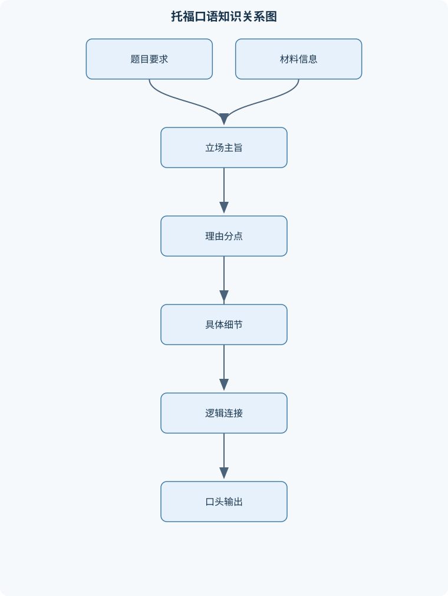
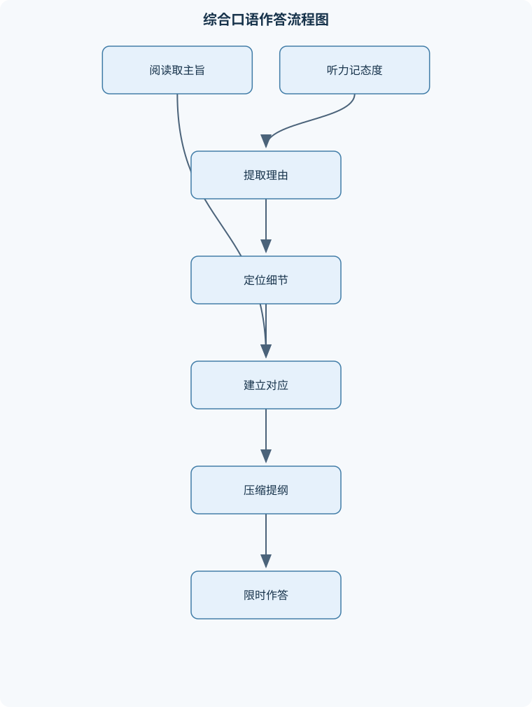

# 托福口语

## 一、课程整体知识框架

### 课程边界与先修知识

本课程围绕托福口语中的学术英语表达、信息整合、观点论证、听读转述、限时组织和语音可懂度展开。核心对象包括独立表达任务、校园情境对话任务、学术概念讲解任务以及听读结合的综合表达任务；具体题型、时间限制、评分方式和作答界面应以实际考试版本的官方说明为准。课程不把历史题库中的具体题目或模板当作考试规律，而将其作为话题范围和训练材料。先修知识包括基础英语语法、常用学术词汇、一般听力理解能力、基本段落结构和能够完成简单英语口头交流的能力。课程重点不是背诵固定答案，而是训练在准备时间有限、信息不完整和需要即时表达的条件下，完成清晰、连贯、相关且具有足够细节的回答。





### 1. 课程对象、目标与先修条件

《托福口语》课程训练的不是脱离语境的英语朗读，也不是对固定答案的机械背诵，而是在准备时间有限、信息不完整、需要即时组织语言的条件下，完成清晰、相关、连贯并具有足够细节的口头表达。课程的核心对象包括四类任务：独立表达任务、校园情境对话任务、学术概念讲解任务，以及听读结合的综合表达任务。实际题型、作答界面、时间限制和评分说明可能随考试版本调整，因此历史材料只能用于训练话题处理和信息组织，不能被当作未来题目或固定规律。

学习本课程通常需要以下先修条件：能够理解一般英语对话和短篇学术听力，掌握基础时态、主谓一致、代词、从句和常用连接词，具备常用生活及学术词汇，并能用英语完成简单的观点表达。若先修能力不足，口语问题可能并非单纯的表达问题。例如，无法识别听力中的转折词，会导致综合回答遗漏反驳关系；不能区分一般过去时和现在时，则可能把教授过去的实验误说成普遍事实。

课程目标可以概括为四个层面。第一是内容层面：准确识别题目要求、材料主旨、分论点、态度和关键细节。第二是组织层面：将信息压缩为可在限定时间内恢复的结构。第三是语言层面：使用准确而自然的句式完成定义、比较、因果、举例和让步。第四是声音层面：通过重音、意群、节奏和适度停顿，使正确内容能够被听者稳定理解。

### 2. 统一分析符号与回答单位

为避免把不同任务混为一谈，本课程使用一套统一符号。$Q$表示题目要求，必须具体说明回答对象、立场或解释目标；$P$表示中心立场或总括性结论；$R_1$和$R_2$表示第一、第二个主要理由；$E$表示支持理由的具体事实、经历、观察或材料细节；$X$表示解释，说明证据为什么支持理由。独立题的基本论证链为：

$$
P\rightarrow R\rightarrow E\rightarrow X
$$

其中箭头表示表达上的逻辑推进，不表示数学上的因果定律。若只有$P$和$R$，回答可能只是态度加概括；若只有$E$而没有$X$，听者不能判断故事与观点的关系。一个有效例证至少应回答“谁、在哪里、做了什么、结果如何、为什么相关”。

综合任务还使用$M$表示听力或讲座的主旨，$D$表示服务于主旨的具体细节，$C$表示需要解释的学术概念，$A$表示说话人的态度，$R$表示阅读信息，$L$表示听力信息，$T$表示连接观点、理由、例证和结论的语言信号，$I$表示一个完整信息单位，$U$表示不能直接回答题目的无关信息，$S$表示作答时间预算。$S$不预设固定数值，必须以对应考试版本的说明为准。

综合题的核心不是复述所有材料，而是建立$R$与$L$之间的映射。例如校园任务中，$R$可能是学校宣布的政策变化，$L$可能是学生对该变化的支持或反对及其理由；学术任务中，$R$可能给出$C$的定义，$L$则通过实验或观察说明该概念。回答时应始终区分材料来源，不能把听力中的推断说成阅读中的事实，也不能用个人常识替代材料没有提供的理由。

### 3. 任务体系的功能差异

#### 3.1 独立表达任务

独立表达要求考生根据个人立场、偏好、经验或一般判断回答问题。其评价重点不是观点是否“客观正确”，而是能否在限定时间内直接回应$Q$，并用相互独立的理由和具体细节支持$P$。例如二选一题不要求证明某一选项在所有情境下都更好，而要求在同一评价维度上比较两个选项，再选择一个更容易展开的立场。

二选一的合理决策过程是：先确定比较维度，再评估两个选项在该维度上的差异，最后选择能提供具体$E$和清楚$X$的一方。比较维度可以是时间成本、决策质量、交流效果、学习效率或风险控制，但必须前后一致。不能先用“效率”比较，随后又无解释地转向“有趣程度”。所谓“容易展开”不是选择更简单的观点，而是选择更能在时间内形成两条不同论证链的观点。

独立题的理由应避免同义重复。例如“节省时间”和“提高效率”若都只说明做事更快，实际上可能属于同一理由。可以将第一点写成减少执行时间，第二点写成降低决策错误，但需要分别补充不同证据。个人经历可作为$E$，但经历必须服务于一般理由；仅仅叙述一个故事而不说明故事如何支持立场，不能构成完整论证。

#### 3.2 校园情境综合表达

校园任务通常包含公告、通知或政策说明，以及学生之间或学生与工作人员之间的对话。阅读材料的重点是变化对象、行动内容和可能目的；听力材料的重点是说话人的$A$及其主要理由。回答必须先说明人物支持还是反对，再按照听力中的理由顺序转述，不能只复述公告。

校园综合回答的基本关系是：

$$
R_{\text{政策或变化}}\rightarrow A_{\text{人物态度}}\rightarrow D_1,D_2
$$

这里的箭头表示材料之间的解释关系，不代表政策必然导致某种态度。若阅读宣布关闭某项设施，听力中的学生反对，回答应说明“关闭什么、学生反对、为什么反对”，并保留听力中的具体影响，例如设备不足、软件需求无法满足或资源分配不公平。材料没有提到的理由不能凭常识补入，即使该理由在现实中听起来合理，也不属于该题的证据。

背景铺垫不等于主要信息。对话开头的寒暄、人物身份和地点只有在影响立场判断时才需要保留；若只是场景设置，可以压缩。相反，转折、因果、态度词和具体后果必须优先记录，因为它们决定了阅读和听力之间的逻辑关系。

#### 3.3 学术概念与例证讲解

学术概念任务要求解释$C$，而不是把讲座中的故事依次复述。有效结构通常为：

$$
C\rightarrow\text{定义或特征}\rightarrow E\rightarrow X
$$

首先说明概念是什么、与相近现象有何边界；其次说明分类、特征、功能或形成机制；然后转述教授给出的实验、观察、个人经历或社会案例；最后明确指出该例子如何体现概念。

“教授举了两个例子”不是解释。若概念包含两个特征，回答必须把例子分别对应到特征上。实验材料还应保留过程和结果，因为“研究者改变了什么、观察到什么、结果说明什么”构成证据链。时间顺序、条件关系和因果关系不能被随意压缩。例如“在某条件下出现某行为”不能简化为“该行为总会出现”，否则会把有限条件下的观察扩大成普遍规律。

抽象概念需要通俗化，但通俗化不能改变定义。可以用较短的句子解释术语，也可以用动词替代过度名词化的表达；然而，不能用一个日常近义词完全取代学术概念的边界。复杂句并不自动代表高水平，若从句过长而导致主语、时态或指代混乱，应拆成两个或多个逻辑明确的句子。

### 4. 评分维度与相互关系

#### 4.1 内容相关性与完整性

内容评价首先关注是否回答$Q$。独立题要有明确$P$、主要理由和展开；校园题要有政策变化、人物态度及听力理由；学术题要有概念定义、讲座分点和例证对应。内容完整不等于信息越多越好，而是保留完成任务所需的最小信息集。

可以把一个信息单位$I$理解为“一个主张及其必要限定、原因或例证”。若只记录若干名词，名词之间没有关系，就不能稳定恢复$I$。相反，删除与题目无关的背景通常不会损害完整性。有限时间下，$U$应优先删除，重复形容词和无关故事细节也应让位于关键因果关系。

#### 4.2 组织与连贯

组织要求听者能够预测回答的方向并识别各信息的关系。常见结构是先给主旨，再按顺序展开第一点和第二点，最后用一句总结收束。$T$可以通过“first of all”“another reason”“for example”“as a result”“however”等词语实现，但连接词本身不能代替逻辑。若两个段落都以“also”开头，却没有说明它们是并列、递进还是因果，形式上有连接词，实质上仍然缺乏连贯。

代词和同义替换必须保持指代清晰。连续使用“it”“they”“this”而没有明确先行词，会增加听者的恢复负担。口语中的连贯还依赖句间重复，例如适度重复关键词比过度追求同义替换更安全。尤其在综合题中，应重复阅读中的政策名称、概念名称或听力中的核心对象，避免因为替换过度而改变含义。

#### 4.3 语言使用

语言准确性包括语法、词汇选择、句式控制和改述能力。常见重要结构包括表达立场的动词和句式、定义句、比较和让步结构、因果和条件结构、举例结构以及时间顺序表达。选择句式时应考虑可控性：短而准确的句子通常优于结构复杂但主谓不一致的长句。

词汇灵活性不等于罕见词汇密度。能够把“有帮助”具体化为“减少复习时寻找信息的时间”，把“很方便”具体化为“学生在缺课后可以重新听取关键部分”，才是真正有效的表达。名词化适合压缩概念，动词化通常更适合口语即时表达；例如“the improvement of communication”可以在适当场合改为“people communicate better”，但不能为了简化而丢失逻辑关系。

#### 4.4 语音、流利度与可懂度

可懂度不是单纯由语速决定。信息重点通常通过句子重音突出，意群边界通过短暂停顿呈现，弱读和连读则帮助自然表达，但不能牺牲词尾辅音、语法词和关键词的清晰度。所有词都同等重读，会使重点消失；持续高速输出则容易造成词尾模糊、意群边界消失和自我修正增加。

流利度也不等于零停顿。准备观点、检索词汇或转换分点时，短暂停顿是即时表达的正常现象；无效填充语过多，或者每个短语后都停顿，则会破坏信息连续性。自我修正应以恢复准确性为目的，若反复重启整句，修正成本可能超过错误本身。实际训练应在语速、清晰度和内容完整之间求平衡，而不是单独追求最快速度。

### 5. 笔记、提纲与时间分配原则

听力笔记的目标不是记录最多单词，而是保留能重建逻辑的最小信息集。首先记录$M$，随后根据“first”“however”“because”“for example”等信号建立层级；分点记录关键词，因果用箭头表示，反驳用相反方向或简短标记表示，专名只保留可识别的首字母或缩写。笔记结束后应重排为“主旨—分点—细节”的结构，并检查每条$D$能否服务于$Q$。

限时提纲通常可压缩为三至六行：第一行写直接回答，随后写主要分点，每个分点保留一至两个细节，最后标记因果、对比或结果。时间不足时，删除次要修饰语、重复背景和不影响判断的形容词，保留$P$、$R$、关键$E$以及必要的$X$。这一取舍原则适用于独立题和综合题，但不意味着可以删除综合题中的材料对应关系。

### 6. 理想模型与现实边界

本课程中的结构是分析工具，不是必须逐字套用的模板。$P\rightarrow R\rightarrow E\rightarrow X$适合独立观点表达，但如果题目只要求简短偏好，完整展开程度应根据实际时间调整；$C\rightarrow$定义或特征$\rightarrow E\rightarrow X$适合概念讲解，但若材料只提供一个核心例证，不应人为编造第二个例子。综合题中要求区分$R$与$L$，并不意味着每个背景细节都要完整复述。

任何训练材料都存在适用边界。历史题目可以用于练习立场、比较和细节扩展，不能用于预测未来内容；固定模板可以帮助初学者建立结构，不能替代对题目动词和材料关系的判断；复杂词汇可以增加表达选择，不能弥补信息遗漏；连接词可以提示关系，不能制造不存在的因果。最终评价必须同时检查内容、组织、语言和语音四类问题。

## 二、章节和模块划分

### 核心知识覆盖清单

本清单用于检查正文是否覆盖本课程的主要知识模块：

- **托福口语任务体系与评分维度**：独立表达与综合表达的功能差异、校园情境与学术讲座语篇、回答任务中的信息选择、表达内容的相关性与完整性、语言使用的准确性与灵活性、语音、语调、重音与可懂度、流利度与停顿控制、考试版本变化与材料适用边界。
- **限时观点表达**：同意或不同意题的立场确定、二选一偏好题的比较框架、个人经历与一般理由的区别、观点、理由、解释和例证、让步与反方观点处理、因果链和结果描述、理由之间的并列与递进、结尾总结与时间收束。
- **独立口语论证结构**：中心立场句的构造、单一理由的充分展开、具体人物、地点、时间和行为、例证与理由的逻辑对应、比较对象的共同维度、抽象评价词的具体化、过渡语和指代的连贯作用、信息不足时的合理补充。
- **校园情境听读综合表达**：公告或通知的主旨识别、提议、改变和实施对象、对话者的态度与立场、反对或支持的两个核心理由、理由中的事实细节、阅读信息与听力信息的对应、人物身份和事件关系、校园政策与个人影响的转述。
- **学术概念与例证转述**：术语定义和概念边界、分类、特征与功能说明、教授例子对概念的证明作用、实验过程与实验结果、个人经历作为说明材料、因果、条件和时间顺序、抽象概念的通俗化表达、避免只罗列例子而不解释例子。
- **听力笔记与信息压缩**：主旨、结构和细节的层级、关键词与完整句子的取舍、说话人态度和语气线索、转折、因果和举例信号、听读材料的冲突定位、数字、专名和术语的记录、笔记符号与缩写系统、从笔记恢复完整语句。
- **学术英语语言资源**：表达立场的动词和句式、解释定义的句型、比较、对比与让步结构、因果和条件连接方式、举例和具体化表达、时间顺序和过程表达、名词化与动词化的选择、口语中准确而自然的改述。
- **语音、流利度与即时组织**：重音对信息重点的标记、意群划分与节奏、连读、弱读和常见音变、词尾辅音与语法词的清晰度、可接受的自我修正、填充语与无效停顿的区别、准备时间内的提纲压缩、语速、清晰度和完整性的平衡。
- **综合回答的逻辑与连贯**：主旨句与任务问题的对应、第一点和第二点的对称组织、阅读观点与听力反驳的关系、证据、解释和结论的衔接、代词和同义替换的指代清晰度、信息遗漏与无关扩展、段内一致性和整体连贯性、有限时间下的取舍原则。
- **模拟作答与诊断性评价**：独立题完整作答记录、综合题听读笔记复盘、内容覆盖检查、语言错误分类、语音可懂度检查、时间线和停顿分析、同一答案的二次改写、基于评分维度的反馈记录。


### 第一章 托福口语任务体系与评分维度

本章建立课程共同坐标。第一节区分独立表达与综合表达：前者依据个人判断形成论证，后者依据阅读和听力材料完成转述。第二节区分校园语篇与学术讲座：校园语篇关注政策、服务、人物态度和个人影响；学术讲座关注概念、机制、分类、实验和例证。第三节说明评分维度之间的关系：内容相关性决定“说什么”，组织决定“怎样让听者跟上”，语言决定“能否准确表达”，语音决定“听者能否稳定接收”。

本章还讨论考试版本变化的边界。训练时应记录题目要求、材料来源和回答目标，而不能把某一时期的题型排列、时间数值或固定界面当成永久规则。所有时间参数统一记为$S$，实际使用时根据对应版本确定。

### 第二章 限时观点表达

本章处理同意或不同意题、二选一偏好题以及带有个人判断的开放问题。核心内容包括立场确定、共同评价维度、理由独立性、让步处理、因果链和结尾收束。

观点组织的基本单位是$P$—$R$—$E$—$X$。例如“录下课堂讲座有助于复习”只是$P$或$R$层面的概括；若补充“学生缺课后可以重新听取教授解释”，这是$E$；若进一步说明“因此学生不必只依赖零散笔记，复习时能恢复讲解顺序”，才形成$X$。抽象词如“有趣”“方便”“有帮助”都必须通过人物、地点、行为和结果具体化。

让步结构用于承认反方的有限合理性，但不能使中心立场消失。完整关系可表示为“承认短期好处—限定适用条件—回到长期立场”。例如可以承认家长即时帮助能减少短期损失，再说明在安全边界内保留孩子自行解决问题的机会，有助于形成判断和责任感。让步内容必须服务于$P$，不能扩展成新的无关论题。

### 第三章 独立口语论证结构

本章重点训练理由展开和例证建构。单一理由必须能够继续回答“为什么”“怎样发生”“结果是什么”。有效例证通常包含人物、地点或场景、具体行为、直接结果和与理由的对应解释。五个要素不要求每次都用完整句逐项说出，但事件链必须一致，不能在扩展过程中更换人物或主题。

比较题应使用共同维度。若选择“向家人朋友寻求帮助”，不能只说该方式“更好”，而应说明它在决策质量、信息来源或时间成本上为何优于独自决定。比较并不要求平均介绍两个选项，而是要求说明所选方案在同一维度上的优势；必要时可简短指出另一方案的限制。

本章还处理信息不足时的合理补充。独立题允许使用一般经验或假设性场景，但补充内容必须保持现实可行、前后一致，并明确属于个人举例，不得伪装成材料事实。综合题则不允许把个人推断补入阅读或听力内容，两类任务的证据边界必须分开。

### 第四章 校园情境听读综合表达

本章围绕公告、通知、服务变化、设施调整、课程安排和校园政策展开。阅读信息$R$通常包含变化对象、实施内容和可能目的；听力信息$L$则提供人物的支持、反对、怀疑或评价，以及至少两个核心理由。回答顺序宜为“政策变化—人物态度—理由一—理由二”，但可根据实际材料调整。

信息整理时要建立人物身份和事件关系。例如学生反对关闭实验室，回答不仅要说“学生不喜欢这个决定”，还要说明该决定如何影响学生的学习活动，以及学生提出了哪些具体困难。若听力分别谈到设备故障、专业软件需求和资源公平，应区分这些理由，不能把三个细节合并成笼统的“使用不方便”。

### 第五章 学术概念与例证转述

本章覆盖定义、分类、特征、功能、机制、实验和自然观察。学术讲座通常先给背景，再介绍一个概念或问题，随后按照两个或多个方面展开，并用例子说明。回答时背景信息若不影响概念关系，可以压缩；定义、分点和例证对应关系必须保留。

解释概念时应先确定边界。例如不能把某种适应现象简单说成“动物为了生存而改变”，而应指出改变的对象、发生条件及其功能。实验转述要保留研究对象、操作、观察结果和解释；个人经历或社会案例要说明它体现了哪个特征。例子只有与概念建立明确对应后，才具有证明或说明作用。

### 第六章 听力笔记与信息压缩

本章训练主旨、结构、细节和态度的分层记录。主旨$M$回答“材料总体讲什么”，分点回答“从哪些方面讲”，细节$D$回答“具体发生了什么”。转折词提示观点变化，因果词提示解释关系，举例信号提示证据进入。数字、专名和术语在影响材料关系时需要记录，但不必逐字抄写完整句子。

笔记系统可以使用统一符号：箭头表示因果或结果，反向标记表示反驳，问号表示不确定信息，首字母表示专名，同一缩写必须在一段材料中保持一致。笔记的关键不变量是逻辑关系，而不是文字数量。只有名词没有动词、态度或关系的笔记，通常无法在作答时恢复完整句子。

### 第七章 学术英语语言资源

本章按功能组织语言，而不是按孤立词表组织。表达立场可以使用“I believe”“I would prefer”“The student disagrees because”等结构；定义可以使用“X refers to…”“This means that…”；比较可以使用“compared with”“whereas”“the main advantage is…”；因果可以使用“because”“therefore”“as a result”；举例可以使用“for example”“a case in point is…”；时间顺序可以使用“first”“then”“eventually”。

语言资源的选择必须服从准确性和可懂度。口语改述不要求每句话都更复杂，而要求在保持意义的同时更自然、更容易即时生成。若名词化结构导致表达迟疑，可以改用动词；若短句之间关系不清，则需要补充因果、转折或时间信号。所有连接词都必须与真实逻辑相符，不能为追求形式而添加不存在的因果。

### 第八章 语音、流利度与即时组织

本章从声音层面处理重音、意群、节奏、连读、弱读、词尾辅音和自我修正。题目关键词、立场词、因果结果和对比信息通常需要更明显的重音；一个意群内部不应在每个词后停顿，而应按意义分组。语速过快会降低清晰度，适度停顿则可以帮助听者识别结构。

即时组织训练包括准备时间内压缩提纲、先说主句再补细节、出现词汇困难时使用可控改述，以及在不改变主旨的情况下拆分长句。可接受的自我修正应短而明确，例如更正一个词后继续推进；重复启动、连续填充或整句重说会消耗$S$并破坏流利度。

### 第九章 综合回答的逻辑与连贯

本章专门处理阅读与听力之间的映射、段内一致性和信息取舍。校园任务要求说明$R$中的政策或变化与$L$中的态度及理由；学术任务要求说明$R$中的$C$与$L$中的定义、机制或例证。表达时要保持材料来源清晰，例如使用“the announcement says…”和“the student argues…”区分两类信息。

有限时间下的优先级是：先覆盖题目要求，再保持材料关系，随后补充关键细节，最后才考虑修饰和高级句式。若无法全部说完，应优先保留主旨、立场、分点和最能证明关系的细节，删除背景重复和无关扩展。信息遗漏与无关扩展是不同问题：前者损害任务完成，后者消耗时间并削弱重点。

### 第十章 模拟作答与诊断性评价

本章建立从录音到改写的复盘流程。第一次听录音只检查是否直接回答$Q$；第二次标记$P$、$R$、$E$、$X$及$R$与$L$的对应关系；第三次检查语法、词汇、发音、重音和停顿。每个问题归入内容、组织、语言或语音类别，再选择最影响理解的两个问题进行二次录音。

诊断不能只记录“表达不够好”，而应写成可验证的描述，例如“第二个理由没有具体行为和结果”“将听力中的反驳说成阅读观点”“所有关键词重音相同”“长句中代词指代不清”。二次改写后应比较信息覆盖、逻辑恢复和可懂度，而不是只比较词汇数量或语速。

### 第十一章 训练材料、项目产出与岗位衔接

课程材料可以来自独立观点题、校园公告与对话、学术定义与讲座片段，但每份材料都应标注其训练目标：立场组织、理由扩展、听力压缩、态度识别、概念解释或语音改写。历史材料适合建立变化多样的练习集，不适合用来推断未来题目。

课程产出包括独立题完整录音、综合题结构化笔记、三至六行限时提纲、错误分类记录和二次改写录音。托福口语教师可据此检查任务完成和表达可懂度；课程研发人员可检查题目是否覆盖不同信息关系；口语测评人员可按内容、组织、语言和语音分别记录问题；学术英语教师可关注定义、机制、例证和因果的准确转述。验收标准应具体到“是否回答$Q$、是否覆盖必要$I$、是否区分$R$与$L$、是否保留关键$D$、是否能被稳定听懂”，而不能只用“流利”“高级”这类笼统评价。

## 三、核心概念的详细解释

### 1. 任务对象与评分所关注的表达能力

托福口语的核心不是把中文观点逐句翻译成英文，也不是背诵一套适用于所有题目的固定答案，而是在有限准备时间和有限作答时间内完成一次可理解的学术英语口头交流。回答必须同时处理四类问题：题目要求什么，哪些信息与题目相关，信息之间是什么关系，以及如何用听者能够稳定理解的英语表达出来。

独立表达任务主要考查个人立场、偏好、判断或经验的组织能力。题目可能要求同意或不同意，也可能要求在两个选项之间选择。此时没有唯一的客观立场，$P$的价值取决于是否直接回答$Q$，以及能否用相互独立的$R_1$和$R_2$展开。一个理由不能只停留在“方便”“有帮助”“更有趣”等抽象评价上，必须通过$E$具体化，再用$X$说明例子与理由的关系。

校园情境综合任务的主要对象是$R$中的校园公告、政策或计划，以及$L$中的人物态度和理由。回答不是评价政策本身是否合理，而是准确转述材料中的变化、人物的支持或反对，以及人物提供的主要依据。材料外的常识可以帮助理解，但不能替代$L$中没有出现的理由。

学术概念综合任务要求解释$C$，并说明教授如何通过例子、实验、观察或个人经历体现这一概念。定义、特征、机制和例子承担不同功能：定义回答“概念是什么”，特征回答“它有什么表现”，机制回答“它为什么或如何发生”，例子回答“材料如何证明或说明它”。只复述实验过程而不说明实验结果如何体现$C$，并不能构成完整解释。

### 2. 信息单位、相关性与完整性

一个信息单位$I$通常包含一个主张及其必要的限定、原因或例证。例如，“关闭实验室会影响学生学习”只是概括性主张；“软件工程课程要求学生在实验室使用专门软件，实验室关闭后学生无法完成课程练习”才包含较完整的原因链。回答中的信息可以分为三层：

- 主旨或中心结论：回答$Q$的核心内容；
- 分点：支撑主旨的理由、特征、反驳或机制；
- 细节：人物、地点、行为、时间、实验条件、结果等。

信息压缩不是任意删词。可以压缩背景铺垫和重复形容词，但不能删除决定逻辑关系的词。转折、因果、条件和举例信号常常比若干普通名词更重要。例如，however说明前后观点相反，because说明原因，as a result说明结果，for example说明后面是具体证据。若笔记只留下“实验室、软件、学生、关闭”，却没有记录“因此学生不能完成作业”，作答时很难恢复完整关系。

$U$表示无关信息。判断信息是否为$U$，不能只看它是否真实，而要看它是否服务于$Q$。校园对话中的天气、人物寒暄和背景介绍，若不影响立场判断，通常可以压缩；阅读公告中的政策对象、改变内容和实施目的，则往往不能删除。独立题中个人经历也不是越多越好，只有能支持$R$并能被解释的经历才属于有效$E$。

### 3. 独立题的论证链

独立回答的基本结构是：

$$
P\rightarrow R\rightarrow E\rightarrow X
$$

$P$是中心立场，$R$是理由，$E$是具体证据，$X$是解释。箭头表示口头表达中的推进关系，而不是数学上的必然因果关系。

例如题目要求判断学生是否应被允许录下课堂讲座。回答可以先明确$P$：“I agree that students should be allowed to record lectures.” 第一个理由$R_1$是复习便利，$E_1$可以是学生在考试前重听教授对复杂公式的解释，$X_1$则说明重听使学生能够补回课堂中没有理解的步骤。第二个理由$R_2$是缺课补偿，$E_2$可以是生病的学生在家听录音，$X_2$说明录音使其仍能掌握课程内容而不必完全依赖同学笔记。

二选一题必须建立共同比较维度。若题目要求选择“独立决策”或“向家人朋友求助”，可以用决策质量或时间成本作为维度。不能先说独立决策更快，随后又无解释地说向他人求助更有趣。选择的标准不是证明所选选项在任何场景都正确，而是判断哪一方更容易形成两条清晰、具体且不重复的论证链。

### 4. 综合题的材料映射

综合回答的核心是建立$R$与$L$之间的映射。校园题通常可以表示为：

$$
R_{\text{policy}}\rightarrow A_{\text{speaker}}\rightarrow R_1,R_2
$$

其中$R_{\text{policy}}$是阅读中的政策变化，$A_{\text{speaker}}$是听力人物的态度，$R_1$和$R_2$是听力中的理由。回答应先说明政策改变了什么，再说明人物支持或反对，最后按材料顺序转述理由。

学术题通常可以表示为：

$$
C\rightarrow \text{特征或机制}\rightarrow E\rightarrow X
$$

其中$E$可能是实验、观察或故事。实验细节只有与概念特征对应时才具有解释功能。例如，不能只说“教授做了一个实验，结果动物改变了行为”；还要说明这种行为改变体现了概念中的哪一项适应机制，以及实验条件与结果之间的关系。

### 5. 听力笔记与即时组织

笔记的目标是保留能够重建逻辑的最小信息集，而不是记录最多单词。建议优先记录$M$、分点、$A$、$T$和关键$D$。专有名词可记录首字母，重复出现的术语可使用固定缩写；但表示因果、反驳和结果的箭头或符号不能省略。

一种可操作的笔记结构为：

```text
M: topic
1) point / cause → result
   ex: person + action + outcome
2) point / contrast
   condition → behavior → result
A: support / oppose / doubt
R↔L: support / refute / supplement
```

这段伪代码不是可执行程序，而是听力笔记的层级规则。输入是连续听力，输出是可恢复的提纲；不变量是每条细节都能归属于某个分点，并保留与其他信息的逻辑关系。若材料结束后笔记只有若干名词，说明记录对象错误：记录了词语，却没有记录主张、关系和结果。

### 6. 语言、语音与可懂度

表达立场可用“I agree that…”, “I would prefer…”, “In my view…”；定义可用“X refers to…”, “This concept describes…”；因果可用“because”, “therefore”, “as a result”；让步可用“Although…”, “It is true that…, but…”；举例可用“For example…”, “A good example is…”。这些句式的功能是给听者提供结构线索，而不是形成必须逐字套用的模板。

复杂句不必然优于短句。若一个长句包含多个从句，导致主语、时态或代词关系不清，应拆成两个或三个短句。口语中的语言复杂度应服从信息准确性。相比“Because students who are absent due to various unexpected personal reasons may possibly need…”这类层层嵌套的句子，“Some students miss class because they are sick. A recording allows them to review the lecture later.”通常更容易被听懂。

语音可懂度依赖重音、意群、节奏和词尾清晰度。题目关键词、立场词、转折词和结果词应获得相对突出。停顿最好出现在意群边界，而不是句子中间随机切断。适度自我修正可以提高准确性，例如“the policy affects—actually, it mainly affects first-year students”，但连续修正、重复开头和大量“uh”“you know”会消耗有效时间。语速与质量不存在简单正相关：过快会造成词尾吞音、重音平均和逻辑边界模糊。

### 7. 代表性作答流程

#### 7.1 独立观点题流程

输入为$Q$、准备时间和可用语言资源，输出为一段包含$P$、$R_1$、$R_2$及必要$E$和$X$的回答。

1. 圈定题目动词：选择、同意、偏好、解释或评价。
2. 在数秒内确定$P$，避免在作答中途改变立场。
3. 选择两个不重复的$R$。
4. 每个理由补充人物、场景、行为和结果中的至少两项。
5. 用因果或解释句连接$E$与$R$。
6. 时间不足时删除背景和修饰语，保留$P$、$R$、$E$。
7. 用一句简短结论收束，不新增未展开的理由。

#### 7.2 校园综合题流程

输入为阅读公告$R$、校园对话$L$和问题$Q$，输出为政策变化、人物态度及两个听力理由。

1. 提取政策对象、具体改变和实施目的。
2. 判断人物是支持、反对、怀疑还是部分同意。
3. 记录两个理由及其关键细节。
4. 检查每个理由是否确实来自$L$。
5. 按“政策—态度—理由一—理由二”表达。
6. 删除不影响态度和理由的背景。

关键不变量是：每个主要理由必须来自听力，并且必须与阅读中的具体变化相关。

#### 7.3 学术概念题流程

输入为介绍$C$的阅读材料和教授讲解$L$，输出为概念解释及例证对应关系。

1. 记录$C$的名称和定义。
2. 标记分类、特征、条件或机制。
3. 记录教授的例子、实验过程和结果。
4. 判断每个例子体现了哪一项特征。
5. 按“定义—特征—例子—对应解释”表达。
6. 检查是否把教授的例子误说成概念定义。

### 8. 五个代表性例题

#### 例题一：同意或不同意题

**题干**：学生是否应被允许录下课堂讲座？

**分析**：应先选择立场，再构造两个不同理由。复习便利和缺课补偿具有不同功能。

**逐步解答**：

- $P$：同意允许录音。
- $R_1$：便于复习复杂内容。
- $E_1$：学生在考试前重听教授对难点的解释。
- $X_1$：重听能补回课堂中遗漏的推理步骤。
- $R_2$：帮助因病缺课的学生。
- $E_2$：学生在家听录音并完成课堂笔记。
- $X_2$：录音减少因一次缺课造成的长期学习损失。

**结果验证**：回答直接回应“是否允许”，两个理由不重复，每个理由都有事件和解释。  
**变式**：若题目改为“学校是否应禁止录音”，可保留相反立场，但必须重新组织证据，不能把“录音有帮助”直接当作反对禁止的完整论证而不说明原因。

#### 例题二：二选一偏好题

**题干**：你更愿意独自作决定，还是向家人朋友寻求帮助？

**分析**：先确定共同维度。以下选择“决策质量”作为维度，避免把两个选项分别用不同标准评价。

**逐步解答**：

- $P$：更愿意向家人朋友寻求帮助。
- $R_1$：他人能提供不同视角。
- $E_1$：选择课程时，朋友提醒某门课作业量较大。
- $X_1$：额外信息可以减少只依据个人印象作出的错误判断。
- $R_2$：讨论能发现隐藏风险。
- $E_2$：计划搬家时，家人指出通勤时间和生活成本问题。
- $X_2$：这些信息使决定更全面。

**结果验证**：两个理由都服务于“决策质量”，并且分别有具体场景。  
**变式**：若选择独自决策，应使用时间成本或个人责任等维度，并说明为什么该维度比寻求帮助更有优势，不能只说“我比较独立”。

#### 例题三：校园政策综合题

**题干**：学校宣布关闭计算机实验室，听力中的学生对此有何看法？说明理由。

**分析**：先提取阅读中的变化，再转述听力中的态度和理由。不能补充材料外的“节省经费”等理由。

**逐步解答**：

- 阅读信息：计算机实验室将关闭。
- 人物态度：学生反对。
- 理由一：部分课程要求使用实验室中的专门软件。
- 细节：学生没有个人设备或个人设备无法运行该软件。
- 理由二：关闭会造成资源不公平。
- 细节：经济条件较差的学生将比其他学生更难完成练习。

**结果验证**：政策、态度和两个理由均已覆盖，理由均与关闭实验室直接相关。  
**变式**：若听力改为支持关闭，不能沿用“设备不足”的反对逻辑，应依据新的态度和理由重新映射。

#### 例题四：学术概念与例证

**题干**：使用讲座中的例子解释一种动物适应现象。

**分析**：回答必须先解释概念，再说明例子体现哪项特征。

**逐步解答**：

- $C$：某种适应现象指生物通过特定行为或身体特征提高在环境中的生存机会。
- 特征一：行为能减少环境带来的风险。
- 例子：讲座中的动物在温度下降前改变活动时间。
- 对应关系：活动时间的改变减少了暴露在低温中的时间，因此体现风险规避。
- 特征二：行为能提高获得资源的机会。
- 例子：另一种动物在食物丰富的季节储存食物。
- 对应关系：储存行为使其在食物短缺时仍能获得能量，因此体现资源利用。

**结果验证**：两个例子均包含行为、结果和概念对应，而非只罗列故事。  
**变式**：若教授只给一个例子，应深入解释该例子，不得虚构第二个例子。

#### 例题五：让步与反方处理

**题干**：孩子犯错后，家长应立即帮助，还是让孩子自己解决？

**分析**：可以先承认即时帮助在安全或重大损失情境下的价值，再表明在可控范围内保留自主解决机会。

**逐步解答**：

- $P$：在安全允许的范围内，应让孩子尝试自己解决。
- 让步：家长立即帮助可以减少短期损失。
- $R_1$：自主处理能培养判断能力。
- $E_1$：孩子自己检查作业错误并寻找规则。
- $X_1$：反复检查使其学会定位问题，而不是只等待答案。
- $R_2$：自主处理能增强责任感。
- $E_2$：孩子忘记物品后自己规划第二天的准备步骤。
- $X_2$：承担后果并制定方案，使其理解行为与结果的关系。

**结果验证**：让步没有削弱主立场，且明确了“安全允许”的边界。  
**变式**：若题目强调“危险错误”，应降低自主尝试的范围，先说明安全条件，再讨论教育价值。

## 四、重要定义、公式、定理和推导

### 专业审校补充：关键定义与适用边界

托福口语综合任务中，必须区分“材料事实”“合理改述”和“个人推断”三类信息。材料事实是阅读或听力明确表达的内容，回答时应保留其来源和逻辑关系；合理改述是在不改变命题方向、因果关系、态度强度和条件范围的前提下，用更简单或不同的英语表达同一信息；个人推断则是材料未明确说明、但回答者根据常识推导出的内容。综合回答应以材料事实和合理改述为主，不能把个人推断说成教授、学生或公告的原话。例如，听力说“学生没有足够时间完成作业”，可以改述为“the assignment would take too much time”，但不能擅自改成“the student will fail the course”。判断是否越界，可检查四项：信息主体是否相同，因果方向是否相同，程度是否被夸大，条件是否被删除。若改述后新增了结果、动机或评价，就可能从忠实转述变成无依据推断。该边界尤其适用于校园对话和学术讲座题；独立题则允许使用个人经历，但仍应保证例子服务于自己的理由。


### 1. 关键定义

**立场$P$**：对题目$Q$作出的直接回答。$P$必须包含明确方向，例如同意、反对、偏好某一选项或说明某概念。

**理由$R$**：解释为什么接受$P$。$R_1$和$R_2$应具有不同的论证功能，而不是同义改写。

**证据$E$**：支持理由的可感知信息，包括人物、地点、时间、行为、实验条件、结果或材料中的具体细节。

**解释$X$**：说明证据如何支持理由。$X$不是重复$E$，而是揭示事件与观点之间的关系。

**主旨$M$**：听力或讲座的总体讨论对象及核心方向。背景介绍可能属于$M$的一部分，也可能只是铺垫，需根据$Q$判断其相关性。

**态度$A$**：说话人对政策、观点或现象的支持、反对、怀疑、保留或评价。态度不能只依据某个孤立形容词判断，还要结合语气、转折和后续理由。

**信息单位$I$**：能够独立服务于回答的最小逻辑单元，通常由主张和必要限定、原因或例证组成。

### 2. 结构公式及其推导

独立回答可表示为：

$$
\text{Answer}=P+\sum_{i=1}^{n}(R_i+E_i+X_i)
$$

其中，$n$表示展开的主要理由数量；$R_i$是第$i$个理由；$E_i$是其证据；$X_i$是解释。这个式子不是要求机械地使用固定数量，而是说明完整回答的构成关系。

推导过程如下：

1. 题目首先要求一个回答方向，因此必须有$P$。
2. 单独的$P$无法说明依据，因此需要至少一个$R_i$。
3. 抽象理由不易验证，需加入具体$E_i$。
4. 事实与理由之间并非自动成立，因此必须加入$X_i$。
5. 若存在两个相互独立的分点，则形成$R_1$和$R_2$的并列结构。

边界情况是：如果题目只要求解释一个概念，不能强行套用两个个人理由；如果综合题只要求转述一个态度，也不能为了形式完整而加入材料没有提供的第二个理由。公式描述信息功能，不规定所有题目的固定答案长度。

综合题的材料映射可以表示为：

$$
R\overset{\text{关系判断}}{\longrightarrow}L
$$

关系判断的结果可能是支持、反驳或补充。若为反驳，回答结构应为：

$$
R_{\text{claim}}\rightarrow L_{\text{attitude}}\rightarrow L_{\text{reason}}\rightarrow L_{\text{detail}}
$$

若为支持，则应说明听力如何为阅读观点提供例证或进一步依据。若为补充，则要明确听力增加了什么信息，不能误说成反驳。

### 3. 时间预算与取舍原则

$S$表示实际可用的作答时间，单位为秒，但具体数值必须依据对应考试版本。若将回答划分为中心立场、分点和细节，时间可抽象表示为：

$$
S=S_P+S_R+S_E+S_X+S_T
$$

其中$S_P$用于表达立场，$S_R$用于理由，$S_E$用于具体细节，$S_X$用于解释，$S_T$用于过渡和收束。该式的用途是帮助取舍，不表示考试评分按秒计算。

推导出的优先顺序是：首先保留$P$，其次保留与$Q$直接相关的$R$，再次保留能使理由具体化的$E$，最后删减重复修饰语。若只有$P$和大量背景，回答仍然不完整；若有许多$E$却没有$X$，听者不能判断材料意义。时间不足时，应删除次要形容词和重复背景，而不是删除立场或关键因果。

### 4. 有效细节的判定条件

一个有效细节至少满足三个条件：

1. **相关**：能直接回答$Q$或支持$R$；
2. **具体**：包含人物、场景、行为、条件或结果中的若干要素；
3. **可解释**：能够通过$X$说明其与主张的关系。

“参加团队活动很有帮助”不构成有效细节，因为没有人物、行为和结果。“某学生在篮球训练中负责传球，队员通过反复配合完成比赛中的战术，因而学会根据队友位置调整自己的行动”则具备具体事件和解释关系。

### 5. 诊断性评价的分类规则

录音复盘应把问题分为四类：

- **内容问题**：漏掉立场、理由、概念定义或关键细节；
- **组织问题**：信息顺序混乱、阅读与听力混淆、例子与理由错配；
- **语言问题**：时态、主谓一致、代词、连接词或词义使用错误；
- **语音问题**：重音不当、词尾不清、意群切分混乱、停顿过多。

排错不能一次只改所有问题。第一遍检查是否回答$Q$；第二遍检查$P$、$R$、$E$、$X$及$R$与$L$的对应；第三遍检查语法、词汇、发音和停顿。优先修复影响理解最大的两个问题，再进行二次录音。这样可以区分“内容已经缺失”和“内容完整但没有被听清”两种不同情况。

### 6. 练习项目与验收标准

#### 项目一：独立回答录音诊断

**输入数据**：三道不同类型的独立题、每道题的题干、个人提纲和完整录音。

**步骤**：

1. 在文字稿中标出$P$、$R_1$、$R_2$、$E$和$X$。
2. 用不同符号标记重复理由、无关内容和没有解释的例子。
3. 记录每次长停顿、重复开头和自我修正的位置。
4. 将问题归入内容、组织、语言或语音类别。
5. 删除一项无关信息并补写一项缺失解释。
6. 重新录音并比较两次回答。

**评价标准**：是否直接回答$Q$；两个理由是否独立；每个理由是否至少有一个具体$E$；例子后是否有$X$；听者是否能识别立场和分点；语音是否允许稳定理解。

**排错方法**：若内容不足，先补充人物—行为—结果链；若组织混乱，重新排列为$P\rightarrow R_1\rightarrow E_1\rightarrow X_1\rightarrow R_2\rightarrow E_2\rightarrow X_2$；若语速过快，保留关键词重音并在意群边界停顿，而不是单纯要求自己放慢全部句子。

#### 项目二：综合听读笔记复盘

**输入数据**：一则校园公告或概念定义、一段对应听力、一次限时笔记和一次口头回答。

**步骤**：

1. 单独列出阅读中的主张、对象和改变内容。
2. 单独列出听力中的态度、理由和细节。
3. 用箭头标出支持、反驳或补充关系。
4. 检查每一条口头信息的来源是$R$还是$L$。
5. 删除不影响$Q$的背景信息。
6. 按材料逻辑重新作答。

**评价标准**：$R$与$L$是否区分；态度是否准确；两个核心理由是否来自听力；例子或实验是否与对应概念特征匹配；是否保留因果、转折和结果关系。

**排错方法**：若把阅读观点说成听力意见，在笔记中为两类材料使用不同缩进或符号；若只记名词，补写“谁做了什么—产生什么结果”；若只复述背景，重新检查$Q$中的动词，确保回答解释、说明、比较或转述的具体目标。

### 7. 常见笔试问题及解答思路

1. **为什么$P\rightarrow R\rightarrow E\rightarrow X$比只列理由更完整？**  
   因为$P$回答方向，$R$提供依据，$E$使依据具体，$X$说明证据与依据的关系；缺少任一环节都可能造成回答不完整。

2. **二选一题能否只说明所选选项的优点？**  
   可以，但必须在同一比较维度上说明其优势，不能只给个人偏好而不解释为何选择该项。

3. **综合题为什么不能用常识补充材料？**  
   因为任务要求转述$R$和$L$的关系。常识可能改变人物理由或概念边界，使材料来源混淆。

4. **背景信息何时可以删除？**  
   当它不影响态度、政策对象、概念定义、分点或因果关系时可以压缩；若背景决定人物为何反对或实验为何成立，则不能删除。

5. **例子和证据有什么区别？**  
   例子是证据的一种形式；只有说明例子体现了哪项特征或支持哪条理由时，才完成了证据功能。

6. **为什么复杂句不一定提高语言质量？**  
   复杂句若造成主语、时态或指代不清，会降低可懂度。有效复杂度应服务于准确表达，而非增加从句数量。

7. **如何判断两个理由是否重复？**  
   删除理由中的形容词后，若两个理由都只剩同一因果结果，通常是重复；若一个说明时间成本，另一个说明决策质量，则功能不同。

8. **综合题笔记最少应保留什么？**  
   至少保留$M$、主要分点、$A$、材料关系、关键$D$以及转折和因果信号。逐词记录不是必要条件。

### 8. 面试问题、参考答案与追问要点

#### 问题一：如何帮助学生从抽象理由扩展到具体细节？

参考答案：要求学生依次回答“谁、在哪里、做了什么、结果是什么、为什么支持理由”，并把结果和理由用因果句连接。  
追问要点：学生若只会堆形容词，应先提供事件链，而不是继续增加高级词汇。

#### 问题二：如何区分独立题和综合题的训练目标？

参考答案：独立题重点是形成$P$和个人论证链；综合题重点是准确建立$R$与$L$的映射，不能把个人观点替代材料转述。  
追问要点：评价综合题时应优先检查材料关系和信息来源。

#### 问题三：学生听力笔记写得很多但回答仍不完整，原因可能是什么？

参考答案：可能记录了名词和完整句子，却遗漏了主旨、态度、转折和因果关系。应改为层级笔记，保留可重建逻辑的最小信息集。  
追问要点：检查笔记能否恢复“主张—理由—结果”，而不只检查词数。

#### 问题四：如何处理学生过度依赖模板？

参考答案：保留模板的功能词，如定义、举例和因果连接，但要求根据题目替换真正的信息结构。模板不能代替$P$、$R$、$E$和$X$。  
追问要点：若模板句与材料不匹配，应删去套话，优先表达准确内容。

#### 问题五：如何诊断语速过快问题？

参考答案：观察重音、词尾、意群边界和听者是否需要反复确认。若语速提高导致关键词模糊，应降低速度并增加结构性停顿。  
追问要点：不能把所有停顿都视为错误，短暂的意群停顿有助于理解。

#### 问题六：如何评价一次综合回答是否覆盖充分？

参考答案：逐项核对$Q$、$M$、$A$、主要分点和关键$D$，并检查每个分点是否保留材料来源及逻辑关系。  
追问要点：覆盖充分不等于复述全部材料，$U$应被压缩。

#### 问题七：学生语法错误较多时，应先纠正什么？

参考答案：先修复影响理解的主谓关系、时态、代词和连接词，再处理不影响核心意义的细小错误。  
追问要点：如果内容结构仍缺失，单独增加语法练习不能解决回答不完整。

#### 问题八：如何设计一次有效的二次改写？

参考答案：第一次录音后只选择两个最大问题，例如遗漏理由和停顿混乱；第二次只针对这两个问题改写，再比较信息覆盖和可懂度。  
追问要点：改写必须能说明“改了什么、为什么改、改后解决了哪一类问题”。

### 9. 岗位关联与产出验收

托福口语教师的实际任务是设计独立题和综合题训练、分析录音并提供分层反馈。使用的知识包括$P$—$R$—$E$—$X$论证链、$R$与$L$映射、语音可懂度和错误分类。产出应包括学生提纲、录音批注和二次改写；验收标准是反馈能指出具体信息缺口、语言问题或语音问题，而不是只写“表达不够流利”。

英语考试课程研发人员需要编排覆盖独立观点、校园政策、学术概念和听力转述的材料。应使用信息层级、材料关系和限时组织原则。产出包括题目、听读材料、评分任务和诊断表；验收时检查题目要求是否明确、听力理由是否可定位、概念例子是否与定义对应。

口语测评员需要区分内容、组织、语言和语音问题。产出是结构化评价记录，验收标准是每项判断都有录音中的可观察依据，例如遗漏态度、混淆阅读与听力、例子无解释或关键词不可懂，不能把主观印象直接当作结论。

学术英语教师和语言课程编辑需要训练定义、分类、因果、实验过程与结果转述。产出包括概念讲解提纲、改写练习和错误样例；验收标准是学生能够先说明$C$，再用材料中的$D$解释其特征，并明确例证与概念之间的对应关系。

## 五、算法、流程和实现思路

### 方法与流程覆盖索引

下列方法或流程应在正文中说明输入、步骤、适用条件、结果检查和边界：

- 独立观点题作答流程：输入为题目Q和可用准备时间，输出为一段有明确立场和两个展开点的口头回答。步骤为：识别题型；在数秒内确定P；列出R1和R2；为每个理由补充一个具体E；用一句X说明E与R的关系；按P→R1→E1→X1→R2→E2→X2→结尾组织；检查是否直接回答Q；时间不足时删除次要修饰语而保留P、R和E。终止条件是完成全部必要信息或达到作答时间上限。适用条件是题目要求个人观点、偏好或同意与否；不适用于必须依据听读材料作答的综合题。
- 校园情境综合题流程：输入为阅读公告R、校园对话L和问题Q，输出为说明人物立场及两个理由的回答。步骤为：从R提取变化对象、行动内容和目的；从L判断人物支持或反对；分别记录理由一和理由二及其细节；建立R主张与L态度的对应；先回答立场，再按理由顺序转述；删除不影响立场判断的背景信息。关键不变量是每个理由都必须来自听力，并且与阅读中的具体变化相关。终止条件是立场和两个主要理由均已覆盖。适用条件是校园政策、服务、课程或设施变动类任务。
- 学术概念综合题流程：输入为定义性阅读材料R、教授讲解L和问题Q，输出为概念解释及材料中的例证。步骤为：提取C的名称和定义；标记教授给出的分类、特征或机制；记录两个例子中的人物、实验、情境和结果；判断每个例子对应C的哪一项特征；用定义句开头，再按特征—例子—对应关系表达。关键不变量是每个例子都要解释其证明作用，而不是只复述故事。终止条件是概念定义和题目要求的例证均已说明。适用条件是阅读介绍术语、现象或理论，听力用实例解释的任务。
- 听力笔记压缩流程：输入为连续听力材料，输出为可在作答时恢复的结构化笔记。步骤为：先记录主题M；遇到first、however、because、for example等信号时建立结构标记；为每个分点记录关键词D；用箭头记录因果、反驳和结果；专名只记首字母或可辨识缩写；听完后按M—分点—细节重排；检查每条细节能否回答Q。关键不变量是保留逻辑关系而非逐词抄录。终止条件是材料结束并形成可复述的层级结构。适用条件是听力信息密度较高且需要即时转述的任务。
- 限时提纲生成流程：输入为题目、零散笔记和可用时间S，输出为三至六行的口头提纲。步骤为：第一行写直接回答；第二、三行写主要分点；每个分点后只保留一至两个关键词细节；用箭头标出因果或对比；按重要性删除重复信息；最后检查提纲是否覆盖题目动词。终止条件是提纲可在一次扫视中恢复完整逻辑，或准备时间结束。适用条件是任何需要从阅读、听力或个人思考转为口头表达的任务。
- 录音诊断流程：输入为一次完整录音、题目和评分维度，输出为可执行的错误分类记录。步骤为：第一次只检查是否回答题目；第二次标记P、R、E、X和材料对应关系；第三次标记语法、词汇、发音和停顿；把每个问题归入内容、组织、语言或语音类别；选出影响理解最大的两个问题；重新录音并比较信息覆盖和可懂度。终止条件是完成一次改写并能说明改动原因。适用条件是自我复盘、同伴评价和教师形成性评价，不用于替代正式考试评分。
- 观点细节扩展流程：输入为一个抽象理由，例如提高效率、增进交流或减轻压力，输出为可口头表达的具体例证。步骤为：确定人物；补充地点或场景；说明发生的具体行为；描述直接结果；再解释该结果如何支持理由。关键不变量是五个要素之间保持同一事件链，不得在扩展过程中更换主题。终止条件是听者能够回答谁、在哪里、做了什么、结果如何以及为什么相关。适用条件是独立题中需要把一般理由具体化的情况。
- 综合材料冲突分析流程：输入为阅读主张R和听力内容L，输出为支持、反驳或修正关系的结构化说明。步骤为：写出R的主张；寻找L中的态度标记和逻辑转折；判断L是支持、反驳还是补充；为每个关系记录依据和细节；用同一顺序表达R与L；检查是否把听力细节误说成阅读内容。关键不变量是材料来源始终可区分。终止条件是题目要求的全部关系均已说明。适用条件是阅读与听力存在明确逻辑联系的综合题。





### 1. 独立观点题的限时组织流程

独立表达任务的输入是题目$Q$、有限准备时间$S$以及考生能够调用的个人经验或一般理由，输出是一段直接回答题目、包含明确立场和充分展开的口头回答。该流程适用于同意或不同意题、二选一偏好题、个人经验题和一般判断题，不适用于必须依据阅读与听力材料作答的综合题。

#### 1.1 识别题目要求

首先识别$Q$中的核心动词和回答对象。题目要求“同意或不同意”时，输出必须包含明确的$P$；题目要求“选择哪一个”时，必须说明选择对象，并在共同评价维度上比较；题目要求“根据个人经验”时，例证应来自个人经历或合理的个人场景，而不能只给抽象判断。

随后确定答案的最小结构：

$$
Q\rightarrow P\rightarrow R_1,R_2\rightarrow E_1,E_2\rightarrow X_1,X_2
$$

其中$P$是立场，$R_1$和$R_2$是两个主要理由，$E_1$和$E_2$是具体事实或场景，$X_1$和$X_2$解释例证如何支持理由。这个结构不是要求每个句子都机械对应一个符号，而是保证回答具有“结论—依据—具体化—解释”的逻辑链。

#### 1.2 确定立场与理由

立场选择不以观点是否绝对正确为标准，而以能否在$S$内形成清晰、相互独立并且有细节的论证为标准。二选一题应先确定共同维度，例如时间成本、决策质量、学习效果、交流效率或风险控制，再比较两个选项。若选择“向朋友寻求帮助”，应始终围绕决策质量或信息范围展开，不要在第二个理由中突然改用“更有趣”。

两个理由需要满足以下条件：

1. 均能直接支持$P$；
2. 彼此不是同义重复；
3. 均可补充具体$E$；
4. 不依赖题目之外的复杂背景；
5. 在时间不足时，至少保留理由核心和一个可解释细节。

“方便”“有帮助”“更好”本身通常只是评价标签，不是充分理由。应继续追问“方便在哪里”“帮助产生了什么结果”“好体现在哪个可观察维度”。

#### 1.3 将抽象理由扩展为事件链

一个有效的独立题例证可按以下顺序生成：

$$
\text{人物}\rightarrow\text{场景}\rightarrow\text{行为}\rightarrow\text{结果}\rightarrow\text{关联解释}
$$

人物可以是本人、同学、家人或合理设定的学生；场景应说明课程、家庭、社团或工作等环境；行为说明具体做了什么；结果说明发生了什么变化；关联解释则回答“为什么这个结果证明了该理由”。

例如理由为“团队运动培养合作能力”。仅说“团队运动很有帮助”信息不足。可以扩展为：一个学生在排球训练中负责接发球，队友负责拦网和进攻；训练中他们必须根据对方站位即时调整分工；经过几周练习，队员能够更快沟通并共同完成战术。最后说明，反复分工、沟通和共同承担结果，具体体现了合作能力的形成。

#### 1.4 形成口头提纲并作答

限时提纲不应是完整稿件，而应是能够恢复逻辑的最小信息集。推荐采用三至六行结构：

- 第一行：直接回答$Q$的$P$；
- 第二行：$R_1$及其核心关键词；
- 第三行：$E_1$的“人物—行为—结果”；
- 第四行：$R_2$及其核心关键词；
- 第五行：$E_2$的事件链；
- 第六行：结尾总结或立场重申。

时间不足时，先删去背景形容词、重复结论和不影响逻辑的修饰语，再压缩第二个例子的次要细节。不能先删除$P$、主要理由或例证与理由之间的解释，因为这些内容决定回答是否真正完成任务。

```text
语言：伪代码

输入：题目 Q，准备时间 S，可用经验集合 G
输出：口头回答 A

1. 识别 Q 的题型和回答动词
2. 生成一个明确立场 P
3. 从 G 中筛选两个可独立展开的理由 R1、R2
4. 对每个 Ri：
      4.1 选择人物和场景
      4.2 写出具体行为
      4.3 写出直接结果
      4.4 用一句 X 说明结果为何支持 Ri
5. 按 P → R1 → E1 → X1 → R2 → E2 → X2 排列
6. 删除 U：无关背景、重复形容词和不能支持 P 的内容
7. 检查：
      是否直接回答 Q
      R1 与 R2 是否重复
      每个 E 是否包含行为和结果
      每个 X 是否说明逻辑关系
8. 若时间达到 S：
      保留 P、R1、R2 和各自最关键的 E
      终止并输出 A
```

该流程的不变量是：无论删减多少修饰语，$P$与$Q$的对应关系、两个主要理由以及至少一个有效细节不能消失。终止条件是提纲能够在一次扫视中恢复完整论证，或准备时间$S$结束。

### 2. 校园情境综合题流程

校园情境综合题的输入是阅读材料$R$、听力对话$L$和题目$Q$，输出是说明校园变化、人物态度$A$及其主要理由的回答。其核心不是评价政策，而是建立“阅读主张—听力反应”的对应关系。

#### 2.1 阅读材料的压缩

阅读公告或通知通常需要提取三个要素：

- 变化对象：实验室、课程、宿舍、图书馆、服务或活动；
- 行动内容：关闭、搬迁、收费、开放、取消、调整或新增；
- 政策目的：节省资源、改善设施、提高效率或满足管理需要。

背景介绍如果不影响人物态度和理由，可以压缩为$U$。但变化对象和行动内容不能删除，因为听力中的理由必须与具体变化相对应。

#### 2.2 听力态度与理由定位

听力中应优先记录$A$，再记录两个主要理由及其细节。态度可能是支持、反对、怀疑、部分接受或提出替代方案。判断态度不能只依靠一个形容词，还要结合转折、语气和后续事实。例如说话人先说“这个计划听起来不错”，随后说明它会增加学生成本，整体态度可能是反对或保留，而不是支持。

每个理由最好记录为：

$$
\text{理由}\rightarrow\text{事实细节}\rightarrow\text{影响}
$$

例如，学生反对关闭计算机实验室，理由一是课程软件只能在实验室使用，结果是学生无法完成作业；理由二是替代设备数量不足，结果是学生需要长时间排队。回答时应说明这两个理由都针对阅读中的“关闭实验室”这一变化。

#### 2.3 组织回答

校园题推荐结构为：

1. 先概括阅读中的政策变化；
2. 明确人物支持或反对；
3. 按听力原有顺序说明理由一；
4. 说明理由一的事实和影响；
5. 说明理由二及其事实和影响；
6. 用一句话收束人物态度。

关键不变量是：每个主要理由必须来自$L$，并且必须与$R$中的具体变化相关。不能把阅读材料的政策目的误说成学生的理由，也不能用常识补充听力没有提供的内容。

### 3. 学术概念与例证转述流程

学术概念题的输入是定义性阅读$R$、教授讲解$L$和题目$Q$，输出是对概念$C$的定义、特征或机制的说明，以及教授使用的例证。适用对象包括生物适应、社会行为、心理机制、经济现象、实验过程和分类系统。

#### 3.1 先建立概念边界

回答开头应说明$C$是什么，必要时补充它与相近现象的区别。概念定义不等于例子。若阅读说明某种适应是“有助于生物在特定环境中生存或繁殖的特征”，教授随后讲述某种动物改变活动时间，回答不能把“改变活动时间”直接当作定义，而应说明它是体现该概念的一个特征或实例。

#### 3.2 从讲座中提取机制和例子

讲座常按“主题—特征一—例子一—特征二—例子二”展开。应记录：

- 讲座总主题$M$；
- 每个分点的定义或机制；
- 例子中的对象、条件、行为和结果；
- 例子与概念特征之间的对应关系。

例证的作用可表示为：

$$
C\rightarrow \text{特征或机制}\rightarrow \text{具体例子}\rightarrow \text{结果}\rightarrow \text{对应说明}
$$

若教授讲解一种社会行为的两种形成机制，回答应分别说明机制一的触发条件、行为表现和结果，再说明例子为何体现机制一；机制二也应独立完成，不能把两个例子的细节混合。

### 4. 听力笔记压缩与恢复流程

听力笔记的目标不是记录最多单词，而是形成能够恢复$M$、分点、$A$、$D$和逻辑关系的结构。推荐使用固定但可调整的符号系统：

- `M`：主旨；
- `+`：支持或增加；
- `-`：反对或减少；
- `→`：因果或结果；
- `vs`：比较；
- `ex`：例子；
- `?`：不确定信息；
- `R/L`：阅读与听力来源区分。

遇到however、but、because、therefore、for example、another等信号时，应立即建立结构标记。专有名词只需记录首字母或可辨识缩写，数字和关键术语要保留，因为它们可能决定实验条件、人物关系或结果差异。

听完后应进行一次重排：先写$M$，再写分点，最后写每个分点的$D$。如果一条笔记只有“实验室、软件、学生、关闭”，它不足以直接支持回答；至少还需要记录“软件只能在那里使用”以及“学生无法完成作业”等关系信息。

### 5. 综合材料冲突分析流程

当阅读与听力存在支持、反驳或修正关系时，应先单独写出$R$的主张，再判断$L$的关系类型：

- 支持：听力提供事实证明阅读主张成立；
- 反驳：听力指出阅读主张的问题或相反结果；
- 补充：听力接受核心主张，但增加条件、限制或新例子；
- 修正：听力认为阅读主张过于绝对，需要缩小适用范围。

回答必须保持材料来源可区分。例如，“阅读认为关闭设施能节省资金，但学生指出软件只能在该设施使用，因此关闭会影响课程作业。”这句话同时标明了$R$和$L$，并用“但”表示反驳关系。若直接说“关闭设施不能节省资金”，就可能把听力没有说出的结论擅自补入。

### 6. 录音诊断与二次改写流程

录音诊断输入为一次完整录音、题目$Q$和评价维度，输出为内容、组织、语言和语音四类错误记录。建议分三遍检查：

第一遍只检查任务完成：是否回答$Q$，是否明确$P$或$C$，是否说明必要的$A$、$M$和$D$。第二遍检查逻辑组织：是否存在$P$—$R$—$E$—$X$链，是否区分$R$与$L$，是否把例子和对应特征连接起来。第三遍检查语言和声音：语法、词汇、发音、重音、意群、停顿和自我修正。

每次改写只选两个影响最大的错误。例如一次综合回答同时存在词汇重复、遗漏听力第二个理由和语速过快，应优先修复信息遗漏和语速问题。二次录音后比较：

- 关键$I$是否增加；
- $R$与$L$是否更清楚；
- 例证是否包含结果与解释；
- 关键词和意群是否更容易听懂；
- 是否因追求速度而牺牲词尾、重音或连接词。

该流程用于形成性评价，不等同于正式考试评分。其终止条件是完成一次有明确改动理由的二次录音。

### 7. 代表性例题与逐步解答

#### 例题一：录制课堂讲座

**题干**：Do you agree or disagree that students should be allowed to record lectures in class?

**分析**：题目要求明确同意或不同意。可选择同意，因为“复习便利”和“缺课补偿”容易形成不同的论证链。

**解答步骤**：

1. $P$：同意允许学生录音。
2. $R_1$：录音便于复习复杂内容。
3. $E_1$：学生在考试前重听教授对复杂公式的解释。
4. $X_1$：重听可以补回课堂上没有理解的推导步骤。
5. $R_2$：录音帮助因病缺课的学生。
6. $E_2$：学生生病时在家听课堂录音。
7. $X_2$：这样学生可以掌握课程内容，不必完全依赖同学的零散笔记。

**结果示例**：I agree that students should be allowed to record lectures. First, recordings make it easier to review difficult material. For example, before an exam, a student can listen again to the professor’s explanation of a complicated formula and recover steps that were missed in class. Second, recordings help students who are absent because of illness. They can listen to the lecture at home and keep up with the course instead of relying only on incomplete notes from classmates.

**结果验证**：包含$P$、两个不同理由、两个具体场景和两处$X$。若只说“录音很方便”，则缺少可验证细节。

**变式**：若题目改为“不应允许录音”，可从隐私、课堂互动或录音传播风险展开，但每个理由仍需说明具体行为和结果，不能只改写立场词。

#### 例题二：个人经验还是向他人求助

**题干**：Some people make decisions based on their own experience, while others ask family and friends for help. Which do you prefer?

**分析**：必须使用共同维度比较。选择向他人求助时，可用“决策质量”和“时间成本”两个维度，但不能把两个理由写成“别人知道得更多”和“别人能提供更多信息”的重复表达。

**解答步骤**：

1. $P$：偏好向家人朋友求助。
2. $R_1$：他人能提供不同经验，提高决策质量。
3. $E_1$：选择课程时，朋友根据修课经历说明作业量和教师要求。
4. $X_1$：这些信息弥补个人没有修过该课的限制。
5. $R_2$：求助可以减少试错时间。
6. $E_2$：搬家时向熟悉当地的人询问交通和生活成本。
7. $X_2$：提前获得具体信息可以排除不合适的选择。

**结果验证**：两个理由分别对应“信息范围”和“时间成本”，比较维度清楚；例子中的人物、行为和结果均可辨认。

**变式**：若选择依靠个人经验，应说明经验与当前问题的相似性，否则“我以前这样做过”不能证明当前决定更好。

#### 例题三：校园设施关闭

**题干**：阅读材料宣布关闭计算机实验室。听力中的学生反对这一改变。说明学生为什么反对。

**分析**：回答对象不是评价关闭是否合理，而是转述$R$中的政策变化和$L$中的反对理由。应保留学生提出的两个核心理由，不添加材料外的环保、经济或公平观点。

**解答步骤**：

1. 概括$R$：学校计划关闭计算机实验室。
2. 确认$A$：学生反对。
3. 理由一：课程软件只能在实验室设备上使用。
4. 结果：学生无法在个人电脑上完成作业。
5. 理由二：其他可用设备数量不足。
6. 结果：学生需要排队，完成作业的时间增加。

**结果验证**：每个理由均来自$L$，且直接对应实验室关闭这一变化；没有把阅读中的政策目的误当成学生理由。

**变式**：若听力只支持该政策，应改为说明人物支持的两个原因，不能因为题型熟悉而固定使用反对结构。

#### 例题四：学术概念与实验

**题干**：阅读材料定义一种动物适应现象，教授通过实验和自然观察说明该现象。Using examples from the lecture, explain the concept.

**分析**：回答必须先给出$C$的定义，再解释两个例子分别体现哪一项特征。实验过程、结果和概念对应关系缺一不可。

**解答步骤**：

1. 先说明适应是帮助生物在特定环境中生存或繁殖的特征。
2. 例子一：实验改变环境条件，观察动物行为变化。
3. 结果：动物调整活动时间，减少不利条件造成的风险。
4. 对应关系：行为变化体现了适应环境的功能。
5. 例子二：自然观察发现另一群体具有不同身体特征。
6. 结果：该特征帮助其获取食物或躲避捕食者。
7. 对应关系：自然观察说明该特征具有生存价值。

**结果验证**：没有把两个例子当作定义；每个例子都包含条件、行为或特征、结果及$X$。

**变式**：若教授只给一个例子，不能人为补造第二个例子，应充分解释现有例子，并明确材料只提供了一个主要实例。

#### 例题五：让步与反方处理

**题干**：Some parents want to prevent children from making mistakes, while others let children solve problems by themselves. Which approach is better?

**分析**：可支持在安全边界内让孩子自行解决问题，同时承认家长即时帮助能减少短期损失。让步必须服务于最终立场，不能让听者误以为立场发生改变。

**解答步骤**：

1. $P$：在不涉及安全风险的情况下，应保留孩子自行解决问题的机会。
2. 让步：家长直接帮助可以避免短期错误。
3. $R_1$：独立解决问题培养判断能力。
4. $E_1$：孩子自己安排学习计划并根据结果调整方法。
5. $X_1$：反复尝试使其学会评估选择，而不是等待指令。
6. $R_2$：承担后果培养责任感。
7. $E_2$：孩子忘记准备材料后，需要自己向教师解释并改进准备流程。
8. $X_2$：实际承担后果使责任概念具体化。

**结果验证**：让步和主张方向清楚，且设置了“安全边界”这一适用条件。不能把该观点扩展为“父母在任何情况下都不应帮助孩子”。

### 8. 实验与项目一：限时独立口语诊断

#### 8.1 输入数据

准备三道不同类型的独立题：一道同意或不同意题、一道二选一题、一道个人经验题。每道题记录题目、准备时间$S$、完整录音和三至六行提纲。实际时间应依据对应考试版本设定，不在训练中擅自假定为固定值。

#### 8.2 操作步骤

1. 读题并标出$Q$中的回答动词。
2. 在准备时间内写出$P$、$R_1$、$R_2$和各自一个细节。
3. 完成一次录音。
4. 按内容、组织、语言、语音四类标记问题。
5. 选出两个最大问题进行二次录音。
6. 对比两次录音的信息覆盖和可懂度。

#### 8.3 评价标准

内容方面检查是否直接回答$Q$，是否包含两个独立理由；组织方面检查是否形成$P\rightarrow R\rightarrow E\rightarrow X$；语言方面检查主谓一致、时态、代词和连接关系；语音方面检查关键词重音、意群边界、词尾清晰度和停顿是否影响理解。

#### 8.4 排错方法

若理由重复，应重新指定共同评价维度；若例子像故事但不支持观点，应补写$X$；若提纲过长，应删除形容词和背景，而不是删除理由与结果；若语速过快，应把长句拆为两个意群，优先保证关键词清晰。

### 9. 实验与项目二：综合题听读映射复盘

#### 9.1 输入数据

选择一组校园综合材料和一组学术概念材料，每组包括阅读文本、听力文本、题目$Q$、原始笔记和一次完整回答。训练重点不是材料主题本身，而是记录$R$、$L$、$A$、$M$、$D$之间的关系。

#### 9.2 操作步骤

1. 单独阅读材料，提取政策变化或概念定义。
2. 听讲或对话时只记录主旨、态度、转折、因果和关键细节。
3. 听完后将笔记重排为“主旨—分点—细节”。
4. 给每条细节标注来源：$R$或$L$。
5. 写出三至六行提纲。
6. 完成回答，再逐句检查是否发生来源混淆。
7. 进行二次回答，修复遗漏或错配。

#### 9.3 评价标准

校园题必须覆盖政策变化、人物态度和两个听力理由；学术题必须覆盖$C$的定义、主要特征或机制以及例证对应关系。每个关键细节应能回答“它支持、反驳或说明什么”。不能以复述材料总词数作为完成标准。

#### 9.4 排错方法

若回答只复述背景，应重新标记$Q$要求和$M$；若把听力理由说成阅读内容，应在提纲中明确标注$R/L$；若讲座例子与概念错配，应为每个例子补写“体现的特征”；若笔记只有名词没有关系，应回听转折、因果和举例信号，并重新建立箭头结构。

## 六、概念之间的关系与对比

### 1. 独立表达与综合表达

| 比较维度 | 独立表达 | 综合表达 |
|---|---|---|
| 信息来源 | 个人判断、经验和一般理由 | 阅读$R$与听力$L$ |
| 核心输出 | $P$及其论证链 | $M$、$A$、$C$及材料关系 |
| 主要风险 | 观点抽象、理由重复、例子无解释 | 混淆来源、遗漏态度、错配细节 |
| 组织中心 | $P\rightarrow R\rightarrow E\rightarrow X$ | $R\leftrightarrow L$或$C\rightarrow$特征$\rightarrow$例证 |
| 取舍原则 | 保留最能支持立场的理由和经历 | 保留决定材料关系的主旨、分点和细节 |

二者都要求清晰、连贯和可懂度，但“相关性”的判断不同。独立题的相关性是内容能否支持$P$；综合题的相关性是信息能否说明$R$与$L$的关系或$C$与例证的对应。把独立题中的个人常识带入综合题，可能造成材料外推；把综合题的逐条复述方式用于独立题，则容易缺乏明确立场。

### 2. 理由、证据与解释

$R$、$E$和$X$不是同一概念。理由是支持中心立场的概括性依据；证据是可观察的事实、经历或材料细节；解释是说明证据为何支持理由。

例如“参加团队运动能培养合作能力”是$R$；“队员在训练中根据彼此位置调整分工”是$E$；“反复协调分工使队员学会共同完成目标，因此体现合作能力”是$X$。若只有“团队运动很有帮助”，它既不具体，也没有说明帮助的对象和结果。

在综合题中，教授的例子通常承担$E$的功能，但不能直接当作$C$的定义。必须先说明概念或特征，再说明例子如何体现该特征。由此可见，独立题和学术题都需要“事实—解释”关系，只是事实来源不同。

### 3. 主旨、分点与细节

$M$是总体主旨，分点是支撑主旨的机制、理由或特征，$D$是使分点可验证的具体信息。三者之间是层级关系，而不是并列词汇：

$$
M\rightarrow \text{分点}\rightarrow D
$$

只记录$D$而没有$M$，回答会变成零散名词；只记录$M$而没有$D$，回答会过于空泛。有效笔记应优先记录能够恢复层级和逻辑的最小信息集。

背景信息与主旨的区别在于是否影响题目要求。讲座开头的历史背景可能帮助理解主题，但若题目要求解释两个机制，则背景可以压缩；机制及其例子不能压缩到无法区分。

### 4. 支持、反驳、补充与让步

支持和反驳描述阅读与听力之间的材料关系；让步通常属于独立论证中的表达策略。支持关系表示$L$强化$R$；反驳关系表示$L$指出$R$的问题；补充关系表示$L$增加条件或例子；修正关系表示$L$缩小或调整$R$的适用范围。

让步的结构通常是：

$$
\text{承认反方局部合理性}\rightarrow\text{说明限制}\rightarrow P
$$

例如承认“家长即时帮助可以减少短期错误”，再说明“长期完全代替孩子解决问题会削弱判断能力”，最后回到在安全边界内保留自主解决机会。让步不是把两个立场平均处理，而是增强最终$P$的限定性和可信度。

### 5. 流利度、语速与可懂度

流利度不等于持续高速说话。可懂度取决于语速、重音、意群、词尾和停顿的共同作用。可以将实际表达效果理解为：

$$
\text{有效表达}\approx\text{信息完整性}\times\text{逻辑清晰度}\times\text{语音可懂度}
$$

该式是分析框架，不是可直接计算的评分公式，也没有固定单位。任一因素明显不足，整体效果都会下降：信息再完整，若关键词无法听懂，听者无法恢复意义；语音再清楚，若遗漏听力反驳，也不能完成综合任务。

适度停顿具有结构功能，例如在$P$与$R_1$之间、理由与例子之间停顿，可以帮助听者识别层级。无效停顿则表现为大量重复填充语、句子中途失去结构或频繁自我重启。复杂句也不必然体现更高水平；若从句导致主语、时态或指代不清，应拆为多个短句。

### 6. 模板、语言资源与真实组织

模板可以提供$T$，例如“First,”“For example,”“As a result,”和“On the other hand,”，但不能代替信息。有效模板只承担结构提示功能，实际内容仍需根据$Q$、$R$和$L$变化。

固定答案的问题在于它可能包含不适用于当前题目的理由、虚假的个人经历或与材料冲突的结论。语言资源应当具有可替换性：定义使用“means”“refers to”；因果使用“because”“which leads to”“as a result”；让步使用“although”“even though”；比较使用“whereas”“compared with”。选择句式时，准确和自然优先于形式复杂。

### 7. 完整性与取舍

完整性不是信息数量越多越好，而是题目要求的必要$I$是否均被覆盖。对独立题，必要$I$通常包括$P$、两个主要理由以及支持理由的细节；对校园题，必要$I$包括政策变化、人物$A$和两个听力理由；对学术题，必要$I$包括$C$、特征或机制和例证对应关系。

在时间不足时，应遵循以下取舍顺序：

1. 保留直接回答$Q$的中心句；
2. 保留主要分点；
3. 保留能够区分分点的关键细节；
4. 保留因果、转折和例证关系；
5. 删除重复背景、修饰语和无关扩展。

因此，“少而完整”优于“多而散乱”。$U$的删除不是内容贫乏，而是将有限时间用于最能完成任务的信息。

### 8. 常见边界与反例

#### 8.1 有立场但无展开

只说“I agree because it is useful”有$P$和表面理由，却没有$E$和$X$。它不能说明“有用”体现在哪个场景，也不能说明结果如何支持立场。

#### 8.2 有例子但无观点关系

讲述某学生在实验室学习了三个小时，却没有说明这如何证明实验室开放有必要。故事本身不自动构成论证，必须补充$X$。

#### 8.3 有听力细节但来源混淆

阅读说学校计划节省资金，听力说学生担心设备不足。若回答说“学生认为关闭可以节省资金”，就是把$R$的政策目的误归给$L$的人物态度。

#### 8.4 有定义但无例证对应

只说“该现象帮助动物生存”，再罗列两个动物故事，却没有指出每个故事体现何种特征。此时例子没有承担解释功能。

#### 8.5 语言复杂但逻辑不清

一个句子包含多个从句、多个代词和多个时间关系，导致听者无法判断谁做了什么。拆成短句并加入明确的因果或时间连接，通常比继续增加从句更有效。

### 9. 笔试与面试训练中的方法差异

笔试式训练可以要求学习者标注$P$、$R$、$E$、$X$，判断一个例子是否支持理由，或区分$R$与$L$的来源。这类任务适合检查显性结构和材料关系。

面试或口头训练则更关注即时恢复能力：能否在准备时间结束后脱离稿件表达，能否在自我修正后继续保持逻辑，能否通过重音和停顿让听者识别重点。因此，书面答案正确不代表口头回答一定有效。完整训练必须把文本分析转化为提纲、录音和二次改写，检验信息是否能在声音中被稳定传递。

## 七、典型例题和应用场景

### 专业审校补充：综合例题

题干：A university is considering requiring all first-year students to attend a weekly study-skills workshop. The woman in the conversation supports the proposal. Explain her opinion and the reasons she gives.分析：这是校园情境综合题，不要求表达个人赞成或反对。首先提取阅读中的变化，即学校拟将每周学习技能讲座设为一年级学生的必修活动；再从听力中确认说话人的态度和理由。回答必须说明支持关系，并保留听力中的两个理由，不能把“学习技能重要”扩展成材料没有说过的考试成绩保证。逐步解答：第一步交代政策：the university plans to require first-year students to attend a weekly study-skills workshop。第二步说明态度：the woman supports the proposal。第三步转述理由一：她认为新生常常不知道如何安排大量阅读和作业，讲座可以提供具体的时间管理方法。第四步说明理由二：她提到自己刚入学时不会使用图书馆的电子数据库，若早点接受指导，就能更快找到可靠资料。第五步建立对应关系：因此，这项要求既能帮助新生管理课程任务，也能减少他们在学习资源使用上的摸索。参考回答：The university plans to require all first-year students to attend a weekly study-skills workshop, and the woman supports this change. First, she says that many new students do not know how to manage large amounts of reading and homework. The workshop could teach them practical time-management methods. Second, she remembers that she did not know how to use the library’s online databases when she first entered the university. If she had received this guidance earlier, she could have found reliable sources more efficiently. For these reasons, she thinks the required workshop would help new students adapt to academic work.结果验证：答案包含政策、态度、两个听力理由和每个理由的具体说明；没有把个人经历误说成公告内容，也没有加入“所有学生都会提高成绩”等未经材料支持的结论。变式：若听力中的人物反对政策，并指出每周固定参加会占用实验课时间、而且学校已有免费的在线教程，回答就应改为“反对＋两项具体反对理由”，不能沿用本题的支持结构。


### 典型题型与应用覆盖索引

建议通过下列题型或应用检查概念是否能够迁移：

- 独立同意题：围绕“学生是否应被允许录下课堂讲座”完成一段限时回答。解答需先选择立场，再用复习便利和缺课补偿等理由，分别补充具体使用场景、行为和结果，并说明每个例子如何支持立场。
- 独立偏好题：围绕“依据个人经验作决定，还是向家人朋友寻求帮助”完成比较回答。解答需使用决策质量或时间成本这一共同维度，避免只说一个选项好，必须解释为何所选选项在该维度上更有优势。
- 校园政策题：阅读材料宣布关闭计算机实验室，听力中的学生表达反对。解答需提取政策变化，说明学生立场，并分别转述设备故障、软件需求或资源公平等听力理由；材料中未出现的理由不得擅自补入。
- 校园服务题：围绕社区成员免费参加大学课程但不能获得学分的政策设计综合回答。解答需区分政策目标与学生反应，说明听力中人物支持或反对的两个具体原因，并使用因果句连接政策与影响。
- 学术概念题：阅读材料定义一种动物或植物的适应现象，教授通过实验和自然观察解释该现象。解答需先给出概念定义，再按“特征—实验或观察—结果—概念对应”完成两个例证，不能只说“教授举了两个例子”。
- 学术讲座题：教授讲解某种社会行为的两种形成机制。解答需先概括主题，再分别说明机制一和机制二的定义、触发条件、行为表现及讲座中的实例，确保实例与对应机制不发生错配。
- 细节扩展题：将“参加团队运动能培养合作能力”扩展成完整例证。解答应明确一个学生团队、训练场景、分工行为、共同完成任务的结果，并解释反复协作如何支持“培养合作能力”这一理由。
- 反方处理题：围绕“孩子是否应在犯错后自行解决问题”组织回答。解答可承认家长即时帮助能减少短期损失，再说明在安全边界内保留自主解决机会，有助于形成判断和责任感；让步内容必须服务于最终立场。
- 语音改写题：给出一段信息完整但停顿混乱、重音平均的回答，要求重新录制。解答需把长句按意群切分，突出题目关键词、立场词和因果结果，删除重复填充语，比较改写前后的可懂度而不是单纯追求更快语速。
- 综合复盘题：提供一份只记录若干名词的听力笔记，要求补全为可作答提纲。解答需根据转折词、因果词和举例标记恢复主旨、两个分点及细节，并指出哪些名词因缺少逻辑关系而不能直接用于回答。


### 1. 独立同意题：是否允许学生录下课堂讲座

#### 题干

> Do you agree or disagree that students should be allowed to record lectures in class? Use specific reasons and examples to support your answer.

实际作答时间、准备时间和界面要求应以对应考试版本的官方说明为准。下面只示范内容组织，不把示范时间当作固定考试规则。

#### 任务分析

题目要求考生明确表达同意或不同意，因此首先需要确定$P$。选择哪一方并没有唯一正确答案，关键是能否在有限时间内形成两个相互独立的理由，并为每个理由补充$E$和$X$。

可以选择同意，组织为：

- $P$：学生应被允许录音；
- $R_1$：录音有助于复习复杂内容；
- $E_1$：学生在考试前重听教授对难点的解释；
- $X_1$：重听可以帮助学生补回课堂上没有理解的步骤；
- $R_2$：录音可以帮助缺课学生补偿学习内容；
- $E_2$：学生因病缺席后在家听录音；
- $X_2$：录音使学生仍能掌握课程内容，不必完全依赖同学的零散笔记。

两个理由分别围绕“复习质量”和“缺课补偿”，不是把“方便”和“有帮助”重复表达两次。

#### 逐步解答

第一步，先用一句话直接回答$Q$：

> I agree that students should be allowed to record lectures in class.

第二步，展开第一个理由。不要只说录音“很有帮助”，而要说明帮助发生在什么场景中：

> First, recordings make it easier for students to review difficult material. For example, before an exam, a student can listen to the professor’s explanation of a complicated formula several times and pause the recording when necessary.

第三步补充$X$，解释例子为什么支持理由：

> This is useful because students often miss important steps when they hear a difficult explanation only once.

第四步转入第二个理由：

> Second, recordings can help students who are absent because of illness or an unavoidable emergency.

第五步具体化人物、行为和结果：

> For instance, if a student misses a lecture because of a serious illness, the student can listen to the recording at home and review the examples used in class.

第六步说明结果与观点的关系：

> As a result, the student can keep up with the course instead of depending entirely on incomplete notes from classmates.

#### 参考回答

> I agree that students should be allowed to record lectures in class. First, recordings make it easier for students to review difficult material. For example, before an exam, a student can listen to the professor’s explanation of a complicated formula several times and pause the recording when necessary. This is useful because students often miss important steps when they hear a difficult explanation only once. Second, recordings can help students who are absent because of illness or an unavoidable emergency. If a student misses a lecture, the student can listen to the recording at home and review the examples used in class. As a result, the student can keep up with the course instead of depending entirely on incomplete notes from classmates.

#### 结果验证

检查回答是否满足四个条件：

1. $P$是否直接回答“是否允许录音”；
2. $R_1$和$R_2$是否不同；
3. 每个理由后是否有具体$E$；
4. 每个$E$后是否有$X$，说明例子如何支持观点。

如果只说“录音很方便，也很有帮助”，则$R$过于抽象。若只讲学生生病后听录音的故事，却不说明这如何改善学习连续性，则$E$没有完成论证功能。

#### 变式

若选择不同意，可以围绕隐私和课堂参与组织，但必须明确限定条件。例如，不能简单断言“录音一定会侵犯隐私”，而应说明某些课堂讨论涉及学生个人经历，未经同意录音可能使参与者不愿发言。第二个理由可以是学生过度依赖录音而不主动记笔记，但需要解释这种依赖如何影响即时理解。两条理由不能都停留在“学生会不认真听”。

---

### 2. 独立二选一题：依据个人经验决策还是寻求他人帮助

#### 题干

> Some people like to make decisions based on their own experience, while others prefer to ask family members and friends for help. Which do you prefer and why?

#### 任务分析

此题不能只说“我更喜欢向朋友求助”，还需要说明这一选择相对于另一选项在哪个共同维度上更有优势。可以选择“向家人和朋友寻求帮助”，并使用“决策质量”和“时间成本”两个维度；也可以选择“依据个人经验”，并围绕自主性和相关经验展开。

下面选择向他人求助：

- $P$：更喜欢向家人朋友寻求帮助；
- $R_1$：他人能提供不同角度；
- $E_1$：选择课程或工作机会时，朋友提醒自己忽略的长期影响；
- $X_1$：不同经验可以减少只依据个人经历作判断的局限；
- $R_2$：求助能降低决策时间成本；
- $E_2$：遇到不熟悉的设备或服务时，家人提供已经验证过的选择；
- $X_2$：现成经验使自己不必从零开始比较。

#### 逐步解答

第一步确定共同比较维度。第一个理由比较“信息范围”，第二个理由比较“时间成本”，两个维度都能直接支持“寻求帮助更有效”。

第二步避免把家人朋友描述成永远正确。更准确的表达是：他们提供额外信息，最终决定仍由本人作出。这样可以避免过度绝对化。

第三步将一般理由扩展成事件链：

> 人物：我和一位有相关经验的朋友；  
> 场景：选择一门高难度课程；  
> 行为：朋友根据课程安排提醒我注意作业量；  
> 结果：我调整了课程组合；  
> 解释：这个建议补充了我只看课程名称时遗漏的信息。

#### 参考回答

> I prefer asking family members and friends for help when I have to make an important decision. First, other people can provide perspectives that I may overlook. For example, when I once chose a difficult course, a friend who had taken it explained the weekly assignments and the amount of preparation it required. Because of that advice, I chose a more balanced schedule instead of judging the course only by its title. Second, asking experienced people can save time. If I need to choose a computer or a service that I do not know much about, a family member may recommend an option that has already been tested. Therefore, I can avoid comparing every possibility from the beginning.

#### 结果验证

答案应同时出现“选择对象”“比较依据”和“具体事件”。若回答只说“朋友给我建议，所以我喜欢问朋友”，这是循环解释；若只讲朋友买电脑的故事，却没有说明如何节省时间，也不能形成完整的$P\rightarrow R\rightarrow E\rightarrow X$链。

#### 变式

若选择依据个人经验，可以使用“个人经验与当前情况更接近”作为$R_1$，使用“避免受到他人偏好影响”作为$R_2$。但需要注意，不能把“我更了解自己”重复说成两个理由。第一个理由应强调情境匹配，第二个理由应强调自主判断或责任承担。

---

### 3. 独立让步题：家长是否应阻止孩子犯错

#### 题干

> Some parents think they should prevent their children from making mistakes, while others think they should let them make mistakes. Which way do you think is better?

#### 任务分析

这类题适合使用让步结构。先承认家长及时帮助可以减少短期损失，再提出自己的限定立场：在不涉及严重安全风险的情况下，应允许孩子承担可控制的错误后果。

立场可以表述为：

> Parents should let children make manageable mistakes instead of preventing every mistake.

这里的“manageable”是重要限定，表示不是放任危险行为，而是在安全边界内保留自主尝试空间。

#### 逐步解答

第一步确定$P$及边界。不能把立场写成“孩子应该自己处理所有事情”，因为严重安全、健康或法律风险需要成年人介入。

第二步形成第一个理由：错误提供反馈。具体例子可以是孩子没有合理安排作业时间，导致第二天没有完成任务。家长不立即替他解释，可以让孩子面对直接后果并调整计划。

第三步形成第二个理由：错误能培养责任感。例子可以是孩子忘记准备社团活动所需材料，之后自己向团队说明并制定检查清单。

#### 参考回答

> I think parents should allow children to make manageable mistakes. First, mistakes give children direct feedback about the consequences of their decisions. For example, if a child postpones homework and cannot finish it on time, the child may understand the importance of planning better than if a parent completes the work for him or her. Second, dealing with small problems can build responsibility. If a child forgets materials for a club activity, the child can explain the problem to the team and prepare a checklist for the next meeting. Of course, parents should intervene when a situation involves serious danger, but they do not need to prevent every ordinary mistake.

#### 结果验证

检查三点：

- 是否明确选择“允许犯可控制的错误”；
- 是否区分短期保护和长期能力培养；
- 是否说明安全边界，避免把让步误解为完全放任。

#### 变式

题目若改为“是否应防止孩子犯错”，可以选择支持家长及时阻止，理由为降低严重后果和建立基本规则。此时例子应选择危险驾驶、接触有害物品等高风险场景，而不能用忘带文具这种低风险事件证明所有错误都必须被阻止。不同风险等级决定了论证边界。

---

### 4. 校园情境综合题：关闭计算机实验室

#### 题干

阅读材料宣布学校将暂时关闭计算机实验室。听力对话中，一名学生表示反对。请说明学生的态度及其理由。

#### 材料信息抽取

阅读材料$R$应压缩为三个单位：

- 变化对象：计算机实验室；
- 行动内容：暂时关闭；
- 可能目的：维修、改造或节约管理成本，具体以材料为准。

听力材料$L$应重点记录$A$和两个理由。假设听力明确提到：

- 学生反对关闭；
- 第一，某门课程要求使用实验室中的专门软件；
- 第二，并非所有学生都有能力在家安装或购买同类设备。

这里不能把“实验室关闭会很不方便”当作完整理由，也不能自行添加材料没有提到的“学生会失去社交机会”等内容。

#### 逐步解答

第一步回答态度：

> The student disagrees with the university’s plan.

第二步说明阅读中的具体政策：

> The university plans to close the computer lab.

第三步按听力顺序表达两个理由。每个理由都要体现“政策变化—直接影响”的关系：

> First, a course requires students to use specialized software available in the lab.  
> Second, some students cannot install or afford the same software and equipment at home.

第四步说明两个理由如何导致反对：

> Therefore, closing the lab could prevent students from completing required assignments and could create unequal access to course resources.

#### 参考回答

> The student disagrees with the university’s plan to close the computer lab. First, the student says that one of the courses requires specialized software that is available in the lab. If the lab is closed, students may not be able to complete their required assignments. Second, not every student can install or afford the same software and equipment at home. Therefore, the closure could create unequal access to important course resources. For these reasons, the student believes the university should keep the lab open, at least until students have another way to use the necessary equipment.

#### 结果验证

综合题的验证重点不是语言是否复杂，而是材料关系是否正确：

1. $R$是否被准确概括为“关闭实验室”；
2. $A$是否明确为反对；
3. 两个理由是否都来自$L$；
4. 是否说明每个理由对政策的影响；
5. 是否没有把个人常识说成听力事实。

#### 变式

如果听力人物支持关闭，回答结构必须改变为“支持—理由一—理由二”。如果听力先提出反对意见，随后又承认政策有长期好处，应记录转折关系，不能把前面的暂时抱怨误判为最终态度。态度判断应依据说话人的结论和后续评价，而不只依据某一句情绪表达。

---

### 5. 学术概念综合题：用例证解释适应现象

#### 题干

阅读材料定义一种动物适应现象，教授在讲座中通过实验和自然观察进行说明。请使用讲座中的例子解释该现象。

#### 任务分析

学术概念题不能只说“教授举了两个例子”。应形成：

$$
C\rightarrow\text{定义或特征}\rightarrow\text{例子}\rightarrow\text{对应关系}
$$

假设阅读定义$C$为：动物通过改变行为或身体特征，提高在特定环境中的生存机会。听力提供两个例子：

- 实验例子：研究者改变环境颜色，观察某种昆虫在不同背景下的伪装效果；
- 自然观察：某种鸟在食物减少的季节改变觅食时间，以避开竞争。

#### 逐步解答

第一步解释$C$，但不要把阅读中的长定义逐字照搬：

> The concept refers to a feature or behavior that helps an animal survive in a particular environment.

第二步说明第一个例子的条件、过程和结果：

> Researchers placed insects on backgrounds with different colors and observed that insects whose bodies matched the background were less visible to predators.

第三步建立对应关系：

> This demonstrates the concept because a physical feature increases the animals’ chance of avoiding predators.

第四步处理第二个例子：

> The birds changed the time when they searched for food during a season when food became scarce.

第五步说明结果与概念的关系：

> By avoiding periods when other animals were competing for the same food, they improved their chances of obtaining enough food.

#### 参考回答

> The lecture explains the concept of adaptation, which refers to a physical feature or behavior that helps an animal survive in a particular environment. The professor first describes an experiment with insects. Researchers placed the insects on backgrounds with different colors and observed that insects whose bodies matched the background were less visible to predators. This shows that a physical feature can improve survival by helping an animal avoid being eaten. The professor also gives an example of birds that change their feeding time when food becomes scarce. By searching for food when there is less competition, the birds have a better chance of obtaining enough food. This behavior is another form of adaptation because it helps the birds survive under changing conditions.

#### 结果验证

检查每个例子是否包含：

- 条件：实验背景或食物减少；
- 行为或特征：颜色匹配或改变觅食时间；
- 结果：更不易被捕食或更容易获得食物；
- 对应关系：结果如何体现适应现象。

如果只说“教授讲了昆虫和鸟”，答案只有例子名称，没有$C$与$D$之间的解释。

#### 变式

如果听力提供的是实验失败结果，不能为了证明概念而改写成成功结果。应说明实验结果没有支持原先假设，或说明教授借失败结果区分两个相近概念。学术转述的首要要求是忠实于材料关系，而不是让答案听起来更顺利。

---

### 6. 语音与流利度改写场景

#### 原始表达问题

学习者可能说出信息完整的答案，但所有词平均重读，句子之间没有意群边界，并且在每个句首使用大量“you know”“like”。例如：

> I agree students should record lectures because it is useful and it helps students and students can listen again and it is also convenient...

这段话的问题不一定是观点错误，而是信息层级和声音信号不足。

#### 改写方法

可以将句子切分为：

> I agree that students should be allowed to record lectures.  
> First, recordings help students review difficult material.  
> Before an exam, they can listen to a complicated explanation again.  
> Second, recordings help students who miss class because of illness.  
> They can study at home and keep up with the course.

重音应优先落在题目关键词、立场词、理由词和结果词上，例如 **allowed**, **review difficult material**, **miss class**, **keep up**。停顿应出现在意群边界，而不是任意切断主语和谓语。

#### 结果验证

改写后比较四项：

1. 听者能否迅速识别$P$；
2. $R_1$和$R_2$是否有明显声音边界；
3. 关键词和结果是否突出；
4. 填充语是否减少，但是否仍保留必要的思考停顿。

目标不是单纯提高语速。若加速后词尾辅音、时态词尾或连接词消失，整体可懂度会下降。

## 八、实验、实践和项目相关知识

### 专业审校补充：实践任务

任务：完成一次“来源忠实度与信息压缩”综合口语实验。输入材料包括一则约两段的校园公告、一段包含明确态度和两个理由的校园对话、一道要求说明人物意见的综合题、纸笔或电子笔记表，以及一次可回放的录音。步骤如下：第一遍阅读公告，只记录变化对象、行动内容和政策目的，不写完整句子；第二遍听对话，按“态度—理由一—细节—理由二—细节”记录关键词，并用R标记阅读信息、L标记听力信息。随后用三至六行提纲组织回答，规定每个理由只能保留一个核心细节。第一次录音后，将听到的内容逐句与材料核对，建立三栏记录：忠实改述、遗漏信息、越界推断。第二次录音只修复影响任务完成度的两个问题，例如来源混淆或态度程度错误。输出包括原始笔记、压缩提纲、两次录音、错误分类表和一段不超过三句的自我说明。评价标准为：准确说出政策变化和人物态度；两个理由均来自听力且与政策相关；阅读与听力来源清晰；改述不改变因果、程度和条件；回答能在规定时间内完成；语音使关键词和意群可辨。排错方法：若把公告和对话混在一起，给每条笔记强制加R/L标签；若只记名词而无法复述，补写箭头、转折和因果关系；若加入材料没有的结果，逐句追问“原文是否明确说出”；若录音前半段过长，删除背景和重复评价，只保留态度、两个理由及其关键细节。


### 1. 项目一：独立题限时录音与诊断

#### 项目目标

本项目训练从$Q$生成$P$、$R_1$、$R_2$、$E$和$X$的能力，并检查学习者能否在限定$S$内完成一次自然口头表达。项目不以背诵固定句子为目标，而以回答相关性、论证完整性、语言准确性和语音可懂度为验收对象。

#### 输入数据

每轮准备以下材料：

- 一道独立题$Q$；
- 对应考试版本规定的准备时间和作答时间；
- 一张三至六行提纲纸；
- 一部能够回放录音的设备；
- 一份四类诊断表：内容、组织、语言、语音。

题目可以采用以下形式：

> Do you agree or disagree that students should learn about the history of the city where they live?

学习者先选择立场，再确定两个不同维度。例如：

- $R_1$：了解城市历史能增强社区归属感；
- $R_2$：历史知识有助于理解当前城市规划；
- $E_1$：学生参加本地历史活动后更愿意参与社区事务；
- $E_2$：了解旧城区形成原因后，更容易理解交通和建筑政策；
- $X_1$、$X_2$：分别解释两个例子如何支持理由。

#### 操作步骤

第一步，在不查词典、不写完整稿件的条件下阅读$Q$，圈出回答动词和对象。

第二步，在准备时间内写出$P$、$R_1$、$R_2$。每个理由后只写一至两个关键词，避免把准备时间耗在逐句翻译上。

第三步，为每个理由补充一个事件链：人物、场景、行为、结果。若使用一般性例子，也必须有明确情境，例如“某学生参观旧城区后发现……”而不是泛泛说“历史很有趣”。

第四步完成一次录音。录音时不能中途停止或重新开始，模拟即时作答条件。

第五步按四类维度复盘。第一次只检查是否回答$Q$；第二次检查$P$、$R$、$E$、$X$；第三次检查语法、词汇、发音、停顿和重音。

第六步选择影响理解最大的两个问题，进行二次录音。例如第一次遗漏第二个理由，第二次只重点修复信息结构和结尾收束。

#### 评价标准

| 评价维度 | 合格表现 | 常见不合格表现 |
|---|---|---|
| 内容 | 明确回答$Q$，有$P$、两个理由和具体细节 | 只有立场，或两个理由同义重复 |
| 组织 | 听者能识别第一点、第二点及其关系 | 例子顺序混乱，结论和理由反复跳转 |
| 语言 | 主谓、时态、代词和连接关系基本清楚 | 复杂句导致主语不明，因果关系断裂 |
| 语音 | 关键词可辨，意群边界较清楚 | 语速过快、词尾模糊、所有词平均重读 |
| 时间 | 在$S$内完成，并保留结论或收束 | 前半部分过度展开，后半部分被迫中断 |

这里的“合格”是训练验收标准，不等同于任何正式考试分数换算。

#### 排错方法

若回答只有观点和理由，没有例子，应在每个$R$后增加“谁、在哪里、做了什么、结果如何”。若内容完整但听不懂，应先降低语速、减少长句并突出关键词，不要继续增加生僻词。若录音中大量出现填充语，应把提纲改成关键词加箭头，使下一信息更容易恢复。

#### 结构化复盘伪代码

```text
语言：伪代码

输入：题目 Q，准备时间 S，录音 A
输出：错误记录 E_record，二次提纲 Outline2

1. 从 Q 中提取回答对象和题目动词
2. 检查 A 是否包含明确立场 P
3. 对 A 中每个主要理由执行：
      3.1 标记 R
      3.2 搜索与 R 对应的具体例子 E
      3.3 检查是否存在解释 X
4. 检查两个理由是否同义重复
5. 检查连接词、时态、代词和主谓关系
6. 检查重音、意群边界、词尾和无效填充语
7. 将问题归入内容、组织、语言或语音四类
8. 选择影响理解最大的两个问题
9. 删除重复修饰语，保留 P、R、E、X
10. 生成 Outline2，并完成第二次录音
11. 若仍有信息遗漏或关键内容不可懂，重复一次诊断
12. 当 P、R、E、X 均可识别且录音能在 S 内完成时终止
```

#### 变式与边界

可以将项目改为二选一题，要求学习者先写出共同比较维度，再完成回答。也可以限制只能使用个人经历，检查学习者是否能把真实经验转化为$E$和$X$。但不能把一次录音结果直接视为正式评分，因为正式评价还涉及具体考试版本、评分说明和整体表现。

---

### 2. 项目二：听读综合题的笔记重建与材料映射

#### 项目目标

本项目训练从阅读$R$和听力$L$中提取$M$、$A$、$C$、$D$及逻辑关系，并在不逐词记录的情况下恢复一段完整回答。重点是区分“阅读提出什么”和“听力如何支持、反驳或补充”。

#### 输入数据

项目需要：

- 一段校园公告或学术定义作为$R$；
- 一段对话或讲座作为$L$；
- 一个要求说明态度、理由或概念例子的$Q$；
- 一张分栏笔记表。

推荐的笔记表如下：

| 材料来源 | 主张或概念 | 理由、特征或机制 | 关键细节 | 逻辑关系 |
|---|---|---|---|---|
| $R$ | 政策或$C$ | 阅读的目的、定义或分类 | 必要限定 | 被支持、被反驳或待解释 |
| $L$ | $A$或$M$ | 听力分点一 | 人物、实验、结果 | 与$R$的对应 |
| $L$ | $A$或$M$ | 听力分点二 | 人物、实验、结果 | 与$R$的对应 |

#### 操作步骤

第一步阅读材料时只提取变化对象、概念名称、定义、政策目的和结构信号，不抄写完整句子。

第二步听力开始时先确认$M$或说话人的总体态度。遇到“however”“because”“for example”“as a result”等信号，立即在笔记中建立转折、因果或举例标记。

第三步把每个分点压缩成“主张—依据—结果”。例如：

> 关闭实验室 → 专门软件只在实验室可用 → 学生无法完成作业。

第四步听完后建立$R$与$L$的映射。若$L$反驳$R$，先写出阅读主张，再写听力反驳方向和依据；若$L$支持$R$，则说明听力如何用例子或事实证明阅读内容。

第五步根据$Q$生成三至六行提纲，避免把所有背景信息都写入回答。

第六步完成录音，并逐项检查材料来源。凡是无法判断来自$R$还是$L$的句子，都应回到笔记中重新标记。

#### 评价标准

- $Q$的回答对象是否明确；
- 校园题是否包含政策变化、人物态度和两个听力理由；
- 学术题是否包含$C$的定义或特征、教授例子及对应关系；
- 每条细节是否服务于$M$或主要分点；
- 是否保留转折、因果、时间和条件关系；
- 是否把材料外常识误说成材料事实；
- 是否在有限时间内完成连贯表达。

#### 排错方法

若笔记中只有大量名词，说明记录单位过小，应改为“名词+关系词+结果”。例如“软件、实验室、学生”不能直接恢复回答，应改成“软件只在实验室—关闭后—学生无法完成作业”。

若回答把阅读和听力混在一起，应在笔记中使用明显的$R$和$L$标记，并在口头表达中使用“the announcement states”“the student argues”“the professor explains”等来源提示。

若学术题只复述实验过程，应在每个例子后增加一句对应关系：“This demonstrates the concept because...” 若实验结果与概念并不一致，则必须忠实说明不支持、限制或反例，而不能强行改造成支持。

#### 结果验证

项目结束后，用以下问题检查答案：

1. 听者能否在开头判断$M$或$A$；
2. 每一个主要分点是否有至少一个必要$D$；
3. 每个$D$是否能回答“为什么相关”；
4. 阅读与听力的来源是否始终可区分；
5. 删除某个背景句后，$Q$的答案是否仍完整；
6. 删除某个因果或转折词后，逻辑是否会改变。

如果删除某个普通形容词不影响答案，但删除“however”后会改变支持与反驳关系，说明“however”属于必须保留的结构信息，而普通形容词通常属于可压缩信息。

---

### 3. 项目三：语音可懂度与信息层级实验

#### 实验目标

该实验比较三种表达方式：高速连续输出、过度停顿输出和按意群组织的适度语速输出。实验关注的是听者能否准确恢复$P$、$R$和关键$D$，而不是单纯测量每分钟输出多少词。

#### 输入数据

准备一段包含立场、两个理由和两个细节的独立回答。录制三版：

- 版本A：尽可能快速完成；
- 版本B：每个词都刻意停顿；
- 版本C：在立场、分点和结果处设置结构性停顿，并突出关键词。

可以邀请一名听者只听录音，不看文本，记录其听到的$P$、$R_1$、$R_2$和关键结果。

#### 评价标准

记录以下项目：

- 听者能否准确复述立场；
- 两个理由是否被区分；
- 关键词是否被听清；
- 词尾、复数和时态标记是否可辨；
- 填充语是否遮挡信息；
- 停顿是否发生在意群边界；
- 语速提高后是否造成信息丢失。

若版本A词数最多但听者无法识别第二个理由，不能判定它优于版本C。口语表达的有效产出是“被理解的信息”，而不是声音数量。

#### 排错方法

如果版本C仍然不清晰，先检查句子是否过长，再检查重音是否落在无关词上。可以把一个复杂句拆成两到三个短句，保留明确主语和动词。若停顿过多，应删除句首重复的“well”“you know”等填充语，改用提纲中的下一个关键词触发继续表达。

---

### 4. 课堂项目的综合验收表

一次完整实践应同时提交以下产出：

1. 一份包含$P$、$R$、$E$、$X$的独立题提纲；
2. 一份标记$R$、$L$、$M$、$A$、$D$和$T$的综合题笔记；
3. 一次完整录音；
4. 一份错误分类记录；
5. 一次二次改写录音；
6. 一段说明“改动内容—改动原因—解决问题”的复盘文字。

验收时应分别判断内容、组织、语言和语音。若答案没有覆盖题目要求，不能通过增加连接词来补救；若材料关系判断错误，不能用更复杂的词汇掩盖；若内容准确但声音难以理解，应针对重音、意群、词尾和语速进行改写。最终目标是让回答在有限$S$内完成从信息识别到口头表达的完整转换。

## 九、常见错误和易混淆内容

### 重点易错项核对清单

复习和回答问题时应逐项检查以下边界：

- 把历史题库中反复出现的话题误当作未来考试预测，忽略题型、考试版本和评分说明可能变化。
- 只表达同意或不同意，不说明两个理由，或理由之间只是同义重复。
- 理由使用“有帮助、很方便、很有趣”等抽象评价，却没有人物、场景、行为和结果。
- 举例后没有解释例子与观点的关系，导致答案听起来像故事而不是论证。
- 综合题凭常识补充材料没有提到的内容，或把自己的推断说成阅读或听力中的事实。
- 没有区分阅读材料的政策、定义或观点与听力材料中的支持、反驳和补充。
- 听力笔记记录大量完整句子，遗漏转折、因果、态度和分点结构。
- 只复述听力背景，未回答题目要求的立场、概念关系或两个核心理由。
- 把讲座中的例子当作概念定义，或只列举例子而不指出其体现的特征。
- 过度依赖固定模板，导致句子与题目不匹配、信息重复或出现不自然的套话。
- 为了追求复杂句而牺牲主谓一致、时态、指代和逻辑连接。
- 语速过快、所有词同等重读、意群边界不清，使正确内容难以被听懂。
- 把短暂思考停顿全部视为错误，或用大量填充语占据有效作答时间。
- 只纠正语法和词汇，不检查是否完整覆盖题目要求及材料中的关键关系。
- 将朗读式背诵当作自然口语，忽略语调变化、重点突出和即时组织能力。
- 把公开教材中的写作论证结构直接照搬为口语答案，忽略口语需要更短句、更强听觉线索和更快的信息恢复。


### 1. 把独立表达和综合表达混为一谈

独立表达任务允许考生根据个人立场、经验或一般判断组织内容，核心链条是 $P\rightarrow R\rightarrow E\rightarrow X$。综合表达任务则要求依据阅读和听力材料完成转述，核心是建立 $R$ 与 $L$ 的对应关系。两类任务的“理由”来源不同：独立题中的理由可以由考生自行构造，综合题中的理由必须来自材料。

例如，题目要求说明某学生为什么反对学校关闭实验室时，回答“关闭实验室会影响学习，所以我也反对”只表达了个人判断，没有说明对话人物的具体理由。正确做法是先交代阅读中的政策变化，再说明人物的 $A$，随后分别转述听力中的两个理由和相关细节。若材料没有提到设备损坏、交通不便等内容，不能凭常识补入。

### 2. 立场明确但没有论证链

“我同意”“我更喜欢向朋友求助”只能构成 $P$，不能构成完整回答。有效回答至少应继续说明 $R$，并通过 $E$ 和 $X$ 展开。例如“向朋友求助更好，因为朋友能提供不同观点”仍然较抽象。可以补充一个具体事件：学生在选择课程时向有相关学习经验的朋友询问，朋友指出课程作业量和先修要求，学生因此避免选择与时间安排冲突的课程。最后应说明，这个结果具体体现了信息更全面或决策质量更高。

常见的内容缺口包括：只有立场没有理由；有两个理由但没有例子；有例子但没有解释；两个理由实际上只是“方便”和“更方便”的重复表达。检查时可逐项标记 $P$、$R_1$、$R_2$、$E_1$、$E_2$ 和 $X$，缺少任何必要环节都可能导致回答展开不足。

### 3. 例子具体，却没有说明例子为什么相关

“我的朋友参加了团队运动”“教授做了一个实验”“学生在家听了课堂录音”都只是事件。例子只有与理由建立明确联系后，才具有论证功能。

可以用以下问题检查 $E$ 是否完整：

1. 谁参与了事件？
2. 事件发生在什么场景？
3. 具体做了什么？
4. 产生了什么结果？
5. 这个结果怎样支持前面的理由？

例如理由是“录音有助于复习”，例子不能只说学生在考试前听录音，还应说明他重听了课堂中没有理解的步骤，因此能够独立完成复习。最后的“因此”部分就是 $X$，它把故事转化为论证。

### 4. 理由过于抽象，依赖空泛评价词

“有帮助”“很方便”“很有趣”“更好看”“更好吃”不是充分展开。抽象评价必须具体化为可观察的行为和结果。

“参加校园活动很有趣”可以改为：学生在社团活动中需要和不同专业的成员共同完成一个展览，他们分配任务、讨论设计并在现场解决突发问题。由于活动包含持续互动和实际合作，学生不仅获得娱乐，还建立了新的交流关系。这样，“有趣”被具体化为活动内容、参与方式和结果。

具体细节不等于随意增加形容词。人物、地点、时间、行为和结果应属于同一事件链，不能先说课程选择，随后跳到旅行经历，再用“所以这很有帮助”强行连接。

### 5. 二选一题没有建立共同比较维度

二选一题不应只介绍所选选项的优点，也不应在不同标准之间随意切换。应先选定一个比较维度，例如时间成本、信息质量、学习效率、交流效果或风险控制，再说明所选选项为何在该维度上更有优势。

如果选择“向家人朋友寻求帮助”，可以围绕“决策质量”展开：他人能够提供不同经验，帮助发现本人忽略的风险。如果第二个理由改成“这样更有趣”，比较标准就发生了变化，回答的逻辑会变弱。两个理由可以使用不同维度，但每个理由内部必须保持一致，且不能只是同义重复。

### 6. 综合题中混淆阅读和听力来源

$R$ 表示阅读信息，$L$ 表示听力信息。校园综合题通常先给出公告或政策，再通过对话表现人物的支持或反对；学术综合题通常先定义 $C$，再由教授通过例子、实验或观察加以说明。

“阅读材料指出关闭实验室能节省经费，听力材料说明学生无法使用专门软件”不能合并成“学生反对，因为阅读说软件无法使用”。后半句来自听力，不是阅读。表达时可使用清晰的来源标记：

- The announcement says that...
- The student disagrees because...
- The professor explains this concept by...
- The first example shows that...

这些表达不只是语言装饰，而是帮助听者识别材料来源的结构信号。

### 7. 只复述背景，没有回答题目要求

听力开头常有场景介绍，例如人物见面、课程背景或讲座主题引入。背景只有在影响 $A$、$M$、$C$ 或主要关系时才需要保留。若题目要求说明学生为什么反对政策，回答大量描述人物所在地点，却没有说反对理由，就属于信息取舍错误。

压缩原则是：保留能回答 $Q$ 的信息，删除不影响立场、概念或因果关系的铺垫。背景不应完全忽略，但通常应服务于后面的主旨和分点，而不是占据回答主体。

### 8. 听力笔记只记名词，不记关系

“实验室、软件、学生、关闭、课程”能够提示主题，却不能直接恢复完整答案。笔记至少应记录关系词和结果，例如：

- lab closed；
- software needed for course；
- students cannot finish assignments；
- fair access problem。

笔记的目标不是记录最多词，而是保留可重建逻辑的最小信息集。应特别记录 however、because、therefore、for example 等 $T$，并用箭头表示因果、反驳和结果。逐词抄写会增加听力负担，还可能错过后续分点。

### 9. 把学术例子当成概念定义

学术概念题中，$C$ 的定义、特征、机制和例子承担不同功能。教授说某种动物在冬季改变身体颜色，这是例子或现象；“这种变化帮助动物与环境融为一体，从而降低被捕食的风险”才是对适应机制的解释。

较完整的结构是：

$$
C\rightarrow\text{定义或特征}\rightarrow\text{例子}\rightarrow\text{对应关系}
$$

回答不能只说“教授讲了两只动物”，也不能把某个动物的行为直接说成概念本身。每个例子后都应回答：它体现了概念的哪项特征？结果如何证明该特征？

### 10. 让步内容喧宾夺主

独立题可以处理反方观点，但让步必须服务于最终立场。例如题目讨论父母是否应让孩子犯错，可以承认即时帮助能减少短期损失，再说明在安全边界内允许孩子尝试，有助于形成判断力和责任感。若整段只讲“犯错很危险”，结尾却突然说“所以应让孩子犯错”，立场会显得不连贯。

让步结构通常包含三步：承认反方在某一条件下合理；限定该条件或指出其局限；回到自己的 $P$。让步不是增加新主题，而是增强主要立场的准确性。

### 11. 过度追求复杂句

复杂句不必然代表语言能力更强。如果一个句子同时包含多个从句、代词和时间关系，听者可能无法判断谁实施了行为。口语中可以拆句：

> The student missed the lecture because she was ill. She listened to the recording later. This helped her review the examples.

三个短句清楚表达了人物、原因、行为和结果，通常比一个结构混乱的长句更有效。语言复杂度应服从信息准确性、指代清晰度和即时可懂度。

### 12. 语速过快、平均重读和停顿失控

语速与表达质量不是简单的正相关关系。语速过快会使词尾辅音、复数标记、时态标记和意群边界变得模糊；所有词都重读则会削弱真正的信息重点。

应把句子划分为意群，并突出题目关键词、立场词、因果结果和对比内容。例如：

> The main reason / is that the recording helps absent students / keep up with the course.

停顿应服务于结构，而不是每说几个词就停一次。短暂思考本身不一定是错误，但大量重复的 “well”“you know”“I mean” 会占用 $S$ 并遮挡有效内容。

### 13. 自我修正破坏整体连贯

口语中出现一次小错误后，可以立即修正并继续，例如：

> The student miss—missed the lecture because she was sick.

这种修正通常比完全停顿更有效。但若反复重启句子、改变主语、重新寻找开头，听者会失去主线。自我修正的原则是：只修正影响理解的错误；不影响核心意义的小错误可以继续表达；修正后立即回到下一个 $I$，不要反复解释刚才的错误。

### 14. 固定模板取代真正的信息组织

模板可以提供句式框架，例如“First of all”“For example”“As a result”，但不能代替材料内容。若每道题都使用相同的长篇开头，可能出现题目对象不匹配、内容重复和时间浪费。

模板最适合保留功能，而不是背诵完整段落。定义题需要定义句，比较题需要共同维度，综合题需要来源标记，因果题需要结果表达。句式应根据 $Q$ 和材料关系调整。

### 15. 把笔记、书面答案和口语答案等同

笔记是压缩信息，书面分析是显化逻辑，口语回答则需要在声音中即时恢复信息。笔记可以写 “lab closed—software—no assignment”，但口头表达必须恢复为完整句子并说明因果。书面论证可以使用较长段落，口语回答则需要更明显的 $T$、更短的句子和更清晰的重音。

### 16. 只检查语法，不检查任务完成度

语法正确不等于回答完整。综合题即使句子准确，如果没有说明人物态度、阅读政策和听力理由，仍然没有完成 $Q$。复盘应分四轮进行：第一轮检查内容是否回答题目；第二轮检查材料来源和逻辑关系；第三轮检查语法与词汇；第四轮检查语音、停顿和可懂度。这样可以避免把所有问题都归结为语言错误。

## 十、笔试重点、题型和解题方法

### 专业审校补充：笔试题型

题型一：综合任务的信息来源判定。题目给出一段公告、一段对话和四个转述句，要求判断每句属于阅读、听力、二者共同信息，或属于无依据推断，并说明依据。解题关键是逐句核对主体、动作和来源，尤其检查听力中的理由是否被错误归给公告。常见失分点是凭常识判断句子“应该正确”，忽视材料没有明确表达；或把对话人物的个人经历写成学校政策。题型二：学术讲座的概念—例证对应。题目提供一个概念定义、两个讲座例子和若干特征，要求将例子与特征配对，并用一两句说明对应关系。解题关键不是寻找表面相同的词，而是判断例子中的条件、行为和结果是否体现概念机制。常见失分点是只复述故事，不说明它证明了哪项特征；或把例子的结果误当成概念定义。题型三：限时回答提纲诊断。题目给出一道独立题和一份包含立场、两个理由、若干细节的混乱提纲，要求删除无关信息、调整顺序，并指出一个语言或逻辑问题。解题关键是先保留直接回答题目的立场，再为每个理由保留一个可解释的具体事件，最后按因果或比较关系排列。常见失分点是保留漂亮但无关的背景句；两个理由只有同义改写；细节虽具体却不能支持对应理由；或者为了追求复杂句而造成指代对象不清。


### 1. 笔试题一：判断独立题和综合题的任务差异

#### 题干

判断下列说法是否正确，并说明理由：

> 综合口语题中，只要表达出自己对校园政策的看法，就可以不必复述对话中的具体理由。

#### 解题思路

该说法错误。综合题的核心不是表达个人意见，而是完成 $R$ 与 $L$ 的映射。若题目要求说明学生为什么支持或反对政策，必须交代阅读中的变化、听力中的 $A$，以及听力提供的主要 $D$。

#### 结果验证

检查答案是否包含三项：政策或公告内容、人物态度、至少两个与态度对应的听力理由。只写“我认为政策不好”不能通过内容检查。

#### 变式

若题目要求解释教授如何说明一个概念，则不应加入个人判断，而应组织为 $C\rightarrow$ 特征或机制 $\rightarrow$ 例子 $\rightarrow$ 对应关系。

### 2. 笔试题二：补全独立题论证链

#### 题干

题目要求说明学生是否应被允许录下课堂讲座。已知：

- $P$：同意；
- $R_1$：有助于复习；
- $E_1$：考试前重听复杂公式的解释。

缺少哪一部分？请补充。

#### 解题思路

缺少 $X_1$。例子必须说明为什么重听复杂公式支持“有助于复习”。

#### 参考补充

> The student can listen to the explanation several times and review steps that were not clear in class. Therefore, the recording makes exam preparation more effective.

#### 结果验证

$P$ 是立场，$R_1$ 是理由，$E_1$ 是具体行为，$X_1$ 明确说明重听与复习效果之间的关系，链条完整。

#### 变式

若只有“学生在家听录音”，仍然缺少具体结果和解释。至少应说明他补回了缺课内容，或解决了课堂理解不足的问题。

### 3. 笔试题三：判断两个理由是否重复

#### 题干

回答“你更喜欢根据个人经验做决定，还是向家人朋友求助？”时，考生给出：

1. 向朋友求助很方便；
2. 向朋友求助能节省时间。

这两个理由是否足够独立？

#### 解题思路

不一定。若两个理由都只表示“更快完成决定”，实际上可能是同一条时间成本论证。应明确不同维度，或者把第二条改为决策质量、信息范围或风险控制。

#### 改写示例

- $R_1$：朋友有不同经历，能提供本人没有的信息；
- $R_2$：讨论可以发现本人忽视的风险，减少错误决定。

#### 结果验证

第一条强调信息来源，第二条强调风险识别，虽然相关，但不是同义重复；每条都可以配上不同的 $E$ 和 $X$。

#### 变式

若准备时间很短，可以保留一个理由并充分展开，但不能列出两个没有细节的空泛理由。

### 4. 笔试题四：区分阅读信息和听力信息

#### 题干

阅读材料：学校计划关闭计算机实验室。  
听力材料：学生反对，因为课程作业需要专门软件，且并非所有学生都有个人电脑。  
下列句子有什么问题？

> The reading says that students cannot use the special software, so the student disagrees.

#### 解题思路

句子混淆了来源。阅读只说明关闭实验室这一政策，专门软件和个人电脑属于听力理由。应改为：

> The announcement says that the computer lab will be closed. The student disagrees because some courses require special software, and not every student owns a computer.

#### 结果验证

改写后 $R$ 与 $L$ 的信息来源清楚，人物的 $A$ 及两个理由均得到保留。

#### 变式

若听力支持而非反对阅读政策，应把 “disagrees” 改为 “supports”，并说明听力中的支持理由，不能只改变一个态度词。

### 5. 笔试题五：补全学术概念解释

#### 题干

阅读材料定义某种动物适应现象，教授讲了一个实验：研究者改变环境颜色，动物的身体颜色随后发生变化。请按有效结构组织答案。

#### 解题思路

不能只复述实验步骤。应先说明 $C$，再说实验条件、观察结果，并指出结果如何体现概念特征。

#### 逐步解答

1. 说明概念定义或核心特征；
2. 说明研究者改变了什么条件；
3. 说明动物发生了什么变化；
4. 解释该变化与概念之间的对应；
5. 若有第二个例子，按相同层级组织，不要混淆两例。

#### 结果验证

答案至少具有：

$$
C\rightarrow\text{特征}\rightarrow\text{实验条件}\rightarrow\text{结果}\rightarrow X
$$

若缺少最后的对应解释，仍然只是实验复述。

#### 变式

如果教授给出的是自然观察而不是实验，应改用“在什么环境中观察到什么行为，结果说明了哪项特征”的结构，不能虚构实验变量。

### 6. 笔试题六：从名词笔记恢复逻辑

#### 题干

笔记如下：

> lab—closed—software—students—assignments—computers—fair

请将其整理为可作答提纲。

#### 解题思路

原笔记保留了主题词，但缺少关系。应补出政策、态度、因果和结果：

- 阅读：实验室将关闭；
- 听力：学生反对；
- 理由一：课程作业需要专门软件；
- 结果：没有实验室，学生难以完成作业；
- 理由二：并非所有学生都有电脑；
- 关系：关闭会造成资源不公平。

#### 参考提纲

> Announcement: lab will close.  
> Student: opposes.  
> R1: course needs special software → cannot finish assignments.  
> R2: not everyone owns a computer → unequal access.

#### 结果验证

提纲能够恢复 $R$、$L$、$A$、两个 $D$ 及其因果关系，优于单纯增加更多名词。

#### 变式

若笔记中出现 “however”，应检查它前后是否构成转折；不能把转折前的背景误当成最终立场。

### 7. 笔试题七：判断语言复杂度是否有效

#### 题干

比较两种表达：

A. The student, who because of the illness was unable to attend the lecture that was held by the professor, could by listening to the recording review the material.

B. The student was ill and missed the lecture. Later, she listened to the recording and reviewed the material.

哪一种更适合限时口语？为什么？

#### 解题思路

B 更适合。A 虽然包含多个从句，但主干和时间关系不够清楚，口头表达时容易造成停顿和指代负担。B 用短句明确表达原因、缺席、后续行为和结果。

#### 结果验证

B 能清楚恢复人物、原因、行为和结果，符合 $E$ 的具体性和 $X$ 的解释要求。复杂度应以信息准确和可懂度为边界，而不是以从句数量为标准。

#### 变式

在语言基础较稳定时，可以合并其中两个短句，但必须保留主语、时态和因果关系。

### 8. 笔试题八：选择有效的结尾

#### 题干

独立题已经完成两个理由和例子。以下哪个结尾更有效？

A. That is all I want to say.  
B. For these reasons, allowing recordings helps students review difficult material and keep up when they miss class.

#### 解题思路

B 更有效，因为它总结了 $R_1$ 和 $R_2$，并回扣 $P$。A 只表示结束，没有增加任何内容。

#### 结果验证

结尾不必引入新理由，只需压缩前文的主要结果。若时间不足，可以用一句简短的立场重申代替机械结束语。

#### 变式

若前文只有一个理由，不应在结尾突然加入未展开的新理由；结尾必须与实际已经表达的信息一致。

### 9. 面试题一：如何选择独立题立场？

#### 参考答案

我会优先选择能够在限定时间内形成两条独立论证链的立场，而不是寻找所谓唯一正确的观点。先识别题目要求，再比较每个选项能否提供具体人物、场景、行为和结果。如果一方更容易形成 $P$、$R$、$E$、$X$，就选择该方。

#### 深入追问要点

若两个立场都能展开，应选择逻辑更清晰、个人经验更具体的一方。选择后不应在回答中反复动摇，否则会削弱中心立场。

### 10. 面试题二：如何评价综合题内容是否完整？

#### 参考答案

我会先检查是否回答了 $Q$，再核对 $R$、$L$、$M$、$A$ 和关键 $D$。校园题重点检查政策变化、人物态度和两个听力理由；学术题重点检查 $C$ 的定义、教授的分点、例子及其对应关系。最后确认没有把阅读信息说成听力信息。

#### 深入追问要点

完整不等于逐句复述。与题目无关的背景属于 $U$，可以压缩；决定态度、反驳、因果和概念关系的信息不能删除。

### 11. 面试题三：如何处理学生“只会列理由”的问题？

#### 参考答案

我会让学生对每个理由继续回答“具体发生了什么”和“这件事为什么能证明理由”。例如“参加团队运动能培养合作能力”之后，要求补充团队、训练场景、分工行为、共同结果，再说明反复协作如何形成合作能力。

#### 深入追问要点

若学生只能提供抽象词，应采用人物—场景—行为—结果—解释的扩展顺序，而不是继续堆叠形容词。

### 12. 面试题四：如何训练听力笔记？

#### 参考答案

我会把笔记分成 $M$、分点、$D$、$A$ 和关系信号五类。听到转折、因果和举例信号时先建立结构标记，再记录关键词。笔记完成后，要求学生不用原音频，只根据笔记恢复主旨、分点和结果。

#### 深入追问要点

如果学生记录过多完整句子，应减少抄写量，增加箭头、缩写和符号；如果只记名词，则应专门训练因果、反驳和态度词。

### 13. 面试题五：如何判断语音问题是否影响理解？

#### 参考答案

我会从听者角度检查关键词是否可辨、词尾是否清楚、重音是否突出信息重点、意群边界是否自然，以及语速是否导致内容丢失。不会仅以是否有口音作为判断标准。可懂度比追求接近某一特定口音更重要。

#### 深入追问要点

若语速快但信息仍清楚，不应机械要求降速；若语速快导致词尾和逻辑词模糊，则应降低速度并重新划分意群。

### 14. 面试题六：学生频繁自我修正，如何反馈？

#### 参考答案

我会区分必要修正和无效重启。影响主谓关系、时态或核心意义的错误应及时修正；不影响理解的小错误可以继续。反馈时选择两个最影响理解的问题，要求学生二次录音，而不是要求一次性消除所有错误。

#### 深入追问要点

修正后必须回到提纲的下一个信息单位，不能长时间解释刚才说错的内容。评价重点是修正是否保持整体连贯。

### 15. 面试题七：如何防止学生过度使用模板？

#### 参考答案

我会把模板拆成功能句，而不是要求背完整答案。定义题使用定义和特征句，综合题使用来源标记，独立题使用理由、例子和结果句。每次训练都要求替换真正的 $Q$、$R$、$E$ 和 $X$，并删除与题目无关的套话。

#### 深入追问要点

模板可以降低组织负担，但不能替代材料理解。如果模板导致信息重复、来源混淆或时间不足，应优先删减模板。

### 16. 面试题八：如何设计一次录音复盘？

#### 参考答案

第一次听录音只检查是否直接回答 $Q$；第二次标记 $P$、$R$、$E$、$X$ 或综合题中的 $R$、$L$、$A$、$D$；第三次检查语法、词汇、发音和停顿。最后选出影响最大的两个问题，完成二次录音并比较信息覆盖和可懂度。

#### 深入追问要点

复盘记录必须写明“问题属于内容、组织、语言还是语音”“它如何影响理解”“二次录音采取了什么改动”。只写“表达更流利”不能构成有效诊断。

### 17. 岗位关联：教师、教研与测评工作

托福口语教师的实际任务包括设计限时练习、分析学生录音、标记信息缺口并安排二次改写。主要使用 $P\rightarrow R\rightarrow E\rightarrow X$、综合题材料映射、笔记压缩和语音可懂度等知识。产出包括提纲、录音批注、错误分类表和改写录音。验收标准是反馈能够指出具体缺少的立场、理由、细节、材料关系或语音线索，而不是笼统评价“内容不够丰富”。

英语考试课程研发人员需要设计独立题、校园综合题和学术概念题的训练材料。应检查题目要求是否明确，阅读与听力是否存在可解释的对应关系，听力理由是否能够被区分，概念例子是否真正体现定义或特征。产出包括题目、材料、参考提纲、评分维度和变式练习。验收时不能以材料长度作为质量标准，而应检查必要信息单位 $I$ 是否足够、无关信息 $U$ 是否可识别。

英语口语测评员需要区分内容、组织、语言和语音问题。实际产出是结构化评价记录，例如“已表达 $P$，但缺少 $X$”“覆盖 $R$ 和 $L$，但将听力理由误归给阅读”“内容完整，但第二个分点的关键词不可懂”。验收标准是每项判断都有录音中的具体依据，并能说明该问题是否影响任务完成和听者理解。

学术英语教师需要训练定义、分类、机制、实验、因果和例证转述。其产出可以是概念讲解提纲、讲座笔记和两次录音。验收标准是学生能够先说明 $C$，再按特征或机制组织 $D$，并明确指出例子怎样支持概念，而不是只罗列教授讲过的故事。

在线口语导师和语言学习顾问通常负责制定个体化复盘方案。应根据学生的主要瓶颈选择干预重点：若内容遗漏，应训练 $Q$ 识别和信息筛选；若组织混乱，应训练三至六行提纲；若语言错误影响理解，应优先修复主谓、时态、指代和连接词；若语音问题突出，应训练意群、重音、词尾和语速。最终产出应包括问题分类、一次针对性练习、二次录音和可验证的改动说明。

## 十一、面试重点、追问方向和回答要点

### 专业审校补充：面试追问

问题一：如果听力材料中的人物只明确表达了一个理由，你会不会为了让回答更完整而补充第二个常识性理由？参考回答：不会。综合题的完整性首先是忠实覆盖题目要求的信息，而不是凑足固定数量。应明确人物态度，充分解释材料中已有的理由，并在时间允许时补充该理由的关键细节；不能把自己的常识说成听力内容。深入追问：如果一个理由很短怎么办？回答要点是保留其原意，用材料中的行为、条件或结果进行准确改述，但不得扩大因果或增加人物没有表达的动机。问题二：你如何判断一次停顿是在帮助组织，还是在损害流利度？参考回答：看停顿是否位于信息边界，以及停顿后能否迅速进入下一个逻辑单位。立场后、分点之间和因果结果前的短暂停顿通常有助于听者识别结构；在主语与谓语之间反复停顿、连续使用无意义填充语或因忘词而重启整句，则会削弱连贯性。深入追问：内容已经完整但声音不清，先改什么？回答要点是先降低过快语速，按意群切分句子并突出关键词，同时检查词尾辅音、复数和过去时标记；不能单纯追求更快，也不应通过增加生僻词来掩盖发音问题。


### 1. 面试所考查的核心能力

托福口语相关面试通常不应被理解为背诵标准答案的问答，而是对考生即时理解、组织和表达能力的综合检查。回答者需要在有限准备时间内完成四个动作：识别题目要求 $Q$，确定中心立场或解释目标，选择与任务相关的信息，使用可理解的英语完成转述。

面试重点可以分为四类：

1. **任务理解**：能否判断题目要求的是个人观点、二选一比较、校园情境转述，还是学术概念解释。
2. **信息组织**：能否将信息组织为 $P\rightarrow R\rightarrow E\rightarrow X$，或建立阅读信息 $R$ 与听力信息 $L$ 的对应关系。
3. **语言使用**：能否准确使用因果、比较、定义、举例、让步和时间顺序等结构。
4. **口头可懂度**：能否通过重音、意群、语调和适度停顿突出关键词，避免语速过快、词尾含混或停顿失控。

面试回答的“正确”不等于使用最复杂的词汇或最长的句子。若复杂句导致主语、时态或指代关系不清，短句反而更适合限时口语。实际考试的题型、时间限制、评分方式和界面应以对应考试版本的官方说明为准，任何练习材料都不能替代正式说明。

### 2. 独立表达面试的回答原则

#### 2.1 先确定 $P$，再选择可展开的理由

同意或不同意题必须先表明 $P$。例如，题目要求判断学生是否应被允许录下课堂讲座，回答不能停留在“这是一个有争议的问题”，而应直接说：

> I agree that students should be allowed to record lectures.

二选一题则需要先确定共同比较维度。假设题目要求在“根据个人经验作决定”和“向家人朋友寻求帮助”之间选择，不能一会儿从效率角度比较，一会儿又转向趣味性。可以选择“决策质量”和“时间成本”作为两个维度：

- 向他人求助可以获得本人没有注意到的信息，改善决策质量；
- 在复杂选择中，他人能够快速提供经验，减少反复试错的时间。

选择标准不是某个选项在所有情况下都客观更好，而是能否在可用作答时间 $S$ 内提供两个独立理由、具体例证和解释。

#### 2.2 用 $E$ 和 $X$ 把理由具体化

“很方便”“很有帮助”“更有趣”只是抽象评价，不足以支持 $R$。有效细节至少应包含人物、场景、行为和结果，并进一步说明结果为什么支持理由。

例如，理由是“录音有助于复习”。较弱的表达是：

> Recordings are very helpful for studying.

较完整的表达是：

> Before an exam, a student can listen to a difficult explanation again and pause the recording when necessary. This allows the student to recover steps that were missed during the lecture.

前一句说明具体行为和场景，后一句完成 $X$，即解释该行为如何支持“有助于复习”。

#### 2.3 处理让步而不削弱立场

需要处理反方观点时，可以先承认其在特定条件下的合理性，再说明自己的立场适用边界。例如讨论“家长是否应阻止孩子犯错”时，可以说：

> Parents may need to intervene when a mistake could cause serious harm. However, in ordinary and safe situations, allowing children to solve problems themselves helps them develop judgment and responsibility.

让步内容必须服务于 $P$，不能让回答在结尾失去方向。安全风险、法律责任或不可逆损失属于需要优先处理的边界条件；在低风险、可纠正的情境中，保留自主解决机会更容易形成关于责任感和判断力的论证。

### 3. 校园情境综合题的面试重点

校园综合题通常要求说明阅读材料中的政策、公告或计划，以及听力中人物的态度 $A$ 和理由。回答应遵循：

$$
R\text{中的变化}\rightarrow A\text{中的立场}\rightarrow L\text{中的理由和细节}
$$

阅读材料中最重要的信息通常包括：

- 改变的对象是什么；
- 学校计划采取什么行动；
- 行动的目的或直接影响是什么。

听力中应重点记录：

- 人物支持、反对、怀疑还是部分同意；
- 两个主要理由；
- 每个理由中的事实细节；
- 这些理由如何针对阅读中的具体变化。

如果阅读材料宣布关闭计算机实验室，听力人物反对该政策，回答不能只说“学生认为关闭实验室不好”。应说明人物反对的具体理由，例如实验室中的专门软件无法在普通设备上使用，或者关闭后会影响需要完成课程任务的学生。材料没有出现的理由不能凭常识补充。

### 4. 学术概念与讲座解释题的面试重点

学术概念题可以用以下结构：

$$
C\rightarrow\text{定义或特征}\rightarrow\text{例子}\rightarrow\text{对应关系}
$$

$C$是概念，例子可以是实验、自然观察、个人经历或历史情境。每个例子必须回答两个问题：

1. 讲座中发生了什么；
2. 这个事件体现了概念的哪一项特征。

例如，教授解释一种动物适应现象，不能只说“教授讲了一个动物的故事”。应说明该动物在什么环境中、采取了什么行为、产生了什么结果，以及该行为如何体现适应环境或提高生存机会。

讲座结构中，开头的背景信息不一定都要记录。如果前几秒只是引入主题，不影响后面的概念关系、态度或因果链，可以压缩；但教授随后提出的两个机制、实验条件和结果通常不能删除。笔记的目标是保存可重建逻辑的最小信息集，而不是记录最多单词。

### 5. 代表性算法与流程

#### 5.1 独立观点题组织流程

**输入**：题目 $Q$、可用准备时间 $S$、个人经验或可构造场景。  
**输出**：包含明确 $P$、两个理由和具体展开的回答。  
**适用条件**：同意与否题、二选一题、个人经验题。  
**不适用条件**：必须依据阅读和听力材料作答的综合题。

步骤如下：

1. 标记题目动词：同意、选择、比较、描述经验或解释原因。
2. 在准备阶段尽快确定 $P$。
3. 写出 $R_1$ 和 $R_2$，检查二者是否同义重复。
4. 为每个理由补充人物、场景、行为和结果。
5. 用一句 $X$ 说明结果如何支持理由。
6. 依次表达 $P$、$R_1$—$E_1$—$X_1$、$R_2$—$E_2$—$X_2$。
7. 时间不足时删除修饰语和背景，不删除 $P$、理由和关键结果。

不变量是：每个例证都必须服务于相应理由，两个理由都必须直接回答 $Q$。终止条件是完成题目要求或达到作答时间上限。复杂度不以词数计算，而以需要即时处理的信息单位数量为主要负担；逐词写稿会增加组织负担，关键词提纲通常更适合即时表达。

#### 5.2 听力笔记压缩流程

**输入**：连续听力材料、题目 $Q$。  
**输出**：可在作答时恢复的层级笔记。  
**适用条件**：校园对话、学术讲座和听读综合题。

步骤如下：

1. 先记录 $M$，即主题或总体主旨。
2. 遇到 however、because、therefore、for example、first、another 等信号时建立结构标记。
3. 为每个分点记录一至数个关键词 $D$。
4. 用箭头记录因果，用对立符号记录反驳，用括号记录条件。
5. 专名和术语采用可辨识缩写，但不要让缩写失去含义。
6. 听完后按“主旨—分点—细节”重排。
7. 检查每条笔记是否能回答 $Q$，不能回答的内容标记为 $U$。

不变量是保留逻辑关系，而不是追求记录完整句子。若只记录“实验室、软件、学生、关闭”，却没有记录“软件无法替代”和“因此无法完成作业”，作答时不能恢复理由链。

#### 5.3 阅读—听力冲突分析流程

**输入**：阅读信息 $R$、听力信息 $L$、题目 $Q$。  
**输出**：支持、反驳或补充关系的回答。  
**过程**：

1. 写出 $R$ 的核心主张或政策变化；
2. 标记 $L$ 中人物或教授的态度 $A$；
3. 判断 $L$ 是支持、反驳还是补充 $R$；
4. 为每个关系记录一个关键依据；
5. 按“阅读主张—听力反应—听力细节”表达；
6. 检查是否把 $L$ 中的事实误说成 $R$ 中的信息。

不变量是材料来源清楚可分。终止条件是题目要求的立场、概念关系或主要理由均已覆盖。

```text
语言：伪代码

输入：阅读信息 R，听力信息 L，题目 Q
输出：综合回答 A

读取 Q，确定需要说明的对象
提取 R 的主张、政策或概念 C
提取 L 的态度 A_attitude 和主要分点
对每个分点：
    记录理由 D
    判断 D 是支持、反驳还是补充 R
    保留一个能说明关系的结果或事实
先表达 R 的核心内容
再表达 L 的态度
按原有顺序说明理由和细节
删除不能回答 Q 的背景信息 U
检查：是否区分 R 与 L，是否覆盖 Q 的全部要求
输出 A
```

### 6. 代表性例题

#### 例题一：课堂讲座录音

**题干**：Do you agree or disagree that students should be allowed to record lectures in class?

**分析**：题目要求 $P$，可选择同意。$R_1$为帮助复习复杂内容，$R_2$为补偿因病缺课。每个理由都要有 $E$ 和 $X$。

**逐步解答**：

1. $P$：允许学生录音。
2. $R_1$：录音帮助学生重听难点。
3. $E_1$：考试前重听复杂公式的解释。
4. $X_1$：重听可以补回一次听讲中遗漏的步骤。
5. $R_2$：录音帮助缺课学生。
6. $E_2$：学生因病在家听课堂录音。
7. $X_2$：学生能够跟上课程，不必只依靠同学的零散笔记。

**参考回答**：

> I agree that students should be allowed to record lectures. First, recordings help students review difficult material. For example, before an exam, a student can listen to a complicated explanation several times and pause the recording when necessary. This helps the student recover steps that were missed in class. Second, recordings are useful when students are absent because of illness. They can listen to the lecture at home and keep up with the course instead of depending entirely on incomplete notes from classmates.

**结果验证**：回答包含 $P$、两个不同的 $R$，每个理由均有具体 $E$ 和 $X$，且没有把个人常识伪装成听力材料。

**变式**：若改为“学生不应被允许录音”，可以从隐私、课堂互动或录音导致注意力分散等维度展开，但仍须说明人物、行为和结果，不能只说录音“可能有问题”。

#### 例题二：个人经验与向他人求助

**题干**：Some people make decisions based on their own experience, while others ask family and friends for help. Which do you prefer?

**分析**：选择“向他人求助”，建立“信息质量”和“时间成本”两个维度，避免两个理由都只说“朋友更了解我”。

**逐步解答**：

1. $P$：偏好向家人朋友求助。
2. $R_1$：他人能够提供不同经验，减少片面判断。
3. $E_1$：选择课程时询问修过该课程的同学。
4. $X_1$：同学提供作业量和先修要求，帮助避开不合适的课程。
5. $R_2$：求助可以减少试错时间。
6. $E_2$：选择电子产品或学习工具时参考朋友的实际使用经验。
7. $X_2$：不必逐一尝试多个选项。

**参考回答**：

> I prefer asking family and friends for help. First, other people can provide information that I may not have considered. For example, when choosing a course, I can ask a student who has taken it about the workload and prerequisites. This helps me avoid a course that does not fit my schedule. Second, asking for advice can save time. If I need to choose a study tool, a friend’s experience can help me avoid trying several unsuitable products.

**结果验证**：两个理由分别对应信息质量和时间成本，例证没有更换主题，结尾结果能解释观点。

**变式**：若选择依据个人经验，应围绕自主性、熟悉自身目标或决策速度展开，并提供一次具体的成功经历，不能只说“我更了解自己”。

#### 例题三：校园关闭计算机实验室

**题干**：阅读材料宣布关闭计算机实验室，听力中的学生对此表示反对。请说明学生反对的原因。

**分析**：这是校园综合题。先说 $R$ 的变化，再说 $A$，最后说明 $L$ 中的两个理由。不能添加材料未提供的“交通不便”等内容。

**逐步解答**：

1. $R$：学校计划关闭计算机实验室。
2. $A$：学生反对该计划。
3. $L$ 的理由一：学生需要实验室中的专门软件完成课程任务。
4. $L$ 的理由二：普通设备不能替代实验室资源，关闭会影响没有相应设备的学生。
5. 用因果句连接政策和影响。

**参考回答**：

> The university plans to close the computer laboratory, but the student disagrees with the plan. First, students in some courses need specialized software that is installed in the laboratory. If the lab is closed, they may not be able to complete required assignments. Second, ordinary personal computers cannot fully replace the laboratory’s equipment. This would especially affect students who do not own powerful computers.

**结果验证**：回答区分了阅读中的政策和听力中的反对理由，两个理由均与关闭实验室直接相关。

**变式**：若听力人物支持政策，应表达支持态度，并说明支持的两个具体原因，不能因为个人认为关闭实验室不合理而自行改换立场。

#### 例题四：学术概念与实验例证

**题干**：阅读材料定义一种动物适应现象，教授通过实验和自然观察解释该现象。请使用讲座中的例子说明概念。

**分析**：需要采用 $C\rightarrow$特征$\rightarrow$例子$\rightarrow$对应关系。实验过程不是答案终点，必须说明实验结果如何体现概念。

**逐步解答**：

1. 先说明 $C$ 的定义；
2. 说明特征一；
3. 转述实验条件和结果；
4. 指出结果体现特征一；
5. 说明特征二；
6. 转述自然观察和结果；
7. 指出观察如何支持概念。

**参考回答结构**：

> The concept refers to a behavior that helps an animal survive in a particular environment. The professor explains it in two ways. First, in the experiment, the animals were placed in two different environments. Those whose behavior matched the conditions found food more successfully. This shows that the behavior improves their ability to survive. Second, the professor describes an observation in nature. The animals changed their activity when the environment became colder, which demonstrates that the behavior is also flexible rather than fixed.

**结果验证**：每个例子都回答了发生什么、结果是什么以及为什么体现概念。

**变式**：若讲座讲的是两个形成机制，应分别说明机制的触发条件、行为表现和实例，不能把第一个机制的例子放到第二个机制下。

#### 例题五：语音与流利度改写

**题干**：一段回答内容完整，但语速过快、所有词都重读、停顿位置混乱。请提出改写方案。

**分析**：问题主要属于语音和组织，不应先增加高级词汇。需要重新划分意群，突出 $P$、$R$、结果和因果词。

**逐步解答**：

1. 将长句拆为两个或三个短句；
2. 在“First”“For example”“As a result”等位置设置结构性停顿；
3. 重读题目关键词、立场词和结果词；
4. 弱化冠词、介词等功能词；
5. 删除重复填充语；
6. 保持足够清晰的词尾，不为追求速度吞掉复数和过去时标记。

**结果验证**：让未看过提纲的听者复述 $P$、两个理由和至少一个结果。若听者只能听出主题，说明重音或停顿仍未突出结构。

**变式**：如果回答内容本身缺少第二个理由，语音改写不能代替内容补全；应先修复内容，再进行声音层面的调整。

### 7. 面试问题、参考答案与追问

#### 问题一：你如何区分独立题和综合题？

**参考答案**：独立题由回答者自行构造 $P$、$R$、$E$ 和 $X$；综合题必须依据阅读与听力材料，重点是建立 $R$ 与 $L$ 的映射。独立题可以使用个人经历，综合题不能把个人观点替代材料中的态度和理由。

**深入追问要点**：若学生在综合题中表达了合理但材料没有出现的理由，应指出其可能相关，却不能作为材料转述的一部分。

#### 问题二：学生笔记写得很多，为什么回答仍然不完整？

**参考答案**：大量完整句子可能挤占记录时间，却没有保存主旨、转折、因果和态度。笔记应记录能恢复逻辑的最小信息集，而不是词数最多的文本。

**深入追问要点**：检查笔记是否能恢复“主张—理由—结果”，而不是只统计名词数量。

#### 问题三：如何处理学生对固定模板的依赖？

**参考答案**：可以保留模板的功能，如定义、举例和因果连接，但模板不能替代真实信息。应要求学生根据题目替换 $P$、$R$、$E$、$X$ 或 $R$—$L$关系。

**深入追问要点**：若模板句造成重复、空泛或与材料不匹配，应优先删除套话，保留准确内容。

#### 问题四：如何判断一个例子是否足够具体？

**参考答案**：检查例子是否包含人物、场景、行为、结果和关联解释。只有“我参加过活动”不够；需要说明在哪里、做了什么、产生什么结果以及结果如何支持理由。

**深入追问要点**：具体细节必须属于同一事件链，不能把不相关的经历拼接在一起。

#### 问题五：语速过快时，首先改什么？

**参考答案**：先检查关键词、词尾和意群边界是否可懂。若速度提高导致信息模糊，应降低语速，在结构转换处停顿，并突出立场、理由和结果。

**深入追问要点**：停顿并非全部是错误。结构性停顿有助于听者恢复逻辑，无效填充语才会占用作答时间。

#### 问题六：如何判断综合回答是否覆盖充分？

**参考答案**：逐项检查 $Q$、$M$、$A$、主要分点和关键 $D$，并确认每条信息的来源。覆盖充分不等于复述全部材料，背景铺垫和无关信息 $U$ 可以压缩。

**深入追问要点**：若回答覆盖了细节却遗漏人物态度，仍不能算完成任务，因为态度是回答对象的一部分。

#### 问题七：学生语法错误较多，应先处理哪些错误？

**参考答案**：优先处理影响理解的主谓关系、时态、代词指代和连接词，再处理不影响核心意义的冠词或细小词汇问题。若结构和材料关系仍然错误，单纯纠正语法不能解决任务问题。

**深入追问要点**：区分“影响信息恢复的错误”和“听者仍能理解的局部错误”。

#### 问题八：如何安排二次录音？

**参考答案**：第一次录音后分别检查内容、组织、语言和语音，选出影响最大的两个问题。例如第一次遗漏听力第二个理由，且停顿遮挡了关键词；第二次只针对这两个问题改写，再比较信息覆盖和可懂度。

**深入追问要点**：学生应能说明改了什么、为什么改，以及改动解决了哪一类问题。

## 十二、与岗位技能和实际工作的关联

### 1. 托福口语教师

#### 实际任务

托福口语教师需要设计独立表达、校园情境、学术概念和听读综合练习；组织限时作答；分析学生录音；给出能够执行的反馈；安排二次改写。教师不能只评价“流利”或“词汇高级”，而应定位问题属于内容、组织、语言还是语音。

#### 使用的知识

- 用 $P\rightarrow R\rightarrow E\rightarrow X$ 检查独立回答；
- 用 $R$、$L$、$M$、$A$、$D$ 检查综合回答；
- 用信息单位 $I$ 判断哪些细节必须保留；
- 用 $U$ 判断哪些背景可以压缩；
- 用重音、意群、词尾和停顿诊断可懂度。

#### 工作产出与验收标准

产出包括题目、限时提纲、录音批注、错误分类表和二次录音。验收时应回答：

1. 学生是否直接回答 $Q$；
2. 独立题是否有两个不重复的理由；
3. 每个理由是否有 $E$ 和 $X$；
4. 综合题是否区分 $R$ 与 $L$；
5. 关键态度、主旨和细节是否覆盖；
6. 反馈是否指出了具体句子或具体信息缺口。

### 2. 英语考试课程研发人员

#### 实际任务

课程研发人员需要编排不同任务类型和难度的材料，设计题目、听力文本、阅读文本、参考提纲、变式和诊断练习。材料不能依赖固定历史题目作为未来预测，也不能让题目要求与材料信息不匹配。

#### 使用的知识

研发时应检查：

- 题目 $Q$ 是否明确回答对象；
- 阅读是否提供可识别的 $R$；
- 听力是否提供明确的 $L$ 和态度或例证；
- 学术概念是否有定义、特征和可对应的例子；
- 独立题是否允许多种合理立场；
- 练习是否要求具体细节而非空泛评价。

#### 工作产出与验收标准

产出包括题目包、材料包、答案结构、评分观察表和变式练习。验收标准是：任何合理回答都不能被迫依赖某个固定模板；综合题的主要理由必须能在听力中定位；变式只改变表面情境，不改变需要训练的核心技能。

### 3. 英语口语测评员

#### 实际任务

测评员需要在规定任务下判断回答是否完成、信息是否相关、语言是否准确、声音是否可懂。评价应建立在可观察证据上，而不是根据口音、个人偏好或是否使用复杂词汇作主观判断。

#### 使用的知识

测评时可分四层记录：

| 维度 | 观察内容 | 典型证据 |
|---|---|---|
| 内容 | 是否回答 $Q$、是否覆盖必要信息 | 缺少第二个理由、遗漏人物态度 |
| 组织 | 信息是否按逻辑推进 | 先讲细节后补立场、因果关系断裂 |
| 语言 | 句式、词汇、语法是否支持表达 | 时态混乱、代词无明确指向 |
| 语音 | 关键词和意群是否可懂 | 语速过快、词尾吞音、重音平均 |

#### 工作产出与验收标准

产出是结构化评分记录和简短反馈。验收标准包括：每条判断均有录音依据；能够区分内容缺失和语言错误；不把材料外推断当作材料事实；不以词数或复杂句数量替代任务完成度。

### 4. 学术英语教师

#### 实际任务

学术英语教师可将托福综合题训练迁移到讲座摘要、课堂讨论和口头报告。学生需要解释术语、概括主旨、区分机制、说明实验结果并建立因果关系。

#### 使用的知识

核心是：

$$
C\rightarrow\text{定义}\rightarrow\text{特征或机制}\rightarrow D\rightarrow X
$$

教师应要求学生先说明概念边界，再说明材料中的证据如何支持概念。对于实验材料，应区分实验条件、过程和结果；对于历史或社会行为材料，应区分背景、行为和影响。

#### 工作产出与验收标准

产出包括学术讲座笔记、三至六行提纲、口头摘要和概念解释录音。验收标准是听者能够回答：

- 讲座主题是什么；
- 概念或机制是什么；
- 教授提供了哪些例子；
- 每个例子证明了什么；
- 结论成立的条件或边界是什么。

### 5. 国际教育咨询顾问与语言学习顾问

#### 实际任务

咨询顾问需要根据学习者的具体表现判断其主要障碍，并提出与任务相匹配的改进路径。例如，学生听力理解正常但综合回答遗漏态度，问题可能在信息筛选和笔记结构，而不一定是词汇量不足。

#### 使用的知识

诊断可按以下顺序进行：

1. 检查是否理解 $Q$；
2. 检查是否保留 $M$ 和主要 $D$；
3. 检查是否判断 $A$；
4. 检查是否区分 $R$ 与 $L$；
5. 检查是否形成 $P$—$R$—$E$—$X$；
6. 最后检查语法、词汇、重音和停顿。

#### 工作产出与验收标准

产出包括个体诊断记录、专项练习、一次改写任务和复测录音。验收标准不是笼统地要求“说得更好”，而是建立可检查的变化，例如：

- 从只有观点变为观点、理由、例证和解释完整；
- 从只记录名词变为记录主旨、转折和因果；
- 从混淆阅读与听力来源变为明确标注 $R$ 和 $L$；
- 从语速过快、关键词模糊变为意群清晰、重点可辨。

### 6. 在线英语口语导师和课程编辑

在线导师需要在缺乏面对面即时纠正的条件下，设计可复盘的录音任务。课程编辑则要把抽象能力转化为学生可执行的任务，例如“在提纲中写出两个理由及各自一个结果”，而不能只写“提升逻辑性”。

验收一个完整学习单元时，应至少包含：

1. 一道明确的 $Q$；
2. 一次关键词笔记；
3. 一份限时提纲；
4. 一次完整录音；
5. 一份错误分类；
6. 一次针对性二次录音；
7. 对改动原因的说明。

这样才能检验学生是否真正完成了从题目识别、信息压缩、逻辑组织到声音表达的全过程，而不是只完成书面填空或模板背诵。
