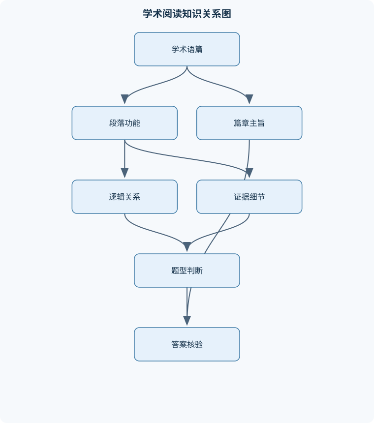
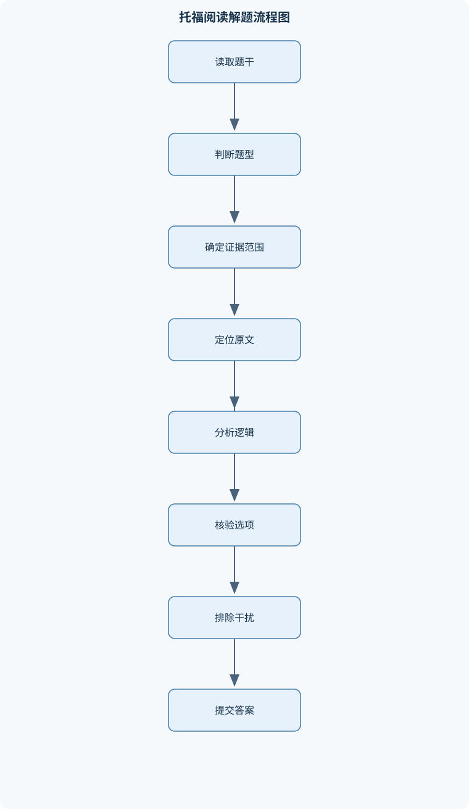

# 托福阅读

## 一、课程整体知识框架

### 课程边界与先修知识

本课程聚焦英语学术阅读理解与标准化阅读题解题能力，覆盖自然科学、生命科学、社会科学、历史与艺术等常见学术语篇。核心内容包括学术词汇在语境中的推断、句法解析、段落功能识别、事实信息定位、否定事实判断、推断、修辞目的、句子简化、句子插入、篇章摘要和信息分类。课程先修知识包括高中至大学基础英语语法、常用学术词汇、基本句子成分识别能力，以及对因果、比较、转折、让步、举例和时间顺序等逻辑关系的初步认识。课程不教授专业学科本身的系统知识，而是训练学生从有限文本中提取、重组和验证信息。考试题型与界面可能因考试版本和实施时间而调整，因此课程以稳定的阅读认知技能和题型推理原则为核心，不把某一时期的题量、时间或界面设置作为永久结论。





### 1. 课程对象、目标与能力边界

《托福阅读》课程训练的对象不是某一自然科学或社会科学领域的专业知识，而是学习者在有限文本中识别信息、解析结构、建立证据链并验证选项的能力。文章可能讨论地质学、生态学、天文学、政治制度、印刷技术、历史事件或艺术发展，但这些内容主要作为学术说明文的语境。解题所需的专业信息通常会在文章中通过定义、举例、比较、因果、时间顺序或背景解释逐步提供。

课程能力可抽象为四个层面：

1. **语言解析层**：识别词义、词性、句子主干、从句层级、非谓语结构、指代关系和修饰边界。
2. **篇章理解层**：识别段落中心意义、支持细节、段落功能以及段落之间的逻辑关系。
3. **证据判断层**：区分原文明示信息、文本可以推出的信息、文章未提及的信息和与原文冲突的信息。
4. **题型决策层**：依据题干限定的证据范围选择答案，而不是仅凭常识、熟悉词汇或个人判断作答。

记号统一如下：$P$ 表示文章或段落，$S$ 表示句子，$Q$ 表示题目，$O$ 表示选项；$M$ 表示段落或全文的中心意义，$D$ 表示支持中心意义的细节；$E$ 表示文本证据，$I$ 表示依据文本证据形成的推断；$R$ 表示因果、转折、比较、让步、举例或时间顺序等逻辑关系；$A$ 表示作者行为或写作目的；$C$ 表示选项覆盖的文本范围；$SCOPE$ 表示某题允许使用的证据范围；$CLAIM$ 表示选项提出的命题；$SUPPORT$ 表示原文支持该命题的证据；$CONTRADICTION$ 表示原文与该命题冲突的信息。

可将答案判断写成：

$$
\text{正确选项} \Longleftrightarrow CLAIM \text{ 与 } E \text{ 相符，且不存在直接 } CONTRADICTION
$$

这一表达只适用于需要文本证据的题目，不表示任何与现实世界相符的说法都能作为答案。事实题的$SCOPE$通常是相关句子或段落，主旨题的$SCOPE$通常是全文，不能用全文主题替代局部事实，也不能用一个段落的细节替代全文概括。

### 2. 文章中心、段落功能与信息层级

学术说明文通常围绕一个中心问题展开，例如某种现象如何形成、某项技术为何出现、某个理论能够解释哪些证据。全文中心意义$M$不是文章主题名词本身，而是“主题加上作者对主题所作的具体说明”。例如，“大陆漂移”只是主题；“若干地质和生物证据支持大陆曾经处于不同位置”才可能接近文章中心意义。

段落功能$F$说明某段在论证中的任务，常见功能包括提出背景、定义概念、介绍理论、提供证据、举例说明、比较两种解释、指出限制、描述过程和总结结论。中心意义、段落功能和支持细节的关系可表示为：

$$
M \rightarrow F \rightarrow D
$$

其中，$M$决定全文方向，$F$说明段落如何推进该方向，$D$用于支持或解释段落功能。一个数字、人物或实验结果可能是重要细节，但如果它只服务于某段的一个局部论点，就不能直接充当全文主旨。

段落内部常见的信息层级为“主题句—解释—证据—例子”。主题句可能位于段首，也可能在多个细节之后出现。定义通常限定概念边界；分类将对象分成具有共同标准的类别；举例把抽象观点具体化；比较和对照突出差异或共同点；让步先承认一种可能，再转入作者真正强调的观点；因果链说明条件、机制和结果；问题—解决结构先说明困难，再介绍应对方式；时间顺序则通过年代、阶段或过程变化组织信息。

### 3. 学术词汇与语境推断

词义题考查的不是词典中最常见的义项，而是目标词在当前句子中的可替换意义。判断时至少要检查四项：

- **词性和句法位置**：名词不能直接用动词意义替换，形容词的主语指向也会影响解释。
- **指称范围**：表示“某一类对象”的词，不能替换成只表示其中一个个体的词。
- **语气强度**：$usually$、$may$、$significant$与$always$、$must$、$complete$的确定性不同。
- **局部逻辑**：转折、因果、定义、同位语和举例可能直接限定词义。

例如，句子“the position remained a *haphazard* one”中，$haphazard$作形容词修饰$position$，后文提到部署缺乏纵深、损失严重、局势危险，说明该词表示“无计划、杂乱的”，而不是“习惯性的”或“荒谬的”。又如，“galvanize New Yorkers to plant more trees”中，目标结构是“促使人们采取行动”，因此应选择表示“激励、推动”的替换，而不是仅表示“强迫”或“引起兴趣”的词。

词义推断流程的输入是目标词、所在句及相邻句，输出是语境释义。先确定词性和句法位置，再寻找定义、对比、因果和例证线索，随后判断褒贬、强弱和范围，最后逐项替换。若选项数为$k$，在上下文已定位的前提下，逐项检验的比较量可近似记为$O(k)$；这不包括回读上下文的时间。该方法的边界是：当局部语境没有提供足够线索时，不能仅凭词形或熟悉程度确定词义，应扩大到段落主题和相邻逻辑。

### 4. 句法解析与长难句

长句理解的首要任务是恢复主干，而不是逐词翻译。主干通常由主语、谓语和核心宾语或表语构成；定语从句、状语从句、同位语、插入语和非谓语结构属于附加或嵌套成分。被动语态需要还原“谁受到什么作用”，名词化表达则需要把抽象名词还原为动作或关系。

例如：

> Although the evidence was incomplete, researchers concluded that the species had survived in isolated valleys because the valleys provided stable sources of water.

先识别让步从句$Although$，主句主干为“researchers concluded”；$that$引导结论内容；$because$引导结论中的原因。若把$because$错误地理解为研究者得出结论的原因，便会改变原句关系。解析复杂句时应标出连接词、谓语动词和代词先行词，再判断每个修饰语的边界。

并列结构必须保持平行关系。例如“to identify the species, compare its skeleton, and examine its habitat”中三个动词共同受$to$支配。省略结构则要根据并列或上下文恢复被省略成分。指代词的解释不能只看最近名词，还要检查数、性、语义角色和篇章主题是否一致。

### 5. 事实信息、否定事实与推断

事实题要求找出原文明确陈述或同义改写的信息。定位词包括人物、年代、地点、概念、动作、数字和比较对象，但原文可能使用同义替换，因此不能只进行字面搜索。选项核验时应拆分$CLAIM$，逐项检查是否遗漏、添加、扩大范围、改变数量、颠倒因果或改变比较方向。

否定事实题的题干可能要求“未提及”“不正确”或“不是”。处理时应把题目改写成四个正向判断，并分别标记为“原文支持”“合理改写”“原文冲突”或“无证据”。不能因为一个选项符合常识，就认为文章已经提到。否定词是题干的一部分，回查时必须再次确认是在寻找正确事实还是例外项。

推断题要求从$E$得到$ I$。合理推断应采用最小必要假设：

$$
E + \text{最小必要假设} \Rightarrow I
$$

若某选项需要补充多个文章外事实，或者把“可能”提升为“必然”，通常属于过度推断。尤其要区分必要条件和充分条件：某条件是结果出现所需的条件，不代表它单独足以造成结果；文章只说明两个事件相关，也不代表已经证明因果关系。

### 6. 修辞目的、作者态度与篇章连接

修辞目的题不能只回答“这句话讲了什么”，还要回答“作者为什么在这里讲它”。定义通常用于限定概念；例子用于具体说明一般观点；数据用于支持或量化判断；引用某位研究者可能用于提供观点、呈现争议或作为反驳对象；转折句常用于修正前文范围、引出限制或突出新论点。

局部目的应结合前后文判断。一个地质数据可能不是文章中心，而是用来支持某一理论；一个相反观点可能不是作者立场，而是作者随后反驳的对象。因此“提到某理论”不等于“作者赞同该理论”。作者态度通常由动词和形容词强度、转折词、限定词及评价性表达体现。$may$、$suggest$和$likely$表示可能或倾向，不能改写成$prove$、$certainly$或$always$。

句子简化题要求保留原句的核心命题、主客体关系、逻辑关系、否定、条件、时间、范围和比较方向。删除次要修饰是允许的，但因果倒置、条件消失、让步改为直接因果或比较对象交换都属于逻辑改变。若原句有$m$个需要核验的结构成分，逐项检查的结构比较量可记为$O(m)$；这里的$m$不表示字符数，而表示主干、从句和关键限定关系的数量。

句子插入题必须进行双向验证。左侧要能提供代词、指示词、概括词或连接副词的先行对象；右侧要能承接该句引出的解释、例子、结果或转折。只有语法通顺而无语义桥梁的位置不能优先选择。时间顺序、因果链和“概括—具体”的顺序也必须保持。

### 7. 摘要、信息分类与综合决策

摘要题要求重建全文信息层级。正确摘要通常覆盖多个段落的核心观点，能够解释文章主线，并且不依赖孤立数字、单个例子或局部背景。选项范围$C$过窄，说明只概括了一个细节；$C$过宽，说明加入文章未讨论的内容或把可能性说成确定结论。

信息分类题则要求先确定类别定义，再判断信息属于哪一类。不能因为某条信息出现在同一段，就把它归入同一类别。分类依据可能是时间、功能、理论解释、结果或对象类型，必须以文章明确提供的标准为准。

综合解题时，需要在“定位”和“整合”之间切换：词汇、事实和局部修辞题主要依赖局部$SCOPE$；推断题需要合并相关句子的$E$；摘要题需要跨段落整合$M$。两个选项都部分正确时，依次比较证据强度、覆盖范围、逻辑关系和语气强度。能解释更多原文、引入更少额外信息且不超过原文强度的选项更优。

## 二、章节和模块划分

### 核心知识覆盖清单

本清单用于检查正文是否覆盖本课程的主要知识模块：

- **托福学术阅读总论与篇章结构**：学术说明文的目的与读者、总论点与段落中心、主题句与支持细节、段落之间的逻辑关系、定义、分类与举例结构、比较对照与让步结构、因果链与问题解决结构、时间顺序与过程说明、主旨题与篇章结构的关系。
- **学术词汇与语境推断**：词义题的局部语境范围、同义替换与语义等值、词性变化对词义的影响、熟词僻义与学科义、上下文中的反义和对比线索、定义、同位语和举例线索、因果关系中的动词和形容词、抽象名词的语境解释、词义选项的范围和语气判断。
- **句法解析与长难句理解**：主干成分识别、从句类型与层级、非谓语结构、同位语和插入语、被动语态与名词化表达、并列结构的平行关系、指代词和省略结构、复杂修饰语的边界、句间衔接与信息重心。
- **事实信息题与否定事实题**：明示信息与文本证据、定位词和同义替换、局部阅读范围控制、事实题选项的逐项核验、否定事实题的例外项识别、数字、年代和比较级信息、因果事实与结果事实区分、选项过度推断的排除、原文证据强度判断。
- **推断题与证据链**：可推出信息的定义、直接证据与合理推断、多句证据的合并、因果关系的谨慎推断、作者未明说信息的边界、必要条件与充分条件、可能性、倾向性和确定性、反事实选项的识别、推断题的最小假设原则。
- **修辞目的与作者态度**：举例的说明功能、数据的证明功能、定义的限定功能、对比的解释功能、引用观点的论证功能、转折句的篇章作用、背景信息与核心论点的关系、作者态度的语气线索、局部目的与全文目的区分。
- **句子简化与逻辑等价**：句子核心命题提取、主次信息区分、因果关系保留、条件关系保留、让步关系保留、时间和范围限制保留、指代对象还原、选项中的信息遗漏、选项中的新增信息与关系倒置。
- **句子插入与篇章衔接**：代词回指关系、重复名词与同义替换、连接副词和逻辑标记、时间顺序衔接、因果链衔接、概括句与细节句的顺序、例证前后的位置关系、主题转换与段落边界、插入位置的双向验证。
- **篇章摘要与信息分类**：段落主旨筛选、核心观点与次要细节、例子和数据的从属关系、重复信息的合并、跨段落信息整合、摘要选项的覆盖范围、过窄和过宽选项、因果链的压缩表达、分类表中的类别匹配。
- **综合解题、时间管理与错题诊断**：先读题还是先读文的条件判断、段落地图的快速建立、定位与精读的切换、题目顺序与信息顺序、不确定选项的比较方法、排除法的证据要求、词汇、句法和逻辑错误分类、错题根因记录、模拟训练中的稳定性评估。


### 1. 托福学术阅读总论与篇章结构

本章建立段落地图。阅读时可为每段记录“主题对象—核心动作—段落功能”，例如“某理论—解释化石分布—提出证据”。定义、分类、举例、比较、让步、因果、问题解决和时间顺序是主要结构。主旨题的答案必须同时体现文章主题和作者展开方向，不能只重复题材名词。

### 2. 学术词汇与语境推断

训练熟词僻义、学科义、词性变化、抽象名词和语气范围判断。词义替换必须满足同句法功能、同指称范围和近似语气强度。选项中出现原词同义词并不等于正确，因为同义词可能在褒贬、程度或适用对象上不一致。

**示例一：词义题**

题干：在“the luminous stars exhaust their hydrogen fuel”中，$luminous$最接近哪项含义？

分析：$luminous$作形容词修饰$stars$；“耗尽氢燃料”属于恒星演化背景，但该句本身强调的是可见光或发光特征。  
步骤：确定词性为形容词；检查主语为恒星；排除表示“潜在、混乱”的选项；用“bright”替换后句法和语义均自然。  
结果：选择“bright”。  
验证：不能选择“massive”，因为质量大与发光并非同义；不能把学科相关属性当作词义本身。  
变式：若上下文说明“这些恒星因质量巨大而消耗燃料更快”，此时$massive$可能是相关信息，但仍不能替代$luminous$的基本意义。

### 3. 句法解析与长难句理解

本章按照“连接词—谓语—主干—嵌套结构—指代”的顺序解析。重点包括从句层级、非谓语、同位语、被动语态、名词化、并列平行和省略。解析的最终目标是确定谁做了什么、条件是什么、结果是什么，而不是完成逐字翻译。

### 4. 事实信息题与否定事实题

**示例二：事实题**

题干：文章指出，某项技术在早期的主要功能是什么？

分析：先从题干提取“技术—早期—主要功能”三个约束，在相关段落寻找同义表达。  
步骤：定位技术首次出现处；读取包含时间和功能的完整句；将选项拆为“时间、主体、动作、对象”四部分；逐项检查是否有新增功能或因果关系。  
结果：选择与原文动作和对象均一致的选项。  
验证：若原文只说“使制作更快”，选项改成“降低所有书籍成本”，就加入了未证实的普遍结果。  
变式：若题干改为“下列哪项不是文章提到的功能”，应把四个选项分别改写为正向核验任务，寻找无证据项，而不能直接选择最陌生的说法。

### 5. 推断题与证据链

推断必须建立“证据—必要连接—结论”的链条。文章未明说并不意味着可以自由发挥；结论越强，所需证据越多。涉及因果时，应区分“先发生”“同时出现”“相关”与“导致”。

**示例三：推断题**

材料：某种淡水生物的化石出现在两个现今相隔海洋的大陆，并且化石属于相近年代的地层。

问题：该证据支持什么推断？

逐步解答：  
1. $E_1$：该生物生活在淡水环境。  
2. $E_2$：相近年代的化石分布在两个大陆。  
3. 最小连接：淡水生物不容易跨越广阔海洋并在两地形成相同年代的化石。  
4. $I$：两个大陆过去可能比现在更接近，甚至曾经相连。  
5. 排除“已经证明大陆运动的唯一原因”等强选项，因为原文证据只支持地理位置曾发生变化的合理推断。

结果：选择需要最少假设、没有使用文章外地质事实的选项。  
验证：若选项使用“必然”“唯一解释”，其强度超过$E$，应排除。  
变式：若文章另有海洋生物可远距离迁移的说明，则上述证据的推断强度会下降，必须重新评价替代解释。

### 6. 修辞目的与作者态度

本章要求同时回答“信息内容”和“信息功能”。分析句子前后关系：前文提供什么问题，指定句提供什么材料，后文如何使用该材料。引用反方理论、提出数据或插入历史背景，都可能具有介绍、支持、限定或反驳功能。

**示例四：修辞目的题**

题干：作者为什么提到某理论认为火山活动可能影响物种灭绝？

分析：不能只回答“说明火山活动与灭绝有关”。应查看后文是否列出火山岩分布、时间对应或反例。  
步骤：概括指定句；查看前句的研究问题；查看后句是否提供证据或限制；判断该理论是作者接受、介绍还是反驳。  
结果：若后文列出同期火山活动证据，目的可能是提供一种候选解释及其依据；若后文指出时间不吻合，目的则是引出并削弱该理论。  
验证：答案必须包含“如何服务于论证”，而非只复述理论内容。  
变式：将“为什么提到某科学家”改为“作者是否赞同该科学家”，证据要求会提高，必须寻找评价词、转折句或后续论证。

### 7. 句子简化与逻辑等价

**示例五：句子简化题**

原句：Although the evidence was limited, the researchers concluded that the change was significant because it occurred across several regions.

解答：  
1. 主句：researchers concluded。  
2. 结论内容：the change was significant。  
3. 让步：evidence was limited。  
4. 原因：change occurred across several regions。  
5. 正确选项必须同时保留“证据有限”“研究者得出变化重要的结论”“跨多个地区发生导致该判断”。  
6. 删除“researchers”或合并表达可以接受，但若改成“证据有限，所以变化不重要”，则改变让步关系；若改成“变化导致多个地区发生其他事件”，则改变主客体和因果方向。

结果验证：逐项标记条件、因果、让步、时间和范围，任何关键关系消失或倒置都不能选。  
变式：若原句含有“only in some regions”，简化选项必须保留范围限制，不能概括为“in all regions”。

### 8. 句子插入与篇章衔接

插入句中的$this、these、such、therefore、however$等表达需要先行对象或逻辑前件。插入位置判断应同时检查左侧和右侧；“概括句—具体例子”“原因—结果”“一般观点—例证”通常具有较稳定的顺序。

可使用以下伪代码进行核验：

```text
语言：伪代码

输入：待插入句 S，候选位置集合 L，段落句子序列 P
输出：连贯性最高的位置

for 每个位置 l in L:
    检查 S 中的代词、指示词和概括词是否有左侧先行项
    检查 S 与左侧句子的逻辑关系是否成立
    检查 S 是否为右侧句子提供必要的解释、例子或结果
    检查时间顺序、主题对象和因果方向
    记录左侧连贯性与右侧连贯性
选择同时满足双向衔接且新增假设最少的位置
若无位置满足，则重新检查题干理解和先行项识别
```

不变量是：插入后不能出现无先行词的代词，不能破坏原有时间或因果顺序。候选位置数为$n$时，位置比较约为$O(n)$，每个位置还需进行局部语义核验。

### 9. 篇章摘要与信息分类

摘要流程是先为每段写出一句中心概括，再合并重复观点，最后检查是否覆盖文章主线。具体例子、孤立数据、局部背景和未提及信息通常属于$D$，不能替代$M$。信息分类时要先定义类别，再判断信息与类别的必要特征是否匹配。

### 10. 综合解题、时间管理与错题诊断

阅读过程中建立段落地图，遇到题目后在“局部定位”和“全文整合”之间切换。题目顺序通常有助于定位，但不能假定所有题目都严格按信息出现顺序。遇到不确定选项，按“证据强度—范围—逻辑—语气”比较，而不是反复凭直觉重读全文。

错题记录应包含：题型、题干范围、正确证据、所选选项的具体错误词、错误类型和可迁移规则。错误类型至少分为词义误判、定位错误、句法误读、逻辑关系错误、范围错误、题意否定词误读和时间分配失衡。

### 11. 代表性训练项目

#### 项目一：段落地图与证据范围实验

**输入数据**：一篇六段学术说明文、每段句子编号、八至十道混合题。  
**步骤**：第一遍为每段记录$M$和$F$；第二遍为事实题标注$E$所在句；第三遍为推断题写出$E \rightarrow I$链条；最后比较主旨题所需的全文范围与局部题范围。  
**评价标准**：每段中心概括不超过一句；事实题证据定位准确；推断题没有文章外前提；主旨概括覆盖主要段落。  
**排错方法**：若段落概括变成具体例子，重新追问“该段还解释了什么”；若推断过强，删除结论中的绝对化词并检查是否仍被原文支持。

#### 项目二：选项强度与逻辑等价实验

**输入数据**：十组包含让步、条件、因果、比较和范围限制的长句，以及每句四个简化选项。  
**步骤**：先划分主句和从句，再标记否定、条件、比较方向、时间和范围；为每个选项填写“保留、遗漏、添加、倒置”四类标记；最后统计哪一种错误最常出现。  
**评价标准**：能够指出每个错误选项的具体逻辑变化；正确选项保留核心命题和限定条件；不得以词汇相似作为唯一依据。  
**排错方法**：若无法判断，先将原句改写成中文逻辑骨架，例如“尽管A，B，因为C”，再逐项对照；若主客体不清，回到谓语和被动结构重新解析。

### 12. 常见易错点与纠正原则

1. 把文章主题名词当成全文主旨，忽略作者的解释方向。
2. 看到选项与原文有相同词汇就选择，忽略同词不同义。
3. 把常识或专业背景当成$E$。
4. 将局部事实题扩大到全文范围。
5. 将相关关系误读为因果关系。
6. 将先后顺序误读为导致关系。
7. 忽略否定词、比较级、数量词和时间限制。
8. 把作者介绍某理论误判为作者赞同该理论。
9. 句子简化时删掉条件、让步或范围。
10. 插入句只检查左侧，不检查右侧。
11. 摘要题选择数字、例子或单一段落细节。
12. 把段落主题句直接当作全文结论。
13. 长句阅读中过度逐词翻译，丢失句法主干。
14. 只凭语气强弱作答，不回查证据强度。
15. 因陌生学科概念而放弃定义、例子和因果线索。
16. 错题只记录正确选项，不记录错误选项中导致误判的词。

### 13. 典型笔试问题及解答思路

1. **如何区分主题与主旨？**  
   主题回答“文章谈什么”，主旨回答“文章关于该主题说明了什么”。先概括各段$M$，再寻找共同论证方向。

2. **词义题为什么不能只选最常见义项？**  
   因为正确义项由局部句法、指称范围和逻辑语境决定。应进行替换测试，而不是查词典频率。

3. **事实题的直接证据有什么要求？**  
   必须能在规定$SCOPE$内找到支持$CLAIM$的句子或同义表达，并且没有数量、时间或因果冲突。

4. **推断题允许使用常识吗？**  
   只能使用理解文本所需的最小常识，不能依赖文章外知识推出新的事实或强因果。

5. **修辞目的题为什么要看后文？**  
   后文常显示指定信息是证据、例子、限制还是反驳。只看指定句无法判断其篇章功能。

6. **句子简化时哪些信息不能删除？**  
   核心主干、否定、条件、因果、让步、比较方向、时间和范围限制不能删除。

7. **插入题如何处理多个语法上都通顺的位置？**  
   比较双向语义衔接，重点检查代词先行项、概括与例证顺序以及因果链。

8. **摘要题如何排除过宽选项？**  
   检查选项是否引入全文没有讨论的对象、原因或结论；覆盖广不等于内容正确。

### 14. 面试问题、参考答案与追问要点

1. **如何讲解学术阅读中的词义推断？**  
   参考答案：先判词性和句法位置，再找定义、转折、因果和举例线索，最后进行选项替换。追问要点：说明如何处理熟词僻义、语气强度和缺乏线索的情况。

2. **如何帮助学习者理解长难句？**  
   参考答案：先找谓语和连接词，恢复主干，再分层处理从句、非谓语和修饰语。追问要点：举例说明被动语态、名词化和指代歧义。

3. **如何解释事实题与推断题的区别？**  
   参考答案：事实题主要核验明示信息，推断题要求在证据基础上形成最小结论。追问要点：讨论必要条件、充分条件和过度推断。

4. **如何判断作者是否赞同被引用观点？**  
   参考答案：观察引用前后的评价词、转折词、证据安排和结论位置，不能因作者提到观点就推定赞同。追问要点：分析“介绍—支持—反驳”三种功能。

5. **如何处理否定事实题？**  
   参考答案：把题干改成四个正向核验任务，逐项标记支持、冲突或无证据，最后复查否定词。追问要点：说明如何避免把正确事实误选为例外项。

6. **如何评价学生的摘要能力？**  
   参考答案：检查摘要是否覆盖多个段落中心、保留文章主线并排除孤立细节。追问要点：分析过窄、过宽和把例子当主旨的情况。

7. **如何诊断阅读错题？**  
   参考答案：要求学生指出原文证据、选项错误词和推理断点，再归类为词义、句法、逻辑、范围或题意错误。追问要点：说明如何用同类新题验证修正规则。

8. **如何设计一套综合阅读训练？**  
   参考答案：使用同一篇文章设置词汇、事实、推断、修辞、简化、插入和摘要题，并要求记录每题$SCOPE$及$E$。追问要点：说明如何评价稳定性，而不是只看单次正确率。

### 15. 岗位关联与产出标准

- **托福阅读教师**：实际任务是讲解题型、示范证据链和诊断学生错误；使用篇章结构、句法、词义和题型流程；产出包括讲义、解析和训练反馈；验收标准是解析能指出具体$E$，并解释错误选项的逻辑问题。
- **英语考试课程研发**：实际任务是设计文章、题目、选项和评分说明；使用$M$、$D$、$SCOPE$、语气强度和题型边界；产出为题目包与答案依据；验收标准是每个正确选项有直接或最小推断证据，每个干扰项有明确错误类型。
- **学术英语教师**：实际任务是训练学生理解定义、论证、比较和因果结构；使用句法解析与篇章关系；产出为文本分析记录和课堂任务；验收标准是学生能够从陌生学科文本中提取结构，而非依赖背景知识。
- **语言学习内容编辑**：实际任务是编写词汇释义、长难句解析和错题反馈；使用语境词义、逻辑等价和范围控制；产出为可检索知识条目；验收标准是术语一致、例句完整、解释能独立支撑答案。
- **英语阅读测评题编写**：实际任务是控制题目难度、干扰项类型和证据唯一性；使用事实、推断、修辞和摘要规则；产出为题干、选项、答案及证据说明；验收标准是正确答案唯一，干扰项不能仅凭常识判定，且不引入文章外事实。

## 三、核心概念的详细解释

### 1. 学术阅读的基本对象：中心意义、段落功能与证据

托福阅读中的文章通常是面向一般受教育读者的学术说明文。文章可能讨论生物、地质、技术、历史或艺术，但题目主要要求读者处理文本内部的信息关系，而不是调用某一学科的完整专业知识。文章的基本分析单位包括全文、段落、句子和选项。

全文或段落的中心意义记为 $M$。$M$ 不能只写成一个主题名词。例如，“大陆漂移”只是主题，不是完整主旨；“多种地质和生物证据支持大陆在过去曾处于不同位置”才包含了主题及作者对主题的具体说明。支持中心意义的事实、例子、数据和解释记为 $D$，它们通常回答“为什么”“如何证明”或“具体表现是什么”。

段落功能记为 $F$。同一主题下，不同段落可能承担不同任务：第一段提出背景或问题，第二段定义概念，第三段介绍某种解释，第四段提供证据，第五段比较竞争理论，最后一段指出限制或总结结论。中心意义、段落功能和细节之间可以表示为：

$$
M \rightarrow F \rightarrow D
$$

这不是时间顺序，而是论证层级。$M$规定全文讨论方向，$F$说明某一段怎样推进该方向，$D$则支撑段落中的具体判断。若把某个数字或人物的例子直接当作主旨，就会把 $D$ 误判成 $M$。

段落常具有“主题句—解释—证据—例子”的层级，但主题句不一定位于段首。有些段落先列出若干现象，最后用一句概括句说明共同结论。因此，判断段落中心时，应比较哪些信息能够统摄多个句子，而不能只看第一句。

### 2. 学术语篇中的逻辑关系

信息单元之间的逻辑关系记为 $R$。常见的 $R$ 包括因果、转折、比较、让步、举例和时间顺序。

**因果关系**回答“什么导致什么”。例如，句子 “The loss of vegetation increased soil erosion” 中，植被减少是原因，土壤侵蚀增加是结果。不能因为两个事件相邻出现，就自动认定存在因果关系。若原文只说 “A occurred before B”，最多说明时间先后，不能推出 $A$ 导致 $B$。

**转折关系**通常由 however、but、yet、nevertheless 等标记。转折词后的信息往往是作者当前更重视的方向，但并不意味着前面的内容完全错误。例如，“The method is inexpensive; however, it is difficult to apply on a large scale” 表示方法成本低与大规模应用困难同时成立。

**让步关系**常由 although、even though、despite 等引导。让步从句承认一个事实，但主句通常表达作者真正要强调的结论。若选项只复述让步内容，却遗漏主句方向，往往不能代表原句中心。

**比较与对照关系**不仅包括“相同”和“不同”，还包括比较标准、方向和范围。more efficient than 表示前者效率更高，less stable than 表示前者稳定性更低。选项若把比较对象颠倒，即使词汇与原文高度相似，也不构成正确改写。

**举例关系**由 for example、such as、including 等建立。例子通常是 $D$，用于具体说明抽象命题，不能直接升级为全文主旨。若题目问“为什么提到某一例子”，答案必须说明该例子如何支持前面的观点，而不是只重复例子的内容。

**时间顺序**可由年代、阶段、before、after、subsequently 等表达。时间顺序可以说明先后，但只有出现 caused、led to、resulted in 等因果线索时，才可以判断因果关系。

### 3. 词汇题中的语境义

词汇题考查目标词在当前语境中的可替换意义，而不是词典中最常见的义项。判断目标词 $w$ 的语境义，至少需要检查四项约束：

1. **词性约束**：目标词在句中是名词、动词、形容词还是副词。
2. **句法功能约束**：目标词充当主语、宾语、表语、定语或状语时，替换词必须能承担相同功能。
3. **指称范围约束**：目标词指向个体、群体、行为、状态还是抽象概念。
4. **语气强度约束**：目标词表达的是可能、倾向、通常，还是必然、完全、极端。

例如，*luminous* 在 “luminous stars” 中作形容词，修饰恒星。若相邻语境讨论恒星发出的光，*bright* 可以作为语境替换；*massive* 表示质量大，虽然恒星可能同时质量大，但没有保留“发光明亮”的语义，因此不能作为等值替换。

语境线索主要有以下几类：

- **定义线索**：后文直接解释目标词，如 “X, meaning ...”。
- **同位语线索**：名词后紧跟解释性短语。
- **举例线索**：目标词后出现具体对象，帮助限定范围。
- **转折线索**：however、rather than、unlike 等显示相反或不同方向。
- **因果线索**：目标词所表示的状态导致某一结果，结果可反推词义。
- **重复和同义替换**：后文用另一个表达重复说明同一概念。

### 4. 长难句的结构解析

长句理解的核心不是逐词翻译，而是先提取主干，再恢复修饰关系。句子主干通常由主语 $S$、谓语 $V$ 和必要的宾语或表语 $O$ 构成。其余成分可能是定语从句、状语从句、非谓语结构、同位语或插入语。

例如：

> Although the method was developed in a small laboratory, researchers who tested it under field conditions found that it reduced water loss.

主句主干是：

> researchers found that it reduced water loss

Although 引导让步从句，who tested it under field conditions 修饰 researchers，that it reduced water loss 是 found 的宾语从句。若把 although 从句误当主句，或者把 researchers 误判成 reduced 的主语，就会改变句意。

被动语态要先还原动作关系。例如 “The fossils were examined by several researchers” 的逻辑结构是“几个研究者检查化石”，而不是“化石检查研究者”。名词化表达也需要还原为动作：the expansion of cities 可以理解为 cities expanded，the destruction of forests 可以理解为 forests were destroyed 或人类破坏森林，具体主语必须由上下文确定。

并列结构要检查平行成分。例如：

> The theory explains the change in climate, the migration of species, and the formation of new habitats.

三个并列宾语共同受 explains 支配。不能把 the migration of species 误认为新的谓语。

### 5. 事实题、否定事实题与证据范围

事实题要求从文章中找出明确支持的命题。题目范围记为 $SCOPE$，通常是一个句子、相邻句子或一个段落。正确选项必须同时满足：

$$
CLAIM \subseteq SUPPORT(E)
$$

并且不能存在与原文直接冲突的信息。这里的“支持”可以是同义替换，但不能依赖文章外常识。

事实题常考人物、年代、地点、功能、原因、结果、数量和比较关系。定位时不能只找原词，还要寻找同义表达。例如原文说 “the process became less expensive”，选项可能改写成 “the cost of the process declined”。判断重点是关系是否相同，而不是表面词汇是否一致。

否定事实题要求寻找“没有被原文支持”或“与原文不符”的选项。做题时应把题目改写成四个正向问题，分别标记为“明确支持”“合理改写”“冲突”或“无证据”。合理性不等于被提及。某个选项符合现实常识，但文章没有说，仍然不能算原文事实。

### 6. 推断题与最小必要假设

推断题允许答案不是原文逐字出现，但必须能够从 $E$ 推出。推断结论记为 $I$，可表示为：

$$
E + H_{\min} \Rightarrow I
$$

其中 $H_{\min}$ 是最小必要假设。若一个选项需要补充多个文章外事实，或者需要先假定作者没有说明的因果关系，就属于过度推断。

例如，文章说某种淡水生物的化石在两个现今相隔很远的大陆上出现。由“淡水生物难以跨越广阔海洋长期迁移”可较谨慎地推出：这些大陆过去可能比现在更接近，或曾经相连。不能进一步推出“该生物一定通过某条具体河流迁移”，因为文本没有提供该路径。

推断题还要区分必要条件和充分条件。若 $A$ 是 $B$ 的必要条件，表示没有 $A$ 就不能有 $B$；若 $A$ 是充分条件，表示有 $A$ 就足以产生 $B$。文章说“缺少水分会阻碍植物生长”，只能说明水分可能是生长的必要条件之一，不能说明有水分就一定能生长，因为温度、光照和土壤等条件也可能影响结果。

### 7. 修辞目的与作者态度

修辞目的题考查作者为什么在某处加入某条信息。作者行为记为 $A$，常见的 $A$ 包括定义、举例、提供证据、引用观点、对比、提出限制、反驳和总结。

回答“为什么提到”时，应完成两层分析：

1. 这条信息在字面上说了什么；
2. 它如何服务于前后观点或全文论证。

例如，作者先提出一种灭绝理论，随后介绍地层中某种证据。该证据的修辞功能可能是支持该理论，而不只是“介绍一种地层现象”。如果作者写 “some researchers have argued that...”，这通常只是引入某种观点，不等于作者赞同该观点。只有出现 supports、demonstrates、evidence for 等明确支持性表达，才能提高作者赞同的判断强度。

作者态度要依据语气词和论证位置判断。可能、似乎、部分解释、尚未确定表示谨慎；clearly、strongly supports、cannot explain 表示较强立场。选项中的态度强度不能超过原文。

### 8. 句子简化、句子插入与篇章摘要

句子简化题要求保留原句的核心命题和逻辑结构。必须保留的内容包括主客体关系、否定、因果、条件、让步、比较方向、时间限制和范围限制。可以删去不影响核心命题的插入语、例子和次要定语，但不能删除必要条件。

句子插入题要进行双向验证。向左检查待插入句中的代词、指示词和连接词是否有先行对象；向右检查后文是否解释、展开或承接待插入句。若句子含有 “this change”，前文必须先出现可被概括为“这种变化”的对象。若句子以 “therefore” 开头，前文必须提供原因，后文通常接结果或进一步说明。

摘要题要求重建文章的主要论证。摘要选项的覆盖范围 $C$ 应涵盖多个段落的 $M$ 或核心 $F$，而不是只覆盖某个 $D$。一个选项过窄，通常只写了一个例子、数字或局部段落；过宽，则加入文章没有论证的结论。摘要不是句子拼接，而是对重复信息进行合并，并保留段落之间的主要逻辑关系。

## 四、重要定义、公式、定理和推导

### 专业审校补充：关键定义与适用边界

托福阅读中必须区分“信息来源的态度”和“作者本人的态度”。文章引述某位研究者的观点，并不等于作者接受该观点；作者可能是在介绍背景、提出待检验假说、呈现争议，或为后文反驳作铺垫。判断作者态度时，应检查引述动词和限定语，如suggest、argue、claim、可能、据称，以及后文是否出现however、evidence indicates、cannot explain等评价信号。态度判断的证据范围原则上包括引述句及其前后解释句，不能只凭一个褒贬词作结论。反例是：文章写“某学者认为该现象由单一因素造成，但后续研究发现该解释无法说明另一组数据”，正确理解应是作者呈现并限制该观点，而不是支持单一因素理论。若题目问某学者的观点，答案可归属于该学者；若题目问作者态度，则必须核验全文对该观点的支持、保留或反驳程度。


### 1. 证据一致性判定

对任一选项 $O$，定义：

- $CLAIM(O)$：选项提出的命题；
- $SUPPORT(O)$：原文中支持该命题的证据；
- $CONTRADICTION(O)$：原文中与该命题冲突的信息；
- $SCOPE(O)$：该选项所使用的文本范围。

事实题中，正确选项满足：

$$
CLAIM(O)\text{ 与 }SUPPORT(O)\text{ 一致}
$$

且：

$$
CONTRADICTION(O)=\varnothing
$$

还必须满足：

$$
SCOPE(O)\subseteq SCOPE(Q)
$$

也就是说，即使选项在全文其他位置可以找到相似信息，只要题目要求的是局部句子，而选项把其他段落内容拼接进来，也可能超出题目范围。

在两个选项都部分正确时，依次比较：

1. 哪个选项有更直接的 $E$；
2. 哪个选项覆盖范围更符合 $SCOPE$；
3. 哪个选项保留了原文的 $R$；
4. 哪个选项的语气强度更接近原文；
5. 哪个选项新增的信息更少。

### 2. 词义推断流程

**输入**：目标词、所在句、相邻句、选项集合。  
**输出**：语境中唯一可替换的释义。  
**不变量**：每个保留选项都必须同时满足词性、句法、语义和语气约束。  
**终止条件**：只有一个选项在替换后不破坏句意。

```text
语言：伪代码

Input: word w, sentence S, context N, options O[1..k]
Output: the best contextual meaning

1. pos ← identify_part_of_speech(w, S)
2. clues ← collect_definition_contrast_cause_example(S, N)
3. constraints ← infer_scope_tone_and_reference(clues)
4. for each option O[i]:
       if part_of_speech(O[i]) is incompatible with pos:
           reject O[i]
       else:
           replace w with O[i] in S
           if syntax_is_unacceptable(S):
               reject O[i]
           else if violates_scope_or_tone(O[i], constraints):
               reject O[i]
5. if exactly one option remains:
       return that option
6. otherwise:
       inspect the preceding and following sentence
       compare semantic equivalence and logical relation
       return the option with the smallest added assumption
```

若选项数为 $k$，仅计算选项替换的比较次数可记为 $O(k)$；这不包括在文章中寻找线索的阅读成本。该流程不适用于上下文几乎没有线索的词义题，此时不能仅凭词形或熟悉度决定答案。

### 3. 五个代表性例题

#### 例题一：词汇题与语境替换

**题干**

> The troops occupied a *haphazard* position, with no secure depth behind them.

*Haphazard* most nearly means:

A. random  
B. habitual  
C. experimental  
D. ridiculous

**分析**

目标词是形容词，修饰 position。后半句说“没有建立安全的纵深”，说明部队位置缺乏规划和组织。A random 表示随机、无规则，能在句中作定语；habitual 表示习惯性的，experimental 表示实验性的，ridiculous 表示荒谬可笑，均不符合军事部署语境。

**逐步解答**

1. 词性：形容词。
2. 语境结果：位置安排缺乏计划。
3. 替换 A：random position，句法和语义均成立。
4. 替换 B：habitual position，无法表达部署混乱。
5. 替换 C：experimental position，增加“用于实验”的信息。
6. 替换 D：ridiculous position，语气从“无组织”升级为“可笑”。

**结果验证**

A 保留了词性、指称范围和语气强度，因此正确。该题不能因为“ridiculous”也可能描述糟糕局面，就把负面评价误当作语境义。

**变式**

若后文改为 “The position had been selected after repeated trials”，则 experimental 可能成为更合适的解释，因为后文提供了“反复试验”的定义性线索。词义不是脱离语境固定不变的。

#### 例题二：事实题与因果方向

**题干**

> A city program planted trees along major streets. The trees reduced surface temperatures and provided shade for pedestrians.

According to the paragraph, what was one result of the program?

A. Pedestrians moved to rural areas.  
B. Street surfaces became cooler.  
C. The city reduced all transportation costs.  
D. Trees grew faster near major streets.

**分析**

题目问 result，证据范围是两句话。原文明确说 trees reduced surface temperatures。B 是对该事实的同义改写。A、C、D 均没有文本支持。

**逐步解答**

1. 定位 program 及其结果。
2. 区分“种树”这一行动与“降温、遮阴”两个结果。
3. 检查 B：surface temperatures became cooler，与 reduced surface temperatures 等值。
4. 检查 A：原文未提到人口迁移。
5. 检查 C：原文未提交通运输成本。
6. 检查 D：原文未讨论树木生长速度。

**结果验证**

B 有直接 $E$，且没有新增对象、时间或范围。D 虽然“树种在街边”与原文有词汇联系，但把地点和生长速度建立了不存在的关系。

**变式**

若选项改为 “The program completely eliminated urban heat”，则即使方向相同，也因 completely 把“降低温度”升级为“完全消除热量”而错误。

#### 例题三：推断题与最小假设

**题干**

> Fossils of the same freshwater species have been found in rock layers of the same age on two continents now separated by an ocean. Freshwater species are generally unable to cross a wide ocean.

What can be inferred?

A. The species crossed the ocean every year.  
B. The continents may once have been closer together.  
C. The species evolved in salt water.  
D. The rock layers formed at different times.

**分析**

原文给出两个证据：同种淡水生物化石出现在两个大陆；淡水生物通常难以跨越宽阔海洋。最小推断是两大陆过去可能更接近或相连。B 使用 may，保留了原文的可能性，不把推断说成必然事实。

**逐步解答**

1. 提取证据 $E_1$：同种化石出现在两地。
2. 提取证据 $E_2$：该生物难以跨越宽阔海洋。
3. 连接 $E_1$ 与 $E_2$：若生物难以跨海，而化石又处于同年代地层，则大陆过去相近是合理解释。
4. 检查 A：添加“每年迁移”的具体行为，且与 $E_2$ 不符。
5. 检查 C：把淡水生物改成盐水生物，与原文冲突。
6. 检查 D：原文明确说岩层同龄，方向相反。

**结果验证**

B 只需要一个最小连接假设，不依赖文章外的具体迁移路线。A、C、D 分别属于过度假设、直接冲突和事实倒置。

**变式**

若原文说“化石可能由洪水携带”，则“大陆过去相连”不再是唯一的最小解释，推断题必须选择文本支持更直接的选项。

#### 例题四：修辞目的题

**题干**

> Some researchers proposed that volcanic activity contributed to the extinction. The author then describes a layer of ash found in rocks from the relevant period. Why does the author mention the ash layer?

A. To provide evidence relevant to the volcanic-activity explanation  
B. To prove that all volcanoes became inactive  
C. To describe how researchers collect fossils  
D. To show that the extinction occurred in one location only

**分析**

前句介绍火山活动理论，后句给出同一时期的火山灰层。该信息的功能不是单纯介绍灰，而是为理论提供与时间相符的地质证据。

**逐步解答**

1. 找前文：提出 volcanic activity 理论。
2. 找当前信息：相关时期的 ash layer。
3. 找功能：火山灰层使该理论获得地质证据支持。
4. 检查 A：既说明信息内容，又说明其论证功能。
5. 检查 B：原文没有说所有火山停止。
6. 检查 C：没有涉及化石采集过程。
7. 检查 D：一层岩石不能证明灭绝只发生在一个地点。

**结果验证**

A 同时满足局部衔接和全文论证功能。若选项只说“介绍一种岩石”，则只复述内容，没有回答“为什么提到”。

**变式**

若前文是在反驳火山理论，后文说“no ash layer was found”，则该信息的修辞功能会变为削弱或限制该理论，不能机械地把“火山灰”都判断为支持。

#### 例题五：句子简化题

**题干**

原句：

> Although the method is inexpensive, it cannot be used widely because it requires equipment that is unavailable in many rural laboratories.

哪一项最准确地保留了原句的核心意义？

A. The method is cheap, but limited rural access to required equipment prevents widespread use.  
B. The method is expensive because rural laboratories use advanced equipment.  
C. Rural laboratories widely use the method because it requires little equipment.  
D. The method is inexpensive and therefore suitable for all laboratories.

**分析**

原句有三个核心关系：让步“便宜但……”，结果或限制“不能广泛使用”，原因“许多农村实验室缺少设备”。A 保留了三层关系。

**逐步解答**

1. Although 引导让步：便宜这一事实必须保留。
2. cannot be used widely 表示范围限制，不能删成“不能使用”或改成“适合所有实验室”。
3. because 引导原因：设备在许多农村实验室不可获得。
4. A 保留便宜、有限可及性和不能广泛使用。
5. B 把 inexpensive 改成 expensive，直接相反。
6. C 把 limited use 改成 widely use，并错误增加 little equipment。
7. D 将让步关系改为因果关系，且把有限适用升级为全部适用。

**结果验证**

A 是逻辑等价改写。句子简化可以删除修饰，但不能删除让步、因果和范围限制。

### 4. 句子插入的双向验证流程

**输入**：待插入句、段落和候选位置。  
**输出**：前后衔接最完整的位置。  
**不变量**：代词有明确先行词，连接词与前文关系一致，主题发展不被打断。  
**终止条件**：某一位置同时满足左侧衔接和右侧衔接，而其他位置至少有一项断裂。

操作步骤如下：

1. 圈出待插入句中的代词、指示词、连接副词和概括词。
2. 为每个回指词寻找前文先行词。
3. 判断句子的功能是总结、解释、举例、转折还是结果。
4. 检查插入后句子与前文的逻辑关系。
5. 检查插入句与后文是否形成展开、例证或结果关系。
6. 比较所有候选位置，而不是看到一个语法通顺的位置就停止。

例如，待插入句为 “This change allowed the species to occupy colder regions.” 若前文没有说明任何 change，句子不能位于段首；若前文刚说明体温调节机制的变化，且后文继续介绍寒冷地区的分布，那么该位置同时满足回指和后续展开。

### 5. 摘要与信息分类的判断公式

可将选项覆盖范围表示为 $C(O)$，将段落核心集合表示为：

$$
M(P)=\{M_1,M_2,\ldots,M_n\}
$$

摘要选项应尽可能覆盖多个段落中心，同时避免加入文章外信息：

$$
\text{摘要质量} \propto \text{核心覆盖度}-\text{无关细节}-\text{外加命题}
$$

这不是用于计算分数的实际公式，而是判断原则。一个选项若只覆盖一段中的数字，其核心覆盖度低；若概括了全文多个段落但加入“该理论已经被完全证实”，则因外加命题而不合格。

信息分类题还要求先确定类别定义。例如“证据”类别应包含观察、实验或数据；“理论”类别应包含对现象的解释；“例子”类别应是对一般命题的具体实例。不能因为某个例子也具有证据价值，就忽略题目要求的分类标准。

### 6. 两项文本分析实验

#### 实验一：证据范围与选项强度实验

**输入数据**

准备一篇四段学术说明文，每段包含一个中心意义、两个支持细节和一个例子；为全文编写事实题、推断题和摘要题各若干道。每个选项标注其证据来源句、范围、逻辑关系和强度词。

**步骤**

1. 为每段写出一句 $M$，并把例子标记为 $D$。
2. 对每个选项拆分 $CLAIM$。
3. 标记选项是否改变因果方向、比较方向、时间范围或数量范围。
4. 分别用局部 $SCOPE$ 和全文 $SCOPE$ 作答。
5. 记录选择答案所依据的 $E$，不得只记录选项字母。
6. 比较使用正确范围前后的错误类型。

**评价标准**

- 事实题是否能找到直接 $E$；
- 推断题是否只使用最小必要假设；
- 摘要题是否覆盖多个 $M$；
- 是否识别 completely、always、only 等强度升级词；
- 是否能解释每个干扰项具体错在遗漏、添加、冲突还是范围扩大。

**排错方法**

若把局部事实题做成全文主旨题，应重新圈定 $SCOPE$；若把推断题做成常识题，应删除所有无法在原文找到依据的外部前提；若误选强度过大的选项，应把原文中的可能、通常、部分等语气词与选项逐一对照。

#### 实验二：长难句与逻辑等价实验

**输入数据**

准备十个含有定语从句、让步从句、条件句、被动语态、非谓语结构和并列结构的学术句子。为每句设计一个原句和四个简化选项，其中至少包含一个主客体倒置项、一个因果倒置项和一个范围扩大项。

**步骤**

1. 用括号标出主句、从句和非谓语结构。
2. 写出主句主干 $S+V+O$ 或 $S+V+C$。
3. 标记否定、条件、比较、因果、时间和范围限制。
4. 将每个简化选项转换成命题集合。
5. 比较原句与选项的命题集合是否一致。
6. 对错误选项说明是遗漏、增加、关系倒置还是指代错误。

**评价标准**

- 主句主干识别正确；
- 从句与修饰对象对应正确；
- 逻辑关系全部保留；
- 简化后没有新增文章未表达的结论；
- 能指出最小差异，而不是笼统地说“语义不对”。

**排错方法**

若把非谓语短语当主句谓语，应先寻找有限谓语；若把被动主语当施事，应补出 by 短语或根据上下文寻找真正施事；若简化选项看似流畅但改变条件、让步或因果，应回到连接词逐一核验。

## 五、算法、流程和实现思路

### 方法与流程覆盖索引

下列方法或流程应在正文中说明输入、步骤、适用条件、结果检查和边界：

- 词汇题语境推断流程：输入为目标词、所在句及相邻句，输出为最符合语境的释义。步骤为：一，确定目标词词性和句法位置；二，标出定义、转折、因果、举例和同位语线索；三，判断目标词的褒贬、强弱和具体范围；四，用每个选项替换原词；五，检查句法、语义和篇章一致性；六，排除只在其他语境成立的词义。终止条件是剩余选项中只有一个同时满足句法和语境约束。适用条件是目标词所在语境提供了足够线索；若缺少线索，应结合段落主题而不能凭词形猜测。复杂度可按选项数k计为O(k)，不包括查找上下文的阅读成本。
- 事实题定位核验流程：输入为问题、四个选项和文章，输出为有文本证据支持的选项。步骤为：一，从问题中提取人物、时间、地点、概念和动作等定位词；二，在文章中寻找同义替换或相关句；三，确定题目要求的段落范围；四，将每个选项拆成可核验的命题；五，逐项与原文比对，检查遗漏、添加、范围扩大和因果倒置；六，选择证据最直接且无冲突的选项。不变量是每个保留选项都必须有明确原文依据。终止条件是找到唯一满足全部限制的选项。若文章中定位词重复，应使用关系词和段落主题进一步缩小范围。
- 否定事实题处理流程：输入为带有“不是、未提及或不正确”等否定要求的问题，输出为唯一的未被文章支持或与文章冲突的选项。步骤为：一，将问题改写为四个独立的正向核验任务；二，分别标记选项为原文明确支持、合理改写、原文冲突或无证据；三，先确认通常可支持的选项；四，在剩余选项中寻找无证据或冲突项；五，复查否定词，防止把正确事实误选为答案。适用条件是题目明确要求识别例外项。核心不变量是不能因为选项内容听起来合理就视为原文提及。
- 推断题证据链流程：输入为推断问题和文章相关段落，输出为文本可推出的最小结论。步骤为：一，识别问题要求的对象和范围；二，提取至少一条直接证据；三，说明证据与选项之间缺少的连接；四，判断该连接是否是文本允许的最小假设；五，检查选项是否使用了文章外部知识、绝对化词或未经证明的因果关系；六，选择证据链最短且假设最少的选项。终止条件是一个选项能够被文本直接或通过单一必要推理支持，而其他选项存在冲突或额外假设。
- 修辞目的分析流程：输入为题目指定的句子、段落和选项，输出为该信息在篇章中的功能。步骤为：一，概括指定句子的字面信息；二，查看前句确定其承接对象；三，查看后句确定其引出或支撑的内容；四，判断信息属于背景、证据、例子、定义、反驳、转折还是结论；五，将局部功能与全文中心联系；六，排除只重复句子内容但没有解释作用的选项。适用条件是题目询问“为什么提到”或“起什么作用”。
- 句子简化流程：输入为复杂原句和四个简化选项，输出为逻辑等价选项。步骤为：一，划分主句、从句和修饰成分；二，提取主语、核心谓语、对象和逻辑连接；三，标记否定、条件、比较、时间、范围和因果关系；四，检查选项是否保留这些约束；五，删除仅起补充说明作用的细节；六，排除改变主客体、因果方向或限定范围的选项。终止条件是选项保留核心命题并且没有新增命题。可将每个选项的核验按结构成分数m计为O(m)。
- 句子插入流程：输入为待插入句、四个候选位置及段落，输出为最佳位置。步骤为：一，识别待插入句中的代词、指示词、连接词和概括词；二，寻找其前置指称或前文总结对象；三，寻找其后的解释、例子或结果；四，检查时间、因果和主题顺序；五，将句子分别放入候选位置；六，比较每个位置的前后双向连贯性。核心不变量是待插入句不能出现无先行词的代词，也不能破坏原有论证顺序。若所有位置均可语法连接，应优先选择同时形成前后语义桥梁的位置。
- 摘要与信息分类流程：输入为全文、段落摘要选项或分类选项，输出为覆盖核心信息且类别匹配的答案组合。步骤为：一，为每段写出不超过一句的中心概括；二，标记文章主线和段落之间的关系；三，将选项区分为核心观点、支持细节、例子、背景和错误信息；四，选择能够覆盖主要段落且不重复的核心观点；五，在分类题中检查每条信息与类别的定义是否一致；六，删除孤立细节和文章未提及内容。适用条件是题目要求概括全文或重组多个段落信息。
- 综合错题诊断流程：输入为错题、原文、所选答案和正确答案，输出为错误类型及修正规则。步骤为：一，重新独立作答；二，标出答案所依赖的原文句；三，判断错误属于词义、定位、句法、逻辑、范围、题意误读或时间分配；四，记录导致误判的具体线索；五，将正确答案改写成证据链；六，用同类新题检验规则是否可迁移。终止条件是能够准确说明“原文哪一处、选项哪一词、推理哪一步”导致错误。该流程适用于系统训练和阶段性复盘，不替代对具体文章的阅读。


### 1. 总体解题流程：从文章建模到选项核验

托福阅读的解题过程可以抽象为：先建立文章的局部结构模型，再根据题目确定证据范围，最后核验选项。设文章或段落为 $P$，中心意义为 $M$，段落功能为 $F$，支持细节为 $D$，文本证据为 $E$，题目为 $Q$，选项为 $O$。基本流程如下：

1. **识别题型与 $SCOPE$**：判断 $Q$ 是词义、事实、否定事实、推断、修辞目的、句子简化、句子插入、摘要还是信息分类题。
2. **建立段落地图**：用一句话概括每段的 $M$ 或 $F$，标记定义、举例、比较、转折、因果和结论。
3. **定位文本证据**：根据人物、时间、概念、动作、因果词或同义替换定位 $E$。
4. **拆分选项命题**：将 $O$ 拆成对象、动作、范围、时间、逻辑关系和强度等成分。
5. **逐项比对**：检查是否存在 $SUPPORT$、$CONTRADICTION$、信息遗漏、额外添加、关系倒置或范围扩大。
6. **按证据强度决策**：若两个选项都部分正确，比较证据直接程度、覆盖范围、逻辑关系和语气强度。

可以用下式表示答案约束：

$$
O_{\text{correct}} \Longleftrightarrow
CLAIM(O)\subseteq E(SCOPE)
\land \neg CONTRADICTION(O)
\land R(O)=R_{\text{text}}
$$

其中，$R(O)$ 表示选项中的逻辑关系，$R_{\text{text}}$ 表示原文关系。该表达不是分数计算公式，而是一个核验框架。它适用于需要文本证据的题目；若题目要求全文主旨，$SCOPE$ 应扩展到全文，而不是只核对单句。

### 2. 语境词义推断流程

#### 2.1 输入、输出与判断约束

输入为目标词、所在句、相邻句和若干选项；输出为符合语境的释义。词义判断必须同时满足：

- 与目标词具有相同词性和句法功能；
- 指称对象和范围相同；
- 褒贬色彩、确定程度和强弱相近；
- 放回原句后不破坏因果、转折、比较或时间关系。

例如，`luminous stars` 中的 *luminous* 修饰星体，句意要求“发光的、明亮的”。选项 *massive* 表示质量大，虽然恒星可能质量很大，却不能替换原词，因为它改变了命题属性。

#### 2.2 具体步骤

1. 标出目标词的词性。
2. 判断其在句中承担的成分，例如主语、宾语、表语或定语。
3. 在相邻句中寻找定义、同位语、举例、反义、因果和转折线索。
4. 判断词义的范围与语气，例如“部分困难”不能替换成“完全不可能”。
5. 将每个选项代入原句。
6. 检查句法通顺、指称一致、逻辑一致和篇章一致。
7. 排除只在其他语境成立的义项。

若选项数为 $k$，且上下文已经定位，则逐项替换的比较成本可近似写为 $O(k)$。这里的复杂度只计算选项核验，不包括阅读和寻找上下文的时间。

#### 2.3 例题一：词义替换

**题干**

“the position which these troops had taken up remained a *haphazard* one”

A. random  
B. habitual  
C. experimental  
D. ridiculous

**分析与解答**

1. *haphazard* 作形容词，修饰军队所占据的阵地。
2. 后文说“没有形成纵深、损失惨重、局势危险”，说明阵地组织缺乏计划和秩序。
3. *random* 表示随机的、无规则的，能够替换。
4. *habitual* 表示习惯性的，说明频繁发生，不符合阵地组织语境。
5. *experimental* 表示实验性的，原文没有试验含义。
6. *ridiculous* 表示荒谬可笑，语气和评价方向都不准确。

**结果验证**

替换为 “a random one” 后，句法成立，且与“没有形成纵深”的细节一致，因此答案为 A。若文章改为“指挥官有意尝试一种新部署”，*experimental* 才可能成立，说明词义必须由语境决定。

### 3. 事实题与否定事实题流程

#### 3.1 事实题

事实题要求判断明示信息或与明示信息等值的改写。处理时不能只寻找相同词，而应拆分 $CLAIM$：

$$
CLAIM=(\text{对象},\text{动作},\text{条件},\text{时间},\text{范围},R)
$$

例如，选项说“某技术降低了成本”，原文只说“某技术加快了生产”，两者对象可能相同，但动作不同，不能视为等值。

**步骤**

1. 从题干提取定位词。
2. 在文章中寻找同义替换和相关关系。
3. 确定题目要求的局部 $SCOPE$。
4. 把每个选项拆成可核验命题。
5. 检查数字、年代、比较级、数量范围、因果方向和否定关系。
6. 保留有明确 $SUPPORT$ 且无 $CONTRADICTION$ 的选项。

#### 3.2 否定事实题

否定事实题的题干通常要求“以下哪项没有提及”或“以下哪项不正确”。应先把题目改写成四个正向任务，逐项判断：

- 原文明确支持；
- 原文等值改写支持；
- 原文明确冲突；
- 原文没有证据。

“听起来合理”不能替代“文章提及”。例如，文章说十五世纪书籍制作需要人工抄写、装订和运输，不能据此推出“制作过程一定使用了某种特定金属工具”，除非文本明确提供该信息。

#### 3.3 例题二：否定事实判断

**题干**

根据一段介绍早期书籍制作的文章，以下哪项不是文章提到的功能？

A. 记录宗教文本  
B. 保存法律材料  
C. 促进信息传播  
D. 降低长途航运成本

**逐步解答**

1. 将题目改写为四个正向问题。
2. 回到文章相关段落，分别寻找宗教文本、法律材料、信息传播和航运成本的证据。
3. 若前三项分别有句子支持，而第四项没有出现，也不能用“书籍传播可能降低信息运输成本”的常识补足。
4. 选项 D 属于无文本证据项。

**结果验证**

答案不是“最不合理”的选项，而是“未被文章支持”的选项。若文章明确说书籍替代了部分实物运输记录，则 D 的地位会改变，说明否定事实题必须依据当前文本。

### 4. 推断题的最小假设流程

#### 4.1 证据链结构

推断题的正确结论 $I$ 不是原文逐字重复，而是由 $E$ 通过最小必要假设推出：

$$
E_1+E_2+\cdots+E_n
\overset{\text{最小假设}}{\Longrightarrow} I
$$

“最小假设”意味着不能额外引入多个未经文本支持的事实。推断可以补充省略的连接，但不能改变原文的强度、范围或因果方向。

#### 4.2 处理步骤

1. 确定推断对象和 $SCOPE$。
2. 找到至少一条直接证据。
3. 说明证据与选项之间缺少的连接。
4. 判断该连接是否是常识性的最小逻辑补充。
5. 检查选项是否含有绝对化词、反事实条件或文章外知识。
6. 选择证据链最短、额外前提最少的选项。

#### 4.3 例题三：化石与大陆位置

**题干**

某段说明：一种淡水生物的化石出现在今天相隔很远的两个大陆，并且化石属于相近年代。该证据可以推出什么？

A. 这种生物能够长距离穿越海洋  
B. 两个大陆过去可能比现在更接近  
C. 两个大陆始终保持相同位置  
D. 该生物只生活在海水中

**解答**

1. 淡水生物通常不能依靠海水进行长期跨洋迁移，这是解释证据所需的最小背景。
2. 相近年代的同类化石出现在相隔大陆，说明这些陆地在过去可能存在更近的空间关系。
3. “可能”与证据强度一致，不能升级为“必然相连”。
4. A 与淡水生物特征冲突；C 使用“始终”，超出文本；D 与“淡水”直接冲突。

**结果验证**

答案为 B。该结论是合理推断，不是文章逐字陈述。若原文同时列出其他地质证据，结论支持度会增强，但仍不宜改写为绝对确定的历史细节。

### 5. 修辞目的分析流程

#### 5.1 信息内容与作者行为

修辞目的题询问的是作者为什么在此处加入某信息，记为作者行为 $A$，而不是信息本身是什么。常见的 $A$ 包括定义、举例、提供证据、引入观点、说明限制、反驳可能解释和引出结论。

判断一个句子的功能，要同时观察前后文：

- 前文：该句承接了什么问题或观点？
- 本句：提供了定义、数据、例子还是理论？
- 后文：后文如何使用该信息？

#### 5.2 例题四：作者提到某理论

**题干**

文章介绍恐龙灭绝理论时，提到某科学家提出“剧烈火山活动可能改变大气环境”。作者提到这一观点的目的是什么？

A. 证明该科学家完全正确  
B. 介绍一种可能解释，并为后文证据分析提供对象  
C. 说明所有科学家都接受火山理论  
D. 转换到与灭绝无关的地质主题

**解答**

1. “提出某观点”本身不等于作者赞同该观点。
2. 如果后文继续讨论火山岩分布、气体释放和生态影响，该观点的功能是引出待检验的解释。
3. A 和 C 都把“介绍”升级成“完全支持”或“普遍接受”。
4. D 与文章后续结构不符。

**结果验证**

答案为 B。判断修辞目的时，应区分信息来源、信息内容和作者态度。若作者使用“however”指出证据不足，功能还可能包含介绍后加以限制，而不是单纯支持。

### 6. 句子简化流程

#### 6.1 保留的逻辑成分

句子简化允许删除非核心修饰，但必须保留：

- 主语和核心谓语；
- 主要宾语或补语；
- 否定关系；
- 因果、条件、让步和比较关系；
- 时间、范围和数量限制；
- 指代对象。

句子简化的目标是逻辑等价，而不是逐词保留。若原句为“Although A, B caused C”，简化后仍须体现“B 导致 C”，并保留 A 与 B 之间的让步关系；不能只剩下“A caused C”。

#### 6.2 例题五：条件与因果

**原句**

“Although the volcanic activity was relatively brief, it released enough gases to alter the atmosphere and thereby affected organisms that depended on stable temperatures.”

**解答步骤**

1. 主句核心：volcanic activity affected organisms。
2. 让步结构：活动持续时间 relatively brief。
3. 因果链：活动释放足够气体 → 改变大气 → 影响依赖稳定温度的生物。
4. 合格选项必须保留“短暂但影响显著”的对比，以及“气体改变环境后影响生物”的方向。
5. 若选项说“生物导致火山活动”，属于主客体倒置；若说“火山活动持续很久”，属于时间信息冲突；若删除“依赖稳定温度的生物”，则扩大了影响范围。

**结果验证**

正确简化应同时保留让步和因果。若选项只保留“火山活动影响生物”，虽然部分正确，但遗漏了原句的关键解释链，不能作为最佳答案。

### 7. 句子插入流程

#### 7.1 双向衔接

句子插入题不能只看插入句与前句是否通顺。正确位置必须满足：

$$
\text{连贯性}=
\text{左侧衔接}+\text{右侧衔接}
$$

左侧衔接包括代词回指、重复名词、连接副词和话题承接；右侧衔接包括解释、例子、结果、总结和主题推进。

**步骤**

1. 标记插入句中的代词、指示词和概括词。
2. 寻找这些词的先行词或概括对象。
3. 检查插入句之后是否出现解释、例子或结果。
4. 判断时间和因果顺序。
5. 将句子分别放入候选位置。
6. 选择能形成前后双向桥梁的位置。

若插入句含有 “this change”，其前面必须已经出现明确的变化；若含有 “therefore”，前文必须提供原因，后文通常应呈现结果或进一步说明。

### 8. 摘要与信息分类流程

#### 8.1 摘要题

摘要题要求从全文层面选择核心观点。处理时先为每段写一句 $M_i$，再确定段落关系：

$$
M_{\text{article}} \approx \operatorname{integrate}(M_1,M_2,\ldots,M_n)
$$

整合不是简单罗列段落，而是识别共同主线。例如：

- 第一段提出问题；
- 第二段介绍解释；
- 第三段给出证据；
- 第四段说明限制；

摘要应表达“问题—解释—证据—限制”的主线，而不是只摘取第三段的一个数据。

#### 8.2 例题六：摘要选项比较

**题干**

一篇文章先介绍生态演替的概念，再说明早期物种如何改变环境，随后比较两种演替路径，最后指出气候和干扰会影响结果。以下哪种概括最合适？

A. 某种苔藓能够在岩石上生长。  
B. 生态演替是一个由单一物种完全控制的过程。  
C. 生态演替涉及群落随环境变化而发生的阶段性替代，其路径会受到环境条件影响。  
D. 气候变化是所有生态演替的唯一原因。

**解答**

1. A 是局部例子，覆盖范围过窄。
2. B 把部分早期作用扩大成“完全控制”，语气过强。
3. C 覆盖概念、过程和限制，能够统摄多个段落。
4. D 使用“唯一”，与文章列出的多因素不符。

**结果验证**

答案为 C。摘要题的正确选项通常具有较大但适当的 $C$，既覆盖多个核心段落，又不增加文章没有的绝对结论。

### 9. 可执行的综合伪代码

```text
INPUT: passage P, question Q, options O[1..k]

1. type ← classify(Q)
2. scope ← determine_scope(type, P)
3. map ← build_paragraph_map(P)
4. evidence ← locate_evidence(Q, P, scope)

5. FOR each option O[i]:
       claim ← split_into_claims(O[i])
       syntax_ok ← check_sentence_function(O[i], Q)
       relation_ok ← compare_relation(claim, evidence)
       range_ok ← compare_scope(claim, scope)
       strength_ok ← compare_strength(claim, evidence)
       contradiction ← find_contradiction(claim, P)

       IF syntax_ok AND relation_ok AND range_ok
          AND strength_ok AND NOT contradiction:
              mark O[i] as supported
       ELSE:
              record error type

6. IF type is negative-fact:
       return the unique option marked unsupported or contradicted
   ELSE:
       return the supported option with the strongest direct evidence

STOP when one option satisfies all constraints;
otherwise expand evidence locally and recheck the question wording.
```

不变量是：任何保留选项都必须有与题目 $SCOPE$ 相符的 $E$。终止条件不是“看到熟悉词”，而是唯一选项满足证据、范围、逻辑和语气约束。该流程适用于标准化阅读选择题，不适用于要求开放式背景知识论证的学术写作任务。

### 10. 训练实验与错误排查

#### 10.1 证据范围实验

**输入数据**：一篇包含四个段落的学术说明文，以及事实、推断、修辞目的和摘要题各若干道。

**步骤**：

1. 为每段写出 $M_i$ 和 $F_i$。
2. 给每道题标注 $SCOPE$。
3. 为每个选项记录 $SUPPORT$ 或 $CONTRADICTION$。
4. 比较“先看全文主题”和“按题目范围定位”两种方法的错误。
5. 将错误归类为范围过宽、范围过窄、因果倒置、强度升级或证据缺失。

**评价标准**：能够指出原文句子、选项错误词和错误推理步骤；不能只记录正确选项字母。

**排错方法**：若事实题依赖全文印象，重新限制到相关句或段；若摘要题只依据一个段落，重新比较各段 $M_i$；若推断题使用学科常识，删除无法在文章中找到依据的前提。

#### 10.2 长难句等价实验

**输入数据**：包含条件、让步、被动语态、非谓语和比较结构的十个句子，每句配四个简化选项。

**步骤**：

1. 标出有限谓语和主句主干。
2. 用括号划分从句和修饰语。
3. 标记否定、条件、时间、范围、比较和因果。
4. 将原句与选项分别改写为命题。
5. 检查主客体、逻辑方向和语气强度。
6. 记录错误属于遗漏、添加、倒置还是指代错误。

**评价标准**：能够解释“哪一个连接词或成分导致选项不等价”。

**排错方法**：若把非谓语结构当谓语，先寻找有限动词；若把被动主语误认为施事，检查是否存在 by 短语；若选项表面流畅但改变条件或让步，优先核对连接词关系。

## 六、概念之间的关系与对比

### 1. 主题、中心意义、段落功能与细节

| 概念 | 核心问题 | 典型内容 | 不能替代的对象 |
|---|---|---|---|
| 主题 | 文章讨论什么 | 大陆漂移、生态演替、书籍制作 | 不能单独充当主旨 |
| 中心意义 $M$ | 作者关于主题说明了什么 | 多种证据支持某种解释 | 不能缩减成一个例子 |
| 段落功能 $F$ | 本段在全文中做什么 | 定义、举例、比较、提出限制 | 不能等同于段落中的全部事实 |
| 细节 $D$ | 用什么支持或说明观点 | 数据、人物、实验结果 | 不能直接替代全文结构 |

一个选项即使准确复述某个细节，也可能因 $C$ 过窄而不适合主旨题。反过来，一个过于宽泛的选项虽然覆盖全文主题，却可能因 $C$ 过宽而加入文章没有讨论的内容。

### 2. 明示信息、推断信息与外部常识

**明示信息**是原文直接陈述的内容，具有最强的可核验性。  
**推断信息**是从一个或多个 $E$ 通过最小假设得到的 $I$。  
**外部常识**即使真实，也不能自动作为答案证据。

三者的关系可以写成：

$$
E \subseteq I_{\text{合法推断}} \subseteq \text{允许的文本解释}
$$

但并非所有常识都能进入 $I$。如果某选项需要“文章未提到的历史背景、作者态度或专业结论”，它就超出了文本推理边界。

### 3. 事实题、推断题与主旨题

| 题型 | 主要证据范围 | 正确答案特征 | 常见错误 |
|---|---|---|---|
| 事实题 | 句子或局部段落 | 有直接 $SUPPORT$ | 用全文主题替代局部证据 |
| 推断题 | 相关句群或段落 | 由 $E$ 通过最小假设推出 | 引入常识或绝对化结论 |
| 主旨题 | 全文 | 覆盖多个段落的 $M$ | 选择数字、例子或单段观点 |

事实题最重视直接性，推断题最重视证据链，主旨题最重视覆盖范围。三者不能使用同一个核验尺度。

### 4. 作者观点、引用观点与修辞功能

文章提到某理论，并不等于作者赞同该理论。应区分：

1. 作者介绍某人的观点；
2. 作者用证据支持该观点；
3. 作者列出该观点后指出其局限；
4. 作者将该观点作为竞争解释进行比较；
5. 作者明确接受或否定该观点。

“某科学家认为……”只表明信息来源；“这一解释得到……支持”才提供作者或文章的支持方向；“然而，该解释无法说明……”则表明限制。修辞目的题要回答的是 $A$，不能把内容复述当作功能解释。

### 5. 举例、数据、定义与结论

| 信息形式 | 主要功能 | 典型位置 | 误判方式 |
|---|---|---|---|
| 定义 | 限定概念边界 | 概念首次出现处 | 把定义当成全文结论 |
| 举例 | 把抽象观点具体化 | 一般判断之后 | 把例子当主旨 |
| 数据 | 提供数量或比较证据 | 观点之后 | 只看数字，不理解支持对象 |
| 引用 | 引入他人观点或权威解释 | 理论讨论处 | 把引用者观点当作者观点 |
| 结论 | 汇总或推进论证 | 段末或全文末 | 忽略结论前的限定 |

信息形式不能单独决定功能。例如，一个数字可能是证据，也可能只是背景；一个人物可能是理论提出者，也可能是反例。必须结合前后句和 $F$ 判断。

### 6. 因果、时间先后与相关关系

三者的强度不同：

- “A occurred before B” 只表示时间顺序；
- “A was associated with B” 表示相关或伴随；
- “A caused B” 表示因果；
- “A may have caused B” 表示可能因果；
- “A was necessary for B” 表示必要条件；
- “A was sufficient for B” 表示充分条件。

若原文只支持“可能导致”，选项写成“必然导致”，则强度超出证据。若原文说“某环境变化与物种减少同时出现”，不能直接推出环境变化是唯一原因。

### 7. 必要条件、充分条件与结果关系

设事件 $A$ 为原因条件，事件 $B$ 为结果：

- $A$ 是 $B$ 的必要条件：没有 $A$ 就没有 $B$，但有 $A$ 不一定有 $B$；
- $A$ 是 $B$ 的充分条件：有 $A$ 就足以得到 $B$，但 $A$ 不一定是唯一原因；
- “A 导致 B”通常只表明文本建立了因果方向，不自动说明必要性或充分性。

许多干扰项会把“有助于”改成“决定”，把“可能解释”改成“唯一原因”，或把结果倒置为原因。解题时必须保留原文的模态词和限定词。

### 8. 句法解析与篇章解析

句法解析处理句内关系：谁做什么、修饰谁、从句依附于哪里。篇章解析处理句间和段间关系：前一句提出什么、后一句解释什么、段落如何推进全文。

例如，句子中的 *which* 可能指代前面的名词，也可能指代整个主句；只有结合语义和后文功能才能确定。句法正确不代表篇章功能正确，某个句子放在两个位置都可能语法通顺，但只有一个位置能同时满足前后衔接。

### 9. 句子简化与摘要

句子简化的 $SCOPE$ 是单句内部，目标是保留逻辑等价；摘要的 $SCOPE$ 是全文，目标是压缩多个段落的中心意义。二者都允许删除次要细节，但删除标准不同：

- 句子简化不能删除条件、否定、因果和比较关系；
- 摘要可以删除孤立数字、具体例子和次要背景，但不能删除文章主线。

因此，句子简化强调“命题不变”，摘要强调“核心覆盖”。

### 10. 句子插入与段落结构

句子插入依赖局部双向衔接，段落结构依赖全局功能。插入句含有指代词时，要先找前置对象；含有总结词时，要放在被总结内容之后；含有例示词时，通常放在一般观点之后、具体例子之前；含有结果词时，通常放在原因之后。

但“通常”不是绝对顺序。若文章采用倒叙、先给结论后解释或先列例子后概括，仍须以实际连接词和语义关系为准。

### 11. 选项覆盖范围与语气强度

选项质量可从两个维度判断：

1. **范围 $C$**：过窄会遗漏核心观点，过宽会引入文章外内容。
2. **强度**：选项的确定性、数量和范围不能超过原文。

例如，原文说“some researchers suggest”，选项写“researchers have proved”，属于强度升级；原文讨论“某地区的早期植物”，选项写“所有地区的植物”，属于范围扩大。即使选项包含原文关键词，也应判为不合格。

### 12. 12 个典型易错点与纠正原则

1. **把主题当主旨**：主题只是讨论对象，主旨还必须包含作者的具体说明。
2. **看到同词就选择**：同一词在不同语境中可能词性、义项和语气不同。
3. **把常识当证据**：真实世界可能性不等于文章已经陈述。
4. **把时间顺序当因果**：先发生不等于导致后发生。
5. **忽略比较方向**：more、less、than 的对象和方向必须一致。
6. **忽略否定词**：not、never、without 会改变命题方向。
7. **把让步内容当结论**：although 从句常是被承认的条件，主句才是重点。
8. **把引用当作者观点**：信息来源和作者立场必须分开。
9. **简化时删除条件**：删除修饰可以，删除逻辑限制不可以。
10. **插入题只看左侧**：前句通顺不代表后句衔接成立。
11. **摘要选择孤立数字**：数字通常是 $D$，不能替代 $M$。
12. **只凭语气作答**：强弱判断必须回到 $E$，不能凭选项听起来是否“合理”。

### 13. 两个选项均部分正确时的比较顺序

当两个选项都能从文章中找到部分支持，应依次比较：

1. **证据直接性**：是否有明确句子支持；
2. **覆盖范围**：是否覆盖题目要求的 $SCOPE$；
3. **逻辑关系**：是否保留因果、转折、比较或时间关系；
4. **语气强度**：是否添加绝对化、唯一性或确定性；
5. **额外信息**：是否引入原文没有的对象、原因或结论。

可以用“最小改写原则”作最后判断：在不遗漏核心命题的前提下，与原文距离最小、额外假设最少的选项更优。该原则尤其适用于事实题、句子简化题和推断题。

## 七、典型例题和应用场景

### 专业审校补充：综合例题

题干：阅读以下材料并回答问题。城市热岛研究发现，密集建筑区在夜间通常比郊区保持更高温度。混凝土和沥青在白天吸收热量，夜间缓慢释放；建筑物还会削弱空气流动，使热量不易散失。研究者曾提出，增加屋顶花园能够显著缓解这一现象，因为植物和土壤可以遮挡屋面并通过蒸腾作用消耗部分热能。然而，一项覆盖多个城区的观测显示，屋顶花园对低层建筑较有效，对高层建筑密集区的整体降温作用有限。作者随后指出，屋顶绿化仍可能改善局部建筑周围的热舒适度，但不能单独替代通风廊道和地面植被规划。问题：作者提到屋顶花园，主要是为了说明什么？A. 城市热岛完全由建筑材料造成；B. 一种缓解热岛的方法具有局部价值但存在适用限制；C. 高层建筑不适合进行任何绿化；D. 研究者已经证明通风廊道没有作用。分析：先确定题目问的是修辞目的，而不是屋顶花园的定义。前文提出屋顶花园可能有效，后文用观测结果限制其整体效果，最后又保留其局部价值，因此该信息承担“提出方法—引入证据—说明边界”的功能。逐步解答：第一步，提取信息内容，即屋顶花园可以通过遮阴和蒸腾作用缓解部分热量；第二步，观察转折关系，however表明前述假说受到后续证据修正；第三步，联系结论，作者并未完全否定屋顶花园，而是区分局部效果和整体城市效果；第四步，核对选项。A把多因素问题缩减为单一原因，且与建筑物削弱通风的内容冲突；B完整保留了方法、效果和限制；C把“高层区域整体作用有限”扩大成“任何绿化都不适合”；D原文没有否定通风廊道。答案为B。结果验证：B能够解释为什么该信息出现在提出方法、观测结果和最终限制之间，也没有加入“完全”或“任何”等原文没有的强断言。变式：若末句改为“后续实验表明，屋顶花园在不同建筑高度上的降温效果均不稳定”，答案仍应强调该方法的效果受条件限制，但不能再具体断言其对低层建筑具有明确有效性。


### 典型题型与应用覆盖索引

建议通过下列题型或应用检查概念是否能够迁移：

- 词汇题例题方向：围绕haphazard、galvanize、luminous、formidable、indigent和incongruity等词设计语境替换题。完整解答应先判断词性，再分析相邻语句的语义线索，逐个替换选项，说明为什么近义但语气或范围不符的选项不能成立。
- 事实题例题方向：以现代政治制度、印刷术发展或大陆漂移证据为材料，要求定位段落中的人物、时间、技术功能或理论证据。完整解答应标出原文证据，区分明确陈述与选项改写，并说明新增信息和因果倒置的错误。
- 否定事实题例题方向：以十五世纪欧洲书籍制作流程为材料，列出四项可能功能，要求找出未提及项。完整解答应把题目转化为四个正向判断，逐项回到段落核验，避免把常识性推断当成文本信息。
- 推断题例题方向：以淡水生物化石同时出现在两个现今相隔大陆的材料为基础，判断为什么该证据支持大陆曾经相连。完整解答应建立“淡水生物难以跨越海洋长期迁移—化石出现在同年代地层—大陆过去可能相邻”的证据链，并指出这属于合理推断而非文章逐字陈述。
- 修辞目的题例题方向：以恐龙灭绝理论为材料，分析作者为什么提到地磁场方向变化、某位科学家的观点或火山岩分布。完整解答应区分信息本身与信息功能，说明其分别用于提供理论条件、举例说明间接因果或提供地质证据。
- 句子简化题例题方向：选取包含条件、因果和让步结构的长句，要求从四个选项中选择逻辑等价表达。完整解答应先画出主句和从句关系，再逐项检查否定、范围、时间和因果方向，说明删去次要修饰不等于改变核心命题。
- 句子插入题例题方向：以热带雨林树种识别困难或火山活动导致生态系统变化为材料，插入一个包含“因此、这种变化或这些物种”等回指表达的句子。完整解答应寻找先行词，验证插入后前后句的主题和因果关系，并解释其他位置为何出现指代悬空或顺序断裂。
- 摘要题例题方向：以生态演替或恐龙灭绝的多种理论为材料，从多个选项中选择能覆盖主要段落的观点。完整解答应先概括各段，再排除单一例子、局部数据、未提及内容和过度概括，最后说明每个保留选项对应的段落功能。
- 跨题型综合例题方向：使用一篇六至七段的自然科学文章，连续设置词汇、事实、推断、修辞目的、句子简化、插入和摘要题。完整解答应展示从段落地图建立、局部定位、证据核验到全文整合的完整过程，并记录每道题的证据范围。
- 错题诊断例题方向：给出一个将“作者提到某理论”误判为“作者赞同该理论”的案例。完整解答应区分引用、介绍、支持和反驳等修辞功能，指出选项把信息来源或作者态度进行了不当升级。


### 1. 词汇题：在局部语境中确定可替换义

词汇题的核心不是寻找目标词在词典中的第一义项，而是判断目标词在当前 $S$ 中的句法功能、指称范围和语气强度。解题时应先确定词性，再观察相邻语句提供的定义、对比、因果或举例线索，最后将选项代入原句核验。

#### 例题一：haphazard

**题干**

> Although the whole of the infantry had been ashore for several hours, the position which these troops had taken up remained a *haphazard* one.

*Haphazard* is closest in meaning to:

A. random  
B. habitual  
C. experimental  
D. ridiculous  

**分析**

目标词是形容词，修饰军队占据的阵地。后半句说“没有形成纵深、损失严重、局势危险”，说明阵地安排缺乏计划和组织。

**逐步解答**

1. A *random* 表示随机的、无规则的，能够说明阵地部署杂乱。
2. B *habitual* 表示习惯性的，强调反复发生，不符合军事部署语境。
3. C *experimental* 表示实验性的，意味着有意尝试某种方案，不能解释“缺乏组织”。
4. D *ridiculous* 表示荒谬可笑，语气和指称范围都超过原文。
5. 将 A 代回后，句子仍然表示“该阵地安排杂乱无序”，句法和语义均一致。

**结果验证**

正确答案为 A。此题说明：词义选项即使都能在一般语境中修饰某个对象，也必须满足原词的具体语义属性。*Haphazard* 侧重“无计划、无秩序”，并不等同于“可笑”或“实验性”。

**变式**

若原文后文改为“the commanders had deliberately chosen this arrangement to test a new defense strategy”，则 *experimental* 可能更合适，因为新线索改变了 $E$，不能固定依赖原先的直觉释义。

#### 例题二：galvanize

**题干**

> By claiming that every dollar put into the city’s trees returns several dollars in benefits, he may find it easier to *galvanize* residents to plant more and cut down fewer.

*Galvanize* is closest in meaning to:

A. induce  
B. motivate  
C. compel  
D. intrigue  

**分析**

句子结构为“使居民做某事”。前面的经济收益说明用于推动居民采取行动，但没有表示法律强制或制造好奇。

**逐步解答**

1. *Galvanize* 在此处是动词，宾语是居民，后接行动目标。
2. *Motivate* 表示激励、促使，和经济利益作为行动理由相符。
3. *Compel* 表示强迫，强度高于原文；原文只是说明收益可能使行动更容易。
4. *Intrigue* 表示引起兴趣或好奇，不能准确表达“推动植树”。
5. *Induce* 也可表示促使，但在四个选项中，*motivate* 与“通过利益说明激发动机”的语义更接近。

**结果验证**

正确答案为 B。若题目要求严格区分近义词，应比较语气和行动机制，而不是只看“都可以翻译成促使”。原文没有法律命令、惩罚或不得不的含义，因此不能选择强度更高的 *compel*。

**变式**

若后文说“the city imposed fines on residents who refused to plant trees”，则“迫使”可能得到文本支持；此时应根据新证据重新判断，而不是把 *galvanize* 永远解释为“激励”。

### 2. 事实信息题：定位、拆分命题与证据核验

事实题要求判断 $CLAIM$ 是否被文本明确支持。正确选项必须有对应的 $E$，并且不能依赖文章外常识。核验时应把选项拆成对象、动作、时间、地点、数量和关系等成分。

#### 例题三：明确事实与添加信息

**短文**

> Early printers often used wooden blocks to reproduce illustrations. Later, metal type made it easier to arrange separate letters, but illustrations continued to require different techniques.

**题干**

According to the passage, what did metal type make easier?

A. Printing every kind of illustration  
B. Arranging separate letters  
C. Replacing all wooden blocks  
D. Reducing the cost of paper  

**逐步解答**

1. 定位词为 *metal type* 和 *easier*。
2. 原文直接说“metal type made it easier to arrange separate letters”。
3. B 与原文的动作和对象完全一致。
4. A 把“排列字母”扩大成“印刷所有插图”，属于范围扩大。
5. C 说“取代所有木块”，原文没有提及，且“illustrations continued to require different techniques”暗示并未全部取代。
6. D 关于纸张成本没有文本证据。

**结果验证**

正确答案为 B。A、C、D分别属于对象扩大、结论添加和无证据。即使现实中金属活字可能影响生产成本，也不能以背景常识替代 $E$。

**变式**

如果题干改为“What remained difficult after metal type was introduced?”，证据范围仍在同一段，但答案应转向插图制作，而不能继续选择字母排列。

### 3. 否定事实题：将否定任务改写为四个正向核验

否定事实题常出现“下列哪项未被提及”“下列哪项不是原因”“下列哪项不正确”等表述。最稳妥的处理方式是把 $Q$ 改写为四个独立命题，分别标记“明确支持”“合理改写”“冲突”或“无证据”。不能因为某选项符合常识就认为文章提到过。

#### 例题四：未提及信息

**短文**

> In some fifteenth-century workshops, books were produced through several stages. Scribes copied the text, illuminators added decorative images, and binders assembled the pages into a finished volume. The use of standardized type later changed the speed of text production.

**题干**

Which of the following is NOT mentioned as a stage in book production?

A. Copying the text  
B. Adding decorative images  
C. Assembling the pages  
D. Selecting the quality of paper  

**逐步解答**

1. A 对应 *scribes copied the text*，原文明确支持。
2. B 对应 *illuminators added decorative images*，原文明确支持。
3. C 对应 *binders assembled the pages*，原文明确支持。
4. D 关于纸张质量没有出现，也没有同义表达。
5. 题干问“不是被提及的阶段”，因此选择无 $SUPPORT$ 的 D，而不是选择一个与原文冲突的选项。

**结果验证**

正确答案为 D。此题不能根据历史常识推测纸张一定重要，因为 $SCOPE$ 限定在该段文本。否定词的处理错误会导致把已明确提及的 A、B 或 C 误选为答案。

**变式**

若选项 D 改为“binding the pages”，则它虽然没有逐字出现，但可由 *binders assembled the pages* 合理改写，不应轻易判定为未提及。

### 4. 推断题：建立最小证据链

推断题的答案不是原文逐字重复，而是由 $E$ 经过最小必要假设得到的 $I$。推理必须避免加入多个未经证明的前提，也不能把可能性升级为必然性。

#### 例题五：化石证据与大陆位置

**短文**

> Fossils of the same freshwater organism have been found in rock layers of similar age on two continents now separated by a broad ocean. The organism could not have crossed the ocean under ordinary conditions.

**题干**

What can be inferred from the passage?

A. The organism was capable of living in salt water.  
B. The two continents may once have been closer together.  
C. The ocean formed before all freshwater organisms evolved.  
D. The fossils must have been transported by humans.

**逐步解答**

1. 直接证据一：相同淡水生物化石出现在两个现今相隔很远的大陆。
2. 直接证据二：该生物通常不能跨越海洋。
3. 若生物难以跨海，而相近年代的化石分布在两地，则较简约的解释是两地过去可能更接近，或曾经相连。
4. B 使用“may”，保持了原文的可能性强度。
5. A 与“淡水生物不能正常跨越海洋”方向相反。
6. C 把文章没有说明的演化时间强加进去。
7. D 引入人类运输这一额外前提，且文本没有证据。

**结果验证**

正确答案为 B。推理链为：

$$
\text{同年代化石分布相似}
+\text{生物难以跨海}
\Rightarrow
\text{大陆过去可能更接近}
$$

这里的“可能”是边界。不能进一步推出大陆一定以某一速度移动，或化石证据已经单独证明全部地质历史。

**变式**

如果原文说“the organism was known to tolerate salt water”，则“难以跨海”的连接条件被削弱，原有推断不能直接成立。

### 5. 修辞目的题：区分信息内容与作者行为

修辞目的题询问作者为什么在某处加入一条信息，考查的是 $A$，而不是信息本身。答案应同时说明“提到什么”和“服务于什么论证”。常见功能包括定义、举例、提供证据、引入竞争解释、承认限制和转折。

#### 例题六：举例的论证功能

**短文**

> Researchers proposed that volcanic activity could alter ecosystems over a wide area. For example, layers of ash found near several ancient lake beds are associated with a sharp decline in plant remains.

**题干**

Why does the author mention ash layers near ancient lake beds?

A. To show that all volcanic eruptions destroy ecosystems permanently  
B. To provide an example of evidence linking volcanic activity with ecological change  
C. To introduce a method for dating modern plants  
D. To prove that lakes are formed by volcanic eruptions  

**逐步解答**

1. 前句提出一般观点：火山活动可能大范围改变生态系统。
2. 后句通过火山灰层、湖泊和植物遗存减少提供具体材料。
3. B 同时说明了信息内容和功能：它是支持前句的证据例子。
4. A 使用 *all* 和 *permanently*，强度超过原文。
5. C 没有谈现代植物测年。
6. D 把生态变化证据误读为湖泊成因解释。

**结果验证**

正确答案为 B。若答案只说“因为火山灰层附近有植物遗存”，只是复述内容，没有说明修辞功能，不能完成目的判断。

### 6. 句子简化题：保持逻辑关系不变

句子简化允许删除次要修饰，但必须保留主干、否定、条件、比较、因果、让步、时间和范围。可将原句命题拆成：

$$
CLAIM = \{\text{对象},\text{动作},\text{关系},\text{条件},\text{范围}\}
$$

简化选项只有在核心命题集合不被改变时才成立。

#### 例题七：条件与因果

**原句**

> Although the evidence was incomplete, the theory gained support because it explained several observations that earlier accounts could not explain.

**题干**

Which sentence best expresses the essential information?

A. The theory was rejected because the evidence was incomplete.  
B. The theory gained support for explaining observations that earlier theories failed to explain, despite incomplete evidence.  
C. Earlier accounts gained support because they provided complete evidence.  
D. The theory explained every observation after the evidence became complete.

**逐步解答**

1. 主句：the theory gained support。
2. 让步关系：evidence was incomplete。
3. 因果关系：the theory explained several observations that earlier accounts could not explain。
4. B 保留了主句、让步和因果，并保留“several”这一范围限制。
5. A 把让步原因改成拒绝原因，关系倒置。
6. C 改变主语并添加 complete evidence。
7. D 把 several 扩大为 every，并改变时间关系。

**结果验证**

正确答案为 B。该题说明简化不是逐词压缩，而是保留原句的逻辑骨架。删去某些修饰可以，删除 *although* 或 *because* 所表达的关系则不可接受。

### 7. 句子插入题：同时检查左侧和右侧衔接

句子插入题需要双向验证。待插入句中的代词、指示词、连接副词和概括词通常要求前文有先行词；待插入句的后半部分又常常引出解释、例子或结果。正确位置应同时满足：

$$
\text{左侧语义衔接} \land \text{右侧语义衔接}
$$

#### 例题八：因果与指代

**待插入句**

> This change therefore made it possible for smaller organisms to occupy the newly available space.

**段落**

(1) A major disturbance removed much of the vegetation from the region.  
(2) The loss of vegetation changed the structure of the habitat.  
(3) Some larger animals could no longer find sufficient food.  
(4) The ecological effects continued for several generations.

**分析**

“This change”需要指向前文已经说明的变化。若放在句 (1) 前，指代悬空；若放在句 (2) 前，*this change* 仍缺少明确先行词。放在句 (3) 后，可以概括前两句导致的栖息地变化，并引出小型生物利用空间的结果；放在句 (4) 后，则先说生态影响持续，再回头引入一个具体结果，顺序较弱。

**结果验证**

最佳位置是句 (3) 后。该位置形成“植被减少—栖息地改变—大型动物受影响—空间被其他生物利用”的因果链。插入题不能只因为某处语法通顺就作答，还应检查主题发展和时间、因果顺序。

### 8. 摘要题与信息分类题：从 $M$ 而不是 $D$ 出发

摘要题的正确答案应覆盖多个段落的核心意义。操作时先为每段写出 $M$，再区分中心观点、支持细节、例子、背景和错误信息。摘要选项通常不应只包含单个数字、人物姓名或孤立实验结果。

#### 例题九：摘要范围判断

**文章结构**

- 第一段：介绍某生态系统在干扰后发生变化；
- 第二段：说明植被减少如何改变栖息地；
- 第三段：比较两种关于物种恢复的解释；
- 第四段：指出恢复速度受到环境条件限制。

**选项**

A. 某一种植物在特定年份的数量变化。  
B. 生态干扰会通过改变资源和栖息地影响物种分布，而恢复过程取决于多种环境条件。  
C. 两种理论中的某一位研究者的姓名和实验地点。  
D. 所有受干扰生态系统最终都会完全恢复。

**逐步解答**

1. A 只覆盖一个数字或局部细节，$C$ 过窄。
2. B 覆盖干扰、机制、物种分布和恢复限制，能够统摄多个段落。
3. C 属于背景或例证，不能替代跨段落主线。
4. D 使用“所有”“完全”，超出原文证据强度。

**结果验证**

正确答案为 B。摘要判断的关键是覆盖范围和命题强度，而不是选项是否包含文章中的熟悉词汇。

## 八、实验、实践和项目相关知识

### 专业审校补充：实践任务

开展“引述观点与作者态度审校”任务。输入材料包括一篇五至六段的学术说明文、至少三处研究者引述、两个转折标记、一个数据或实验结果，以及六个涉及作者态度、修辞目的和推断的选项。步骤如下：先给每段写出中心意义，并标出观点提出者；再把每个选项拆分为观点来源、命题内容、语气强度和证据范围；随后用不同符号标记作者支持、暂缓判断、限制和反驳；对每个选项记录直接证据所在句及其前后逻辑关系；最后说明每个干扰项属于来源错配、态度升级、范围扩大、因果添加还是文本无证据。输出包括一张“观点—来源—证据—作者态度”表、三道题的答案、逐项排除理由和一段不超过三句的全文结论。评价标准是：能区分研究者观点与作者立场；能正确解释转折句的功能；能保留may、often、cannot等强度差异；每个答案都有局部或全文证据；摘要性结论不把单一研究结果扩大为普遍规律。排错时，若把引述者意见当成作者意见，应圈出作者使用的评价动词和转折句；若把“提出假说”读成“证实结论”，应检查是否存在实验支持；若两个选项都似乎成立，应比较来源、范围和语气强度，而不是依据关键词重复率作答。


### 1. 项目一：建立学术文章段落地图

#### 项目目标

训练学习者从陌生学科文章中提取 $M$、$F$ 和 $D$，并区分主题、段落功能与支持细节。项目不要求学习者先掌握文章涉及的完整专业知识，而要求依据定义、转折、因果、举例和比较关系重建文本结构。

#### 输入数据

选择一篇六至七段的学术说明文，主题可以是生态演替、地质变化、印刷技术、政治制度或艺术发展。文章应包含至少两种逻辑关系，并为每段标出句子编号。

#### 操作步骤

1. 首读每段，圈出重复出现的核心名词和逻辑标记。
2. 为每段写出不超过一句的 $M$，避免只抄某个例子。
3. 标记段落功能 $F$：背景、定义、机制、证据、比较、限制或总结。
4. 将数据、年代、人物、实验结果和具体案例标记为 $D$。
5. 用箭头记录段落之间的 $R$，例如“提出问题—解释机制—提供证据”。
6. 根据段落地图回答一题主旨题和一题修辞目的题。
7. 复查每个判断是否有对应 $E$，并记录题目的 $SCOPE$。

#### 评价标准

- 每个 $M$ 能统摄本段多个句子；
- $F$ 能说明该段在全文中的任务，而不是重复段落内容；
- $D$ 未被误写成全文主旨；
- 段落关系与连接词一致；
- 主旨答案覆盖多个段落，且没有添加文章未支持的结论。

#### 排错方法

若所有段落都被概括成相同主题，说明没有区分 $F$；若段落概括包含大量数字和人名，说明把 $D$ 当成 $M$；若主旨答案只描述第一段，应回到全文检查后文的转折、限制和结论。

### 2. 项目二：证据链与选项审校

#### 项目目标

训练学习者将事实题、推断题、修辞目的题和摘要题统一转化为“命题—证据—关系—范围”的审校任务。该项目也适用于英语阅读题编写和课程内容编辑。

#### 输入数据

准备一篇文章、八至十二道题目及每题四个选项。题型应至少包括事实、否定事实、推断、修辞目的和摘要。每道题设置一个正确选项和若干不同类型的干扰项。

#### 操作步骤

1. 从题干提取任务词，例如“according to”“infer”“why”“NOT mentioned”。
2. 为每个选项写出 $CLAIM$，拆分对象、动作、时间、范围、关系和强度。
3. 在原文中标记 $E$，并记录其所在段落。
4. 判断选项属于明确支持、合理推断、原文冲突或无证据。
5. 检查 $SCOPE$：局部题不得依赖无关段落，主旨题不得只依赖单个细节。
6. 检查语气词，如 *may*、*usually*、*all*、*only*、*completely*。
7. 为每个干扰项写明错误类型：遗漏、添加、因果倒置、比较方向改变、范围扩大、作者态度升级或指代错误。
8. 由另一名学习者独立审校，比较双方对正确答案唯一性的判断。

#### 评价标准

- 每个正确选项都有明确 $SUPPORT$；
- 推断选项只使用最小必要假设；
- 否定事实题的例外项确实无证据或与原文冲突；
- 修辞目的选项同时说明信息内容和篇章功能；
- 干扰项的错误可被具体定位，而不是笼统评价为“不够准确”。

#### 排错方法

若出现两个选项都能成立，应先检查是否有一个选项范围过宽或强度过高；若没有唯一答案，应重新修改题干范围或选项措辞。若选项依靠专业常识才能判断，应补充文本中的定义或证据，避免把知识背景误当作阅读能力。

### 3. 综合训练流程：从限时阅读到错题诊断

综合训练的输入是一篇完整文章和一组混合题型，输出不仅是答案，还包括段落地图、证据标注和错误分类。建议将每道题记录为以下结构：

| 项目 | 记录内容 |
|---|---|
| $Q$ 类型 | 词汇、事实、推断、修辞、简化、插入或摘要 |
| $SCOPE$ | 单句、相邻句、段落或全文 |
| $E$ | 支持答案的原文信息 |
| $CLAIM$ | 选项的完整命题 |
| 错误类型 | 词义、句法、范围、逻辑、题意或时间分配 |
| 修正规则 | 下一次遇到同类线索时的核验动作 |

#### 实践步骤

1. 首先快速阅读题干，识别题型和定位信息。
2. 阅读文章时建立段落地图，不逐词翻译所有句子。
3. 遇到定义、转折、因果、比较和结论句，优先标记其功能。
4. 做局部题时回到相关 $SCOPE$，做主旨题时整合全文。
5. 对不确定选项进行逐项核验，不凭“听起来合理”作答。
6. 完成后重新阅读错误题，找出“原文哪一句、选项哪一个词、推理哪一步”造成误判。
7. 使用一篇同类型新文章检验修正规则能否迁移。

#### 稳定性评价

一次正确不等于方法稳定。可从三个方面评价：

- **证据稳定性**：能否在不同主题文章中指出具体 $E$；
- **范围稳定性**：能否区分局部题和全文题；
- **强度稳定性**：能否识别 *some* 被改成 *all*、*may* 被改成 *must* 等升级。

### 4. 阅读题编写实践：构造唯一且可验证的答案

阅读题编写时，先确定文章中的目标信息，再设计题干和选项。正确选项应有明确文本依据，干扰项应模拟真实错误，而不是使用明显荒谬的内容。

#### 事实题编写

先选择一个能够被单句或相邻句直接回答的事实，再设置：

- 一个准确改写项；
- 一个添加无关信息项；
- 一个改变范围或数量项；
- 一个因果或时间关系倒置项。

验收时检查每个选项是否能回到同一 $SCOPE$ 核验，避免把多个段落的信息拼接成原文没有的命题。

#### 推断题编写

推断题必须让正确选项能够由一至两个直接证据通过最小假设推出。错误选项可采用：

- 需要多个额外前提；
- 使用绝对化词；
- 把相关关系改成因果；
- 与原文某条信息冲突；
- 引入文章外专业知识。

#### 修辞目的题编写

题干指定的句子应具有清晰的篇章功能。正确选项需要回答“作者为什么在这里加入该信息”，例如提供证据、解释术语、举例、承认限制或引出转折。仅重复句子内容的选项不应作为正确答案。

#### 摘要题编写

先为每段确定 $M$，再构造能够覆盖多个 $M$ 的正确选项。干扰项可以分别设计为：

- 只覆盖一个段落的过窄选项；
- 加入文章未提及结论的过宽选项；
- 把例子或数字当成中心观点；
- 把作者提出的可能性升级为已经证实的事实。

### 5. 真实岗位中的实践应用

#### 托福阅读教师

实际任务包括讲解文章结构、示范证据定位、分析错误选项和组织综合训练。主要使用 $M$、$F$、$D$、$E$、$SCOPE$ 以及词义、句法和逻辑关系知识。产出包括逐题解析、段落地图、错题反馈和课堂练习。验收标准是每个答案都能指出文本证据，并能说明错误选项具体改变了哪一项命题条件。

#### 英语考试课程研发

实际任务包括选择学术文章、设计题型组合、控制干扰项难度和编写答案说明。产出包括文章题包、解析、能力标签和错误类型标签。验收标准是正确选项唯一，题干范围清楚，干扰项分别对应可识别的错误机制，且不依赖文章外知识才能排除。

#### 学术英语教师

实际任务是帮助学习者理解定义、分类、因果、比较和让步结构，并训练其处理陌生学科文本。产出可以是结构标注表、证据链记录和段落摘要。验收标准是学习者能够用自己的话说明 $M$、$F$ 和 $D$ 的区别，而不是只翻译单词或背诵文章主题。

#### 语言学习内容编辑

实际任务包括编写词义解析、长难句拆分、题目反馈和可检索知识条目。产出必须保持术语一致，例如始终区分 $E$ 与 $I$、$M$ 与 $D$、局部 $SCOPE$ 与全文 $SCOPE$。验收标准是读者只查看当前条目，也能理解题型、证据和排除理由，不依赖未给出的上下文。

### 6. 结果复核清单

完成一篇文章或一套题的分析后，应进行以下复核：

1. 每段是否都有可验证的 $M$？
2. 是否区分了段落功能 $F$ 和支持细节 $D$？
3. 每道事实题是否存在明确 $E$？
4. 推断题是否只使用最小必要假设？
5. 否定事实题是否真正核验了四个选项？
6. 修辞目的题是否解释了作者行为 $A$？
7. 句子简化是否保留条件、否定、比较、时间和因果？
8. 句子插入是否同时满足左右衔接？
9. 摘要是否覆盖多个段落而非单个例子？
10. 选项强度是否超过原文？
11. 是否把常识、专业背景或现实可能性误当作 $E$？
12. 错题记录是否明确指出原文证据、选项错误词和推理断点？

只有当这些问题能够逐项回答时，阅读分析才不仅是“选出答案”，而是完成了从语言解析、篇章建模到证据验证的完整过程。

## 九、常见错误和易混淆内容

### 重点易错项核对清单

复习和回答问题时应逐项检查以下边界：

- 把文章主题当成主旨答案，忽略作者对主题的具体解释方向。
- 看到选项与原文出现相同词汇就直接选择，忽略同词不同义或逻辑关系变化。
- 把常识、专业背景知识或真实世界可能性当成文章已经提供的证据。
- 在事实题中扩大证据范围，把段落其他句子的内容错误合并到目标句。
- 把相关关系误读为因果关系，把先后出现误读为导致关系。
- 忽略否定词、比较级、最高级、数量范围和时间限制。
- 把作者介绍某个理论误判为作者接受该理论，混淆信息内容与作者态度。
- 句子简化时遗漏条件、让步、否定或因果关系，导致表面简洁但逻辑不等价。
- 句子插入时只检查前一句，不检查插入句与后一句的解释或结果关系。
- 摘要题选择具体例子、数字或单个段落细节，而不是跨段落核心观点。
- 把段落主题句等同于全文主旨，忽略文章中后续的限定、转折和结论。
- 遇到长句先逐词翻译，导致主干、修饰关系和逻辑连接被分散。
- 仅凭选项语气强弱作答，不回到原文检查证据强度。
- 将陌生学科概念视为无法阅读的障碍，忽略文章通常会通过定义、例子或因果关系提供局部解释。
- 为了追求速度跳过题干中的范围词，造成局部题用全文推理或主旨题只看局部。
- 错题只记录正确选项，不记录原文证据和错误选项的具体错误点，导致同类错误重复发生。


### 1. 把主题、主旨、段落功能和细节混为一谈

文章主题是文章讨论的对象，主旨 $M$ 是“主题加上作者对该主题的具体说明”，段落功能 $F$ 是某一段在全文论证中的任务，细节 $D$ 则用于解释或支持 $F$。例如，文章主题是“大陆漂移”，主旨可能是“多类地质和生物证据共同支持大陆在过去曾经处于不同位置”。“大陆漂移”本身过于宽泛，不能替代主旨。

常见错误是看到首段出现的主题名词就直接选择，或把某段的实验数字、人物姓名、地名当作全文中心。纠正时应先为每段写一句概括，再寻找能够覆盖多个段落的信息。若某选项只能解释一个例子，通常属于 $D$，不是全文 $M$；若选项只说“文章介绍了某现象”，却没有说明介绍的方向，也可能只是主题而非主旨。

### 2. 看到原文相同词汇就选择

正确选项不要求逐字重复原文，错误选项也可能故意复制原词。判断依据是 $CLAIM$ 是否与 $E$ 的对象、动作、范围和逻辑关系一致。

例如原文说某理论“may explain”一种现象，选项改成“proves the cause”，虽然包含相同的理论名称，却把可能性升级为证明。原文中的 *bright* 表示“明亮的”，选项 *massive* 表示“质量大的”，二者都可以修饰恒星，但不能互换，因为属性不同。词汇题必须检查词性、句法位置、指称范围和语气强度，而不是只比较拼写相似度。

### 3. 把常识或专业知识当成文本证据

托福阅读文章可能讨论陌生学科，但题目通常要求依据文章内部信息作答。现实中合理、专业上正确或读者熟悉的说法，如果不能在规定的 $SCOPE$ 内找到 $SUPPORT$，就不能构成充分证据。

例如文章说某种淡水生物的化石出现在两个现今分离的大陆，读者可以推断两大陆过去可能相邻；但不能进一步凭地理常识断言它们曾经完全重合、发生于具体年代，除非原文提供这些信息。推断题允许形成 $I$，但 $I$ 必须由 $E$ 通过最小必要假设推出，不能依赖多个文章外前提。

### 4. 把时间先后误读成因果关系

“先发生”只表示时间顺序，不必然表示“导致”。若原文写 *after the eruption, the climate became colder*，至少可以确认火山喷发先于气候变冷；只有原文通过 *caused*、*led to*、*resulted in* 或机制解释建立因果时，才能选择“火山喷发导致降温”。

同样，两个现象同时出现也不一定互为因果。事实题和推断题中，应分别记录时间关系和因果关系。选项若把“与某现象同时出现”改成“造成某现象”，就是关系升级。

### 5. 忽略否定、比较、数量和范围限制

*not*、*never*、*without*、*only*、*almost*、*some*、*most* 等词会改变命题边界。原文说 *some species*，选项写 *all species*，属于数量范围扩大；原文说 *less stable than*，选项若改成“更稳定”，则比较方向倒置；原文说“不是唯一原因”，选项若写“是唯一原因”，则与原文冲突。

处理选项时，可以把命题拆成“对象—动作—范围—时间—数量—关系—强度”七项。只要其中一项改变，不能因为其他部分与原文相似就保留。

### 6. 把让步内容当成作者最终结论

*Although*、*even though*、*despite* 引出的内容通常是作者承认的背景或限制，主句才更可能表达作者真正推进的方向。例如：

> Although the method is inexpensive, it is difficult to apply on a large scale.

原句同时承认成本低和应用困难。若选项只说“该方法成本低”，就遗漏了转折后的核心限制；若选项说“该方法没有价值”，又超出了原文。让步结构的判断重点不是删除让步部分，而是保留“承认—转向”的关系。

### 7. 把引用、介绍某理论误判为作者赞同

作者提到某研究者的观点，可能是在介绍背景、提供竞争解释、列举例子或准备反驳，并不等于作者接受该观点。应观察引述后的动词和连接词，如 *argue*、*suggest*、*claim* 只说明观点来源；*however*、*but*、*evidence fails to support* 可能表示限制或反驳；*this view is consistent with* 才更接近支持。

修辞目的题若问“为什么提到某科学家的观点”，不能只回答“说明科学家提出了某理论”，还要说明该观点在段落中的功能，例如提供一种解释、引出反例或与后文证据形成对照。

### 8. 长难句中主干和修饰边界判断错误

长句不应逐词翻译，而应先找有限谓语和主干。面对包含定语从句、分词短语、同位语和插入语的句子，先标出主语、谓语、宾语或表语，再确定从句修饰的对象。

被动句尤其容易误判施事。例如 *The fossils were carried by rivers* 中，主语 *the fossils* 是被搬运对象，*rivers* 才是施事。名词化结构也会掩盖动作关系，如 *the destruction of vegetation* 可以还原为“某物破坏植被”，但具体施事必须由上下文确认，不能擅自补充。

### 9. 句子简化时删除逻辑限制

简化题可以删去次要例子、同位语和补充修饰，但不能删除条件、否定、因果、让步、比较、时间或范围限制。原句若为“在气候变干的条件下，某植物减少，因此土壤侵蚀增加”，选项若只保留“植物减少导致侵蚀增加”，可能遗漏条件；若改成“侵蚀导致植物减少”，则关系倒置。

简化题的核心检查式为：

$$
\text{逻辑等价}
=
\text{核心命题保留}
+
\text{关系保留}
+
\text{限定保留}
-
\text{新增命题}
$$

该式是判断框架，不是实际计分公式。任何新增的原因、对象或确定性，都需要原文证据。

### 10. 句子插入只看左侧，不看右侧

插入句的最佳位置必须同时满足左侧衔接和右侧衔接。若插入句含 *this change*、*these species*、*therefore* 等表达，左侧必须出现相应先行词或原因；若插入句含 *for example*，右侧通常应有具体实例；若含 *this result*，前文应已有实验结果。

只检查“放在前一句后面语法通顺”是不够的。应将句子放入每个候选位置，分别检查代词回指、主题连续、时间顺序和因果链。若放置后出现指代悬空、例子先于一般观点、结果先于原因，通常应排除。

### 11. 摘要题选择孤立数字、例子或背景

摘要选项的覆盖范围 $C$ 应接近全文主要段落，而不是只覆盖一个细节。数字、人物、单个实验和具体年代通常是 $D$，除非全文围绕该数字本身展开。

摘要题可以先为每段写一句不超过十几个字的概括，再合并重复观点。例如三段分别介绍一种现象、一个理论和一组证据，合理摘要应体现“现象—解释—证据”的主线，而不是只写其中一个理论名称。过窄选项遗漏核心段落，过宽选项则加入文章没有讨论的评价。

### 12. 否定事实题没有改写成正向核验

题目若问“下列哪项没有提及”或“下列哪项不正确”，应先把它改写为四个正向问题：

1. 原文是否明确支持选项 A？
2. 原文是否明确支持选项 B？
3. 原文是否明确支持选项 C？
4. 原文是否明确支持选项 D？

再分别标记“明确支持、合理改写、冲突、无证据”。“听起来合理”不能等于“文章提及”。做完后必须重新检查题干中的否定词，防止把三个被支持项中的一个误选为答案。

### 13. 不确定选项的比较方法

当两个选项都部分正确时，按以下顺序比较：

1. 原文证据是否直接；
2. 是否覆盖题目要求的 $SCOPE$；
3. 逻辑关系是否一致；
4. 语气强度是否超过原文；
5. 是否加入额外对象、原因或评价。

例如，原文说“某证据支持一种解释，但不能排除其他解释”，选项 A 说“该证据支持该解释”，选项 B 说“该证据证明该解释正确”。A 的证据强度与原文相符，B 属于确定性升级。

### 14. 错题只记答案，不记错误链

有效错题诊断必须回答三个问题：原文哪一句是 $E$？所选选项哪一个词或关系出错？推理在哪一步发生偏移？错误可分为词义、句法、定位、逻辑、范围、题意误读和时间分配七类。

例如，“把作者介绍某理论误判为作者赞同”属于修辞功能或作者态度错误；“把段落例子选成全文主旨”属于层级和范围错误；“把 *less* 看成 *more*”属于比较方向错误。只有记录具体断点，修正规则才可能迁移到新题。

### 15. 错误类型与排错动作对照

| 错误类型 | 典型表现 | 排错动作 |
|---|---|---|
| 词义错误 | 只凭熟词义选择 | 标词性，做替换，比较范围和语气 |
| 定位错误 | 在相邻但无关句子找证据 | 用人物、时间、动作和逻辑词缩小 $SCOPE$ |
| 句法错误 | 主干、修饰对象判断错 | 先找有限谓语，再划分从句层级 |
| 逻辑错误 | 因果、转折、比较方向错 | 圈出连接词，写明前后关系 |
| 范围错误 | 局部题使用全文常识 | 重新标注题目允许的 $SCOPE$ |
| 强度错误 | 把可能变成必然 | 对照 *may、often、some、all* 等词 |
| 题意错误 | 否定题当普通题做 | 将题干改写为四个正向核验任务 |

## 十、笔试重点、题型和解题方法

### 专业审校补充：笔试题型

一是作者态度与观点归属题。题目方向通常要求判断作者支持、保留、质疑某一理论的程度，或区分研究者观点与作者观点。解题关键是同时阅读引述句、引述动词、限定语和后续转折或证据，不能只看某个观点是否被提到。常见失分点包括把“某人认为”误判为作者认同，把“可能、通常”升级为“必然、全部”，以及忽略however、although等限制关系。二是句子插入题中的总结—例证衔接。题目给出含this pattern、these findings、as a result等表达的句子，要求判断其在段落中的位置。解题关键是先寻找指代对象，再判断该句是概括前文、解释后文，还是引出例子，并同时检查插入点左右两侧。常见失分点是只验证前一句语法通顺，忽略后文主题转换；把结果句放到原因之前；或把具体例子误放在总括句之前。三是信息分类题。题目方向是把若干信息归入两类或三类，例如“支持某解释的证据”和“限制该解释的证据”。解题关键是先从文章中确定分类标准，再逐项核对信息的事实内容和所属段落，不能仅凭某个词与类别名称相似作答。常见失分点包括把同一事实的解释当成事实本身，把背景信息当作证据，把一个选项中的部分正确内容迁移到另一类别，以及忽略题目要求的全部归类条件。





### 1. 综合解题主流程

输入为文章 $P$、题目 $Q$ 和选项 $O$，输出为有文本依据的答案。建议采用以下流程：

1. 识别题型，确定 $SCOPE$；
2. 快速建立段落地图，记录每段 $M$ 或 $F$；
3. 根据定位词和同义替换寻找 $E$；
4. 将选项拆成 $CLAIM$；
5. 检查 $SUPPORT$、$CONTRADICTION$、遗漏、添加、范围扩大和逻辑倒置；
6. 比较证据强度，选择最小假设、覆盖合适且无冲突的选项。

伪代码如下：

```text
function solve(question, passage, options):
    type = identify_type(question)
    scope = determine_scope(type, passage)
    evidence = locate_evidence(question, passage, scope)

    for option in options:
        claim = decompose(option)
        option.support = compare(claim, evidence)
        option.conflict = find_contradiction(claim, evidence)
        option.scope_error = check_scope(claim, scope)
        option.logic_error = check_relation(claim, evidence)
        option.strength_error = check_strength(claim, evidence)

    return choose(
        option with direct support,
        no contradiction,
        correct scope,
        matching relation,
        minimum extra assumptions
    )
```

不变量是：任何保留选项都必须有明确的 $E$ 或符合最小推断原则；终止条件是只有一个选项满足题目范围、证据、逻辑和强度约束。该流程适用于事实、推断、修辞、简化、插入和摘要题，但词汇题还必须额外检查词性和局部语境。

### 2. 题型一：词汇题

#### 例题一：*luminous*

**题干**

> As these luminous stars exhaust their hydrogen fuel, they begin to depart from the upper end of the main sequence.

*Luminous* is closest in meaning to:

A. massive  
B. bright  
C. latent  
D. erratic

**分析与解答**

目标词是形容词，修饰 *stars*。句子谈到恒星耗尽氢燃料并离开主序带，*luminous* 在此处描述可见光或辐射亮度。A 表示质量大，C 表示潜在或隐藏，D 表示不稳定或无规律，均不能替换。B *bright* 表示明亮，与原句属性一致。

**结果验证**

B 与原词词性、指称对象和语义范围一致，没有改变句子因果关系。

**变式**

若后文强调“这些恒星的质量远高于太阳”，可能支持 *massive*，但必须由新 $E$ 改变判断，不能仅凭天文学常识选择。

#### 例题二：*incongruity*

**题干**

> Government officials criticized American policy, yet American jeans and videocassettes were the most popular goods in the market. This incongruity illustrates human inconsistency.

*Incongruity* is closest in meaning to:

A. instability  
B. disagreement  
C. inconsistency  
D. expansion

**解答**

前文形成“政治批评”与“消费偏好”之间的反差，后文直接解释为 *human inconsistency*。C 与定义线索同义。A 是不稳定，B 是不同意见，D 是扩张，均不能准确表达“两个现象不协调”。答案为 C。

**范围说明**

该词不是泛指所有矛盾，而是指同一情境中两个态度或行为之间的不一致。词义题应优先使用同位语、定义句和转折关系。

### 3. 题型二：事实信息题

#### 例题三：证据与因果区分

**题干**

文章说：某种化石出现在两个现今相隔很远的大陆；该生物生活在淡水环境，不能长期穿越海洋。问：这些化石为什么支持大陆过去可能相邻？

**逐步解答**

1. 提取 $E_1$：化石在两个大陆都出现。
2. 提取 $E_2$：生物生活在淡水中，难以跨越海洋长期迁移。
3. 合并为 $I$：若化石属于同一时期或相近地层，则大陆过去相邻是较合理解释。
4. 排除“证明大陆曾完全重合”等选项，因为它加入了原文没有的绝对结论。
5. 排除“该生物主动迁徙穿过海洋”，因为与 $E_2$ 冲突。

**结果验证**

正确选项必须同时解释两条证据，而不是只复述“化石分布”。这属于由多句证据形成的合理推断，不是文章逐字陈述。

**变式**

若文章没有说明化石年代相近，只能说该证据支持过去存在联系，不能确定具体地质时期。

### 4. 题型三：否定事实题

#### 例题四：未提及项

**题干**

一段文章列出早期书籍制作中使用的材料、抄写者的工作、装订方式和书籍传播范围。题目问：下列哪一项不是文章提到的早期书籍功能？

**逐步解答**

1. 将四个选项分别改写为正向核验任务。
2. 在段落中寻找每项对应的名词、同义替换或解释。
3. 对明确出现或可直接改写的三项标记“支持”。
4. 对只符合历史常识但没有文本句支持的选项标记“无证据”。
5. 复查题目否定词，选择“无证据”项，而不是选择一个已经被原文支持的选项。

**结果验证**

否定事实题的正确答案不是“最不合理的现实说法”，而是“在题目范围内没有获得文本支持或与原文冲突的说法”。

### 5. 题型四：推断题

#### 例题五：最小假设原则

**题干**

文章说明某种理论可以解释一类地质现象，但同时指出仍有其他现象未被解释。以下哪项可以推出？

A. 该理论已经证明唯一原因。  
B. 该理论具有解释力，但仍存在限制。  
C. 其他理论都已经被否定。  
D. 所有相关现象都由同一机制产生。

**逐步解答**

1. $E_1$ 支持“能够解释一类现象”。
2. $E_2$ 明确指出“仍有现象未解释”。
3. 由两条证据可推出理论具有一定解释力，但不完整。
4. A、D 把部分解释升级为唯一或全部原因；C 需要额外信息。
5. B 只增加最小连接，即把“能解释部分”和“存在未解释现象”概括为“有解释力但有限制”。

**结果验证**

B 的 $I$ 由两条 $E$ 直接合并得到，新增假设最少。

### 6. 题型五：修辞目的题

#### 例题六：举例和数据的功能

**题干**

文章先提出“城市树木能够带来公共收益”，随后给出“每投入一美元可获得若干美元收益”的数据，并以此说明居民更可能参与植树。问：作者为什么提到该数据？

**逐步解答**

1. 字面信息：数据说明投入与收益之间的数量关系。
2. 前文功能：提出城市树木具有公共价值。
3. 后文功能：解释为什么该信息能够推动居民行动。
4. 因此，数据的作用是为“树木具有经济和公共收益”提供具体证据，并加强说服力。
5. 不能只回答“说明投入一美元得到若干收益”，因为这只是内容复述，没有说明作者行为 $A$。

**结果验证**

修辞目的答案应包含“信息是什么”与“服务于什么论点”两部分。

### 7. 题型六：句子简化题

#### 例题七：条件、因果和让步

**原句**

> Although the method is inexpensive, it can reduce soil loss only when vegetation is restored before heavy rainfall begins.

**逐步解答**

1. 主句：*it can reduce soil loss*。
2. 让步：方法成本低，但这不是主要结论。
3. 条件：必须先恢复植被。
4. 时间限制：恢复必须发生在强降雨开始之前。
5. 范围限制：*only when* 表示必要条件。
6. 正确选项必须保留“成本低”“能够减少土壤流失”“只有在先恢复植被且早于降雨时才有效”三层关系。
7. 若选项写成“该方法因为便宜所以总能减少侵蚀”，则改变了让步和条件；若写成“降雨导致植被恢复”，则改变了因果与时间。

**结果验证**

简化不是逐词缩短，而是在删除非核心修饰后保持命题结构。条件、让步和时间限制均属于不可随意删除的核心约束。

### 8. 题型七：句子插入题

#### 例题八：代词回指与因果衔接

**待插入句**

> This change therefore made the species easier to identify.

**段落候选内容**

A. 研究者最初很难区分热带雨林中的相近树种。  
B. 他们后来发现叶片形状在不同季节发生了稳定变化。  
C. 这种变化使分类标准更加清晰。  
D. 研究者据此建立了新的识别方法。

**逐步解答**

1. *This change* 需要前文先出现具体变化。
2. *therefore* 表示前文是原因，后文应继续讨论识别结果或方法。
3. 放在 A 后无先行词；放在 B 后可回指“叶片形状发生变化”，但若 C 紧接其后，存在内容重复；放在 C 后，前文有“这种变化”，后文 D 又说明据此建立方法，因果链完整。
4. 因此最佳位置通常在 C 与 D 之间，形成“变化—使识别容易—据此建立方法”的顺序。

**结果验证**

正确位置必须满足左侧指代和右侧功能。只看 B 后语法通顺而忽略 C、D 的重复与论证顺序，会误选。

### 9. 题型八：摘要与信息分类题

#### 例题九：跨段落概括

**题干**

文章四段分别介绍：一种生态现象的定义、该现象发展的阶段、影响阶段变化的环境条件，以及一个具体地区的案例。下列哪个摘要最合适？

**逐步解答**

1. 段一中心：定义生态现象。
2. 段二中心：说明阶段顺序。
3. 段三中心：解释环境条件的影响。
4. 段四细节：提供地区案例。
5. 合理摘要应覆盖“概念—过程—影响因素”，案例只能作为支持。
6. 只讲某地区案例的选项过窄；只说“文章讨论生态”过宽；加入“该过程在所有地区完全相同”的选项超出原文。

**结果验证**

摘要题优先选择覆盖多个 $M$ 且不增加新结论的选项。分类题则要按类别定义归类，不能因为某个案例也具有证据价值，就把它从“案例”类别改归“理论”类别。

### 10. 八个常见笔试问题及解答思路

#### 问题一：如何判断全文主旨？

解答思路：先概括各段 $M$，再寻找能解释多个段落的共同命题。排除只覆盖一段的例子、数字和人物，也排除只有主题名词而没有说明方向的选项。

#### 问题二：词义题中两个选项都像近义词怎么办？

解答思路：比较词性、句法位置、指称范围、褒贬色彩和强度。将两个选项分别代回原句，检查其是否保持原有逻辑关系。

#### 问题三：事实题找不到原词怎么办？

解答思路：寻找同义替换、上下位词、代词和改写表达；再用人物、时间、动作和段落功能确认定位。不能因原文没有完全相同的词就认定没有证据。

#### 问题四：推断题能否使用常识？

解答思路：常识只能帮助理解语言，不能单独构成答案。正确推断必须由 $E$ 通过最小必要假设形成，若需要新增多个前提，通常属于过度推断。

#### 问题五：如何处理否定事实题？

解答思路：把题目改成四个正向核验任务，逐项标记“支持、改写、冲突、无证据”，最后重新检查否定词。

#### 问题六：修辞目的题和事实题有什么区别？

解答思路：事实题问“信息是什么”，修辞目的题问“作者为什么在此处加入信息以及它如何服务于论证”。后者必须联系前后句和段落功能 $F$。

#### 问题七：句子简化时哪些信息不能删？

解答思路：不能删条件、否定、比较、时间、范围、因果和让步。可以删去不影响核心命题的同位语、例子和补充描述。

#### 问题八：摘要题如何判断过窄和过宽？

解答思路：将选项与段落地图对照。只对应一个细节是过窄；涉及文章未讨论的评价、结果或范围是过宽。优先选择能覆盖多个段落中心且无外加命题的选项。

### 11. 八个阅读教学或课程岗位面试问题

#### 问题一：如何讲解“主题不等于主旨”？

参考答案：用“主题加具体说明”的方式区分。先让学习者写出文章讨论对象，再要求补充作者解释、证据或结论，最后用段落中心检查其是否覆盖全文。

深入追问要点：说明如何处理后文转折；解释为什么首段主题词不一定是最终主旨；举例说明细节升级为主旨会造成范围错误。

#### 问题二：如何设计词汇题干扰项？

参考答案：保留目标词的部分表面特征，但分别制造词性错误、范围错误、语气过强、学科义错误和逻辑不一致。每个干扰项都应能指出具体排除理由。

深入追问要点：说明如何避免多个选项同时成立；说明如何通过上下文线索保证答案唯一。

#### 问题三：如何讲解推断题的证据链？

参考答案：先标出直接证据 $E$，再写出选项与 $E$ 之间的连接，判断该连接是否为最小必要假设。若需要多个文章外事实或绝对化结论，就应排除。

深入追问要点：区分可能、通常和必然；说明相关关系不能自动升级为因果关系。

#### 问题四：如何分析作者态度？

参考答案：区分信息来源、作者引述行为和作者评价。检查支持、限制、反驳和转折词，再根据语气判断作者是中性介绍、谨慎支持还是明确反对。

深入追问要点：说明为什么介绍一个理论不等于赞同；分析引用观点后出现 *however* 的功能。

#### 问题五：如何处理长难句教学？

参考答案：先找有限谓语和主干，再划分从句、非谓语、同位语和插入语，最后恢复指代关系与逻辑关系。教学重点不是逐词翻译，而是建立成分和信息层级。

深入追问要点：说明被动语态、名词化和长定语如何影响主干识别；给出主客体倒置的排错方法。

#### 问题六：如何评价句子插入题解析？

参考答案：解析必须同时说明左侧先行词、右侧承接内容、连接副词功能、时间或因果顺序，并解释其他位置为什么出现指代悬空或逻辑断裂。

深入追问要点：若多个位置语法都通顺，如何用双向语义桥梁确定最佳位置。

#### 问题七：如何判断摘要题解析是否合格？

参考答案：先列出各段 $M$，再说明正确选项覆盖哪些段落，最后逐一指出错误选项的过窄、过宽、细节替代主旨或外加信息问题。

深入追问要点：说明例子、数字和背景何时可能成为主旨的一部分；解释为什么跨段落覆盖比关键词重复更重要。

#### 问题八：如何诊断学习者反复做错同类题？

参考答案：要求学习者重新标出 $E$、$CLAIM$ 和推理断点，将错误归类为词义、句法、定位、逻辑、范围、题意或时间管理，再用同类新题检验修正规则是否迁移。

深入追问要点：不能只记录正确答案；应记录错误选项具体哪一词改变了关系、范围或强度，并观察新题中是否再次出现同一模式。

### 12. 岗位关联、产出与验收标准

#### 托福阅读教师

实际任务是讲解文章结构、示范定位和证据核验，帮助学习者区分 $M$、$F$、$D$、$E$ 和 $I$。主要产出包括课堂解析、段落地图、错题反馈和题型训练。验收标准是每道题都能指出具体 $E$，说明 $SCOPE$，并解释错误选项的遗漏、添加、冲突或逻辑倒置。

#### 英语考试课程研发

实际任务是选择学术文本、编写题干与选项、设置题型难度和干扰项。主要知识包括篇章层级、语境词义、证据链、逻辑等价和摘要覆盖。产出为题目包、答案依据、能力标签和错误类型标签。验收标准是正确答案唯一，选项不依赖文章外知识，且每个干扰项都有可解释的错误机制。

#### 学术英语教师

实际任务是训练学习者阅读定义、分类、因果、比较、让步和问题—解决结构。产出包括文本分析表、句法标注、证据链记录和摘要任务。验收标准是学习者能够用自己的话说明段落功能与证据关系，而不是只翻译单词或背诵结论。

#### 语言学习内容编辑

实际任务是编写词义解析、长难句拆分、题型说明和错题反馈。产出必须保持符号和术语一致，明确区分 $E$ 与 $I$、$M$ 与 $D$、局部 $SCOPE$ 与全文 $SCOPE$。验收标准是条目脱离原始课堂仍可独立检索和理解，不使用模糊的“凭感觉选择”作为解释。

#### 英语阅读测评题编写

实际任务是控制题目范围、证据唯一性和干扰项逻辑。事实题应有明确 $SUPPORT$，推断题应满足最小假设原则，修辞题应有可识别的作者行为 $A$，摘要题应覆盖多个段落中心。验收标准是题干无歧义、正确选项不超出原文强度、干扰项能够分别归入范围错误、逻辑错误、强度错误或文章未提及等类型。

## 十一、面试重点、追问方向和回答要点

### 专业审校补充：面试追问

问题一：为什么“作者提到某个理论”不能直接推出“作者支持该理论”？参考回答：引述信息首先说明该理论在文章中出现，但其来源可能是研究者、历史人物或争议双方。应结合引述动词、语气限定、转折标记、证据结果和结论段判断作者立场。作者可能只是介绍理论，也可能提出后再限制或反驳。深入追问：如果作者没有明确表示赞成或反对，如何作答？回答要点是选择最弱且最符合文本的表述，如“作者介绍该解释并指出其局限”，避免添加明确立场。问题二：信息分类题中，一个信息同时具有两种属性时怎么办？参考回答：先确定题干规定的分类标准和信息在原文中的功能。某个实验结果既可以是事实，也可以支持理论，但若分类标准是“观察结果”和“解释机制”，应按文本直接呈现的功能归类，而不是凭现实知识判断。深入追问：若两个选项都能被局部句子支持，如何区分？回答要点是检查是否满足该类别的全部条件、是否使用了正确范围，以及选项是否把部分支持扩大为完整支持；必要时回到相邻句核对作者对该信息的限定。


### 1. 如何说明托福阅读课程的核心能力边界

**参考回答：**  
托福阅读课程训练的不是某一自然科学、历史或艺术领域的专业知识，而是从有限英语文本中提取、组织和验证信息的能力。核心能力可以分为四层：第一层是语言解析，包括词义、词性、句子主干、从句层级、指代和修饰边界；第二层是篇章理解，包括中心意义 $M$、段落功能 $F$、支持细节 $D$ 及段落之间的逻辑关系 $R$；第三层是证据判断，区分原文明示信息 $E$、依据 $E$ 形成的合理推断 $I$、文章未提及信息和与原文冲突的信息；第四层是题型决策，即根据题目规定的 $SCOPE$ 选择答案，而不是凭常识或熟悉词汇作答。

例如，文章讨论大陆漂移时，学习者不必掌握完整地质学体系，但必须能够识别“化石分布”“岩层对应”和“大陆位置变化”之间的证据关系，并判断选项是否超出文章证据。

**深入追问：如果学生完全不熟悉文章学科，怎样保证仍能作答？**

回答要点是：学术阅读文章通常会在局部文本中提供定义、例子、比较、因果或过程说明。陌生概念可以先作为暂时符号处理，再通过上下文建立其功能。需要避免两种极端：一是因为不懂专业名词而放弃；二是调用外部知识替代文本证据。正确策略是先判断“这个概念在文章中承担什么作用”，再核验题目要求的局部或全文范围。

### 2. 词汇题如何避免依赖词典第一义项

**参考回答：**  
词汇题考查的是目标词在当前语境中的可替换意义。判断必须同时检查词性、句法位置、指称对象、语义范围、褒贬色彩和语气强度。操作时先确定目标词在句中是名词、动词、形容词还是副词，再寻找定义、同位语、转折、因果、反义或举例线索，随后将每个选项代回原句。

例如，*luminous stars* 中的 *luminous* 修饰恒星，表示“发光的、明亮的”；*massive* 虽然也可修饰恒星，却表示“质量大的”，不能替换。*galvanize residents* 强调通过利益或说服激发居民行动，不能随意升级为 *compel*，因为后者含有强迫意味。

**深入追问：两个选项都是近义词时如何区分？**

应比较四个维度：一是语义属性是否相同，二是范围是否一致，三是语气强弱是否一致，四是放回原句后是否保持篇章逻辑。例如 *haphazard* 更接近“无计划、无秩序”，不等于“荒谬”；*indigent* 表示贫困、缺乏基本生活资源，不能简单等同于所有形式的“处境不利”。最终判断应以原句中的 $E$ 为依据，而不是凭中文翻译的宽泛重合。

### 3. 如何讲解托福阅读中的长难句

**参考回答：**  
长难句讲解应先恢复结构，再解释词义。第一步寻找有限谓语，划出主句主干；第二步识别定语从句、状语从句、名词性从句、非谓语结构、同位语和插入语；第三步确认修饰范围与指代关系；第四步标记否定、条件、比较、因果、让步和时间关系；最后再把句子转换成简明中文或逻辑命题。

例如被动句中，语法主语不一定是动作施事；名词化结构中，英文动词可能被转换成抽象名词；非谓语结构也不一定是主句谓语。讲解不能停留在逐词翻译，而要说明句子的信息重心和句间衔接。

**深入追问：学生总是逐词翻译，如何纠正？**

可以要求学生先回答三个问题：谁或什么是句子讨论对象，核心发生了什么，哪些部分只是限定或补充。再用括号标出主句和从句，将长句压缩为“主语—核心谓语—对象或补语”。完成主干后，再逐层恢复条件、让步、时间和因果信息。评价标准不是中文是否逐字对应，而是是否保留原句的命题关系。

### 4. 事实题和否定事实题如何建立证据链

**参考回答：**  
事实题的正确选项必须满足 $CLAIM$ 与文本证据 $E$ 相符，且不存在直接 $CONTRADICTION$。解题步骤是从题干提取人物、时间、地点、概念和动作等定位词，在文章中寻找同义替换，然后限定 $SCOPE$，逐项拆分选项并检查遗漏、添加、范围扩大和因果倒置。

否定事实题应先把题目改写为四个正向核验任务，再把每个选项标记为“原文支持”“合理改写”“原文冲突”或“无证据”。最后寻找唯一未被支持或与原文冲突的项目。不能因为某个选项符合现实常识，就认为文章提到了它。

**深入追问：如果四个选项都听起来合理怎么办？**

应回到原文逐项寻找 $SUPPORT$。事实题不比较现实合理性，而比较文本证据的直接程度。若某选项需要把两句分散信息强行合并，或把相关关系改成因果关系，就不能视为直接事实。否定题尤其要复查题干中的 *not mentioned*、*not true* 或“除……之外”等否定要求，避免把正确事实误选为答案。

### 5. 推断题如何区分合理推断与过度推断

**参考回答：**  
推断结论 $I$ 必须由文本证据 $E$ 通过最小必要假设推出，且不能依赖文章外部事实。判断时先定位题目要求的对象和范围，再提取直接证据，说明证据与选项之间的连接，检查该连接是否是文本允许的最小假设，最后排除绝对化、反事实、额外因果和外部知识选项。

例如，文章指出某种淡水生物的化石出现在两个现今隔海相望的大陆，并说明这种生物难以跨越海洋长期迁移，可以推出两大陆过去可能相邻。但不能进一步推出两大陆曾经完全重合，除非文章明确提供这种信息。

**深入追问：必要条件和充分条件在阅读中怎样应用？**

如果文本说明“没有条件 A，结果 B 很难发生”，A 更接近 B 的必要条件；但这不等于有了 A 就必然产生 B。若文本只提供“某因素可能促成某结果”，选项写成“该因素必然导致结果”，就是把可能性升级为充分因果。面试回答应明确区分“支持发生”“允许发生”和“必然导致”。

### 6. 修辞目的题如何避免只复述句子内容

**参考回答：**  
修辞目的题需要回答两个问题：作者为什么在此处加入该信息，以及该信息如何服务于前后文或全文论证。先概括指定句的字面内容，再查看前句确定承接对象，查看后句确定引出、解释或证明的内容，最后判断它属于背景、定义、例子、证据、引用、反驳、转折还是结论。

例如，作者提到某位科学家的观点，不能直接判断作者赞同该观点；必须观察后文是否提供支持、限制或反驳。作者列出地磁场方向变化，可能是为了说明一种灭绝理论的证据条件，而不是为了证明该理论已经成立。

**深入追问：怎样区分作者观点、他人观点和文章暂时介绍的观点？**

应寻找信息来源和评价动词。*Researchers proposed* 表示研究者提出，*the author argues* 才直接标明作者立场；*however*、*but*、*evidence suggests* 等词可能显示作者接受、限制或转向。回答中要区分“介绍某理论”“提供该理论证据”“指出该理论局限”和“明确支持该理论”，不能把引用行为升级为作者认同。

### 7. 句子简化和句子插入题的判分重点是什么

**参考回答：**  
句子简化题要求保留原句的核心命题、逻辑关系、限定条件和指代对象。可以删除次要修饰、具体例子或补充背景，但不能改变否定、比较方向、条件、时间、因果和让步关系。判断选项时，应将原句拆成主语、核心谓语、对象、逻辑连接和范围限制，再逐项核验。

句子插入题要求同时满足左侧和右侧衔接。需要检查代词是否有先行词，概括词是否位于被概括内容之后，因果词是否连接正确原因和结果，例子是否放在一般观点之后，时间顺序是否连续。只有一侧语法通顺不能证明位置最佳。

**深入追问：如果两个插入位置都能读通，怎么选？**

比较双向语义桥梁：哪个位置既能解释前文，又能引出后文；哪个位置能使指代、主题和逻辑关系最完整。若待插入句以“这种变化”开头，前面必须已有明确的变化对象；若后一句是具体例子，插入句可能承担总括到例证的过渡功能。最佳位置不是最顺口的位置，而是整体结构断裂最少的位置。

### 8. 摘要题和信息分类题如何判断选项覆盖度

**参考回答：**  
摘要题的 $SCOPE$ 是全文，应优先选择能覆盖多个段落中心意义 $M$ 的选项。具体数字、单个例子、人物姓名和局部背景通常属于 $D$，不能替代全文主线。摘要选项需要同时检查覆盖范围、核心程度、信息重复和文章外添加。

信息分类题则要先明确类别标准。例如“理论”是对现象的解释，“证据”是观察、实验或数据，“例子”是对一般命题的具体实例。某一信息可能在现实中具有多重属性，但作答必须服从题目给出的分类框架。

**深入追问：一个摘要选项概括很全面，但加入了文章没有的结论，怎么办？**

不能接受。摘要不是越全面越好，必须保持文本边界。可用三项标准复核：是否覆盖主要段落，是否遗漏作者强调的限制，是否加入原文没有的因果、评价或确定性。原文说“可能解释”，选项不能写成“已经证明”；原文比较两种理论，选项不能擅自断定其中一种完全正确。

### 9. 如何进行综合错题诊断

**参考回答：**  
错题诊断不能只记录正确选项字母，而应重新独立作答，标出自己依赖的原文句，拆分所选选项的 $CLAIM$，再判断错误属于词义、句法、定位、逻辑、范围、题意误读还是时间分配。之后将正确答案改写成“原文证据—推理连接—结论”的证据链，并用同类新题检验规则是否能迁移。

例如，把“作者提到某理论”误判为“作者赞同某理论”，根因不是词汇问题，而是混淆了信息内容与修辞功能；把“先发生”误判为“导致”，则属于逻辑关系错误。

**深入追问：如何判断错误已经真正修正？**

不能以重新做对同一道题为标准，而要使用结构相近的新文本。若学习者能够指出原文证据、选项中的错误词、逻辑关系变化和正确 $SCOPE$，并在新题中独立复现这一过程，才说明形成了可迁移规则。

### 10. 如何评价阅读训练的稳定性

**参考回答：**  
评价不能只看一次正确率，还要观察不同学科文本、不同题型和不同难度下的证据质量。训练记录至少应包含题型、选项、原文 $E$、$SCOPE$、错误类型和修正规则。重点检查学习者是否能稳定区分 $M$ 与 $D$、$E$ 与 $I$、作者观点与他人观点，以及局部证据和全文概括。

**深入追问：速度和准确率发生冲突时如何处理？**

先判断速度损失来自哪一层：陌生词过多、长句主干识别慢、定位范围过大，还是反复比较无证据选项。不能简单要求“读快一点”。应通过段落地图减少全文重复阅读，用题干定位词缩小 $SCOPE$，对事实题采用局部核验，对主旨题保留全文结构。速度提升必须以证据链不被破坏为前提。

## 十二、与岗位技能和实际工作的关联

### 1. 托福阅读教师

**实际任务：**  
讲解词汇语境、长难句、段落结构和题型逻辑；示范如何从原文提取 $E$，如何建立 $I$，并针对学生错误给出可执行反馈。课堂中不能只公布答案，还要说明正确选项为何成立、其他选项分别错在范围、逻辑、强度或文章未提及。

**使用的课程知识：**  
需要综合运用 $M$、$F$、$D$、$R$、$SCOPE$、$CLAIM$、$SUPPORT$ 和 $CONTRADICTION$。词汇讲解要结合词性和语境，句法讲解要恢复主干，题型讲解要明确证据边界。

**主要产出：**  
包括课件、逐题解析、板书结构、错题诊断表、阶段性训练反馈和课堂练习文本。

**验收标准：**  
每道题的解析都能指出具体 $E$；推断题能说明最小必要假设；修辞题能解释作者行为 $A$；句子简化题能指出逻辑关系是否保留；摘要题能说明选项覆盖了哪些段落中心。解析不能只写“根据原文可知”或“语义最合理”。

### 2. 英语考试课程研发

**实际任务：**  
设计课程目标、题型组合、训练梯度和讲解体系，将阅读能力拆分为可训练、可评价的子技能。研发人员需要判断一篇文章适合考查词义、事实、推断、修辞、插入还是摘要，并控制不同题型之间的能力重复。

**使用的课程知识：**  
需要使用篇章结构、句法层级、选项强度、证据范围和干扰项分类。题目设计时必须明确正确选项的 $SUPPORT$，并为每个干扰项标注错误机制，例如因果倒置、范围扩大、比较方向改变或作者态度升级。

**主要产出：**  
包括课程大纲、题目包、答案解析、能力标签、难点说明、错因标签和训练数据记录。

**验收标准：**  
题干范围清楚，正确答案具有唯一性；四个选项的差异能够被文本证据解释；干扰项不能仅凭常识排除；文章外知识不应成为解题必要条件；答案解析与题目实际考查点一致。

### 3. 国际教育课程顾问

**实际任务：**  
根据学习者的目标、基础和错误类型，分析其在学术阅读中的障碍，制定阶段性课程安排，并向学习者解释阅读能力与学术学习之间的关系。顾问不能把所有问题都归因于词汇量不足，应区分词汇、句法、篇章、证据和时间管理问题。

**使用的课程知识：**  
需要识别学习者是否能从陌生文本中提取 $M$，是否能区分 $D$ 与主旨，是否把 $I$ 当成事实，是否在否定题中漏看题干，以及是否因长难句中的从句层级而误判逻辑。

**主要产出：**  
包括能力诊断报告、训练优先级、题型建议、错题分类表和阶段复盘记录。

**验收标准：**  
报告必须引用具体作答行为，例如“事实题把段落其他句子合并进目标句”“摘要题选择单一数字”“推断题使用文章外常识”，而不能只写“阅读能力较弱”。训练建议应与错误根因对应，并能通过后续新题验证效果。

### 4. 学术英语教师

**实际任务：**  
训练学生阅读定义、分类、比较、因果、让步、过程和问题—解决结构，帮助学生从学术文本中提取信息层级。教学重点不是逐句翻译，而是让学习者理解学术语篇如何提出问题、组织证据和限定结论。

**使用的课程知识：**  
需要讲解段落中心 $M$、支持细节 $D$、段落功能 $F$ 和逻辑关系 $R$。在课堂分析中，可以要求学生把段落改写成“中心观点—证据—例子—限制”的结构，并判断作者为何加入某个数据或引用。

**主要产出：**  
包括文本结构标注、段落摘要、证据链记录、术语解释和讨论任务。

**验收标准：**  
学生能够用自己的话说明某段在全文中的功能，指出结论对应的原文证据，并区分“文章明确说出”“文章可以推出”和“文章没有说明”。不能只依靠中文翻译或记忆原句。

### 5. 英语阅读测评题编写

**实际任务：**  
选择适合的文章片段，设计题干和选项，确保题目测量的是阅读能力而不是专业背景。编写者还要设计有诊断价值的干扰项，例如将时间关系改为因果、将可能性改为必然性、将局部事实扩大为全文结论。

**使用的课程知识：**  
事实题依赖局部 $E$；否定事实题要求逐项核验；推断题遵循最小假设原则；修辞题需要明确作者行为 $A$；句子简化题检查命题等价；句子插入题检查双向衔接；摘要题检查跨段落覆盖。

**主要产出：**  
包括题干、选项、正确答案、证据标注、干扰项类型、解析和质量复核表。

**验收标准：**  
正确选项必须有明确 $SUPPORT$，且没有直接 $CONTRADICTION$；干扰项应有可解释的错误点；选项强度不得超过原文；题目要求的 $SCOPE$ 必须清楚；不能通过单纯词汇匹配直接猜出答案。

### 6. 语言学习内容编辑

**实际任务：**  
编写词汇释义、语境例句、长难句拆分、题型讲解、错题反馈和知识库条目。内容编辑需要把复杂的教师讲解转化为可独立检索的短条目，同时保持术语、符号和判断标准一致。

**使用的课程知识：**  
要区分词典义和语境义，区分主句和修饰语，区分 $E$ 与 $I$、$M$ 与 $D$、局部 $SCOPE$ 与全文 $SCOPE$。对每个答案说明“原文说了什么、选项改变了什么、为什么不能成立”。

**主要产出：**  
包括词汇卡片、句法解析、题型知识条目、错误选项说明、检索标签和版本修订记录。

**验收标准：**  
条目脱离课堂上下文仍能独立理解；例句、释义和解析相互一致；不能用“根据语感”“显然正确”等不可复核表达替代证据；术语使用稳定，强度词、范围词和逻辑关系必须明确。

### 7. 教育产品教研员

**实际任务：**  
将阅读能力转化为课程模块、产品功能和学习流程，例如建立题型标签、错误标签、证据标注和阶段性报告。教研员还需要判断一个功能是否真正服务于阅读理解，而不是增加形式上的操作。

**使用的课程知识：**  
需要把中心意义、题型范围、证据链和错题根因转化为可记录字段。一次错题至少可以记录题型、文章段落、选项、$E$、错误类别和修正规则；不能只记录对错结果。

**主要产出：**  
包括能力模型、内容标签体系、训练流程、反馈模板、质量标准和产品评审记录。

**验收标准：**  
标签能够区分词义错误、句法错误、定位错误、范围错误、逻辑错误和题意误读；反馈能够指向具体修正动作；同一规则在不同文章和题型中具有可迁移性；产品不会用全文搜索替代真正的证据判断。

### 8. 综合岗位中的通用验收框架

无论岗位是教学、研发、编辑还是测评，阅读内容都可以用以下标准复核：

1. 是否明确了题目或任务的 $SCOPE$；
2. 是否区分主题、主旨 $M$、段落功能 $F$ 和细节 $D$；
3. 是否为事实判断提供直接 $E$；
4. 是否把推断 $I$ 控制在最小必要假设内；
5. 是否检查否定、比较、数量、时间和范围限制；
6. 是否区分作者观点、他人观点和暂时介绍的观点；
7. 是否保留因果、转折、让步和条件关系；
8. 是否避免把现实常识当成文本证据；
9. 是否解释正确选项和干扰项的具体差异；
10. 是否能通过新文本检验规则的迁移性。

达到这些标准，产出才不仅是一个答案或一份解析，而是可用于教学、测评、内容生产和质量控制的学术阅读知识。
