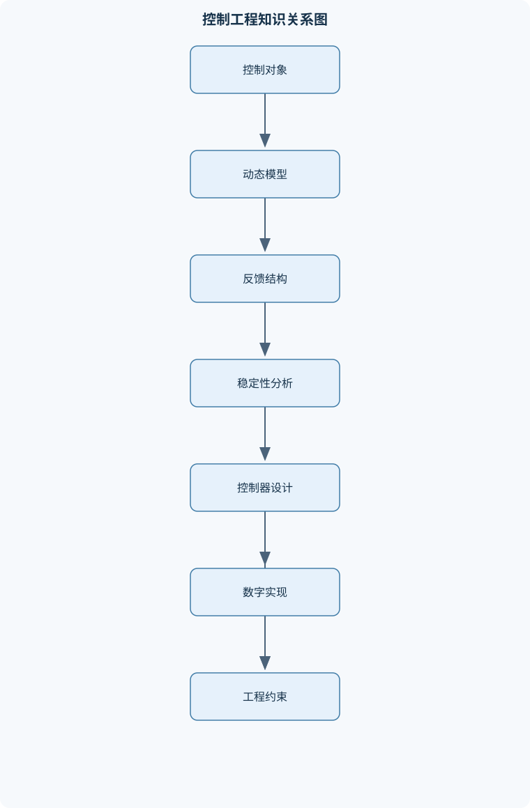
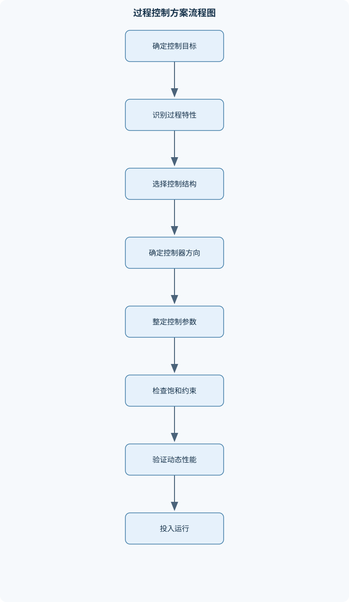

# 控制工程Ⅰ

## 一、课程整体知识框架

### 课程边界与先修知识

控制工程Ⅰ研究线性定常控制系统的建模、分析、设计与实现，重点覆盖经典控制理论、过程控制基础、数字控制基础及典型运动控制结构。内容边界包括控制系统组成与反馈原理、微分方程和传递函数建模、方块图与信号流图、时域与频域性能、稳定性判据、根轨迹、控制器校正、PID及数字PID、过程动态特性、串级控制、比值控制、选择与约束控制、分程控制、阀位控制，以及直流和交流运动控制系统的基本结构。先修知识包括高等数学中的微积分与微分方程、复数与拉普拉斯变换、线性代数、基础电路、传感器与执行器基础、电机与电力电子基础。课程默认以连续时间线性定常模型为主要理想模型，并说明采样、饱和、噪声、非线性、时变参数和模型不确定性等现实限制；不覆盖高级最优控制、非线性控制、鲁棒控制和完整工业过程设计。





### 1. 研究对象、基本任务与系统边界

《控制工程Ⅰ》研究以线性定常模型为主要近似的控制系统。控制系统的基本任务是：在给定值 $r(t)$ 变化时，使被控输出 $y(t)$ 按期望规律变化；在负载扰动 $d(t)$、参数变化和测量噪声存在时，仍保持稳定、准确、快速且控制作用不过度。控制问题通常依次经过四个层次：

1. **对象建模**：根据机械、电气、热、流体或电机过程的物理规律，建立微分方程、传递函数或状态空间模型。
2. **动态分析**：研究系统的稳定性、稳态误差、响应速度、超调量、带宽和抗扰能力。
3. **控制器设计**：通过比例、积分、微分、超前、滞后、串级、前馈或数字控制等结构改变闭环性能。
4. **工程实现**：考虑采样、量化、执行器饱和、阀门死区、测量噪声、纯滞后、非线性、时变参数和安全约束。

课程的理想模型通常写成连续时间线性定常系统。若输入为 $u(t)$、输出为 $y(t)$，其微分方程的系数不随时间变化，且叠加原理成立，则可使用传递函数和频率响应方法。实际过程常只在某一工作点附近近似线性。若阀门开度接近极限、液位接近空罐或满罐、温度跨越相变区，线性模型可能失效，必须重新选择工作点或采用分段模型。

系统中的常用信号为：

- $r(t)$：给定输入，表示期望被控变量，单位通常与 $y(t)$ 相同；
- $y(t)$：被控输出或被控变量；
- $e(t)=r(t)-y(t)$：负反馈、量纲已统一时的误差信号；
- $u(t)$：控制器输出或执行器输入；
- $m(t)$：操纵变量，如阀门开度、电机电压或变频器频率；
- $d(t)$：外部扰动，可作用于对象输入、执行器或测量环节；
- $G(s)$：对象或某一环节的传递函数；
- $G_c(s)$：控制器传递函数，比例增益记为 $K_c$；
- $H(s)$：测量变送或反馈环节；
- $L(s)=G_c(s)G(s)H(s)$：开环传递函数。

控制系统的性能不能只用一个指标评价。提高 $K_c$ 往往能减小跟踪误差，却会降低相对稳定性；缩短 $T_i$ 能增强消除余差的能力，却可能增大振荡；增大带宽可以加快响应，但会放大高频噪声并增加执行器动作。工程设计必须在准确性、速度、稳定性、能量消耗和设备约束之间折中。

### 2. 反馈结构与因果关系

典型负反馈系统由被控对象、测量变送、控制器和末端执行器组成。给定值经比较环节与测量输出相减形成误差，控制器依据误差产生控制信号，执行器改变操纵变量，操纵变量进一步影响被控变量。闭环结构的关键不是方块图的形式，而是信号方向、增益符号和物理因果关系。

前向通道为 $G_c(s)G(s)$、反馈通道为 $H(s)$ 时，有

$$
\frac{Y(s)}{R(s)}
=
\frac{G_c(s)G(s)}
{1+G_c(s)G(s)H(s)}.
$$

推导过程是：由负反馈关系 $E=R-HY$，又有 $Y=G_cGE$，代入得 $Y=G_cG(R-HY)$；整理关于 $Y$ 的项，即得上述闭环传递函数。因此闭环极点由

$$
1+G_c(s)G(s)H(s)=0
$$

决定。该结论要求系统是线性定常系统，并且变换采用零初始条件。若为正反馈，分母相应变为 $1-G_cGH$，不能机械套用负反馈公式。

扰动通道必须单独分析。例如扰动在对象输入端加入时，若对象输出满足 $Y=G_cG(R-HY)+G_dD$，则扰动到输出的传递关系与给定值到输出的传递关系不同。设计控制器时不能只验证跟踪响应，还要检查负载变化、测量噪声和执行器扰动。

控制器正反作用不能仅由对象名称决定。必须依次判断：误差增大时控制器输出如何变化，控制阀信号增大时操纵变量如何变化，操纵变量增大时被控变量如何变化。若这三个方向的总作用使误差减小，则构成负反馈；若使误差进一步增大，则应反向设置控制器作用。气开阀通常在控制信号增大时开度增大，气关阀则相反，但阀门的安全位置还需结合失气、失电时的工艺风险确定。

### 3. 动态建模的统一方法

建模首先要确定输入、输出、状态、边界条件和工作点。机械系统依据牛顿定律，电路依据基尔霍夫定律，热过程依据能量守恒，流体过程依据质量守恒和流量—压差关系。建立微分方程后，在零初始条件下作拉普拉斯变换，得到

$$
G(s)=\frac{Y(s)}{U(s)}.
$$

传递函数只描述输入到输出的关系，不直接保留初始状态信息。其极点决定自然动态，零点决定输入输出之间的附加动态形状。传递函数中的增益必须说明输入、输出单位；例如温度对象增益可为 $\mathrm{^\circ C}/\%$，流量对象增益可为 $\mathrm{m^3/h}/\%$。

非线性方程需在工作点附近线性化。设过程关系为 $y=f(x,u)$，在 $(x_0,u_0)$ 附近作一阶泰勒展开：

$$
\Delta y
\approx
\left.\frac{\partial f}{\partial x}\right|_0\Delta x
+
\left.\frac{\partial f}{\partial u}\right|_0\Delta u.
$$

其中 $\Delta x=x-x_0$、$\Delta u=u-u_0$。该模型只适用于工作点附近的小偏差。如果阀门流量特性强非线性，或过程增益随负荷显著变化，则单一线性模型只能用于局部分析。

常见环节包括：

- 一阶惯性环节：$G(s)=K/(Ts+1)$，$K$为稳态增益，$T$为时间常数；
- 二阶标准环节：分母可写成 $s^2+2\zeta\omega_ns+\omega_n^2$；
- 积分环节：$K/s$，输出持续累积输入；
- 微分环节：$K_ds$，理想情况下对高频信号具有无界增益；
- 纯滞后环节：$e^{-\tau s}$，输入变化经过 $\tau$ 后才影响输出。

一阶对象受到单位阶跃输入时，

$$
y(t)=K(1-e^{-t/T}),\qquad t\geq0.
$$

在 $t=T$ 时，输出达到最终变化量的 $1-e^{-1}\approx63.2\%$。因此 $K$决定最终变化量，$T$决定变化速度。带纯滞后的模型通常写为

$$
G(s)=\frac{K e^{-\tau s}}{Ts+1}.
$$

当 $\tau/T$ 较大时，反馈信息相对迟缓，提高控制增益更容易产生振荡。此时需要降低闭环带宽，或采用前馈、串级和预测性结构。

### 4. 时域、频域与稳定性之间的联系

典型输入包括单位阶跃、斜坡、脉冲和正弦输入。单位阶跃适合评价稳态值、上升时间、超调量和调节时间；正弦输入适合研究不同频率下的幅值衰减和相位滞后。

二阶闭环分母为

$$
s^2+2\zeta\omega_ns+\omega_n^2.
$$

其中 $\omega_n$ 为自然角频率，$\zeta$ 为阻尼比。$0<\zeta<1$ 时为欠阻尼，响应会振荡；$\zeta=1$ 时为临界阻尼；$\zeta>1$ 时为过阻尼。欠阻尼情况下的阻尼振荡频率为

$$
\omega_d=\omega_n\sqrt{1-\zeta^2}.
$$

若单位阶跃响应的峰值超调量为 $M_p$，则

$$
M_p=e^{-\frac{\pi\zeta}{\sqrt{1-\zeta^2}}}.
$$

该式仅适用于标准二阶、欠阻尼、无显著零点和高阶极点影响的情形。增大 $\zeta$ 通常能减小超调，但可能延长响应时间；增大 $\omega_n$ 通常能加快响应，但会提高控制作用峰值。

稳态误差可由终值定理求得：

$$
e(\infty)=\lim_{s\to0}sE(s).
$$

使用该式的前提是闭环稳定且终值存在。若系统存在右半平面极点、持续振荡或输入使终值不存在，则不能直接套用终值定理。纯比例控制下，若负载扰动要求新的稳态操纵量，而比例控制器输出为 $u=K_ce$，则必须保留非零误差才能产生有限控制作用，因此通常存在余差。积分控制器满足

$$
u_I(t)=\frac{K_c}{T_i}\int_0^t e(\lambda)\,d\lambda.
$$

只要闭环稳定、积分器未饱和且误差持续存在，积分状态就会继续变化，直到常值误差趋近于零；但执行器饱和、测量偏置和控制能力不足会破坏这一结论。

频域分析使用频率响应 $G(j\omega)$。伯德图把幅值用分贝表示、频率用对数坐标表示，便于叠加典型环节的特性。增益交越频率是幅值穿越 $0$ dB 的频率，相位裕度是该频率处相位距离 $-180^\circ$ 的余量；相位交越频率是相位达到 $-180^\circ$ 的频率，增益裕度反映幅值距离 $0$ dB 的余量。裕度越大通常相对稳定性越好，但带宽和响应速度可能下降。对含纯滞后的系统，幅值不变而相位增加 $-\omega\tau$，因此滞后越大，相位裕度越容易被消耗。

劳斯判据通过闭环特征多项式系数判断右半平面根的个数。根轨迹则研究开环增益变化时闭环极点的运动。两者都属于线性定常系统的代数或图形分析方法，不直接处理执行器饱和、非线性极限环或时变参数稳定性。

### 5. 控制器设计与实现层次

理想 PID 控制器为

$$
G_c(s)=K_c\left(1+\frac{1}{T_is}+T_ds\right).
$$

比例项提供即时作用，积分项消除常值误差，微分项依据误差变化趋势提供预测作用。理想微分对高频噪声具有无界放大趋势，工业实现通常采用微分滤波器，例如将微分项改为

$$
\frac{T_ds}{1+T_ds/N},
$$

其中 $N$ 为有限滤波系数。工业控制器还常使用测量值微分、设定值加权、输出限幅和抗积分饱和，以避免给定值阶跃引起微分冲击和执行器超限。

比例带常与控制增益近似互为倒数，但不同仪表的比例带定义、量程归一化方式和正反作用约定可能不同，实际使用时必须核对。输出限幅只限制控制器输出，不能自动清除积分累积；抗积分饱和还需冻结积分、反算修正或使用外部复位反馈。

数字控制通过采样和保持把连续信号转换为离散序列。采样周期记为 $T_s$，离散时刻记为 $k$。位置式数字 PID 可写成

$$
u(k)=K_c\left[
e(k)+\frac{T_s}{T_i}\sum_{i=0}^{k}e(i)
+\frac{T_d}{T_s}\bigl(e(k)-e(k-1)\bigr)
\right]+u_s.
$$

增量式形式为

$$
\Delta u(k)=K_c\left[
e(k)-e(k-1)
+\frac{T_s}{T_i}e(k)
+\frac{T_d}{T_s}
\bigl(e(k)-2e(k-1)+e(k-2)\bigr)
\right].
$$

然后令 $u(k)=u(k-1)+\Delta u(k)$。积分项必须乘以 $T_s/T_i$，微分差分必须除以 $T_s$，否则量纲错误。采样频率过低会造成相位延迟和混叠；采样频率过高则增加计算和通信负担，并可能放大噪声。

### 6. 多回路、过程控制与运动控制

过程动态具有明显差异。流量回路通常快，液位回路常表现为积分特性，温度回路通常较慢，成分和 pH 回路可能具有强非线性、滞后和测量困难。单回路设计必须先判断过程增益方向、时间常数、纯滞后、阀门特性和测量滞后。

串级控制由主回路和副回路组成。副变量必须满足三个条件：能被操纵量直接影响、响应明显快于主变量、能够尽早反映主要扰动。整定时先闭合并整定副回路，再把闭合后的副回路视为主回路的一部分，最后整定主回路。串级结构的价值在于内环先抑制阀门、供料压力等快速扰动，使主回路看到的等效对象更快、更接近线性。

前馈控制依据扰动测量值提前补偿，理论上可在扰动影响输出之前动作，但依赖对象和扰动模型。模型不准时，反馈回路负责消除残余误差，因此前馈通常与反馈组合，而不是完全替代反馈。

比值控制的目标是维持两个流量的工程量比值。若主动流量为 $F_a$，被动流量为 $F_p$，目标为 $F_p/F_a=R$，则被动流量设定值为 $F_{p,sp}=RF_a$。若两个变送器输出都是百分比，必须先按量程换算为工程单位，不能直接相除。低流量时分母接近零，应设置低流量保护、限幅或切换逻辑。

选择控制和超驰控制用于多个目标共享一个操纵量的场合。正常状态下主控制器追踪目标，约束变量接近上限或下限时，高选或低选器切换至保护控制器。未被选中的控制器若仍积分，切回时会产生冲击和恢复迟滞，因此需使用外部复位或跟踪逻辑。

分程控制使一个控制器输出的不同区间分别驱动不同阀门。例如温度控制中，低输出区可驱动冷却阀，高输出区可驱动蒸汽阀。设计时必须校验阀门方向、分程重叠和死区。阀门之间无重叠可能造成控制空档，重叠过大则可能造成加热和冷却同时作用。

状态空间表示为

$$
\dot{x}=Ax+Bu,\qquad y=Cx+Du.
$$

在零初始条件且矩阵维数相容时，

$$
G(s)=C(sI-A)^{-1}B+D.
$$

状态变量不一定具有唯一物理含义；相似变换可改变状态坐标而不改变输入输出传递函数。可控性决定输入能否影响全部状态方向，可观性决定输出测量能否重构状态。状态反馈 $u=-Kx$ 后，闭环矩阵为 $A-BK$；只有满足相应可控性条件时，才可能通过极点配置实现目标极点。

运动控制中，直流电机模型通常包含电枢电流、电磁转矩、反电动势和机械转速。双闭环调速采用电流内环、转速外环：内环快速限制电流和转矩，外环调节转速，内环带宽必须高于外环。同步电机的同步转速为

$$
n_s=\frac{60f}{p},
$$

其中 $f$ 为电源频率，单位为赫兹；$p$ 为极对数；$n_s$ 单位为转每分。该式适用于同步旋转磁场，不应直接当作异步电机实际转速；异步电机存在转差。交流调速还受电压、电流、磁链、弱磁和失步边界限制。

## 二、章节和模块划分

### 核心知识覆盖清单

本清单用于检查正文是否覆盖本课程的主要知识模块：

- **控制系统概论与反馈结构**：开环与闭环控制定义、被控对象与控制器、测量变送与末端执行器、给定值、被控变量与操纵变量、负反馈与正反馈、扰动分类与信号流向、控制阀气开气关特性、控制器正反作用选择、稳态误差与动态性能、理想模型与工程限制。
- **动态建模与传递函数**：机械、电气和热过程建模、线性化与工作点、微分方程建立方法、拉普拉斯变换与初始条件、传递函数定义与极点零点、一阶和二阶惯性环节、积分、微分和纯滞后环节、串联并联反馈等效、方块图化简、过程增益时间常数与滞后辨识。
- **时域分析与控制性能**：典型输入信号、一阶系统阶跃响应、二阶系统自然频率、阻尼比与超调量、上升时间与调节时间、稳态误差系数、扰动响应与跟踪响应、闭环特征方程、性能指标之间的权衡、模型阶次与响应近似。
- **稳定性分析方法**：闭环稳定性定义、特征根与极点位置、劳斯判据、奈奎斯特稳定判据、伯德图稳定裕度、增益裕度与相位裕度、根轨迹基本规则、参数变化与稳定域、纯滞后对稳定性的影响、相对稳定性与工程裕度。
- **频域分析与校正设计**：频率响应函数、幅相特性与对数坐标、伯德图绘制步骤、典型环节频率特性、截止频率与带宽、超前校正、滞后校正、超前滞后校正、相位裕度设计、噪声抑制与带宽权衡。
- **PID控制器原理与整定**：比例控制与余差、积分控制消除稳态误差、微分控制的预测作用、理想PID与工业PID、比例带与控制增益、微分先行与设定值加权、微分滤波器、输出限幅与抗积分饱和、离线整定与在线整定、控制器正反作用验证。
- **过程动态特性与单回路控制**：自衡与非自衡过程、一阶惯性加纯滞后模型、流量回路快速特性、液位回路积分特性、温度回路慢动态、压力与成分回路特点、阶跃试验辨识、过程增益方向判断、测量滞后与阀门非线性、单回路控制方案设计。
- **数字控制基础**：采样与保持、连续信号离散化、采样周期选择、零阶保持等效模型、差分方程、位置式数字PID、增量式数字PID、积分累加与微分差分、量化误差与测量噪声、数字输出限幅与抗饱和。
- **串级与前馈反馈控制**：串级控制基本结构、主回路与副回路、副参数选择原则、广义对象与等效变换、内回路快速扰动抑制、串级控制器整定顺序、串级积分饱和、前馈控制思想、前馈模型误差与反馈补偿、前馈反馈综合设计。
- **比值、选择与约束控制**：比值控制目标、主动流量与被动流量、乘法和除法比值方案、仪表量程换算、变比值控制、空燃比控制、双交叉控制、选择器与超驰控制、高选低选逻辑、约束条件与抗积分饱和。
- **分程与阀位控制**：分程控制定义、一个控制器驱动多阀、控制信号分段、阀门重叠与死区、加热冷却分程方案、储罐气封分程方案、阀位控制基本思想、阀位控制与串级区别、控制阀特性匹配、切换平稳性与安全限位。
- **状态空间与现代表示基础**：状态变量与状态方程、状态空间标准形式、可控性与可观性、状态转移矩阵、状态反馈基本思想、极点配置概念、状态观测器概念、连续系统离散化、传递函数与状态空间转换、模型降阶的适用边界。
- **直流与交流运动控制基础**：直流电机电枢回路模型、电磁转矩与反电动势、转速闭环控制、电流内环与转速外环、双闭环调速起动过程、电流限幅和转矩限制、异步电机变压变频、同步电机同步转速、永磁同步电机矢量控制、坐标变换与磁链定向。


### 1. 控制系统概论与反馈结构

本模块建立统一的对象—测量—控制器—执行器框架。重点区分给定值、被控变量、操纵变量和扰动，并说明开环控制不利用输出偏差，闭环控制则根据反馈误差自动修正。负反馈有利于减小参数变化和扰动影响，但反馈通道的滞后、噪声和符号错误可能使系统失稳。控制阀的气开、气关形式与控制器正、反作用必须联合判断，不能只依据“温度控制”或“压力控制”等过程名称决定。

### 2. 动态建模与传递函数

本模块从机械、电气、热过程和流体过程的守恒定律出发建立微分方程，再通过拉普拉斯变换得到传递函数。学习重点包括极点、零点、串联、并联、反馈等效和方块图化简。复杂交叉连接不宜强行用局部方块图化简，可改用信号流图或状态空间。过程辨识通常使用一阶加纯滞后模型，阶跃试验必须在稳定工作点附近进行，并保证输入输出不越过安全和量程边界。

### 3. 时域分析与性能指标

本模块分析一阶和二阶系统的阶跃响应，解释时间常数、自然频率、阻尼比、上升时间、峰值时间、超调量和调节时间之间的关系。还要区分跟踪响应和扰动响应。高阶对象可以在主导极点明显分离时用低阶模型近似；若存在右半平面零点、延迟极点或未建模共振，简单二阶近似可能错误。稳态误差计算必须先验证闭环稳定性。

### 4. 稳定性分析方法

本模块包括闭环极点、劳斯判据、奈奎斯特判据、伯德图裕度和根轨迹。劳斯表适合由特征多项式直接求参数稳定域；奈奎斯特方法适合根据开环频率响应判断闭环稳定性，但必须考虑开环右半平面极点；伯德图便于估计增益裕度、相位裕度和带宽；根轨迹适合研究单一增益变化对闭环极点的影响。稳定不等于性能良好，极点虽在左半平面，仍可能因裕度很小、控制输入过大或噪声放大而不适合工程应用。

### 5. 频域分析与校正设计

本模块从典型环节的幅相特性出发绘制伯德图。超前校正主要增加相位裕度并提高中频段响应速度，滞后校正主要改善低频增益和稳态精度，但可能降低带宽；超前—滞后校正兼顾两类目标。校正设计不能只使曲线满足理论交越频率，还应检查高频噪声、执行器变化率、纯滞后和模型不确定性。

### 6. PID 控制器原理与整定

本模块解释比例、积分、微分的物理作用及其相互制约。纯比例控制通常有余差；积分可消除稳定条件下的常值误差；微分可根据误差变化趋势提前动作，但对噪声敏感。整定可依据模型、阶跃响应或安全条件下的小幅在线试验。PID 参数应与对象增益、时间常数、滞后和控制阀方向一致。必须同时设计输出限幅、抗积分饱和、微分滤波和手自动无扰切换。

### 7. 过程动态特性与单回路控制

本模块比较自衡过程与非自衡过程。一阶自衡过程在输入保持不变时最终趋于新的稳定值；液位等积分过程若进出流量不平衡，变量会持续积累。流量回路可采用较快的比例或 PI 控制，温度回路通常需面对较大滞后，液位回路则不宜盲目追求零偏差而造成上游流量剧烈波动。阶跃辨识需记录稳定基线、输入变化、滞后起点和最终响应，并用单位和量程一致的数据拟合 $K$、$T$、$\tau$。

### 8. 数字控制基础

本模块说明采样、零阶保持、离散化和差分方程。位置式 PID 直接计算控制器绝对输出，容易理解但积分累积和输出限幅处理较敏感；增量式 PID 计算输出变化量，适合有限分辨率的执行器，但必须正确保存 $e(k)$、$e(k-1)$ 和 $e(k-2)$。数字实现还要处理量化误差、时间戳不规则、测量噪声、数值溢出和输出饱和。连续参数不能直接照搬到离散程序，积分和微分的采样周期因子必须保留。

### 9. 串级与前馈反馈控制

本模块研究主、副两个闭环及前馈—反馈综合结构。副回路应直接包住阀门、执行机构和主要快速扰动，使内环先修正局部变化。整定顺序必须是先副回路、后主回路；若副回路比主回路慢，串级结构反而可能增加复杂性。前馈通道需依据扰动测量和模型计算补偿量，反馈通道用于修正模型误差。串级、前馈和普通单回路的差异在于扰动是否被测量、修正是否提前以及内环是否具有独立动态。

### 10. 比值、选择与约束控制

本模块包括流量比值、空燃比、双交叉、选择器和超驰控制。比值计算必须进行量程换算。例如主动流量量程为 $0\sim F_{a,\max}$、被动流量量程为 $0\sim F_{p,\max}$，若变送器归一化输出分别为 $q_a,q_p$，则工程量比值为

$$
\frac{F_p}{F_a}
=
\frac{q_pF_{p,\max}}{q_aF_{a,\max}},
$$

而不是 $q_p/q_a$。空燃比控制还要设置富燃料保护和流量上下限。选择控制中安全约束优先于经济目标，选择器方向、积分跟踪和解除约束后的平稳恢复必须同时验证。

### 11. 分程与阀位控制

分程控制用一个控制器协调多个执行器。加热—冷却系统中，两个阀门应根据安全状态、流量方向和输出区间确定动作顺序；阀门重叠可减少切换死区，但过度重叠会导致能量对冲。阀位控制则由一个控制器调节主要过程变量，另一个控制器改变阀位或阀前条件，以保持阀门处于合适工作区间。它与串级控制不同：串级的副变量通常是过程变量并形成快速内环，阀位控制的辅助回路直接关注阀门位置或执行机构状态。

### 12. 状态空间与现代表示基础

本模块将传递函数方法扩展到多变量和内部状态分析。内容包括状态方程、状态转移矩阵、可控性、可观性、状态反馈、极点配置、观测器和连续系统离散化。模型降阶只有在被忽略模态远快于主要动态、且不会影响控制带宽和稳定裕度时才适用。状态空间矩阵的每一列和每一行必须满足维数和物理单位要求，不能只凭形式计算而忽略变量尺度。

### 13. 直流与交流运动控制基础

本模块建立直流电机电枢回路和机械运动方程，说明电磁转矩与电枢电流相关、反电动势与转速相关。双闭环调速中，电流内环负责快速转矩控制和限流，转速外环负责稳速。起动时速度误差较大，外环可能要求较大电流，但内环限幅将电流限制在允许范围内。交流运动控制包括异步电机变压变频、同步电机同步转速、永磁同步电机磁链定向和坐标变换。理论转速关系必须结合电压、电流、磁链、负载转矩和弱磁区边界解释。

### 14. 代表性分析流程与伪代码

#### 14.1 闭环建模流程

**输入**：工艺结构、信号方向、各环节模型和反馈符号。  
**输出**：闭环传递函数、特征方程、跟踪通道和扰动通道。  
**步骤**：

1. 标注 $r,y,e,u,m,d$ 的方向和单位；
2. 判断反馈是负反馈还是正反馈；
3. 合并可串联、并联的线性环节；
4. 闭合局部反馈回路；
5. 得到闭环分母并检查极点；
6. 验证输入输出关系和量纲。

每次等效变换必须保持外部输入输出关系不变；当所有内部回路均已处理且模型单位一致时终止。对交叉连接或多输入多输出系统，应改用信号流图或状态空间。

#### 14.2 数字 PID 的实现伪代码

```python
def digital_pid(r, y, state, p):
    # r, y: 当前给定值和测量值
    # state: e1, e2, integral, u_prev
    # p: Kc, Ti, Td, Ts, u_min, u_max, kaw

    e = r - y
    integral_trial = state["integral"] + p["Ts"] / p["Ti"] * e

    derivative = (e - state["e1"]) / p["Ts"]
    u_unsat = p["Kc"] * (e + integral_trial + p["Td"] * derivative)

    u = min(max(u_unsat, p["u_min"]), p["u_max"])

    # 反算抗积分饱和：实际输出与未限幅输出的差值修正积分
    correction = p["kaw"] * (u - u_unsat)
    integral = integral_trial + correction / p["Kc"]

    state["e2"] = state["e1"]
    state["e1"] = e
    state["integral"] = integral
    state["u_prev"] = u

    return u, state
```

该流程的输入是当前给定值、测量值、历史状态、控制器参数和输出限幅；输出是当前控制量及更新后的状态。每个采样周期的计算量为常数级。实际使用时还需增加测量滤波、手自动切换、异常时间戳处理和微分先行逻辑。

### 15. 代表性例题

#### 例题一：一阶对象的比例闭环

**题干**：对象为

$$
G(s)=\frac{2}{5s+1},
$$

采用单位负反馈比例控制器 $G_c(s)=K_c$。求闭环传递函数、闭环时间常数和单位阶跃稳态输出。

**分析**：前向通道为 $2K_c/(5s+1)$，反馈为单位负反馈。

**解答**：

$$
T(s)=\frac{2K_c}{5s+1+2K_c}.
$$

将分母写成

$$
5s+(1+2K_c)
=
5\left[s+\frac{1+2K_c}{5}\right],
$$

所以闭环时间常数为

$$
T_{\mathrm{cl}}=\frac{5}{1+2K_c}.
$$

单位阶跃稳态输出为

$$
y(\infty)=\lim_{s\to0}sT(s)\frac{1}{s}
=\frac{2K_c}{1+2K_c}.
$$

**结果验证**：当 $K_c>0$ 时闭环极点为 $-(1+2K_c)/5<0$，系统稳定；$K_c$增大时响应加快，但稳态输出仍小于 1，说明比例控制存在余差。

**变式**：若对象增益为负，则控制器方向需重新判断，不能直接令 $K_c>0$。

#### 例题二：二阶系统超调量

**题干**：闭环标准分母为

$$
s^2+4s+25.
$$

求 $\omega_n$、$\zeta$ 和欠阻尼阶跃响应的理论超调量。

**解答**：与

$$
s^2+2\zeta\omega_ns+\omega_n^2
$$

比较，得

$$
\omega_n=5,\qquad 2\zeta\omega_n=4,
$$

因此

$$
\zeta=\frac{4}{2\times5}=0.4.
$$

超调量为

$$
M_p=e^{-\frac{\pi(0.4)}{\sqrt{1-0.4^2}}}
\approx0.254.
$$

即约为 $25.4\%$。

**结果验证**：$0<\zeta<1$，因此系统欠阻尼；阻尼振荡频率为

$$
\omega_d=5\sqrt{1-0.16}\approx4.58\ \mathrm{rad/s}.
$$

**变式**：若要求超调量降低，应提高阻尼比，但不能只提高阻尼而不检查响应时间和控制输入峰值。

#### 例题三：阶跃试验辨识

**题干**：某温度对象在操纵变量增加 $10\%$ 后，输出最终增加 $20^\circ\mathrm C$，输入变化后约延迟 $3\ \mathrm s$ 开始响应，在延迟后约 $12\ \mathrm s$ 达到最终值的 $63.2\%$。建立一阶加纯滞后模型。

**解答**：过程增益为

$$
K=\frac{20^\circ\mathrm C}{10\%}
=2^\circ\mathrm C/\%.
$$

时间常数为 $T=12\ \mathrm s$，纯滞后为 $\tau=3\ \mathrm s$。模型为

$$
G(s)=\frac{2e^{-3s}}{12s+1}.
$$

**结果验证**：在 $t=3+12=15\ \mathrm s$ 时，模型预测输出达到最终变化量的约 $63.2\%$。  
**变式**：若测试期间阀门达到饱和或过程增益明显随负荷变化，该模型只能作为局部模型，不能直接用于全范围整定。

#### 例题四：比值控制量程换算

**题干**：主动流量量程为 $0\sim100\ \mathrm{m^3/h}$，被动流量量程为 $0\sim50\ \mathrm{m^3/h}$。主动流量变送器输出为 $40\%$，目标工程比值为 $F_p/F_a=0.8$。求被动流量设定值及其变送器百分比设定值。

**解答**：

主动流量为

$$
F_a=0.40\times100=40\ \mathrm{m^3/h}.
$$

被动流量设定值为

$$
F_{p,sp}=0.8\times40=32\ \mathrm{m^3/h}.
$$

换算为被动流量变送器百分比：

$$
q_{p,sp}=\frac{32}{50}\times100\%=64\%.
$$

**结果验证**：$32/40=0.8$，满足目标比值。  
**变式**：若直接计算 $0.8\times40\%=32\%$，得到的是错误的仪表设定值，因为两个量程不同。

#### 例题五：同步电机转速

**题干**：同步电机电源频率为 $50\ \mathrm{Hz}$，极对数为 $2$。求同步转速；当频率降至 $25\ \mathrm{Hz}$ 时，求新的同步转速。

**解答**：

$$
n_s=\frac{60f}{p}.
$$

在 $50\ \mathrm{Hz}$ 时，

$$
n_s=\frac{60\times50}{2}=1500\ \mathrm{r/min}.
$$

在 $25\ \mathrm{Hz}$ 时，

$$
n_s=\frac{60\times25}{2}=750\ \mathrm{r/min}.
$$

**结果验证**：频率减半，同步转速也减半。  
**边界说明**：该计算给出同步旋转磁场速度；异步电机实际转速因转差通常低于该值，且变频时还必须检查电压、磁链和负载转矩限制。

### 16. 实验与项目流程

#### 16.1 一阶对象阶跃辨识实验

**输入数据**：稳定工作点、操纵变量阶跃幅值、采样周期、时间序列 $u(t)$ 和 $y(t)$。  
**步骤**：

1. 保持过程在安全工作区并记录稳定基线；
2. 对操纵变量施加受限阶跃；
3. 记录输出直到接近新稳态；
4. 扣除输入输出初值；
5. 由最终输出变化量与输入变化量估计 $K$；
6. 由响应达到 $63.2\%$ 的时间估计 $T$；
7. 由输出开始明显变化的时间估计 $\tau$；
8. 用模型回放数据并比较误差。

**评价标准**：模型应正确反映增益方向、最终变化量、主要滞后和响应时间；残差不能表现出明显系统性偏差。  
**排错方法**：若最终值错误，检查量程和单位；若响应提前或滞后，检查时间戳与测量滤波；若模型只在局部有效，检查过程是否存在强非线性或工作点变化。

#### 16.2 数字 PID 仿真与限幅项目

**输入数据**：$T_s$、$K_c$、$T_i$、$T_d$、对象模型、给定值序列、测量噪声幅值和输出上下限。  
**步骤**：

1. 建立一阶或二阶离散对象；
2. 分别实现位置式和增量式 PID；
3. 输入阶跃给定并记录 $e(k)$、$u(k)$、$y(k)$；
4. 加入输出饱和，比较有无抗积分饱和时的恢复过程；
5. 加入测量噪声，比较不同微分滤波强度；
6. 检查采样周期变化对稳定性和性能的影响。

**评价标准**：闭环应稳定，输出不持续饱和，给定变化后的超调、调节时间和稳态误差符合设定要求；切换手自动时不应产生不可接受的输出跳变。  
**排错方法**：若积分项增长异常，检查 $T_s/T_i$ 和抗饱和逻辑；若噪声被放大，检查微分是否直接作用于测量信号且缺少滤波；若位置式与增量式结果不一致，检查历史误差保存和输出初值。

## 三、核心概念的详细解释

### 3.1 控制系统、反馈与信号关系

控制系统由被控对象、测量变送环节、控制器和末端执行器构成。被控对象是实际需要调节的设备或过程，例如储罐液位、炉出口温度、电机转速；测量变送环节把被控变量转换为控制器可处理的信号；控制器根据给定值与测量值的偏差计算控制作用；末端执行器把控制信号转换为对象能够接受的物理作用，例如阀门开度、电机电压或变频器频率。

常用信号包括给定值 $r(t)$、被控输出 $y(t)$、误差 $e(t)$、控制器输出 $u(t)$、操纵变量 $m(t)$ 和扰动 $d(t)$。在负反馈、信号量纲已经统一的条件下，

$$
e(t)=r(t)-y(t).
$$

实际仪表中，$r(t)$ 和 $y(t)$ 可能分别以设定值百分比和变送器输出百分比表示，不能未经量程换算直接相减。$u(t)$ 是控制器计算结果，$m(t)$ 是实际作用于对象的物理量，二者之间还可能存在输出模块、定位器和阀门特性。

开环控制不利用输出反馈，控制作用只由给定输入和预先设定的程序决定。它结构简单，但不能自动修正模型误差和负载扰动。闭环控制利用输出测量形成反馈，能够减小扰动影响和参数变化影响，但测量滞后、噪声和反馈延迟会降低稳定裕度。负反馈并非“反馈越强越好”：反馈增益过大或相位延迟过大时，系统可能产生振荡甚至失稳。

若前向通道为 $G_c(s)G(s)$，反馈通道为 $H(s)$，则闭环跟踪关系为

$$
\frac{Y(s)}{R(s)}
=
\frac{G_c(s)G(s)}
{1+G_c(s)G(s)H(s)}.
$$

这里的“负反馈”由比较点的减号和分母中的加号共同体现。若比较点采用正反馈，分母应改为 $1-G_cGH$。因此，不能只看控制器参数的正负号判断系统作用方向，必须同时考虑控制器、执行器和对象的增益方向。

### 3.2 控制器正反作用与执行器特性

控制器正反作用是指误差变化与控制器输出变化之间的方向关系。判断过程应按因果链逐段进行：

1. 误差 $e$ 增大时，控制器输出增加还是减少；
2. 控制器输出增加时，阀门开度或电机输入增加还是减少；
3. 操纵变量增加时，被控变量增加还是减少；
4. 最终判断该动作是否使误差减小。

例如，某加热过程的对象增益为正，气开阀信号增加会使燃料流量增加，温度随之升高。若温度偏低，则误差为正，控制器应增加输出，因此控制器应采用使输出随误差增加而增加的作用方向。若阀门为气关型，控制信号增大反而使阀门关小，则控制器作用方向必须反向调整。

气开阀在失去气源或控制信号时趋向关闭，适用于失气后应切断能量或物料的场合；气关阀在失气时趋向打开，适用于失气后需要保持冷却、泄压或持续供给的场合。安全位置优先由工艺后果决定，不能只依据“加热阀”或“冷却阀”的名称判断。

### 3.3 动态模型、线性化与传递函数

物理建模的基本步骤是确定边界、列出守恒关系、写出元件特性、确定初始条件，再进行线性化和变换。机械系统通常依据牛顿定律或力矩平衡，电路依据基尔霍夫定律，热过程依据能量守恒，流体过程依据物料平衡。

非线性过程可在工作点附近展开。例如对象关系为

$$
F(x,u)=0,
$$

在工作点 $(x_0,u_0)$ 附近令 $\Delta x=x-x_0$、$\Delta u=u-u_0$，忽略二阶及以上小量，可得

$$
\frac{\partial F}{\partial x}\bigg|_0\Delta x+
\frac{\partial F}{\partial u}\bigg|_0\Delta u=0.
$$

这种线性化只在工作点附近有效。阀门接近全关或全开、液位接近边界、流量平方根关系明显时，线性模型可能不再具有足够精度。

在零初始条件下，传递函数定义为

$$
G(s)=\frac{Y(s)}{U(s)}.
$$

它只描述输入到输出的动态关系，不直接保留初始状态信息。传递函数的极点决定自然动态，零点影响输入输出之间的瞬态形状和响应方向。稳定性分析主要考察闭环极点，但不能只看传递函数极点而忽略内部不稳定模态、未建模动态和执行器限制。

常见环节包括比例环节、积分环节、微分环节、一阶惯性环节、二阶振荡环节和纯滞后环节。过程模型常写成一阶加纯滞后形式：

$$
G(s)=\frac{K e^{-\tau s}}{Ts+1}.
$$

其中 $K$ 的单位是“输出单位/输入单位”，$T$ 和 $\tau$ 的单位为时间。$T$ 反映过程自身的响应速度，$\tau$ 表示输入变化到输出开始明显响应前的延迟。纯滞后不改变稳态增益，却额外引入相位滞后，因此常使控制器难以提高增益。

### 3.4 时域性能与稳态误差

典型输入包括单位阶跃、斜坡、脉冲和正弦信号。单位阶跃常用于比较系统的最终值、上升时间、峰值时间、超调量和调节时间。对一阶模型

$$
G(s)=\frac{K}{Ts+1},
$$

输入幅值为 $A$ 的阶跃时，零初始条件下输出为

$$
y(t)=AK\left(1-e^{-t/T}\right),\qquad t\geq0.
$$

当 $t=T$ 时，输出达到最终变化量的 $1-e^{-1}\approx63.2\%$。因此，$K$ 决定最终变化量，$T$ 决定响应速度，二者不能混为一谈。

标准二阶闭环模型为

$$
G_{\mathrm{cl}}(s)=
\frac{\omega_n^2}
{s^2+2\zeta\omega_n s+\omega_n^2}.
$$

$\omega_n$ 为自然角频率，单位为 $\mathrm{rad/s}$；$\zeta$ 为无量纲阻尼比。$0<\zeta<1$ 时系统欠阻尼，响应有振荡；$\zeta=1$ 时为临界阻尼；$\zeta>1$ 时为过阻尼。欠阻尼情况下阻尼振荡频率为

$$
\omega_d=\omega_n\sqrt{1-\zeta^2}.
$$

单位阶跃超调量为

$$
M_p=e^{-\frac{\pi\zeta}{\sqrt{1-\zeta^2}}}.
$$

当采用约 $2\%$ 误差带定义时，调节时间常近似为

$$
t_s\approx\frac{4}{\zeta\omega_n}.
$$

这些公式是标准二阶模型的近似结果，不能直接用于高阶系统、强非线性系统或含显著纯滞后的过程。增大 $\zeta$ 通常减小超调，但若同时降低 $\omega_n$，响应可能变慢；提高 $\omega_n$ 又可能增加控制输入峰值和噪声敏感性。

稳态误差由终值定理计算：

$$
e(\infty)=\lim_{s\to0}sE(s).
$$

使用该公式的前提是闭环稳定且所求终值存在。不稳定系统或持续振荡系统不能直接套用终值定理。纯比例控制下，负载扰动需要通过非零误差产生控制器输出变化，因此通常存在余差。积分作用能够累积误差并改变控制器输出，使常值误差趋于零，但执行器饱和、积分器冻结、扰动超出执行能力或系统不稳定时，该结论不成立。

### 3.5 频域性能、稳定裕度与校正

频率响应是在输入为正弦信号时，系统稳态输出的幅值比和相位差。令 $s=j\omega$，可得频率响应 $G(j\omega)$。伯德图以对数频率为横坐标，幅值通常用分贝表示：

$$
20\log_{10}|G(j\omega)|.
$$

增益交越频率 $\omega_{gc}$ 满足幅值为 $0\,\mathrm{dB}$；相位裕度为

$$
\mathrm{PM}=180^\circ+\angle L(j\omega_{gc}).
$$

相位交越频率 $\omega_{pc}$ 满足相位为 $-180^\circ$；增益裕度用幅值距离 $0\,\mathrm{dB}$ 的程度表示。裕度越大，通常相对稳定性越好，但带宽和响应速度可能下降。存在右半平面开环极点时，不能只依据普通直观规则判断闭环稳定性，必须结合完整奈奎斯特判据或劳斯判据。

根轨迹描述某一实参数变化时闭环极点的位置。闭环特征方程为

$$
1+K G_0(s)H(s)=0.
$$

根轨迹上的点必须满足角度条件和幅值条件：

$$
\angle G_0(s)H(s)=(2q+1)180^\circ,
$$

$$
K=\frac{1}{|G_0(s)H(s)|}.
$$

超前校正增加某一频段的正相位，常用于提高相位裕度和响应速度；滞后校正提高低频增益，常用于减小稳态误差，但可能降低带宽并增加相位滞后。含纯滞后的对象可用频域方法直接分析，因为

$$
e^{-j\omega\tau}
$$

的幅值为 $1$、相位为 $-\omega\tau$；这说明滞后越大，高频相位损失越明显。

### 3.6 PID控制及工业实现

理想 PID 控制器为

$$
G_c(s)=K_c\left(1+\frac{1}{T_i s}+T_d s\right),
$$

其中 $K_c$ 为比例增益，$T_i$ 为积分时间，$T_d$ 为微分时间。比例作用立即响应当前误差；积分作用消除持续偏差；微分作用根据误差变化趋势提前施加控制。

理想微分对高频信号的增益随频率无限增加，测量噪声会被严重放大，因此工业控制器通常采用带滤波的微分环节，例如

$$
G_D(s)=K_c\frac{T_d s}{1+T_f s},
$$

其中 $T_f$ 为微分滤波时间常数。给定值发生阶跃时，若微分直接作用于误差，会产生微分冲击，所以常采用测量值微分或设定值加权。

比例带通常与比例增益近似互为倒数，但不同仪表的比例带定义、量程归一化方式和单位可能不同，使用前必须核对仪表约定。输出限幅只限制实际输出，不能自动阻止积分项继续累加。抗积分饱和可采用积分冻结、反算回馈或外部复位反馈，使内部积分状态与受限输出保持一致。

### 3.7 过程动态、串级、前馈与约束控制

自衡过程在输入改变后最终趋向新的有限稳态，例如温度和压力过程；非自衡过程的输出可能持续积累，例如理想液位过程。流量回路通常响应快，液位回路具有积分特性，温度回路常受热容量影响而较慢，成分和 pH 回路还可能具有强非线性和增益突变。

串级控制由主回路和副回路构成。副变量必须满足三个条件：能被操纵量直接影响、响应速度明显快于主变量、能够较早检测主要扰动。先整定副回路，再闭合并整定主回路。闭合副回路后，阀门、执行器和部分快速扰动被包入内环，主回路看到的是响应更快、等效增益更稳定的广义对象。

前馈控制根据可测扰动直接计算补偿量，不必等待被控变量偏离后才动作。前馈模型不准确时不能独立保证稳定和消除误差，通常与反馈结合：前馈负责快速补偿，反馈负责修正模型误差和未测扰动。

比值控制的目标是维持两个流量或物料量的工程单位比值。主动流量通常作为基准，被动流量设定值随主动流量变化。若采用流量变送器百分比信号，必须先按量程换算为工程量，不能直接相除。低流量时分母接近零，应设置下限、切换逻辑或采用乘法形式。

选择控制和超驰控制用于处理多个目标共享一个操纵量的场合。正常情况下由主控制器实现经济或质量目标，当温度、压力、液位等约束接近极限时，选择器切换至保护控制器。未被选中的控制器若继续积分，恢复时会产生冲击，因此需要外部复位或跟踪功能。

分程控制使一个控制器输出分成多个区间，分别驱动不同阀门。例如温度控制中低输出区控制冷却阀，高输出区控制加热阀。设计时要确定阀门动作方向、信号分界、重叠区和死区。重叠过小会造成控制空档，重叠过大可能使两阀同时动作；切换点还应配合安全限位和无扰切换。

### 3.8 数字控制、状态空间与运动控制

连续控制器离散化时，采样周期记为 $T_s$，离散时刻为 $k$。位置式数字 PID 可写为

$$
u(k)=u_s+K_c\left[
e(k)+\frac{T_s}{T_i}\sum_{i=0}^{k}e(i)
+\frac{T_d}{T_s}\big(e(k)-e(k-1)\big)
\right].
$$

增量式形式为

$$
\Delta u(k)=K_c\left[
e(k)-e(k-1)
+\frac{T_s}{T_i}e(k)
+\frac{T_d}{T_s}
\big(e(k)-2e(k-1)+e(k-2)\big)
\right],
$$

并令 $u(k)=u(k-1)+\Delta u(k)$。积分项必须乘以 $T_s$，微分项必须除以 $T_s$，否则量纲和数值均不正确。采样周期过大时会丢失动态信息，过小时则增加计算、通信和噪声负担。零阶保持器在两个采样时刻之间保持控制量不变，实际数字控制系统不能忽略保持和计算延迟。

状态空间模型为

$$
\dot{x}=Ax+Bu,\qquad y=Cx+Du.
$$

$x$ 为状态向量，$A$、$B$、$C$、$D$ 的维数必须相容，且单位应与状态定义一致。零初始条件下，

$$
G(s)=C(sI-A)^{-1}B+D.
$$

可控性表示输入能否在有限时间内改变全部状态，可观性表示能否由输出重构全部状态。状态反馈 $u=-Kx$ 后，闭环矩阵为

$$
A_{\mathrm{cl}}=A-BK.
$$

只有满足相应可控性条件且目标极点可实现时，极点配置才有效。状态变量并不一定具有唯一物理含义，相似变换可改变状态坐标而不改变输入输出传递函数。

直流电机中，电磁转矩通常与电枢电流成正比，反电动势与转速有关。双闭环调速采用电流内环和转速外环：内环快速限制电流和转矩，外环调节转速。内环带宽应明显高于外环，否则把内环近似为快速环节的假设不成立。异步电机实际转速存在转差，不能直接用同步转速公式代替；同步电机的同步转速为

$$
n_s=\frac{60f}{p},
$$

其中 $f$ 为电源频率，$p$ 为极对数，$n_s$ 的单位为 $\mathrm{r/min}$。变频调速还需满足电压、电流、磁链、转矩和失步边界。

## 四、重要定义、公式、定理和推导

### 专业审校补充：关键定义与适用边界

控制系统的“输入输出稳定”不等同于“内部稳定”。若某个传递函数经过极点—零点约消后表面上只剩左半平面极点，仍可能存在未被输入输出通道显现的内部不稳定模态。因此，闭环分析不能只约去公共因子后观察简化传递函数，还应检查未约分的闭环特征方程，或检查状态矩阵的全部特征值。设状态方程为 $\dot{x}=Ax+Bu$、输出为 $y=Cx+Du$，内部渐近稳定要求矩阵 $A$ 的全部特征值实部严格小于零；采用状态反馈后则要求 $A-BK$ 的全部特征值满足该条件。若某不稳定模态同时不可控或不可观，传递函数可能暂时掩盖它，但参数扰动、初始状态、传感器位置改变或执行器饱和都可能使该模态暴露。因而“传递函数稳定”只是在零初始条件、给定输入输出通道和无精确约消假设下的结论；工程设计应优先检查未约分特征方程、内部状态响应及模型不确定性。


### 4.1 闭环传递函数与扰动通道推导

负反馈系统满足

$$
E(s)=R(s)-H(s)Y(s),
$$

前向通道满足

$$
Y(s)=G_c(s)G(s)E(s).
$$

代入第一式：

$$
Y=G_cG(R-HY).
$$

展开并整理：

$$
Y+G_cGHY=G_cGR,
$$

因此

$$
\frac{Y}{R}=\frac{G_cG}{1+G_cGH}.
$$

闭环特征方程为

$$
1+G_c(s)G(s)H(s)=0.
$$

若扰动 $D(s)$ 在对象输入端叠加，且扰动到输出的对象通道为 $G_d(s)$，则

$$
Y=G_cG(R-HY)+G_dD.
$$

整理得

$$
Y=
\frac{G_cG}{1+G_cGH}R+
\frac{G_d}{1+G_cGH}D.
$$

该式说明反馈同时影响跟踪通道和扰动通道，但两条通道的分子不同。只验证 $Y/R$ 不能代替对扰动响应的分析。

### 4.2 一阶系统阶跃响应推导

给定

$$
G(s)=\frac{K}{Ts+1},
$$

输入为幅值 $A$ 的阶跃：

$$
R(s)=\frac{A}{s}.
$$

则

$$
Y(s)=\frac{AK}{s(Ts+1)}.
$$

部分分式展开为

$$
Y(s)=AK\left(\frac{1}{s}-\frac{T}{Ts+1}\right).
$$

反拉普拉斯变换得到

$$
y(t)=AK(1-e^{-t/T}).
$$

当 $t\to\infty$ 时，$y(\infty)=AK$；当 $t=T$ 时，$y(T)=AK(1-e^{-1})\approx0.632AK$。该推导要求系统线性、初始条件为零，且输入阶跃后模型参数保持不变。

### 4.3 二阶系统性能公式的来源

标准二阶特征方程为

$$
s^2+2\zeta\omega_n s+\omega_n^2=0.
$$

当 $0<\zeta<1$ 时，特征根为

$$
s_{1,2}=-\zeta\omega_n
\pm j\omega_n\sqrt{1-\zeta^2}.
$$

因此响应包络为 $e^{-\zeta\omega_n t}$，振荡角频率为

$$
\omega_d=\omega_n\sqrt{1-\zeta^2}.
$$

由第一次峰值出现的条件，可得超调量

$$
M_p=e^{-\frac{\pi\zeta}{\sqrt{1-\zeta^2}}}.
$$

包络衰减到 $2\%$ 所需时间满足

$$
e^{-\zeta\omega_n t_s}\approx0.02,
$$

精确计算给出

$$
t_s\approx\frac{3.912}{\zeta\omega_n},
$$

工程上常取 $4/(\zeta\omega_n)$。该近似只适合主导动态可用标准二阶模型描述的情况；高阶系统若存在慢极点、非主导零点或纯滞后，必须通过完整响应验证。

### 4.4 稳态误差与系统型别

单位负反馈系统的误差为

$$
E(s)=\frac{R(s)}{1+L(s)},
\qquad L(s)=G_c(s)G(s)H(s).
$$

由终值定理，

$$
e(\infty)=\lim_{s\to0}s\frac{R(s)}{1+L(s)}.
$$

对单位阶跃 $R(s)=1/s$：

$$
e(\infty)=\lim_{s\to0}\frac{1}{1+L(s)}.
$$

若低频开环增益有限，稳态误差一般不为零；若开环含一个积分环节且闭环稳定，低频增益趋于无穷，阶跃误差可为零。对斜坡输入，还需进一步考察速度误差系数。系统型别是开环传递函数在原点极点的个数，但型别结论必须与闭环稳定性一起使用，不能认为增加积分环节必然改善所有性能。

### 4.5 劳斯判据

设闭环特征多项式为

$$
a_ns^n+a_{n-1}s^{n-1}+\cdots+a_1s+a_0=0.
$$

劳斯表前两行为

$$
\begin{array}{c|ccc}
s^n&a_n&a_{n-2}&a_{n-4}\\
s^{n-1}&a_{n-1}&a_{n-3}&a_{n-5}
\end{array}
$$

后续元素按相邻两行递推。例如第一列下一项为

$$
b_1=
\frac{a_{n-1}a_{n-2}-a_na_{n-3}}{a_{n-1}}.
$$

劳斯判据指出：劳斯表第一列的符号变化次数等于特征方程右半平面根的个数。渐近稳定要求第一列元素均为同号，通常取正号。若第一列出现零，需要用小正数 $\varepsilon$ 代替并取极限；若某一行全为零，则说明存在关于原点对称的根，需要利用上一行构造辅助多项式。该判据适用于实系数有限阶多项式，不直接给出超调量、带宽或非线性系统稳定性。

### 4.6 伯德图和稳定裕度计算

对开环函数 $L(s)$，求 $L(j\omega)$ 的幅值和相位。增益交越频率满足

$$
|L(j\omega_{gc})|=1.
$$

相位裕度为

$$
\mathrm{PM}=180^\circ+\arg L(j\omega_{gc}).
$$

相位交越频率满足

$$
\arg L(j\omega_{pc})=-180^\circ.
$$

在该频率处，若幅值为 $M$，增益裕度的分贝表达可写为

$$
\mathrm{GM}_{\mathrm{dB}}=-20\log_{10}M.
$$

若开环系统没有右半平面极点，正的增益裕度和相位裕度通常表明闭环具有一定相对稳定性；若开环本身不稳定，则必须结合奈奎斯特绕行次数判断，不能仅依据裕度的表面数值下结论。

### 4.7 PID 离散化的推导

连续 PID 控制律为

$$
u(t)=K_c\left[
e(t)+\frac{1}{T_i}\int_0^t e(\lambda)\,d\lambda
+T_d\frac{de(t)}{dt}
\right]+u_s.
$$

以采样周期 $T_s$ 进行离散化，用矩形积分和后向差分近似：

$$
\int_0^{kT_s}e(t)\,dt
\approx T_s\sum_{i=0}^{k}e(i),
$$

$$
\frac{de(t)}{dt}\bigg|_{kT_s}
\approx\frac{e(k)-e(k-1)}{T_s}.
$$

代入得位置式数字 PID：

$$
u(k)=u_s+K_c\left[
e(k)+\frac{T_s}{T_i}\sum_{i=0}^{k}e(i)
+\frac{T_d}{T_s}(e(k)-e(k-1))
\right].
$$

计算相邻时刻差值：

$$
u(k)-u(k-1)=\Delta u(k),
$$

并展开积分和微分项，可得

$$
\Delta u(k)=K_c\left[
e(k)-e(k-1)
+\frac{T_s}{T_i}e(k)
+\frac{T_d}{T_s}
(e(k)-2e(k-1)+e(k-2))
\right].
$$

位置式便于直接查看控制器绝对输出，但积分累加可能造成数值积累；增量式便于与输出限幅和手动操作结合，但必须保存历史误差和当前输出。两种形式参数、初始条件或限幅处理不同，结果不一定完全相同。

下面给出一个无外部副作用的数字 PID 示例，包含积分限幅和输出限幅：

```python
class DigitalPID:
    def __init__(self, kc, ti, td, ts, u_min, u_max):
        self.kc = kc
        self.ti = ti
        self.td = td
        self.ts = ts
        self.u_min = u_min
        self.u_max = u_max
        self.integral = 0.0
        self.previous_error = 0.0

    def update(self, setpoint, measurement):
        error = setpoint - measurement
        derivative = (error - self.previous_error) / self.ts

        trial_integral = self.integral + self.ts * error / self.ti
        trial_output = self.kc * (
            error + trial_integral + self.td * derivative
        )

        output = max(self.u_min, min(self.u_max, trial_output))

        # 简化抗积分饱和：只有未饱和或误差有助于退出饱和时才更新积分
        if output == trial_output:
            self.integral = trial_integral
        elif output == self.u_max and error < 0:
            self.integral = trial_integral
        elif output == self.u_min and error > 0:
            self.integral = trial_integral

        self.previous_error = error
        return output
```

该实现假设 $T_i>0$、$T_s>0$，误差和输出单位已经统一，并且测量时间间隔稳定。工业实现还需加入微分滤波、手自动无扰切换、传感器故障检测和执行器反馈。

### 4.8 串级控制等效对象

设副回路控制器为 $G_{c2}$，副对象为 $G_2$，副回路反馈为 $H_2$，则副回路闭合后的等效传递函数为

$$
G_{\mathrm{inner}}(s)
=
\frac{G_{c2}(s)G_2(s)}
{1+G_{c2}(s)G_2(s)H_2(s)}.
$$

主回路所看到的对象不再只是原始副对象，而是包含副控制器和副反馈的广义对象。若副回路设计得足够快，阀门特性、执行器滞后和快速扰动的影响可被内环抑制，主回路的控制难度降低。

串级设计不能只因为存在两个测量变量就使用。若副变量响应不快、无法被操纵量直接影响，或者主要扰动不经过副回路，串级结构可能增加复杂度却没有实质收益。整定时先断开主控制器或置于手动，整定副回路；再闭合副回路，辨识广义对象并整定主回路。

### 4.9 比值控制的量程换算

设主动流量工程值为 $F_a$，量程为 $[F_{a,\min},F_{a,\max}]$，变送器输出归一化值为 $q_a$，则

$$
F_a=F_{a,\min}
+q_a(F_{a,\max}-F_{a,\min}).
$$

被动流量同理。若目标工程比值为 $R$，则被动流量设定值为

$$
F_{p,\mathrm{sp}}=R F_a.
$$

转换回被动流量变送器百分比：

$$
q_{p,\mathrm{sp}}
=
\frac{F_{p,\mathrm{sp}}-F_{p,\min}}
{F_{p,\max}-F_{p,\min}}.
$$

当两个量程下限均为零时，若主动流量满量程为 $50$、被动流量满量程为 $80$，目标工程比值为 $R=0.8$，主动流量为满量程的 $40\%$，则

$$
F_a=0.4\times50=20,
$$

$$
F_{p,\mathrm{sp}}=0.8\times20=16,
$$

$$
q_{p,\mathrm{sp}}=\frac{16}{80}=20\%.
$$

若直接将 $0.8\times40\%=32\%$ 作为被动流量设定值，则忽略了两个量程不同，结果错误。

### 4.10 状态反馈与极点配置

状态方程为

$$
\dot{x}=Ax+Bu.
$$

采用状态反馈

$$
u=-Kx+Nr
$$

后，代入可得

$$
\dot{x}=(A-BK)x+BNr.
$$

因此闭环极点由矩阵 $A-BK$ 的特征值决定。若系统的可控性矩阵

$$
\mathcal{C}=
\begin{bmatrix}
B&AB&A^2B&\cdots&A^{n-1}B
\end{bmatrix}
$$

满秩，则理论上可以通过 $K$ 将闭环极点配置到指定位置。若 $\mathcal{C}$ 不满秩，存在不能由输入改变的状态模态，不能仅靠状态反馈任意移动全部极点。实际系统还需考虑状态测量噪声、执行器限幅、参数不确定性和观测器误差。

### 4.11 直流与同步电机的关键关系

直流电机的基本关系可表示为

$$
T_e=K_t i_a,
\qquad
e_b=K_e\omega,
$$

其中 $T_e$ 为电磁转矩，$i_a$ 为电枢电流，$e_b$ 为反电动势，$\omega$ 为机械角速度；在一致单位制下，$K_t$ 和 $K_e$ 分别为转矩常数和反电动势常数。电流变化先改变电磁转矩，机械转速再因惯性逐步变化，所以电流内环应快于转速外环。

同步电机旋转磁场速度由电源频率决定：

$$
n_s=\frac{60f}{p}.
$$

例如 $f=50\,\mathrm{Hz}$、$p=2$ 时，

$$
n_s=\frac{60\times50}{2}=1500\,\mathrm{r/min}.
$$

当频率降为 $25\,\mathrm{Hz}$ 时，若极对数不变，

$$
n_s=\frac{60\times25}{2}=750\,\mathrm{r/min}.
$$

该公式描述同步转速，不等于异步电机的实际转速。异步电机存在转差，实际转速通常低于同步转速；变频运行还必须协调电压与频率，以避免磁链过大、过流或失步。

## 五、算法、流程和实现思路

### 方法与流程覆盖索引

下列方法或流程应在正文中说明输入、步骤、适用条件、结果检查和边界：

- 闭环控制系统建模流程：输入为工艺结构、信号方向和各环节模型；输出为闭环传递函数、特征方程和扰动通道；步骤为标注信号、确定反馈符号、合并串并联环节、闭合反馈回路、检查单位与初始条件；不变量是每次等效变换保持输入输出关系；终止条件为所有内部回路已化简；适用于线性方块图，复杂交叉连接应改用信号流图或状态空间；一般手算复杂度随方块图回路数快速增加。
- 阶跃试验过程辨识：输入为稳定工作点、可记录的操纵变量和被控变量；输出为过程增益、时间常数和纯滞后估计；步骤为稳定基线、施加幅值受限的阶跃、记录响应、扣除初值、确定滞后起点和最终值、用一阶加纯滞后模型拟合；不变量是测试期间工作点和量程不越界；终止条件为响应达到近似稳态或数据满足拟合误差要求；适用于可局部线性化过程，不适用于强非线性或安全约束不允许阶跃的过程。
- 劳斯稳定性判据流程：输入为闭环特征多项式系数；输出为稳定性结论及右半平面根数；步骤为按降幂排列前两行、递推构造劳斯表、检查第一列符号变化；不变量是第一列符号变化数等于右半平面根数；终止条件为表格完成或遇到特殊零行并按规则处理；适用于实系数有限阶多项式，不直接给出振荡频率和非线性稳定性。
- 伯德图裕度分析流程：输入为开环传递函数；输出为增益裕度、相位裕度、交越频率和稳定性判断；步骤为分解典型环节、叠加幅相曲线、求相位交越和增益交越、计算裕度、检查不稳定开环极点；适用于线性定常频域分析，存在纯滞后时可用频率响应但不能忽略相位影响；终止条件为关键交越频率和所有相关分支已检查。
- 根轨迹设计流程：输入为开环零极点、增益范围和期望闭环性能；输出为可行增益及闭环极点；步骤为建立特征方程、绘制实轴区段和渐近线、求分离点与交越点、依据阻尼比或自然频率选取极点、计算增益并验证其他极点；适用于单参数增益变化的低阶或中阶系统；终止条件为性能指标和稳定性均满足。
- PID离线整定流程：输入为过程阶跃响应或模型、目标超调和响应速度；输出为$K_c,T_i,T_d$及滤波参数；步骤为估计过程增益、时间常数和滞后、选择P或PI或PID结构、按模型或经验规则给出初值、仿真检查、逐步降低振荡和控制量峰值、在安全条件下小幅试验；不变量是输出、阀位和约束始终在允许范围；不适用于未辨识且强时变的过程。
- 数字PID实现流程：输入为采样周期、误差序列、控制器参数和输出限幅；输出为每个采样时刻的控制量；步骤为计算误差、更新积分状态、计算滤波微分、合成位置式或增量式输出、执行限幅、按抗积分饱和规则修正积分状态、保存历史量；终止条件为任务结束或控制器切换至手动；适用条件是采样频率足够高、信号时间戳有序且数值防溢出；计算复杂度为每个采样时刻常数级。
- 串级控制设计流程：输入为主被控变量、候选副变量、扰动路径和过程模型；输出为主副控制器结构及参数；步骤为选择能快速测量且受操纵量直接影响的副变量、确认副回路包含主要快速扰动、先整定副回路、再获得主回路广义对象、最后整定主回路并验证切换和饱和；终止条件为内环明显快于外环且主副回路均满足稳定性和性能要求；不适用于副变量响应不快或与主变量缺乏明确因果关系的场合。
- 比值控制计算流程：输入为主动流量、被动流量、目标工程比值和两个量程；输出为被动流量设定值或比值误差；步骤为将测量信号转换为工程单位、计算目标流量、进行必要的前馈补偿、叠加反馈修正、检查流量上下限和低流量除法风险；终止条件为比值误差和安全约束均满足；适用于混合、燃烧等物料配比过程，低流量区应采用保护逻辑而非直接除法。
- 选择与约束控制流程：输入为主控制器、约束控制器、选择器方向和变量上下限；输出为受约束的操纵量；步骤为分别确定各控制器正反作用、设置主回路和保护回路、选择高选或低选逻辑、加入输出限幅和外部复位反馈、验证正常和越限工况的切换；不变量是安全约束优先于经济目标；终止条件为越限解除后无明显积分恢复冲击；适用于一个操纵变量服务多个目标的系统。





### 5.1 闭环建模与扰动通道分析流程

闭环建模的输入是工艺结构、信号方向、各环节传递函数及反馈符号；输出是给定值到输出、扰动到输出的传递函数，闭环特征方程和稳定性分析对象。建模前必须统一信号单位。例如温度给定值和测量值若分别采用摄氏度与百分比信号，应先通过量程变换统一，否则 $e(t)=r(t)-y(t)$ 没有明确物理意义。

设前向通道为 $G_c(s)G(s)$，反馈通道为 $H(s)$，采用负反馈。比较点关系为

$$
E(s)=R(s)-H(s)Y(s),
$$

对象输出关系为

$$
Y(s)=G_c(s)G(s)E(s).
$$

代入并整理得

$$
\frac{Y(s)}{R(s)}
=
\frac{G_c(s)G(s)}
{1+G_c(s)G(s)H(s)}.
$$

若扰动 $D(s)$ 在对象输入端以 $G_d(s)D(s)$ 的形式加入，则

$$
Y=G_cG(R-HY)+G_dD,
$$

从而

$$
\frac{Y}{D}
=
\frac{G_d}{1+G_cGH}.
$$

这表明提高环路增益通常可以抑制对象输入扰动，但不能据此断言所有扰动都被同样抑制。若扰动作用在测量环节之后，反馈控制器可能无法消除其对输出的直接影响；若扰动作用在执行器并导致饱和，线性闭环公式也会失效。

建模流程如下：

1. 标出 $r(t)$、$e(t)$、$u(t)$、$m(t)$、$y(t)$ 和 $d(t)$ 的位置；
2. 确认比较点是负反馈还是正反馈；
3. 合并串联、并联和局部反馈环节；
4. 对交叉连接使用信号流图或状态空间表示；
5. 写出给定值、负载扰动和测量噪声的独立传递函数；
6. 由分母确定特征方程；
7. 检查传递函数的输入输出单位、零初始条件假设和内部稳定性。

算法的不变量是每次方块图等效变换都保持外部输入到输出的关系不变。终止条件是所有内部回路已经闭合并得到所需通道。该流程适用于线性定常方块图；含饱和、死区、继电特性或明显时变参数的系统只能将所得结果视为局部近似。

### 5.2 阶跃试验过程辨识

一阶加纯滞后模型常写为

$$
G(s)=\frac{K e^{-\tau s}}{Ts+1},
$$

其中 $K$ 是稳态过程增益，单位为“输出单位/输入单位”；$T$ 是时间常数，单位为时间；$\tau$ 是纯滞后时间。该模型适合过程在某工作点附近近似线性、响应基本单调且没有明显积分特性的情况。

辨识步骤为：

1. 使过程在安全工作点稳定，记录输入初值 $u_0$ 和输出初值 $y_0$；
2. 对操纵变量施加幅值受限的阶跃 $\Delta u$；
3. 以足够小的采样周期记录 $u(t)$ 和 $y(t)$；
4. 计算输出变化 $\Delta y(t)=y(t)-y_0$；
5. 由新稳态变化量估计
   $$
   K\approx\frac{\Delta y(\infty)}{\Delta u};
   $$
6. 确定输出开始明显偏离基线的时间，估计 $\tau$；
7. 找到达到最终变化量 $63.2\%$ 的时刻，减去滞后时间，估计 $T$；
8. 用辨识模型回放数据，比较最终值、上升速度和滞后位置。

如果对象是液位过程，流入量与流出量不平衡会导致输出持续爬升，此时不能直接套用自衡一阶模型，应考虑积分模型。若阀门接近全开或全关，阶跃响应可能只反映执行器饱和，而不是对象本身的动态。

### 5.3 伯德图裕度分析流程

给定开环传递函数

$$
L(s)=G_c(s)G(s)H(s),
$$

将 $s$ 替换为 $j\omega$，得到频率响应 $L(j\omega)$。伯德图由幅频图和相频图构成。增益交越频率 $\omega_{gc}$ 满足

$$
|L(j\omega_{gc})|=1,
$$

相位裕度为

$$
\mathrm{PM}=180^\circ+\angle L(j\omega_{gc}).
$$

相位交越频率 $\omega_{pc}$ 满足

$$
\angle L(j\omega_{pc})=-180^\circ,
$$

增益裕度可用分贝表示为

$$
\mathrm{GM}_{\mathrm{dB}}
=
-20\log_{10}|L(j\omega_{pc})|.
$$

分析流程是：分解积分、惯性、超前、滞后和纯滞后环节；叠加各环节的对数幅值和相位；寻找所有相关交越频率；检查开环是否已有右半平面极点；最后结合相对稳定性和噪声要求评价结果。纯滞后 $e^{-\tau s}$ 的幅值为 $1$，但相位为 $-\omega\tau$，因此滞后频率越高，稳定裕度损失越大。

### 5.4 根轨迹设计流程

根轨迹研究增益 $K$ 从零变化时闭环极点的运动轨迹。特征方程为

$$
1+K G_0(s)H(s)=0.
$$

某一点属于根轨迹必须满足：

$$
\angle G_0(s)H(s)=(2q+1)180^\circ,
\qquad q\in\mathbb{Z}.
$$

设计时先标出开环极点和零点，再确定实轴根轨迹区段、渐近线、分离点及与虚轴的交点。若目标是阻尼比 $\zeta$，应在复平面上选取满足该阻尼比的射线，再由特征方程计算增益，并检查剩余闭环极点。根轨迹只适合单一实参数变化的线性系统；多参数校正、强纯滞后和非线性约束下，不能只凭图形选择增益。

### 5.5 PID整定与工程实现

理想 PID 控制器为

$$
G_c(s)=K_c\left(1+\frac{1}{T_i s}+T_d s\right).
$$

比例项根据当前误差产生控制作用；积分项累积误差，常用于消除常值稳态误差；微分项根据误差变化趋势提供预测作用。理想微分的高频增益随频率增加而无界，因此工业控制器通常采用滤波微分，例如

$$
G_{cd}(s)=K_c\frac{T_d s}{1+T_f s},
$$

其中 $T_f$ 为微分滤波时间常数。

离线整定的输入是阶跃响应或对象模型，输出是 $K_c,T_i,T_d$ 和滤波参数。过程为：估计 $K,T,\tau$；根据滞后相对大小选择比例、PI或PID结构；给出初值；仿真检查稳定性、超调、调节时间和控制量峰值；再在安全范围内进行小幅现场试验。对于滞后显著的对象，应避免过大的比例增益和过短的积分时间。

输出限幅不能等同于抗积分饱和。若控制器计算输出超过执行器范围，实际输出被限制，但积分状态仍继续累加，会产生“积分饱和”。常见处理包括条件积分、积分冻结和回算抗饱和。回算时用实际输出与未限幅输出的差值修正积分状态，使内部积分状态逐渐回到可实现范围。

### 5.6 数字 PID 的离散实现

连续 PID 离散化时必须明确采样周期 $T_s$。位置式算法可写为

$$
u(k)=u_s+K_c\left[
e(k)+\frac{T_s}{T_i}\sum_{i=0}^{k}e(i)
+\frac{T_d}{T_s}\bigl(e(k)-e(k-1)\bigr)
\right],
$$

其中 $u_s$ 是偏置或手动无扰切换所需的基准输出。增量式算法为

$$
\Delta u(k)=K_c\left[
e(k)-e(k-1)
+\frac{T_s}{T_i}e(k)
+\frac{T_d}{T_s}
\bigl(e(k)-2e(k-1)+e(k-2)\bigr)
\right],
$$

并令

$$
u(k)=u(k-1)+\Delta u(k).
$$

位置式直接计算当前输出，便于理解和加入绝对限幅，但积分累加可能较大；增量式只计算输出变化，适合输出变化受限的场合，但必须保存历史误差和当前输出，历史数据丢失会导致异常跳变。

```python
# 纯计算示例：单个采样时刻的增量式 PID
def pid_increment(e, e1, e2, u_prev, kc, ti, td, ts, u_min, u_max):
    """返回限幅后的控制器输出；参数均应采用一致的时间单位。"""
    if ts <= 0 or ti <= 0:
        raise ValueError("采样周期和积分时间必须为正")
    du = kc * (
        (e - e1)
        + (ts / ti) * e
        + (td / ts) * (e - 2.0 * e1 + e2)
    )
    u_raw = u_prev + du
    u = max(u_min, min(u_raw, u_max))
    return u
```

该代码只实现增量计算和输出限幅，没有自动完成抗积分饱和、微分滤波、时间戳检查和手自动切换。工程实现必须进一步规定采样丢失、传感器异常、输出故障和控制器切换时的处理逻辑。每个采样时刻的计算复杂度为常数级，但安全性取决于输入量程、数值溢出保护和异常状态管理。

### 5.7 串级、比值、选择与分程控制流程

串级控制的输入是主变量、候选副变量和扰动路径。副变量必须满足三个条件：受操纵量直接影响；响应速度明显快于主变量；能够尽早测量主要扰动。整定时先闭合并整定副回路，再把已闭合的副回路视为主回路的广义对象，最后整定主回路。若副环比主环不明显快，串级结构就难以发挥作用。

比值控制必须先将变送器信号换算为工程量。若主动流量量程为 $[F_{a,\min},F_{a,\max}]$，变送器输出为 $q_a$，则

$$
F_a=F_{a,\min}
+\frac{q_a-q_{\min}}{q_{\max}-q_{\min}}
(F_{a,\max}-F_{a,\min}).
$$

被动流量设定值为

$$
F_{p,sp}=R F_a,
$$

其中 $R$ 是目标工程比值。不能直接用两个百分比信号相除，因为量程不同会导致比例错误；当主动流量接近零时，除法还会放大噪声，应设置低流量保护或改用乘法结构。

选择控制用于一个操纵量同时服务于正常目标和安全约束。正常状态下主控制器工作；约束变量接近上限或下限时，选择器切换到保护控制器。高选或低选方向必须由“哪一个控制量更能保证约束安全”决定。未被选中的控制器仍可能积分，因此需要外部复位反馈、跟踪输入或积分冻结，以防恢复时产生冲击。

分程控制让一个控制器的输出区间分别驱动多个阀门。例如温度控制可将低输出区间分配给冷却阀，高输出区间分配给加热阀。分程设计必须检查阀门气开、气关特性，确定是否需要重叠区避免死区，并避免两个阀同时关闭造成失控或同时开启造成能量冲突。阀位控制则把阀门位置作为被控变量，通常用于使调节阀保持在合适开度，再由另一个回路调节过程变量；它不等同于普通串级，关键区别在于内环控制的是阀位而非过程副变量。

### 5.8 实验与项目流程

#### 阶跃辨识实验

**输入数据**：稳定工作点、操纵变量阶跃幅值、采样周期、输入输出时间序列。  
**步骤**：记录基线；施加受限阶跃；持续采样至接近新稳态；估计 $K,T,\tau$；用模型回放；比较模型与实测曲线。  
**评价标准**：模型应正确反映增益方向、最终变化量、主要滞后和响应速度，残差不应出现明显系统性趋势。  
**排错方法**：最终值错误时检查量程和稳态是否真正建立；时间常数错误时检查采样周期和时间戳；响应不单调时检查阀门死区、积分特性或工作点变化。

#### 数字 PID 限幅项目

**输入数据**：$T_s,K_c,T_i,T_d$、对象模型、给定值序列、噪声幅值和输出上下限。  
**步骤**：实现位置式和增量式 PID；加入阶跃给定；记录 $e(k),u(k),y(k)$；比较无饱和、有饱和及抗饱和三种情况；改变采样周期和微分滤波参数。  
**评价标准**：闭环稳定；稳态误差、超调量和调节时间满足目标；输出不长期饱和；手自动切换无明显跳变。  
**排错方法**：积分增长异常时检查 $T_s/T_i$；噪声放大时检查微分滤波；两种算法结果不一致时检查历史误差、输出初值和限幅位置。

### 5.9 典型笔试问题及解答思路

1. **求负反馈闭环传递函数。** 先写 $E=R-HY$、$Y=G_cGE$，代入整理，不能直接套公式而不检查反馈符号。
2. **说明比例控制存在余差的原因。** 常值负载扰动需要新的稳态操纵量；比例控制只有在误差非零时才能提供该控制量，因此通常存在余差。
3. **用终值定理求稳态误差。** 先写 $E(s)$，再用 $e(\infty)=\lim_{s\to0}sE(s)$；必须先证明闭环稳定且终值存在。
4. **分析劳斯表稳定域。** 按特征多项式降幂排列前两行，递推其余行，数第一列符号变化；符号变化数等于右半平面根数。
5. **由超调量求二阶阻尼比。** 欠阻尼系统满足
   $$
   M_p=e^{-\zeta\pi/\sqrt{1-\zeta^2}},
   $$
   先取对数求 $\zeta$，再结合调节时间估计 $\omega_n$。
6. **判断控制器正反作用。** 沿“误差—控制器输出—阀位—操纵变量—被控变量”逐段追踪，不依据设备名称直接判断。
7. **解释数字 PID 中的 $T_s/T_i$。** 积分是时间积分，离散累加必须乘 $T_s$；漏乘会使积分强度随采样周期改变。
8. **为什么串级要先整定副回路？** 主回路设计时把副回路视为广义对象；若副回路不稳定或不够快，主回路模型不成立。
9. **比值控制为什么不能直接相除百分比信号？** 两个变送器量程可能不同，必须先恢复工程单位，否则计算出的比值不是物理流量比。
10. **说明状态反馈极点配置的条件。** 系统需满足可控性条件，目标极点必须符合模型阶次；执行器饱和和模型误差仍需另行检查。

## 六、概念之间的关系与对比

### 6.1 开环、闭环与前馈反馈

| 结构 | 主要依据 | 优点 | 局限 | 适用边界 |
|---|---|---|---|---|
| 开环 | 给定值和预设程序 | 简单、无测量噪声反馈 | 不能自动修正扰动和模型误差 | 扰动可预测且对象重复性高 |
| 闭环反馈 | 输出偏差 | 能抑制部分扰动和参数变化 | 受滞后、噪声和稳定性限制 | 有可靠测量且动态可接受 |
| 前馈 | 扰动测量和对象模型 | 可在输出偏离前补偿 | 依赖模型和扰动测量 | 主要扰动可测且路径明确 |
| 前馈反馈 | 模型补偿加误差修正 | 兼顾快速性和鲁棒性 | 结构和调试较复杂 | 过程滞后明显且扰动可测 |

反馈不要求对象模型完全准确，但必须等待扰动造成偏差后才产生作用；前馈可以提前动作，却无法单独修正模型误差。二者通常互补，而不是互相替代。

### 6.2 稳态误差、稳定性与动态性能

稳态误差描述长期准确性，稳定性描述响应是否有界，动态性能描述上升时间、超调量、调节时间和带宽。三者不是同一概念。系统可能稳定但稳态误差较大，也可能稳态误差为零但响应振荡严重。

对单位负反馈系统，误差为

$$
E(s)=\frac{R(s)}{1+L(s)}.
$$

提高低频环路增益通常能减小稳态误差；提高交越频率通常能加快响应，但可能降低相位裕度并放大高频噪声。因而“增大控制增益一定更好”是错误判断。若对象含纯滞后，低频增益和高频相位之间的折中更加明显。

### 6.3 P、PI、PD 与 PID

| 控制器 | 主要作用 | 主要问题 |
|---|---|---|
| P | 减小误差、提高响应速度 | 常值扰动下通常有余差 |
| PI | 消除常值稳态误差 | 可能引起振荡和积分饱和 |
| PD | 提供预测、改善阻尼 | 对测量噪声敏感，不能独立消除余差 |
| PID | 兼顾误差、积分和预测 | 参数较多，需滤波和限幅处理 |

积分控制能消除常值误差的前提是闭环稳定、执行器有足够余量且积分器未被饱和锁死。微分直接作用于给定值时，给定值阶跃会产生理想冲击，因此工程上常采用测量值微分或设定值加权。

### 6.4 连续控制与数字控制

连续控制器以 $s$ 域模型描述，数字控制器以采样序列和 $z$ 域模型描述。数字控制增加了采样、保持、量化、计算延迟和任务调度误差。采样周期过大时，离散控制器看到的对象动态不充分，等效延迟增加；采样周期过小时，计算负担和噪声影响可能增加。

零阶保持在两个采样时刻之间保持控制量不变。数字 PID 不能只把连续公式中的时间变量替换为整数，必须正确离散化积分和微分，并处理输出限幅、积分状态和微分滤波。

### 6.5 单回路、串级与阀位控制

单回路结构简单，适用于扰动少、对象滞后不大的过程。串级控制增加副回路，副变量必须快速且具有明确因果关系，主要用于提前抑制内环扰动。阀位控制把阀门位置作为内环变量，常用于防止调节阀长期处于极端开度或改善非线性阀门的工作状态。

串级的副变量是过程变量；阀位控制的内环变量是执行器位置。若副变量响应不快，串级只会增加复杂性；若阀门存在严重死区或摩擦，阀位控制可能暴露执行器问题，但不能代替阀门维护和特性修正。

### 6.6 比值、选择、约束与分程

比值控制追求两个流量或物料量的比例；选择控制在多个控制目标之间按安全约束切换；分程控制把一个控制器输出分配给多个执行器；约束控制强调变量不得超过上限或下限。四者可能组合使用，例如锅炉空燃比控制中，既有比值目标，又有防止富燃料的交叉约束。

选择控制的核心优先级是安全约束高于经济目标。分程控制的核心是输出区间和阀门方向匹配。比值控制的核心是工程单位换算。三类系统都必须处理切换冲击、阀门死区、输出限幅和未选中控制器的积分状态。

### 6.7 过程对象的动态差异

流量过程通常响应快，适合用作串级副变量；液位过程常具有积分特性，不宜简单按自衡对象整定；温度过程通常惯性大、滞后长，控制器需要较保守；压力过程可能因容积和压缩性呈现快速或积分特征；成分和 pH 过程可能具有强非线性，工作点变化会显著改变过程增益。

pH 控制困难的原因包括滴定曲线陡峭、过程增益随工作点变化、混合与测量存在滞后、传感器易受污染。单纯提高比例增益可能导致过调和振荡，通常应改善混合和测量、合理选择采样与滤波，并在不同工作区采用适当的增益或设定值策略。

### 6.8 直流与交流运动控制

直流电机中，电流近似决定电磁转矩，转速由机械动力学和反电动势共同决定，因此常采用电流内环、转速外环。交流同步电机的同步转速为

$$
n_s=\frac{60f}{p},
$$

其中 $f$ 为频率，$p$ 为极对数。变频调速必须协调电压与频率：低速恒转矩区需保持合理磁链，超过额定频率后通常进入弱磁区，转矩能力受到电压和电流限制。异步电机实际转速与同步转速不同，不能混用同步电机公式直接计算其负载转速。

### 6.9 状态空间与传递函数

传递函数强调输入输出关系，适合单输入单输出、频域和经典稳定性分析；状态空间使用

$$
\dot{x}=Ax+Bu,\qquad y=Cx+Du,
$$

适合多变量系统、初始状态分析和状态反馈。零初始条件下，

$$
G(s)=C(sI-A)^{-1}B+D.
$$

同一输入输出传递函数可以有不同的状态变量表示。状态坐标改变时，矩阵会改变，但外部传递函数可以不变。因此不能认为每个状态变量都具有唯一物理含义。可控性和可观性是状态反馈与观测器设计的前提，不能仅凭传递函数的极点位置替代这两项检查。

### 6.10 典型易错点

1. 把过程增益 $K$、控制器增益 $K_c$、开环增益和闭环静态增益混为一谈。
2. 未确认反馈符号就使用 $1+G_cGH$。
3. 把比例带增大误认为比例增益增大；常见定义下二者近似互为倒数。
4. 认为积分一定能消除误差，忽略饱和、失稳和测量偏置。
5. 把输出限幅当成抗积分饱和。
6. 忽略纯滞后导致的相位损失。
7. 对测量噪声直接使用未滤波微分。
8. 将阀门气开、气关与控制器正反作用直接等同。
9. 串级副变量只按设备名称选择，不检查响应速度和扰动路径。
10. 比值控制直接相除两个百分比信号。
11. 低流量时直接进行除法，导致噪声和数值异常。
12. 选择器切换时不处理未选中控制器的积分状态。
13. 分程区间不检查阀门重叠和死区。
14. 连续 PID 离散化时漏掉 $T_s/T_i$ 或 $T_d/T_s$。
15. 把同步转速当成异步电机实际转速。
16. 仅凭闭环极点判断实际性能，忽略执行器饱和、噪声和模型不确定性。

### 6.11 面试问题、参考答案与追问要点

1. **问：为什么负反馈能改善系统性能？**  
   **答：** 在稳定条件下，闭环分母 $1+L(s)$ 使低频环路增益较大时跟踪误差和部分扰动影响减小。  
   **追问要点：** 反馈延迟和相位滞后过大时会降低相位裕度，负反馈并非无条件稳定。

2. **问：如何判断控制阀和控制器的正反作用？**  
   **答：** 沿误差、控制器输出、阀位、操纵变量和被控变量逐段追踪，确认最终动作使误差减小。  
   **追问要点：** 还应结合失气安全位置、对象增益方向和测量变送方向。

3. **问：积分饱和如何产生，如何处理？**  
   **答：** 输出达到执行器边界后积分仍累加，恢复时会造成严重超调。可采用条件积分、积分冻结或回算抗饱和。  
   **追问要点：** 手自动切换和选择控制切换也需要积分跟踪。

4. **问：串级控制什么时候不适合？**  
   **答：** 副变量不能快速测量、与操纵量没有明确因果关系或主要扰动不经过副回路时，不适合使用。  
   **追问要点：** 主副回路带宽应有明显分离，通常先调副环再调主环。

5. **问：为什么数字控制器要选择合适采样周期？**  
   **答：** 采样过慢会造成信息丢失和等效延迟，采样过快则增加噪声、计算和通信压力。  
   **追问要点：** 还要检查零阶保持、计算延迟、任务抖动和量化误差。

6. **问：比值控制中量程换算有什么作用？**  
   **答：** 只有先恢复工程流量，才能计算真实物理比值；不同量程的百分比不能直接相除。  
   **追问要点：** 需处理低流量分母、变比值设定和流量上下限。

7. **问：如何选择超前或滞后校正？**  
   **答：** 超前校正主要增加相位裕度和响应速度，滞后校正主要提高低频增益、改善稳态精度但可能降低带宽。  
   **追问要点：** 需要在伯德图上验证交越频率、相位裕度和噪声放大。

8. **问：为什么状态反馈不能仅凭改变增益保证稳定？**  
   **答：** 只有系统满足可控性条件时，反馈才能改变相应状态模态；不可控模态不能通过状态反馈移动。  
   **追问要点：** 还需考虑状态估计误差、传感器噪声和执行器饱和。

### 6.12 岗位任务、知识应用与验收标准

过程控制工程师通常负责对象辨识、单回路与串级方案设计、PID整定和报警约束配置。其产出包括控制回路图、模型参数、控制器参数和测试记录；验收应检查闭环稳定、稳态误差、超调、调节时间、阀位范围以及扰动工况下的恢复能力。

仪表与控制工程师负责变送器量程、阀门气开气关、信号接线、联锁和控制逻辑。所用知识包括信号单位、正反作用、分程、选择和抗积分饱和；验收标准包括量程换算正确、失气动作符合安全要求、切换无明显冲击、故障状态有明确保护动作。

PLC、DCS 控制工程师负责数字 PID、采样任务、输出限幅、手自动切换和异常诊断。产出包括控制功能块、参数表、仿真记录和现场调试报告；验收应检查采样周期稳定、积分和微分量纲正确、输出不溢出、通信异常可检测、恢复过程无危险跳变。

运动控制工程师负责直流或交流电机的电流环、速度环、转矩限制和变频调速。所用知识包括电机动态模型、内外环带宽分配、电流限幅和同步转速关系；验收标准包括起动电流不越限、速度误差满足指标、负载变化后可恢复、弱磁或高速区不发生过流和失步。

系统建模与仿真工程师负责传递函数、状态空间模型、阶跃辨识、频域分析和模型验证。产出包括模型文件、参数说明、验证曲线和适用边界；验收不能只看曲线拟合，还应检查单位、工作点、扰动方向、稳定性以及模型在不同输入幅值下是否仍然有效。

## 七、典型例题和应用场景

### 专业审校补充：综合例题

题干：单位负反馈系统的开环传递函数为 $L(s)=K/[s(s+2)(s+5)]$，其中 $K>0$。求闭环稳定的增益范围，并确定临界稳定时的振荡频率；再取 $K=11$，判断系统是否稳定。分析：闭环特征方程由 $1+L(s)=0$ 得到 $s(s+2)(s+5)+K=0$，即 $s^3+7s^2+10s+K=0$。对三阶多项式建立劳斯表：第一行是 $[1,10]$，第二行是 $[7,K]$，第三行第一列为 $(70-K)/7$，第四行第一列为 $K$。严格稳定要求第一列全部同号，因此 $K>0$ 且 $70-K>0$，得到 $0<K<70$。在边界 $K=70$ 时，第三行首项为零，不能把边界算入严格稳定区间。由上一行构造辅助多项式 $7s^2+70=0$，故 $s^2+10=0$，临界根为 $s=\pm j\sqrt{10}$，临界振荡角频率为 $\omega=\sqrt{10}\ \mathrm{rad/s}\approx3.162\ \mathrm{rad/s}$；另一个根由原多项式因式分解得到 $s=-7$。当 $K=11$ 时，劳斯表第一列为 $1,7,59/7,11$，均为正，因此闭环严格稳定。结果验证：$K=70$ 时特征多项式为 $(s+7)(s^2+10)$，确有一对纯虚根；$K=11$ 不发生第一列符号变化，右半平面根数为零。变式：若开环改为 $L(s)=K/[s(s+2)(s+5)]$，但反馈为正反馈，则特征方程变为 $s^3+7s^2+10s-K=0$。劳斯表第一列为 $1,7,(70+K)/7,-K$，对任意 $K>0$，最后一项为负，至少出现一次符号变化，因此不存在正增益下的严格稳定区间。


### 典型题型与应用覆盖索引

建议通过下列题型或应用检查概念是否能够迁移：

- 一阶温度对象闭环分析：给定$G(s)=K/(Ts+1)$和比例控制器，推导闭环传递函数、闭环时间常数、单位阶跃稳态值，并计算给定扰动下的余差。
- 二阶位置伺服系统设计：根据指定超调量和调节时间反求阻尼比与自然频率，再配置比例和速度反馈参数，最后检查控制输入峰值。
- 劳斯判据稳定域：给定含参数$K$的三阶或四阶特征多项式，完整填写劳斯表，求稳定增益范围并说明临界稳定边界。
- 伯德图校正：给定具有滞后的一阶或二阶对象，根据目标相位裕度设计超前校正，计算校正参数并验证交越频率变化。
- PID参数整定：根据炉出口温度阶跃数据估计增益、时间常数和纯滞后，分别设计P、PI和PID，比较余差、超调、调节时间和阀位变化。
- 控制阀正反作用判断：给定阀门气开或气关、阀门流量特性、过程增益方向和测量反馈方向，逐段追踪误差增大时的阀位变化，确定控制器正反作用。
- 数字PID数值计算：给定采样周期、$K_c,T_i,T_d$、三次历史误差和输出初值，逐步计算位置式与增量式输出，并处理输出饱和和积分修正。
- 串级炉温控制：以燃料流量为副变量、炉出口温度为主变量，画出信号流向，说明副回路抑制燃料压力扰动的原因，按先副后主的顺序整定并比较单回路响应。
- 混合液比值控制：给定两个流量量程和目标工程比值，先把百分比信号换算为工程量，再计算被动流量设定值，分析低流量时除法器的非线性与保护措施。
- 锅炉空燃比双交叉控制：给定空气和燃料量程及目标质量比，求比值系数，分析蒸汽需求增加和减少时空气、燃料控制信号的先后变化以及防止富燃料的约束逻辑。
- 选择控制液位保护：给定温度主控制器、液位保护控制器和低选器，分别分析液位正常、液位接近下限和扰动消除后的控制器切换过程，说明外部复位反馈的作用。
- 分程加热冷却控制：给定一个温度控制器和蒸汽阀、冷却水阀，设计两个输出信号的分程区间，确定气开气关形式，分析阀门重叠、死区和温度穿越设定值时的动作。


### 7.1 一阶对象比例控制的闭环性能

#### 题干

某温度对象可近似为

$$
G(s)=\frac{2}{10s+1},
$$

其中输入为加热功率变化量，单位为百分比；输出为温度变化量，单位为摄氏度。采用单位负反馈和比例控制器

$$
G_c(s)=K_c.
$$

求当 $K_c=4$ 时的闭环传递函数、单位阶跃给定下的稳态输出和闭环时间常数，并说明比例控制的余差来源。

#### 分析与解答

单位负反馈系统的闭环传递函数为

$$
T(s)=\frac{G_c(s)G(s)}{1+G_c(s)G(s)}.
$$

代入对象和控制器：

$$
T(s)
=
\frac{4\cdot 2/(10s+1)}
{1+4\cdot 2/(10s+1)}
=
\frac{8}{10s+9}.
$$

将分母化为标准形式：

$$
T(s)=\frac{8/9}{(10/9)s+1}.
$$

因此闭环时间常数为

$$
T_{\mathrm{cl}}=\frac{10}{9}\ \mathrm{s}\approx1.11\ \mathrm{s}.
$$

若给定值为单位阶跃，即 $R(s)=1/s$，则由终值定理，在闭环稳定的前提下，

$$
y(\infty)=\lim_{s\to0}sT(s)\frac{1}{s}=T(0)=\frac{8}{9}.
$$

所以稳态输出为 $0.889$，稳态误差为

$$
e(\infty)=1-\frac{8}{9}=\frac{1}{9}\approx11.1\%.
$$

比例控制只能依据当前误差产生有限控制作用。若稳态误差为零，则比例控制器输出也为零，无法维持对象达到非零输出所需的持续加热功率，因此通常必须保留非零误差，这就是余差。

#### 结果验证与边界

闭环极点为

$$
s=-\frac{9}{10},
$$

位于左半平面，故该理想模型闭环稳定。增大 $K_c$ 会使稳态误差减小、闭环响应加快，但实际系统中若存在纯滞后、测量滞后或阀门非线性，过大的 $K_c$ 可能导致振荡。若对象本身为积分过程，如理想液位过程，则“比例控制必然存在余差”的结论不能直接照搬，必须根据系统型别重新计算。

#### 变式

若改用积分控制器，且闭环保持稳定，则对常值给定误差可趋近于零；但是执行器饱和、积分饱和、流量能力不足或液位到达物理边界时，积分并不能保证输出继续跟踪给定值。

### 7.2 二阶系统由性能指标反求参数

#### 题干

某位置伺服系统的闭环特征方程希望近似为标准二阶形式

$$
s^2+2\zeta\omega_n s+\omega_n^2.
$$

要求超调量不超过 $10\%$，调节时间按 $2\%$误差带估计不超过 $2\ \mathrm{s}$。求阻尼比和自然角频率的设计范围。

#### 分析与解答

欠阻尼标准二阶系统的超调量为

$$
M_p=e^{-\frac{\zeta\pi}{\sqrt{1-\zeta^2}}}.
$$

令 $M_p=0.10$，取自然对数：

$$
\ln(0.10)
=
-\frac{\zeta\pi}{\sqrt{1-\zeta^2}}.
$$

整理得

$$
\zeta
=
\frac{-\ln(0.10)}
{\sqrt{\pi^2+[\ln(0.10)]^2}}
\approx0.591.
$$

因此，为使超调量不超过 $10\%$，通常取

$$
\zeta\geq0.591.
$$

对常用的二阶近似，$2\%$调节时间可估计为

$$
t_s\approx\frac{4}{\zeta\omega_n}.
$$

要求 $t_s\leq2\ \mathrm{s}$，则

$$
\zeta\omega_n\geq2\ \mathrm{s^{-1}}.
$$

若取临界设计值 $\zeta=0.6$，则

$$
\omega_n\geq\frac{2}{0.6}
\approx3.33\ \mathrm{rad/s}.
$$

#### 结果验证

当 $\zeta=0.6$、$\omega_n=3.33\ \mathrm{rad/s}$ 时，

$$
M_p
=
e^{-\frac{0.6\pi}{\sqrt{1-0.6^2}}}
\approx9.5\%,
$$

满足超调要求；调节时间近似为

$$
t_s\approx\frac{4}{0.6\times3.33}\approx2.0\ \mathrm{s}.
$$

#### 变式与边界

若系统含有第三个慢极点，且该极点不明显快于主导二阶极点，则上述公式只能作为近似，必须计算完整闭环响应。提高 $\omega_n$ 可以加快响应，但也会提高控制输入峰值，并可能放大未建模高频动态和测量噪声。

### 7.3 劳斯判据求比例增益稳定范围

#### 题干

某闭环系统的特征多项式为

$$
P(s)=s^3+4s^2+(5+K_c)s+K_c.
$$

求使系统渐近稳定的 $K_c$ 范围。

#### 分析与解答

三阶多项式

$$
a_3s^3+a_2s^2+a_1s+a_0
$$

构造劳斯表：

$$
\begin{array}{c|cc}
s^3 & 1 & 5+K_c\\
s^2 & 4 & K_c\\
s^1 & \dfrac{4(5+K_c)-K_c}{4} & 0\\
s^0 & K_c & 0
\end{array}
$$

第一列为

$$
1,\quad4,\quad\frac{20+3K_c}{4},\quad K_c.
$$

渐近稳定要求第一列全部为正。因此：

$$
K_c>0,
\qquad
20+3K_c>0.
$$

两者合并得到

$$
K_c>0.
$$

#### 结果验证

当 $K_c>0$ 时，劳斯表第一列没有符号变化，右半平面根数为零。若 $K_c=0$，系统含有位于原点的根，不能称为渐近稳定；若 $K_c<0$，最后一项为负，至少出现一个符号变化，系统不稳定。

#### 变式

若劳斯表第一列出现零元素，不能直接将其当作普通正数处理，应使用小正数替代法；若整行为零，通常表示存在关于原点对称的根，需要用上一行构造辅助多项式后继续判断。劳斯判据适用于有限阶实系数多项式，但不能直接描述饱和、死区等非线性影响。

### 7.4 比值控制中的量程换算

#### 题干

燃料流量变送器量程为 $0\sim50\ \mathrm{kg/s}$，空气流量变送器量程为 $0\sim80\ \mathrm{kg/s}$。燃烧过程要求空气与燃料的质量流量比为 $10:1$。当前燃料流量为 $20\ \mathrm{kg/s}$，求空气流量设定值及其在空气变送器量程中的百分比。

#### 分析与解答

目标空气流量为

$$
q_a^\ast=10q_f=10\times20=200\ \mathrm{kg/s}.
$$

该结果超过空气变送器最大量程 $80\ \mathrm{kg/s}$，因此在当前设备能力下目标比值无法实现。空气流量最多为 $80\ \mathrm{kg/s}$，实际可达到的最大比值为

$$
R_{\max}=\frac{80}{20}=4.
$$

#### 结果验证与工程结论

不能仅把目标比值换算成一个仪表百分比后继续运行，因为物理流量能力已经成为约束。控制系统应进入限幅或约束控制状态，优先防止富燃料运行。若空气量程实际为 $0\sim500\ \mathrm{kg/s}$，则

$$
q_a^\ast=200\ \mathrm{kg/s},
\qquad
SP_a=\frac{200}{500}\times100\%=40\%.
$$

比值计算必须先把变送器百分比还原为工程单位，再进行乘法或除法。低流量时若直接使用

$$
R=\frac{q_a}{q_f},
$$

还会出现分母接近零导致比值剧烈变化的问题，应设置低流量切除、保持值或保护逻辑。

#### 应用场景

比值控制常用于燃烧空燃比、两种液体混合、反应物配比和助剂投加。若主动流量变化速度快、被动流量由控制器调节，则主动流量通常作为前馈信号，被动流量作为闭环调节对象。若目标比值随负荷变化，还需设计变比值函数，而不能把比值常数固定不变。

### 7.5 串级温度—流量控制

#### 题干

炉出口温度受燃料流量影响，燃料管道压力变化会引起燃料流量扰动。设计单回路温度控制和温度—燃料流量串级控制，并说明串级结构的优点。

#### 分析与解答

单回路结构中，温度控制器直接操纵燃料阀。燃料压力变化后，燃料流量先发生改变，炉温经过热惯性和传热滞后才发生变化，温度控制器只能在较晚时刻发现扰动。

串级结构设置：

- 主变量：炉出口温度；
- 副变量：燃料流量；
- 主控制器：温度控制器；
- 副控制器：流量控制器；
- 操纵量：燃料阀开度。

温度控制器的输出不是直接驱动阀门，而是生成燃料流量设定值。流量控制器根据流量设定值与实测流量的偏差快速调节燃料阀。

若燃料压力突然升高，流量开始增加，副回路会先检测到流量偏差并关小阀门。这样，温度尚未明显变化时，扰动已经被内回路抑制。

#### 整定顺序与验证

先断开或置于手动状态整定副流量回路，使其响应足够快且不过度振荡；再闭合副回路，将其闭合后的等效对象作为主回路对象，最后整定温度主回路。通常要求副回路带宽明显高于主回路。

若副变量与操纵量之间没有直接、快速且稳定的因果关系，串级结构反而可能增加复杂性。副回路不能只按“流量、压力、温度”等名称选择，必须根据扰动路径和动态速度判断。

### 7.6 分程加热—冷却控制

#### 题干

一个反应器需要在设定温度附近运行。温度低于设定值时打开蒸汽阀，温度高于设定值时打开冷却水阀。一个温度控制器输出范围为 $0\%\sim100\%$，设计分程关系并分析阀门协调问题。

#### 解答

可采用如下信号分配：

- 控制器输出 $0\%\sim50\%$：蒸汽阀由关闭逐渐打开，冷却水阀保持关闭；
- 控制器输出 $50\%\sim100\%$：蒸汽阀保持关闭，冷却水阀由关闭逐渐打开。

但是，若两个阀在 $50\%$ 处同时发生完全切换，阀门死区和定位误差可能导致温度穿越设定值时两个阀均关闭，形成控制空档；也可能两个阀短时间同时打开，造成能量对冲和介质浪费。

工程上可采用适当重叠区，例如蒸汽阀在 $0\%\sim55\%$ 范围内动作，冷却阀在 $45\%\sim100\%$ 范围内动作，并通过阀门特性和控制逻辑限制两阀同时大开。重叠区大小必须结合阀门死区、执行器分辨率和工艺安全性确定，不能任意套用固定百分比。

### 7.7 数字 PID 的逐步计算

#### 题干

采用位置式数字 PID：

$$
u(k)=u_s+
K_c\left[
e(k)+\frac{T_s}{T_i}\sum_{i=0}^{k}e(i)
+\frac{T_d}{T_s}\bigl(e(k)-e(k-1)\bigr)
\right].
$$

已知 $K_c=2$，$T_s=0.1\ \mathrm{s}$，$T_i=1\ \mathrm{s}$，$T_d=0.2\ \mathrm{s}$，$u_s=20\%$，当前误差为 $e(k)=3$，上一时刻误差为 $e(k-1)=2$，从初始时刻到当前时刻误差累计和为 $8$。求未限幅输出。

#### 解答

积分项为

$$
\frac{T_s}{T_i}\sum e(i)
=
\frac{0.1}{1}\times8=0.8.
$$

微分项为

$$
\frac{T_d}{T_s}[e(k)-e(k-1)]
=
\frac{0.2}{0.1}(3-2)=2.
$$

控制增量括号内为

$$
3+0.8+2=5.8.
$$

因此

$$
u(k)=20+2\times5.8=31.6\%.
$$

#### 验证与边界

积分项必须乘以 $T_s/T_i$，微分差分必须乘以 $T_d/T_s$。若直接把连续时间公式中的积分和微分项照搬到程序中，参数量纲会错误。输出限幅后还必须处理抗积分饱和，否则输出长期饱和时积分状态会继续累加，解除饱和后产生严重超调。

以下伪代码展示带简单条件积分的实现：

```python
def digital_pi_step(r, y, integral, kc, ti, ts, u_min, u_max):
    """单个采样周期的PI控制计算。
    r, y: 给定值和测量值，单位应一致
    integral: 上一时刻积分状态
    返回：限幅后的输出和更新后的积分状态
    """
    error = r - y
    candidate_integral = integral + (ts / ti) * error
    raw_output = kc * (error + candidate_integral)

    if raw_output > u_max and error > 0:
        output = u_max
        new_integral = integral
    elif raw_output < u_min and error < 0:
        output = u_min
        new_integral = integral
    else:
        output = max(u_min, min(u_max, raw_output))
        new_integral = candidate_integral

    return output, new_integral
```

该代码假设输出上下限与控制器输出单位一致，且误差方向与控制器正作用方向相匹配。实际工程还需加入手自动无扰切换、测量异常检测、积分状态复位和数值溢出保护。

## 八、实验、实践和项目相关知识

### 专业审校补充：实践任务

任务：比较单回路与串级控制对入口压力扰动的抑制效果。输入材料包括一个可仿真的两时间常数过程：主变量温度模型 $G_p(s)=2e^{-8s}/(30s+1)$，副变量燃料流量模型 $G_f(s)=1/(3s+1)$；温度设定值、燃料流量设定值、入口压力扰动信号、执行器输出上下限、采样周期以及主副回路的测量噪声。先建立单回路结构，使温度控制器直接驱动燃料阀；记录入口压力在指定时刻发生阶跃时的温度、阀位和稳态误差。再建立串级结构，使温度为主变量、燃料流量为副变量，确认压力扰动首先改变副变量，并由副控制器快速修正阀位。整定时先断开或置于手动状态整定副回路，使副回路闭合后响应明显快于主回路；再在副回路稳定基础上整定主控制器。每种结构至少测试相同幅值的压力正、负阶跃，并增加一次温度设定值阶跃。输出包括两种结构的信号流图、控制器参数、温度和燃料流量曲线、阀位曲线，以及峰值偏差、调节时间、超调量和控制量总变差。评价标准：结构连接和扰动注入位置正确；副回路确实比主回路快；串级结构对入口压力扰动的峰值偏差和恢复时间应有明确比较；不能以牺牲严重阀位振荡换取表面上的快速响应；所有信号不得越过给定限幅。排错时，若副回路对压力扰动无反应，检查扰动是否注入副对象及副测量信号方向；若主回路振荡，检查主、副回路带宽是否过近、主控制器是否重复补偿副回路动态；若阀位饱和后温度长期偏离，检查抗积分饱和和控制容量；若切换串级结构时输出跳变，检查副控制器设定值跟踪和手自动无扰切换逻辑。


### 8.1 一阶对象阶跃辨识实验

#### 实验目标

在某一稳定工作点附近，利用受限阶跃试验估计过程增益 $K$、时间常数 $T$ 和纯滞后 $\tau$，建立一阶加纯滞后模型：

$$
G(s)=\frac{K e^{-\tau s}}{Ts+1}.
$$

该实验适用于响应近似单调、工作点变化不大且允许施加小幅输入变化的过程。对强积分过程、严重非线性过程或不能施加阶跃的高风险过程，不应直接使用该方法。

#### 输入数据

需要记录：

- 稳态输入 $u_0$ 和阶跃后输入 $u_1$；
- 稳态输出 $y_0$ 和响应曲线 $y(t)$；
- 采样周期及每个采样点时间戳；
- 输入、输出的工程单位和量程；
- 阀门开度、电机电压或变频器频率等执行器状态；
- 试验期间的主要扰动和报警状态。

#### 实验步骤

1. 将对象置于允许的稳定工作区，确认液位、温度、压力或转速没有接近安全极限。
2. 连续记录基线，使输出在一段时间内无明显漂移。
3. 对操纵变量施加小幅阶跃，阶跃幅值应足以克服测量噪声，但不能导致设备越限。
4. 记录输出直到接近新的稳态，或达到预先规定的最长试验时间。
5. 计算
   $$
   \Delta u=u_1-u_0,\qquad
   \Delta y_\infty=y_\infty-y_0.
   $$
6. 估计过程增益
   $$
   K=\frac{\Delta y_\infty}{\Delta u}.
   $$
   $K$ 的单位为输出单位/输入单位，必须保留正负号。
7. 确定输出开始偏离基线的时刻，估计纯滞后 $\tau$。
8. 找到输出变化达到 $63.2\%\Delta y_\infty$ 的时刻。若该时刻为 $t_{63}$，则
   $$
   T\approx t_{63}-\tau.
   $$
9. 将模型响应与实测响应比较，检查最终值、滞后位置和主要时间尺度。

#### 评价标准

模型至少应正确反映四项内容：增益方向、最终变化量、开始响应的延迟和主要响应速度。若模型曲线只在初期吻合而后期有明显系统偏差，可能说明对象存在多个时间常数、积分特性或工作点变化。不能只以单一均方误差评价模型，还要检查模型对控制器设计是否保守，以及预测的峰值是否低估实际过程风险。

#### 排错方法

- **增益符号错误**：检查操纵变量增加时被控变量的实际变化方向，并确认变送器输出没有反向标定。
- **时间常数明显偏小**：检查是否把纯滞后时间计入时间常数，或时间戳单位是否把毫秒误读为秒。
- **最终输出不稳定**：判断对象是否为非自衡积分过程，不能强行使用自衡一阶模型。
- **响应出现多个拐点**：考虑串联惯性、测量滞后或串级回路未断开的影响。
- **输入没有形成真正阶跃**：检查阀门定位器、执行器限速和输出模块的实际响应。

### 8.2 数字 PID、采样和抗积分饱和项目

#### 项目目标

建立一个离散控制仿真或实验系统，比较位置式 PID、增量式 PID、不同采样周期以及有无抗积分饱和时的控制效果。项目对象可采用一阶惯性对象，也可采用含纯滞后的离散近似对象。

#### 输入数据

- 对象模型参数 $K$、$T$ 和可选的 $\tau$；
- 采样周期 $T_s$；
- 控制器参数 $K_c$、$T_i$、$T_d$；
- 给定值阶跃、斜坡或分段信号；
- 执行器输出上下限；
- 测量噪声幅值和滤波参数；
- 初始输出、初始积分状态和历史误差。

#### 实施步骤

1. 明确所有变量的单位，特别是时间单位和输出百分比单位。
2. 对连续对象进行离散化，或采用零阶保持模型描述采样期间的输入保持。
3. 计算误差
   $$
   e(k)=r(k)-y(k).
   $$
4. 位置式 PID 保存完整控制器输出；增量式 PID 计算
   $$
   \Delta u(k)
   =
   K_c\left[
   e(k)-e(k-1)
   +\frac{T_s}{T_i}e(k)
   +\frac{T_d}{T_s}
   \bigl(e(k)-2e(k-1)+e(k-2)\bigr)
   \right],
   $$
   然后令
   $$
   u(k)=u(k-1)+\Delta u(k).
   $$
5. 对控制输出执行上下限约束。
6. 当输出饱和且误差方向会使饱和继续加重时，冻结积分或采用回算抗饱和。
7. 加入测量噪声，比较不同微分滤波参数下的控制量波动。
8. 改变 $T_s$，观察采样过慢造成的相位滞后、振荡和性能下降。
9. 测试手动切自动和给定值突变，检查输出是否发生不可接受的跳变。

#### 评价标准

应至少评价：

- 闭环是否稳定；
- 稳态误差是否满足要求；
- 超调量和调节时间；
- 控制量峰值和总变差；
- 输出饱和持续时间；
- 扰动恢复时间；
- 噪声下的控制量波动；
- 手自动切换是否无明显冲击。

评价时不能只追求最快响应。若控制器使阀门频繁动作、输出长期饱和或噪声被微分项明显放大，即使阶跃响应很快，也不能认为设计合格。

#### 排错方法

- **积分项数量级异常**：检查是否使用了 $T_s/T_i$，以及 $T_s$ 是否与 $T_i$ 采用相同时间单位。
- **微分噪声很大**：检查微分是否直接作用于未滤波测量值，并降低高频增益或增加微分滤波。
- **位置式和增量式结果不一致**：检查 $e(k-2)$、$e(k-1)$ 的保存顺序以及增量式的初始输出。
- **解除饱和后严重超调**：说明只有输出限幅而没有抗积分饱和。
- **采样周期改变后系统失稳**：检查离散化参数是否随 $T_s$ 更新，不能只改变程序循环周期而保留原差分系数。
- **切换时输出跳变**：使积分状态与当前手动输出相匹配，采用外部复位反馈或无扰切换逻辑。

### 8.3 串级炉温控制实践项目

#### 项目目标

比较单回路温度控制与温度—燃料流量串级控制在燃料压力扰动下的差异，验证副回路快速抑制扰动的作用。

#### 系统配置

- 主被控变量：炉出口温度；
- 副被控变量：燃料流量；
- 主控制器：温度控制器；
- 副控制器：流量控制器；
- 执行器：燃料控制阀；
- 主要扰动：燃料总管压力变化、阀前压力变化或流量测量扰动。

#### 实施步骤

1. 先建立燃料流量单回路，确认阀门方向、流量变送器量程和安全限位正确。
2. 在主温度回路断开时整定副流量回路，要求流量响应快且不过度振荡。
3. 闭合副回路，测量从燃料流量设定到炉温的闭合等效响应。
4. 以该等效响应为对象整定主温度回路。
5. 分别施加相同幅度的燃料压力扰动，记录单回路和串级回路的温度偏差、流量偏差和阀位变化。
6. 检查燃料流量上下限、主副控制器积分状态及异常切换。
7. 在主温度给定值改变时，检查副回路是否能够平稳跟踪主控制器给出的流量设定值。

#### 评价标准

串级方案应在燃料压力扰动下更早修正燃料流量，并使炉温峰值偏差和恢复时间小于或不劣于单回路方案。副回路必须比主回路快，否则主回路将把一个响应迟缓、变化不确定的内环当作理想执行器，串级优势无法成立。

#### 排错方法

- **副回路动作方向错误**：逐段检查流量误差、控制器输出、阀门开度和流量变化方向。
- **串级后反而振荡**：检查副回路是否过慢、主回路是否沿用单回路参数，以及两个控制器带宽是否过于接近。
- **主回路输出长期饱和**：检查燃料阀容量、温度给定是否超出热负荷能力，以及副回路设定值限幅。
- **切换到单回路时出现冲击**：处理主、副控制器的积分状态和跟踪信号，不能只切换信号线。
- **温度改善不明显**：确认主要扰动是否确实先作用于燃料流量；若扰动直接作用于炉膛传热或冷却介质，单纯燃料流量副回路未必有效。

### 8.4 加热—冷却分程控制调试

#### 实践任务

在温度控制器输出驱动蒸汽阀和冷却水阀的系统中，验证分程区间、阀门作用方向、阀门重叠和切换平稳性。

#### 输入数据与准备

需要获得蒸汽阀和冷却水阀的气开或气关形式、失气安全位置、流量特性、最小可控开度、死区和最大允许流量。还要明确温度升高时过程增益方向，以及温度测量变送器是否正向标定。

#### 实施步骤

1. 在手动模式下分别改变两个阀的控制信号，确认信号增加时实际流量变化方向。
2. 确定加热阀和冷却阀的安全位置，检查失气、断电和测量故障时的工艺后果。
3. 设定初始分程区间，例如加热阀负责低输出段、冷却阀负责高输出段。
4. 在低速率下改变控制器输出，记录两个阀的实际开度和流量。
5. 检查交接区是否存在两阀同时关闭造成的死区，或两阀同时打开造成的能量对冲。
6. 对重叠区进行小幅调整，直到温度穿越设定值时动作连续且不频繁切换。
7. 在温度给定值变化、热负荷变化和冷却能力不足时分别测试。

#### 评价标准与排错

合格系统应具有连续的有效操纵能力，不因控制器输出穿越分程边界而出现明显温度跳变；两阀不能长期同时大开；切换过程中阀位变化应受速率和安全限位约束。若温度在设定值附近反复穿越，检查死区、传感器噪声和控制器积分；若冷却不足仍持续升温，应由约束或联锁逻辑产生明确的超温保护，不能只依靠继续增大冷却阀指令。

### 8.5 状态空间与运动控制综合实践

#### 项目任务

建立直流电机电流—转速双闭环模型，比较只用转速单回路与采用电流内环、转速外环的性能。

#### 建模输入

直流电机电枢回路可写为

$$
L_a\frac{di_a}{dt}
=
u_a-R_ai_a-K_e\omega,
$$

机械方程可写为

$$
J\frac{d\omega}{dt}
=
K_ti_a-T_L-B\omega,
$$

其中 $u_a$ 为电枢电压，$i_a$ 为电枢电流，$L_a$ 和 $R_a$ 分别为电枢电感与电阻，$K_e\omega$ 为反电动势，$J$ 为转动惯量，$T_L$ 为负载转矩，$B$ 为黏性阻尼系数，$\omega$ 为机械角速度。

可选状态向量

$$
x=
\begin{bmatrix}
i_a\\
\omega
\end{bmatrix}.
$$

在输入为电枢电压和负载转矩的情况下，状态方程具有

$$
\dot{x}=Ax+Bu+E T_L
$$

的形式。电流内环快速调节 $i_a$，从而限制电磁转矩；转速外环根据速度误差给出电流设定值。

#### 实施步骤

1. 根据电机铭牌和试验数据确定 $R_a$、$L_a$、$K_e$、$K_t$、$J$ 和 $B$。
2. 验证电流、转矩、速度和电压的单位一致性。
3. 建立电流内环模型，设置电流限幅。
4. 在内环稳定且响应足够快后，再整定转速外环。
5. 施加速度给定阶跃，记录起动电流、速度超调和达到稳态的时间。
6. 施加负载转矩阶跃，比较单回路与双闭环的速度偏差。
7. 检查电流限幅触发时，速度控制器是否发生积分饱和。
8. 在超过基速的运行区间，检查弱磁控制下的电压、电流和转矩边界。

#### 评价标准

起动时电流不应超过设定上限；稳态运行时速度误差、转矩波动和电流纹波应符合设计要求；负载突变后速度应能恢复且不产生持续振荡。内环带宽应高于外环，若两者速度接近，外环不能把内环近似为理想快速环节，设计模型会失真。

对于交流同步电机，给定电源频率 $f$ 和极对数 $p$ 时，同步转速为

$$
n_s=\frac{60f}{p}.
$$

变频运行时还需协调电压与频率，低频段防止磁链不足，高速弱磁段防止电压达到上限。该关系只描述同步旋转磁场速度，不能直接用于判断异步电机的实际转速；异步电机还必须考虑转差和负载转矩。

## 九、常见错误和易混淆内容

### 重点易错项核对清单

复习和回答问题时应逐项检查以下边界：

- 把开环增益、过程增益、控制器增益和闭环增益混为一谈；每个增益必须注明所在环节和输入输出单位。
- 未确认反馈符号就套用$1+GH$；正反馈应改变特征方程符号，控制器正反作用还受阀门和对象增益共同决定。
- 把比例带增大误认为比例作用增强；常用定义下比例带与比例增益近似互为倒数，但具体仪表定义必须核对。
- 认为积分一定能消除所有误差；执行器饱和、持续扰动能力不足、传感器偏置和闭环不稳定都会破坏终值结论。
- 把微分作用直接作用于设定值，造成给定值阶跃时微分冲击；工业控制器常采用测量值微分或设定值加权。
- 忽略纯滞后和测量滞后，盲目提高比例增益或缩短积分时间，容易导致振荡和阀门频繁动作。
- 将控制器输出限幅等同于抗积分饱和；限幅只限制实际输出，抗饱和还必须修正或冻结积分状态。
- 串级控制副变量只按名称选择；副变量必须响应快、受操纵量直接影响并能尽早感受主要扰动。
- 比值控制中直接相除两个百分比信号；必须先进行量程换算，并处理分母接近零、信号失真和流量范围限制。
- 选择控制中只设置选择器而不处理未选中控制器的积分状态，容易产生切换冲击和恢复迟滞。
- 分程控制只按信号区间划分而不校验阀门流向、重叠和死区，可能造成两个阀同时关闭或同时强开。
- 将液位控制单纯追求零偏差；液位常需在允许范围内平滑变化，过强积分会放大上游流量波动。
- 用连续PID公式直接运行数字控制器而不乘采样周期，导致积分和微分量纲错误。
- 认为状态空间表示中的每个状态都有唯一物理含义；相似变换可改变状态坐标，传递函数不变但状态解释可能改变。
- 仅凭极点位置判断工程性能；执行器饱和、噪声、未建模高频动态和模型不确定性可能使理想极点分析失效。
- 把同步电机转速公式用于异步电机实际转速；同步转速是旋转磁场速度，异步电机存在转差，实际转速通常低于同步转速。


### 9.1 反馈符号、增益定义与闭环公式

#### 把负反馈公式机械写成 $1+GH$

当比较点满足 $e=r-Hy$ 时，才有

$$
\frac{Y(s)}{R(s)}
=
\frac{G_c(s)G(s)}
{1+G_c(s)G(s)H(s)}.
$$

若比较点为正反馈，即 $e=r+Hy$，则闭环分母为

$$
1-G_c(s)G(s)H(s).
$$

判断方法不是看方块图中箭头是否“绕回去”，而是先写比较点的代数关系，再整理关于 $Y(s)$ 的项。闭环极点由分母决定，因此反馈符号错误会直接导致稳定性结论错误。

#### 混淆过程增益、控制器增益、开环增益和闭环增益

过程增益 $K$ 是对象稳态输出变化与输入变化之比，单位为“输出单位/输入单位”；比例控制器增益 $K_c$ 是控制器输出变化与误差变化之比，单位取决于信号量纲；开环增益是各环节传递函数的乘积；闭环静态增益则是

$$
T(0)=\frac{G_c(0)G(0)}
{1+G_c(0)G(0)H(0)}.
$$

这四者不能互换。例如比例控制对象 $G(s)=K/(Ts+1)$ 时，$K$ 不等于闭环增益；提高 $K_c$ 通常会使闭环静态增益接近 $1/H(0)$，而不是无限增大。

#### 忽略单位和量程换算

误差 $e=r-y$ 只有在两个信号已统一量纲或统一标幺值时才有意义。若温度变送器量程为 $50\sim150\,^\circ\mathrm{C}$，则温度 $100\,^\circ\mathrm{C}$对应的归一化信号为

$$
\frac{100-50}{150-50}=0.5.
$$

若输出采用 $4\sim20\,\mathrm{mA}$，对应电流为

$$
4+0.5(20-4)=12\,\mathrm{mA}.
$$

不能把摄氏度数值直接与毫安数值相减。比值控制中也不能直接相除两个百分比信号，必须先换算到工程单位。

### 9.2 稳态误差、终值定理与积分作用

#### 未检查稳定性就使用终值定理

终值定理

$$
e(\infty)=\lim_{s\to0}sE(s)
$$

要求闭环稳定，并且该极限确实存在。若系统有右半平面极点，或者虚轴上存在未被约消的极点，直接代入可能得到一个形式上有限但实际不存在的“稳态值”。因此应先检查闭环特征根，再使用终值定理。

#### 认为积分一定能消除误差

积分控制对持续存在的误差不断累加，理论上可使常值给定误差趋近于零，但必须同时满足闭环稳定、执行器有足够容量、积分器未长期饱和、测量信号有效等条件。若阀门已经全开而对象仍达不到给定值，积分器只能继续累积，不能创造额外的控制能力。此时应使用抗积分饱和、输出限幅和约束控制。

#### 把液位过程当作普通自衡过程

液位由物料平衡决定：

$$
A\frac{dh}{dt}=q_{\mathrm{in}}-q_{\mathrm{out}}.
$$

当流出量近似恒定或变化很小时，微小流量不平衡会使液位持续上升或下降，过程表现为积分特性，而不是最终自动回到某个稳态的自衡特性。液位控制通常允许一定范围内变化，过强的积分会把上游流量波动传递到阀门，造成频繁动作。

### 9.3 PID、限幅与数字实现

#### 将比例带增大理解为比例作用增强

在许多仪表定义中，比例带 $PB$ 与比例增益近似满足

$$
K_c\approx\frac{100\%}{PB}.
$$

因此比例带增大通常意味着比例增益减小，而不是比例作用增强。但不同仪表可能采用不同的标定方式，必须依据控制器定义确认。

#### 对给定值直接微分造成微分冲击

理想 PID 可写为

$$
u(t)=K_c\left[e(t)+\frac{1}{T_i}\int e(t)\,dt+T_d\frac{de(t)}{dt}\right].
$$

若给定值发生阶跃，$e(t)$也可能发生突变，理想微分会产生很大的瞬时输出。工业实现通常对测量值微分，或采用设定值加权，使比例和微分对给定值的响应不过度突变。微分环节还必须加高频滤波，否则会放大测量噪声。

#### 把输出限幅当作抗积分饱和

输出限幅只表示实际执行器输出不能超过上下限；抗积分饱和还需要在输出饱和且误差方向仍推动饱和时冻结积分、回算积分状态或采用外部复位反馈。没有抗饱和时，执行器退出饱和后，积累的积分量可能导致严重超调和长时间恢复。

#### 连续 PID 离散化时漏掉 $T_s$

位置式数字 PID 的一种形式为

$$
u(k)=u_s+K_c
\left[
e(k)+\frac{T_s}{T_i}\sum_{i=0}^{k}e(i)
+\frac{T_d}{T_s}\bigl(e(k)-e(k-1)\bigr)
\right].
$$

其中 $T_s$为采样周期。积分项必须乘以 $T_s/T_i$，差分微分项必须乘以 $T_d/T_s$。漏掉这些比例因子会造成积分和微分量纲错误。增量式 PID 还必须保存 $e(k-1)$、$e(k-2)$及上一时刻输出，否则不能正确计算输出变化量。

### 9.4 稳定性、频域和根轨迹

#### 只看开环极点判断闭环稳定性

闭环稳定性由特征方程

$$
1+L(s)=0
$$

决定，不能仅依据对象开环极点判断。开环稳定的对象配合不当的控制器仍可能闭环失稳；开环含积分环节也不等于闭环一定不稳定。应使用闭环极点、劳斯表、奈奎斯特判据、伯德图裕度或根轨迹进行判断。

#### 忽略纯滞后的相位影响

纯滞后环节为

$$
e^{-\tau s}.
$$

在频率 $\omega$处，其幅值为 $1$，相位为

$$
-\omega\tau.
$$

因此纯滞后不降低幅值，却随频率增加持续增加相位滞后，会显著降低相位裕度。若只看幅频曲线而忽略相频曲线，容易错误地提高比例增益。过程的滞后时间相对于时间常数越大，通常越应降低带宽，或采用前馈、串级和预测性质的结构。

#### 只依据相位裕度下结论

伯德图的增益裕度和相位裕度反映相对稳定性，但还要检查开环是否有右半平面极点、是否存在多个交越频率，以及执行器限幅和未建模高频动态。裕度较大不代表系统一定满足响应速度；裕度较小也不一定立即失稳，但通常意味着对参数变化更敏感。

### 9.5 串级、比值、选择和分程控制

#### 副回路按名称而不是按动态选择

串级控制的副变量必须满足：能快速测量、受操纵量直接影响、能够较早感受主要扰动，并且副回路闭合后能明显缩短广义对象的响应时间。若副变量与主变量没有明确因果关系，或副回路本身比主回路更慢，串级结构反而会增加复杂性。

串级整定顺序是先整定副回路，再将闭合后的副回路视为主回路的广义对象，最后整定主回路。内环通常应明显快于外环。

#### 比值控制直接计算两个仪表百分比的比值

设主动流量工程值为 $F_A$，被动流量工程值为 $F_B$，目标比值为

$$
R=\frac{F_B}{F_A}.
$$

若两个变送器量程分别为 $[F_{A,\min},F_{A,\max}]$和$[F_{B,\min},F_{B,\max}]$，归一化信号不能直接相除。必须先按各自量程恢复工程值，再计算目标设定。分母接近零时，除法会放大噪声，应设置低流量保护或切换到固定设定值。

#### 选择器没有处理未选中控制器的积分状态

高选、低选或超驰控制的选择器只能决定实际输出来自哪个控制器。若未选中的控制器仍持续积分，重新取得控制权时会产生输出跳变。应采用外部复位反馈、跟踪偏置或冻结积分，使未选中控制器的内部状态跟随实际输出。

#### 分程只划分信号区间，不校验阀门方向

分程控制中，一个控制器输出可分配给多个阀门。例如温度控制可在低输出区打开蒸汽阀，在高输出区打开冷却水阀。设计时必须确认阀门气开、气关形式、有效开度范围、信号重叠和死区。若两阀均关闭，可能形成控制死区；若两阀同时强开，可能造成能源对冲。切换区应通过重叠、限速或滞环减少频繁切换。

### 9.6 状态空间与电机控制的混淆

#### 认为每个状态变量都具有唯一物理含义

状态空间表示

$$
\dot{x}=Ax+Bu,\qquad y=Cx+Du
$$

中的状态坐标并不唯一。相似变换可改变状态向量的具体形式，而传递函数和输入输出行为保持不变。因此，只有依据建模过程明确选取的电流、速度、位置等变量才具有直接物理含义，不能把任意数学状态都解释为可测物理量。

#### 由极点位置直接断言系统工程性能

极点位置描述理想线性模型的自然动态，但执行器饱和、传感器噪声、采样延迟、参数变化和未建模高频模态都会使实际响应偏离极点预测。状态反馈极点配置还要求系统具有相应的可控性；若状态不可测，则需要观测器，并应分析观测误差和噪声放大。

#### 将同步转速公式用于异步电机实际转速

同步电机的同步转速为

$$
n_s=\frac{60f}{p},
$$

其中 $f$为电源频率，$p$为极对数。该公式给出旋转磁场或同步转子的速度。异步电机存在转差，实际机械转速通常低于同步转速，不能直接套用该结果。变频运行还要检查电压、磁链、电流、转矩和失步边界。

## 十、笔试重点、题型和解题方法

### 专业审校补充：笔试题型

题型一：数字控制离散化与抗积分饱和。题目方向是给定采样周期 $T_s$、比例增益、积分时间、历史误差、上次输出及输出限幅，计算位置式或增量式数字 PID 的当前输出，并说明饱和时积分状态如何处理。解题关键是明确误差定义、采样时刻、差分公式和积分增量的单位；先算未限幅输出，再判断限幅条件，最后按条件冻结积分、回算积分或采用条件积分。常见失分点是漏乘 $T_s$、把 $T_i$ 与积分增益混淆、用限幅后的输出直接代替控制器内部输出，以及没有说明初始历史误差。题型二：串级控制结构判定与整定顺序。题目方向是给定温度、流量、压力等变量及扰动位置，要求选择主变量和副变量、画出信号流向，并解释串级优于单回路的条件。解题关键是副变量必须受操纵量直接影响、动态快于主变量，并能在主要扰动到达主变量前被测量；整定时先副后主。常见失分点是仅按变量名称选择副回路、把主控制器输出直接接到阀门而漏掉副设定值、忽略副回路测量滞后，以及把串级控制误写成两个彼此独立的单回路。题型三：控制阀方向与分程控制设计。题目方向是给定对象增益方向、阀门气开或气关特性及加热—冷却工艺，确定控制器正反作用、两个阀的输出分程区间和重叠或死区处理。解题关键是从“误差增大”开始逐段追踪控制器输出、阀位变化、操纵量变化和被控变量变化，要求最终形成负反馈；分程区间必须覆盖控制器输出范围，并检查切换附近的阀门动作连续性。常见失分点是只看阀门气开气关而不看对象增益、把控制器输出百分比直接当成阀门工程流量、忽略两个阀同时关闭或同时开启造成的死区与重叠，以及没有检查加热和冷却不能同时作用的约束。


### 10.1 闭环传递函数与扰动通道题

#### 典型题型

给定 $G_c(s)$、$G(s)$、$H(s)$，要求推导 $Y/R$、$Y/D$、闭环特征方程及系统稳定性。

#### 解题步骤

1. 写出比较点关系，明确负反馈或正反馈；
2. 写出各信号的代数关系；
3. 将所有项整理到同一侧；
4. 分别令其他输入为零，得到跟踪通道和扰动通道；
5. 从公共分母提取特征方程；
6. 检查输入输出单位和零初始条件。

若扰动在对象输入端，常见形式为

$$
\frac{Y}{D}
=
\frac{G_d}{1+G_cGH}.
$$

若扰动在测量通道内，则通道形式不同，不能直接套用该式。答题时应明确扰动注入位置。

### 10.2 一阶、二阶时域响应题

#### 典型题型

给定一阶对象或标准二阶闭环模型，求阶跃响应、稳态值、时间常数、超调量、调节时间和振荡频率。

一阶模型

$$
G(s)=\frac{K}{Ts+1}
$$

在单位阶跃输入下的响应为

$$
y(t)=K\left(1-e^{-t/T}\right).
$$

最终值为 $K$，达到最终变化量约 $63.2\%$的时间为 $T$。

标准二阶模型为

$$
\frac{\omega_n^2}
{s^2+2\zeta\omega_n s+\omega_n^2}.
$$

当 $0<\zeta<1$时，阻尼振荡角频率为

$$
\omega_d=\omega_n\sqrt{1-\zeta^2},
$$

超调量为

$$
M_p=e^{-\frac{\zeta\pi}{\sqrt{1-\zeta^2}}},
$$

常用的 $2\%$调节时间估计为

$$
t_s\approx\frac{4}{\zeta\omega_n}.
$$

必须说明这些公式适用于标准二阶、欠阻尼且高阶动态可忽略的近似情况。

### 10.3 稳态误差与终值定理题

#### 解题方法

先写误差传递函数。例如单位负反馈下，

$$
E(s)=\frac{R(s)}{1+G_c(s)G(s)}.
$$

再使用

$$
e(\infty)=\lim_{s\to0}sE(s),
$$

但必须先确认闭环稳定。对于单位阶跃、单位斜坡和单位抛物线输入，可根据开环系统型别和位置、速度、加速度误差系数判断稳态误差。不能只看控制器是否含积分，还要检查对象是否含积分、闭环是否稳定以及输入是否为有界信号。

常见解释题要求说明比例控制存在余差的原因。应指出：对象要维持非零稳态操纵量，比例控制器必须有非零误差才能产生相应输出，因此闭环稳定时通常存在余差。积分环节可持续累积误差并改变控制器输出，从而消除常值误差，但饱和和容量不足会破坏这一结论。

### 10.4 劳斯判据与稳定参数范围题

#### 解题步骤

对特征多项式

$$
a_ns^n+a_{n-1}s^{n-1}+\cdots+a_1s+a_0
$$

按降幂排列前两行，随后由相邻行递推构造劳斯表。系统严格稳定的必要条件是劳斯表第一列元素同号且非零。第一列符号变化次数等于右半平面根数。

答题时要特别处理以下情况：

- 第一列出现零但该行其他元素不全为零，可用小正数 $\varepsilon$代替并考察极限；
- 某一整行全为零，通常表示存在关于原点对称的根，需要由上一行构造辅助多项式，再用其导数替换零行；
- 边界参数使第一列为零时，通常对应临界稳定或根落在虚轴上，不能直接归入严格稳定范围。

劳斯判据给出右半平面根数，但不直接给出超调量、振荡频率和抗噪声能力。

### 10.5 伯德图、稳定裕度与校正题

#### 解题方法

先把开环传递函数分解为增益、积分环节、惯性环节、微分环节、零点、极点和纯滞后。幅值采用分贝：

$$
20\log_{10}|L(j\omega)|.
$$

相位则为各环节相位之和。求出增益交越频率 $\omega_g$和相位交越频率 $\omega_p$后，

$$
PM=180^\circ+\angle L(j\omega_g),
$$

$$
GM=\frac{1}{|L(j\omega_p)|}
$$

或在分贝图上取相反数。

超前校正主要增加某一频段相位，提高相位裕度并可能提高带宽；滞后校正主要改善低频增益和稳态精度，但会增加相位滞后、降低部分频段的响应速度。设计后必须重新检查交越频率、裕度、噪声放大和控制量峰值，不能只验证单个指标。

### 10.6 根轨迹题

#### 解题步骤

根轨迹由

$$
1+K G_0(s)H(s)=0
$$

决定，表示增益 $K$变化时闭环极点的运动轨迹。常用规则包括：

1. 根轨迹起点为开环极点，终点为开环零点或无穷远；
2. 实轴上一点若其右侧开环极点和零点总数为奇数，则该点属于根轨迹；
3. 无穷远渐近线数量为极点数减零点数；
4. 渐近线角度和交点由开环极点、零点之和计算；
5. 依据目标阻尼比线和自然频率选择候选闭环极点；
6. 用幅值条件计算对应的 $K$，再验证其他闭环极点。

根轨迹适合单参数增益变化的系统。若同时改变多个控制器参数，或系统存在复杂交叉回路，应结合频域法或状态空间法。

### 10.7 PID整定与抗积分饱和题

#### 常见题型

给定一阶加纯滞后模型、阶跃响应数据或性能要求，要求选择 P、PI、PID 结构并给出参数调整方向。

解题时先判断对象特性：

- 流量回路通常快，可采用比例或 PI；
- 液位回路常具有积分特性，比例过强会放大流量波动；
- 温度回路通常慢且有滞后，需谨慎使用微分和较低带宽；
- 大滞后对象不宜盲目缩短积分时间或提高比例增益。

若响应振荡，应降低 $K_c$或增大 $T_i$；若响应过慢且稳定裕度充足，可适当提高 $K_c$或减小 $T_i$；若噪声明显，应减弱或滤波微分，而不是简单增大微分时间。输出达到上下限时，必须同时说明抗积分饱和措施。

### 10.8 数字 PID数值计算题

#### 位置式计算

给定 $T_s$、$K_c$、$T_i$、$T_d$和若干误差值时，依次计算积分累加量、差分微分量和控制器输出：

$$
u(k)=u_s+K_c
\left[
e(k)+\frac{T_s}{T_i}I(k)
+\frac{T_d}{T_s}\bigl(e(k)-e(k-1)\bigr)
\right],
$$

其中

$$
I(k)=I(k-1)+e(k).
$$

若输出限幅，应区分“未限幅计算值”和“实际输出值”，并说明积分状态是否被修正。

#### 增量式计算

常用增量式为

$$
\Delta u(k)=K_c\left[
e(k)-e(k-1)
+\frac{T_s}{T_i}e(k)
+\frac{T_d}{T_s}
\bigl(e(k)-2e(k-1)+e(k-2)\bigr)
\right],
$$

随后计算

$$
u(k)=u(k-1)+\Delta u(k).
$$

变式通常考查输出限幅、误差突变、手自动切换和历史数据缺失。必须保持历史误差与实际输出的对应关系。

### 10.9 串级、比值和选择控制题

#### 串级题

答题应包括主变量、副变量、主副控制器、主要扰动路径和整定顺序。副回路应先闭合并整定，之后将其闭合等效模型作为主对象。还要说明内环能较早测量并抑制扰动，因此主变量的波动减小。

#### 比值题

先把两个流量信号换算为工程单位，再根据

$$
F_B^{*}=R F_A
$$

计算被动流量设定值。若主动流量很小，应设置低流量保护，防止比值计算放大噪声。若目标比值随工况变化，应使用变比值设定，而非固定常数。

#### 选择与约束题

先确定哪个变量是经济目标、哪个变量是安全约束，再决定高选或低选逻辑。约束控制器必须在约束接近边界时优先取得控制权；切换前后应通过外部复位反馈使积分状态与实际输出一致。

### 10.10 分程、阀位与过程方案综合题

这类题常要求确定阀门气开气关、控制器正反作用、输出分段和切换逻辑。推荐按以下顺序：

1. 判断对象增益方向；
2. 判断每个阀门信号增大时操纵变量的变化方向；
3. 根据失气安全要求选择气开或气关；
4. 由误差增大时所需的操纵方向确定控制器正反作用；
5. 确定各阀的控制信号区间、重叠和死区；
6. 检查阀门在初始工况和故障工况下的安全位置；
7. 分析给定值变化、扰动变化和控制器切换过程。

对于放热反应或温度控制，若冷却能力不足，单纯提高温度控制器增益不能保证不超温，应增加高温约束、超驰控制、冷却流量限制监测或联锁保护。对于物料配比过程，应优先考虑比值或前馈控制，并用反馈回路修正模型误差。

### 10.11 状态空间与可控可观性题

#### 解题步骤

给定 $A,B,C,D$：

1. 检查矩阵维数是否相容；
2. 求系统矩阵 $A$的特征值，得到自然模态；
3. 构造可控性矩阵
   $$
   \mathcal C=
   \begin{bmatrix}
   B&AB&A^2B&\cdots&A^{n-1}B
   \end{bmatrix};
   $$
4. 检查 $\operatorname{rank}(\mathcal C)$是否等于状态维数 $n$；
5. 构造可观性矩阵
   $$
   \mathcal O=
   \begin{bmatrix}
   C\\
   CA\\
   CA^2\\
   \vdots\\
   CA^{n-1}
   \end{bmatrix};
   $$
6. 检查 $\operatorname{rank}(\mathcal O)$；
7. 若可控，状态反馈 $u=-Kx$使闭环矩阵为 $A-BK$；
8. 若状态不可直接测量，说明需要观测器，并分析噪声和模型误差。

由状态方程得到传递函数时，在零初始条件下使用

$$
G(s)=C(sI-A)^{-1}B+D.
$$

结果应与直接由微分方程得到的输入输出模型相互验证。

### 10.12 运动控制题

直流电机综合题通常考查电枢回路、反电动势、电磁转矩、电流内环和转速外环。起动初期转速接近零，反电动势较小，若不限制电流，电枢电流可能过大；电流内环通过限幅快速限制转矩，速度外环则在较慢时间尺度上调节速度。

同步电机题首先使用

$$
n_s=\frac{60f}{p}
$$

计算同步转速，再分析变频时的电压频率协调。低速区通常要求保持合理磁链，高速区受电压上限约束，需要弱磁运行。答题时必须区分同步电机的同步速度与异步电机的实际转速。

### 10.13 常见面试问题与参考回答

#### 问题一：为什么采用负反馈？

**参考回答：** 负反馈利用输出测量修正误差，可以降低参数变化和部分对象扰动对输出的影响，并改善稳态精度。但反馈环节会引入测量滞后和噪声，环路增益过大可能降低相位裕度，因此反馈不是越强越好。

**深入追问要点：** 应说明灵敏度函数

$$
S(s)=\frac{1}{1+L(s)}
$$

和互补灵敏度函数

$$
T(s)=\frac{L(s)}{1+L(s)}
$$

分别反映扰动抑制与测量噪声传递的基本权衡。

#### 问题二：如何判断控制器正反作用？

**参考回答：** 从误差变化开始，依次追踪控制器输出、阀门或执行器动作、操纵变量变化以及被控变量变化。最终动作应使误差减小。不能只根据“加热”或“冷却”名称判断，还要考虑阀门气开、气关和对象增益方向。

**深入追问要点：** 应补充失气安全位置、阀门定位器方向和反馈信号极性对最终作用方向的影响。

#### 问题三：什么时候选用串级控制？

**参考回答：** 当存在一个响应较快、可测量、受操纵量直接影响且能较早感受主要扰动的副变量时，适合采用串级控制。先整定副回路，再整定主回路。若副变量比主变量更慢或与主要扰动没有因果关系，串级可能无效。

**深入追问要点：** 说明副回路闭合后形成广义对象，内环必须明显快于外环；同时检查副控制器饱和和主控制器积分状态。

#### 问题四：比例、积分、微分各自解决什么问题？

**参考回答：** 比例根据当前误差快速产生控制作用，但常存在余差；积分累积误差，能够消除稳定条件下的常值误差，但会增加振荡和饱和风险；微分根据误差变化率提供预测作用，可改善阻尼，但对噪声敏感，实际需要滤波。

**深入追问要点：** 讨论微分先行、设定值加权、测量噪声和抗积分饱和。

#### 问题五：为什么数字 PID 不能直接照抄连续公式？

**参考回答：** 连续积分和微分必须离散化。积分项包含 $T_s/T_i$，差分微分项包含 $T_d/T_s$；采样周期过大时，离散模型和连续模型偏差增大，甚至产生不稳定。实际程序还要处理限幅、历史值、时间戳异常和手自动切换。

**深入追问要点：** 比较位置式与增量式：位置式便于直接计算绝对输出，增量式便于处理输出变化和部分抗饱和场景，但依赖历史数据和输出初值。

#### 问题六：如何处理执行器饱和？

**参考回答：** 首先设置物理输出限幅，其次采用积分冻结、条件积分、反算回馈或外部复位反馈修正积分状态。还应监测阀位反馈、限位状态和控制器模式。仅在软件中限制最终输出而不处理积分状态，不能称为完整的抗积分饱和。

**深入追问要点：** 分析给定值大幅变化、负载突变、阀门卡涩和退出饱和后的恢复冲击。

#### 问题七：比值控制为什么必须进行量程换算？

**参考回答：** 变送器输出百分比只表示各自量程内的位置，不等于工程流量。若两个量程不同，直接相除会改变目标比值。必须先恢复工程流量，再根据目标比值计算被动流量设定，并处理主动流量接近零的情况。

**深入追问要点：** 说明低流量保护、变比值设定、流量滤波和前馈反馈综合。

#### 问题八：如何评价一个控制回路是否调试合格？

**参考回答：** 不能只看是否“能运行”。应在安全允许范围内检查跟踪响应、扰动响应、稳态误差、超调量、调节时间、阀位变化、输出限幅、噪声敏感性、手自动切换和故障恢复。还要验证模型适用工作点和报警、联锁逻辑。

**深入追问要点：** 对快流量回路、慢温度回路、液位回路和电机速度回路分别设置不同评价指标，不能用同一套响应时间要求。

### 10.14 岗位关联、实际任务与验收标准

#### 过程控制工程师

实际任务包括对象阶跃辨识、过程增益和滞后估计、单回路与串级结构设计、PID整定及扰动测试。使用的知识包括一阶加纯滞后模型、稳定裕度、PID、串级和抗积分饱和。主要产出为控制回路图、模型参数、控制器参数表和调试报告。验收应包括闭环稳定、稳态误差、超调、调节时间、阀位利用率及主要扰动下的恢复性能。

#### 仪表与控制工程师

实际任务包括变送器量程配置、信号标定、控制阀气开气关确认、正反作用判断、分程和选择逻辑实施。使用的知识包括信号换算、执行器特性、失气安全、阀位反馈和控制器切换。验收标准是工程单位与仪表百分比一致，故障时阀门进入规定安全位置，分程切换无明显冲击，输入输出方向经现场测试确认。

#### PLC 或 DCS 控制工程师

实际任务包括数字 PID 功能块配置、采样周期设置、输出限幅、抗积分饱和、手自动切换和异常诊断。使用的知识包括数字 PID、离散采样、量化误差、微分滤波和历史数据管理。验收应检查积分、微分量纲正确，程序在采样抖动、通信中断和输出饱和时仍可控，切换与重启后无危险输出跳变。

#### 运动控制工程师

实际任务包括直流电机或交流电机的电流环、速度环、转矩限制、变频调速和弱磁运行。使用的知识包括电机动态方程、双闭环带宽分配、反电动势、电流限幅和同步转速。验收标准包括起动电流不越限、速度误差符合指标、负载变化后可恢复、转矩和电压不超限，高速弱磁区不发生过流或失步。

#### 系统建模与仿真工程师

实际任务包括传递函数和状态空间模型建立、阶跃辨识、频域分析、控制器仿真和模型验证。使用的知识包括线性化、极点零点、可控性、可观性、采样离散化和模型降阶。验收不能只看拟合曲线，还要检查单位、工作点、扰动方向、闭环稳定性和模型在不同输入幅值下的适用边界。

## 十一、面试重点、追问方向和回答要点

### 专业审校补充：面试追问

问题一：为什么串级控制不能简单理解为“两个控制器串联”？参考回答：串级控制包含主回路和副回路，主控制器输出的是副变量设定值，副控制器再根据副变量误差驱动执行器。其价值在于副变量能够较早检测并抑制主要扰动，使扰动在影响主变量前被内回路衰减。副回路必须响应快、受操纵量直接影响且测量可靠；若副变量过慢或不能反映扰动，串级只会增加结构复杂度。深入追问：为什么要先整定副回路？回答要点是主回路看到的等效对象包含已经闭合的副回路，若副回路尚未稳定或带宽不足，主回路整定依据会失真；通常应使副回路明显快于主回路，但不能忽略测量噪声、阀门限速和采样延迟。问题二：直流电机为什么采用电流内环、转速外环的双闭环结构？参考回答：电枢电流近似决定电磁转矩，转矩再通过机械惯性改变转速；因此电流动态通常比转速动态快。电流内环可快速限制电流和转矩，抑制电枢电阻、电感及反电动势变化的影响；转速外环根据转速误差给出电流设定值，实现较慢的速度调节。设计时内环带宽应高于外环，并检查电流限幅和加速过程。深入追问：启动时转速环为什么不能直接要求很大的转速误差输出？回答要点是转速误差可能使电流设定值达到限幅，若没有限流和积分抗饱和，电流会超限或转速达到目标后出现严重超调；应结合电流限幅、转矩限制和外环积分状态管理进行验证。


### 1. 如何解释开环控制、闭环控制和负反馈的区别？

#### 参考回答

开环控制不利用被控变量的测量结果修正控制作用，控制器输出主要由给定程序或预设规律决定。它结构简单、响应链路短，但不能自动补偿负载扰动、模型误差和设备参数变化。

闭环控制通过测量变送器获得被控变量 $y(t)$，与给定值 $r(t)$ 比较形成误差。在信号量纲统一且采用负反馈时，

$$
e(t)=r(t)-y(t).
$$

控制器根据误差产生控制作用，执行器改变操纵变量，使被控变量趋向给定值。若前向通道为 $G_c(s)G(s)$，反馈通道为 $H(s)$，则

$$
\frac{Y(s)}{R(s)}
=
\frac{G_c(s)G(s)}
{1+G_c(s)G(s)H(s)}.
$$

负反馈通常能够降低参数变化和外部扰动对输出的影响，但反馈通道中的测量滞后、纯滞后和噪声会降低相位裕度。反馈并非越强越好，环路增益过高可能使系统振荡或失稳。

#### 深入追问方向

若追问“为什么不能只看控制器正负作用”，应说明控制器作用方向、阀门气开气关特性和对象增益方向必须共同判断。例如对象增益为正时，操纵变量增加会使温度升高；若阀门为气开型，控制器输出增加使阀门开大，通常需要控制器输出随温度误差增加而增加。若改为气关阀，阀门方向改变，控制器作用必须相应调整。

若追问“反馈的代价是什么”，应回答：需要测量装置和信号处理，可能引入噪声、滤波延迟、传感器故障和执行器频繁动作；闭环还可能把未建模高频动态激发出来。

### 2. 如何从物理规律建立传递函数？

#### 参考回答

建模应先确定系统边界、输入、输出和工作点，再依据守恒定律或元件特性建立微分方程。机械系统通常使用力平衡或转矩平衡，电路使用基尔霍夫定律，热过程使用能量守恒，流体过程使用物料平衡。

以一阶过程为例，若扰动输入变化量为 $u(t)$，输出变化量为 $y(t)$，模型为

$$
T\frac{dy(t)}{dt}+y(t)=Ku(t),
$$

其中 $K$ 是过程稳态增益，单位为“输出单位/输入单位”，$T$ 是时间常数，单位为时间。在零初始条件下进行拉普拉斯变换：

$$
TsY(s)+Y(s)=KU(s),
$$

因此

$$
G(s)=\frac{Y(s)}{U(s)}
=\frac{K}{Ts+1}.
$$

若输入变化经过一段时间后才影响输出，应增加纯滞后项：

$$
G(s)=\frac{K e^{-\tau s}}{Ts+1},
$$

其中 $\tau$ 为纯滞后时间。

#### 深入追问方向

若追问“线性化有什么限制”，应说明非线性关系只能在工作点附近用一阶泰勒展开近似。阀门接近全开或全关、液位接近物理边界、流量平方根关系明显、设备参数随温度显著变化时，原模型可能失效。模型参数必须注明工作点、输入输出单位和适用范围。

若追问“传递函数是否能表示所有内部行为”，应回答：传递函数主要描述零初始条件下的输入输出关系，内部状态和初始能量信息不直接显现；存在隐藏模态或复杂交叉连接时，状态空间表示更合适。

### 3. 比例、积分、微分三种作用分别解决什么问题？

#### 参考回答

比例作用根据当前误差产生控制输出：

$$
u_P(t)=K_c e(t).
$$

增大 $K_c$ 通常可减小余差、加快响应，但会降低稳定裕度并增加执行器动作。纯比例控制在许多自衡对象中存在余差，因为要维持非零操纵量，比例控制器必须保留非零误差。

积分作用累加误差：

$$
u_I(t)=K_c\frac{1}{T_i}\int e(t)\,dt.
$$

只要闭环稳定、执行器未饱和且误差持续存在，积分器会继续改变输出，理论上能够消除常值稳态误差。$T_i$ 越小，积分作用越强，但过强时容易造成振荡和积分饱和。

微分作用依据误差变化趋势提前产生控制作用：

$$
u_D(t)=K_cT_d\frac{de(t)}{dt}.
$$

它可以改善阻尼、减小超调，但理想微分会放大高频噪声，工业控制器通常采用微分滤波，并常让微分作用作用于测量值而不是给定值，以避免给定值阶跃引起微分冲击。

#### 深入追问方向

若追问“为什么有积分仍可能存在误差”，应说明执行器饱和、阀门能力不足、过程到达物理边界、传感器偏置、闭环不稳定和积分被限制都会破坏理想结论。输出限幅不等于抗积分饱和，抗饱和还需要冻结积分、反算修正或外部复位反馈。

### 4. 如何判断控制系统是否稳定？

#### 参考回答

在线性定常连续系统中，闭环稳定性主要由闭环特征方程的根决定。若所有闭环极点均位于复平面左半部，系统渐近稳定；若存在右半平面极点，系统不稳定；若有虚轴极点，还需进一步判断重根和其他极点位置。

由闭环关系可知，负反馈系统的特征方程为

$$
1+G_c(s)G(s)H(s)=0.
$$

对于低阶多项式，可直接求根；对于较高阶实系数多项式，可使用劳斯判据判断右半平面根的数量。劳斯表第一列的符号变化数等于右半平面根数。频域上则可通过伯德图的增益裕度、相位裕度和奈奎斯特轨迹判断相对稳定性。

稳定并不等于性能合格。系统可能极点都在左半平面，但响应很慢、超调很大、噪声敏感或控制量频繁饱和。因此工程上还要检查调节时间、超调量、稳态误差和裕度。

#### 深入追问方向

若追问“纯滞后为什么增加控制难度”，应说明纯滞后在频域中不改变幅值，却增加相位滞后：

$$
e^{-j\omega\tau}
$$

的相位为 $-\omega\tau$。频率越高，附加相位损失越大，因此盲目提高带宽或比例增益容易降低相位裕度。

### 5. 如何用伯德图进行控制器设计？

#### 参考回答

先构造开环传递函数

$$
L(s)=G_c(s)G(s)H(s),
$$

再令 $s=j\omega$，绘制幅频和相频曲线。增益交越频率是幅值达到 $0\ \mathrm{dB}$ 的频率，相位裕度是在该频率处相位距离 $-180^\circ$ 的余量；相位交越频率是相位达到 $-180^\circ$ 的频率，增益裕度表示该频率处幅值距离 $0\ \mathrm{dB}$ 的余量。

若系统响应过慢但仍有相位裕度，可以使用超前校正提高中频增益和相位；若低频稳态精度不足，可使用滞后校正提高低频增益，但滞后环节会降低部分频段的相位。设计后必须重新检查交越频率、裕度、噪声放大和控制器输出幅值。

#### 深入追问方向

若追问“为什么不能只追求高带宽”，应说明高带宽通常意味着更快的跟踪，但会使测量噪声、高频未建模动态和执行器限制更加明显。控制器带宽应低于可靠建模频段，并结合采样频率、传感器滤波和执行器响应确定。

### 6. 串级控制中副变量应该如何选择？

#### 参考回答

副变量应满足三个条件：第一，能被可靠、快速地测量；第二，受操纵变量直接影响；第三，主要扰动能够先作用于副变量，再影响主变量。典型结构是主控制器输出副回路设定值，副控制器直接调节阀门或电机输入。

例如炉温控制中，炉出口温度是主变量，燃料流量可以作为副变量。燃料压力扰动先引起燃料流量变化，副回路能够在炉温明显变化之前修正阀位，因此可提高抗扰能力。设计时先整定副回路，再把闭合后的副回路视作主回路的一部分，最后整定主回路。内回路应明显快于外回路。

#### 深入追问方向

若副变量响应不快、测量滞后很大、与操纵量缺乏明确因果关系，串级控制可能没有收益，甚至增加调试复杂度。还要检查副回路限幅和积分饱和；当主回路改变副设定值而副回路无法实现时，主控制器必须获得外部复位或抗饱和处理。

### 7. 比值控制中为什么不能直接相除两个百分比信号？

#### 参考回答

两个流量变送器的百分比信号对应的工程量程可能不同。设主动流量工程量为 $F_A$，量程为 $F_{A,\max}$；被动流量工程量为 $F_B$，量程为 $F_{B,\max}$。若归一化信号分别为 $q_A$ 和 $q_B$，则

$$
F_A=q_AF_{A,\max},\qquad
F_B=q_BF_{B,\max}.
$$

目标工程比值为

$$
R=\frac{F_B}{F_A}.
$$

因此不能直接用 $q_B/q_A$ 代替工程比值，必须先恢复工程量或乘以量程比。低流量时分母接近零，直接除法会放大噪声和量化误差，应设置低流量保护、最小分母或切换逻辑。

#### 深入追问方向

还应说明变比值控制、空燃比控制和双交叉控制的区别。锅炉空燃比控制中，安全逻辑通常要求增加负荷时先保证空气能力，再允许燃料增加；降低负荷时先限制燃料，避免形成富燃料状态。

### 8. 选择控制、约束控制和抗积分饱和如何配合？

#### 参考回答

选择控制用于一个操纵变量同时服务于正常目标和安全约束。例如温度控制器负责正常生产目标，液位保护控制器负责防止液位跌破下限。正常情况下选择器让主控制器接管；约束变量接近边界时，选择器切换到保护控制器，使安全约束优先。

高选或低选的选择方向必须根据变量和控制作用确定。切换时不能只设置选择器，还要处理未被选中的控制器积分状态，否则未选控制器可能持续积分，重新接管时产生大幅输出跳变。常用方法包括外部复位反馈、积分冻结和跟踪当前实际输出。

#### 深入追问方向

若追问“恢复正常后如何避免冲击”，应说明解除约束前应确认过程变量已离开危险边界，并使主控制器内部状态跟踪当前输出；恢复过程可以设置切换滞环、速率限制和最小保持时间，避免选择器因噪声反复切换。

### 9. 分程控制和阀位控制有什么区别？

#### 参考回答

分程控制是一个控制器输出被划分为多个区间，分别驱动不同执行器。例如温度控制器输出低段驱动蒸汽阀，高段驱动冷却水阀。设计时要确定各阀的信号范围、气开气关形式、重叠区和死区，确保控制器输出连续变化时，过程操纵作用不会突然中断或方向冲突。

阀位控制通常把一个阀门的实际位置作为副控制变量，由阀位控制器调节另一个操纵量，使主控制器能够在约束范围内间接影响过程。它与串级控制的区别在于副变量是阀位或执行器状态，而不是过程中的物理变量。

#### 深入追问方向

应进一步检查两个阀是否可能同时大开、同时关闭、在设定值附近频繁切换，以及阀门失气后的安全位置。若加热和冷却阀都有较大死区，单纯扩大控制器增益不能解决切换不连续问题，必须调整分程区间、重叠范围和信号滤波。

### 10. 数字 PID 的位置式和增量式有什么区别？

#### 参考回答

连续 PID 离散化后，位置式常写成

$$
u(k)=K_c\left[
e(k)+\frac{T_s}{T_i}\sum_{i=1}^{k}e(i)
+\frac{T_d}{T_s}\bigl(e(k)-e(k-1)\bigr)
\right]+u_s,
$$

其中 $T_s$ 是采样周期，$u_s$ 是偏置或手动输出。位置式直接计算当前控制器输出，容易理解，但积分和输出限幅处理不当时可能产生累积问题。

增量式计算输出变化量：

$$
\Delta u(k)
=
K_c\left[
e(k)-e(k-1)
+\frac{T_s}{T_i}e(k)
+\frac{T_d}{T_s}
\bigl(e(k)-2e(k-1)+e(k-2)\bigr)
\right],
$$

然后更新

$$
u(k)=u(k-1)+\Delta u(k).
$$

增量式便于限制单次输出变化，也不必直接累加完整积分和，但必须正确保存历史误差和当前输出。两种形式都必须考虑采样周期、量化误差、测量噪声、输出限幅和抗积分饱和。

#### 深入追问方向

若追问采样周期如何选择，应回答采样频率必须明显高于闭环主要动态频率，并考虑计算延迟、通信抖动和噪声。采样过慢会引入明显离散化误差和额外相位滞后；过快则可能放大量化噪声并增加计算与通信负担。

### 11. 如何解释状态空间模型中的可控性和可观性？

#### 参考回答

连续状态空间模型为

$$
\dot{x}=Ax+Bu,\qquad y=Cx+Du.
$$

可控性表示输入是否能够在有限时间内改变系统状态。可控性矩阵为

$$
\mathcal C=
\begin{bmatrix}
B&AB&A^2B&\cdots&A^{n-1}B
\end{bmatrix}.
$$

若其秩为状态维数 $n$，则系统完全可控。可观性表示根据输入和输出历史能否重构内部状态。可观性矩阵为

$$
\mathcal O=
\begin{bmatrix}
C\\
CA\\
CA^2\\
\vdots\\
CA^{n-1}
\end{bmatrix},
$$

若秩为 $n$，则系统完全可观。

状态反馈 $u=-Kx$ 后，闭环状态矩阵为

$$
A_{\mathrm{cl}}=A-BK.
$$

只有在相应可控性条件满足时，才可能通过反馈移动全部闭环极点；不能仅凭增大反馈增益保证任意系统稳定。

#### 深入追问方向

应指出状态变量的具体物理意义依赖于状态坐标选择。相似变换可能改变状态坐标，但不改变系统输入输出特性。实际系统还需考虑状态观测器、传感器噪声、模型误差和执行器饱和。

### 12. 直流电机双闭环为什么采用电流内环、速度外环？

#### 参考回答

直流电机的基本关系为

$$
T_e=K_ti_a,\qquad e_b=K_e\omega,
$$

其中 $T_e$ 为电磁转矩，$i_a$ 为电枢电流，$e_b$ 为反电动势，$\omega$ 为机械角速度。电流决定转矩，转矩再通过机械惯性改变速度，因此电流动态通常比速度动态快。

电流内环快速调节和限制电枢电流，从而限制起动转矩、负载突变时的峰值电流和功率器件应力；速度外环根据速度误差给出电流设定值，使系统实现速度跟踪。内环带宽应明显高于外环，否则外环不能把内环近似为快速环节。

#### 深入追问方向

若追问起动过程，应说明起动初期反电动势接近零，若无电流限幅，电枢电流可能很大；电流限幅使电机在允许转矩范围内加速。若速度控制器继续积分而电流长期达到上限，应加入抗积分饱和。交流电机还需区分同步转速与实际转速，异步电机必须考虑转差。

## 十二、与岗位技能和实际工作的关联

### 1. 自动控制工程师

#### 实际任务

自动控制工程师通常负责控制方案论证、控制回路建模、控制器结构选择、参数整定和系统性能验证。典型任务包括判断对象是否适合单回路控制，是否需要串级、前馈、比值、选择或分程结构；根据阶跃试验估计过程增益、时间常数和纯滞后；通过时域和频域指标检查闭环性能。

#### 使用的课程知识与产出

主要使用反馈原理、传递函数、稳定性判据、伯德图、根轨迹、PID、抗积分饱和和数字实现知识。产出包括控制方案说明、回路图、模型参数表、控制器参数表、仿真曲线和现场调试记录。

#### 验收标准

验收不能只看给定值响应。应同时检查稳态误差、超调量、调节时间、扰动恢复、执行器输出峰值、阀位利用率、噪声敏感性、手自动切换和约束状态下的安全性。所有参数还必须注明单位、工作点和适用边界。

### 2. 过程控制工程师

#### 实际任务

过程控制工程师面向温度、压力、流量、液位、成分和反应过程，负责过程动态辨识、回路分层和控制性能改进。流量回路通常响应快，可作为串级副回路；温度回路通常响应慢且有滞后，需要较保守的带宽；液位回路常具有积分特性，不能简单追求零偏差和最快响应。

#### 使用的课程知识与产出

需要使用一阶加纯滞后模型、自衡与非自衡过程、串级控制、前馈反馈、比值控制、选择控制和约束控制。典型产出包括阶跃试验数据、辨识模型、控制回路性能报告、扰动分析和优化建议。

#### 验收标准与排错

若模型最终增益错误，应检查工程单位、量程换算和阀门实际开度；若时间常数错误，应检查时间戳、采样周期和测量滤波；若同一模型在不同负荷下表现差异很大，应考虑非线性和工作点变化。过程控制验收还必须确认阀门能力、测量滞后和安全约束，而不能只依据仿真结果。

### 3. 仪表与控制工程师

#### 实际任务

仪表与控制工程师负责变送器选型与量程配置、控制阀特性确认、信号回路检查、正反作用判断、失气位置确认和现场联调。实际工作中，许多控制问题并非控制器参数错误，而是量程方向、阀门作用方向或反馈信号极性配置错误。

#### 使用的课程知识与产出

需要使用信号定义、单位换算、控制阀气开气关特性、控制器正反作用、分程、选择和阀位控制知识。产出包括仪表回路图、量程表、阀门数据表、控制逻辑说明、回路校验记录和失效安全测试记录。

#### 验收标准

应验证给定值、过程变量、操纵变量和控制器输出的方向一致；检查 $4\sim20\ \mathrm{mA}$ 或数字量程转换是否正确；确认失气、断信号、传感器故障时执行器进入预定安全状态。分程系统还应检查阀门重叠、死区、切换连续性和极限位置。

### 4. PLC 与 DCS 控制工程师

#### 实际任务

PLC 或 DCS 工程师负责控制功能块、采样任务、数字 PID、报警、联锁、手自动切换和操作画面配置。数字控制器必须把连续时间参数正确转换为离散算法，并处理输出限幅、积分累加、微分滤波、通信中断和控制器重启。

#### 使用的课程知识与产出

需要使用采样与保持、差分方程、位置式和增量式 PID、量化误差、抗积分饱和、选择控制和外部复位反馈。产出包括控制程序、参数数据库、I/O 清单、仿真测试记录、报警联锁矩阵和现场调试报告。

#### 验收标准

应检查采样周期是否稳定、积分项是否包含 $T_s/T_i$、微分项是否包含 $T_d/T_s$、输出限幅后积分是否正确处理。手自动切换、控制器重启和通信恢复时，输出不应产生危险跳变。程序还应能够诊断传感器越限、信号冻结、分母过小和执行器故障。

### 5. 运动控制工程师与伺服系统工程师

#### 实际任务

运动控制工程师负责电流环、速度环、位置环、转矩限制、起停过程、伺服跟踪和变频运行。典型任务包括确定内外环带宽关系、设置电流限幅、分析负载变化、处理反电动势和高速弱磁运行。

#### 使用的课程知识与产出

需要使用直流电机电枢回路模型、转矩与电流关系、双闭环调速、状态空间模型、极点与动态性能、采样延迟和数字 PID。交流电机任务还涉及同步转速

$$
n_s=\frac{60f}{p},
$$

以及电压、频率、磁链、转矩和失步边界之间的关系。产出包括电机参数模型、环路参数表、起动和负载试验报告、保护限值表。

#### 验收标准

起动电流和转矩不得超过设备上限，速度超调、稳态误差和负载突变恢复时间应满足设计目标。内环必须明显快于外环；高速运行时要检查电压利用率、弱磁范围和失步风险。异步电机不能直接用同步转速代替实际转速，必须检查转差。

### 6. 机器人控制工程师

#### 实际任务

机器人控制工程师需要处理多关节伺服、轨迹跟踪、速度和加速度限制、负载变化以及电机驱动器的电流和速度控制。控制工程Ⅰ中的经典控制知识主要用于理解单关节或局部线性化模型，并分析执行器饱和、采样延迟和传感器噪声对跟踪性能的影响。

#### 使用的课程知识与产出

相关知识包括二阶系统指标、频率响应、PID、状态空间、可控性、可观性、数字实现和抗积分饱和。产出包括单轴模型、控制器参数、阶跃和轨迹跟踪曲线、误差统计和安全限位配置。

#### 验收标准

应检查位置误差、速度误差、超调、稳态振动、驱动电流峰值和关节限位。不能只看理想模型中的极点位置，还要进行采样延迟、量化噪声、摩擦、间隙和负载变化测试。若控制器在轨迹突变处出现输出冲击，应检查给定值滤波、微分作用和速度前馈配置。

### 7. 系统建模与仿真工程师

#### 实际任务

系统建模与仿真工程师负责把机械、电气、热过程和电机系统表示为传递函数、状态空间或离散模型，进行稳定性、时域、频域和扰动分析，并为控制器设计提供可复用模型。

#### 使用的课程知识与产出

需要掌握微分方程建模、线性化、极点零点、状态转移矩阵、可控性、可观性、连续系统离散化、模型降阶和参数辨识。产出包括模型文件、参数说明、输入输出单位表、验证曲线、误差分析和适用边界说明。

#### 验收标准

模型验证至少应包括稳态增益、时间常数、纯滞后、扰动方向和主要极点。若由状态空间转换为传递函数，应满足

$$
G(s)=C(sI-A)^{-1}B+D
$$

的维数和零初始条件要求。模型不能只追求曲线拟合，还要说明工作点、输入幅值范围、未建模动态和参数不确定性。

### 8. 测试与调试工程师

#### 实际任务

测试与调试工程师负责控制回路投运前检查、阶跃试验、负载扰动试验、限幅测试、手自动切换和故障恢复测试。调试过程必须先确认信号方向和安全条件，再逐步提高控制作用，不能在对象状态未知时直接使用激进参数。

#### 使用的课程知识与产出

需要使用阶跃辨识、闭环稳定性、PID整定、串级整定顺序、选择器切换、分程控制和数字控制诊断。产出包括测试方案、原始数据、参数调整记录、异常清单和最终验收报告。

#### 验收标准与排错顺序

排错应按“测量—信号—执行器—对象—控制器—结构”的顺序进行。先检查传感器零点、量程和时间戳，再检查控制器输出是否正确传递到阀门或驱动器，之后确认阀门动作方向和对象响应方向，最后再调整控制器参数。若控制器输出已饱和而过程仍不能达到目标，应优先检查设备能力和约束，而不是继续增大比例或积分作用。

### 9. 智能制造系统工程师

#### 实际任务

智能制造系统工程师需要把控制回路、数据采集、设备状态和生产约束结合起来，分析控制性能变化并定位异常。控制工程Ⅰ中的模型、采样、量化、状态和扰动知识可用于判断数据是否足以支持诊断，以及某个性能下降是由工艺变化、仪表漂移还是控制器参数造成。

#### 使用的课程知识与产出

相关产出包括控制性能指标、过程趋势分析、异常工况分类、设备约束模型和回路优化建议。分析时应明确数据采样周期、测量滤波、缺失值、饱和区间和工作点，不能把带有传感器延迟或量程切换的数据直接用于动态辨识。

#### 验收标准

诊断结果应能够区分稳态偏差、振荡、慢漂移、周期性噪声、执行器饱和和测量故障；提出的控制调整必须经过稳定性和安全边界检查。智能化分析不能替代基本的因果关系验证，任何参数自动调整都应保留限幅、回退和人工确认机制。

### 10. 过程安全与约束控制相关岗位

#### 实际任务

涉及过程安全的岗位需要处理高低限位、超温、超压、液位保护、选择控制、超驰控制和联锁逻辑。正常控制目标必须服从安全约束，不能为了追求更小的稳态误差而允许温度、压力、流量或液位越过设备边界。

#### 使用的课程知识与产出

需要使用高选、低选、抗积分饱和、分程、阀门安全位置、前馈反馈综合和约束下的动态分析。产出包括约束控制逻辑、切换条件、报警和联锁说明、异常工况测试记录。

#### 验收标准

应分别测试正常工况、接近约束工况、越限趋势、扰动消除和恢复过程。选择器切换不得造成危险输出跳变，未选控制器应跟踪实际输出；约束解除后应平稳恢复主控制目标。若约束控制与主控制发生冲突，必须明确安全优先级和最终执行动作。
