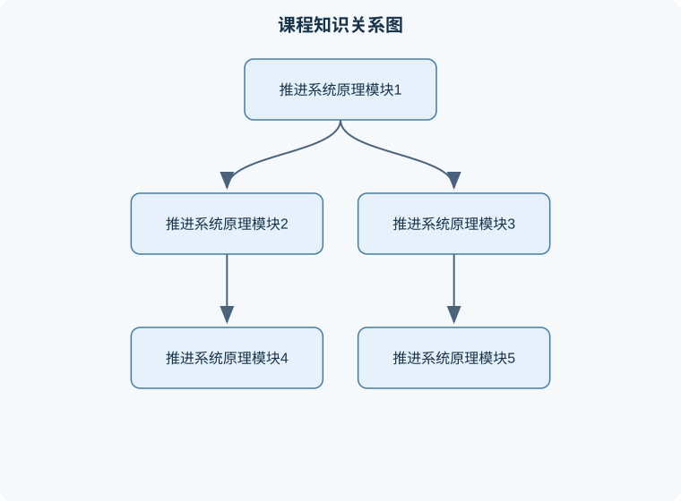

# 推进系统原理

## 一、课程整体知识框架

### 课程边界与先修知识

本课程研究航空航天推进系统将燃料或其他能源转化为推进功的基本规律、部件工作原理、循环分析方法和性能评价。内容边界包括热力学与气体动力学基础、燃烧与化学热力学、火箭发动机、涡轮喷气发动机、涡轮风扇发动机、涡轮螺旋桨发动机、冲压与超燃冲压发动机、喷管与进气道、推进系统性能匹配及非理想因素分析。重点讨论稳态一维或准一维模型，必要时扩展到真实部件效率、飞行速度、环境压力和安装损失。先修知识包括微积分与常微分方程、普通物理、工程热力学、流体力学、传热与燃烧基础、理想气体状态方程以及基本数值计算方法。不覆盖发动机详细结构设计、叶片强度与振动、复杂三维黏性流场、完整控制系统设计和具体型号的适航认证。





### 1. 课程对象与基本问题

推进系统的任务，是把储存在燃料、氧化剂或其他能源载体中的能量转化为飞行器、航天器或其他运载平台的有用推进功。推进系统原理研究的核心链条为：

$$
\text{能量输入}\rightarrow \text{流体状态变化}\rightarrow \text{高速射流或螺旋桨推力}\rightarrow \text{飞行器动量变化}
$$

推进系统通常由进气系统、压缩系统、燃烧或加热系统、膨胀系统、传动系统、喷管以及控制与辅助系统组成。火箭发动机自带推进剂，不依赖外界空气；涡轮喷气、涡轮风扇、涡轮螺旋桨和冲压发动机属于吸气式发动机，需要从外界吸入空气。二者的根本区别不是“是否有燃烧”，而是推进剂质量中是否包含发动机工作所需的氧化剂，以及发动机是否需要利用环境空气参与循环。

推进系统分析必须同时处理四类问题：

1. **热力学问题**：燃烧、压缩、膨胀和传热如何改变温度、压力、焓和熵。
2. **流体力学问题**：气流如何在进气道、压气机、涡轮和喷管中加速、减速、阻塞或产生激波。
3. **动力学问题**：高速射流携带的动量如何转化为推力，推力如何改变飞行器速度。
4. **工程性能问题**：推力、比冲、单位燃油消耗率、效率、推重比、可靠性和工作范围如何折中。

### 2. 统一建模假设与符号体系

课程中的一维分析通常把发动机看作控制体。质量流率记为 $\dot m$，单位为 $\mathrm{kg/s}$；速度记为 $V$，单位为 $\mathrm{m/s}$；压力、温度和密度分别记为 $p$、$T$、$\rho$，单位为 $\mathrm{Pa}$、$\mathrm{K}$ 和 $\mathrm{kg/m^3}$；比焓和比内能分别记为 $h$、$u$，单位为 $\mathrm{J/kg}$；比熵记为 $s$，单位为 $\mathrm{J/(kg\cdot K)}$。

理想气体状态方程为

$$
p=\rho RT
$$

其中 $R$ 是气体的比气体常数，单位为 $\mathrm{J/(kg\cdot K)}$。对标准干空气，常取 $R=287\ \mathrm{J/(kg\cdot K)}$。定压比热和定容比热分别为 $c_p$、$c_v$，单位均为 $\mathrm{J/(kg\cdot K)}$，比热比为

$$
\gamma=\frac{c_p}{c_v}
$$

对于温度变化不大、组分变化可以忽略的空气，常近似取 $\gamma=1.4$；高温燃烧气体的 $\gamma$ 和 $c_p$ 会随温度、压力及组分变化，不能无条件沿用空气常数。

推进系统的理想模型通常包含以下假设：稳态、准一维、理想气体、定比热、绝热、无轴功或轴功已知、无化学反应或化学反应由给定热值描述。现实发动机还存在摩擦、泄漏、冷却、非均匀流、燃烧不完全、部件间机械损失和材料温度限制，因此理想计算结果通常是性能上限或初步设计值，不是台架实测值。

### 3. 核心性能指标之间的关系

喷气发动机的推力来自控制体内外动量变化。对稳态、轴向、单入口单出口流动，忽略外部压力不均匀时，推力可写为

$$
F=\dot m_e V_e-\dot m_0 V_0+(p_e-p_0)A_e
$$

其中下标 $0$ 表示发动机入口或自由来流，下标 $e$ 表示喷口出口，$p_0$ 为环境压力，$A_e$ 为喷口出口面积。第一项是出口动量流，第二项是入口动量流，第三项是压力推力。若喷口出口压力等于环境压力，则压力推力为零；若 $p_e>p_0$，存在欠膨胀，压力推力为正；若 $p_e<p_0$，存在过膨胀，压力推力为负，严重时可能发生喷管内流动分离。

单位推力是单位空气流量对应的推力：

$$
f=\frac{F}{\dot m_0}
$$

若燃料与空气质量流率之比为 $f_b=\dot m_f/\dot m_0$，则出口质量流率为 $\dot m_e=\dot m_0(1+f_b)$。因此，不能在所有情况下简单写成 $F=\dot m_0(V_e-V_0)$；燃料加入会改变出口质量流率，压力推力也必须根据喷口状态判断。

火箭发动机没有空气入口动量项，理想推力为

$$
F=\dot m_p V_e+(p_e-p_a)A_e
$$

其中 $\dot m_p$ 为推进剂质量流率，$p_a$ 为外界压力。火箭的有效排气速度定义为

$$
c_{\mathrm{eff}}=\frac{F}{\dot m_p}
=V_e+\frac{(p_e-p_a)A_e}{\dot m_p}
$$

比冲为

$$
I_{\mathrm{sp}}=\frac{F}{\dot m_p g_0}
=\frac{c_{\mathrm{eff}}}{g_0}
$$

其中 $g_0$ 是规定的重力加速度，单位为 $\mathrm{m/s^2}$。比冲的单位为秒，但它不是时间常数，而是单位推进剂重量产生的总冲量指标。真空环境下 $p_a$ 较低，压力推力通常较大；海平面附近则必须考虑环境压力对性能的削弱。

### 4. 从能量守恒到火箭方程

稳态绝热控制体的能量方程，在忽略位能、忽略外部轴功的情况下为

$$
\dot m\left(h+\frac{V^2}{2}\right)=\text{常数}
$$

其中 $h+V^2/2$ 是单位质量总焓。若气流从燃烧室低速状态膨胀到喷口高速状态，焓下降转化为射流动能：

$$
h_t-h_e=\frac{V_e^2}{2}
$$

下标 $t$ 表示燃烧室或喷管入口的滞止状态。该式要求过程绝热、无外部轴功，且化学能已经通过燃烧转化为气体焓；若存在冷却抽气、泄漏或机械取功，应在能量方程中加入相应项。

火箭在理想真空、无重力和无阻力条件下的速度增量可由动量守恒推导。设火箭瞬时质量为 $m$，在短时间内喷出质量 $-\mathrm{d}m$，有效排气速度为常数 $c_{\mathrm{eff}}$。忽略外力，有

$$
m\,\mathrm{d}V=-c_{\mathrm{eff}}\,\mathrm{d}m
$$

从初始质量 $m_0$ 积分到末质量 $m_f$：

$$
\Delta V
=\int_{m_0}^{m_f}-\frac{c_{\mathrm{eff}}}{m}\,\mathrm{d}m
=c_{\mathrm{eff}}\ln\frac{m_0}{m_f}
$$

这就是理想火箭方程。它不直接包含重力损失、气动阻力损失、转弯损失和发动机工作过程变化，因此实际任务所需的推进剂速度增量大于理想轨道速度增量。若 $c_{\mathrm{eff}}$ 随时间变化，应使用积分形式，不能直接套用常数形式。

### 5. 热力学循环、流动与发动机类型的联系

吸气式发动机的基本热力学循环是布雷顿循环：进气道压缩、压气机压缩、燃烧室近似定压加热、涡轮膨胀取功、喷管膨胀加速。理想循环中，压气机和涡轮被视为等熵过程，燃烧室为定压加热，喷管将剩余焓转化为动能。现实循环需要用部件效率修正，例如压气机等熵效率、涡轮等熵效率、燃烧效率、机械效率、进气道总压恢复系数和喷管速度系数。

不同发动机的性能侧重点不同：

- 涡轮喷气发动机主要依靠高速喷流产生推力，结构相对直接，适合较高飞行速度，但排气速度过高会造成较大的推进效率损失。
- 涡轮风扇发动机通过风扇推动较大质量流量，使平均排气速度更接近飞行速度，通常具有较好的亚声速和跨声速推进效率。
- 涡轮螺旋桨发动机把涡轮功率传给螺旋桨，适合较低至中等速度，螺旋桨尖端速度和飞行速度限制其高速能力。
- 冲压发动机没有传统压气机和涡轮，依靠飞行速度形成进气压缩，必须在足够高的来流速度下工作，不能像静止状态的涡轮发动机那样自行启动。
- 火箭发动机不依赖环境空气，可在真空中工作，但必须携带氧化剂，推进剂质量和体积约束较大。

## 二、章节和模块划分

### 核心知识覆盖清单

本清单根据本课程的章节划分整理，用于检查正文是否覆盖各个核心模块：

- **模块一：推进系统基本概念与热力学基础**。
- **模块二：准一维流动、阻塞与喷管**。
- **模块三：动量方程、推力与性能评价**。
- **模块四：化学热力学与燃烧**。
- **模块五：火箭发动机与多级系统**。
- **模块六：涡轮发动机与布雷顿循环**。
- **模块七：涡喷、涡扇、涡桨与冲压系统比较**。
- **模块八：统一性能分析、算法与工程应用**。


### 模块一：推进系统基本概念与热力学基础

#### 1. 状态参数与理想气体

理想气体的内能和焓主要由温度决定。在定比热近似下，

$$
\mathrm{d}u=c_v\mathrm{d}T,\qquad
\mathrm{d}h=c_p\mathrm{d}T
$$

并且

$$
h=u+RT,\qquad c_p-c_v=R
$$

这些关系适用于理想气体、比热可近似视为常数的温度范围。高温燃烧气体中，$c_p$ 随温度变化明显，此时应使用分段热容、多项式热容或状态数据库，而不能把低温空气的常数直接外推到任意温度。

热力学第一定律对单位质量闭口系统可写为

$$
\delta q-\delta w=\mathrm{d}u
$$

其中 $\delta q$ 是系统吸收的热量，$\delta w$ 是系统对外做功。对流动控制体，常用总焓表达能量变化。热力学第二定律要求实际绝热过程的熵不减：

$$
\mathrm{d}s\geq 0
$$

等号只对应可逆过程；摩擦、混合、有限温差传热、激波和燃烧都会产生熵。等熵不是“没有温度变化”，而是同时满足绝热和可逆。

#### 2. 滞止参数与马赫数

马赫数定义为

$$
M=\frac{V}{a}
$$

其中 $a$ 为当地声速。理想气体声速为

$$
a=\sqrt{\gamma RT}
$$

对稳态、绝热、无轴功流动，总温满足

$$
T_t=T\left(1+\frac{\gamma-1}{2}M^2\right)
$$

总压在等熵条件下满足

$$
\frac{p_t}{p}
=\left(1+\frac{\gamma-1}{2}M^2\right)^{\frac{\gamma}{\gamma-1}}
$$

总温是气流等熵减速到零速度时的温度，总压是同一过程终点的压力。若存在摩擦或激波，总温在绝热无功条件下可以保持不变，但总压会下降。因此，“总温不变”不能推出“总压不变”。

#### 3. 典型例题一：总温与总压计算

**题干：** 空气以 $M=2$ 流动，静温为 $T=250\ \mathrm{K}$，取 $\gamma=1.4$。求总温与总压和静压之比。

**分析：** 采用一维、绝热、无轴功、等熵减速模型。由题给 $M$ 和 $T$，先求总温，再求压力比。

**解答：**

$$
T_t=250\left(1+\frac{1.4-1}{2}\times2^2\right)
=250(1+0.8)=450\ \mathrm{K}
$$

$$
\frac{p_t}{p}
=(1+0.8)^{1.4/0.4}
=1.8^{3.5}\approx 7.82
$$

因此总温约为 $450\ \mathrm{K}$，总压约为静压的 $7.82$ 倍。

**结果验证：** 超声速气流等熵减速时，总温和总压应高于静态值，计算结果符合物理趋势。

**变式：** 若流动经过法向激波，绝热且无轴功，激波前后总温近似相同，但总压降低；此时不能继续使用等熵总压关系直接连接激波前后状态。

### 模块二：准一维流动、阻塞与喷管

#### 1. 连续方程与阻塞条件

准一维稳态流动的质量守恒为

$$
\dot m=\rho VA
$$

其中 $A$ 为截面积，单位为 $\mathrm{m^2}$。在收缩—扩张喷管中，若上游总压足够高、下游背压足够低，喉部达到 $M=1$，流量达到给定总状态和喉部面积下的最大值，这种现象称为阻塞。

理想气体等熵流的质量流量可写为

$$
\dot m
=A_t\frac{p_t}{\sqrt{T_t}}
\sqrt{\frac{\gamma}{R}}
M\left(1+\frac{\gamma-1}{2}M^2\right)^{-\frac{\gamma+1}{2(\gamma-1)}}
$$

其中 $A_t$ 为喉部面积。令括号中的马赫数函数为质量流量参数，则其最大值在 $M=1$ 处取得。这个结论说明：降低背压只能使喷管下游状态继续变化，不能无限增加已经阻塞的喉部质量流率；若要继续提高流量，需要增大喉部面积或提高上游总压、降低上游总温。

#### 2. 喷管膨胀与压力匹配

喷管出口状态由面积比、上游总状态和背压共同决定。设计点通常令

$$
p_e=p_a
$$

此时压力推力为零，但不表示总推力为零，而是推力全部来自动量变化。若 $p_e>p_a$，喷管欠膨胀，出口仍有可利用的压力能；若 $p_e<p_a$，喷管过膨胀，外界压力会压缩射流，严重过膨胀可能导致内部流动分离和侧向载荷。

### 模块三：动量方程、推力与性能评价

#### 1. 动量方程和压力推力

控制体动量方程为

$$
\sum F_x=\sum_{\text{出口}}\dot m V_x-\sum_{\text{入口}}\dot m V_x
$$

压力作用必须按控制面上的实际压力计入。若控制面压力不是环境压力，就不能只计算速度差。发动机安装在机体内部时，还要考虑进气道溢流、外部阻力、尾喷管安装损失和舱体压力作用，因此“台架推力”与“安装后净推力”可能不同。

#### 2. 典型例题二：喷气发动机推力

**题干：** 某发动机空气流量为 $\dot m_0=50\ \mathrm{kg/s}$，燃油流量为 $\dot m_f=1\ \mathrm{kg/s}$，飞行速度为 $V_0=250\ \mathrm{m/s}$，喷口速度为 $V_e=600\ \mathrm{m/s}$。若喷口压力匹配环境压力，求净推力。

**分析：** 出口总质量流率为 $51\ \mathrm{kg/s}$，压力推力为零。

**解答：**

$$
F=\dot m_eV_e-\dot m_0V_0
=51\times600-50\times250
$$

$$
F=30600-12500=18100\ \mathrm{N}
$$

单位空气流量推力为

$$
f=\frac{18100}{50}=362\ \mathrm{N\,s/kg}
$$

**结果验证：** 出口动量流大于入口动量流，推力为正；若错误地忽略燃油质量，只得到 $17500\ \mathrm{N}$，会低估推力。

**变式：** 若喷口压力高于环境压力，还需增加 $(p_e-p_a)A_e$；若喷口压力低于环境压力，则压力项为负。

### 模块四：化学热力学与燃烧

#### 1. 混合物性质

理想气体混合物中，组分 $i$ 的摩尔分数和质量分数分别为

$$
x_i=\frac{n_i}{\sum_j n_j},\qquad
Y_i=\frac{m_i}{\sum_jm_j}
$$

其中 $n_i$ 为物质的量，$m_i$ 为质量。混合物平均摩尔质量为

$$
\overline M=\sum_i x_iM_i
$$

混合物比气体常数为

$$
R_{\mathrm{mix}}=\frac{R_u}{\overline M}
$$

其中 $R_u$ 为通用气体常数，使用时必须与摩尔质量单位一致。道尔顿定律给出

$$
p_i=x_i p
$$

$p_i$ 为组分分压，$p$ 为混合物总压。摩尔分数不能直接代替质量分数；分子量不同的组分中，二者数值通常不相同。

#### 2. 燃烧能量平衡

化学反应的能量分析通常使用生成焓。定压、绝热、忽略动能和位能变化时，反应物总焓等于生成物总焓：

$$
\sum_r n_r\left(\Delta h_{f,r}^{\circ}+\Delta h_r(T)\right)
=
\sum_p n_p\left(\Delta h_{f,p}^{\circ}+\Delta h_p(T)\right)
$$

其中 $\Delta h_f^\circ$ 是标准生成焓，$\Delta h(T)$ 是从参考温度到当前温度的显焓变化。绝热火焰温度是使上述方程成立的生成物温度。若采用定比热近似，火焰温度计算会简化，但在高温下会高估温度，因为解离和变比热会吸收部分能量。

#### 3. 典型例题三：燃烧室能量平衡

**题干：** 某理想燃烧室单位时间吸入空气 $100\ \mathrm{kg}$，燃油 $2\ \mathrm{kg}$。燃油低位热值为 $43\ \mathrm{MJ/kg}$，燃烧效率为 $0.98$。忽略进出口动能差和散热，求单位时间释放给燃烧气体的化学能。

**解答：**

燃油化学能输入为

$$
\dot Q_{\mathrm{chem}}=\dot m_f H_u
=2\times43=86\ \mathrm{MW}
$$

燃烧效率定义为有效释放能量与燃油化学能之比，因此

$$
\dot Q_{\mathrm{rel}}=\eta_b\dot Q_{\mathrm{chem}}
=0.98\times86=84.28\ \mathrm{MW}
$$

**结果验证：** 有效释放能量应小于燃油化学能，$84.28<86$，符合燃烧效率小于等于 1 的边界。

**变式：** 若存在冷却气抽取、壁面散热或未完全燃烧，能量平衡还需加入相应损失项；不能把全部燃油热值直接等同于燃烧室出口气体焓增。

### 模块五：火箭发动机与多级系统

#### 1. 火箭推力和推进剂质量比

火箭发动机推力由喷流动量和压力差组成。火箭方程表明，速度增量与质量比呈对数关系：

$$
\Delta V=c_{\mathrm{eff}}\ln\left(\frac{m_0}{m_f}\right)
$$

提高有效排气速度可以提高单位推进剂性能；提高初始质量与末质量之比也能增加速度增量，但质量比的收益是对数增长，继续增加结构和推进剂质量会产生递减收益。

多级火箭通过在推进剂耗尽后抛弃空结构，使后续级的末质量降低。若各级独立工作，理想总速度增量为

$$
\Delta V_{\mathrm{total}}
=\sum_k c_{\mathrm{eff},k}
\ln\left(\frac{m_{0,k}}{m_{f,k}}\right)
$$

实际级间分离还需要考虑结构连接、姿态控制、发动机重新启动和气动载荷等因素。

### 模块六：涡轮发动机与布雷顿循环

#### 1. 理想循环推导

理想布雷顿循环包括等熵压缩、定压加热、等熵膨胀和定压放热。设压气机压比为

$$
\pi_c=\frac{p_{t3}}{p_{t2}}
$$

其中 $t2$ 和 $t3$ 分别表示压气机入口和出口总状态。等熵压缩关系为

$$
\frac{T_{t3}}{T_{t2}}
=\pi_c^{(\gamma-1)/\gamma}
$$

压气机单位质量功为

$$
w_c=c_p(T_{t3}-T_{t2})
$$

涡轮单位质量可提供的功由燃烧室出口总温和膨胀后总温差决定：

$$
w_t=c_p(T_{t4}-T_{t5})
$$

若发动机轴上只有压气机消耗功，机械功平衡近似为

$$
w_t\eta_m=w_c
$$

其中 $\eta_m$ 为机械效率。该式说明涡轮不能任意膨胀到很低压力；它必须首先提供压气机、风扇和附件所需的轴功。

真实部件应通过效率修正。例如压气机等熵效率可定义为

$$
\eta_c=
\frac{T_{t3s}-T_{t2}}{T_{t3}-T_{t2}}
$$

其中 $s$ 表示等熵出口状态。实际压缩需要更多功，因此实际出口温度高于等熵出口温度。

### 模块七：涡喷、涡扇、涡桨与冲压系统比较

#### 1. 涡轮风扇涵道比

涵道比定义为外涵空气流量与内涵核心空气流量之比：

$$
B=\frac{\dot m_{\mathrm{bypass}}}{\dot m_{\mathrm{core}}}
$$

在总空气流量相同的情况下，提高涵道比通常可降低平均排气速度，使推进效率提高；但风扇直径、短舱阻力、结构质量和跨声速阻力也会增加。因而涵道比不是越大越好，而是由飞行速度、噪声要求、安装空间、起飞推力和巡航经济性共同决定。

#### 2. 典型例题四：推进效率

**题干：** 某理想喷气推进装置以 $V_0=200\ \mathrm{m/s}$ 飞行，空气流量为 $10\ \mathrm{kg/s}$，喷流速度为 $500\ \mathrm{m/s}$，忽略燃油质量和压力推力。求推力、喷流动能增加率和推进效率。

**解答：**

推力为

$$
F=\dot m(V_e-V_0)
=10(500-200)=3000\ \mathrm{N}
$$

飞行器获得的有效功率为

$$
P_{\mathrm{useful}}=FV_0
=3000\times200=600\ \mathrm{kW}
$$

喷流动能增加率为

$$
P_{\mathrm{jet}}
=\frac12\dot m(V_e^2-V_0^2)
=\frac12\times10(500^2-200^2)
=1050\ \mathrm{kW}
$$

推进效率为

$$
\eta_p=\frac{P_{\mathrm{useful}}}{P_{\mathrm{jet}}}
=\frac{600}{1050}\approx0.571
$$

**结果验证：** 对无压力推力、无燃油增量的理想喷流，推进效率也可写为

$$
\eta_p=\frac{2V_0}{V_e+V_0}
=\frac{400}{700}\approx0.571
$$

两种方法一致。

**变式：** 当 $V_e$ 远大于 $V_0$ 时，推进效率下降；这正是高涵道比发动机通过增加流量、降低单股射流速度改善推进效率的原因。

### 模块八：统一性能分析、算法与工程应用

#### 1. 发动机性能计算流程

代表性的发动机循环分析流程如下：

1. **输入数据检查**：输入飞行马赫数、环境温度和压力、空气性质、涵道比、压气机压比、涡轮前温度、燃油热值、部件效率和几何面积。
2. **环境状态计算**：由静态环境量求自由来流总温和总压；若来流存在激波或进气道损失，加入总压恢复系数。
3. **部件逐站计算**：依次计算进气道、风扇、压气机、燃烧室、涡轮和喷管的出口总状态。
4. **轴功平衡**：检查涡轮输出功是否等于风扇、压气机和附件所需功，并修正机械效率。
5. **喷管状态判断**：根据总压比判断是否阻塞，再由面积比或背压求出口马赫数和出口压力。
6. **推力计算**：同时计算动量推力和压力推力。
7. **性能评价**：计算单位推力、燃油消耗率、推进效率、热效率和总效率。
8. **边界检查**：检查温度是否超过材料限制，压力是否为正，效率是否位于 $0$ 到 $1$ 之间，喷管状态是否与背压条件一致。

#### 2. 带代码的简化计算示例

下面代码只实现理想、无燃油增量、无压力推力的喷流推力与推进效率计算，不代表完整发动机模型。

```python
def jet_performance(mass_flow, flight_speed, jet_speed):
    """
    输入:
        mass_flow: 空气质量流量，kg/s
        flight_speed: 飞行速度，m/s
        jet_speed: 喷流速度，m/s
    输出:
        thrust: 推力，N
        propulsive_efficiency: 推进效率，无量纲
    适用条件:
        忽略燃油质量增加、喷口压力推力和外部安装损失；
        喷流速度大于飞行速度。
    """
    if mass_flow < 0:
        raise ValueError("质量流量不能为负")
    if flight_speed < 0 or jet_speed < 0:
        raise ValueError("速度不能为负")
    if jet_speed + flight_speed == 0:
        raise ValueError("推进效率分母不能为零")

    thrust = mass_flow * (jet_speed - flight_speed)

    if jet_speed <= flight_speed:
        propulsive_efficiency = 0.0
    else:
        propulsive_efficiency = (
            2.0 * flight_speed / (jet_speed + flight_speed)
        )

    return thrust, propulsive_efficiency


F, eta_p = jet_performance(10.0, 200.0, 500.0)
print(f"推力: {F:.1f} N")
print(f"推进效率: {eta_p:.3f}")
```

程序的不变量是输入量保持统一国际单位制，且推力计算与效率公式使用同一质量流量定义。终止条件是完成一次无迭代计算；若扩展为喷管面积—马赫数反求，则需要采用二分法或牛顿法，并以面积残差小于给定容差作为终止条件。二分法适用于目标函数在区间端点异号且函数连续的情况；牛顿法收敛较快，但需要导数和合理初值，接近阻塞点时应防止迭代越界。

#### 3. 典型例题五：火箭质量比

**题干：** 某火箭有效排气速度为 $3000\ \mathrm{m/s}$，需要理想速度增量 $\Delta V=6000\ \mathrm{m/s}$。忽略重力和阻力损失，求初末质量比。

**解答：**

由火箭方程，

$$
\frac{m_0}{m_f}
=\exp\left(\frac{\Delta V}{c_{\mathrm{eff}}}\right)
=\exp\left(\frac{6000}{3000}\right)
=e^2\approx7.39
$$

因此初始总质量约为末质量的 $7.39$ 倍，推进剂质量占初始质量的比例为

$$
\frac{m_p}{m_0}
=1-\frac{m_f}{m_0}
=1-\frac{1}{7.39}
\approx0.865
$$

**结果验证：** 由于速度增量是有效排气速度的两倍，质量比应为 $e^2$，而不是 $2$。

**变式：** 若考虑重力损失和阻力损失，实际所需 $\Delta V$ 大于 $6000\ \mathrm{m/s}$，因此实际质量比会进一步增加；若推进剂完全消耗后仍需保留结构和载荷，$m_f$ 不能取零。

#### 4. 实验或项目一：喷管阻塞与压力推力实验

**目标：** 验证背压变化对喉部阻塞、流量和喷口状态的影响。

**输入数据：** 上游总压、上游总温、喉部面积、出口面积、环境压力；可通过压力传感器和流量计获得实际数据。

**步骤：**

1. 检查压力传感器零点，并统一使用绝对压力。
2. 固定上游总压和总温，逐步降低背压。
3. 记录质量流率、喉部压力、喷口压力和推力。
4. 用等熵质量流量公式计算理论流量。
5. 比较实验流量与理论流量，计算流量系数。
6. 判断喉部是否达到 $M=1$，并记录过膨胀、匹配膨胀和欠膨胀状态。

**评价标准：** 流量随背压降低先增加、达到阻塞后趋于稳定；实验流量与理论值的偏差应能由摩擦、边界层、传感器误差和非均匀流解释；压力推力方向必须与 $p_e-p_a$ 的符号一致。

**排错方法：** 若压力比异常，首先检查表压是否误当绝对压；若流量继续随背压显著增加，检查喉部是否实际上未阻塞、上游总压是否稳定以及流量计量程是否足够；若推力方向错误，检查压力项符号和控制体边界。

#### 5. 实验或项目二：简化涡轮风扇循环分析

**目标：** 比较涵道比、风扇压比和飞行马赫数对单位推力及推进效率的影响。

**输入数据：** 飞行马赫数、环境温度和压力、涵道比、风扇压比、压气机压比、涡轮前温度、燃烧效率、压气机和涡轮效率、喷口面积。

**步骤：**

1. 由环境静态状态计算自由来流总温和总压。
2. 根据进气道总压恢复系数计算进气道出口总状态。
3. 分别计算内涵压气机和外涵风扇出口状态。
4. 根据燃烧能量平衡求燃油—空气比。
5. 用涡轮功平衡确定涡轮出口总温。
6. 对内涵和外涵喷管分别判断是否阻塞，并求出口速度。
7. 计算总推力、单位推力、单位燃油消耗率、热效率、推进效率和总效率。
8. 改变涵道比或风扇压比，绘制性能变化表。

**评价标准：** 所有温度和压力必须为正；各部件效率应在 $0$ 与 $1$ 之间；涡轮输出功应满足压气机和风扇功率需求；在相同总流量和合理设计范围内，提高涵道比通常会降低射流速度差并改善推进效率，但可能增加尺寸和阻力，不能只以单一指标判断优劣。

**排错方法：** 若涡轮出口温度低于物理允许范围，检查功平衡、机械效率和燃烧室出口温度；若总效率大于 $1$，检查燃油热值单位、质量流量基准和效率定义；若外涵喷口压力出现不合理突变，检查是否把静压比误当总压比或错误使用等熵公式。

#### 6. 课程概念边界与综合应用

推进系统计算中最重要的边界包括：

- 静态参数和滞止参数不能混用；总温、总压必须标明对应流动状态。
- 等熵关系只适用于绝热可逆过程；实际进气道、压气机、涡轮和喷管应通过效率或总压损失修正。
- 推力不等于单纯的速度差乘以空气流量；燃油质量增加和压力推力可能改变结果。
- 比冲适用于火箭推进剂性能比较，不能直接等同于吸气式发动机的单位燃油消耗率。
- 理想火箭方程不包含重力、阻力和转弯损失，不能直接作为实际入轨所需推进剂的完整预测。
- 高温燃烧气体的比热、比热比和组分可能变化，定比热模型只适用于明确限定的温度范围。
- 发动机性能必须结合工作点评价。设计点上的最佳膨胀并不意味着所有高度、速度和节流状态下都最佳。
- 工程验收既要看数值结果，也要检查守恒方程、单位、边界条件、测量不确定度和结果的物理合理性。

## 三、核心概念的详细解释

### 3.1 推进系统的统一分析框架

推进系统通过改变工质的动量，使飞行器获得作用力。对吸气式发动机，工质主要是从环境吸入的空气；对火箭发动机，工质由发动机携带的燃料和氧化剂反应生成。推力的直接来源是发动机与工质之间的动量交换，燃烧只是提供能量、改变工质状态的一种方式。因此，判断发动机如何产生推力，应分析控制体边界上的质量流率、速度和压力，而不能只看燃烧室是否放热。

采用一维稳态控制体时，轴向推力为

$$
F=\dot m_e V_e-\dot m_0 V_0+(p_e-p_a)A_e
$$

其中，$F$ 为推力，单位为 $\mathrm{N}$；$\dot m_0$ 和 $\dot m_e$ 分别为入口、出口质量流率，单位为 $\mathrm{kg/s}$；$V_0$ 和 $V_e$ 分别为入口、出口轴向速度，单位为 $\mathrm{m/s}$；$p_e$ 为喷口出口静压，$p_a$ 为环境静压，单位为 $\mathrm{Pa}$；$A_e$ 为出口面积，单位为 $\mathrm{m^2}$。式中前两项是动量通量差，末项是压力推力。火箭发动机没有吸入环境空气的入口，入口动量项按相应控制体边界处理；吸气式发动机的入口动量不能无条件省略。

若喷口出口压力等于环境压力，压力推力为零；若 $p_e>p_a$，喷流欠膨胀，压力项为正；若 $p_e<p_a$，喷流过膨胀，压力项为负。出口压力不匹配不只影响压力推力，还可能在喷管内引起激波或流动分离，因此用理想压力项估算严重过膨胀喷管时，不能忽略流动结构改变。

发动机性能要区分总推力和单位推力。对吸气式发动机，若以空气质量流率 $\dot m_a$ 归一化，则单位推力为 $F/\dot m_a$，单位为 $\mathrm{N\,s/kg}$，等价于 $\mathrm{m/s}$；若燃油流率不可忽略，推力方程的出口质量流率应包含燃油质量。单位燃油消耗率以燃油流率除以推力，通常用于比较在指定工况下产生单位推力所需的燃油量。火箭常用比冲 $I_{sp}=F/(\dot m_p g_0)$，其中 $\dot m_p$ 为推进剂总质量流率，$g_0$ 为标准重力加速度；比冲的量纲为秒，是按推进剂重量流率归一化的推力，不等于吸气式发动机的单位燃油消耗率。

### 3.2 理想气体、热力学状态与滞止参数

理想气体状态方程为

$$
p=\rho RT
$$

$p$ 为静压，$\rho$ 为密度，$T$ 为静温，$R$ 为气体比气体常数。对空气常用近似值 $R=287\ \mathrm{J/(kg\cdot K)}$，但燃烧后气体的组分及气体常数可能不同。理想气体比内能 $u$ 和比焓 $h$ 由温度决定；量热完全气体进一步假定定容比热 $c_v$、定压比热 $c_p$ 和比热比 $\gamma=c_p/c_v$ 为常数，其中 $h=u+RT$，且 $c_p-c_v=R$。对温度变化较大的燃烧气体，定比热假设可能产生明显误差，应采用变比热或组分平衡模型。

热力学第一定律描述能量守恒。对封闭系统，若规定系统吸热为正、系统对外做功为正，则 $\Delta U=Q-W$。对稳态控制体，单位质量的能量平衡可写为

$$
q-w_s=(h_2-h_1)+\frac{V_2^2-V_1^2}{2}+g(z_2-z_1)
$$

其中 $q$、$w_s$ 分别为单位质量吸热和轴功，单位为 $\mathrm{J/kg}$；$z$ 是高度。推进系统常可忽略高度项，但不能因此忽略速度项：喷管把焓降转化为射流动能，进气道则通常把来流动能的一部分转化为静焓和压力。

第二定律说明真实过程存在不可逆性。对封闭系统的熵平衡，系统熵变不小于可逆热交换造成的熵变；摩擦、混合、冲击波和有限温差传热会产生熵。熵产生会降低可用能，通常表现为总压损失或相同出口条件下所需功增加。绝热不代表等熵：只有绝热且可逆的过程才是等熵过程。

对速度为 $V$ 的气流，定义滞止状态为将流体等熵减速至速度为零时的状态。稳态、绝热、无轴功时，沿流线总焓守恒：

$$
h_t=h+\frac{V^2}{2}
$$

下标 $t$ 表示滞止量。对定比热理想气体，

$$
T_t=T+\frac{V^2}{2c_p}
$$

若过程还等熵，则总压和静压满足

$$
\frac{p_t}{p}=
\left(\frac{T_t}{T}\right)^{\gamma/(\gamma-1)}
$$

总温、总压不是另一个实际测点的静态状态，而是由局部流动状态按指定减速过程定义的量。绝热但有摩擦的管流可保持总焓不变，却会损失总压；有热交换时，总焓也可能变化。若流线来自不同的总焓状态，即使每条流线各自满足能量守恒，整个流场的总焓也未必处处相同。

当地声速为 $a=\sqrt{\gamma RT}$，马赫数为 $M=V/a$。马赫数衡量流速相对于局部声速的大小，必须使用局部静温确定声速；在定比热等熵模型中，滞止参数与静态参数的关系为

$$
\frac{T_t}{T}=1+\frac{\gamma-1}{2}M^2,\qquad
\frac{p_t}{p}=
\left(1+\frac{\gamma-1}{2}M^2\right)^{\gamma/(\gamma-1)}
$$

这些关系不适用于包含激波、强摩擦或显著热交换的整体过程，除非分段应用并加入相应损失模型。

### 3.3 准一维流动、临界状态与喷管

准一维模型假设流动参数在每个截面上近似均匀，只随轴向位置和截面积变化。连续性方程为 $\dot m=\rho VA$；无黏流体的一维动量变化与压力力、壁面力相平衡；能量方程则联系焓、动能、热量和轴功。若忽略热交换、轴功及高度变化，且总焓固定，流体加速时静温下降。

在定比热、等熵条件下，给定滞止状态和面积，质量流率可表示为

$$
\dot m=
\frac{A p_t}{\sqrt{T_t}}
\sqrt{\frac{\gamma}{R}}\,
M\left(1+\frac{\gamma-1}{2}M^2\right)^{-\frac{\gamma+1}{2(\gamma-1)}}
$$

其中 $A$ 为截面积。括号中的马赫数函数在 $M=1$ 时达到最大值，此状态称临界状态；若最小截面处达到声速，喉部流动阻塞。继续降低下游背压，理想模型下质量流率不再增加，而是由上游滞止状态和喉部面积决定。阻塞并不表示下游流动停止，出口速度和压力仍可随背压改变。

对收缩—扩张喷管，亚声速流经收缩段加速；达到喉部声速后，在扩张段可继续加速到超声速。能否形成超声速出口，取决于面积比、上游总状态和背压。喷口压力与环境压力相等是设计膨胀条件，不是任意工况下都能满足的条件。喷管理论推力常分解为动量推力与压力推力；实际推力还受边界层、摩擦、热损失、流动分离和非均匀性影响。特征速度 $c^*=p_c A_t/\dot m$（$p_c$ 为燃烧室压力，$A_t$ 为喉部面积）用于表征燃烧室与喉部流量能力；推力系数 $C_F=F/(p_c A_t)$ 表示相对于室压与喉部面积乘积的推力水平。二者定义依赖所选控制体和理想化条件，实际发动机应按一致的压力、面积和推力定义计算。

### 3.4 燃烧、混合物与绝热火焰温度

理想气体混合物中，组分 $i$ 的摩尔分数为 $x_i=n_i/\sum_j n_j$，质量分数为 $Y_i=m_i/\sum_jm_j$。理想混合气体满足道尔顿分压关系 $p_i=x_i p$。混合物的平均摩尔质量为 $\bar M=\sum_i x_i M_i$，比气体常数为 $R_u/\bar M$，其中 $R_u$ 是通用气体常数。混合物的焓、内能和热容可由组分按质量分数加权；若发生化学反应，组分改变还必须计入化学能和生成焓。

标准生成焓表示在给定标准状态下，由元素的参考态生成单位物质的焓变。反应焓由产物与反应物生成焓按化学计量数求差。燃料热值描述完全燃烧释放的化学能，采用高位或低位热值时必须明确水的生成状态。绝热燃烧温度是在给定反应物初态、压力约束和反应模型下，假设无热量传给外界而由能量守恒求得的产物温度。定压燃烧时，应使反应物总焓等于产物总焓；若考虑解离，产物组分须与温度、压力满足化学平衡。理想绝热火焰温度通常高于实际燃烧室温度，冷却、散热、不完全燃烧和混合不均都会使实际结果偏离。

### 3.5 火箭推进、质量比与多级火箭

火箭通过喷出自身携带的推进剂获得推力，不要求环境中存在空气。喷气速度是排气相对于火箭的速度。对稳定工况，若忽略入口流且以出口速度方向为正，火箭推力为

$$
F=\dot m_p V_e+(p_e-p_a)A_e
$$

其中 $\dot m_p$ 为推进剂质量流率。可定义有效排气速度 $c=F/\dot m_p$，于是 $I_{sp}=c/g_0$。总冲量为推力对时间的积分；只有推力恒定时才可写成总冲量等于推力乘时间。

理想火箭方程由变质量动量守恒得到。设火箭质量为 $m$，在短时间内排出质量 $-\mathrm{d}m>0$，排气相对火箭速度为 $c$，忽略重力、阻力和压力推力变化，则火箭速度增量满足 $\mathrm{d}V=-c\,\mathrm{d}m/m$。若 $c$ 恒定，从初始质量 $m_0$ 积分至末质量 $m_f$，得到

$$
\Delta V=c\ln\left(\frac{m_0}{m_f}\right)
$$

质量比 $m_0/m_f$ 是无量纲量；若结构、载荷和推进剂以外的质量不可忽略，末质量必须包含它们。该式给出理想速度增量，不包含重力损失、气动阻力、姿态控制和发动机非理想性。实际任务的推进剂需求不能仅由目标速度变化直接套用此式。

多级火箭通过抛弃已耗尽推进剂及其结构，降低后续级段携带的无效质量。理想情况下，各级速度增量可相加，每级分别按该级有效排气速度和点火、关机质量比计算；但级间结构、级间分离、剩余推进剂及任务轨迹均会影响实际性能。增加级数通常有利于提高理想速度能力，却增加结构、分离和控制复杂性，因此不能仅以级数判断方案优劣。

### 3.6 涡轮发动机、循环与性能折中

理想布雷顿循环由等熵压缩、定压加热、等熵膨胀和定压放热构成。涡轮喷气发动机中，压气机提高空气总压，燃烧室加热气体，涡轮提取部分功驱动压气机，剩余能量在喷管中转化为射流动能。理想循环的热效率来自净循环功与加热量之比；实际发动机中，部件效率、燃烧损失和喷管损失都会降低性能。涡轮必须满足功率平衡，涡轮输出功至少要覆盖压气机及由涡轮驱动的附件负荷，并计入机械效率。涡轮前温度是材料、冷却和寿命约束下的重要设计参数，不能只为提高循环功而无限增大。

涡轮喷气发动机把较多可用能量转化为高速射流，适合较高飞行速度，但在低速时射流速度远高于飞行速度，推进效率往往较低。涡轮螺旋桨把涡轮功用于驱动螺旋桨，能以较大的空气质量流率和较小的速度增量产生推力，适合较低至中等速度范围，但螺旋桨效率、叶尖速度和噪声限制其高速能力。涡轮风扇通过外涵流提供额外推力，较高涵道比通常可降低平均喷流速度差、改善亚声速巡航推进效率；同时风扇直径、质量、阻力及安装空间会增加。冲压发动机利用飞行速度压缩来流，结构相对简单但不能静止起动，工作范围受飞行马赫数和燃烧稳定性限制。涡轮基组合循环试图覆盖较宽速度范围，但切换和整合不同工作模式会带来复杂性。脉冲爆震等概念利用非定常燃烧，其实际优势取决于燃烧、热负荷、噪声和系统集成，不能仅由理想定容燃烧模型推断整机性能。

对涡扇发动机，涵道比是外涵空气质量流率与内涵空气质量流率之比。分析循环时，先由环境静态状态和飞行马赫数求来流总温、总压，再计入进气道总压恢复；随后计算风扇、压气机、燃烧室和涡轮状态。燃烧室能量平衡求油气比，涡轮功平衡求涡轮出口总温和总压，最后对内外涵喷管分别判断阻塞与出口状态并求推力。推进效率、热效率和总效率描述不同能量转换环节，具体定义应与控制体边界一致；在统一定义下，总效率可理解为燃料化学能转化为飞行器有效功率的比例。效率不能跨不同推力定义、飞行速度和工况直接比较。

## 四、重要定义、公式、定理和推导

### 专业审校补充：关键定义与适用边界

推进系统性能评价中应明确区分推进效率与热效率。对稳态、轴向、压力匹配且忽略燃油质量增量的单股射流，推进效率定义为飞行器获得的有效功率与射流相对于来流增加的机械能之比，即 ηₚ＝F V₀/[0.5ṁ(Vₑ²−V₀²)]，其中 F 为净推力，单位 N；V₀ 为飞行速度，Vₑ 为喷流速度，单位 m/s；ṁ 为工质质量流率，单位 kg/s。若无压力推力且出口质量流率近似等于入口质量流率，动量方程给出 F＝ṁ(Vₑ−V₀)，从而 ηₚ＝2V₀/(Vₑ＋V₀)。该式要求稳态、均匀一维流动、单股喷流、无明显燃油质量增量和压力项；V₀＝0 时推进效率按此定义为零，但静止试车仍可有推力，不能据此判断发动机没有能量转换能力。存在涵道流、余速、压力推力、安装阻力或不同进出口质量流率时，应分别计算各流股动能增量，并以净安装推力定义系统有效功率。提高喷速不必然提高推进效率，因为过大的速度增量会增加尾流动能损失。


### 4.1 常用公式及其适用条件

| 名称 | 关系式 | 适用条件与边界 |
|---|---|---|
| 理想气体状态方程 | $p=\rho RT$ | 气体可近似为理想气体；高压、低温或强非理想状态需修正 |
| 马赫数 | $M=V/\sqrt{\gamma RT}$ | 声速取局部静态温度；定比热模型需限定温度范围 |
| 总焓 | $h_t=h+V^2/2$ | 稳态绝热且无轴功；有热交换或轴功时须扩展能量方程 |
| 火箭推力 | $F=\dot m_pV_e+(p_e-p_a)A_e$ | 以火箭为控制体，入口项不存在；需一致处理喷口压力和推力方向 |
| 火箭比冲 | $I_{sp}=F/(\dot m_p g_0)$ | 推进剂总质量流率为分母；不等同于吸气式发动机的燃油消耗率 |
| 理想火箭方程 | $\Delta V=c\ln(m_0/m_f)$ | $c$ 恒定，忽略重力、阻力等外力；质量比必须包含末端全部非推进剂质量 |
| 喉部临界条件 | $M_t=1$ | 准一维、等熵喷管并达到阻塞时成立；实际喉部受边界层和损失影响 |
| 推力系数 | $C_F=F/(p_cA_t)$ | 必须说明推力、室压及喉部面积的定义；用于无量纲比较 |

在定比热理想气体中，等熵关系可从熵微分式推得。对理想气体，$\mathrm{d}s=c_p\mathrm{d}T/T-R\mathrm{d}p/p$；令 $\mathrm{d}s=0$，积分得 $p/\rho^\gamma=\text{常数}$，继而得到静态参数与总参数关系。此推导依赖定比热和可逆绝热假设；跨越激波时熵增加，不能把激波前后的状态当成同一条等熵关系连接。

### 4.2 代表性分析流程

#### 流程一：喷管工况与推力计算

**输入：** 燃烧室或上游总压 $p_t$、总温 $T_t$，喉部面积 $A_t$，出口面积 $A_e$，环境压力 $p_a$，气体模型参数 $R,\gamma$，以及喷管效率或损失模型。

**输出：** 喉部状态、质量流率、出口状态、动量推力和压力推力。

**过程：**

1. 检查绝对压力、温度和面积单位，确认控制体入口总状态。
2. 比较背压与临界压力条件，判断喉部是否阻塞；若未阻塞，应由背压与面积关系联合求解流量。
3. 阻塞时令喉部 $M_t=1$，用临界质量流率关系求理论流量，并按流量系数或损失模型修正。
4. 用面积比和等熵面积—马赫数关系求出口亚声速或超声速分支；分支必须与喷管几何和背压相容。
5. 求出口静温、速度和静压，计算 $F=\dot m V_e+(p_e-p_a)A_e$。
6. 检查能量守恒、压力项符号、流量量纲及出口状态是否符合背压条件；若过膨胀严重，应进一步检查分离，而非只延用一维等熵值。

**不变量与终止条件：** 计算中守恒质量流率；给定上游状态和几何后，迭代至出口压力或质量流率残差满足预设容差，或判定当前假设无物理解。

**适用条件与复杂度：** 准一维稳态流动适用于初步设计和性能估算。若只求单个状态，计算量为常数级；若需数值迭代，复杂度取决于迭代次数。激波、分离、强三维效应需更高保真度模型。

#### 流程二：涡轮风扇循环逐部件闭合

**输入：** 飞行马赫数、环境温度和压力、涵道比、风扇和压气机压比、各部件效率、燃烧效率、燃烧热值、涡轮前温度限制、机械效率及喷管面积。

**输出：** 各站总温总压、油气比、涡轮功平衡、内外涵喷速、单位推力、燃油消耗指标和效率。

**过程：**

1. 由环境状态求自由来流总温、总压，并按进气道压力恢复修正。
2. 按风扇和压气机压比及效率求压缩后总状态；压缩功为相应质量流率乘总焓升。
3. 以燃烧室能量守恒求油气比，计入燃烧效率和燃油进入后的质量流率；校验涡轮前温度不超过给定限制。
4. 用涡轮功平衡求涡轮出口状态，确认输出功满足压气机、风扇及机械损失要求。
5. 分别计算内涵和外涵喷管状态，判断是否阻塞，求各流路的动量和压力推力。
6. 按同一质量流量基准合并推力和耗油量，计算性能指标并做单位、能量和极限工况检查。

**不变量与终止条件：** 各站质量守恒；涡轮功率与负载闭合；总温总压为正；燃烧能量残差、功率残差和推力迭代残差达到所设容差。

**适用条件与复杂度：** 适用于给定设计点的准一维循环分析。逐部件代数计算通常随部件数线性增长；若喷管状态、冷却流量或部件匹配相互耦合，需迭代求解，结果依赖效率模型及站位定义。

#### 流程三：理想火箭速度增量与级段质量核算

**输入：** 各级有效排气速度、点火质量、推进剂质量、结构质量、载荷质量和任务所需速度增量。

**输出：** 每级理想速度增量、总理想速度增量及质量闭合结果。

**过程：**

1. 明确每级点火和关机边界，避免把已抛弃结构计入后续级段末质量。
2. 对每级确定 $m_0$ 与 $m_f$，二者必须对应同一阶段的质量定义。
3. 用 $\Delta V_i=c_i\ln(m_{0,i}/m_{f,i})$ 计算该级理想增量，并求和。
4. 将级间分离、剩余推进剂和载荷按实际阶段重新分配，再检查全箭质量闭合。
5. 将理想总增量与任务要求比较；如不足，不能把差额归为“安全系数”而不说明重力、阻力和姿态损失模型。

**不变量与终止条件：** 每级质量守恒，且 $m_0>m_f>0$；在给定级数下，质量闭合并完成所有级段计算即终止。若输入质量使末质量非正或推进剂质量超过点火质量，说明方案无效。

**适用条件与复杂度：** 理想火箭方程适用于无外力、恒定有效排气速度近似。$n$ 级逐级计算为 $O(n)$；轨迹优化和级间联合设计需要额外动力学模型。

### 4.3 计算实现示例：理想火箭方程

下列 Python 示例只进行数值计算，不访问网络或文件。质量以千克、速度以米每秒计；示例忽略外力和实际损失。

```python
from math import log

def ideal_rocket_delta_v(exhaust_velocity, initial_mass, final_mass):
    if exhaust_velocity <= 0:
        raise ValueError("排气速度必须为正")
    if initial_mass <= final_mass or final_mass <= 0:
        raise ValueError("必须满足初始质量 > 末质量 > 0")
    return exhaust_velocity * log(initial_mass / final_mass)

c = 3000.0
m0 = 12000.0
mf = 4000.0

delta_v = ideal_rocket_delta_v(c, m0, mf)
print(f"理想速度增量: {delta_v:.1f} m/s")
```

程序输入 $c,m_0,m_f$，输出理想速度增量。其不变量是质量比大于 $1$ 且各质量为正；通过参数校验或成功计算终止。时间和额外空间复杂度均为 $O(1)$。该程序不处理多级分离、重力、阻力和变排气速度，不能将输出直接当作实际任务速度增量。

### 4.4 例题与逐步解答

#### 例题一：马赫数与滞止温度

**题干：** 空气以 $M=0.8$ 流动，静温为 $250\ \mathrm{K}$。取 $\gamma=1.4$、$c_p=1004\ \mathrm{J/(kg\cdot K)}$，求滞止温度和速度。

**分析与解答：** 定比热模型下，$T_t/T=1+(\gamma-1)M^2/2$，所以 $T_t=250[1+0.2(0.8)^2]=282\ \mathrm{K}$。由 $a=\sqrt{\gamma RT}$，取 $R=287\ \mathrm{J/(kg\cdot K)}$，得 $a\approx317.0\ \mathrm{m/s}$，故 $V=Ma\approx253.6\ \mathrm{m/s}$。

**结果验证：** $T_t>T$，符合动能在等熵减速过程中转为焓的方向；速度量纲为 $\mathrm{m/s}$。

**变式：** 若存在激波，总温在绝热无轴功条件下可保持近似不变，但总压下降；不能用跨激波的等熵总压关系求激波后静压。

#### 例题二：喷管推力中的压力项

**题干：** 某喷口质量流率为 $20\ \mathrm{kg/s}$，出口速度为 $900\ \mathrm{m/s}$，入口速度可忽略；出口压力比环境压力高 $15\ \mathrm{kPa}$，出口面积为 $0.08\ \mathrm{m^2}$。求推力。

**分析与解答：** 动量项为 $20\times900=18000\ \mathrm{N}$。压力项为 $15000\times0.08=1200\ \mathrm{N}$。总推力为 $19200\ \mathrm{N}$。

**结果验证：** $\mathrm{kg/s}\times\mathrm{m/s}$ 和 $\mathrm{Pa}\times\mathrm{m^2}$ 均为牛顿；因出口压力高于环境，压力推力应为正。

**变式：** 若出口压力低于环境 $15\ \mathrm{kPa}$ 且其余数值相同，简单一维压力项变为 $-1200\ \mathrm{N}$；若压力差导致分离，还需重算流场，不能只把符号改负就视为完整实际解。

#### 例题三：火箭理想速度增量

**题干：** 有效排气速度为 $3000\ \mathrm{m/s}$，初始质量为 $12\,000\ \mathrm{kg}$，燃尽后的质量为 $4\,000\ \mathrm{kg}$。求理想速度增量。

**分析与解答：** 质量比为 $3$，故 $\Delta V=3000\ln 3\approx3296\ \mathrm{m/s}$。

**结果验证：** 质量比无量纲，结果单位为 $\mathrm{m/s}$；排气速度增加或质量比增加时，理想速度增量增加。

**变式：** 若末质量包含的载荷或结构被漏计，质量比会被高估，所得速度增量偏大。若要计入重力，应通过飞行轨迹方程求损失，不应把重力项直接塞进对数质量比。

#### 例题四：比冲换算

**题干：** 发动机推力为 $240\ \mathrm{kN}$，推进剂质量流率为 $60\ \mathrm{kg/s}$，取 $g_0=9.80665\ \mathrm{m/s^2}$，求比冲和有效排气速度。

**分析与解答：** 有效速度 $c=F/\dot m_p=240000/60=4000\ \mathrm{m/s}$。比冲 $I_{sp}=c/g_0\approx407.9\ \mathrm{s}$。

**结果验证：** $I_{sp}$ 是秒；恢复推力可得 $\dot m_p g_0 I_{sp}\approx240\ \mathrm{kN}$。

**变式：** 若推力包含显著压力推力，$c=F/\dot m_p$ 仍可作为有效速度定义，但它不一定等于实际喷口气体速度 $V_e$。

#### 例题五：燃烧室能量平衡

**题干：** 每千克空气加入 $0.02\ \mathrm{kg}$ 燃油，燃料热值为 $43\ \mathrm{MJ/kg}$，燃烧效率为 $0.98$，忽略入口动能、热损失以外的功及燃油显热。估算每千克空气的燃烧放热贡献。

**分析与解答：** 有效放热为 $\eta_b f Q_R$，其中 $f=0.02\ \mathrm{kg\ fuel/kg\ air}$，$\eta_b=0.98$，$Q_R=43\times10^6\ \mathrm{J/kg\ fuel}$。计算得 $0.98\times0.02\times43\times10^6=842800\ \mathrm{J/kg\ air}$。

**结果验证：** 单位化简为每千克空气的焦耳数。该值是能量输入估算，不可在未给出入口焓和产物比热时直接宣称为温升；温升还需除以适用的产物热容并处理燃油质量增加。

**变式：** 若燃烧后比热随温度显著变化，应使用焓随温度的积分并求解能量平衡，而非固定 $c_p$ 直接相除。

#### 例题六：涡轮与压气机功率匹配

**题干：** 空气流率为 $40\ \mathrm{kg/s}$，压气机比焓升为 $180\ \mathrm{kJ/kg}$；涡轮燃气流率为 $41\ \mathrm{kg/s}$，涡轮比焓降为 $190\ \mathrm{kJ/kg}$，机械效率为 $0.96$。判断涡轮是否足以驱动压气机。

**分析与解答：** 压气机功率需求为 $40\times180=7200\ \mathrm{kW}$。涡轮轴端可用功率估算为 $0.96\times41\times190=7478.4\ \mathrm{kW}$。可供功率大于压气机需求，剩余约 $278.4\ \mathrm{kW}$，在未计附件负载时功率平衡可满足。

**结果验证：** 两边单位均为 $\mathrm{kW}$，且涡轮可用功率高于负载。

**变式：** 若涡轮流量没有包含燃油质量，或机械效率重复乘除，结论会改变；完整循环还要核对附件、冷却气和风扇功率。

### 4.5 实验与项目工作流程

#### 实验一：喷管背压与阻塞状态测量

**目标与输入：** 验证背压降低时喷管流量、喉部状态和推力的变化。输入包括上游绝对总压、总温、喉部面积、出口面积、环境压力及流量计和压力传感器读数。

**步骤：** 校准传感器并记录零点；固定上游总状态，分级调节背压；每个工况待读数稳定后记录质量流率、喉部压力、出口压力和推力；用临界流量关系计算理论流量，再比较测量值；按 $p_e-p_a$ 判断压力推力符号。

**评价标准：** 数据应能辨认流量随背压降低逐渐趋于阻塞平台的趋势；压力项符号正确；理论与实验差异须结合测量误差、流量系数、摩擦和非均匀流解释，而不是任意调整常数使两者相等。

**排错方法：** 检查表压是否误作绝对压、压力管路是否堵塞、上游状态是否稳定、流量计是否超量程。若未见平台，应检查喉部是否达到声速、背压范围是否足够以及泄漏是否影响质量守恒。

#### 项目二：涡轮风扇设计点循环分析

**目标与输入：** 计算给定设计点下的部件状态和推力，并评估涵道比或风扇压比变化。输入包括飞行马赫数、环境压力温度、涵道比、部件压比与效率、燃烧效率、燃料热值、涡轮前温度限制和喷口参数。

**步骤：** 计算来流滞止状态及进气道损失；逐站计算风扇、压气机出口状态；通过燃烧能量方程求油气比；用涡轮功率平衡求出口状态；分别判断内外涵喷管是否阻塞并计算推力；改变一个设计参数进行对比，其他输入保持不变。

**评价标准：** 各站温度、压力和质量流率符合物理边界；涡轮功覆盖负载；燃烧温度不超过给定限制；推力和油耗采用同一质量流量基准；参数变化造成的趋势须能由射流速度、质量流率和部件损失解释。

**排错方法：** 若效率超过 $1$，检查热值单位和功率基准；若涡轮出口温度异常低，检查燃油加入后的质量流率及机械效率；若喷管出口压力异常，检查静压与总压、喷管分支和阻塞判定；若总推力异常，分别核对内外涵动量项、入口动量项及压力项。

### 4.6 易错点及纠正

1. **把燃烧当作推力的直接来源。** 燃烧提供热能，推力来自控制体动量与压力作用；应从动量方程分析。
2. **漏掉入口动量项。** 吸气式发动机入口空气已有飞行速度，忽略该项会高估净推力。
3. **把总压当静压。** 总压是等熵滞止定义，测点静压不能直接代入喷管总压关系。
4. **认为绝热必然等熵。** 摩擦和激波可在绝热条件下产生熵并损失总压。
5. **用环境声速计算高速流马赫数。** 声速应由局部静温和当地气体性质确定。
6. **把喷管阻塞理解为质量流量无限增大。** 阻塞表示给定上游状态和喉部面积下流量达到上限。
7. **忽略喷管背压。** 背压改变出口状态、压力推力，并可能触发激波或分离。
8. **把出口速度等同于有效排气速度。** 压力推力存在时，$F/\dot m_p$ 与 $V_e$ 不相同。
9. **混淆比冲与单位燃油消耗率。** 比冲按推进剂重量流率归一化；吸气式耗油指标按燃油流量定义。
10. **把理想火箭速度增量当任务速度。** 火箭方程未包含重力、阻力、转弯和控制损失。
11. **火箭末质量漏算载荷或结构。** 质量比必须按阶段边界完整核算，不能只用推进剂质量。
12. **将空气的比热比套用于高温燃气。** 燃烧气体组分和热容变化可能使定比热近似失效。
13. **漏计燃油对流量和焓的影响。** 燃烧后质量流率包含燃油，能量平衡也要采用一致的质量基准。
14. **涡轮只与压气机功匹配。** 风扇、附件、冷却和机械损失也可能占用涡轮功。
15. **把理想最佳膨胀当所有工况的最佳方案。** 飞行高度、速度和节流状态改变环境压力及喷管匹配。
16. **只比较总推力而不说明工况。** 推力、耗油和效率必须注明高度、速度、设计点和控制体定义。
17. **认为涵道比越大整机越优。** 较大涵道比可改善某些亚声速推进效率，但增加尺寸、质量和阻力。
18. **只凭数值大小判断计算正确。** 还应检查单位、守恒关系、边界条件、参数范围和极限趋势。

### 4.7 常见笔试问题与解答思路

1. **问题：解释吸气式发动机与火箭发动机的根本区别。**  
   **思路：** 比较工作所需氧化剂和工质来源。吸气式发动机利用环境空气参与循环；火箭携带全部推进剂，可在无大气环境工作。两类发动机都通过动量交换产生推力。

2. **问题：从控制体动量方程说明压力推力的来源。**  
   **思路：** 对入口和出口动量通量做差，再加入控制面压力力；整理得到 $(p_e-p_a)A_e$。说明其符号取决于出口静压与环境静压之差。

3. **问题：何时可以把总温视为沿流线不变？**  
   **思路：** 由总焓方程判断；稳态、绝热、无轴功且高度变化可忽略时总焓守恒，定比热气体可进一步推出总温守恒。有热输入、轴功或组分热容变化时须谨慎。

4. **问题：说明绝热过程为何可能有总压损失。**  
   **思路：** 绝热只表示无热量交换，不排除摩擦、混合和激波产生熵；等熵关系不再适用，故总压可下降而总焓保持不变。

5. **问题：推导理想火箭方程并说明其限制。**  
   **思路：** 对短时间内火箭与排气做动量守恒，得到 $\mathrm{d}V=-c\,\mathrm{d}m/m$；对恒定 $c$ 积分。指出忽略外力及非理想因素。

6. **问题：为什么喷管喉部达到声速后，继续降低背压通常不能增加质量流率？**  
   **思路：** 质量流量函数关于马赫数在 $M=1$ 达最大；喉部信息传播与上游受限，流量由上游滞止状态及喉部面积控制。实际损失由流量系数修正。

7. **问题：比较涡喷和高涵道比涡扇的推进效率倾向。**  
   **思路：** 在相同推力需求下，用较大质量流率、较小速度增量通常可减少射流动能中的非有效部分；同时指出风扇尺寸、质量、阻力和高速适应性限制。

8. **问题：涡轮温度、压气机压比和燃油消耗之间有什么联系？**  
   **思路：** 压比影响压缩功和循环状态；更高涡轮前温度可提升可用功和推力潜力，但受材料、冷却和寿命限制；燃烧效率和部件效率改变达到目标状态所需燃油量。

9. **问题：推力系数和特征速度分别反映什么？**  
   **思路：** $C_F$ 比较推力与室压—喉部面积尺度；$c^*$ 比较室压、喉部面积与质量流率，主要反映燃烧室和喉部的流量特性。说明二者受定义和损失模型影响。

10. **问题：如何检验一个循环分析结果是否可信？**  
    **思路：** 检查质量、能量、功率闭合和单位；确认各部件效率范围、温压正值及材料限制；核验喷口阻塞、压力推力符号和性能随参数改变的物理趋势。

### 4.8 常见面试问题与参考回答

1. **问题：你会如何解释发动机推力的来源？**  
   **参考回答：** 以发动机控制体分析，出口与入口动量通量差形成动量推力，出口静压与环境压力差形成压力推力。燃烧改变工质能量和状态，但推力计算最终依赖控制面上的流量、速度和压力。  
   **深入追问要点：** 能否说明吸气式发动机入口动量为何不能忽略；如何选择控制体；压力推力为负时可能出现什么流动现象。

2. **问题：一个喷管计算的推力比台架测量值偏高，你先检查什么？**  
   **参考回答：** 先核对推力定义和测量基准，再检查是否把出口压力设成环境压力、是否漏计入口动量，以及是否忽略了流量系数、边界层、分离和安装损失。  
   **深入追问要点：** 如何通过压力测点判断分离；总压损失如何影响流量；传感器零偏和轴向对中会造成什么误差。

3. **问题：绝热进气道为何仍会降低发动机性能？**  
   **参考回答：** 绝热只意味着无热量交换。摩擦、激波和混合会产生熵，使总压下降，压气机入口压力降低，进而影响循环功和推力。  
   **深入追问要点：** 总温与总压在理想绝热进气道中的区别；冲击波前后哪些量可近似守恒。

4. **问题：如何判断给定喷管是否阻塞？**  
   **参考回答：** 根据上游总状态、背压和临界压力比判断，并结合喉部状态或质量流率变化验证。达到 $M_t=1$ 后，进一步降低背压通常不再提高质量流率。  
   **深入追问要点：** 如何由压力测量验证喉部状态；边界层堵塞和有效喉面积会带来什么影响。

5. **问题：比冲高是否一定意味着火箭整体方案更好？**  
   **参考回答：** 不一定。比冲描述单位推进剂重量流率产生的推力，整体方案还受推力需求、结构质量、燃烧室压力、可靠性、贮存条件和任务时间约束。  
   **深入追问要点：** 如何将比冲与质量比结合；多级方案为何可能优于单级方案；如何区分理想速度增量和任务需求。

6. **问题：涡轮功率平衡计算中常见的漏项有哪些？**  
   **参考回答：** 常见漏项包括风扇功、附件负载、机械效率、燃油加入后的质量流率变化和冷却气流。应把各轴功负载映射到同一轴系并使用一致的质量基准。  
   **深入追问要点：** 齿轮传动如何改变功率与转速关系；冷却气混合对涡轮出口状态的影响。

7. **问题：为什么高涵道比发动机不适合无限增大风扇直径？**  
   **参考回答：** 增加涵道比可在一定范围内降低外涵喷流速度差，但风扇直径变大也会增加质量、迎风面积、安装空间和阻力，并受叶尖速度、结构和噪声约束。  
   **深入追问要点：** 推力、推进效率和安装阻力怎样共同进入方案评价；飞行速度变化如何改变最优设计。

8. **问题：如何处理定比热模型造成的高温计算误差？**  
   **参考回答：** 先判断温度范围和组分变化是否使热容变化不可忽略；若是，应采用温变比热或组分平衡，按焓函数求能量平衡，而不是固定热容直接换算温升。  
   **深入追问要点：** 解离如何影响火焰温度；反应物和产物生成焓如何进入能量守恒。

### 4.9 岗位任务与技术产出

| 岗位方向 | 实际任务 | 使用的课程知识 | 典型产出与验收标准 |
|---|---|---|---|
| 推进性能分析 | 建立发动机设计点和非设计点模型，比较推力、耗油和效率 | 控制体动量方程、热力循环、部件效率、喷管匹配 | 可复算的计算模型和性能表；质量、能量、轴功闭合，单位与工况定义完整 |
| 热力与流路设计 | 评估进气道、压气机、燃烧室、涡轮及喷管状态 | 总静参数、等熵关系、熵增、燃烧能量平衡、阻塞流 | 站位参数及损失预算；温压满足部件边界，假设和有效范围明确 |
| 火箭发动机性能 | 核算推力、比冲、特征速度和级段速度增量 | 火箭动量方程、喷管理论、质量比、火箭方程 | 性能核算表和质量闭合记录；推力定义一致，理想与任务损失分开 |
| 试验与数据分析 | 处理台架压力、温度、流量和推力数据，识别异常工况 | 守恒方程、测量不确定度、压力推力、阻塞判断 | 经校准的数据集、误差分析和异常说明；数据可追溯且结果满足物理边界 |
| 推进系统集成 | 评估发动机与进气、喷管、机体及控制系统的匹配 | 安装前后推力、工作包线、部件匹配、质量与功率平衡 | 集成分析报告和接口参数；工况覆盖目标范围，约束、裕度和风险表达清楚 |

岗位验收不应只看某个推力或效率数值。可复核的模型需要说明输入数据、参考站位、控制体边界、采用的气体模型、损失处理和适用工况；试验结论还需说明测量误差和异常工况。理想计算、部件级验证与整机试验所代表的证据层级不同，不能把理想模型输出表述成已验证的实际性能。

## 五、算法、流程和实现思路

### 方法与流程覆盖索引

下列方法或流程应在正文中说明输入、步骤、适用条件、结果检查和边界：

- 5.1 推进系统问题的统一分析流程
- 5.2 喷管流量与推力计算算法
- 5.3 火箭性能和级间分析流程
- 5.4 代表性例题
- 5.5 实验与项目流程


### 5.1 推进系统问题的统一分析流程

推进系统计算应先明确任务、控制体和工况，再选择模型。不能在尚未确定入口状态、出口边界和质量流量基准时直接代入公式。适用于吸气式发动机、火箭发动机和喷管分析的通用流程如下。

1. **定义工况与控制体。**  
   明确飞行速度 $V_0$、飞行马赫数 $M_0$、环境静压 $p_a$、环境静温 $T_a$、发动机入口和出口位置、燃油是否计入质量流量，以及推力是安装前推力还是安装后有效推力。推力计算中的压力必须使用绝对压力，不能把表压直接代入状态方程。

2. **建立参考状态。**  
   若已知环境静态参数，可由
   $$
   T_t=T\left(1+\frac{\gamma-1}{2}M^2\right)
   $$
   求等熵滞止温度，其中 $T_t$ 为总温，$T$ 为静温。总压为
   $$
   p_t=p\left(1+\frac{\gamma-1}{2}M^2\right)^{\gamma/(\gamma-1)}.
   $$
   这些关系要求流动近似理想气体、绝热、无黏且等熵。存在进气道损失时，总温在绝热条件下通常近似不变，而总压会降低，不能同时把总压和总温都按理想等熵关系处理。

3. **逐站位推进状态。**  
   将进气道、风扇、压气机、燃烧室、涡轮和喷管分别编号。每个部件记录入口和出口的总温、总压、质量流率、功率或焓变化。压气机和风扇消耗轴功，涡轮提供轴功，燃烧室增加工质焓，喷管把焓降转化为速度。

4. **使用部件效率修正理想关系。**  
   对压气机，等熵压缩出口总温为
   $$
   T_{t2s}=T_{t1}\left(\frac{p_{t2}}{p_{t1}}\right)^{(\gamma-1)/\gamma}.
   $$
   若压气机等熵效率为 $\eta_c$，则实际出口温度为
   $$
   T_{t2}=T_{t1}+\frac{T_{t2s}-T_{t1}}{\eta_c}.
   $$
   对涡轮，若涡轮效率为 $\eta_t$，则
   $$
   T_{t4}-T_{t5}
   =\eta_t\left(T_{t4}-T_{t5s}\right).
   $$
   其中下标 $s$ 表示等熵参考状态。压气机效率越低，达到同一压比所需功越大；涡轮效率越低，产生同一功率所需的温降越大。

5. **进行燃烧和功率平衡。**  
   设燃油—空气质量比为 $f=\dot m_f/\dot m_a$，燃烧效率为 $\eta_b$，燃料低位热值为 $h_{\mathrm{LHV}}$，则简化能量平衡可写为
   $$
   c_{p,g}T_{t4}
   =
   c_{p,a}T_{t3}
   +\eta_b f h_{\mathrm{LHV}},
   $$
   其中 $c_{p,a}$ 和 $c_{p,g}$ 分别为空气和燃烧气体的定压比热。若忽略燃油质量对出口流量的影响，该式可用于初步计算；高温、强解离或燃油质量不可忽略时，应采用组分平衡和变比热焓函数。

   涡轮功率应满足
   $$
   \eta_m\dot m_g c_{p,g}(T_{t4}-T_{t5})
   =
   \dot m_a c_{p,a}(T_{t3}-T_{t2})
   +P_{\mathrm{fan}},
   $$
   其中 $\eta_m$ 为机械效率，$\dot m_g$ 为通过涡轮的燃烧气体流量，$P_{\mathrm{fan}}$ 为风扇所需功率。若有附件、引气和冷却气，还要将相应功率或流量加入平衡。

6. **判断喷管是否阻塞。**  
   对收缩—扩张喷管，喉部达到 $M=1$ 时发生阻塞。理想气体、等熵条件下，临界压力比为
   $$
   \frac{p^*}{p_t}
   =
   \left(\frac{2}{\gamma+1}\right)^{\gamma/(\gamma-1)}.
   $$
   当背压低于临界值对应的范围时，质量流量不再由背压继续决定，而主要由上游总压、总温和喉部面积决定。喷管出口速度应由出口压力比和能量方程共同确定，不能只根据面积比判断出口速度。

7. **计算推力并进行守恒检查。**  
   吸气式发动机采用
   $$
   F=\dot m_eV_e-\dot m_0V_0+(p_e-p_a)A_e.
   $$
   火箭发动机没有环境空气入口，常用
   $$
   F=\dot m_pV_e+(p_e-p_a)A_e,
   $$
   其中 $\dot m_p$ 为推进剂质量流率。若出口压力匹配环境压力，压力推力为零；若存在欠膨胀或过膨胀，必须保留压力项。

8. **计算性能指标并验证范围。**  
   吸气式发动机可计算单位空气流量推力 $F/\dot m_a$ 和单位燃油消耗率；火箭可计算比冲
   $$
   I_{sp}=\frac{F}{\dot m_pg_0}.
   $$
   同时检查质量流量、能量、轴功率和单位是否闭合。效率不能大于 $1$，温度和绝对压力必须为正，出口速度应与焓降方向一致。

### 5.2 喷管流量与推力计算算法

**输入：** 上游总压 $p_t$、总温 $T_t$、喉部面积 $A^*$、出口面积 $A_e$、环境压力 $p_a$、气体常数 $R$、比热比 $\gamma$。  
**输出：** 质量流率 $\dot m$、出口马赫数 $M_e$、出口压力 $p_e$、出口速度 $V_e$ 和理想推力 $F$。

**过程：**

1. 计算临界压力比
   $$
   r^*=\left(\frac{2}{\gamma+1}\right)^{\gamma/(\gamma-1)}.
   $$
2. 根据 $p_a/p_t$ 判断喉部是否阻塞。未阻塞时，质量流率取决于背压；阻塞时使用
   $$
   \dot m
   =
   A^*\frac{p_t}{\sqrt{T_t}}
   \sqrt{\frac{\gamma}{R}}
   \left(\frac{2}{\gamma+1}\right)^{(\gamma+1)/[2(\gamma-1)]}.
   $$
3. 若喷管为理想收缩—扩张喷管，利用面积—马赫数关系求 $M_e$：
   $$
   \frac{A_e}{A^*}
   =
   \frac{1}{M_e}
   \left[
   \frac{2}{\gamma+1}
   \left(1+\frac{\gamma-1}{2}M_e^2\right)
   \right]^{(\gamma+1)/[2(\gamma-1)]}.
   $$
   对同一面积比通常存在亚声速支和超声速支。扩张段正常工作时选取超声速支；收缩喷管出口则选亚声速支。
4. 计算出口静温、静压和速度：
   $$
   T_e=\frac{T_t}{1+\frac{\gamma-1}{2}M_e^2},
   $$
   $$
   p_e=p_t\left(1+\frac{\gamma-1}{2}M_e^2\right)^{-\gamma/(\gamma-1)},
   $$
   $$
   V_e=M_e\sqrt{\gamma RT_e}.
   $$
5. 代入推力方程，并检查 $p_e-p_a$ 的符号。

面积—马赫数方程一般需要数值求根。二分法的输入是目标面积比和马赫数区间，过程是在区间内反复取中点并保留函数值异号的一半，终止条件可以是区间宽度小于给定容差或面积比残差小于给定容差。二分法保证收敛的前提是函数在区间内连续且初始区间确实包含目标根；其代价为每轮把区间长度减半，迭代次数约为
$$
N\geq \frac{\ln[(b-a)/\varepsilon]}{\ln 2},
$$
其中 $[a,b]$ 为初始区间，$\varepsilon$ 为允许区间宽度。

```python
import math

def nozzle_state(pt, Tt, area_ratio, pa, gamma=1.4, R=287.0,
                 branch="supersonic", tol=1e-8, max_iter=100):
    """计算理想收缩-扩张喷管出口状态；压力单位Pa，温度单位K。"""
    if pt <= 0 or Tt <= 0 or area_ratio < 1 or pa < 0:
        raise ValueError("输入必须满足 pt>0、Tt>0、area_ratio>=1、pa>=0")

    def area_function(M):
        return (1.0 / M) * (
            2.0 / (gamma + 1.0) *
            (1.0 + (gamma - 1.0) * M * M / 2.0)
        ) ** ((gamma + 1.0) / (2.0 * (gamma - 1.0)))

    if branch == "subsonic":
        lo, hi = 1e-6, 1.0
    elif branch == "supersonic":
        lo, hi = 1.0, 50.0
    else:
        raise ValueError("branch只能为subsonic或supersonic")

    for _ in range(max_iter):
        mid = 0.5 * (lo + hi)
        # 在亚声速支，面积函数随M增大而减小；
        # 在超声速支，面积函数随M增大而增大。
        if branch == "subsonic":
            if area_function(mid) > area_ratio:
                lo = mid
            else:
                hi = mid
        else:
            if area_function(mid) < area_ratio:
                lo = mid
            else:
                hi = mid
        if hi - lo < tol:
            break

    M = 0.5 * (lo + hi)
    Te = Tt / (1.0 + (gamma - 1.0) * M * M / 2.0)
    pe = pt * (Te / Tt) ** (gamma / (gamma - 1.0))
    Ve = M * math.sqrt(gamma * R * Te)
    return {"Mach": M, "temperature_K": Te, "pressure_Pa": pe,
            "velocity_m_s": Ve}
```

该代码只求出口状态，不自动给出质量流率和推力，因为喉部面积、燃烧气体性质和控制体质量基准仍需由使用者明确输入。代码的适用条件是理想气体、等熵喷管和无激波分支。若喷管过膨胀并发生分离，理想超声速出口解不能直接视为实际流场。

### 5.3 火箭性能和级间分析流程

**输入：** 推进剂质量 $m_p$、干重 $m_s$、有效载荷质量 $m_L$、喷气速度 $V_e$、总推力 $F$、燃烧时间 $\Delta t$。  
**输出：** 质量比、理想速度增量、比冲、总冲量和推重比。

1. 初始质量为
   $$
   m_0=m_p+m_s+m_L,
   $$
   推进剂耗尽后的末质量为
   $$
   m_f=m_s+m_L.
   $$
2. 质量比为
   $$
   \mathcal{R}=\frac{m_0}{m_f}.
   $$
3. 理想无重力、无阻力速度增量为
   $$
   \Delta v=V_e\ln\mathcal{R}.
   $$
   该结果只反映发动机喷射造成的理想速度变化，不包含重力损失、阻力损失、转弯损失和控制修正。
4. 比冲为
   $$
   I_{sp}=\frac{V_e}{g_0}
   $$
   的条件是推力主要由动量推力构成且采用等效喷气速度定义。更一般地，应使用 $I_{sp}=F/(\dot m_pg_0)$。
5. 总冲量为
   $$
   I=\int_0^{\Delta t}F(t)\,\mathrm{d}t.
   $$
   若推力近似恒定，则 $I\approx F\Delta t$。
6. 初始推重比为
   $$
   \frac{F}{m_0g_0}.
   $$
   其中 $m_0g_0$ 是初始重力，不是质量本身。

多级火箭应对每一级分别计算质量比和速度增量。第一级燃尽后要抛弃其结构质量，后续级的初始质量因此降低。若不抛弃级间结构，直接把所有推进剂质量相乘处理，会高估速度增量。多级设计的核心不是简单增加发动机数量，而是在结构质量、推进剂质量、级间分离和任务速度之间进行优化。

### 5.4 代表性例题

#### 例题一：由环境状态求总温、总压和声速

**题干：** 某飞行器在静温 $T=288\ \mathrm{K}$、静压 $p=101325\ \mathrm{Pa}$、马赫数 $M=0.8$ 的空气中飞行。取 $\gamma=1.4$、$R=287\ \mathrm{J/(kg\cdot K)}$，求总温、总压和当地声速。

**分析：** 采用理想气体、等熵滞止关系。静态压力和温度不能直接作为发动机入口总状态。

**解答：**

$$
T_t=288\left(1+0.2\times0.8^2\right)
=324.864\ \mathrm{K}.
$$

$$
p_t=101325(1+0.2\times0.8^2)^{3.5}
\approx154.5\ \mathrm{kPa}.
$$

当地声速为
$$
a=\sqrt{\gamma RT}
=\sqrt{1.4\times287\times288}
\approx340.3\ \mathrm{m/s}.
$$

来流速度为
$$
V=Ma\approx0.8\times340.3=272.2\ \mathrm{m/s}.
$$

**结果验证：** $T_t>T$、$p_t>p$，符合亚声速流动减速至滞止状态时动能转化为焓和压力的趋势。若把 $p_t$ 直接当作环境静压，后续压气机压比将被错误计算。

**变式：** 若进气道总压恢复系数为 $\pi_d=0.96$，在绝热近似下可取 $T_{t2}\approx T_t$，但 $p_{t2}=0.96p_t$，不能把总压损失同时解释为总温损失。

#### 例题二：判定喷管是否阻塞

**题干：** 某喷管上游总压为 $500\ \mathrm{kPa}$，总温为 $1000\ \mathrm{K}$，环境压力为 $100\ \mathrm{kPa}$，气体 $\gamma=1.4$。判断喉部是否阻塞。

**分析：** 对 $\gamma=1.4$，临界压力比为
$$
\frac{p^*}{p_t}=\left(\frac{2}{2.4}\right)^{3.5}\approx0.528.
$$
临界背压约为 $0.528\times500=264\ \mathrm{kPa}$。

**解答：** 实际背压 $100\ \mathrm{kPa}<264\ \mathrm{kPa}$，因此喉部达到 $M=1$，喷管发生阻塞。阻塞后继续降低背压，质量流率在理想模型中不再显著增加；背压主要影响喷管下游流动、激波位置和出口压力。

**结果验证：** 背压远低于临界压力，满足阻塞条件。若计算所得喉部马赫数小于 $1$，说明把静压比、总压比或临界压力比混用了。

**变式：** 若环境压力升高到 $300\ \mathrm{kPa}$，则 $p_a>p^*$，喷管不阻塞，流量随背压变化，不能使用阻塞质量流率公式。

#### 例题三：根据喷气速度计算火箭速度增量

**题干：** 火箭有效喷气速度为 $3000\ \mathrm{m/s}$，初始质量为 $100000\ \mathrm{kg}$，推进剂耗尽后的末质量为 $40000\ \mathrm{kg}$。忽略重力和阻力，求理想速度增量。

**解答：**

$$
\mathcal{R}=\frac{100000}{40000}=2.5.
$$

$$
\Delta v=3000\ln(2.5)
\approx3000\times0.9163
\approx2749\ \mathrm{m/s}.
$$

**结果验证：** 质量比大于 $1$，因此速度增量为正；若把推进剂质量 $60000\ \mathrm{kg}$ 直接作为分母，则会得到错误的质量比，因为分母必须是推进剂耗尽后的总质量，包括结构和有效载荷。

**变式：** 若任务还需要克服 $900\ \mathrm{m/s}$ 的重力和阻力损失，则发动机至少应提供约 $3649\ \mathrm{m/s}$ 的理想速度增量，实际还要考虑推力方向和节流控制，不能简单认为增加的损失都能以同样效率补偿。

#### 例题四：涡轮功率平衡

**题干：** 某燃气涡轮需要提供 $2.0\ \mathrm{MW}$ 压气机功率和 $0.5\ \mathrm{MW}$ 风扇功率，机械效率为 $0.98$。求涡轮气体所需的理想轴功率。

**解答：** 涡轮对外输出的轴功率为
$$
P_{t,\mathrm{out}}=2.0+0.5=2.5\ \mathrm{MW}.
$$
若机械效率定义为涡轮气体功率传递到负载的比例，则涡轮气体侧所需功率为
$$
P_{t,\mathrm{gas}}=\frac{2.5}{0.98}
\approx2.551\ \mathrm{MW}.
$$

**结果验证：** 机械效率小于 $1$，因此气体侧功率必须大于负载实际得到的功率。若计算结果小于 $2.5\ \mathrm{MW}$，说明效率方向用反。

**变式：** 若还存在 $0.1\ \mathrm{MW}$ 附件功率，则应先将其加入负载，得到
$$
P_{t,\mathrm{gas}}=\frac{2.0+0.5+0.1}{0.98}.
$$
若风扇和压气机不在同一轴系，还应先按齿轮和机械效率换算到同一轴功率基准。

#### 例题五：压力推力的符号判断

**题干：** 某喷口出口面积为 $0.20\ \mathrm{m^2}$，出口静压为 $80\ \mathrm{kPa}$，环境压力为 $101\ \mathrm{kPa}$。求压力推力并判断喷口状态。

**解答：**

$$
F_p=(p_e-p_a)A_e
=(80-101)\times10^3\times0.20
=-4200\ \mathrm{N}.
$$

出口压力低于环境压力，喷口为过膨胀状态，压力项为负。负压力推力并不意味着发动机总推力必然为负，因为动量推力可能大于 $4200\ \mathrm{N}$；但若压差过大，喷管内可能出现激波和流动分离，理想一维计算会失真。

**结果验证：** 压力单位为 $\mathrm{Pa}$，面积单位为 $\mathrm{m^2}$，结果单位为 $\mathrm{N}$。压力项符号必须由 $p_e-p_a$ 决定。

**变式：** 若出口压力为 $120\ \mathrm{kPa}$，则压力推力为 $+3800\ \mathrm{N}$，属于欠膨胀状态；增加出口膨胀通常可降低出口压力，但是否提高总推力还要同时考虑动量项和可能的流动分离。

### 5.5 实验与项目流程

#### 实验一：喷管阻塞和压力推力测量

**输入数据：** 上游总压 $p_t$、上游总温 $T_t$、喉部面积 $A^*$、出口面积 $A_e$、背压 $p_a$、质量流量、出口压力和推力测量值。

**步骤：**

1. 检查压力、温度、流量和推力传感器零点；所有压力统一换算为绝对压力。
2. 固定上游总压和总温，逐步降低背压。
3. 记录每个背压点的质量流率、喉部压力、出口压力和推力。
4. 根据临界压力比判断是否阻塞，并用理论质量流率与实验值比较。
5. 由 $p_e-p_a$ 判断压力推力方向，计算总推力和压力推力占比。
6. 对过膨胀工况检查是否存在激波或流动分离迹象。

**评价标准：** 未阻塞区域中，流量应随背压降低而增加；阻塞后，流量趋于平台。压力推力的符号必须与出口压力和环境压力的差值一致。理论与实验差异应结合流量系数、边界层、传感器误差和流场非均匀性解释。

**排错方法：** 若流量在低背压下仍大幅增加，检查喉部是否真正达到临界状态；若压力比异常，检查表压与绝对压混用；若推力符号错误，检查压力项是否写成了 $(p_a-p_e)A_e$；若实验数据出现突变，检查喷管内激波移动和传感器响应时间。

#### 项目二：涡扇发动机简化循环计算

**输入数据：** 飞行马赫数、环境静温和静压、涵道比、风扇压比、压气机压比、涡轮前总温、进气道总压恢复系数、风扇和压气机效率、涡轮效率、燃烧效率、机械效率及燃料热值。

**步骤：**

1. 将环境静态参数转换为自由来流总温和总压。
2. 施加进气道总压恢复系数，得到压气机和风扇入口状态。
3. 分别计算内涵压气机和外涵风扇的出口总温、总压和轴功。
4. 由燃烧室能量平衡求油气比，并检查燃烧室出口温度是否超过给定材料或冷却限制。
5. 根据轴功平衡求涡轮出口状态。
6. 对内涵和外涵喷管分别判断阻塞状态，计算出口速度和压力推力。
7. 求总推力、单位推力、单位燃油消耗率、热效率、推进效率和总效率。
8. 改变涵道比、风扇压比或飞行马赫数，比较性能变化。

**评价标准：** 各站位绝对压力、温度和质量流率必须满足物理边界；压气机和风扇功率应不大于涡轮经机械效率折算后的输出功；总效率不得大于 $1$；性能变化应能从喷流速度差、部件损失和安装约束解释，而不是只报告数值。

**排错方法：** 若总效率大于 $1$，检查燃料热值单位和燃油流量基准；若涡轮出口温度过低，检查功率平衡方向和机械效率位置；若外涵喷口压力异常，检查是否把静压比当成总压比；若涵道比变化导致流量不守恒，检查外涵流量是否按 $\dot m_f=\alpha\dot m_a$ 定义，其中 $\alpha$ 为涵道比。

## 六、概念之间的关系与对比

### 6.1 推力、功率、效率和速度的关系

推力是力学量，表示推进系统对飞行器的作用；功率是单位时间内的能量转移；推进功率可写为
$$
P_{\mathrm{vehicle}}=FV_0.
$$
当飞行器静止时，推进功率为零，但发动机仍可能具有很大的喷射功率，因为喷流获得了动能。飞行速度增大后，同样推力对应的飞行器有用功率增大，但喷流速度与飞行速度的关系也会改变推进效率。

火箭发动机的内部效率可理解为化学能转化为喷射动能的效率，推进效率则描述喷射动能转化为飞行器有用功的程度。喷气速度过高会提高单位质量流体携带的动能，但其中一部分作为尾流动能损失；因此在相同推力下，较大的工质流量和较小的速度增量通常有利于推进效率。高涵道比涡扇、涡轮螺旋桨和螺旋桨系统体现了这一思想，但会受到尺寸、阻力、噪声、叶尖速度和结构质量限制。

### 6.2 火箭发动机与吸气式发动机

| 对比方面 | 火箭发动机 | 吸气式发动机 |
|---|---|---|
| 工质来源 | 燃料和氧化剂均由系统携带 | 主要吸入环境空气，通常只携带燃料 |
| 对环境依赖 | 可在真空中工作 | 需要足够的环境空气流量和压力 |
| 主要性能指标 | 推力、比冲、总冲量、质量比 | 单位推力、单位燃油消耗率、推进效率 |
| 质量流量基准 | 推进剂总质量流量 | 常以空气流量或燃油流量归一化 |
| 速度增量 | 与质量比呈对数关系 | 由持续推力、飞行时间和阻力共同决定 |
| 典型限制 | 推进剂携带量、结构质量、热防护 | 进气压缩、燃烧稳定性、涡轮温度和进气畸变 |

二者都遵守控制体动量方程和能量守恒，差别在于控制体入口质量和能量来源不同。不能因为两者都产生高速喷流，就把火箭的比冲直接等同于涡扇的单位燃油消耗率。

### 6.3 涡喷、涡扇、涡轮螺旋桨和冲压发动机

**涡轮喷气发动机**把大部分燃烧气体通过涡轮后送入喷管，单位流量推力较高，适用于较高飞行速度，但喷流速度较高，亚声速巡航时推进效率和噪声表现通常不如高涵道比涡扇。

**涡轮风扇发动机**通过风扇处理外涵空气，利用较大的空气流量和较小的速度增量产生推力。涵道比增大通常有利于亚声速巡航推进效率和噪声控制，但会增加风扇直径、安装阻力、结构质量和叶尖速度约束。不能把“涵道比越大”作为脱离工况的绝对结论。

**涡轮螺旋桨发动机**由涡轮提取较多功率驱动螺旋桨，适合较低至中等飞行速度。其推进效率取决于螺旋桨盘面载荷、叶尖马赫数和飞行速度；在高速条件下，叶尖压缩性效应和螺旋桨效率下降会限制性能。

**冲压发动机**没有传统压气机，依靠飞行速度形成进气压缩，因此低速和静止状态下不能像涡轮发动机那样独立产生有效压缩。它适合较高马赫数工作，但需要先由其他系统加速到可工作的速度。涡轮基组合循环通过不同工作模式覆盖更宽速度范围，但系统复杂度、质量和控制难度上升。

### 6.4 等熵过程、绝热过程和实际过程

绝热只表示没有热量传递，即 $q=0$；等熵还要求过程可逆。绝热但存在摩擦、激波或混合时，熵会增加，过程不是等熵。理想喷管常采用绝热等熵模型，使总焓守恒且总压保持不变；实际喷管存在边界层和激波，总压下降，出口速度低于理想值。

压气机和涡轮的等熵效率不是热效率。压气机效率比较实际压缩所需焓升与等熵焓升；涡轮效率比较实际焓降与等熵焓降。若把压气机效率直接乘在压力比上，或把涡轮效率直接乘在出口压力上，通常会破坏热力学定义。

### 6.5 静态参数、总参数和临界参数

静温、静压是随流体微团运动而测得的局部热力学状态；总温、总压是将流体以理想绝热、无功方式减速到零速度后的滞止状态；临界参数则对应等熵加速或减速到 $M=1$ 的状态。

在绝热无功流动中，总温与总焓沿流线保持不变，但总压只有在无摩擦、无激波、无混合的等熵流动中才保持不变。因此，进气道常可近似保持总温而损失总压。喷管阻塞的判断使用上游总压和背压的压力比，而不是直接用两个静压作等熵关系。

### 6.6 欠膨胀、最佳膨胀和过膨胀

- **欠膨胀：** $p_e>p_a$。喷流离开喷口后仍可继续膨胀，压力推力为正，外部可能出现膨胀波。
- **最佳膨胀：** $p_e=p_a$。在理想一维模型中，压力推力为零，喷管出口压力与环境匹配。
- **过膨胀：** $p_e<p_a$。压力推力为负，严重时喷管内可能产生激波和流动分离。

最佳膨胀只对应一个给定环境压力和工作点。火箭在不同高度工作时环境压力变化显著，固定喷管不可能在全部高度都保持最佳膨胀；高空喷管通常追求较大膨胀比，但必须考虑低空过膨胀分离和结构载荷。

### 6.7 理想布雷顿循环与真实涡轮发动机循环

理想布雷顿循环包括等熵压缩、等压加热、等熵膨胀和等压放热。其作用是揭示压比、最高温度和循环净功之间的关系。真实发动机中，进气道、压气机、燃烧室、涡轮和喷管均存在总压损失、机械损失、燃烧不完全、冷却引气和温度限制。

提高压气机压比在一定范围内可提高循环热效率，但会增加压气机功耗、出口温度、级数和失速风险；提高涡轮前温度能够增加可用焓降，但受材料、冷却和燃烧稳定性限制。因此，单独优化某一个循环参数不能代替整机性能优化。

### 6.8 化学能、燃烧温度与喷射性能

燃料低位热值表示单位质量燃料可释放的有效化学能。绝热燃烧温度由反应物焓、生成物生成焓、燃烧效率、压力和组分共同决定。燃烧温度不是越高越好：温度升高可能提高喷气速度和单位推力，但也会增加材料热负荷、冷却气需求、氮氧化物生成倾向及涡轮进口温度约束。

在定压燃烧的简化计算中，可用反应物总焓等于生成物总焓求温度；若温度很高，$c_p$、$\gamma$ 和化学平衡组成会变化，必须采用温变比热或化学平衡模型。把空气的 $\gamma=1.4$ 无条件用于高温燃烧气体，会系统性偏离实际结果。

### 6.9 设计点与非设计点

设计点是发动机或部件被规定达到目标性能的参考工况，例如特定飞行马赫数、环境状态、压比和涡轮前温度。非设计点包括起飞、爬升、巡航、加速、节流和环境变化后的工况。设计点计算用于确定尺寸和匹配关系，非设计点计算用于检验工作包线、稳定性和控制裕度。

设计点上喷管可能接近最佳膨胀，但在其他高度出现欠膨胀或过膨胀；设计点上压气机可能远离失速边界，节流后却可能接近失速或喘振。因此，性能表必须注明工况，不能把一个设计点推力当作发动机全包线性能。

### 6.10 理想速度增量与实际任务速度需求

火箭方程
$$
\Delta v=V_e\ln\left(\frac{m_0}{m_f}\right)
$$
只描述理想自由飞行中的喷射速度增量。实际任务所需推进剂还受到重力损失、气动阻力、转弯损失、姿态控制、剩余推进剂和发动机节流的影响。因而“轨道速度”不等于“发动机必须提供的完整速度增量”，也不能用一个固定数值替代不同轨道、弹道和飞行剖面的任务分析。

### 6.11 质量守恒、能量守恒和动量守恒的相互校验

质量守恒决定各站位质量流量关系；能量守恒决定燃烧、压缩、膨胀和轴功之间的转换；动量守恒决定最终推力。三者不能相互替代。

- 只满足能量守恒而忽略入口动量，会高估吸气式发动机低速或高速工况下的推力。
- 只计算速度变化而忽略压力推力，会误判喷口未匹配状态。
- 只看质量流量而忽略轴功平衡，会得到无法驱动压气机和风扇的涡轮状态。
- 只看理想喷管速度而忽略总压损失，会把理论性能误作实测性能。

完整的推进系统模型应同时通过质量、能量和动量三类检查，并对总压损失、效率、材料限制和测量不确定度给出明确说明。

## 七、典型例题和应用场景

### 专业审校补充：综合例题

题干：某双涵道涡轮风扇发动机在稳态巡航时，核心空气流量为 10 kg/s，涵道比为 4，燃油流量为 0.20 kg/s，飞行速度为 250 m/s。假定核心喷流速度为 600 m/s，外涵喷流速度为 350 m/s；两股喷流出口均与环境压力匹配，忽略安装阻力和流向偏差。求发动机净推力、单位空气流量推力、按总空气流量计的燃油消耗率以及推进效率。

分析：核心空气流量为 10 kg/s，外涵空气流量为 4×10＝40 kg/s。燃油进入核心流股，因此核心出口质量流率为 10.20 kg/s，总出口流量为 50.20 kg/s；入口总质量流率为 50 kg/s。压力匹配意味着压力推力为零，应对两股出口动量分别求和，再减去全部入口动量。

逐步解答：第一步，计算净推力：F＝10.20×600＋40×350−50×250＝7620 N。第二步，单位空气流量推力为 7620/50＝152.4 N/(kg/s)，也可写为 152.4 m/s，因为推力除以质量流率具有速度量纲。第三步，燃油消耗率按单位推力计为 0.20/7620＝2.625×10⁻⁵ kg/(N·s)，换算为每千牛每小时为 2.625×10⁻⁵×1000×3600＝94.5 kg/(kN·h)。第四步，射流相对来流增加的机械能率为 0.5×[10.20×600²＋40×350²−50×250²]＝2.7235×10⁶ W；飞行器获得的有效功率为 F V₀＝7620×250＝1.905×10⁶ W。因此推进效率 ηₚ＝1.905/2.7235＝0.699，约为 69.9%。

结果验证：动量项的单位为 kg/s·m/s，即 N；效率无量纲且小于 1；喷流速度均高于飞行速度，所以净推力为正。变式：若仅将外涵喷流速度降为 300 m/s，其他条件不变，则推力为 5620 N，射流机械能率为 2.0735 MW，有效功率为 1.405 MW，推进效率约为 67.8%。这说明外涵喷流速度更接近飞行速度时，尾流损失下降，但在本题固定核心流量和核心喷速的条件下，推力也会下降，不能只凭推进效率评价任务性能。


### 典型题型与应用覆盖索引

建议通过下列题型或应用检查概念是否能够迁移：

- 7.1 推进系统综合分析流程
- 7.2 算法一：喷管状态与阻塞判断流程
- 7.3 喷管阻塞与压力推力例题
- 7.4 火箭发动机例题
- 7.5 吸气式发动机循环例题
- 7.6 代表性应用场景比较
- 7.7 典型易错点与笔试问题
- 7.8 面试问题与回答要点


### 7.1 推进系统综合分析流程

推进系统问题的解题顺序不能从某个公式直接开始，而应先确定工况、控制体、质量流量基准和模型假设。通用流程如下。

1. **确定输入与边界。** 输入包括环境静压 $p_a$、环境静温 $T_a$、飞行速度 $V_0$ 或飞行马赫数 $M_0$、发动机几何尺寸、燃料低位热值、部件压比和效率。压力必须使用绝对压力，不能把表压直接代入状态方程。
2. **确定控制体。** 吸气式发动机通常从进气道入口取控制体，出口包括喷管射流；火箭发动机则以推进剂进入处和喷口出口为主要边界。若研究安装后推力，还应把进气道溢流、发动机舱压力和外部阻力纳入边界。
3. **建立入口总状态。** 对理想、绝热、无黏自由来流，
   $$
   T_t=T\left(1+\frac{\gamma-1}{2}M^2\right),
   $$
   $$
   p_t=p\left(1+\frac{\gamma-1}{2}M^2\right)^{\gamma/(\gamma-1)}.
   $$
   其中 $T_t$ 和 $p_t$ 分别为总温和总压，$T$ 和 $p$ 为静温和静压，$\gamma$ 为比热比。实际进气道会产生总压损失，不能把理想总压关系直接当作实测值。
4. **逐部件计算。** 对压气机、燃烧室、涡轮和喷管分别使用能量方程、效率关系和压力损失关系，记录各站位总温、总压、质量流率和轴功。
5. **进行质量、能量和动量闭合。** 最后由
   $$
   F=\dot m_eV_e-\dot m_0V_0+(p_e-p_a)A_e
   $$
   计算推力，并检查每一项的单位均为 $\mathrm{N}$。若采用火箭控制体，入口环境空气不进入发动机，则应按所选控制体处理入口动量项，不能机械套用吸气式发动机公式。
6. **验证物理边界。** 应检查温度、压力、密度和质量流率是否为正；效率是否处于 $0$ 与 $1$ 之间；喷管是否阻塞；涡轮输出功是否足以驱动压气机和风扇；推力方向是否与动量变化一致。

### 7.2 算法一：喷管状态与阻塞判断流程

**输入：** 燃烧室总压 $p_{t0}$、总温 $T_{t0}$、喷管喉部面积 $A_t$、出口面积 $A_e$、环境压力 $p_a$、气体常数 $R$、比热比 $\gamma$。

**输出：** 临界压力、质量流率、出口马赫数、出口速度、出口压力以及是否阻塞。

**过程：**

1. 计算临界压力比
   $$
   \frac{p^*}{p_t}=
   \left(\frac{2}{\gamma+1}\right)^{\gamma/(\gamma-1)}.
   $$
2. 比较背压与临界压力。若
   $$
   p_a\leq p_t\frac{p^*}{p_t},
   $$
   则喉部达到 $M=1$，流量阻塞；否则喉部为亚声速，不能直接使用阻塞流量公式。
3. 阻塞时，理想质量流率为
   $$
   \dot m
   =
   A_t\frac{p_t}{\sqrt{T_t}}
   \sqrt{\frac{\gamma}{R}}
   \left(\frac{2}{\gamma+1}\right)^{(\gamma+1)/[2(\gamma-1)]}.
   $$
4. 对收缩—扩张喷管，由面积比 $A_e/A_t$ 求超声速分支的出口马赫数 $M_e$，再计算
   $$
   T_e=\frac{T_t}{1+\frac{\gamma-1}{2}M_e^2},
   \qquad
   p_e=p_t\left(1+\frac{\gamma-1}{2}M_e^2\right)^{-\gamma/(\gamma-1)}.
   $$
5. 由
   $$
   V_e=M_e\sqrt{\gamma RT_e}
   $$
   求出口速度，并代入推力方程。

**不变量与终止条件：** 计算过程中应保持气体模型、总状态定义和面积单位一致；迭代求马赫数时，当面积比计算值与目标面积比的相对误差小于预设容差时终止。若目标面积比小于 $1$，不应误用收缩—扩张喷管的超声速出口分支。

**适用条件与复杂度：** 该流程适用于准一维、理想气体、定比热的初步分析。查表或二分迭代的计算复杂度为 $O(k)$，其中 $k$ 为迭代次数。若存在强激波、边界层分离、严重非均匀流或高温解离，应使用更高保真度模型。

### 7.3 喷管阻塞与压力推力例题

#### 例题一：临界压力与阻塞判断

**题干：** 某理想气体喷管入口总压为 $500\ \mathrm{kPa}$，总温为 $1200\ \mathrm{K}$，$\gamma=1.4$，环境压力为 $100\ \mathrm{kPa}$。判断收缩喷管喉部是否阻塞。

**分析：** 对 $\gamma=1.4$，
$$
\frac{p^*}{p_t}
=
\left(\frac{2}{2.4}\right)^{1.4/0.4}
\approx 0.528.
$$

因此临界压力为
$$
p^*=0.528\times500\ \mathrm{kPa}
\approx264\ \mathrm{kPa}.
$$

**解答：** 环境背压 $100\ \mathrm{kPa}<264\ \mathrm{kPa}$，故喉部达到 $M=1$，流动阻塞。继续降低环境压力不能显著增加喉部质量流率，除非改变入口总压、总温或喉部面积。

**结果验证：** 阻塞时喉部马赫数应为 $1$，而不是出口马赫数必然为 $1$。若喷管有扩张段，出口可以是超声速。

**变式：** 若环境压力升至 $300\ \mathrm{kPa}$，背压高于临界压力，喉部不阻塞，不能使用临界质量流率公式。

#### 例题二：压力推力方向判断

**题干：** 喷口出口面积为 $0.02\ \mathrm{m^2}$，出口压力为 $80\ \mathrm{kPa}$，环境压力为 $100\ \mathrm{kPa}$。判断压力推力并求其数值。

**解答：**
$$
F_p=(p_e-p_a)A_e
=(80-100)\times10^3\times0.02
=-400\ \mathrm{N}.
$$

压力项为负，说明喷流过膨胀，环境压力对控制体产生反向作用。这里的 $-400\ \mathrm{N}$ 不是总推力，而只是压力推力分量。

**结果验证：** 由于 $p_e<p_a$，压力项必须为负。若计算得到正值，通常是压力差符号写反，或将表压和绝对压力混用。

**变式：** 若出口压力改为 $120\ \mathrm{kPa}$，压力推力为 $+400\ \mathrm{N}$，属于欠膨胀状态。若过膨胀严重，喷管内可能发生分离，此时简单压力项可能不能准确表示实际推力。

### 7.4 火箭发动机例题

#### 例题三：有效排气速度、比冲和火箭方程

**题干：** 某火箭发动机推力为 $200\ \mathrm{kN}$，推进剂总质量流率为 $50\ \mathrm{kg/s}$，忽略压力推力。求有效排气速度和比冲。若初始质量为 $100000\ \mathrm{kg}$、推进剂耗尽后质量为 $40000\ \mathrm{kg}$，求理想速度增量。

**解答：**

忽略压力项时，
$$
c_{\mathrm{eff}}=\frac{F}{\dot m_p}
=\frac{200000}{50}
=4000\ \mathrm{m/s}.
$$

比冲为
$$
I_{sp}=\frac{F}{\dot m_pg_0}
=\frac{4000}{9.80665}
\approx408\ \mathrm{s}.
$$

质量比为
$$
\frac{m_0}{m_f}=\frac{100000}{40000}=2.5.
$$

理想火箭方程为
$$
\Delta v=c_{\mathrm{eff}}\ln\frac{m_0}{m_f},
$$
因此
$$
\Delta v=4000\ln(2.5)
\approx3665\ \mathrm{m/s}.
$$

**结果验证：** 比冲单位为秒，有效排气速度单位为 $\mathrm{m/s}$。理想速度增量不等于实际入轨速度需求，因为实际任务还存在重力损失、阻力损失、转弯损失和末端质量约束。

**变式：** 若压力推力为正，则 $c_{\mathrm{eff}}$ 应由总推力除以推进剂质量流率得到；若给出的只是动量推力，不能直接把它当作有效排气速度对应的总推力。

#### 例题四：多级火箭的质量比分析

**题干：** 某一级火箭推进剂质量为 $6000\ \mathrm{kg}$，结构与发动机质量为 $1000\ \mathrm{kg}$，分离时不再携带该级结构。有效载荷和上面级质量合计为 $3000\ \mathrm{kg}$。有效排气速度为 $3000\ \mathrm{m/s}$。求该级提供的理想速度增量。

**解答：**

点火初始质量为
$$
m_0=6000+1000+3000=10000\ \mathrm{kg}.
$$

分离后质量为
$$
m_f=1000? 
$$

这里不能把已分离的一级结构计入末质量。由于分离时一级结构质量 $1000\ \mathrm{kg}$ 被抛弃，仍随一级发动机运动到分离瞬间，因此火箭方程中应使用分离前后的同一连续质量区间：

分离前质量为 $10000\ \mathrm{kg}$，分离后被上面级和有效载荷携带的质量为 $3000\ \mathrm{kg}$。一级燃烧期间质量从 $10000$ 降至
$$
m_f=1000+3000=4000\ \mathrm{kg},
$$
然后通过结构分离额外获得理想速度增量。若只计算燃烧产生的速度增量，
$$
\Delta v_{\mathrm{burn}}
=3000\ln\frac{10000}{4000}
\approx2740\ \mathrm{m/s}.
$$

若将结构瞬间抛弃视为无外力质量分离，则还需用动量守恒计算分离损失或收益，不能直接把分离后的 $3000\ \mathrm{kg}$ 代入燃烧阶段的质量比。

**结果验证：** 火箭方程只适用于连续喷出推进剂的阶段；级间分离属于质量突变过程，必须单独处理。

**变式：** 若不抛弃结构而将其带入后续飞行，则后续级的初始质量增加，速度增量降低。

### 7.5 吸气式发动机循环例题

#### 例题五：压气机出口温度

**题干：** 空气进入压气机时总温为 $288\ \mathrm{K}$，压气机总压比为 $10$，$\gamma=1.4$，等熵效率为 $0.80$。求实际出口总温。

**解答：**

先求等熵出口温度：
$$
T_{t2s}=288\times10^{(\gamma-1)/\gamma}
=288\times10^{0.2857}
\approx556\ \mathrm{K}.
$$

压气机效率定义为
$$
\eta_c=
\frac{T_{t2s}-T_{t1}}{T_{t2}-T_{t1}}.
$$

因此
$$
T_{t2}
=
T_{t1}+\frac{T_{t2s}-T_{t1}}{\eta_c}
=
288+\frac{556-288}{0.80}
\approx623\ \mathrm{K}.
$$

**结果验证：** 实际压缩过程不可逆，实际出口温度应高于等熵出口温度。若计算出 $T_{t2}<556\ \mathrm{K}$，说明效率公式或温差符号使用错误。

**变式：** 若给出的是多变效率，不能直接把多变效率当作总压压气机效率使用，应采用与该效率定义相匹配的压比—温比关系。

#### 例题六：涡轮功率是否足以驱动压气机

**题干：** 压气机需要轴功率 $2.0\ \mathrm{MW}$，风扇需要 $0.8\ \mathrm{MW}$，机械效率为 $0.98$。涡轮可提供气体焓降功率 $3.0\ \mathrm{MW}$。判断轴系是否能够满足功率需求。

**解答：**

压气机和风扇总需求为
$$
P_{\mathrm{load}}=2.0+0.8=2.8\ \mathrm{MW}.
$$

考虑机械效率后，涡轮可传递到轴上的功率为
$$
P_{\mathrm{shaft}}=0.98\times3.0=2.94\ \mathrm{MW}.
$$

由于
$$
2.94\ \mathrm{MW}>2.8\ \mathrm{MW},
$$
轴功率有
$$
2.94-2.8=0.14\ \mathrm{MW}
$$
的余量。若还存在附件功率、引气功率或冷却气损失，应从这部分余量中扣除。

**结果验证：** 不能把 $3.0\ \mathrm{MW}$ 直接与负载比较而忽略机械效率。若负载大于可传递功率，涡轮出口温度或膨胀比必须改变，系统不能在该设计点稳定运行。

### 7.6 代表性应用场景比较

| 应用场景 | 主要推进装置 | 核心评价指标 | 主要约束 |
|---|---|---|---|
| 低速、较长航时飞行 | 涡轮螺旋桨或螺旋桨 | 推进效率、燃油经济性 | 螺旋桨尖端速度、噪声、飞行速度 |
| 中高速巡航 | 涡轮风扇 | 单位推力、单位燃油消耗率、噪声 | 风扇直径、涵道比、安装阻力 |
| 高速或超声速飞行 | 涡轮喷气、冲压或组合循环 | 高速段推力、加力能力、进气道总压恢复 | 激波损失、热负荷、工作包线 |
| 大速度增量任务 | 化学火箭 | 比冲、推力重量比、质量比 | 推进剂质量、结构质量、燃烧室压力 |
| 高热流密度推进部件 | 燃烧室、涡轮、喷管 | 冷却能力、材料温度裕度、寿命 | 热应力、氧化、冷却气抽取损失 |

### 7.7 典型易错点与笔试问题

#### 易错点

1. 将总温、总压当作静温、静压使用。
2. 将表压直接代入理想气体状态方程。
3. 把比冲与单位燃油消耗率视为同一个量。
4. 忽略喷口压力推力。
5. 认为喷口速度越大，推进效率必然越高。
6. 在非阻塞喷管中使用阻塞质量流率公式。
7. 将压气机效率和涡轮效率使用同一温差方向。
8. 把燃烧室总压损失误写成总温损失。
9. 忽略燃油质量对出口质量流率的影响。
10. 用空气的 $\gamma=1.4$ 无条件计算高温燃烧气体。
11. 把理想火箭方程当作实际入轨速度预算。
12. 在多级火箭中把已抛弃结构质量继续计入后续级。
13. 认为涡轮输出功只需满足压气机，不需要满足风扇和附件。
14. 把设计点最佳膨胀误认为所有高度下都最佳。
15. 只比较总推力，不说明流量基准、飞行速度和安装状态。
16. 发现效率大于 $1$ 时继续接受结果，而不检查单位和定义。

#### 常见笔试问题一：为什么喉部阻塞后降低背压不能无限增加流量？

**解答思路：** 质量流率受喉部临界状态限制。当喉部达到 $M=1$ 后，压力扰动不能逆流传播到上游，背压变化无法继续提高喉部质量流量。流量仍可通过增大上游总压、降低总温或增大喉部面积提高。

#### 常见笔试问题二：为什么压气机实际出口温度高于等熵出口温度？

**解答思路：** 实际压缩含有摩擦、泄漏和非均匀流等不可逆损失。达到同一出口压力时，实际过程需要更多输入功，因此焓升和温升均高于等熵过程。

#### 常见笔试问题三：如何区分总推力和单位推力？

**解答思路：** 总推力单位为 $\mathrm{N}$，取决于质量流量和速度变化；单位推力通常为推力除以空气质量流率，用于比较不同流量规模发动机。二者不能在不说明归一化基准时互相替代。

#### 常见笔试问题四：理想布雷顿循环各过程如何变化？

**解答思路：** 理想循环包括等熵压缩、定压加热、等熵膨胀和定压放热。压比提高通常有利于理想热效率，但实际循环还受涡轮前温度、部件效率、冷却和压气机失速裕度限制。

#### 常见笔试问题五：为什么高涵道比通常有利于亚声速推进效率？

**解答思路：** 在给定推力下，较大的空气质量流量允许较小的速度增量。射流速度与飞行速度差减小，推进动能损失降低，推进效率通常提高。但尺寸、质量、阻力和噪声约束使涵道比不能无限增大。

#### 常见笔试问题六：为什么火箭必须携带氧化剂？

**解答思路：** 火箭工作在真空或稀薄大气中，不能依赖环境空气提供氧化剂。推进剂必须同时提供燃料和氧化剂，因此火箭不受吸气式发动机的空气流量限制，但推进剂质量占比通常较高。

#### 常见笔试问题七：欠膨胀和过膨胀如何判断？

**解答思路：** 比较出口静压 $p_e$ 与环境压力 $p_a$。$p_e>p_a$ 为欠膨胀，压力项为正；$p_e<p_a$ 为过膨胀，压力项为负。严重过膨胀还可能引起喷管内流动分离，不能只用理想压力项描述。

#### 常见笔试问题八：推进效率、热效率和总效率有什么关系？

**解答思路：** 热效率描述化学能转化为射流机械能的比例，推进效率描述射流机械能转化为飞行器有用功的比例，总效率在相容定义下约为二者乘积。各效率的能量边界必须一致，否则乘积关系不能直接使用。

### 7.8 面试问题与回答要点

#### 面试问题一：请说明发动机推力的直接来源。

**参考答案：** 推力来自控制体边界上的动量通量变化和压力作用。燃烧的作用是提高工质焓和可用膨胀能，不是推力方程中的独立“推力来源”。

**深入追问要点：** 解释吸气式发动机入口动量项；说明压力推力在非匹配膨胀时的作用。

#### 面试问题二：如何建立一个发动机循环性能模型？

**参考答案：** 先定义工况和站位，再计算自由来流总状态，随后逐部件处理进气道、压气机、燃烧室、涡轮和喷管，最后进行质量、能量、轴功和动量闭合。

**深入追问要点：** 说明总压损失、部件效率、机械效率和燃油质量流率如何进入模型。

#### 面试问题三：发现计算出的总效率超过 $100\%$，你如何排查？

**参考答案：** 首先检查热值单位、质量流量基准、功率与能量单位、效率定义和是否重复计入压力功。然后检查燃烧气体比热、燃油流量和推力计算是否一致。

**深入追问要点：** 区分单位错误、控制体边界错误和物理模型不适用三类原因。

#### 面试问题四：如何判断一个喷管是否发生阻塞？

**参考答案：** 先由入口总压和比热比计算临界压力，再将背压与临界压力比较。背压低于临界值时喉部达到 $M=1$，流量达到临界值。

**深入追问要点：** 说明收缩—扩张喷管中喉部阻塞与出口超声速之间并非完全等价。

#### 面试问题五：设计点和非设计点有什么区别？

**参考答案：** 设计点是部件和系统按目标工况匹配的参考状态；非设计点是速度、高度、节流或环境变化后的运行状态。设计点性能好不代表整个工作包线都稳定。

**深入追问要点：** 讨论压气机失速、喷管不匹配和进气道总压恢复随马赫数变化。

#### 面试问题六：火箭发动机性能最重要的质量参数是什么？

**参考答案：** 质量比 $m_0/m_f$ 和比冲共同决定理想速度增量。比冲反映推进剂利用效率，质量比反映结构、发动机、有效载荷与推进剂之间的质量配置。

**深入追问要点：** 说明结构质量降低为何可能同时改善质量比和推重比，但会引入强度、寿命和制造风险。

#### 面试问题七：如何处理高温燃烧气体的模型误差？

**参考答案：** 当温度较高或组分明显变化时，应使用温度相关的比热、气体常数和化学平衡，而不是固定采用空气的 $\gamma=1.4$。能量平衡应以焓函数和生成焓为基础。

**深入追问要点：** 讨论解离对绝热火焰温度、喷管膨胀和有效排气速度的影响。

#### 面试问题八：试验数据与理论推力不一致时先检查什么？

**参考答案：** 先检查压力单位、传感器零点、流量标定、总压与静压定义、安装推力与裸机推力的边界，再检查喷管分离、泄漏、燃烧不完全和非均匀流。

**深入追问要点：** 说明如何通过不确定度传播、重复试验和守恒闭合判断误差来源。

## 八、实验、实践和项目相关知识

### 专业审校补充：实践任务

任务：建立一个双涵道涡轮风扇发动机的非设计点性能表，重点分析涵道比、飞行速度和喷流速度对推力及推进效率的影响。输入材料包括三组飞行状态的环境静温、静压和马赫数；核心空气流量、涵道比、燃油流量；核心与外涵喷流总温、总压、速度；进气道总压恢复系数、喷管流量系数及安装阻力估计值。若没有实测数据，可使用课程给定的离散工况表，但必须在报告中列出所有数值和单位。

步骤如下：首先统一压力、温度、质量流量和速度单位，并由马赫数与环境静态参数计算自由来流总状态；其次按进气道总压恢复系数修正发动机入口总压，分别核对核心流和外涵流的质量守恒；再次对每个工况计算动量推力、压力推力和安装阻力，得到净安装推力。压力推力应按各出口的压力差与有效面积计算，若采用压力匹配假设必须明确标注。随后计算燃油消耗率、推进效率和总压损失，并绘制飞行速度—净推力、涵道比—推进效率曲线。参数扫描时，输入为给定的速度、涵道比和喷流状态，输出为一行性能记录；当所有输入组合均完成且每行守恒残差通过阈值检查时终止。

输出应包括假设表、站位参数表、性能曲线、质量与动量闭合表、压力推力和安装损失分项，以及对设计点和非设计点差异的解释。评价标准为：质量流率闭合误差不超过设定容差；压力、温度和流量均为正；效率处于物理可接受范围；推力单位和燃油消耗率定义一致；趋势解释不能脱离固定的控制变量。排错时，若总推力异常偏大，先检查是否把核心空气流量重复计入外涵流；若推进效率超过 1，检查射流动能增量是否漏减来流动能以及燃油流量是否重复计入；若飞行速度升高而推力突然反向，检查速度方向、安装阻力符号和压力推力面积；若不同工况出现质量不守恒，检查涵道比是按空气流量还是总出口流量定义。


### 8.1 实验一：喷管阻塞、流量和压力推力测量

#### 实验目标

验证背压变化对喉部阻塞、质量流率和压力推力的影响，并比较理想一维模型与实际测量结果。

#### 输入数据与设备

输入数据包括上游总压 $p_t$、上游总温 $T_t$、喉部面积 $A_t$、出口面积 $A_e$、环境压力 $p_a$ 和气体性质 $R,\gamma$。测量量包括压力、温度、质量流量和轴向推力。所有压力应统一转换为绝对压力，温度使用开尔文。

#### 实验步骤

1. 检查压力传感器和推力传感器零点，记录零偏。
2. 在固定上游总压和总温的条件下，逐步降低背压。
3. 记录每个工况的质量流率、喉部压力、出口压力和推力。
4. 根据临界压力比判断喉部是否阻塞。
5. 阻塞时用临界流量公式计算理论质量流率。
6. 由
   $$
   C_d=\frac{\dot m_{\mathrm{meas}}}{\dot m_{\mathrm{ideal}}}
   $$
   计算流量系数，其中 $\dot m_{\mathrm{meas}}$ 为实测流量，$\dot m_{\mathrm{ideal}}$ 为理想流量。
7. 计算压力推力
   $$
   F_p=(p_e-p_a)A_e
   $$
   并与总推力测量结果比较。
8. 绘制背压—流量、背压—推力和压力比—流量曲线。

#### 评价标准

理想情况下，背压降低时质量流率先增加；达到阻塞后，继续降低背压，质量流率趋于稳定。出口压力高于环境压力时压力推力为正，低于环境压力时压力推力为负。实验偏差应从边界层、摩擦、泄漏、传感器误差和流动非均匀性解释，而不能简单称为“实验不准”。

#### 排错方法

- 若压力比小于零，检查是否把表压当作绝对压。
- 若流量始终随背压增加，检查喉部是否真正达到临界状态。
- 若理论流量远大于实测流量，检查上游总压、温度、面积单位和流量计标定。
- 若推力方向与压力差方向相反，检查控制体方向和压力项符号。
- 若压力信号剧烈振荡，检查激波移动、流动分离和传感器响应频率。

### 8.2 实验二：压气机—涡轮轴功匹配

#### 实验目标

测量或计算压气机、风扇和涡轮之间的功率平衡，理解机械效率、涡轮前温度和压比对发动机工作点的影响。

#### 输入数据

输入包括压气机入口和出口总温、总压，涡轮入口和出口总温、总压，空气质量流率，燃油流量，转速和扭矩。由转速 $n$ 和扭矩 $\tau$ 可求轴功率
$$
P_{\mathrm{shaft}}=2\pi n\tau,
$$
其中 $n$ 的单位为 $\mathrm{s^{-1}}$，$\tau$ 的单位为 $\mathrm{N\,m}$，功率单位为 $\mathrm{W}$。

#### 实验步骤

1. 对温度、压力、流量、转速和扭矩传感器进行标定。
2. 在低、中、高三个稳定转速下记录数据。
3. 根据压气机和风扇总温变化估算输入功。
4. 根据涡轮总温降估算可用输出功。
5. 计入机械效率和附件功率，建立轴功平衡。
6. 比较实测轴功率与热力学估算值。
7. 改变背压或节流状态，观察工作点变化。

#### 评价标准

涡轮传递到轴上的功率应满足压气机、风扇和附件负载。压气机压比升高通常使出口总温升高、轴功需求增加；涡轮可用功受涡轮前温度、膨胀比和涡轮效率限制。若计算得到负的非物理温度或效率大于 $1$，应先检查数据和定义。

#### 排错方法

- 确认温度是总温还是静温。
- 确认压比使用总压比，而不是静压比。
- 检查燃油质量流率是否计入涡轮气体流量。
- 检查转速单位是每秒转数还是每分钟转数。
- 检查扭矩传感器是否存在零点漂移。
- 若轴功平衡长期不闭合，检查机械效率、引气、冷却气和附件负载是否遗漏。

### 8.3 项目一：简化涡轮风扇循环分析

#### 项目任务

建立一个可复算的准一维循环模型，研究飞行马赫数、涵道比、风扇压比和涡轮前温度对单位推力、单位燃油消耗率、推进效率、热效率和总效率的影响。

#### 输入与过程

输入包括环境温度和压力、飞行马赫数、涵道比、风扇压比、压气机压比、燃烧效率、压气机效率、涡轮效率、机械效率、燃料热值及进气道和喷管总压恢复系数。

计算过程为：

1. 由环境静态状态求自由来流总状态。
2. 施加进气道总压恢复系数，得到发动机入口状态。
3. 分别计算风扇、压气机和燃烧室出口状态。
4. 由燃烧能量平衡求油气比。
5. 根据压气机和风扇功率需求确定涡轮温降。
6. 判断内涵和外涵喷管是否阻塞。
7. 分别计算两股射流的动量推力和压力推力。
8. 用总燃油流量和总推力计算单位燃油消耗率。
9. 改变涵道比和飞行马赫数，比较性能趋势。

#### 评价标准

所有站位参数必须满足正值边界；效率必须在 $0$ 到 $1$ 之间；涡轮输出功必须覆盖轴功负载；总推力应包含内涵、外涵和压力项。提高涵道比通常可降低射流速度差并提高推进效率，但不能据此断定总性能一定提高，因为风扇直径、质量、安装阻力和低压部件损失也会变化。

#### 排错方法

若总效率大于 $1$，检查燃料热值单位和功率基准；若涡轮出口温度过低，检查涡轮功平衡和机械效率；若单位推力随流量基准改变而异常，检查是否把空气流量、总流量和燃油流量混用。

### 8.4 项目二：火箭发动机性能与任务速度增量预算

#### 项目任务

对给定推进剂流量、喷口面积、燃烧室状态和质量构成，分别计算推力、比冲、推力系数、质量比和理想速度增量，并将理想结果与含重力、阻力和结构约束的任务预算区分开。

#### 输入数据

输入包括燃烧室总压 $p_c$、总温 $T_c$、喷口面积、推进剂质量流率、环境压力、初始质量、干质量、有效载荷质量和推进剂质量。若采用理想喷管模型，还需给出燃烧气体的 $R$ 和 $\gamma$。

#### 实施步骤

1. 由喷管面积比求出口马赫数或出口压力。
2. 计算出口速度和质量流率。
3. 由动量推力和压力推力求总推力。
4. 计算
   $$
   I_{sp}=\frac{F}{\dot m_pg_0}.
   $$
5. 计算质量比
   $$
   \mathcal{R}=\frac{m_0}{m_f}.
   $$
6. 用
   $$
   \Delta v_{\mathrm{ideal}}=g_0I_{sp}\ln\mathcal{R}
   $$
   求理想速度增量。
7. 单独列出重力损失、阻力损失、转弯损失和余量，形成任务速度增量预算。
8. 对多级方案分别计算各级连续燃烧段和级间分离过程。

#### 评价标准

推力、比冲和速度增量的单位必须一致；末质量必须包含任务结束时仍需携带的结构、发动机、控制系统和有效载荷；已抛弃级段不能继续计入后续级质量。理想速度增量只能作为上限或初步预算，不能直接作为实际飞行速度增量。

#### 排错方法

- 若比冲数量级异常，检查是否把推进剂质量流率误写成燃油流率。
- 若速度增量过大，检查是否把干质量或有效载荷漏出末质量。
- 若压力推力为负，检查喷口出口压力与环境压力的比较。
- 若多级计算优于单级的幅度异常，检查级间分离质量和各级有效排气速度是否使用一致。

### 8.5 试验数据的统一验收方法

推进系统试验数据至少应进行四类验收：

1. **单位验收。** 压力使用 $\mathrm{Pa}$，质量流率使用 $\mathrm{kg/s}$，速度使用 $\mathrm{m/s}$，功率使用 $\mathrm{W}$。
2. **守恒验收。** 检查质量守恒、能量守恒、轴功平衡和动量推力是否闭合。
3. **边界验收。** 温度、压力、密度和流量应为正，效率不得超过 $1$，喷管阻塞判断应与压力比相符。
4. **趋势验收。** 压比提高通常增加压气机出口温度和功耗；在合理工作范围内，涵道比提高通常降低射流速度差；背压低于临界压力后，阻塞流量不应继续显著增加。

### 8.6 岗位实践中的任务、产出与标准

| 岗位方向 | 实际任务 | 使用知识 | 主要产出 | 验收标准 |
|---|---|---|---|---|
| 推进性能分析 | 建立设计点和非设计点模型 | 动量方程、循环分析、喷管和效率模型 | 性能计算程序、参数表和趋势图 | 输入、假设、站位和单位完整，可复算 |
| 热力流路设计 | 计算各部件温压和功率匹配 | 总静参数、等熵关系、燃烧能量平衡 | 流路状态表、损失预算和功率平衡表 | 质量、能量和轴功闭合 |
| 火箭性能分析 | 计算推力、比冲、级间速度增量 | 喷管理论、火箭方程、质量比 | 发动机性能报告和任务速度预算 | 理想性能与任务损失分开，质量边界明确 |
| 试验数据分析 | 处理压力、温度、流量和推力数据 | 传感器标定、守恒方程、不确定度 | 清洗后的数据集、误差报告和异常说明 | 数据可追溯，异常有物理解释 |
| 推进系统集成 | 评估发动机与机体、进气道和喷管匹配 | 工作包线、安装推力、部件匹配 | 接口参数表、风险清单和验证计划 | 工况覆盖目标范围，约束和裕度明确 |

工程验收不能只看一个最大推力数值。合格的推进系统分析还必须说明推力定义、环境条件、流量基准、控制体边界、气体模型、损失处理和测量不确定度。理想计算、部件试验和整机试验属于不同证据层级，不能把理想模型结果直接表述为已经验证的实际性能。

## 九、常见错误和易混淆内容

### 重点易错项核对清单

复习和回答问题时应逐项检查以下边界：

- 9.1 把推力、动量流率和压力推力混为一谈
- 9.2 静态参数、总参数和临界参数混用
- 9.3 等熵、绝热和无摩擦并非同义词
- 9.4 喷管阻塞条件与“流量无限增加”的误解
- 9.5 压力推力、最佳膨胀与最大推力的混淆
- 9.6 比冲、有效排气速度和单位燃油消耗率不能互换
- 9.7 理想火箭方程的适用边界
- 9.8 功率平衡中的质量基准和机械效率错误
- 9.9 比热、比热比和燃烧气体性质被固定滥用
- 9.10 至少十二个具体易错点汇总
- 9.11 结果验证的最低要求
- 9.12 工程岗位中的典型任务与验收


### 9.1 把推力、动量流率和压力推力混为一谈

推进系统的推力不是“燃烧产生的力”，而是控制体内外动量交换与压力作用的合力。对稳态、轴向、单入口单出口流动，常用表达式为

$$
F=\dot m_eV_e-\dot m_0V_0+(p_e-p_a)A_e
$$

其中，$\dot m$ 的单位为 $\mathrm{kg/s}$，$V$ 的单位为 $\mathrm{m/s}$，$p$ 的单位为 $\mathrm{Pa}$，$A$ 的单位为 $\mathrm{m^2}$，因此各项单位均为 $\mathrm{N}$。第一、二项分别是出口和入口的动量通量，第三项是压力推力。

常见错误是只计算 $\dot m_eV_e$，忽略入口动量项和压力项。对于高速吸气式发动机，入口空气本身具有较大的轴向动量，忽略 $\dot m_0V_0$ 会高估推力。对于火箭发动机，虽然没有吸入环境空气的入口，但仍要根据控制体边界正确处理推进剂入口和喷口压力项。另一个错误是把压力推力写成 $(p_a-p_e)A_e$，这会使欠膨胀和过膨胀的判断方向完全相反。

应特别区分三种推力概念：

- **安装前推力**：通常只考虑发动机控制体内的动量和压力作用；
- **安装后有效推力**：还要扣除进气道溢流、发动机舱压力、安装阻力等影响；
- **单位推力**：按空气流量或推进剂流量归一化的性能指标，不是总推力本身。

### 9.2 静态参数、总参数和临界参数混用

静温 $T$、静压 $p$ 是流体微团随流动运动时的局部热力学状态；总温 $T_t$、总压 $p_t$ 是在绝热、无轴功、可逆减速至零速度的参考状态下定义的滞止参数。二者不能在同一个等式中无条件互换。

对量热完全气体，理想等熵流动中有

$$
T_t=T\left(1+\frac{\gamma-1}{2}M^2\right),
$$

$$
p_t=p\left(1+\frac{\gamma-1}{2}M^2\right)^{\gamma/(\gamma-1)}.
$$

其中 $M=V/a$ 是马赫数，$a$ 是当地声速，$\gamma$ 是比热比。该关系适用于理想气体、定比热、绝热且无不可逆损失的参考过程。实际进气道存在摩擦、激波和边界层损失时，总温在绝热条件下可近似保持不变，但总压会下降。因此，不能把实际进气道的总压仍按理想等熵关系计算。

“总参数大于静参数”也不是任何条件下都成立的简单代数规则，而是针对正速度、绝热减速参考过程的结果。总温和总压必须说明参考状态及所在站位，不能把燃烧室出口总压与喷口出口静压直接比较来判断压力推力。

### 9.3 等熵、绝热和无摩擦并非同义词

绝热只表示没有热量通过控制面传入或传出；等熵还要求过程可逆。摩擦、激波、节流、非均匀混合和有限温差传热都会产生熵。因而：

- 绝热且可逆，才能称为等熵；
- 绝热但有摩擦或激波，熵增加而总压损失；
- 有热传递但过程可逆，也不一定是等熵；
- 等熵关系只能作为理想参考，实际部件必须用效率或总压恢复系数修正。

例如，压气机的等熵出口温度 $T_{t2s}$ 只是达到同一压力比时的理想出口温度。若压气机等熵效率为 $\eta_c$，则实际出口温度为

$$
T_{t2}=T_{t1}+\frac{T_{t2s}-T_{t1}}{\eta_c}.
$$

当 $0<\eta_c<1$ 时，实际压缩温升大于理想温升。若将 $T_{t2s}$ 直接作为实际出口温度，会低估压气机功耗。

### 9.4 喷管阻塞条件与“流量无限增加”的误解

收缩喷管或收缩—扩张喷管的喉部达到 $M=1$ 时，称为阻塞。临界压力比为

$$
\left(\frac{p^*}{p_t}\right)
=
\left(\frac{2}{\gamma+1}\right)^{\gamma/(\gamma-1)}.
$$

当背压降低到临界值以下，理想模型中的质量流率由上游总压、总温和喉部面积决定：

$$
\dot m
=
A_t\frac{p_t}{\sqrt{T_t}}
\sqrt{\frac{\gamma}{R}}
\left(\frac{2}{\gamma+1}\right)^{(\gamma+1)/[2(\gamma-1)]}.
$$

此后继续降低背压，喉部质量流率不会按同样规律持续增加。常见错误包括：未判断阻塞就直接使用上述公式；将出口马赫数误认为喉部马赫数；在收缩—扩张喷管中选择了错误的亚声速面积—马赫数分支；把表压作为总压代入公式。

实际喷管还会受到边界层、摩擦、激波和流动分离影响，故实际流量通常需要流量系数修正。严重过膨胀时，喷管内可能发生分离，出口压力不再能由简单的一维等熵关系可靠预测。

### 9.5 压力推力、最佳膨胀与最大推力的混淆

当喷口出口压力 $p_e=p_a$ 时，称为压力匹配或最佳膨胀，压力推力为零，但这不表示总推力为零；动量推力仍然存在。若 $p_e>p_a$，喷流欠膨胀，压力项为正；若 $p_e<p_a$，喷流过膨胀，压力项为负。

“出口压力越低，推力一定越大”只在未出现严重流动分离且其他条件不变时才可能作为局部趋势理解。喷管面积、喉部面积、上游总压、总温和环境压力都会影响推力。把无限大出口面积对应的理想极限称为现实可实现的最大推力，是对模型边界的误读。实际喷管受结构质量、长度、制造误差、热防护和工作高度变化限制。

### 9.6 比冲、有效排气速度和单位燃油消耗率不能互换

火箭比冲定义为

$$
I_{sp}=\frac{F}{\dot m_p g_0},
$$

其中 $\dot m_p$ 是推进剂总质量流率，$g_0$ 是标准重力加速度。对应的有效排气速度为

$$
c_{\mathrm{eff}}=g_0I_{sp}.
$$

吸气式发动机的单位燃油消耗率通常以燃油流率除以推力，分母不是推进剂总重量流率。火箭推进剂包括燃料和氧化剂，而吸气式发动机的空气通常不是随身携带的推进剂。若用燃油流率代替火箭推进剂总流率，会使比冲被错误高估。

### 9.7 理想火箭方程的适用边界

理想火箭方程为

$$
\Delta v=c_{\mathrm{eff}}\ln\frac{m_i}{m_f},
$$

其中 $m_i$ 是燃烧段开始时质量，$m_f$ 是燃烧段结束时质量，二者单位相同；$\Delta v$ 为理想速度增量，单位为 $\mathrm{m/s}$。该式假设有效排气速度恒定、外力和阻力可忽略、推进剂连续排出且飞行器质量变化只由推进剂消耗引起。

实际任务中还存在重力损失、气动阻力损失、转弯损失、姿态控制损失和余量。若把理想 $\Delta v$ 直接等同于最终飞行速度，会遗漏任务所需的外力代价。多级火箭还必须分别使用各级点火前后的质量，级间分离后不能把已经抛弃的干质量继续计入后续级。

### 9.8 功率平衡中的质量基准和机械效率错误

涡轮必须为压气机、风扇和附件提供轴功。简化情况下可写为

$$
\eta_m P_t=P_c+P_f+P_{\mathrm{aux}},
$$

其中 $P_t$、$P_c$、$P_f$ 和 $P_{\mathrm{aux}}$ 的单位均为 $\mathrm{W}$，$\eta_m$ 为机械效率。常见错误是漏掉风扇功、附件功、引气负荷或冷却气影响；另一个错误是左侧按燃烧气体流量计算，右侧却按空气流量计算，且未说明燃油—空气比。

涡轮出口温度不能任意指定。若所需轴功过大，按功率平衡反推出的涡轮温降可能使出口温度低于物理允许范围，说明压比、涡轮前温度、效率或负载之间不匹配，而不是简单接受计算结果。

### 9.9 比热、比热比和燃烧气体性质被固定滥用

空气在中低温范围内可近似取 $\gamma=1.4$，但燃烧后气体的 $c_p$、$\gamma$、$R$ 会随温度和组分变化。高温下还可能发生解离，使定比热模型误差增大。若燃烧室温度变化较大，应采用温度相关的焓函数或组分平衡，而不是始终使用

$$
\Delta h=c_p\Delta T
$$

并将 $c_p$ 视为常数。使用定比热模型时，必须说明它是初步估算，并检查所得温度是否超出模型适用范围。

### 9.10 至少十二个具体易错点汇总

1. 将摄氏温度直接代入理想气体公式，未转换为开尔文温度。
2. 将表压直接代入状态方程或压力推力公式。
3. 把静压比误写成总压比，导致部件效率和喷管出口状态错误。
4. 忽略吸气式发动机入口动量项。
5. 将压力推力符号写反。
6. 未判断喉部是否阻塞就使用临界流量公式。
7. 在面积—马赫数关系中误选亚声速或超声速分支。
8. 将绝热过程直接当作等熵过程。
9. 把理想压气机出口温度当作实际温度。
10. 漏掉涡轮驱动风扇和附件的功率。
11. 混用空气流量、燃烧气体流量和推进剂流量。
12. 将火箭比冲与吸气式发动机单位燃油消耗率等同。
13. 用理想火箭方程代替包含重力和阻力的任务速度预算。
14. 把设计点最佳膨胀误认为所有高度和速度下都最佳。
15. 认为推力、热效率、推进效率和总效率可以任意相乘而不检查定义。
16. 只检查数值是否“合理”，不检查质量、能量和动量守恒。
17. 计算总效率大于 $1$ 时不追查燃料热值、单位和流量基准。
18. 将部件级理想结果直接表述为整机实测性能。

### 9.11 结果验证的最低要求

推进系统计算完成后，应进行以下检查：

- **量纲检查：** 推力为 $\mathrm{N}$，功率为 $\mathrm{W}$，比冲为 $\mathrm{s}$，速度为 $\mathrm{m/s}$；
- **符号检查：** 欠膨胀时压力推力为正，过膨胀时压力推力为负；
- **边界检查：** 温度、绝对压力、密度和质量流率为正，效率位于 $0$ 与 $1$ 之间；
- **守恒检查：** 质量流量、燃烧能量和涡轮轴功平衡；
- **趋势检查：** 压气机效率降低时功耗应增加；喷管阻塞后降低背压不应使理想喉部流量无限增加；
- **适用性检查：** 明确是否采用定比热、理想气体、等熵喷管、恒定有效排气速度等假设。

### 9.12 工程岗位中的典型任务与验收

推进性能分析人员通常建立设计点和非设计点模型，产出站位参数表、推力与耗油性能曲线，验收要求是输入、单位、假设和控制体清楚，质量、能量和动量能够复算闭合。

热力流路设计人员计算进气道、压气机、燃烧室、涡轮和喷管的状态，产出总温、总压、轴功和损失预算。验收时不仅看数值，还要检查部件效率、材料温度限制、喷管阻塞条件和工作包线。

试验与数据分析人员处理压力、温度、流量和推力信号，产出标定后的数据集、误差分析和异常说明。合格结果必须保留测量单位、采样条件、传感器修正过程和不确定度，不能只给出一组未经说明的平均值。

推进系统集成人员需要判断发动机与进气道、喷管、机体和控制系统是否匹配，产出接口参数表、性能裕度和风险清单。验收标准包括目标工况覆盖、推力定义一致、安装损失明确以及异常工况有处置边界。

## 十、笔试重点、题型和解题方法

### 专业审校补充：笔试题型

题型一：熵增与总压恢复分析。题目方向：给定进气道前后的总温、总压或静态参数，判断进气道是否存在不可逆损失，计算总压恢复系数，并说明激波、摩擦和边界层分离对推进性能的影响。解题关键是先区分静压、总压和环境压力；绝热无轴功时总焓可近似守恒，但熵增会导致总压下降。若采用定比热理想气体，应说明马赫数和比热比的适用假设；若跨越激波，不能把前后状态用同一条等熵关系连接。常见失分点包括把总压损失写成总温必然下降、把压力恢复系数定义成静压比、遗漏激波后的熵增，或未说明分离使一维模型失效。

题型二：双涵道发动机的功率与推力匹配。题目方向：给定涵道比、飞行速度、核心和外涵喷流状态、燃油流量及出口压力，求净推力、燃油消耗率和推进效率，并比较改变涵道比后的结果。解题关键是分别列出各流股的质量流率，按出口动量总和减入口动量总和计算推力，再加入每个出口的压力推力和安装损失；推进效率必须用净有效功率除以各流股相对来流的动能增量。常见失分点包括把涵道比当成总流量与核心总流量之比、忽略燃油使核心出口流量增加、把总推力误写成单一喷流公式，以及把热效率当作推进效率。

题型三：冲压或超燃冲压发动机的工作边界论证。题目方向：根据飞行马赫数、进气道压缩方式、燃烧室停留时间和喷管膨胀条件，说明发动机为何需要一定飞行速度、为何超燃燃烧避免完全减速，以及如何判断方案是否具有正净推力。解题关键是沿流向分析总压损失、燃烧增热、喷管膨胀和外部阻力；冲压发动机依靠进气道冲压压缩，静止时不能独立建立所需压缩状态，超燃冲压发动机则必须在燃烧室内保持主流超声速。常见失分点包括认为“没有压气机就没有压缩”、把总温和静温混淆、忽略进气道激波造成的总压损失，或只计算发动机内部推力而不扣除进气道溢流和机体安装阻力。


### 10.1 常见概念题

#### 题型一：说明火箭发动机和吸气式发动机的根本区别

**解答思路：** 不能只回答“火箭带燃料、喷气发动机不带燃料”。根本区别在于发动机是否依赖外界空气参与工质循环，以及推进剂中是否自带氧化剂。火箭发动机携带燃料和氧化剂，理论上可在真空中工作；吸气式发动机需要吸入环境空气，并利用空气中的氧化剂完成燃烧。两者的推力都来自工质动量变化，但质量流量边界不同。

**常见追问：** 冲压发动机是否没有压气机？回答是，冲压发动机主要利用飞行速度形成进气压缩，但仍需进气道、燃烧室和喷管；低速下缺乏足够的冲压压缩，不能简单认为它在所有速度下都有效。

#### 题型二：为什么总压损失通常比总温损失更能反映不可逆性？

**解答思路：** 对绝热、无轴功流动，总焓近似守恒，因此量热完全气体的总温可近似不变；但摩擦、激波和混合会产生熵，使总压下降。总压损失是不可逆性的工程表征。若存在热交换、轴功或强烈组分变化，则还需重新进行能量平衡，不能机械地认为总温不变。

#### 题型三：解释推进效率和热效率的区别

**解答思路：** 热效率表示燃料化学能转化为射流机械能的程度；推进效率表示射流机械能中有多少有效转化为飞行器功率。对吸气式发动机，射流速度远高于飞行速度时，剩余动能和尾流损失较大，推进效率可能降低。总效率通常是从燃料化学能到飞行器有用功的综合指标，但具体表达式必须与性能定义和控制体一致。

#### 题型四：什么是喷管阻塞？阻塞后为什么流量受限？

**解答思路：** 当喉部马赫数达到 $1$ 时，压力扰动无法逆向传播通过喉部，继续降低下游背压不能再使上游信息有效影响喉部流量。理想质量流率达到给定上游总状态和喉部面积下的最大值。实际流动还受边界层、摩擦和非均匀性影响，因此实际最大流量需要修正。

#### 题型五：为什么压力匹配不等于推力最大？

**解答思路：** $p_e=p_a$ 只表示压力推力为零，是喷口与环境压力的匹配状态。总推力还包括动量推力，且喷管面积、出口速度、上游总状态和流动分离都会影响总推力。在给定几何尺寸和工况下，压力匹配常是重要设计目标，但不能脱离其他变量断言它永远对应最大总推力。

### 10.2 公式推导题

#### 题型六：由动量定理推导喷气发动机推力公式

**题干：** 对稳态一维发动机控制体，推导包含压力推力的轴向推力表达式。

**逐步解答：**

1. 取发动机入口和喷口出口为控制面，正方向取发动机轴向；
2. 对控制体应用稳态动量方程，出口动量流减入口动量流等于外力合力；
3. 将控制面压力作用与环境压力作用分开整理；
4. 得到
   $$
   F=\dot m_eV_e-\dot m_0V_0+(p_e-p_a)A_e.
   $$

若进出口面积不等或外部压力分布不均匀，必须把所有控制面压力积分纳入，不能只保留一个出口压力项。

#### 题型七：推导理想火箭方程

**题干：** 假设外力为零、有效排气速度恒定，推导火箭速度增量。

**逐步解答：**

1. 火箭在极短时间内排出质量 $-dm$，其中 $dm<0$ 表示火箭质量减少；
2. 动量守恒给出
   $$
   m\,dv=-c_{\mathrm{eff}}\,dm;
   $$
3. 从初始质量 $m_i$ 积分到末质量 $m_f$：
   $$
   \Delta v=\int_{m_f}^{m_i}\frac{c_{\mathrm{eff}}}{m}\,dm;
   $$
4. 当 $c_{\mathrm{eff}}$ 为常数时：
   $$
   \Delta v=c_{\mathrm{eff}}\ln\frac{m_i}{m_f}.
   $$

若存在重力、阻力或有效排气速度随时间变化，应将相应项加入动力学方程，不能继续使用无修正的封闭形式。

#### 题型八：根据压气机效率求实际出口温度

**题干：** 已知压气机入口总温 $T_{t1}$、压比 $\pi_c=p_{t2}/p_{t1}$、比热比 $\gamma$ 和等熵效率 $\eta_c$，求实际出口总温。

**逐步解答：**

1. 先求等熵出口温度：
   $$
   T_{t2s}=T_{t1}\pi_c^{(\gamma-1)/\gamma};
   $$
2. 再由效率定义求实际出口温度：
   $$
   \eta_c=\frac{T_{t2s}-T_{t1}}{T_{t2}-T_{t1}};
   $$
3. 整理得
   $$
   T_{t2}=T_{t1}+\frac{T_{t2s}-T_{t1}}{\eta_c}.
   $$

验证时应检查 $\eta_c<1$ 时 $T_{t2}>T_{t2s}$。若结果相反，通常是效率定义或分子分母写反。

### 10.3 综合计算题

#### 题型九：喷管推力计算与结果验证

**题干：** 已知喷口质量流率 $\dot m_e$、出口速度 $V_e$、入口空气流率 $\dot m_0$、飞行速度 $V_0$、喷口出口压力 $p_e$、环境压力 $p_a$ 和出口面积 $A_e$，求发动机推力。

**解题步骤：**

1. 计算出口动量项 $\dot m_eV_e$；
2. 计算入口动量项 $\dot m_0V_0$；
3. 计算压力项 $(p_e-p_a)A_e$；
4. 代入推力方程；
5. 检查三项单位均为 $\mathrm{N}$；
6. 根据 $p_e-p_a$ 的正负判断欠膨胀或过膨胀；
7. 若燃油流量未计入出口流量，说明这是近似模型。

**变式：** 若给出的是表压，必须先加上当地大气压得到绝对压力；若喷管存在明显分离，则不能只依靠一维出口压力计算。

#### 题型十：涡轮—压气机功率匹配

**题干：** 已知压气机、风扇所需功率和机械效率，求涡轮所需输出功率及出口温度变化。

**解题步骤：**

1. 统一功率计算的质量流量基准；
2. 将压气机、风扇和附件负载相加；
3. 用
   $$
   \eta_mP_t=P_c+P_f+P_{\mathrm{aux}}
   $$
   求涡轮所需功率；
4. 根据涡轮焓降关系求出口温度；
5. 检查涡轮出口温度是否满足材料和冷却限制；
6. 检查涡轮产生的功是否足够且未超过燃烧室可提供的能量。

**变式：** 若风扇由独立轴驱动，应分轴进行功率平衡，不能将所有功率负载不加区分地放入同一轴系。

#### 题型十一：火箭级间质量比计算

**题干：** 已知推进剂质量、干质量和有效载荷质量，求理想速度增量。

**解题步骤：**

1. 求点火初始质量
   $$
   m_i=m_p+m_d+m_L;
   $$
2. 求推进剂消耗后的末质量
   $$
   m_f=m_d+m_L;
   $$
3. 求质量比 $\mathcal R=m_i/m_f$；
4. 若已知比冲，求有效排气速度 $c_{\mathrm{eff}}=g_0I_{sp}$；
5. 代入
   $$
   \Delta v=c_{\mathrm{eff}}\ln\mathcal R.
   $$

**结果验证：** $m_i>m_f$，所以 $\Delta v>0$；增加推进剂通常提高速度增量，但收益按对数增长；增加末质量会降低质量比。若计算结果极大，应检查是否漏掉干质量或有效载荷。

### 10.4 面试问题与参考回答

#### 面试问题一：如何建立一个推进系统性能模型？

**参考答案：** 先定义任务工况、控制体、站位和质量流量基准，再选定理想气体或变比热模型；随后逐部件计算总温、总压、质量流量和轴功，最后由动量方程求推力，并对质量、能量、动量和物理边界进行验证。

**深入追问要点：** 说明设计点与非设计点的区别；说明压气机、涡轮和喷管效率如何进入模型；说明理想模型与试验数据之间需要损失和不确定度修正。

#### 面试问题二：遇到计算结果总效率大于 $1$，如何排查？

**参考答案：** 先检查效率定义和分母，再检查燃料热值单位、燃油流率与空气流率基准、功率单位以及是否重复计算了某部分能量。随后检查燃烧室能量平衡、涡轮功率平衡和推力公式中的流量定义。

**深入追问要点：** 总效率不能脱离控制体定义；若采用不同的燃料能量基准，必须明确低位热值或高位热值。

#### 面试问题三：如何判断喷管是否阻塞？

**参考答案：** 由上游总压、环境背压和临界压力比比较判断。若背压低于临界值，喉部达到 $M=1$，使用阻塞流量公式；若未达到临界条件，则需按亚声速流动求解，不能直接使用最大流量表达式。

**深入追问要点：** 解释收缩—扩张喷管的超声速分支、激波和过膨胀分离。

#### 面试问题四：为什么涡轮风扇通常具有较好的推进效率？

**参考答案：** 在相同推力需求下，较大的空气流量允许较小的速度增量，从而减少尾流中未转化为飞行器功率的动能。其代价是风扇直径、质量、安装阻力、叶尖速度和结构约束增加，因此不能无限提高涵道比。

**深入追问要点：** 讨论飞行速度、风扇压比、涵道阻力和噪声之间的折中。

#### 面试问题五：如何验证一个热力循环程序没有明显错误？

**参考答案：** 采用分层验证：先验证理想气体状态方程和总静参数关系，再验证单个压气机、涡轮和喷管模块，之后检查燃烧能量平衡、轴功平衡和整机动量推力。最后用极限工况和趋势关系进行回归测试。

**深入追问要点：** 输入异常时应拒绝计算或给出明确错误；程序应记录单位、站位和假设，而不是只输出最终推力。

#### 面试问题六：如何处理高温燃烧气体的物性变化？

**参考答案：** 当温度范围较大或组分显著变化时，采用温度相关的 $c_p$、$h$ 和 $\gamma$，必要时求解化学平衡和解离；能量方程应使用焓函数而非固定比热线性换算。

**深入追问要点：** 说明变比热会影响燃烧温度、喷口速度、涡轮功和推力，不能只在燃烧室单独修正而忽略喷管。

#### 面试问题七：试验推力与理论推力差异较大时如何定位原因？

**参考答案：** 先核对环境压力、温度、流量和推力传感器标定，再检查控制体边界和压力项符号；之后按进气道、燃烧室、涡轮、喷管分部件比较总压损失、流量系数和效率，最后考虑非均匀流、泄漏、冷却气和安装阻力。

**深入追问要点：** 应区分系统误差、随机误差和模型误差；不能用单一经验系数掩盖所有偏差。

#### 面试问题八：推进系统设计的主要性能指标如何取舍？

**参考答案：** 不能只追求最大推力。应根据任务同时评价单位推力、燃油消耗率或比冲、推重比、工作包线、热负荷、可靠性、噪声、尺寸和维护性。飞行器方案还要考虑安装损失和任务阶段的性能变化。

**深入追问要点：** 设计点最优不等于全包线最优；应通过任务加权、约束条件和裕度进行综合决策。

### 10.5 综合岗位考查的回答框架

面对推进系统技术问题，可按“**定义边界—列出守恒—说明假设—计算结果—验证限制**”五步回答：

1. 明确控制体、工况、质量流量和推力定义；
2. 写出质量、能量和动量守恒关系；
3. 说明理想气体、定比热、等熵或效率模型等假设；
4. 给出计算过程、单位和中间状态；
5. 检查符号、极限、趋势及现实损失。

这种回答方式适用于性能分析、热力设计、火箭发动机核算、试验数据处理和推进系统集成等岗位。技术产出通常包括可复算的计算表或程序、站位参数、性能曲线、损失预算、误差分析和验收结论。验收不仅要求最终数值正确，还要求输入来源明确、单位统一、模型边界清楚、守恒关系闭合，并能说明结果在何种工况下有效。

## 十一、面试重点、追问方向和回答要点

### 专业审校补充：面试追问

问题一：为什么压气机既可能发生失速，也可能发生堵塞？参考回答：失速通常发生在低流量、高负荷或不利攻角条件下，叶片吸力面边界层分离，造成周向或旋转失速，严重时会引起整机喘振；堵塞通常发生在高流量或局部流速达到声速的区域，继续增加流量受到压缩系统中最小有效流通面积限制。二者分别对应流量过低和流量过高的不同稳定性边界，不能把“压比下降”简单作为唯一判据。深入追问：改变转速后为什么压气机工作线会移动？回答要点是转速改变会同时影响叶尖速度、流量系数和压比，工作点还受发动机后部喷管、涡轮流量和节流状态共同决定；应结合转速线、工作线及喘振裕度判断，而不能只看单个压比数值。

问题二：提高涡轮前总温为什么通常有利于推力，却不能无限提高？参考回答：在质量流量和循环其他条件近似不变时，提高涡轮前总温可增加燃气焓降和单位质量可用功，有利于驱动压气机并提高喷流速度或推力；但材料耐温、冷却气抽取、涡轮寿命、热应力、排放和燃烧稳定性会形成约束。冷却气会减少主流有效流量并改变涡轮效率，因此不能把允许温度只视为单一性能参数。深入追问：为什么高温部件冷却会削弱理想收益？回答要点是冷却气通常来自压气机高压段，抽气会增加压气机功耗并降低进入燃烧室的有效主流质量；冷却混合还会造成总压损失和温度分布不均，实际循环收益低于无冷却理想模型。


### 11.1 推进系统问题的统一回答框架

推进系统面试题不应只给出一个公式或结论，而应按照“定义对象—确定控制体—列守恒方程—说明假设—计算结果—检查边界”的顺序作答。首先要说明研究的是吸气式发动机、火箭发动机、单个部件还是整机系统；其次确定入口、出口、环境和安装结构是否包含在控制体内；然后分别检查质量、能量和动量是否闭合。

对于吸气式发动机，稳态轴向推力通常写为

$$
F=\dot m_eV_e-\dot m_0V_0+(p_e-p_a)A_e
$$

其中 $F$ 为推力，单位为 $\mathrm{N}$；$\dot m_0$、$\dot m_e$ 为入口和出口质量流率，单位为 $\mathrm{kg/s}$；$V_0$、$V_e$ 为轴向速度，单位为 $\mathrm{m/s}$；$p_e$、$p_a$ 为喷口出口和环境静压，单位为 $\mathrm{Pa}$；$A_e$ 为出口面积，单位为 $\mathrm{m^2}$。回答时必须说明入口动量项和压力推力项是否被忽略，以及这种忽略是否有条件。

推进系统的热力学回答应区分静参数和总参数。对于理想气体、定比热、绝热无损的参考过程，

$$
T_t=T\left(1+\frac{\gamma-1}{2}M^2\right)
$$

$$
p_t=p\left(1+\frac{\gamma-1}{2}M^2\right)^{\gamma/(\gamma-1)}
$$

其中 $T_t$、$p_t$ 是总温和总压，$T$、$p$ 是静温和静压，$M$ 是马赫数，$\gamma$ 是比热比。实际进气道存在摩擦、激波和边界层分离时，总压会损失；实际压气机和涡轮必须用效率修正，不能把理想等熵状态直接当成实测状态。

### 11.2 典型笔试问题及解答思路

#### 笔试问题一：推导喷气发动机推力表达式，并说明压力推力的意义

**题目：** 对稳态、轴向、单入口单出口发动机，写出推力方程，并说明出口压力高于或低于环境压力时的物理意义。

**解答思路：** 对控制体应用轴向动量定理，出口动量流减去入口动量流，再加上控制面压力作用，得到

$$
F=\dot m_eV_e-\dot m_0V_0+(p_e-p_a)A_e.
$$

若 $p_e=p_a$，压力推力为零；若 $p_e>p_a$，喷流欠膨胀，压力项为正；若 $p_e<p_a$，喷流过膨胀，压力项为负。严重过膨胀时可能出现喷管内激波和流动分离，此时不能只用理想压力项判断实际推力。

**结果验证：** 每一项单位均为 $\mathrm{kg/s}\cdot\mathrm{m/s}=\mathrm{N}$ 或 $\mathrm{Pa}\cdot\mathrm{m^2}=\mathrm{N}$。若只保留出口动量项，则在高速飞行时可能高估净推力。

#### 笔试问题二：说明喷管阻塞条件，并求阻塞质量流率的影响因素

**题目：** 给定上游总压 $p_t$、总温 $T_t$、喉部面积 $A_t$、气体常数 $R$ 和比热比 $\gamma$，判断喷管是否阻塞。

**解答思路：** 先计算临界压力比

$$
\frac{p^*}{p_t}
=
\left(\frac{2}{\gamma+1}\right)^{\gamma/(\gamma-1)}.
$$

当背压低于临界压力 $p^*$ 时，喉部达到 $M=1$，流动阻塞。理想阻塞流量为

$$
\dot m
=
A_t\frac{p_t}{\sqrt{T_t}}
\sqrt{\frac{\gamma}{R}}
\left(\frac{2}{\gamma+1}\right)^{(\gamma+1)/[2(\gamma-1)]}.
$$

由此可见，阻塞质量流率与上游总压、喉部面积成正比，与上游总温平方根成反比。背压继续降低时，理想模型中的流量不再显著增加，但出口速度和压力分布仍可能变化。

**边界：** 若喉部未达到临界状态，不能直接使用上述最大流量公式；若存在边界层、摩擦和非均匀流，应引入流量系数。

#### 笔试问题三：比较压气机等熵效率和涡轮等熵效率

**题目：** 写出压气机和涡轮的等熵效率定义，并说明效率降低对状态参数的影响。

**解答思路：** 压气机等熵效率为

$$
\eta_c=
\frac{T_{t2s}-T_{t1}}{T_{t2}-T_{t1}},
$$

其中下标 $s$ 表示达到相同出口压力时的等熵参考状态。故

$$
T_{t2}=T_{t1}+\frac{T_{t2s}-T_{t1}}{\eta_c}.
$$

当 $\eta_c<1$ 时，实际压缩温升高于理想温升，所需轴功增加。涡轮效率可写为

$$
\eta_t=
\frac{T_{t4}-T_{t5}}{T_{t4}-T_{t5s}}.
$$

在相同膨胀压比下，涡轮效率降低会使实际温降小于理想温降；若要输出相同轴功，则需要更大的实际膨胀温降。

**验证：** 对正常工作的压气机和涡轮，效率应满足 $0<\eta<1$。若计算得到效率大于 $1$，应优先检查温度次序、压力比定义和总温静温混用。

#### 笔试问题四：推导火箭理想速度增量公式

**题目：** 在忽略重力、阻力和外部推力损失的条件下，推导火箭速度增量。

**解答思路：** 火箭瞬时质量为 $m$，排出相对速度为 $v_e$，推进剂质量减少量为 $-\mathrm{d}m$。由动量守恒可得

$$
\mathrm{d}V=-v_e\frac{\mathrm{d}m}{m}.
$$

若有效排气速度 $v_e$ 为常数，从初始质量 $m_0$ 积分至末质量 $m_f$：

$$
\Delta V
=
v_e\ln\frac{m_0}{m_f}
=
g_0I_{sp}\ln\frac{m_0}{m_f}.
$$

其中 $I_{sp}$ 为比冲，单位为秒；$g_0$ 为标准重力加速度，单位为 $\mathrm{m/s^2}$。末质量必须包含结构、发动机、控制设备和有效载荷，不能只取干结构质量。

**边界：** 该公式不包含重力损失、阻力损失、转弯损失和姿态控制消耗，因此只能作为理想速度增量或初步质量预算。

#### 笔试问题五：比较涡喷、涡扇、涡桨和冲压发动机

**解答思路：** 涡喷发动机主要通过高速喷流产生推力，单位推力较高，但在较低飞行速度下推进效率偏低。涡扇发动机通过风扇推动较大质量流量，通常可以降低喷流速度差，改善推进效率，并在噪声和油耗方面取得折中。涡桨发动机的大部分功率通过涡轮和减速传动供给螺旋桨，适合较低速飞行。冲压发动机没有传统压气机，依靠高速飞行形成进气压缩，因此低速或静止状态下不能独立产生有效压缩。

比较时应同时考虑飞行速度、单位推力、推进效率、尺寸、结构复杂度、加速能力和工作包线，不能只依据“推力大”或“效率高”作结论。

#### 笔试问题六：说明理想布雷顿循环各过程及热效率影响因素

**解答思路：** 理想布雷顿循环包括等熵压缩、等压加热、等熵膨胀和等压放热。压气机提高工质总压和总温；燃烧室近似等压加热；涡轮膨胀并输出轴功；喷管或外部环境完成排热。理想循环热效率取决于压气机压比和比热比。在实际发动机中，进气道总压恢复、压气机效率、燃烧效率、涡轮效率、机械效率和喷管效率都会降低总性能。

若只提高压气机压比而忽略涡轮前温度、压气机功耗和部件效率，不能直接断言推力或总效率一定提高。

#### 笔试问题七：解释燃油—空气比的计算边界

**解答思路：** 设燃油—空气质量比为

$$
f=\frac{\dot m_f}{\dot m_a}.
$$

在简化定比热模型下，燃烧室能量平衡可写为

$$
c_{p,g}T_{t4}
=
c_{p,a}T_{t3}
+\eta_b f h_{\mathrm{LHV}},
$$

其中 $T_{t3}$、$T_{t4}$ 为燃烧室前后总温，$\eta_b$ 为燃烧效率，$h_{\mathrm{LHV}}$ 为燃料低位热值。该式适用于燃油质量相对空气质量较小、比热近似常数且燃烧产物组成变化未被详细求解的初步模型。

当温度很高、组分变化明显或发生解离时，应采用燃烧产物焓函数和化学平衡，不能继续用固定 $c_p$ 线性换算。

#### 笔试问题八：为什么推进效率与射流速度差有关

**解答思路：** 对吸气式推进系统，发动机把输入能量的一部分转化为尾流动能。若在相同推力下使用较大的空气流量，则可用较小的速度增量实现动量变化，尾流剩余动能相对较少，推进效率通常较高。反之，小流量高速喷流虽然可能带来较高单位推力，但更多能量留在尾流中。

该结论不是“速度越低越好”，因为风扇直径、质量、迎风面积、叶尖速度、结构强度和安装阻力也会增加。推进效率必须与热效率、推重比和整机阻力共同评价。

### 11.3 典型易错点与追问方向

#### 11.3.1 概念、符号和单位错误

1. **把推力等同于燃烧产生的力。** 燃烧主要提供能量，直接决定推力的是控制体动量和压力变化。
2. **忽略入口动量项。** 高速吸气式发动机必须考虑 $\dot m_0V_0$。
3. **把压力推力符号写反。** 应使用 $(p_e-p_a)A_e$。
4. **将表压代入状态方程。** 理想气体状态方程必须使用绝对压力。
5. **混淆静压与总压。** 喷口匹配和喷管阻塞判断必须明确所用压力类型。
6. **把比冲当作单位燃油消耗率。** 比冲以推进剂总重量流率归一化，适用于火箭性能表述。
7. **遗漏燃油质量流率。** 在高燃油—空气比或精确动量分析中，出口流量不等于入口空气流量。
8. **把总温理解为实际流体一定达到的温度。** 总温是理想滞止参考状态，实际流动未必存在一个真实静止点。
9. **把绝热和等熵当作同义词。** 摩擦和激波可以使绝热过程产生熵增。
10. **将高温燃烧气体仍按空气的 $\gamma=1.4$ 处理。** 高温下比热、比热比和组分均可能变化。
11. **用理想压气机出口温度代替实际温度。** 必须根据效率修正。
12. **认为背压降低后阻塞流量无限增加。** 喉部阻塞后，理想流量由上游总状态和喉部面积控制。
13. **把总压损失和总温损失同时按同一比例处理。** 绝热无轴功部件中总温常近似保持，而总压因不可逆性下降。
14. **用设计点结果代表整个工作包线。** 高度、速度、节流状态和环境温度变化都会改变部件匹配。
15. **火箭方程中漏掉有效载荷或结构质量。** 末质量必须是任务结束时仍被携带的全部质量。
16. **总效率超过 $1$ 时仍继续解释性能提升。** 应先检查热值、质量基准、功率单位和效率分母。

#### 11.3.2 工程追问的统一回答要点

当被追问“模型为什么与试验不一致”时，应按以下顺序排查：传感器标定和单位、环境边界、控制体定义、质量流量基准、部件总压损失、燃烧效率、冷却与泄漏、非均匀流和安装阻力。不能用一个未经说明的经验系数同时修正所有误差。

当被追问“如何判断结果是否可信”时，应给出三类证据：守恒检查、极限检查和趋势检查。守恒检查包括质量、能量、轴功和动量闭合；极限检查包括压力、温度、密度、流量为正且效率不超过 $1$；趋势检查包括压气机压比提高时功耗增加、阻塞后流量趋于稳定以及合理范围内增大涵道比可降低喷流速度差。

### 11.4 面试问题、参考答案与深入追问

#### 面试问题一：你如何建立一个推进系统性能模型？

**参考答案：** 先明确任务工况、控制体和参考站位，再输入环境静态参数、飞行速度、部件压比、效率、燃料热值和几何面积。之后计算入口总状态，逐站位求解进气道、压气机、燃烧室、涡轮和喷管状态，最后由动量方程求推力，并计算单位推力、燃油消耗率、比冲或效率。

**深入追问要点：** 必须说明理想模型和实际修正的界限；程序或计算表应保留中间站位参数，不能只输出最终推力。

#### 面试问题二：计算结果显示总效率大于 $1$，如何排查？

**参考答案：** 先核对总效率的定义和分母，确认燃料热值采用的单位和基准；再检查燃油流率与空气流率是否混用，功率是否把千瓦和瓦特混淆，推力功率是否重复计入。之后检查燃烧室能量平衡、涡轮功平衡和喷管出口速度。

**深入追问要点：** 总效率取决于完整控制体，不能把部件效率简单相加；应分别报告热效率、推进效率和机械效率，再给出总效率关系。

#### 面试问题三：如何判断喷管是否阻塞？

**参考答案：** 比较背压与临界压力。背压低于临界值时喉部达到 $M=1$，应采用阻塞流量公式；背压较高时为亚声速流动，必须求解实际压力比下的流量。收缩—扩张喷管还要检查出口压力匹配、激波位置和可能的流动分离。

**深入追问要点：** 阻塞只说明喉部达到临界状态，不代表出口一定为超声速；出口是否超声速还取决于面积比和背压。

#### 面试问题四：为什么涡轮风扇通常比涡喷具有更高的推进效率？

**参考答案：** 涡轮风扇通过较大的空气流量传递动量，使实现同一推力所需的速度增量较小，尾流剩余动能较少，因此推进效率通常更高。代价是风扇直径、质量、安装阻力、叶尖速度和结构约束增加。

**深入追问要点：** 不能脱离飞行速度讨论最优涵道比；高速飞行、低速巡航和短距起飞对风扇尺寸和喷流速度的要求不同。

#### 面试问题五：如何验证性能分析程序？

**参考答案：** 先对状态方程、总静参数关系和喷管阻塞公式进行单元验证，再分别验证压气机、涡轮、燃烧室和喷管模块；随后检查整机质量、能量、轴功和动量闭合。最后设置极限工况和参数扰动，检查压力、温度、效率和性能趋势。

**深入追问要点：** 应建立输入检查和异常提示，例如压力必须为绝对值、效率必须在合理区间、喷管面积必须为正；程序输出应包括单位和假设。

#### 面试问题六：如何处理高温燃烧气体物性变化？

**参考答案：** 当温度变化较大或燃烧产物组分明显变化时，使用温度相关的 $c_p$、焓函数和比热比；必要时求解化学平衡、解离和混合物组成。喷管计算也应采用与燃烧室一致的高温气体物性，不能只在燃烧室修正。

**深入追问要点：** 物性变化会同时影响燃烧温度、涡轮功、临界压力比、喷口速度和推力，不能只修正一个环节。

#### 面试问题七：试验推力与理论推力差异较大，如何定位原因？

**参考答案：** 先确认推力、压力、温度和流量传感器标定；再核对环境压力、控制体边界和安装状态。随后按进气道、燃烧室、涡轮和喷管逐段比较总压损失、温度、流量系数和效率，最后考虑泄漏、冷却气、非均匀流、振动和安装阻力。

**深入追问要点：** 要区分系统误差、随机误差和模型误差；测试报告应给出不确定度和异常数据处理原则，而不是只给一个修正后的平均值。

#### 面试问题八：推进系统方案如何在推力、油耗和可靠性之间取舍？

**参考答案：** 先根据任务确定约束，如起飞推力、巡航油耗、飞行速度、工作高度、尺寸和寿命；再比较单位推力、燃油消耗率、推重比、热负荷、工作包线、维护性和失效风险。设计点最优不一定等于全包线最优，应通过任务工况加权和约束裕度确定方案。

**深入追问要点：** 需要说明性能指标之间的耦合。例如提高涡轮前温度可能提高循环功率和推力，但会增加材料、冷却和寿命压力；提高压比可能改善理想循环效率，但会增加压气机功耗和失速风险。

## 十二、与岗位技能和实际工作的关联

### 12.1 推进性能分析岗位

推进性能分析的核心任务是建立设计点和非设计点模型，计算不同高度、速度、节流状态和环境条件下的推力、单位推力、燃油消耗率、比冲及效率。工作输入通常包括环境参数、飞行马赫数、进气道总压恢复、风扇和压气机压比、燃烧室出口温度、涡轮和喷管效率、涵道比及几何面积。

该岗位直接使用控制体动量方程、总静参数关系、部件效率、喷管阻塞判断和功率平衡。产出应包括可复算的计算程序或计算表、站位参数表、性能曲线、参数敏感性分析和假设清单。验收时要求质量、能量、轴功和动量闭合；所有压力、温度、流量和功率的单位一致；模型能明确区分安装前推力、安装后有效推力和单位推力。

分析人员还应能够解释性能曲线的物理原因。例如，提高风扇压比可能提高某一工况下的推力，但也会增加风扇功耗和涡轮负荷；提高涵道比通常有利于推进效率，却可能增加风扇质量、迎风面积和安装阻力。仅给出“性能提高”而不解释代价，不能构成完整的工程结论。

### 12.2 热力流路与部件设计岗位

热力流路设计需要建立进气道、压气机、燃烧室、涡轮和喷管的站位状态。主要任务包括计算总温、总压、静温、静压、质量流率和轴功，评估各部件的压力损失与效率，并检查涡轮能否驱动压气机、风扇及附件。

压气机设计重点是压比、出口温度、功耗、效率和失速裕度；燃烧室重点是燃油—空气比、燃烧效率、总压损失和涡轮前温度；涡轮重点是膨胀比、输出功、冷却气抽取和材料温度限制；喷管重点是喉部阻塞、面积比、出口压力匹配和压力推力。

典型产出包括流路状态表、功率平衡表、总压损失预算、部件接口条件和工作包线分析。验收标准不是单一温度或压力值，而是各站位状态满足物理边界，涡轮输出功满足轴系负载，燃烧室出口温度不超过材料或冷却模型允许范围，喷管状态与背压条件一致。

### 12.3 火箭发动机性能岗位

火箭性能分析需要处理推进剂总质量流率、喷口排气速度、喷口压力、环境压力、喷口面积、推力、比冲、特征速度、推力系数和质量比。基本推力关系为

$$
F=\dot m_pv_e+(p_e-p_a)A_e,
$$

其中 $\dot m_p$ 为推进剂总质量流率，$v_e$ 为相对于火箭的喷气速度。比冲定义为

$$
I_{sp}=\frac{F}{\dot m_pg_0}.
$$

若以有效排气速度 $v_{\mathrm{eff}}=F/\dot m_p$ 表示，则有

$$
v_{\mathrm{eff}}=g_0I_{sp}.
$$

岗位任务包括喷管设计点分析、环境变化下的推力评估、级段质量预算和多级方案比较。应用火箭方程时，必须明确初始质量 $m_0$ 和末质量 $m_f$ 的组成。末质量包括任务结束时仍携带的结构、发动机、控制系统和有效载荷，不能只包含“剩余推进剂以外的某一部分”。

典型产出包括发动机性能报告、喷管压力匹配分析、比冲和推力曲线、级间质量分配及速度增量预算。验收时必须把理想速度增量与重力损失、阻力损失、转弯损失和姿态控制损失分开，不能把理想火箭方程结果直接当作实际入轨速度。

### 12.4 试验测试与数据分析岗位

试验岗位负责压力、温度、流量、推力、转速和振动等数据的采集、标定、清洗和物理解释。推进系统试验首先要统一传感器量程、采样频率、零点、单位和时间基准；其次确认压力是绝对压力还是表压；最后将试验数据映射到正确的发动机站位。

数据分析可按以下流程进行：

1. 检查传感器零点、量程和标定系数；
2. 删除或标记失真、饱和、断线和明显跳变数据；
3. 对压力和温度进行时间同步；
4. 根据状态方程、流量关系和动量方程计算派生参数；
5. 判断喷管是否阻塞、部件是否达到设计状态；
6. 与理论模型比较并分解偏差来源；
7. 给出不确定度、异常工况和适用结论。

评价标准包括数据可追溯、单位正确、物理边界满足、异常值有说明、理论与实测偏差有解释。若测得推力方向与压力项判断相反，应优先检查传感器安装方向、推力架零点和公式符号，而不是立即修改理论模型。

### 12.5 推进系统集成岗位

系统集成岗位关注发动机与进气道、机体、喷管、燃油系统、控制系统和结构系统之间的匹配。发动机台架推力不一定等于安装后有效推力，因为安装后可能出现进气道溢流、边界层抽吸、发动机舱压力、喷流与机体干扰以及额外阻力。

该岗位需要综合使用总压恢复、流量匹配、喷管膨胀、发动机工作包线、质量和功率平衡等知识。实际任务包括确定接口压力和流量、评估不同姿态和速度下的进气稳定性、检查发动机与燃油系统的供给能力，以及评估控制系统在加减速和突变工况下的响应。

典型产出包括接口参数表、安装前后推力修正、工作包线、风险清单、试验验证矩阵和系统验收报告。验收要求接口条件明确，工况覆盖目标范围，设计裕度可追溯，异常工况有处置方案。不能只在设计点上证明发动机可工作，还应检查启动、加速、减速、低压环境、高背压、进气畸变和节流状态下的稳定性。

### 12.6 数值计算、程序实现与自动化分析

推进系统岗位常需使用脚本或工程软件进行参数扫描、性能回归和数据处理。一个合格的计算程序至少应包含输入检查、状态计算、部件模型、守恒检查、异常提示和结果输出。

伪代码示例如下：

```python
def evaluate_engine(p_a, T_a, M0, pressure_ratio, eta_c, eta_t,
                    Tt4, A_throat, A_exit, R, gamma):
    # 输入检查：压力、温度、面积和效率必须满足物理边界
    if p_a <= 0 or T_a <= 0:
        raise ValueError("环境压力和温度必须为正")
    if A_throat <= 0 or A_exit < A_throat:
        raise ValueError("喷管面积不满足收缩—扩张关系")
    if not (0 < eta_c <= 1 and 0 < eta_t <= 1):
        raise ValueError("部件效率必须位于0和1之间")

    Tt0 = T_a * (1 + (gamma - 1) / 2 * M0**2)
    pt0 = p_a * (1 + (gamma - 1) / 2 * M0**2)**(gamma / (gamma - 1))

    pt3 = pt0 * pressure_ratio
    Tt3s = Tt0 * pressure_ratio**((gamma - 1) / gamma)
    Tt3 = Tt0 + (Tt3s - Tt0) / eta_c

    critical_ratio = (2 / (gamma + 1))**(gamma / (gamma - 1))
    choked = (p_a / pt3) <= critical_ratio

    if choked:
        mdot = (A_throat * pt3 / (Tt3**0.5)
                * (gamma / R)**0.5
                * (2 / (gamma + 1))**((gamma + 1) / (2 * (gamma - 1))))
    else:
        mdot = None  # 未阻塞时需调用亚声速流量求解器

    return {
        "Tt0": Tt0,
        "pt0": pt0,
        "Tt3": Tt3,
        "choked": choked,
        "mass_flow": mdot
    }
```

该程序只展示模块化分析结构，并未替代完整发动机模型。真实实现还需加入燃烧能量平衡、涡轮功率匹配、燃油质量流率、喷管出口状态、压力推力、进气道总压损失和安装损失。复杂度通常不是主要难点，工程重点是输入边界正确、方程适用条件明确、异常状态可识别以及结果可以复核。

### 12.7 工程文档与验收表达

推进系统技术报告应至少包含工况定义、控制体示意说明、符号和单位、模型假设、输入参数、站位状态、质量与能量平衡、性能指标、误差分析和适用边界。结论应区分“理想计算结果”“部件级验证结果”“整机试验结果”和“安装后系统结果”。

合格的验收结论应回答以下问题：

- 推力采用何种定义，是否包含压力推力和安装损失；
- 流量是空气流量、燃油流量还是推进剂总流量；
- 使用的是静压还是总压，是否为绝对压力；
- 比热、比热比和燃烧产物组成是否可视为常数；
- 喷管是否阻塞，出口压力是否与环境匹配；
- 涡轮功是否覆盖压气机、风扇和附件负载；
- 结果是否满足质量、能量和动量守恒；
- 结论适用于哪些飞行速度、高度、节流状态和环境条件；
- 试验偏差来自测量误差、模型误差还是系统安装影响。

只有同时说明数值、条件、验证方法和适用边界，推进系统分析结果才具有工程可用性。
