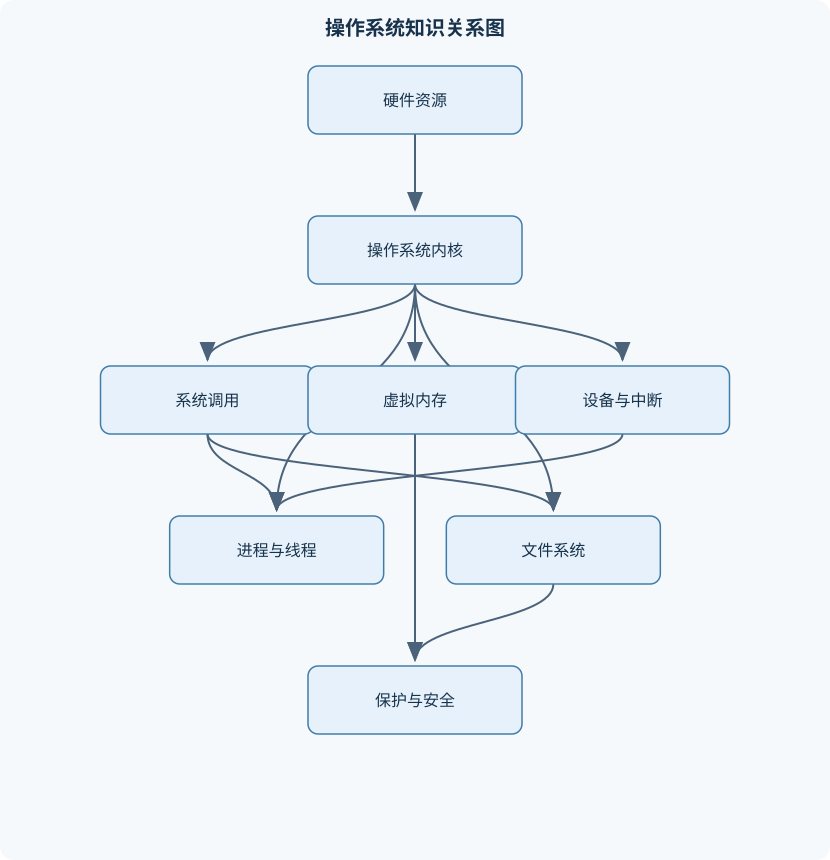
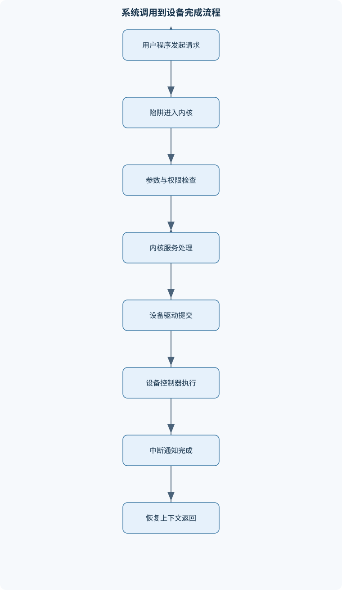

# 操作系统

## 一、课程整体知识框架

### 课程边界与先修知识

操作系统课程研究计算机系统中对处理器、内存、持久化存储、输入输出设备和并发执行环境进行抽象、管理、保护与服务的软件机制。内容覆盖操作系统结构、启动与特权级、进程与线程、CPU调度、同步与死锁、主存管理、虚拟内存、文件系统、设备与I/O、系统调用、保护与安全，以及基于RISC-V和类Unix系统的内核实现分析。先修知识包括C语言与指针、数据结构、计算机组成原理、数字逻辑基础、汇编语言基础、离散数学中的集合与图，以及基本的Linux命令和程序编译调试能力。课程不等同于某一具体内核版本或某一处理器实现；RISC-V和Linux用于说明机制，具体寄存器、系统调用编号、内核数据结构和调度器细节须以目标实现的版本和配置为准。





### 1. 课程对象：对计算机资源的抽象、管理、保护与服务

操作系统位于应用程序与计算机硬件之间，核心任务不是简单地“启动程序”，而是把处理器、内存、持久化存储、输入输出设备等物理资源组织为可使用、可隔离、可共享的抽象。程序是静态的指令和数据，进程是程序的一次运行实例，线程是进程内部的执行流；地址空间把物理内存抽象为进程可见的逻辑地址范围；文件把磁盘等持久化介质抽象为可命名、可读写的数据对象。

操作系统通常同时承担三类职责。第一是资源管理，即为进程分配处理器时间、内存页框、文件空间和设备访问权。第二是控制与保护，即阻止用户程序访问不属于自己的地址、执行不允许执行的特权操作，处理程序错误和设备故障。第三是服务接口，即通过系统调用、文件描述符、进程控制接口和设备接口，为应用程序提供相对稳定的服务。资源管理中的“高效”和“公平”并不总能同时达到，例如优先级调度可能提高交互任务响应速度，却使低优先级任务长期等待；写回缓存可以提高吞吐量，却增加断电时丢失最近数据的风险。

课程先修知识包括 C 语言与指针、数据结构、计算机组成原理、数字逻辑、汇编语言、集合与图，以及基本的程序编译和调试能力。指针错误、数组越界、栈与堆的区别、函数调用约定和中断控制流，都会直接影响对内核代码的理解。操作系统分析还必须区分理想模型与真实实现：教材中的进程切换、页表访问和磁盘读写往往采用固定成本，而现实系统还受到缓存、TLB、总线竞争、设备队列、锁竞争、乱序执行和内核配置的影响。

### 2. 四个贯穿全课程的核心问题

#### 2.1 如何虚拟化处理器

多个进程和线程共享有限的处理器。操作系统通过保存和恢复执行上下文、维护就绪队列并进行调度，使每个进程获得“仿佛独占处理器”的执行环境。进程通常经历创建、就绪、运行、阻塞和终止状态。运行中的进程因时间片耗尽、被更高优先级任务抢占、主动等待 I/O 或等待同步资源而离开运行态；I/O 完成或资源可用时，阻塞进程重新进入就绪态。

进程 $P_i$ 的调度分析使用到达时间 $A_i$、服务时间 $B_i$ 和完成时间 $C_i$。周转时间为

$$
T_i=C_i-A_i
$$

等待时间为

$$
W_i=T_i-B_i
$$

响应时间为首次获得处理器的时刻减去 $A_i$。其中 $B_i$ 表示实际需要的 CPU 执行时间，不包括阻塞等待；如果题目把 I/O 也混在“运行时间”中，必须先明确时间定义。时间片轮转中，时间片记为 $q$，调度切换开销记为 $s$。若一次运行最多消耗一个时间片，则任务获得 CPU 的有效比例近似为

$$
\frac{q}{q+s}
$$

该式假设每次时间片后都发生一次切换且忽略其他开销；当任务提前阻塞、退出或系统采用批量调度时，实际比例不同。$q$ 很大时接近先到先服务，$q$ 很小时响应性可能提高，但切换开销和缓存扰动会增加。

#### 2.2 如何虚拟化内存

进程使用的是逻辑地址，不应直接把逻辑地址当作物理地址。分页系统把逻辑地址分为页号和页内偏移。若逻辑地址宽度为 $n$ 位、页大小为 $2^k$ 字节，则低 $k$ 位为页内偏移，高 $n-k$ 位为页号。记逻辑地址为 $(p,d)$，页表把虚拟页号 $VPN$ 映射到物理页框号 $PFN$，物理地址由 $PFN$ 与同一页内偏移拼接得到。

页表项至少涉及有效位和权限位；有效位表示映射是否存在，读、写、执行权限决定访问类型是否被允许，脏位表示页面是否被修改，访问位可用于近似判断近期使用情况。地址转换流程通常先查 TLB，命中时直接取得页框号；未命中时逐级查页表，若映射有效且权限正确，则填充或更新 TLB；若页面尚未装入，可能触发缺页处理；若地址越界或访问权限不匹配，则产生保护异常。缺页与非法访问不能混同：缺页可能通过装入页面恢复，非法地址通常不能靠装入页面恢复。

按需分页只在页面真正访问时装入内存。设缺页概率为 $p$，正常内存访问时间为 $T_m$，缺页处理时间为 $T_f$，忽略多级页表、TLB 和并发 I/O 时，有效访问时间可简化为

$$
EAT=(1-p)T_m+pT_f
$$

由于 $T_f$ 通常远大于 $T_m$，即使 $p$ 很小，也可能显著降低性能。例如若 $T_f$ 比 $T_m$ 大若干数量级，缺页率从接近零增加到千分之一，平均访问时间也可能明显上升。该式不是所有系统都适用的精确性能模型，因为现实中的缺页处理时间受磁盘或固态设备队列、写回脏页、并发线程和缓存状态影响。

#### 2.3 如何虚拟化持久化存储

文件系统把块设备抽象为文件、目录和路径。文件具有内容、长度、类型、所有者、权限和时间等属性；目录把名称映射到文件对象；路径解析从起始目录开始逐项查找目录项，并处理当前目录、父目录、挂载点和符号链接。文件描述符不是文件名，也不是 inode，而是进程打开文件表中的一个整数索引，关联打开状态、当前文件偏移量和访问权限。文件偏移量记为 $off$，读写操作通常从该位置开始并按实际传输量推进。

文件分配方式决定访问性能和扩展能力。连续分配适合顺序读取和范围定位，但文件扩展可能需要移动数据，并产生外部碎片；链接分配便于扩展，却不利于随机访问；索引分配通过索引块保存数据块地址，适合随机访问，但索引本身占用空间。若数据块大小为 $D$ 字节、块地址指针大小为 $a$ 字节，则单级索引最多指向 $\lfloor D/a\rfloor$ 个数据块，最大数据容量为

$$
D\left\lfloor\frac{D}{a}\right\rfloor
$$

多级索引还要乘上相应层级的指针数量。该计算只表示寻址上限，不等于文件实际可用大小；文件系统还可能受文件长度字段、地址空间、配额和卷容量限制。

持久化存储还必须处理缓存一致性和崩溃恢复。写入系统调用返回，不一定意味着数据已经稳定写入介质；数据可能仍在页缓存、设备缓存或控制器队列中。日志、写时复制、元数据校验和恢复扫描等机制用于降低崩溃后文件系统处于不一致状态的风险，但它们不能自动保证应用层事务语义。

#### 2.4 如何在共享环境中提供并发与保护

并发执行允许 CPU 与设备 I/O 重叠，也允许多个线程同时推进，但共享数据会产生竞态条件。若两个线程对同一变量执行“读—改—写”，即使单条机器指令分别不可分割，整个复合操作仍可能被交错，最终结果不符合任何一个串行顺序。临界区是访问共享状态且必须保持一致性的代码区域。

互斥锁保证同一时刻最多一个线程进入临界区；自旋锁在等待时持续占用 CPU，适合持锁时间短且不宜睡眠的内核路径；阻塞锁在资源不可用时让线程睡眠，适合等待时间可能较长的场景。信号量 $S$ 既可表示互斥，也可表示可用资源数量。$wait(S)$ 在资源不足时阻塞调用线程，$signal(S)$ 释放资源并可能唤醒等待者。条件变量用于“某个条件成立前继续等待”，必须与互斥锁配合，并在唤醒后重新检查条件，因为唤醒不等价于条件必然仍然成立。

死锁要求四个条件同时成立：互斥、占有且等待、不可剥夺和循环等待。破坏其中任意一个条件即可从模型上排除死锁。例如规定所有资源必须一次性申请，可破坏占有且等待；按资源编号递增申请，可破坏循环等待；允许系统回收某些可剥夺资源，可破坏不可剥夺。预防会降低并发性，避免算法则依据进程最大需求判断分配后是否仍处于安全状态。安全状态表示存在至少一个安全序列，不表示当前没有资源竞争。

### 3. 从硬件启动到用户程序的控制链

#### 3.1 启动、特权级与内核进入

计算机上电或复位后，由启动固件执行基本初始化，设置必要的硬件状态，寻找并加载内核，将控制权转移到内核入口。固件通常存放在非易失性存储中，但具体存放位置和加载过程由平台决定。内核随后初始化内存管理、异常和中断控制、设备驱动、调度器、文件系统以及第一个用户环境。

在 RISC-V 中，PC 是程序计数器，通用寄存器为 $x_0$ 至 $x_{31}$。$x_0$ 的读取值固定为零，写入通常被丢弃。机器态、监管态和用户态具有不同的特权范围；具体系统可能只使用其中部分特权级。用户态不能直接执行所有特权指令，也不能任意修改页表、中断控制寄存器和设备控制寄存器。SBI 为监管态软件访问机器态服务提供接口，但具体调用约定、扩展和编号取决于目标固件实现。

RISC-V 指令编码中，R 型指令主要包含寄存器操作数，I 型指令包含立即数，S 型指令用于部分存储操作。分支和跳转立即数可能分散在指令不同位段，解码时必须按规定重排并进行符号扩展。地址对齐要求取决于指令宽度和处理器是否支持非对齐访问；不能把“立即数位宽”直接等同于“可表示地址范围”。

#### 3.2 中断、异常、陷阱和系统调用

外部设备完成操作后可通过中断通知处理器。外部中断通常是异步的，发生时间与当前执行指令无固定对应关系；非法指令、缺页和除零等异常通常与当前指令同步；系统调用也是由用户程序主动触发的同步陷阱。三者都可能进入内核，但原因、返回语义和可恢复性不同。

从陷阱到返回的控制流通常包括：硬件切换到规定的特权入口并保存架构要求的状态；入口代码保存尚未由硬件保存的通用寄存器；读取陷阱原因并分发到系统调用、设备中断或异常处理函数；检查用户提供的地址、长度、对象和权限；更新返回值或进程状态；恢复上下文并返回原特权级。硬件保存哪些字段、软件保存哪些字段，取决于架构和内核入口代码，不能把某个实现的上下文结构当作所有系统的统一标准。

设备控制器通常拥有局部缓冲区。I/O 数据先在设备与控制器缓冲区之间传输，再由 CPU 或 DMA 在缓冲区与主存之间搬运。程序控制 I/O 需要 CPU 主动轮询状态；中断驱动 I/O 在设备完成时通知 CPU，可避免长时间忙等待；DMA 允许设备控制器直接读写主存，降低 CPU 搬运成本，但要求处理缓存一致性、内存权限和缓冲区生命周期。中断处理常分为尽快完成的上半部与可延迟执行的下半部，以减少长时间占用中断上下文。

### 4. 课程知识之间的因果关系

进程抽象依赖处理器特权、上下文保存和调度；线程并发依赖共享地址空间、原子操作和同步原语；虚拟内存依赖地址转换、异常入口和物理页框管理；文件系统依赖块设备 I/O、缓存和崩溃恢复；系统调用则把用户态程序连接到所有这些内核服务。任何一个层次都不能脱离保护机制独立理解：文件读写需要检查文件描述符和权限，用户指针需要验证地址范围，设备访问需要经过驱动和特权控制。

课程还强调实现边界。Linux 的系统调用编号、内核结构体、调度器细节和路径缓存会随版本、架构和配置变化；RISC-V 的寄存器使用、SBI 接口和异常委托也依赖具体实现。因而分析机制时应先区分稳定概念与实现细节：稳定概念包括用户态与内核态的隔离、进程状态转换、分页地址转换和中断控制流；实现细节包括某个字段名称、某个寄存器位、某个系统调用编号和某个内核函数的调用关系。

## 二、章节和模块划分

### 核心知识覆盖清单

本清单用于检查正文是否覆盖本课程的主要知识模块：

- **操作系统概论与系统结构**：操作系统的目标与功能、资源管理与控制程序、计算机系统运行模式、内核态与用户态、系统调用与服务接口、单体内核与微内核、模块化与分层结构、启动程序与内核加载、中断、异常与陷阱、理想模型与现实系统差异。
- **计算机系统启动与RISC-V基础**：启动固件与引导流程、RISC-V特权级概念、机器态、监管态与用户态、寄存器与程序计数器、R型、I型、S型指令编码、分支与跳转立即数、地址对齐与符号扩展、异常委托与陷阱入口、上下文保存与恢复、SBI与操作系统接口。
- **进程、线程与进程控制**：进程的抽象与地址空间、进程状态转换、进程控制块、进程创建与终止、fork与exec语义、父子进程关系、僵尸进程与孤儿进程、线程与进程的区别、用户级线程与内核级线程、上下文切换成本。
- **CPU调度与处理器虚拟化**：调度目标与评价指标、就绪队列与阻塞队列、先到先服务调度、短作业优先调度、优先级调度、时间片轮转调度、多级反馈队列、抢占与非抢占、响应时间与周转时间、多处理器调度与负载均衡。
- **并发、同步与通信**：竞态条件与临界区、原子操作与不可分割性、互斥锁与自旋锁、信号量的定义与操作、条件变量与管程、生产者消费者问题、读者写者问题、哲学家进餐问题、进程间通信机制、忙等待与阻塞等待的边界。
- **死锁建模、避免与恢复**：死锁的资源模型、死锁四个必要条件、资源分配图、死锁预防、死锁避免、安全状态与安全序列、银行家算法、死锁检测、死锁恢复策略、活锁、饥饿与死锁的区别。
- **主存管理与地址空间**：物理地址与逻辑地址、地址空间抽象、重定位与地址保护、连续内存分配、首次适应与最佳适应、内部碎片与外部碎片、分区与伙伴系统、分页机制、分段机制、页表与地址转换、多级页表与TLB、内核地址空间与用户地址空间。
- **虚拟内存与页面置换**：按需分页、缺页异常处理、有效访问时间、页面置换依据、FIFO页面置换、LRU页面置换、时钟置换算法、工作集与驻留集、抖动与缺页率、写时复制、内存映射文件、页面异常与非法访问鉴别。
- **文件系统与持久化存储**：文件抽象与文件属性、目录与路径解析、文件描述符、打开、读写与定位接口、硬链接与符号链接、连续分配与链接分配、索引分配与多级索引、空闲空间管理、inode与目录项、虚拟文件系统、磁盘调度、缓存、一致性与崩溃恢复。
- **I/O系统、设备驱动与内核实践**：设备控制器与局部缓冲区、程序控制I/O、中断驱动I/O、DMA与突发传输、中断处理上半部与下半部、设备文件与驱动接口、系统调用进入内核、路径名解析与挂载、内核模块机制、Linux进程与内存管理观察、RISC-V系统中断实验流程、保护、权限与基础安全。


### 1. 操作系统概论与系统结构

本模块建立全课程的抽象层次。操作系统既是资源管理器，也是控制程序和服务提供者。单体内核把大量服务运行在同一特权地址空间，调用路径短、性能较好，但模块间错误可能扩大影响；微内核只在核心中保留地址空间、线程、IPC 等基础机制，把驱动和服务移到用户态，隔离性较好，但通信和上下文切换成本可能增加。分层结构强调上层只依赖下层接口，模块化结构则通过清晰接口装载或替换组件。现实系统常是多种结构的混合体，不能简单归类为纯单体或纯微内核。

### 2. 计算机系统启动与 RISC-V 基础

本模块按“复位—固件—引导—内核—用户态”的顺序分析系统启动。重点包括 PC 和通用寄存器、R 型/I 型/S 型指令编码、立即数符号扩展、分支偏移和地址对齐。启动后的异常委托决定哪些陷阱由机器态处理、哪些交给监管态；上下文保存与恢复决定用户程序能否在陷阱返回后继续执行。分析具体寄存器和 SBI 接口时，必须以目标架构实现和固件版本为准。

### 3. 进程、线程与进程控制

进程控制块保存进程标识、状态、寄存器上下文、地址空间、打开文件和调度信息等。进程创建会产生新的执行实体和资源关系，`fork` 通常复制进程的执行环境并使父子进程获得不同返回值，`exec` 则以新程序映像替换当前进程地址空间；二者不是同一个操作。父进程通过等待接口回收子进程退出状态。子进程退出而父进程尚未回收时形成僵尸进程；父进程先退出时，子进程会被重新托管。线程共享进程的地址空间和打开文件等资源，但拥有独立的 PC、栈和寄存器上下文。用户级线程切换可不进入内核，但一个线程阻塞可能影响整个进程；内核级线程可被独立调度，但切换和管理成本通常更高。

### 4. CPU 调度与处理器虚拟化

调度算法以到达时间、服务时间、优先级和阻塞事件为输入，输出运行顺序和完成时间。先到先服务实现简单，但长任务可能造成队列后部任务长时间等待；短作业优先在已知服务时间且非抢占条件下可降低平均等待时间，但可能使长任务饥饿；优先级调度需要处理优先级反转和饥饿；时间片轮转通过 $q$ 控制响应性与切换开销；多级反馈队列根据历史运行行为调整优先级，试图兼顾交互任务和批处理任务。多处理器环境还要考虑负载均衡、处理器亲和性、共享缓存和锁竞争，不能把单核甘特图直接当作多核实际执行结果。

### 5. 并发、同步与通信

生产者消费者问题中，有界缓冲区容量为 $N$ 时，可设互斥信号量初值为 $1$，空槽信号量初值为 $N$，满槽信号量初值为 $0$。生产者依次执行 `wait(empty)`、`wait(mutex)`、写入、`signal(mutex)`、`signal(full)`；消费者依次执行 `wait(full)`、`wait(mutex)`、取出、`signal(mutex)`、`signal(empty)`。计数信号量保证槽位数量不越界，互斥锁保护缓冲区内部结构。若先持有互斥锁再等待空槽，生产者可能占锁睡眠，消费者无法进入缓冲区取走数据，从而造成不必要的阻塞甚至死锁。

读者写者问题体现共享读与互斥写之间的权衡；偏向读者可能使写者饥饿，偏向写者则可能降低读并发。哲学家进餐问题说明局部正确的加锁操作仍可能形成全局循环等待。进程间通信可采用管道、消息队列、共享内存和信号等方式。共享内存速度快，但必须额外设计同步；消息传递隔离性较强，却需要复制、排队和阻塞管理。

### 6. 死锁建模、避免与恢复

资源类型记为 $R_j$，进程 $P_i$ 的最大需求、已分配量和剩余需求分别为 $Max_i$、$Alloc_i$ 和

$$
Need_i=Max_i-Alloc_i
$$

银行家算法先令 $Work=Available$，寻找尚未完成且满足 $Need_i\leq Work$ 的进程，模拟其完成并令

$$
Work=Work+Alloc_i
$$

若所有进程都能完成，则得到安全序列；否则当前状态没有被该算法证明为安全。这里的“安全”是存在一种满足最大需求的资源分配顺序，不代表系统当前没有阻塞。死锁检测则使用当前请求矩阵，而不是最大需求矩阵，模拟可满足请求的进程完成并释放资源。检测到死锁后，可通过终止进程、回滚、抢占可回收资源或让系统管理员介入恢复。活锁表现为线程持续改变状态却没有有效进展，饥饿表现为某个任务长期得不到资源，二者都不等同于死锁。

### 7. 主存管理与地址空间

连续内存分配包括首次适应、最佳适应等策略。首次适应从低地址开始寻找第一个足够大的空闲区，通常搜索较快；最佳适应寻找最小可用空闲区，可能留下大量难以利用的小空洞。内部碎片是已分配区域内部未使用的空间，外部碎片是空闲空间分散在多个区域而无法满足大块请求。伙伴系统按 $2$ 的幂次划分和合并块，便于快速合并，但可能产生内部碎片。

分页消除了大部分外部碎片，却需要页表和地址转换开销。多级页表只为实际使用的地址范围分配下级页表，适合稀疏地址空间；代价是 TLB 未命中时需要多次访存。分段按逻辑段组织地址，便于表达代码段、数据段和栈段的边界与权限，但外部碎片和段管理复杂性仍然存在。内核地址空间和用户地址空间的布局必须配合权限位，内核不能仅依赖地址范围判断安全性，还要验证指针来源、长度和访问类型。

### 8. 虚拟内存与页面置换

缺页异常发生后，内核检查访问是否合法，若页面属于进程但尚未驻留，则选择空闲页框或牺牲页，必要时写回脏页，从后备存储装入目标页，更新页表和 TLB，最后重新执行引发异常的指令。若访问地址不属于有效区域或权限不允许，则返回非法访问或保护错误，而不是盲目装入页面。

FIFO 按进入内存的先后淘汰页面，可能出现 Belady 异常，即增加页框反而增加缺页次数。LRU 淘汰最近最久未使用的页面，在采用完整栈性质的理想实现中不会出现该异常，但精确记录每次访问的成本较高。时钟算法利用访问位近似 LRU：指针遇到访问位为 $1$ 的页时清零并跳过，遇到 $0$ 的页时选择淘汰。工作集描述一段时间内活跃访问的页面集合；若驻留集不足以容纳工作集，缺页率升高并可能抖动。写时复制允许父子进程先共享只读页面，任一方写入时才复制；内存映射文件则把文件内容映射到地址空间，访问和回写由页面机制协调。

### 9. 文件系统与持久化存储

目录项保存名称到文件对象的映射，inode 等元数据对象保存文件类型、权限、长度和数据块索引等信息。硬链接增加同一文件对象的目录引用，通常不能跨文件系统；符号链接保存路径字符串，可以跨文件系统，但路径失效或形成循环。打开文件时，内核解析路径、检查权限、取得文件对象并创建文件描述符；后续读写通常通过描述符和当前偏移量完成。

虚拟文件系统提供统一的文件操作接口，使不同文件系统能够实现共同的打开、读取、写入和目录操作。挂载把一个文件系统接入目录树，路径解析到达挂载点后切换到对应文件系统。磁盘调度可采用 FCFS、SSTF、SCAN 或 C-SCAN。机械磁盘访问时间可近似表示为

$$
T=T_s+T_r+T_t
$$

其中 $T_s$ 为寻道时间，$T_r$ 为旋转延迟，$T_t$ 为传输时间；固态存储不具有相同的机械寻道模型，因此不能直接用磁头移动距离评价全部设备。

### 10. I/O 系统、设备驱动与内核实践

设备驱动把通用内核接口转换为具体控制器操作，处理寄存器、设备队列、中断、DMA 和错误状态。设备文件使设备能够以文件接口呈现，但设备文件的读写语义并不必然等同于普通磁盘文件。系统调用从用户态进入内核后，内核必须先完成特权检查、参数检查和用户地址验证，再执行路径解析、对象查找和设备操作。内核模块可以扩展驱动或服务，但模块错误可能破坏整个内核地址空间。

实践分析应观察进程状态、虚拟内存区域、文件描述符、系统调用入口和设备中断路径，并区分观测到的实现细节与可推广机制。RISC-V 中断实验通常包括设置陷阱向量、配置中断委托、保存上下文、识别中断原因、调用处理函数、恢复寄存器并返回用户态。验收时不仅要看程序是否“能运行”，还要检查异常原因是否正确、用户寄存器是否被破坏、非法访问是否被拒绝、设备中断是否可能丢失以及并发路径是否存在竞态。娱乐网址

## 三、核心概念的详细解释

### 3.1 操作系统的目标、结构与运行模式

操作系统是介于应用程序和硬件之间的系统软件。它把处理器、主存、持久化存储和输入输出设备转换为进程、地址空间、文件和设备接口等抽象，同时负责资源分配、执行控制、保护隔离和错误处理。操作系统的“方便性”和“效率”可能发生冲突：缓存可以减少设备访问次数，但会引入一致性和崩溃恢复问题；优先级调度可以改善交互响应，却可能使低优先级进程长期得不到处理器。

程序是静态的指令和数据，进程是程序的一次运行实例，线程是进程内部的执行流。一个进程至少包含地址空间、打开文件状态、资源限制和进程控制块；一个进程可以有多个线程，它们共享代码段、数据段、堆和打开文件表，但分别拥有程序计数器、寄存器集合和线程栈。单核处理器上多个线程只能交错执行，多核系统上才可能真正并行。

处理器通常区分用户态和内核态。用户态程序不能直接执行修改页表、关闭中断、访问设备控制器等特权操作；它必须通过系统调用请求内核服务。系统调用进入内核后，内核不仅检查调用编号，还要检查用户指针是否可访问、参数是否在合法范围内、文件描述符是否有效以及调用者是否具有相应权限。进入内核态并不意味着所有参数天然可信。

中断、异常和系统调用都可能导致控制流进入内核，但原因不同。外部中断通常由设备异步产生，例如磁盘完成读操作后向处理器发出通知；异常通常与当前指令同步，例如非法指令、除零、缺页或权限错误；系统调用是用户程序主动请求内核服务的同步陷阱。处理器硬件保存的状态、软件入口保存的寄存器以及返回指令的具体形式取决于处理器架构，不能把某一种实现的寄存器集合当作所有系统的统一规则。

内核结构主要有三类。单体内核把进程管理、内存管理、文件系统和设备驱动等主要功能放在一个特权地址空间中，调用路径短，但模块之间耦合较强；微内核只在内核中保留地址空间管理、线程调度、基本通信和中断等机制，把文件系统和驱动等服务放在用户态，通过消息传递协作，隔离性较好但通信开销和系统设计复杂度可能增加；模块化内核在单体结构基础上支持按需加载或卸载功能模块。分层结构则要求上层只依赖下层接口，便于验证，但严格分层可能限制性能优化。现实系统往往综合采用这些思想。

启动过程从复位或上电开始。固件首先执行硬件初始化，建立基本执行环境，然后加载更高阶段的引导程序或内核映像，并把控制权转交给内核。内核随后初始化页表、异常和中断入口、物理内存管理器、进程管理器、设备驱动和根文件系统，最后创建第一个用户态进程。RISC-V系统中，机器态、监管态和用户态分别承担不同层级的特权职责；监管态通常运行操作系统内核，机器态可由固件或运行时环境提供底层服务。SBI是监管态软件向机器态固件请求定时器、跨处理器中断等服务的接口，但其具体调用约定必须以目标实现为准。

### 3.2 RISC-V指令、陷阱与上下文切换

RISC-V的程序计数器记为 $PC$，通用寄存器为 $x_0$ 至 $x_{31}$，其中 $x_0$ 的值固定为零。R型指令通常从寄存器读取两个操作数并把结果写入寄存器；I型指令通常包含一个寄存器操作数和立即数；S型指令把立即数分散编码，用于存储指令。立即数需要按照具体指令格式重新拼接，并进行符号扩展，不能简单把编码字段当作无符号整数。分支和跳转立即数还可能要求目标地址满足对齐约束。

当用户程序执行系统调用或发生页面异常时，控制流经历“陷阱进入—状态保存—原因分发—服务或异常处理—状态恢复—返回”的过程。硬件通常保存足以恢复控制流的部分状态，例如发生陷阱时的程序计数器和原因信息；入口代码还必须保存可能被内核覆盖的通用寄存器。系统调用处理器读取系统调用号，验证参数，执行相应服务并把返回值写入规定位置。页面异常处理器需要区分“页面暂未装入”“地址不存在”和“访问权限错误”：前一种可能通过分配页框和更新页表恢复，后两种通常应向进程报告错误或终止进程。

上下文切换包括保存当前线程寄存器、更新进程控制块、选择下一个可运行线程、恢复其寄存器并重新建立执行环境。进程切换还可能改变地址空间，从而造成TLB失效、页表根切换和缓存局部性下降；线程切换若发生在同一进程内部，通常不需要更换地址空间，但这并不保证在所有实现中一定更快，因为线程栈、调度锁、浮点状态和安全检查仍会产生开销。

### 3.3 进程、线程与进程控制

进程状态通常包括创建、就绪、运行、阻塞和终止。新进程创建后先进入就绪队列；调度器选中它后转为运行；它因时间片耗尽、被抢占或主动等待I/O而离开运行态。I/O完成或等待的同步资源可用时，阻塞进程转回就绪态。终止进程不能继续执行，但其退出状态可能暂存在内核中，等待父进程读取。

进程控制块保存进程标识、状态、调度信息、地址空间信息、打开文件引用、信号状态和寄存器上下文等。`fork`通常创建一个逻辑上复制自父进程的子进程，父进程得到子进程标识，子进程得到返回值零；实际实现常采用写时复制，使父子进程先共享只读物理页，只有一方写入时才复制页面。`exec`不创建新进程，而是用新的程序映像替换当前进程的地址空间和用户栈，进程标识通常保持不变。`wait`用于回收子进程退出状态。

子进程先退出而父进程尚未回收时，会暂时成为僵尸进程；僵尸进程不再运行，但其少量退出信息仍占用内核资源。父进程退出后，仍在运行的子进程会成为孤儿进程，由系统中的指定进程接管，以便最终回收。僵尸与孤儿不能混为一谈：前者已经结束但未被回收，后者仍可能继续运行。

用户级线程由运行库调度，切换速度可能较快，但一个线程阻塞系统调用时，整个进程可能受影响，且内核未必能直接在多个处理器上分别调度这些线程。内核级线程由内核感知和调度，能够独立阻塞和并行执行，但切换需要进入内核并维护更多状态。

### 3.4 CPU调度与调度指标

设进程 $P_i$ 的到达时间为 $A_i$，CPU服务时间为 $B_i$，完成时间为 $C_i$。周转时间、等待时间和响应时间分别为

$$
T_i=C_i-A_i
$$

$$
W_i=T_i-B_i
$$

$$
R_i=F_i-A_i
$$

其中 $F_i$ 是进程第一次获得CPU的时刻。$B_i$ 的单位通常为时间单位，三种时间指标的单位必须一致。等待时间公式成立的前提是进程只需要一段总CPU服务时间，且“等待时间”不包括实际运行时间；若题目把I/O等待单独统计，必须重新定义指标。

先到先服务按照到达顺序运行，规则简单但可能出现长作业阻塞短作业的护航效应。短作业优先选择估计服务时间最短的作业，在所有作业同时到达且服务时间准确时，可以最小化平均等待时间；但长作业可能饥饿，而且实际系统通常无法预知未来服务时间。优先级调度选择优先级最高者，可抢占也可非抢占；老化机制可以逐渐提高长期等待进程的优先级。时间片轮转让每个就绪进程最多运行 $q$ 时间单位，再把未完成进程放到队尾。若每次时间片结束都产生切换开销 $s$，理想化的有效CPU比例约为

$$
\frac{q}{q+s}
$$

该式忽略阻塞、退出、缓存失效和多核同步开销。多级反馈队列根据历史行为调整优先级，通常让交互性强、短时间运行的任务获得较快响应，同时限制长期CPU密集任务的优先级。

多处理器调度还要考虑负载均衡、处理器亲和性和共享缓存。强行迁移进程可能平衡负载，却会损失缓存局部性；只在固定处理器上运行可以利用缓存，但可能造成某个处理器繁忙而其他处理器空闲。CPU利用率、吞吐量、平均周转时间、等待时间和响应时间是不同指标，不能用平均等待时间推断所有调度目标都得到优化。

### 3.5 并发、同步、通信与死锁

竞态条件发生在多个执行流访问共享状态，且结果取决于访问交错顺序。临界区是访问共享数据并要求满足一致性约束的代码区域。锁、原子指令和关闭中断都可能用于保护临界区，但适用范围不同。关闭中断只适合特权态和特定处理器场景，不能替代多处理器上的通用同步；自旋锁适合临界区极短且等待者不能睡眠的场景，长时间持有会浪费处理器；互斥锁允许等待者阻塞，适合可能经历较长等待的场景。

信号量 $S$ 是带有原子操作的整数抽象。$wait(S)$ 在资源不可用时使线程阻塞，$signal(S)$ 释放资源并可能唤醒等待者。二值信号量可用于互斥，计数信号量还可表示多个同类资源。条件变量不表示资源数量，而是让线程在某个条件不成立时睡眠；线程被唤醒后必须重新检查条件，因此通常使用循环而非一次性判断。管程把共享数据、操作函数和隐含互斥组织在一起。

有界生产者消费者问题中，容量为 $N$ 的缓冲区使用三个同步对象：`mutex=1`保护缓冲区，`empty=N`表示空槽数，`full=0`表示已有产品数。生产者顺序应为 `wait(empty)`、`wait(mutex)`、写入、`signal(mutex)`、`signal(full)`；消费者顺序应为 `wait(full)`、`wait(mutex)`、取出、`signal(mutex)`、`signal(empty)`。若先获取互斥锁再等待空槽，缓冲区满时生产者会占有锁并睡眠，消费者无法获得锁取出产品，可能形成死锁。

死锁要求四个条件同时成立：互斥、占有且等待、不可剥夺和循环等待。破坏任意一个条件即可从模型上排除死锁。资源分配图可用进程节点和资源节点表示请求边、分配边；在单实例资源模型中，相关环通常直接指示死锁，但多实例资源模型需要进一步检查可满足性。银行家算法根据最大需求判断分配后是否存在安全序列，安全状态不等于当前没有竞争，而是表示存在一种顺序可以让所有进程最终完成。活锁中的线程持续改变状态但没有完成有效工作；饥饿是某个线程长期得不到资源；二者都不同于资源循环等待导致的死锁。

### 3.6 主存管理与虚拟内存

物理地址指向实际内存位置，逻辑地址是进程使用的地址。重定位机制把逻辑地址转换为物理地址，保护机制检查访问是否超出界限或违反权限。连续分配把进程放在连续物理区域中，首次适应寻找第一个足够大的空闲区，最佳适应寻找最小但足够大的空闲区。前者搜索较快但可能留下许多小空洞，后者减少单次剩余空间却可能制造大量难以利用的小块。

内部碎片是已分配区域内部未被使用的空间，例如固定大小分区中进程没有用满分区；外部碎片是空闲空间分散在多个区域，虽然总量足够却没有一块连续区域满足请求。伙伴系统按二的幂次管理内存块，分裂和合并效率较好，但可能产生内部碎片。

分页把逻辑地址分成页号和页内偏移。若逻辑地址为 $n$ 位、页大小为 $2^k$ 字节，则偏移为低 $k$ 位，页号为其余高 $n-k$ 位。页表把虚拟页号 $VPN$ 映射为物理页框号 $PFN$，物理地址由页框号和偏移拼接而成。页表项中的有效位表示映射是否存在，权限位控制读写执行，脏位表示页面被修改，访问位用于近似判断近期使用情况。TLB缓存近期地址转换，命中可减少页表访问；未命中则需要按页表层级查询。多级页表只为实际使用的地址区域分配下级页表，能够降低稀疏地址空间的空间开销，但一次转换可能增加访存次数。

按需分页只在页面真正访问时装入内存。缺页异常处理通常包括保存现场、检查访问是否合法、寻找空闲页框或选择牺牲页、必要时写回脏页、从后备存储读入目标页、更新页表和TLB、恢复进程执行。非法地址和权限错误不能简单当作缺页：若地址不属于进程地址空间，或写入只读页，内核应拒绝访问。

FIFO淘汰最早进入内存的页面，简单但可能出现Belady异常，即页框数增加反而缺页次数增加。LRU淘汰最长时间未使用的页面，在理想实现下具有栈性质，但精确记录所有访问顺序代价较高；时钟算法利用访问位近似LRU，以较低成本扫描候选页面。工作集表示进程近期活跃的页面集合，驻留集表示当前分配给进程的页框集合。若驻留集过小，缺页率升高，进程频繁换页而有效执行减少，形成抖动。

写时复制允许多个地址空间先共享只读页面，写入时由缺页处理器复制页面。内存映射文件把文件部分内容映射到虚拟地址空间，读写可通过页面机制完成，但必须处理脏页写回、一致性和映射范围检查。

### 3.7 文件系统、设备I/O与保护

文件是持久化数据的命名抽象，通常具有类型、长度、所有者、权限、时间属性和数据块映射。目录把名称映射到目录项，目录项再关联inode或其他文件元数据对象；文件描述符是进程持有的打开文件引用，其中可能包含当前文件偏移量 $off$、访问模式和状态标志。多个文件描述符可能引用同一个打开文件对象，因此共享偏移量不能仅依据“描述符编号不同”判断。

硬链接增加同一文件对象的另一个目录项名称，通常不能跨文件系统；符号链接保存路径字符串，解析时可能跨文件系统，但要处理循环链接和权限检查。路径解析从起始目录或当前工作目录开始，逐项查找目录项，处理`.`、`..`、挂载点和符号链接，并在访问每个目录时检查搜索权限。

文件分配可采用连续分配、链接分配或索引分配。连续分配随机访问快，但扩展和外部碎片问题明显；链接分配便于扩展，却需要沿链访问，随机读取代价大；索引分配通过索引块记录数据块地址，适合随机访问。若数据块大小为 $B$ 字节、块地址指针大小为 $p$ 字节，则单级索引块最多容纳 $\lfloor B/p\rfloor$ 个地址；多级索引可覆盖更多数据块，但会增加索引访问和空间开销。逻辑文件大小是文件有效数据的字节数，实际磁盘占用还包括索引块、对齐空间、元数据和日志。

设备控制器负责特定设备，并拥有局部缓冲区。I/O数据先在设备与控制器局部缓冲区之间传递，再由CPU或DMA在控制器和主存之间搬运。程序控制I/O由CPU轮询状态寄存器，简单但可能忙等待；中断驱动I/O在设备完成时通知CPU，减少无效轮询；DMA允许设备控制器直接在主存和设备间传输数据，CPU只需设置描述符并处理完成中断。DMA与缓存结合时必须维护缓存一致性，否则CPU可能读取旧缓存，设备却已经写入新内存数据。

磁盘请求服务时间可理想化为

$$
T_{\text{I/O}}=T_s+T_r+T_t
$$

其中 $T_s$ 是寻道时间，$T_r$ 是旋转延迟，$T_t$ 是数据传输时间。该式主要适用于机械磁盘；固态存储不具有相同的机械寻道和旋转过程。FCFS按到达顺序处理，SSTF选择距离当前磁头最近的请求，SCAN沿一个方向服务后再反向，C-SCAN只沿一个方向服务并循环回到起点。SSTF可能使远端请求饥饿，SCAN类算法通常更适合控制等待时间分布。

缓存提高访问速度，但必须明确何时写回和如何保证崩溃一致性。日志、写时复制、检查点和一致性检查都可用于崩溃恢复，但它们不能消除所有硬件故障。虚拟文件系统通过统一接口屏蔽不同文件系统实现，挂载树把多个文件系统组织成统一路径空间。保护机制还包括用户标识、组标识、读写执行权限、特权检查、地址空间隔离和系统调用参数验证。

## 四、重要定义、公式、定理和推导

### 专业审校补充：关键定义与适用边界

文件描述符、打开文件对象和 inode 不是同一层次的概念。文件描述符是进程文件描述符表中的整数索引；它指向内核中的打开文件对象，后者通常记录当前文件偏移、访问方式和引用计数；打开文件对象再关联 inode 或等价的文件元数据对象。通过 fork 复制的是父子进程各自的描述符表项，但表项通常仍指向同一个打开文件对象，因此父子进程对同一描述符进行 read、write 或 lseek 可能共享文件偏移；通过两次独立 open 得到的打开文件对象通常具有各自偏移。dup 也共享打开文件对象，而不是创建新的偏移。O_APPEND 要求每次写入前将偏移定位到文件末尾，内核应把定位与写入作为一次受保护操作；但这不等于多个写调用之间的整段应用逻辑天然不可分割，也不保证普通用户缓冲区输出按预期成组。该结论依赖类 Unix 接口语义，具体原子性、网络文件系统行为和缓存可见性须以目标实现为准。


### 4.1 调度指标的计算与验证

给定三个进程：

| 进程 | $A_i$ | $B_i$ |
|---|---:|---:|
| $P_1$ | 0 | 5 |
| $P_2$ | 1 | 2 |
| $P_3$ | 2 | 1 |

在FCFS下，甘特图顺序为 $P_1:0\sim5$、$P_2:5\sim7$、$P_3:7\sim8$。因此 $C_1=5$、$C_2=7$、$C_3=8$。周转时间分别为 $5$、$6$、$6$，等待时间分别为 $0$、$4$、$5$。平均等待时间为

$$
\frac{0+4+5}{3}=3
$$

平均周转时间为

$$
\frac{5+6+6}{3}=\frac{17}{3}
$$

若采用非抢占SJF，$P_1$因在时刻0已经运行，必须先完成；时刻5选择剩余服务时间最短的 $P_3$，再运行 $P_2$。此时顺序为 $P_1,P_3,P_2$，完成时间为 $5,6,8$，等待时间为 $0,3,5$。这个结果说明SJF改善了部分进程的等待时间，但并不意味着每个进程都更快完成。

时间片轮转还必须说明时间片边界和切换开销。若 $q=2$ 且 $s=0$，就绪队列按到达顺序循环；若 $s>0$，每次真正发生调度切换都应在甘特图中插入开销区间。将切换开销忽略后再声称“平均响应时间不变”是不成立的，因为响应时间取决于首次获得CPU的绝对时刻。

### 4.2 地址转换的位级推导

设逻辑地址宽度为 $n=16$ 位，页大小为 $2^k=2^8=256$ 字节。逻辑地址的低8位为页内偏移，高8位为页号。若逻辑地址为十六进制 `0x3A7C`，则

$$
p=\left\lfloor\frac{0x3A7C}{0x100}\right\rfloor=0x3A
$$

$$
d=0x3A7C\bmod 0x100=0x7C
$$

若页表把虚拟页 $0x3A$ 映射到物理页框 $0x12F$，则物理地址为页框号与偏移拼接：

$$
PA=(0x12F\times 0x100)+0x7C=0x12F7C
$$

这里要求页框大小与页大小相同，且映射有效、访问权限允许。若页表项有效位为0，不能直接拼出物理地址，而应进入缺页或无效映射处理；若映射存在但当前操作为写、权限位不允许写入，则属于保护异常。

多级页表的空间节省来自稀疏分配。若完整一级页表必须覆盖整个虚拟地址空间，即使进程只使用很小的一段地址，也要为所有虚拟页准备表项；多级页表只在某个高层索引实际被使用时分配对应的下级页表。因此，使用区域少时节省明显；但地址转换可能需要依次访问多个页表页，TLB未命中时延迟增加。TLB命中和页表命中不能混为一谈：TLB命中意味着无需再次遍历页表，页表命中则是遍历后找到有效映射。

### 4.3 有效访问时间的适用边界

设正常访问内存的时间为 $T_m$，缺页概率为 $p$，缺页处理时间为 $T_f$。在每次访问彼此独立、$T_m$固定、缺页处理完成后只需重新执行一次访问，并忽略TLB、多级页表、写回脏页和并发I/O的简化模型下：

$$
EAT=(1-p)T_m+pT_f
$$

若把缺页处理后的再次内存访问也计入缺页路径，更严谨的简化式应写为

$$
EAT=(1-p)T_m+p(T_f+T_m)
=T_m+pT_f
$$

两式差异来自对 $T_f$ 是否已包含重新访问的约定。若 $T_m=100$纳秒、$p=10^{-6}$、$T_f=10$毫秒，则缺页额外贡献约为

$$
pT_f=10^{-6}\times10^{-2}=10^{-8}\text{秒}=10\text{纳秒}
$$

平均访问时间约为 $110$ 纳秒，相对于无缺页的 $100$ 纳秒基准增加约 $100\%$。这说明极低的缺页率仍可能明显影响性能，因为一次缺页的代价比普通内存访问大许多数量级。真实系统还需考虑TLB命中率、页表访问、脏页写回、设备队列和多个线程并发，不能机械套用单一公式。

### 4.4 信号量与有界缓冲区

设缓冲区容量为 $N$，初始状态为

$$
mutex=1,\qquad empty=N,\qquad full=0
$$

生产者先执行 $wait(empty)$，保证存在空槽；再执行 $wait(mutex)$，独占修改缓冲区；写入完成后执行 $signal(mutex)$ 和 $signal(full)$。消费者先等待已有产品，再进入互斥区取出产品，最后释放互斥锁并增加空槽数。

不变量包括：

$$
0\le empty\le N,\qquad 0\le full\le N
$$

并且在没有异常退出、丢失信号和重复操作的理想模型中，

$$
empty+full=N
$$

若生产者在 `wait(mutex)` 后才执行 `wait(empty)`，缓冲区满时生产者可能持锁阻塞；消费者即使拥有产品也无法进入临界区，因而出现互相等待。这个反例说明同步原语的种类正确并不够，操作顺序同样决定正确性。

### 4.5 银行家算法的安全性判定

设资源类型数为 $m$，进程数为 $n$。对每个进程 $P_i$：

$$
Need_i=Max_i-Alloc_i
$$

安全性检查先令

$$
Work=Available
$$

然后反复寻找尚未完成且满足

$$
Need_i\le Work
$$

的进程。若找到，则模拟其完成，并令

$$
Work=Work+Alloc_i
$$

这里的比较和加法都按资源类型逐分量进行。若最终所有进程都能完成，则记录的顺序是安全序列；若某一步找不到满足条件的进程，则当前状态没有安全序列。

安全序列的含义是“存在一种可使所有进程完成的资源满足顺序”，不是“系统当前不存在资源竞争”。银行家算法属于死锁避免，因为它在批准新的资源请求前预测分配后的状态；死锁检测则从当前分配和当前请求出发，判断是否已经存在无法继续完成的进程集合。两者输入含义和使用时机不同。

### 4.6 页面置换算法的性质

FIFO维护页面进入内存的先后顺序。处理引用串时，命中不改变队列；缺页且无空框时淘汰队首。其核心不变量是：队首始终是当前驻留页面中最早进入者。FIFO不考虑使用频率，因此可能淘汰仍被频繁访问的页面。

LRU维护每个页面最近一次访问的次序。命中页面被移到“最近使用”位置，缺页时淘汰最久未访问页面。理想LRU具有栈性质：使用 $f$ 个页框时驻留页面集合应包含于使用 $f+1$ 个页框时的集合，因此增加页框不会增加缺页次数。FIFO不具有该性质，所以可能出现Belady异常。真实硬件通常不能以低成本精确记录完整访问顺序，时钟算法通过访问位近似判断页面是否近期使用。

### 4.7 文件索引容量与设备服务

若一个索引块大小为 $B$ 字节、每个磁盘块地址占 $p$ 字节，则索引块可容纳

$$
K=\left\lfloor\frac{B}{p}\right\rfloor
$$

个数据块地址。单级索引最多直接寻址 $K$ 个数据块，支持的最大数据容量为 $KB$ 字节。二级索引最多寻址 $K^2$ 个数据块，数据容量为 $K^2B$ 字节；三级索引则为 $K^3B$ 字节。该计算只统计数据块容量，不包括索引块、inode、目录项、日志和文件系统对齐造成的实际占用。

机械磁盘的理想服务时间为

$$
T_{\text{I/O}}=T_s+T_r+T_t
$$

若请求已经位于当前磁道，$T_s$可接近零；若数据位于不同磁道，寻道时间通常成为主要部分。旋转延迟与转速有关，随机请求的平均旋转等待不能简单等于零。对固态设备使用同一公式会误导，因为其没有机械寻道和旋转延迟，主要代价来自闪存转换层、队列、并行通道和垃圾回收等机制。

### 4.8 陷阱处理流程的伪代码

下面的伪代码描述架构无关的系统调用或中断处理流程，具体寄存器名称和保存字段需由目标处理器实现决定。

```text
陷阱入口(event):
    保存硬件要求之外的通用寄存器
    cause  ← 读取陷阱原因
    saved_pc ← 读取返回地址
    if cause 是外部中断:
        device ← 识别设备来源
        处理中断上半部(device)
        将耗时工作加入下半部或就绪队列
    else if cause 是系统调用:
        syscall_no ← 从约定寄存器读取系统调用号
        验证用户参数、地址和权限
        result ← 分发系统调用(syscall_no)
        将 result 写入返回寄存器
        依据目标架构对陷阱返回地址的定义设置 saved_pc；系统调用返回应指向正确的下一条用户指令，不能把固定加法当作架构无关规则
    else if cause 是缺页异常:
        if 地址属于合法区域且访问权限允许:
            分配或换入页面
            更新页表和相关缓存
        else:
            设置进程错误状态或终止进程
    else:
        记录异常原因并执行架构规定的错误处理
    更新待处理调度状态
    恢复保存的寄存器
    执行特权返回指令
```

该流程的不变量是：保存与恢复必须成对，返回地址必须指向正确的下一条执行位置，用户提供的地址不能未经检查直接解引用，特权返回前必须恢复与目标地址空间匹配的状态。终止条件是处理器执行特权返回指令并重新进入允许的执行级别；若异常处理再次触发相同错误，则不能无限重试，应转入错误报告或进程终止路径。

## 五、算法、流程和实现思路

### 方法与流程覆盖索引

下列方法或流程应在正文中说明输入、步骤、适用条件、结果检查和边界：

- CPU调度分析流程：输入进程的到达时间、服务时间、优先级和时间片；按算法维护就绪队列，确定每次运行、阻塞和抢占事件；输出甘特图及各项指标；事件时间单调增加，所有进程完成后终止；适用于单核或明确给定的多核简化模型，复杂度取决于就绪队列实现，常见排序实现为 $O(n\log n)$。
- 银行家安全性算法：输入Available、Max和Allocation矩阵；计算Need；令Work等于Available，反复寻找满足Need不超过Work且未完成的进程，将其Allocation加入Work；若全部完成则输出安全序列，否则报告无安全序列；每轮必须保持Work等于可用资源加已完成进程的已分配资源；复杂度通常为 $O(mn^2)$，其中 $n$ 为进程数、$m$ 为资源类型数。
- FIFO页面置换：输入页引用串和页框数；维护页面进入内存的先后队列；命中则不改变队列，缺页且无空框时淘汰队首并装入新页；处理完整个引用串后输出缺页次数和缺页率；队列顺序是不变量，复杂度为 $O(r)$，若用哈希表辅助判断，$r$ 为引用次数。
- LRU页面置换：输入页引用串和页框数；维护每页最近一次访问次序；命中时更新为最新，缺页且无空框时淘汰最久未使用页；处理完引用串后输出置换记录；最近访问次序必须始终可比较，朴素实现为 $O(rf)$，其中 $f$ 为页框数，使用链表和哈希表可降为近似 $O(r)$。
- 时钟页面置换：输入页引用串、页框数和访问位；维护循环指针，遇到访问位为0的页淘汰，遇到访问位为1的页清零并跳过；直到找到候选页或使用空框；循环指针持续前进，最终在有限页框下终止；复杂度通常为 $O(r)$ 到 $O(rf)$，取决于访问位分布。
- 地址转换流程：输入虚拟地址、页表层级、TLB和权限信息；先查TLB，未命中则逐级查页表，检查有效位和权限，命中则拼接物理页框与偏移；无效映射触发缺页或保护异常；输出物理地址或异常类型；适用于分页系统，实际代价受缓存和页表驻留状态影响。
- 生产者消费者同步流程：输入缓冲区容量和生产消费序列；初始化mutex为1、empty为容量、full为0；生产者依次执行wait(empty)、wait(mutex)、写入、signal(mutex)、signal(full)，消费者执行wait(full)、wait(mutex)、取出、signal(mutex)、signal(empty)；互斥区只保护缓冲区操作，计数信号量保持非负；适用于有界缓冲区。
- 死锁检测流程：输入当前Allocation、Request和Available；令Work为Available，寻找Request不超过Work的未完成进程，模拟其完成并释放Allocation；无法继续且仍有未完成进程时报告可能存在死锁；每次模拟释放资源后Work不减少；适用于检测模型已知且资源实例数量可表示的系统。
- 路径解析流程：输入起始目录、路径字符串和权限上下文；按分隔符逐项查找目录项，处理当前目录、父目录、挂载点和符号链接，检查搜索权限；到达末项后执行打开、创建或其他操作；遇到不存在、循环链接或权限不足即终止并返回错误；适用于类Unix路径解析，真实内核还需处理缓存、一致性和并发修改。
- 中断与系统调用处理流程：输入外部中断或同步陷阱；硬件切换到特权入口并保存架构要求的状态，入口代码保存通用寄存器，读取原因并分发到设备中断、系统调用或异常处理器，更新返回值和待处理任务，恢复上下文后返回；保存与恢复必须成对，特权检查必须在访问内核资源前完成；适用于支持特权级和陷阱机制的处理器。





### 1. CPU 调度分析流程与指标计算

CPU 调度问题的输入通常包括进程集合 $\{P_i\}$、到达时间 $A_i$、服务时间 $B_i$、优先级，以及在时间片轮转中使用的时间片 $q$。输出应包括调度顺序、甘特图、每个进程的完成时间 $C_i$、周转时间、等待时间和响应时间。若题目没有特别说明，调度切换开销通常令 $s=0$；若考虑切换开销，则每次切换会额外占用处理器时间，并可能损害缓存局部性。

各项指标定义为：

$$
T_i=C_i-A_i
$$

$$
W_i=T_i-B_i
$$

其中，$T_i$ 是周转时间，$W_i$ 是等待时间。响应时间为进程第一次获得 CPU 的时刻减去 $A_i$。$B_i$ 只表示实际需要的 CPU 服务时间，不应把阻塞等待时间重复计入。

#### 调度算法的统一处理步骤

1. 按 $A_i$ 将进程加入就绪队列。
2. 当 CPU 空闲时，从当前可运行进程中选择一个。
3. 按算法规定运行进程：非抢占式算法运行到终止或阻塞；抢占式算法还要检查新到达进程、优先级变化或时间片耗尽。
4. 记录进程第一次运行时刻、每段运行区间和完成时刻。
5. 进程完成后计算 $T_i$、$W_i$ 和响应时间。
6. 对所有进程求平均值，但不能用平均等待时间替代响应时间或周转时间。

该流程的不变量是：任何时刻最多只有一个进程在单核 CPU 上运行；未到达的进程不能进入就绪队列；阻塞进程不属于就绪进程；进程完成后不能再次被调度。若采用多核模型，则需要额外记录每个 CPU 的运行状态、迁移和负载均衡。

FCFS 按到达顺序运行，规则简单但可能产生 convoy effect：一个长作业位于队首，会使多个短作业等待。SJF 选择预计服务时间最短的进程，在所有作业同时到达且服务时间已知时，可以最小化平均等待时间；但现实系统通常无法预先准确知道未来 CPU 服务时间。抢占式 SJF 又称最短剩余时间优先，能在短作业到达时抢占长作业，但切换次数增加。优先级调度适合表达任务紧急程度，却可能使低优先级进程饥饿，通常需要老化机制提高长期等待进程的优先级。时间片轮转通过 $q$ 控制响应性：$q$ 越小，交互响应通常越快，但切换开销比例越高；$q$ 足够大时，其行为接近 FCFS。

若每次时间片结束都产生一次切换，且忽略阻塞、终止和其他开销，则 CPU 用于有效执行的比例近似为：

$$
\frac{q}{q+s}
$$

这里 $q$ 和 $s$ 的单位必须相同，通常为微秒或毫秒。该公式不适用于任务经常提前阻塞、多个 CPU 共享资源、切换开销随缓存状态变化，或调度器采用批量处理的情况。

#### 例题一：比较 FCFS 与时间片轮转

**题干。** 单核系统中有三个进程：

| 进程 | $A_i$ | $B_i$ |
|---|---:|---:|
| $P_1$ | 0 | 5 |
| $P_2$ | 1 | 2 |
| $P_3$ | 2 | 1 |

忽略切换开销，分别使用 FCFS 和 $q=2$ 的时间片轮转调度。

**分析与解答。**

FCFS 的执行顺序为：

$$
P_1:0\sim5,\quad P_2:5\sim7,\quad P_3:7\sim8
$$

因此：

- $P_1$：$C_1=5$，$T_1=5$，$W_1=0$，响应时间为 $0$；
- $P_2$：$C_2=7$，$T_2=6$，$W_2=4$，响应时间为 $4$；
- $P_3$：$C_3=8$，$T_3=6$，$W_3=5$，响应时间为 $5$。

平均等待时间为 $3$，平均周转时间为 $17/3$。

时间片轮转的执行区间为：

$$
P_1:0\sim2,\quad P_2:2\sim4,\quad P_3:4\sim5,\quad P_1:5\sim7,\quad P_2:7\sim8,\quad P_1:8\sim9
$$

完成时间为 $C_3=5$、$C_2=8$、$C_1=9$。于是：

- $P_1$：$T_1=9$，$W_1=4$，响应时间为 $0$；
- $P_2$：$T_2=7$，$W_2=5$，响应时间为 $1$；
- $P_3$：$T_3=3$，$W_3=2$，响应时间为 $2$。

平均等待时间为 $11/3$，平均周转时间为 $19/3$。轮转算法使短作业较早完成、响应时间更均衡，但在本例中平均等待时间不一定优于 FCFS。若加入切换开销，应在每次进程切换处插入长度为 $s$ 的空闲或内核执行区间，并重新计算完成时间。

**结果验证。** 所有进程的总服务时间为 $5+2+1=8$。忽略切换开销时，CPU 从 $0$ 到最终完成时刻连续运行；甘特图中的进程运行长度之和必须为 8。

**变式。** 若 $P_2$ 在时间 1 到达但需要先进行 I/O，调度过程必须把它从运行态或就绪态移入阻塞态，不能简单沿用只含到达时间的计算。

### 2. 同步算法：生产者消费者与锁的实现

有界缓冲区需要同时解决两个问题：多个线程不能同时修改同一缓冲区位置；生产者不能在缓冲区满时继续写入，消费者不能在缓冲区空时继续取出。可使用三个信号量：

- `mutex`：保护缓冲区内部结构，初值为 1；
- `empty`：表示空槽数量，初值为缓冲区容量；
- `full`：表示已有数据数量，初值为 0。

伪代码如下：

```text
semaphore mutex = 1
semaphore empty = BUFFER_SIZE
semaphore full = 0
queue buffer

producer(item):
    wait(empty)
    wait(mutex)
    buffer.push(item)
    signal(mutex)
    signal(full)

consumer():
    wait(full)
    wait(mutex)
    item = buffer.pop()
    signal(mutex)
    signal(empty)
    return item
```

`wait` 和 `signal` 必须是原子操作。生产者先等待空槽，再进入临界区；消费者先等待已有数据，再进入临界区。若把 `wait(mutex)` 放在 `wait(empty)` 之前，生产者可能在缓冲区已满时持有互斥锁并阻塞，消费者无法获得锁取走数据，从而形成死锁。

其关键不变量为：

$$
0\leq full\leq N,\qquad 0\leq empty\leq N
$$

并且：

$$
full+empty=N
$$

其中 $N$ 是缓冲区容量。互斥信号量的作用是保护数据结构，计数信号量的作用是表示资源数量，二者不能混为一谈。

自旋锁适合临界区极短且预计等待时间很短的场景。线程获取自旋锁失败时持续检查锁状态，会消耗 CPU；阻塞锁在获取失败时让出处理器，适合等待可能较长的场景。多处理器上实现锁通常需要原子交换、比较并交换或带内存序约束的原子指令。仅仅使用普通的“读取—修改—写回”不能构成互斥，因为两个线程可能读取到相同旧值。

#### 例题二：判断错误的同步顺序

**题干。** 某生产者写入前执行 `wait(mutex); wait(empty)`，写入后执行 `signal(empty); signal(mutex)`。判断该方案是否正确。

**逐步分析。**

1. 缓冲区未满时，生产者可以获得 `mutex`，再减少 `empty`，通常能够写入。
2. 缓冲区满时，`empty=0`，生产者已经获得 `mutex`，随后阻塞在 `wait(empty)`。
3. 消费者需要获得 `mutex` 才能取出数据并执行 `signal(empty)`。
4. 由于 `mutex` 被阻塞的生产者持有，消费者无法进入临界区。
5. 因此系统形成循环等待，生产者和消费者均不能继续。

**结果。** 正确顺序应为 `wait(empty); wait(mutex)`，释放顺序应为 `signal(mutex); signal(full)`。变式是多个生产者和多个消费者并发运行，此时仍需保证每次只有一个线程修改队列，但不要求生产者之间或消费者之间使用额外的互斥锁。

### 3. 死锁安全性检查与银行家算法

死锁建模需要给出进程、资源类型和资源实例。死锁的四个必要条件是互斥、占有且等待、不可剥夺和循环等待。四者必须同时成立；破坏任意一个条件，就不能形成经典资源死锁。例如，允许系统强制回收某类资源可以破坏不可剥夺条件；规定所有进程按统一顺序申请资源可以破坏循环等待。

银行家算法不是“发现已经发生的死锁”，而是根据每个进程的最大需求，在资源分配前检查系统是否仍处于安全状态。设：

$$
Need_i=Max_i-Alloc_i
$$

安全性检查过程为：

1. 输入 `Available`、`Max` 和 `Allocation`。
2. 计算每个进程的 `Need`。
3. 令 `Work=Available`，所有进程均标记为未完成。
4. 找到某个未完成进程，使其 $Need_i\leq Work$。
5. 模拟该进程完成，令：

$$
Work\leftarrow Work+Alloc_i
$$

6. 重复寻找，直到所有进程完成或无法找到满足条件的进程。
7. 全部完成时输出安全序列，否则报告当前状态不安全。

比较必须对每一种资源分别进行，不能只比较资源总量。安全状态不代表当前没有等待，也不代表所有进程立即完成；它只表示存在一个可行的完成顺序。

复杂度通常为 $O(mn^2)$，其中 $n$ 为进程数，$m$ 为资源类型数。算法适合最大需求可预知、资源类型有限、状态变化可集中管理的模型；对动态线程、不可预知资源需求和外部设备资源，直接套用会受到限制。

#### 例题三：构造安全序列

**题干。** 有两类资源，当前可用向量为：

$$
Available=(1,2)
$$

三个进程的 `Allocation` 和 `Need` 如下：

| 进程 | Allocation | Need |
|---|---|---|
| $P_1$ | $(1,0)$ | $(1,1)$ |
| $P_2$ | $(0,1)$ | $(1,0)$ |
| $P_3$ | $(1,1)$ | $(0,1)$ |

**解答。**

初始：

$$
Work=(1,2)
$$

三个进程的需求都不超过 `Work`，可先选择 $P_2$。模拟其完成：

$$
Work=(1,2)+(0,1)=(1,3)
$$

再选择 $P_1$：

$$
Work=(1,3)+(1,0)=(2,3)
$$

最后选择 $P_3$：

$$
Work=(2,3)+(1,1)=(3,4)
$$

安全序列可以是：

$$
\langle P_2,P_1,P_3\rangle
$$

**验证。** 每一步均满足当前进程的 `Need` 不超过 `Work`，且 `Work` 只增加、不减少。若一开始误把 `Max` 当成 `Need`，就会错误判断安全性；必须先做矩阵减法。

**变式。** 若 `Available=(0,0)`，即使某些资源总量最终足够，只要没有任何进程的剩余需求为零，算法就无法开始构造安全序列，应报告当前状态不安全。

### 4. 页面置换、地址转换与有效访问时间

分页地址转换的输入包括虚拟地址、页大小、页表、TLB 和访问权限。若逻辑地址宽度为 $n$ 位，页大小为 $2^k$ 字节，则：

- 页内偏移为低 $k$ 位；
- 虚拟页号为高 $n-k$ 位；
- 页表将 $VPN$ 映射到 $PFN$；
- 物理地址由 $PFN$ 与页内偏移拼接得到。

地址转换流程首先查询 TLB。TLB 命中时，若权限允许即可形成物理地址；TLB 未命中时逐级查页表。页表项无效可能触发缺页异常，权限不匹配则触发保护异常。缺页并不等同于非法访问：合法但暂未装入的页面可以由内核分配或换入；超出进程地址空间或违反读写执行权限的访问通常不能通过装入页面修复。

缺页置换算法的输入是页面引用串和页框数，输出是每次访问后的页框内容、缺页次数和缺页率。FIFO 维护页面进入内存的顺序，命中不改变顺序，缺页时淘汰最早进入者；LRU 淘汰最长时间未使用的页面；时钟算法利用访问位近似 LRU，遇到访问位为 1 时清零并跳过，遇到 0 时淘汰。

LRU 具有栈性质的理想模型下，增加页框数不会增加缺页次数；FIFO 可能出现 Belady 异常，即页框更多反而缺页更多。真实系统通常不精确维护每次访问时间，而是使用访问位、时钟算法或其他近似方法。

缺页概率为 $p$ 时，简化的有效访问时间为：

$$
EAT=(1-p)T_m+pT_f
$$

其中 $T_m$ 是正常内存访问时间，$T_f$ 是缺页处理时间，二者单位必须一致。该公式忽略多级页表、TLB 未命中、并发 I/O 和缺页处理期间其他任务的运行。由于 $T_f$ 通常远大于 $T_m$，即使 $p$ 很小，性能也可能显著下降。

#### 例题四：分页地址分解

**题干。** 32 位逻辑地址采用 $4\text{ KB}$ 页。求逻辑地址 `0x12345ABC` 的页内偏移和虚拟页号。

**解答。**

因为：

$$
4\text{ KB}=4096=2^{12}\text{ B}
$$

所以页内偏移占 12 位，即地址低 12 位：

$$
offset=0xABC
$$

虚拟页号为高 20 位：

$$
VPN=0x12345
$$

若页表将 $VPN=0x12345$ 映射到 $PFN=0x06789$，则物理地址为：

$$
PA=(0x06789\ll 12)\;|\;0xABC=0x06789ABC
$$

**结果验证。** 物理地址的页内偏移必须仍为 `0xABC`。如果改变了偏移，说明把页号和偏移拼接时发生了错误。

**变式。** 若页表项有效位为 0，应报告缺页或无效映射；若有效但写权限为 0，而当前访问是写操作，应报告保护异常，不能把它当作普通缺页。

#### 例题五：FIFO 与 LRU

**题干。** 页面引用串为 $1,2,3,1,4$，页框数为 3，分别执行 FIFO 和 LRU。

**FIFO。**

1. 访问 1：缺页，页框为 `[1]`；
2. 访问 2：缺页，页框为 `[1,2]`；
3. 访问 3：缺页，页框为 `[1,2,3]`；
4. 访问 1：命中，FIFO 顺序不变；
5. 访问 4：缺页，淘汰最早进入的 1，页框为 `[2,3,4]`。

缺页次数为 4。

**LRU。**

1. 访问 1：缺页；
2. 访问 2：缺页；
3. 访问 3：缺页；
4. 访问 1：命中，最近使用顺序变为 $2,3,1$；
5. 访问 4：缺页，淘汰最久未使用的 2。

缺页次数同样为 4，但最终页框内容不同。

**变式。** 若引用串包含重复的局部工作集，LRU通常优于FIFO；若访问具有周期性且页框数较少，二者都可能频繁缺页。不能只依据算法名称判断结果，必须逐次维护队列或最近使用顺序。

### 5. 文件系统、I/O 与内核陷阱处理流程

文件访问通常经历“路径解析—权限检查—打开文件对象创建—返回文件描述符—读写或定位—关闭”的过程。文件描述符是进程中的整数索引，指向打开文件表项；打开文件表项保存当前文件偏移量、访问模式和引用关系；inode 保存文件类型、权限、大小和数据块索引等元数据；目录项负责把文件名映射到 inode。文件名、目录项、inode 和文件描述符不能视为同一对象。

路径解析时，内核从起始目录开始逐项查找目录项，处理 `.`、`..`、挂载点和符号链接，并检查每一级目录的搜索权限。符号链接保存目标路径，硬链接则是多个目录项指向同一 inode。硬链接通常不能跨文件系统，目录硬链接受到严格限制，以避免目录图出现难以维护的循环。

设备 I/O 可分为程序控制 I/O、中断驱动 I/O 和 DMA。程序控制 I/O 由 CPU 反复检查设备状态，简单但可能忙等待；中断驱动 I/O 允许 CPU 在设备工作期间执行其他任务，设备完成后通过中断通知 CPU；DMA 由 DMA 控制器在设备局部缓冲区与主存之间直接搬运数据，CPU 只需配置传输参数并处理完成通知。DMA 并不自动解决缓存一致性问题，系统仍需保证 CPU 缓存与主存中的数据状态一致。

中断和系统调用的共同控制流是：

1. 处理器识别外部中断或同步陷阱；
2. 硬件切换到规定的特权入口，并保存架构要求的状态；
3. 入口代码保存可能被覆盖的通用寄存器；
4. 根据原因分发到设备中断、系统调用、缺页或非法访问处理器；
5. 系统调用处理器验证用户指针、长度、文件描述符和权限；
6. 更新返回值、待处理调度状态及必要的页表或设备状态；
7. 成对恢复上下文；
8. 执行架构规定的特权返回指令。

在 RISC-V 中，具体陷阱寄存器、特权级、异常委托和返回指令取决于目标实现与配置。机器态可由固件提供底层服务，监管态通常运行操作系统内核，用户态运行应用程序。SBI 用于监管态软件向机器态固件请求部分机器级服务，但不能把某个实现中的 SBI 调用号或寄存器布局推广为所有系统的固定规则。

### 6. 实验与项目流程

#### 实验一：CPU 调度模拟器

**输入数据。** 一组进程的 $A_i$、$B_i$、优先级和时间片 $q$，可选择 FCFS、SJF、抢占式优先级或时间片轮转。

**步骤。**

1. 用事件表记录到达、运行、抢占、阻塞和完成事件。
2. 实现就绪队列，并明确队列中只包含已到达且可运行的进程。
3. 生成甘特图。
4. 计算每个进程的 $C_i$、$T_i$、$W_i$ 和响应时间。
5. 分别在 $s=0$ 与 $s>0$ 的条件下比较平均指标。
6. 使用手工构造的小规模输入逐项核对程序结果。

**评价标准。** 能正确处理同时到达、运行中有新进程到达、时间片结束时恰有新进程到达、进程提前完成以及 CPU 暂时空闲等边界情况；计算结果与甘特图区间一致；切换开销不会被误算为某个进程的服务时间。

**排错方法。** 若完成时间异常，检查是否重复加入进程；若等待时间为负，检查 $B_i$ 是否误包含等待；若轮转顺序错误，检查时间片耗尽时是先重新入队还是先加入新到达进程，必须在实现中固定并说明该约定。

#### 实验二：RISC-V 陷阱、中断与系统调用控制流

**输入数据。** 用户态程序触发系统调用、非法访问或定时器中断的场景；内核入口保存区；异常原因和返回地址。

**步骤。**

1. 初始化机器态或监管态提供的启动环境。
2. 设置陷阱入口、异常委托和必要的中断使能状态。
3. 在用户态执行系统调用指令或故意访问无权限地址。
4. 在入口代码中保存通用寄存器和架构要求的控制状态。
5. 读取陷阱原因，分发到系统调用、设备中断或页面异常处理器。
6. 对系统调用参数进行用户地址和权限检查。
7. 恢复上下文并执行特权返回。
8. 通过寄存器、日志和用户程序返回值验证控制流。

**评价标准。** 能区分外部中断、同步异常和系统调用；保存与恢复字段成对；返回地址不会导致系统调用指令被无意重复执行；非法用户指针不会直接被内核解引用；中断处理完成后不会破坏被中断线程的寄存器状态。

**排错方法。** 若返回用户态后程序跳转到错误位置，检查保存的程序计数器和系统调用返回地址调整；若陷阱反复发生，检查异常原因是否已处理、页表权限是否仍错误以及返回前是否清除了错误状态；若随机出现寄存器损坏，检查入口保存区是否与线程栈或上下文结构发生重叠。

## 六、概念之间的关系与对比

### 1. 程序、进程、线程与地址空间

程序是静态的指令、常量和初始数据；进程是程序的一次运行实例，包含地址空间、资源限制、打开文件状态和进程控制块；线程是进程内的执行流，拥有独立的程序计数器、寄存器集合和线程栈。多个线程共享同一进程的代码、全局数据、堆和通常的打开文件状态，因此通信方便，但也容易产生竞态。不同进程之间默认隔离，需要通过管道、共享内存、消息队列或文件等机制通信。

`fork` 通常复制出一个子进程，父子进程各自拥有进程控制状态；实现上常使用写时复制，使页面在真正写入前共享。`exec` 不创建新进程，而是用新的程序映像替换当前进程的用户地址空间。`wait` 使父进程等待子进程状态变化。子进程终止后若父进程尚未回收其状态，可能成为僵尸；父进程提前结束时，子进程会由系统中的其他管理进程接管，形成孤儿关系。

### 2. 用户态、内核态、中断、异常与系统调用

用户态和内核态是特权隔离机制。系统调用是用户程序主动请求服务的同步入口；异常通常由当前指令引起，如缺页、非法指令和权限错误；外部中断由设备或定时器异步产生。三者都可能进入内核，但保存状态、返回地址和处理目标不同。

“进入内核态就可以任意访问”是错误理解。内核仍须验证用户指针、文件描述符、长度、对象引用和权限。若内核直接使用未经验证的用户地址，可能导致崩溃、越权读写或安全漏洞。

### 3. 抢占、阻塞、同步与调度

抢占是调度器在进程仍可运行时强制收回 CPU；阻塞是进程主动等待 I/O、锁、信号量或条件发生。抢占解决处理器公平分配，阻塞解决等待期间避免无效占用 CPU。自旋等待适用于短临界区和多处理器环境；阻塞等待适用于等待时间不可预测或较长的情况。

锁、信号量和条件变量也有不同语义。互斥锁通常表示一个临界区的进入权；计数信号量表示可用资源数量；条件变量表示某个条件暂未满足，必须与互斥锁和共享状态配合使用。条件变量等待通常放在循环中，因为线程被唤醒后仍需重新检查条件，不能把一次唤醒直接当作条件恒真。

### 4. 死锁、活锁与饥饿

死锁中的线程互相等待，系统状态不再前进；活锁中的线程持续改变状态，但有效工作没有完成，例如两个线程不断主动让路；饥饿是某个线程长期得不到资源或 CPU，系统整体仍可能继续运行。优先级调度可能造成饥饿，锁竞争和不公平队列也可能造成饥饿。解决手段不同：死锁可用预防、避免、检测和恢复；饥饿可使用老化和公平队列；活锁则需要改变重试策略、加入随机退避或限制无效让步。

死锁预防直接破坏四个必要条件之一；银行家算法依据最大需求避免进入不安全状态；死锁检测允许系统先分配资源，定期检查是否存在无法完成的进程集合。检测算法与银行家算法的输入含义不同：检测使用当前请求，银行家算法还依赖最大需求。

### 5. 连续分配、分页、分段与虚拟内存

连续分配要求进程占用连续物理区域，地址转换简单，但容易产生外部碎片。首次适应通常从低地址搜索第一个足够大的空闲区；最佳适应选择最小可用空闲区；二者都可能产生不同的碎片分布。内部碎片是已分配区域内部未使用的空间，外部碎片是空闲空间分散在多个区域而无法满足大块请求。

分页把固定大小的虚拟页映射到固定大小的物理页框，消除外部碎片，但页表占用内存并可能产生页内内部碎片。分段按逻辑模块划分，例如代码段、数据段和栈段，便于表达不同权限和共享关系，但段大小不固定，可能产生外部碎片。现代系统可同时利用分段思想表达保护和分页完成实际映射，但具体实现并不必然完整支持传统分段模型。

内核地址空间与用户地址空间的关系由系统设计决定。常见设计会让内核能够访问自身映射，并在系统调用期间谨慎访问用户区域；这并不意味着用户态可以访问内核映射，因为页表权限和处理器特权仍会阻止这种访问。

### 6. TLB、页表、缓存与文件缓存

TLB 缓存虚拟页到物理页框的转换结果，减少页表遍历；CPU 缓存缓存近期使用的数据和指令，减少主存访问；文件缓存缓存磁盘文件数据，减少持久化设备访问。三者都利用局部性，但对象、失效条件和一致性要求不同。

切换地址空间可能导致 TLB 项失效或需要地址空间标识；修改页表权限后可能需要刷新相关转换缓存。修改文件缓存并不等于数据已经持久化，`write` 成功可能只表示数据进入内核缓存；真正的崩溃持久性还涉及写回、屏障、日志或其他一致性机制。

### 7. 文件名、目录项、inode、文件描述符与挂载

文件名属于命名层；目录项把名字关联到 inode；inode 保存文件元数据和数据块索引；文件描述符是进程访问打开文件的句柄。多个文件描述符可以指向同一个打开文件对象，从而共享文件偏移量；不同进程通过继承或复制描述符也可能共享该状态。

目录树不等于单一磁盘结构。挂载操作把另一个文件系统接入某个目录位置，路径解析到达挂载点后切换到新的文件系统根。符号链接在解析时继续进行路径查找，硬链接则直接增加同一 inode 的目录引用。删除文件名不一定立即释放数据，只有没有目录项引用且没有进程保持打开引用时，相关空间才可能回收。

### 8. 中断驱动 I/O、DMA 与缓存一致性

程序控制 I/O 的控制流简单，但 CPU 可能在状态寄存器上忙等待；中断驱动 I/O 让 CPU 在设备工作期间执行其他任务，但需要保存上下文并处理并发；DMA 减少 CPU 搬运数据的工作，却引入设备与 CPU 缓存之间的一致性问题。

设备控制器通常具有面向设备的局部缓冲区。数据可能先从设备进入控制器缓冲区，再由 CPU 或 DMA 搬运到主存。设备完成传输后通过中断通知处理器。中断处理通常把必须快速完成的工作放在上半部，把耗时处理推迟到下半部、工作队列或内核线程中，以降低中断关闭时间和系统响应延迟。

### 9. 单体内核、微内核、模块化与分层结构

单体内核中的主要服务运行在同一特权地址空间，函数调用和数据访问路径短，性能较好，但驱动或文件系统错误可能破坏整个内核。微内核把更多服务移到用户态，通过消息传递实现隔离，故障影响范围较小，但通信、地址空间切换和服务协调可能增加开销。模块化内核允许按需加载功能，兼顾扩展性和较短调用路径。分层结构强调接口依赖方向，便于验证和维护，但严格分层可能阻碍跨层优化。

这些不是互斥标签。一个实际系统可以具有单体内核的总体结构、模块化驱动机制、分层接口和部分微内核式服务隔离。分析内核时应区分“概念结构”和“具体实现”，不能仅根据某个函数名称或某个版本的数据结构推断所有系统的共同行为。

### 10. 理想模型与现实系统

教材中的调度常忽略切换开销，页面置换常假设固定的内存和缺页时间，磁盘调度常只计算寻道距离，银行家算法假设最大需求已知，系统调用流程常把硬件保存状态与软件保存状态分开描述。现实系统还受到缓存、TLB、乱序执行、多核竞争、设备队列、内存带宽、锁粒度、文件系统日志和电源故障的影响。

因此，算法推导的适用边界必须明确。例如，平均等待时间最小不代表响应时间最佳；FIFO 缺页次数少不代表真实系统性能最高；DMA 减少 CPU 搬运不代表总延迟一定下降；微内核通信开销较大也不等于整体性能必然较低。实验和性能分析应同时报告输入、硬件或模拟假设、测量指标以及是否计入切换、缓存和 I/O 并发等因素。

## 七、典型例题和应用场景

### 专业审校补充：综合例题

题干：假设页面大小为 4 KiB，进程在 fork 前拥有三个虚拟页 A、B、C，分别映射到物理页框 10、11、12，三个页均可读写。采用写时复制，fork 本身不立即复制页面。fork 后，父进程先写 A，子进程随后写 B；子进程退出，父进程最后写 C。求各次写操作是否触发缺页异常、最终父进程使用的页框，以及子进程退出前后的物理页框引用关系。假设没有页面换出，写保护缺页处理和页表更新时间不计入页内容大小。
分析：fork 后父子页表都指向原页框，但内核把共享页标记为写时复制，相关页表项暂时不可直接写入，并把每个页框引用计数设为 2。读共享页不需要复制，第一次写共享页时才触发保护性缺页。
解答：第一步，fork 完成后，A、B、C 分别由页框 10、11、12 承载，每个页框引用计数为 2，父子页表均指向这些页框。第二步，父进程写 A。由于 A 被写时复制保护，触发缺页异常；内核分配新页框 13，将页框 10 的 4 KiB 内容复制到 13，允许父进程写入，并把父页表的 A 改为 13。此时页框 10 仍由子进程引用，引用计数变为 1，页框 13 的引用计数为 1。第三步，子进程写 B，同理分配页框 14，复制页框 11 的内容，并把子页表的 B 改为 14。页框 11 只由父进程引用，页框 14 只由子进程引用。第四步，子进程退出，释放其对页框 10、14、12 的引用；这三个页框中，页框 10 和 14 不再被父进程使用而可回收，页框 12 的引用计数降为 1，因为父进程仍未改写 C。第五步，父进程写 C，触发缺页异常，分配页框 15并复制页框 12，父页表的 C 改为 15，页框 12随后可回收。最终父进程的 A、B、C 分别位于 13、11、15。验证：父进程只改写了三个页中的 A、C，子进程只改写了 B，因此最终需要三个父进程私有页框；本题中父进程首次写 A、C，子进程首次写 B，三次写时复制分别作用于三个共享页，因此复制次数为 3；一般情况下复制次数取决于发生首次写入的共享页数量，不等于写操作总次数。变式：若子进程在退出前两次写 B，第二次写不再触发写时复制，因为页框 14 已属于子进程且权限已恢复为可写。


### 典型题型与应用覆盖索引

建议通过下列题型或应用检查概念是否能够迁移：

- 给定多个进程的到达时间、运行时间和优先级，分别用FCFS、SJF、抢占式优先级和时间片轮转绘制甘特图，逐步计算平均等待时间、平均周转时间和平均响应时间，并说明切换开销是否纳入计算。
- 给定生产者消费者的缓冲区容量和一组交错执行序列，判断每一步信号量值、线程是否阻塞以及是否存在竞态，修正错误的wait/signal顺序。
- 给定五个进程对三类资源的最大需求、当前分配和可用向量，完整执行银行家安全性算法，列出Need矩阵、Work变化和安全序列。
- 给定页面引用串和三个页框，分别制作FIFO、LRU和时钟算法的逐步表格，统计缺页次数，并解释访问命中、淘汰和Belady异常。
- 给定逻辑地址位宽、页大小、页表层级和页表内容，计算页号、偏移量、各级索引和最终物理地址，同时区分TLB命中、页表无效和权限错误。
- 给定两个线程对共享计数器执行读改写操作的汇编级交错序列，找出临界区，展示错误结果的产生过程，并使用互斥锁或原子指令给出正确执行方案。
- 给定文件包含若干数据块，比较连续分配、链接分配、单级索引和多级索引在随机读取、文件扩展及插入数据块时的访问代价。
- 给定磁盘请求队列、初始磁头位置和磁道范围，逐步执行FCFS、SSTF、SCAN和C-SCAN，计算总寻道距离，并说明算法对饥饿和边界方向的处理。
- 给定一段fork、exec、wait和文件重定向程序，画出进程树，判断每个fork的返回值，推导屏幕与文件中的可能输出，并说明调度不确定性。
- 给定RISC-V用户态程序触发系统调用或页面异常的场景，沿陷阱入口、上下文保存、原因分发、处理函数和返回路径画出控制流，指出哪些状态由硬件保存、哪些由软件保存。
- 给定虚拟文件系统中的挂载点、目录项和inode关系，逐步解释路径解析、父目录访问、挂载树切换和符号链接处理，并区分目录项缓存与磁盘持久化数据。


### 7.1 进程创建、系统调用与陷阱控制流

#### 例题一：分析 `fork`、`exec`、`wait` 与文件重定向

**题干。** 某类 Unix 程序执行以下逻辑：

```c
int main(void) {
    int fd = open("out.txt", O_WRONLY | O_CREAT | O_TRUNC, 0644);
    if (fd < 0) return 1;

    int x = fork();

    if (x == 0) {
        dup2(fd, 1);
        close(fd);
        execl("/bin/echo", "echo", "child", (char *)0);
        return 2;
    } else {
        wait(NULL);
        write(1, "parent\n", 7);
        close(fd);
        return 0;
    }
}
```

假定 `open` 返回文件描述符 3，标准输出是文件描述符 1。判断进程关系、输出位置和 `fork` 返回值。

**分析。**

`fork` 创建子进程后，父子进程各自拥有一份用户态地址空间的逻辑视图，但打开文件状态通常通过内核对象共享或引用同一打开文件描述。`fork` 在父进程中返回子进程标识，在子进程中返回 0；失败时只在父进程中返回负值。此程序中父进程调用 `wait`，因此会等待子进程结束后再执行 `write`。

子进程执行 `dup2(fd, 1)`，使文件描述符 1 指向与 `fd` 相同的打开文件对象。随后关闭 3 并执行 `exec`。`exec` 不创建新进程，而是用新程序的代码、数据和栈替换当前进程的用户地址空间；进程标识、部分进程属性以及未设置关闭标志的文件描述符仍可能保留。因此 `/bin/echo` 的输出进入 `out.txt`。

**逐步解答。**

1. `open` 创建或截断 `out.txt`，返回 3。
2. `fork` 后形成父进程和子进程：
   - 父进程中 `x>0`；
   - 子进程中 `x=0`。
3. 子进程把标准输出重定向到 `out.txt`，执行 `echo child`，写入 `child\n`。
4. 子进程退出，父进程的 `wait` 返回。
5. 父进程的标准输出仍指向原来的终端，因此 `parent\n` 出现在终端。
6. 文件内容应为 `child\n`，终端内容应为 `parent\n`。

**结果验证。** 若去掉 `wait`，父进程可能先输出 `parent\n`，但文件中的 `child\n` 仍由子进程写入。若父子进程共同写入同一个文件而没有 `wait` 或其他同步机制，写入顺序可能随调度变化。`fork` 后的内存修改通常通过写时复制实现：只有某一方写入页面时，内核才复制相应物理页。

**变式。** 若父进程在 `fork` 前先执行 `dup2(fd, 1)`，则父子进程的标准输出都可能指向文件。若 `exec` 失败，子进程会继续执行 `return 2`；因此实际系统调用程序必须检查 `exec` 返回值，不能把“调用成功”与“新程序已经运行”混为一谈。

---

### 7.2 CPU 调度与指标推导

#### 例题二：比较 FCFS、抢占式优先级和时间片轮转

**题干。** 单核系统中有三个进程：

| 进程 | 到达时间 $A_i$ | 服务时间 $B_i$ | 优先级 |
|---|---:|---:|---:|
| $P_1$ | 0 | 5 | 2 |
| $P_2$ | 1 | 2 | 1 |
| $P_3$ | 2 | 1 | 3 |

数值越小表示优先级越高。忽略切换开销，分别分析 FCFS、抢占式优先级调度和时间片轮转，其中时间片 $q=2$。

**解答一：FCFS。**

按照到达顺序执行：

$$
P_1:0\sim5,\quad P_2:5\sim7,\quad P_3:7\sim8
$$

完成时间为 $C_1=5,C_2=7,C_3=8$。因此：

- $P_1$：周转时间 $5-0=5$，等待时间 $5-5=0$，响应时间为 $0$；
- $P_2$：周转时间 $7-1=6$，等待时间 $6-2=4$，响应时间为 $5-1=4$；
- $P_3$：周转时间 $8-2=6$，等待时间 $6-1=5$，响应时间为 $7-2=5$。

平均等待时间为 $3$，平均周转时间为 $17/3$。

**解答二：抢占式优先级。**

$P_1$ 在 0 时刻运行。$P_2$ 于 1 时刻到达且优先级高于 $P_1$，因此抢占 $P_1$：

$$
P_1:0\sim1,\quad P_2:1\sim3,\quad P_1:3\sim7,\quad P_3:7\sim8
$$

此时：

- $P_1$ 的剩余服务时间为 4，$C_1=7$，周转时间为 7，等待时间为 $7-5=2$，响应时间为 0；
- $P_2$ 的 $C_2=3$，周转时间为 2，等待时间为 0，响应时间为 0；
- $P_3$ 的 $C_3=8$，周转时间为 6，等待时间为 5，响应时间为 5。

该结果说明高优先级任务的响应时间可能改善，但低优先级任务仍可能等待很久。若不断有更高优先级进程到达，低优先级进程可能饥饿。

**解答三：时间片轮转。**

调度区间为：

$$
P_1:0\sim2,\quad P_2:2\sim4,\quad P_3:4\sim5,\quad P_1:5\sim8
$$

完成时间为 $C_1=8,C_2=4,C_3=5$。计算得到：

- $P_1$：周转时间 $8$，等待时间 $3$，响应时间 $0$；
- $P_2$：周转时间 $3$，等待时间 $1$，响应时间 $1$；
- $P_3$：周转时间 $3$，等待时间 $2$，响应时间 $2$。

**结果验证与边界。** 三种算法的平均指标不同，不能只用平均等待时间评价调度器。若加入切换开销 $s>0$，每次抢占或时间片结束都需要额外时间，完成时间应相应后移。若某进程在时间片内阻塞，则不应强行运行满 $q$；它进入阻塞队列，I/O 完成后才重新进入就绪队列。

**变式。** 当 $q$ 很大时，时间片轮转趋近 FCFS；当 $q$ 过小时，响应性可能提高，但切换次数和缓存失效增加。多核系统还要考虑一个进程是否迁移到其他 CPU、各就绪队列是否均衡以及共享锁竞争。

---

### 7.3 同步、死锁与资源分配

#### 例题三：有界缓冲区的信号量顺序

**题干。** 有一个容量为 3 的环形缓冲区，多个生产者向其中写入数据，多个消费者从其中取出数据。使用互斥信号量 `mutex`、空槽信号量 `empty` 和满槽信号量 `full` 设计同步流程。

**解答。**

初始化：

$$
mutex=1,\qquad empty=3,\qquad full=0
$$

生产者操作顺序为：

```text
wait(empty)
wait(mutex)
    写入一个数据项并更新写指针
signal(mutex)
signal(full)
```

消费者操作顺序为：

```text
wait(full)
wait(mutex)
    取出一个数据项并更新读指针
signal(mutex)
signal(empty)
```

`empty` 表示可用空槽数量，`full` 表示已经写入的数据数量，`mutex` 只保护环形缓冲区的实际读写和指针更新。生产者必须先等待空槽，消费者必须先等待数据存在；否则可能在缓冲区满或空时越界访问。

**逐步验证。**

初始状态为 $(empty,full)=(3,0)$。生产者写入一个数据后：

$$
(empty,full)=(2,1)
$$

消费者取走该数据后：

$$
(empty,full)=(3,0)
$$

若三个生产者连续写入，状态变为 $(0,3)$，第四个生产者在 `wait(empty)` 处阻塞。若三个消费者连续取出，状态变为 $(3,0)$，第四个消费者在 `wait(full)` 处阻塞。只要信号量操作本身具有原子性，且所有访问缓冲区的路径都遵循同一协议，就不会发生缓冲区越界。

**错误方案。** 若生产者先执行 `wait(mutex)` 再执行 `wait(empty)`，当缓冲区已满时，生产者会持有互斥锁并阻塞；消费者无法获得互斥锁取出数据，形成死锁。该例说明加锁顺序也是同步设计的一部分。

**变式。** 若只需要保护一个计数器，可以使用原子加减或自旋锁；若临界区可能等待磁盘或其他长时间操作，则不应长时间持有自旋锁，通常应使用可阻塞的互斥锁或拆分临界区。

#### 例题四：银行家算法的安全性判断

**题干。** 系统有两类资源 $R_1,R_2$，当前可用资源为：

$$
Available=(1,2)
$$

三个进程的最大需求和当前分配如下：

| 进程 | $Max_i$ | $Alloc_i$ |
|---|---|---|
| $P_1$ | $(3,2)$ | $(1,0)$ |
| $P_2$ | $(2,2)$ | $(1,1)$ |
| $P_3$ | $(2,3)$ | $(1,0)$ |

判断系统是否处于安全状态。

**解答。**

先计算：

$$
Need_i=Max_i-Alloc_i
$$

所以：

- $Need_1=(2,2)$；
- $Need_2=(1,1)$；
- $Need_3=(1,3)$。

令：

$$
Work=(1,2)
$$

$P_2$ 的 $Need_2=(1,1)\leq(1,2)$，假设它获得剩余资源并完成，释放其已分配资源：

$$
Work=(1,2)+(1,1)=(2,3)
$$

此时 $P_1$ 的需求 $(2,2)\leq(2,3)$，完成后：

$$
Work=(2,3)+(1,0)=(3,3)
$$

随后 $P_3$ 的需求 $(1,3)\leq(3,3)$，也可以完成。因此安全序列为：

$$
\langle P_2,P_1,P_3\rangle
$$

**结果验证。** 每一步的 `Work` 都等于初始可用资源加上已模拟完成进程释放的分配量，且 `Work` 不会因模拟过程减少。安全状态不表示当前没有竞争，而表示存在一种顺序，使所有进程都能在不发生死锁的前提下完成。

**变式。** 如果把 $Available$ 改为 $(0,1)$，则没有进程满足 $Need_i\leq Available$，算法无法构造安全序列。此时不能直接断言现实系统已经死锁，因为银行家算法的安全性判断依赖最大需求声明；但它至少表明按当前模型无法保证安全完成。

---

### 7.4 分页、地址转换与页面置换

#### 例题五：逻辑地址到物理地址的转换

**题干。** 逻辑地址宽度为 16 位，页大小为 $2^8=256$ 字节。某逻辑地址为十六进制 `0x3A7C`。页表显示虚拟页号 0x3A 映射到物理页框号 0x12F，且有效位为 1、可读权限为 1。求页号、页内偏移和物理地址。

**解答。**

页大小为 $2^8$ 字节，所以页内偏移占低 8 位。逻辑地址分解为：

$$
VPN=0x3A,\qquad d=0x7C
$$

页表把 $VPN=0x3A$ 映射为 $PFN=0x12F$。物理地址由物理页框号和页内偏移拼接：

$$
PA=0x12F7C
$$

十进制验证：

- 页内偏移 $0x7C=124$ 字节；
- 物理页框号 $0x12F=303$；
- 物理地址为 $303\times256+124=77692$ 字节。

**边界分析。** 如果页表有效位为 0，不能直接形成物理地址，应触发缺页或无效映射处理。如果有效位为 1但读权限为 0，读取操作应触发保护异常，而不是缺页。TLB 命中时可以省去页表访问；TLB 未命中时需要按照页表层级查找，实际访问次数还受页表缓存和页表驻留状态影响。

#### 例题六：FIFO 与 LRU 页面置换

**题干。** 有 3 个页框，页面引用串为：

$$
1,2,3,4,1,2,5,1,2,3,4,5
$$

分别使用 FIFO 和 LRU，统计缺页次数。

**分析。**

FIFO 按进入内存的先后淘汰页面。初始装入 1、2、3 后，引用 4 时淘汰最早进入的 1；随后引用 1、2 又会发生缺页。FIFO 的队列顺序不因命中而改变。

LRU 按最近一次访问时间淘汰页面。每次命中都要更新“最近使用”顺序，因此引用 1、2 后，它们成为近期使用页面，淘汰对象不同于 FIFO。

**结果。**

逐步表格可记录为：

| 引用 | FIFO页框 | FIFO是否缺页 | LRU页框（按最近使用顺序） | LRU是否缺页 |
|---:|---|---|---|---|
| 1 | 1 | 是 | 1 | 是 |
| 2 | 1,2 | 是 | 1,2 | 是 |
| 3 | 1,2,3 | 是 | 1,2,3 | 是 |
| 4 | 2,3,4 | 是 | 2,3,4 | 是 |
| 1 | 3,4,1 | 是 | 3,4,1 | 是 |
| 2 | 4,1,2 | 是 | 4,1,2 | 是 |
| 5 | 1,2,5 | 是 | 1,2,5 | 是 |
| 1 | 1,2,5 | 否 | 2,5,1 | 否 |
| 2 | 1,2,5 | 否 | 5,1,2 | 否 |
| 3 | 2,5,3 | 是 | 1,2,3 | 是 |
| 4 | 5,3,4 | 是 | 2,3,4 | 是 |
| 5 | 5,3,4 | 否 | 3,4,5 | 是 |

本串中 FIFO 缺页次数为 9，LRU 缺页次数为 10。相同的前半段状态不表示两种算法等价；后半段的访问顺序会使 LRU 淘汰页 5、1、2。相同结果并不表示两种算法等价；不同引用串会产生不同差异。FIFO 可能出现 Belady 异常，即增加页框数反而增加缺页次数；具有栈性质的算法在通常定义下不会出现这一现象。真实系统一般使用访问位、时钟算法等近似 LRU，而不是精确维护每次访问时间。

---

### 7.5 文件系统、磁盘调度与设备 I/O 应用

#### 例题七：文件对象与路径解析

**题干。** 某文件系统中目录项 `a` 指向 inode 10，硬链接 `b` 也指向 inode 10；符号链接 `c` 的内容为 `a`。进程先打开 `b` 获得文件描述符 4，然后删除目录项 `a`。判断 `b`、`c` 和文件描述符 4 的状态。

**解答。**

`a` 和 `b` 是两个目录项名称，但都指向 inode 10，因此属于硬链接。删除 `a` 只减少 inode 的链接计数，不会删除 `b`。符号链接 `c` 保存的是路径字符串 `a`，路径解析时需要查找名为 `a` 的目录项；删除 `a` 后，`c` 通常变成悬空符号链接，不能通过它打开原文件。

文件描述符 4 指向进程的打开文件对象，该对象继续引用 inode 10。因此即使目录项被删除，已打开文件仍可读写；当最后一个硬链接和所有打开引用都消失后，文件系统才可能回收 inode 和数据块。文件描述符不是文件名，也不是 inode，而是进程打开文件表中的索引。

#### 例题八：磁盘请求调度

**题干。** 磁头当前位置为 50，待处理磁道为：

$$
82,170,43,140,24,16,190
$$

若采用 FCFS，求总寻道距离。

**解答。**

按请求到达顺序访问：

$$
50\to82\to170\to43\to140\to24\to16\to190
$$

总寻道距离为：

$$
|50-82|+|82-170|+|170-43|+|43-140|+|140-24|+|24-16|+|16-190|
$$

$$
=32+88+127+97+116+8+174=642
$$

该结果只计算寻道距离，没有计入旋转延迟和传输时间。传统磁盘的访问时间可近似表示为：

$$
T=T_s+T_r+T_t
$$

其中 $T_s$ 是寻道时间，$T_r$ 是旋转延迟，$T_t$ 是传输时间。对于固态存储，机械寻道模型不再适用，应更多考虑闪存通道、队列、擦写和控制器调度。

**应用边界。** SSTF 通常能减少局部寻道距离，但可能使远端请求饥饿；SCAN 和 C-SCAN 通过规定磁头移动方向改善公平性。I/O 调度还要考虑请求合并、读写优先级、设备缓存和文件系统预读，不能只依据单一寻道距离判断真实性能。

---

### 7.6 中断、DMA 与系统调用的统一分析

#### 中断与系统调用处理伪代码

```text
处理陷阱(cause, saved_pc):
    保存入口代码可能覆盖的通用寄存器
    检查当前特权级和保存状态

    如果 cause 是设备中断:
        读取设备控制器状态
        清除或确认中断
        处理少量紧急工作
        将耗时工作加入下半部或就绪队列

    否则如果 cause 是系统调用:
        从约定寄存器读取系统调用号
        检查用户指针、长度、文件描述符和权限
        result = 分发系统调用
        将 result 写入返回寄存器
        调整返回程序计数器，避免重复执行陷阱指令

    否则如果 cause 是页面异常:
        判断地址是否属于合法虚拟区域
        判断访问类型是否满足页表权限
        如果页面合法但尚未装入:
            分配页框或换入页面
            更新页表、TLB及相关状态
        否则如果是合法的写时复制映射且访问类型为写:
            分配新页框并复制原页内容
            更新当前地址空间的页表项并恢复写权限
        否则:
            向进程报告保护错误或终止进程

    否则:
        记录异常原因并执行架构规定的错误路径

    更新待处理调度状态
    恢复保存的寄存器
    执行特权返回指令
```

该流程的关键不变量包括：保存和恢复必须成对；返回地址必须指向正确的下一条指令；用户地址不能未经检查直接由内核解引用；访问设备寄存器前必须满足特权和映射条件。外部中断通常异步，系统调用和同步异常通常与当前指令相关。设备控制器一般具有局部缓冲区，设备与控制器之间先完成数据传输，控制器再通过中断通知处理器。DMA 可以在配置完成后直接在设备与主存之间搬运数据，减少 CPU 逐字节复制，但仍需处理缓存一致性、内存屏障、缓冲区生命周期和访问权限。

## 八、实验、实践和项目相关知识

### 专业审校补充：实践任务

实验任务：验证 fork 后的写时复制、文件偏移共享和独立打开的差异。输入材料包括一个 C 程序、一个初始内容为 ABCD 的文本文件、页大小和进程运行环境；程序应检查 open、fork、write、lseek、wait 和 close 的返回值，不执行删除文件或联网操作。第一部分先 open 文件一次，fork 后让父子进程分别写入带有固定长度的记录，并在写入前后调用 lseek 查询偏移；改变父子执行顺序，比较两者是否共享打开文件对象的偏移。第二部分改为父子进程各自独立调用 open，重复相同写入，观察偏移是否分别从文件开头计算。第三部分在 fork 前分配一组可写内存页并填充标记，父子进程分别修改不同页面；记录修改前后的逻辑内容，并在支持的系统接口允许时观察进程内存统计，说明统计值受页表、共享页和延迟回收影响，不能仅凭常驻集数值断言复制次数。输出应包括实验配置、进程树、每次系统调用结果、写入顺序、文件最终内容、偏移变化表和对写时复制触发点的解释。评价标准：正确区分描述符、打开文件对象和 inode；能解释调度导致的输出顺序变化；能区分一次 open 共享偏移与两次 open 独立偏移；能说明写时复制只在写受保护共享页时发生；所有错误路径都关闭已获得的描述符并让父进程正确回收子进程。排错时先检查是否有用户态 stdio 缓冲导致输出重复，再检查是否在 fork 后使用了独立描述符、是否使用 O_APPEND、记录是否小于单次 write，以及父进程是否遗漏 wait。若内存统计与预期不符，应检查透明大页、共享库、延迟分配和统计采样时刻，不能把实验结果直接等同于页框复制数量。


### 8.1 实验一：进程、调度与系统调用观察

#### 实验目标

观察进程创建、父子关系、阻塞与唤醒、文件描述符继承以及不同调度负载下的运行表现。实验重点不是记忆某个内核结构体名称，而是把用户态行为与内核机制对应起来。

#### 输入数据与准备

编写一个 C 程序，创建若干子进程。每个子进程执行不同长度的计算任务，并可选择执行短暂休眠模拟 I/O 阻塞。父进程记录创建时间、首次运行时间和结束时间。程序应检查 `fork`、`exec`、`wait`、文件打开和写入等系统调用的返回值。

#### 实验步骤

1. 创建一个父进程和三个子进程，并打印每个进程的进程标识和父进程标识。
2. 让一个子进程直接计算后退出，另一个子进程执行外部程序，第三个子进程先休眠再继续计算。
3. 父进程分别采用立即等待和延迟等待两种方式，观察父子进程的状态变化。
4. 使用时间戳记录创建时刻、首次输出时刻和退出时刻，估算响应时间和周转时间。
5. 将输出重定向到文件，检查 `fork` 后文件描述符的继承和多个进程写入时的顺序。
6. 在支持相应接口的系统中观察进程状态、CPU 时间和内存映射；具体字段名称和权限应以目标系统为准。

#### 评价标准

- 能正确画出进程树，区分父进程和子进程中的 `fork` 返回值；
- 能解释 `exec` 不创建新进程而替换地址空间；
- 能区分运行、就绪和阻塞状态；
- 能根据记录的时间计算响应时间、等待时间和周转时间；
- 能说明输出顺序为什么可能受调度影响；
- 程序对所有系统调用进行错误检查，不因子进程异常退出而无限等待。

#### 排错方法

如果父进程一直不退出，首先检查是否遗漏 `wait`、是否等待了错误的进程标识，以及子进程是否在 `exec` 失败后进入循环。如果输出重复，检查是否在 `fork` 前已有用户态标准 I/O 缓冲区；`fork` 会复制尚未刷出的用户态缓冲区，导致父子进程分别刷新同一内容。如果文件输出相互覆盖，检查是否使用了独立偏移、是否采用追加模式以及多个进程是否缺少同步。

---

### 8.2 实验二：分页地址转换与页面置换模拟

#### 实验目标

实现一个简化的分页系统模拟器，验证逻辑地址分解、页表权限检查、TLB 命中和 FIFO、LRU、时钟算法的差异。该实验模拟的是管理逻辑，不等同于真实硬件中的完整 MMU。

#### 输入数据

输入包括：

- 逻辑地址位宽 $n$；
- 页大小 $2^k$ 字节；
- 页表项集合，包括 $PFN$、有效位、读写执行权限和访问位；
- TLB 容量；
- 页面引用串；
- 页框数量。

例如，逻辑地址宽度为 16 位、页大小为 256 字节、页框数为 3，页面引用串可使用：

$$
1,2,3,4,1,2,5,1,2,3,4,5
$$

#### 实验步骤

1. 对每个逻辑地址取低 $k$ 位作为页内偏移，其余高位作为 $VPN$。
2. 先查找 TLB；若命中，检查访问类型和权限。
3. 若 TLB 未命中，按页表结构查找映射，区分有效位为 0、权限错误和地址不在合法区域三种情况。
4. 记录物理页框号与页内偏移拼接得到的物理地址。
5. 对给定引用串分别执行 FIFO、LRU 和时钟算法。
6. 每次引用记录页框内容、访问位、是否命中、淘汰页和累计缺页次数。
7. 改变页框数量，比较缺页率是否随页框增加而下降，并检查 FIFO 是否可能出现 Belady 异常。

#### 核心评价指标

缺页率定义为：

$$
p=\frac{\text{缺页次数}}{\text{页面引用总次数}}
$$

简化有效访问时间为：

$$
EAT=(1-p)T_m+pT_f
$$

其中 $T_m$ 是正常内存访问时间，$T_f$ 是缺页处理时间。该公式假设每次访问独立、缺页处理时间固定，并忽略多级页表、TLB、并发 I/O 和缓存影响。即使 $p$ 很小，只要 $T_f$ 比 $T_m$ 大很多，缺页仍可能显著拉高平均访问时间。

评价实验时应同时报告缺页次数、命中次数、算法维护开销和页面置换记录，不能只报告最终缺页率。LRU 的朴素实现每次命中都扫描页框，复杂度可达 $O(rf)$，其中 $r$ 是引用次数、$f$ 是页框数；使用哈希表和链表可将维护操作降为近似常数时间。时钟算法依赖访问位，是硬件支持下的近似方案。

#### 排错方法

若所有地址都显示越界，首先检查页号和偏移的位宽是否正确，尤其不能把十六进制字符串直接当作页号。若页内偏移超过页大小，说明掩码或位移错误。若 LRU 结果与 FIFO 完全相同，应检查命中后是否更新最近访问顺序。若时钟算法在某个引用上无限循环，应检查循环指针是否持续前进、访问位清零后是否重新扫描，以及空页框是否优先处理。

---

### 8.3 实验三：RISC-V 陷阱、中断与上下文切换

#### 实验目标

在一个类 Unix 或教学内核环境中，跟踪用户态系统调用、定时器中断、设备中断和页面异常的控制流，理解 RISC-V 特权级、陷阱入口、上下文保存、SBI 服务和特权返回之间的关系。

#### 实验步骤

1. 检查启动阶段的执行级别变化，区分机器态、监管态和用户态。
2. 记录内核设置陷阱入口、异常委托和返回状态的位置；具体控制寄存器名称必须以目标实现为准。
3. 编写或运行一个最小用户态程序，执行一次系统调用。
4. 在陷阱入口处记录原因、返回程序计数器和必要的保存寄存器。
5. 观察系统调用号如何传入、参数如何检查、返回值如何写回。
6. 配置定时器中断，确认中断处理完成后是否触发调度。
7. 通过访问未映射地址或无执行权限区域，区分缺页、非法地址和保护错误。
8. 对照恢复路径检查保存和恢复是否成对，确认特权返回后程序不会重复执行陷阱指令。

#### 输入数据与评价标准

输入包括用户程序、定时器配置、合法和非法虚拟地址、系统调用参数。评价标准包括：

- 能正确区分外部中断、同步异常和系统调用；
- 能指出哪些状态由硬件保存、哪些由入口代码保存；
- 能解释用户指针为什么必须在内核中验证；
- 能说明设备中断的上半部为何不宜执行长时间工作；
- 能解释上下文切换涉及寄存器、地址空间、TLB 和缓存局部性；
- 能在系统调用返回后恢复到正确的用户程序位置。

#### 排错方法

若系统调用返回后重复进入陷阱，检查保存的程序计数器是否调整正确。若返回用户态后立即发生保护异常，检查页表权限、特权返回状态和用户栈映射。若定时器中断不触发，依次检查定时器配置、特权级委托、中断使能位和中断入口地址。若设备中断重复触发，检查是否正确确认或清除设备控制器的中断状态。若修改某个通用寄存器导致用户程序异常，说明上下文保存集合不完整。

---

### 8.4 综合项目：简化内核或系统软件分析项目

#### 项目范围

可选择实现一个简化内核子系统，或对现有类 Unix 系统进行机制分析。项目应围绕一个可验证的问题，例如：

- 实现可抢占的时间片轮转调度器；
- 实现带写时复制的简化进程地址空间；
- 实现 FIFO、LRU 和时钟页面置换模块；
- 实现有界缓冲区和阻塞式生产者消费者队列；
- 实现简化的 inode、目录项和文件描述符层；
- 实现字符设备驱动的中断处理和缓冲队列；
- 分析系统调用进入、参数验证和返回路径；
- 构造一个死锁检测器并输出检测过程。

#### 项目输入、输出与过程

以“页面置换和内存观察工具”为例，输入是页面引用日志、页框数量和算法选择；输出是每次引用后的页框状态、缺页次数、缺页率和算法比较报告。项目过程包括：

1. 明确定义页、页框、引用、命中和缺页；
2. 设计页框表、访问位和替换指针等数据结构；
3. 实现 FIFO、LRU 和时钟算法；
4. 对边界输入测试，包括空引用串、页框数为 1、重复引用和页框数大于不同页面数；
5. 将模拟结果与手工推导的小规模样例逐项比较；
6. 记录算法复杂度、内存开销和与真实硬件的差异；
7. 分析工作集、驻留集和抖动对结果的影响。

#### 验收标准

项目必须具备可重复输入和确定性输出；每个算法应说明输入、输出、不变量和终止条件；错误输入应得到明确错误，而不是静默产生错误结果。测试至少覆盖：

- 正常命中和缺页；
- 页表无效和权限错误；
- 页框未填满与页框已满；
- 连续重复引用；
- 大量循环引用；
- 多线程或中断场景下的并发访问（若项目涉及并发）。

若项目涉及内核代码，还应验证用户态参数不能直接信任、锁的获取和释放路径成对、错误返回不会遗留锁或引用计数。若项目涉及文件系统，应测试崩溃前后的一致性假设，区分缓存中数据、设备缓冲区数据和已经持久化的数据。

#### 常见排错流程

首先确认问题发生在接口层、数据结构层还是调度时序层。对并发错误，应记录线程或进程、时间点、锁状态、共享变量旧值和新值；对地址转换错误，应同时打印虚拟地址、$VPN$、偏移、页表项和权限；对文件系统错误，应区分路径解析失败、目录项不存在、inode 无效、文件描述符关闭和设备 I/O 失败。不能只根据最终崩溃位置判断根因，因为内核中的越界写、错误引用计数或遗漏的锁释放可能在很久之后才表现为异常。

### 8.5 实验结果的解释边界

实验或项目结果必须说明运行环境、处理器架构、内核配置、页大小、页框数量、输入负载和是否计入切换开销。模拟器中固定的页表访问时间、磁盘延迟和中断成本只是理想模型；真实系统还受到缓存、TLB、设备队列、DMA、总线竞争、锁争用、预取、写回策略和多核负载均衡影响。

例如，模拟器显示 LRU 缺页次数较少，不代表真实硬件能够以相同代价精确维护 LRU；DMA 减少 CPU 搬运，也不代表设备端到端延迟必然降低；增加时间片可能减少上下文切换，却可能恶化交互响应；使用写回缓存能够提高吞吐量，却增加断电或崩溃时丢失未持久化数据的风险。因此，实验报告应同时给出机制解释、测量数据、适用条件和不能由实验推出的结论。

## 九、常见错误和易混淆内容

### 重点易错项核对清单

复习和回答问题时应逐项检查以下边界：

- 把程序、进程和线程当作同一概念；程序是静态代码与数据，进程是运行中的资源实体，线程是进程内的执行流。
- 认为单核CPU同时真正执行多个普通线程；单核上通常是交错执行，多核上才可能并行执行。
- 只根据进程数量判断就绪进程数量；运行中的进程不属于就绪队列，阻塞进程也不属于就绪队列。
- 将中断、异常和系统调用完全等同；外部中断通常异步，异常和系统调用通常与当前指令同步相关。
- 忽略到达时间、抢占条件和时间片边界，直接套用调度公式。
- 把信号量当作只用于互斥的锁；计数信号量还可表示可用资源数量。
- 认为加锁就能解决所有并发问题；锁的粒度、顺序、持有时间和异常路径仍可能造成死锁或性能下降。
- 认为银行家算法属于死锁检测；它依据最大需求进行安全性检查，属于死锁避免。
- 只记忆死锁四个条件而不检查资源实例数、最大需求和当前分配状态。
- 将逻辑地址直接当作物理地址；分页、分段和保护机制都可能改变或拒绝地址转换。
- 把缺页异常与非法地址、权限异常混为一谈；缺页可能通过装入页面恢复，非法访问或权限错误通常不能简单恢复。
- 认为LRU可以在所有硬件中精确实现；真实系统常用访问位、时钟算法等近似方案。
- 混淆页大小、页框大小和磁盘块大小；它们在某些系统中数值相关，但概念和管理层次不同。
- 把文件名、目录项、inode和文件描述符视为同一对象；它们分别承担命名、元数据、文件对象和进程打开状态等职责。
- 认为硬链接可以跨文件系统或直接指向目录；通常硬链接受文件系统边界限制，目录硬链接也受到严格约束。
- 把缓存、缓冲区和DMA混为一谈；缓存强调重复访问与速度差异，缓冲区承接数据流，DMA减少CPU参与数据搬运。


### 9.1 系统结构、特权级与控制流

#### 1. 把程序、进程、线程和处理器混为一谈

程序是静态的指令、只读数据和初始数据；进程是程序的一次运行实例，拥有地址空间、打开文件状态、资源限制和进程控制块；线程是进程内部的执行流，拥有独立的程序计数器、寄存器集合和线程栈，但通常共享进程的代码、数据、堆和打开文件。处理器是执行指令的硬件资源，不等同于进程或线程。

单核系统可以通过时间片轮转交错执行多个线程，但同一时刻通常只有一个线程真正占用该处理器。多核系统才可能在同一时刻并行执行多个线程。分析并发问题时，必须先区分“交错执行”和“物理并行”。

#### 2. 认为进入内核态就自动获得全部权限

内核态允许执行特权指令、访问受保护硬件或修改页表，但内核仍必须检查系统调用参数。用户传入的指针可能指向无效地址，长度可能造成整数溢出，文件描述符可能已关闭，调用者也可能没有目标文件的访问权限。内核若直接解引用未经验证的用户指针，可能导致内核崩溃或越权读写。

#### 3. 混淆中断、异常和系统调用

外部中断通常由设备异步产生，发生时刻与当前执行指令没有固定的同步关系；异常通常由当前指令直接引起，例如非法指令、除零、缺页或权限错误；系统调用是用户程序主动触发的同步陷阱。系统调用和异常都可能通过陷阱入口进入内核，但原因寄存器、返回地址处理和错误恢复方式仍需根据架构规定区分。

#### 4. 把启动程序和操作系统内核视为同一个程序

启动固件或引导程序在上电或复位后运行，负责硬件初始化、加载内核映像并转交控制权。内核接管后还要初始化页表、异常入口、物理内存分配器、进程管理器、设备驱动和根文件系统。不同阶段可能处于不同特权级，不能因为它们都在启动阶段运行，就认为具有相同职责。

#### 5. 机械套用 RISC-V 寄存器和指令编码

RISC-V 的立即数可能分散在指令的不同位段，分支和跳转立即数还可能隐含低位对齐要求。计算目标地址时必须先按照具体指令格式重新拼接，再进行符号扩展和对齐检查。将立即数直接当作连续的无符号字段，常导致负偏移、跳转范围或地址计算错误。机器态、监管态和用户态的职责也不是“权限高低的简单别名”，具体陷阱委托、返回指令和状态位行为须以目标实现为准。

### 9.2 进程、调度与并发

#### 6. 把运行态、就绪态和阻塞态混在一起

运行态表示进程当前占用 CPU；就绪态表示进程具备运行条件但等待 CPU；阻塞态表示进程等待 I/O、锁、信号量或其他事件。运行中的进程不属于就绪队列，阻塞进程也不能直接被调度。I/O 完成或资源可用后，阻塞进程才转为就绪态。

#### 7. 忽略到达时间、抢占条件和切换开销

调度题不能仅按服务时间排序。应先将到达时间 $A_i$ 不大于当前时刻的进程加入就绪队列，再根据算法选择进程。抢占式算法还要判断新进程到达、优先级变化或时间片耗尽是否会立即触发抢占。若题目给出切换开销 $s$，则切换时间会占用 CPU；若题目明确忽略，应说明令 $s=0$。

等待时间为

$$
W_i=(C_i-A_i)-B_i
$$

其中 $B_i$ 是实际 CPU 服务时间，不包括阻塞等待。响应时间是首次获得 CPU 的时刻减去 $A_i$，不能用等待时间替代。一个进程可能等待很久，但第一次响应很快；也可能第一次响应很慢，却因连续运行而总等待时间不大。

#### 8. 认为加锁就能解决所有并发问题

锁只能保护正确覆盖的临界区，不能自动解决锁顺序反转、忘记释放、持锁执行阻塞 I/O、锁粒度过大或条件判断错误等问题。若两个线程分别持有锁 $L_1$ 和 $L_2$，并按相反顺序请求另一把锁，就可能形成循环等待。自旋锁适合临界区极短且预计很快释放的场景；持锁线程可能被调度出去或临界区包含慢操作时，自旋会浪费 CPU，应考虑阻塞等待。

#### 9. 把信号量当作普通互斥锁

二值信号量可以表示互斥，但计数信号量还可以表示多个相同资源的剩余数量。在有界生产者消费者问题中，若缓冲区容量为 $N$，通常设置 $mutex=1$、$empty=N$、$full=0$。生产者应先执行 $wait(empty)$，再执行 $wait(mutex)$；消费者应先执行 $wait(full)$，再执行 $wait(mutex)$。若顺序错误，可能在持有互斥锁时等待空槽或满槽，导致所有线程无法继续。

#### 10. 混淆死锁、饥饿和活锁

死锁是进程集合互相等待，系统中的相关进程都无法推进；饥饿是某个进程长期得不到资源或 CPU，但其他进程仍可能继续运行；活锁是进程不断改变状态或重试，却没有完成有效工作。死锁要求互斥、占有且等待、不可剥夺和循环等待四个条件同时成立。破坏任意一个必要条件即可预防死锁，但不代表一定提高性能或完全消除饥饿。

银行家算法依据进程的最大需求进行安全性检查，属于死锁避免；死锁检测则根据当前 Allocation、Request 和 Available 判断是否已经出现无法继续的进程集合，不能把二者混称。

### 9.3 内存管理与虚拟内存

#### 11. 把逻辑地址直接当作物理地址

分页系统中，若逻辑地址宽度为 $n$ 位、页大小为 $2^k$ 字节，则低 $k$ 位是页内偏移，高 $n-k$ 位是虚拟页号。页表把 $VPN$ 映射为 $PFN$，物理地址由 $PFN$ 与原页内偏移拼接而成。页表项无效、页面不在内存或权限不允许时，不能继续当作普通地址访问。

TLB 命中只表示缓存中存在地址转换，不等于页面一定可读写；权限检查仍然适用。TLB 未命中时需要查页表，查表成功后还可能更新 TLB。

#### 12. 混淆缺页异常、非法地址和权限错误

缺页可能表示合法虚拟页暂未装入内存，内核可以分配页框或从持久化存储换入页面后重新执行指令。若地址根本不属于进程地址空间，或者访问类型违反页表权限，则通常是非法访问或保护异常，不能简单换入页面后重试。写时复制页面在写入时触发异常并不一定是错误，而是内核复制页面、更新映射的正常机制。

#### 13. 认为 LRU 总能精确实现，或 FIFO 总是最差

LRU 依据最近使用时间淘汰页面，理论上通常比 FIFO 更能利用局部性，但精确维护每次访问顺序的硬件成本较高，现实系统常用访问位、时钟算法等近似方案。FIFO 维护页面进入内存的顺序，可能出现 Belady 异常：增加页框数反而使缺页次数增加。该现象不是所有置换算法都存在；具有栈性质的算法不会出现这种形式的异常。

#### 14. 混淆页、页框和磁盘块

页是虚拟地址空间的管理单位，页框是物理内存的管理单位，磁盘块是持久化存储的管理单位。三者大小在某些系统中可能相同或存在整齐关系，但概念不同。页面置换发生在虚拟内存层面，磁盘调度面向设备请求，不能用“磁盘块号”直接替代“虚拟页号”。

### 9.4 文件系统、I/O、保护与实现分析

#### 15. 混淆文件名、目录项、inode 和文件描述符

文件名是目录中的命名字符串；目录项把名称与文件对象标识关联起来；inode 通常保存文件类型、权限、所有者、大小和数据块索引等元数据；文件描述符是进程用来引用内核打开文件对象的整数索引。多个文件描述符可能引用同一打开文件对象，并共享文件偏移量；多个文件名也可能通过硬链接指向同一个 inode。

硬链接通常不能跨文件系统，也受到目录硬链接限制；符号链接保存的是路径字符串，目标可以位于其他文件系统，但路径解析可能遇到权限不足、目标不存在或循环链接。

#### 16. 把缓存、缓冲区和 DMA 混为一谈

缓存主要利用时间局部性和空间局部性减少重复访问；缓冲区用于暂存不同速度或不同数据块大小的生产者和消费者；DMA 允许设备控制器在较少 CPU 参与的情况下直接与主存交换数据。DMA 并不自动解决缓存一致性问题。若 CPU 缓存中的数据与主存中的数据不一致，设备可能读到旧数据，或设备写入的数据无法立即被 CPU 看到，因此必须遵循目标架构规定的缓存维护或一致性机制。

#### 17. 把磁盘调度距离当作总 I/O 时间

磁盘请求的理想化时间可分为寻道时间 $T_s$、旋转延迟 $T_r$ 和传输时间 $T_t$。总延迟并不只由磁头移动距离决定；请求队列、设备缓存、并发 I/O、固态介质的内部映射和文件系统调度都会影响实际时间。模拟器中的固定延迟不能直接当作真实硬件性能。

#### 18. 只根据某个内核版本推断所有实现

系统调用编号、结构体字段、调度器实现、页表格式、模块接口和驱动框架都可能随架构、版本和配置变化。教材中的机制具有一般性，但具体函数名、寄存器字段和内核路径必须限定到目标实现。分析内核代码时，应先确认架构、编译配置、页大小、特权级和接口版本。

## 十、笔试重点、题型和解题方法

### 专业审校补充：笔试题型

题型一：文件描述符继承与偏移推导。给出包含 open、fork、dup2、lseek、write 和 wait 的程序，要求画出父子进程的描述符表、打开文件对象及 inode 之间的关系，计算每次写入的可能位置，并说明哪些输出顺序受调度影响。解题关键是区分描述符整数、打开文件对象和文件元数据；fork 与 dup 通常共享打开文件对象，而独立 open 通常产生独立偏移。若使用 O_APPEND，还要说明定位与写入的语义。常见失分点是把 fork 后的描述符当成完全独立、把 inode 当成当前偏移、忽略 stdio 缓冲，或把应用层多次 write 错误地合并为一次原子操作。
题型二：写时复制和缺页处理。给定 fork 前后的页表、页框引用计数和父子写入序列，要求逐步标出只读共享页、保护性缺页、私有页分配、页表更新和引用计数变化，并计算最终物理页框数量。解题关键是先建立共享映射，再按时间顺序处理第一次写；读操作不触发复制，同一进程对已私有页的后续写通常不再触发写时复制。常见失分点是认为 fork 必然立即复制全部内存、把普通缺页与权限保护缺页混为一谈、忘记复制页内容，或在子进程退出后仍保留已无引用页框。
题型三：中断、DMA 与阻塞 I/O 的路径分析。给定设备控制器、缓冲区、DMA 描述符和一次读请求，要求画出从系统调用到设备编程、中断到达、上半部确认、下半部处理、唤醒等待进程的控制流，并指出哪些阶段运行在特权环境。解题关键是区分 CPU 逐字节搬运与 DMA 数据传输，说明中断处理应尽快确认设备状态，耗时工作可延后；还要检查缓冲区生命周期、权限、缓存一致性和内存屏障。常见失分点是认为 DMA 完全不需要 CPU、把中断处理等同于用户进程执行、遗漏等待队列唤醒，或默认所有体系结构都具有相同的缓存一致性规则。


### 10.1 常见笔试题及解题思路

#### 题型一：CPU 调度甘特图与指标

**题目。** 进程 $P_1,P_2,P_3$ 的到达时间分别为 $0,1,2$，服务时间分别为 $5,2,1$。用 FCFS 调度，忽略切换开销，求每个进程的完成、等待、周转和响应时间。

**解题。** 先按到达时间画执行区间：

$$
P_1:0\sim5,\quad P_2:5\sim7,\quad P_3:7\sim8
$$

因此 $C_1=5,C_2=7,C_3=8$。周转时间为 $C_i-A_i$，等待时间为周转时间减 $B_i$：

| 进程 | 完成时间 | 周转时间 | 等待时间 | 响应时间 |
|---|---:|---:|---:|---:|
| $P_1$ | 5 | 5 | 0 | 0 |
| $P_2$ | 7 | 6 | 4 | 4 |
| $P_3$ | 8 | 6 | 5 | 5 |

验证时检查每个进程的等待时间是否等于首次运行前等待加后续等待，且总 CPU 执行时间为 $5+2+1=8$。变式包括加入抢占、时间片 $q$、空闲区间或切换开销 $s$。

#### 题型二：银行家算法

**题目。** 给出 $Available$、$Max$ 和 $Allocation$，判断系统是否安全并构造安全序列。

**解题。** 先计算：

$$
Need_i=Max_i-Allocation_i
$$

令 $Work=Available$，寻找满足 $Need_i\le Work$ 的未完成进程。假设找到 $P_i$，模拟其完成并令：

$$
Work\leftarrow Work+Allocation_i
$$

重复该过程，直到所有进程完成或没有任何可满足进程。若全部完成，则得到安全序列；若仍有未完成进程且无法继续，则当前状态不安全。每一步都要列出 Work，而不能只写最终序列。验证不变量是：Work 始终等于初始可用资源加上已经模拟完成进程释放的 Allocation。安全状态只表示存在一种完成顺序，不表示当前没有资源竞争。

#### 题型三：生产者消费者同步

**题目。** 容量为 $N$ 的有界缓冲区应如何设置信号量？生产者和消费者的操作顺序是什么？

**解题。** 初始化 $mutex=1$、$empty=N$、$full=0$。生产者执行：

$$
wait(empty)\rightarrow wait(mutex)\rightarrow 写入\rightarrow signal(mutex)\rightarrow signal(full)
$$

消费者执行：

$$
wait(full)\rightarrow wait(mutex)\rightarrow 取出\rightarrow signal(mutex)\rightarrow signal(empty)
$$

$empty$ 和 $full$ 保持非负，$mutex$ 保证缓冲区数据结构的互斥访问。若把 $wait(mutex)$ 放在 $wait(empty)$ 前，生产者可能持有互斥锁却等待空槽，消费者无法进入缓冲区释放槽位，从而造成死锁。

#### 题型四：页面地址转换

**题目。** 逻辑地址宽度为 $16$ 位，页大小为 $2^8$ 字节，求逻辑地址 $0x3A7C$ 的页号和偏移。

**解题。** 页内偏移占 $8$ 位，因此：

$$
VPN=0x3A7C\gg 8=0x3A
$$

$$
d=0x3A7C\ \&\ 0xFF=0x7C
$$

逻辑地址为 $(0x3A,0x7C)$。若页表给出 $VPN=0x3A$ 映射到 $PFN=0x12F$，则物理地址为：

$$
PA=(0x12F\ll8)\,|\,0x7C=0x12F7C
$$

这里假设页表项有效且权限允许。若有效位为 0，可能触发缺页；若执行写操作但页表只有读权限，则是保护异常，不能把两者混同。

#### 题型五：FIFO、LRU 和时钟置换

**题目。** 给定页面引用串和三个页框，比较 FIFO 与 LRU 的缺页过程。

**解题。** 每次引用都必须记录：当前页框内容、是否命中、若缺页则淘汰哪一页。FIFO 只按进入内存的先后淘汰，命中不改变队列；LRU 在命中时更新最近使用顺序，淘汰最久未使用页；时钟算法遇到访问位为 1 的页面时清零并跳过，遇到访问位为 0 的页面才淘汰。最后统计缺页次数和缺页率：

$$
缺页率=\frac{缺页次数}{引用次数}
$$

验证时检查每次缺页后页框数量不超过给定值，并确认 LRU 的“最近访问”顺序不是“进入内存”顺序。若题目要求解释 Belady 异常，应比较不同页框数量下 FIFO 的结果，而不能仅凭一次引用串下结论。

#### 题型六：文件索引容量

**题目。** 数据块大小为 $4$ KiB，块地址指针大小为 $4$ B，求一个单级索引块最多索引多少数据块，以及可支持的最大文件大小。

**解题。** 一个索引块能容纳：

$$
\frac{4096}{4}=1024
$$

个块地址，因此最多索引 $1024$ 个数据块。最大数据容量为：

$$
1024\times4096\text{ B}=4\text{ MiB}
$$

这里不应把索引块本身计入文件逻辑数据大小。若有二级索引，最多可索引 $1024^2$ 个数据块；多级索引扩大文件上限，但访问深度和索引空间也增加。连续分配的逻辑文件大小与实际占用还可能因对齐、元数据和空闲空间管理而不同。

#### 题型七：RISC-V 陷阱控制流

**题目。** 用户程序执行系统调用后，说明从用户态进入内核再返回的主要步骤。

**解题。** 用户程序执行规定的陷阱指令；处理器根据当前特权级和陷阱原因转入入口，保存架构要求的程序计数器和原因信息；软件入口保存可能被覆盖的通用寄存器；内核读取原因并分发到系统调用处理器；处理器验证系统调用号、用户地址、长度、文件描述符和权限；完成服务后写入返回值，恢复寄存器并执行特权返回指令。保存与恢复必须成对，返回地址必须指向正确的下一条用户指令。具体保存哪些寄存器不能脱离目标实现作绝对判断。

#### 题型八：磁盘调度

**题目。** 给出磁头初始位置和请求队列，分别计算 FCFS、SSTF、SCAN 或 C-SCAN 的总寻道距离。

**解题。** 先明确磁道范围、初始移动方向和是否计入边界。FCFS 按请求到达顺序处理；SSTF 每次选择距离当前磁头最近的请求；SCAN 沿一个方向服务请求，抵达边界或方向末端后反向；C-SCAN 只沿一个方向服务，到边界后跳回另一端继续。每一步记录当前位置与下一请求的绝对距离并求和。不能把旋转延迟、传输时间默认包含在寻道距离中；若题目要求总 I/O 时间，则还需说明 $T_s,T_r,T_t$ 的假设。

### 10.2 常见面试问题与回答要点

#### 1. 为什么需要系统调用？

系统调用为用户程序提供受保护的内核服务入口。用户程序不能直接修改页表、访问设备寄存器或操作其他进程的地址空间，因此通过系统调用请求文件、进程、内存和通信服务。深入追问时应说明：内核需要检查调用号、参数、用户指针、对象引用和权限；进入内核态不代表参数可信。

#### 2. 进程和线程的主要区别是什么？

进程通常拥有独立地址空间和资源隔离边界，线程是进程内的执行流，共享进程的大部分资源但拥有独立寄存器和栈。进程切换通常涉及地址空间和 TLB 影响，线程切换可能较轻，但不能绝对认为线程切换总是更快，因为不同线程可能属于不同进程、需要不同调度器路径，也会受到缓存和锁竞争影响。追问可讨论用户级线程、内核级线程和阻塞系统调用的影响。

#### 3. 用户级线程为什么可能有性能优势？有什么缺点？

用户级线程的创建和切换可以在用户态完成，减少内核进入次数；但内核若只看到一个内核调度实体，一个线程阻塞可能使整个进程无法运行，且不能充分利用多核。现代实现通常需要内核参与或采用一对一、多对一、混合映射。追问应说明线程库如何保存寄存器、如何处理抢占和阻塞调用。

#### 4. 自旋锁和阻塞锁如何选择？

自旋锁在等待时持续占用 CPU，适合临界区很短、持锁者不会被长期阻塞且不能睡眠的内核路径；阻塞锁在资源不可用时让出 CPU，适合等待时间较长的场景。追问可分析中断上下文中为什么通常不能执行会睡眠的操作，以及锁顺序如何避免死锁。

#### 5. 缺页异常一定表示程序错误吗？

不一定。合法但尚未装入的页面、写时复制页面或内存映射文件都可能触发可恢复的缺页异常。若地址不属于进程地址空间，或访问权限不匹配，则通常是非法访问或保护异常。追问应说明内核如何根据异常原因、虚拟地址区域和访问类型作出区分。

#### 6. DMA 为什么能提高 I/O 效率？

DMA 允许设备控制器直接在设备缓冲区和主存之间传输数据，CPU 不必逐字节或逐字搬运，通常只需配置传输并在完成时处理中断。但 DMA 仍需要处理缓存一致性、缓冲区生命周期、地址映射和并发访问。追问可比较程序控制 I/O、中断驱动 I/O 和 DMA 的 CPU 参与程度。

#### 7. 硬链接和符号链接有什么区别？

硬链接是目录项到同一文件对象或 inode 的另一名称，通常不能跨文件系统；删除一个硬链接不一定删除文件数据，只要仍有其他链接或打开引用。符号链接保存目标路径，能跨文件系统，但目标可以不存在，也可能产生循环解析。追问可讨论路径解析、权限检查和删除目标后链接的行为。

#### 8. 为什么需要虚拟内存？

虚拟内存为进程提供独立地址空间和保护隔离，使物理内存可以按页共享、换入换出，并支持按需分配和写时复制。代价是地址转换、页表和 TLB 管理，以及缺页处理开销。追问可说明缺页率为何必须极低：简化模型

$$
EAT=(1-p)T_m+pT_f
$$

中，$T_f$ 远大于 $T_m$，即使 $p$ 很小，$pT_f$ 也可能显著增加平均访问时间。

### 10.3 岗位关联与综合分析要求

#### 内核开发与嵌入式系统软件

实际任务包括实现进程切换、异常入口、页表管理、系统调用和启动流程。需要使用特权级、上下文保存、C 语言指针、汇编调用约定、地址保护和并发同步知识。主要产出是可启动的内核代码、系统调用接口、错误处理路径和测试记录。验收标准包括用户态越权访问被拒绝、异常返回地址正确、寄存器保存恢复成对、并发测试无明显竞态和死锁。

#### Linux 系统与运维工程

实际任务包括分析进程状态、CPU 利用率、内存占用、文件描述符、I/O 等待和系统调用行为。需要理解调度指标、虚拟内存、文件系统缓存、权限模型、设备驱动接口和路径解析。产出通常是故障定位报告、性能测量结果和配置变更方案。验收时应区分 CPU 瓶颈、锁等待、缺页、I/O 等待和设备延迟，不能仅依据单一利用率指标判断原因。

#### 设备驱动开发

实际任务包括初始化设备控制器、配置局部缓冲区、处理中断、使用 DMA、提供设备文件接口以及在中断上下文和进程上下文之间传递数据。需要掌握中断异步性、上半部与下半部、缓冲区生命周期、缓存一致性和并发保护。产出包括驱动代码、设备访问接口和异常恢复流程。验收标准包括中断不丢失、缓冲区不越界、DMA 传输完成后数据一致、设备异常不会使内核长期持锁或死循环。

#### 存储系统与系统性能分析

实际任务包括文件布局、索引设计、空闲空间管理、磁盘调度、缓存策略和崩溃恢复分析。需要区分逻辑文件大小、物理占用、缓存数据和持久化数据。产出包括 I/O 路径分析、延迟分解、吞吐量测量和恢复方案。验收时应明确测试输入、设备类型、队列深度、缓存状态和是否计入寻道、旋转、传输及写回时间。

#### 虚拟化、云平台与安全工程

虚拟化任务涉及处理器调度、地址空间隔离、页表和设备 I/O 虚拟化；安全任务涉及特权级、访问控制、系统调用参数验证、文件权限和隔离边界。产出包括资源隔离设计、异常监控、权限策略和攻击面分析。验收标准是不同租户或进程不能越权访问地址空间、文件和设备，异常输入不能绕过检查，资源耗尽时系统仍能返回明确错误而不是无界崩溃。

## 十一、面试重点、追问方向和回答要点

### 专业审校补充：面试追问

问题一：为什么 fork 常采用写时复制，而不是立即复制整个地址空间？参考回答：fork 需要建立父子进程的独立逻辑地址空间，但很多场景中子进程很快执行 exec，立即复制全部页面会产生大量无用复制。写时复制让父子进程暂时共享物理页，并把可写映射改为受保护状态；任一方第一次写某页时触发保护性缺页，内核分配新页框、复制页面内容、更新该进程页表并调整引用计数。这样保持了写入后的隔离，同时减少初始开销。深入追问：如果父子进程都只读共享页，是否需要复制？回答要点：不需要；但内核仍须正确维护引用计数和进程退出路径。若页面属于共享内存、文件映射或使用特殊映射属性，复制规则可能不同，不能把匿名私有页的行为推广到所有映射。
问题二：设备使用 DMA 时，为什么仍需要中断处理和缓存一致性管理？参考回答：DMA 只负责在设备与内存之间搬运数据，CPU 仍需配置设备、提供缓冲区地址和长度、处理完成或错误状态，并通过中断或轮询获知传输结果。中断上半部通常快速确认和清除设备状态，记录完成信息，再由下半部或内核线程执行较重的处理并唤醒等待者。若 CPU 缓存与 DMA 访问的内存视图不一致，设备可能读取旧数据或 CPU 读取旧缓存，因此需要架构规定的缓存维护、内存屏障或一致性机制。深入追问：设备完成中断到达后能否立即释放 DMA 缓冲区？回答要点：不能仅凭中断到达就释放，必须确认控制器已停止使用该缓冲区、完成状态已读取且所有后续 CPU 访问满足同步要求；还要防止用户进程、驱动回调和错误恢复路径同时释放同一缓冲区。


### 1. 面试回答的统一组织方法：机制、条件、代价与边界

操作系统问题不宜只背诵定义。较完整的回答应依次说明：第一，系统抽象解决了什么问题；第二，核心数据结构或状态如何变化；第三，何时触发异常、阻塞、抢占或回收；第四，正确性和性能代价是什么；第五，理想模型与具体实现有哪些差异。例如回答“为什么需要虚拟内存”时，应说明它提供地址隔离、按需装入和大于物理内存的逻辑地址空间；随后解释页表、TLB、缺页异常和页面置换的关系；最后指出缺页处理涉及磁盘或其他慢速存储，缺页率过高会造成抖动，实际系统还受到缓存、预取和并发 I/O 影响。

面试中还应明确前提。调度题要说明单核还是多核、是否抢占、是否计入切换开销 $s$、进程是否可能阻塞；地址转换题要说明页大小、地址位宽、页表层级和 TLB 是否命中；文件系统题要区分目录项、inode、文件描述符和打开文件对象；RISC-V 题要说明特权级、陷阱入口、上下文保存字段以及具体实现版本。不能把某一内核或某一处理器的细节表述成所有操作系统的普遍规则。

### 2. 典型笔试问题及解答思路

#### 2.1 如何计算调度算法的等待时间和响应时间？

给定进程到达时间 $A_i$、CPU 服务时间 $B_i$ 和调度顺序，先绘制甘特图，再读取完成时间 $C_i$ 和首次获得 CPU 的时间 $F_i$。周转时间、等待时间和响应时间分别为：

$$
T_i=C_i-A_i
$$

$$
W_i=T_i-B_i
$$

$$
R_i=F_i-A_i
$$

其中 $B_i$ 只表示实际获得 CPU 的服务时间，不包括阻塞和 I/O 等待。解题时不能把运行区间长度直接当作周转时间，也不能以等待时间替代响应时间。若进程有多个运行片段，等待时间仍可由周转时间减去总服务时间得到；响应时间只取第一次运行时刻。

追问可能要求比较 FCFS、SJF、抢占式优先级和时间片轮转。回答应指出：SJF 在服务时间已知且不考虑抢占代价的理想模型中有利于降低平均等待时间；时间片轮转通过时间片 $q$ 改善交互响应，但 $q$ 过小会增加切换开销 $s$。在近似每个时间片都发生切换时，有效执行比例可写为：

$$
\frac{q}{q+s}
$$

该式不适用于进程经常提前阻塞、退出或多核调度等情况。

#### 2.2 为什么会发生死锁？如何证明预防策略有效？

死锁要求四个条件同时成立：互斥、占有且等待、不可剥夺和循环等待。证明预防策略有效的关键，不是说明某个策略“通常减少死锁”，而是指出它破坏了至少一个必要条件。例如允许资源可剥夺，可以破坏不可剥夺；规定所有进程按统一顺序申请资源，可以破坏循环等待；要求一次性申请全部资源，可以破坏占有且等待。

银行家算法属于死锁避免，不是死锁检测。它需要知道每个进程的最大需求 $Max_i$、已分配量 $Alloc_i$ 和剩余需求：

$$
Need_i=Max_i-Alloc_i
$$

令 $Work=Available$，反复寻找尚未完成且满足 $Need_i\leq Work$ 的进程，模拟其完成，并执行：

$$
Work\leftarrow Work+Alloc_i
$$

全部进程都能完成时，得到安全序列；若无法继续而仍有进程未完成，则当前状态不安全。安全状态不代表当前没有竞争，而是表示存在一种资源分配顺序能够避免死锁。

#### 2.3 生产者消费者问题中三个信号量分别做什么？

有界缓冲区容量为 $N$ 时，通常初始化 $mutex=1$、$empty=N$、$full=0$。生产者依次执行：

```text
wait(empty)
wait(mutex)
    将数据写入缓冲区
signal(mutex)
signal(full)
```

消费者依次执行：

```text
wait(full)
wait(mutex)
    从缓冲区取出数据
signal(mutex)
signal(empty)
```

$mutex$ 保护缓冲区内部数据结构，$empty$ 表示空槽数量，$full$ 表示已有数据数量。先等待资源计数、再进入互斥区，可以避免线程持有互斥锁后因缓冲区满或空而长期阻塞。若错误地先执行 `wait(mutex)` 再等待 `empty`，生产者可能持有锁并等待空槽，消费者无法取得锁取走数据，从而形成死锁。

#### 2.4 如何区分页错误、非法地址和权限异常？

地址转换首先检查虚拟页号是否落在进程合法地址区域内，再查 TLB 或页表。合法区域中页面尚未装入，可能触发可恢复的缺页异常；虚拟地址不属于进程地址空间，属于非法访问；页面存在但访问类型不满足页表权限，例如向只读页写入，则属于保护异常。三者都可能经过陷阱入口进入内核，但处理结果不同：缺页可能分配页框或从后备存储换入，非法访问通常终止或向进程报告错误，权限错误不能简单通过装入页面解决。

回答有效访问时间时，应先说明简化模型：

$$
EAT=(1-p)T_m+pT_f
$$

$p$ 是缺页概率，$T_m$ 是正常内存访问时间，$T_f$ 是缺页处理时间。该公式忽略多级页表、TLB、并发 I/O 和处理时间波动。由于 $T_f$ 往往远大于 $T_m$，即使 $p$ 很小，也可能显著拖慢平均访问。

#### 2.5 多级页表为什么节省空间，却可能增加转换代价？

若逻辑地址宽度为 $n$ 位、页大小为 $2^k$ 字节，则低 $k$ 位是页内偏移，其余高位构成虚拟页号。多级页表只为实际使用的地址区域分配下级页表，因此稀疏地址空间不必为所有虚拟页建立完整连续表项。代价是 TLB 未命中时需要逐级访问页表；层级越多，可能产生的内存访问次数越多。

地址转换必须保持页内偏移不变。若页表将 $VPN$ 映射到 $PFN$，则物理地址由 $PFN$ 与原偏移拼接而成。页框大小通常与页大小相同，但磁盘块、缓存块和页不是同一层次的概念，不能因数值相同就混淆。

#### 2.6 文件名、目录项、inode 和文件描述符有什么区别？

文件名是目录中的命名字符串；目录项通常建立名称到 inode 标识的映射；inode 保存文件类型、权限、所有者、大小、时间和数据块索引等元数据；文件描述符是进程访问打开文件的整数句柄，通常指向内核中的打开文件对象，后者维护当前文件偏移量 $off$、访问模式和引用关系。

硬链接增加对同一 inode 的目录引用，删除一个名称不一定删除数据；符号链接保存另一个路径名，解析时需要再次进行路径查找，可能跨文件系统，但也可能产生循环。文件描述符是进程私有的打开状态，不等于文件名，也不等于 inode。路径解析还必须处理当前目录、父目录、挂载点、符号链接和搜索权限。

#### 2.7 中断、异常和系统调用的控制流有什么不同？

外部中断通常由设备异步产生，例如设备控制器完成操作后通知 CPU；异常通常由当前指令同步引起，例如非法指令、缺页或除零；系统调用是用户程序主动触发的同步陷阱。三者都可能进入特权处理入口，但原因记录、返回地址和可恢复性不同。

通用处理过程是：硬件保存架构规定的必要状态，切换到特权入口；入口代码保存可能被覆盖的通用寄存器；读取原因并分发到中断、系统调用或异常处理器；完成服务或错误处理；恢复上下文并执行特权返回。系统调用返回地址通常要指向陷阱指令之后的下一条指令，具体调整方式取决于架构约定。保存和恢复必须成对，用户指针也必须先验证，不能因进入内核态就直接信任。

#### 2.8 DMA 为什么能降低 CPU 负担？还需要注意什么？

程序控制 I/O 由 CPU 反复读取设备状态并搬运数据，忙等待会浪费处理器时间。中断驱动 I/O 允许设备完成操作后发出中断，CPU 不必持续轮询。DMA 则由 DMA 控制器直接在设备缓冲区和主存之间传输数据，CPU 主要负责配置传输和处理完成通知。

DMA 并不自动解决一致性问题。若 CPU 缓存中有尚未写回的数据，而 DMA 直接读取主存，设备可能读到旧内容；设备写入主存后，CPU 缓存也可能仍保留旧副本。因此必须依据硬件平台采用缓存刷新、失效、非缓存映射或一致性总线机制。突发传输可以提高总线效率，但也可能增加其他设备等待时间。

### 3. 常见面试问题、参考答案与深入追问

#### 问题一：进程和线程有什么区别？

参考答案：进程是资源隔离和分配的基本实体，拥有独立地址空间、文件状态和资源限制；线程是进程内的执行流，通常共享代码、数据、堆和打开文件表，但拥有独立的程序计数器、寄存器和栈。多线程适合共享数据和并发执行，但共享状态需要同步。

深入追问：用户级线程切换可以较快，但内核可能看不到每个线程，某个线程阻塞可能影响整个进程；内核级线程由内核调度，阻塞和多核并行处理更自然，但切换和管理代价可能更高。不能绝对断言线程切换必然比进程切换快，因为还要考虑地址空间切换、TLB、缓存和实现细节。

#### 问题二：上下文切换的成本来自哪里？

参考答案：包括保存和恢复寄存器、程序计数器、栈指针和调度状态；进程切换还可能涉及地址空间切换、页表基址变化和 TLB 影响。缓存局部性被破坏后，新任务需要重新装入指令和数据，实际成本不只是一组寄存器指令。

深入追问：同一进程内线程切换通常不必切换整个地址空间，但若线程使用不同内核栈、浮点状态或安全上下文，仍可能有额外成本。多核系统还要考虑迁移、缓存一致性和负载均衡。

#### 问题三：自旋锁和阻塞锁如何选择？

参考答案：自旋锁在等待期间持续占用 CPU，适合临界区极短、不能睡眠或预计锁很快释放的场景；阻塞锁在资源不可用时让线程睡眠，适合等待时间较长的场景。持有自旋锁时通常不能执行可能睡眠的操作。

深入追问：在单核系统中，若持锁线程可能被等待者抢占，自旋可能造成无效等待；在中断上下文中通常不能使用会睡眠的锁。锁的选择还受到临界区长度、CPU 数量、抢占状态和中断上下文影响。

#### 问题四：为什么 LRU 通常优于 FIFO，但实际系统不一定精确实现 LRU？

参考答案：LRU 利用时间局部性，淘汰最近最久未被访问的页面；FIFO 只看进入内存的时间，可能淘汰仍被频繁使用的页面，并可能出现 Belady 异常。精确记录每次访问顺序需要较高硬件或软件代价，因此现实系统常使用访问位和时钟算法近似 LRU。

深入追问：LRU 具有栈性质时，增加页框数通常不会增加缺页次数；FIFO 不具备这一性质。访问模式若不存在局部性，LRU 的优势会减弱；工作集过大时，任何置换算法都可能频繁缺页并导致抖动。

#### 问题五：`fork` 和 `exec` 的区别是什么？

参考答案：`fork` 创建一个新的进程，父子进程分别继续执行，父进程得到子进程标识，子进程得到返回值 0；`exec` 不创建进程，而是用新程序替换当前进程的用户地址空间。通常先 `fork`，子进程再 `exec`，父进程通过 `wait` 回收子进程。

深入追问：`fork` 后常使用写时复制，父子进程先共享只读物理页，某一方写入时才复制。`exec` 成功后不会返回；若返回通常表示失败。父进程不调用 `wait`，子进程退出后可能暂时成为僵尸进程；父进程先退出，子进程会被重新接管，但这不是僵尸状态的同义词。

#### 问题六：用户态如何安全地请求内核服务？

参考答案：用户程序按约定把系统调用号和参数放入寄存器或内存，执行陷阱指令进入内核。内核读取并验证系统调用号、用户指针、长度、文件描述符和权限，执行服务后把返回值放入约定位置，再恢复上下文返回用户态。

深入追问：参数验证必须防止整数溢出、越界、地址竞争和权限绕过；内核不能只检查指针数值是否非零。用户内存可能在检查后被另一个线程修改，因此复制数据或采用安全访问机制很重要。

#### 问题七：页表权限如何实现进程隔离？

参考答案：虚拟地址先经过 TLB 或页表转换，页表项给出物理页框和有效位、读写执行权限等属性。访问不属于当前进程的虚拟页，或执行不允许的读写操作，会触发异常。不同进程使用不同地址空间，即使虚拟地址相同，也可以映射到不同物理页。

深入追问：内核通常需要访问用户地址空间，但不应因此允许用户态直接访问内核页。内核地址空间是否完全映射、是否采用更强隔离，取决于架构和实现。权限检查还必须覆盖系统调用、文件、设备和 IPC 对象，不能只依赖页表。

#### 问题八：文件系统崩溃恢复要解决什么问题？

参考答案：文件更新往往涉及多个元数据和数据块，例如分配新块、修改 inode、更新目录项和空闲空间位图。若系统在中途断电，部分更新可能已经持久化，导致结构不一致。日志、写时复制、校验和、顺序写入和恢复扫描等机制用于保证一致性或缩短恢复时间。

深入追问：文件写入返回成功不一定表示数据已落盘，除非接口和同步语义明确要求持久化。缓存提高吞吐量，但增加崩溃窗口；日志保证的可能是元数据一致性，不一定等价于用户数据已经持久化。分析时必须区分逻辑成功、缓存完成和设备持久化。

#### 问题九：微内核和单体内核如何比较？

参考答案：单体内核把大量服务放在同一特权地址空间，调用路径短、性能优化方便，但模块故障可能影响整个内核；微内核把地址空间管理、调度、基本通信和中断等保留在内核，将驱动和文件系统等服务移到用户态，隔离性和可替换性较好，但消息传递、地址空间切换和故障恢复可能增加成本。

深入追问：现代系统常采用模块化或混合结构，不能简单把“单体”等同于不可维护，把“微内核”等同于一定更安全或更慢。评价结构时应结合故障隔离、性能、可验证性、驱动数量和部署场景。

#### 问题十：如何定位一次系统性能下降？

参考答案：先区分 CPU、内存、锁和 I/O 四类瓶颈，再建立时间线。CPU 方面查看运行队列、上下文切换和调度延迟；内存方面观察缺页、驻留集、交换和 TLB 行为；并发方面记录锁等待、持锁时间和线程状态；I/O 方面分解寻道或设备访问、队列等待、传输和写回延迟。

深入追问：CPU 利用率高不一定表示程序有效工作，可能在自旋；CPU 利用率低也不一定表示系统空闲，可能在等待设备。性能结论必须说明测试负载、缓存状态、硬件配置、内核版本和是否包含预热阶段，避免把一次测量结果泛化为所有系统。

### 4. 基于 RISC-V 和类 Unix 内核的追问重点

#### 4.1 陷阱入口和返回路径

面试者应能描述：用户程序执行系统调用或产生异常后，处理器根据当前特权级和陷阱配置转入特权入口；硬件保存架构规定的程序计数器、原因等状态；入口代码切换到合适的内核栈并保存通用寄存器；内核根据原因分发到系统调用、中断、缺页或非法访问处理器；处理完成后恢复寄存器和特权状态，执行架构规定的返回指令。

回答时不要武断地说“硬件保存所有寄存器”。哪些寄存器由硬件保存、哪些由入口汇编保存，取决于架构和内核实现。还应指出系统调用返回地址、陷阱嵌套、中断屏蔽和异常再次发生时的处理要求。

#### 4.2 SBI、监管态和机器态

RISC-V 中，用户态运行应用程序，监管态通常运行操作系统内核，机器态处于更高特权层。监管态内核可能通过 SBI 请求机器态固件提供定时器、跨处理器中断等底层服务。回答时应强调 SBI 是软件层接口，不等于所有实现都使用完全相同的启动流程；具体扩展、调用约定和设备初始化方式必须以目标平台为准。

#### 4.3 设备中断和 DMA 的工程考点

设备控制器通常管理特定设备类型，并拥有局部缓冲区。设备与控制器之间进行数据交换，控制器再通过程序控制 I/O、中断或 DMA 与主存协作。中断处理需要保存被中断执行流的必要状态；耗时工作通常不宜全部放在最紧急的中断路径中，可交给下半部、内核线程或工作队列处理。

追问常涉及中断丢失、重复处理中断、DMA 缓存一致性、缓冲区生命周期和设备拔出后的并发访问。正确回答应从状态机、锁、引用计数、屏障和错误恢复角度说明，而不是只说“收到中断后读数据”。

## 十二、与岗位技能和实际工作的关联

### 1. 内核开发与系统软件工程

#### 1.1 实际任务

内核开发工作通常包括实现进程创建与终止、线程调度、系统调用、地址空间、页表、缺页处理、文件系统和中断入口。开发者需要在 C 代码、汇编入口和硬件手册之间建立对应关系。例如新增一个系统调用，不仅要增加服务函数，还要处理系统调用号、用户态封装、参数复制、权限检查、错误返回和并发访问。

#### 1.2 使用的课程知识

需要综合使用进程状态、PCB、上下文切换、用户态与内核态、RISC-V 特权级、陷阱入口、页表、TLB、锁、信号量、引用计数和文件描述符知识。C 语言指针尤其关键：用户指针不能直接解引用，内核结构体中的链表和引用关系必须保证生命周期正确。若修改调度器，还必须区分就绪队列、阻塞队列和运行中的任务，并明确抢占点。

#### 1.3 产出与验收标准

主要产出包括内核补丁、系统调用接口、启动日志、测试程序、异常路径说明和性能数据。验收应覆盖正常路径、非法参数、资源耗尽、并发调用、进程退出和异常恢复。系统调用不能因用户传入空指针、超长长度或无效文件描述符而崩溃；锁必须在所有返回路径释放；进程退出时地址空间、文件描述符和子进程关系必须正确回收。

### 2. Linux 系统工程、运维与可靠性

#### 2.1 实际任务

系统工程师需要处理进程异常退出、负载升高、内存不足、文件描述符耗尽、磁盘延迟升高、设备故障和服务无法启动等问题。排查不能只看一个指标，而要结合进程状态、CPU 利用率、运行队列、上下文切换、缺页、I/O 等待、锁等待和日志时间线。

#### 2.2 使用的课程知识

进程状态帮助判断任务是在运行、等待 CPU 还是等待 I/O；虚拟内存知识用于解释驻留集、缺页、交换和抖动；文件系统知识用于分析路径、权限、挂载点、inode、目录项和缓存；中断与 DMA 知识用于理解设备完成通知和数据搬运。权限问题还必须区分路径搜索权限、文件读写权限、设备节点权限和特权能力。

#### 2.3 产出与验收标准

产出通常是故障定位报告、容量评估、性能基线、配置变更方案和恢复演练记录。验收标准包括：能够复现或解释问题；明确瓶颈位于 CPU、内存、锁还是 I/O；给出变更前后可比较的指标；说明缓存预热、负载规模和硬件条件；恢复方案不破坏文件一致性。对于持久化数据，必须区分“写入缓存成功”和“已经安全落盘”。

### 3. 设备驱动与嵌入式系统软件

#### 3.1 实际任务

驱动开发涉及设备探测、寄存器配置、设备控制器初始化、局部缓冲区管理、中断处理、DMA 传输、设备文件接口和错误恢复。嵌入式系统还常受限于内存容量、实时性、启动阶段资源和特定总线协议。

#### 3.2 使用的课程知识

程序控制 I/O 适合简单或低速设备，但 CPU 需要主动轮询；中断驱动 I/O 减少忙等待，但要求正确保存上下文并处理异步事件；DMA 减少 CPU 搬运，却要求处理缓存一致性、内存对齐、缓冲区生命周期和传输完成状态。上半部应快速确认中断和采集必要状态，耗时操作可延后处理。驱动代码还必须考虑设备可能重复中断、超时、拔出或返回错误。

#### 3.3 产出与验收标准

产出包括驱动模块、设备访问接口、寄存器配置说明、测试工具和错误恢复文档。验收时应检查：中断是否可能丢失或重复确认；DMA 缓冲区是否越界；设备完成前是否提前释放内存；并发读写是否有锁保护；超时后是否能复位设备；错误路径是否释放中断、内存和引用。不能仅以“正常读写成功”作为驱动完成标准。

### 4. 虚拟化、云平台与容器运行时

#### 4.1 实际任务

虚拟化和云平台要在多个租户或虚拟机之间分配 CPU、内存、存储和网络设备，并提供隔离、迁移、限流和故障恢复。容器运行时则依赖进程、地址空间、文件系统和权限机制，为不同工作负载提供相互隔离的执行环境。

#### 4.2 使用的课程知识

CPU 虚拟化依赖调度、抢占、上下文保存和多核负载均衡；内存虚拟化依赖多级页表、TLB、页权限、写时复制和缺页处理；存储虚拟化依赖文件系统、块设备、缓存一致性和崩溃恢复；安全隔离依赖特权级、访问控制、系统调用验证和资源限制。资源超卖时还要分析抖动、争用和尾延迟。

#### 4.3 产出与验收标准

产出包括资源隔离方案、性能基线、配额策略、故障注入结果和安全审计记录。验收要求不同租户不能访问彼此的地址空间、文件和设备；资源耗尽时应返回可诊断错误；虚拟 CPU 调度不能造成长期饥饿；快照和迁移不能破坏文件或内存一致性。性能测试必须区分虚拟化开销、调度等待、I/O 队列和实际设备延迟。

### 5. 存储系统与文件系统开发

#### 5.1 实际任务

存储工程包括文件布局、目录索引、inode 管理、空闲空间分配、块缓存、写回、日志或检查点、磁盘调度和崩溃恢复。设计文件分配方式时，需要比较连续分配、链接分配、索引分配和多级索引在顺序访问、随机访问、文件扩展和碎片方面的代价。

#### 5.2 使用的课程知识

文件描述符把进程操作与内核打开文件对象连接起来；打开文件对象维护文件偏移量 $off$ 和访问状态；inode 保存元数据和数据块索引；目录项负责名称解析。路径解析必须按目录层次查找，处理当前目录、父目录、挂载点和符号链接，并检查每一级目录的搜索权限。缓存提高速度但引入一致性问题，写回和日志缩短或控制崩溃恢复成本，却不能自动保证用户数据已经持久化。

#### 5.3 产出与验收标准

产出包括文件系统布局说明、读写路径、恢复流程、性能测试和一致性测试。验收应覆盖创建、删除、重命名、硬链接、符号链接、并发访问、磁盘空间不足、异常断电和恢复后目录结构。测试必须分别验证逻辑文件大小、实际块占用、缓存状态和持久化结果，避免把“系统调用返回成功”直接解释成“数据已经写入介质”。

### 6. 系统性能分析与测试工程

#### 6.1 实际任务

性能工程需要建立负载模型，测量吞吐量、延迟、响应时间、CPU 利用率、上下文切换、缺页率、I/O 等待和锁竞争，并定位性能瓶颈。系统测试工程师还要设计边界输入、异常路径、并发交错和资源耗尽测试。

#### 6.2 使用的课程知识

调度知识用于解释就绪队列和响应时间；同步知识用于分析竞态、死锁、活锁和饥饿；虚拟内存知识用于解释工作集、驻留集和抖动；I/O 知识用于分解寻道时间 $T_s$、旋转延迟 $T_r$ 和传输时间 $T_t$；文件系统知识用于分析缓存命中、写回和恢复。测试结果必须说明是否包含预热、缓存命中、切换开销和设备队列时间。

#### 6.3 产出与验收标准

产出包括可复现实验脚本、测试数据、性能曲线、异常报告和修复验证。验收标准包括输入可重复、输出可解释、边界条件覆盖充分、错误返回明确，并能区分机制缺陷与测量误差。若用模拟器测试页面置换或调度器，应说明模拟器没有体现的缓存、TLB、设备延迟和多核竞争，不能把模拟结果直接当作真实硬件性能结论。

### 7. 编译器、运行时与安全工程

编译器和运行时需要理解调用约定、栈布局、寄存器保存、进程地址空间、动态内存、系统调用和线程局部状态。优化器生成的内存访问必须符合页权限、对齐和异常语义；运行时需要处理线程创建、栈分配、信号或异常转发以及文件和内存映射接口。

安全工程则围绕最小权限、地址隔离、系统调用参数验证、文件权限、设备访问控制和资源耗尽防护展开。实际产出包括威胁模型、权限策略、模糊测试结果、越权访问测试和异常输入报告。验收标准不是“正常用户可以运行”，而是非法地址、越界长度、伪造文件描述符、恶意符号链接、竞态访问和资源耗尽都不能绕过内核检查或破坏其他进程的状态。
