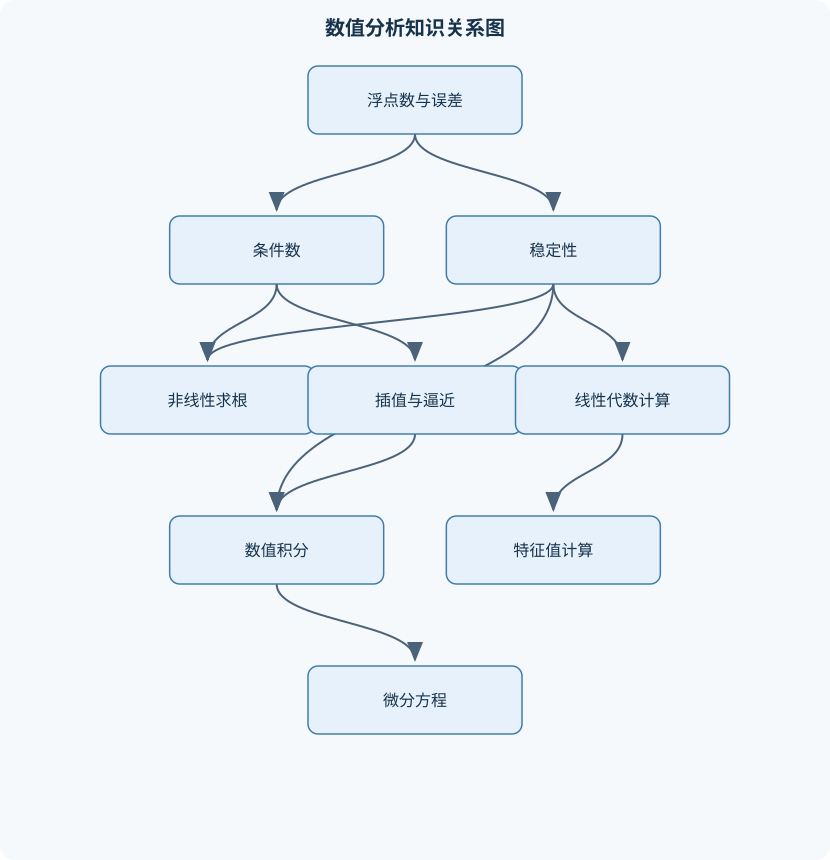
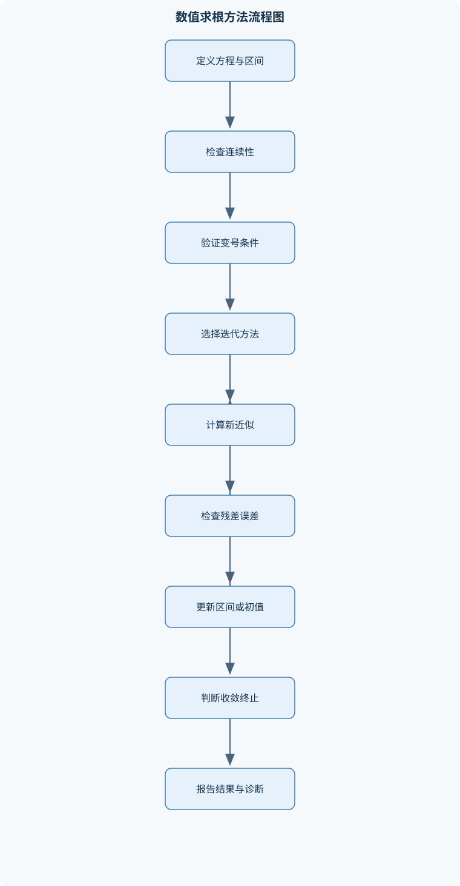

# 数值分析

## 一、课程整体知识框架

### 课程边界与先修知识

本课程研究如何在有限精度计算机上用离散算法近似求解连续数学问题，并分析误差、稳定性、收敛性、效率与适用条件。主要边界包括浮点数与误差分析、非线性方程求根、插值与逼近、数值微分与积分、常微分方程初值问题、线性方程组、矩阵特征值以及最小二乘与正交多项式。先修知识包括单变量微积分、多元微积分基础、线性代数、常微分方程初步、级数、基本概率误差概念和至少一种编程语言。课程区分数学问题本身的条件数与算法的数值稳定性，区分理论模型中的精确运算与实际计算中的舍入、截断、数据扰动和终止误差。





### 1. 研究对象与基本任务

数值分析研究的是：对于原本由连续数学描述、但通常不能或不宜用解析公式直接求解的问题，如何设计有限步骤的离散算法，在有限精度计算机上得到可靠近似，并判断近似结果是否值得信任。典型问题包括求方程根、计算定积分、求解微分方程、解线性方程组、计算特征值以及从数据中构造逼近函数。

数值计算中的“近似”至少来自四个方面。**模型误差**来自把现实对象简化为数学模型；**离散或截断误差**来自用有限项、有限节点或有限步长替代连续过程；**舍入误差**来自计算机只能表示有限个浮点数；**终止误差**来自迭代算法在尚未达到精确解时停止。课程主要研究后面三类误差，并分析它们如何共同影响结果。

设精确结果为 $x^*$，数值结果为 $\widehat{x}$，则绝对误差为

$$
E_{\mathrm{abs}}=|\widehat{x}-x^*|,
$$

当 $x^*\neq 0$ 时，相对误差为

$$
E_{\mathrm{rel}}=\frac{|\widehat{x}-x^*|}{|x^*|}.
$$

绝对误差适合衡量带有固定单位的量，例如长度误差 $0.01\ \mathrm{m}$；相对误差适合比较不同数量级的结果。若精确值接近零，相对误差可能失去解释力，此时应同时报告绝对误差、残差和问题尺度。

### 2. 问题条件性与算法稳定性

必须区分**问题的条件数**和**算法的数值稳定性**。条件数描述输入数据发生微小扰动时，精确答案本身会被放大多少；稳定性描述算法在浮点运算中是否额外放大了误差。

若标量函数 $y=f(x)$ 的输入变为 $x+\Delta x$，一阶泰勒展开给出

$$
f(x+\Delta x)-f(x)\approx f'(x)\Delta x.
$$

除以 $f(x)$，并将输入误差写成相对形式 $\Delta x/x$，得到

$$
\frac{\Delta f}{f(x)}
\approx
\frac{x f'(x)}{f(x)}\frac{\Delta x}{x}.
$$

因此函数问题的相对条件数可写为

$$
\kappa_f(x)=\left|\frac{x f'(x)}{f(x)}\right|,
$$

其适用条件是 $x\neq0$、$f(x)\neq0$，且扰动足够小。若 $\kappa_f(x)$ 很大，则问题本身病态；即使使用稳定算法，也不能保证输入数据的有限精度足以产生高精度答案。

浮点运算通常可抽象为

$$
\operatorname{fl}(x\mathbin{\circ}y)
=(x\mathbin{\circ}y)(1+\delta),\qquad |\delta|\leq u,
$$

其中 $\circ$ 表示加、减、乘或除，$u$ 为单位舍入误差。该模型要求结果不发生上溢、下溢或非正规数异常，并不适用于灾难性消去等特殊情形。若两个接近的数相减，绝对舍入误差虽然可能很小，但有效数字会大量丢失，这称为灾难性消去。

算法的后向稳定性常表述为：算法输出 $\widehat{y}$ 是某个轻微扰动输入 $x+\Delta x$ 的精确结果。若问题条件良好，后向稳定算法通常能给出可信的前向结果；若问题病态，则即使后向误差很小，前向误差也可能很大。

### 3. 统一的收敛与停止思想

迭代算法产生序列 $x_0,x_1,\ldots$ 或 $\mathbf{x}^{(0)},\mathbf{x}^{(1)},\ldots$。分析时需要说明：

1. 是否存在目标解；
2. 初值属于什么范围；
3. 迭代是否保持在可行区间或可行集合内；
4. 误差是否趋于零；
5. 收敛速度是线性、超线性还是二次；
6. 停止条件是否与真实误差、残差和机器精度相匹配。

仅使用相邻迭代差作为停止条件是不充分的。例如，当迭代进入舍入误差主导区时，$|x_{k+1}-x_k|$ 可能很小，但残差仍然较大。可靠的停止规则通常同时检查相对步长、残差、最大迭代次数以及是否出现非有限数。

### 4. 线性代数与误差传播的统一语言

向量用粗体小写字母表示，例如 $\mathbf{x}$；矩阵用大写字母表示，例如 $A$。相容矩阵范数满足

$$
\|A\mathbf{x}\|\leq \|A\|\|\mathbf{x}\|.
$$

常用范数为最大绝对列和 $\|A\|_1$、最大绝对行和 $\|A\|_\infty$ 和谱范数 $\|A\|_2$。矩阵谱半径定义为

$$
\rho(A)=\max_i|\lambda_i|,
$$

其中 $\lambda_i$ 是 $A$ 的特征值。

在线性方程组

$$
A\mathbf{x}=\mathbf{b}
$$

中，数值解为 $\widehat{\mathbf{x}}$ 时，残差定义为

$$
\mathbf{r}=\mathbf{b}-A\widehat{\mathbf{x}}.
$$

小残差不必然意味着小前向误差。当 $A$ 病态时，解对 $\mathbf{b}$ 或 $A$ 的扰动很敏感，因此必须结合条件数分析。对于非方阵，通常讨论最小二乘意义下的解；“唯一解”的通常线性方程组表述要求 $A$ 为方阵且非奇异。

## 二、章节和模块划分

### 核心知识覆盖清单

本清单用于检查正文是否覆盖本课程的主要知识模块：

- **数值计算基础与误差分析**：浮点数系统与机器精度、舍入、截断与有效数字、绝对误差和相对误差、误差传播与条件数、算法稳定性与后向误差、灾难性消去、上溢、下溢与非正规数、误差累积与停止准则。
- **非线性方程求根**：二分法与区间保持、不动点迭代、压缩映射与收敛条件、牛顿法与几何解释、割线法与弦截法、重根对收敛阶的影响、局部收敛与全局收敛、残差、前向误差与后向误差。
- **多项式插值与分段插值**：拉格朗日插值基函数、牛顿差商插值、等距节点与差分表、插值余项与误差上界、龙格现象、重节点插值、Hermite插值、分段线性与三次样条插值。
- **数值微分与数值积分**：前向、后向和中心差分、差分公式的截断误差、高阶差分构造、复合梯形公式、复合辛普森公式、高斯求积、自适应积分、积分误差与节点选择。
- **常微分方程初值问题**：适定性与Lipschitz条件、Euler显式方法、隐式Euler方法、改进Euler与中点方法、Taylor高阶方法、Runge-Kutta方法、局部截断误差与全局误差、零稳定性与绝对稳定性。
- **线性多步法与微分方程稳定性**：显式与隐式多步法、Adams-Bashforth方法、Adams-Moulton方法、预测校正方法、线性多步法特征多项式、根条件、一致性与收敛性、刚性问题与稳定域。
- **线性方程组的直接方法**：高斯消元、回代与前代、主元选取、部分主元法、按比例部分主元法、完全主元法、LU分解、Cholesky分解与正定矩阵、直接法的舍入误差。
- **线性方程组的迭代方法**：矩阵范数与谱半径、Jacobi迭代、Gauss-Seidel迭代、SOR迭代、固定点形式、迭代矩阵收敛条件、对角占优与正定条件、残差监测与预条件思想。
- **函数逼近与最小二乘**：离散最小二乘逼近、连续最小二乘逼近、正规方程、加权内积、正交基与投影、Gram-Schmidt正交化、Legendre多项式、Chebyshev多项式、幂级数降阶与误差控制。
- **矩阵特征值计算**：幂法、反幂法、位移反幂法、Rayleigh商、特征向量归一化、收敛速度与谱间隙、对称矩阵的正交性质、QR迭代思想、特征值条件性。
- **综合误差控制与数值实验**：问题条件数评估、算法稳定性比较、残差与误差关系、消去误差实验、不同精度算术实验、收敛阶数值估计、复杂度与存储量分析、结果有效数字判定、科学计算报告中的验证流程。


### 1. 数值计算基础与误差分析

浮点数通常写成科学计数形式

$$
x=\pm m\beta^e,
$$

其中 $\beta$ 是基数，$m$ 是有效数，$e$ 是指数。有效数字有限导致表示误差；指数范围有限导致上溢和下溢。下溢区还可能出现非正规数，其有效精度低于正常浮点数，不能直接套用常规相对误差模型。

截断是直接舍去后续数字，舍入是选择距离最近的可表示数。若计算 $f(5.21)=2x^2-0.1x$，采用四位有效数字截断，则先算 $5.21^2=27.1441$，截断为 $27.14$；再算 $2(27.14)=54.28$，$0.1(5.21)=0.521$，分别按规则保留有效数字，最后相减。每一步都可能产生误差，不能只在最终结果处截断。

误差分析要区分绝对误差、相对误差、输入误差、输出误差和算法误差。误差传播可由泰勒展开得到；当函数值接近零时，相对条件数可能很大。对表达式 $(e^x-1)/x$，当 $x$ 接近零时，数学问题本身可由级数
$$
\frac{e^x-1}{x}=1+\frac{x}{2!}+\frac{x^2}{3!}+\cdots
$$
稳定表示，但直接计算 $e^x-1$ 会相减两个接近的数，体现了“问题良态、算法不稳定”的区别。

### 2. 非线性方程求根

目标是求 $f(x)=0$ 的根。二分法要求 $f$ 在区间 $[a,b]$ 上连续且 $f(a)f(b)<0$。令 $c=(a+b)/2$，根据符号保留仍然变号的半区间。根始终位于当前区间内，这是算法不变量；经过 $n$ 次后区间长度为 $(b-a)/2^n$，中点误差不超过该长度的一半。二分法全局可靠但线性收敛，不能用于不连续函数或没有变号的偶重根。

不动点迭代把方程改写为 $x=g(x)$，计算 $x_{k+1}=g(x_k)$。若闭区间 $I$ 满足 $g(I)\subseteq I$，且
$$
\max_{x\in I}|g'(x)|\leq q<1,
$$
则存在唯一不动点，并且迭代至少线性收敛。只检查某个初值处的 $|g'(x_0)|<1$ 不能推出整个区间的全局收敛。

牛顿法由切线方程
$$
f(x_k)+f'(x_k)(x-x_k)=0
$$
得到
$$
x_{k+1}=x_k-\frac{f(x_k)}{f'(x_k)}.
$$
若根为单根、$f$ 足够光滑且初值充分接近根，通常具有二次局部收敛。导数接近零、初值过远、存在多个根或函数不光滑时，算法可能发散或跳向其他根。割线法用差商代替导数，减少导数计算，但稳定性和收敛保证较弱。重根会降低牛顿法的通常二次收敛，未经修正时可能退化为线性收敛。

### 3. 多项式插值与分段插值

给定互异节点 $(x_i,y_i)$，Lagrange 插值多项式为
$$
p_n(x)=\sum_{i=0}^n y_iL_i(x),
$$
其中
$$
L_i(x)=\prod_{j\neq i}\frac{x-x_j}{x_i-x_j},
\qquad L_i(x_j)=\delta_{ij}.
$$

若 $f$ 在包含节点和评价点的区间上具有 $n+1$ 阶连续导数，则
$$
f(x)-p_n(x)=
\frac{f^{(n+1)}(\xi)}{(n+1)!}
\prod_{i=0}^n(x-x_i)
$$
对某个区间内的 $\xi$ 成立。该误差公式不能用于节点外的远距离外推，也不能在函数缺乏相应光滑性时直接使用。

Newton 差商形式利用
$$
f[x_i,x_{i+1}]
=\frac{f[x_{i+1}]-f[x_i]}{x_{i+1}-x_i}
$$
逐层构造多项式，增加新节点时不必完全重算。等距节点可以利用差分表，但高次等距插值可能产生龙格现象：节点数增加时，区间端点附近振荡反而增强。将节点集中到端点附近，特别是使用Chebyshev型节点，可减弱这种现象。

Hermite 插值不仅匹配函数值，还匹配导数值。重复节点用重节点差商表示；例如在节点 $x_0$ 给出 $f(x_0)$ 和 $f'(x_0)$，插值多项式必须满足
$$
p(x_0)=f(x_0),\qquad p'(x_0)=f'(x_0).
$$
分段线性插值实现简单但导数不连续；三次样条插值在各子区间为三次多项式，并通过节点处函数值、一阶导数和二阶导数的连续性获得更平滑结果，边界条件仍需额外指定。

### 4. 数值微分与数值积分

Taylor 展开
$$
f(x+h)=f(x)+hf'(x)+\frac{h^2}{2}f''(x)+O(h^3)
$$
给出前向差分
$$
f'(x)\approx\frac{f(x+h)-f(x)}{h},
$$
其截断误差为 $O(h)$。类似地，后向差分也是一阶；将 $f(x+h)$ 和 $f(x-h)$ 相减可得中心差分
$$
f'(x)\approx\frac{f(x+h)-f(x-h)}{2h},
$$
其截断误差为 $O(h^2)$。但 $h$ 越小，函数值相减造成的舍入误差通常越大，因此总误差常呈先降后升，而不是单调下降。

复合梯形公式将 $[a,b]$ 等分为 $n$ 段，$h=(b-a)/n$：
$$
T_n=h\left[
\frac{f(a)+f(b)}2+\sum_{i=1}^{n-1}f(a+ih)
\right].
$$
若 $f''$ 连续，全局误差为 $O(h^2)$。复合辛普森公式要求 $n$ 为偶数，使用端点权重 $1$、奇数内部节点权重 $4$、偶数内部节点权重 $2$，在四阶导数连续时全局误差为 $O(h^4)$。

高斯求积通过选择节点和权重，使低阶多项式积分精确，节点通常不等距。自适应积分先在整体区间计算粗略结果，再将变化剧烈或误差估计较大的子区间细分；它适合局部尖峰、边界层等情形，但函数奇异、不连续或递归深度达到上限时必须报告失败，而不能伪造精度。

### 5. 常微分方程初值问题

考虑
$$
y'=f(t,y),\qquad y(t_0)=\alpha.
$$
若 $f$ 对 $y$ 连续并满足局部Lipschitz条件，则通常可保证局部存在唯一解。显式Euler方法为
$$
w_{i+1}=w_i+h f(t_i,w_i),
$$
局部截断误差按每步误差定义为 $O(h^2)$，全局误差为 $O(h)$。隐式Euler为
$$
w_{i+1}=w_i+h f(t_{i+1},w_{i+1}),
$$
每步需要解方程，但稳定性通常更好。

改进Euler和中点方法通过一次预测和斜率平均提高到二阶；Taylor方法使用 $y''、y'''$ 等高阶导数，理论清晰但求导工作量大。经典四阶Runge-Kutta方法每步计算四个斜率，按权重 $1,2,2,1$ 合成，适用于非刚性问题。

局部截断误差描述把精确解代入离散公式后留下的单步缺陷；全局误差描述从初始点传播到终点后的累计误差。单步方法在稳定条件成立时，局部误差阶通常比全局误差阶高一阶。零稳定性关注扰动是否被离散递推无限放大，绝对稳定性则关注测试方程 $y'=\lambda y$ 下步长和 $\lambda$ 的组合是否位于稳定域内。

### 6. 线性多步法与微分方程稳定性

线性多步法使用多个历史值：
$$
\sum_{j=0}^k\alpha_jw_{n+j}
=
h\sum_{j=0}^k\beta_jf(t_{n+j},w_{n+j}).
$$
当 $\beta_k=0$ 时通常为显式方法，例如Adams-Bashforth；当 $\beta_k\neq0$ 时为隐式方法，例如Adams-Moulton。预测校正法先用显式格式预测，再将预测值代入隐式格式校正。

令
$$
\rho(\zeta)=\sum_{j=0}^k\alpha_j\zeta^j,
\qquad
\sigma(\zeta)=\sum_{j=0}^k\beta_j\zeta^j.
$$
零稳定性要求根条件：$\rho(\zeta)=0$ 的所有根满足 $|\zeta|\leq1$，且单位圆上的根必须是单根。不能误写成所有根都必须严格小于一，因为一致格式通常包含 $\zeta=1$。线性多步法在一致性和零稳定性同时成立时收敛。刚性问题要求较大的稳定域，显式方法往往被迫使用很小步长，隐式方法通常更适合。

### 7. 线性方程组的直接方法

高斯消元将
$$
A\mathbf{x}=\mathbf{b}
$$
化为上三角系统，再通过回代求解。消元阶段稠密 $n\times n$ 系统的主要计算量为 $O(n^3)$，回代为 $O(n^2)$，存储量通常为 $O(n^2)$。

若主元很小，除法会放大舍入误差，因此采用部分主元法：在当前列的未处理行中选择绝对值最大的元素作为主元并交换行。按比例部分主元法先按行尺度比较，适合行元素量级差异较大的情形；完全主元法同时交换行和列，但需要记录列置换。

LU分解写为
$$
PA=LU,
$$
其中 $P$ 是置换矩阵，$L$ 为单位下三角矩阵，$U$ 为上三角矩阵。若 $A$ 为实对称正定矩阵，则可使用Cholesky分解
$$
A=LL^T,
$$
且 $L$ 对角元为正。一般可逆矩阵不能直接使用Cholesky分解。主元策略能降低算法风险，但不能消除矩阵本身的病态性。

### 8. 线性方程组的迭代方法

将系统改写为
$$
\mathbf{x}=T\mathbf{x}+\mathbf{c}
$$
后，固定点迭代为
$$
\mathbf{x}^{(k+1)}=T\mathbf{x}^{(k)}+\mathbf{c}.
$$
对任意初值收敛到唯一解的充要条件是
$$
\rho(T)<1.
$$
某个范数下 $\|T\|<1$ 是常用的充分条件，但不是必要条件。

Jacobi方法每次全部使用旧向量：
$$
x_i^{(k+1)}
=
\frac{b_i-\sum_{j\neq i}a_{ij}x_j^{(k)}}{a_{ii}}.
$$
Gauss-Seidel方法按分量更新，已获得的新值立即使用。SOR方法在Gauss-Seidel基础上引入松弛因子 $\omega$，用于加速或抑制振荡。严格对角占优通常可保证Jacobi和Gauss-Seidel收敛；对称正定系统也常保证Gauss-Seidel收敛，但具体速度取决于谱半径。

停止时应同时监测残差 $\|\mathbf{r}^{(k)}\|$、相邻迭代差和最大迭代次数。预条件思想是用易求解矩阵 $M$ 改造系统，使 $M^{-1}A$ 的条件性或谱性质更适合迭代；预条件不能改变原方程组的精确解，但会改变算法收敛速度。

### 9. 函数逼近与最小二乘

离散最小二乘问题为
$$
\min_{\mathbf{c}}\|A\mathbf{c}-\mathbf{y}\|_2.
$$
正规方程为
$$
A^TA\mathbf{c}=A^T\mathbf{y}.
$$
几何上，残差必须正交于逼近空间，即
$$
A^T(\mathbf{y}-A\mathbf{c})=0.
$$
正规方程可能使条件数近似平方化，因此高条件数问题更适合QR分解或奇异值分解。

连续最小二乘使用带权内积
$$
\langle f,g\rangle_w=\int_a^b w(x)f(x)g(x)\,dx,
$$
其中通常要求 $w(x)\geq0$ 且不在整个区间上恒为零。正交基能使投影系数独立计算；Gram-Schmidt正交化可由一组线性无关函数构造正交或标准正交基，但在浮点计算中经典形式可能失稳，改进形式更可靠。

Legendre多项式适合区间上的均匀权函数；Chebyshev多项式满足
$$
T_0(x)=1,\quad T_1(x)=x,\quad
T_{n+1}(x)=2xT_n(x)-T_{n-1}(x),
$$
并且
$$
T_n(x)=\cos(n\arccos x).
$$
其节点集中在 $[-1,1]$ 端点附近，可减弱高次插值振荡。用正交多项式表示函数，通常比幂基 $1,x,x^2,\ldots$ 更稳定。降阶逼近时，误差不仅取决于次数，还取决于函数光滑性、节点分布、系数计算误差和评价方式。

### 10. 矩阵特征值计算

特征值问题为
$$
A\mathbf{v}=\lambda\mathbf{v}.
$$
幂法反复计算 $\mathbf{y}^{(k+1)}=A\mathbf{v}^{(k)}$ 并归一化，若主特征值满足
$$
|\lambda_1|>|\lambda_2|
$$
且初始向量含有主特征向量分量，则渐近收敛因子约为 $|\lambda_2/\lambda_1|$。谱间隙越大，收敛越快；初始向量恰好正交于目标方向时，幂法不能得到该特征向量。

反幂法每步解
$$
A\mathbf{y}^{(k+1)}=\mathbf{v}^{(k)},
$$
其等价于对 $A^{-1}$ 使用幂法，因此趋向于模最小特征值。位移反幂法将 $A$ 换为 $A-\mu I$，可寻找最接近位移 $\mu$ 的特征值。Rayleigh商
$$
\mu(\mathbf{v})=\frac{\mathbf{v}^TA\mathbf{v}}{\mathbf{v}^T\mathbf{v}}
$$
可作为对称矩阵特征值估计。

实对称矩阵具有正交特征向量，特征值为实数；一般矩阵不具有这些性质。QR迭代先分解
$$
A_k=Q_kR_k,
$$
再令
$$
A_{k+1}=R_kQ_k.
$$
实际算法通常先约化为Hessenberg形式并结合位移，以降低成本、提高收敛速度。特征值条件性描述矩阵扰动对特征值的敏感程度；非正规矩阵可能出现远大于对称矩阵的敏感性。

### 11. 代表性算法与伪代码

#### 二分法

**输入**：连续函数 $f$，区间 $[a,b]$，容许误差 $\varepsilon$，最大迭代次数 $N$。  
**输出**：根近似 $c$、区间误差估计和终止状态。  
**不变量**：根始终位于当前区间内。  
**终止条件**：区间半长不超过 $\varepsilon$，或残差不超过指定阈值，或达到 $N$。

```python
def bisection(f, a, b, tol=1e-10, max_iter=100):
    fa = f(a)
    fb = f(b)
    if fa == 0:
        return a, 0.0, "left endpoint"
    if fb == 0:
        return b, 0.0, "right endpoint"
    if fa * fb > 0:
        raise ValueError("interval does not bracket a sign change")

    for k in range(1, max_iter + 1):
        c = (a + b) / 2.0
        fc = f(c)
        half_width = (b - a) / 2.0

        if half_width <= tol or abs(fc) <= tol:
            return c, half_width, "converged"

        if fa * fc < 0:
            b, fb = c, fc
        else:
            a, fa = c, fc

    return (a + b) / 2.0, (b - a) / 2.0, "maximum iterations"
```

每轮计算量为常数，总复杂度为 $O(N)$。若函数计算本身昂贵，应将函数评价次数纳入成本分析。

#### 带部分主元的高斯消元

对第 $k$ 列，在行 $k,\ldots,n$ 中选择绝对值最大的主元；交换后，对下方各行执行
$$
m_{ik}=\frac{a_{ik}}{a_{kk}},
\qquad
\text{row}_i\leftarrow \text{row}_i-m_{ik}\text{row}_k.
$$
全部消元后回代：
$$
x_i=\frac{b_i-\sum_{j=i+1}^nu_{ij}x_j}{u_{ii}}.
$$
若最大主元为零，则矩阵奇异；若主元相对行尺度极小，则应报告数值风险。

#### 四阶Runge-Kutta法

对 $y'=f(t,y)$，计算
$$
\begin{aligned}
k_1&=f(t_i,w_i),\\
k_2&=f(t_i+h/2,w_i+hk_1/2),\\
k_3&=f(t_i+h/2,w_i+hk_2/2),\\
k_4&=f(t_i+h,w_i+hk_3),
\end{aligned}
$$
然后
$$
w_{i+1}=w_i+\frac{h}{6}(k_1+2k_2+2k_3+k_4).
$$
每步需要四次函数评价，固定步数下总复杂度为 $O(N)$；对刚性问题不能仅凭四阶精度判断其适用性。

### 12. 代表性例题

#### 例题一：二分法误差界

**题干**：求 $f(x)=x^2-2$ 在 $[1,2]$ 内的根，要求区间半长小于 $0.125$。

**分析**：$f(1)=-1$，$f(2)=2$，满足变号条件。初始区间长度为 $1$，二分后长度依次为 $1/2、1/4、1/8$，区间半长依次为 $1/4、1/8、1/16$。

**逐步解答**：第一次中点 $c_1=1.5$，$f(c_1)=0.25>0$，新区间为 $[1,1.5]$。第二次中点 $c_2=1.25$，$f(c_2)<0$，新区间为 $[1.25,1.5]$。第三次中点 $c_3=1.375$，$f(c_3)<0$，新区间为 $[1.375,1.5]$。此时区间半长为 $0.0625<0.125$。

**结果验证**：根 $\sqrt2\approx1.4142$ 位于最终区间内。  
**变式**：若函数在端点同号，不能直接使用二分法；应先扩大或重新选择区间，或改用牛顿法等方法。

#### 例题二：插值余项

**题干**：用节点 $0,1,2$ 插值 $f(x)=e^x$，求 $x=0.5$ 处的误差上界。

**分析**：二次插值误差为
$$
f(x)-p_2(x)=\frac{f^{(3)}(\xi)}{3!}x(x-1)(x-2).
$$
在区间 $[0,2]$ 上，$f^{(3)}(\xi)=e^\xi\leq e^2$。

**逐步解答**：在 $x=0.5$ 处，
$$
|x(x-1)(x-2)|
=|0.5(-0.5)(-1.5)|=0.375.
$$
因此
$$
|f(0.5)-p_2(0.5)|
\leq\frac{e^2\cdot0.375}{6}.
$$

**结果验证**：实际误差还需计算插值值后与 $e^{0.5}$ 比较；上式是保证性上界，通常不等于实际误差。  
**变式**：若节点等距增加到更高次数，误差不一定继续下降，必须检查节点分布和龙格现象。

#### 例题三：中心差分的阶数

**题干**：用中心差分近似 $f'(x)$，比较步长 $h$ 与 $h/2$ 的截断误差阶。

**分析**：Taylor展开相加相减得
$$
\frac{f(x+h)-f(x-h)}{2h}
=f'(x)+\frac{h^2}{6}f^{(3)}(\xi).
$$
因此截断误差为 $O(h^2)$。

**逐步解答**：步长变为 $h/2$ 后，理论截断误差约变为原来的
$$
\left(\frac{h/2}{h}\right)^2=\frac14.
$$

**结果验证**：用解析函数计算多个步长，若处于截断误差主导区，误差比应接近 $4$；若 $h$ 过小，舍入误差会破坏该比例。  
**变式**：前向差分只有 $O(h)$，步长减半时误差理论上约减半。

#### 例题四：正规方程与残差正交

**题干**：用常数 $c$ 拟合数据 $(1,2),(2,3),(3,4)$，求最小二乘解。

**分析**：目标为
$$
\min_c\sum_{i=1}^3(c-y_i)^2.
$$
对 $c$ 求导并令零：
$$
2\sum_{i=1}^3(c-y_i)=0.
$$

**逐步解答**：
$$
3c-(2+3+4)=0,
\qquad c=3.
$$
残差向量为 $(1,0,-1)^T$，其分量和为零，符合常数基函数投影的正交条件。

**结果验证**：残差平方和为 $1+0+1=2$；若取其他常数，均值性质保证平方和不小于 $2$。  
**变式**：若拟合直线 $c_0+c_1x$，应建立两个正规方程，或使用QR分解避免条件数平方效应。

#### 例题五：幂法收敛条件

**题干**：设矩阵有特征值 $5,2,1$，初始向量在三个特征向量方向上的系数均非零，判断幂法的渐近收敛速度。

**分析**：最大模特征值为 $5$，且唯一；初始向量含有对应方向分量，因此幂法趋向于主特征向量。

**逐步解答**：次大特征值与主特征值之比为
$$
\left|\frac{2}{5}\right|=0.4.
$$
因此特征向量方向误差渐近按约 $0.4$ 的因子衰减。

**结果验证**：每次归一化后计算Rayleigh商，若算法进入渐近区，商值应接近 $5$。  
**变式**：若最大模特征值为 $\pm5$ 且模相同，幂法可能振荡；若初始向量主方向系数为零，则不能得到主特征向量。

### 13. 数值实验与项目流程

#### 实验一：比较微分公式的截断误差与舍入误差

**输入数据**：选择可解析求导的函数，例如 $f(x)=\sin x$，固定 $x=1$，取
$$
h=10^{-1},10^{-2},\ldots,10^{-16}.
$$
分别计算前向差分、后向差分和中心差分，并以解析导数 $\cos1$ 作为验证值。

**步骤**：记录每个 $h$ 的近似值、绝对误差和相邻步长的误差比；绘制或列表比较误差随 $h$ 的变化。  
**评价标准**：在中等步长区间，前向和后向误差应体现一阶趋势，中心差分应体现二阶趋势；过小步长时误差上升，说明舍入误差开始主导。  
**排错方法**：检查是否误把中心差分分母写成 $h$；确认函数值采用同一精度；若误差完全单调下降，检查是否实际使用了高精度算术或误算了精确导数。

#### 实验二：直接法与迭代法求解线性系统

**输入数据**：构造严格对角占优矩阵，例如
$$
A=
\begin{bmatrix}
4&1&1\\
1&5&1\\
1&1&6
\end{bmatrix},
\qquad
\mathbf{b}=
\begin{bmatrix}
6\\7\\8
\end{bmatrix}.
$$

**步骤**：使用带部分主元的高斯消元得到参考解；分别用Jacobi和Gauss-Seidel从零向量开始迭代；每轮记录 $\|\mathbf{r}^{(k)}\|_\infty$、相邻迭代差和迭代次数；计算两种迭代矩阵的谱半径。

**评价标准**：直接法应得到较小残差；两种迭代法应收敛，Gauss-Seidel通常比Jacobi更快，但不能仅凭单个例子断言普遍成立。验收时应同时满足残差阈值、最大迭代次数限制和无非有限数值。

**排错方法**：若不收敛，检查对角元素是否为零、更新是否错误地混用了新旧值、残差符号是否写成 $A\widehat{\mathbf{x}}-\mathbf{b}$ 后仍按另一种定义解释；若残差小而解误差大，应进一步估计条件数。

### 14. 岗位关联与数值产出

科学计算工程师和仿真建模工程师通常需要把连续模型离散化，选择积分、微分方程或线性代数算法，并提交数值解、误差估计和稳定性说明。有限元、计算流体和工程软件岗位重点使用线性方程组、稀疏存储、预条件、迭代法和稳定性分析，产出包括收敛曲线、残差报告、网格或步长敏感性实验及可复现实验参数。

数据科学与机器学习工作中，最小二乘、正交投影、条件数和QR分解用于回归与特征处理；验收标准不只是训练误差，还包括矩阵病态性、不同精度下结果一致性和异常数据下的稳定性。数值可靠性与测试岗位则需要设计消去误差、不同浮点精度、极端尺度和停止条件测试，产出应包含问题条件性、算法稳定性、有效数字判定和失败边界。

## 三、核心概念的详细解释

### 1. 浮点计算、误差来源与可靠数字

计算机中的浮点数通常表示为
$$
\operatorname{fl}(x)=\pm m\beta^e,
$$
其中 $\beta$ 为基数，$m$ 为有限位数的尾数，$e$ 为指数。实数经过浮点表示、运算和存储时会产生舍入误差。若结果未发生上溢、下溢或非正规数异常，基本运算可近似写为
$$
\operatorname{fl}(x\mathbin{\circ}y)=(x\mathbin{\circ}y)(1+\delta),\qquad |\delta|\leq u,
$$
其中 $\circ$ 表示加、减、乘、除，$u$ 是单位舍入误差。该模型是相对误差模型，不能直接用于结果接近零的加减法，也不能掩盖大数相减造成的有效数字丢失。

绝对误差具有原问题的单位，相对误差无量纲。若精确值为 $x^*$、近似值为 $\widehat{x}$，则
$$
E_{\mathrm{abs}}=|\widehat{x}-x^*|,\qquad
E_{\mathrm{rel}}=\frac{|\widehat{x}-x^*|}{|x^*|}.
$$
当 $x^*$ 接近零时，相对误差可能非常大，即使绝对误差已经很小，因此不能仅凭相对误差判断结果质量。

误差通常分为输入数据误差、舍入误差、截断误差和终止误差。用有限差分代替导数时，泰勒展开被截去的高阶项产生截断误差；用有限精度储存和计算产生舍入误差；迭代未达到精确极限便停止产生终止误差。减小步长通常降低截断误差，却可能增加舍入误差，所以总误差往往先下降后上升。

### 2. 条件数、稳定性与灾难性消去

条件数描述问题本身对输入扰动的敏感性，稳定性描述算法是否额外放大了误差。对于 $y=f(x)$，若输入变为 $x+\Delta x$，则
$$
f(x+\Delta x)-f(x)\approx f'(x)\Delta x.
$$
当 $x\neq0$ 且 $f(x)\neq0$ 时，
$$
\frac{|\Delta f|}{|f(x)|}
\approx
\left|\frac{x f'(x)}{f(x)}\right|
\frac{|\Delta x|}{|x|}.
$$
因此相对条件数为
$$
\kappa_f(x)=\left|\frac{x f'(x)}{f(x)}\right|.
$$
条件数大表示问题病态，并不表示某个算法一定不稳定；相反，病态问题即使使用后向稳定算法，也可能只能得到较少的有效数字。

灾难性消去发生在两个绝对值接近的数相减时。例如计算
$$
f(x)=\sqrt{x^2+1}-x
$$
且 $x$ 很大，直接计算会相减两个近似相等的大数。利用有理化可得
$$
f(x)=\frac{1}{\sqrt{x^2+1}+x},
$$
后一个表达式避免了大数相减。这里问题本身未必病态，直接公式却可能数值不稳定。

后向稳定算法的含义是：算法给出的 $\widehat{y}$ 可以看成某个轻微扰动输入 $x+\Delta x$ 的精确结果。若问题条件良好，则“小后向误差”通常能够推出“小前向误差”；若问题病态，则这种推断不成立。

### 3. 非线性方程求根的收敛思想

求解 $f(x)=0$ 时，二分法依赖连续性和变号条件。若 $f$ 在 $[a,b]$ 上连续且
$$
f(a)f(b)<0,
$$
则区间内至少存在一个根。每次取中点 $c=(a+b)/2$，根据符号保留含变号的半区间。二分法具有全局可靠性，但只具有线性收敛速度。

不动点迭代把方程改写为
$$
x=g(x),\qquad x_{k+1}=g(x_k).
$$
若闭区间 $I$ 满足 $g(I)\subseteq I$，且
$$
\max_{x\in I}|g'(x)|\le q<1,
$$
则 $g$ 是压缩映射，存在唯一不动点，并且从 $I$ 中任意初值出发都收敛。只检查某个初值处的 $|g'(x_0)|<1$，不能推出整个区间上的全局收敛。

牛顿法由切线方程
$$
f(x_k)+f'(x_k)(x-x_k)=0
$$
得到
$$
x_{k+1}=x_k-\frac{f(x_k)}{f'(x_k)}.
$$
若根为单根、函数在根附近具有足够阶连续导数且初值充分接近根，则通常二次收敛。重根会降低收敛阶。若 $f(x)=(x-r)^m q(x)$，其中 $q(r)\neq0$ 且 $m>1$，普通牛顿法通常仅线性收敛；若已知重数，可采用
$$
x_{k+1}=x_k-m\frac{f(x_k)}{f'(x_k)}.
$$

割线法用最近两点的差商近似导数：
$$
x_{k+1}=x_k-f(x_k)
\frac{x_k-x_{k-1}}{f(x_k)-f(x_{k-1})}.
$$
它不需要显式导数，局部收敛阶约为 $1.618$，但不具有二分法那样的区间保持性质。

### 4. 插值、逼近与节点选择

给定互异节点 $(x_i,y_i)$，次数不超过 $n$ 的插值多项式 $p_n$ 满足
$$
p_n(x_i)=y_i,\qquad i=0,\ldots,n.
$$
Lagrange形式为
$$
p_n(x)=\sum_{i=0}^n y_iL_i(x),\qquad
L_i(x)=\prod_{j\ne i}\frac{x-x_j}{x_i-x_j}.
$$
基函数满足 $L_i(x_j)=\delta_{ij}$，因此在每个节点上只有对应项保留。

Newton差商形式更适合逐步增加节点：
$$
p_n(x)=f[x_0]+f[x_0,x_1](x-x_0)+\cdots+
f[x_0,\ldots,x_n]\prod_{j=0}^{n-1}(x-x_j).
$$
差商递推式为
$$
f[x_i,\ldots,x_{i+k}]
=
\frac{f[x_{i+1},\ldots,x_{i+k}]-f[x_i,\ldots,x_{i+k-1}]}
{x_{i+k}-x_i}.
$$

若 $f$ 在包含节点和评价点的区间上具有 $n+1$ 阶连续导数，则
$$
f(x)-p_n(x)
=
\frac{f^{(n+1)}(\xi)}{(n+1)!}
\prod_{i=0}^n(x-x_i),
$$
其中 $\xi$ 位于该区间内。该公式是存在性结论，不一定能给出精确误差，因为 $\xi$ 通常未知。

等距节点上的高次插值可能出现龙格现象：即使节点数增加，端点附近误差也可能增大。Chebyshev节点集中在端点，能够控制节点多项式的最大值，常用于减弱振荡。Hermite插值在节点处同时匹配函数值和导数，重节点差商表中需要使用
$$
f[x_i,x_i]=f'(x_i).
$$
分段线性插值连续但导数通常不连续；三次样条插值在子区间上为三次多项式，并通过函数值、一阶导数和二阶导数连续条件获得更平滑的结果。

### 5. 数值微分与数值积分

泰勒展开给出前向、后向和中心差分：
$$
f'(x)\approx\frac{f(x+h)-f(x)}{h},\qquad
f'(x)\approx\frac{f(x)-f(x-h)}{h},
$$
两者截断误差均为 $O(h)$；中心差分为
$$
f'(x)\approx\frac{f(x+h)-f(x-h)}{2h},
$$
截断误差为 $O(h^2)$。中心差分精度较高，但在 $h$ 极小时，两个函数值相减会放大舍入误差。

复合梯形公式为
$$
\int_a^b f(x)\,dx
\approx
h\left[
\frac{f(a)+f(b)}2+\sum_{i=1}^{n-1}f(a+ih)
\right],
\qquad h=\frac{b-a}{n}.
$$
当 $f''$ 连续时，其全局误差为 $O(h^2)$。复合辛普森公式要求 $n$ 为偶数：
$$
\int_a^b f(x)\,dx
\approx
\frac h3\left[
f(x_0)+f(x_n)
+4\sum_{\text{奇 }i}f(x_i)
+2\sum_{\text{偶 }i\ne0,n}f(x_i)
\right],
$$
在 $f^{(4)}$ 连续时误差为 $O(h^4)$。高斯求积通过优化节点和权重，使低次数多项式积分精确；自适应积分则把计算资源集中到函数变化剧烈的子区间。

### 6. 常微分方程与稳定性

初值问题
$$
y'=f(t,y),\qquad y(t_0)=\alpha
$$
在 $f$ 对 $y$ 局部Lipschitz且连续等条件下通常具有局部存在唯一性。显式Euler法为
$$
w_{i+1}=w_i+h f(t_i,w_i),
$$
局部截断误差按归一化定义为 $O(h^2)$，全局误差为 $O(h)$。改进Euler法和中点法具有全局二阶精度，经典四阶Runge-Kutta法具有全局四阶精度，每步需要四次函数评价。

线性多步法利用多个历史值。例如显式Adams-Bashforth方法不需要求解隐式方程，Adams-Moulton方法将新时刻函数值纳入公式，通常具有更好的稳定性但每一步需要解隐式方程。预测校正法先用显式公式预测，再把预测值代入隐式公式校正。

一致性表示离散格式确实逼近原微分方程；零稳定性要求舍入误差和初值扰动不会无限放大。线性多步法的根条件是特征多项式的全部根满足
$$
|\zeta|\le1,
$$
且位于单位圆上的根必须是单根。稳定性定理表明，一致性与零稳定性共同保证收敛。

对于测试方程
$$
y'=\lambda y,
$$
数值方法产生放大因子 $R(z)$，其中 $z=h\lambda$。绝对稳定要求
$$
|R(h\lambda)|\le1.
$$
刚性问题含有衰减很快的分量，显式方法可能因稳定性限制而必须采用极小步长，隐式Euler和隐式多步法通常更适合此类问题。

### 7. 线性方程组、迭代法与特征值

高斯消元把
$$
A\mathbf{x}=\mathbf{b}
$$
变换为上三角系统，再通过回代求解。主元过小会放大舍入误差，因此常采用部分主元法：在当前列的候选行中选择绝对值最大的元素作为主元并交换行。若 $A$ 为实对称正定矩阵，则可使用
$$
A=LL^T
$$
的Cholesky分解；一般可逆矩阵不能直接使用该分解。

Jacobi迭代把对角部分移到左侧：
$$
x_i^{(k+1)}
=
\frac{b_i-\sum_{j\ne i}a_{ij}x_j^{(k)}}{a_{ii}}.
$$
Gauss-Seidel在计算新分量后立即使用它们。若迭代写成
$$
\mathbf{x}^{(k+1)}=T\mathbf{x}^{(k)}+\mathbf{c},
$$
则对所有初值收敛到唯一解的充要条件是
$$
\rho(T)<1.
$$
某个相容矩阵范数满足 $\|T\|<1$ 是便于检验的充分条件。严格对角占优和对称正定条件常为Jacobi或Gauss-Seidel收敛提供保证。残差
$$
\mathbf r=\mathbf b-A\widehat{\mathbf x}
$$
小并不必然意味着前向误差小；二者还受到 $\kappa(A)$ 影响。

幂法适合计算模最大的特征值。若
$$
|\lambda_1|>|\lambda_2|\ge\cdots
$$
且初始向量在主特征向量方向上的分量非零，则归一化迭代逐渐趋向主特征向量，渐近收敛因子约为 $|\lambda_2/\lambda_1|$。Rayleigh商
$$
\mu(\mathbf v)=\frac{\mathbf v^TA\mathbf v}{\mathbf v^T\mathbf v}
$$
可用于估计对称矩阵的特征值。反幂法通过反复求解
$$
(A-\sigma I)\mathbf z=\mathbf v
$$
逼近最接近位移 $\sigma$ 的特征值。QR迭代通过
$$
A_k=Q_kR_k,\qquad A_{k+1}=R_kQ_k
$$
逐步产生近似上三角矩阵。

### 8. 最小二乘、正交投影与正交多项式

离散最小二乘问题为
$$
\min_{\mathbf c}\|A\mathbf c-\mathbf y\|_2.
$$
令目标函数对 $\mathbf c$ 的梯度为零，可得正规方程
$$
A^TA\mathbf c=A^T\mathbf y.
$$
几何上，残差 $\mathbf r=\mathbf y-A\widehat{\mathbf c}$ 与 $A$ 的列空间正交：
$$
A^T\mathbf r=0.
$$
正规方程会使条件数近似平方，因此病态问题更适合QR分解或奇异值分解。

带权内积定义为
$$
\langle f,g\rangle_w=\int_a^b w(x)f(x)g(x)\,dx,
\qquad w(x)>0.
$$
正交基使投影系数可以逐项计算。Gram-Schmidt方法将线性无关向量依次减去已有正交方向的投影，但经典版本在有限精度下可能失去正交性，实际计算常使用改进Gram-Schmidt或QR分解。

Legendre多项式在 $[-1,1]$ 上相互正交；Chebyshev多项式满足
$$
T_0(x)=1,\qquad T_1(x)=x,\qquad
T_{n+1}(x)=2xT_n(x)-T_{n-1}(x),
$$
并且
$$
T_n(x)=\cos(n\arccos x).
$$
对于首项系数固定的多项式，适当缩放的Chebyshev多项式能使区间 $[-1,1]$ 上的最大绝对值最小，这解释了其在逼近和节点设计中的作用。

## 四、重要定义、公式、定理和推导

### 专业审校补充：关键定义与适用边界

线性多步法的收敛性不能只由形式阶数判断。设格式为 ∑_{j=0}^{k} α_j y_{n+j}=h∑_{j=0}^{k} β_j f_{n+j}，其第一特征多项式为 ρ(ζ)=∑_{j=0}^{k}α_jζ^j，第二特征多项式为 σ(ζ)=∑_{j=0}^{k}β_jζ^j。若方法对足够光滑的精确解具有一致性，并且 ρ 的全部根满足 |ζ|≤1，单位圆上的根均为单根，则该方法零稳定；一致性与零稳定性合起来才推出收敛性。若单位圆上存在重根，舍入误差或初值扰动可能随步数增长，即使局部截断误差很小也不能保证数值解收敛。对测试方程 y′=λy，令 z=hλ，方法的放大因子 R(z) 若满足 |R(z)|≤1，则该点属于绝对稳定域。显式方法通常不能覆盖整个左半平面，因此对 λ 实部很负的刚性问题，减小步长可能是稳定性要求而非精度要求；隐式Euler的 R(z)=1/(1−z)，对所有 Re(z)≤0 都满足 |R(z)|≤1，具有A稳定性，但A稳定并不等于高阶、低成本或对所有非线性问题都无条件可靠。


### 1. 代表性算法与完整伪代码

#### 二分法

**输入**：连续函数 $f$，端点 $a,b$，容许误差 $\varepsilon$，最大迭代次数 $N_{\max}$。  
**输出**：根近似 $c$、区间误差估计和停止原因。

过程如下：

1. 检查 $f(a)f(b)<0$；若不成立，不能使用变号保证。
2. 计算 $c=(a+b)/2$。
3. 若 $|f(c)|$ 足够小，或 $(b-a)/2\le\varepsilon$，停止。
4. 若 $f(a)f(c)<0$，令 $b=c$；否则令 $a=c$。
5. 重复上述步骤，达到最大次数时报告未满足精度。

不变量是根始终位于当前区间内。经过 $n$ 次迭代，区间长度为 $(b-a)/2^n$，中点误差不超过
$$
\frac{b-a}{2^{n+1}}.
$$
每轮函数评价和算术操作为常数级，总复杂度为 $O(N)$，但收敛速度仅为线性。

#### 牛顿法保护流程

**输入**：$f,f'$，初值 $x_0$，容许误差和最大次数。  
**输出**：根近似、残差和收敛状态。

每轮计算
$$
x_{\mathrm{new}}=x-\frac{f(x)}{f'(x)}.
$$
若 $|f'(x)|$ 小于预设阈值、$x_{\mathrm{new}}$ 非有限，或新点远离允许区间，则不能直接接受该步，可改用二分步或割线步。终止时应同时检查
$$
|x_{\mathrm{new}}-x|
\quad\text{和}\quad
|f(x_{\mathrm{new}})|.
$$
只检查相邻迭代差会遗漏“函数平坦但残差仍大”的情况。

#### 线性方程组的带部分主元高斯消元

对第 $k$ 列，在第 $k$ 行至第 $n$ 行中寻找绝对值最大的元素作为主元；交换对应行后，对 $i=k+1,\ldots,n$ 计算
$$
m_{ik}=\frac{a_{ik}}{a_{kk}},
$$
并更新
$$
a_{ij}\leftarrow a_{ij}-m_{ik}a_{kj},\qquad
b_i\leftarrow b_i-m_{ik}b_k.
$$
消元结束后得到上三角系统，再由
$$
x_i=\frac{b_i-\sum_{j=i+1}^n a_{ij}x_j}{a_{ii}}
$$
从后向前回代。若主元为零，矩阵可能奇异；若主元相对很小，应报告数值风险而不是强行给出高精度结论。

#### Jacobi迭代代码

```python
import math

def jacobi(A, b, x0, tol=1e-10, max_iter=1000):
    """求解 A x = b，返回近似解、迭代次数和残差无穷范数。"""
    n = len(b)
    x = list(x0)

    for k in range(1, max_iter + 1):
        x_new = [0.0] * n

        for i in range(n):
            if A[i][i] == 0:
                raise ValueError("对角元为零，不能直接进行 Jacobi 迭代")
            s = 0.0
            for j in range(n):
                if j != i:
                    s += A[i][j] * x[j]
            x_new[i] = (b[i] - s) / A[i][i]

        residual = max(
            abs(b[i] - sum(A[i][j] * x_new[j] for j in range(n)))
            for i in range(n)
        )
        step = max(abs(x_new[i] - x[i]) for i in range(n))

        if residual <= tol and step <= tol:
            return x_new, k, residual

        x = x_new

    return x, max_iter, residual
```

该程序每轮同步使用旧向量 $x$，这是Jacobi与Gauss-Seidel的关键区别。稠密 $n\times n$ 矩阵每轮复杂度为 $O(n^2)$；若矩阵稀疏，应只遍历非零元素。

### 2. 典型例题与逐步解答

#### 例题一：四位有效数字截断计算

求
$$
f(5.21)=2x^2-0.1x
$$
的四位有效数字截断结果。

先计算
$$
x^2=5.21^2=27.1441.
$$
按四位有效数字截断为 $27.14$。于是
$$
2x^2=2(27.14)=54.28.
$$
又有
$$
0.1x=0.521.
$$
因此
$$
f(5.21)\approx54.28-0.521=53.759,
$$
再按四位有效数字截断得
$$
\boxed{53.75}.
$$
精确结果为
$$
2(5.21)^2-0.1(5.21)=53.7672,
$$
所以绝对误差为 $0.0172$，相对误差约为 $3.20\times10^{-4}$。变式是采用四位有效数字“舍入”而不是“截断”，结果可能不同，必须明确运算规则。

#### 例题二：二分法误差界

设 $f(x)=x^3-x-1$，在 $[1,2]$ 上求根。因为
$$
f(1)=-1,\qquad f(2)=5,
$$
且 $f$ 连续，所以区间内存在根。

第一次中点为 $c_1=1.5$，有
$$
f(1.5)=0.875>0,
$$
故新区间为 $[1,1.5]$。经过 $n$ 次后区间长度为
$$
\frac{1}{2^n}.
$$
若要求中点误差不超过 $10^{-4}$，需满足
$$
\frac{1}{2^{n+1}}\le10^{-4}.
$$
因此
$$
n+1\ge\log_2(10^4)\approx13.29,
$$
至少需要 $n=13$ 次迭代。结果验证应计算最终残差 $|f(c_n)|$；若残差不小，说明函数在根附近变化缓慢，不能只依据残差停止。

#### 例题三：不动点形式的收敛判断

方程
$$
5x^2+x-6=0
$$
可写成
$$
x=\sqrt{\frac{6-x}{5}},
\qquad
x=6-5x^2,
\qquad
x=\sqrt{\frac{-x+6}{5}}.
$$
对第一种形式，
$$
g'(x)=-\frac{1}{10\sqrt{(6-x)/5}}.
$$
在目标根附近若 $|g'(x)|<1$，则具有局部收敛可能，但还需检查定义域和不变区间。第二种形式的导数为
$$
g'(x)=-10x,
$$
在正根附近绝对值通常大于 $1$，因此容易发散。由此可见，同一个方程的不同等价变形，数值性质可能完全不同。变式是将负根写成带负号的平方根，必须保证选取的分支与目标根一致。

#### 例题四：三节点Lagrange插值

节点为 $x_0=1,x_1=2,x_2=3$，函数值分别为 $y_0,y_1,y_2$。基函数为
$$
L_0(x)=\frac{(x-2)(x-3)}{(1-2)(1-3)}
=\frac{(x-2)(x-3)}2,
$$
$$
L_1(x)=\frac{(x-1)(x-3)}{(2-1)(2-3)}
=-(x-1)(x-3),
$$
$$
L_2(x)=\frac{(x-1)(x-2)}{(3-1)(3-2)}
=\frac{(x-1)(x-2)}2.
$$
因此
$$
p_2(x)=y_0L_0(x)+y_1L_1(x)+y_2L_2(x).
$$
验证时令 $x=1,2,3$，分别得到 $y_0,y_1,y_2$。若节点不互异，分母为零，普通Lagrange插值不适用，应改用Hermite插值或其他模型。

#### 例题五：中心差分的误差与最佳步长

对 $f(x)=\sin x$，在 $x=1$ 处用中心差分近似 $f'(1)=\cos1$：
$$
D_h=\frac{\sin(1+h)-\sin(1-h)}{2h}.
$$
由泰勒展开，
$$
\sin(1+h)=\sin1+h\cos1-\frac{h^2}{2}\sin1-\frac{h^3}{6}\cos1+\cdots,
$$
$$
\sin(1-h)=\sin1-h\cos1-\frac{h^2}{2}\sin1+\frac{h^3}{6}\cos1+\cdots.
$$
相减并除以 $2h$，得
$$
D_h=\cos1-\frac{h^2}{6}\cos1+O(h^4).
$$
所以截断误差为 $O(h^2)$。但实际计算还包含约 $O(u/h)$ 的舍入误差，总误差可粗略表示为
$$
E(h)\approx C_1h^2+C_2\frac{u}{h}.
$$
令两项同量级可得最佳步长数量级
$$
h\sim u^{1/3}.
$$
这说明无限减小 $h$ 并不能无限提高微分精度。

#### 例题六：正规方程与残差正交

拟合两点 $(1,2),(2,3)$ 的直线
$$
p(x)=c_0+c_1x.
$$
设计矩阵和数据向量为
$$
A=\begin{bmatrix}1&1\\1&2\end{bmatrix},
\qquad
\mathbf y=\begin{bmatrix}2\\3\end{bmatrix}.
$$
正规方程为
$$
A^TA\mathbf c=A^T\mathbf y.
$$
计算得
$$
A^TA=
\begin{bmatrix}2&3\\3&5\end{bmatrix},
\qquad
A^T\mathbf y=
\begin{bmatrix}5\\8\end{bmatrix}.
$$
解得 $c_0=1,c_1=1$，故 $p(x)=1+x$。残差为零，且满足
$$
A^T\mathbf r=0.
$$
若数据点增多，正规方程仍成立，但矩阵条件数可能平方放大，应优先使用QR分解。

### 3. 数值实验与评价流程

#### 实验一：差分公式的误差平衡

**输入数据**：取 $f(x)=\sin x$、$x=1$，步长
$$
h=10^{-1},10^{-2},\ldots,10^{-16}.
$$

**步骤**：

1. 分别计算前向、后向和中心差分；
2. 以 $\cos1$ 为验证值；
3. 记录绝对误差、相邻步长误差比；
4. 对中等步长估计实验阶数
   $$
   p\approx\frac{\log(E_h/E_{h/2})}{\log2}.
   $$

**评价标准**：前向、后向差分的实验阶数应接近 $1$，中心差分应接近 $2$；步长过小时误差反而增大。  
**排错方法**：检查中心差分分母是否为 $2h$，检查是否误把解析导数写成数值导数，检查函数值是否发生溢出或精度不足。

#### 实验二：直接法与迭代法比较

**输入数据**：
$$
A=
\begin{bmatrix}
4&1&1\\
1&5&1\\
1&1&6
\end{bmatrix},
\qquad
\mathbf b=
\begin{bmatrix}6\\7\\8\end{bmatrix}.
$$

**步骤**：

1. 用带部分主元高斯消元计算参考解；
2. 从 $\mathbf x^{(0)}=\mathbf0$ 开始运行Jacobi和Gauss-Seidel；
3. 每轮记录
   $$
   \|\mathbf r^{(k)}\|_\infty
   =\|\mathbf b-A\mathbf x^{(k)}\|_\infty;
   $$
4. 计算或估计两种迭代矩阵的谱半径；
5. 比较达到同一残差阈值所需的迭代次数。

**评价标准**：三种方法均应给出小残差；迭代法还必须满足最大迭代次数、无非有限数值和相邻迭代差阈值。Gauss-Seidel在该例中通常较快，但不能由单个矩阵推出普遍结论。  
**排错方法**：检查Jacobi是否同步更新，检查Gauss-Seidel是否错误地全部使用旧值，检查残差定义的符号和矩阵乘法顺序。

### 4. 常见易错点

1. 把截断误差和舍入误差混为一谈；前者来自数学近似，后者来自有限精度。
2. 把病态问题直接称为算法不稳定；条件性和算法稳定性属于不同层次。
3. 只看残差就断言前向误差很小，忽略 $\kappa(A)$ 的影响。
4. 二分法未检查端点异号，便声称根始终被区间保持。
5. 仅由某个点的 $|g'(x_0)|<1$ 断言不动点全局收敛。
6. 牛顿法忽略导数过小、初值过远和多根问题。
7. 把重根仍按普通牛顿法的二次收敛处理。
8. 认为增加等距插值节点必然降低误差，忽略龙格现象。
9. 误写中心差分分母，或在光滑性不足时套用高阶误差结论。
10. 辛普森公式使用奇数分段数。
11. 认为ODE步长越小越好，忽略舍入误差和稳定性限制。
12. 把局部截断误差阶直接当作全局误差阶。
13. 将多步法根条件误写为所有根必须严格位于单位圆内。
14. 混淆Jacobi的同步更新和Gauss-Seidel的即时更新。
15. 将谱半径理解为最大特征值而不是最大特征值模。
16. 未验证对称正定性就使用Cholesky分解。
17. 忽略正规方程使条件数平方放大的影响。
18. 幂法初始向量在主特征向量方向上的分量为零，却仍期待得到主特征向量。

### 5. 典型笔试问题与解答思路

#### 问题一：为什么二分法具有可靠的误差界？

答：连续性和端点异号保证区间内有根；每轮保留含变号的半区间，因此根保持在新区间内。经过 $n$ 次区间长度为 $(b-a)/2^n$，中点误差不超过其一半。

#### 问题二：牛顿法何时二次收敛？

答：根必须是单根，函数在根附近至少具有足够阶连续导数，且初值位于局部收敛域内。初值过远时不能使用局部二次收敛结论。

#### 问题三：为什么中心差分比前向差分精度高？

答：前向差分展开中保留一阶 $h$ 项；中心差分将偶次项抵消，首个未消去项为 $h^2$，因此截断误差由 $O(h)$ 降为 $O(h^2)$。

#### 问题四：小残差是否意味着小解误差？

答：不一定。若 $A\widehat{\mathbf x}=\mathbf b-\mathbf r$，则在可逆条件下
$$
\mathbf x^*-\widehat{\mathbf x}=A^{-1}\mathbf r.
$$
因此
$$
\|\mathbf x^*-\widehat{\mathbf x}\|
\le \|A^{-1}\|\|\mathbf r\|,
$$
而相对解误差还受 $\kappa(A)$ 控制。

#### 问题五：线性多步法的收敛条件是什么？

答：一致性加零稳定性。零稳定性通过特征多项式的根条件判断：所有根模不超过一，单位圆上的根必须为单根。

#### 问题六：为什么正规方程可能不稳定？

答：若 $A$ 的条件数为 $\kappa(A)$，则 $A^TA$ 的条件数通常约为 $\kappa(A)^2$。舍入误差在正规方程中可能被明显放大，所以病态问题优先采用QR或奇异值分解。

#### 问题七：幂法的收敛速度由什么决定？

答：主要由谱间隙决定，渐近因子约为 $|\lambda_2/\lambda_1|$。该比值越小，收敛越快；若最大模特征值不唯一，则可能振荡或不收敛。

#### 问题八：为什么主元选取能改善高斯消元？

答：选择较大的主元可以避免用很小的数作除数，降低消元因子和中间量增长，从而减小舍入误差风险。但主元选取不能修复原矩阵本身的病态性。

### 6. 典型面试问题与回答要点

#### 问题一：如何判断一个数值结果是否可信？

参考答案：同时检查残差、前向误差估计、条件数、步长或网格敏感性、不同算法结果以及异常值。深入追问时应说明“小残差不等于小解误差”，还要报告有效数字和失败边界。

#### 问题二：如何处理牛顿法发散？

参考答案：检查导数是否过小、初值是否远离根、函数是否存在多个根；可结合二分法建立保护区间，或使用阻尼牛顿步和割线步。追问应说明保护步骤会牺牲局部速度以换取全局可靠性。

#### 问题三：Jacobi和Gauss-Seidel如何选择？

参考答案：Jacobi易并行化，Gauss-Seidel通常使用最新信息，收敛可能更快。选择取决于矩阵结构、并行硬件和收敛保证，不能只凭理论速度判断。

#### 问题四：什么时候使用Cholesky分解？

参考答案：矩阵必须为实对称正定。使用前应检查对称性和正定性；若矩阵只是一般可逆，应使用带主元的LU分解。

#### 问题五：如何避免最小二乘中的数值不稳定？

参考答案：避免直接构造正规方程，优先使用QR分解；严重病态时使用奇异值分解，并根据奇异值截断控制噪声放大。

#### 问题六：为什么减小ODE步长后结果反而变差？

参考答案：步长减小降低截断误差，但增加步数和舍入误差；对刚性问题，显式方法还可能因稳定域限制而失效。应进行步长收敛实验并检查稳定性。

#### 问题七：如何验证特征值算法的结果？

参考答案：计算残差
$$
\|A\mathbf v-\widehat{\lambda}\mathbf v\|,
$$
检查特征向量归一化，使用Rayleigh商复核，并与不同初值或不同算法比较。对于对称矩阵，还可检查特征向量的正交性。

#### 问题八：如何设计数值算法测试？

参考答案：至少包含良态、病态、极端尺度、不同精度、接近奇异和边界输入。验收指标包括残差、前向误差、收敛阶、运行时间、存储量和异常输入下的可解释失败，而不是只检查一个标准样例。

### 7. 岗位任务、知识应用与验收标准

科学计算工程师需要把模型离散为方程组或微分方程系统，选择稳定算法并输出数值解、误差估计和收敛曲线；验收时应检查残差、网格或步长收敛、极端参数下的稳定性。

仿真与建模、有限元和计算流体岗位通常面对大型稀疏线性系统，使用矩阵范数、条件数、预条件思想、迭代法和刚性稳定性分析。产出包括稀疏矩阵格式、迭代残差记录、并行效率和网格独立性报告；验收标准包括物理量守恒、残差阈值和结果对网格细化不敏感。

数据科学与机器学习岗位使用最小二乘、正交投影、QR分解和条件数分析完成回归、降维与特征处理。产出不应只有拟合误差，还应包括病态性诊断、不同数据尺度下的稳定性以及异常数据测试。

数值算法工程师和工程软件开发工程师需要实现求根、积分、线性代数和特征值算法。验收标准包括公式与参考实现一致、边界输入有明确处理、最大迭代次数有效、无穷大和非数值能被检测、误差估计与实际误差趋势相符。

数值可靠性测试人员应设计消去误差、上溢下溢、不同浮点精度、奇异矩阵、错误初值和刚性方程测试。最终报告应区分问题条件性、算法稳定性和实现缺陷，并明确结果可以保留的有效数字。

## 五、算法、流程和实现思路

### 方法与流程覆盖索引

下列方法或流程应在正文中说明输入、步骤、适用条件、结果检查和边界：

- 二分法：输入连续函数 $f$、满足 $f(a)f(b)<0$ 的区间、容许误差和最大迭代次数；输出根近似和误差估计。每轮计算 $c=(a+b)/2$，按符号更新包含变号的半区间；不变量是根始终位于当前区间内，区间长度或残差达到阈值时终止。适用于可连续且能判定符号的函数；每轮时间复杂度为 $O(1)$，总复杂度为 $O(N)$。
- 牛顿法：输入 $f$、$f'$、初值、容许误差和最大迭代次数；输出根近似。重复计算 $x_{k+1}=x_k-f(x_k)/f'(x_k)$，若导数过小则停止或改用保护步骤；终止条件可采用相邻迭代差、残差和最大迭代次数的组合。适合局部光滑且初值较好的问题；每轮函数及导数计算成本取决于问题，标量固定成本下总复杂度为 $O(N)$。
- 固定点迭代：输入等价变形 $x=g(x)$、初值和停止阈值；输出不动点近似。计算 $x_{k+1}=g(x_k)$，监测 $|x_{k+1}-x_k|$ 或 $|f(x_{k+1})|$；不变量和收敛性依赖区间映射及压缩条件。适合可构造压缩映射的问题；每轮复杂度取决于 $g$ 的评价成本。
- 拉格朗日或牛顿差商插值：输入节点 $(x_i,y_i)$ 和待评价点；输出插值多项式值。先构造基函数或差商表，再用直接形式或嵌套形式评价；节点必须互异，评价点应考虑节点分布带来的误差。直接拉格朗日评价单点复杂度为 $O(n^2)$，差商表构造为 $O(n^2)$，嵌套Newton评价可降为 $O(n)$。
- 复合梯形与辛普森积分：输入区间、函数、分段数；输出积分近似和误差估计。将区间等分，按端点、内部点权重求和；辛普森法要求分段数为偶数。适用于函数在区间内具有相应阶连续导数的情形；固定分段数时函数评价次数为 $O(n)$。
- 自适应积分：输入函数、区间、全局容许误差和最大递归深度；输出积分近似。先计算整个区间的粗略公式，再将区间二分并比较父区间与子区间结果，根据局部误差分配继续细分；终止条件是局部误差总和达标、深度达到上限或函数出现非法值。适合局部变化剧烈的函数，但最坏复杂度取决于细分树规模。
- Runge-Kutta四阶法：输入初值问题、步长和终点；输出网格上的数值解。每步计算四个斜率 $k_1,k_2,k_3,k_4$，再按权重 $1,2,2,1$ 合成下一步值；适用于非刚性初值问题，单步函数评价次数为4，固定步数下复杂度为 $O(N)$。
- Adams预测校正法：输入初值问题、已有若干起步值、步长和容许误差；输出后续数值解。先用显式Adams公式预测，再把预测值代入隐式Adams公式校正，可重复校正；需要起步方法提供初始网格值，稳定性受步长和特征根约束。每步成本通常为常数次函数评价，复杂度为 $O(N)$。
- 带部分主元的高斯消元：输入稠密矩阵 $A$ 和向量 $\mathbf{b}$；输出解 $\mathbf{x}$ 或奇异性报告。每一列在当前及以下行中选择绝对值最大的主元，必要时交换行，再消去下方元素，最后回代；若主元为零或过小需报告奇异或数值风险。计算复杂度为 $O(n^3)$，存储复杂度为 $O(n^2)$。
- Jacobi迭代：输入 $A\mathbf{x}=\mathbf{b}$、初值、容许误差和最大次数；输出近似解。要求非零对角元，按 $x_i^{(k+1)}=(b_i-\sum_{j\neq i}a_{ij}x_j^{(k)})/a_{ii}$ 同步更新；不变量是每轮使用旧向量全部分量，常用充分收敛条件为严格对角占优。稠密矩阵每轮复杂度为 $O(n^2)$，存储可采用稀疏格式。





### 1. 数值算法的统一实现流程

数值算法的输入不只包括数学对象，还包括精度、容许误差、最大迭代次数和异常值处理规则。一个可复现的实现通常按以下顺序进行：

1. **检查输入条件**：确认区间端点、节点互异性、矩阵维数、初值、步长和函数定义域满足算法要求。
2. **确定尺度与误差指标**：同时考虑绝对误差、相对误差、残差和问题条件数。若参考量接近零，不能只使用相对误差。
3. **选择算法与初值**：优先使用具有可证明保持性质或稳定性的算法；对局部收敛算法采用区间法或保护步骤提供初始近似。
4. **执行迭代或离散计算**：每步记录必要的中间量，检查非有限值、除零、主元过小、步长越界和函数定义域错误。
5. **判断终止**：结合残差、相邻迭代差、区间长度、后向误差和最大迭代次数，而不是只使用单一条件。
6. **独立验证结果**：将近似解代回原方程，检查残差；改变步长、初值或计算精度，观察结果是否具有预期收敛趋势。

浮点运算可在没有上溢、下溢和非正规数异常时近似表示为

$$
\operatorname{fl}(x\mathbin{\circ}y)
=(x\mathbin{\circ}y)(1+\delta),\qquad |\delta|\leq u,
$$

其中 $\circ$ 表示加、减、乘或除，$u$ 是单位舍入误差。这个模型适用于相对误差可合理描述的乘除运算，但不应直接套用于两个接近数的相减。算法还必须处理上溢、下溢和非正规数：上溢可能产生无穷大，下溢可能把结果压缩为零，非正规数虽然延缓了下溢，却通常只有较低的相对精度。

### 2. 求根算法的流程与实现

#### 2.1 二分法

**输入**为连续函数 $f$、区间 $[a,b]$、容许误差 $\varepsilon$ 和最大迭代次数 $N_{\max}$；要求

$$
f(a)f(b)<0.
$$

**输出**为根的近似值和区间误差估计。每轮计算

$$
c=\frac{a+b}{2}.
$$

若 $f(a)f(c)<0$，令 $b=c$；否则令 $a=c$。其不变量是：只要函数连续，根始终位于当前区间内。经过 $n$ 次迭代，区间长度为

$$
\frac{b-a}{2^n},
$$

若取中点为近似根，则最大区间误差不超过

$$
\frac{b-a}{2^{n+1}}.
$$

因此可根据区间长度直接给出可靠误差界。终止条件可设为

$$
\frac{b-a}{2}<\varepsilon
$$

或同时要求 $|f(c)|$ 足够小。仅要求残差小并不一定保证前向误差小，因为当 $f'(x^*)$ 很小时，根问题可能病态。二分法每轮函数评价和算术操作为常数级，进行 $N$ 轮的总复杂度为 $O(N)$；其优点是全局可靠，缺点是只具有线性收敛速度。

#### 2.2 不动点迭代与牛顿法

不动点迭代先将方程改写为

$$
x=g(x),\qquad x_{k+1}=g(x_k).
$$

若闭区间 $I$ 满足 $g(I)\subseteq I$，并且

$$
\max_{x\in I}|g'(x)|\leq q<1,
$$

则 $g$ 是压缩映射，迭代从 $I$ 内任意初值出发都收敛到唯一不动点，且至少线性收敛。只检查某个初值处的 $|g'(x_0)|<1$ 不能推出全局收敛，因为后续迭代可能离开该局部区域。

牛顿法由函数在 $x_k$ 处的一阶泰勒近似得到：

$$
f(x)\approx f(x_k)+f'(x_k)(x-x_k).
$$

令右侧为零，得到

$$
x_{k+1}=x_k-\frac{f(x_k)}{f'(x_k)}.
$$

当根为单根、$f$ 在根的邻域内具有足够光滑性且初值充分接近根时，牛顿法通常具有二次局部收敛，即误差大致满足

$$
|e_{k+1}|\leq C|e_k|^2.
$$

若 $f'(x_k)$ 过小，应停止、缩短步长或改用二分法。重根会降低收敛阶：若 $f(x)=(x-r)^m q(x)$ 且 $m>1$，普通牛顿法通常只呈线性收敛；已知重数时可采用修正公式

$$
x_{k+1}=x_k-m\frac{f(x_k)}{f'(x_k)}.
$$

#### 2.3 求根伪代码

```python
def safeguarded_newton(f, df, a, b, tol, max_iter):
    """在变号区间内优先使用牛顿步，失败时退回二分步。"""
    fa, fb = f(a), f(b)
    if fa == 0:
        return a
    if fb == 0:
        return b
    if fa * fb > 0:
        raise ValueError("区间端点没有变号")

    x = (a + b) / 2.0

    for _ in range(max_iter):
        fx = f(x)
        if abs(fx) <= tol and (b - a) / 2 <= tol:
            return x

        dfx = df(x)
        newton_ok = abs(dfx) > 1e-14
        if newton_ok:
            trial = x - fx / dfx
        else:
            trial = float("nan")

        # 牛顿点必须留在区间内部，否则使用二分点
        if not (a < trial < b):
            trial = (a + b) / 2.0

        ftrial = f(trial)
        if fa * ftrial <= 0:
            b, fb = trial, ftrial
        else:
            a, fa = trial, ftrial

        x = trial

    raise RuntimeError("达到最大迭代次数仍未满足停止条件")
```

该流程保留二分法的区间不变量，同时利用牛顿法的局部快速收敛。它不保证每个问题都具有牛顿法的二次收敛，因为函数可能不光滑、导数可能过小，或目标根可能不是单根。

### 3. 插值、微分与积分的实现流程

给定互异节点 $(x_i,y_i)$，拉格朗日插值为

$$
p_n(x)=\sum_{i=0}^{n}y_iL_i(x),
\qquad
L_i(x)=\prod_{j\ne i}\frac{x-x_j}{x_i-x_j}.
$$

它满足 $p_n(x_i)=y_i$。若函数 $f$ 在包含节点和评价点的区间上具有 $n+1$ 阶连续导数，则

$$
f(x)-p_n(x)
=
\frac{f^{(n+1)}(\xi)}{(n+1)!}
\prod_{i=0}^{n}(x-x_i),
$$

其中 $\xi$ 位于相应区间内。该余项不能用于函数不具备相应光滑性、评价点远离节点或节点重复却未改用Hermite理论的情形。

Newton差商形式先构造

$$
f[x_i,x_{i+1}]
=
\frac{f[x_{i+1}]-f[x_i]}{x_{i+1}-x_i},
$$

再写成嵌套形式。差商表构造复杂度为 $O(n^2)$，单点嵌套求值为 $O(n)$。等距节点增加过多时可能出现龙格现象，即端点附近振荡增强；Chebyshev节点通过降低节点多项式的最大绝对值改善这一问题。重节点插值必须把函数值和导数条件同时写入差商表，不能直接把重复节点代入普通Lagrange公式。

前向、后向和中心差分分别为

$$
D_+f(x)=\frac{f(x+h)-f(x)}{h},
$$

$$
D_-f(x)=\frac{f(x)-f(x-h)}{h},
$$

$$
D_0f(x)=\frac{f(x+h)-f(x-h)}{2h}.
$$

Taylor展开给出：前向和后向差分截断误差为 $O(h)$，中心差分截断误差为 $O(h^2)$。但总误差可表示为“截断误差加舍入误差”的竞争结果，$h$ 过小时函数值相减会放大舍入误差。因此不能认为步长越小越好。

复合梯形公式为

$$
T_n
=
h\left[
\frac{f(a)+f(b)}{2}
+\sum_{i=1}^{n-1}f(a+ih)
\right],
\qquad h=\frac{b-a}{n},
$$

在二阶连续导数条件下全局误差为 $O(h^2)$。复合辛普森公式要求分段数 $n$ 为偶数，其权重交替为 $1,4,2,4,\ldots,4,1$，在相应光滑条件下误差为 $O(h^4)$。高斯求积不固定于等距节点，而是选择节点和权重，使低阶多项式积分精确；自适应积分则根据局部误差估计细分变化剧烈的区间。

### 4. 常微分方程与多步法流程

对初值问题

$$
y'=f(t,y),\qquad y(t_0)=\alpha,
$$

显式Euler方法为

$$
w_{i+1}=w_i+h f(t_i,w_i).
$$

其局部截断误差为 $O(h^2)$，全局误差为 $O(h)$。隐式Euler方法为

$$
w_{i+1}=w_i+h f(t_{i+1},w_{i+1}),
$$

每一步需要解非线性方程，但稳定性通常优于显式Euler。改进Euler或中点方法提高到全局二阶；经典四阶Runge–Kutta方法每步计算四个斜率，固定步数下总函数评价次数约为 $4N$，全局误差为 $O(h^4)$。

线性多步法使用多个已知网格值。Adams–Bashforth方法显式预测，Adams–Moulton方法隐式校正。预测—校正流程为：先用显式公式得到 $\widetilde w_{i+1}$，再将其代入隐式公式右端得到 $w_{i+1}$，必要时重复校正。多步法需要起步值，通常由Runge–Kutta方法提供。

线性多步法的一致性要求离散格式逼近原微分方程；零稳定性要求特征多项式的根满足根条件：所有根的模不超过 $1$，模为 $1$ 的根必须是单根。一致性与零稳定性共同保证收敛。刚性问题中，真实解可能变化平缓，但显式方法因绝对稳定域有限而被迫使用极小步长，此时应考虑隐式方法。

### 5. 线性方程组、最小二乘与特征值算法

#### 5.1 线性方程组

带部分主元的高斯消元在第 $k$ 列的当前行及以下行中选择绝对值最大的元素作为主元，必要时交换行，再消去主元下方元素。消元阶段复杂度为 $O(n^3)$，回代为 $O(n^2)$，稠密存储量为 $O(n^2)$。主元选取可降低舍入误差风险，但不能消除病态矩阵造成的误差放大。

若矩阵为实对称正定矩阵，可使用Cholesky分解

$$
A=LL^T,
$$

其中 $L$ 为对角元为正的下三角矩阵。非对称或非正定矩阵不能直接套用该分解。

Jacobi迭代要求对角元非零，按

$$
x_i^{(k+1)}
=
\frac{b_i-\sum_{j\ne i}a_{ij}x_j^{(k)}}{a_{ii}}
$$

同步更新。Gauss-Seidel使用本轮已经更新的分量。固定点形式

$$
\mathbf{x}^{(k+1)}
=
T\mathbf{x}^{(k)}+\mathbf{c}
$$

对任意初值收敛到唯一解的充要条件是

$$
\rho(T)<1.
$$

严格对角占优是常用充分条件；对称正定系统通常也可保证Gauss-Seidel收敛。每轮迭代后应计算残差

$$
\mathbf r^{(k)}=\mathbf b-A\mathbf x^{(k)},
$$

但小残差只有在条件数适中时才足以说明前向误差小。

#### 5.2 最小二乘与正交基

离散最小二乘问题为

$$
\min_{\mathbf c}\|A\mathbf c-\mathbf y\|_2.
$$

正规方程为

$$
A^TA\mathbf c=A^T\mathbf y.
$$

其推导来自残差向量与列空间正交：

$$
A^T(\mathbf y-A\mathbf c)=0.
$$

正规方程的缺点是条件数可能近似平方：

$$
\kappa(A^TA)\approx \kappa(A)^2.
$$

因此实际计算通常优先使用QR分解；严重病态时可使用奇异值分解。带权内积为

$$
\langle f,g\rangle_w
=
\int_a^b w(x)f(x)g(x)\,dx,
$$

离散情形为

$$
\langle f,g\rangle
=
\sum_iw_if(x_i)g(x_i).
$$

正交基能减少基函数相关性，Legendre多项式适合均匀权函数下的正交展开，Chebyshev多项式满足

$$
T_0(x)=1,\qquad T_1(x)=x,\qquad
T_{n+1}(x)=2xT_n(x)-T_{n-1}(x).
$$

其根集中于 $[-1,1]$，适合控制插值和逼近中的振荡。

#### 5.3 特征值算法

幂法从向量 $\mathbf x^{(0)}$ 出发，反复计算

$$
\mathbf y^{(k+1)}=A\mathbf x^{(k)},
$$

再归一化 $\mathbf x^{(k+1)}=\mathbf y^{(k+1)}/\|\mathbf y^{(k+1)}\|$。若主特征值在模上严格占优，且初始向量含有主特征向量分量，则方向收敛因子约为

$$
\left|\frac{\lambda_2}{\lambda_1}\right|.
$$

Rayleigh商

$$
\mu(\mathbf x)=\frac{\mathbf x^TA\mathbf x}{\mathbf x^T\mathbf x}
$$

可用于估计对称矩阵特征值。反幂法每步求解

$$
A\mathbf y^{(k+1)}=\mathbf x^{(k)},
$$

趋向于模最小特征值对应方向；位移反幂法将 $A$ 换成 $A-\sigma I$，趋向于最接近位移 $\sigma$ 的特征值。若 $\sigma$ 接近目标特征值，收敛可明显加快，但线性方程组可能变得病态。

QR迭代执行

$$
A_k=Q_kR_k,\qquad A_{k+1}=R_kQ_k.
$$

由于相似变换保持特征值，次对角线逐渐趋于零时即可从近似三角或准三角矩阵读出特征值。实际实现通常先进行Hessenberg约化并使用位移，以降低成本并改善收敛。

### 6. 代表性例题

#### 例题一：四位有效数字截断

计算

$$
f(5.21)=2x^2-0.1x
$$

并规定每一步均保留四位有效数字且采用截断。

先算平方：

$$
5.21^2=27.1441\longrightarrow 27.14.
$$

再乘以 $2$：

$$
2(27.14)=54.28.
$$

计算另一项：

$$
0.1(5.21)=0.521\longrightarrow0.5210.
$$

最后相减：

$$
54.28-0.5210=53.759\longrightarrow53.75.
$$

因此按“每步截断”的规则结果为 $53.75$，不能先用无限精度完成全部运算后再统一截断。验证时应将每一步的保留规则写明，并与精确值 $2(5.21)^2-0.1(5.21)=53.7591$ 比较。若改用四舍五入，结果可能不同。

#### 例题二：二分法误差

设 $f(x)=x^3-x-2$，在 $[1,2]$ 上求根。由于

$$
f(1)=-2,\qquad f(2)=4,
$$

区间满足变号条件。第一步中点为 $1.5$，有 $f(1.5)=0.875>0$，故新区间为 $[1,1.5]$。第二步中点为 $1.25$，有 $f(1.25)<0$，故新区间为 $[1.25,1.5]$。继续执行即可保持根在区间内。

若初始长度为 $1$，经过 $n$ 次后中点误差不超过 $1/2^{n+1}$。例如要求误差不超过 $10^{-3}$，需满足

$$
\frac{1}{2^{n+1}}\leq10^{-3}.
$$

因此取 $n\geq9$ 即可。变式是若端点函数值没有异号，则不能直接使用二分法，即使区间内部可能存在偶重根。

#### 例题三：插值余项

节点为 $x_0=0,x_1=1,x_2=2$，对 $f(x)=e^x$ 构造二次插值多项式。函数值为 $1,e,e^2$，先写Lagrange基函数：

$$
L_0(x)=\frac{(x-1)(x-2)}{2},\quad
L_1(x)=-x(x-2),\quad
L_2(x)=\frac{x(x-1)}{2}.
$$

因此

$$
p_2(x)=L_0(x)+eL_1(x)+e^2L_2(x).
$$

在 $x=0.5$ 处，

$$
L_0(0.5)=0.375,\quad
L_1(0.5)=0.75,\quad
L_2(0.5)=-0.125,
$$

故

$$
p_2(0.5)=0.375+0.75e-0.125e^2.
$$

误差满足

$$
|f(0.5)-p_2(0.5)|
\leq
\frac{\max_{[0,2]}e^x}{3!}
|(0.5)(-0.5)(-1.5)|.
$$

该上界通常较松，但其适用条件明确。若增加等距节点，误差不保证单调下降，端点还可能出现龙格振荡。

#### 例题四：差分公式的总误差

对 $f(x)=\sin x$ 在 $x=1$ 处使用中心差分：

$$
D_0f(1)=\frac{\sin(1+h)-\sin(1-h)}{2h}.
$$

Taylor展开为

$$
D_0f(1)=\cos1-\frac{h^2}{6}\cos1+O(h^4).
$$

因此截断误差为 $O(h^2)$。但是若 $h$ 很小，分子是两个接近的浮点数之差，函数评价误差约为 $O(u)$，除以 $h$ 后舍入误差可能近似按 $O(u/h)$ 增长。总误差可用模型

$$
E(h)\approx C_1h^2+C_2\frac{u}{h}
$$

解释。变式是前向差分，其截断项为 $O(h)$，适宜步长与中心差分不同。

#### 例题五：线性系统的残差

设

$$
A=
\begin{bmatrix}
4&1\\
1&3
\end{bmatrix},
\qquad
\mathbf b=
\begin{bmatrix}
1\\2
\end{bmatrix}.
$$

若近似解为 $\widehat{\mathbf x}=(0.1,0.6)^T$，则

$$
A\widehat{\mathbf x}
=
\begin{bmatrix}
1.0\\1.9
\end{bmatrix},
\qquad
\mathbf r=\mathbf b-A\widehat{\mathbf x}
=
\begin{bmatrix}
0\\0.1
\end{bmatrix}.
$$

因此 $\|\mathbf r\|_\infty=0.1$。这说明近似解尚未达到残差阈值，但不能仅由此推出解误差恰为 $0.1$。若 $A$ 病态，可能有很小残差而较大前向误差。验证时可用精确解

$$
\mathbf x^*=
\begin{bmatrix}
1/11\\7/11
\end{bmatrix}
$$

比较前向误差，并估计 $\kappa(A)$。变式是先进行尺度变换后再计算残差，以避免不同单位造成误判。

### 7. 数值实验与项目流程

#### 实验一：微分公式的阶数与舍入误差

**输入数据**：取 $f(x)=\sin x$，固定 $x=1$，令

$$
h=10^{-1},10^{-2},\ldots,10^{-16},
$$

并以 $\cos1$ 为参考值。

**步骤**：分别计算前向、后向和中心差分；记录近似导数、绝对误差以及相邻步长的误差比。中等步长区间中，前向和后向误差应近似按 $h$ 下降，中心差分应近似按 $h^2$ 下降；当 $h$ 过小时误差回升。

**评价标准**：能够识别一阶区间、二阶区间和舍入误差主导区间；结果不得含非有限数值；分母必须分别为 $h,h,2h$。

**排错方法**：若中心差分表现为一阶，检查是否误写分母；若误差一直下降，检查是否使用了高精度算术或错误参考值；若误差过早爆炸，检查函数值是否被截断到过低精度。

#### 实验二：直接法与迭代法

**输入数据**：

$$
A=
\begin{bmatrix}
4&1&1\\
1&5&1\\
1&1&6
\end{bmatrix},
\qquad
\mathbf b=
\begin{bmatrix}
6\\7\\8
\end{bmatrix}.
$$

**步骤**：先用带部分主元的高斯消元求参考解，再从零向量开始分别执行Jacobi和Gauss-Seidel迭代。每轮记录 $\|\mathbf r^{(k)}\|_\infty$、相邻迭代差和迭代次数，并计算迭代矩阵的谱半径。

**评价标准**：直接法残差应达到较小量级；两种迭代法应在最大迭代次数内收敛；结果应无无穷大和非数值；验收不能只比较迭代次数，还应比较残差和前向误差。

**排错方法**：检查Jacobi是否始终使用旧向量，Gauss-Seidel是否及时使用新分量；检查残差定义是否统一为 $\mathbf b-A\widehat{\mathbf x}$；若残差小而结果偏差大，应进一步检查条件数和单位尺度。

### 8. 典型易错点

1. 把截断误差误认为舍入误差；前者来自数学近似，后者来自有限精度。
2. 只看残差，不分析条件数，因而错误断言前向误差很小。
3. 二分法未检查连续性和端点变号。
4. 不动点迭代只检查 $|g'(x_0)|<1$，却声称整个区间收敛。
5. 牛顿法导数过小仍强行除法，导致巨大步长或非有限值。
6. 忽略重根使牛顿法从二次收敛降为线性收敛。
7. 认为增加等距插值节点必然降低误差，忽略龙格现象。
8. 重节点插值直接使用普通Lagrange公式，未加入导数条件。
9. 将中心差分分母写成 $h$，导致阶数和数值都错误。
10. 认为积分分段越多结果必然越好，忽略舍入累积和函数不光滑。
11. 对辛普森公式使用奇数分段数。
12. 把ODE局部截断误差阶直接当成全局误差阶。
13. 把线性多步法根条件误写为所有根都必须严格小于一。
14. 把Jacobi的同步更新和Gauss-Seidel的顺序更新混为一谈。
15. 在使用Cholesky分解前未验证实对称正定性。
16. 通过正规方程求最小二乘时忽略条件数平方效应。
17. 使用幂法时初始向量在主特征向量方向上的分量为零。
18. 把谱半径理解成最大特征值而不是最大特征值模。
19. 只以相邻迭代差作为终止条件，未检查残差和最大迭代次数。
20. 将病态问题误判为算法不稳定，未区分问题条件性和算法稳定性。

### 9. 常见笔试问题及解答思路

#### 问题一：为什么二分法具有可靠性？

连续函数在变号区间内至少有一个根。每次保留仍然变号的半区间，根区间不变量成立；区间长度每轮减半，所以误差有直接上界。其代价是线性收敛。

#### 问题二：牛顿法何时二次收敛？

要求目标根为单根，函数在根附近具有足够阶连续导数，初值位于局部收敛域内，且迭代过程中 $f'(x_k)$ 不接近零。初值过远时不能据此保证全局收敛。

#### 问题三：为什么中心差分比前向差分精度高？

对 $f(x+h)$ 和 $f(x-h)$ 分别展开，奇次项在相减时保留一阶导数，二阶项抵消，首个未消去误差项为 $O(h^2)$；前向差分的首个误差项为 $O(h)$。

#### 问题四：为什么减小步长不一定提高微分结果？

减小步长降低截断误差，但由于相近函数值相减，舍入误差近似按 $u/h$ 增大，总误差存在平衡点。

#### 问题五：线性多步法的收敛条件是什么？

一致性保证离散格式逼近原方程，零稳定性保证舍入扰动不被无限放大。二者共同推出收敛；零稳定性由特征多项式的根条件判定。

#### 问题六：为什么正规方程可能不稳定？

因为

$$
\kappa(A^TA)\approx\kappa(A)^2,
$$

矩阵条件数被平方，舍入误差更容易放大。实际计算优先采用QR分解，严重病态时使用奇异值分解。

#### 问题七：小残差是否必然意味着小解误差？

不必然。残差满足

$$
\mathbf r=\mathbf b-A\widehat{\mathbf x}
=A(\mathbf x^*-\widehat{\mathbf x}),
$$

因此解误差与残差之间受 $A^{-1}$ 控制；当 $A$ 病态时，小残差可能对应较大前向误差。

#### 问题八：幂法为什么受谱间隙影响？

若特征值按模排列为 $|\lambda_1|>|\lambda_2|$，非主方向相对主方向的系数大致按 $|\lambda_2/\lambda_1|^k$ 衰减。比值越接近一，收敛越慢；若最大模特征值不唯一，方向可能振荡或不收敛。

### 10. 典型面试问题及回答要点

#### 问题一：如何判断一个数值结果是否可信？

参考答案：同时检查输入条件、残差、前向误差估计、条件数、不同步长或精度下的一致性，以及是否出现异常数值。  
深入追问要点：残差小不等于前向误差小；应说明病态矩阵和接近零参考值时的特殊处理。

#### 问题二：如何实现一个可靠的求根器？

参考答案：对可变号区间优先保留二分法作为安全机制，在导数可靠且Newton步位于区间内时采用牛顿加速。  
深入追问要点：处理导数过小、最大迭代次数、函数非有限值、多根和重根。

#### 问题三：为什么工程软件通常不直接解正规方程？

参考答案：正规方程会平方条件数，导致舍入误差放大；QR分解在数值稳定性上更可靠。  
深入追问要点：说明改进正交化、Householder变换和奇异值分解的适用场景。

#### 问题四：Jacobi和Gauss-Seidel如何选择？

参考答案：Jacobi同步更新，易于并行；Gauss-Seidel利用新值，通常收敛更快但并行性较弱。最终选择还取决于谱半径、稀疏结构和硬件。  
深入追问要点：严格对角占优、对称正定和预条件思想。

#### 问题五：为什么显式方法不适合某些刚性方程？

参考答案：显式方法的绝对稳定域有限，稳定性可能要求远小于精度要求的步长；隐式方法虽每步成本高，却通常允许更大步长。  
深入追问要点：区分稳定性限制与截断误差限制。

#### 问题六：如何避免浮点消去？

参考答案：重写代数表达式，避免相近大数相减；例如将 $\sqrt{x^2+1}-x$ 改写为

$$
\frac{1}{\sqrt{x^2+1}+x}.
$$

同时检查缩放和条件数。  
深入追问要点：说明表达式重写只能改善算法稳定性，不能改变问题本身的病态性。

#### 问题七：幂法不收敛时先检查什么？

参考答案：检查主特征值是否模唯一占优，初始向量是否含有目标方向分量，是否存在相同模的正负特征值，以及归一化是否正确。  
深入追问要点：若要计算指定特征值，可使用位移反幂法或QR迭代。

#### 问题八：如何设计数值算法的验收测试？

参考答案：准备良态、病态、极端尺度、近奇异、不同精度和边界输入，检查残差、前向误差、收敛阶、运行时间、存储量和失败信息。  
深入追问要点：测试不能只依赖一个标准样例，还应检查异常输入是否被明确拒绝。

### 11. 岗位任务与验收标准

科学计算工程师需要将连续模型离散为积分、微分方程或线性系统，选择稳定算法并输出数值解、误差估计、收敛曲线和参数敏感性报告。验收标准包括残差达标、步长或网格细化后结果趋于稳定、异常输入有明确处理。

仿真、有限元和计算流体岗位常处理大型稀疏线性系统，使用稀疏存储、迭代法、预条件思想和稳定性分析。实际产出包括矩阵规模、非零元结构、迭代残差、并行效率和网格独立性；验收还需检查物理量守恒和边界条件。

数据科学与机器学习岗位使用最小二乘、正交投影、QR分解和条件数分析完成回归、特征处理与降维。验收不应只看拟合误差，还应检查数据缩放、病态性、异常样本和不同精度下的结果一致性。

数值算法工程师和工程软件开发工程师负责实现求根、积分、线性代数和特征值模块。验收标准包括公式实现正确、边界条件明确、停止条件可解释、最大迭代次数有效、非有限值可检测、残差与误差估计相互一致。

数值可靠性测试人员重点设计灾难性消去、上溢下溢、奇异矩阵、错误初值、刚性方程和不同浮点精度测试。最终报告应明确区分问题病态、算法不稳定和程序缺陷，并说明结果可保留的有效数字。

## 六、概念之间的关系与对比

### 1. 条件数、稳定性与误差传播

条件数描述数学问题对输入扰动的敏感性；算法稳定性描述计算过程是否额外放大误差；前向误差描述输出与精确解之间的差异；后向误差描述当前输出相当于哪个轻微扰动问题的精确解。四者不能互换。

对标量函数 $y=f(x)$，一阶扰动关系为

$$
\Delta f\approx f'(x)\Delta x.
$$

相对条件数为

$$
\kappa_f(x)=\left|\frac{xf'(x)}{f(x)}\right|,
$$

适用条件是 $x\neq0$、$f(x)\neq0$ 且扰动足够小。若问题病态，稳定算法也可能只能给出有限有效数字；若问题良态而算法仍产生巨大误差，则应怀疑实现不稳定、消去或不恰当的停止策略。

对线性系统，残差与误差满足

$$
A(\mathbf x^*-\widehat{\mathbf x})=\mathbf r.
$$

因此

$$
\|\mathbf x^*-\widehat{\mathbf x}\|
\leq \|A^{-1}\|\|\mathbf r\|.
$$

进一步结合 $\|A\|$ 可见，条件数决定残差转化为解误差时的放大程度。高斯消元的主元选取能改善算法稳定性，却不能改变 $A$ 本身的条件数。

### 2. 全局收敛与局部收敛

二分法依靠区间保持，属于具有全局可靠性的算法；牛顿法依靠局部线性化，通常具有较快的局部二次收敛。二者的关系不是“一个正确、一个错误”，而是可靠性与速度的不同侧重。工程实现常用二分法保证安全，用牛顿法在安全区域内加速。

不动点迭代的压缩条件

$$
\max_{x\in I}|g'(x)|<1
$$

是区间上的充分条件，而不是只在某个点判断的局部指标。牛顿法本身也可以看成特殊的不动点迭代，其迭代函数为

$$
g(x)=x-\frac{f(x)}{f'(x)}.
$$

若目标根是重根，$g'(r)$ 通常不为零，因而只得到线性收敛；修正牛顿法通过引入重数抵消这一退化。

### 3. 插值、逼近与节点选择

插值要求在节点处严格满足函数值条件；最小二乘逼近只要求误差在某个范数或内积下最小。插值误差主要受节点多项式

$$
\omega_{n+1}(x)=\prod_{i=0}^n(x-x_i)
$$

和高阶导数影响；最小二乘误差则取决于函数与逼近空间之间的正交投影关系。

等距节点便于构造差分表，但高次插值可能出现端点振荡。Chebyshev节点能减小节点多项式的最大幅值，因此常用于抑制龙格现象。分段线性插值稳定而精度较低；三次样条插值通常具有更好的光滑性，但需要处理边界条件。Hermite插值同时匹配函数值和导数，约束更强，却需要更多数据和更高阶光滑性。

正规方程、正交投影和QR分解都与最小二乘有关。正规方程直接表达正交条件，推导简单但数值条件较差；QR分解显式构造正交方向，避免条件数平方效应。

### 4. 截断误差、舍入误差与步长选择

截断误差随步长减小通常下降，例如中心差分为 $O(h^2)$、复合梯形为 $O(h^2)$、复合辛普森为 $O(h^4)$。舍入误差却可能随步长减小而增大，尤其是差分中相近函数值相减时。总误差不是某一种误差单独决定的，实际步长应通过理论估计、试算和收敛实验共同选择。

常微分方程中，局部截断误差描述单步从精确解出发所产生的误差；全局误差描述累计到终点后的误差。对稳定的单步方法，局部误差阶通常比全局误差阶高一阶。若方法不稳定，局部误差很小也可能在多步传播中被放大。

### 5. 直接法与迭代法

直接法如高斯消元、LU和Cholesky在理想精确算术中经过有限步骤得到解；实际浮点计算中需要主元选取和误差分析。迭代法从初值出发逐步逼近解，单轮成本低，适合大型稀疏系统，但必须分析收敛性和停止误差。

直接法通常适合中小规模稠密系统或需要高可靠性的场景，计算量约为 $O(n^3)$；Jacobi和Gauss-Seidel每轮稠密计算约为 $O(n^2)$，但总成本取决于迭代次数。Jacobi更新规则适合并行，Gauss-Seidel通常利用新值而收敛更快。SOR通过松弛参数调整更新幅度，参数不当时可能加速，也可能导致不稳定。

迭代收敛的本质由迭代矩阵 $T$ 决定。$\|T\|<1$ 是某个范数下的充分条件，$\rho(T)<1$ 则是对任意初值收敛的充要条件。严格对角占优提供易检验的充分条件，但不是所有收敛系统都必须满足它。

### 6. 特征值方法的适用范围

幂法适合求模最大的特征值及其特征向量，算法简单但受谱间隙影响。反幂法适合求模最小特征值，每步需要解线性系统；位移反幂法可定位接近给定位移的特征值。Rayleigh商能改善对称问题中的特征值估计，但依赖向量质量和矩阵结构。

对称矩阵的特征向量可选为正交向量，特征值具有较好的结构性质；一般非对称矩阵可能有复特征值、非正交特征向量和更严重的特征值条件性。QR迭代适合整体计算全部特征值，代价通常高于单个特征值的幂法，但适用范围更广。

### 7. 稳定性、收敛性与效率的综合比较

“收敛”只说明在理想或渐近意义下结果趋近目标；“稳定”还要求输入扰动、舍入误差和中间量不会被不合理放大；“高效”要求计算量、存储量和函数评价成本可接受。一个理论收敛但数值不稳定的算法可能没有实用价值；一个稳定但极慢的算法也可能不适合大规模问题。

例如二分法具有强可靠性但速度较慢；牛顿法速度快但依赖初值和导数；高斯消元步骤有限但稠密成本高；迭代法单轮便宜但需要收敛保证；正规方程实现简单但条件性较差；QR分解更稳定但实现成本更高；显式ODE方法单步便宜但刚性问题中稳定步长很小，隐式方法单步昂贵却可能在长时间积分中更高效。

因此算法选择应依据问题的条件数、矩阵结构、光滑性、谱分布、数据规模、精度要求和硬件特点，而不能只比较公式阶数或单次运算速度。

## 七、典型例题和应用场景

### 专业审校补充：综合例题

题干：考虑刚性测试方程 y′(t)=−15y(t)，y(0)=1，在步长 h=0.2、终点 t=0.4 处分别使用显式Euler和隐式Euler，求数值结果并分析稳定性。精确解为 y(t)=e^(−15t)，因此 y(0.4)=e^(−6)≈0.00247875。分析：对一般方程 y′=λy，显式Euler给出 y_{n+1}=(1+hλ)y_n，隐式Euler给出 y_{n+1}=y_n/(1−hλ)。这里 λ=−15，hλ=−3。显式Euler的放大因子为 R_E=1−3=−2，其模为2，大于1，因此误差和扰动会增长；隐式Euler的放大因子为 R_I=1/(1+3)=0.25，模小于1。逐步计算：显式Euler中 y_0=1，y_1=−2，y_2=4；所以在 t=0.4 时得到 y_2=4，与精确值相比绝对误差约为3.99752。隐式Euler中 y_1=0.25，y_2=0.25×0.25=0.0625，绝对误差为 |0.0625−0.00247875|≈0.06002125。验证：显式方法虽然产生了衰减问题的错误振荡，但幅值从1变为2再变为4，符合 |R_E|=2；隐式方法的幅值按0.25倍衰减，符合稳定性分析，但步长较大时仍有明显离散误差。变式：若改用 h=0.05，则 hλ=−0.75，显式Euler的放大因子为0.25，满足稳定性条件 |1+hλ|<1；此时方法不再因稳定性发散，但仍需通过减小步长或比较精确解检查精度。由稳定性区间 −2<hλ<0 可得显式Euler对本题必须满足 h<2/15≈0.1333，而隐式Euler不受该线性测试方程左半平面稳定性限制。


### 典型题型与应用覆盖索引

建议通过下列题型或应用检查概念是否能够迁移：

- 浮点算术例题：用四位有效数字并采用截断计算 $f(5.21)=2x^2-0.1x$，逐步展示平方、乘法、减法的截断位置，并比较精确结果、绝对误差和相对误差。
- 函数条件数例题：分析 $f(x)=(e^x-1)/x$ 在 $x$ 接近零时的条件数，说明问题本身良态但直接计算会发生相近数相减，并用级数形式构造稳定评价。
- 二分法例题：对给定变号区间求方程根，列出每轮端点、中点、函数符号、区间长度和停止判断，验证误差界为当前区间长度的一半。
- 不动点与牛顿法比较例题：将二次方程改写成多个不动点形式，计算 $g'(x)$ 判断收敛性，再从同一初值执行牛顿法并比较收敛阶。
- 插值例题：给定三个节点构造Lagrange基函数和二次插值多项式，在指定点求值，并利用插值余项估计误差。
- Hermite插值例题：给定两个节点及其中一个节点的函数值和导数，构造重节点差商表，得到满足函数值与导数条件的插值多项式。
- 数值微分例题：对已知解析函数分别使用前向、后向和中心差分，推导截断误差，并用多个步长展示截断误差下降与舍入误差上升的平衡。
- 数值积分例题：用复合梯形和复合辛普森公式计算定积分，完整列出节点函数值、权重和误差估计，并比较理论阶数与实验收敛阶。
- 常微分方程例题：用Euler、改进Euler和经典四阶Runge-Kutta方法求解一个具有解析解的初值问题，比较不同步长下的最大误差和计算成本。
- 多步法例题：由给定的线性多步格式写出特征多项式，检查根条件，并判断格式的一致性、零稳定性及可能的收敛性。
- 线性方程组例题：对 $3\times3$ 系统执行带部分主元的高斯消元，列出行交换、消元因子、上三角系统和回代过程，再计算残差。
- 迭代线性系统例题：对严格对角占优矩阵分别执行Jacobi和Gauss-Seidel迭代，计算迭代矩阵谱半径，比较实际收敛速度。


### 1. 浮点运算、条件数与稳定评价

#### 例题一：四位有效数字下的截断计算

用四位有效数字并采用截断运算，计算

$$
f(5.21)=2x^2-0.1x.
$$

这里“截断”表示每一步运算结果只保留四位有效数字，且不进行四舍五入。先计算平方：

$$
5.21^2=27.1441\longrightarrow 27.14.
$$

再乘以 $2$：

$$
2\times 27.14=54.28.
$$

计算另一项：

$$
0.1\times5.21=0.521\longrightarrow0.5210.
$$

最后相减：

$$
54.28-0.5210=53.759\longrightarrow53.75.
$$

因此，按逐步四位有效数字截断得到

$$
\widehat f=53.75.
$$

精确计算为

$$
f(5.21)=2(5.21)^2-0.1(5.21)=53.7672.
$$

所以绝对误差为

$$
|53.75-53.7672|=0.0172,
$$

相对误差约为

$$
\frac{0.0172}{53.7672}\approx3.20\times10^{-4}.
$$

本题说明：有限精度误差不仅来自最终结果的舍入，前面每个中间步骤的截断也会影响后续计算。若题目规定“每一步保留四位有效数字”，不能先用全精度算完再统一截断。

#### 例题二：相近数相减与稳定改写

考虑

$$
f(x)=\sqrt{x^2+1}-x,
$$

当 $x$ 很大时，$\sqrt{x^2+1}$ 与 $x$ 的数值非常接近，直接相减会损失有效数字。将表达式有理化：

$$
f(x)
=\frac{(\sqrt{x^2+1}-x)(\sqrt{x^2+1}+x)}
{\sqrt{x^2+1}+x}
=\frac{1}{\sqrt{x^2+1}+x}.
$$

因此，稳定评价形式是

$$
f(x)=\frac{1}{\sqrt{x^2+1}+x}.
$$

当 $x=10^8$ 时，原表达式中两个约为 $10^8$ 的数相减，若机器精度不足，结果可能被严重污染；有理化形式只进行加法和除法，通常能保留更多有效数字。

这里应区分问题条件性与算法稳定性：函数值对输入的敏感性由问题本身决定，而直接公式的相近数相减属于算法实现的不稳定。改写公式不能改变原问题的条件数，但可以避免额外的舍入误差。

### 2. 非线性方程求根

#### 例题三：二分法求根及误差界

求方程

$$
f(x)=x^3-x-2=0
$$

在区间 $[1,2]$ 内的根。因为

$$
f(1)=-2,\qquad f(2)=4,
$$

且 $f$ 连续，所以区间内至少存在一个根。

第一轮取

$$
c_1=\frac{1+2}{2}=1.5,\qquad f(1.5)=-0.125.
$$

由于 $f(1.5)$ 与 $f(2)$ 异号，保留区间 $[1.5,2]$。

第二轮：

$$
c_2=\frac{1.5+2}{2}=1.75,\qquad f(1.75)=1.609375.
$$

保留 $[1.5,1.75]$。继续进行时，根始终位于当前区间内。若初始区间长度为 $1$，经过 $n$ 轮后区间长度为

$$
\frac{1}{2^n},
$$

用中点作为近似根时，误差不超过

$$
\frac{1}{2^{n+1}}.
$$

若要求误差不超过 $10^{-5}$，只需满足

$$
\frac{1}{2^{n+1}}\leq10^{-5}.
$$

因此

$$
n+1\geq\frac{\log(10^5)}{\log2}\approx16.61,
$$

取 $n=16$ 或更大的整数即可达到该区间误差要求。二分法的保证依赖连续性和初始变号；如果 $f(a)f(b)>0$，不能据此断言区间内没有根，也不能直接使用二分法。

#### 例题四：不动点迭代形式的比较

对方程

$$
5x^2+x-6=0
$$

考虑两种改写：

$$
x=g_1(x)=\frac{6-5x^2}{1},
$$

以及在正根附近的形式

$$
x=g_2(x)=\sqrt{\frac{6-x}{5}}.
$$

对第一种形式，

$$
g_1'(x)=-10x.
$$

在正根附近，$x$ 约为 $1$，所以 $|g_1'(x)|$ 约为 $10$，远大于 $1$，迭代通常发散。

对第二种形式，

$$
g_2'(x)=-\frac{1}{10\sqrt{(6-x)/5}}.
$$

在正根 $x=1$ 附近，

$$
|g_2'(1)|=\frac{1}{10}=0.1.
$$

因此该形式在根的邻域内具有较好的局部收敛性。若能进一步证明某个闭区间 $I$ 满足 $g_2(I)\subseteq I$ 且 $\max_{x\in I}|g_2'(x)|<1$，就能得到区间内的整体收敛保证。

本题的关键不是“能否把方程写成 $x=g(x)$”，而是所选 $g$ 是否为压缩映射。只检查初始点处的导数小于 $1$，不能替代整个不变区间上的条件。

#### 例题五：牛顿法的局部二次收敛

求

$$
f(x)=x^2-2=0
$$

的正根。牛顿迭代为

$$
x_{k+1}=x_k-\frac{x_k^2-2}{2x_k}
=\frac12\left(x_k+\frac2{x_k}\right).
$$

取 $x_0=1.5$：

$$
x_1=\frac12\left(1.5+\frac2{1.5}\right)
\approx1.4166667,
$$

$$
x_2=\frac12\left(1.4166667+\frac2{1.4166667}\right)
\approx1.4142157,
$$

$$
x_3\approx1.4142136.
$$

精确根为 $\sqrt2\approx1.414213562$. 当迭代点已经接近单根且函数足够光滑时，误差满足近似关系

$$
|e_{k+1}|\approx C|e_k|^2,
$$

其中 $e_k=x_k-x^*$。这说明有效数字通常会快速增加。

但牛顿法不是全局可靠算法。若 $f'(x_k)$ 很小，更新量可能极大；若初值离目标根较远，可能跳出定义域或收敛到另一个根。因此工程实现常采用“二分法提供区间保护，牛顿法负责加速”的混合策略。

### 3. 插值、数值微分与积分

#### 例题六：二次拉格朗日插值

给定节点

$$
(0,1),\qquad(1,2),\qquad(2,5),
$$

构造二次插值多项式。三个基函数为

$$
L_0(x)=\frac{(x-1)(x-2)}{(0-1)(0-2)}
=\frac{(x-1)(x-2)}2,
$$

$$
L_1(x)=\frac{x(x-2)}{(1-0)(1-2)}
=-x(x-2),
$$

$$
L_2(x)=\frac{x(x-1)}{(2-0)(2-1)}
=\frac{x(x-1)}2.
$$

所以

$$
p_2(x)=L_0(x)+2L_1(x)+5L_2(x).
$$

展开得

$$
p_2(x)=x^2+1.
$$

因此在 $x=1.5$ 处，

$$
p_2(1.5)=1.5^2+1=3.25.
$$

若被插值函数为 $f(x)$，且在包含节点和评价点的区间上具有 $(n+1)$ 阶连续导数，则误差为

$$
f(x)-p_n(x)
=
\frac{f^{(n+1)}(\xi)}{(n+1)!}
\prod_{i=0}^{n}(x-x_i),
$$

其中 $\xi$ 位于相关区间内。该公式不能在函数不具备足够光滑性时直接使用，也不能说明增加等距节点后误差必然下降；高次等距插值可能产生龙格现象。

#### 例题七：中心差分的误差阶

设 $f(x)$ 在 $x$ 附近足够光滑。泰勒展开为

$$
f(x+h)=f(x)+hf'(x)+\frac{h^2}{2}f''(x)
+\frac{h^3}{6}f'''(x)+O(h^4),
$$

$$
f(x-h)=f(x)-hf'(x)+\frac{h^2}{2}f''(x)
-\frac{h^3}{6}f'''(x)+O(h^4).
$$

两式相减并除以 $2h$：

$$
\frac{f(x+h)-f(x-h)}{2h}
=
f'(x)+\frac{h^2}{6}f'''(x)+O(h^4).
$$

因此中心差分的截断误差为 $O(h^2)$。前向差分和后向差分的截断误差通常为 $O(h)$。但总误差还包含舍入误差，若函数值的舍入误差规模约为 $\epsilon$，差分中的相减和除以 $h$ 可能产生约 $O(\epsilon/h)$ 的误差。故减小 $h$ 时，总误差可能先下降后上升。

#### 例题八：复合梯形与辛普森公式

考虑

$$
I=\int_0^1x^2\,dx=\frac13.
$$

取两个等距小区间，步长为 $h=0.5$。复合梯形公式为

$$
T=h\left[\frac{f(0)+f(1)}2+f(0.5)\right].
$$

代入 $f(0)=0$、$f(0.5)=0.25$、$f(1)=1$：

$$
T=0.5\left[0.5+0.25\right]=0.375.
$$

误差为 $0.0416667$。

复合辛普森公式要求分段数为偶数，本题分段数为 $2$，因此

$$
S=\frac h3\left[f(0)+4f(0.5)+f(1)\right]
=\frac{0.5}{3}(0+1+1)
=\frac13.
$$

由于被积函数是二次多项式，辛普森公式在本题中得到精确值。一般地，若函数具有足够阶连续导数，复合梯形的全局误差为 $O(h^2)$，复合辛普森的全局误差为 $O(h^4)$。辛普森公式不能在分段数为奇数时直接套用标准复合形式。

### 4. 常微分方程与线性多步法

#### 例题九：Euler法与Runge–Kutta法

求解

$$
y'=y,\qquad y(0)=1.
$$

精确解为 $y(t)=e^t$。显式Euler法为

$$
w_{i+1}=w_i+hw_i=(1+h)w_i.
$$

取 $h=0.1$，经过一步得到

$$
w_1=1.1,
$$

而精确值为

$$
y(0.1)=e^{0.1}\approx1.105170.
$$

绝对误差约为 $0.005170$。Euler法局部截断误差为 $O(h^2)$，全局误差为 $O(h)$。

经典四阶Runge–Kutta法每步计算

$$
k_1=f(t_i,w_i),
$$

$$
k_2=f\left(t_i+\frac h2,w_i+\frac h2k_1\right),
$$

$$
k_3=f\left(t_i+\frac h2,w_i+\frac h2k_2\right),
$$

$$
k_4=f(t_i+h,w_i+hk_3),
$$

并更新

$$
w_{i+1}
=
w_i+\frac h6(k_1+2k_2+2k_3+k_4).
$$

对非刚性、光滑问题，四阶方法通常能以较少步数达到较高精度；但高阶并不自动意味着对刚性问题稳定。

#### 例题十：线性多步法的根条件

考虑格式

$$
w_{n+2}-w_{n+1}
=
h\left(\frac32f_{n+1}-\frac12f_n\right).
$$

其第一特征多项式为

$$
\rho(\zeta)=\zeta^2-\zeta=\zeta(\zeta-1).
$$

根为 $0$ 和 $1$，都满足 $|\zeta|\leq1$，且单位圆上的根 $1$ 为单根，因此满足根条件。该格式的系数满足一致性条件，所以在相应假设下具有收敛性。

根条件不是“所有根都必须严格位于单位圆内”。单位圆上的单根是允许的；若单位圆上出现重根，则误差可能随步数增长，零稳定性失败。

### 5. 线性方程组、最小二乘与特征值

#### 例题十一：残差不能单独代表解误差

设

$$
A=
\begin{bmatrix}
1&0\\
0&10^{-8}
\end{bmatrix},
\qquad
\mathbf b=
\begin{bmatrix}
1\\
10^{-8}
\end{bmatrix},
\qquad
\widehat{\mathbf x}=
\begin{bmatrix}
1\\
0
\end{bmatrix}.
$$

残差为

$$
\mathbf r=\mathbf b-A\widehat{\mathbf x}
=
\begin{bmatrix}
0\\
10^{-8}
\end{bmatrix}.
$$

其无穷范数为 $10^{-8}$，看起来很小；但精确解为

$$
\mathbf x^*=
\begin{bmatrix}
1\\
1
\end{bmatrix},
$$

所以解的无穷范数误差为 $1$。原因是矩阵在谱意义下条件数为

$$
\kappa_2(A)=\frac{1}{10^{-8}}=10^8.
$$

一般有误差关系

$$
\frac{\|\widehat{\mathbf x}-\mathbf x^*\|}{\|\mathbf x^*\|}
\lesssim
\kappa(A)\frac{\|\mathbf r\|}{\|\mathbf b\|},
$$

因此小残差只有结合条件数才能解释。带部分主元的高斯消元可降低算法舍入风险，但不能消除病态矩阵本身造成的误差放大。

#### 例题十二：最小二乘中的正规方程与QR

给定数据点 $(0,1)$、$(1,2)$、$(2,2)$，用直线

$$
p(x)=c_0+c_1x
$$

进行离散最小二乘拟合。设计矩阵为

$$
A=
\begin{bmatrix}
1&0\\
1&1\\
1&2
\end{bmatrix},
\qquad
\mathbf y=
\begin{bmatrix}
1\\2\\2
\end{bmatrix}.
$$

正规方程为

$$
A^TA\mathbf c=A^T\mathbf y.
$$

计算得

$$
A^TA=
\begin{bmatrix}
3&3\\
3&5
\end{bmatrix},
\qquad
A^T\mathbf y=
\begin{bmatrix}
5\\6
\end{bmatrix}.
$$

解得

$$
c_1=\frac12,\qquad c_0=\frac76.
$$

所以拟合直线为

$$
p(x)=\frac76+\frac12x.
$$

正规方程容易建立，但满足

$$
\kappa(A^TA)=\kappa(A)^2
$$

的条件性关系，可能放大舍入误差。实际计算中通常优先使用QR分解；当矩阵严重病态或需要识别近似秩时，可使用奇异值分解。

#### 例题十三：幂法的谱间隙影响

设矩阵有特征值

$$
\lambda_1=5,\qquad \lambda_2=2,
$$

且初始向量在主特征向量方向上的系数不为零。幂法反复计算

$$
\mathbf z_{k+1}=A\mathbf v_k,\qquad
\mathbf v_{k+1}=\frac{\mathbf z_{k+1}}{\|\mathbf z_{k+1}\|}.
$$

归一化后的方向逐渐接近主特征向量，渐近收敛因子约为

$$
\left|\frac{\lambda_2}{\lambda_1}\right|=\frac25.
$$

每次可用Rayleigh商估计特征值：

$$
\widehat\lambda_k
=
\frac{\mathbf v_k^TA\mathbf v_k}
{\mathbf v_k^T\mathbf v_k}.
$$

若最大模特征值不唯一、主特征值为负或初始向量缺少主方向分量，幂法可能振荡、收敛到其他方向或完全无法得到目标特征向量。

### 6. 典型笔试问题及解答思路

#### 问题一：二分法为何能保证误差界？

由连续性和变号条件保证当前区间至少包含一个根；每轮只保留变号半区间，因此区间长度每次减半。中点到区间内任意根的距离不超过半个区间长度。

#### 问题二：为什么牛顿法通常比二分法快？

牛顿法使用局部切线，单根且初值足够近时具有二次局部收敛；二分法每轮只利用符号信息，通常为线性收敛。但牛顿法缺少二分法的全局区间保持性质。

#### 问题三：如何判断不动点迭代收敛？

检查不变区间 $g(I)\subseteq I$ 和压缩条件 $\max_I|g'(x)|<1$。仅检查一个点处的导数不够，除非只讨论局部收敛并有额外邻域条件。

#### 问题四：高次等距插值为什么可能变差？

误差中含有节点乘积和高阶导数；随着节点增加，等距节点在端点附近可能导致基函数剧烈振荡，形成龙格现象。可使用分段插值或Chebyshev节点减轻振荡。

#### 问题五：为什么中心差分是二阶而前向差分是一阶？

分别写出 $f(x+h)$、$f(x-h)$ 的泰勒展开。中心差分相减后偶次项抵消，首个未消去误差项含 $h^2$；前向差分的首个误差项为 $O(h)$。

#### 问题六：线性多步法的根条件是什么？

第一特征多项式的所有根必须满足 $|\zeta|\leq1$，且单位圆上的根必须为单根。根条件保证零稳定性；还需结合一致性才能推出收敛性。

#### 问题七：Jacobi和Gauss-Seidel有什么区别？

Jacobi同步使用上一轮全部分量；Gauss-Seidel按顺序更新，并立即使用本轮已经得到的新分量。因此二者的迭代矩阵和收敛速度不同，不能混用更新公式。

#### 问题八：为什么正规方程可能不稳定？

正规方程把设计矩阵变为 $A^TA$，其条件数通常约为 $\kappa(A)^2$。病态问题中这会显著减少有效数字，因此优先使用QR或奇异值分解。

### 7. 典型面试问题、参考答案与追问要点

#### 面试问题一：如何判断一次数值结果是否可信？

参考答案：至少检查残差、前向误差或误差估计、条件数、步长或网格收敛、不同精度下的一致性，以及是否出现非有限数值。

追问要点：残差小不等于前向误差小；必须结合问题条件性和尺度。若没有精确解，可用制造解、网格加密、独立算法或守恒量进行验证。

#### 面试问题二：病态问题能否通过换算法彻底解决？

参考答案：不能。换算法可以减少算法额外引入的误差，但不能消除输入扰动经过病态问题放大的影响。

追问要点：可通过提高输入精度、重新参数化、正则化、缩放和报告较少有效数字来改善可用性。

#### 面试问题三：工程中何时选择二分法，何时选择牛顿法？

参考答案：已知可靠变号区间但导数不便计算时优先二分法；导数可得、初值较好且需要快速收敛时使用牛顿法。实际系统常采用带区间保护的混合方法。

追问要点：要处理导数过小、更新跳出区间、函数值非有限和最大迭代次数耗尽等情况。

#### 面试问题四：为什么减小步长可能使微分结果变差？

参考答案：减小步长降低截断误差，但差分中函数值相减并除以 $h$ 会放大舍入误差，二者存在平衡点。

追问要点：应进行多个步长实验，观察误差曲线是否呈先降后升，而不是盲目选取最小步长。

#### 面试问题五：刚性常微分方程有什么数值特征？

参考答案：解中可能同时存在衰减速度差异很大的成分，显式方法受绝对稳定域限制，稳定步长可能远小于精度要求所需步长。

追问要点：可考虑隐式Euler、梯形法、BDF等稳定性更强的方法，并区分稳定性限制和截断误差限制。

#### 面试问题六：高斯消元为什么要选主元？

参考答案：若当前对角主元很小，直接消元会产生很大的消元因子，放大舍入误差。部分主元法在当前列选择绝对值最大的候选主元并交换行。

追问要点：主元选取改善算法稳定性，但不能保证病态系统的解误差小；还需报告残差和条件数。

#### 面试问题七：如何选择线性系统的直接法或迭代法？

参考答案：中小规模稠密系统通常选择LU或Cholesky；大规模稀疏系统更适合迭代法，前提是存在收敛保证或有效预条件。

追问要点：还应考虑矩阵对称性、正定性、稀疏结构、多个右端向量、存储量和并行效率。

#### 面试问题八：如何验证特征值计算结果？

参考答案：计算特征对残差

$$
\|A\mathbf v-\widehat\lambda\mathbf v\|,
$$

检查特征向量归一化，使用Rayleigh商复核，并在对称矩阵情形检查近似特征向量之间的正交性。

追问要点：残差还需按 $\|A\|\,\|\mathbf v\|$ 进行尺度化；特征值接近或矩阵非正规时，特征向量和特征值的条件性可能很差。

### 8. 应用场景与岗位任务

#### 科学计算与仿真建模

任务包括把连续模型离散为常微分方程、偏微分方程离散系统或线性方程组，选择时间步长、网格和线性求解器。使用的知识包括截断误差、稳定性、刚性、线性系统、条件数和收敛性。主要产出是数值解、残差曲线、步长或网格收敛报告及有效数字说明。验收标准包括离散加密后结果趋于稳定、残差满足阈值、边界条件正确实施，并且极端参数下不会出现未解释的发散。

#### 有限元与计算流体

任务通常产生大型稀疏线性系统，涉及稀疏存储、预条件、共轭梯度或其他迭代方法，以及时间积分稳定性。验收内容包括线性残差、物理量守恒、网格无关性、迭代次数和内存占用。对称正定系统可使用Cholesky或共轭梯度，但非对称、非正定系统不能直接套用这些条件。

#### 数据科学与机器学习

回归、校准和降维中会使用最小二乘、正交投影、QR分解、奇异值分解和条件数分析。产出包括拟合系数、残差范数、验证集误差、特征尺度处理和病态性报告。验收不能只看训练误差，还要检查设计矩阵近线性相关、输入尺度变化以及不同求解器所得结果的一致性。

#### 数值算法与工程软件开发

任务包括实现求根、积分、线性方程组和特征值模块。程序应有输入检查、最大迭代次数、容许误差、非有限数检测、奇异或近奇异报告和结果验证。验收标准包括标准问题上的误差趋势符合理论阶数，边界问题能给出明确失败原因，且不因单一初值或单一精度设置而产生不可解释结果。

#### 数值可靠性与测试

测试应覆盖良态和病态问题、相近数相减、主元接近零、上溢下溢、不同浮点精度、错误初值、刚性方程和非光滑函数。测试报告应分别记录问题条件数、算法稳定性、前向误差、后向误差、残差、运行成本和失败边界。不能只用一个“答案是否相等”的断言，因为不同算法可能产生不同但同样满足误差要求的近似结果。

## 八、实验、实践和项目相关知识

### 专业审校补充：实践任务

实验任务：比较正规方程与QR分解求解病态最小二乘问题的数值可靠性。输入材料为设计矩阵 A=[[1,1],[1,1+10^−8],[1,1−10^−8]]、观测向量 b=[2,2+10^−8,2−10^−8]ᵀ，以及由这些数据构造的扰动向量 b_δ=b+[0,10^−8,−10^−8]ᵀ。步骤如下：先计算 A 的列范数、近似条件数或奇异值；再分别通过正规方程 AᵀA x=Aᵀb 和Householder QR分解 A=QR 求解最小二乘解，其中QR方法通过回代求解 Rx=Qᵀb。随后在原始数据和扰动数据下重复计算，记录残差范数 ||Ax−b||₂、解的变化 ||x_δ−x||₂、相对变化量、矩阵条件数估计、运算时间及存储规模。输出包括两种方法的系数、残差、扰动敏感性表格，以及对条件性和算法稳定性的文字判断。评价标准：明确说明正规方程会使条件数近似平方放大；QR结果应通过正交投影关系验证，且残差达到相应精度；不能只比较某个系数的小数位。排错方法：若正规方程出现明显失真，检查是否误把 AᵀA 的条件数当成 A 的条件数；若QR残差异常，检查Qᵀb的计算、列向量顺序和回代方向；若两者都不稳定，先检查输入尺度、浮点精度及条件数，而不是立即断定分解程序错误。


### 1. 可复现数值实验的统一流程

一个合格的数值实验应明确以下内容：

1. **问题定义**：给出函数、区间、矩阵或微分方程，以及变量单位和定义域。
2. **参考结果**：优先使用解析解、制造解、高精度结果或独立算法作为比较基准。
3. **算法设置**：说明步长、节点数、初值、容许误差、最大迭代次数、浮点精度和异常值处理。
4. **记录指标**：至少记录绝对误差、相对误差、残差、迭代次数、函数评价次数和运行时间中的相关项目。
5. **收敛检验**：改变步长、节点数、初值或精度，检查结果是否体现理论收敛阶。
6. **边界测试**：测试零值、极端尺度、近奇异矩阵、定义域边界和不满足算法条件的输入。
7. **结论判定**：区分实验观察、理论保证和未被当前实验覆盖的情形。

实验中应避免用未说明的高精度库、隐藏的自动调步长或不透明的内置函数替代算法本身，否则无法判断误差来自算法还是软件环境。

### 2. 实践算法一：带保护的求根流程

**输入**：连续函数 $f$，初始变号区间 $[a,b]$，容许误差 $\varepsilon_x$、$\varepsilon_f$，最大迭代次数 $N_{\max}$。

**输出**：根近似 $\widehat x$、残差 $|f(\widehat x)|$、区间误差估计和终止状态。

**过程**：

1. 检查 $f(a)f(b)<0$；若不满足，报告区间条件失败。
2. 取中点 $c=(a+b)/2$。
3. 若可计算 $f'(c)$ 且牛顿候选点
   $$
   x_{\mathrm N}=c-\frac{f(c)}{f'(c)}
   $$
   落在 $[a,b]$ 内，则尝试牛顿步；否则使用二分点。
4. 对新点检查函数值是否有限，并按照符号更新变号区间。
5. 当区间半径、残差和最大迭代次数条件满足其一或组合条件时终止。
6. 返回近似根，并用原函数重新计算残差。

**不变量**：只要函数连续且符号更新正确，当前区间始终包含一个根。  
**适用条件**：二分部分要求连续性和变号；牛顿加速要求局部可微且导数不太小。  
**复杂度**：若进行 $N$ 轮，二分主流程为 $O(N)$；每轮若计算导数，函数和导数评价成本需单独计入。

```python
# Python：带区间保护的二分—牛顿混合求根
def safeguarded_newton(f, df, a, b, tol_x=1e-10,
                       tol_f=1e-10, max_iter=100):
    fa, fb = f(a), f(b)
    if not (fa == fa and fb == fb):
        raise ValueError("端点函数值不是有限数")
    if fa * fb >= 0:
        raise ValueError("初始区间没有严格变号")

    c = 0.5 * (a + b)
    for _ in range(max_iter):
        fc = f(c)
        if abs(fc) <= tol_f or 0.5 * (b - a) <= tol_x:
            return c, abs(fc)

        d = df(c)
        use_newton = (d == d and abs(d) > 1e-14)
        if use_newton:
            candidate = c - fc / d
        else:
            candidate = float("nan")

        # 牛顿点越出区间或不是有限数时，退回二分
        if not (a < candidate < b) or candidate != candidate:
            candidate = 0.5 * (a + b)

        f_candidate = f(candidate)
        if fa * f_candidate <= 0:
            b, fb = candidate, f_candidate
        else:
            a, fa = candidate, f_candidate

        c = candidate

    raise RuntimeError("达到最大迭代次数，未满足停止条件")
```

该代码没有把相邻迭代差作为唯一停止条件，而是同时检查函数残差和区间半径。对于根附近导数很小、函数不连续或存在多个根的情况，仍需结合问题结构调整区间和验证策略。

### 3. 实践算法二：带残差监测的Jacobi与Gauss-Seidel比较

**输入**：矩阵 $A$、右端向量 $\mathbf b$、初值 $\mathbf x^{(0)}$、容许残差 $\varepsilon$ 和最大迭代次数。

**输出**：近似解、残差序列、迭代次数和是否收敛。

Jacobi方法要求对角元非零，并按

$$
x_i^{(k+1)}
=
\frac{b_i-\sum_{j\ne i}a_{ij}x_j^{(k)}}{a_{ii}}
$$

同步更新。Gauss-Seidel方法则在计算第 $i$ 个分量时立即使用本轮已得到的新分量。每轮都计算

$$
\mathbf r^{(k)}=\mathbf b-A\mathbf x^{(k)}.
$$

**不变量与终止条件**：迭代向量维数保持不变；当 $\|\mathbf r^{(k)}\|_\infty$ 小于相对尺度调整后的阈值时终止，若出现非有限数或超过最大次数则报告失败。严格对角占优是常用充分收敛条件；线性迭代的一般充要条件是迭代矩阵谱半径小于 $1$。

**复杂度**：稠密 $n\times n$ 矩阵每轮约为 $O(n^2)$；稀疏矩阵应按非零元数计算，不能简单套用稠密复杂度。

### 4. 实验一：微分公式的截断误差与舍入误差

#### 实验目标

比较前向差分、后向差分和中心差分在不同步长下的总误差，观察理论截断阶数和过小步长导致的舍入误差上升。

#### 输入数据

取

$$
f(x)=\sin x,\qquad x=1,
$$

解析导数为

$$
f'(1)=\cos1.
$$

令

$$
h=10^{-1},10^{-2},\ldots,10^{-16}.
$$

使用以下三个公式：

$$
D_+f(1)=\frac{f(1+h)-f(1)}h,
$$

$$
D_-f(1)=\frac{f(1)-f(1-h)}h,
$$

$$
D_0f(1)=\frac{f(1+h)-f(1-h)}{2h}.
$$

#### 实验步骤

1. 对每个 $h$ 计算三个差分近似。
2. 分别计算与 $\cos1$ 的绝对误差。
3. 记录相邻步长的误差比。例如中心差分若处于截断误差主导区域，步长减半后误差通常约缩小为原来的四分之一。
4. 列出或绘制 $\log h$ 与 $\log$误差的关系。
5. 比较误差最小点及其对应步长。
6. 使用不同浮点精度重复实验，观察最优步长如何变化。

#### 评价标准

中等步长下，前向和后向差分应呈一阶趋势，中心差分应呈二阶趋势；当 $h$ 过小时，三种公式的误差不再持续下降，甚至会上升。不能要求每个步长都严格呈理论比例，因为舍入误差、函数库误差和高阶项都会影响结果。

#### 排错方法

- 若中心差分误差与前向差分完全相同，检查分母是否误写为 $h$。
- 若步长越小误差始终越小，检查是否使用了高精度算术或实际计算中没有重新评价函数。
- 若误差突然变为零，检查显示精度是否过低，不能把打印结果的零当作真实零。
- 若函数为角度制而解析导数按弧度制计算，结果会整体不一致；数值分析中的三角函数通常以弧度为自变量。

### 5. 实验二：复合积分公式的收敛阶

#### 输入数据

取

$$
I=\int_0^1e^x\,dx=e-1.
$$

分别使用复合梯形和复合辛普森公式，令分段数为

$$
n=2,4,8,16,32,64.
$$

辛普森公式要求 $n$ 为偶数，本实验的设置满足此条件。

#### 步骤

1. 将区间等分，计算所有节点函数值。
2. 用复合梯形公式计算
   $$
   T_n=h\left[\frac{f(a)+f(b)}2+\sum_{i=1}^{n-1}f(a+ih)\right].
   $$
3. 用复合辛普森公式计算
   $$
   S_n=\frac h3\left[
   f(a)+f(b)
   +4\sum_{\text{奇 }i}f(x_i)
   +2\sum_{\text{偶 }i}f(x_i)
   \right].
   $$
4. 计算误差 $|T_n-I|$ 和 $|S_n-I|$。
5. 估计实验收敛阶：
   $$
   p\approx
   \frac{\log(E_n/E_{2n})}{\log2}.
   $$

#### 评价标准

梯形公式的实验阶应接近 $2$，辛普森公式的实验阶应接近 $4$，但在误差达到舍入精度后，估计阶数会失去意义。若函数值评价成本很高，还应记录函数调用次数，而不能只比较算术运算量。

#### 排错方法

- 辛普森分段数必须为偶数。
- 节点权重应为端点 $1$、奇数内部节点 $4$、偶数内部节点 $2$。
- 步长必须为 $(b-a)/n$，不能误用 $(b-a)/(n-1)$。
- 参考值 $e-1$ 的计算精度应高于待测结果，否则实验误差会被参考值误差污染。

### 6. 实验三：线性系统直接法与迭代法

#### 输入数据

取严格对角占优系统

$$
A=
\begin{bmatrix}
4&1&1\\
1&5&1\\
1&1&6
\end{bmatrix},
\qquad
\mathbf b=
\begin{bmatrix}
6\\7\\8
\end{bmatrix}.
$$

#### 步骤

1. 使用带部分主元的高斯消元求参考解 $\widehat{\mathbf x}_{\mathrm{LU}}$。
2. 从 $\mathbf x^{(0)}=\mathbf0$ 开始执行Jacobi迭代。
3. 使用相同初值执行Gauss-Seidel迭代。
4. 每轮记录
   $$
   \|\mathbf r^{(k)}\|_\infty
   =
   \|\mathbf b-A\mathbf x^{(k)}\|_\infty.
   $$
5. 计算两种迭代矩阵的谱半径，比较理论收敛速度和实际迭代次数。
6. 将迭代解与直接法解比较，并改变容许残差阈值重复实验。

#### 评价标准

直接法应在正常浮点环境下得到较小残差；Jacobi和Gauss-Seidel应在该严格对角占优系统上收敛。通常Gauss-Seidel比Jacobi使用更少迭代，但这只是该类问题上的常见现象，不能推广为所有矩阵的必然结论。

#### 排错方法

- Jacobi必须全部使用旧向量，若在更新第 $i$ 个分量时使用了新值，实际实现就变成了Gauss-Seidel。
- 检查残差定义是 $\mathbf b-A\widehat{\mathbf x}$ 还是 $A\widehat{\mathbf x}-\mathbf b$，二者范数相同但符号解释不同。
- 若出现除零，检查对角元和行交换。
- 若残差很小而解差异很大，估计 $\kappa(A)$，不要立即判定程序正确或错误。
- 对稀疏矩阵应检查非零元索引，错误的稀疏装配会产生看似收敛但实际求错系统的结果。

### 7. 项目一：非线性方程求根器

#### 项目任务

实现一个能够处理单变量连续函数的求根器，至少包含二分法和牛顿法，并提供区间保护、残差报告和失败状态。

#### 输入与输出

输入包括函数 $f$、可选导数 $f'$、变号区间、初值、绝对容许误差、相对容许误差和最大迭代次数。输出包括根近似、函数残差、误差估计、迭代次数、函数评价次数和终止原因。

#### 项目步骤

1. 验证函数值是否有限以及区间是否变号。
2. 分别实现纯二分法和纯牛顿法。
3. 实现二分—牛顿混合方法。
4. 对具有解析根的问题计算前向误差。
5. 对没有解析根的问题使用高精度结果或独立算法作为参考。
6. 测试单根、重根、导数接近零、多个根和函数定义域受限等情形。
7. 绘制迭代误差或残差随迭代次数的变化。

#### 评价标准

二分法必须保持根区间；牛顿法应在适用条件满足时体现局部快速收敛；混合方法不能因牛顿步跳出区间而失去可靠性。所有方法必须有最大迭代次数，并对导数为零、函数值非有限和初始区间无变号作出明确报告。

#### 排错方法

若牛顿法从同一初值收敛到不同根，检查函数是否有多个根以及初值是否位于不同吸引域；若二分法区间长度不减半，检查端点更新逻辑；若残差很小但误差不小，检查目标根附近的导数和问题条件性。

### 8. 项目二：最小二乘拟合与条件性评估

#### 项目任务

对给定离散数据分别使用正规方程和QR分解完成多项式最小二乘拟合，比较拟合误差与数值稳定性。

#### 输入数据

选择节点 $x_i$ 和观测值 $y_i$，构造设计矩阵

$$
A_{ij}=x_i^j,\qquad j=0,1,\ldots,m.
$$

输入还应包括多项式次数 $m$、是否进行变量缩放、求解方法和误差阈值。

#### 项目步骤

1. 构造设计矩阵并计算其列尺度。
2. 通过正规方程求解
   $$
   A^TA\mathbf c=A^T\mathbf y.
   $$
3. 通过QR分解求解
   $$
   R\mathbf c=Q^T\mathbf y.
   $$
4. 分别计算残差范数 $\|A\mathbf c-\mathbf y\|_2$。
5. 估计 $\kappa(A)$ 和 $\kappa(A^TA)$。
6. 改变多项式次数、节点尺度和计算精度，比较系数变化。
7. 若使用正交多项式基，再与幂基结果比较。

#### 评价标准

两种方法在良态小规模问题上应得到相近拟合残差；当设计矩阵病态时，QR方法通常比正规方程更稳定。验收应同时考虑残差、系数敏感性、条件数、预测误差和不同精度下的结果一致性。

#### 排错方法

- 确认矩阵列对应 $1,x,x^2,\ldots$，不要遗漏常数列。
- 检查正规方程右端是否为 $A^T\mathbf y$。
- 若高次幂导致数值溢出，先进行变量缩放或改用Chebyshev基。
- 若拟合残差下降但系数剧烈变化，可能是模型过参数化或设计矩阵病态，不能只根据残差判断拟合质量。
- QR分解中应检查 $Q^TQ$ 是否接近单位矩阵，以及回代过程是否使用了正确的上三角矩阵。

### 9. 实验结果的有效数字判定

有效数字不能只由显示位数决定。若数值结果为 $\widehat x$，并且有误差估计 $E$，则只有误差范围内稳定的数字才可报告。对迭代算法，应比较相邻精度、相邻步长或相邻网格下的结果；若改变计算设置后末几位大幅变化，应减少报告位数。

对于线性系统，推荐同时报告：

$$
\|\mathbf r\|,
\qquad
\frac{\|\mathbf r\|}{\|A\|\,\|\widehat{\mathbf x}\|+\|\mathbf b\|},
$$

以及条件数估计。对于特征值问题，报告

$$
\|A\mathbf v-\widehat\lambda\mathbf v\|
$$

并说明 $\|\mathbf v\|$ 的归一化方式。对于积分和微分实验，应报告解析误差或参考值误差，并区分截断误差主导区和舍入误差主导区。

### 10. 综合实验的验收清单

一个完整数值实验报告至少应包含：

- 数学问题、变量定义、单位和适用区间；
- 算法公式及其收敛或稳定性条件；
- 输入参数、初值、步长、节点数和精度；
- 误差、残差、迭代次数和函数评价次数；
- 理论收敛阶与实验收敛阶；
- 良态、病态和边界输入测试；
- 异常情况及排错过程；
- 结果有效数字和适用边界；
- 对算法复杂度、存储量和可扩展性的说明。

若只给出最终小数而没有残差、误差估计和参数设置，不能形成可验证的数值结论。若只展示理论公式而没有改变步长、精度或初值的对照实验，也不能判断实现是否真正体现了理论性质。

## 九、常见错误和易混淆内容

### 重点易错项核对清单

复习和回答问题时应逐项检查以下边界：

- 把截断误差、舍入误差、离散误差和总误差混为一谈；截断误差来自数学近似，舍入误差来自有限精度表示。
- 把问题病态误认为算法不稳定；病态性属于输入到输出的敏感性，算法不稳定则表示算法额外放大了误差。
- 只看残差就断言前向误差很小；当矩阵条件数很大时，小残差也可能对应较大的解误差。
- 使用二分法时没有验证端点函数值异号，导致区间保持根的理论依据不存在。
- 不动点迭代只检查 $|g'(x_0)|<1$ 就断言全局收敛；局部导数条件不能替代整个不变区间上的压缩条件。
- 牛顿法遇到导数为零、初值过远或函数存在多个根时可能发散、跳出目标区间或收敛到其他根。
- 二次公式中直接计算存在严重消去的根；应根据符号选择稳定表达式，再利用两根乘积关系求另一根。
- 把插值节点越多等同于误差必然越小；等距高次插值可能出现龙格现象，节点布局和基函数稳定性同样重要。
- 误用差分公式的阶数；中心差分的二阶精度需要函数在包含相邻点的区间内具有足够光滑性。
- 将辛普森公式用于奇数分段数，或在函数不具备相应光滑性时直接套用高阶误差公式。
- 认为减小步长总能提高微分和常微分方程结果；过小步长会增加舍入误差、函数评价次数和稳定性风险。
- 把线性多步法的根条件误写成所有特征根模必须严格小于一；允许单位圆上的单根，特别是与一致性相关的根。
- Jacobi和Gauss-Seidel的更新规则不同；前者同步使用旧值，后者立即使用已更新值，不能混写迭代矩阵。
- 把谱半径定义为最大特征值而忽略模；非对称矩阵或含负特征值时必须使用最大特征值模。
- 在Cholesky分解前未验证对称正定性；一般可逆矩阵不能直接使用该分解。
- 通过正规方程求最小二乘时忽略条件数平方效应；高条件数问题更适合使用QR或奇异值分解。


### 1. 误差分类、误差指标与有效数字

数值计算中最常见的概念混淆，是把截断误差、舍入误差、终止误差和离散误差视为同一种误差。截断误差来自把无限过程替换为有限过程，例如用有限差分替代导数、用有限项级数替代函数、用有限步长推进微分方程；舍入误差来自浮点表示和有限精度运算；终止误差来自迭代尚未达到极限就停止；离散误差通常指把连续变量或连续算子替换为网格上的离散对象。一个算法即使理论截断误差为零，也可能因舍入误差得到不准确结果。

绝对误差

$$
E_{\mathrm{abs}}=|\widehat{x}-x^*|
$$

带有被计算量的单位；相对误差

$$
E_{\mathrm{rel}}=\frac{|\widehat{x}-x^*|}{|x^*|}
$$

无量纲，但要求 $x^*\neq0$。当 $x^*$ 很接近零时，相对误差可能极大，此时必须同时报告绝对误差和问题尺度。有效数字也不能简单等同于小数点后的位数。例如 $12.30$ 和 $0.1230$ 都有四位有效数字，但它们的绝对误差尺度不同。

### 2. 浮点模型的适用边界

常用浮点模型为

$$
\operatorname{fl}(x\mathbin{\circ}y)
=(x\mathbin{\circ}y)(1+\delta),\qquad |\delta|\leq u.
$$

该模型通常用于没有上溢、下溢和非正规数异常的乘除运算，以及相对误差能够合理描述的情形。对加减法，尤其是两个相近数相减时，不能机械地把结果误差写成相对误差不超过 $u$。例如 $10.0001-10.0000=0.0001$，两个输入各自的微小绝对误差可能相对于差值被大幅放大。

上溢是结果的绝对值超过浮点格式的最大可表示范围，可能产生无穷大；下溢是结果非零但绝对值过小，可能被舍入为零；非正规数可以延缓下溢，但其有效精度通常低于正规数。因此，遇到极大或极小量时，应采用缩放、对数形式或等价的稳定表达式，而不是只依靠标准浮点误差模型。

### 3. 条件数与算法稳定性的区分

条件数属于数学问题，稳定性属于求解算法。若输入扰动 $\Delta x$ 导致输出扰动 $\Delta f$，则一阶近似为

$$
\Delta f\approx f'(x)\Delta x.
$$

相对条件数为

$$
\kappa_f(x)=\left|\frac{x f'(x)}{f(x)}\right|,
$$

其定义要求 $x\neq0$ 且 $f(x)\neq0$。条件数很大表示问题本身病态，即输入数据的微小扰动可能导致精确答案发生较大变化；算法不稳定则表示算法在本来可以稳定求解的情况下又额外放大了误差。

因此，“结果误差大”不能直接推出“算法不稳定”。病态问题使用后向稳定算法也可能只能得到较少有效数字；反过来，良态问题若使用相近数相减、无主元消元或不恰当的公式，也可能产生很大的前向误差。

### 4. 灾难性消去与普通舍入的区别

灾难性消去发生在两个近似相等的数相减时。直接计算

$$
\sqrt{x^2+1}-x
$$

在 $x$ 很大时会丢失大量有效数字。通过有理化可得

$$
\sqrt{x^2+1}-x
=\frac{1}{\sqrt{x^2+1}+x},
$$

后一个形式通常更稳定。这里的关键不是“减法一定错误”，而是相减结果很小，输入中已有的绝对误差相对于结果变得很大。

二次方程求根也有同样问题。对

$$
ax^2+bx+c=0,
$$

直接使用

$$
x=\frac{-b\pm\sqrt{b^2-4ac}}{2a}
$$

时，如果 $b$ 与 $\sqrt{b^2-4ac}$ 符号相反且绝对值接近，其中一个根会发生严重消去。稳定做法是先选择不发生相减的根，再利用两根乘积

$$
x_1x_2=\frac{c}{a}
$$

求另一个根。不能把这种公式改写误认为改变了方程本身。

### 5. 求根算法的条件与停止标准

二分法必须先验证 $f$ 在区间 $[a,b]$ 上连续且

$$
f(a)f(b)<0.
$$

若端点没有变号，不能声称区间内一定有根。即使区间内存在偶重根，也可能没有符号改变，因此二分法不能发现所有根。二分法的可靠误差界来自区间长度，而不是仅来自残差。

不动点迭代只检查某个点的 $|g'(x_0)|<1$，不能推出整个区间上的收敛。要使用压缩映射结论，通常需要 $g(I)\subseteq I$ 且

$$
\max_{x\in I}|g'(x)|\leq q<1.
$$

牛顿法具有二次局部收敛并不等于全局收敛。初值过远、导数为零或过小、函数存在多个根时，迭代可能发散、越出定义域或收敛到非目标根。实际实现中应设置最大迭代次数，并在导数过小时采用阻尼、区间保护或切换到二分法。

停止条件也容易被误用。只检查 $|x_{k+1}-x_k|$ 很小，可能只是迭代停滞；只检查 $|f(x_k)|$ 很小，在 $f'(x^*)$ 很小的情况下不能保证前向误差小。稳妥做法是同时检查相邻迭代差、残差、相对尺度和最大迭代次数。

### 6. 插值节点、次数与误差

节点数为 $n+1$ 时，通常得到次数不超过 $n$ 的插值多项式，而不是次数一定等于 $n$。拉格朗日基函数应满足

$$
L_i(x_j)=\delta_{ij}.
$$

例如节点为 $1,2,3$ 时，节点 $x_0=1$ 对应的基函数为

$$
L_0(x)=\frac{(x-2)(x-3)}{(1-2)(1-3)}
=\frac{(x-2)(x-3)}{2}.
$$

任何在 $x=1$ 处不等于 $1$、或在另一个节点处不等于 $0$ 的候选式都不是对应的基函数。不能只看多项式次数判断其是否正确，必须逐点代入验证。

插值余项

$$
f(x)-p_n(x)
=\frac{f^{(n+1)}(\xi)}{(n+1)!}
\prod_{i=0}^{n}(x-x_i)
$$

要求 $f$ 在包含节点和评价点的区间上具有足够阶的导数。增加等距节点和提高插值次数并不保证误差单调减小；在较宽区间上，等距高次插值可能出现龙格现象。此时应考虑分段低次插值、三次样条或使用聚集于端点的Chebyshev节点。

Hermite插值中的重节点不是把两个相同节点简单代入普通拉格朗日公式。若节点处同时给出函数值和导数，就要求

$$
p(x_i)=f(x_i),\qquad p'(x_i)=f'(x_i),
$$

因此需要重节点差商或等价的Hermite基函数。遗漏导数条件会使方程数量不足，重复写函数值则不会自动产生导数约束。

### 7. 数值微分中的阶数与最优步长

前向差分

$$
\frac{f(x+h)-f(x)}{h}
$$

和后向差分通常具有 $O(h)$ 截断误差；中心差分

$$
\frac{f(x+h)-f(x-h)}{2h}
$$

在函数足够光滑时具有 $O(h^2)$ 截断误差。中心差分的二阶精度依赖对称节点和足够阶的导数，不能把任何两点差分都称为二阶公式。

减小 $h$ 只会降低截断误差，不会无限降低总误差。由于 $f(x+h)$ 与 $f(x)$ 很接近，$h$ 过小时相减会放大舍入误差。总误差常可粗略写成

$$
E(h)\approx C_1h^p+C_2\frac{u}{h},
$$

其中 $p$ 是截断误差阶数。第一项随 $h$ 减小而减小，第二项随 $h$ 减小而增大，因此存在平衡区间。实验中应改变多个数量级的 $h$，观察先下降后上升的误差曲线。

### 8. 数值积分公式的使用条件

复合梯形公式在函数具有足够光滑性时具有全局 $O(h^2)$ 误差；复合辛普森公式通常具有全局 $O(h^4)$ 误差，但要求分段数为偶数，因为每两个小区间组成一个辛普森面板。若分段数为奇数，不能直接套用完整复合辛普森公式。

高阶公式不一定总是更准确。函数存在尖点、间断、端点奇异性或高频振荡时，经典光滑函数误差公式可能失效。自适应积分通过比较父区间和子区间结果，将计算资源集中到变化剧烈的局部；但若函数在某点无定义，必须先处理奇异性，不能仅靠无限细分解决所有问题。

### 9. 常微分方程误差与稳定性

显式Euler方法

$$
w_{i+1}=w_i+h f(t_i,w_i)
$$

的局部截断误差为 $O(h^2)$，全局误差为 $O(h)$。不能把局部误差阶直接写成全局误差阶；对典型单步方法，全局误差阶通常比局部截断误差低一阶。

绝对稳定性与收敛阶是不同概念。对测试方程

$$
y'=\lambda y,
$$

显式Euler方法给出放大因子

$$
R(z)=1+z,\qquad z=h\lambda.
$$

只有当 $|1+h\lambda|<1$ 时，误差才会衰减。对于刚性问题，$\lambda$ 的负实部绝对值很大，稳定性可能要求极小步长；此时即使显式方法形式上收敛，也可能在实际计算中效率很低。隐式Euler稳定域更大，但每一步需要解方程，不能只按每步公式复杂度比较。

### 10. 线性多步法的根条件

线性多步法常写成

$$
\sum_{j=0}^{k}\alpha_j w_{n+j}
=
h\sum_{j=0}^{k}\beta_j f_{n+j}.
$$

其特征多项式为

$$
\rho(\zeta)=\sum_{j=0}^{k}\alpha_j\zeta^j.
$$

零稳定性要求根条件：所有根满足 $|\zeta|\leq1$，且单位圆上的根必须是单根。不能误写成所有根必须严格小于 $1$；一致性通常要求 $\zeta=1$ 是根，因此严格小于 $1$ 的条件会错误排除正常格式。

收敛性需要一致性和零稳定性共同保证。只验证截断误差阶数不能推出收敛；只验证根条件也不能推出一致性。Adams预测—校正方法还需要足够的起步值，起步值误差可能影响整个多步计算。

### 11. 线性方程组、主元和残差

高斯消元中若当前对角主元为零，必须换行；即使主元不为零但绝对值很小，也可能导致消元因子很大并放大舍入误差。部分主元法在当前列选择绝对值最大的候选主元，能够显著降低风险，但不能修复病态矩阵本身。完全主元法还交换列，因此必须记录列置换，否则回代后的变量顺序会错误。

Cholesky分解

$$
A=LL^T
$$

要求 $A$ 为实对称正定矩阵。一般可逆矩阵、对称但不正定矩阵或非对称矩阵不能直接使用标准Cholesky分解。判断矩阵可逆不等于判断矩阵正定，不能把二者混同。

残差定义为

$$
\mathbf r=\mathbf b-A\widehat{\mathbf x}.
$$

残差小表示近似解较好地满足方程，但不一定表示前向误差小。若 $A$ 病态，则有界关系中会出现较大的条件数：

$$
\frac{\|\widehat{\mathbf x}-\mathbf x^*\|}{\|\mathbf x^*\|}
\lesssim
\kappa(A)
\frac{\|\mathbf r\|}{\|A\|\,\|\mathbf x^*\|}.
$$

因此必须结合条件数或问题尺度解释残差。

### 12. 迭代线性方程组的更新规则

Jacobi迭代在第 $k+1$ 轮的每个分量都使用第 $k$ 轮的旧值：

$$
x_i^{(k+1)}
=
\frac{b_i-\sum_{j\neq i}a_{ij}x_j^{(k)}}{a_{ii}}.
$$

Gauss-Seidel则在按顺序更新时立即使用已经得到的新分量：

$$
x_i^{(k+1)}
=
\frac{
b_i-\sum_{j<i}a_{ij}x_j^{(k+1)}
-\sum_{j>i}a_{ij}x_j^{(k)}
}{a_{ii}}.
$$

二者不能混写。严格对角占优是常用充分收敛条件，对称正定也常能保证Gauss-Seidel收敛，但具体速度由迭代矩阵谱半径决定。谱半径定义为

$$
\rho(T)=\max_i|\lambda_i(T)|,
$$

不是最大特征值本身。若存在负特征值，必须取模。

SOR方法引入松弛因子 $\omega$。$\omega$ 的选择不当可能使收敛变慢甚至破坏收敛，不能认为 $\omega$ 越大越好。迭代终止应同时监测残差、相邻迭代差和最大迭代次数。

### 13. 最小二乘、正交基与正规方程

离散最小二乘问题

$$
\min_{\mathbf c}\|A\mathbf c-\mathbf y\|_2
$$

的正规方程为

$$
A^TA\mathbf c=A^T\mathbf y.
$$

但形成 $A^TA$ 会使条件数近似平方：

$$
\kappa(A^TA)\approx\kappa(A)^2.
$$

因此，正规方程适合理论推导和条件较好的小问题；数值实现通常优先使用QR分解，严重病态时使用奇异值分解。

最小二乘残差向量应与列空间正交：

$$
A^T(\mathbf y-A\widehat{\mathbf c})=\mathbf0.
$$

这不是说每个残差分量都为零，而是残差整体垂直于逼近空间。连续最小二乘使用带权内积

$$
\langle f,g\rangle_w
=
\int_a^b w(x)f(x)g(x)\,dx,
$$

要求权函数通常非负，并且积分存在。Gram-Schmidt正交化在理论上保持正交，但经典实现可能受舍入误差影响；改进Gram-Schmidt或QR分解通常更可靠。

### 14. 特征值算法的适用边界

幂法要求目标特征值在模意义下具有优势，并且初始向量在对应特征向量方向上的分量不为零。若最大模特征值有两个且模相同，迭代可能振荡或不收敛；若初始向量恰好与主特征向量正交，也不会产生主方向。

幂法的渐近收敛因子约为

$$
\left|\frac{\lambda_2}{\lambda_1}\right|.
$$

谱间隙越大，收敛越快；谱间隙很小时，理论收敛阶仍成立，但实际迭代可能很慢。反幂法需要反复求解线性方程组，不能把它误写成直接计算 $A^{-1}$；位移反幂法通过求解

$$
(A-\mu I)\mathbf x_{k+1}=\mathbf x_k
$$

寻找接近位移 $\mu$ 的特征值。若 $\mu$ 接近特征值，矩阵可能病态，需要稳定的线性方程组求解器。

Rayleigh商

$$
\mu(\mathbf v)=\frac{\mathbf v^TA\mathbf v}{\mathbf v^T\mathbf v}
$$

要求 $\mathbf v\neq\mathbf0$。对称矩阵的特征向量可取正交，但一般非对称矩阵不能直接套用正交性质。QR迭代的实际实现通常先进行Hessenberg约化，并常配合位移；只写出 $A_{k+1}=R_kQ_k$ 而忽略数值实现细节，不能完整说明算法。

## 十、笔试重点、题型和解题方法

### 专业审校补充：笔试题型

题型一：给出一个两步线性多步格式，要求写出ρ(ζ)与σ(ζ)，利用根条件判断零稳定性，再通过代入常数解或泰勒展开判断一致性，最后说明能否推出收敛。解题关键是区分一致性、零稳定性和收敛性；常见失分点是只看方法阶数、漏掉单位圆上的重根，或把特征根全部小于1误写成必要条件而忽略单根等于1的情况。题型二：给出测试方程 y′=λy 和某个单步方法，要求推导放大因子R(z)，画出或描述绝对稳定域，并判断给定复数步长参数是否稳定。解题关键是令 z=hλ并检查|R(z)|≤1；常见失分点是把局部截断误差小等同于稳定、忘记h必须为正，或只讨论实数λ而没有说明复数参数的稳定条件。题型三：给出超定系统 A x≈b，要求分别用正规方程和QR分解写出求解流程，并解释为什么病态时QR通常更可靠。解题关键是说明最小二乘解满足 AᵀA x=Aᵀb，同时指出条件数平方效应；QR方法应利用A=QR得到Rx=Qᵀb，而不是显式求Q逆。常见失分点是把残差最小误写成分量误差最小、未说明满列秩条件，或将正交矩阵的数值稳定性与问题本身良态混为一谈。


### 1. 浮点运算与误差分析题

**典型题目：** 用四位有效数字、逐步截断计算

$$
f(5.21)=2x^2-0.1x.
$$

**解题方法：**

先明确“逐步截断”而不是最后统一截断。依次计算

$$
5.21^2=27.1441\longrightarrow27.14,
$$

再算

$$
2(27.14)=54.28,\qquad 0.1(5.21)=0.5210,
$$

最后

$$
54.28-0.5210=53.759\longrightarrow53.75.
$$

若题目改为四舍五入，最后结果可能不同，因此必须先写明舍入规则、有效数字位数和每一步截断位置。

### 2. 条件数、病态性与稳定性题

**典型题目：** 分析

$$
f(x)=\frac{e^x-1}{x}
$$

在 $x$ 接近零时的计算可靠性。

**解题方法：**

先区分数学函数和直接公式。函数本身可连续延拓为 $f(0)=1$，并且

$$
e^x-1=x+\frac{x^2}{2!}+\frac{x^3}{3!}+\cdots,
$$

所以

$$
f(x)=1+\frac{x}{2!}+\frac{x^2}{3!}+\cdots.
$$

当 $x$ 很小时，直接计算 $e^x-1$ 会发生相近数相减；使用专门的指数函数增量计算或级数形式更稳定。回答中应说明：问题本身未必病态，直接算法可能不稳定；稳定改写不能消除输入扰动造成的固有误差。

### 3. 二分法、不动点和牛顿法比较题

**典型题目：** 判断某个求根方法能否收敛，并说明其收敛速度。

**解题方法：**

二分法先查连续性和变号条件，再给出区间长度误差界。经过 $n$ 次迭代，区间长度为

$$
\frac{b-a}{2^n}.
$$

不动点法需要检查不变区间和压缩条件，而不能只代入初值计算一次 $|g'(x_0)|$。牛顿法则检查单根、光滑性、导数是否为零以及初值是否在局部收敛域内。若题目要求比较效率，应指出二分法线性收敛，牛顿法在适当条件下二次收敛，但牛顿法的全局可靠性弱于二分法。

### 4. 插值基函数与余项题

**典型题目：** 给定节点 $x_0=1,x_1=2,x_2=3$，判断某候选式是否为 $L_0(x)$。

**解题方法：**

直接验证三个条件：

$$
L_0(1)=1,\qquad L_0(2)=0,\qquad L_0(3)=0.
$$

正确形式为

$$
L_0(x)=\frac{(x-2)(x-3)}{(1-2)(1-3)}
=\frac{(x-2)(x-3)}{2}.
$$

若要求误差估计，则使用

$$
|f(x)-p_2(x)|
\leq
\frac{\max_{\xi}|f^{(3)}(\xi)|}{3!}
|(x-1)(x-2)(x-3)|.
$$

同时写明最大值所在区间和函数光滑性条件，不能只写形式而不说明 $\xi$ 的存在条件。

### 5. Hermite插值题

**典型题目：** 给定 $f(x_0)$、$f'(x_0)$ 和 $f(x_1)$，构造满足这些条件的二次插值多项式。

**解题方法：**

先列出三个约束：

$$
p(x_0)=f(x_0),\qquad
p'(x_0)=f'(x_0),\qquad
p(x_1)=f(x_1).
$$

设

$$
p(x)=a_0+a_1x+a_2x^2,
$$

代入三个条件建立三元一次方程组；或者使用重节点差商表。解答中必须说明重复节点表示导数条件，而不是把同一个函数值重复抄写。最后应将所得多项式代回三个条件逐项验证。

### 6. 数值微分和积分题

**典型题目：** 推导中心差分的误差阶，并比较复合梯形与复合辛普森公式。

**解题方法：**

分别展开

$$
f(x+h)=f(x)+hf'(x)+\frac{h^2}{2}f''(x)
+\frac{h^3}{6}f^{(3)}(\xi_1)+\cdots,
$$

$$
f(x-h)=f(x)-hf'(x)+\frac{h^2}{2}f''(x)
-\frac{h^3}{6}f^{(3)}(\xi_2)+\cdots.
$$

相减后偶次项消失，除以 $2h$ 得

$$
\frac{f(x+h)-f(x-h)}{2h}
=f'(x)+O(h^2).
$$

积分题中先检查分段数是否满足辛普森公式的偶数要求，再写节点权重。比较理论精度时，梯形公式全局误差为 $O(h^2)$，辛普森公式通常为 $O(h^4)$，但函数必须足够光滑。

### 7. 常微分方程和多步法题

**典型题目：** 给出一个线性多步格式，判断其一致性、零稳定性和收敛性。

**解题方法：**

先写出

$$
\rho(\zeta)=\sum_{j=0}^k\alpha_j\zeta^j,
\qquad
\sigma(\zeta)=\sum_{j=0}^k\beta_j\zeta^j.
$$

一致性通常可通过

$$
\rho(1)=0,\qquad \rho'(1)=\sigma(1)
$$

以及更高阶条件检查。零稳定性检查 $\rho(\zeta)=0$ 的根：根必须满足 $|\zeta|\leq1$，单位圆上的根必须为单根。最后说明一致性加零稳定性推出收敛性。不能把“单位圆上的根必须严格小于一”作为根条件。

### 8. 线性方程组直接法题

**典型题目：** 对三阶系统执行带部分主元的高斯消元。

**解题方法：**

每一列先在当前行及以下行中选择绝对值最大的主元，必要时交换行；然后计算消元因子

$$
m_{ik}=\frac{a_{ik}}{a_{kk}},
$$

并进行

$$
R_i\leftarrow R_i-m_{ik}R_k.
$$

得到上三角系统后，从最后一行开始回代。若题目要求验证，应计算

$$
\mathbf r=\mathbf b-A\widehat{\mathbf x}
$$

并报告 $\|\mathbf r\|$。若主元很小，应说明数值风险，而不能仅因主元非零就断言结果可靠。

### 9. 迭代线性方程组题

**典型题目：** 判断Jacobi或Gauss-Seidel是否收敛，并比较速度。

**解题方法：**

将方程组分解为

$$
A=D-L-U.
$$

Jacobi迭代矩阵为

$$
T_J=D^{-1}(L+U),
$$

Gauss-Seidel迭代矩阵为

$$
T_{GS}=(D-L)^{-1}U
$$

或根据所采用的符号约定写出等价形式。严格对角占优是常用充分条件；更精确的判断是检查

$$
\rho(T)<1.
$$

比较速度时应比较谱半径，谱半径较小通常意味着渐近收敛更快，但实际效率还受每轮计算量、存储访问和初始误差影响。

### 10. 最小二乘与正交多项式题

**典型题目：** 对离散数据拟合直线，并说明正规方程是否适合数值计算。

**解题方法：**

令

$$
p(x)=c_0+c_1x,
$$

构造设计矩阵

$$
A=
\begin{bmatrix}
1&x_1\\
1&x_2\\
\vdots&\vdots\\
1&x_m
\end{bmatrix},
\qquad
\mathbf c=
\begin{bmatrix}
c_0\\c_1
\end{bmatrix}.
$$

理论上解

$$
A^TA\mathbf c=A^T\mathbf y.
$$

验证时检查残差正交条件

$$
A^T(\mathbf y-A\widehat{\mathbf c})\approx\mathbf0.
$$

若数据尺度差异大或设计矩阵病态，应说明直接使用正规方程会放大条件数，实际计算优先选QR分解。

### 11. 特征值计算题

**典型题目：** 对给定矩阵使用幂法，说明归一化、Rayleigh商和停止条件。

**解题方法：**

选取非零初始向量 $\mathbf v^{(0)}$，重复计算

$$
\mathbf z^{(k+1)}=A\mathbf v^{(k)},
\qquad
\mathbf v^{(k+1)}
=\frac{\mathbf z^{(k+1)}}{\|\mathbf z^{(k+1)}\|}.
$$

再计算

$$
\lambda^{(k+1)}
=
\frac{(\mathbf v^{(k+1)})^TA\mathbf v^{(k+1)}}
{(\mathbf v^{(k+1)})^T\mathbf v^{(k+1)}}.
$$

停止时不仅检查 $\left|\lambda^{(k+1)}-\lambda^{(k)}\right|$，还应检查残差

$$
\|A\mathbf v^{(k+1)}
-\lambda^{(k+1)}\mathbf v^{(k+1)}\|.
$$

若主特征值不唯一或初始向量缺少主方向分量，应说明幂法可能失败。位移反幂法则需要稳定求解线性系统，不能直接显式求逆。

### 12. 常见面试问题与参考回答

#### 面试问题一：条件数和稳定性有什么区别？

**参考回答：** 条件数描述问题本身对输入扰动的敏感程度；稳定性描述算法是否额外放大舍入误差。病态问题即使使用后向稳定算法，也可能产生较大的前向误差；良态问题若采用灾难性消去等不稳定实现，也可能得到错误结果。

**深入追问要点：** 可以进一步说明后向误差、前向误差和条件数之间的联系：小后向误差在良态问题上通常带来小前向误差，但不能在病态问题上作同样保证。

#### 面试问题二：为什么不能只看线性方程组残差？

**参考回答：** 残差衡量 $\mathbf b-A\widehat{\mathbf x}$ 的大小，而前向误差衡量 $\widehat{\mathbf x}-\mathbf x^*$ 的大小。矩阵条件数较大时，小残差可能对应较大的解误差，因此还应估计 $\kappa(A)$，并使用相对残差和前向误差分析。

**深入追问要点：** 应说明残差是后向质量指标，而不是无条件的前向误差指标；可通过扰动方程组的观点解释其含义。

#### 面试问题三：二分法和牛顿法如何组合使用？

**参考回答：** 先用二分法保持根所在区间，获得可靠且较好的初值；进入局部区域后切换到牛顿法提高速度。若牛顿步跳出区间、导数过小或残差异常，则退回二分步，这种方法兼顾全局可靠性和局部快速收敛。

**深入追问要点：** 应说明二分法需要连续性和变号条件，牛顿法需要可微性、非零导数和适当初值；切换规则必须有最大迭代次数和异常值检查。

#### 面试问题四：为什么减小差分步长不一定提高导数精度？

**参考回答：** 减小 $h$ 会降低截断误差，但会使函数值相减后的有效结果更小，从而放大舍入误差。总误差存在平衡，通常先随 $h$ 减小而下降，过小后反而上升。

**深入追问要点：** 可比较前向差分的 $O(h)$ 与中心差分的 $O(h^2)$，并说明不同浮点精度下最佳步长位置会变化。

#### 面试问题五：为什么最小二乘实现通常不首选正规方程？

**参考回答：** 正规方程会形成 $A^TA$，其条件数大约为 $\kappa(A)^2$，可能严重放大舍入误差。QR分解不需要显式构造 $A^TA$，数值稳定性通常更好；严重病态时可使用奇异值分解。

**深入追问要点：** 应说明正规方程适合理论推导和条件较好的问题，QR分解还能直接体现正交投影结构。

#### 面试问题六：Jacobi和Gauss-Seidel的核心区别是什么？

**参考回答：** Jacobi在一轮中所有分量都使用旧向量，属于同步更新；Gauss-Seidel按顺序更新，已经得到的新分量会立即参与后续计算。二者的迭代矩阵不同，收敛速度和并行特性也不同。

**深入追问要点：** Jacobi更容易并行，Gauss-Seidel通常具有更好的单轮收敛效果；但不能无条件断言Gauss-Seidel总是更快，应结合谱半径、稀疏结构和硬件访问代价判断。

#### 面试问题七：刚性问题为什么偏好隐式方法？

**参考回答：** 刚性问题中存在衰减很快的分量，显式方法的稳定域可能迫使步长极小，即使解的主要变化已经很慢也不能增大步长。隐式Euler或其他A稳定方法稳定域更大，可以使用较大步长，但每一步需要求解代数方程。

**深入追问要点：** 应区分稳定性和精度：隐式方法允许更大稳定步长，但步长仍须满足误差要求；非线性隐式方程还需要Newton法等内层求解器。

#### 面试问题八：如何判断一个特征值计算结果可信？

**参考回答：** 应检查特征对残差

$$
\|A\mathbf v-\lambda\mathbf v\|,
$$

确认特征向量已归一化，比较Rayleigh商与迭代值，并改变初值或使用另一种算法复核。对称矩阵还可检查特征向量之间的正交性。

**深入追问要点：** 应说明小残差不一定意味着特征值前向误差小，因为特征值问题也存在条件性；重特征值、非正规矩阵和特征向量病态时需要更谨慎的扰动分析。

### 13. 岗位任务、知识应用与验收标准

#### 科学计算与数值算法工程师

实际任务包括实现求根、积分、常微分方程、线性代数和特征值算法，处理不同尺度、异常输入和有限精度问题。需要使用误差分析、条件数、稳定性、收敛阶、复杂度和残差监测。主要产出是可复现实验、算法接口、误差报告和边界行为说明。验收标准包括公式实现正确、正常输入达到规定误差、异常输入不产生无提示的错误结果、最大迭代次数有效，并且不同精度下结果符合理论趋势。

#### 仿真与建模、有限元和计算流体岗位

实际任务通常是把连续模型离散为大型稀疏线性系统或常微分方程系统，使用迭代法、预条件思想、稳定时间推进和网格收敛分析。产出包括稀疏矩阵存储、残差曲线、网格或步长敏感性报告、物理量守恒检查和运行资源统计。验收标准包括残差达到阈值、网格加密后关键物理量趋于稳定、边界条件处理正确、刚性或高条件数情形不会导致无解释的发散。

#### 数据科学与机器学习岗位

回归、正交投影、最小二乘、QR分解和条件数分析是常见基础。实际工作不仅要最小化训练误差，还要检查特征尺度、设计矩阵病态性、共线性和异常数据对系数的影响。产出应包括拟合参数、残差分析、条件数诊断、不同数据缩放方式下的稳定性比较。验收标准不能只看拟合误差，还应检查模型在扰动数据、不同精度和近线性相关特征下的结果一致性。

#### 工程软件开发与数值可靠性测试岗位

实际任务包括设计浮点边界测试、消去误差测试、奇异矩阵测试、求根失败测试、刚性方程测试和不同精度对照测试。需要使用后向误差、残差、条件数、收敛曲线和有效数字判定。产出应包括测试样例、预期行为、实际结果、失败分类和修复建议。验收标准是错误必须可检测、失败原因必须可解释、结果不能只在单一标准样例上正确，并且算法在上溢、下溢、主元过小、导数过小和达到最大迭代次数时能够明确返回状态。

## 十一、面试重点、追问方向和回答要点

### 专业审校补充：面试追问

问题一：为什么刚性常微分方程中，减小步长有时首先是为了稳定而不是为了提高精度？参考回答：对y′=λy且Re(λ)很负的分量，真实解快速衰减，但显式方法只有在z=hλ落入稳定域时才不会放大该分量。即使截断误差估计允许较大步长，若|R(hλ)|>1，舍入误差和离散扰动仍会增长，所以必须减小h或改用稳定域更大的隐式方法。深入追问：隐式方法是否因此一定更优？回答要点：不一定；隐式方法每步需解代数方程，非线性问题还可能需要Newton迭代，成本和收敛性都需单独分析。问题二：为什么最小二乘中通常不建议直接形成AᵀA？参考回答：若A的2-范数条件数为κ(A)，在满列秩且无特殊结构时，AᵀA的条件数约为κ(A)^2；形成乘积还会引入额外舍入误差。Householder QR通过正交变换保持2-范数，直接将问题化为上三角回代，通常具有更好的数值稳定性。深入追问：QR能否消除病态性？回答要点：不能。QR可以避免不必要的算法放大，但若A本身病态，输入扰动仍可能造成解的显著变化；必要时应报告条件数、采用奇异值分解或正则化，并解释所得解的适用边界。


### 1. 误差、条件数与数值稳定性

#### 1.1 常见笔试问题：如何区分前向误差、后向误差、条件数和稳定性？

设精确答案为 $x^*$，计算结果为 $\widehat{x}$。前向误差衡量结果本身偏离精确解的程度：

$$
E_{\mathrm{f}}=|\widehat{x}-x^*|
$$

或在 $x^*\neq0$ 时使用相对前向误差。后向误差则询问：$\widehat{x}$ 是否是某个轻微扰动问题的精确解。对于线性方程组 $A\mathbf{x}=\mathbf b$，残差

$$
\mathbf r=\mathbf b-A\widehat{\mathbf x}
$$

是后向误差分析的重要量，但小残差不必然意味着小的前向误差，因为

$$
\frac{\|\widehat{\mathbf x}-\mathbf x^*\|}{\|\mathbf x^*\|}
\lesssim
\kappa(A)\,
\frac{\|\mathbf r\|}{\|A\|\,\|\widehat{\mathbf x}\|+\|\mathbf b\|}
$$

中的条件数 $\kappa(A)$ 可能很大。

条件数属于问题本身，描述输入扰动对精确输出的放大；数值稳定性属于算法，描述算法是否额外放大舍入误差。病态问题使用稳定算法仍可能只能得到较少有效数字；良态问题使用不稳定公式也可能产生严重错误。

**回答要点：** 必须明确“问题病态”和“算法不稳定”不是同义词，并说明残差、条件数和前向误差之间的联系。

#### 1.2 常见笔试问题：为什么相近数相减会损失有效数字？

若两个近似数 $a$ 和 $b$ 的绝对误差分别为 $O(u|a|)$ 和 $O(u|b|)$，但 $|a-b|$ 很小，则相减结果的相对误差约为

$$
\frac{O(u)(|a|+|b|)}{|a-b|},
$$

当分母很小时，误差被大幅放大。这称为灾难性消去。它不是说减法运算本身必然错误，而是说输入中原有的微小误差相对于差值变得很大。

例如

$$
\sqrt{x^2+1}-x
=
\frac{1}{\sqrt{x^2+1}+x}
$$

在 $x$ 很大时，应使用右侧形式，避免两个近似相等的大数相减。二次方程求根也应根据符号选择稳定公式，再利用两根乘积关系求另一根。

**深入追问：** 重新排列公式是否改变问题条件数？不会。它只能减少算法额外引入的舍入误差，不能消除原问题对输入扰动的敏感性。

### 2. 浮点计算与有效数字

#### 2.1 面试问题：浮点误差模型何时成立？

在不发生上溢、下溢和非正规数异常，且运算结果可以用相对误差描述时，常用模型为

$$
\operatorname{fl}(x\mathbin{\circ}y)
=(x\mathbin{\circ}y)(1+\delta),\qquad |\delta|\leq u.
$$

其中 $\circ$ 表示加、减、乘或除，$u$ 为单位舍入误差。对于相近数相减，结果相对误差不一定受 $u$ 直接控制；对于极小数、极大数和跨尺度计算，还需检查下溢、上溢及非正规数。

**回答要点：** 不能把浮点模型机械应用到所有加减法；应说明模型假设和失效边界。

#### 2.2 常见笔试问题：四位有效数字截断如何计算？

以

$$
f(x)=2x^2-0.1x,\qquad x=5.21
$$

为例，若每一步采用四位有效数字截断：

$$
5.21^2=27.1441\longrightarrow27.14,
$$

$$
2\times27.14=54.28,
$$

$$
0.1\times5.21=0.5210,
$$

所以

$$
\widehat f=54.28-0.5210=53.759\longrightarrow53.75.
$$

精确值为 $53.7672$，绝对误差为 $0.0172$，相对误差约为 $3.20\times10^{-4}$。本题的关键是每个中间步骤都按题目规定截断，不能先用无限精度算完再统一保留位数。

### 3. 非线性方程求根

#### 3.1 常见笔试问题：二分法为什么可靠？

若 $f$ 在 $[a,b]$ 上连续，且

$$
f(a)f(b)<0,
$$

则由介值定理，区间内至少有一个根。每次取

$$
c=\frac{a+b}{2},
$$

并保留仍然发生变号的半区间。若当前区间长度为 $L$，经过 $n$ 次迭代后长度为

$$
\frac{L}{2^n},
$$

中点近似的误差不超过

$$
\frac{L}{2^{n+1}}.
$$

二分法的核心不变量是根始终被当前区间包含。它具有全局可靠性，但只具有线性收敛速度。若没有验证初始变号条件，区间保持根的理论依据不存在；若函数不连续，变号也不能保证存在零点。

#### 3.2 面试问题：牛顿法为什么通常二次收敛，为什么仍可能失败？

牛顿法为

$$
x_{k+1}=x_k-\frac{f(x_k)}{f'(x_k)}.
$$

设单根为 $x^*$，误差 $e_k=x_k-x^*$。在 $f$ 二阶连续可导且初值足够接近根时，泰勒展开可推出

$$
e_{k+1}\approx C e_k^2,
$$

因此具有二次局部收敛。这里的条件是局部条件，不是任意初值下的全局保证。若 $f'(x_k)$ 很小，更新量可能异常大；初值过远时可能跳出目标区间或收敛到另一个根；重根时通常退化为线性收敛。

工程实现应设置最大迭代次数、导数过小检查、残差检查和步长保护。常见做法是先用二分法缩小根区间，再切换到牛顿法或阻尼牛顿法。

#### 3.3 常见笔试问题：如何判断不动点迭代是否收敛？

将方程改写为

$$
x=g(x),\qquad x_{k+1}=g(x_k).
$$

若闭区间 $I$ 满足 $g(I)\subseteq I$，且

$$
\max_{x\in I}|g'(x)|\leq q<1,
$$

则迭代从 $I$ 内任意初值出发收敛到唯一不动点，并至少线性收敛。只检查 $|g'(x_0)|<1$ 不能证明全局收敛，因为后续迭代可能离开该点附近。不同的等价变形可能有完全不同的收敛性质。

### 4. 插值、逼近与数值微分

#### 4.1 面试问题：为什么增加等距插值节点不一定提高精度？

对互异节点 $x_0,\ldots,x_n$，Lagrange插值误差为

$$
f(x)-p_n(x)
=
\frac{f^{(n+1)}(\xi)}{(n+1)!}
\prod_{i=0}^n(x-x_i),
$$

其中 $\xi$ 位于包含节点与评价点的区间内。误差不仅取决于导数，还取决于节点乘积。等距节点在区间端点附近可能导致高次振荡，即龙格现象。增加次数并不保证误差单调下降。

Chebyshev节点通过改善节点分布减小最大振荡。Chebyshev多项式满足

$$
T_0(x)=1,\quad T_1(x)=x,\quad
T_{n+1}(x)=2xT_n(x)-T_{n-1}(x),
$$

其根分布在 $[-1,1]$ 内，适合构造稳定的节点。分段线性插值和三次样条插值通常比单个高次多项式更适合长区间数据。

#### 4.2 常见笔试问题：Hermite插值与普通插值有何区别？

普通插值只要求

$$
p(x_i)=f(x_i),
$$

Hermite插值还要求在某些节点满足导数条件，例如

$$
p(x_i)=f(x_i),\qquad p'(x_i)=f'(x_i).
$$

因此需要使用重节点差商。一个节点同时给出函数值和一阶导数，相当于增加两个约束。若节点条件总数为 $m$，通常构造次数不超过 $m-1$ 的插值多项式。节点必须按重数处理，不能把函数值和导数条件误当成两个普通函数值。

#### 4.3 面试问题：数值微分为什么存在最佳步长？

以中心差分为例：

$$
D_hf(x)=\frac{f(x+h)-f(x-h)}{2h}.
$$

泰勒展开得到

$$
D_hf(x)=f'(x)+\frac{h^2}{6}f^{(3)}(\xi),
$$

因此截断误差为 $O(h^2)$。但当 $h$ 很小时，$f(x+h)$ 和 $f(x-h)$ 接近，函数值舍入误差经除以 $2h$ 后被放大，通常可粗略表示为 $O(u/h)$。总误差近似为

$$
E(h)\approx C_1h^2+C_2\frac{u}{h}.
$$

减小 $h$ 的前期收益最终会被舍入误差抵消，所以应通过多组步长实验寻找误差谷值，而不能认为步长越小越好。前向、后向差分通常为一阶，中心差分在足够光滑时为二阶。

### 5. 数值积分与自适应策略

#### 5.1 常见笔试问题：复合梯形与复合辛普森的适用条件是什么？

复合梯形公式把区间 $[a,b]$ 分成 $n$ 段，步长为

$$
h=\frac{b-a}{n},
$$

其全局误差在 $f''$ 连续时为 $O(h^2)$。复合辛普森公式使用二次插值，在 $f^{(4)}$ 连续且分段数 $n$ 为偶数时具有 $O(h^4)$ 的全局误差。若 $n$ 为奇数，不能直接套用标准复合辛普森公式。

高阶公式并非在所有情况下都更可靠。函数有尖点、间断、窄峰或高频变化时，光滑性假设可能失效，节点分布也可能未覆盖主要变化区域。自适应积分先比较父区间与两个子区间的结果，再把误差预算用于变化剧烈的区间，适合局部不均匀问题。

### 6. 常微分方程与稳定性

#### 6.1 面试问题：局部截断误差和全局误差有何区别？

对初值问题

$$
y'=f(t,y),\qquad y(t_0)=\alpha,
$$

显式Euler方法为

$$
w_{i+1}=w_i+h f(t_i,w_i).
$$

将精确解代入格式，利用泰勒展开：

$$
y(t_{i+1})
=
y(t_i)+hy'(t_i)+\frac{h^2}{2}y''(\xi_i).
$$

若局部截断误差按常见的步长归一化定义，则为 $O(h)$；未归一化的单步缺陷为 $O(h^2)$。经过约 $1/h$ 个时间步累积后，全局误差为 $O(h)$。因此单步方法通常具有“局部误差阶比全局误差阶高一阶”的关系。

经典四阶Runge-Kutta方法每步计算四个斜率，固定终点和步长下函数评价次数为 $4N$，全局误差通常为 $O(h^4)$。改进Euler、中点法通常为二阶。高阶不自动意味着适合刚性问题，还需检查绝对稳定性。

#### 6.2 常见笔试问题：线性多步法的根条件是什么？

线性多步法可写为

$$
\sum_{j=0}^{k}\alpha_jw_{n+j}
=
h\sum_{j=0}^{k}\beta_jf_{n+j}.
$$

其第一特征多项式为

$$
\rho(\zeta)=\sum_{j=0}^{k}\alpha_j\zeta^j.
$$

根条件要求 $\rho(\zeta)=0$ 的所有根满足

$$
|\zeta|\leq1,
$$

且位于单位圆上的根必须是单根。注意，不是所有根都必须严格小于 $1$；一致性通常要求 $\zeta=1$ 是根，因此允许单位圆上的简单根。线性多步法的收敛性由一致性和零稳定性共同保证。

Adams-Bashforth为显式方法，单步成本较低但稳定域较小；Adams-Moulton为隐式方法，稳定性通常更好但需要求解隐式关系。预测—校正法先用显式公式预测，再用隐式公式校正，适合在成本和稳定性之间折中。

### 7. 线性方程组、最小二乘与特征值

#### 7.1 面试问题：为什么高斯消元要选主元？

不选主元时，若当前对角元素为零，算法无法继续；若主元很小，消元因子可能很大，舍入误差会被放大。部分主元法在当前列选择绝对值最大的候选主元并交换行，通常能显著降低数值风险。完全主元法同时交换行和列，保护更强但实现与记录更复杂。

稠密 $n\times n$ 系统的高斯消元计算量为 $O(n^3)$，回代为 $O(n^2)$，存储量通常为 $O(n^2)$。对称正定矩阵可使用Cholesky分解

$$
A=LL^T,
$$

但必须确认矩阵实对称正定，不能把该方法推广到任意可逆矩阵。

#### 7.2 常见笔试问题：Jacobi、Gauss-Seidel和SOR如何比较？

将 $A=D-L-U$ 分解，Jacobi迭代为

$$
\mathbf x^{(k+1)}
=
D^{-1}(L+U)\mathbf x^{(k)}
+D^{-1}\mathbf b.
$$

它同步使用旧向量的全部分量。Gauss-Seidel立即使用本轮已经更新的分量，迭代矩阵不同，常对严格对角占优或对称正定系统收敛。SOR在Gauss-Seidel基础上引入松弛因子 $\omega$，合适的 $\omega$ 可能加速收敛，但选取不当会减慢甚至破坏收敛。

固定点迭代

$$
\mathbf x^{(k+1)}=T\mathbf x^{(k)}+\mathbf c
$$

对任意初值收敛到唯一解的充要条件是

$$
\rho(T)<1.
$$

某个范数下的 $\|T\|<1$ 是方便使用的充分条件，但不是必要条件。停止时应同时监测残差、相邻迭代差和最大迭代次数。

#### 7.3 面试问题：为什么最小二乘通常优先使用QR而不是正规方程？

离散最小二乘问题为

$$
\min_{\mathbf c}\|A\mathbf c-\mathbf y\|_2.
$$

正规方程为

$$
A^TA\mathbf c=A^T\mathbf y.
$$

若 $A$ 的条件数为 $\kappa(A)$，则

$$
\kappa(A^TA)=\kappa(A)^2
$$

在适当条件下成立，因此正规方程可能显著放大病态性。QR分解

$$
A=QR
$$

利用正交变换求解，正交矩阵不会放大二范数，数值稳定性通常更好。严重病态时可使用奇异值分解，并依据小奇异值决定是否截断。

#### 7.4 常见笔试问题：幂法的收敛速度由什么决定？

幂法反复计算

$$
\mathbf y^{(k+1)}=A\mathbf v^{(k)},\qquad
\mathbf v^{(k+1)}=\frac{\mathbf y^{(k+1)}}{\|\mathbf y^{(k+1)}\|}.
$$

若主特征值满足

$$
|\lambda_1|>|\lambda_2|\geq\cdots
$$

且初始向量在主特征向量方向上的分量不为零，则方向误差渐近按

$$
\left|\frac{\lambda_2}{\lambda_1}\right|
$$

的因子衰减。谱间隙越大，收敛越快；若两个特征值模相等，可能振荡或不收敛。Rayleigh商

$$
\mu_k=
\frac{(\mathbf v^{(k)})^TA\mathbf v^{(k)}}
{(\mathbf v^{(k)})^T\mathbf v^{(k)}}
$$

可用于估计特征值。反幂法通过求解

$$
(A-\sigma I)\mathbf y=\mathbf v
$$

寻找接近位移 $\sigma$ 的特征值；$\sigma$ 越接近目标特征值，通常收敛越快，但线性方程组也会更病态。

### 8. 代表性算法伪代码与审查要点

下面给出带残差和异常处理的带部分主元高斯消元伪代码。输入为稠密矩阵 $A\in\mathbb R^{n\times n}$、向量 $\mathbf b$、主元阈值 $\tau$；输出为近似解或数值奇异报告。

```text
伪代码
函数 SolveByPivotedElimination(A, b, tau):
    n = 行数(A)
    对 k = 1, ..., n-1:
        p = argmax_{i=k,...,n} |A[i,k]|
        如果 |A[p,k]| <= tau:
            返回“主元过小，系统可能奇异或严重病态”
        交换 A[p,:] 与 A[k,:]
        交换 b[p] 与 b[k]

        对 i = k+1, ..., n:
            m = A[i,k] / A[k,k]
            A[i,k] = 0
            对 j = k+1, ..., n:
                A[i,j] = A[i,j] - m*A[k,j]
            b[i] = b[i] - m*b[k]

    如果 |A[n,n]| <= tau:
        返回“最后主元过小”

    从 i = n 递减到 1:
        s = b[i]
        对 j = i+1, ..., n:
            s = s - A[i,j]*x[j]
        x[i] = s / A[i,i]

    r = b_original - A_original*x
    返回 x, r
```

不变量是：第 $k$ 步结束后，前 $k-1$ 列在当前行结构中已完成消元，且已处理的主元不会再被修改。终止条件是完成回代，或检测到主元过小、非有限数值和维度错误。稠密问题复杂度为 $O(n^3)$，存储量为 $O(n^2)$。验收不能只检查 $\mathbf x$，还应检查残差和条件性。

### 9. 实验型面试题：如何验证理论收敛阶？

#### 实验流程：微分公式收敛阶验证

输入函数可取

$$
f(x)=\sin x,\qquad x=1,
$$

解析导数为 $\cos1$。取

$$
h=10^{-1},10^{-2},\ldots,10^{-16},
$$

分别计算前向、后向和中心差分，记录绝对误差。若误差由截断误差主导，步长缩小十倍时，一阶方法误差约缩小十倍，二阶中心差分误差约缩小百倍。实验后期若误差反而增加，说明舍入误差开始主导。

实验收敛阶可由相邻步长误差估计：

$$
p\approx
\frac{\log(E_h/E_{h/2})}{\log2}.
$$

排错时应检查中心差分分母是否为 $2h$、函数值是否使用一致精度、解析导数是否正确，以及步长是否过小导致相消。

#### 实验流程：直接法与迭代法比较

给定

$$
A=
\begin{bmatrix}
4&1&1\\
1&5&1\\
1&1&6
\end{bmatrix},
\qquad
\mathbf b=
\begin{bmatrix}
6\\7\\8
\end{bmatrix},
$$

先用带部分主元高斯消元得到参考解，再从 $\mathbf x^{(0)}=\mathbf0$ 出发分别运行Jacobi和Gauss-Seidel。每轮记录

$$
\|\mathbf r^{(k)}\|_\infty,
\qquad
\|\mathbf x^{(k+1)}-\mathbf x^{(k)}\|_\infty,
$$

同时设置容许误差和最大迭代次数。该矩阵严格对角占优，通常可观察到两种迭代均收敛，Gauss-Seidel往往较快，但实际比较还受实现和存储影响。

评价标准包括：残差达到阈值、无非有限数值、迭代次数不超过上限、直接法与迭代法结果一致到目标精度。若残差小而解误差仍大，应估计 $\kappa(A)$；若迭代不收敛，应检查更新顺序、对角元、矩阵分裂和残差定义。

### 10. 结果可靠性与常见追问总原则

面试中不能只报“算法收敛”或“结果误差很小”。完整回答应说明：

1. 输入数据是否满足理论条件；
2. 问题是否病态；
3. 算法是局部还是全局收敛；
4. 截断、舍入和终止误差如何共同作用；
5. 使用何种残差或后向误差验证；
6. 是否检查了最大迭代次数、上溢、下溢、除零和主元过小；
7. 改变步长、精度、初值或节点后结果是否符合理论趋势；
8. 最终结果能够可靠报告到多少位有效数字。

## 十二、与岗位技能和实际工作的关联

### 1. 科学计算与数值算法工程师

#### 1.1 实际任务

实际工作通常包括实现求根、积分、常微分方程、线性方程组和特征值算法，设计统一的误差接口，处理函数定义域错误、导数过小、矩阵奇异、主元过小和达到最大迭代次数等情况。算法不能只在教科书样例上工作，还要面对不同尺度、极端参数和有限精度环境。

求根模块可能采用“二分法保证区间—牛顿法加速”的混合流程；积分模块可能根据函数变化选择复合公式或自适应细分；线性系统模块需要根据矩阵结构在LU、Cholesky、Jacobi、Gauss-Seidel和预条件迭代之间选择；特征值模块则需依据谱间隙、对称性和目标特征值位置选择幂法、反幂法或QR迭代。

#### 1.2 需要使用的课程知识

需要综合使用浮点误差模型、条件数、后向误差、收敛阶、谱半径、根条件、矩阵范数和复杂度分析。算法接口应同时接收绝对容许误差、相对容许误差和最大迭代次数，因为单一阈值无法适应不同数量级的结果。

例如线性系统的停止条件可写为

$$
\frac{\|\mathbf b-A\mathbf x^{(k)}\|}
{\|A\|\,\|\mathbf x^{(k)}\|+\|\mathbf b\|}
\leq\varepsilon_{\mathrm{back}},
$$

并辅以相邻迭代差和非有限值检测。对求根问题，则应同时检查 $|f(x_k)|$ 与 $|x_{k+1}-x_k|$；对二分法还应保留区间误差界。

#### 1.3 产出与验收标准

产出通常包括算法库、单元测试、误差分析报告、复杂度说明和可复现实验脚本。验收标准包括：

- 正常输入达到规定绝对或相对误差；
- 边界输入有明确的失败状态；
- 残差与理论误差趋势一致；
- 改变浮点精度后结果变化可解释；
- 最大迭代次数真正生效；
- 不返回未经检查的无穷大或非数值；
- 对病态问题明确提示有效数字受限；
- 稠密算法的时间和存储开销符合理论复杂度。

### 2. 仿真与建模工程师

#### 2.1 实际任务

仿真建模工作通常先建立连续模型，再进行空间、时间或参数离散，形成线性方程组、非线性方程组或常微分方程系统。有限元和计算流体中经常出现大型稀疏矩阵；时间推进中则需要处理稳定性、刚性和误差累积。

网格加密或时间步长缩小时，结果不应只追求数值变化，而应判断物理量是否趋于稳定。对于显式时间方法，稳定步长可能由特征值、波速、网格尺寸等因素限制；对于隐式方法，虽然稳定域较大，但每一步需要解线性或非线性代数系统。

#### 2.2 需要使用的知识

需要使用ODE局部与全局误差、绝对稳定性、线性多步法根条件、稀疏线性系统、迭代法、预条件思想和条件数分析。对刚性问题，不能只看局部截断误差，还要检查测试方程

$$
y'=\lambda y
$$

在给定步长下是否满足稳定函数条件。若显式方法的稳定域不包含 $h\lambda$，即使形式误差阶很高，计算也可能迅速发散。

#### 2.3 产出与验收标准

产出包括网格独立性报告、时间步长敏感性报告、残差曲线、守恒量检查和计算资源统计。验收标准包括：

- 网格细化后关键输出量趋于稳定；
- 时间步长缩小时误差呈现预期收敛阶；
- 线性系统残差达到设定阈值；
- 物理边界条件和初始条件被正确施加；
- 刚性或高条件数案例不会无提示发散；
- 算法失败时能够区分模型问题、离散问题和求解器问题。

### 3. 有限元与计算流体岗位

#### 3.1 实际任务

有限元离散后常得到

$$
K\mathbf u=\mathbf f,
$$

其中刚度矩阵 $K$ 的结构取决于边界条件、材料参数和网格。对于满足实对称正定条件的系统，可使用Cholesky分解或共轭梯度类方法；一般非对称系统则需要更一般的分解或迭代策略。

计算流体中还可能面对对流占优、非对称矩阵和刚性时间推进。此时单纯使用未经分析的中心差分或固定步长显式方法可能产生振荡、发散或非物理结果。数值稳定性必须与守恒、边界处理和网格质量一起评估。

#### 3.2 产出与验收标准

应提交矩阵维度、非零元数量、存储格式、迭代残差、预条件设置和收敛历史。验收不应只看线性代数残差，还应检查：

- 关键守恒量误差；
- 边界通量和源项平衡；
- 网格加密后的解变化；
- 不同求解容差对最终物理量的影响；
- 矩阵条件性恶化时算法是否给出预警。

### 4. 数据科学与机器学习工程师

#### 4.1 实际任务

线性回归、特征拟合、校准和降维都涉及最小二乘或正交投影。给定设计矩阵 $A$ 和观测向量 $\mathbf y$，目标为

$$
\min_{\mathbf c}\|A\mathbf c-\mathbf y\|_2.
$$

若直接构造正规方程，条件数可能平方放大。因此在设计矩阵列高度相关、特征尺度差异大或数据量较大时，应优先考虑QR分解或奇异值分解。

实际数据还可能含有异常值、缺失值、近线性相关列和不同单位。数值分析中的尺度、条件数和有效数字概念可以帮助判断：系数变化究竟来自数据扰动，还是来自模型病态。

#### 4.2 产出与验收标准

产出包括拟合系数、残差范数、条件数诊断、特征缩放方案和扰动实验。验收标准包括：

- 不同实现方式得到的结果在合理精度内一致；
- 设计矩阵病态时能给出警告；
- 对输入缩放、删去近相关特征和加入小扰动进行敏感性测试；
- 不只报告训练残差，还报告系数稳定性和验证集表现；
- 对小奇异值的处理有明确阈值和解释。

### 5. 量化分析与风险建模人员

#### 5.1 实际任务

量化工作常涉及非线性方程求根、数值积分、常微分方程、协方差矩阵处理和最小二乘估计。例如由定价方程反解参数时，可能使用牛顿法或割线法；计算期望和风险度量时，可能使用数值积分；校准多个参数时则会形成病态的最小二乘问题。

风险模型尤其关注输入扰动的放大。若协方差矩阵接近奇异，直接求逆可能严重放大估计误差。此时需要检查条件数、使用稳定分解，并通过扰动情景分析判断输出的有效数字。

#### 5.2 验收标准

验收应包括：

- 参数求根的残差和区间合法性；
- 不同初值是否得到同一目标解；
- 极端市场参数下是否出现非有限值；
- 协方差矩阵是否对称、半正定或正定；
- 小参数扰动对风险指标的影响是否符合条件数分析；
- 数值积分的节点、容差和尾部截断误差是否有记录。

### 6. 图像处理与计算机视觉岗位

#### 6.1 实际任务

图像处理中的平滑、插值、几何变换和重建都包含离散逼近。双线性或高阶插值涉及节点选择与局部误差；图像配准可能需要求解非线性方程；最小二乘和正则化用于估计变换参数或恢复信号。

高阶插值并不一定带来更好视觉结果。等距高次插值可能产生振荡，过度缩小步长或反复差分也可能放大噪声。应根据图像噪声、采样间距和边界条件选择分段插值、样条或带正则化的逼近方法。

#### 6.2 验收标准

除像素级误差外，还应检查边缘位置、结构保持、噪声放大和不同分辨率下的稳定性。报告应说明插值节点、边界处理、数值精度和误差指标。若使用最小二乘，应检查设计矩阵条件数；若使用迭代重建，应同时监测残差与图像质量指标，避免仅因残差下降就接受视觉上不合理的结果。

### 7. 工程软件开发与数值可靠性测试

#### 7.1 实际任务

软件测试不应只验证一个正常输入，而应系统覆盖：

- 变号区间不存在；
- 牛顿法导数为零或过小；
- 插值节点重复；
- 辛普森分段数为奇数；
- 矩阵主元为零或极小；
- Cholesky输入不对称或非正定；
- 迭代矩阵谱半径不小于一；
- 特征值谱间隙过小；
- 浮点上溢、下溢和非正规数；
- 结果残差小但前向误差较大的病态系统。

每个测试应包含输入、预期状态、数值容差、错误信息和可接受输出范围。

#### 7.2 验收方法

可靠性测试应至少进行三类对照：

1. **解析对照**：对有精确解的方程、积分或ODE，计算绝对误差和相对误差；
2. **算法对照**：比较二分法与牛顿法、直接法与迭代法、正规方程与QR分解；
3. **参数对照**：改变步长、节点数、初值、浮点精度和停止阈值，检查结果是否呈现理论收敛趋势。

对每个算法还应记录函数评价次数、迭代次数、内存占用和残差。验收结论应区分“数学问题病态”“算法稳定性不足”“实现错误”和“输入不满足适用条件”，不能笼统地写成“结果不准确”。

### 8. 通用数值工作流

无论岗位名称如何变化，可靠的数值工作通常遵循以下流程：

1. 明确连续模型、离散模型、变量单位和边界条件；
2. 判断问题是否存在、是否唯一以及是否病态；
3. 根据光滑性、矩阵结构、谱性质和规模选择算法；
4. 写清算法的输入、输出、终止条件和异常处理；
5. 同时监测残差、前向误差估计、相邻迭代差和最大次数；
6. 进行步长、网格、精度、初值和算法替换实验；
7. 分析复杂度、存储量和可扩展性；
8. 根据误差估计和扰动实验决定最终有效数字；
9. 在报告中明确算法适用范围、失败边界和复现参数。

数值分析知识在实际工作中的价值，不只是计算出一个小数，而是说明这个小数为何可信、可信到什么程度、在什么条件下会失效，以及如何用可验证的实验和误差指标支持最终结论。
