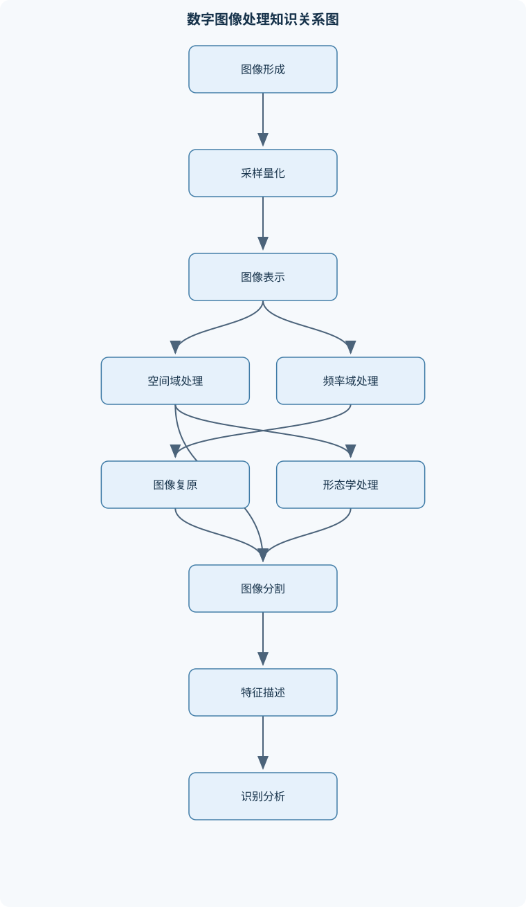
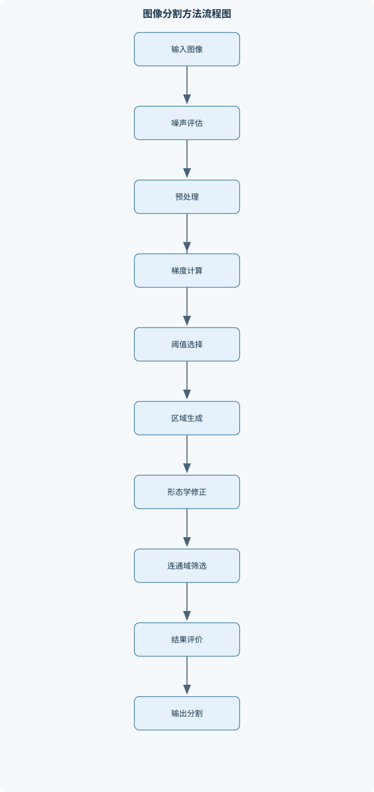

# 数字图像处理

## 一、课程整体知识框架

### 课程边界与先修知识

数字图像处理研究如何对由传感器采集、采样和量化形成的数字图像进行建模、增强、复原、变换、压缩、分割、表示与描述，并为后续识别和视觉分析提供可靠输入。课程覆盖二维灰度图像和彩色图像的基本表示、空间域与频率域处理、噪声模型和图像复原、几何变换与重建、彩色处理、数学形态学、边缘与区域分割、特征表示和图像压缩。课程通常不深入覆盖三维视觉、深度神经网络训练、视频编码标准实现和医学影像临床诊断。先修知识包括微积分、线性代数、概率统计、离散数学基础以及基本程序设计；应理解函数、矩阵乘法、卷积、离散求和、傅里叶级数或变换、随机变量和均方误差等概念。





### 1. 课程对象、任务与先修基础

数字图像处理研究的是：将传感器获得的光学场、辐射能量或其他物理信号转换为数字图像后，利用数学模型和计算程序对其进行增强、复原、变换、压缩、分割、表示和描述。连续图像通常记为 $f(x,y)$，其中 $x,y$ 为空间坐标；数字图像记为 $f[m,n]$，其中 $m,n$ 为整数像素坐标。若图像尺寸为 $M\times N$，则通常有

$$
m=0,1,\ldots,M-1,\qquad n=0,1,\ldots,N-1.
$$

课程的核心因果链是：成像条件决定原始信号，采样和量化决定数字表示质量；数字表示影响后续滤波、分割和压缩；处理目标决定算法选择；算法参数、边界条件和评价指标决定最终结果是否可靠。增强主要追求视觉或任务可用性，复原主要依据退化模型估计原图，分割旨在建立目标与背景或不同区域之间的边界，表示与描述则把区域转换为便于比较、检索和识别的特征。

先修知识包括微积分、线性代数、概率统计、离散数学和基本程序设计。具体需要理解函数与积分、矩阵乘法、离散求和、卷积、傅里叶变换、随机变量、均方误差、集合运算和队列等概念。线性代数中的向量空间和特征分解支撑主成分分析；概率统计支撑噪声建模、熵和评价指标；程序设计支撑矩阵索引、边界处理和实验复现。

### 2. 从物理成像到数字图像

传感器接收的并非抽象的“像素”，而是空间位置、时间、波长和辐射强度共同决定的测量结果。电磁波谱中的可见光只占有限波段，红外、紫外、微波等波段也可用于成像。不同传感器具有不同的光谱响应、空间分辨率、动态范围、噪声特性和曝光规律，因此同一物体在不同成像系统中可能具有不同灰度或颜色。

人眼对亮度的感知不是简单线性关系。相同的物理亮度差异，在暗背景和亮背景中可能产生不同的主观感觉，这解释了对数变换、幂律变换和局部对比度增强的应用价值。但视觉效果不能替代物理测量：增强图像可能更易观察，却不一定更接近真实辐射值。

采样把连续空间坐标限制为离散网格，量化把连续幅值映射为有限灰度级。若一维信号最高空间频率为 $B$，理想均匀采样频率 $f_s$ 必须满足

$$
f_s>2B
$$

才能在理想带限模型下避免混叠。若纹理最高频率为每毫米 $4$ 周期，则采样频率应大于每毫米 $8$ 次，采样间距应小于 $1/8$ 毫米。等号只是理想临界情形，实际系统还需要抗混叠低通滤波器，因为镜头有限孔径、传感器响应、噪声和非均匀采样都会破坏理想条件。提高显示分辨率不能恢复采样时已经丢失的频率信息。

空间分辨率描述可分辨的空间细节，通常与采样间距、成像光学系统和传感器尺寸有关；灰度分辨率描述幅值的离散精度。每个像素用 $b$ 位表示时，理想灰度级数为

$$
L=2^b,
$$

像素值通常为 $0$ 到 $L-1$。增加 $b$ 不会自动提高空间细节，增加采样数也不会自动提高灰度精度。

### 3. 像素、邻域与图像系统流程

灰度图像可表示为单通道矩阵，彩色图像通常由多个通道组成，例如 RGB 图像可写为三个同尺寸矩阵。四邻域只包含水平和垂直相邻像素，八邻域还包含对角像素。邻接关系会影响连通区域、边界跟踪和形态学拓扑。前景采用八连通时，背景通常不宜也采用八连通，否则对角接触可能同时造成前景和背景连通性的歧义。

图像处理系统一般包括成像、数字化、预处理、增强或复原、分割、表示与描述、识别或分析以及结果评价。实际流程不是固定串行链条。例如，椒盐噪声较强时，先进行中值滤波通常比先做梯度分割更合理；照明不均匀时，直接全局阈值可能失败，应先进行背景估计、同态处理或局部阈值处理。

### 4. 数学表示、统计量与基本操作

图像可以看作二维离散函数、矩阵或随机场。点运算只根据当前像素值输出新值，例如负片变换

$$
s=(L-1)-r
$$

适合突出暗目标；对数变换

$$
s=c\log(1+r)
$$

可扩展低灰度区域并压缩高灰度动态范围；幂律变换

$$
s=cr^\gamma
$$

通过 $\gamma$ 控制整体变亮或变暗。若输入已归一化到 $[0,1]$，$c$ 和幂指数的含义较清楚；若输入仍是整数灰度，必须先说明尺度，否则不同实现的参数不可直接比较。

直方图记为 $h(r_k)=n_k$，其中 $n_k$ 是灰度级 $r_k$ 的像素数；归一化直方图为

$$
p(r_k)=\frac{n_k}{MN}.
$$

直方图可用于观察动态范围、偏暗偏亮和多峰结构，但不能保留像素的空间位置，因此相同直方图的图像可能具有完全不同的纹理和形状。直方图均衡化利用累计分布函数

$$
s=T(r)=\int_0^r p_r(w)\,dw
$$

在连续理想条件下把灰度分布变为近似均匀分布。离散实现通常使用

$$
s_k=\left\lfloor (L-1)\sum_{j=0}^{k}p(r_j)\right\rfloor.
$$

由于灰度必须取整数，结果可能出现空灰度级和平台；均衡化改善的是整体灰度分布，不等同于局部对比度增强或照明校正。

图像代数运算包括加法、减法、乘法和比值。多帧平均可以降低独立零均值噪声，差分可突出变化区域，但不同图像必须完成配准，否则几何错位会被误认为目标变化。逻辑运算和掩模用于选取区域、组合二值目标和限制处理范围。灰度级切片突出指定灰度区间，位平面切片则把像素表示为二进制位，较高位通常携带更多结构信息，但这不是对所有图像和任务都成立。

几何变换包括平移、旋转、缩放、仿射变换和投影变换。实际重采样宜使用逆映射：对目标像素寻找源图像坐标，再通过最近邻、双线性或更高阶插值计算值。双线性插值使用周围四个整数像素按距离加权，平滑性优于最近邻，但会引入模糊；最近邻保留离散标签，却容易产生锯齿。

### 5. 空间域增强与频率域处理

空间域滤波直接在像素邻域计算。卷积记为

$$
(f*h)[m,n]=\sum_k\sum_l f[k,l]h[m-k,n-l],
$$

卷积会翻转核；相关运算通常不翻转核。对称均值核中两者结果相同，但非对称核下结果不同。均值滤波和高斯滤波属于低通处理，可降低随机噪声，但会模糊边缘；中值滤波属于秩统计滤波，对椒盐噪声通常更有效，并能较好保持阶跃边缘。窗口过大时，细小目标和纹理仍会被破坏。

梯度

$$
\nabla f=
\begin{bmatrix}
f_x\\
f_y
\end{bmatrix}
$$

的幅值可写为

$$
|\nabla f|=\sqrt{f_x^2+f_y^2}
$$

或采用绝对值近似。拉普拉斯算子利用二阶差分突出快速变化区域。锐化时必须统一核的符号约定，例如使用 $g=f-c\nabla^2f$ 还是 $g=f+c\nabla^2f$，取决于拉普拉斯核的定义。锐化会同时放大高频噪声，因此常需先平滑。

二维离散傅里叶变换为

$$
F[u,v]=\sum_{m=0}^{M-1}\sum_{n=0}^{N-1}
f[m,n]e^{-j2\pi(um/M+vn/N)},
$$

逆变换为

$$
f[m,n]=\frac{1}{MN}\sum_{u=0}^{M-1}\sum_{v=0}^{N-1}
F[u,v]e^{j2\pi(um/M+vn/N)}.
$$

不同软件可能把归一化因子放在正变换、逆变换或两者中，使用时必须保持约定一致。频谱中心化只是坐标重排，通常通过乘以 $(-1)^{m+n}$ 或等价操作把零频移到显示中心，并不改变频率内容。

卷积定理为

$$
\mathcal{F}\{f*h\}=F\,H.
$$

因此空间域卷积可以转换为频域逐点乘法。理想低通和理想高通在截止频率处突变，空间响应容易产生振铃；巴特沃斯滤波器阶数越高越接近这种突变，振铃风险也增加；高斯滤波器过渡平滑，通常振铃较弱。有限图像的离散傅里叶变换隐含周期延拓，若不进行适当填充，边界会出现循环卷积误差。

同态滤波基于照明—反射模型

$$
f(x,y)=i(x,y)r(x,y).
$$

取对数后，

$$
\ln f=\ln i+\ln r.
$$

通常把照明视为变化缓慢的低频成分，把反射和纹理视为较高频成分，再分别抑制和增强。零值不能直接取对数，必须先做安全处理；反变换后还需恢复动态范围。该模型是近似模型，当光照变化快速或反射与照明难以分离时，结果会偏离物理真实值。

### 6. 复原、彩色处理与多分辨率

退化图像常用模型表示为

$$
g[m,n]=h[m,n]*f[m,n]+\eta[m,n],
$$

其中 $f$ 是理想图像，$h$ 是点扩散函数，$\eta$ 是加性噪声。高斯噪声常由传感器或电子系统近似产生；椒盐噪声表现为孤立的极亮或极暗点；周期噪声在频谱中常形成成对峰值；乘性噪声可写成观测值与图像强度相关的形式。噪声参数可由平坦区域估计，但纹理区域不能直接当作纯噪声样本。

逆滤波在频域中近似使用 $G=1/H$，当 $H$ 接近零时会严重放大噪声。维纳滤波在已知或可估计 $H$、原图功率谱 $S_f$ 和噪声功率谱 $S_\eta$ 时使用

$$
G=\frac{H^*}{|H|^2+S_\eta/S_f}.
$$

分母中的正则化项限制了不稳定频率的增益，但谱估计错误会造成过度平滑或残余噪声。约束最小二乘复原则上在数据一致性和图像平滑性之间折中。投影数据重建则从多个方向的投影估计二维结构，核心问题是有限角度、噪声和采样不足导致的重建误差；它属于重建概念，不等同于普通二维滤波。

RGB 模型直接使用红、绿、蓝三个通道；CMY 是印刷或减色混合中常见的互补表示。归一化 RGB 可转换到 HSI 或 HSV，使色调、饱和度和亮度具有较直观的解释，但不同模型中的“亮度”定义并不完全相同。全彩色平滑可逐通道处理，也可在亮度—色度空间中主要处理亮度通道；逐通道锐化可能造成颜色偏移。白平衡根据场景光源估计修正通道增益，若场景本身含有大面积单一色彩，简单假设可能失效。伪彩色增强把灰度映射为颜色，颜色并不代表原始物理颜色。

尺度空间通过逐渐增大的平滑尺度观察结构变化；小波把信号分解到不同尺度和方向。二维滤波器组先沿行、列滤波并下采样，形成低低、低高、高低和高高子带，再递归分解低低子带。Haar 小波结构简单、定位清楚，但平滑性有限。小波去噪通常保留大系数、抑制小系数，适合非平稳信号，但阈值过强会造成细节损失。

### 7. 形态学、分割和区域描述

数学形态学以集合和结构元素 $B$ 为基础。二值膨胀扩大目标，腐蚀要求结构元素在目标内部完全匹配；开运算先腐蚀后膨胀，通常去除小突出物；闭运算先膨胀后腐蚀，通常填补小孔和连接近邻区域。开运算具有幂等性，闭运算也具有幂等性，但这些性质依赖于集合定义、结构元素原点和边界规则。边界提取可写为

$$
\partial A=A-(A\ominus B).
$$

灰度形态学把最大值、最小值与结构元素结合，用于背景估计、顶帽和底帽增强。膨胀不是普通加法，腐蚀也不是任意删除像素。

分割的目标是把图像划分为具有任务意义的区域。点、线和边缘检测依赖局部灰度变化；阈值分割把像素按灰度归类。Otsu 方法对每个候选阈值 $t$ 计算两类概率 $\omega_0,\omega_1$ 和均值 $\mu_0,\mu_1$，最大化类间方差

$$
\sigma_B^2(t)=\omega_0(t)\omega_1(t)
[\mu_0(t)-\mu_1(t)]^2.
$$

它适合近似双峰直方图，不适合明显不均匀照明或前景背景灰度严重重叠的情况。区域生长依赖种子和相似性准则；区域分裂与合并依赖一致性检验；分水岭把灰度看作地形，容易产生过分割，通常需要标记控制和区域合并。

区域边界可用链码表示，但起点、方向和四邻域或八邻域约定必须一致。区域可用像素集合、外接矩形、四叉树等表示。区域矩为

$$
m_{pq}=\sum_x\sum_y x^py^qf(x,y),
$$

质心为

$$
\bar x=\frac{m_{10}}{m_{00}},\qquad
\bar y=\frac{m_{01}}{m_{00}},
$$

其中必须有 $m_{00}\ne0$。以质心为中心的中心矩可消除平移影响，尺度归一化可减弱尺寸影响，但旋转不变性需要额外构造不变量。纹理可由灰度共生关系、局部统计量或频域能量描述。主成分分析通过协方差矩阵的特征向量寻找最大方差方向，必须先明确特征中心化和尺度归一化方式。

### 8. 压缩、评价与软件实现

图像中存在编码冗余、空间冗余、频谱冗余和视觉冗余。源熵为

$$
H=-\sum_k p_k\log_2p_k.
$$

熵表示平均信息量；对独立同分布源，无损变长编码的平均码长通常不低于熵，但有限码字长度和概率模型误差会造成差距。霍夫曼编码构造前缀码，游程编码适合连续重复值，算术编码把整个符号序列映射到区间。变换编码先把数据变换到频域或其他系数域，再量化和熵编码；量化通常是有损步骤，不能把量化误称为熵编码。预测编码利用邻域预测值与真实值之间的残差。

压缩率定义为原始表示长度与压缩表示长度之比。无损压缩要求解码数据逐位一致；有损压缩允许规定范围内的失真。均方误差为

$$
\mathrm{MSE}=
\frac{1}{MN}\sum_{m,n}(f[m,n]-\hat f[m,n])^2,
$$

当峰值灰度为 $L-1$ 时，

$$
\mathrm{PSNR}=10\log_{10}
\frac{(L-1)^2}{\mathrm{MSE}}.
$$

MSE 为零时 PSNR 理论上趋于无穷。PSNR 只描述逐像素误差，不能独立代表结构和视觉质量，因此还需结合结构相似性、边缘保持、颜色偏差和任务准确率。

软件实现必须明确行列索引、坐标方向、整数与浮点类型、核中心、边界填充和动态范围。零填充、复制边界、镜像边界和周期边界对应不同假设。卷积中间结果可能为负或超出灰度范围，若过早转换为无符号整数，会发生截断或溢出。实验应记录输入数据、参数、随机种子、边界规则、中间结果和评价指标，以保证结果可复现。

## 二、章节和模块划分

### 核心知识覆盖清单

本清单用于检查正文是否覆盖本课程的主要知识模块：

- **数字图像形成与视觉基础**：图像与数字图像定义、电磁波谱与成像传感器、人眼亮度与对比度感知、采样与量化过程、空间分辨率与灰度分辨率、像素邻接与距离度量、灰度图像和彩色图像表示、图像处理系统基本流程。
- **图像数学表示与基本操作**：二维离散函数表示、图像的点运算、直方图与统计量、图像代数运算、逻辑运算与掩模、灰度级切片、位平面切片、几何变换基础。
- **灰度变换与空间域滤波**：负片变换、对数与幂律变换、分段线性变换、直方图均衡化、直方图规定化、均值与高斯平滑、中值与秩统计滤波、拉普拉斯与梯度锐化。
- **频率域图像处理**：二维离散傅里叶变换、频谱中心化、卷积定理、理想低通与高通滤波、巴特沃斯滤波器、高斯频率滤波器、同态滤波、频域滤波的边界与振铃。
- **图像复原与重建**：退化模型、加性与乘性噪声、高斯、椒盐与周期噪声、噪声参数估计、逆滤波、维纳滤波、约束最小二乘复原、投影数据图像重建概念。
- **彩色图像处理**：RGB与CMY模型、HSI与HSV模型、颜色空间转换、伪彩色增强、全彩色图像平滑、彩色图像锐化、彩色分割、颜色差异与白平衡。
- **小波与多分辨率分析**：尺度空间思想、一维与二维小波、Haar小波、多分辨率分析、滤波器组分解、子带图像、小波去噪、小波域特征表示。
- **数学形态学**：集合与结构元素、二值膨胀与腐蚀、开运算与闭运算、形态学边界提取、形态学梯度、击中或击不中变换、骨架与细化、灰度形态学。
- **图像分割**：分割目标与评价依据、点线和边缘检测、梯度与拉普拉斯算子、阈值分割、Otsu自动阈值、区域生长、区域分裂与合并、分水岭与过分割。
- **图像表示与区域描述**：边界表示与链码、区域表示与四叉树、形状描述子、区域矩与中心矩、纹理统计特征、频域形状描述、主成分分析、特征归一化与相似性。
- **图像压缩**：冗余类型、保真度与失真度量、熵与信息量、霍夫曼编码、算术编码概念、游程编码、变换编码、预测编码与有损压缩。
- **软件实现与综合实验**：图像读写与数据类型、矩阵索引与坐标约定、空间滤波器实现、傅里叶变换实现、分割结果可视化、峰值信噪比计算、结构相似性评价、实验结果复现与误差分析。


### 第一章 数字图像形成与视觉基础

本章从连续成像开始，解释电磁波谱、传感器、视觉亮度和对比度，再过渡到采样、量化、空间分辨率、灰度分辨率、像素邻接和距离度量。重点是区分物理图像与数字矩阵，理解混叠不可由后续显示恢复，明确灰度图像和彩色图像的通道组织形式，并建立从传感器到分析输出的系统流程。

### 第二章 图像数学表示与基本操作

本章建立 $f[m,n]$ 的二维离散函数表示，讨论点运算、直方图、均值、方差、图像加减乘除、掩模、逻辑运算、灰度级切片和位平面切片。几何变换部分说明正向映射造成空洞的原因，以及逆映射和插值的必要性。重点比较最近邻和双线性插值的边界误差、清晰度和标签保持能力。

### 第三章 灰度变换与空间域滤波

本章按“改变像素映射”和“利用邻域关系”两条线展开。负片、对数、幂律和分段线性变换主要改变动态范围；均衡化和规定化改变统计分布；均值、高斯和中值滤波分别对应线性平滑、加权平滑和秩统计平滑；拉普拉斯与梯度滤波用于边缘增强。必须同时分析噪声类型、窗口大小、边界策略和细节损失。

### 第四章 频率域图像处理

本章推导二维离散傅里叶变换和逆变换，解释零频、频谱中心化、幅度谱与相位谱，并由卷积定理说明空间滤波和频域乘法的等价关系。理想、巴特沃斯和高斯低通或高通滤波器应从过渡带、振铃和计算代价比较。频域处理必须处理零填充、周期边界和滤波器坐标一致性。

### 第五章 图像复原与重建

本章以退化模型为主线，区分加性噪声、乘性噪声、随机噪声和周期噪声。先说明噪声参数估计，再比较逆滤波、维纳滤波和约束最小二乘复原。复原不是单纯增强：它必须明确退化原因和先验假设。投影数据重建部分介绍多方向投影与二维结构之间的关系，并说明采样不足、噪声和有限角度造成的限制。

### 第六章 彩色图像处理

本章比较 RGB、CMY、HSI 和 HSV 的表示差异，说明颜色空间转换受归一化、白点和通道定义影响。伪彩色用于增强灰度差异，不代表真实颜色。彩色平滑和锐化需考虑亮度与色度耦合；彩色分割可基于颜色距离、色调区间或多通道统计模型。白平衡通过估计光源和调整通道增益实现，场景颜色分布不满足假设时会产生偏色。

### 第七章 小波与多分辨率分析

本章从尺度空间出发，介绍一维和二维小波、Haar 小波、多分辨率分析以及滤波器组分解。二维分解产生低低、低高、高低和高高子带，低低子带可递归分解。小波去噪通过尺度相关阈值抑制噪声，小波域系数还可用于纹理和形状表示。边界延拓和下采样约定必须在分解与重构中保持一致。

### 第八章 数学形态学

本章以集合、平移、反射和结构元素为基础，逐步建立二值膨胀、腐蚀、开运算、闭运算、边界提取和形态学梯度。击中或击不中变换用于检测特定局部结构；骨架和细化用于获得拓扑中心线，但可能产生毛刺。灰度形态学通过最大值和最小值扩展到灰度图像。每个结果都依赖结构元素形状、尺寸、原点和边界规则。

### 第九章 图像分割

本章先说明分割目标和评价依据，再介绍点、线、边缘检测、梯度与拉普拉斯算子。阈值分割包括固定阈值、自动阈值和局部阈值；Otsu 通过最大化类间方差选择全局阈值。区域生长强调连通性和相似性，区域分裂与合并强调区域一致性，分水岭强调地形和标记控制。应特别分析过分割、欠分割、噪声边缘和不均匀照明。

### 第十章 图像表示与区域描述

本章讨论边界表示、链码、区域像素集合、四叉树和外接形状表示。形状描述包括周长、面积、圆度、长宽比和方向；矩与中心矩用于计算质心、惯性和尺度关系；纹理描述可使用局部统计和频域能量。主成分分析用于降维和主方向提取，但必须先处理中心化、量纲和特征尺度。相似性比较应说明距离度量、特征归一化和不变性条件。

### 第十一章 图像压缩

本章从冗余分类和失真定义开始，建立信息量、熵、平均码长和压缩率之间的关系。霍夫曼编码要求前缀无歧义，算术编码以区间表示符号序列，游程编码适合长重复段。变换编码、预测编码和量化共同构成典型有损流程。应区分压缩效率、视觉质量和任务性能，不能仅凭压缩率评价算法。

### 第十二章 软件实现与综合实验

本章统一图像读写、数据类型、矩阵索引、坐标约定和边界处理。实现空间卷积时要处理核翻转与归一化；实现傅里叶滤波时要保证填充尺寸、频率响应和逆变换约定一致；实现分割时要可视化标签、边界和连通区域。实验评价可使用 MSE、PSNR、结构相似性、分割交并比、边界偏差和运行时间。结果复现不仅要保存最终图像，还要保存参数、版本、输入数据摘要和中间结果。

### 代表性算法一：二维直方图均衡化

**输入**为灰度图像、图像尺寸 $M\times N$ 和灰度级数 $L$；**输出**为均衡化图像及灰度映射表。过程如下：

1. 统计每个灰度级的像素数 $n_k$。
2. 计算 $p(r_k)=n_k/(MN)$。
3. 从低灰度到高灰度累加概率，得到累计分布。
4. 使用 $s_k=\lfloor(L-1)\mathrm{CDF}(r_k)\rfloor$ 建立映射。
5. 将每个像素替换为对应的 $s_k$。

不变量是同一输入灰度在同一幅图像中使用同一个映射；遍历所有像素后终止。复杂度为 $O(MN+L)$，额外空间为 $O(L)$。该算法适合整体偏暗、动态范围利用不足的图像，不适合单独解决局部照明不均。

```python
def equalize_histogram(image, levels=256):
    """
    image: 二维整数列表，像素范围为 0 到 levels-1
    levels: 灰度级数
    return: 均衡化后的二维整数列表
    """
    height = len(image)
    width = len(image[0]) if height else 0
    total = height * width

    if total == 0:
        return []

    histogram = [0] * levels
    for row in image:
        if len(row) != width:
            raise ValueError("各行长度必须一致")
        for value in row:
            if not 0 <= value < levels:
                raise ValueError("像素值超出灰度范围")
            histogram[value] += 1

    mapping = [0] * levels
    cumulative = 0
    for level, count in enumerate(histogram):
        cumulative += count
        mapping[level] = (levels - 1) * cumulative // total

    return [[mapping[value] for value in row] for row in image]
```

### 代表性算法二：二维空间卷积与边界处理

**输入**为图像、滤波核和边界规则；**输出**为滤波图像。首先明确核中心和边界扩展方式，然后对核进行翻转，在每个输出位置计算邻域加权和。若图像尺寸为 $M\times N$，核尺寸为 $P\times Q$，直接实现复杂度为 $O(MNPQ)$；若核可分离，可降低到近似 $O(MN(P+Q))$。零填充会在边缘引入暗边，复制边界保持边缘值，镜像边界通常更适合平滑自然图像，周期边界则对应傅里叶模型。

### 代表性算法三：Otsu 全局阈值分割

**输入**为灰度图像；**输出**为阈值 $t$ 和二值图像。先计算直方图，再枚举候选阈值，分别计算低于阈值和高于阈值两类的概率及均值，求

$$
\sigma_B^2(t)=\omega_0(t)\omega_1(t)
[\mu_0(t)-\mu_1(t)]^2.
$$

取使类间方差最大的阈值。遍历所有候选灰度级后终止，复杂度为 $O(MN+L)$。当背景和前景分别形成较集中的灰度峰时，该方法有效；若照明渐变、目标灰度跨越背景范围或直方图存在多个物体峰值，单一全局阈值可能失败。

### 代表性算法四：维纳图像复原

**输入**为退化图像、退化传递函数 $H$、原图功率谱估计 $S_f$ 和噪声功率谱 $S_\eta$；**输出**为复原图像。对每个频率计算

$$
G[u,v]=\frac{H^*[u,v]}
{|H[u,v]|^2+S_\eta[u,v]/S_f[u,v]},
$$

将观测频谱乘以 $G$，再逆变换并进行动态范围处理。若 $H$ 接近零，逆滤波会放大噪声，而维纳滤波通过分母中的正则化项降低增益。功率谱估计不准确时，可能产生过度平滑或残余伪影。

### 代表性算法五：二维小波分解

**输入**为图像、分析低通和高通滤波器及分解层数；**输出**为各尺度子带。每层先沿行方向滤波并下采样，再沿列方向滤波并下采样，得到低低、低高、高低和高高子带；随后对低低子带递归处理。达到指定层数或子带尺寸限制时终止。边界延拓、滤波器长度和下采样位置必须一致，否则重构会出现尺寸变化或边缘伪影。

### 例题一：采样条件判断

**题干**：图像纹理最高空间频率为每毫米 $4$ 周期，采样间距为 $0.15$ 毫米，是否满足理想奈奎斯特条件？

**分析**：最高频率为 $B=4$ 周期/毫米，所需采样频率必须大于 $2B=8$ 次/毫米。

**解答**：实际采样频率为

$$
f_s=\frac{1}{0.15}\approx6.67
$$

次/毫米，小于 $8$ 次/毫米，因此会发生混叠风险。等价地，采样间距应小于 $1/8=0.125$ 毫米。若将间距改为 $0.1$ 毫米，采样频率为 $10$ 次/毫米，满足理想条件。

**结果验证**：检查 $f_s>2B$，而不是只比较像素数量。实际系统还应使用抗混叠低通滤波器。

### 例题二：四级灰度直方图均衡化

**题干**：灰度级为 $0,1,2,3$，像素频数分别为 $2,3,4,1$，求均衡化映射。

**分析**：总像素数为 $10$，$L=4$，使用

$$
s_k=\left\lfloor3\sum_{j=0}^{k}p(r_j)\right\rfloor.
$$

**解答**：

- 灰度 $0$：累计概率 $2/10$，$s_0=\lfloor0.6\rfloor=0$；
- 灰度 $1$：累计概率 $5/10$，$s_1=\lfloor1.5\rfloor=1$；
- 灰度 $2$：累计概率 $9/10$，$s_2=\lfloor2.7\rfloor=2$；
- 灰度 $3$：累计概率 $1$，$s_3=3$。

因此本例映射恰好不改变灰度级。

**结果验证**：累计映射必须单调不减，输出灰度不能超出 $0$ 到 $3$。如果改用四级频数 $7,1,1,1$，均衡化会把大量低灰度像素分散到更高灰度，动态范围扩展更明显。

### 例题三：均值滤波与中值滤波

**题干**：邻域像素为 $[10,11,12,12,13,13,14,14,255]$，分别求均值和中值。

**分析**：孤立的 $255$ 是典型脉冲噪声，应比较极值对两种统计量的影响。

**解答**：均值为

$$
\frac{10+11+12+12+13+13+14+14+255}{9}
=\frac{354}{9}\approx39.33.
$$

排序后中间第五个数为 $13$，因此中值为 $13$。

**结果验证**：均值被单个极端值显著抬高，中值仍接近正常邻域水平。若噪声是近似高斯噪声且没有明显脉冲，均值或高斯滤波可能比中值更有效。

### 例题四：Otsu 阈值

**题干**：灰度级 $0,1,2$ 的像素频数为 $4,4,2$，枚举非平凡阈值并选择 Otsu 阈值。

**分析**：总像素数为 $10$。阈值 $t=0$ 时，类别为 $\{0\}$ 和 $\{1,2\}$；阈值 $t=1$ 时，类别为 $\{0,1\}$ 和 $\{2\}$。

**解答**：

当 $t=0$：

$$
\omega_0=0.4,\quad \mu_0=0,
$$

$$
\omega_1=0.6,\quad
\mu_1=\frac{4\times1+2\times2}{6}= \frac{8}{6}.
$$

类间方差为

$$
0.4\times0.6\times\left(0-\frac{8}{6}\right)^2
\approx0.427.
$$

当 $t=1$：

$$
\omega_0=0.8,\quad \mu_0=\frac{4\times0+4\times1}{8}=0.5,
$$

$$
\omega_1=0.2,\quad \mu_1=2.
$$

类间方差为

$$
0.8\times0.2\times(0.5-2)^2=0.36.
$$

因此应选择 $t=0$。

**结果验证**：阈值只比较类间方差，不直接比较类内像素数。若图像存在渐变照明，该全局结果可能不符合目标边界，应改用局部阈值或先校正照明。

### 例题五：MSE 与 PSNR

**题干**：原图和复原图有四个像素，误差分别为 $0,1,-2,1$，灰度级为 $L=256$，求 MSE 和 PSNR。

**分析**：先平方误差并求平均，再代入峰值灰度 $255$。

**解答**：

$$
\mathrm{MSE}=\frac{0^2+1^2+(-2)^2+1^2}{4}
=\frac{6}{4}=1.5.
$$

因此

$$
\mathrm{PSNR}
=10\log_{10}\frac{255^2}{1.5}
\approx46.37\ \mathrm{dB}.
$$

**结果验证**：若所有像素完全相同，MSE 为 $0$，PSNR 理论上为无穷大。该指标不能发现几何错位、结构破坏或视觉上重要的局部错误，因此不能单独作为质量验收标准。

### 实验一：低照度椒盐噪声图像处理流程

**输入数据**：一幅灰度图像及其含椒盐噪声版本；若有参考原图，则同时保留参考图用于评价。

**步骤**：

1. 检查图像尺寸、灰度范围和数据类型。
2. 使用 $3\times3$ 或 $5\times5$ 中值滤波，记录窗口大小和边界规则。
3. 对非零图像执行对数增强，记录缩放常数。
4. 比较全局直方图均衡化与局部对比度调整。
5. 使用 Otsu 对增强结果分割。
6. 通过开运算去除小突出物，通过闭运算填补小孔。
7. 保存每一步的图像和参数。

**评价标准**：有参考图时计算 MSE、PSNR，并观察边缘保持；无参考图时检查椒盐残留、目标连通性、边界偏移和分割区域面积稳定性。

**排错方法**：若滤波后边缘过度变圆，减小窗口；若对数变换出现异常黑块，检查零值和动态范围；若 Otsu 结果大面积错误，检查直方图是否双峰以及照明是否均匀；若形态学后目标消失，检查结构元素尺寸是否大于目标细节。

### 实验二：频域低通与边界误差比较

**输入数据**：一幅包含规则纹理和噪声的灰度图像，三种频率响应：理想低通、巴特沃斯低通和高斯低通。

**步骤**：

1. 对图像进行适当零填充，记录填充尺寸。
2. 计算二维傅里叶变换并进行频谱中心化。
3. 按同一截止半径构造三种滤波器。
4. 完成频域乘法和逆变换，取实部并裁剪到原尺寸。
5. 比较不同滤波器的边缘清晰度、纹理保留和振铃。
6. 分别改变零填充方式，观察边界附近的差异。

**评价标准**：若有参考图，计算 MSE、PSNR 和结构相似性；若无参考图，比较噪声降低、边缘定位、振铃幅度和纹理保留。滤波器之间必须使用相同输入、截止频率和动态范围处理。

**排错方法**：结果整体错位时检查频谱中心化前后滤波器坐标；边缘出现周期重复时检查零填充和循环卷积；输出出现明显虚部时检查共轭对称性、数组索引和数值误差；图像过暗或过亮时检查逆变换归一化和显示缩放。

## 三、核心概念的详细解释

### 1. 图像的数学对象与处理任务

数字图像是定义在有限整数网格上的二维离散函数。灰度图像记为 $f[m,n]$，其中 $m$ 表示行坐标，$n$ 表示列坐标，图像尺寸为 $M\times N$。当每个像素使用 $b$ 位表示时，理想灰度级数为 $L=2^b$，像素值通常属于 $\{0,1,\ldots,L-1\}$。彩色图像不是一个简单的灰度矩阵，而是由多个同尺寸通道组成，例如 RGB 图像可写为 $f_R[m,n]$、$f_G[m,n]$ 和 $f_B[m,n]$。

图像处理任务可以按目标分为几类。增强通过改变图像表现形式提高可见性或后续任务的可用性，例如直方图均衡化、平滑和锐化；复原依据退化模型估计原始图像，例如去除运动模糊和噪声；分割把图像划分为具有任务意义的区域；表示与描述把区域转化为边界、矩、纹理或频域特征；压缩则利用图像中的冗余减少存储和传输代价。增强不一定使结果更接近真实场景，复原也不一定产生视觉上最鲜艳的图像，二者必须根据目标区分。

### 2. 采样、量化与分辨率

连续图像 $f(x,y)$ 经过空间采样和幅值量化才成为数字图像。采样决定空间位置的离散精度，量化决定灰度值的离散精度。若一维空间信号最高频率为 $B$，理想均匀采样条件为

$$
f_s>2B,
$$

其中 $f_s$ 的单位是每单位长度的采样次数，$B$ 的单位是每单位长度的周期数。采样间距 $\Delta x$ 与采样频率满足 $f_s=1/\Delta x$，因此也可写为

$$
\Delta x<\frac{1}{2B}.
$$

例如纹理最高频率为每毫米 $4$ 周期，则采样频率必须大于每毫米 $8$ 次，采样间距必须小于 $0.125$ 毫米。若采样频率不足，频谱副本相互重叠，产生混叠；混叠后的低频图案不是简单提高显示分辨率即可恢复的。

实际成像在采样前通常使用抗混叠低通滤波器，使信号在奈奎斯特频率之外的能量尽量减小。理想条件要求信号严格带限、均匀采样且无噪声，现实中的镜头孔径、传感器响应、运动、噪声和边界都会使条件变为近似条件。空间分辨率与采样间距、光学成像质量和传感器结构共同决定；灰度分辨率主要由量化位数、传感器动态范围和噪声决定，二者不能互相替代。

量化误差可表示为真实幅值与量化值之差。均匀量化时，量化步长越大，灰度级越少，误差通常越明显；但增加位数也不能解决空间采样不足造成的混叠。

### 3. 视觉、灰度与颜色表示

人眼对亮度的响应近似具有非线性。相同的物理亮度差，在不同背景亮度下可能产生不同的主观对比度，因此对数变换、幂律变换和局部对比度增强常用于改善视觉效果。视觉增强改变的是显示关系，不应直接解释为辐射能量被真实恢复。

RGB 模型适合描述显示设备和传感器的三通道响应。CMY 模型是相减混色模型，在归一化条件下可近似写为

$$
C=1-R,\qquad M=1-G,\qquad Y=1-B.
$$

HSI 或 HSV 将颜色分解为色调、饱和度和亮度或明度，更便于在保持色调的同时处理亮度。不同颜色空间的“亮度”含义并不完全相同，不能随意把 RGB 三个通道独立均衡化，否则可能造成颜色偏移。彩色平滑可以在 RGB 空间对向量进行处理，也可以先转换到具有亮度—色度分离意义的空间，对亮度通道处理后再转换回来。

白平衡的目标是补偿光源颜色，使中性物体在图像中尽量接近中性。它依赖于光源估计和场景假设；在多光源、彩色大面积物体或强反射环境中，简单的灰度世界假设可能失效。

### 4. 像素邻域、距离与连通性

像素邻域决定局部运算和区域拓扑。四邻域只包含上、下、左、右像素；八邻域还包含四个对角像素。常用距离包括欧氏距离

$$
D_E(p,q)=\sqrt{(m_p-m_q)^2+(n_p-n_q)^2},
$$

城市街区距离或曼哈顿距离

$$
D_4(p,q)=|m_p-m_q|+|n_p-n_q|,
$$

以及棋盘距离

$$
D_8(p,q)=\max\{|m_p-m_q|,|n_p-n_q|\}.
$$

四连通和八连通必须与边界定义协调。若前景和背景同时使用八连通，对角接触可能导致拓扑解释矛盾；实际处理中通常让前景与背景采用互补的连通约定。

边界处理也是邻域运算的一部分。零填充假设图像外部为零，复制边界假设边缘值延拓，镜像边界假设图像关于边界反射，周期边界则假设图像首尾相接。不同规则会改变卷积、梯度、形态学和频域处理结果，不能在实验报告中只写“采用滤波器”而不说明边界条件。

### 5. 点运算、直方图和图像代数

点运算只依据当前像素值进行变换：

$$
g[m,n]=T(f[m,n]).
$$

负片变换为

$$
g=L-1-f,
$$

适合突出暗背景中的亮细节。对数变换为

$$
g=c\log(1+f),
$$

其中 $c$ 为缩放常数，适合扩展低灰度范围并压缩高灰度范围；输入必须满足对数定义条件。幂律变换为

$$
g=c f^\gamma,
$$

在输入先归一化到 $[0,1]$ 时，$\gamma<1$ 通常提高暗部亮度，$\gamma>1$ 通常压低暗部。分段线性变换可分别控制暗部、中间灰度和高光区域。

直方图记为 $h(r_k)=n_k$，其中 $n_k$ 是灰度级 $r_k$ 的像素数；归一化直方图为

$$
p(r_k)=\frac{n_k}{MN}.
$$

它可近似反映灰度随机变量的概率分布，但不能保留像素空间位置。因此两幅图像可能具有相同直方图而结构完全不同。图像均值、方差、偏度等统计量可描述整体灰度特性，却不能替代空间结构分析。

图像代数包括加法、减法、乘法和逻辑运算。图像相减可用于变化检测或背景消除，但要求两幅图像几何配准；存在位移时，边缘会产生大量伪差异。掩模是限定处理区域的二值或灰度权重图，使用掩模前必须明确其坐标对齐、边界和逻辑含义。

### 6. 空间域滤波与频率域滤波

空间域线性滤波通常写为卷积：

$$
g[m,n]=(f*h)[m,n]
=\sum_{i}\sum_{j}f[i,j]h[m-i,n-j].
$$

卷积会翻转滤波核；相关运算通常不翻转核。对称核时二者数值可能相同，非对称核时不可混淆。均值滤波以邻域平均降低随机波动，但会模糊边缘；高斯滤波使用距离中心越近权重越大的核，平滑更自然。中值滤波属于秩统计滤波，对椒盐噪声尤其有效，因为孤立极值只占排序序列中的少数位置，不会像均值那样显著改变结果。

拉普拉斯算子是二阶微分算子，连续形式为

$$
\nabla^2 f=
\frac{\partial^2 f}{\partial x^2}
+\frac{\partial^2 f}{\partial y^2}.
$$

它突出灰度变化迅速的区域，但同时放大高频噪声。锐化可写为

$$
g=f-c\nabla^2 f
$$

或使用相反符号约定的形式；公式与离散核的符号必须一致。梯度算子提供一阶变化信息，梯度方向近似表示边缘法线方向，梯度幅值可用

$$
|\nabla f|=\sqrt{f_x^2+f_y^2}
$$

或绝对值近似。实际处理中通常先适度平滑，再求梯度。

二维离散傅里叶变换把图像分解为空间频率成分。低频描述缓慢变化的背景和整体亮度，高频描述边缘、纹理和噪声。卷积定理为

$$
\mathcal{F}\{f*h\}=F[u,v]H[u,v].
$$

因此频域滤波可以通过频谱乘法实现。频谱中心化只是坐标重排，不改变信息内容；中心化后构造的滤波器必须采用同一坐标系。理想低通频率响应存在突变，逆变换后可能产生振铃；巴特沃斯阶数越高越接近理想突变，高斯滤波过渡平滑，通常振铃较弱但截止边界不如理想滤波器陡峭。

### 7. 退化、噪声与复原

常用退化模型为

$$
g[m,n]=h[m,n]*f[m,n]+\eta[m,n],
$$

其中 $f$ 是理想图像，$h$ 是点扩散函数，$\eta$ 是加性噪声。高斯噪声通常用均值和方差描述；椒盐噪声表现为少量极亮或极暗像素；周期噪声在频谱中常形成成对或成组的突出峰；乘性噪声可写为

$$
g=f\cdot \nu,
$$

其中 $\nu$ 为随机乘性因子，常可通过对数变换转化为加性形式，但变换会改变噪声统计特性。

逆滤波在频域中相当于

$$
\hat F[u,v]=\frac{G[u,v]}{H[u,v]}.
$$

当 $H[u,v]$ 接近零时，观测噪声会被巨大放大，因此逆滤波只适用于退化函数已知且不存在严重零点、噪声较弱的情况。维纳滤波通过最小均方误差原则抑制不稳定频率：

$$
G_w[u,v]
=
\frac{H^*[u,v]}
{|H[u,v]|^2+S_\eta[u,v]/S_f[u,v]}.
$$

其中 $S_f$ 和 $S_\eta$ 分别是原图与噪声功率谱。功率谱估计不准确时，结果可能过度平滑或残留噪声。约束最小二乘复原则上在拟合观测数据的同时限制复原图像的剧烈变化，适合把平滑先验纳入模型。

### 8. 多分辨率、小波与形态学

多分辨率分析把图像表示为不同尺度的结构。二维小波分解通常先对行、列分别进行低通和高通滤波，再下采样，得到低低、低高、高低和高高四个子带。低低子带保留较粗尺度信息，其余子带主要描述不同方向的细节。Haar 小波结构简单，能表示局部平均和差分，但对平滑曲线的表达不如较长支撑的小波。小波去噪通常对细节子带进行阈值收缩，阈值过小会残留噪声，过大则损失纹理和边缘。

数学形态学以集合和结构元素为基础。二值腐蚀要求结构元素平移后完全包含于目标集合；膨胀要求结构元素与目标集合有非空交集。开运算为先腐蚀后膨胀，通常去除小突出物；闭运算为先膨胀后腐蚀，通常填补小孔并连接相近区域。二者的效果取决于结构元素形状、原点、尺寸和边界规则，不能把膨胀理解为普通灰度加法。

### 9. 分割、表示与描述

阈值分割通过比较像素与阈值 $t$ 生成二值区域。全局阈值适合光照较均匀且目标、背景灰度可分的场景；光照不均匀或灰度重叠时，应考虑局部阈值、区域生长或模型方法。Otsu 方法选择使类间方差最大的阈值：

$$
\sigma_B^2(t)=
\omega_0(t)\omega_1(t)
[\mu_0(t)-\mu_1(t)]^2.
$$

该方法隐含近似双峰和类内灰度相对集中的假设。区域生长需要种子点、邻接关系和相似性准则，结果对种子位置和准则阈值敏感。分水岭利用地形水淹思想提取区域边界，但噪声会产生大量局部极小值，容易过分割，通常需要标记控制或区域合并。

区域表示包括边界表示和内部表示。链码用方向序列记录边界，但起点、方向、连通性约定不同会产生不同编码，比较前需归一化。区域矩为

$$
m_{pq}=\sum_x\sum_y x^py^q f(x,y),
$$

二值区域中 $f(x,y)$ 可取 $0$ 或 $1$。面积为 $m_{00}$，质心为

$$
\bar x=\frac{m_{10}}{m_{00}},
\qquad
\bar y=\frac{m_{01}}{m_{00}},
$$

要求 $m_{00}\neq0$。中心矩以质心为原点，可消除平移影响；进一步进行尺度归一化可减弱尺寸影响，但旋转不变性还需专门构造旋转不变量。纹理可用灰度共生统计、局部方差、频谱能量等描述，特征必须经过尺度统一，避免数值范围较大的特征支配相似性计算。

### 10. 压缩与质量评价

图像冗余包括空间冗余、统计冗余和心理视觉冗余。无损压缩要求解码结果逐像素等于原始数据；有损压缩允许在可接受失真内舍弃信息。离散源熵为

$$
H=-\sum_k p_k\log_2p_k.
$$

它表示平均信息量，是理想无损编码平均码长的理论参考。霍夫曼编码产生前缀码，适合已知符号概率且符号数有限的场景；算术编码把整段符号表示为一个区间，能更接近熵但实现和误差控制更复杂。游程编码适合连续重复值较多的图像。变换编码先将像素变换到另一组基函数，再对系数进行量化和熵编码；量化是有损压缩的主要信息丢失环节，不能把量化误称为熵编码。

均方误差为

$$
\mathrm{MSE}
=
\frac{1}{MN}
\sum_{m,n}
\left(f[m,n]-\hat f[m,n]\right)^2,
$$

峰值信噪比为

$$
\mathrm{PSNR}
=
10\log_{10}
\frac{(L-1)^2}{\mathrm{MSE}}.
$$

当两幅图像尺寸、配准关系和灰度范围一致时，MSE 越小，PSNR 越高；MSE 为零时，PSNR 理论上为无穷大。PSNR 只衡量逐像素误差，不能独立反映结构错位、纹理自然度和颜色感知差异，实际评价应结合结构相似性、边缘保持和任务结果。

## 四、重要定义、公式、定理和推导

### 专业审校补充：关键定义与适用边界

几何变换应区分正向映射与逆向映射。设输出坐标为 $(x',y')$，输入坐标为 $(x,y)$，仿射变换可写为 $[x',y',1]^T=A[x,y,1]^T$，其中 $A$ 为 $3\times3$ 齐次坐标矩阵。若逐个输入像素计算其输出位置，多个像素可能落入同一输出网格，或产生空洞；工程实现通常对每个输出像素使用逆变换 $[x,y,1]^T=A^{-1}[x',y',1]^T$，再在输入图像上插值。最近邻插值不引入新灰度但易产生锯齿；双线性插值按四个邻近像素的距离加权，结果较平滑；双三次插值通常保留更多细节，但计算量和过冲风险更高。缩小图像或旋转高频纹理前必须进行抗混叠低通处理，否则插值只能估计已有采样点，不能恢复已混叠的信息。边界处还需明确零填充、复制、镜像或常数外推规则；变换矩阵、坐标原点、像素中心约定不一致，会造成整体半像素偏移。


### 1. 直方图均衡化的推导与限制

设归一化灰度变量为 $r\in[0,1]$，概率密度为 $p_r(r)$，定义变换

$$
s=T(r)=\int_0^r p_r(w)\,dw.
$$

由于累积分布函数单调不减，$s$ 的取值落在 $[0,1]$。若 $T$ 可逆，则

$$
p_s(s)
=
p_r(r)\left|\frac{dr}{ds}\right|.
$$

又因为

$$
\frac{ds}{dr}=p_r(r),
$$

所以

$$
p_s(s)=1.
$$

这说明连续理想条件下，变换后的灰度近似均匀分布。数字图像只有有限灰度级，实际采用

$$
s_k=
\left\lfloor
(L-1)\sum_{j=0}^{k}p(r_j)
\right\rfloor.
$$

取整会使多个输入灰度映射到同一输出灰度，并可能产生空灰度级，因此离散结果不一定严格均匀。均衡化改善的是整体灰度利用范围，不保证局部对比度提高；当图像存在强烈不均匀照明时，局部均衡化或照明估计通常更合适。

### 2. 二维离散傅里叶变换与卷积定理

二维离散傅里叶变换为

$$
F[u,v]=
\sum_{m=0}^{M-1}
\sum_{n=0}^{N-1}
f[m,n]
e^{-j2\pi(um/M+vn/N)},
$$

其中 $u$、$v$ 是离散频率索引，分别取 $0$ 到 $M-1$ 和 $0$ 到 $N-1$。逆变换为

$$
f[m,n]=
\frac{1}{MN}
\sum_{u=0}^{M-1}
\sum_{v=0}^{N-1}
F[u,v]
e^{j2\pi(um/M+vn/N)}.
$$

归一化因子也可按其他约定分配，但正变换与逆变换必须成对使用。频谱中心化常通过乘以 $(-1)^{m+n}$ 或等价的数组重排实现，其作用是将零频移到显示中心。

对于周期卷积，若

$$
g[m,n]=(f*h)[m,n],
$$

则有

$$
G[u,v]=F[u,v]H[u,v].
$$

有限图像直接进行 DFT 隐含周期延拓，因此边界会出现循环接缝。零填充可以扩大计算区域并减弱线性卷积被误认为循环卷积的影响，但不能自动消除所有边界伪影。

### 3. 维纳滤波的最小均方误差思想

在频域中，观测模型可写为

$$
G=HF+\Eta.
$$

设复原估计为

$$
\hat F=WG,
$$

其中 $W$ 是待求滤波器。以频率点为单位，均方误差为

$$
E\{|\hat F-F|^2\}.
$$

代入 $\hat F=WG$ 并利用信号与噪声不相关的假设，可对 $W$ 求最小值，得到

$$
W=
\frac{H^*S_f}
{|H|^2S_f+S_\eta}
=
\frac{H^*}
{|H|^2+S_\eta/S_f}.
$$

这里 $H^*$ 是 $H$ 的共轭，$S_f$ 是原图功率谱，$S_\eta$ 是噪声功率谱。若噪声趋近于零，公式在 $H\neq0$ 时接近逆滤波；若噪声较强，分母中的噪声项会限制对小幅传递函数的过度放大。该推导依赖线性退化、加性噪声、二阶统计量可定义以及信号噪声不相关等条件，不能把维纳滤波当作不依赖模型的万能去噪器。

### 4. Otsu 阈值的类间方差推导

设候选阈值为 $t$，低于或等于阈值的像素为第 $0$ 类，其余为第 $1$ 类。两类概率为

$$
\omega_0(t)=\sum_{k=0}^{t}p(r_k),
\qquad
\omega_1(t)=1-\omega_0(t).
$$

类均值为

$$
\mu_0(t)=
\frac{\sum_{k=0}^{t}k\,p(r_k)}
{\omega_0(t)},
\qquad
\mu_1(t)=
\frac{\sum_{k=t+1}^{L-1}k\,p(r_k)}
{\omega_1(t)}.
$$

类间方差为

$$
\sigma_B^2(t)=
\omega_0(t)\omega_1(t)
[\mu_0(t)-\mu_1(t)]^2.
$$

逐一计算所有非平凡阈值，选择使 $\sigma_B^2(t)$ 最大者。该方法等价于寻找能够最大程度分离两类均值的阈值。若直方图不是近似双峰，或前景和背景灰度严重重叠，最大类间方差不一定对应正确的目标边界。

### 5. 形态学基本性质

设 $A$ 为二值集合，$B$ 为结构元素。腐蚀定义为

$$
A\ominus B
=
\{z\mid B_z\subseteq A\},
$$

其中 $B_z$ 表示结构元素平移到 $z$ 后的位置。膨胀定义为

$$
A\oplus B
=
\{z\mid (\hat B)_z\cap A\neq\varnothing\},
$$

其中 $\hat B$ 是关于原点反射后的结构元素。开运算和闭运算分别为

$$
A\circ B=(A\ominus B)\oplus B,
$$

$$
A\bullet B=(A\oplus B)\ominus B.
$$

开运算具有反扩张性，即通常有 $A\circ B\subseteq A$；闭运算具有反腐蚀性，即通常有 $A\subseteq A\bullet B$。二者均具有幂等性，在满足相同结构元素和集合定义时，

$$
(A\circ B)\circ B=A\circ B,
$$

$$
(A\bullet B)\bullet B=A\bullet B.
$$

边界提取可写为

$$
\partial A=A-(A\ominus B).
$$

这些性质依赖结构元素、集合差定义和边界约定，灰度形态学不能直接套用二值集合公式而不说明灰度扩展方式。

### 6. 区域矩、中心矩与归一化

区域矩为

$$
m_{pq}
=
\sum_x\sum_y x^p y^q f(x,y).
$$

当二值图像中目标区域的像素值为 $1$ 时，$m_{00}$ 等于目标面积。质心为

$$
\bar x=\frac{m_{10}}{m_{00}},
\qquad
\bar y=\frac{m_{01}}{m_{00}}.
$$

中心矩定义为

$$
\mu_{pq}
=
\sum_x\sum_y
(x-\bar x)^p(y-\bar y)^q f(x,y).
$$

将坐标平移 $(a,b)$ 后，原始矩会改变，但中心矩在理想连续条件下保持不变，因此中心矩具有平移不变性。若希望减弱尺度影响，可使用归一化中心矩，例如

$$
\eta_{pq}
=
\frac{\mu_{pq}}
{\mu_{00}^{1+(p+q)/2}}.
$$

这种归一化不能自动保证旋转不变；旋转不变特征必须由多个中心矩按特定方式组合得到。

### 7. 压缩率与熵编码

压缩率定义为

$$
R_c=
\frac{\text{原始表示长度}}
{\text{压缩表示长度}}.
$$

若原始图像尺寸为 $M\times N$，每个像素用 $b$ 位表示，则原始长度在忽略文件头时为 $MNb$ 位。压缩表示还可能包含码表、模型参数和文件头，实际压缩率必须把这些开销计入。

离散源熵为

$$
H(X)=-\sum_k p_k\log_2p_k.
$$

若某符号概率为 $p_k$，其自信息量为

$$
I_k=-\log_2p_k.
$$

概率越小，单次出现携带的信息量越大。对独立同分布源，理想无损变长编码的平均码长不能低于熵的理论下界；霍夫曼码由于码长必须为整数，平均码长通常高于熵。若概率模型错误，编码器按照错误概率分配码长，压缩效率会下降。

### 8. 典型算法流程与实现边界

**二维空间卷积的输入**是图像、滤波核和边界规则，**输出**是滤波结果。对每个输出位置取对应邻域，按核权重乘加；若使用归一化平滑核，核系数总和通常为 $1$。直接实现的复杂度为 $O(MNPQ)$，其中 $P\times Q$ 是核大小；可分离核可降低为近似 $O(MN(P+Q))$。算法不变量是每个输出像素都按照同一核和同一边界规则计算。

**Otsu 分割的输入**是灰度图像，**输出**是阈值和二值图像。先统计 $L$ 个灰度级的直方图，再逐一更新两类概率和均值，计算类间方差并保留最大值，最后按阈值分类。统计直方图的复杂度为 $O(MN)$，遍历候选灰度级的复杂度为 $O(L)$，总复杂度为 $O(MN+L)$。其适用条件是目标和背景在灰度统计上具有一定可分性。

**频域滤波的输入**是图像和频率响应 $H[u,v]$，**输出**是滤波图像。应先确定零填充尺寸和频率坐标，再计算 FFT，按同一坐标约定构造 $H$，执行

$$
G[u,v]=F[u,v]H[u,v],
$$

最后逆变换并取实部。FFT 实现复杂度约为 $O(MN\log(MN))$。若结果出现周期重复、明显虚部或整体错位，应优先检查零填充、中心化、频率索引和归一化，而不是立即改变滤波器参数。

**小波分解的输入**是图像、分析滤波器组和分解层数，**输出**是各尺度子带。每层沿行、列执行低通和高通滤波并下采样，仅对低低子带递归。终止条件是达到指定层数或子带尺寸不能继续分解。滤波器长度、边界延拓和下采样约定必须保持一致，否则重构结果会出现尺寸不匹配或边界伪影。

## 五、算法、流程和实现思路

### 方法与流程覆盖索引

下列方法或流程应在正文中说明输入、步骤、适用条件、结果检查和边界：

- 二维直方图均衡化：输入为灰度图像和灰度级数 $L$，输出为均衡化图像。过程是统计每个灰度级的像素数，除以像素总数得到概率，计算累积分布函数，使用 $s_k=\lfloor(L-1)\sum_{j=0}^{k}p(r_j)\rfloor$ 建立映射并逐像素替换。不变量是每个像素始终通过同一灰度映射处理；遍历完成后终止。适用于改善整体对比度，不适合直接解决空间不均匀照明。时间复杂度为 $O(MN+L)$，额外空间复杂度为 $O(L)$。
- 二维空间卷积：输入为图像、有限大小滤波核和边界处理规则，输出为滤波结果。先明确核中心和边界策略，再将核翻转，在每个输出像素处计算邻域加权和，最后按需要截断或归一化。每个输出位置的核权重和计算定义不变，所有像素处理完成后终止。对尺寸为 $M\times N$、核为 $P\times Q$ 的直接实现，复杂度为 $O(MNPQ)$；可分离核可降为近似 $O(MN(P+Q))$。
- 快速傅里叶频域滤波：输入为图像和频率响应 $H[u,v]$，输出为滤波图像。先对图像进行零填充以减弱循环卷积边界影响，再计算二维FFT，将频谱中心化或同步调整滤波器坐标，逐点相乘 $G=HF$，执行逆FFT并取实部，最后裁剪到原图尺寸。终止条件是逆变换完成；频率坐标和零填充尺寸必须一致。复杂度约为 $O(MN\log(MN))$，适合大尺寸或大核滤波。
- 中值滤波：输入为灰度图像和奇数尺寸邻域，输出为去噪图像。对每个像素收集邻域灰度，排序并取中位数替代中心值，边界按预先指定方式处理。局部邻域中的排序结果定义保持不变，遍历所有像素后终止。适合抑制椒盐噪声并保留阶跃边缘，不适合强高斯噪声或纹理必须完全保真的情况；朴素实现复杂度约为 $O(MN K\log K)$，其中 $K$ 是邻域像素数。
- 维纳图像复原：输入为退化图像、退化传递函数、噪声与原图功率谱估计，输出为复原图像。估计或给定 $H$、$S_f$ 和 $S_\eta$，按频率计算 $G=H^*/(|H|^2+S_\eta/S_f)$，将观测频谱乘以 $G$，执行逆变换并进行动态范围处理。其稳定性条件是分母不能过小；功率谱估计明显错误时结果会产生过平滑或残余噪声。FFT实现复杂度约为 $O(MN\log(MN))$。
- 形态学边界提取：输入为二值集合 $A$ 和结构元素 $B$，输出为边界集合。先计算腐蚀结果 $A\ominus B$，再求差集 $A-(A\ominus B)$。集合差的定义是不变量，结果只包含原集合中因腐蚀被移除的边界部分；集合运算完成后终止。适用于结构元素小于目标局部尺度且边界定义清晰的二值图像，复杂度约为 $O(MN|B|)$。
- Otsu全局阈值分割：输入为灰度图像，输出为二值图像和阈值。统计归一化直方图，逐一枚举候选阈值，更新前景和背景概率、均值及类间方差，选择方差最大的阈值，将低于阈值的像素归入一类、高于阈值的像素归入另一类。候选阈值全部评估后终止。适用于单峰背景与单峰目标组成的近似双峰直方图；复杂度为 $O(MN+L)$。
- 区域生长：输入为灰度图像、种子点集合、相似性准则和邻接关系，输出为一个或多个区域。将种子放入队列，反复取出待检查像素，考察未标记邻居，若其灰度、颜色或纹理满足相似性准则则加入当前区域和队列，否则保留未标记状态；队列为空时终止。每个像素最多被处理有限次，典型复杂度为 $O(MN)$。适用于区域内部具有连通性和相对一致性的图像，对种子和准则敏感。
- 链码边界跟踪：输入为二值目标及其邻接约定，输出为按顺序排列的边界方向序列。选取规定的起始边界像素，按固定邻域顺序寻找下一个边界像素，记录方向码并更新当前位置，直到回到起始状态且满足终止判据。边界连通性必须与背景连通性协调，否则可能出现孔洞或断裂处理错误。对边界长度为 $P$ 的目标，典型复杂度为 $O(P)$。
- 霍夫直线检测：输入为边缘点集合和参数空间范围，输出为检测到的直线参数。对每个边缘点和允许角度计算 $\rho=x\cos\theta+y\sin\theta$，在累加器中投票，寻找局部峰值并将峰值映射回图像空间。投票完成且候选峰值筛选完毕后终止。适合检测存在断裂或噪声的规则直线，但参数量化会影响定位精度；若使用 $N_p$ 个边缘点和 $N_\theta$ 个角度，复杂度约为 $O(N_pN_\theta)$。





### 1. 图像处理算法的统一实现框架

数字图像算法的实现应先明确输入、输出、处理目标、数据类型、坐标约定和边界规则。输入不仅包括图像矩阵，还可能包括滤波核、阈值、结构元素、退化函数或颜色空间参数；输出可能是图像、二值掩模、频谱、区域标签、特征向量或压缩码流。若不先固定这些条件，同一名称的算法可能产生不同结果。

一个可复用的处理流程包括：

1. **读取与校验**：检查图像尺寸 $M\times N$、通道数、灰度范围、数据类型和是否存在无效值。
2. **建立数学模型**：确定图像是灰度函数、彩色向量、二值集合，还是退化观测 $g[m,n]$。
3. **预处理**：根据噪声和任务选择去噪、动态范围调整、颜色校正或几何配准。
4. **核心运算**：执行空间卷积、频率域乘法、形态学集合运算、阈值分类或区域扩张。
5. **后处理**：进行截断、归一化、连通域筛选、孔洞填充或特征标准化。
6. **评价与记录**：保存参数、中间结果、评价指标和异常情况，避免只保留最终图像而无法复现实验。

矩阵索引中的第一维通常表示行坐标 $m$，第二维表示列坐标 $n$；这与笛卡尔坐标中横轴、纵轴的书写习惯不同。若算法公式采用 $(x,y)$，必须明确 $x$、$y$ 如何对应矩阵的行列。颜色图像还需区分“通道维”与空间维，不能把 RGB 三个通道误当作三个空间方向。

### 2. 直方图均衡化与对比度处理

设灰度级为 $r_k$，其像素数为 $n_k$，图像总像素数为 $MN$，归一化直方图为

$$
p(r_k)=\frac{n_k}{MN}.
$$

首先计算累积分布函数：

$$
\operatorname{CDF}(r_k)=\sum_{j=0}^{k}p(r_j).
$$

然后构造离散灰度映射：

$$
s_k=\left\lfloor (L-1)\operatorname{CDF}(r_k)\right\rfloor .
$$

输入是灰度图像和灰度级数 $L$，输出是映射后的图像。算法过程是统计直方图、计算归一化概率、累加得到 CDF、建立查找表，最后逐像素替换。所有原灰度值相同的像素必须通过同一映射处理，这是算法的不变量。其复杂度为 $O(MN+L)$，额外空间复杂度为 $O(L)$。

连续理想条件下，若 $r$ 的概率密度为 $p_r(r)$，变换

$$
s=T(r)=\int_0^r p_r(w)\,\mathrm{d}w
$$

产生近似均匀分布的 $s$。但数字图像的灰度级有限，CDF 只能离散取值，因此均衡化不保证每个灰度级都有像素，也不保证局部区域对比度提高。若图像存在明显空间不均匀照明，全局均衡化可能把背景和目标同时拉伸，此时应考虑局部均衡化、背景估计或同态处理。

对数变换通常写作

$$
s=c\log(1+r),
$$

其中 $r\ge 0$，$c$ 为尺度常数。它扩展低灰度范围、压缩高灰度范围，适合观察动态范围很大的频谱或低照度图像。幂律变换

$$
s=cr^\gamma
$$

中，$\gamma<1$ 通常增强暗部，$\gamma>1$ 通常压缩暗部并突出较亮区域。实际实现必须先把整数灰度归一化到合适范围，并在输出时重新映射到 $0$ 到 $L-1$；否则乘法和幂运算可能发生溢出或截断。

### 3. 空间域滤波：平滑、去噪与锐化

二维卷积定义为

$$
(f*h)[m,n]
=
\sum_{i}\sum_{j} f[i,j]h[m-i,n-j].
$$

卷积会翻转核；若实现中不翻转，则计算的是相关。对称滤波核的卷积和相关结果可能相同，但非对称核不具有这一性质。

输入是图像 $f$、滤波核 $h$ 和边界处理规则，输出是滤波结果。对每个输出像素，取对应邻域并进行加权求和；边界处可采用零填充、复制边界、镜像边界或周期边界。尺寸为 $M\times N$、核大小为 $P\times Q$ 时，直接实现复杂度为 $O(MNPQ)$。若核可分离，例如二维高斯核可写成两个一维核的乘积，复杂度可降为近似 $O(MN(P+Q))$。

均值滤波使用邻域平均，能够抑制随机波动，但会同时平滑边缘。高斯滤波使用随距离衰减的权重，通常比均值滤波具有更平滑的频率响应。中值滤波则将邻域像素排序，取中间值。对于 $K$ 个邻域像素，朴素排序实现复杂度约为 $O(MNK\log K)$。中值滤波适合椒盐噪声，因为孤立极大值或极小值对排序中间位置的影响有限；但窗口过大时会损失细线、尖角和小目标。

拉普拉斯锐化利用二阶差分突出快速变化区域。常用四邻域拉普拉斯核为

$$
\nabla^2 f[m,n]
=
f[m+1,n]+f[m-1,n]+f[m,n+1]+f[m,n-1]-4f[m,n].
$$

若采用该符号约定，可写成

$$
g[m,n]=f[m,n]-c\nabla^2f[m,n],
$$

其中 $c>0$ 为增强系数。若教材或程序使用相反符号的拉普拉斯核，则锐化公式中的加减号也必须相应改变。卷积结果可能超出合法灰度范围，必须在显示或保存前进行截断、平移或归一化；不能直接把负浮点值存入无符号整数数组。

### 4. 频率域滤波的实现流程

二维离散傅里叶变换为

$$
F[u,v]=
\sum_{m=0}^{M-1}\sum_{n=0}^{N-1}
f[m,n]e^{-j2\pi(um/M+vn/N)}.
$$

其逆变换为

$$
f[m,n]=
\frac{1}{MN}
\sum_{u=0}^{M-1}\sum_{v=0}^{N-1}
F[u,v]e^{j2\pi(um/M+vn/N)}.
$$

频率域滤波的输入是图像和频率响应 $H[u,v]$，输出是滤波图像。标准流程是：先零填充图像以减弱循环卷积影响；计算二维 FFT；根据频率坐标构造 $H$；执行

$$
G[u,v]=F[u,v]H[u,v];
$$

再进行逆变换、取实部并裁剪到原尺寸。若使用 `fftshift` 将零频移动到频谱中心，滤波器也必须在同一坐标约定下构造。频谱中心化只是索引重排，不改变信号本身。

理想低通滤波器在截止半径处发生突变，空间响应具有较强振铃；巴特沃斯滤波器的阶数越高，过渡越陡，振铃风险通常越大；高斯滤波器过渡平滑，边界振铃较弱，但频率选择性不如理想滤波器尖锐。FFT 实现复杂度约为 $O(MN\log(MN))$，当滤波核较大时通常比直接空间卷积更有效。

```python
import numpy as np

def frequency_lowpass(image, cutoff):
    """
    输入：
        image: 二维灰度数组，建议为浮点类型
        cutoff: 频率截止半径，必须大于 0
    输出：
        result: 与输入尺寸相同的低通结果
    """
    if image.ndim != 2:
        raise ValueError("输入必须是二维灰度图像")
    if cutoff <= 0:
        raise ValueError("截止半径必须为正数")

    image = image.astype(np.float64)
    rows, cols = image.shape

    # 采用线性卷积常用的填充尺寸，避免直接循环卷积
    pad_rows = 2 * rows
    pad_cols = 2 * cols
    padded = np.zeros((pad_rows, pad_cols), dtype=np.float64)
    padded[:rows, :cols] = image

    spectrum = np.fft.fftshift(np.fft.fft2(padded))

    u = np.arange(pad_rows) - pad_rows // 2
    v = np.arange(pad_cols) - pad_cols // 2
    vv, uu = np.meshgrid(v, u)
    distance = np.sqrt(uu ** 2 + vv ** 2)

    mask = (distance <= cutoff).astype(np.float64)
    filtered_spectrum = spectrum * mask

    restored = np.fft.ifft2(np.fft.ifftshift(filtered_spectrum))
    restored = np.real(restored)

    result = restored[:rows, :cols]
    return result
```

代码中的 `mask` 与经过 `fftshift` 的频谱使用相同中心坐标。若省略 `fftshift`，则零频位于数组角落，滤波器的圆心也必须移动到对应位置。实际实验还应明确填充方式、输出动态范围和边界裁剪规则。

### 5. 图像复原与维纳滤波

退化图像可表示为

$$
g[m,n]=h[m,n]*f[m,n]+\eta[m,n],
$$

其中 $f$ 是理想图像，$h$ 是点扩散函数，$\eta$ 是加性噪声。频率域中相应关系为

$$
G[u,v]=H[u,v]F[u,v]+N[u,v].
$$

逆滤波试图使用

$$
\hat F[u,v]=\frac{G[u,v]}{H[u,v]}.
$$

当 $H[u,v]$ 接近零时，任何微小噪声都会被巨大增益放大，因此逆滤波只适合退化函数已知且没有严重零点、噪声较弱的情况。

维纳滤波以均方误差最小为目标，其典型频率响应为

$$
G_W[u,v]
=
\frac{H^*[u,v]}
{|H[u,v]|^2+S_\eta[u,v]/S_f[u,v]},
$$

其中 $H^*$ 是共轭，$S_f$ 和 $S_\eta$ 分别是原图与噪声功率谱。分母中的噪声项相当于对逆滤波进行正则化。当噪声较强或 $H$ 接近零时，维纳滤波降低对应频率的增益，但可能造成过度平滑。其效果依赖功率谱估计，谱估计错误时会出现残余噪声、细节丢失或伪影。

### 6. 彩色处理、形态学与分割流程

彩色图像处理首先要确定颜色空间。RGB 适合设备通道表示，HSI 或 HSV 更适合按色调、饱和度和亮度组织处理，CMY 属于相减混色表示。对彩色图像逐通道锐化或均衡化可能改变颜色比例，产生色偏。若目标主要由亮度差异定义，可转换到亮度—色度分离较明显的空间，只处理亮度通道，再转换回 RGB。

二值形态学把前景看作集合 $A$，把结构元素记为 $B$。膨胀扩大或连接区域，腐蚀缩小区域并去除不能容纳结构元素的部分。开运算为先腐蚀后膨胀，适合去除小突出物；闭运算为先膨胀后腐蚀，适合填补小孔和连接近邻区域。边界提取为

$$
\partial A=A-(A\ominus B).
$$

结构元素的形状、原点和边界规则会改变结果，形态学运算不能理解为普通灰度加法。

Otsu 全局阈值分割先统计直方图，再对每个候选阈值 $t$ 计算两类概率 $\omega_0(t)$、$\omega_1(t)$ 和类均值 $\mu_0(t)$、$\mu_1(t)$，最大化

$$
\sigma_B^2(t)
=
\omega_0(t)\omega_1(t)
[\mu_0(t)-\mu_1(t)]^2.
$$

得到阈值后，按灰度是否超过阈值生成二值图。算法复杂度为 $O(MN+L)$。其适用前提是目标与背景在灰度统计上近似可分；光照不均匀、灰度重叠或多目标复杂场景会导致全局阈值失效。

区域生长以种子点为起点，按照四邻域或八邻域检查未标记邻居。若邻居满足灰度、颜色或纹理相似性准则，则加入区域并进入队列，直到队列为空。该方法适合内部连通且相对均匀的目标，但对种子位置和相似性阈值敏感。边缘检测则通常先平滑，再计算梯度幅值；平滑过弱会放大噪声，平滑过强会造成边缘定位偏移。

### 7. 表示、特征与压缩实现

边界表示可使用链码。算法需先选定起始边界像素、四连通或八连通规则及方向编码，然后按照固定邻域顺序寻找下一个边界点，直到返回起始状态。链码的起点和方向不同，编码序列也可能不同，因此比较前需要进行起点归一化、方向归一化或差分编码。

区域描述可使用面积、质心、中心矩、纹理统计量和主成分方向。区域矩为

$$
m_{pq}=\sum_x\sum_y x^py^qf(x,y),
$$

质心为

$$
\bar x=\frac{m_{10}}{m_{00}},
\qquad
\bar y=\frac{m_{01}}{m_{00}},
$$

其中要求 $m_{00}\ne0$。平移不变性来自中心化，尺度不变性需要进一步归一化，旋转不变性则需构造旋转不变量，不能仅凭中心矩自动获得。

压缩流程应区分变换、量化和熵编码。变换编码把图像转换到较容易压缩的系数域；量化减少系数精度，是有损压缩的主要信息丢失环节；霍夫曼编码、算术编码和游程编码通常属于无损编码。熵为

$$
H=-\sum_k p_k\log_2p_k.
$$

霍夫曼算法反复合并频数最小的两个节点，形成前缀码，输入为符号频数，输出为码表和编码结果，复杂度为 $O(K\log K)$，其中 $K$ 为符号种类数。实际压缩率还必须计入码表、文件头和模型参数。

## 六、概念之间的关系与对比

### 1. 增强、复原、分割与描述的任务区别

| 任务 | 主要目标 | 依据 | 典型输出 | 主要限制 |
|---|---|---|---|---|
| 图像增强 | 改善视觉效果或任务可用性 | 视觉经验、统计分布或任务需求 | 对比度更高、噪声更低的图像 | 不保证物理真实性 |
| 图像复原 | 根据退化模型估计原图 | 点扩散函数、噪声模型和误差准则 | 去模糊、去噪后的估计图 | 模型错误会产生伪影 |
| 图像分割 | 划分目标、背景或区域 | 灰度、颜色、边缘、纹理、连通性 | 二值掩模或区域标签 | 对光照、噪声和参数敏感 |
| 表示与描述 | 将区域变成可比较的结构或特征 | 边界、矩、纹理、频率成分 | 链码、特征向量、区域统计量 | 不变量和归一化必须明确 |

增强可以作为分割前的预处理，但增强过度可能改变目标边界。复原通常应先于特征提取，因为噪声和模糊会改变梯度、纹理和矩；但复原模型若不可靠，也可能引入比原噪声更严重的伪影。分割结果不是描述结果：分割回答“哪些像素属于区域”，描述回答“该区域具有什么形状、大小或纹理”。

### 2. 空间域方法与频率域方法

空间域方法直接操作像素邻域，适合局部自适应处理、非线性滤波、中值滤波、形态学和局部阈值。频率域方法先将图像分解为不同空间频率，再对频率分量进行选择或加权，适合线性平移不变滤波、周期噪声抑制和大尺度卷积。

二者通过卷积定理相连：

$$
\mathcal{F}\{f*h\}=F\cdot H.
$$

空间域卷积直观且便于处理非线性操作；频率域乘法在大图像、大滤波核条件下通常更高效。频域方法依赖周期延拓或零填充假设，边界处理不当会造成循环卷积伪影；空间域方法虽然能显式指定边界，但大核直接计算代价较高。

### 3. 平滑与锐化的关系

平滑和锐化作用方向相反但并非简单互逆。低通滤波削弱高频成分，通常减少噪声和纹理，同时使边缘变模糊；高通滤波或拉普拉斯增强高频变化，通常突出边缘，但也会增强高频噪声。常见的锐化流程是先进行适度平滑，再进行梯度或拉普拉斯处理。

均值滤波对异常值敏感，中值滤波对脉冲噪声更稳健；高斯滤波具有较平滑的频率响应，理想低通具有突变响应，因而更容易产生振铃。窗口越大，平滑越强但细节损失越明显；锐化系数越大，边缘越突出但噪声和过冲也越明显。

### 4. 全局阈值、局部阈值与区域方法

全局阈值为整幅图像使用同一个 $t$，实现简单、速度快，适合背景均匀且直方图近似双峰的图像。Otsu 通过最大化类间方差自动选择 $t$，但它并不理解目标形状，也不能自动校正空间照明。

局部阈值根据滑动窗口或局部统计量决定阈值，适合照明不均匀场景，但窗口大小影响结果：窗口过小会受噪声影响，过大则退化为全局方法。区域生长利用空间连通性和相似性，能够获得内部一致的区域，但依赖种子和相似准则。区域分裂与合并从整体区域出发，适合存在明显均匀块的图像，却可能产生不规则边界和较高计算开销。

### 5. 梯度边缘、拉普拉斯边缘与形态学边界

梯度使用一阶变化率，具有方向信息，梯度幅值可表示边缘强度；拉普拉斯使用二阶变化率，对灰度变化的位置敏感，但对噪声更敏感且没有明确方向。梯度方法通常先平滑再检测，适合定位边缘；拉普拉斯常用于零交叉或锐化，需谨慎处理噪声和符号变化。

形态学边界由集合腐蚀和集合差得到，依赖目标的二值集合和结构元素，不是灰度导数。梯度边缘反映灰度变化，形态学边界反映集合拓扑和结构元素尺度。灰度边界模糊时，梯度可能有响应而形态学边界未必稳定；目标已经可靠二值化且需要去除小结构时，形态学方法更直接。

### 6. 四连通、八连通与拓扑一致性

四连通只允许水平和垂直方向传播，八连通允许对角传播。八连通更容易把对角接触的像素归为同一区域，但也可能把仅在角点接触的目标合并。若前景和背景同时采用八连通，某些配置会出现拓扑歧义，因此实际处理中通常让前景采用一种连通性，背景采用互补的另一种连通性。

连通性选择会影响区域生长、边界跟踪、孔洞判断和形态学结果。链码方向也必须与连通性一致，否则边界跟踪可能跳过像素、产生自交或无法正确闭合。

### 7. 几何变换、插值与滤波的差异

几何变换改变像素坐标，典型操作包括平移、旋转、缩放和仿射变换。实现时通常采用逆向映射：对每个目标像素求其源图像坐标，再进行插值。最近邻插值速度快且保持原始灰度级，但边缘呈阶梯状；双线性插值使用周围四个像素加权，结果较平滑但会损失高频细节；更高阶插值可能更平滑，却容易产生过冲和边界伪影。

几何变换不是普通空间滤波。滤波在固定坐标网格上改变像素值，几何变换则改变像素与空间位置的对应关系。若先旋转再滤波和先滤波再旋转，结果通常不同，原因是插值、边界和滤波核方向都会影响最终图像。

### 8. 形态学开闭运算与普通滤波

开运算和闭运算具有集合意义。开运算通常去除小于结构元素的突出物并平滑外边界；闭运算通常填补小孔、连接近邻区域并平滑内边界。它们具有幂等性：在理想集合定义和固定结构元素下，重复执行同一开运算或闭运算不会继续产生新的变化。

均值和高斯滤波输出加权灰度平均，结构元素权重可以是连续数值；形态学膨胀和腐蚀依据集合包含关系或局部极值，结构元素形状决定保留和删除的几何尺度。二者都能去除噪声，但均值滤波可能把噪声扩散到邻域，开运算则更直接针对几何小结构。

### 9. MSE、PSNR 与结构评价

均方误差为

$$
\mathrm{MSE}
=
\frac{1}{MN}
\sum_{m,n}
\left(f[m,n]-\hat f[m,n]\right)^2.
$$

当峰值灰度为 $L-1$ 时，

$$
\mathrm{PSNR}
=
10\log_{10}
\frac{(L-1)^2}{\mathrm{MSE}}.
$$

在图像尺寸、灰度范围和对齐方式相同的条件下，MSE 越小，PSNR 越高。若 MSE 为零，PSNR 理论上为无穷大。PSNR 是逐像素误差指标，无法充分反映结构错位、边缘视觉质量、颜色感知和局部重要性。因此图像评价应结合结构相似性、边缘保持、区域面积误差和任务性能，不能只以 PSNR 排序。

### 10. 有损压缩、无损压缩与信息丢失位置

无损压缩要求解码结果逐像素等于原始数据，霍夫曼编码、算术编码和游程编码通常属于无损编码。变换本身在采用可逆变换时也可以无损，但量化会把多个不同系数映射为同一量化值，因此量化后无法精确恢复原始图像。

无损压缩主要消除统计冗余、编码冗余和空间重复；有损压缩还利用视觉冗余，允许在规定失真范围内丢失信息。熵编码提高编码效率，但不会单独造成图像失真；失真通常来自量化、丢弃高频系数或近似预测。验收时应同时报告压缩率和失真指标，因为更高压缩率往往伴随更大信息损失。

### 11. 理想模型与现实限制

奈奎斯特条件建立在严格带限和均匀采样假设上，实际系统必须考虑抗混叠滤波、传感器孔径、噪声和运动。卷积定理建立在线性平移不变系统和明确边界条件上，有限图像若直接 FFT 处理，默认的周期延拓可能造成边界伪影。维纳滤波假设退化模型和功率谱已知或可估计，模型不准时并不保证视觉效果最好。Otsu 假设灰度统计具有可分性，直方图重叠或照明不均匀时需要改用局部或模型化方法。

因此，算法选择不能只根据理论公式，还必须根据噪声类型、目标尺度、边界条件、颜色空间、数据类型、计算资源和评价目标共同决定。可靠实现应记录所有关键假设，并用中间结果和定量指标验证这些假设是否仍然成立。

## 七、典型例题和应用场景

### 专业审校补充：综合例题

题干：一幅灰度图像的四个相邻像素位于输入坐标 $(0,0),(1,0),(0,1),(1,1)$，灰度分别为 $20,60,40,100$。使用双线性插值，求输出坐标对应输入连续坐标 $(0.25,0.75)$ 处的灰度。若该坐标由几何变换的逆向映射得到，说明为什么应先逆向定位再插值。分析：双线性插值不是简单取四点平均，而是按横向和纵向距离进行两次线性加权。设左下、右下、左上、右上四点分别为 $f_{00}=20,f_{10}=60,f_{01}=40,f_{11}=100$，其中第一下标表示横坐标，第二下标表示纵坐标。输入点的横向权重为 $\alpha=0.25$，纵向权重为 $\beta=0.75$。步骤一，沿横坐标分别插值：底边值为 $(1-\alpha)f_{00}+\alpha f_{10}=0.75\times20+0.25\times60=30$；顶边值为 $(1-\alpha)f_{01}+\alpha f_{11}=0.75\times40+0.25\times100=55$。步骤二，沿纵坐标插值：$f=(1-\beta)\times30+\beta\times55=0.25\times30+0.75\times55=48.75$。若图像存储为整数灰度，可按规定四舍五入为 $49$，或保留浮点值直到最后统一量化。结果验证：当 $\alpha=0$ 时应退化为左侧两点的纵向插值；当 $\beta=0$ 时应只使用底边；本题结果 $48.75$ 位于四个输入灰度的最小值 $20$ 与最大值 $100$ 之间，且更接近上方灰度较大的区域，符合空间位置关系。变式：若采用最近邻插值，同一点距离 $(0,1)$ 最近，因此输出为 $40$；若改用双线性插值且输入坐标为 $(0.5,0.5)$，四点权重相同，结果为 $(20+60+40+100)/4=55$。这说明不同重建方法会改变边缘平滑程度，但都不能凭空恢复采样前已经丢失的高频信息。


### 典型题型与应用覆盖索引

建议通过下列题型或应用检查概念是否能够迁移：

- 采样与混叠：给定一维图像纹理最高空间频率为每毫米 $4$ 周期，要求判断采样间距是否满足奈奎斯特条件。解答应先令最高频率 $B=4$，得到采样频率需大于每毫米 $8$ 次，即采样间距应小于 $1/8$ 毫米；再说明等号仅是理想临界情况，实际系统应留出裕量并使用抗混叠滤波。
- 直方图均衡化：给出四级灰度图像的像素频数和总像素数，要求计算归一化直方图、累积分布函数、整数映射表并输出变换后的灰度分布。完整解答应逐级计算 $p(r_k)$、累计概率和 $s_k=\lfloor(L-1)\mathrm{CDF}(r_k)\rfloor$，再逐像素替换并比较均衡化前后对比度。
- 空间滤波比较：给定含椒盐噪声的 $5\times5$ 图像块，分别使用 $3\times3$ 均值滤波和中值滤波计算中心像素结果。解答应列出邻域数值，计算均值，排序后取中值，并解释孤立极值对均值的影响以及中值滤波保边的原因。
- 拉普拉斯锐化：给定一个离散图像块和四邻域拉普拉斯核，要求计算响应并构造锐化图像。解答应明确核的符号约定，完成逐项乘加，说明使用 $g=f-c\nabla^2f$ 或 $g=f+c\nabla^2f$ 时系数 $c$ 和核定义必须匹配，最后处理可能超出灰度范围的结果。
- 二维频域滤波：给定小尺寸图像和理想低通截止半径，要求完成频谱中心化、频率掩模构造、频域乘法和逆变换。解答应说明频率坐标、截止判据、零频位置和实部取值，并解释理想低通的振铃来自频率响应的突变。
- 退化复原：给定运动模糊传递函数的简化表达式和噪声功率比，分别计算某一频率点的逆滤波增益和维纳滤波增益。解答应先判断传递函数是否接近零，再代入公式比较两种增益，说明逆滤波可能严重放大噪声，而维纳滤波通过正则化抑制不稳定频率。
- Otsu阈值：给定包含三个灰度级的直方图，要求枚举所有非平凡阈值并计算类间方差。解答应逐个阈值求两类概率和均值，计算 $\omega_0\omega_1(\mu_0-\mu_1)^2$，选择最大者，并将阈值应用到原图形成二值结果。
- 形态学运算：给定一个带小孔和细小突出物的二值矩阵及十字结构元素，要求依次计算腐蚀、膨胀、开运算和闭运算。解答应逐位置检查结构元素是否完全落在集合内，绘制每一步矩阵，并解释开运算去除小突出物、闭运算填补小孔的条件。
- 边缘与分割：给定灰度图像的局部梯度响应，要求计算梯度幅值和方向，并使用双阈值思想区分强边缘、弱边缘和非边缘。解答应说明梯度算子方向约定、幅值近似方式、弱边缘需与强边缘连通的条件，以及噪声对阈值选择的影响。
- 区域描述：给定一个二值目标坐标集合，要求计算面积、质心、二阶中心矩和一个归一化形状特征。解答应先计算原始矩，再求质心并转换为中心矩，最后进行尺度归一化；同时说明目标发生平移、缩放或旋转时各量的变化。
- 无损压缩：给定符号频数表，要求构造Huffman树、写出每个符号的码字、计算平均码长和编码效率。解答应按最小频数合并顺序画出树，验证任意码字不是另一码字前缀，再用平均码长与熵进行比较，并说明整数码长造成的差距。
- 综合实验案例：对一幅低照度且含椒盐噪声的图像，依次进行中值去噪、对数增强、局部对比度调整、Otsu分割和形态学后处理。完整解答应记录每一步参数、展示中间结果，使用MSE或PSNR评价可用步骤，并分析增强顺序改变后噪声和分割边界为何不同。


### 1. 采样、量化与图像质量判断

#### 例题一：判断纹理采样是否会产生混叠

**题干**：某工业表面纹理的最高空间频率为每毫米 $4$ 个周期，传感器采样间距为 $0.15$ 毫米。判断该采样是否满足理想奈奎斯特条件，并说明实际系统中应采取的措施。

**分析**：最高空间频率为 $B=4$ 周期/毫米。理想采样频率必须满足 $f_s>2B$。采样频率与采样间距 $\Delta x$ 的关系为 $f_s=1/\Delta x$。

**逐步解答**：

$$
f_s=\frac{1}{0.15}\approx 6.67\ \text{次/毫米}.
$$

而理论要求为

$$
f_s>2B=8\ \text{次/毫米}.
$$

由于 $6.67<8$，该采样不满足理想条件，纹理可能发生混叠。等价地，采样间距应满足

$$
\Delta x<\frac{1}{2B}=\frac{1}{8}=0.125\ \text{毫米}.
$$

当前间距 $0.15$ 毫米过大。

**结果验证**：提高显示器分辨率不能恢复采样时已经折叠到低频的纹理。实际系统应在采样前使用抗混叠低通滤波器，并适当减小采样间距。若滤波器过强，会同时削弱真实细节；若滤波器不足，仍会有混叠残留。

**变式**：若采样间距恰好为 $0.125$ 毫米，只达到临界频率。理想无限长、严格带限且无噪声的模型下可以讨论临界采样，但实际系统应保留裕量，因此仍不宜把等号视为安全条件。

#### 例题二：四级灰度图像的直方图均衡化

**题干**：一幅 $4\times4$ 图像只有四个灰度级 $0,1,2,3$，各灰度级的像素数分别为 $4,4,4,4$。求直方图均衡化映射，灰度级数为 $L=4$。

**分析**：总像素数为 $16$。先计算归一化直方图和累积分布函数，再使用

$$
s_k=\left\lfloor (L-1)\sum_{j=0}^{k}p(r_j)\right\rfloor.
$$

**逐步解答**：

四个灰度级概率均为

$$
p(r_k)=\frac{4}{16}=0.25.
$$

累积分布函数依次为 $0.25,0.50,0.75,1.00$。由于 $L-1=3$，映射为

$$
\begin{array}{c|c|c}
r_k & \operatorname{CDF}(r_k) & s_k\\
\hline
0&0.25&\lfloor0.75\rfloor=0\\
1&0.50&\lfloor1.50\rfloor=1\\
2&0.75&\lfloor2.25\rfloor=2\\
3&1.00&\lfloor3.00\rfloor=3
\end{array}
$$

因此该例中映射不改变灰度值。

**结果验证**：原图直方图已经均匀，均衡化不会进一步改变分布。若频数改为 $8,4,2,2$，则累积概率分别为 $0.5,0.75,0.875,1$，映射为 $1,2,2,3$，会出现灰度级合并。离散均衡化不保证每个输出灰度级都出现。

**变式**：若图像存在左侧暗、右侧亮的空间不均匀照明，全局均衡化仍只依据整幅图像的灰度统计，可能无法同时改善两个区域，此时应考虑局部均衡化或背景照明估计。

### 2. 空间域滤波和锐化

#### 例题三：均值滤波与中值滤波的比较

**题干**：一个 $3\times3$ 邻域的灰度值为

$$
\begin{bmatrix}
10&10&10\\
10&255&10\\
10&10&10
\end{bmatrix}.
$$

分别计算均值滤波和中值滤波得到的中心像素值，并解释二者差异。

**分析**：中心的 $255$ 是孤立高亮点，可视为椒盐噪声。均值滤波对所有像素求算术平均；中值滤波先排序，再取中间值。

**逐步解答**：

均值为

$$
\frac{8\times10+255}{9}
=\frac{335}{9}
\approx37.22.
$$

若输出必须为整数，可按规定四舍五入或截断。排序后，八个数为 $10$，一个数为 $255$，中位数为

$$
10.
$$

因此均值滤波把中心值从 $255$ 改为约 $37$，仍受到异常值影响；中值滤波将其恢复为 $10$。

**结果验证**：中值滤波对孤立极值不敏感，通常更适合椒盐噪声，同时比均值滤波更能保持阶跃边缘。若噪声是近似高斯噪声，均值或高斯滤波在均方误差意义下可能更有效。

**变式**：窗口扩大到 $5\times5$ 后，中值滤波可能消除更大噪声区域，但也可能抹去细小目标。窗口尺寸必须与噪声尺度和目标最小结构共同确定。

#### 例题四：拉普拉斯锐化的符号约定

**题干**：采用四邻域拉普拉斯核

$$
K=
\begin{bmatrix}
0&-1&0\\
-1&4&-1\\
0&-1&0
\end{bmatrix},
$$

某像素及其上下左右邻域值分别为中心 $100$、上 $90$、下 $100$、左 $80$、右 $100$。求拉普拉斯响应，并说明如何构造锐化结果。

**逐步解答**：

拉普拉斯响应为

$$
R=4\times100-90-100-80-100=30.
$$

若采用该正中心核，常见锐化形式为

$$
g=f+cR,
$$

当 $c=1$ 时，

$$
g=100+30=130.
$$

如果采用中心为 $-4$、邻域为 $1$ 的相反核，则公式应改为 $g=f-cR$，不能混用符号。

**结果验证**：锐化结果可能超出 $0$ 到 $L-1$ 的灰度范围，必须在输出前进行截断、归一化或适当的动态范围映射。拉普拉斯响应同时增强高频噪声，因此实际常在锐化前进行适度平滑。

**变式**：若局部区域是平坦区域，中心值与邻居近似相同，则响应接近零；若存在明显边缘，响应绝对值增大。不同边缘方向的响应还会受到核形状和离散近似的影响。

### 3. 频率域、复原和小波处理

#### 例题五：频域低通滤波与振铃

**题干**：对尺寸为 $M\times N$ 的灰度图像进行二维频域低通处理，要求保留以频谱中心为圆心、半径 $D_0$ 内的频率，说明主要步骤和理想低通的缺点。

**分析**：频谱中心化只是把零频分量移到显示中心，不能改变频率内容。滤波器坐标必须与频谱坐标采用同一约定。

**逐步解答**：

1. 对图像进行适当零填充，减小循环卷积造成的边界影响。
2. 计算二维离散傅里叶变换 $F[u,v]$。
3. 将频谱零频位置移动到中心，或同步使用未中心化的滤波器坐标。
4. 对每个频率点计算到中心的距离 $D(u,v)$。
5. 构造理想低通响应：

$$
H[u,v]=
\begin{cases}
1,&D(u,v)\le D_0,\\
0,&D(u,v)>D_0.
\end{cases}
$$

6. 逐点相乘：

$$
G[u,v]=F[u,v]H[u,v].
$$

7. 逆变换，取结果实部，裁剪到原图尺寸，并按需要恢复灰度范围。

**结果验证**：低通会削弱噪声和细节，使边缘变模糊。理想低通的频率响应存在突变，其空间响应具有较强旁瓣，因此在边缘附近可能出现振铃。巴特沃斯阶数较高时也会接近这种突变；高斯低通过渡平滑，振铃通常较弱。

**变式**：若只改变显示用的频谱中心化而没有同步改变滤波器坐标，可能得到几乎全黑、全模糊或位置异常的结果。排错时应检查零频位置、截止半径单位和填充尺寸。

#### 例题六：逆滤波与维纳滤波的稳定性

**题干**：某频率点的退化传递函数为 $H=0.1$，噪声与原图功率谱之比为 $S_\eta/S_f=0.04$。比较逆滤波增益和维纳滤波增益。

**逐步解答**：

逆滤波增益为

$$
G_{\text{inv}}=\frac{1}{H}=10.
$$

维纳滤波增益为

$$
G_{\text{Wiener}}
=
\frac{H^*}{|H|^2+S_\eta/S_f}
=
\frac{0.1}{0.1^2+0.04}
=
\frac{0.1}{0.05}=2.
$$

逆滤波会把该频率处的观测成分放大 $10$ 倍，噪声也会被同步放大；维纳滤波通过分母中的噪声功率项把增益限制为 $2$。

**结果验证**：当 $H$ 接近零时，逆滤波极不稳定。维纳滤波需要退化传递函数、噪声功率谱和原图功率谱的估计；估计不准时可能过度平滑或残留噪声。它不是保证视觉效果最好的通用滤波器。

### 4. 彩色处理、形态学与分割

#### 例题七：彩色分割中的颜色空间选择

**题干**：要从光照变化较小的图像中分割饱和度较高的红色目标，直接在 RGB 三个通道上设阈值是否合适？应如何改进？

**分析**：RGB 通道同时受亮度影响。红色目标变暗时，$R$ 通道可能下降；单独设定 $R$ 高、$G$ 和 $B$ 低的条件容易漏检。HSI 或 HSV 中的色调和饱和度更适合表达颜色属性。

**处理步骤**：

1. 将 RGB 转换到 HSV 或 HSI。
2. 根据目标颜色确定色调区间。
3. 设定饱和度下限，排除灰白背景。
4. 根据场景亮度设置明度范围，避免过暗噪声和过曝区域。
5. 对得到的二值掩模进行开运算去除孤立点，闭运算填补小孔。
6. 通过连通域面积和形状筛除明显误检。

**结果验证**：阈值必须在不同光照、不同目标姿态和不同背景下测试。若目标颜色跨越色调循环边界，需要使用两个色调区间合并，而不能用一个连续数值区间简单表示。

### 5. 区域描述与压缩

#### 例题八：区域矩和质心

**题干**：二值目标像素坐标集合为 $(0,0),(1,0),(0,1),(1,1)$。计算面积 $m_{00}$ 和质心。

**逐步解答**：

二值图像中目标像素的函数值均为 $1$，因此

$$
m_{00}=\sum_x\sum_y f(x,y)=4.
$$

一阶矩为

$$
m_{10}=0+1+0+1=2,
$$

$$
m_{01}=0+0+1+1=2.
$$

由于 $m_{00}\ne0$，质心为

$$
\bar x=\frac{m_{10}}{m_{00}}=\frac{2}{4}=0.5,
\qquad
\bar y=\frac{m_{01}}{m_{00}}=\frac{2}{4}=0.5.
$$

**结果验证**：将整个目标平移后，原始矩和质心坐标都会改变，但以质心为中心计算的中心矩具有平移不变性。若目标缩放，还需进行尺度归一化；中心矩本身不能自动保证旋转不变。

**变式**：若目标为空集，$m_{00}=0$，质心公式无定义，程序必须在计算前检查面积是否为零。

#### 例题九：霍夫直线检测的参数关系

**题干**：边缘点坐标为 $(x,y)$，使用极坐标直线表达式

$$
\rho=x\cos\theta+y\sin\theta.
$$

说明霍夫变换如何检测断裂直线，并指出参数量化的影响。

**解答思路**：对每个边缘点遍历允许的 $\theta$，计算对应 $\rho$，在 $(\rho,\theta)$ 累加器中投票。若多个边缘点属于同一条直线，它们在参数空间对应的曲线会在同一点附近相交，累加器峰值即可映射回图像空间中的直线。

若边缘点数为 $N_p$，角度采样数为 $N_\theta$，基本投票复杂度约为 $O(N_pN_\theta)$。角度和距离步长过大时，峰值定位粗糙；步长过小时，计算和存储成本增加，且噪声会形成多个弱峰。实际应用还需进行非极大值抑制、峰值阈值筛选和重复直线合并。

### 6. 典型应用场景与岗位任务

#### 工业视觉检测

任务通常包括表面缺陷增强、边缘定位、零件尺寸测量和缺陷面积统计。常用知识包括中值或双边类平滑思想、梯度边缘检测、阈值分割、形态学连通性、区域矩和几何特征。产出可以是缺陷掩模、缺陷位置、面积、长度和置信规则。验收标准不仅包括像素指标，还应检查漏检率、误检率、边界偏差和不同光照下的稳定性。

#### 遥感与低照度图像处理

任务可能涉及不同波段图像的灰度拉伸、噪声抑制、纹理增强、区域分割和变化区域提取。需要区分空间分辨率、灰度分辨率和光谱通道含义，不能把显示增强结果直接当作真实辐射值。产出通常包括校正图像、区域掩模和统计报告，验收时要关注边缘保持、区域一致性、跨场景参数稳定性和地理配准误差。

#### 图像质量评价与压缩

任务包括比较不同去噪、锐化、复原或编码方案。需要同时计算 MSE、PSNR、结构相似性或边缘保持指标，并记录压缩率。验收不能只看 PSNR，因为几何错位、局部结构损坏和颜色偏差可能没有被逐像素误差充分反映。压缩系统还需验证解码是否完全一致、文件头是否正确以及不同图像内容下压缩率是否稳定。

#### 图像软件开发与实验技术

实际工作重点是图像读写、数据类型转换、坐标约定、边界填充、批处理和结果复现。产出应包括可重复运行的程序、参数配置、中间结果和异常日志。验收时要用小尺寸手工样例检查卷积、直方图、阈值和形态学结果，再用较大图像测试运行时间和内存使用，避免只凭视觉观察判断程序正确。

## 八、实验、实践和项目相关知识

### 专业审校补充：实践任务

任务：实现并比较一次图像缩放与旋转重建实验，重点观察坐标约定、插值方法和抗混叠处理的影响。输入材料包括一幅含有斜直线、棋盘格或细密纹理的灰度图像，以及同一图像的高质量参考版本；若没有参考版本，可使用先生成的大尺寸图像作为参考，再下采样形成输入。步骤如下：先记录尺寸、灰度范围、数据类型和像素中心约定；再将图像缩小为原尺寸的二分之一，分别采用最近邻、双线性和带高斯低通预处理的双线性方法；随后将三种结果放大回原尺寸，并对原图进行固定角度旋转，分别使用最近邻和双线性逆向映射。每个输出像素必须通过逆变换定位输入坐标，超出边界时使用预先声明的镜像或复制规则。保存缩小图、放大图、旋转图、局部放大区域和全部参数。输出包括每种方法的图像、MSE、PSNR、边缘位置偏差以及纹理区域的视觉比较。评价标准是：程序能正确处理非整数坐标；旋转后图像尺寸和方向符合预期；最近邻不产生新灰度但锯齿较明显，双线性应减少锯齿但可能使边缘变软；缩小前低通处理应减少棋盘格伪纹理和混叠。排错时，若图像整体平移半个像素，检查像素中心是按整数坐标还是半整数坐标定义；若旋转方向相反，检查角度正方向和行列坐标与笛卡尔坐标的对应关系；若边界出现黑框，检查外推规则；若缩小纹理出现莫尔条纹，检查是否先进行足够的低通滤波；若结果灰度超出合法范围，检查插值后裁剪和数据类型转换顺序。


### 1. 实验一：低照度且含椒盐噪声图像的增强与分割

#### 实验目标

建立从数据检查、去噪、灰度增强、分割到形态学后处理的完整流程，比较处理顺序和参数对结果的影响。该实验适合检验点运算、直方图、空间滤波、Otsu 阈值、形态学和质量评价知识。

#### 输入数据

输入包括：

- 一幅单通道低照度灰度图像；
- 一幅加入椒盐噪声的版本；
- 若条件允许，保留未加噪或质量较高的参考图像；
- 图像的尺寸、位深、灰度范围和数据类型说明。

若输入是彩色图像，应先明确是在 RGB 中处理，还是转换到 HSV、HSI 等颜色空间后仅处理亮度通道。不能把彩色三通道直接当作一幅灰度矩阵。

#### 实验步骤

1. **数据检查**：记录尺寸 $M\times N$、通道数、最小值、最大值、均值、标准差和直方图。将整数图像转换为浮点类型进行中间计算，避免负值被无符号类型截断。
2. **中值去噪**：分别使用 $3\times3$ 和 $5\times5$ 窗口，明确边界采用复制、镜像或其他规则。记录椒盐残留、边缘变宽和细小目标消失情况。
3. **低照度增强**：比较对数变换和幂律变换。对数变换前保证输入非负，幂律变换前将灰度归一化到 $[0,1]$，输出后再映射到 $0$ 到 $L-1$。
4. **对比度处理**：比较全局直方图均衡化与局部对比度调整，观察暗部细节、背景噪声和目标边界的变化。
5. **阈值分割**：在原始图像、去噪图像和增强图像上分别使用 Otsu 阈值。记录每次阈值、前景面积和连通区域数量。
6. **形态学后处理**：使用开运算去除小孤立点，使用闭运算填补小孔或连接相近区域。结构元素形状可选矩形或十字形，但必须记录尺寸和原点定义。
7. **结果保存**：保存原图、去噪图、增强图、直方图、阈值掩模、形态学结果和全部参数，确保流程可复现。

#### 评价标准

有参考图像时，计算

$$
\mathrm{MSE}
=
\frac{1}{MN}
\sum_{m,n}
\left(f[m,n]-\hat f[m,n]\right)^2
$$

和

$$
\mathrm{PSNR}
=
10\log_{10}
\frac{(L-1)^2}{\mathrm{MSE}}.
$$

还应检查边缘保持、目标面积误差和结构相似性。没有参考图像时，可采用以下指标：

- 椒盐噪声残留数量；
- 前景区域面积是否稳定；
- 目标边界是否出现明显断裂或过度膨胀；
- 不同窗口和不同光照区域中的分割一致性；
- 小目标是否被误删，大面积背景是否被误分割。

#### 排错方法

- 输出出现黑色或白色大片：检查数据类型转换、动态范围映射和截断操作。
- 中值滤波后目标变细或消失：检查窗口是否大于目标最小宽度。
- 对数增强后图像过亮：检查尺度常数和输出归一化。
- Otsu 阈值明显失败：检查直方图是否近似双峰；若照明不均匀，改用背景校正或局部阈值。
- 形态学后目标消失：检查结构元素是否过大，或前景与背景的二值约定是否颠倒。
- 评价数值异常：确认参考图与结果图尺寸、坐标、通道和灰度范围完全一致。

#### 结果分析要求

不能只报告“图像更清晰”。应解释中值滤波为何能抑制孤立脉冲、均衡化为何可能放大背景噪声、Otsu 为何依赖双峰直方图，以及开闭运算如何改变目标拓扑。还应比较“先增强后去噪”和“先去噪后增强”两种顺序，说明前者可能把噪声一起拉伸，后者通常更有利于稳定分割。

### 2. 实验二：空间域与频率域滤波比较

#### 实验目标

比较均值、高斯、理想低通、巴特沃斯低通和高斯频率滤波器的效果，理解卷积定理、频谱中心化、循环卷积和边界振铃之间的关系。

#### 输入数据

输入一幅包含平滑区域、清晰边缘、规则纹理和随机噪声的灰度图像。准备至少三组参数：

- 空间域平滑核，如 $3\times3$ 和 $7\times7$；
- 频域截止频率 $D_0$；
- 巴特沃斯滤波器阶数，至少取低阶和高阶两种。

所有方法应使用相同输入图像、相同输出灰度范围和明确的边界规则。

#### 实验步骤

1. 读取图像并转换为浮点类型，记录原始均值和方差。
2. 用空间卷积实现均值或高斯平滑，分别测试零填充、复制边界和镜像边界。
3. 对图像进行适当零填充，计算二维 FFT。
4. 进行频谱中心化，并构造理想低通、巴特沃斯低通和高斯低通响应。
5. 完成频域乘法和逆变换，取实部并裁剪到原始尺寸。
6. 比较空间域大核滤波与频域滤波的结果，记录运行时间和内存占用。
7. 改变零填充尺寸，观察边界附近是否出现周期重复或亮暗振铃。
8. 保存频谱、滤波器响应、输出图像和参数表。

#### 评价标准

有参考图像时，使用 MSE、PSNR 和结构相似性进行比较。无参考图像时，重点评价：

- 平滑区域的噪声方差是否下降；
- 边缘位置是否偏移；
- 高频纹理保留程度；
- 理想低通边缘振铃幅度；
- 不同边界规则下的边缘一致性；
- 大图像和大尺寸滤波核下的运行时间。

必须区分“噪声下降”和“细节消失”。PSNR 较高的结果不一定具有更好的视觉结构，过度平滑可能使数值误差下降但边缘信息损失。

#### 排错方法

- 频谱看起来旋转或位置错误：检查频率坐标和中心化操作是否一致。
- 输出出现周期性重复：检查是否直接对未填充图像执行了循环卷积。
- 输出带有明显虚部：检查输入实数图像的频谱共轭对称性、逆变换归一化和数组索引。
- 理想低通边缘有亮暗波纹：这是频率响应突变导致的振铃，应改用平滑过渡的巴特沃斯低阶或高斯滤波，而不是简单认为程序错误。
- 频域结果整体亮度异常：检查逆变换后是否错误地重复缩放或遗漏归一化。
- 空间域与频域结果差异很大：确认二者使用了同一滤波器、同一边界假设和同一核坐标约定。

### 3. 实验三：二值目标的形态学分析与区域描述

#### 实验目标

从二值目标中提取边界、填补孔洞、去除细小突出物，并计算面积、质心、周长近似和形状特征，理解结构元素对拓扑结果的影响。

#### 输入数据

输入为包含多个目标、孔洞和孤立噪声点的二值图像。需要同时提供前景定义，例如前景为 $1$、背景为 $0$。准备十字形和矩形两种结构元素，尺寸分别为 $3\times3$ 和 $5\times5$。

#### 实验步骤

1. 检查二值图像是否只含规定的两个值。
2. 用腐蚀和膨胀验证结构元素原点、边界规则和前景约定。
3. 执行开运算，观察小突出物和孤立点是否减少。
4. 执行闭运算，观察小孔和狭窄间隙是否被填补。
5. 使用

$$
\partial A=A-(A\ominus B)
$$

提取形态学边界。
6. 对每个连通区域计算面积和质心。
7. 由边界跟踪或像素计数估计周长，并计算长宽比、圆度等描述量。
8. 比较不同结构元素形状和尺寸对结果的影响。

#### 评价标准与排错

评价目标包括目标保留率、噪声去除率、孔洞填补正确性、质心偏移和边界误差。若开运算后细目标消失，说明结构元素相对于目标过大；若闭运算把两个相邻目标连接，说明结构元素或连接间距不匹配；若边界跟踪出现断裂，应检查四连通、八连通和背景连通性是否协调。面积为零的区域不能计算质心，程序必须先进行有效性检查。

### 4. 小型综合项目：从图像输入到可验收结果

#### 项目任务

设计一个面向工业表面缺陷或文档目标提取的完整处理程序，输入一批灰度或彩色图像，输出增强图、分割掩模、区域特征和评价报告。项目不要求使用深度神经网络训练，重点考查经典数字图像处理方法的组合和验证。

#### 建议流程

1. **数据定义**：明确输入格式、灰度范围、图像尺寸和目标类别。
2. **预处理**：处理无效值、统一数据类型、必要时进行颜色空间转换。
3. **噪声与照明处理**：根据噪声类型选择中值、高斯、同态或背景估计方法。
4. **分割**：比较全局阈值、Otsu、局部阈值、边缘闭合或区域生长。
5. **后处理**：使用形态学方法和连通域筛选去除明显误检。
6. **描述**：计算面积、质心、边界长度、矩特征、纹理统计量或频域形状描述。
7. **评价**：有标注时计算像素准确率、交并比、边界偏差、MSE、PSNR 或结构相似性；无标注时至少报告区域稳定性、人工抽检结果和失败样例。
8. **复现**：保存参数、随机种子、版本信息、输入输出文件名和中间结果。

#### 交付物和验收标准

项目至少应交付：

- 可重复运行的源代码；
- 输入检查和异常处理；
- 每个处理阶段的中间图像；
- 参数配置表；
- 结果统计表；
- 至少一组成功案例和一组失败案例；
- 对失败原因和改进方向的分析。

验收时不能只查看一张效果最好的图像。应在不同亮度、噪声强度、目标大小和背景条件下测试，并检查算法是否对参数过度敏感。若采用压缩，还应同时报告压缩率、解码一致性和失真指标；若采用几何变换，应检查旋转、缩放和插值边界造成的尺寸变化与定位误差。

### 5. 参考实现：直方图均衡化与 Otsu 分割

下面的 Python 示例只使用数组运算和标准数学计算，不联网、不读写文件，输入由调用者直接提供。它展示了灰度图像的数据检查、直方图均衡化和 Otsu 全局阈值分割。

```python
import numpy as np


def histogram_equalization(image, levels=256):
    """
    输入：
        image: 二维灰度数组，取值应为 0 到 levels-1
        levels: 灰度级数 L
    输出：
        equalized: 均衡化后的二维数组
        mapping: 长度为 levels 的灰度映射表
    """
    image = np.asarray(image)

    if image.ndim != 2:
        raise ValueError("输入必须是二维灰度图像")
    if levels < 2:
        raise ValueError("灰度级数必须至少为 2")
    if np.any(image < 0) or np.any(image >= levels):
        raise ValueError("像素值超出规定灰度范围")

    counts = np.bincount(image.astype(np.int64).ravel(),
                         minlength=levels)
    probabilities = counts / image.size
    cdf = np.cumsum(probabilities)

    mapping = np.floor((levels - 1) * cdf).astype(np.int64)
    equalized = mapping[image.astype(np.int64)]
    return equalized, mapping


def otsu_threshold(image, levels=256):
    """
    输入：
        image: 二维灰度数组，取值应为 0 到 levels-1
        levels: 灰度级数 L
    输出：
        threshold: Otsu 全局阈值
        binary: 二值图像，像素值为 0 或 1
    """
    image = np.asarray(image)

    if image.ndim != 2:
        raise ValueError("输入必须是二维灰度图像")
    if np.any(image < 0) or np.any(image >= levels):
        raise ValueError("像素值超出规定灰度范围")

    counts = np.bincount(image.astype(np.int64).ravel(),
                         minlength=levels)
    probabilities = counts / image.size
    gray_values = np.arange(levels, dtype=np.float64)

    total_mean = np.sum(gray_values * probabilities)
    weight_background = 0.0
    mean_background_sum = 0.0

    best_threshold = 0
    best_variance = -1.0

    for threshold in range(levels - 1):
        weight_background += probabilities[threshold]
        mean_background_sum += threshold * probabilities[threshold]

        weight_foreground = 1.0 - weight_background
        if weight_background == 0.0 or weight_foreground == 0.0:
            continue

        mean_background = mean_background_sum / weight_background
        mean_foreground = (
            total_mean - mean_background_sum
        ) / weight_foreground

        between_variance = (
            weight_background * weight_foreground
            * (mean_background - mean_foreground) ** 2
        )

        if between_variance > best_variance:
            best_variance = between_variance
            best_threshold = threshold

    binary = (image > best_threshold).astype(np.uint8)
    return best_threshold, binary
```

该实现的输入不变量是数组为二维、灰度值在合法范围内；直方图统计完成后，所有灰度级概率之和应接近 $1$。Otsu 循环只遍历非平凡阈值，图像统计复杂度为 $O(MN)$，阈值搜索复杂度为 $O(L)$，总复杂度为 $O(MN+L)$。验证时可用人工构造的小矩阵计算直方图和阈值，并比较程序输出；若图像直方图不是近似双峰，阈值结果应通过可视化和区域质量进一步判断，而不能仅因程序正常终止就认为分割有效。

## 九、常见错误和易混淆内容

### 重点易错项核对清单

复习和回答问题时应逐项检查以下边界：

- 采样频率达到或低于两倍最高频率时会发生混叠；提高显示分辨率不能恢复已经丢失的频率信息。
- 图像坐标的行列顺序与笛卡尔坐标的横纵顺序不同，矩阵索引中的第一维通常对应行而非横坐标。
- 卷积和相关并不完全相同；对非对称核不翻转会改变滤波结果。
- 频谱中心化只是显示或坐标重排，不改变实际频率内容；中心化后构造的滤波器必须使用相同坐标约定。
- 理想低通和理想高通的频率响应有突变，空间响应可能出现振铃；巴特沃斯阶数越高也越接近突变响应。
- 直方图均衡化改善的是灰度分布，不保证局部区域对比度提高，也不等同于照明校正。
- 均值滤波会把噪声与边缘一起平滑，中值滤波更适合脉冲噪声，但窗口过大同样会破坏细节。
- 逆滤波在退化传递函数接近零的频率处不稳定；不能把所有复原问题简单处理为除以退化函数。
- 灰度图像和彩色图像不能随意逐通道处理；不同颜色空间中亮度和色度的物理意义不同。
- 二值形态学中的膨胀不是普通灰度加法，腐蚀也不是简单像素删除；结果取决于结构元素形状、原点和边界规则。
- 四连通和八连通必须协调选择，否则前景和背景可能同时出现连通性矛盾或拓扑歧义。
- 全局阈值在光照不均匀、目标与背景灰度重叠或直方图非双峰时可能失败；局部阈值和区域方法也会引入窗口或种子依赖。
- 边缘检测中的梯度幅值会放大高频噪声，通常需要先平滑；平滑过强又会导致边缘定位偏移。
- 分水岭方法容易产生过分割，标记控制和区域合并是实际应用中的必要步骤。
- 链码的起点、方向和连通性约定不同会产生不同编码，未经归一化不能直接比较两个边界。
- 矩特征的平移、尺度和旋转不变性不是自动成立的，必须根据定义执行中心化、归一化或不变量构造。


### 1. 采样、量化与分辨率的混淆

采样是对空间坐标离散化，量化是对幅值离散化。空间分辨率不足会导致纹理和边缘混叠，灰度分辨率不足则可能产生明显的量化阶梯或伪轮廓。增加灰度位数不能恢复已经因采样不足而丢失的空间频率；提高采样数也不能自动降低传感器噪声或提高灰度精度。

奈奎斯特条件 $f_s>2B$ 只适用于信号近似带限、采样均匀且系统满足理想重建假设的情况。实际系统通常要在采样前加入抗混叠低通滤波器。若最高空间频率为每毫米 $4$ 个周期，采样频率不能只取每毫米 $8$ 次作为安全设计值，因为等号是临界情况，实际还要考虑光学模糊、噪声和频率估计误差。

### 2. 图像坐标与矩阵索引方向错误

数字图像常写作 $f[m,n]$，第一维 $m$ 通常对应行，第二维 $n$ 对应列。矩阵的第一索引向下增加，第二索引向右增加；而数学坐标中通常把横坐标写在前面、纵坐标写在后面。因此把公式中的 $(x,y)$ 直接对应到程序中的 `[x,y]`，可能导致转置、旋转方向或梯度方向错误。

进行几何变换时，推荐使用目标像素的逆映射：对每一个目标坐标先求其在原图中的连续坐标，再进行最近邻、双线性或更高阶插值。直接正向映射容易产生空洞和多个源像素竞争同一目标位置。双线性插值使用周围四个整数像素，权重由横向和纵向距离决定，超出边界的坐标必须有明确的填充规则。

### 3. 卷积、相关与滤波核方向

卷积和相关并不完全相同：

$$
(f*h)[m,n]=\sum_i\sum_j f[i,j]h[m-i,n-j],
$$

其中核相对于中心发生翻转；相关通常直接使用 $h[i,j]$，不进行翻转。若滤波核关于中心对称，二者结果可能相同，例如常见均值核和对称高斯核；但对方向性边缘核、非对称运动模糊核或某些小波滤波器，忽略翻转会改变结果。

实现卷积时还要明确核中心、边界填充和输出尺寸。零填充会在边界引入暗边，复制边界会延续边缘像素，镜像边界通常能减小突变，周期边界则对应循环卷积假设。边界规则不是程序细节，而是滤波模型的一部分。

### 4. 直方图处理不等于照明校正

直方图均衡化只根据全图灰度分布构造单调映射，不使用像素的空间位置。它可以改善整体动态范围，却不能保证局部暗区和亮区同时得到良好增强。若光照不均匀，图像可能在不同位置具有不同背景灰度，此时全局均衡化可能放大背景变化，仍然无法正确分割目标。

直方图规定化也不是把输出直方图精确变成任意给定直方图。离散灰度映射可能产生多个输入灰度映射到同一个输出灰度，也可能留下空灰度级。分析时应区分连续理论中的概率分布变换和有限灰度级数字实现。

### 5. 均值滤波、中值滤波与高斯滤波的适用范围

均值滤波是局部加权平均，能够降低零均值随机噪声，但会把边缘和噪声一起平滑。中值滤波是秩统计滤波，对孤立椒盐噪声通常比均值滤波更有效，并且在一定条件下能较好保持阶跃边缘；但窗口过大时会删除细小目标、改变边界和纹理。

高斯滤波中的标准差控制平滑尺度。标准差增大，低通作用增强，噪声降低但细节损失增加。不能笼统地说“高斯滤波优于均值滤波”，因为二者的核形状、窗口大小、噪声模型和评价目标不同。若噪声是脉冲型，中值滤波通常更有针对性；若噪声近似高斯型，线性平滑或维纳滤波更符合模型。

### 6. 锐化符号约定与溢出问题

拉普拉斯算子有不同符号约定。例如四邻域形式可以写成中心系数为 $-4$、邻域系数为 $1$，也可以整体取反。因而锐化公式可能写成

$$
g=f-c\nabla^2 f
$$

或

$$
g=f+c\nabla^2 f.
$$

二者并不矛盾，但系数 $c$ 与核定义必须一致。计算后结果可能小于 $0$ 或大于 $L-1$，不能直接存入无符号整数数组，否则负数可能被截断或回绕。应先使用足够范围的浮点或有符号类型计算，再按任务需要裁剪、归一化或重新映射。

梯度幅值常用

$$
|\nabla f|=\sqrt{f_x^2+f_y^2}
$$

或绝对值近似。近似公式计算更快，但数值结果与欧氏幅值不同。梯度会放大高频噪声，因此边缘检测前常需要平滑；平滑过强又会造成边缘定位偏移。

### 7. 频谱中心化和频率坐标错误

频谱中心化只是把零频分量从数组角落移动到显示中心，不会改变频率内容。若用 `fftshift` 移动了频谱，却没有对滤波器坐标作同样移动，频域乘法就会把低通区域放到错误位置。

二维离散傅里叶变换中，$u,v$ 是频率索引，$m,n$ 是空间索引，不能混写。逆变换的归一化因子取决于变换约定。输入为实值图像时，理想频谱具有共轭对称性，逆变换结果的虚部通常只应是数值误差；若出现明显虚部，应检查频率响应是否破坏共轭对称、数组是否错位以及填充尺寸是否一致。

### 8. 理想滤波器、巴特沃斯滤波器与高斯滤波器

理想低通的频率响应在截止频率处突然变化，空间域响应具有较强振铃。巴特沃斯低通阶数越高，过渡越陡，越接近理想低通，振铃风险也越明显。高斯低通在频率域中平滑衰减，通常边界振铃较小，但过渡区更宽，可能保留较多高频噪声或削弱滤波选择性。

高通滤波会突出边缘，也会突出噪声。实际锐化常采用高提升滤波或原图与高频分量加权组合，而不是直接把高通输出作为最终图像。频域处理的理论卷积通常对应无限延拓；有限图像直接使用 FFT 默认周期延拓，可能在左右边界或上下边界产生不连续和伪影。零填充可减轻循环卷积影响，但不能自动消除所有边界误差。

### 9. 逆滤波、维纳滤波与去噪的区别

退化模型为

$$
g[m,n]=h[m,n]*f[m,n]+\eta[m,n].
$$

频域中有 $G=HF+N$。逆滤波试图使用 $F=G/H$，当 $H$ 接近零时，微小噪声会被巨大放大。因此逆滤波适用于退化函数已知、噪声很弱且 $H$ 不接近零的频率范围。

维纳滤波使用

$$
G_W[u,v]=
\frac{H^*[u,v]}
{|H[u,v]|^2+S_\eta[u,v]/S_f[u,v]},
$$

在退化和噪声功率谱可估计时，通过最小均方误差原则平衡复原和噪声抑制。它不是“先逆滤波再平滑”的简单替代，功率谱估计错误会导致过度平滑或残留噪声。不能把增强、去噪和模型复原混为同一任务。

### 10. 彩色图像不能机械逐通道处理

在 RGB 三个通道中分别进行直方图均衡化或锐化，可能改变通道间比例，产生不自然的色偏。若任务主要是亮度增强，可转换到 HSI、HSV 或其他亮度—色度分离较明显的空间，只对亮度相关分量处理，再转换回 RGB。

RGB、CMY、HSI 和 HSV 的分量物理意义不同。CMY 的互补关系通常建立在归一化值和理想相减混色模型上；实际打印系统还涉及色料、设备响应和黑色通道。HSI 中的强度、HSV 中的明度并不等价于物理亮度，不能在不同颜色空间之间直接比较分量数值。

### 11. 形态学运算不是普通算术运算

二值膨胀和腐蚀基于集合与结构元素的相对位置。腐蚀要求结构元素按规定原点放置后完全落在目标集合内；膨胀则在结构元素与目标发生相交时扩展集合。结构元素的形状、尺寸、原点和边界规则都会改变结果。

开运算是先腐蚀后膨胀，通常去除小突出物、断开狭窄连接；闭运算是先膨胀后腐蚀，通常填补小孔、连接近邻区域。开闭运算具有幂等性，但这不意味着任意重复操作都不会改变程序结果；边界规则、非标准结构元素或灰度形态学实现错误都可能破坏理想性质。

击中或击不中变换、骨架和细化对邻接关系很敏感。前景和背景的四连通、八连通选择必须协调，否则可能出现拓扑矛盾。形态学后处理不是无条件“越多越好”，结构元素过大可能删除真实目标或合并本应分开的区域。

### 12. 全局阈值、边缘和区域分割的边界

Otsu 方法通过最大化

$$
\sigma_B^2(t)=
\omega_0(t)\omega_1(t)
[\mu_0(t)-\mu_1(t)]^2
$$

选择阈值，适用于目标和背景灰度近似可分、直方图具有双峰或近似双峰的情形。光照不均匀、目标背景灰度重叠、目标面积极小或噪声很强时，全局 Otsu 可能失败。局部阈值能适应空间变化，但会引入窗口大小和局部统计不稳定问题。

区域生长依赖种子点、邻接关系和相似性准则；种子错误可能使区域扩张到不应包含的位置。区域分裂与合并依赖均匀性准则，准则过严会造成过分割，过宽会造成欠分割。分水岭把梯度图视作地形，容易产生过分割，通常需要标记控制和区域合并。

### 13. 表示、描述和特征不变性的误解

链码的起点、行进方向、四连通或八连通约定不同，会得到不同序列。未经起点归一化、方向差分或尺度处理的链码不能直接比较两个形状。链码长度也会受到边界采样和连通性定义影响。

区域矩的质心由

$$
\bar x=\frac{m_{10}}{m_{00}},\qquad
\bar y=\frac{m_{01}}{m_{00}}
$$

给出，要求 $m_{00}\ne0$。原始矩依赖坐标原点；中心矩可消除平移影响，归一化中心矩可减弱尺度影响，但旋转不变性还需专门构造不变量。PCA 的主方向存在符号不唯一问题，特征值接近时主方向也可能不稳定。

纹理统计特征必须说明灰度量化、邻域距离、方向和共生矩阵定义。特征归一化应只使用训练或标定阶段确定的统计量，不能在测试图像上重新计算标准化参数，否则会造成评价不一致。

### 14. 熵编码、量化和压缩率

熵编码通常是无损的，不能把霍夫曼编码本身称为有损压缩。变换编码中的量化会导致不可逆信息损失；若只使用可逆变换和无损熵编码，原则上仍可无损恢复。

熵

$$
H=-\sum_k p_k\log_2p_k
$$

是平均信息量的理论指标，不是实际文件大小。实际码流还包含码表、文件头、块边界、预测参数和填充位。霍夫曼编码要求前缀无歧义，平均码长通常高于熵；概率模型不准确时，理论熵与实际压缩效率之间的差距会增大。

### 15. PSNR、结构相似性与视觉质量

在相同尺寸、灰度范围和像素对齐条件下，MSE 越小则 PSNR 越高：

$$
\mathrm{PSNR}
=
10\log_{10}
\frac{(L-1)^2}{\mathrm{MSE}}.
$$

但几何错位会使 PSNR 显著下降，即使人眼认为两幅图结构基本相同；反过来，平滑图像可能获得较高 PSNR，却丢失重要边缘。结构相似性更关注局部亮度、对比度和结构关系，但同样依赖窗口、动态范围和实现细节。图像质量验收应结合数值指标、边缘和纹理观察以及最终任务表现。

### 16. 软件实现中的数据类型和复现问题

整数图像直接进行卷积、拉普拉斯运算或傅里叶变换，容易发生中间值溢出、负值截断和整数除法误差。应在计算前转换为浮点或足够宽的有符号类型，输出时再按明确规则裁剪或转换。

复现实验必须记录图像来源类别、尺寸、通道、数据类型、滤波器参数、边界规则、随机种子、阈值、颜色空间和评价方式。只保存最终图片而不保存中间结果，无法判断错误来自读取、预处理、核心算法还是显示缩放。

## 十、笔试重点、题型和解题方法

### 专业审校补充：笔试题型

题型一：彩色图像分通道处理与颜色空间判断。题目可给出一幅 RGB 图像，要求说明直接对三个通道分别均衡化可能造成什么问题，并设计在 HSV 或 HSI 中增强亮度的流程。解题关键是指出 RGB 三通道具有联合颜色关系，独立改变各通道会引起色相或饱和度偏移；应先完成颜色空间转换，只对亮度或明度分量处理，再转换回 RGB，并检查输出范围。常见失分点是把 V 分量等同于物理亮度，或忽略颜色转换后的数值范围和量化误差。题型二：小波多分辨率分解与去噪。题目可给出一层 Haar 分解的局部数据，要求计算低频和高频系数，判断哪个子带主要包含水平、垂直或对角变化，并说明阈值去噪流程。解题关键是明确分析滤波器、下采样顺序、子带方向含义以及软阈值与硬阈值的差别；重构时必须使用匹配的合成滤波器组。常见失分点是忘记下采样导致尺寸错误，把低频子带当作完整平滑图像，或在不同归一化约定下混用系数。题型三：无损压缩编码分析。题目可给出符号概率，要求计算熵、构造 Huffman 码、求平均码长并判断是否满足前缀码条件。解题关键是按概率从小到大反复合并，直到形成二叉树；平均码长为 $\bar L=\sum_i p_i l_i$，熵为 $H=-\sum_i p_i\log_2p_i$，应验证 $H\leq\bar L$。常见失分点是合并顺序错误、把码字长度当作概率、未检查一个码字是否为另一个码字前缀，或把无损编码与变换量化造成的有损压缩混为一谈。


### 1. 采样条件判断题

**典型问题**：某纹理最高空间频率为每毫米 $B$ 个周期，采样间距为 $\Delta x$，判断是否混叠。

**解题方法**：

1. 写出 $f_s=1/\Delta x$。
2. 计算 $2B$。
3. 比较 $f_s$ 与 $2B$，或比较 $\Delta x$ 与 $1/(2B)$。
4. 说明严格奈奎斯特结论依赖带限和理想均匀采样。
5. 补充抗混叠滤波和实际裕量。

**容易失分处**：把“显示分辨率”当成“采样频率”，或认为达到等号就一定安全。

### 2. 直方图均衡化计算题

**典型问题**：给出灰度级频数，计算概率、CDF、映射表和输出直方图。

**解题方法**：

1. 求总像素数 $MN$。
2. 计算 $p(r_k)=n_k/(MN)$。
3. 逐级累加得到 CDF。
4. 使用题目指定的取整规则计算 $s_k$。
5. 用映射表替换原灰度并重新统计输出频数。
6. 检查映射是否单调不减，输出灰度是否落在 $0$ 到 $L-1$。

**深入判断**：若结果没有覆盖所有灰度级，不一定计算错误，因为离散均衡化只产生有限个 CDF 取值。

### 3. 空间卷积与边界处理题

**典型问题**：给出图像小矩阵和滤波核，求中心像素或边界像素。

**解题方法**：

1. 明确是卷积还是相关。
2. 写出核中心位置。
3. 若为卷积，先翻转核。
4. 列出邻域逐项相乘并求和。
5. 说明边界采用零填充、复制、镜像还是周期延拓。
6. 检查输出是否需要归一化或裁剪。

**常见追问**：为什么对称核的卷积和相关可能相同？因为核翻转后保持不变；非对称核则不能这样简化。

### 4. 平滑与锐化原理题

**典型问题**：解释均值、高斯、中值和拉普拉斯滤波的差异。

**解题方法**：从频率角度说明低通抑制高频、减少噪声但模糊边缘；高通和拉普拉斯突出高频、增强边缘但放大噪声；中值滤波属于非线性秩统计方法，尤其适合脉冲噪声。必须结合噪声模型和窗口大小回答，不能只背“某滤波器效果好”。

### 5. 二维傅里叶变换和卷积定理题

**典型问题**：写出二维 DFT、逆变换，并解释空间卷积为何可转化为频域乘法。

**解题方法**：

1. 区分空间索引 $m,n$ 与频率索引 $u,v$。
2. 写出 DFT：

$$
F[u,v]=
\sum_{m=0}^{M-1}\sum_{n=0}^{N-1}
f[m,n]e^{-j2\pi(um/M+vn/N)}.
$$

3. 写出逆变换并说明归一化因子约定。
4. 使用 $\mathcal F\{f*h\}=FH$。
5. 说明有限图像 FFT 实际对应循环卷积，零填充用于减弱边界影响。
6. 说明频谱中心化只改变排列，不改变频率内容。

### 6. 频率滤波和振铃解释题

**典型问题**：为什么理想低通会产生振铃？如何减轻？

**解题方法**：理想频率响应在截止频率处存在突变，频域矩形截断对应空间域具有较长旁瓣的响应，因此边缘附近出现过冲和欠冲。可使用巴特沃斯或高斯滤波器，使频率响应平滑过渡；降低巴特沃斯阶数也能减轻振铃，但会牺牲截止选择性。还需区分振铃与边界周期延拓造成的伪影。

### 7. 退化复原计算题

**典型问题**：给定某频率处的 $H$ 和噪声功率比，比较逆滤波和维纳滤波增益。

**解题方法**：

1. 先写逆滤波增益 $G_{\mathrm{inv}}=1/H$。
2. 判断 $|H|$ 是否接近零。
3. 写维纳增益：

$$
G_{\mathrm{W}}=
\frac{H^*}{|H|^2+S_\eta/S_f}.
$$

4. 代入数值并比较幅值。
5. 解释噪声功率越大，维纳滤波越倾向抑制该频率；$H$ 越接近零，逆滤波越不稳定。
6. 指出功率谱估计错误会影响维纳结果。

### 8. Otsu 阈值计算题

**典型问题**：给出少量灰度级及频数，枚举候选阈值并求最优阈值。

**解题方法**：

1. 计算归一化直方图。
2. 对每个非平凡阈值求 $\omega_0,\omega_1$。
3. 求类均值 $\mu_0,\mu_1$。
4. 计算

$$
\sigma_B^2=
\omega_0\omega_1(\mu_0-\mu_1)^2.
$$

5. 取类间方差最大的阈值。
6. 说明阈值定义，例如低于或不高于阈值归入哪一类。
7. 判断直方图是否近似双峰，并说明方法失效的场景。

### 9. 形态学矩阵运算题

**典型问题**：给出二值矩阵和十字结构元素，求腐蚀、膨胀、开运算、闭运算或边界。

**解题方法**：

1. 标出结构元素原点。
2. 对每个像素检查结构元素平移后是否完全落在集合内。
3. 得到腐蚀结果。
4. 膨胀时检查结构元素与集合是否相交或按定义生成并集。
5. 开运算按“腐蚀后膨胀”，闭运算按“膨胀后腐蚀”。
6. 边界提取使用

$$
\partial A=A-(A\ominus B).
$$

**深入判断**：说明小孔能否被闭运算填补、小突出物能否被开运算去除取决于结构元素尺度和目标局部几何，不是无条件成立。

### 10. 边缘、区域和分水岭题

**典型问题**：给出局部梯度，计算梯度幅值、方向，并说明如何进行边缘连接。

**解题方法**：

1. 写出 $f_x,f_y$。
2. 计算 $|\nabla f|$ 和方向 $\theta=\arctan(f_y/f_x)$，注明象限处理。
3. 说明噪声会放大梯度，因此边缘检测前常先平滑。
4. 双阈值中，强边缘直接保留，弱边缘只有与强边缘连通时才保留。
5. 说明分水岭在梯度有许多局部极小值时会过分割，应采用标记控制或区域合并。

### 11. 区域矩和形状描述题

**典型问题**：给出二值目标坐标，求面积、质心、中心矩和尺度归一化特征。

**解题方法**：

1. 对二值目标令 $f(x,y)=1$，背景令 $0$。
2. 计算 $m_{00},m_{10},m_{01}$。
3. 求 $\bar x,\bar y$。
4. 使用

$$
\mu_{pq}=
\sum_x\sum_y
(x-\bar x)^p(y-\bar y)^qf(x,y)
$$

计算中心矩。
5. 用 $\mu_{00}^{1+(p+q)/2}$ 进行尺度归一化。
6. 分别说明平移、缩放、旋转对特征的影响。

不能声称中心矩天然具有旋转不变性；旋转不变特征需要特定组合。

### 12. 熵、霍夫曼编码和压缩率题

**典型问题**：给出符号频数，构造霍夫曼树，求码字、平均码长和编码效率。

**解题方法**：

1. 将频数或概率从小到大排列。
2. 反复合并两个最小节点。
3. 为树的左右分支标记 $0$ 和 $1$。
4. 从根到叶读取码字。
5. 检查没有码字是另一码字的前缀。
6. 计算平均码长

$$
\bar L=\sum_k p_k l_k.
$$

7. 计算熵 $H$，并比较 $\bar L$ 与 $H$。
8. 说明文件头、码表和模型误差会使实际压缩率偏离理论值。

### 13. MSE、PSNR 与结构评价题

**典型问题**：给出原图和处理图的误差，求 MSE、PSNR，并判断结果质量。

**解题方法**：

1. 逐像素相减并平方。
2. 求平均得到 MSE。
3. 代入峰值灰度 $L-1$ 的 PSNR 公式。
4. 核对两幅图像尺寸、通道和像素对齐。
5. 补充 PSNR 的局限：几何错位、边缘损失和颜色偏差不能被充分反映。
6. 如有条件，再结合结构相似性、边缘保持率和分割任务指标。

### 14. 面试问题一：如何设计椒盐噪声图像的处理流程？

**参考答案**：先确认噪声类型和目标任务，再使用中值滤波或自适应中值滤波去除孤立脉冲；若需要增强低照度，可在去噪后进行对数或幂律变换；随后根据目标与背景的灰度分布选择 Otsu、局部阈值或区域方法；最后使用适当大小的开闭运算进行后处理。每一步都应记录参数，并用参考图上的 MSE、PSNR、边缘保持和无参考场景下的目标连通性评价。

**深入追问要点**：为什么不先锐化？因为锐化会放大脉冲噪声；窗口过大有什么问题？会破坏细小目标；如果噪声是高斯噪声，应考虑线性滤波或模型化复原，而不能机械使用中值滤波。

### 15. 面试问题二：空间域滤波和频域滤波如何选择？

**参考答案**：小尺寸卷积核通常直接在空间域处理更简单；大尺寸核或需要频率选择性控制时，FFT 频域处理通常更高效。空间域要明确卷积、相关和边界规则；频域要处理零填充、频谱排列、循环卷积和复数误差。选择不能只依据渐近复杂度，还要考虑图像尺寸、核是否可分离、边界质量和实现开销。

**深入追问要点**：为什么 FFT 结果边缘会重复？因为默认周期延拓；如何减轻？适当零填充、镜像延拓或使用明确的非周期边界实现。

### 16. 面试问题三：为什么逆滤波常常不稳定？

**参考答案**：观测频谱满足 $G=HF+N$，逆滤波为 $G/H$。当 $H$ 接近零时，噪声项 $N/H$ 会被大幅放大。运动模糊或离焦模糊的传递函数可能在某些频率出现很小幅值，因此直接除法会产生强烈伪影。维纳滤波或正则化方法通过惩罚不稳定频率缓解这一问题。

**深入追问要点**：维纳滤波是否一定更清晰？不一定。功率谱估计错误或噪声模型不匹配时，可能过度平滑；它优化的是均方误差，不是所有视觉指标。

### 17. 面试问题四：如何处理不均匀照明下的分割？

**参考答案**：先估计背景照明，例如利用大尺度平滑得到照明场，再进行背景相减、比值校正或同态处理；也可以直接采用局部阈值。之后使用形态学操作和连通域分析清除小伪目标。参数应通过不同照明强度和目标位置的验证集确定，而不能只在一幅图上手工调节。

**深入追问要点**：局部窗口过小会对噪声敏感，过大会重新接近全局阈值；目标尺寸变化时，应使窗口和结构元素尺度与目标几何保持合理关系。

### 18. 面试问题五：为什么彩色图像不宜直接独立均衡 RGB 三通道？

**参考答案**：RGB 三个分量共同决定颜色，独立非线性映射会改变它们之间的相对比例，从而导致色调和饱和度变化。若主要目标是亮度增强，可转换到 HSI、HSV 或其他亮度—色度空间，只处理亮度分量，再转换回 RGB；若目标是颜色校正，还需考虑白平衡、光源和设备响应。

**深入追问要点**：HSV 的明度是否等于物理亮度？不等于。颜色空间分量的解释依赖定义和归一化方式，不能把显示模型直接当作辐射测量模型。

### 19. 面试问题六：如何评价一个图像复原算法？

**参考答案**：有参考图像时，可计算 MSE、PSNR，并结合结构相似性、边缘定位误差、纹理保持和颜色误差；无参考时，应使用噪声残留、边缘清晰度、局部对比度、过冲伪影和下游任务性能。评价必须固定图像尺寸、灰度范围、对齐方式和测试条件，且要在多种噪声水平、退化程度和目标类型上验证。

**深入追问要点**：为什么 PSNR 高不一定视觉好？因为逐像素平均误差可能掩盖局部结构破坏，或者对几何错位过于敏感。

### 20. 面试问题七：形态学后处理怎样避免删除真实目标？

**参考答案**：先估计目标和噪声的尺寸分布，再选择结构元素形状与尺寸。开运算适合去除比结构元素小的突出物，闭运算适合填补较小孔洞；后处理前应保存原始分割结果，比较区域数量、面积、周长和边界偏移。对细小但真实的目标，不能使用大于其关键尺度的结构元素。

**深入追问要点**：结构元素为什么必须声明原点？因为非对称结构元素的平移参考点会改变膨胀、腐蚀和边界位置。

### 21. 面试问题八：如何保证图像处理实验可复现？

**参考答案**：固定输入数据、图像尺寸、通道顺序、数据类型、边界规则、滤波器参数、阈值策略、结构元素、随机种子和评价公式；保存每一步中间结果及元数据；用小型人工矩阵验证卷积、形态学和阈值代码，再进行完整图像实验。实验报告应同时给出参数、结果和异常分析，而不能只展示一张最终图。

**深入追问要点**：如果两次结果不同，应依次检查随机性、输入读取、颜色通道顺序、整数溢出、浮点归一化、边界处理和显示缩放。

### 22. 与岗位任务的知识关联和验收标准

#### 图像处理、机器视觉与工业检测

实际任务通常包括相机图像预处理、缺陷分割、边缘定位、尺寸测量和结果可视化。使用的知识包括采样与成像、空间滤波、颜色空间、阈值分割、形态学、连通域和几何描述。产出可以是缺陷掩模、边界坐标、面积与长度统计、处理程序及测试报告。验收应同时考察漏检率、误检率、定位误差、处理时间、不同光照和不同批次下的稳定性，不能只看某一张图的视觉效果。

#### 遥感与计算摄影图像处理

实际任务可能涉及多光谱图像增强、噪声抑制、动态范围调整、几何校正和纹理保留。使用的知识包括采样、频率域处理、同态滤波、颜色或多通道表示、几何变换和质量评价。产出包括校正图像、参数记录、波段或通道统计和误差报告。验收标准应包括空间配准误差、光谱或灰度偏差、边缘保持、动态范围和不同场景下的鲁棒性。

#### 图像压缩与多媒体处理

实际任务包括设计预测、变换、量化和熵编码流程，控制存储空间与失真。使用的知识包括冗余、熵、霍夫曼编码、算术编码概念、游程编码、变换编码和 MSE/PSNR。产出包括压缩码流、解码图像、压缩率、平均码长和失真报告。验收时要验证无损模式逐像素一致，有损模式满足规定失真范围，并将文件头、码表和辅助信息计入实际压缩率。

#### 图像质量评价与视觉数据分析

实际任务是比较不同成像设备、增强算法或复原算法的结果，建立可重复的质量评价流程。使用的知识包括 MSE、PSNR、结构相似性、直方图、边缘和纹理统计。产出包括评价脚本、指标表、异常样本分析和可视化报告。验收不能只按单一指标排序，应检查指标与主观质量、下游分割或识别性能是否一致，并确认图像尺寸、动态范围和配准条件统一。

## 十一、面试重点、追问方向和回答要点

### 专业审校补充：面试追问

问题一：为什么图像质量评价不能只使用 PSNR？参考回答：PSNR由均方误差推导，能够反映逐像素误差，但它对几何错位、局部结构破坏、边缘位置变化和人眼视觉敏感性并不完全对应。两幅图即使 PSNR 接近，可能在边缘、纹理或结构区域具有明显不同的视觉质量。因此应结合任务目标选择指标，例如同时检查 MSE、PSNR、结构相似性、边缘保持和分割性能，并保证参考图与结果图具有相同尺寸、坐标和动态范围。深入追问：若没有参考图像如何评价？回答要点是使用无参考质量特征、噪声残留、局部对比度、边缘连续性、伪影数量和下游任务稳定性，但不能把某一个无参考指标当作绝对真值。问题二：如何判断一次分割失败是阈值策略问题还是预处理问题？参考回答：应按流程保存原图、去噪图、增强图、直方图、阈值和原始掩模，先检查目标与背景的灰度分布是否重叠，再比较全局阈值、局部阈值和颜色空间中的亮度分量。若直方图因不均匀照明而出现多个峰，可能需要背景估计或局部阈值；若噪声造成大量孤立点，应先采用与噪声模型匹配的滤波；若目标和背景本来就有重叠灰度，单阈值方法存在信息不足，不能仅靠调阈值解决。深入追问：如何验证形态学后处理没有掩盖分割错误？回答要点是同时保留后处理前后掩模，比较连通区域数、面积、周长、边界偏移和小目标保留率，并使用人工标注或合成图像检查结构元素改变拓扑的具体原因。


### 1. 如何完整描述数字图像处理系统

**参考答案：**  
数字图像处理系统通常从成像和数字化开始，依次经过采样、量化、图像读写与数据校验、预处理、增强或复原、分割、表示与描述，最后服务于识别、测量、压缩或质量评价。图像可表示为二维离散函数 $f[m,n]$，其中 $m$、$n$ 分别表示行和列，图像尺寸为 $M\times N$。实际系统中还必须明确通道数、灰度范围、数据类型、坐标约定和边界处理方法。

不同处理环节的目标不同。增强主要改善视觉效果或后续任务的输入质量，不必然恢复真实物理量；复原则依据退化模型估计理想图像，例如使用退化函数和噪声模型；分割负责把图像划分为目标、背景或多个区域；表示与描述把区域转化为边界、矩、纹理和频域特征。可靠系统必须在每一步保留可解释的中间结果，并用任务相关指标验证，而不能只观察最终图像。

**深入追问：为什么不能把“图像变清晰”作为统一目标？**

回答应指出，“清晰”可能指对比度提高、噪声减少、边缘增强、空间分辨率提高或视觉主观质量改善，这些目标并不等价。锐化可能增强边缘，也可能放大噪声；平滑可能降低噪声，也可能损失小目标；超出采样系统带宽的信息无法由普通增强真实恢复。因此应先定义任务目标和验收指标。

### 2. 如何解释采样、量化和混叠

**参考答案：**  
采样是对连续空间坐标离散化，量化是把连续幅值映射为有限灰度级。若一维信号最高空间频率为 $B$，理想均匀采样频率应满足 $f_s>2B$；采样间距 $\Delta x$ 满足 $f_s=1/\Delta x$，因此应有 $\Delta x<1/(2B)$。当采样频率不足时，频谱副本重叠，不同高频信号可能表现为错误的低频图案，这就是混叠。

实际系统不能只机械使用临界公式，还应在采样前使用抗混叠低通滤波器，并考虑光学系统、传感器孔径、噪声、运动和非均匀采样。增加显示分辨率或对混叠图像进行插值不能恢复已经丢失的频率信息。空间分辨率由采样、光学和传感器共同决定；灰度分辨率主要与量化位数和动态范围有关，增加灰度位数不能弥补空间采样不足。

**深入追问：为什么条件通常写成严格大于，而不是大于等于？**

理想带限、无限长信号和无噪声条件下可以讨论临界采样，但在临界点上任何频率估计误差、滤波器非理想性或噪声都可能导致频谱重叠。因此工程设计通常保留采样裕量，并通过抗混叠滤波器抑制奈奎斯特频率附近的能量。

### 3. 卷积和相关有什么区别，如何避免实现错误

**参考答案：**  
二维卷积为

$$
(f*h)[m,n]=\sum_i\sum_j f[i,j]h[m-i,n-j],
$$

核相对于中心发生翻转；相关通常不翻转核。对称核的卷积和相关可能相同，但非对称运动模糊核、方向性边缘核和某些小波滤波器的结果会不同。实现时应明确核中心、输出尺寸、边界策略和数据类型。

边界不是附属细节。零填充会引入边界暗化，复制边界会延续边界像素，镜像填充通常可以减小边界突变，周期填充则对应循环卷积假设。若使用 FFT 实现线性卷积，还需要适当零填充，否则默认的周期延拓会使图像两侧互相“连接”，产生边界伪影。

**深入追问：如何验证代码确实实现了卷积？**

可使用非对称小核和人工构造的非对称图像块进行手算验证。若把核左右翻转后结果发生相应变化，说明实现区分了卷积和相关。还应比较直接空间卷积与零填充后的 FFT 结果；在相同边界假设、裁剪位置和归一化规则下，二者应在数值误差范围内一致。

### 4. 如何选择均值滤波、中值滤波和高斯滤波

**参考答案：**  
均值滤波是邻域加权平均，适合降低近似零均值的随机噪声，但会平滑边缘。高斯滤波使用具有空间衰减的加权核，标准差决定平滑尺度，适合需要线性、平滑且频率特性较稳定的场景。中值滤波属于秩统计滤波，对椒盐噪声尤其有效，在一定条件下比均值滤波更能保持阶跃边缘。

选择方法应根据噪声模型和任务目标，而不能简单认为某一种滤波器普遍更好。窗口变大通常能增强去噪，但会损失细节、缩小窄目标并移动边界。边界处理、窗口尺寸、数据类型和评价指标都应记录。

**深入追问：为什么中值滤波能抑制孤立脉冲？**

在一个包含大量正常像素和少数极端像素的邻域中，极端值位于排序序列的两端，对中位数位置影响较小；均值则会直接受到极端值的数值大小影响。因此中值滤波对脉冲噪声具有稳健性。但若噪声比例过高、窗口过大或目标本身很细小，中位数也可能删除真实结构。

### 5. 如何解释直方图均衡化的原理和局限

**参考答案：**  
设归一化灰度变量为 $r$，其概率密度为 $p_r(r)$，通过累积分布函数构造

$$
s=T(r)=\int_0^r p_r(w)\,\mathrm{d}w.
$$

连续理想条件下，$s$ 在 $[0,1]$ 上近似均匀分布。数字图像中使用离散映射

$$
s_k=\left\lfloor (L-1)\sum_{j=0}^{k}p(r_j)\right\rfloor.
$$

实现步骤是统计直方图、归一化、计算累积概率、建立查找表并逐像素替换。其复杂度为 $O(MN+L)$。

均衡化改善的是全局灰度分布，不等同于照明校正，也不保证局部对比度提高。离散映射可能产生空灰度级或多个输入灰度映射到同一输出灰度。对于照明不均匀图像，应考虑局部方法、背景估计或同态滤波。

**深入追问：均衡化后图像看起来更亮，是否说明照明被校正？**

不一定。均衡化只改变灰度映射关系，没有建立照明和反射的物理模型。它可能同时增强目标和背景，甚至放大不均匀照明。照明校正通常需要估计缓慢变化的背景或使用模型

$$
f(x,y)=i(x,y)r(x,y),
$$

再通过背景估计、对数变换或同态处理分离照明与反射成分。

### 6. 频率域处理中的关键风险是什么

**参考答案：**  
二维离散傅里叶变换把图像表示为不同空间频率的复数系数。低频通常对应缓慢变化的背景和照明，高频通常对应边缘、细节和噪声，但这只是一般解释，并非所有高频都是噪声。根据卷积定理，空间域卷积对应频域乘法：

$$
\mathcal{F}\{f*h\}=F\,H.
$$

频域滤波流程包括零填充、傅里叶变换、频谱坐标处理、构造频率响应、逐点相乘、逆变换和裁剪。

理想低通的频率响应存在突变，其空间响应容易产生振铃；巴特沃斯滤波器阶数越高，越接近理想截止，也越可能出现振铃；高斯滤波器过渡平滑，振铃较弱但截止不陡。频谱中心化只是坐标重排，不改变频率内容，滤波器和频谱必须使用同一坐标约定。

**深入追问：为什么 FFT 结果边缘可能出现周期重复？**

有限图像的直接离散傅里叶变换隐含周期延拓。若图像左右或上下边界不连续，周期拼接处会产生突变，进而在频域引入额外高频并在空间域产生伪影。适当零填充、镜像扩展或其他边界处理可以减弱这一问题，但不同处理方式对应不同模型。

### 7. 逆滤波和维纳滤波如何比较

**参考答案：**  
退化观测模型为

$$
g[m,n]=h[m,n]*f[m,n]+\eta[m,n].
$$

频域中可写作

$$
G[u,v]=H[u,v]F[u,v]+N[u,v].
$$

逆滤波直接使用

$$
\hat F=\frac{G}{H},
$$

当 $H$ 接近零时，噪声项会被严重放大，因而不稳定。维纳滤波通过最小均方误差原则引入噪声和图像功率谱信息，其频率响应为

$$
G_w[u,v]
=
\frac{H^*[u,v]}
{|H[u,v]|^2+S_\eta[u,v]/S_f[u,v]}.
$$

当噪声较强或退化函数接近零时，分母中的正则项抑制过度放大。维纳滤波的效果依赖于退化函数和功率谱估计；估计错误时可能过度平滑或保留残余噪声。

**深入追问：维纳滤波是否一定比逆滤波视觉效果好？**

不一定。若退化模型准确、噪声极小且 $H$ 没有接近零的频率，逆滤波可能恢复更锐利；若噪声明显或模型不确定，维纳滤波通常更稳定。实际选择应通过参考图像评价、边缘保持、噪声残留和下游任务效果综合判断。

### 8. 如何解释 Otsu、区域生长和分水岭的适用边界

**参考答案：**  
Otsu 方法利用候选阈值形成的两类之间的类间方差：

$$
\sigma_B^2(t)
=
\omega_0(t)\omega_1(t)
[\mu_0(t)-\mu_1(t)]^2.
$$

遍历所有非平凡阈值，选择使类间方差最大的阈值。它适合背景和目标灰度较可分、直方图近似双峰的图像，复杂度为 $O(MN+L)$。

区域生长从种子点出发，根据灰度、颜色或纹理相似性吸收相邻像素，适合区域内部具有连通性和一致性的图像，但对种子和相似性准则敏感。分水岭把梯度图看作地形，容易因局部极小值过多而过分割，实际通常需要标记控制、预平滑和区域合并。

**深入追问：Otsu 失败时如何排查？**

先检查直方图是否双峰，确认目标和背景是否存在灰度重叠；再检查照明是否均匀、图像是否包含多个目标和背景层次。如果照明不均匀，可先做背景校正或局部阈值；如果目标具有连通和区域一致性，可采用区域生长；如果目标边界清晰但灰度不稳定，可结合梯度、形态学和标记控制分水岭。

### 9. 如何评价图像处理结果

**参考答案：**  
有参考图像时，可计算

$$
\mathrm{MSE}
=
\frac{1}{MN}
\sum_{m,n}
(f[m,n]-\hat f[m,n])^2,
$$

以及在峰值灰度为 $L-1$ 时的

$$
\mathrm{PSNR}
=
10\log_{10}
\frac{(L-1)^2}{\mathrm{MSE}}.
$$

MSE 越小，PSNR 越高，但二者都属于逐像素指标，对几何错位、结构变化和感知差异不够敏感。还应结合结构相似性、边缘定位误差、区域面积误差、纹理保留和下游分割或识别性能。

无参考场景应根据任务建立评价标准。例如工业检测关注缺陷漏检和误检，图像压缩关注压缩率与失真，复原关注噪声残留与边缘恢复，增强关注局部可见性和视觉稳定性。评价前必须统一图像尺寸、配准方式、通道顺序和灰度范围。

**深入追问：为什么 PSNR 高不一定视觉质量好？**

PSNR把所有像素误差按平方平均，可能掩盖少量但结构重要的错误。例如边缘发生一两个像素的错位，整体 MSE 可能不大，但轮廓和视觉结构已经明显改变。反之，均匀的小幅灰度偏差可能带来较高 MSE，却未必造成明显视觉损害。

### 10. 形态学和连通性问题如何回答

**参考答案：**  
二值形态学把前景看作集合，把结构元素 $B$ 看作局部几何模板。膨胀通常扩大或连接邻近区域，腐蚀通常收缩区域并去除无法容纳结构元素的局部结构。开运算是先腐蚀后膨胀，常用于去除小突出物；闭运算是先膨胀后腐蚀，常用于填补小孔和连接近邻区域。边界提取可写为

$$
\partial A=A-(A\ominus B).
$$

结果取决于结构元素的形状、原点、边界规则和前景定义。四连通与八连通必须协调，否则可能出现前景和背景同时连通的拓扑歧义。

**深入追问：为什么不能把膨胀理解为普通灰度加法？**

二值膨胀是基于集合平移和并集的运算，灰度形态学则涉及局部最大值、最小值或结构元素作用下的极值运算。它们不是逐像素加法。结构元素的位置和形状决定了目标如何扩张；改变十字形、方形或圆形结构元素，结果的连接方向和边界形态都会改变。

### 11. 图像特征如何做到可比较

**参考答案：**  
区域可以用边界、链码、面积、质心、矩、纹理和频域描述子表示。区域矩为

$$
m_{pq}=\sum_x\sum_y x^py^qf(x,y),
$$

当 $m_{00}\ne0$ 时，质心为

$$
\bar x=\frac{m_{10}}{m_{00}},
\qquad
\bar y=\frac{m_{01}}{m_{00}}.
$$

以质心为中心构造中心矩可以消除平移影响；再进行尺度归一化可以减弱尺寸影响，但不会自动获得旋转不变性。链码的起点、方向、邻接约定不同，会产生不同编码，比较前需要规范化。

特征向量还应进行尺度统一，例如标准化为零均值、单位方差，避免数值范围较大的特征支配相似性计算。主成分分析可通过协方差矩阵特征分解寻找主要变化方向，但降维前必须确认样本中心化和特征尺度处理方式。

**深入追问：一个特征不变性越多是否越好？**

不一定。不变性会提高跨位置、尺度或方向比较的稳定性，但也可能丢失任务有用的信息。例如工业检测中旋转方向可能本身具有缺陷意义，过度追求旋转不变会降低区分能力。特征应根据任务中哪些变化属于“无关变化”来设计。

### 12. 如何解释图像压缩中的熵和失真

**参考答案：**  
离散源熵为

$$
H=-\sum_k p_k\log_2p_k.
$$

它表示平均信息量。霍夫曼编码按照频数构造前缀码，频率高的符号使用较短码字，平均码长通常不低于熵。算术编码把整个符号序列映射到一个区间，能在一定条件下获得接近熵的平均码长；游程编码适合连续重复值较多的图像。

无损压缩要求解码结果与原图完全一致；有损压缩允许一定失真，常通过变换、量化和舍弃不重要系数实现。熵编码本身通常是无损的，量化才是有损信息丢失的主要环节。压缩率必须把码表、文件头和模型参数计入，不能只比较主体数据长度。

**深入追问：为什么压缩率高不一定代表算法好？**

压缩率必须与失真、解码速度、内存占用和任务效果共同评价。两种算法可能具有相同压缩率，但一个产生明显块效应或边缘失真，另一个保持结构更好。对机器视觉数据，还应检查压缩后是否改变缺陷面积、边缘位置或识别结果。

## 十二、与岗位技能和实际工作的关联

### 1. 图像处理算法工程师

#### 典型任务

典型工作包括设计去噪、增强、复原、分割、特征提取和质量评价流程，把实验算法转化为可重复运行的模块。输入可能是灰度图、彩色图、多通道图像或传感器原始数据；输出可能是增强图像、目标掩模、边界坐标、特征向量或评价报告。

#### 使用的课程知识

需要综合使用采样与成像、噪声模型、空间域和频率域滤波、几何变换、颜色空间、数学形态学、阈值分割、区域描述和 MSE/PSNR 等评价方法。面对椒盐噪声时，需要判断中值滤波是否适合；面对运动模糊时，需要建立退化模型并评估逆滤波或维纳滤波的稳定性；面对照明不均匀时，不能只依赖全局直方图均衡化。

#### 主要产出与验收

产出包括算法说明、参数配置、可复现实验脚本、处理中间结果、性能报告和异常样本分析。验收标准应包括图像质量、下游任务效果、处理时间、内存占用和跨设备稳定性。若任务是分割，应报告漏检、误检、边界偏差和区域面积误差，而不能只展示视觉上“更清晰”的结果。

### 2. 计算机视觉算法工程师

#### 典型任务

工作常包括目标区域提取、边缘定位、形状分析、图像配准、特征构造和视觉测量。课程中的分割与描述方法常作为后续识别模型或规则系统的输入。即使使用更复杂的学习方法，采样、颜色、噪声、几何变换和质量评价仍决定输入数据是否可靠。

#### 使用的课程知识

需要掌握坐标约定和双线性插值，避免缩放、旋转或配准时产生空洞和错位；需要理解四邻域、八邻域、连通域和形态学后处理；需要使用矩、质心、边界、纹理和主成分分析构造稳定特征。对于不同相机或不同光源采集的数据，还要进行颜色校正、白平衡和动态范围检查。

#### 主要产出与验收

产出可能是目标检测前处理模块、分割掩模、尺寸测量结果、特征数据集和误差分析报告。验收包括定位精度、区域完整性、尺度一致性、对光照和噪声的鲁棒性，以及处理延迟是否满足系统要求。测试集应覆盖边界情况，例如目标接触、局部遮挡、低对比度和背景纹理干扰。

### 3. 机器视觉和工业检测工程师

#### 典型任务

工业检测常处理表面划痕、孔洞、裂纹、尺寸偏差、装配缺陷和污染区域。实际现场图像往往存在反光、阴影、振动、镜头畸变、批次差异和照明变化，算法不能只在理想样本上工作。

#### 使用的课程知识

需要根据缺陷类型选择平滑、锐化、梯度、阈值、区域生长或形态学方法。小孔可通过闭运算或连通区域分析处理，孤立噪点可通过开运算或面积筛选去除，规则直线可使用边缘检测和霍夫变换辅助定位。若缺陷与背景灰度重叠，应考虑颜色空间、局部阈值或区域纹理，而不是盲目提高全局阈值。

#### 主要产出与验收

产出包括缺陷掩模、缺陷类别、位置和尺寸、合格与否判定以及可追溯日志。验收应重点关注漏检率和误检率，并分别分析严重缺陷与轻微缺陷的权重。还要测试不同光照、焦距、工件位置和表面材质下的稳定性，以及单张图像处理时间和连续运行的内存稳定性。

### 4. 遥感图像处理工程师

#### 典型任务

任务可能包括多光谱或高动态范围图像的校正、增强、配准、纹理分析和区域提取。不同波段的物理含义、噪声水平和空间分辨率可能不同，不能简单地把所有通道当作普通 RGB 通道处理。

#### 使用的课程知识

需要掌握采样与空间分辨率、频率域滤波、同态增强、几何变换、通道间配准、颜色或多通道统计以及区域特征描述。若不同波段尺寸不同，重采样时必须明确插值方法和几何参考；若处理结果用于定量分析，应避免未经说明的对数增强或直方图均衡化改变物理量解释。

#### 主要产出与验收

产出包括校正影像、配准结果、区域掩模、通道统计、纹理特征和误差报告。验收应检查空间配准误差、边界保持、波段间一致性、无效值处理和动态范围。增强图像可用于可视化，但不能直接把增强后的像素值当作未经校正的物理测量值。

### 5. 医学影像算法岗位

#### 典型任务

医学影像岗位可能涉及图像预处理、器官或病灶区域分割、配准、边界测量和质量控制。课程知识可用于解释噪声、伪影、空间分辨率、灰度范围、滤波和分割方法，但算法输出不能未经规范验证就解释为临床诊断结论。

#### 使用的课程知识

需要根据成像设备和退化特性选择去噪、增强、边缘检测和区域分割方法；使用形态学处理小孔、断裂和孤立区域；使用矩、质心和边界描述目标形态。对于不同病例和设备，应检查灰度标准化、空间尺度、层间关系以及图像方向约定。

#### 主要产出与验收

产出可以是预处理模块、分割掩模、测量指标和质量控制报告。验收不仅包括 MSE、结构相似性或边界误差，还应包括与人工标注的一致性、不同设备和病例上的稳定性、异常图像识别能力以及结果可追溯性。任何用于临床的流程都需要经过相应的专业验证和规范审核，课程算法本身不能替代临床判断。

### 6. 图像质量评价工程师

#### 典型任务

工作包括比较不同相机、镜头、压缩方式、增强算法或复原算法，建立客观和主观评价体系。评价对象可能是有参考图像，也可能只有待测图像。

#### 使用的课程知识

有参考条件下可计算 MSE、PSNR 和结构相似性；还可分析边缘保持、纹理保留、颜色偏差和局部对比度。无参考条件下，需要根据噪声残留、模糊程度、过度锐化、振铃和结构完整性建立指标。所有评价必须保证图像尺寸、对齐方式、动态范围和通道顺序一致。

#### 主要产出与验收

产出包括评价脚本、指标定义、样本分组、对比表和异常案例报告。验收不能只依据单一指标，应检查客观指标是否与人工观察和下游任务一致。若 PSNR 较高但边缘错位，应在报告中明确指出逐像素指标的局限，而不是直接宣布算法更优。

### 7. 多媒体压缩工程师

#### 典型任务

典型工作包括预测、变换、量化、熵编码、解码和码流管理，目标是在存储、传输、解码速度和图像质量之间取得平衡。

#### 使用的课程知识

需要理解统计冗余、空间冗余、视觉冗余、熵、霍夫曼编码、算术编码、游程编码、变换编码和有损量化。设计无损流程时，应验证解码图像与原图逐像素一致；设计有损流程时，应报告压缩率、MSE、PSNR、结构质量和主观伪影。

#### 主要产出与验收

产出包括编码器、解码器、码流格式、压缩率统计和失真曲线。实际压缩率应计入文件头、码表和模型参数；还应测试不同图像内容下的表现，因为平坦区域、纹理区域和边缘区域的压缩效率不同。码流必须具备错误处理和版本兼容策略，不能只在单张小图上验证。

### 8. 计算摄影工程师

#### 典型任务

计算摄影涉及曝光融合、低照度增强、去模糊、超分辨率前处理、白平衡和成像质量改善。很多问题同时包含物理成像和数字处理，不能只将其视为简单滤波。

#### 使用的课程知识

需要理解传感器动态范围、噪声模型、采样、量化、同态处理、颜色空间、白平衡、几何变换和复原模型。低照度场景中，对数变换可以扩展暗部显示范围，但同时可能放大噪声；白平衡需要估计光源颜色，在多光源或彩色场景中应谨慎使用简单假设。

#### 主要产出与验收

产出包括增强图像、颜色校正结果、噪声分析、参数配置和质量报告。验收应同时考察暗部细节、亮部饱和、颜色偏差、噪声放大、边缘伪影和不同曝光条件下的稳定性。视觉上更亮并不意味着物理信息恢复更多，报告中应区分显示改善与真实信息恢复。

### 9. 图像软件开发工程师

#### 典型任务

工作包括图像读写、数据类型转换、滤波器实现、FFT 调用、掩模操作、结果可视化、批处理和接口封装。软件工程中的许多错误并非算法原理错误，而是索引、类型、边界和尺度处理错误。

#### 使用的课程知识

必须明确灰度图、彩色图、二值图和多通道数组的数据结构；区分整数、浮点、无符号整数和布尔类型；处理卷积中的负值、中间结果溢出、归一化和截断。实现 FFT 滤波时，应保证填充尺寸、频率响应尺寸、中心化方式和裁剪位置一致。

#### 主要产出与验收

产出包括可调用模块、单元测试、接口文档、示例输入输出和性能报告。验收应覆盖空图像、单像素图像、极小尺寸图像、全黑或全白图像、不同通道数、边界像素和超范围数值。还应将直接空间实现与参考结果比较，使用人工小矩阵检验每个关键步骤。

### 10. 科研与实验技术人员

#### 典型任务

科研和实验岗位通常需要设计图像处理实验、控制变量、记录参数、重复运行、分析误差并撰写结果。重点不只是获得一幅视觉上满意的图像，而是说明方法为什么有效、在什么条件下失效，以及结果能否复现。

#### 使用的课程知识

需要综合使用噪声建模、滤波器比较、频谱分析、分割、形态学、区域描述、压缩和评价指标。实验设计应明确输入数据、变量、对照组、评价标准和排错步骤。例如比较三种低通滤波器时，应保持输入、截止频率、填充方式和输出动态范围一致，才能把差异归因于滤波器本身。

#### 主要产出与验收

产出包括实验方案、参数表、中间结果、指标统计、误差来源和结论边界。验收应检查实验是否可重复、是否存在数据泄漏、是否统一了图像配准和灰度范围、是否报告了失败案例。对于无参考图像，应避免把主观观感直接当作定量结论；对于有参考图像，也应说明 MSE、PSNR 等指标不能覆盖所有视觉和任务因素。
