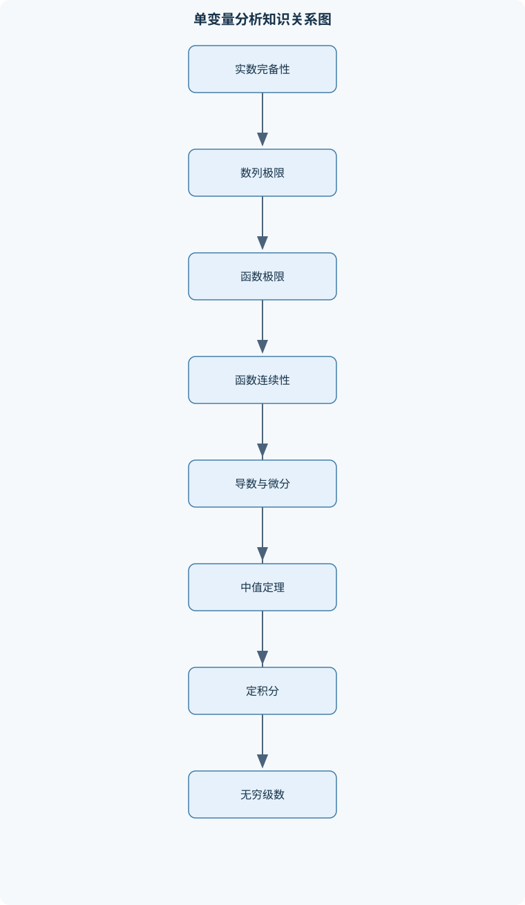
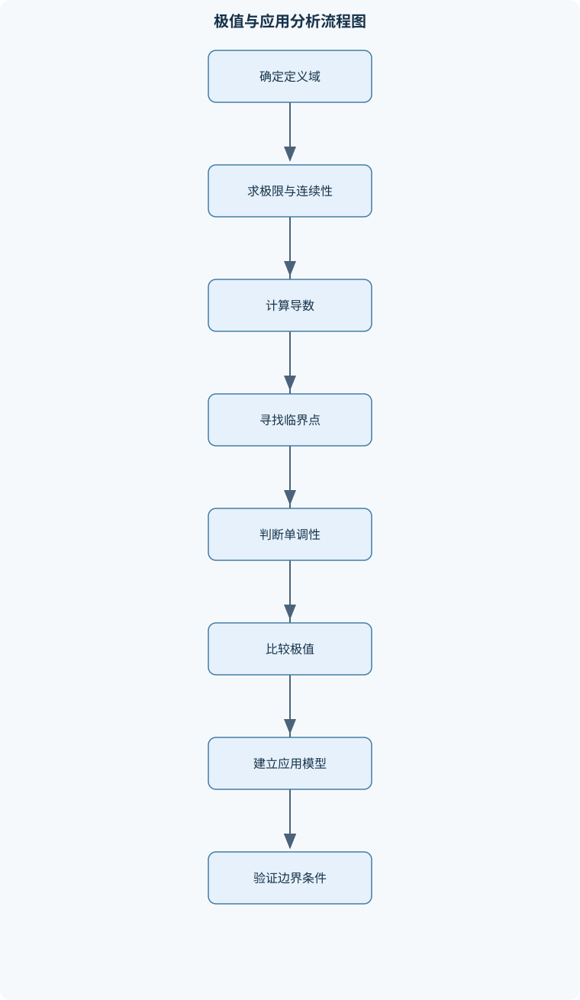

# 数学分析（甲）Ⅰ（H）

## 一、课程整体知识框架

### 课程边界与先修知识

本课程为单变量数学分析的第一阶段，研究实数体系上的函数、极限、连续性、微分、积分及无穷级数，强调定义、定理条件、严格证明和计算方法。主要对象是定义在实数区间或实数集子集上的实值函数，兼顾数列作为离散函数的极限理论。先修知识包括初等代数、不等式、集合与映射的基本概念、三角函数与指数对数函数的初步性质。课程不以多元微积分、常微分方程、测度论、复分析或流形理论为主要内容；涉及这些内容时仅说明其与单变量理论的边界关系。理想模型假设函数在给定区间上满足相应的定义域、连续性、可导性或可积性条件，现实计算中的数值误差、符号变形合法性和端点行为必须单独检查。





### 1. 研究对象与基本主线

《数学分析（甲）Ⅰ（H）》研究定义在实数集或其实数区间上的实值函数，并以数列作为离散函数研究极限。课程的核心不是孤立地记忆求导、积分和级数公式，而是建立一条由实数完备性支撑的逻辑链：

$$
\text{实数完备性}
\Longrightarrow
\text{数列极限}
\Longrightarrow
\text{函数极限与连续性}
\Longrightarrow
\text{导数与微分}
\Longrightarrow
\text{积分}
\Longrightarrow
\text{级数与函数展开}.
$$

实数集记为 $\mathbb R$，自然数集记为 $\mathbb N$。区间 $[a,b]$ 表示 $a\le x\le b$，开区间 $(a,b)$ 表示 $a<x<b$。绝对值 $|x-a|$ 是实数 $x$ 与 $a$ 之间的距离，因此不等式 $|x-a|<\delta$ 表示以 $a$ 为中心、半径为 $\delta>0$ 的邻域。区间、邻域和距离为极限定义提供了精确语言。

函数记为 $f:D\to\mathbb R$，其中 $D\subseteq\mathbb R$ 是定义域，$f(D)$ 是像集。函数的任何代数变形都必须保持定义域条件。例如 $\sqrt{x^2}=|x|$，不能在所有实数上写成 $\sqrt{x^2}=x$；$\ln(x^2)=2\ln|x|$ 仅在 $x\ne0$ 时有意义，而不能直接写成 $2\ln x$。函数的单调性、有界性、奇偶性和周期性描述的是整体或区间性质，必须明确考察区间。

### 2. 从极限到局部性质

数列 $(a_n)$ 是定义在 $\mathbb N$ 上的函数。数列收敛于 $A$ 的严格定义是：对任意 $\varepsilon>0$，存在 $N\in\mathbb N$，使得当 $n\ge N$ 时，

$$
|a_n-A|<\varepsilon.
$$

这里 $\varepsilon$ 是允许误差，不带单位时表示数值误差；若 $a_n$ 表示长度，则 $\varepsilon$ 也必须使用长度单位。极限只描述充分大的指标或充分接近的自变量行为，不要求每一项都等于极限。

函数极限 $\lim_{x\to x_0}f(x)=L$ 的邻域定义为：对任意 $\varepsilon>0$，存在 $\delta>0$，使得当 $x\in D$ 且 $0<|x-x_0|<\delta$ 时，

$$
|f(x)-L|<\varepsilon.
$$

条件 $x\in D$ 和 $x\ne x_0$ 不可省略。函数在 $x_0$ 处可以没有定义，仍可能存在极限；函数在 $x_0$ 有定义，也不代表极限等于函数值。双侧极限存在，当且仅当左极限和右极限都存在且相等。

连续性把“趋近时的函数行为”与“点上的函数值”连接起来。函数在 $x_0$ 连续，当且仅当 $f(x_0)$ 有定义且

$$
\lim_{x\to x_0}f(x)=f(x_0).
$$

连续函数可进行局部代入，但代入前仍须检查分母不为零、根式非负、对数真数为正等条件。连续性进一步产生介值性、有界性和最值存在性：在闭区间 $[a,b]$ 上连续的函数一定有界并取得最大值和最小值，但这些结论一般不能直接推广到开区间或无界区间。

### 3. 从局部线性化到全局变化

导数描述函数在一点附近的线性变化率。函数在 $x_0$ 处的导数定义为

$$
f'(x_0)=\lim_{h\to0}\frac{f(x_0+h)-f(x_0)}{h},
$$

其中 $h$ 是非零自变量增量。若 $x$ 表示时间、$f(x)$ 表示位移，则 $f'(x)$ 的单位是位移单位除以时间单位；若 $x$ 与 $f(x)$ 具有相同单位，则导数无量纲。可导必连续，但连续不必可导，例如 $f(x)=|x|$ 在 $0$ 处连续，而左导数为 $-1$、右导数为 $1$，因而不可导。

微分是增量的线性主部。若 $y=f(x)$ 在 $x$ 处可导，则

$$
\Delta y=f(x+\Delta x)-f(x)
=f'(x)\Delta x+o(\Delta x),
$$

其中 $o(\Delta x)/\Delta x\to0$。记 $\mathrm dx=\Delta x$ 的线性变量，则

$$
\mathrm dy=f'(x)\,\mathrm dx.
$$

$\mathrm dy$ 不等于有限增量 $\Delta y$，只有在 $\Delta x$ 足够小时，$\mathrm dy$ 才能作为 $\Delta y$ 的一阶近似。

微分中值定理把局部导数转化为整体增量。若 $f$ 在 $[a,b]$ 上连续、在 $(a,b)$ 上可导，则存在 $\xi\in(a,b)$ 使

$$
f(b)-f(a)=f'(\xi)(b-a).
$$

因此，若区间内 $f'(x)\ge0$，则 $f$ 单调不减；若 $f'(x)>0$，则通常可得到严格递增。极值分析必须检查导数为零的驻点、导数不存在的临界点以及定义域端点，不能只依赖二阶导数。

### 4. 从局部累积到定积分

定积分描述连续分布量的累积。将 $[a,b]$ 分割为小区间，取样点 $\xi_i$，形成黎曼和

$$
\sum_{i=1}^{n}f(\xi_i)\Delta x_i.
$$

当分割的最大长度趋于零且黎曼和趋于同一极限时，称 $f$ 在 $[a,b]$ 上黎曼可积，并记为

$$
\int_a^b f(x)\,\mathrm dx.
$$

连续函数在闭区间上必黎曼可积。定积分具有线性、区间可加性和保序性。例如若 $f(x)\le g(x)$，则

$$
\int_a^b f(x)\,\mathrm dx
\le
\int_a^b g(x)\,\mathrm dx.
$$

若 $f$ 表示线密度，$\mathrm dx$ 是长度微元，则积分结果是质量；若 $f$ 表示速度，积分结果是位移。因此应用公式必须检查单位。

若 $f$ 在 $[a,b]$ 上连续，定义

$$
F(x)=\int_a^x f(t)\,\mathrm dt,
$$

则由积分中值定理，

$$
\frac{F(x+h)-F(x)}{h}
=
\frac1h\int_x^{x+h}f(t)\,\mathrm dt
=f(\xi_h),
$$

其中 $\xi_h$ 位于 $x$ 与 $x+h$ 之间。由连续性得 $\xi_h\to x$，从而 $F'(x)=f(x)$。这说明微分与积分在适当条件下互为逆运算。

### 5. 从有限过程到无限过程

数项级数

$$
\sum_{n=1}^{\infty}a_n
$$

定义为部分和

$$
S_N=\sum_{n=1}^{N}a_n
$$

的极限。级数收敛当且仅当 $(S_N)$ 收敛。必要条件是 $a_n\to0$，但该条件不充分，因为调和级数 $\sum 1/n$ 的通项趋于零而级数发散。

函数项级数研究

$$
\sum_{n=1}^{\infty}f_n(x)
$$

在每个点的逐点收敛，以及误差能否在整个区间上一致控制的一致收敛。幂级数

$$
\sum_{n=0}^{\infty}a_n(x-x_0)^n
$$

存在收敛半径 $R\in[0,\infty]$：当 $|x-x_0|<R$ 时绝对收敛，当 $|x-x_0|>R$ 时发散，端点必须分别判断。只有在收敛半径内部，或已证明相应的一致收敛条件时，才能合法逐项求导或逐项积分。

## 二、章节和模块划分

### 核心知识覆盖清单

本清单用于检查正文是否覆盖本课程的主要知识模块：

- **实数系与函数基础**：实数的完备性与确界、区间与邻域、绝对值和距离、上确界与下确界、函数的定义域和值域、函数复合与反函数、单调性与有界性、初等函数性质。
- **数列与数列极限**：数列的定义与表示、收敛数列的严格定义、极限的唯一性、收敛数列的有界性、数列极限的四则运算、夹逼准则、单调有界收敛定理、子列与聚点、柯西收敛准则。
- **函数极限**：函数极限的邻域定义、左右极限、无穷小与无穷大、无穷远处的极限、极限的四则运算、复合函数极限、等价无穷小、极限存在的判别、渐近线与发散行为。
- **函数连续性**：点连续的定义、区间上的连续性、间断点分类、连续函数的局部性质、介值定理、零点存在定理、闭区间有界性、最大值最小值定理、一致连续性与海涅定理。
- **导数与微分**：导数的差商定义、单侧导数、可导与连续的关系、导数的四则运算、复合函数求导法则、反函数求导法则、基本初等函数导数、高阶导数、微分及其线性近似。
- **微分中值定理及其应用**：费马引理、罗尔定理、拉格朗日中值定理、柯西中值定理、单调性判别、极值与最值、凸性与拐点、洛必达法则、泰勒公式与余项、函数作图的理论依据。
- **不定积分与原函数**：原函数的定义、不定积分记号、基本积分公式、换元积分法、分部积分法、有理函数积分、三角函数积分、含根式函数积分、积分常数与定义域。
- **定积分与微积分基本定理**：区间分割与积分和、黎曼可积性、可积函数的基本性质、连续函数的可积性、定积分的线性与区间可加性、积分中值定理、变上限积分函数、微积分基本定理、换元积分法、分部积分法。
- **定积分的应用**：平面图形面积、曲线弧长、旋转体体积、截面面积法、参数方程下的积分、极坐标下的面积、物理量的积分模型、平均值与加权平均、应用公式的单位检查。
- **数项级数**：级数与部分和、级数收敛的柯西准则、正项级数、比较判别法、极限比较判别法、比值判别法、根值判别法、积分判别法、交错级数与莱布尼茨判别法、绝对收敛与条件收敛。
- **函数项级数与幂级数**：函数项级数的逐点收敛、一致收敛的基本思想、一致收敛与连续性、幂级数收敛半径、幂级数端点判断、幂级数逐项求导、幂级数逐项积分、泰勒级数、常见函数的幂级数展开。


### 1. 实数系与函数基础

实数的完备性可用确界性质表达：任何非空且有上界的实数集合都有上确界。以

$$
A=\{x\in\mathbb R:x^2<2\}
$$

为例，集合非空，因为 $1\in A$；它有上界，例如 $2$ 是上界，因为 $x>2$ 时 $x^2>2$。令 $s=\sup A$。若 $s^2<2$，可取足够小的 $h>0$，使 $(s+h)^2<2$，则 $s+h\in A$，与 $s$ 为上界矛盾；若 $s^2>2$，可取足够小的 $h>0$，使 $(s-h)^2>2$，则所有满足 $x^2<2$ 的正数都不超过 $s-h$，与 $s$ 为最小上界矛盾。因此 $s^2=2$，即 $s=\sqrt2$。

函数模块包括定义域、值域、复合函数和反函数。复合函数 $g\circ f$ 的定义域必须满足 $x\in D_f$ 且 $f(x)\in D_g$。函数存在反函数的必要条件是单射；连续严格单调函数在其值域上具有反函数。单调函数不必连续，例如阶梯函数可单调但有跳跃；有界函数也不必取得上界或下界，例如 $f(x)=x$ 在 $(0,1)$ 上有界，却不取得最大值 $1$。

### 2. 数列与数列极限

收敛数列的极限唯一。若 $a_n\to A$ 且 $a_n\to B$，取 $\varepsilon=|A-B|/3$，当 $n$ 足够大时同时有 $|a_n-A|<\varepsilon$ 和 $|a_n-B|<\varepsilon$，于是

$$
|A-B|\le |A-a_n|+|a_n-B|<2\varepsilon,
$$

矛盾，除非 $A=B$。收敛数列必有界，因为尾项落在 $A$ 的有限邻域内，而前面只有有限项。

极限四则运算由误差分解得到。例如

$$
a_nb_n-AB=a_n(b_n-B)+B(a_n-A),
$$

若 $(a_n)$、$(b_n)$ 收敛，则它们有界，右侧两项均趋于零，所以 $a_nb_n\to AB$；商法则还要求 $B\ne0$，以保证分母最终不为零。

单调有界收敛定理依赖实数完备性。若 $(a_n)$ 单调递增且有上界，令 $s=\sup\{a_n:n\in\mathbb N\}$。对任意 $\varepsilon>0$，$s-\varepsilon$ 不是上界，故存在 $N$ 使 $a_N>s-\varepsilon$。单调性给出 $s-\varepsilon<a_n\le s$，所以 $a_n\to s$。子列可用于证明发散：若一个数列有两个子列分别趋于不同极限，则原数列不收敛。柯西准则则不预先给出极限值，而要求对任意 $\varepsilon>0$，存在 $N$ 使 $m,n\ge N$ 时 $|a_m-a_n|<\varepsilon$；实数的完备性保证每个柯西数列收敛。

**例题 1：** 求并证明

$$
a_n=\frac{3n^2-1}{n^2+2n+5}
$$

的极限。

**分析与解答：** 分子分母同除以 $n^2$：

$$
a_n=\frac{3-\frac1{n^2}}{1+\frac2n+\frac5{n^2}}.
$$

由于 $1/n\to0$，由极限四则运算得 $a_n\to3$。严格验证时，先将 $a_n-3$ 化为

$$
a_n-3=\frac{-6n-16}{n^2+2n+5}.
$$

当 $n$ 足够大时，分母至少为 $n^2$，故

$$
|a_n-3|\le \frac{6n+16}{n^2}
=\frac6n+\frac{16}{n^2}\to0.
$$

结果验证：分子分母最高次均为二次，极限应等于最高次项系数之比 $3$。变式是将分母最高次项改为零；此时不能沿用该结论，必须重新比较增长阶。

### 3. 函数极限

函数极限的计算可使用因式分解、有理化、夹逼、等价无穷小和泰勒展开。等价无穷小 $u(x)\sim v(x)$ 的含义是 $u(x)/v(x)\to1$，适用于乘法、除法和非零因子的替换；在相减导致主项抵消时不能直接替换。例如 $\sin x\sim x$，但不能据此认为 $\sin x-x\sim x-x=0$。此时需保留高阶项：

$$
\sin x=x-\frac{x^3}{6}+o(x^3),
$$

所以

$$
\lim_{x\to0}\frac{\sin x-x}{x^3}=-\frac16.
$$

无穷远处极限研究 $x$ 的绝对值无限增大时的行为。若 $f(x)\to L$，可称直线 $y=L$ 为水平渐近线；若 $f(x)\to\infty$，则可能存在垂直渐近线，但必须区分左右行为。例如 $1/x$ 在 $0$ 的左右极限分别为 $-\infty$ 和 $+\infty$，双侧无穷极限不能写成同一个符号。

### 4. 函数连续性

间断点可分为可去间断、跳跃间断和无穷间断等。若左右极限相等且有限，但函数值缺失或不等于该极限，则为可去间断；若左右极限存在但不等，则为跳跃间断；若至少一侧函数值无界，则为无穷间断。

介值定理要求 $f$ 在闭区间 $[a,b]$ 连续。若 $f(a)<\eta<f(b)$，则存在 $c\in(a,b)$ 使 $f(c)=\eta$。零点定理是其特例：若 $f(a)f(b)<0$，则至少存在 $c$ 使 $f(c)=0$。证明的关键是构造端点不断逼近的区间，并利用上确界或区间套保证极限点存在。闭区间连续函数有界并取得最值；在 $(a,b)$ 上连续则不能直接推出最值存在，例如 $f(x)=x$ 不在该开区间取得上确界。

一致连续性要求同一个 $\delta$ 对区间内所有点同时有效，而普通连续性允许 $\delta$ 依赖于点。闭区间上的连续函数一致连续；海涅定理表明，在集合上连续函数一致连续，当且仅当对任意两个趋于同一点的数列，其函数值之差趋于零。

### 5. 导数与微分

基本求导法则由导数定义推出。乘积法则为

$$
(fg)'=f'g+fg',
$$

因为

$$
\frac{f(x+h)g(x+h)-f(x)g(x)}h
=
f(x+h)\frac{g(x+h)-g(x)}h
+g(x)\frac{f(x+h)-f(x)}h.
$$

链式法则为

$$
(g\circ f)'(x)=g'(f(x))f'(x),
$$

要求 $f$ 在 $x$ 处可导、$g$ 在 $f(x)$ 处可导。商法则要求分母在考察点不为零，并在邻域内保持非零。反函数求导要求 $f$ 可导且 $f'(x_0)\ne0$，此时

$$
(f^{-1})'(y_0)=\frac1{f'(x_0)},\qquad y_0=f(x_0).
$$

基本初等函数包括幂函数、指数函数、对数函数、三角函数及反三角函数；复合时必须同步使用链式法则。高阶导数 $f^{(n)}$ 要求前面的各阶导数存在。端点通常只能讨论单侧导数，分段函数的拼接点必须比较左右导数。

### 6. 微分中值定理及其应用

费马引理说明：若 $f$ 在内点 $c$ 取得局部极值且在 $c$ 可导，则 $f'(c)=0$。罗尔定理在端点函数值相等时给出某个 $\xi$ 使 $f'(\xi)=0$。拉格朗日中值定理可由

$$
F(x)=f(x)-f(a)-\frac{f(b)-f(a)}{b-a}(x-a)
$$

构造得到。由于 $F(a)=F(b)$，罗尔定理给出

$$
f'(\xi)=\frac{f(b)-f(a)}{b-a}.
$$

柯西中值定理是其推广：若 $g'(\xi)\ne0$，则

$$
\frac{f(b)-f(a)}{g(b)-g(a)}
=
\frac{f'(\xi)}{g'(\xi)}.
$$

洛必达法则仅适用于 $0/0$ 型或无穷比值型，并要求相关函数在邻域内可导、分母导数不为零，且导数比的极限存在。形式上出现 $0/0$ 不能单独构成使用理由。

泰勒公式为

$$
f(x)=\sum_{k=0}^{n}\frac{f^{(k)}(a)}{k!}(x-a)^k+R_n(x),
$$

其中拉格朗日余项为

$$
R_n(x)=\frac{f^{(n+1)}(\xi)}{(n+1)!}(x-a)^{n+1},
$$

$\xi$ 位于 $a$ 与 $x$ 之间。若能估计 $|f^{(n+1)}(\xi)|\le M$，则

$$
|R_n(x)|\le\frac{M|x-a|^{n+1}}{(n+1)!}.
$$

凸性可由 $f''\ge0$ 判定；拐点不仅要求二阶导数为零，还要求凹凸性发生改变。

**例题 2：** 证明 $x>0$ 时

$$
\frac{x}{1+x}<\ln(1+x)<x.
$$

**分析与解答：** 令 $f(t)=\ln(1+t)$。在 $[0,x]$ 上连续、在 $(0,x)$ 上可导。由拉格朗日中值定理，存在 $\xi\in(0,x)$ 使

$$
\ln(1+x)-\ln1=\frac{x}{1+\xi}.
$$

因 $0<\xi<x$，有

$$
\frac1{1+x}<\frac1{1+\xi}<1.
$$

乘以 $x>0$ 得结论。结果验证：当 $x\to0^+$ 时，三者都与 $x$ 同阶。变式是证明 $\ln(1+x)<x$，可直接令 $h(t)=t-\ln(1+t)$，验证 $h'(t)=t/(1+t)>0$。

### 7. 不定积分与原函数

若 $F'(x)=f(x)$，则称 $F$ 是 $f$ 的一个原函数。不定积分表示同一连通定义域上的全部原函数：

$$
\int f(x)\,\mathrm dx=F(x)+C.
$$

若定义域不连通，积分常数可能在不同连通分支上分别取值。换元积分要求同时替换表达式和微分；定积分换元还必须替换上下限。分部积分公式由乘积求导得到：

$$
\int u\,\mathrm dv=uv-\int v\,\mathrm du.
$$

有理函数通常先作部分分式分解；含根式函数可尝试代换消去根号；三角函数积分应根据幂的奇偶性使用恒等式。所得原函数必须在原定义域内验证，不能忽略 $\ln|x|$ 中绝对值或分母为零的点。

### 8. 定积分与微积分基本定理

定积分的线性、区间可加性和保序性均可从黎曼和逐项传递得到：

$$
\int_a^b(\alpha f+\beta g)\,\mathrm dx
=
\alpha\int_a^b f\,\mathrm dx+\beta\int_a^b g\,\mathrm dx,
$$

$$
\int_a^b f\,\mathrm dx+\int_b^c f\,\mathrm dx
=
\int_a^c f\,\mathrm dx.
$$

积分中值定理说明，若 $f$ 在 $[a,b]$ 连续，则存在 $\xi\in[a,b]$ 使

$$
\int_a^b f(x)\,\mathrm dx=f(\xi)(b-a).
$$

若 $F(x)=\int_a^x f(t)\,\mathrm dt$，则 $F'(x)=f(x)$；若 $G'=f$，则

$$
\int_a^b f(x)\,\mathrm dx=G(b)-G(a).
$$

后一个公式使用时要求 $G$ 在区间上可导且导数可积，端点和间断点必须单独检查。

**例题 3：** 计算

$$
\int_0^1x\ln(1+x)\,\mathrm dx.
$$

**分析与解答：** 取 $u=\ln(1+x)$，$\mathrm dv=x\,\mathrm dx$，则 $\mathrm du=\mathrm dx/(1+x)$，$v=x^2/2$。于是

$$
\int_0^1x\ln(1+x)\,\mathrm dx
=
\left.\frac{x^2}{2}\ln(1+x)\right|_0^1
-\frac12\int_0^1\frac{x^2}{1+x}\,\mathrm dx.
$$

作除法：

$$
\frac{x^2}{1+x}=x-1+\frac1{1+x}.
$$

所以

$$
\int_0^1x\ln(1+x)\,\mathrm dx
=
\frac12\ln2-\frac12\left(\frac12-1+\ln2\right)
=\frac14.
$$

结果验证：被积函数在 $[0,1]$ 上非负，积分结果应非负；且 $x\ln(1+x)\le x^2$，故积分不超过 $1/3$，而 $1/4$ 满足该范围。变式是将上限改为 $b>0$，需保留关于 $b$ 的表达式并检查 $b$ 的取值范围。

### 9. 定积分的应用

平面区域面积应先确定上下边界和交点。若 $f(x)\ge g(x)$，则面积为

$$
A=\int_a^b[f(x)-g(x)]\,\mathrm dx.
$$

曲线绕 $x$ 轴旋转的体积可用圆盘或圆环法：

$$
V=\pi\int_a^b R(x)^2\,\mathrm dx
$$

或

$$
V=\pi\int_a^b\bigl(R(x)^2-r(x)^2\bigr)\,\mathrm dx.
$$

弧长公式

$$
L=\int_a^b\sqrt{1+[f'(x)]^2}\,\mathrm dx
$$

要求曲线可导且弧长积分存在。参数方程 $x=x(t),y=y(t)$ 下，面积、弧长和旋转体公式必须包含 $\mathrm dx=x'(t)\mathrm dt$ 或相应参数因子；极坐标面积为

$$
A=\frac12\int_\alpha^\beta r(\theta)^2\,\mathrm d\theta.
$$

平均值为 $\frac1{b-a}\int_a^b f(x)\,\mathrm dx$；若存在密度 $\rho(x)$，加权平均应为

$$
\frac{\int_a^b f(x)\rho(x)\,\mathrm dx}{\int_a^b\rho(x)\,\mathrm dx}.
$$

**例题 4：** 求 $y=x^2$ 与 $y=x$ 围成的面积及该区域绕 $x$ 轴旋转的体积。

**分析与解答：** 交点满足 $x^2=x$，得 $x=0,1$。在 $[0,1]$ 上，$x\ge x^2$，因此

$$
A=\int_0^1(x-x^2)\,\mathrm dx
=\frac12-\frac13=\frac16.
$$

绕 $x$ 轴旋转时，上半径为 $x$，下半径为 $x^2$，所以

$$
V=\pi\int_0^1(x^2-x^4)\,\mathrm dx
=\pi\left(\frac13-\frac15\right)
=\frac{2\pi}{15}.
$$

结果验证：面积单位是长度平方，体积单位是长度立方；若误把面积积分中的高度直接平方而不区分上下半径，会得到错误模型。变式是绕 $y$ 轴旋转，此时可使用柱壳法，微元体积为 $2\pi x(x-x^2)\,\mathrm dx$。

### 10. 数项级数

正项级数可用比较判别、极限比较、比值、根值和积分判别。若 $0\le a_n\le b_n$ 且 $\sum b_n$ 收敛，则 $\sum a_n$ 收敛；若 $a_n/b_n\to c$ 且 $0<c<\infty$，两级数同敛散。比值判别中若

$$
\limsup_{n\to\infty}\left|\frac{a_{n+1}}{a_n}\right|<1,
$$

则选取 $q<1$，使充分大时 $|a_{n+1}|\le q|a_n|$，递推得 $|a_n|\le Cq^n$，再与几何级数比较。若比值大于 $1$，则一般发散；等于 $1$ 时不能判定。

交错级数 $\sum(-1)^{n-1}b_n$ 在 $b_n\ge0$、$b_n$ 单调递减且趋于零时收敛，余项绝对值不超过下一项。绝对收敛指 $\sum|a_n|$ 收敛，绝对收敛必收敛；仅原级数收敛而绝对值级数发散，称条件收敛。

**例题 5：** 判断

$$
\sum_{n=1}^{\infty}\frac{n^2+1}{n^4+3n+1}
$$

的收敛性。

**分析与解答：** 与 $1/n^2$ 作极限比较：

$$
\lim_{n\to\infty}
\frac{(n^2+1)/(n^4+3n+1)}{1/n^2}
=
\lim_{n\to\infty}
\frac{n^4+n^2}{n^4+3n+1}=1.
$$

由于 $\sum1/n^2$ 收敛，原正项级数收敛。结果验证：通项约为 $1/n^2$，而不是仅凭通项趋零作出结论。变式若分母最高次改为 $n^3$，通项约为 $1/n$，则应与调和级数比较而发散。

### 11. 函数项级数与幂级数

逐点收敛允许不同的 $x$ 使用不同的收敛速度；一致收敛要求存在只依赖误差而不依赖 $x$ 的统一指标。若 $f_n\to f$ 一致收敛且每个 $f_n$ 在区间上连续，则 $f$ 连续。幂级数的收敛半径可由比值或根值判别求出，端点必须单独检验。

例如

$$
\sum_{n=1}^{\infty}\frac{(x-2)^n}{n3^n}
$$

的通项绝对值为 $|x-2|^n/(n3^n)$，比值极限为 $|x-2|/3$，故收敛半径 $R=3$。内部 $|x-2|<3$ 即 $-1<x<5$ 时绝对收敛；端点 $x=-1$ 给出 $\sum(-1)^n/n$，收敛但非绝对收敛；端点 $x=5$ 给出 $\sum1/n$，发散。因此收敛域为 $[-1,5)$。

在任意 $r<R$ 上，幂级数及其逐项导数、逐项积分具有一致收敛性质，可合法写成

$$
\frac{\mathrm d}{\mathrm dx}
\sum_{n=0}^{\infty}a_n(x-x_0)^n
=
\sum_{n=1}^{\infty}na_n(x-x_0)^{n-1},
$$

以及

$$
\int\sum_{n=0}^{\infty}a_n(x-x_0)^n\,\mathrm dx
=
C+\sum_{n=0}^{\infty}
\frac{a_n}{n+1}(x-x_0)^{n+1}.
$$

常见展开包括

$$
e^x=\sum_{n=0}^{\infty}\frac{x^n}{n!},\qquad
\sin x=\sum_{n=0}^{\infty}(-1)^n\frac{x^{2n+1}}{(2n+1)!},
$$

$$
\ln(1+x)=\sum_{n=1}^{\infty}(-1)^{n-1}\frac{x^n}{n},
\quad -1<x\le1.
$$

最后一个展开在 $x=-1$ 处发散，在 $x=1$ 处条件收敛，不能把内部收敛结论无条件延伸到端点。

### 12. 代表性算法与流程

#### 12.1 极限严格验证流程

**输入：** 函数 $f$、趋近点 $x_0$、候选极限 $L$。  
**输出：** 极限结论及成立条件。  
**过程：**

1. 检查 $x$ 是否属于定义域，判断是双侧、左侧、右侧还是无穷远极限。
2. 先尝试因式分解、有理化、等价无穷小、夹逼或泰勒展开。
3. 若需严格证明，固定任意 $\varepsilon>0$，估计 $|f(x)-L|$。
4. 构造 $\delta(\varepsilon)>0$，使 $0<|x-x_0|<\delta$ 时误差小于 $\varepsilon$。
5. 若左右估计不一致，分别计算左右极限；不相等则双侧极限不存在。

不变量是始终保持 $x$ 位于函数定义域内且不把 $x=x_0$ 强行代入。严格证明的终止条件是完成 $\varepsilon$—$\delta$ 估计，或证明左右极限不同。

#### 12.2 极值与单调区间流程

**输入：** 函数 $f$ 及定义域，必要时给定闭区间 $[a,b]$。  
**输出：** 单调区间、局部极值和绝对最值。  
**过程：**

1. 求出定义域，检查端点和分段点。
2. 求导并列出 $f'(x)=0$ 的驻点及导数不存在的临界点。
3. 用这些点分割定义域，判断各区间导数符号。
4. 若求闭区间绝对最值，计算所有临界点和端点的函数值。
5. 比较函数值，给出取值点和最值。

适用条件是函数在分析区间内具有相应导数；端点不需要具有双侧导数。若函数在临界点不可导，不能跳过该点。

#### 12.3 级数判别流程

**输入：** $\sum a_n$。  
**输出：** 收敛、发散、绝对收敛或条件收敛。  
**过程：**

1. 先检查 $a_n\to0$；若不成立，级数必发散。
2. 正项级数优先使用比较、极限比较、积分、比值或根值判别。
3. 含正负号时先检查 $\sum|a_n|$。
4. 若不绝对收敛，再检查交错条件或其他收敛准则。
5. 对判别结果进行边界和参数范围核验。

判别法只在其前提成立时有效；通项趋零不能反推级数收敛。

#### 12.4 幂级数收敛域流程

**输入：** $\sum a_n(x-x_0)^n$。  
**输出：** 收敛半径、收敛区间及端点类型。  
**过程：**

1. 对通项应用比值或根值判别，得到 $|x-x_0|<R$。
2. 写出内部绝对收敛区间和外部发散区间。
3. 分别代入 $x=x_0-R$ 与 $x=x_0+R$。
4. 使用调和级数、交错级数或比较判别判断端点。
5. 只有在 $|x-x_0|<R$ 内，或另有一致收敛证明时，才进行逐项求导和积分。

### 13. 可执行的计算核验代码

以下代码只用于有限项数值估计，不能替代严格的收敛证明。它计算幂级数部分和，并同时输出项的绝对值，便于观察截断误差的可能大小。

```python
import math

def power_series_partial_sum(x, center, n_terms):
    """
    计算 sum_{n=1}^{n_terms} (x-center)^n / (n * 3^n)
    输入：
        x: 自变量，无量纲实数
        center: 幂级数中心
        n_terms: 正整数，截断项数
    输出：
        partial_sum: 部分和
        last_term: 最后一项
    """
    if n_terms < 1:
        raise ValueError("n_terms 必须为正整数")

    partial_sum = 0.0
    last_term = 0.0

    for n in range(1, n_terms + 1):
        last_term = (x - center) ** n / (n * 3 ** n)
        partial_sum += last_term

    return partial_sum, last_term

s, term = power_series_partial_sum(1.0, 2.0, 1000)
print("部分和 =", s)
print("最后一项 =", term)
```

输入中的 `x` 和 `center` 必须使用相同单位；若它们表示带单位的物理量，幂级数中的 $(x-center)^n$ 还需先进行无量纲化。程序的终止条件是达到指定项数，不代表已经达到理论误差要求；若要保证误差，必须结合余项估计或相应收敛判别。

### 14. 实验与项目一：数列收敛的数值观察

**目标：** 比较单调收敛、振荡收敛和发散数列的数值行为。

**输入数据：**

$$
a_n=\frac{3n^2-1}{n^2+2n+5},\qquad
b_n=(-1)^n\frac1n,\qquad
c_n=\frac{n+1}{n}.
$$

**步骤：**

1. 计算 $n=1,2,\ldots,1000$ 的前三个数列值。
2. 分别绘制或列表记录 $|a_n-3|$、$|b_n|$ 和 $|c_n-1|$。
3. 检查 $a_n$ 是否最终靠近 $3$，$b_n$ 是否趋于 $0$ 但发生符号交替，$c_n$ 是否趋于 $1$。
4. 另计算部分和 $\sum_{n=1}^Nc_n$，观察其增长而非收敛。

**评价标准：** 能区分“数列收敛”和“级数收敛”；能说明有限项数值只能提供证据，不能替代 $\varepsilon$—$N$ 证明；误差表应与理论阶数一致。

**排错方法：** 若误把 $b_n$ 的趋零当作 $\sum b_n$ 的收敛，应计算部分和；若程序显示误差停止下降，应检查浮点舍入、整数除法和是否将 $n$ 从零开始。

### 15. 实验与项目二：定积分的黎曼和近似

**目标：** 用左端点、右端点和中点黎曼和近似

$$
\int_0^1 x^2\,\mathrm dx=\frac13.
$$

**输入数据：** 分割数 $N=10,20,50,100$，区间 $[0,1]$，函数 $f(x)=x^2$。

**步骤：**

1. 令 $\Delta x=1/N$，构造 $N$ 个等长小区间。
2. 分别取左端点、右端点和中点作为样本点。
3. 计算三种黎曼和
   $$
   S_N=\sum_{i=1}^{N}f(\xi_i)\Delta x.
   $$
4. 将结果与 $1/3$ 比较，记录绝对误差。
5. 增大 $N$，观察误差是否趋于零。

**评价标准：** 三种方法均应趋于 $1/3$；由于 $x^2$ 在区间上递增，左端点和应不超过积分，右端点和应不小于积分；中点法的误差通常更小，但数值现象本身不能代替可积性证明。

**排错方法：** 若左和大于右和，检查样本点索引；若误差不随 $N$ 减小，检查是否漏乘 $\Delta x$；若结果出现负值，检查函数值或区间方向。若交换积分上下限，则应满足

$$
\int_1^0x^2\,\mathrm dx=-\int_0^1x^2\,\mathrm dx.
$$

## 三、核心概念的详细解释

### 1. 实数体系、区间与函数

实数集 $\mathbb R$ 不仅具有加法、乘法和大小关系，还具有完备性。完备性的一个基本表述是：任何非空且有上界的实数集合都有上确界。若集合 $A\subset\mathbb R$ 非空，且存在 $M$ 使得对所有 $x\in A$ 都有 $x\le M$，则存在最小的上界 $s$，记为 $s=\sup A$。这里“最小”意味着 $s$ 是上界，且任何小于 $s$ 的数都不是上界。下确界 $\inf A$ 的定义相应地由“最大下界”给出。

例如，集合
$$
A=\{x\in\mathbb R:x^2<2\}
$$
非空，因为 $0\in A$；它有上界，例如 $2$ 是上界。若 $s=\sup A$，则可以证明 $s^2=2$：若 $s^2<2$，由平方函数的连续性可找到略大于 $s$ 的数仍满足平方小于 $2$，这与 $s$ 是上界矛盾；若 $s^2>2$，则可找到略小于 $s$ 的上界，和上确界的最小性矛盾。因此 $s=\sqrt2$。这一论证体现了实数完备性在极限理论中的作用。

区间是实数中最基本的邻域结构。开区间 $(a,b)$ 不包含端点，闭区间 $[a,b]$ 包含端点，半开区间如 $(a,b]$ 只包含一个端点。点 $a$ 的 $\delta$ 邻域为
$$
U(a,\delta)=\{x\in\mathbb R:|x-a|<\delta\}.
$$
在函数极限中，通常还要排除点本身，即使用穿孔邻域 $0<|x-a|<\delta$。若考察的是定义域 $D$ 上的函数，则所有趋近点必须满足 $x\in D$。

函数 $f:D\to\mathbb R$ 是一种确定的对应关系：每个 $x\in D$ 恰有一个实数 $f(x)$ 与之对应。定义域决定表达式在哪些点有意义，值域是像集
$$
f(D)=\{f(x):x\in D\}.
$$
例如 $f(x)=\sqrt{1-x^2}$ 的定义域是 $[-1,1]$，值域也是 $[0,1]$；不能仅根据代数表达式忽略根式非负条件。

复合函数 $g\circ f$ 定义为
$$
(g\circ f)(x)=g(f(x)),
$$
其定义域不仅要求 $x\in D_f$，还要求 $f(x)\in D_g$。若函数一一对应于其值域，则可定义反函数 $f^{-1}$，满足
$$
f^{-1}(f(x))=x,\qquad f(f^{-1}(y))=y.
$$
严格单调函数在其定义域上必为一一函数，因此可在值域上建立反函数。反函数图像关于直线 $y=x$ 对称，但这并不意味着任意函数都有反函数。例如 $f(x)=x^2$ 在 $\mathbb R$ 上不是一一的，限制到 $[0,\infty)$ 后才有反函数 $\sqrt x$。

### 2. 数列极限与实数完备性

数列 $(a_n)$ 是定义在 $\mathbb N$ 上的函数。数列收敛于 $A$ 的定义是：对任意 $\varepsilon>0$，存在 $N\in\mathbb N$，使得当 $n\ge N$ 时，
$$
|a_n-A|<\varepsilon.
$$
其中 $\varepsilon$ 与 $a_n$、$A$ 使用相同单位。这个定义只要求从某一项以后满足误差条件，有限个前项不影响极限。

极限具有唯一性。若 $(a_n)$ 同时收敛于 $A$ 和 $B$，取 $\varepsilon=|A-B|/3$，则充分大的 $n$ 同时满足
$$
|a_n-A|<\frac{|A-B|}{3},\qquad
|a_n-B|<\frac{|A-B|}{3}.
$$
由三角不等式，
$$
|A-B|\le |A-a_n|+|a_n-B|<\frac{2|A-B|}{3},
$$
只能有 $A=B$。

收敛数列必有界。若 $a_n\to A$，取 $\varepsilon=1$，则存在 $N$ 使得 $n\ge N$ 时 $|a_n-A|<1$，所以后半部分数列位于 $(A-1,A+1)$ 内；前 $N-1$ 项是有限个实数，也有最大绝对值，故整个数列有界。反之，有界不意味着收敛，例如 $a_n=(-1)^n$ 有界但不收敛。

数列极限满足四则运算。若 $a_n\to A$、$b_n\to B$，则
$$
a_n+b_n\to A+B,\qquad a_n-b_n\to A-B,\qquad a_nb_n\to AB.
$$
若 $B\ne0$，则
$$
\frac{a_n}{b_n}\to\frac AB.
$$
商法则中 $B\ne0$ 是必要条件，因为当 $b_n\to0$ 时，商可能收敛、发散或振荡。

夹逼准则指出，若从某项起有
$$
a_n\le b_n\le c_n,
$$
且 $a_n\to L$、$c_n\to L$，则 $b_n\to L$。其核心是：给定 $\varepsilon>0$，充分大时 $a_n$ 和 $c_n$ 都落在 $(L-\varepsilon,L+\varepsilon)$ 内，中间的 $b_n$ 也必落在该区间内。

单调有界数列收敛。例如 $(a_n)$ 单调递增且有上界，令
$$
s=\sup\{a_n:n\in\mathbb N\}.
$$
对任意 $\varepsilon>0$，$s-\varepsilon$ 不是上界，因此存在 $N$ 使得 $a_N>s-\varepsilon$。单调性给出当 $n\ge N$ 时
$$
s-\varepsilon<a_N\le a_n\le s,
$$
从而 $|a_n-s|<\varepsilon$，即 $a_n\to s$。单调递减且有下界的情形类似。

子列是从原数列中按严格递增指标抽取的数列 $(a_{n_k})$，其中 $n_1<n_2<\cdots$。若原数列收敛于 $A$，则任何子列也收敛于 $A$。因此，若能找到两个子列分别趋于不同的值，原数列必不收敛。柯西准则给出另一种判别：实数列收敛，当且仅当对任意 $\varepsilon>0$，存在 $N$，使得 $m,n\ge N$ 时
$$
|a_m-a_n|<\varepsilon.
$$
这一定理的“仅当”来自极限的三角不等式，“当”则依赖实数的完备性。

### 3. 函数极限、无穷小与渐近行为

函数极限
$$
\lim_{x\to x_0}f(x)=L
$$
的严格定义是：对任意 $\varepsilon>0$，存在 $\delta>0$，使得当 $x\in D$ 且 $0<|x-x_0|<\delta$ 时，
$$
|f(x)-L|<\varepsilon.
$$
极限不要求 $f(x_0)$ 有定义，也不要求 $f(x_0)=L$。例如
$$
f(x)=\frac{x^2-1}{x-1},\quad x\ne1
$$
在 $x=1$ 未定义，但
$$
\lim_{x\to1}f(x)=\lim_{x\to1}(x+1)=2.
$$

双侧极限存在，当且仅当左极限与右极限都存在且相等：
$$
\lim_{x\to x_0}f(x)=L
\Longleftrightarrow
\lim_{x\to x_0^-}f(x)=\lim_{x\to x_0^+}f(x)=L.
$$
若左右极限不相等，双侧极限不存在。若函数在某侧趋于无穷大，例如
$$
\lim_{x\to x_0^+}f(x)=+\infty,
$$
表示对任意 $M>0$，存在 $\delta>0$，使 $0<x-x_0<\delta$ 时 $f(x)>M$。这不是实数意义下的有限极限。

若 $\alpha(x)\to0$，称 $\alpha(x)$ 为 $x\to x_0$ 时的无穷小。若 $\beta(x)\to\infty$，称其为无穷大。无穷小的倒数在不为零且符号稳定时表现为无穷大，但“无穷小的倒数”不是一个实数。

若
$$
\lim_{x\to x_0}\frac{\alpha(x)}{\beta(x)}=1,
$$
则称 $\alpha$ 与 $\beta$ 等价，记为 $\alpha\sim\beta$。例如
$$
\sin x\sim x,\qquad 1-\cos x\sim\frac{x^2}{2}\quad (x\to0).
$$
等价无穷小可用于乘法和除法中的替换，但在相减时必须谨慎。例如 $\sin x\sim x$，却不能据此判断 $\sin x-x$ 的高阶行为，因为主项发生了消去。

无穷远处的极限研究 $x$ 的绝对值无限增大时的行为。例如
$$
\lim_{x\to\infty}\frac{2x^2+1}{x^2-3x+4}=2.
$$
若
$$
\lim_{x\to\infty}f(x)=L,
$$
则直线 $y=L$ 是函数在无穷远处的水平渐近线；若 $f(x)\to\pm\infty$ 当 $x\to a^\pm$，则 $x=a$ 是相应方向的垂直渐近线。

### 4. 连续性与一致连续性

函数在 $x_0$ 处连续，要求三项同时成立：
1. $f(x_0)$ 有定义；
2. $\lim_{x\to x_0}f(x)$ 存在；
3. $\lim_{x\to x_0}f(x)=f(x_0)$。

连续性也可写成序列形式：对定义域中任意满足 $x_n\to x_0$ 的数列，都有 $f(x_n)\to f(x_0)$，这称为海涅连续性判据。

间断点通常分为可去间断、跳跃间断和无穷间断。若左右极限相等且为有限值，但函数值缺失或不等于该极限，是可去间断；若左右极限均存在但不相等，是跳跃间断；若至少一侧趋于无穷，是无穷间断。连续函数不一定可导，例如 $f(x)=|x|$ 在 $0$ 处连续，但左右导数分别为 $-1$ 和 $1$。

若 $f$ 在 $[a,b]$ 上连续，则具有介值性：对任意介于 $f(a)$ 与 $f(b)$ 之间的数 $\eta$，存在 $c\in[a,b]$ 使 $f(c)=\eta$。特别地，若 $f(a)f(b)<0$，则存在 $c\in(a,b)$ 使 $f(c)=0$，这就是零点存在定理。介值定理只保证存在性，不保证零点唯一；若函数还严格单调，零点才至多一个。

闭区间上的连续函数有界，并取得最大值和最小值。闭区间条件不可随意删除。例如 $f(x)=1/x$ 在 $(0,1)$ 上连续却无界；$f(x)=x$ 在 $(0,1)$ 上连续且有界，但不取得最大值和最小值。

一致连续性比逐点连续性更强。函数在集合 $D$ 上一致连续，是指对任意 $\varepsilon>0$，存在只依赖于 $\varepsilon$ 而与点的位置无关的 $\delta>0$，使得任意 $x,y\in D$ 满足 $|x-y|<\delta$ 时都有
$$
|f(x)-f(y)|<\varepsilon.
$$
连续函数在闭区间上必一致连续，但在开区间或无界区间上未必。例如 $f(x)=1/x$ 在 $(0,1)$ 上连续，却不是一致连续的，因为靠近 $0$ 时函数变化越来越快。

### 5. 导数、微分与局部线性化

导数定义为
$$
f'(x_0)=\lim_{h\to0}\frac{f(x_0+h)-f(x_0)}{h}.
$$
商中的分子是函数增量 $\Delta y$，分母是自变量增量 $h$。差商表示割线斜率，极限表示切线斜率，也表示瞬时变化率。若 $f$ 表示位移而 $x$ 表示时间，则 $f'(x)$ 的单位是位移单位除以时间单位。

可导必连续。因为
$$
f(x_0+h)-f(x_0)
=h\cdot\frac{f(x_0+h)-f(x_0)}{h},
$$
当 $h\to0$ 时，第一因子趋于 $0$，第二因子趋于有限的 $f'(x_0)$，故函数增量趋于 $0$。逆命题不成立，$|x|$ 是典型反例。

导数法则由定义推导。例如乘积法则：
$$
(fg)'(x)=f'(x)g(x)+f(x)g'(x).
$$
在差商中加减 $f(x+h)g(x)$，再分别取极限即可。商法则
$$
\left(\frac fg\right)'=
\frac{f'g-fg'}{g^2}
$$
要求 $g(x)\ne0$，并且在考察点附近商有定义。复合函数满足链式法则
$$
(g\circ f)'(x)=g'(f(x))f'(x),
$$
其含义是外层变化率与内层变化率相乘。

若 $y=f(x)$ 严格单调且可导，且 $f'(x_0)\ne0$，反函数在 $y_0=f(x_0)$ 处可导，并满足
$$
(f^{-1})'(y_0)=\frac1{f'(x_0)}.
$$
例如 $\ln x$ 是 $e^x$ 在 $(0,\infty)$ 上的反函数，因此
$$
(\ln x)'=\frac1x,\qquad x>0.
$$

微分是函数增量的线性主部：
$$
\mathrm dy=f'(x)\,\mathrm dx.
$$
严格地说，
$$
\Delta y=f'(x)\Delta x+o(\Delta x),
\qquad \Delta x\to0.
$$
因此 $\mathrm dy$ 是近似值而不是一般情况下的精确增量。若 $f(x)=x^2$，则
$$
\Delta y=2x\Delta x+(\Delta x)^2,\qquad
\mathrm dy=2x\Delta x.
$$
当 $\Delta x$ 很小时，二次项相对于一次项可以忽略，但不能在精确恒等式中直接删除。

### 6. 微分中值定理及其应用

费马引理指出：若 $f$ 在内点 $x_0$ 取得局部极值且在 $x_0$ 可导，则
$$
f'(x_0)=0.
$$
它只是极值点的必要条件，不是充分条件。函数 $f(x)=x^3$ 在 $0$ 处导数为零，但 $0$ 不是局部极值点。

罗尔定理要求 $f$ 在 $[a,b]$ 上连续、在 $(a,b)$ 上可导且 $f(a)=f(b)$，则存在 $\xi\in(a,b)$ 使 $f'(\xi)=0$。拉格朗日中值定理放宽端点函数值相等的条件：
$$
f'(\xi)=\frac{f(b)-f(a)}{b-a}.
$$
它说明某一点的瞬时变化率等于整个区间的平均变化率。若 $f'(x)\ge0$，则由中值定理
$$
f(x_2)-f(x_1)=f'(\xi)(x_2-x_1)\ge0,
$$
所以 $f$ 单调不减。若导数处处大于零，则函数严格递增；若只在个别点等于零，仍可严格递增。

柯西中值定理用于两个函数的比值。若 $f,g$ 在 $[a,b]$ 连续、在 $(a,b)$ 可导且 $g'(x)\ne0$，则存在 $\xi$ 使
$$
\frac{f'(\xi)}{g'(\xi)}
=
\frac{f(b)-f(a)}{g(b)-g(a)}
$$
在分母有意义的条件下成立。洛必达法则可由柯西中值定理导出，但只有在 $0/0$ 型或无穷比值型、分母导数不为零以及导数比极限存在等条件满足时才能使用。

凸性可通过二阶导数判断：若在区间内 $f''(x)\ge0$，函数为凸函数，图像位于任意切线之上；若 $f''(x)\le0$，函数为凹函数。拐点是凹凸性发生改变的点，$f''(x_0)=0$ 只是可能条件，不是充分条件。

### 7. 原函数、不定积分与定积分

若在区间 $I$ 上有 $F'(x)=f(x)$，则称 $F$ 是 $f$ 的一个原函数。若 $F$、$G$ 都是原函数，则
$$
(F-G)'=0.
$$
由拉格朗日中值定理，区间上的导数恒为零的函数必为常数，因此所有原函数相差一个常数。不定积分写为
$$
\int f(x)\,\mathrm dx=F(x)+C.
$$
积分常数不能省略，且原函数的定义域必须与被积函数的连续区间相协调。

定积分由黎曼和定义。将 $[a,b]$ 分割为小区间，取样点 $\xi_i$，令
$$
S=\sum_{i=1}^{n}f(\xi_i)\Delta x_i.
$$
当分割的最大长度趋于零且所有这类和趋向同一极限时，称 $f$ 在 $[a,b]$ 上黎曼可积，极限记作
$$
\int_a^b f(x)\,\mathrm dx.
$$
连续函数在闭区间上必黎曼可积，分段连续且只有有限个间断点的有界函数也可积。

定积分满足线性、区间可加性和保序性：
$$
\int_a^b(\alpha f+\beta g)\,\mathrm dx
=
\alpha\int_a^b f\,\mathrm dx+\beta\int_a^b g\,\mathrm dx,
$$
$$
\int_a^b f\,\mathrm dx+\int_b^c f\,\mathrm dx
=
\int_a^c f\,\mathrm dx,
$$
以及 $f\le g$ 时
$$
\int_a^b f\,\mathrm dx\le\int_a^b g\,\mathrm dx.
$$
若 $f\ge0$，积分可解释为曲线与横轴之间的带符号面积；当函数在区间内变号时，必须按带符号面积理解，不能直接当作几何面积。

微积分基本定理连接导数和积分。若 $f$ 在 $[a,b]$ 上连续，定义
$$
F(x)=\int_a^x f(t)\,\mathrm dt,
$$
则
$$
F'(x)=f(x).
$$
进一步，若 $G'(x)=f(x)$，则
$$
\int_a^b f(x)\,\mathrm dx=G(b)-G(a).
$$
积分变量 $t$ 是哑变量，$\int_a^x f(t)\,\mathrm dt$ 与 $\int_a^x f(u)\,\mathrm du$ 表示同一函数。

### 8. 定积分的几何、物理与平均值意义

若上方曲线为 $y=f(x)$、下方曲线为 $y=g(x)$，且在 $[a,b]$ 上 $f(x)\ge g(x)$，区域面积为
$$
A=\int_a^b[f(x)-g(x)]\,\mathrm dx.
$$
若上下关系在交点处改变，必须先求交点并分段。绕 $x$ 轴旋转，圆盘法或垫片法分别给出
$$
V=\pi\int_a^b [R(x)]^2\,\mathrm dx,
$$
或
$$
V=\pi\int_a^b\bigl(R(x)^2-r(x)^2\bigr)\,\mathrm dx.
$$
截面面积为 $A(x)$ 时，体积统一写为
$$
V=\int_a^b A(x)\,\mathrm dx.
$$
这些公式的单位必须一致：若 $x$ 和半径使用长度单位，则面积单位为长度平方，体积单位为长度立方。

曲线 $y=f(x)$ 的弧长在 $f'$ 连续且曲线足够光滑时为
$$
L=\int_a^b\sqrt{1+[f'(x)]^2}\,\mathrm dx.
$$
参数方程 $x=x(t),y=y(t)$ 下，
$$
L=\int_\alpha^\beta
\sqrt{[x'(t)]^2+[y'(t)]^2}\,\mathrm dt.
$$
极坐标曲线 $r=r(\theta)$ 从 $\alpha$ 到 $\beta$ 围成的面积为
$$
A=\frac12\int_\alpha^\beta r(\theta)^2\,\mathrm d\theta.
$$
物理模型中，若线密度为 $\rho(x)$，则质量为
$$
m=\int_a^b\rho(x)\,\mathrm dx;
$$
若速度为 $v(t)$，位移为
$$
s=\int_{t_1}^{t_2}v(t)\,\mathrm dt.
$$
平均值为
$$
f_{\mathrm{avg}}=\frac1{b-a}\int_a^b f(x)\,\mathrm dx,
$$
它是使矩形面积等于曲边面积的常数高度。若存在连续函数，则积分中值定理保证存在 $\xi\in[a,b]$ 使
$$
\int_a^b f(x)\,\mathrm dx=f(\xi)(b-a).
$$

### 9. 数项级数

级数
$$
\sum_{n=1}^{\infty}a_n
$$
定义为部分和
$$
S_N=\sum_{n=1}^{N}a_n
$$
的极限。级数收敛意味着存在有限实数 $S$ 使 $S_N\to S$。若级数收敛，则
$$
a_n=S_n-S_{n-1}\to0.
$$
但 $a_n\to0$ 只是必要条件，不是充分条件；调和级数 $\sum 1/n$ 发散。

正项级数可用比较法判断。若 $0\le a_n\le b_n$ 且 $\sum b_n$ 收敛，则 $\sum a_n$ 收敛；若 $0\le b_n\le a_n$ 且 $\sum b_n$ 发散，则 $\sum a_n$ 发散。若
$$
\lim_{n\to\infty}\frac{a_n}{b_n}=c,\qquad 0<c<\infty,
$$
则两级数具有相同的敛散性。

比值判别法中，若
$$
\limsup_{n\to\infty}\left|\frac{a_{n+1}}{a_n}\right|<1,
$$
则级数绝对收敛；若极限大于 $1$ 或相应的下极限大于 $1$，则发散。根值判别法考察 $\sqrt[n]{|a_n|}$。积分判别法适用于正值、连续且最终单调递减的函数 $f$，并把 $\sum f(n)$ 与 $\int f(x)\,\mathrm dx$ 联系起来。

交错级数
$$
\sum_{n=1}^{\infty}(-1)^{n-1}b_n
$$
若 $b_n\ge0$、$b_n$ 单调递减且 $b_n\to0$，则收敛。若 $\sum |a_n|$ 收敛，称绝对收敛，绝对收敛必收敛；收敛但不绝对收敛称条件收敛。条件收敛级数的重排可能改变和，因此不能把绝对收敛与普通收敛等同。

### 10. 函数项级数、幂级数与泰勒展开

函数项级数
$$
\sum_{n=1}^{\infty}f_n(x)
$$
在每个固定 $x$ 上分别考察部分和的极限，称为逐点收敛。若对任意 $\varepsilon>0$ 存在同一个 $N$，使所有 $x$ 属于考察集合且 $n\ge N$ 时都有
$$
\left|\sum_{k=n+1}^{\infty}f_k(x)\right|<\varepsilon,
$$
则称一致收敛。统一的 $N$ 是一致收敛的关键。

一致收敛可保证在一定条件下保持连续性：若每个 $f_n$ 在区间上连续，且级数一致收敛，则其和函数连续。逐点收敛一般不足以保证这一结论，也不能未经说明地交换极限与积分、导数。

幂级数写成
$$
\sum_{n=0}^{\infty}a_n(x-x_0)^n.
$$
存在收敛半径 $R\in[0,\infty]$，使得 $|x-x_0|<R$ 时绝对收敛，$|x-x_0|>R$ 时发散，端点 $|x-x_0|=R$ 必须分别判断。比值判别法通常由
$$
\left|\frac{a_{n+1}(x-x_0)^{n+1}}{a_n(x-x_0)^n}\right|
=
\left|\frac{a_{n+1}}{a_n}\right||x-x_0|
$$
得到收敛范围。

在任意闭区间 $|x-x_0|\le r<R$ 上，幂级数及其导数、积分级数具有良好的一致收敛性质，因此可逐项求导和逐项积分：
$$
\left(\sum_{n=0}^{\infty}a_n(x-x_0)^n\right)'
=
\sum_{n=1}^{\infty}na_n(x-x_0)^{n-1},
$$
$$
\int\sum_{n=0}^{\infty}a_n(x-x_0)^n\,\mathrm dx
=
C+\sum_{n=0}^{\infty}\frac{a_n}{n+1}(x-x_0)^{n+1}.
$$

若函数在 $a$ 附近具有足够阶的导数，则泰勒公式为
$$
f(x)=\sum_{k=0}^{n}\frac{f^{(k)}(a)}{k!}(x-a)^k+R_n(x),
$$
其中拉格朗日余项为
$$
R_n(x)=\frac{f^{(n+1)}(\xi)}{(n+1)!}(x-a)^{n+1},
$$
$\xi$ 位于 $a$ 与 $x$ 之间。若余项趋于零，泰勒级数才真正表示原函数。常见展开包括
$$
e^x=\sum_{n=0}^{\infty}\frac{x^n}{n!},
$$
$$
\sin x=\sum_{n=0}^{\infty}(-1)^n\frac{x^{2n+1}}{(2n+1)!},
$$
$$
\cos x=\sum_{n=0}^{\infty}(-1)^n\frac{x^{2n}}{(2n)!},
$$
以及当 $|x|<1$ 时
$$
\frac1{1-x}=\sum_{n=0}^{\infty}x^n.
$$
这些展开的变量通常应视为无量纲量；在物理计算中，带单位的变量需要先按特征尺度归一化。

## 四、重要定义、公式、定理和推导

### 专业审校补充：关键定义与适用边界

设函数列 $f_n$ 与 $f$ 定义在区间 $I$ 上。逐点收敛只保证对每个固定的 $x\in I$，数列 $f_n(x)$ 趋于 $f(x)$；一致收敛要求存在不依赖 $x$ 的共同指标：任给 $\varepsilon>0$，存在 $N$，当 $n\ge N$ 时对一切 $x\in I$ 都有 $|f_n(x)-f(x)|<\varepsilon$。等价地，$\sup_{x\in I}|f_n(x)-f(x)|\to0$，这里的上确界与函数值同单位。这个量把“每个点最终都接近”提升为“所有点同时接近”。在有限闭区间上，若连续函数列一致收敛于 $f$，则 $|\int_a^b f_n-\int_a^b f|\le(b-a)\sup|f_n-f|\to0$，极限与积分可以交换。逐项求导的门槛更高：除 $f_n$ 在一点收敛外，还需要 $f_n'$ 一致收敛（或满足其他可交换条件）；仅有 $f_n$ 一致收敛、甚至极限连续，也不能推出极限可导。Dini 定理给出一个充分条件：紧区间上连续函数列逐点单调地收敛到连续函数时，收敛自动一致。反例 $f_n(x)=n x(1-x^2)^n$ 在 $[0,1]$ 上逐点趋于 $0$，但其上确界不趋于零，故不一致收敛，也不能交换极限与积分。


### 1. 极限与连续性的基本定理

若 $a_n\to A$、$b_n\to B$，则
$$
\lim_{n\to\infty}(a_n+b_n)=A+B,\qquad
\lim_{n\to\infty}a_nb_n=AB.
$$
乘积结论可由
$$
a_nb_n-AB=a_n(b_n-B)+B(a_n-A)
$$
证明。由于收敛数列有界，右侧两项都趋于零。商法则由
$$
\frac{a_n}{b_n}-\frac AB
=
\frac{B(a_n-A)-A(b_n-B)}{Bb_n}
$$
得到，并要求 $B\ne0$，从而充分大时 $b_n\ne0$。

若 $\lim_{x\to x_0}f(x)=L$、$\lim_{x\to x_0}g(x)=M$，则函数极限也满足相同的四则运算，但商法则要求 $M\ne0$。若 $\varphi$ 在 $L$ 处连续且 $f(x)\to L$，则
$$
\lim_{x\to x_0}\varphi(f(x))=\varphi(L).
$$
复合极限的关键不是形式代入，而是内层函数确实趋于外层函数的连续点。

连续函数的复合仍连续；多项式在 $\mathbb R$ 上连续，有理函数在分母不为零处连续，指数函数、对数函数、三角函数及其反函数在各自定义域内连续。连续性的这些运算规则构成了大量初等函数极限的理论基础。

### 2. 闭区间定理的证明思路

设 $f$ 在 $[a,b]$ 上连续。若它无界，则对每个正整数 $n$ 都存在 $x_n\in[a,b]$ 使 $|f(x_n)|>n$。闭区间的紧致性保证 $(x_n)$ 有收敛子列 $x_{n_k}\to x_0\in[a,b]$。连续性要求 $f(x_{n_k})\to f(x_0)$，从而该子列有界，与 $|f(x_{n_k})|>n_k$ 矛盾。因此 $f$ 有界。

令
$$
M=\sup\{f(x):x\in[a,b]\}.
$$
取 $x_n$ 使
$$
M-\frac1n<f(x_n)\le M.
$$
由闭区间的紧致性取子列 $x_{n_k}\to x_0$。连续性给出
$$
f(x_{n_k})\to f(x_0),
$$
而左侧同时趋于 $M$，故 $f(x_0)=M$。最小值的证明对 $-f$ 应用同样方法。若区间不是闭区间，取值点可能逃向未包含的端点，因此不能直接套用。

### 3. 导数法则的推导

乘积法则从差商开始：
$$
\frac{f(x+h)g(x+h)-f(x)g(x)}h.
$$
在中间加减 $f(x+h)g(x)$，得
$$
f(x+h)\frac{g(x+h)-g(x)}h
+
g(x)\frac{f(x+h)-f(x)}h.
$$
当 $h\to0$ 时，若 $f$ 在 $x$ 可导则连续，故 $f(x+h)\to f(x)$，从而
$$
(fg)'(x)=f(x)g'(x)+g(x)f'(x).
$$

取 $g(x)=1/f(x)$ 可得到倒数法则。直接计算也可得
$$
\left(\frac1{f(x)}\right)'
=
-\frac{f'(x)}{f(x)^2},
$$
要求 $f(x)\ne0$ 且在邻域内不为零。于是
$$
\left(\frac fg\right)'=
\frac{f'g-fg'}{g^2}.
$$

链式法则设 $y=f(x)$、$z=g(y)$。若相应导数存在，则
$$
\frac{z-z_0}{x-x_0}
=
\frac{g(y)-g(y_0)}{y-y_0}
\cdot
\frac{f(x)-f(x_0)}{x-x_0}.
$$
令 $x\to x_0$，因 $y\to y_0$，得到
$$
(g\circ f)'(x_0)=g'(f(x_0))f'(x_0).
$$
若中间增量可能为零，严格证明需用可导函数的增量表示，而不能机械地约去一个可能为零的量。

### 4. 中值定理、单调性与极值

罗尔定理可由闭区间最值定理证明。若 $f$ 在 $[a,b]$ 连续、在 $(a,b)$ 可导且 $f(a)=f(b)$，若函数恒定则结论显然；否则最大值或最小值至少有一个在内部取得。由费马引理，内部极值点的导数为零。

对任意满足拉格朗日定理条件的 $f$，构造
$$
F(x)=f(x)-f(a)-\frac{f(b)-f(a)}{b-a}(x-a).
$$
有 $F(a)=F(b)=0$，应用罗尔定理，存在 $\xi\in(a,b)$ 使
$$
F'(\xi)=0.
$$
因此
$$
f'(\xi)=\frac{f(b)-f(a)}{b-a}.
$$

若 $f'(x)>0$，任取 $x_1<x_2$，中值定理给出
$$
f(x_2)-f(x_1)=f'(\xi)(x_2-x_1)>0,
$$
故 $f$ 严格递增。若 $f'(x)\ge0$，则只能推出单调不减。导数符号表应在所有临界点、导数不存在点和定义域端点处分段。

闭区间上的绝对极值只能出现在端点或内部临界点。求解步骤是：先求 $f'(x)=0$ 的点，再加入导数不存在的内部点和端点，最后比较所有函数值。仅由二阶导数判断局部极值不能代替全局比较。

### 5. 洛必达法则与泰勒公式

若 $f(x),g(x)\to0$，在去心邻域内可导，$g'(x)\ne0$，且
$$
\lim_{x\to x_0}\frac{f'(x)}{g'(x)}=L,
$$
在满足相应存在条件时有
$$
\lim_{x\to x_0}\frac{f(x)}{g(x)}=L.
$$
无穷比值型也有类似结论。法则不能用于一般的有限比值，也不能因为代入后出现不定式就直接使用。若导数比极限不存在，洛必达法则只能说明该次尝试无效，不能据此断言原极限不存在。

泰勒公式可看作反复消去低阶误差的结果。令
$$
P_n(x)=\sum_{k=0}^{n}\frac{f^{(k)}(a)}{k!}(x-a)^k.
$$
则 $f$ 与 $P_n$ 在 $a$ 点的前 $n$ 阶导数相同。对误差 $f-P_n$ 应用适当构造的中值定理，得到
$$
f(x)-P_n(x)
=
\frac{f^{(n+1)}(\xi)}{(n+1)!}(x-a)^{n+1}.
$$
若在所考察区间内 $|f^{(n+1)}(t)|\le M$，则
$$
|R_n(x)|
\le
\frac{M}{(n+1)!}|x-a|^{n+1}.
$$
这给出截断误差的明确上界。必须同时说明 $f^{(n+1)}$ 存在的区间及 $x$ 的范围。

### 6. 原函数与定积分公式

常用原函数公式包括
$$
\int x^\alpha\,\mathrm dx=\frac{x^{\alpha+1}}{\alpha+1}+C,\qquad \alpha\ne-1,
$$
$$
\int\frac1x\,\mathrm dx=\ln|x|+C,
$$
$$
\int e^x\,\mathrm dx=e^x+C,
$$
$$
\int\cos x\,\mathrm dx=\sin x+C,\qquad
\int\sin x\,\mathrm dx=-\cos x+C.
$$
$\ln|x|$ 而不是 $\ln x$，是因为被积函数 $1/x$ 在正、负两个区间上都有原函数，但不能跨过 $0$ 连续定义。

换元法若令 $u=\varphi(x)$，则
$$
\int f(\varphi(x))\varphi'(x)\,\mathrm dx
=
\int f(u)\,\mathrm du.
$$
定积分换元时，若使用新变量积分，应同时改变上下限：
$$
\int_a^b f(\varphi(x))\varphi'(x)\,\mathrm dx
=
\int_{\varphi(a)}^{\varphi(b)}f(u)\,\mathrm du.
$$
分部积分来自乘积求导：
$$
\int u\,\mathrm dv=uv-\int v\,\mathrm du.
$$
选择 $u$ 时通常希望 $\mathrm du$ 变简单，选择 $\mathrm dv$ 时希望其容易积分；但最终必须由结构和定义域检验。

定积分具有估计式。若 $m\le f(x)\le M$，则
$$
m(b-a)\le\int_a^b f(x)\,\mathrm dx\le M(b-a).
$$
特别地，
$$
\left|\int_a^b f(x)\,\mathrm dx\right|
\le\int_a^b|f(x)|\,\mathrm dx.
$$
若 $|f(x)|\le K$，则积分绝对值不超过 $K(b-a)$。这些不等式可用于误差控制，也说明积分值的单位等于“函数单位乘以自变量单位”。

### 7. 级数判别定理与证明结构

几何级数
$$
\sum_{n=0}^{\infty}q^n
$$
当且仅当 $|q|<1$ 时收敛，且
$$
\sum_{n=0}^{\infty}q^n=\frac1{1-q}.
$$
因为部分和为
$$
S_N=\frac{1-q^{N+1}}{1-q},
$$
当 $|q|<1$ 时 $q^{N+1}\to0$。若 $|q|\ge1$，通项不趋于零或部分和不收敛。

比值判别法的证明是：若最终有
$$
\left|\frac{a_{n+1}}{a_n}\right|\le q<1,
$$
则反复得到
$$
|a_{N+k}|\le |a_N|q^k.
$$
于是尾项绝对值被几何级数控制，因而级数绝对收敛。若比值最终大于 $1$，则通项通常不能趋于零，级数发散。比值极限等于 $1$ 时，该判别法不能给出结论。

莱布尼茨判别法的余项还满足
$$
|R_N|\le b_{N+1}.
$$
这是因为交错部分和在相邻的上下界之间交替逼近极限。该估计仅适用于满足单调递减和趋零条件的交错级数，不能用于任意符号交替的级数。

### 8. 幂级数的收敛半径与逐项运算

设
$$
\sum_{n=0}^{\infty}a_n(x-x_0)^n
$$
的收敛半径为 $R$。若在某点 $x_1$ 收敛，则对满足
$$
|x-x_0|<|x_1-x_0|
$$
的所有 $x$，有
$$
|a_n(x-x_0)^n|
\le
|a_n(x_1-x_0)^n|.
$$
右侧对应的级数绝对收敛，因此内点也绝对收敛。若在某点发散，则距离中心更远的点不能收敛，否则由上述比较会推出原点收敛。这说明收敛区间的内部和外部具有统一结构，但端点不由半径判定。

在 $|x-x_0|<R$ 内，幂级数可以逐项求导和逐项积分，且所得级数具有相同的收敛半径。逐项运算的理论依据是在任意 $r<R$ 上的一致收敛，而不是形式上的“把求和符号移过导数或积分符号”。端点处即使原级数收敛，导数级数也可能发散，因此端点必须重新判断。

例如
$$
\sum_{n=1}^{\infty}\frac{(x-2)^n}{n3^n}
$$
先由根值或比值判别得到
$$
|x-2|<3,
$$
即内部为 $-1<x<5$。在 $x=-1$ 时级数变为
$$
\sum_{n=1}^{\infty}\frac{(-1)^n}{n},
$$
条件收敛；在 $x=5$ 时变为
$$
\sum_{n=1}^{\infty}\frac1n,
$$
发散。因此收敛域为 $[-1,5)$，其中左端点条件收敛，右端点发散。

## 五、算法、流程和实现思路

### 方法与流程覆盖索引

下列方法或流程应在正文中说明输入、步骤、适用条件、结果检查和边界：

- 极限严格验证流程：输入函数 $f$、点 $x_0$ 和候选极限 $L$；先检查定义域与左右趋近方向，再尝试代数化简、等价无穷小或夹逼；若需严格证明，给定任意 $\varepsilon>0$，构造满足 $0<|x-x_0|<\delta$ 时 $|f(x)-L|<\varepsilon$ 的 $\delta$；输出极限结论及适用条件。核心不变量是始终保持 $x$ 位于函数定义域内；终止条件是完成 $\varepsilon$-$\delta$ 估计或找到左右极限不一致。
- 数列收敛判别流程：输入 $(a_n)$；先检查是否存在显式极限，随后判断单调性和有界性；若不能直接处理，尝试夹逼、递推不等式、柯西准则或子列；输出收敛值或发散理由。若使用单调有界定理，必须同时证明单调性和有界性。常见复杂度按项计算为 $O(1)$ 或 $O(n)$，但严格证明不依赖数值截断。
- 函数连续性判定流程：输入函数和考察点；检查函数是否在点上有定义，分别计算函数值、左极限和右极限；三者相等则连续，否则根据缺失、无穷或左右不等分类确定间断类型。对闭区间整体性质，先验证区间端点和内部每一点的连续性，再使用介值定理或最值定理。
- 导数计算流程：输入 $f$ 和点或区间；先确认定义域与可导区间，优先按基本公式、四则法则、链式法则和反函数法则求导；在分段点、尖点、端点处分别计算左右导数；最后用导数定义或局部展开核验。若左右导数不相等或存在无穷发散，则该点不可导。
- 极值与单调区间分析流程：输入可导函数及定义域；求出导数存在且为零的驻点、导数不存在的临界点及定义域端点；按这些点分割区间，判断每段导数符号；比较端点和临界点函数值，输出单调区间、局部极值和闭区间绝对最值。
- 积分计算流程：输入被积函数和区间；先判断是否连续或至少黎曼可积；根据结构选择换元、分部积分、部分分式、三角恒等变形或参数化；代换时同步改变积分微分和上下限；完成结果后用求导验证原函数，并检查单位和端点。
- 定积分应用建模流程：输入区域或物理量；选择垂直或水平截面，确定每个位置的截面长度、面积或密度；写出微元量并确定积分上下限；计算积分后检查非负性、量纲和特殊情形。若区域边界交叉，必须先求交点并分段。
- 级数判别流程：输入 $\sum a_n$；先检查 $a_n\to0$ 是否成立；正项级数依次尝试比较、极限比较、积分、比值或根值判别；含正负号时先判断绝对收敛，再考虑交错级数和条件收敛；输出收敛类型。判别法只能在其前提成立时使用，不能由必要条件反推收敛。
- 幂级数收敛区间流程：输入 $\sum a_n(x-x_0)^n$；用比值或根值判别求 $|x-x_0|<R$；分别代入 $x=x_0-R$ 和 $x=x_0+R$ 判断端点；输出开区间、端点及收敛类型。逐项求导或积分前，必须说明只在任意闭子区间 $|x-x_0|\le r<R$ 内使用一致收敛性质。





### 1. 极限、连续性与可导性的统一判定流程

#### 1.1 输入、输出与基本检查

对极限问题，输入通常包括函数 $f$、考察点 $x_0$、趋近方向以及候选极限 $L$；输出是极限存在性、极限值及其成立条件。第一步不是直接代入，而是检查定义域：若 $x\to x_0$ 时定义域只存在于 $x_0$ 的一侧，应使用单侧极限；若左右两侧均有定义，才可讨论双侧极限。

对连续性问题，还必须计算三个对象：

$$
\lim_{x\to x_0^-}f(x),\qquad
\lim_{x\to x_0^+}f(x),\qquad
f(x_0).
$$

三者均存在且相等时，函数在 $x_0$ 连续。若函数值缺失但极限存在，这是可去间断；若左右极限存在但不相等，这是跳跃间断；若至少一侧趋于无穷或不存在有限极限，则属于无穷间断或振荡等非可去间断。

可导性判定应在连续性之后进行。计算

$$
f'_-(x_0)=\lim_{h\to0^-}\frac{f(x_0+h)-f(x_0)}{h},
\qquad
f'_+(x_0)=\lim_{h\to0^+}\frac{f(x_0+h)-f(x_0)}{h}.
$$

当左右导数均存在且相等时，导数存在。端点处通常只讨论相应的单侧导数；分段点、绝对值尖点和根式端点必须优先使用导数定义，不能仅套用常规求导公式。

#### 1.2 代数化简与严格估计

当代入后得到有限值时，若函数在该点附近有定义且分母不为零，连续性可以直接给出极限。若得到 $0/0$ 型，应按以下顺序处理：

1. 因式分解或有理化，消去导致分子分母同时为零的公共因子；
2. 使用基本等价无穷小，例如
   $$
   \sin x\sim x,\qquad \tan x\sim x,\qquad
   1-\cos x\sim\frac{x^2}{2}\quad(x\to0);
   $$
3. 若存在相减导致的主项消去，必须保留更高阶项，或使用泰勒公式；
4. 满足条件时使用洛必达法则；
5. 若直接变形困难，则使用夹逼准则或 $\varepsilon$-$\delta$ 定义。

等价无穷小可以直接替换乘积和商中的因子，但不能无条件用于加法、减法。例如 $x-\sin x$ 中，$x$ 与 $\sin x$ 的一阶主项相互抵消，不能把 $\sin x$ 简单替换为 $x$ 后判断高阶极限。

#### 1.3 流程不变量、终止条件与复杂度

整个判定过程的不变量是：每一次变形都保持原函数在当前穿孔邻域内的定义域条件，并且不改变所研究的极限。终止条件有三种：

- 得到直接可代入的连续表达式；
- 完成左右极限或 $\varepsilon$-$\delta$ 估计；
- 证明两侧极限不相等，或找到函数无定义、无界、振荡的原因。

若将一次代数变形、一次基本极限调用视为常数操作，常规计算的符号步骤复杂度可记为 $O(1)$；若需要逐项检查前 $N$ 项或构造数值表，则为 $O(N)$。这种复杂度只描述计算步骤，不替代严格证明。

### 2. 数列与级数的收敛判别流程

#### 2.1 数列判定

输入为数列 $(a_n)$，输出为收敛值或发散理由。可按以下顺序处理：

1. 先化简通项，比较最高阶增长；
2. 若能直接使用极限四则运算，求 $\lim a_n$；
3. 若数列由递推式给出，先证明定义良好、正性或有界性，再判断单调性；
4. 若存在夹逼关系，使用夹逼准则；
5. 无法直接求极限时，考虑柯西准则、子列或反证。

使用单调有界定理必须同时证明两个条件。例如，若 $(a_n)$ 单调递增且有上界，则令

$$
s=\sup\{a_n:n\in\mathbb N\}.
$$

给定 $\varepsilon>0$，由上确界性质，存在 $N$ 使

$$
s-\varepsilon<a_N\le s.
$$

单调性保证 $n\ge N$ 时 $a_N\le a_n\le s$，所以

$$
|a_n-s|<\varepsilon.
$$

因此 $a_n\to s$。这里极限值由上确界给出，而不是先假定后验证。

#### 2.2 级数判定

输入为 $\sum_{n=1}^{\infty}a_n$，输出为发散、绝对收敛或条件收敛。第一步必须检验必要条件：

$$
a_n\not\to0\quad\Longrightarrow\quad \sum_{n=1}^{\infty}a_n\text{ 发散}.
$$

但 $a_n\to0$ 不能推出级数收敛。对于正项级数，优先使用比较判别法、极限比较判别法；含阶乘、指数或幂次变化明显的通项，可使用比值判别法或根值判别法；可写成正函数在整数点取值时，可考虑积分判别法。含符号变化时，先研究

$$
\sum |a_n|
$$

是否收敛；若不绝对收敛，再检查交错级数的单调递减和趋零条件。

比值判别法的核心是：若存在 $q<1$，使充分大的 $n$ 满足

$$
\left|\frac{a_{n+1}}{a_n}\right|\le q,
$$

则

$$
|a_{N+k}|\le |a_N|q^k,
$$

尾部由几何级数控制，因而绝对收敛。若比值极限等于 $1$，只能说明该判别法失效，不能说明级数发散。

### 3. 导数、极值与函数作图流程

输入为函数 $f$ 及其定义域，输出为单调区间、局部极值、绝对最值、凸性和可能的渐近行为。

#### 3.1 临界点的完整收集

先求出：

- 定义域端点；
- $f'(x)=0$ 的点；
- $f'(x)$ 不存在但 $f(x)$ 有定义的点；
- 可能的间断点和无穷间断点。

然后按这些点分割定义域，逐段判断 $f'(x)$ 的符号。若 $f'$ 在某段为正，函数在该段单调递增；若为负，函数单调递减。若导数只满足 $f'(x)\ge0$，则只能推出单调不减，不能直接推出严格递增。

局部极值依赖邻域内的变化方向：导数由正变负通常产生局部极大值，由负变正通常产生局部极小值。闭区间 $[a,b]$ 上的绝对最值必须比较所有临界点和端点的函数值。仅凭二阶导数不能替代端点检查。

#### 3.2 凸性、拐点与渐近线

若二阶导数存在，$f''(x)>0$ 表明图像在该区间上凸，$f''(x)<0$ 表明图像在该区间上凹。拐点不是“二阶导数等于零”的同义词；必须检查凹凸性是否在该点两侧发生改变。二阶导数不存在的点也可能是拐点。

若

$$
\lim_{x\to x_0}f(x)=\pm\infty,
$$

则 $x=x_0$ 是垂直渐近线。若

$$
\lim_{x\to\pm\infty}f(x)=L,
$$

则 $y=L$ 是水平渐近线。斜渐近线 $y=kx+b$ 需要满足

$$
\lim_{x\to\pm\infty}\bigl[f(x)-(kx+b)\bigr]=0.
$$

渐近线只描述无穷远或奇异点附近的行为，不表示曲线永远不与其相交。

### 4. 积分计算与定积分应用流程

#### 4.1 原函数积分

输入为被积函数和积分形式，输出为原函数或定积分值。选择方法时先观察结构：

- $f(g(x))g'(x)$ 型使用换元法；
- 两个因子中一个易积分、另一个易求导时使用分部积分；
- 有理函数先作多项式除法，再进行部分分式分解；
- 含 $\sqrt{a^2-x^2}$ 等根式时，考虑三角代换或代数有理化。

换元时必须同步替换微分。若令 $u=g(x)$，则

$$
\mathrm du=g'(x)\,\mathrm dx.
$$

定积分中还要替换上下限；不替换上下限时，最后必须换回原变量。原函数只在相应定义区间内成立，且不定积分必须写出积分常数 $C$。

#### 4.2 定积分与应用建模

定积分的输入包括函数、积分区间和几何或物理模型，输出是带单位的总量。建模步骤为：

1. 明确积分变量及其单位；
2. 求区域边界交点或物理量的定义区间；
3. 选择垂直或水平截面；
4. 写出微元量；
5. 确定积分上下限并计算；
6. 检查非负性、量纲和特殊情形。

例如，曲线 $y=x^2$ 与 $y=x$ 的交点满足 $x^2=x$，故 $x=0,1$。在 $[0,1]$ 上，$x$ 位于 $x^2$ 上方，面积为

$$
A=\int_0^1(x-x^2)\,\mathrm dx=\frac16.
$$

绕 $x$ 轴旋转时使用圆盘法：

$$
V=\pi\int_0^1\left[x^2-(x^2)^2\right]\mathrm dx
=\pi\int_0^1(x^2-x^4)\,\mathrm dx
=\frac{2\pi}{15}.
$$

面积单位是长度平方，体积单位是长度立方；若 $x$ 有物理单位，表达式中的常数和函数值必须保证量纲一致。

### 5. 幂级数的收敛区间流程

输入为

$$
\sum_{n=0}^{\infty}a_n(x-x_0)^n,
$$

输出为收敛区间、端点性质及可进行的逐项运算。先对一般项使用比值或根值判别，得到

$$
|x-x_0|<R.
$$

然后必须分别检查两个端点 $x=x_0-R$ 和 $x=x_0+R$。端点可能绝对收敛、条件收敛或发散，不能仅由 $R$ 判断。

若在 $|x-x_0|<R$ 内逐项求导或积分，应先固定任意 $r<R$，在闭区间 $|x-x_0|\le r$ 上使用一致收敛性质。端点即使原级数收敛，逐项求导后的级数也可能发散。

#### 5.1 参考实现

下面程序计算有限项部分和，不把“达到指定项数”误认为“达到理论误差”。

```python
def power_series_partial_sum(x, center, n_terms):
    """计算 sum((x-center)^n / (n*3^n)), n=1,...,n_terms"""
    if n_terms < 1:
        raise ValueError("n_terms 必须为正整数")

    partial_sum = 0.0
    for n in range(1, n_terms + 1):
        term = (x - center) ** n / (n * (3 ** n))
        partial_sum += term

    return partial_sum

x = 1.0
center = 2.0
value = power_series_partial_sum(x, center, 1000)
print("部分和 =", value)
```

输入是实数 $x$、中心 $x_0$ 和正整数项数 $N$；输出是前 $N$ 项部分和。循环不变量是 `partial_sum` 始终等于当前已计算项的精确有限和的浮点近似；终止条件是 $n=N$。时间复杂度为 $O(N)$，空间复杂度为 $O(1)$。若需要误差保证，还要使用尾项估计、交错级数余项估计或幂级数的统一收敛界。

### 6. 代表性例题与流程验证

#### 例题一：有理函数数列极限

求

$$
\lim_{n\to\infty}\frac{3n^2-1}{n^2+2n+5}.
$$

分子分母同除以 $n^2$：

$$
\frac{3-\frac1{n^2}}{1+\frac2n+\frac5{n^2}}\to\frac31=3.
$$

验证：分子、分母中的低阶项均趋于零，且分母极限为 $1\ne0$，所以极限四则运算合法。变式中若分母最高次数高于分子，极限为 $0$；次数相同则为最高次项系数之比。

#### 例题二：递推数列

设 $a_1>0$，且

$$
a_{n+1}=\frac12\left(a_n+\frac2{a_n}\right).
$$

由 $a_n>0$ 可归纳得 $a_{n+1}>0$。又

$$
a_{n+1}-a_n
=\frac{2-a_n^2}{2a_n}.
$$

当 $a_n>\sqrt2$ 时，数列递减；并且由算术—几何平均不等式，

$$
a_{n+1}\ge\sqrt{a_n\cdot\frac2{a_n}}=\sqrt2.
$$

因此从相应位置起单调递减且有下界 $\sqrt2$，故收敛。设极限为 $L>0$，则

$$
L=\frac12\left(L+\frac2L\right),
\qquad L^2=2,
$$

所以 $L=\sqrt2$。变式中若初值小于 $\sqrt2$，下一项会跳到 $\sqrt2$ 以上，但仍可从之后的项开始使用单调有界方法。

#### 例题三：拼接点的连续与可导

设

$$
f(x)=
\begin{cases}
x\sin(1/x),&x\ne0,\\
0,&x=0.
\end{cases}
$$

因为

$$
|x\sin(1/x)|\le |x|\to0,
$$

由夹逼准则，$\lim_{x\to0}f(x)=0=f(0)$，故在 $0$ 连续。导数则为

$$
f'(0)=\lim_{h\to0}\frac{h\sin(1/h)}h
=\lim_{h\to0}\sin(1/h),
$$

该极限不存在，因此 $f$ 在 $0$ 不可导。这个例子说明连续性只控制函数值误差，不保证差商收敛。

#### 例题四：正项级数

判断

$$
\sum_{n=1}^{\infty}\frac{n^2+1}{n^4+3n+1}.
$$

令

$$
a_n=\frac{n^2+1}{n^4+3n+1}.
$$

与 $1/n^2$ 作极限比较：

$$
\lim_{n\to\infty}\frac{a_n}{1/n^2}
=\lim_{n\to\infty}
\frac{n^4+n^2}{n^4+3n+1}=1.
$$

由于 $\sum 1/n^2$ 收敛，原级数收敛。验证时不能只说明 $a_n\to0$，因为这只是级数收敛的必要条件。变式若分母主项改为 $n^3$，则与 $1/n$ 同阶，通常发散。

#### 例题五：幂级数端点

求

$$
\sum_{n=1}^{\infty}\frac{(x-2)^n}{n3^n}
$$

的收敛域。相邻项绝对值之比为

$$
\left|\frac{a_{n+1}(x-2)^{n+1}}{a_n(x-2)^n}\right|
=\frac{n}{n+1}\frac{|x-2|}{3}.
$$

其极限为 $|x-2|/3$，故内部收敛条件为 $|x-2|<3$，即 $-1<x<5$。当 $x=-1$ 时得到

$$
\sum_{n=1}^{\infty}\frac{(-1)^n}{n},
$$

条件收敛；当 $x=5$ 时得到调和级数，发散。因此收敛域为 $[-1,5)$。变式若系数改为 $1/n^2$，两个端点均绝对收敛。

### 7. 实验与项目流程

#### 7.1 数列与级数的数值观察

**输入数据：**

$$
a_n=\frac{3n^2-1}{n^2+2n+5},\qquad
b_n=(-1)^n\frac1n,\qquad
c_n=\frac{n+1}{n}.
$$

**步骤：**

1. 计算 $n=1,\ldots,1000$ 的数列值；
2. 记录 $|a_n-3|$、$|b_n|$、$|c_n-1|$；
3. 计算前三个数列的部分和；
4. 比较数列本身与其级数部分和的行为。

**评价标准：** 能说明 $a_n\to3$、$b_n\to0$、$c_n\to1$，并区分通项极限与级数收敛。有限项观察只能提供数值证据，不能替代严格证明。

**排错方法：** 若把 $b_n\to0$ 误判为 $\sum b_n$ 收敛，应检查部分和；若结果异常，检查是否从 $n=0$ 开始、是否发生整数除法以及浮点舍入。

#### 7.2 黎曼和近似定积分

**输入数据：** 区间 $[0,1]$、函数 $f(x)=x^2$、分割数 $N=10,20,50,100$。

令 $\Delta x=1/N$，分别使用左端点、右端点和中点构造

$$
S_N=\sum_{i=1}^N f(\xi_i)\Delta x.
$$

将结果与

$$
\int_0^1x^2\,\mathrm dx=\frac13
$$

比较绝对误差。由于 $x^2$ 在 $[0,1]$ 上递增，左端点和不超过积分，右端点和不小于积分。若误差不随 $N$ 增大而减小，应检查是否漏乘 $\Delta x$、端点索引是否正确或区间方向是否写反。

## 六、概念之间的关系与对比

### 1. 数列极限、函数极限与连续性

数列是定义域为 $\mathbb N$ 的函数，因此数列极限可以看作离散趋近过程，函数极限则允许自变量在定义域中连续变化。二者的共同核心都是“最终任意接近目标”，但控制变量不同：

| 概念 | 控制条件 | 是否要求目标点有定义 |
|---|---|---|
| $a_n\to A$ | $n\ge N$ | 不涉及函数值 |
| $\lim_{x\to x_0}f(x)=L$ | $0<|x-x_0|<\delta$ | 不要求 $f(x_0)$ 有定义 |
| $f$ 在 $x_0$ 连续 | 极限存在且等于 $f(x_0)$ | 必须有定义 |

函数极限存在时，对任意满足 $x_n\to x_0$ 且 $x_n\ne x_0$ 的数列，都有 $f(x_n)\to L$；反之，若能找到两列趋于 $x_0$ 而函数值趋于不同极限，则函数极限不存在。这是海涅准则连接离散和连续极限的方式。

### 2. 连续、可导与可积

可导性比连续性强。若 $f'(x_0)$ 存在，则

$$
f(x_0+h)-f(x_0)
=h\cdot\frac{f(x_0+h)-f(x_0)}h\to0,
$$

所以 $f(x_0+h)\to f(x_0)$，即 $f$ 在 $x_0$ 连续。反向不成立，$f(x)=|x|$ 在 $0$ 连续但不可导。

在闭区间上，连续函数必然黎曼可积；但可积函数不必连续。例如单点跳跃函数可以黎曼可积。可积性关注分割后上下和的差能否任意小，连续性则关注点附近函数值的局部变化，二者层次不同。

### 3. 局部性质与整体性质

导数是局部对象，$f'(x_0)$ 只由 $x_0$ 附近的函数值决定；单调性和最值是区间上的整体性质。拉格朗日中值定理把二者联系起来：

$$
f(b)-f(a)=f'(\xi)(b-a),
\qquad \xi\in(a,b).
$$

因此，导数符号可以推出整体单调性，但必须在整个区间上检查导数条件。某一点导数为零不能推出该点是极值，例如 $f(x)=x^3$ 在 $0$ 处导数为零却没有极值。

### 4. 导数与微分、平均变化率与瞬时变化率

平均变化率为

$$
\frac{f(b)-f(a)}{b-a},
$$

是整个区间的割线斜率；导数 $f'(x_0)$ 是区间长度趋于零时的瞬时变化率。微分

$$
\mathrm dy=f'(x)\,\mathrm dx
$$

是增量的线性主部，而有限增量

$$
\Delta y=f(x+\Delta x)-f(x)
$$

还包含高阶误差。可微近似写为

$$
\Delta y=f'(x)\Delta x+o(\Delta x),
\qquad \Delta x\to0.
$$

若 $x$ 表示时间、$f(x)$ 表示长度，则 $f'(x)$ 的单位为长度/时间，$\mathrm dy$ 与 $\Delta y$ 的单位均为长度；二者不能因记号相似而混同。

### 5. 不定积分、定积分与微积分基本定理

不定积分是原函数的全体：

$$
\int f(x)\,\mathrm dx=F(x)+C,\qquad F'(x)=f(x).
$$

定积分是带方向的总累积量：

$$
\int_a^b f(x)\,\mathrm dx.
$$

二者通过微积分基本定理联系。若 $f$ 在 $[a,b]$ 上连续，定义

$$
F(x)=\int_a^x f(t)\,\mathrm dt,
$$

则

$$
F'(x)=f(x).
$$

若 $G'(x)=f(x)$，则

$$
\int_a^b f(x)\,\mathrm dx=G(b)-G(a).
$$

定积分的积分变量是哑变量，$\int_a^b f(x)\,\mathrm dx$ 与 $\int_a^b f(t)\,\mathrm dt$ 相同；但变上限积分中的上限变量决定函数值，不能随意把它当作哑变量处理。

### 6. 绝对收敛、条件收敛与幂级数收敛

若

$$
\sum |a_n|
$$

收敛，则 $\sum a_n$ 绝对收敛，必然收敛；若 $\sum a_n$ 收敛但 $\sum|a_n|$ 发散，则为条件收敛。绝对收敛具有更强的稳定性，例如重排不改变和；条件收敛则不能简单套用这种性质。

幂级数在中心附近具有统一结构：存在 $R$，使得 $|x-x_0|<R$ 时绝对收敛，$|x-x_0|>R$ 时发散，端点必须另行判断。数项级数的判别通常针对一个固定的数列，而幂级数要求研究参数 $x$ 改变时的一整族级数，因此还必须关注一致收敛及逐项运算的合法性。

### 7. 理想模型与现实计算的边界

理论推导假设定义域、连续性、可导性、可积性等条件已经满足；现实计算则还受到舍入误差、消去误差和截断误差影响。比如两个接近的数相减可能损失有效数字；幂级数的有限部分和不等于无穷和；数值图像看似连续也不能证明极限存在。

因此，完整结论应同时包含数学条件和计算范围：说明变量属于哪个区间，分母、根式和对数是否有意义，端点是否单独检查，误差是否有界，以及所得公式的单位和适用边界。

## 七、典型例题和应用场景

### 专业审校补充：综合例题

题目：设 $f_n(x)=n x(1-x^2)^n$，$x\in[0,1]$。求逐点极限，判断是否一致收敛，并比较 $\lim_{n\to\infty}\int_0^1 f_n(x)\,dx$ 与 $\int_0^1\lim_{n\to\infty}f_n(x)\,dx$。分析：固定 $x$ 后可把 $n(1-x^2)^n$ 看成指数衰减与线性增长的竞争；判断一致收敛必须计算上确界，而不能只求点态极限。解答：第一，$f_n(0)=f_n(1)=0$。当 $0<x<1$ 时，$\ln(1-x^2)<0$，所以 $n(1-x^2)^n=n e^{n\ln(1-x^2)}\to0$。因此逐点极限 $f(x)=0$。第二，在 $(0,1)$ 内求导：$f_n'(x)=n(1-x^2)^{n-1}[1-(2n+1)x^2]$。唯一正驻点为 $x_n=(2n+1)^{-1/2}$，它给出最大值。代入得 $f_n(x_n)=\frac{n}{\sqrt{2n+1}}\left(\frac{2n}{2n+1}\right)^n$。由于 $\left(\frac{2n}{2n+1}\right)^n\to e^{-1/2}$，而 $\frac{n}{\sqrt{2n+1}}\sim\sqrt{n/2}$，故上确界趋于无穷，函数列不一致收敛。第三，令 $u=1-x^2$，$du=-2x\,dx$，则 $\int_0^1 n x(1-x^2)^n\,dx=\frac n2\int_0^1u^n\,du=\frac{n}{2(n+1)}\to\frac12$。但极限函数的积分为 $0$，所以 $\lim\int f_n\ne\int\lim f_n$。结果验证：积分恒非负且计算值小于 $1$，与估计相符；最大值的增长也说明不能作一致控制。变式：若 $g_n(x)=x(1-x^2)^n$，同样求驻点得 $\sup g_n=g_n((2n+1)^{-1/2})\to0$，故 $g_n$ 一致收敛于 $0$，且 $\int_0^1g_n\,dx=1/[2(n+1)]\to0$，此时极限与积分可以交换。


### 典型题型与应用覆盖索引

建议通过下列题型或应用检查概念是否能够迁移：

- 实数完备性例题：证明集合 $A=\{x\in\mathbb{R}:x^2<2\}$ 有上确界，并证明 $\sup A=\sqrt2$；需处理非空性、有界性以及任何小于或大于候选值的情形。
- 数列极限例题：证明 $a_n=\frac{3n^2-1}{n^2+2n+5}$ 收敛并求极限；要求先除以 $n^2$ 化简，再用极限四则运算或 $\varepsilon$-$N$ 定义说明。
- 递推数列例题：设 $a_1>0$ 且 $a_{n+1}=\frac12(a_n+\frac{2}{a_n})$，证明其收敛并求极限；需证明正性、单调性或有界性，并由极限方程排除不合条件的根。
- 函数极限例题：计算 $\lim_{x\to0}\frac{\sin x-x}{x^3}$；要求比较泰勒展开、洛必达法则和等价无穷小方法，并说明每种方法的条件。
- 连续性例题：讨论分段函数在拼接点的连续性和可导性，例如 $f(x)=\begin{cases}x\sin(1/x),&x\ne0,\\0,&x=0.\end{cases}$；需分别验证极限、函数值及导数定义。
- 中值定理例题：用拉格朗日中值定理证明对 $x>0$ 有 $\frac{x}{1+x}<\ln(1+x)<x$；应说明函数在闭区间连续、开区间可导，并选择合适区间。
- 极值例题：求 $f(x)=x^4-2x^2$ 在 $[-2,2]$ 上的绝对最大值和绝对最小值；需列出驻点、端点并逐一比较函数值，不能只使用二阶导数。
- 泰勒公式例题：用带余项的泰勒公式估计 $\sqrt{1+x}$ 在 $x=0$ 附近的误差；需写出余项界并给出 $|x|$ 的适用范围。
- 积分例题：计算 $\int_0^1 x\ln(1+x)\,\mathrm{d}x$；要求说明分部积分选择、边界项计算和结果核验。
- 定积分应用例题：求曲线 $y=x^2$ 与 $y=x$ 围成区域的面积及绕 $x$ 轴旋转所得体积；需先求交点，再分别写面积积分和体积积分，并检查结果单位。
- 正项级数例题：判断 $\sum_{n=1}^{\infty}\frac{n^2+1}{n^4+3n+1}$ 的收敛性；使用极限比较与 $\sum1/n^2$ 比较，并说明不能只看通项趋于零。
- 交错级数例题：判断 $\sum_{n=1}^{\infty}(-1)^{n-1}\frac{1}{\sqrt n}$ 的绝对收敛性和条件收敛性；需分别检验正项绝对值级数和莱布尼茨条件。


### 1. 上确界与实数完备性：证明集合的最小上界

**题目：** 设
$$
A=\{x\in\mathbb R:x^2<2\},
$$
证明 $A$ 有上确界，并求出 $\sup A$。

**分析：** 需要依次证明集合非空、有上界，再验证候选上界确实是最小上界。集合条件中的严格不等式决定了 $\sqrt2$ 本身不属于 $A$，但这不影响 $\sqrt2$ 成为上确界。

**解答：**

首先，$0\in A$，所以 $A$ 非空。若 $x\in A$ 且 $x\ge2$，则 $x^2\ge4>2$，矛盾，因此 $2$ 是 $A$ 的一个上界。由实数完备性，$A$ 存在上确界，记为 $s=\sup A$。

证明 $s^2=2$。若 $s^2<2$，取足够小的 $h>0$，使
$$
(s+h)^2=s^2+2sh+h^2<2.
$$
于是 $s+h\in A$，且 $s+h>s$，这与 $s$ 是上界矛盾。

若 $s^2>2$，取足够小的 $h>0$，使
$$
(s-h)^2=s^2-2sh+h^2>2.
$$
对任意 $x\in A$，若 $x>s-h$ 且 $x\ge0$，则 $x^2>(s-h)^2>2$，矛盾；而负数显然小于 $s-h$。因此 $s-h$ 也是 $A$ 的上界，与 $s$ 为最小上界矛盾。

所以 $s^2=2$。由于 $s\ge0$，得到
$$
\sup A=\sqrt2.
$$

**结果验证与边界：** $A$ 非空且有上界是应用完备性的前提。若把集合改为 $\{x:x^2\le2\}$，上确界仍为 $\sqrt2$，但此时最大值存在；原集合没有最大值，因为 $\sqrt2\notin A$。这说明“有上确界”不等同于“取得最大值”。

### 2. 递推数列：单调有界收敛定理的应用

**题目：** 设 $a_1>0$，并且
$$
a_{n+1}=\frac12\left(a_n+\frac2{a_n}\right).
$$
证明 $(a_n)$ 收敛并求其极限。

**分析：** 递推式含有 $1/a_n$，首先要证明每一项为正；然后比较 $a_{n+1}$ 与 $a_n$，构造单调性和下界。

**解答：**

由 $a_1>0$，若 $a_n>0$，则
$$
a_{n+1}=\frac12\left(a_n+\frac2{a_n}\right)>0.
$$
由数学归纳法，所有 $a_n>0$。

计算差值：
$$
a_{n+1}-a_n
=\frac{2-a_n^2}{2a_n}.
$$
如果 $a_n\ge\sqrt2$，则 $a_{n+1}\le a_n$。另一方面，由算术—几何平均不等式，
$$
a_{n+1}
=\frac12\left(a_n+\frac2{a_n}\right)
\ge\sqrt{a_n\cdot\frac2{a_n}}
=\sqrt2.
$$
当 $a_1\ge\sqrt2$ 时，数列从第一项起单调不增且有下界 $\sqrt2$，故收敛。

若 $0<a_1<\sqrt2$，则由
$$
a_2-\sqrt2
=\frac{(a_1-\sqrt2)^2}{2a_1}>0,
$$
有 $a_2>\sqrt2$，之后按上一情形处理。因此 $(a_n)$ 收敛。设极限为 $L$，由递推关系的连续性，
$$
L=\frac12\left(L+\frac2L\right).
$$
因 $L>0$，化简得 $L^2=2$，所以
$$
\lim_{n\to\infty}a_n=\sqrt2.
$$

**结果验证：** 这是求平方根的迭代方法。数值计算中，若以 $|a_{n+1}-a_n|<\varepsilon$ 作为停止条件，只能得到相邻迭代值接近；若要保证 $|a_n-\sqrt2|<\varepsilon$，还需使用误差估计。若初值为负数，递推式仍可能有意义，但数列保持负性并趋于 $-\sqrt2$，因此“极限方程的根”必须结合符号条件选择。

### 3. 函数极限：相消后的高阶无穷小

**题目：** 求
$$
\lim_{x\to0}\frac{\sin x-x}{x^3}.
$$

**解答一：泰勒公式。**

在 $x=0$ 附近，
$$
\sin x=x-\frac{x^3}{6}+R_5(x),
$$
其中 $R_5(x)=O(x^5)$。因此
$$
\frac{\sin x-x}{x^3}
=-\frac16+\frac{R_5(x)}{x^3}.
$$
由于 $R_5(x)/x^3=O(x^2)\to0$，所以
$$
\boxed{\lim_{x\to0}\frac{\sin x-x}{x^3}=-\frac16}.
$$

**解答二：洛必达法则。**

分子、分母都趋于 $0$，属于 $0/0$ 型。若在去心邻域内分母导数不为零，并且相应导数比的极限存在，则可连续使用洛必达法则：
$$
\lim_{x\to0}\frac{\sin x-x}{x^3}
=\lim_{x\to0}\frac{\cos x-1}{3x^2}
=\lim_{x\to0}\frac{-\sin x}{6x}
=-\frac16.
$$

**边界说明：** 不能把 $\sin x$ 直接用等价无穷小 $x$ 替换，因为分子中存在相减，两个一阶主项会抵消。等价无穷小在乘积、商中的替换较安全，在加法、减法中必须保留足够高阶项。

变式为
$$
\lim_{x\to0}\frac{x-\sin x}{x^3},
$$
结果为 $1/6$；若分母改为 $x^2$，则极限为 $0$。

### 4. 连续性与可导性：分段点的逐层判定

**题目：** 讨论
$$
f(x)=
\begin{cases}
x\sin(1/x),&x\ne0,\\
0,&x=0
\end{cases}
$$
在 $x=0$ 处的连续性和可导性。

**连续性：**

因为
$$
|x\sin(1/x)|\le |x|,
$$
且 $|x|\to0$，由夹逼准则，
$$
\lim_{x\to0}x\sin(1/x)=0=f(0).
$$
因此 $f$ 在 $0$ 处连续。

**可导性：**

由导数定义，
$$
f'(0)=\lim_{h\to0}\frac{f(h)-f(0)}h
=\lim_{h\to0}\sin(1/h).
$$
取
$$
h_k=\frac1{\frac\pi2+2k\pi},\qquad
t_k=\frac1{\frac{3\pi}2+2k\pi},
$$
则 $h_k,t_k\to0$，但
$$
\sin(1/h_k)=1,\qquad \sin(1/t_k)=-1.
$$
因此该极限不存在，$f$ 在 $0$ 处不可导。

**结论：** 连续不必可导。该例还说明，函数值受到因子 $x$ 的控制而趋于零，但差商中 $x$ 被约去后振荡仍然保留。若题目只计算 $x\ne0$ 时的导数，可以得到
$$
f'(x)=\sin(1/x)-\frac{\cos(1/x)}x,
$$
但这个表达式不能用于直接判断 $f'(0)$。

### 5. 中值定理与不等式证明

**题目：** 证明当 $x>0$ 时，
$$
\frac{x}{1+x}<\ln(1+x)<x.
$$

**证明右侧不等式：** 在区间 $[0,x]$ 上取 $f(t)=\ln(1+t)$。函数在闭区间连续、开区间可导，由拉格朗日中值定理，存在 $\xi\in(0,x)$，使
$$
\ln(1+x)-\ln1=\frac{x}{1+\xi}.
$$
由于 $\xi>0$，有 $1+\xi>1$，所以
$$
\ln(1+x)=\frac{x}{1+\xi}<x.
$$

**证明左侧不等式：** 同样由 $0<\xi<x$ 得
$$
1+\xi<1+x,
$$
从而
$$
\ln(1+x)=\frac{x}{1+\xi}>\frac{x}{1+x}.
$$

**条件检查：** $x>0$ 保证区间 $[0,x]$ 合法且 $\ln(1+t)$ 在该区间上有定义。若 $-1<x<0$，不等式方向和具体形式需要重新分析，不能机械延用。

### 6. 闭区间上的绝对最值与函数作图

**题目：** 求
$$
f(x)=x^4-2x^2
$$
在 $[-2,2]$ 上的绝对最大值和绝对最小值。

**解答：**

函数在闭区间上连续，因此绝对最大值和最小值一定存在。求导得
$$
f'(x)=4x^3-4x=4x(x-1)(x+1).
$$
内部临界点为 $x=-1,0,1$，端点为 $x=-2,2$。逐一计算：
$$
f(\pm2)=16-8=8,
$$
$$
f(\pm1)=1-2=-1,\qquad f(0)=0.
$$
因此
$$
\boxed{\text{绝对最大值为 }8},
$$
在 $x=\pm2$ 处取得；绝对最小值为
$$
\boxed{-1},
$$
在 $x=\pm1$ 处取得。

**变式与边界：** 若只用 $f''(x)$ 判断局部极值，不能替代端点比较。闭区间最值的候选点必须包括内部驻点、导数不存在点以及区间端点。若定义域改为开区间 $(-2,2)$，函数仍有最大下界和最小值，但最大值 $8$ 不再取得。

### 7. 积分计算与应用

**题目：** 计算
$$
I=\int_0^1x\ln(1+x)\,\mathrm dx.
$$

**解答：** 取
$$
u=\ln(1+x),\qquad \mathrm dv=x\,\mathrm dx,
$$
则
$$
\mathrm du=\frac1{1+x}\,\mathrm dx,\qquad v=\frac{x^2}{2}.
$$
由分部积分法，
$$
I=\left.\frac{x^2}{2}\ln(1+x)\right|_0^1
-\frac12\int_0^1\frac{x^2}{1+x}\,\mathrm dx.
$$
进行多项式除法：
$$
\frac{x^2}{1+x}=x-1+\frac1{1+x}.
$$
因此
$$
I=\frac12\ln2-\frac12\left(
\int_0^1x\,\mathrm dx-\int_0^1\mathrm dx+\int_0^1\frac1{1+x}\,\mathrm dx
\right).
$$
计算得
$$
I=\frac12\ln2-\frac12\left(\frac12-1+\ln2\right)
=\boxed{\frac14}.
$$

**验证：** 原函数在 $[0,1]$ 上连续，积分存在；结果为正，符合 $x\ln(1+x)\ge0$。若把积分区间扩大到包含 $x\le-1$ 的部分，必须重新检查对数定义域。

### 8. 定积分的面积、体积与单位检查

曲线 $y=x^2$ 与 $y=x$ 的交点满足
$$
x^2=x,
$$
所以 $x=0,1$。在 $[0,1]$ 上，$x\ge x^2$，围成区域面积为
$$
A=\int_0^1(x-x^2)\,\mathrm dx
=\left.\left(\frac{x^2}{2}-\frac{x^3}{3}\right)\right|_0^1
=\frac16.
$$

绕 $x$ 轴旋转时，外半径为 $x$，内半径为 $x^2$，故体积为
$$
V=\pi\int_0^1\left[x^2-(x^2)^2\right]\mathrm dx
=\pi\int_0^1(x^2-x^4)\,\mathrm dx
=\boxed{\frac{2\pi}{15}}.
$$

若 $x,y$ 的单位均为长度，面积单位为长度平方，体积单位为长度立方；式中 $\pi$ 是无量纲常数。若边界在区间内发生交叉，必须先求交点并分段，不能直接把“上函数减下函数”写成一个未检查符号的积分。

### 9. 数项级数与幂级数

**题目一：** 判断
$$
\sum_{n=1}^{\infty}\frac{n^2+1}{n^4+3n+1}
$$
的收敛性。

令
$$
a_n=\frac{n^2+1}{n^4+3n+1}.
$$
与 $1/n^2$ 作极限比较：
$$
\lim_{n\to\infty}\frac{a_n}{1/n^2}
=\lim_{n\to\infty}
\frac{n^4+n^2}{n^4+3n+1}=1.
$$
由于 $\sum1/n^2$ 收敛，原级数收敛。仅说明 $a_n\to0$ 不足以得出结论，因为调和级数的通项也趋于零但级数发散。

**题目二：** 求
$$
\sum_{n=1}^{\infty}\frac{(x-2)^n}{n3^n}
$$
的收敛域。

对通项使用根值判别：
$$
\sqrt[n]{\left|\frac{(x-2)^n}{n3^n}\right|}
=\frac{|x-2|}{3}\sqrt[n]{\frac1n}.
$$
由于 $\sqrt[n]{1/n}\to1$，当 $|x-2|<3$ 时收敛，当 $|x-2|>3$ 时发散。内部区间为
$$
-1<x<5.
$$
在 $x=-1$ 时为
$$
\sum_{n=1}^{\infty}\frac{(-1)^n}{n},
$$
条件收敛；在 $x=5$ 时为调和级数，发散。因此收敛域为
$$
\boxed{[-1,5)}.
$$
逐项求导或积分只能在收敛半径内部，或在明确满足一致收敛条件的区间上进行；端点必须重新判断。

## 八、实验、实践和项目相关知识

### 专业审校补充：实践任务

任务：诊断函数项级数 $\sum_{n=1}^{\infty}x^n(1-x)$ 在 $[0,1]$ 及其子区间上的一致收敛性，并比较有限网格结果与解析结果。输入材料：正整数 $N=10,50,100,500$；取样点包括均匀网格、$x=0$、$x=1$ 以及 $x=1-10^{-k}$。部分和为 $S_N(x)=(1-x)\sum_{n=1}^N x^n$，当 $x\ne1$ 时化简为 $S_N(x)=x(1-x^N)$，当 $x=1$ 时直接计算得 $S_N(1)=0$。步骤：一、用直接求和和闭式分别计算 $S_N(x)$，检查两种算法的一致性；二、记录候选极限 $F(x)=x$（$0\le x<1$）和 $F(1)=0$；三、计算网格最大误差 $\max|S_N(x)-F(x)|$，并特别输出靠近 $1$ 的若干点；四、利用闭式计算精确上确界：在 $[0,1)$ 上 $|S_N(x)-F(x)|=x^{N+1}$，上确界为 $1$，端点 $x=1$ 的函数值不改变该上确界；五、再在 $[0,a]$（例如 $a=0.9$）上计算上确界，应为 $a^{N+1}$。输出：一张表，列出 $N$、网格最大误差、端点值、闭式残差以及在 $[0,a]$ 上的上确界，并给出各区间是否一致收敛的结论。评价标准：能识别整体区间上极限函数不连续，因而连续多项式部分和不可能一致收敛；能说明子区间 $[0,a]$ 上的误差按 $a^{N+1}$ 趋于零。排错方法：若程序在 $x=1$ 处除以 $1-x$，改用直接求和；若网格最大误差随 $N$ 变化不明显，检查是否漏掉左邻域点；有限网格只能辅助观察，最终结论必须由上确界计算支持。计算量按 $N$ 与采样点数的乘积估计为 $O(|N|M)$，实验终止条件为给定 $N$ 列表全部算完。


### 1. 数列与级数收敛的数值实验

#### 1.1 实验目标与输入

实验比较数列收敛、振荡趋零和级数发散之间的区别。取
$$
a_n=\frac{3n^2-1}{n^2+2n+5},\qquad
b_n=(-1)^n\frac1n,\qquad
c_n=\frac1n.
$$
理论上，$a_n\to3$，$b_n\to0$，但级数 $\sum b_n$ 条件收敛；$\sum c_n$ 发散。

#### 1.2 操作步骤

1. 对 $n=1,2,\ldots,1000$ 计算 $a_n,b_n,c_n$。
2. 记录 $|a_n-3|$、$|b_n|$ 和 $|c_n|$，观察通项是否趋于零。
3. 计算部分和
   $$
   S_N=\sum_{n=1}^Na_n,\qquad
   T_N=\sum_{n=1}^Nb_n,\qquad
   U_N=\sum_{n=1}^Nc_n.
   $$
4. 比较部分和与通项行为，特别观察 $b_n\to0$ 不代表 $\sum b_n$ 的部分和立即稳定。
5. 改变最大指标 $N$，判断数值现象是否保持。

#### 1.3 评价标准与排错

实验报告应分别给出“数列极限”和“级数收敛性”，不能将两者混为一谈。$a_n$ 的误差应趋向零；$b_n$ 的符号应交替；$U_N$ 应持续增长。若程序从 $n=0$ 开始，会出现除零错误；若将 `b_n` 的部分和误认为绝对收敛，应另计算
$$
\sum_{n=1}^N|b_n|.
$$
浮点数的有限截断不能证明理论收敛，只能用于检查公式和观察趋势。

### 2. 黎曼和与定积分近似项目

#### 2.1 项目目标与输入数据

近似计算
$$
\int_0^1x^2\,\mathrm dx=\frac13.
$$
输入区间为 $[0,1]$，函数为 $f(x)=x^2$，分割数取
$$
N=10,20,50,100,200.
$$

#### 2.2 实施步骤

令
$$
\Delta x=\frac1N.
$$
左端点、右端点和中点黎曼和分别为
$$
L_N=\sum_{i=0}^{N-1}f(i\Delta x)\Delta x,
$$
$$
R_N=\sum_{i=1}^{N}f(i\Delta x)\Delta x,
$$
$$
M_N=\sum_{i=0}^{N-1}
f\left(\left(i+\frac12\right)\Delta x\right)\Delta x.
$$

对每个 $N$ 计算三种近似值及误差
$$
E=|S_N-\tfrac13|.
$$
由于 $x^2$ 在 $[0,1]$ 上递增，应满足
$$
L_N\le\frac13\le R_N.
$$
中点和通常具有更快的误差下降，但这种数值现象不能替代连续函数可积性的理论证明。

#### 2.3 完整 Python 实现

```python
def riemann_sums(function, left, right, n):
    """返回左端点、右端点和中点黎曼和。"""
    if n <= 0:
        raise ValueError("分割数 n 必须为正整数")
    width = (right - left) / n

    left_sum = 0.0
    right_sum = 0.0
    midpoint_sum = 0.0

    for i in range(n):
        x_left = left + i * width
        x_right = left + (i + 1) * width
        x_mid = (x_left + x_right) / 2

        left_sum += function(x_left) * width
        right_sum += function(x_right) * width
        midpoint_sum += function(x_mid) * width

    return left_sum, right_sum, midpoint_sum


def square(x):
    return x * x


exact = 1.0 / 3.0

for n in [10, 20, 50, 100, 200]:
    left, right, middle = riemann_sums(square, 0.0, 1.0, n)
    print(
        n,
        "左和误差 =", abs(left - exact),
        "右和误差 =", abs(right - exact),
        "中点和误差 =", abs(middle - exact)
    )
```

输入要求是 $left<right$、$n$ 为正整数，输出为三个黎曼和及其误差。循环不变量是：完成前 $i$ 个小区间后，累加量正好等于这 $i$ 个区间的样本值乘宽度之和；终止条件是 $i=n$。时间复杂度为 $O(n)$，额外空间复杂度为 $O(1)$。若交换上下限，应按有向积分处理，结果整体变号。

### 3. 递推平方根的收敛实验

#### 3.1 输入与目标

给定正数 $A$ 和初值 $a_1>0$，使用
$$
a_{n+1}=\frac12\left(a_n+\frac A{a_n}\right)
$$
近似 $\sqrt A$。输入示例为 $A=10$，$a_1=1$，停止阈值为 $10^{-10}$。

#### 3.2 实施步骤

1. 检查 $A>0$、$a_1>0$ 和误差阈值为正。
2. 计算下一项 $a_{n+1}$。
3. 记录残差
   $$
   r_n=|a_n^2-A|.
   $$
4. 当 $|a_{n+1}-a_n|<10^{-10}$ 时停止。
5. 额外检查 $r_n$，避免把“相邻两项接近”误认为绝对误差已经满足要求。

#### 3.3 评价标准与排错

结果应满足 $a_n>0$，并逐步接近 $\sqrt{10}$；最终残差应足够小。若出现除零，说明初值或更新过程违反正性条件；若迭代振荡，检查是否错误地使用了
$$
a_{n+1}=a_n+\frac A{a_n}
$$
而遗漏因子 $1/2$。若初值极大，第一次迭代可能明显下降；若初值很小，下一项可能很大，这属于算法正常行为，不等同于发散。

### 4. 泰勒展开与误差验证项目

#### 4.1 项目目标

用有限项近似
$$
\sqrt{1+x}
$$
并验证泰勒余项随 $x$ 接近零而减小。二阶近似为
$$
\sqrt{1+x}\approx1+\frac x2-\frac{x^2}{8}.
$$

对 $f(x)=\sqrt{1+x}$，要求 $1+x>0$。在给定范围 $|x|\le r<1$ 内，函数及所需阶导数有界，因此可使用带余项的泰勒公式：
$$
f(x)=1+\frac x2-\frac{x^2}{8}+R_2(x),
$$
其中
$$
R_2(x)=\frac{f^{(3)}(\xi)}{3!}x^3,
$$
$\xi$ 位于 $0$ 与 $x$ 之间。

#### 4.2 输入、步骤与评价

输入 $x=0.1,-0.1,0.5$ 等满足 $x>-1$ 的值。分别计算精确值、一次近似、二次近似和绝对误差。评价标准包括：

- 近似值必须在实数范围内有意义；
- 当 $|x|$ 较小时，二次近似通常比一次近似误差小；
- 误差应与 $|x|^3$ 的量级相符；
- 若使用余项上界，必须先给出 $f^{(3)}$ 在所考察区间上的界。

排错时，重点检查二项式系数的符号、$x^2$ 项系数 $-1/8$，以及将 $\sqrt{1+x}$ 错写成 $1+\sqrt{x}$ 的非法变形。若 $x\le-1$，原函数在实数范围内无定义，不能继续进行实数误差比较。

### 5. 幂级数收敛域与端点实验

#### 5.1 实验对象

考察
$$
P(x)=\sum_{n=1}^{\infty}\frac{(x-2)^n}{n3^n}.
$$
理论上收敛半径为 $R=3$，内部区间为 $(-1,5)$；左端点条件收敛，右端点发散。

#### 5.2 操作步骤

1. 选取 $x=0,1,2,4$，计算不同截断项数下的部分和。
2. 分别选取端点 $x=-1$ 和 $x=5$。
3. 对 $x=-1$，观察交错部分和及余项估计
   $$
   |R_N|\le\frac1{N+1}.
   $$
4. 对 $x=5$，计算部分和与调和级数部分和的增长趋势。
5. 再选取 $x=-2$ 或 $x=6$，观察项的绝对值不趋于零，从而验证发散。

#### 5.3 评价标准与边界

实验必须输出“点值、截断项数、部分和、相邻部分和差异”。在内部点，部分和应逐步稳定；在右端点，通项为 $1/n$，部分和不会趋于有限值；在外部点，通项甚至不趋于零。不能仅根据内部点的数值稳定就断言端点性质相同。

### 6. 综合数学建模：从变化率到总量

在科学计算、经济分析和工程测量中，积分常用于把局部变化累积为总量。若速度为 $v(t)$，时间区间为 $[t_0,t_1]$，位移为
$$
s(t_1)-s(t_0)=\int_{t_0}^{t_1}v(t)\,\mathrm dt.
$$
若 $v$ 的单位为米/秒，$\mathrm dt$ 的单位为秒，积分结果单位为米。若速度在区间内变号，积分给出带方向位移；路程则应使用
$$
\int_{t_0}^{t_1}|v(t)|\,\mathrm dt,
$$
并在速度为零的点处分段。

同样，若线密度为 $\rho(x)$，区间微元长度为 $\mathrm dx$，质量为
$$
M=\int_a^b\rho(x)\,\mathrm dx.
$$
建模步骤必须先确定密度、截面或变化率的定义，再写微元量和上下限，最后检查单位、符号和特殊情形。数值积分可以辅助计算，但不能替代对定义域、连续性和可积性的检查。

## 九、常见错误和易混淆内容

### 重点易错项核对清单

复习和回答问题时应逐项检查以下边界：

- 把函数在一点有定义误认为函数在该点连续；连续还要求函数值等于极限。
- 把 $\lim_{x\to x_0}f(x)$ 中的 $x=x_0$ 直接代入；极限只研究趋近过程，函数值可能未定义或与极限不同。
- 只验证右极限或左极限就断言双侧极限存在；双侧极限存在必须满足左右极限都存在且相等。
- 认为 $a_n\to0$ 就能推出 $\sum a_n$ 收敛；调和级数说明通项趋零只是级数收敛的必要条件。
- 把可导性和连续性混同；可导必连续，但连续函数不一定可导，例如 $|x|$ 在 $0$ 处连续而不可导。
- 在中值定理中遗漏闭区间连续、开区间可导等条件；端点不可导通常不妨碍拉格朗日定理，但开区间内必须可导。
- 使用洛必达法则前未确认属于 $0/0$ 型或无穷比值型，或对分母导数为零的区间直接套用。
- 用二阶导数判断全局最值而不比较端点；闭区间最值必须检查端点和所有临界点。
- 不定积分漏写积分常数，或在含参数、反三角函数和根式的积分中忽略定义域。
- 换元积分时只替换被积表达式而未替换微分或上下限，导致积分结果缺少比例因子。
- 把黎曼积分中的变量当作固定参数，或混淆 $\int_a^b f(x)\,\mathrm{d}x$ 与原函数在端点的差。
- 幂级数只由收敛半径判断整个收敛区间，忽略两个端点必须分别检验。
- 把逐项求导和逐项积分当作形式运算；必须在收敛半径内部或满足相应一致收敛条件时使用。
- 把等价无穷小用于加法和减法而不检查主项消去；例如分子相减时需要保留更高阶项或使用泰勒展开。
- 忽略函数、导数或积分的单位；面积、体积、速度和边际变化率的量纲必须与模型一致。


### 1. 实数、区间、上确界与函数定义域

#### 1.1 上确界不等于最大值

上确界是集合的最小上界，不要求属于集合本身。例如

$$
A=\{x\in\mathbb R:x^2<2\}
$$

的上确界为 $\sqrt2$，但 $\sqrt2\notin A$，所以 $A$ 没有最大值。若题目要求证明 $\sup A=\sqrt2$，必须分别说明：

1. $A$ 非空；
2. $A$ 有上界；
3. $\sqrt2$ 是上界；
4. 任意小于 $\sqrt2$ 的数都不是上界。

只证明“所有元素都小于等于 $\sqrt2$”只能得到上界性质，不能得到最小上界性质。

#### 1.2 代数变形不能脱离定义域

常见错误包括把

$$
\sqrt{x^2}=x
$$

写成对所有 $x\in\mathbb R$ 成立。正确结论是

$$
\sqrt{x^2}=|x|.
$$

又如

$$
\ln(x^2)=2\ln|x|,\qquad x\ne0,
$$

不能在 $x<0$ 时写成 $2\ln x$，因为 $\ln x$ 在实数范围内没有定义。对于复合函数 $g\circ f$，不仅要有 $x\in D_f$，还必须满足 $f(x)\in D_g$。忽略第二个条件，可能得到形式正确但定义域错误的复合函数。

#### 1.3 单调性和有界性必须说明区间

“函数单调”必须指明在哪个区间上。例如 $f(x)=x^2$ 在 $\mathbb R$ 上既不是单调递增也不是单调递减，但在 $[0,\infty)$ 上单调递增，在 $(-\infty,0]$ 上单调递减。数列的“单调有界收敛”也要求单调性和有界性同时成立；只有其中一个条件不能推出收敛。

### 2. 数列极限与级数收敛的区别

#### 2.1 通项趋于零不是级数收敛的充分条件

若

$$
\sum_{n=1}^{\infty}a_n
$$

收敛，则必有 $a_n\to0$，因为

$$
a_n=S_n-S_{n-1},
$$

而部分和数列 $(S_n)$ 收敛。但反过来不成立。调和级数

$$
\sum_{n=1}^{\infty}\frac1n
$$

的通项趋于零，却发散。因此判断级数时，先检验 $a_n\to0$ 只能作为必要条件检查，不能作为收敛证明。

#### 2.2 数列极限与部分和极限不能混淆

$a_n\to L$ 表示数列的单项趋于 $L$；级数 $\sum a_n$ 收敛表示部分和

$$
S_N=\sum_{n=1}^{N}a_n
$$

趋于某个有限值。比如 $a_n=1/n$ 满足 $a_n\to0$，但 $S_N\to+\infty$。解题时看到“趋于零”必须先判断题目研究的是数列还是级数。

#### 2.3 递推数列求极限时不能只解极限方程

若递推关系为

$$
a_{n+1}=\varphi(a_n),
$$

即使形式上设 $a_n\to L$ 并得到 $L=\varphi(L)$，也不能由此证明极限存在。必须先证明数列确实收敛，通常使用单调有界定理、压缩估计或柯西准则。极限方程只能用于确定已经存在的极限值，不能替代收敛性证明。

### 3. 函数极限与连续性

#### 3.1 极限不要求函数在考察点有定义

在

$$
\lim_{x\to x_0}f(x)
$$

中，条件是 $0<|x-x_0|<\delta$，因此不要求 $f(x_0)$ 存在。例如

$$
f(x)=\frac{x^2-1}{x-1},\qquad x\ne1
$$

在 $x\to1$ 时极限为 $2$，尽管原函数在 $x=1$ 没有定义。

#### 3.2 有定义不等于连续

函数在 $x_0$ 连续要求同时满足：

1. $f(x_0)$ 有定义；
2. $\lim_{x\to x_0}f(x)$ 存在；
3. $\lim_{x\to x_0}f(x)=f(x_0)$。

例如令

$$
f(x)=
\begin{cases}
x^2,&x\ne1,\\
0,&x=1,
\end{cases}
$$

则 $f(1)$ 有定义，但极限为 $1$，所以在 $1$ 处不连续。

#### 3.3 单侧极限相等才有双侧极限

必须同时检查

$$
\lim_{x\to x_0^-}f(x)
\quad\text{和}\quad
\lim_{x\to x_0^+}f(x).
$$

若两者不相等，双侧极限不存在。例如阶跃函数在跳跃点的左、右极限不同。只计算一侧极限就断言双侧极限存在，是典型逻辑错误。

#### 3.4 等价无穷小不能任意用于加减

当 $x\to0$ 时，$\sin x\sim x$，但在

$$
x-\sin x
$$

中，两个一阶主项相消，直接将 $\sin x$ 替换为 $x$ 会得到零，无法反映真正的高阶行为。事实上，

$$
x-\sin x\sim\frac{x^3}{6}.
$$

等价无穷小通常可用于乘积、商中的因子替换；若出现在加法或减法中，必须检查主项是否发生消去，必要时使用泰勒展开。

### 4. 连续性、可导性与中值定理

#### 4.1 可导必连续，但连续不必可导

若 $f'(x_0)$ 存在，则

$$
f(x_0+h)-f(x_0)
=
h\cdot\frac{f(x_0+h)-f(x_0)}h\to0,
$$

所以 $f(x)\to f(x_0)$。但逆命题不成立。函数 $f(x)=|x|$ 在 $0$ 处连续，却有

$$
f'_-(0)=-1,\qquad f'_+(0)=1,
$$

因此不可导。

#### 4.2 中值定理的区间条件不可遗漏

拉格朗日中值定理要求 $f$ 在闭区间 $[a,b]$ 上连续，在开区间 $(a,b)$ 上可导。端点不要求导数存在，但内部每一点都必须可导。若函数在内部有间断点或尖点，不能直接套用定理。

#### 4.3 局部极值不等于绝对最值

费马引理只说明：若 $x_0$ 是开区间内部的局部极值点且 $f$ 在此可导，则 $f'(x_0)=0$。反过来，$f'(x_0)=0$ 不保证有极值，例如 $f(x)=x^3$ 在 $0$ 处导数为零，但没有局部极值。

闭区间上的绝对最值还必须比较端点。求 $f$ 在 $[a,b]$ 上的最值时，应检查：

- 区间端点 $a,b$；
- 区间内部导数为零的点；
- 区间内部导数不存在的点。

#### 4.4 凸性、凹性与拐点不能混为一谈

在可二阶导的区间内，$f''(x)\ge0$ 通常用于判断函数为凸函数，$f''(x)\le0$ 用于判断凹函数。拐点要求曲线凹凸性发生改变，不能仅由 $f''(x_0)=0$ 推出。例如 $f(x)=x^4$ 在 $0$ 处二阶导数为零，但两侧均为凸，没有拐点；$f(x)=x^3$ 在 $0$ 处凹凸性改变，才是拐点。

### 5. 洛必达法则、导数和微分

#### 5.1 洛必达法则不能只看形式

只有在确实属于 $0/0$ 型或无穷比值型，并满足相应可导性、分母导数不为零等条件时，才可考虑洛必达法则。出现有限值、$\infty-\infty$、$0\cdot\infty$、$1^\infty$ 等形式时，必须先变形为适用形式。即使导数比的极限不存在，原极限也可能存在，因此不能机械地以一次洛必达失败断言原极限不存在。

#### 5.2 导数与微分、增量不是同一对象

有限增量为

$$
\Delta y=f(x+\Delta x)-f(x),
$$

微分为

$$
\mathrm dy=f'(x)\mathrm dx.
$$

当 $\Delta x\to0$ 时，

$$
\Delta y=f'(x)\Delta x+o(\Delta x),
$$

所以微分是增量的线性主部，而不是增量本身。只有在线性函数中，二者才可能完全相等。

#### 5.3 端点和分段点不能直接套求导公式

对于分段函数、绝对值函数和根式函数，应优先计算左右导数。比如 $f(x)=\sqrt{x}$ 的定义域为 $[0,\infty)$，在 $0$ 处没有双侧导数；若讨论定义域内的单侧导数，则

$$
\lim_{h\to0^+}\frac{\sqrt h-0}{h}
=
\lim_{h\to0^+}\frac1{\sqrt h}=+\infty,
$$

不是有限导数。

### 6. 积分计算、定积分和应用

#### 6.1 不定积分必须写积分常数

若 $F'(x)=f(x)$，则所有原函数组成

$$
\int f(x)\,\mathrm dx=F(x)+C.
$$

漏写 $C$ 会遗漏一族原函数。若定义域不是连通区间，积分常数还可能在不同连通分支上分别取不同值。

#### 6.2 换元时必须同步替换微分和上下限

计算

$$
\int_a^b f(\varphi(t))\varphi'(t)\,\mathrm dt
$$

时，令 $x=\varphi(t)$ 后必须同时处理：

1. 被积函数；
2. 微分关系 $\mathrm dx=\varphi'(t)\mathrm dt$；
3. 积分上下限，或换回原变量后再代入。

只替换 $x$ 而漏掉 $\mathrm dx$，会产生比例因子错误。

#### 6.3 有向面积与几何面积不同

定积分

$$
\int_a^b f(x)\,\mathrm dx
$$

表示带符号的面积累积。若函数在区间内变号，几何面积应分段并使用绝对值：

$$
\text{面积}=\int_a^b|f(x)|\,\mathrm dx.
$$

两条曲线围成的面积也必须先确定上函数与下函数，并求出交点；若边界关系改变，必须分段积分。

#### 6.4 旋转体公式的适用方向

绕 $x$ 轴用圆盘或圆环法时，截面面积通常为

$$
A(x)=\pi\bigl(R(x)^2-r(x)^2\bigr),
$$

体积为

$$
V=\int_a^b A(x)\,\mathrm dx.
$$

绕 $y$ 轴采用圆柱壳法时，常见形式为

$$
V=2\pi\int_a^b x\,h(x)\,\mathrm dx.
$$

必须先明确半径、外半径、内半径和高度，不能混用变量。结果的单位应为长度的三次方。

### 7. 级数和幂级数

#### 7.1 判别法不能超出适用条件

比较判别法要求非负项或绝对值比较；极限比较通常用于正项级数；比值判别法在比值极限等于 $1$ 时不能给出结论；根值判别法也有同样边界。判别法无结论不等于级数发散。

#### 7.2 交错级数必须满足单调性

莱布尼茨判别法适用于

$$
\sum_{n=1}^{\infty}(-1)^{n-1}b_n,
$$

其中 $b_n\ge0$、$b_n$ 单调递减且 $b_n\to0$。仅仅看到符号交替并不能套用。还应另行判断

$$
\sum_{n=1}^{\infty}b_n
$$

是否收敛，以区分绝对收敛和条件收敛。

#### 7.3 幂级数端点必须分别判断

若收敛半径为 $R$，只能得到：

- $|x-x_0|<R$ 时绝对收敛；
- $|x-x_0|>R$ 时发散；
- $x=x_0\pm R$ 时需要分别代入判断。

两个端点的结论可以不同。例如

$$
\sum_{n=1}^{\infty}\frac{(x-2)^n}{n3^n}
$$

在 $x=-1$ 时成为交错调和级数，收敛；在 $x=5$ 时成为调和级数，发散。

#### 7.4 逐项求导和积分不是形式操作

幂级数在收敛半径内部可以逐项求导、逐项积分，但端点处不能直接沿用内部结论。若研究一般函数项级数，还必须说明一致收敛条件。数值上取有限项也只能得到近似值，不能自动代表无穷级数的和。

## 十、笔试重点、题型和解题方法

### 专业审校补充：笔试题型

第一题：判断 $f_n(x)=\frac{x}{1+n x^2}$ 在 $[0,1]$ 上是否一致收敛，并求 $\lim_{n\to\infty}\int_0^1 f_n(x)\,dx$。解题关键是先求点态极限 $f(x)=0$，再对 $x>0$ 求导得 $f_n'(x)=\frac{1-nx^2}{(1+nx^2)^2}$，最大值在 $x=1/\sqrt n$ 处，且 $\sup|f_n|=1/(2\sqrt n)\to0$，故一致收敛；由一致收敛交换极限与积分，积分极限为 $0$。常见失分点：只写点态极限为零便断言一致收敛；忘记检查端点；直接使用洛必达法则而忽略函数列一致控制。第二题：讨论 $f_n(x)=x^n$ 在 $[0,1]$ 上的逐点极限、一致收敛性，并说明在 $[0,a]$（$0<a<1$）上的变化。解题关键是写出 $f(x)=0$（$0\le x<1$），$f(1)=1$，极限函数不连续；每个 $f_n$ 连续，故若一致收敛则极限必须连续，因此不一致收敛，也可由 $\sup|f_n-f|=1$ 直接判断。在 $[0,a]$ 上 $\sup|f_n-f|=a^n\to0$，故一致收敛。常见失分点：忽略 $x=1$；把点态极限存在误当作一致收敛；将开区间结论直接搬到闭区间。第三题：设 $F(x)=\sum_{n=1}^{\infty}\frac{x^n}{n^2}$，说明在 $[-1,1]$ 上能否逐项积分，以及能否由 $\sum_{n=1}^{\infty}\frac{x^{n-1}}{n}$ 在 $x=1$ 处计算 $F'(1)$。解题关键是 $|x^n/n^2|\le1/n^2$，由魏尔斯特拉斯判别法得到 $[-1,1]$ 上一致收敛，故可逐项积分；但在 $x=1$ 处导级数化为调和级数 $\sum1/n$，发散，所以原级数在端点收敛不能保证导级数收敛，不能据此作逐项求导。常见失分点：只检查原级数在端点收敛；把一致收敛与导级数一致收敛混同；未说明内部区间 $(-1,1)$ 上逐项求导的适用性。


### 1. 证明数列收敛：单调有界型

**题型：** 设 $a_1>0$，$a_{n+1}=\frac12(a_n+2/a_n)$，证明其收敛并求极限。

**解题方法：**

1. 先证明 $a_n>0$，保证递推式始终有意义；
2. 用算术—几何平均不等式证明 $a_{n+1}\ge\sqrt2$；
3. 计算
   $$
   a_{n+1}-a_n=\frac{2-a_n^2}{2a_n};
   $$
4. 分别讨论 $a_1\ge\sqrt2$ 与 $0<a_1<\sqrt2$；
5. 得到单调性和有界性后使用单调有界定理；
6. 最后令极限为 $L$，解
   $$
   L=\frac12\left(L+\frac2L\right)
   $$
   得 $L=\sqrt2$，并由正性排除负根。

评分重点是不能只写极限方程，必须先证明收敛。

### 2. 数列极限的严格证明

**题型：** 证明

$$
a_n=\frac{3n^2-1}{n^2+2n+5}\to3.
$$

**解题方法：**

先化简差值：

$$
a_n-3
=
\frac{3n^2-1-3(n^2+2n+5)}{n^2+2n+5}
=
-\frac{6n+16}{n^2+2n+5}.
$$

当 $n\ge1$ 时，

$$
|a_n-3|
\le \frac{6n+16}{n^2}
\le \frac{22}{n}.
$$

给定 $\varepsilon>0$，取

$$
N>\frac{22}{\varepsilon},
$$

则 $n\ge N$ 时有 $|a_n-3|<\varepsilon$。因此 $a_n\to3$。若只写“分子分母同除以 $n^2$，所以极限为 $3$”，可得到计算结论，但不能替代严格的 $\varepsilon$—$N$ 证明题。

### 3. 函数极限中的等价无穷小与高阶展开

**题型：** 计算

$$
\lim_{x\to0}\frac{\sin x-x}{x^3}.
$$

**解题方法：**

由于一阶项抵消，不能直接使用 $\sin x\sim x$。使用泰勒展开：

$$
\sin x=x-\frac{x^3}{6}+o(x^3),
$$

所以

$$
\frac{\sin x-x}{x^3}
=
-\frac16+\frac{o(x^3)}{x^3}
\to-\frac16.
$$

也可以连续使用洛必达法则三次，但每次使用前必须确认分母导数不为零，并保持不定式条件。该题的关键不是公式本身，而是识别相减造成的低阶项消去。

### 4. 连续性与可导性的分段讨论

**题型：** 讨论

$$
f(x)=
\begin{cases}
x\sin(1/x),&x\ne0,\\
0,&x=0
\end{cases}
$$

在 $0$ 处的连续性和可导性。

**解题方法：**

连续性方面，由

$$
|x\sin(1/x)|\le|x|\to0,
$$

得

$$
\lim_{x\to0}f(x)=0=f(0),
$$

所以连续。

可导性方面，按定义计算：

$$
f'(0)
=
\lim_{h\to0}\frac{h\sin(1/h)-0}{h}
=
\lim_{h\to0}\sin(1/h).
$$

由于 $\sin(1/h)$ 在 $h\to0$ 时振荡，没有极限，所以 $f'(0)$ 不存在。该题说明连续函数不一定可导，也说明不能从 $x\sin(1/x)\to0$ 直接推出导数存在。

### 5. 拉格朗日中值定理证明不等式

**题型：** 证明当 $x>0$ 时，

$$
\frac{x}{1+x}<\ln(1+x)<x.
$$

**解题方法：**

对函数 $\ln t$ 在区间 $[1,1+x]$ 上应用拉格朗日中值定理。存在 $\xi\in(1,1+x)$，使

$$
\ln(1+x)-\ln1=\frac{x}{\xi}.
$$

因为 $1<\xi<1+x$，所以

$$
\frac{x}{1+x}<\frac{x}{\xi}<x.
$$

又 $\ln1=0$，从而得到结论。必须说明 $x>0$，这样区间顺序和不等式方向明确；若 $x<0$，应重新选择区间并谨慎处理不等号。

### 6. 闭区间最值

**题型：** 求

$$
f(x)=x^4-2x^2
$$

在 $[-2,2]$ 上的绝对最大值和绝对最小值。

**解题方法：**

先求导：

$$
f'(x)=4x^3-4x=4x(x-1)(x+1).
$$

内部临界点为 $x=-1,0,1$，再检查端点 $x=-2,2$。计算：

$$
f(\pm2)=16-8=8,
$$

$$
f(\pm1)=1-2=-1,\qquad f(0)=0.
$$

因此绝对最大值为 $8$，在 $x=\pm2$ 处取得；绝对最小值为 $-1$，在 $x=\pm1$ 处取得。不能只依据 $f''$ 判断，因为全局最值必须比较所有临界点和端点。

### 7. 定积分计算与结果验证

**题型：** 计算

$$
\int_0^1x\ln(1+x)\,\mathrm dx.
$$

**解题方法：**

取

$$
u=\ln(1+x),\qquad \mathrm dv=x\,\mathrm dx,
$$

则

$$
\mathrm du=\frac1{1+x}\,\mathrm dx,\qquad v=\frac{x^2}{2}.
$$

分部积分得

$$
\int_0^1x\ln(1+x)\,\mathrm dx
=
\left.\frac{x^2}{2}\ln(1+x)\right|_0^1
-\frac12\int_0^1\frac{x^2}{1+x}\,\mathrm dx.
$$

将

$$
\frac{x^2}{1+x}=x-1+\frac1{1+x},
$$

于是

$$
\int_0^1x\ln(1+x)\,\mathrm dx
=
\frac12\ln2-\frac12\left(\frac12-1+\ln2\right)
=\frac14.
$$

结果为正，且由于 $0\le x\ln(1+x)\le x^2$，积分不应超过 $1/3$，所以 $\frac14$ 通过基本数量级检查。

### 8. 正项级数的极限比较

**题型：** 判断

$$
\sum_{n=1}^{\infty}\frac{n^2+1}{n^4+3n+1}
$$

的收敛性。

**解题方法：**

令

$$
a_n=\frac{n^2+1}{n^4+3n+1},\qquad b_n=\frac1{n^2}.
$$

计算

$$
\lim_{n\to\infty}\frac{a_n}{b_n}
=
\lim_{n\to\infty}
\frac{n^2(n^2+1)}{n^4+3n+1}
=1.
$$

因为 $\sum 1/n^2$ 收敛，且极限比较值为正的有限数，所以原级数收敛。不能只因 $a_n\to0$ 就得出结论。

### 9. 交错级数的收敛类型

**题型：** 判断

$$
\sum_{n=1}^{\infty}(-1)^{n-1}\frac1{\sqrt n}
$$

是绝对收敛、条件收敛还是发散。

**解题方法：**

令 $b_n=1/\sqrt n$。显然 $b_n>0$，单调递减且 $b_n\to0$，由莱布尼茨判别法，原级数收敛。

但绝对值级数为

$$
\sum_{n=1}^{\infty}\frac1{\sqrt n},
$$

这是 $p$-级数，$p=1/2\le1$，发散。因此原级数条件收敛而非绝对收敛。完整答案必须同时写出交错级数的收敛性和绝对值级数的发散性。

### 10. 幂级数收敛区间

**题型：** 求

$$
\sum_{n=1}^{\infty}\frac{(x-2)^n}{n3^n}
$$

的收敛域。

**解题方法：**

对通项使用根值判别或比值判别，内部收敛条件为

$$
\left|\frac{x-2}{3}\right|<1,
$$

即

$$
-1<x<5.
$$

端点分别检验：

- $x=-1$ 时为
  $$
  \sum_{n=1}^{\infty}\frac{(-1)^n}{n},
  $$
  条件收敛；
- $x=5$ 时为
  $$
  \sum_{n=1}^{\infty}\frac1n,
  $$
  发散。

所以收敛域为

$$
[-1,5).
$$

不能把端点自动包含在收敛区间中，也不能只根据收敛半径判断端点性质。

### 11. 常见面试问题与参考回答

#### 11.1 为什么“数列收敛”不等于“级数收敛”？

**参考答案：** 数列收敛研究 $a_n$ 本身的极限；级数收敛研究部分和 $S_N=\sum_{n=1}^Na_n$ 的极限。级数收敛必然要求 $a_n\to0$，但该条件不充分，调和级数就是反例。

**深入追问要点：** 能说明级数收敛的柯西准则，或解释为什么 $a_n=S_n-S_{n-1}\to0$。

#### 11.2 可导性和连续性的关系是什么？

**参考答案：** 在一点可导必在该点连续，因为差商有有限极限，函数增量可表示为增量乘以有界量，从而趋于零；连续不必可导，$|x|$ 在零点就是反例。

**深入追问要点：** 应能计算 $|x|$ 的左右导数，并说明尖点的几何含义。

#### 11.3 什么时候不能使用洛必达法则？

**参考答案：** 不能仅因分子分母都趋于零就使用。必须先确认是 $0/0$ 型或无穷比值型，并检查在适当去心邻域内可导、分母导数不为零，以及导数比满足法则所需的极限条件。

**深入追问要点：** 能处理 $\infty-\infty$、$0\cdot\infty$ 等形式的预处理，并说明一次使用失败不代表原极限不存在。

#### 11.4 为什么闭区间连续函数一定取得最大值和最小值？

**参考答案：** 闭区间具有紧致性，连续函数将其映射为紧集，紧集在实数中有界并包含其上确界和下确界对应的取值点。因此函数取得最大值和最小值。

**深入追问要点：** 能指出开区间不成立，例如 $f(x)=x$ 在 $(0,1)$ 上没有最大值和最小值。

#### 11.5 逐项求导需要什么条件？

**参考答案：** 对幂级数，在收敛半径内部可以逐项求导；一般函数项级数则需要适当的一致收敛条件及导函数级数的控制。不能因为每一项可导，就直接推出级数和函数可导。

**深入追问要点：** 能说明端点必须单独判断，并区分逐点收敛与一致收敛。

#### 11.6 定积分的几何意义和物理意义有什么边界？

**参考答案：** 定积分表示带方向的累积量。函数为非负时可解释为面积；函数变号时积分是带符号面积。速度积分给位移，速度绝对值的积分才给路程。

**深入追问要点：** 能说明密度积分得到质量、流量积分得到总量，并检查单位。

#### 11.7 如何判断递推数列是否收敛？

**参考答案：** 先确认递推式定义良好，再寻找不变区间、单调性和有界性；若能证明单调有界，则由单调有界定理收敛。收敛后再代入递推关系求极限，但必须验证极限方程的根符合已知范围。

**深入追问要点：** 若没有单调性，应考虑压缩映射思想、柯西估计、子列或上下界夹逼。

#### 11.8 为什么幂级数端点必须单独判断？

**参考答案：** 收敛半径只决定中心到端点以内和端点以外的统一性质。端点处通项结构可能变成调和级数、交错级数或其他类型，必须分别代入并使用相应判别法。

**深入追问要点：** 能解释两个端点可能一个收敛、一个发散，也可能一个绝对收敛、一个条件收敛。

### 12. 与岗位任务的知识关联和验收标准

#### 12.1 数据分析与统计建模

实际任务包括对离散观测数据进行趋势判断、误差估计、累计量计算和模型函数的局部近似。所用知识主要包括数列极限、函数连续性、导数、积分和级数截断误差。产出可以是趋势分析报告、误差区间、累计指标或函数拟合后的解释文档。

验收标准包括：变量和单位定义清楚；异常点和定义域边界有说明；数值近似给出误差或停止条件；不能把有限样本的数值现象直接写成严格极限结论。

#### 12.2 算法工程与科学计算

实际任务包括设计迭代算法、分析收敛性、使用泰勒展开进行近似、用数值积分计算总量。所用知识包括递推数列的单调有界证明、微分中值定理、误差阶、幂级数和积分模型。产出包括算法说明、伪代码、收敛性分析和测试结果。

验收标准包括：明确输入、输出和终止条件；说明算法在什么初值或定义域内有效；区分理论收敛与有限精度下的停止；检查除零、溢出、严重消去和端点情况。

#### 12.3 精算、风险分析与金融工程

实际任务包括将瞬时变化率累积为总量、计算连续现金流现值、分析函数的单调性和极值、估计参数变化对结果的影响。所用知识包括导数、积分、中值定理、凸性和泰勒近似。产出可以是风险指标、敏感性分析、累计损失模型和误差说明。

验收标准包括：时间、金额、概率或收益率单位一致；积分上下限与时间方向一致；极值结论区分局部和全局；近似公式给出适用范围，不能在远离展开点时无条件使用。

#### 12.4 软件测试与验证

实际任务包括验证数值函数在边界点、间断点、极端输入和参数变化下的行为。所用知识包括定义域、左右极限、连续性、可导性、单调性和级数收敛。产出包括测试用例、边界条件清单、误差报告和失败原因分类。

验收标准包括：覆盖正常输入、边界输入和非法输入；对分段点分别检查函数值、左右极限和左右导数；验证积分变量替换与端点变化；对级数或迭代程序区分“项数达到上限”和“误差达到要求”两种终止原因。

## 十一、面试重点、追问方向和回答要点

### 专业审校补充：面试追问

问题一：点态收敛与一致收敛的关键区别是什么，为什么一致收敛能把连续性传给极限函数？参考回答：点态收敛的指标 $N$ 可以依赖点 $x$，一致收敛要求同一个 $N$ 对所有 $x$ 有效，等价于 $\sup_x|f_n(x)-f(x)|\to0$。证明连续性时，在点 $x_0$ 把误差拆成 $|f(x)-f(x_0)|\le|f(x)-f_n(x)|+|f_n(x)-f_n(x_0)|+|f_n(x_0)-f(x_0)|$；一致收敛控制首尾两项，连续函数 $f_n$ 控制中间项，从而极限函数连续。深入追问：Dini 定理还需哪些条件？回答要点是紧区间、函数连续、逐点单调收敛且极限连续；去掉单调性时，即使极限连续也可能不一致收敛。问题二：幂级数在收敛半径内可以逐项求导，能否把同样结论用于收敛端点？参考回答：不能。半径内部可在任意紧子区间 $[-r,r]$（$0<r<R$）上获得一致收敛，并逐项求导；端点即使原级数收敛，也只说明数值级数收敛，不保证导级数收敛。例如 $\sum x^n/n^2$ 在 $x=1$ 收敛，但导级数在 $x=1$ 变为调和级数并发散。深入追问：端点原级数收敛还能推出什么？回答要点是可推出和函数从区间内部趋于端点值的连续性结论，但不能推出可导性或导级数收敛；逐项积分还需依据一致收敛或其他可交换定理单独论证。


### 1. 面试回答的总体结构

数学分析类问题通常同时考查概念准确性、定理条件、证明逻辑、计算可靠性和边界意识。回答一个问题时，宜按“定义—条件—结论—推导或证明—反例与适用范围”的顺序组织，而不能只给出一个公式。例如回答“连续函数在闭区间上是否一定有最大值”时，应明确函数必须在整个闭区间 $[a,b]$ 上连续，结论是函数在该区间上有界并且取得最大值和最小值；若区间改为开区间或无界区间，结论不一定成立，如 $f(x)=1/x$ 在 $(0,1)$ 上无界。

涉及计算时，应说明变量的定义域、参数范围、端点情况和单位。涉及证明时，应区分“必要条件”和“充分条件”。例如 $a_n\to0$ 是级数 $\sum a_n$ 收敛的必要条件，但不是充分条件；而“函数可导”能够推出“函数连续”，反过来不成立。

### 2. 典型笔试问题及解答思路

#### 2.1 上确界与最大值有什么区别？

**解答思路：** 上确界是集合的最小上界，不要求属于集合；最大值既是上界，又必须属于集合。对于
$$
A=\{x\in\mathbb R:x^2<2\},
$$
$\sqrt2$ 是 $A$ 的上确界，但不属于 $A$，所以 $A$ 没有最大值。证明上确界时，不能只证明候选数是上界，还要证明任意小于该候选数的数都不是上界。

**常见追问：** 若集合改为 $\{x:x^2\le2\}$，则 $\sqrt2$ 同时是上确界和最大值。这里体现了严格不等式与非严格不等式对极值存在性的影响。

#### 2.2 证明数列
$$
a_n=\frac{3n^2-1}{n^2+2n+5}
$$
收敛并求极限。

**解答思路：** 分子分母同除以 $n^2$：
$$
a_n=\frac{3-\frac1{n^2}}{1+\frac2n+\frac5{n^2}}.
$$
由于 $1/n\to0$、$1/n^2\to0$，由极限四则运算得
$$
\lim_{n\to\infty}a_n=3.
$$
若要求严格的 $\varepsilon$—$N$ 证明，则需估计 $|a_n-3|$，先化简为
$$
\left|a_n-3\right|
=\frac{|{-6n-16}|}{n^2+2n+5}
\le \frac{6n+16}{n^2},
$$
再选择足够大的 $N$ 使右侧小于 $\varepsilon$。

#### 2.3 为什么数列收敛必有界？

**解答思路：** 若 $a_n\to A$，取 $\varepsilon=1$，存在 $N$ 使 $n\ge N$ 时 $|a_n-A|<1$，从而
$$
|a_n|\le |A|+1.
$$
前面有限项 $a_1,\ldots,a_{N-1}$ 也有最大绝对值，因此所有项共同受到某个常数的控制。这个结论只说明收敛是有界的充分条件之一，反过来有界不推出收敛，例如 $a_n=(-1)^n$ 有界但不收敛。

#### 2.4 如何判断分段函数在拼接点的连续性与可导性？

**解答思路：** 设拼接点为 $x_0$，依次计算左极限、右极限和函数值：
$$
\lim_{x\to x_0^-}f(x),\qquad
\lim_{x\to x_0^+}f(x),\qquad
f(x_0).
$$
三者相等，函数才在 $x_0$ 连续。连续后再计算左右导数：
$$
\lim_{h\to0^-}\frac{f(x_0+h)-f(x_0)}h,\qquad
\lim_{h\to0^+}\frac{f(x_0+h)-f(x_0)}h.
$$
左右导数相等且有限，函数才可导。连续性不能替代可导性，$|x|$ 在 $0$ 处连续但不可导。

#### 2.5 证明拉格朗日中值定理如何使用罗尔定理？

**解答思路：** 设 $f$ 在 $[a,b]$ 上连续、在 $(a,b)$ 上可导，并构造
$$
F(x)=f(x)-f(a)-\frac{f(b)-f(a)}{b-a}(x-a).
$$
则 $F(a)=F(b)=0$。由罗尔定理，存在 $\xi\in(a,b)$ 使 $F'(\xi)=0$。计算导数得到
$$
f'(\xi)-\frac{f(b)-f(a)}{b-a}=0,
$$
即
$$
f'(\xi)=\frac{f(b)-f(a)}{b-a}.
$$
回答时必须说明闭区间连续、开区间可导两个条件；端点不要求导数存在。

#### 2.6 什么时候可以使用洛必达法则？

**解答思路：** 先确认极限属于 $0/0$ 型或无穷比值型，而不是只看到代入后形式复杂就套用。还需保证分子、分母在某个穿孔邻域内可导，分母导数不为零，并且导数比的极限存在或可判定。在条件成立时，才可将原极限转化为
$$
\lim_{x\to x_0}\frac{f'(x)}{g'(x)}.
$$
若分子分母相减导致低阶项消去，使用等价无穷小可能失效，应改用泰勒展开。例如计算
$$
\lim_{x\to0}\frac{\sin x-x}{x^3}
$$
时，不能把 $\sin x$ 直接替换为 $x$，因为一阶主项正好相消；应保留
$$
\sin x=x-\frac{x^3}{6}+o(x^3).
$$

#### 2.7 闭区间上的函数如何求绝对最大值和最小值？

**解答思路：** 若 $f$ 在 $[a,b]$ 上连续，最值一定存在。求解时必须检查三类点：

1. 区间端点 $a,b$；
2. 开区间内满足 $f'(x)=0$ 的驻点；
3. 开区间内导数不存在但函数有定义的临界点。

将这些点代入比较函数值，才能得到绝对最大值和最小值。二阶导数只能辅助判断局部极值，不能代替端点比较，也不能单独证明全局最值。

#### 2.8 为什么换元积分和分部积分容易出错？

**解答思路：** 换元时必须同时替换被积表达式、微分以及积分上下限。若令 $u=\varphi(x)$，则
$$
\mathrm du=\varphi'(x)\,\mathrm dx,
$$
定积分还要把 $x=a,b$ 转换为相应的 $u$ 值，或者换元后再换回原变量。分部积分来自乘积求导公式：
$$
\int u\,\mathrm dv=uv-\int v\,\mathrm du.
$$
选择 $u$ 时应使 $\mathrm du$ 更简单、剩余积分更容易处理。完成后可通过求导验证原函数，并检查端点和定义域。

#### 2.9 如何判断正项级数
$$
\sum_{n=1}^{\infty}\frac{n^2+1}{n^4+3n+1}
$$
的收敛性？

**解答思路：** 与 $1/n^2$ 作极限比较：
$$
\lim_{n\to\infty}
\frac{(n^2+1)/(n^4+3n+1)}{1/n^2}
=
\lim_{n\to\infty}
\frac{n^4+n^2}{n^4+3n+1}=1.
$$
由于 $\sum 1/n^2$ 收敛，原级数收敛。不能仅因通项趋于零就得出结论，因为调和级数的通项也趋于零但级数发散。

#### 2.10 如何求幂级数的收敛域？

**解答思路：** 对
$$
\sum_{n=0}^{\infty}a_n(x-x_0)^n
$$
先用比值判别法或根值判别法求出 $|x-x_0|<R$ 的内部收敛区间。然后分别代入 $x=x_0-R$ 与 $x=x_0+R$，单独判断端点。端点不能由收敛半径直接决定。

例如
$$
\sum_{n=1}^{\infty}\frac{(x-2)^n}{n3^n}
$$
的内部条件是 $|x-2|<3$，即 $-1<x<5$。在 $x=-1$ 时为交错调和级数，收敛但不绝对收敛；在 $x=5$ 时为调和级数，发散。因此收敛域为 $[-1,5)$。

### 3. 典型面试问题、参考答案与深入追问

#### 3.1 极限与函数值有什么区别？

**参考答案：** $\lim_{x\to x_0}f(x)$描述自变量接近 $x_0$ 但不必等于 $x_0$ 时的函数行为；$f(x_0)$是点上的函数值。函数在 $x_0$ 连续的条件是函数值存在，并且
$$
\lim_{x\to x_0}f(x)=f(x_0).
$$
函数值可以不存在，极限仍可能存在，例如有理式约分后产生的可去间断点。

**深入追问要点：** 应能区分可去间断、跳跃间断、无穷间断和振荡间断，并说明双侧极限存在要求左右极限相等。

#### 3.2 可导是否一定连续？连续是否一定可导？

**参考答案：** 可导一定连续。由
$$
f(x_0+h)-f(x_0)
=h\cdot\frac{f(x_0+h)-f(x_0)}h,
$$
当导数存在时，右侧趋于 $0$，所以函数连续。但连续不一定可导，$f(x)=|x|$ 在 $0$ 处连续，左导数为 $-1$、右导数为 $1$，因此不可导。

**深入追问要点：** 还应指出端点通常只讨论单侧导数；导数为无穷大也不等于通常意义下的有限导数存在。

#### 3.3 单调有界数列为什么收敛？

**参考答案：** 设 $(a_n)$ 单调递增且有上界，令
$$
s=\sup\{a_n:n\in\mathbb N\}.
$$
对任意 $\varepsilon>0$，由上确界性质，存在某项 $a_N>s-\varepsilon$。单调性保证 $n\ge N$ 时
$$
s-\varepsilon<a_N\le a_n\le s,
$$
因此 $|a_n-s|<\varepsilon$，从而 $a_n\to s$。

**深入追问要点：** 说明这里真正发挥作用的是实数完备性；在不完备的数系中，单调有界序列未必有该数系内的极限。

#### 3.4 中值定理的条件为什么不能省略？

**参考答案：** 拉格朗日中值定理要求函数在 $[a,b]$ 上连续、在 $(a,b)$ 上可导。连续性保证函数在闭区间上的整体行为良好，可导性保证内部存在瞬时变化率。若存在内部间断点或尖点，割线斜率不一定能由某个导数实现。

**深入追问要点：** 能说明罗尔定理是拉格朗日中值定理的特殊情形；柯西中值定理则将分母从 $x$ 推广为另一个函数 $g(x)$，要求相应的可导性和分母差值不为零。

#### 3.5 洛必达法则与泰勒公式有什么区别？

**参考答案：** 洛必达法则通过导数比研究某些商的极限，适合处理满足严格条件的 $0/0$ 型和无穷比值型极限。泰勒公式则把函数在展开点附近表示为多项式加余项：
$$
f(x)=\sum_{k=0}^{n}\frac{f^{(k)}(a)}{k!}(x-a)^k+R_n(x),
$$
既能计算极限，也能给出近似值和误差估计。泰勒公式的优势是能显示主项阶数和误差量级。

**深入追问要点：** 应指出等价无穷小不能随意用于相减；当低阶项抵消时，必须保留更高阶项。

#### 3.6 定积分的几何意义和物理意义是否完全相同？

**参考答案：** 定积分统一表示带符号的累积量。对非负函数，它可以解释为曲线与横轴之间的面积；函数变号时，积分是有向面积。若 $v(t)$ 是速度，则
$$
\int_{t_0}^{t_1}v(t)\,\mathrm dt
$$
表示位移，而路程应为
$$
\int_{t_0}^{t_1}|v(t)|\,\mathrm dt.
$$

**深入追问要点：** 能说明物理量的单位由“被积函数单位乘以积分变量单位”决定，并能处理变号点处分段积分。

#### 3.7 级数收敛与幂级数收敛有什么不同？

**参考答案：** 数项级数 $\sum a_n$研究一个固定数列的部分和是否收敛；幂级数
$$
\sum a_n(x-x_0)^n
$$
则研究参数 $x$取不同值时的收敛性，通常存在收敛半径。半径内部绝对收敛，外部发散，端点必须分别判断。幂级数还涉及一致收敛，因此逐项求导和逐项积分需要说明适用区域。

**深入追问要点：** 在任意 $r<R$ 的闭区间 $|x-x_0|\le r$ 上，幂级数具有良好的一致收敛性质；端点处不能自动继承内部的逐项运算结论。

#### 3.8 如何判断一个数学算法或数值结果是否可靠？

**参考答案：** 先明确输入、输出、定义域和终止条件；再检查算法所依赖的数学条件，例如分母不能为零、对数真数必须为正、迭代点需保持在定义域内。数值结果还要区分截断误差、舍入误差和模型误差，并用独立方式验证，例如用导数验证原函数、用单位检查积分模型、用已知特殊情形检查结果。

**深入追问要点：** “迭代次数达到上限”不等于“误差达到要求”；应给出误差指标、容许范围和失败时的排错路径。

## 十二、与岗位技能和实际工作的关联

### 1. 基础数学教师

#### 1.1 实际任务

基础数学教师需要解释函数、极限、连续性、导数、积分和级数之间的逻辑关系，设计从直观到严格证明的教学过程，并分析学生在定义域、定理条件和符号变形方面的错误。典型任务包括讲解 $\varepsilon$—$\delta$ 定义、证明闭区间最值定理、组织导数和积分应用题。

#### 1.2 使用的课程知识与产出

需要使用实数完备性、数列极限、函数极限、连续性、中值定理、微积分基本定理和级数判别法。教学产出包括板书推导、习题解答、错误诊断和分层练习。验收标准是：定义准确，定理条件完整，证明中每一步有依据，例题能覆盖端点、间断点和反例，不能用图像直观代替严格论证。

### 2. 中学数学教研员

#### 2.1 实际任务

教研员需要审查教材内容的逻辑连续性，分析函数单调性、极值、最值和参数变化问题，设计适合不同学习阶段的题目与评价标准。数学分析中的严格极限、导数和积分知识能够帮助其判断中学结论的适用边界。

#### 2.2 使用的课程知识与产出

重点使用函数定义域、连续性、导数符号、中值定理和积分面积模型。产出包括题目解析、教学案例、错误分类和评价量规。验收标准是题目条件不冗余也不缺失，答案能区分局部极值与绝对最值，参数的取值范围经过完整讨论。

### 3. 数据分析师

#### 3.1 实际任务

数据分析师常需判断离散数据的趋势、计算累计量、研究指标变化率、建立局部近似并评估数值误差。例如，观测序列可以看作数列，累计销量、累计流量或累计损失可以用积分思想建模。

#### 3.2 使用的课程知识与产出

需要使用数列极限、单调性、有界性、函数连续性、导数、泰勒近似和定积分。产出包括趋势报告、误差分析、累计指标和可解释的计算过程。验收标准包括变量单位一致，缺失值和异常值处理规则明确，不能根据有限样本直接断言无限极限；近似结果必须给出误差范围或适用区间。

### 4. 算法工程师

#### 4.1 实际任务

算法工程师需要分析迭代方法是否收敛，选择合适的停止条件，并处理函数在边界、分母接近零或数值变化剧烈时的稳定性。例如递推式
$$
a_{n+1}=\varphi(a_n)
$$
的理论收敛性可以通过单调有界、压缩估计或误差递推进行分析。

#### 4.2 使用的课程知识与产出

重点使用导数、中值定理、泰勒公式、数列收敛、级数误差和幂级数。产出包括算法说明、伪代码、收敛性证明、测试数据和失败案例。验收标准包括输入输出定义清楚，终止条件同时包含误差阈值和最大迭代次数，说明初值和参数限制，并区分理论收敛与浮点数计算中的实际停止。

### 5. 量化分析助理与金融工程助理

#### 5.1 实际任务

相关岗位需要研究价格、收益、现金流或风险指标随时间和参数的变化，计算连续现金流的累计值，分析极值和敏感性，并对局部近似的误差负责。导数可表示边际变化率，积分可表示累计现金流，凸性可用于分析风险变化的方向。

#### 5.2 使用的课程知识与产出

需要使用导数、单调性、极值、凸性、泰勒公式和定积分。产出包括敏感性分析、现金流累计模型、风险边界和误差说明。验收标准是时间单位、金额单位和利率定义一致；积分上下限与时间方向相符；局部泰勒近似不能被无条件外推到远离展开点的区域；全局结论必须检查端点和所有临界点。

### 6. 精算与风险分析师

#### 6.1 实际任务

精算和风险分析通常涉及损失分布的累计、分段函数的连续性、风险函数的单调性以及极端情形下的边界行为。即使具体模型包含概率和统计内容，函数极限、积分和级数仍是分析连续模型与近似公式的基础。

#### 6.2 使用的课程知识与产出

需要使用函数定义域、连续性、单调性、积分、无穷级数和收敛判别。产出包括累计风险指标、近似计算、边界敏感性报告和模型验证记录。验收标准是模型在端点处有定义或明确说明其极限行为；级数截断给出可接受误差；不得把发散级数当作有限总量使用。

### 7. 科学计算工程师

#### 7.1 实际任务

科学计算工程师需要将连续模型离散化，计算积分、求解局部近似、检验级数截断，并比较不同数值方法的误差。理论上可积、可导并不自动意味着某种离散算法在有限精度下稳定。

#### 7.2 使用的课程知识与产出

重点使用黎曼和、微积分基本定理、泰勒余项、幂级数、数列和级数收敛。产出包括数值算法、误差曲线、收敛性实验和参数说明。验收标准包括网格或截断规则明确，误差随步长或项数的变化符合理论预期，结果通过单位、特殊值和独立计算进行验证。

### 8. 软件测试与验证工程师

#### 8.1 实际任务

软件测试与验证需要检查数学函数在正常输入、边界输入、非法输入和极端输入下的行为。例如测试
$$
f(x)=\frac{x^2-1}{x-1}
$$
时，必须区分 $x=1$ 处原函数无定义与接近 $1$ 时极限为 $2$；测试分段函数时，还要分别检查函数值、左右极限和左右导数。

#### 8.2 使用的课程知识与产出

需要使用定义域、极限、连续性、可导性、积分端点、级数终止和误差概念。产出包括测试用例、边界条件清单、异常报告和回归测试结果。验收标准是覆盖定义域边界、分母为零、根式临界点、对数临界点、端点和函数变号点；测试报告必须说明预期数学性质、实际输出、允许误差及失败原因。

### 9. 统计建模助理

#### 9.1 实际任务

统计建模助理需要对参数函数进行局部敏感性分析，解释模型输出随输入变化的方向，计算连续型指标的累计量，并判断级数或近似展开是否能够用于模型计算。

#### 9.2 使用的课程知识与产出

主要使用导数、偏离展开点的误差估计、积分、连续性和收敛判别。虽然单变量数学分析不处理多元偏导和测度论，但它提供局部线性化、累积量和极限论证的基础。产出包括参数敏感性说明、近似公式、累计指标和验证记录。验收标准是清楚区分单变量假设与多变量模型的扩展边界，不把单变量结论未经条件检查直接推广到更复杂的模型。
