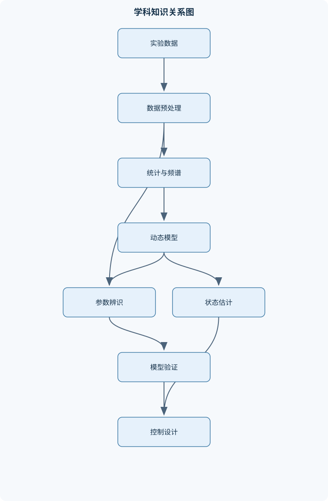
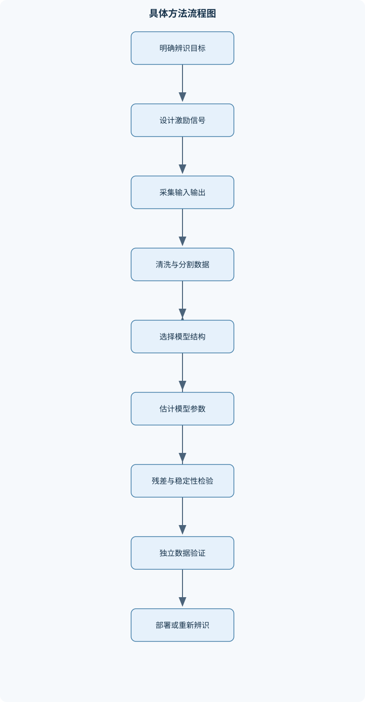

# 数据分析与系统辨识

## 一、课程整体知识框架

### 课程边界与先修知识

本课程研究如何从实验或运行数据中提取统计规律、建立动态系统模型，并利用模型进行分析、验证、预测和控制设计。内容覆盖数据采集与预处理、概率统计基础、相关分析与谱分析、线性时不变系统、差分方程与状态空间表示、参数辨识、非参数辨识、模型验证、状态估计、模型降阶以及基于辨识模型的反馈设计。系统辨识对象主要是连续时间或离散时间的单输入单输出和多输入多输出动态系统，重点讨论线性、时不变、有限维模型；对非线性、时变和强随机系统说明其适用边界。先修知识包括高等数学、线性代数、概率论与数理统计、常微分方程、信号与系统，以及基本编程和数值计算。





### 1. 课程对象、问题链与统一表示

《数据分析与系统辨识》研究的是：给定实验或运行过程中采集的输入、输出及辅助测量数据，如何提取统计规律，建立动态系统模型，检验模型可信度，并进一步用于预测、状态估计和控制设计。完整问题链通常为：

$$
\text{实验设计}\rightarrow\text{数据采集}\rightarrow\text{预处理}\rightarrow\text{统计与频域分析}\rightarrow\text{模型辨识}\rightarrow\text{验证}\rightarrow\text{估计与控制}
$$

课程重点对象是有限维、线性、时不变动态系统，包括单输入单输出系统和多输入多输出系统。连续时间状态空间模型写为

$$
\dot{x}(t)=Ax(t)+Bu(t),\qquad y(t)=Cx(t)+Du(t),
$$

其中，$x(t)\in\mathbb{R}^n$ 是状态，$u(t)\in\mathbb{R}^m$ 是输入，$y(t)\in\mathbb{R}^p$ 是输出；$A\in\mathbb{R}^{n\times n}$、$B\in\mathbb{R}^{n\times m}$、$C\in\mathbb{R}^{p\times n}$、$D\in\mathbb{R}^{p\times m}$。若时间单位为秒，则$A$的量纲通常为$\mathrm{s}^{-1}$，$B$的量纲由状态和输入单位共同决定，$C$和$D$分别承担状态到输出、输入到输出的单位换算。

离散时间模型写为

$$
x_{k+1}=Ax_k+Bu_k+w_k,\qquad y_k=Cx_k+Du_k+v_k,
$$

其中$k$是采样序号，采样周期为$T_s$，$w_k$和$v_k$分别表示过程噪声与测量噪声。离散模型中的$A$无量纲，但其数值依赖$T_s$。连续时间极点$s_i$与离散时间极点$z_i$在采样保持条件下满足

$$
z_i=e^{s_iT_s}.
$$

连续系统稳定要求所有极点满足$\operatorname{Re}(s_i)<0$；离散系统稳定要求所有极点满足$|z_i|<1$。不能把这两个判据混用。

零初始条件下，传递函数为

$$
G(s)=\frac{Y(s)}{U(s)}=C(sI-A)^{-1}B+D,
$$

该式要求$sI-A$可逆，并且不包含非零初始状态产生的自由响应。若初始状态$x(0)\neq0$，输出还包含由$x(0)$引起的自然响应。离散时间中，反复递推得到

$$
x_k=A^kx_0+\sum_{i=0}^{k-1}A^{k-1-i}Bu_i.
$$

其中第一项是自由响应，求和项是受迫响应，$Du_k$是直接通道输出。若忽略$D$或输入延迟，阶跃响应和辨识参数会产生系统性偏差。

### 2. 数据分析基础与实验设计

数据分析首先要明确变量的测量尺度。类别变量只表示类别；顺序变量具有排序关系但相邻差值未必相等；区间变量的差值有意义但零点不一定表示绝对缺失；比率变量具有有意义的绝对零点，可以讨论倍数关系。温度、压力、位移、电流和转速等物理量必须保留单位，不能把不同单位的数据直接拼接进入回归矩阵。

实验变量通常分为操纵输入、被测输出、状态或辅助变量、环境变量和噪声变量。采样周期$T_s$应同时考虑系统最快显著动态、传感器带宽和存储成本。若采样频率$f_s=1/T_s$低于信号最高频率的两倍，则可能发生混叠；但工程上通常需要更高的过采样倍数，因为抗混叠滤波器并非理想砖墙滤波器。

数据集可以按时间顺序划分为训练集、验证集和测试集。动态系统不能随意打乱样本，否则相邻样本之间的相关结构会被破坏，并可能把未来信息泄漏到过去。使用未来时刻计算的均值、趋势、滤波参数或归一化尺度，也会造成数据泄漏。时间序列验证应保证验证段位于训练段之后，或者采用滚动窗口验证。

异常值处理不能简单地把所有极端点删除。传感器饱和、通信丢包、真实冲击和系统故障在数据中表现不同。缺失值可标记为缺失并在模型中处理；短时缺失可在满足平滑性假设时插值，长时间缺失则应避免制造虚假动态。去均值变换为

$$
\tilde{x}_k=x_k-\bar{x},\qquad
\bar{x}=\frac{1}{N}\sum_{k=1}^{N}x_k.
$$

若数据存在明显线性趋势，应先估计趋势再去除；但趋势本身可能代表真实的时变过程，不能在没有物理依据时强行去趋势。标准化通常为

$$
x_k^{\mathrm{std}}=\frac{x_k-\bar{x}}{s_x},
$$

其中$s_x$是样本标准差。标准化能改善数值条件，但不会自动消除噪声、相关性或模型失配。

输入激励应覆盖目标动态的时间尺度和频率范围。阶跃信号便于观察稳态增益和主要时间常数；伪随机二进制序列适合激励较宽频带；多正弦信号便于控制频率成分。持续激励的核心含义是：输入产生的回归矩阵在所需阶次上具有足够秩。输入幅值过小会导致信噪比低，过大则可能触发饱和、非线性或安全约束。

### 3. 概率统计与随机过程

随机变量$X$的均值、方差和协方差分别为

$$
E[X],\qquad \operatorname{Var}(X)=E[(X-E[X])^2],
$$

$$
\operatorname{Cov}(X,Y)=E[(X-E[X])(Y-E[Y])].
$$

联合分布描述多个变量共同出现的概率，条件期望$E[Y\mid X]$描述在给定$X$后对$Y$的平均预测。均方意义下，$E[Y\mid X]$是利用$X$预测$Y$的最优函数；若限制为线性函数，则线性回归系数由协方差决定。

白噪声的不同样本在理想模型中不相关，其自相关函数除零滞后外为零。有限数据中的白噪声样本自相关不会严格为零，因此应结合置信界和样本长度判断。有色噪声具有时间相关性，常可表示为白噪声通过稳定线性滤波器后的输出。若

$$
y_k=G(q^{-1})u_k+H(q^{-1})e_k,
$$

则$G$描述输入到输出的动态，$H$描述噪声传播结构。若输入与噪声独立，理论上输入与噪声输出的互相关可提供系统动态线索；但相关性只能提示时滞关系，不能单独证明物理因果。

平稳过程的统计特性不随时间平移而改变。二阶平稳至少要求均值为常数，自相关仅依赖滞后$\ell$：

$$
R_{xy}(\ell)=E[x_k y_{k-\ell}].
$$

遍历性表示可以用单条足够长的时间序列平均值估计总体统计量。大数定律说明，在满足独立性或适当弱相关条件时，样本均值随样本数增加趋近总体均值；若系统强时变、样本长度不足或噪声具有长记忆，直接套用该结论会失效。

### 4. 相关分析与频域数据分析

离散傅里叶变换将长度为$N$的序列分解为离散频率成分：

$$
X(r)=\sum_{k=0}^{N-1}x_k e^{-j2\pi rk/N}.
$$

频率分辨率约为$f_s/N$。数据截断相当于乘以有限时间窗，频域中表现为真实谱与窗函数频谱卷积，从而产生谱泄漏。矩形窗主瓣窄但旁瓣高；其他窗可降低旁瓣，却通常牺牲频率分辨率。分段平均能够降低谱估计方差，但分段越短，频率分辨率越差。

输入自谱、输出自谱和互谱可分别记为$S_{uu}(\omega)$、$S_{yy}(\omega)$和$S_{yu}(\omega)$。在输入与噪声独立、系统近似线性时，频率响应可估计为

$$
\hat{G}(\omega)=\frac{\hat{S}_{yu}(\omega)}{\hat{S}_{uu}(\omega)}.
$$

相干函数为

$$
\gamma^2(\omega)=
\frac{|\hat{S}_{yu}(\omega)|^2}
{\hat{S}_{uu}(\omega)\hat{S}_{yy}(\omega)},
\qquad 0\leq \gamma^2(\omega)\leq1.
$$

低相干可能表示噪声大、输入在该频段能量不足、系统非线性或存在未测输入，不能直接解释为系统“没有动态”。互相关峰值可以帮助估计时滞，但不能排除共同原因、反馈回路或滤波造成的伪因果线索。

时频分析适合频率特性随时间明显变化的信号，如启动、冲击和工况切换。若系统近似平稳且目标是精确频率响应，整体谱估计更合适。频率响应数据清洗应检查频率排序、重复频点、相干性、输入能量和异常相位跳变。

### 5. 线性动态系统表示

差分方程是输入输出模型的直接表达。例如

$$
y_k=-a_1y_{k-1}-a_2y_{k-2}
+b_1u_{k-1}+b_2u_{k-2}+e_k.
$$

它描述当前输出由过去输出、过去输入和误差共同决定。状态空间模型则通过引入有限维状态，把高阶差分关系转化为一阶递推关系。状态不必是唯一的物理变量；若$x=T\tilde{x}$，则

$$
\tilde{A}=T^{-1}AT,\quad
\tilde{B}=T^{-1}B,\quad
\tilde{C}=CT.
$$

相似变换不改变传递函数、极点、可控性和可观测性，但会改变状态坐标的解释。

系统可控性矩阵为

$$
\mathcal{C}=[B\ AB\ \cdots\ A^{n-1}B],
$$

可观测性矩阵为

$$
\mathcal{O}=
\begin{bmatrix}
C\\CA\\\vdots\\CA^{n-1}
\end{bmatrix}.
$$

若$\operatorname{rank}(\mathcal{C})=n$，任意状态可由输入在有限时间内驱动；若$\operatorname{rank}(\mathcal{O})=n$，初始状态可由输入输出数据辨识。不可控或不可观测模态不能通过相应通道改变或恢复。

连续模型离散化必须指定采样保持方式。零阶保持下，若连续模型为$\dot{x}=Ax+Bu$，则

$$
A_d=e^{AT_s},\qquad
B_d=\int_0^{T_s}e^{A\tau}B\,d\tau.
$$

若$A$可逆，也可写为$B_d=A^{-1}(A_d-I)B$，但$A$不可逆时应使用积分或矩阵指数的增广算法。串联、并联和反馈互联会改变系统极点与零点；闭环系统的稳定性不能由开环稳定性直接推出。

### 6. 参数辨识基础

线性参数模型统一写为

$$
y_k=\varphi_k^T\theta+e_k,
$$

其中$\varphi_k$是已知回归向量，$\theta$是待估参数，$e_k$是未解释误差。批量最小二乘最小化

$$
J(\theta)=\sum_{k=1}^{N}(y_k-\varphi_k^T\theta)^2.
$$

令$\Phi$由各行$\varphi_k^T$组成，$Y$由$y_k$组成，则梯度为零得到

$$
\Phi^T\Phi\hat{\theta}=\Phi^TY.
$$

当$\Phi^T\Phi$可逆时，

$$
\hat{\theta}=(\Phi^T\Phi)^{-1}\Phi^TY.
$$

实际计算应优先使用QR分解或奇异值分解，避免显式求逆。若回归矩阵秩不足，参数不可唯一确定；若条件数很大，参数对噪声极其敏感。

递推最小二乘使用遗忘因子$0<\lambda\leq1$：

$$
K_k=\frac{P_{k-1}\varphi_k}
{\lambda+\varphi_k^TP_{k-1}\varphi_k},
$$

$$
\hat{\theta}_k=\hat{\theta}_{k-1}
+K_k(y_k-\varphi_k^T\hat{\theta}_{k-1}),
$$

$$
P_k=\lambda^{-1}(I-K_k\varphi_k^T)P_{k-1}.
$$

较小的$\lambda$能更快跟踪时变参数，但会放大噪声并增加估计波动。若回归向量含有过去输出，而输出噪声又进入这些回归量，则$\varphi_k$与$e_k$相关，普通最小二乘通常有偏。工具变量法用与误差不相关、但与回归量相关的工具变量替代直接回归信息，以缓解该问题。

正则化最小二乘可写为

$$
\hat{\theta}
=\arg\min_\theta
\left(\|Y-\Phi\theta\|_2^2+\rho\|\theta\|_2^2\right),
$$

其中$\rho>0$控制偏差和方差的折中。正则化能改善病态问题，但不能凭空创造数据中的动态信息。

### 7. 输入输出模型、状态空间辨识与模型验证

ARX模型把噪声简化为输出方程中的白噪声：

$$
A(q^{-1})y_k=B(q^{-1})u_k+e_k.
$$

ARMAX模型进一步引入噪声多项式$C(q^{-1})$；输出误差模型把噪声视为直接叠加在模型输出上；Box-Jenkins模型分别描述系统动态和噪声动态。模型结构越灵活，参数越多，对数据量、激励和初值的要求越高。

阶次选择不能只依据训练误差。应结合验证集一步预测、自由运行仿真、残差白噪声检验、稳定性、物理约束和信息准则。一步预测允许使用真实过去输出，通常比自由运行仿真容易；自由运行仿真只能由模型递推，能更严格地检验误差是否累积。

子空间辨识通过过去和未来输入输出数据构成块汉克尔矩阵，利用投影、正交分解和奇异值分解估计扩展可观测子空间。奇异值出现明显间隙时，状态阶次选择较可靠；若没有清晰间隙，应结合验证误差和物理先验。恢复出的$(A,B,C,D)$只在相似变换意义下确定，不存在唯一的状态坐标。

模型验证至少包括：残差均值是否接近零，残差自相关是否近似白噪声，残差与输入互相关是否显著，模型在独立验证集上的预测和仿真误差是否可接受，以及极点、增益、延迟和稳态响应是否符合物理约束。验证数据必须与辨识数据独立，否则拟合优度会被高估。

### 8. 状态估计、降阶与控制应用

确定性观测器为

$$
\dot{\hat{x}}=A\hat{x}+Bu+
L(y-C\hat{x}-Du),
$$

令估计误差$e_x=x-\hat{x}$，在无噪声且模型准确时有

$$
\dot{e}_x=(A-LC)e_x.
$$

因此可通过配置$A-LC$的极点使误差衰减，但观测器极点过快会放大测量噪声。随机系统中，离散卡尔曼滤波先预测：

$$
\hat{x}_{k|k-1}=A\hat{x}_{k-1|k-1}+Bu_{k-1},
$$

再计算创新

$$
r_k=y_k-C\hat{x}_{k|k-1}-Du_k,
$$

并依据过程噪声协方差$Q_w$和测量噪声协方差$R_v$更新状态。$R_v$过小会过度相信测量，$Q_w$过小会过度相信模型；创新序列应通过均值、自相关和协方差检查。

模型降阶旨在删去对输入输出影响较小的状态。平衡截断依据可控格拉姆矩阵和可观格拉姆矩阵的联合尺度；汉克尔奇异值小的状态通常既难以激励又难以观测。对不稳定系统不能直接无条件降阶，应先分离并保留不稳定子空间。降阶模型不必自动保持原模型的直流增益、相位裕度和所有瞬态指标，必须在目标频段和工作条件下验证。

状态反馈采用

$$
u=-Kx,
$$

闭环矩阵为$A-BK$。若系统可控，可配置闭环极点；若状态不可直接测量，则需要观测器或输出反馈。线性二次型调节器最小化

$$
J=\int_0^\infty
(x^TQx+u^TRu+2x^TN u)\,dt,
$$

其中$Q$半正定、$R$正定。控制器设计必须同时检查执行器饱和、测量噪声、模型不确定性、闭环极点和独立工况下的稳定性。

## 二、章节和模块划分

### 核心知识覆盖清单

本清单用于检查正文是否覆盖本课程的主要知识模块：

- **数据分析基础与实验设计**：数据类型与测量尺度、实验变量与采样周期、训练验证测试划分、异常值与缺失值处理、去均值与去趋势变换、输入激励信号设计、噪声来源与误差分类、数据泄漏与独立性、量纲分析与标准化。
- **概率统计与随机过程**：随机变量与联合分布、均值方差与协方差、条件期望与线性回归、白噪声与有色噪声、平稳过程与遍历性、自相关与互相关、高斯过程与二阶统计量、随机信号通过线性系统、大数定律与估计一致性。
- **相关分析与频域数据分析**：离散傅里叶变换、功率谱密度估计、周期图与窗函数、谱泄漏与频率分辨率、互谱与频率响应估计、相干函数与因果线索、采样定理与混叠、频率响应数据清洗、时频分析的适用边界。
- **线性动态系统表示**：连续时间状态空间模型、离散时间状态空间模型、传递函数与脉冲响应、差分方程与递推关系、极点零点与稳定性、可控性与可观测性、状态坐标变换、可控标准形与可观标准形、串联并联与反馈互联、连续模型离散化。
- **参数辨识基础**：最小二乘问题构造、回归向量与参数向量、批量最小二乘估计、递推最小二乘估计、遗忘因子与跟踪能力、参数协方差分析、正则化最小二乘、工具变量法、噪声相关导致的偏差、持久激励条件。
- **输入输出模型辨识**：ARX模型结构、ARMAX模型结构、输出误差模型、Box-Jenkins模型、差分算子与延迟、阶次选择方法、多步预测与仿真、闭环数据辨识、非参数脉冲响应辨识、模型结构与参数可辨识性。
- **状态空间辨识与子空间方法**：状态空间参数矩阵、数据汉克尔矩阵、扩展可观测矩阵、奇异值分解截断、确定性子空间辨识、随机子空间辨识、相似变换不唯一性、状态维数判定、多变量系统辨识、初始状态估计。
- **模型验证与不确定性分析**：残差定义与白噪声检验、残差与输入独立性、一步预测检验、自由运行仿真检验、交叉验证与泛化误差、信息准则与阶次比较、参数置信区间、模型失配与结构误差、稳定性与物理约束、验证数据的独立性。
- **状态估计与随机系统**：状态观测器结构、观测器误差动力学、确定性极点配置、过程噪声与测量噪声、离散卡尔曼滤波、预测更新递推、噪声协方差调节、创新序列检验、滤波器稳定性、模型误差对估计的影响。
- **辨识模型分析与控制应用**：极点与阻尼特性、阶跃响应指标、直流增益与稳态误差、模型降阶与汉克尔奇异值、状态反馈极点配置、线性二次型调节器、输出反馈结构、控制器对模型误差的敏感性、闭环稳定性验证、从数据到控制的完整流程。


### 1. 模块一至三：数据、概率与频域分析

#### 代表性流程一：频率响应估计

**输入**：采样周期$T_s$、输入序列$u_k$、输出序列$y_k$、频率范围。  
**输出**：功率谱、互谱、频率响应和相干函数。

1. 按时间顺序检查数据，删除或标记明显通信故障。
2. 计算训练段均值，完成去均值；有趋势时记录趋势处理方式。
3. 分段并加窗，对每段计算傅里叶变换。
4. 平均各段自谱和互谱，计算
   $\hat{G}=\hat{S}_{yu}/\hat{S}_{uu}$。
5. 计算相干函数，剔除输入能量不足或相干性过低的频段。
6. 比较频率响应与候选动态模型的幅值、相位和延迟。

主要误差来源是谱泄漏、频率分辨率不足、输入频谱空洞和非平稳性。若分段长度为$L$，频率间隔约为$f_s/L$；增大$L$可提高分辨率，但可用平均段数减少，谱方差可能增大。

#### 例题一：采样周期与混叠

**题干**：某测量信号最高有效频率为$40\ \mathrm{Hz}$，采样频率为$60\ \mathrm{Hz}$。判断是否满足理想采样条件，并说明频率为$50\ \mathrm{Hz}$的成分会折叠到何处。

**分析**：理想奈奎斯特条件要求$f_s>2f_{\max}$。  
**解答**：$2f_{\max}=80\ \mathrm{Hz}$，而$60<80$，因此不满足。离散采样中，$50\ \mathrm{Hz}$相对$60\ \mathrm{Hz}$的折叠频率为$|60-50|=10\ \mathrm{Hz}$。  
**验证**：频谱中会把原本的高频成分误认为$10\ \mathrm{Hz}$成分。  
**变式**：若采样频率提高到$120\ \mathrm{Hz}$，理想条件满足，但仍需抗混叠滤波器抑制高于$60\ \mathrm{Hz}$的能量。

#### 例题二：相关性与因果性

**题干**：输入与输出互相关在滞后$3$处出现峰值，能否断定输入在物理上导致输出？

**分析**：互相关只反映统计上的时滞关系。  
**解答**：不能直接断定。共同外部扰动、反馈回路、传感器延迟或滤波器都可能产生峰值。还应检查实验操纵关系、输入是否独立、残差与输入是否相关，以及不同工况下峰值是否稳定。  
**验证**：若改变输入而输出按同一动态规律响应，且替代模型和未测扰动解释不成立，因果证据才增强。  
**变式**：闭环系统中控制输入和输出天然相关，简单互相关尤其容易产生误判。

### 2. 模块四：线性动态系统表示

#### 例题三：由状态空间模型推导传递函数

**题干**：给定

$$
A=\begin{bmatrix}0&1\\-2&-3\end{bmatrix},\quad
B=\begin{bmatrix}0\\1\end{bmatrix},\quad
C=\begin{bmatrix}1&0\end{bmatrix},\quad D=0.
$$

求$G(s)$并判断连续时间稳定性。

**解答**：

$$
sI-A=
\begin{bmatrix}s&-1\\2&s+3\end{bmatrix},
$$

其行列式为$s^2+3s+2=(s+1)(s+2)$。由

$$
G(s)=C(sI-A)^{-1}B
$$

可得

$$
G(s)=\frac{1}{s^2+3s+2}
=\frac{1}{(s+1)(s+2)}.
$$

极点为$-1$和$-2$，实部均小于零，因此系统渐近稳定。  
**验证**：阶跃稳态值为$G(0)=1/2$，前提是系统稳定且直流增益有限。  
**变式**：若在$D$中加入非零直接通道，高频增益和阶跃瞬时响应会发生改变，但状态极点不变。

#### 例题四：连续模型离散化

**题干**：一阶连续系统

$$
\dot{x}(t)=-2x(t)+u(t)
$$

在零阶保持和$T_s=0.1\ \mathrm{s}$下离散化。

**解答**：

$$
A_d=e^{-2T_s}=e^{-0.2}\approx0.8187.
$$

$$
B_d=\int_0^{0.1}e^{-2\tau}d\tau
=\frac{1-e^{-0.2}}{2}\approx0.0906.
$$

因此

$$
x_{k+1}=0.8187x_k+0.0906u_k.
$$

连续极点$-2$映射为$z=e^{-0.2}\approx0.8187$，位于单位圆内。  
**验证**：单位阶跃稳态为$1$，因为$1=G(0)$；离散模型稳态也满足$x_{\mathrm{ss}}=0.8187x_{\mathrm{ss}}+0.0906$，解得$x_{\mathrm{ss}}\approx0.5$。这里连续系统传递函数为$1/(s+2)$，其直流增益本来就是$0.5$。  
**变式**：若采样周期过大，离散模型仍可能稳定，但中间快速动态会被采样遗漏。

### 3. 模块五至六：参数辨识与输入输出模型

#### 代表性流程二：批量最小二乘与ARX辨识

**输入**：输入输出序列、阶次$n_a,n_b$、输入延迟$n_k$。  
**输出**：$\hat{\theta}$、差分方程、残差和验证指标。

1. 统一采样周期、单位和时间索引。
2. 根据
   $y_k=-a_1y_{k-1}-\cdots-a_{n_a}y_{k-n_a}
   +b_1u_{k-n_k}+\cdots$
   构造回归向量。
3. 删除没有足够历史数据的前若干样本。
4. 用QR或奇异值分解求参数。
5. 计算训练残差，但不以训练误差作为唯一选择依据。
6. 在独立验证集上进行一步预测和自由运行仿真。
7. 检查残差白噪声、残差与输入独立性、极点稳定性及物理约束。

```python
import numpy as np

def fit_arx(y, u, na, nb, nk):
    """离线拟合单输入单输出 ARX 模型，返回参数和残差。"""
    y = np.asarray(y, dtype=float)
    u = np.asarray(u, dtype=float)
    if y.ndim != 1 or u.ndim != 1 or len(y) != len(u):
        raise ValueError("输入输出必须是等长一维序列")
    start = max(na, nk + nb - 1)
    if len(y) <= start:
        raise ValueError("样本数不足以构造回归矩阵")

    rows, target = [], []
    for k in range(start, len(y)):
        past_y = [-y[k - i] for i in range(1, na + 1)]
        past_u = [u[k - nk - j] for j in range(nb)]
        rows.append(past_y + past_u)
        target.append(y[k])

    phi = np.asarray(rows)
    target = np.asarray(target)
    theta, _, rank, singular_values = np.linalg.lstsq(
        phi, target, rcond=None
    )
    residual = target - phi @ theta
    condition = np.inf
    if len(singular_values) > 0 and singular_values[-1] > 0:
        condition = singular_values[0] / singular_values[-1]

    return {
        "theta": theta,
        "residual": residual,
        "rank": rank,
        "condition_number": condition
    }
```

该流程的输入必须满足时间顺序一致、输入输出采样同步、回归矩阵具有足够秩。若条件数过大，应检查输入激励、变量量纲、阶次和正则化，而不是盲目增加样本。

#### 例题五：一阶ARX回归

**题干**：模型为

$$
y_k=-a_1y_{k-1}+b_1u_{k-1}+e_k.
$$

给定两行回归数据：

$$
\varphi_1=[-y_1,u_1]^T,\quad y_2;\qquad
\varphi_2=[-y_2,u_2]^T,\quad y_3.
$$

说明如何求$a_1,b_1$。

**解答**：构造

$$
\Phi=
\begin{bmatrix}
-y_1&u_1\\
-y_2&u_2
\end{bmatrix},\qquad
Y=
\begin{bmatrix}y_2\\y_3\end{bmatrix}.
$$

若$\det(\Phi)\neq0$，两参数可由

$$
\hat{\theta}=\Phi^{-1}Y
$$

求得；实际计算优先使用QR分解。参数向量第一项就是$a_1$，第二项就是$b_1$。  
**验证**：将参数代回两行方程，检查预测值与观测值的差异。  
**边界**：若两行输入输出组合线性相关，$\Phi$秩不足，参数不能唯一确定。  
**变式**：增加测量噪声后，至少需要更多样本，并应使用独立验证集检查模型。

#### 例题六：输出噪声导致的最小二乘偏差

**题干**：为什么对含滞后输出的ARX模型直接使用普通最小二乘，可能得到有偏参数？

**解答**：ARX回归量包含$y_{k-1}$。若$y_{k-1}$包含过去噪声，而当前误差$e_k$与这些噪声因系统噪声结构相关，则

$$
E[\varphi_ke_k]\neq0.
$$

最小二乘一致性所需的正交条件被破坏，样本增加也不能保证参数趋近真实值。  
**验证**：增大样本后参数仍稳定偏离，且残差可能与回归量相关。  
**改进**：使用工具变量、显式噪声模型、预测误差法或适当实验设计。  
**变式**：若误差严格为当前时刻独立白噪声且回归量只含独立输入，普通最小二乘的偏差问题可减弱。

### 4. 模块七至九：子空间辨识、验证与状态估计

#### 代表性流程三：子空间状态空间辨识

1. 输入多变量输入输出序列和候选状态阶次。
2. 构造过去、未来数据的块汉克尔矩阵。
3. 通过投影或正交分解减弱输入对未来输出的直接影响。
4. 对得到的矩阵做奇异值分解，依据奇异值间隙选择状态维数。
5. 从扩展可观测子空间恢复$A$和$C$，再用最小二乘恢复$B$和$D$。
6. 检查系统矩阵维度、极点、稳定性和独立验证误差。
7. 记住状态实现只在相似变换下唯一。

#### 代表性流程四：模型验证与离散卡尔曼滤波

模型验证流程包括：先确认验证数据独立，再计算一步预测和自由运行仿真；随后检查残差均值、自相关、残差与输入互相关；最后检查极点、直流增益、阶跃响应、延迟和物理边界。

卡尔曼滤波每个采样时刻执行：

$$
\hat{x}_{k|k-1}=A\hat{x}_{k-1|k-1}+Bu_{k-1},
$$

$$
P_{k|k-1}=AP_{k-1|k-1}A^T+Q_w,
$$

$$
S_k=CP_{k|k-1}C^T+R_v,
$$

$$
K_k=P_{k|k-1}C^TS_k^{-1},
$$

$$
\hat{x}_{k|k}=\hat{x}_{k|k-1}+K_k
(y_k-C\hat{x}_{k|k-1}-Du_k).
$$

要求$Q_w$半正定、$R_v$通常正定，矩阵维度相容。创新序列若均值明显不为零或存在显著自相关，说明模型、噪声协方差或传感器处理可能有问题。

#### 例题七：一步预测与自由运行仿真

**题干**：某模型一步预测误差很小，但自由运行仿真误差很大，如何解释？

**解答**：一步预测使用真实的过去输出，模型每一步都获得外部校正；自由运行仿真只能使用模型自身递推，任何极点、增益或噪声结构误差都会累积。因此该现象说明模型可能适合短期预测，却未能准确描述长期动态。  
**验证**：比较误差随预测步长增长的曲线，并检查模型极点是否接近单位圆。  
**改进**：重新检查阶次、延迟、噪声模型和验证数据工况。  
**变式**：若系统本身受强随机扰动，自由运行预测存在不可避免的误差，此时应报告预测区间而非只报告单条轨迹。

### 5. 模块十至十一：降阶与控制应用

#### 实验/项目一：输入输出模型辨识

**输入数据**：一段带阶跃、随机激励或多正弦激励的输入输出记录，包含采样周期、单位和传感器说明。  
**步骤**：

1. 对齐输入输出时间戳，检查缺失、饱和和异常跳变。
2. 按时间划分训练集与验证集。
3. 尝试多个$n_a,n_b,n_k$组合。
4. 计算每个模型的一步预测误差、仿真误差和残差相关性。
5. 排除不稳定、违反物理边界或验证集失效的模型。
6. 选取结构简单且验证性能稳定的模型。

**评价标准**：验证集误差、残差白化程度、稳定性、直流增益和延迟是否合理。  
**排错方法**：若回归矩阵秩不足，增加激励频带或减少阶次；若训练好而验证差，检查数据泄漏和过拟合；若残差与输入相关，检查模型阶次、延迟或闭环相关噪声。

#### 实验/项目二：辨识模型驱动的状态反馈

**输入数据**：辨识得到的$A,B,C,D$，输入输出约束，期望闭环极点或$Q,R$权重。  
**步骤**：

1. 计算$\mathcal{C}$和$\mathcal{O}$的秩，确认可控和可观条件。
2. 选择极点配置或线性二次型调节器。
3. 得到反馈增益$K$，若状态不可测则设计观测器。
4. 仿真初始状态响应、阶跃跟踪、扰动响应和测量噪声响应。
5. 逐步加入参数摄动、输入饱和和采样延迟。
6. 检查闭环极点、最大输入幅值、稳态误差和鲁棒性。

**评价标准**：闭环稳定、执行器不长期饱和、目标响应时间满足约束、噪声放大可接受，并且在独立模型或参数摄动下仍保持稳定。  
**排错方法**：闭环发散时先检查符号约定$u=-Kx$、单位和采样周期；输入过大时降低闭环速度或调整$R$；噪声放大时降低观测器带宽或重新估计$R_v$。

#### 例题八：状态反馈闭环极点

**题干**：给定离散系统$A,B$，希望通过$u=-Kx$使闭环极点位于单位圆内。应先做什么？

**解答**：先计算

$$
\mathcal{C}=[B\ AB\ \cdots\ A^{n-1}B]
$$

并检查$\operatorname{rank}(\mathcal{C})=n$。若满秩，才可在理论上配置任意指定极点；随后求$K$，验证$A-BK$的特征值。  
**边界**：理论可配置不等于工程可实现。极点过快可能导致输入幅值过大、对参数误差敏感和噪声放大。  
**变式**：多输入系统中反馈矩阵通常不唯一，应结合输入分配和约束选择。

#### 例题九：降阶后的性质

**题干**：高阶稳定模型的某些汉克尔奇异值很小，删除对应状态后，是否必然保持原模型的直流增益和阶跃响应？

**解答**：不必然。小汉克尔奇异值说明该状态对输入输出通道的综合影响较小，但具体降阶算法未必严格保持直流增益、时域峰值或相位裕度。  
**验证**：比较原模型和降阶模型的直流增益、阶跃响应、频率响应及极点。  
**边界**：不稳定模态必须先保留或单独处理；降阶误差结论还依赖系统稳定性和目标频段。  
**变式**：若控制器依赖低频稳态精度，应优先选择能保持低频行为的降阶方法并单独校准增益。

### 6. 具体易错点

1. 把相关性当作因果性，忽略共同扰动和反馈。
2. 混淆一步预测与自由运行仿真。
3. 对含输出噪声的ARX回归直接使用普通最小二乘。
4. 未检查输入持续激励，导致参数不可辨识。
5. 只比较训练误差，不使用独立验证数据。
6. 把连续极点实部判据用于离散系统。
7. 忽略直接传递项$D$和输入延迟。
8. 将状态变量误认为唯一物理量。
9. 使用正规方程求解严重病态的回归问题。
10. 把低相干误判为系统没有动态。
11. 用未来数据计算训练阶段的归一化参数。
12. 忽略采样周期、单位和时间索引。
13. 观测器极点一味配置过快。
14. 对不稳定模型直接进行无条件降阶。
15. 认为降阶模型必然保持直流增益和稳定性。
16. 在闭环数据中忽略输入与噪声相关造成的偏差。
17. 把模型拟合优度等同于物理正确性。
18. 只检查极点而不检查执行器饱和和模型不确定性。

### 7. 常见笔试问题及解答思路

#### 问题一：推导$G(s)=C(sI-A)^{-1}B+D$

从状态方程取拉普拉斯变换，在零初始条件下得到$sX=AX+BU$，移项得$X=(sI-A)^{-1}BU$，代入$Y=CX+DU$即可。

#### 问题二：连续系统和离散系统的稳定条件有何不同？

连续系统要求极点实部小于零；离散系统要求极点模小于一。二者通过$z=e^{sT_s}$联系，但不能直接交换判据。

#### 问题三：为什么最小二乘需要持续激励？

若回归矩阵列之间线性相关，$\Phi^T\Phi$奇异或近似奇异，多个参数组合产生相同输出，因而无法唯一辨识。

#### 问题四：为什么QR分解优于直接求$(\Phi^T\Phi)^{-1}$？

形成$\Phi^T\Phi$会使条件数近似平方，放大舍入误差。QR或奇异值分解具有更好的数值稳定性。

#### 问题五：预测误差法和自由运行仿真有何区别？

预测误差法使用真实历史输出形成下一步预测；自由运行仿真只使用模型自身输出递推，能检验长期动态和误差累积。

#### 问题六：相似变换改变了什么、保持了什么？

改变状态坐标和状态物理解释；保持输入输出传递函数、极点、可控性和可观测性。

#### 问题七：为什么观测器不能无限加快？

观测器极点过快会提高对测量噪声和未建模高频动态的敏感性，并可能引起数值问题和执行器负担。

#### 问题八：低相干的可能原因有哪些？

输入能量不足、输出噪声过大、系统时变、存在未测输入、非线性或分段处理不当。不能仅据此判定系统无动态。

### 8. 典型面试问题、参考答案与追问要点

#### 问题一：如何从实验数据建立动态模型？

参考答案：先明确输入输出和工作范围，设计持续激励实验，检查采样和同步，完成去趋势、异常值和缺失处理，再选择ARX、预测误差模型或状态空间模型，最后用独立数据验证预测、仿真、残差和稳定性。  
追问要点：闭环数据需要处理输入噪声相关性；非线性和时变时应分工况或采用扩展模型。

#### 问题二：如何判断模型阶次？

参考答案：综合奇异值间隙、信息准则、验证误差、残差白化和物理先验，而不是只选训练误差最小的阶次。  
追问要点：过低阶次产生结构失配，过高阶次增加方差和过拟合风险。

#### 问题三：普通最小二乘什么时候会失败？

参考答案：当回归量与误差相关、输入激励不足、数据严重病态或模型结构错误时会失败。  
追问要点：可考虑工具变量、正则化、噪声模型、重新设计实验或更换模型结构。

#### 问题四：如何验证辨识模型可用于控制？

参考答案：检查可控性、可观测性、极点、输入输出增益、独立工况验证、参数摄动、延迟和执行器约束，并进行闭环仿真。  
追问要点：开环拟合良好不代表闭环鲁棒；必须检验模型不确定性。

#### 问题五：卡尔曼滤波中$Q_w$和$R_v$如何理解？

参考答案：$Q_w$表示模型动态未解释部分或过程扰动，$R_v$表示测量噪声。增大$Q_w$会更快相信新测量，增大$R_v$会更依赖模型预测。  
追问要点：应结合创新序列统计特性调节，不能只凭主观缩放。

#### 问题六：状态空间实现是否唯一？

参考答案：不唯一。任意非奇异相似变换都会得到不同状态矩阵，但输入输出行为相同。  
追问要点：物理状态实现、规范形和子空间实现的状态解释不同。

#### 问题七：为什么频率响应某些频段不可信？

参考答案：输入在这些频段能量不足，或输出噪声、泄漏、非平稳性占主导。应查看输入自谱、相干函数、分段一致性和窗函数影响。  
追问要点：不能用低相干频段强行拟合高阶动态。

#### 问题八：如何处理模型与真实系统不一致？

参考答案：先区分数据处理错误、参数误差、结构误差和工况变化，再通过增加激励、改变模型结构、分工况建模、引入不确定性或降低控制器带宽处理。  
追问要点：控制器设计应避免依赖模型最不可靠的频段。

### 9. 岗位关联

#### 控制系统工程师

实际任务包括建立设备动态模型、设计状态反馈或输出反馈控制器、评估闭环稳定性和执行器约束。使用状态空间表示、可控可观分析、极点配置、线性二次型调节器、观测器和卡尔曼滤波。产出包括模型文件、控制器参数、仿真报告和现场验收记录；验收重点是独立工况下稳定、响应时间、稳态误差、输入峰值和抗扰性能。

#### 系统辨识工程师

实际任务包括实验设计、输入激励、ARX或状态空间辨识、阶次选择和模型验证。产出包括数据字典、辨识脚本、模型参数、残差诊断和验证报告。验收重点是采样同步正确、模型在独立数据上的预测和仿真性能达标、极点与增益符合物理约束。

#### 数据分析工程师

实际任务包括时间序列清洗、异常检测、相关分析、谱估计、特征提取和预测误差分析。使用概率统计、平稳性判断、相关函数、功率谱密度、交叉验证和数据泄漏控制。产出包括可复现的数据处理流程、分析结果和质量报告；验收重点是处理规则可解释、训练验证边界清晰、结论不超出数据支持范围。

#### 工业过程建模工程师

实际任务包括根据压力、流量、温度和阀门信号建立过程模型，分析时滞、惯性和耦合关系，并服务于预测控制或运行优化。使用多变量状态空间辨识、频域分析、降阶和稳态增益分析。验收重点是模型能覆盖目标工况、延迟和稳态关系合理，并在扰动和工况切换下保持可用。

#### 信号处理工程师

实际任务包括传感器采样设计、抗混叠处理、谱估计、时频分析和频率响应清洗。使用采样定理、窗函数、分段平均、互谱、相干函数和噪声分析。产出包括频谱报告、滤波方案和信号质量指标；验收重点是频率轴正确、混叠受控、目标频段信噪比和相干性满足要求。

#### 预测维护与实验测试工程师

实际任务包括从振动、电流、温度和运行日志中识别动态变化、发现异常并设计重复性实验。使用统计过程分析、相关与谱分析、模型残差、状态估计和独立验证。产出包括试验方案、异常判据、健康指标和复现实验报告；验收重点是误报与漏报受控、故障线索可追溯、实验条件和数据处理过程完整。

## 三、核心概念的详细解释

### 3.1 数据、测量与动态系统

数据分析的对象不是孤立数值，而是带有时间顺序、测量单位和实验条件的观测序列。设输入为 $u_k$、输出为 $y_k$，采样周期为 $T_s$，则第 $k$ 个样本对应时刻 $t_k=kT_s$。输入通常是可操纵变量，输出是被测性能变量，状态是能够概括系统过去信息、并由当前状态和输入决定未来演化的内部变量。

测量尺度决定可使用的运算。类别变量只能比较是否相同；顺序变量可以比较大小；区间变量的差值有意义；比率变量还可以比较倍数。压力、位移、电流、转速等物理量属于具有单位的测量量，进行回归或距离计算前应统一单位。标准化

$$
x_k^{\mathrm{std}}=\frac{x_k-\bar{x}}{s_x}
$$

其中 $\bar{x}$ 是样本均值，$s_x$ 是样本标准差。标准化改变数值尺度，不改变线性相关结构，但会改变参数的物理单位，因此需要保存均值和标准差，以便将预测结果还原到原单位。

动态系统具有记忆性。若当前输出不仅由当前输入决定，还与过去输入、过去输出或内部状态有关，就不能使用静态映射 $y_k=f(u_k)$ 完整描述。线性时不变系统要求叠加性和时移不变性：输入加倍，输出也加倍；输入延迟，输出延迟相同。现实系统中的饱和、死区、摩擦、温度漂移和参数老化会破坏这些条件，因此线性时不变模型通常是在某一工作点、某一运行范围内的近似。

### 3.2 数据质量与实验设计

缺失值、异常值、漂移、饱和和传感器断线必须区分处理。单点异常可能来自通信错误，也可能代表真实突变；不能仅按“偏离均值若干倍标准差”直接删除。若异常由真实故障引起，删除它会把需要建模的动态信息当成噪声。缺失值若发生在短暂且平滑的区间，可使用插值；若缺失时间较长，插值会制造不存在的动态，应保留缺失标记或剔除相关片段。

去均值变换为

$$
\tilde{x}_k=x_k-\bar{x},
$$

去趋势可用拟合趋势 $\hat{d}(t_k)$ 后计算

$$
\tilde{x}_k=x_k-\hat{d}(t_k).
$$

去均值适合处理固定偏置；去趋势隐含“趋势不是目标动态”的假设。若趋势本身反映时变系统或缓慢故障，去趋势会损失重要信息。

采样周期应由最快需要分析的动态、传感器带宽和抗混叠滤波器共同决定。采样频率 $f_s=1/T_s$ 至少应高于目标最高频率的两倍，但仅满足数学上的奈奎斯特条件并不足以保证工程质量，因为实际滤波器具有过渡带。频率超过 $f_s/2$ 的成分会折叠到低频，形成混叠；采样后无法仅凭数字信号恢复原频率。

动态数据应按时间顺序划分训练集、验证集和测试集。若随机打乱相邻样本，训练集可能包含验证时刻的近邻信息，造成过于乐观的误差估计。标准化参数、缺失值填补规则、趋势模型和异常判据也必须只用训练数据确定，再应用到验证集和测试集，这称为防止数据泄漏。

激励信号必须覆盖待辨识的动态范围。阶跃便于观察稳态增益和主要时间尺度；伪随机二值信号具有较宽频带；扫频信号便于获得频率响应；多正弦信号能够在指定频点集中提供能量。输入幅值过小会使输出信号被噪声淹没，幅值过大则可能触发饱和、非线性或安全限制。持续激励的核心含义是回归向量在数据中具有足够丰富的方向，使不同参数不会产生完全相同的预测。

### 3.3 随机变量、协方差与随机过程

随机变量 $X$ 的均值和方差分别为

$$
E[X]=\mu_X,\qquad
\operatorname{var}(X)=E[(X-\mu_X)^2].
$$

两个变量的协方差为

$$
\operatorname{cov}(X,Y)=E[(X-\mu_X)(Y-\mu_Y)].
$$

协方差有量纲，相关系数

$$
\rho_{XY}=
\frac{\operatorname{cov}(X,Y)}
{\sqrt{\operatorname{var}(X)\operatorname{var}(Y)}}
$$

无量纲且位于 $[-1,1]$。相关性表示共同变化，不自动表示因果性。例如输入和输出同时受第三个环境变量影响时，也会出现较高相关。

条件期望 $E[Y\mid X]$ 是给定 $X$ 后对 $Y$ 的平均预测。在线性均方误差意义下，令

$$
\hat{Y}=a+bX
$$

并最小化 $E[(Y-a-bX)^2]$，对 $a,b$ 求偏导得到

$$
b=\frac{\operatorname{cov}(X,Y)}{\operatorname{var}(X)},\qquad
a=E[Y]-bE[X].
$$

该结果说明线性回归斜率由协方差与自变量方差决定，但不表示真实关系必然线性。

随机过程 $x_k$ 的自相关采用

$$
R_{xx}(\ell)=E[x_kx_{k-\ell}],
$$

互相关采用

$$
R_{xy}(\ell)=E[x_ky_{k-\ell}].
$$

滞后正负的含义取决于索引约定，计算时必须保持一致。宽平稳过程要求均值为常数，且自相关只依赖滞后 $\ell$ 而不依赖绝对时刻。遍历性进一步要求用足够长的一条样本轨迹的时间平均估计总体统计量。平稳不等于白噪声；白噪声只要求不同时间的相关性为零，且可以具有非零均值或非高斯分布。高斯过程在给定均值和协方差后，其有限维分布被确定；非高斯过程不能仅靠二阶统计量完全描述。

若白噪声 $e_k$ 通过稳定线性系统 $G$，输出为 $y_k=G(q^{-1})e_k$，则输出一般为有色噪声。其功率谱满足

$$
S_{yy}(\omega)
=
|G(e^{\mathrm{j}\omega})|^2S_{ee}(\omega),
$$

这是随机信号通过线性系统改变频谱的基本关系。

### 3.4 相关分析与频域分析

有限长度数据的离散傅里叶变换为

$$
X_r=\sum_{k=0}^{N-1}x_k
e^{-\mathrm{j}2\pi rk/N},
\qquad r=0,\ldots,N-1.
$$

对应频率为 $f_r=r f_s/N$，频率间隔为 $\Delta f=f_s/N$。直接截断有限数据相当于乘以矩形窗，会产生谱泄漏；加汉宁窗等窗函数可降低旁瓣，但会扩大主瓣，因而在泄漏和频率分辨率之间折中。

周期图可写为

$$
\hat{S}_{xx}(f_r)=
\frac{T_s}{N}|X_r|^2,
$$

具体归一化因窗函数和实现约定而异，比较结果时必须保持一致。分段、加窗并平均各段周期图可以降低估计方差，但分段越短，频率分辨率越低。

输入输出互谱与输入自谱可用于频率响应估计：

$$
\hat{G}(e^{\mathrm{j}\omega})
=
\frac{\hat{S}_{yu}(\omega)}
{\hat{S}_{uu}(\omega)}.
$$

只有当 $\hat{S}_{uu}(\omega)$ 在目标频率附近具有足够能量时，该比值才可靠。相干函数为

$$
\gamma^2_{yu}(\omega)
=
\frac{|\hat{S}_{yu}(\omega)|^2}
{\hat{S}_{yy}(\omega)\hat{S}_{uu}(\omega)},
\qquad 0\leq\gamma^2_{yu}\leq1.
$$

低相干可能表示噪声强、非线性、时变，或者输入在该频率没有激励；不能简单解释为“系统没有动态”。互相关峰值可以提供时滞线索，但不能单独证明因果关系。短时傅里叶变换适合分析频率随时间变化的信号，但时间分辨率和频率分辨率受窗长限制，不适合把强时变数据直接当作一个固定频响模型。

### 3.5 状态空间、传递函数与差分方程

连续时间模型为

$$
\dot{x}(t)=Ax(t)+Bu(t),\qquad
y(t)=Cx(t)+Du(t).
$$

离散时间模型为

$$
x_{k+1}=Ax_k+Bu_k+w_k,\qquad
y_k=Cx_k+Du_k+v_k.
$$

连续模型中 $A$ 的量纲通常为时间的倒数；离散模型中的 $A$ 无量纲，但依赖采样周期。取连续模型拉普拉斯变换，在零初始条件下有

$$
sX(s)=AX(s)+BU(s),
$$

因此

$$
X(s)=(sI-A)^{-1}BU(s),
$$

代入输出方程得

$$
G(s)=\frac{Y(s)}{U(s)}
=C(sI-A)^{-1}B+D.
$$

该推导要求 $sI-A$ 可逆，并忽略初始状态响应。非零初始状态会产生自由响应，不能包含在零初始传递函数中。

离散模型反复递推得到

$$
x_k=A^kx_0+
\sum_{i=0}^{k-1}A^{k-1-i}Bu_i.
$$

其中 $A^kx_0$ 是自由响应，求和项是受迫响应。若 $A$ 的特征值模小于一，稳定系统的自由响应逐渐衰减；若存在模大于一的特征值，自由响应可能增长。

以单输入单输出差分方程为例：

$$
y_k=-a_1y_{k-1}-\cdots-a_{n_a}y_{k-n_a}
+b_1u_{k-n_k}+\cdots+b_{n_b}u_{k-n_k-n_b+1}+e_k.
$$

使用后移算子 $q^{-1}$，令

$$
A(q^{-1})=1+a_1q^{-1}+\cdots+a_{n_a}q^{-n_a},
$$

则可表示为

$$
A(q^{-1})y_k
=
B(q^{-1})u_{k-n_k}+e_k.
$$

不同教材可能使用前移算子 $q$，不能在同一推导中混用方向。ARX 模型把白噪声通过系统分母滤波；ARMAX 进一步描述噪声的移动平均结构；输出误差模型只对输出误差建模；Box-Jenkins 模型分别描述输入通道和噪声通道。模型结构必须与噪声来源和辨识目标匹配。

### 3.6 可控性、可观测性与状态坐标

可控性矩阵为

$$
\mathcal{C}=
[B\ AB\ \cdots\ A^{n-1}B].
$$

若 $\operatorname{rank}(\mathcal{C})=n$，则任意状态可在有限时间内由输入驱动到目标状态。可观测性矩阵为

$$
\mathcal{O}=
\begin{bmatrix}
C\\CA\\\vdots\\CA^{n-1}
\end{bmatrix}.
$$

若 $\operatorname{rank}(\mathcal{O})=n$，则可由有限段输入输出推断初始状态。不可控或不可观测模态不能被相应通道充分激励或识别，数据拟合可能无法唯一确定全部内部参数。

令 $x=T\tilde{x}$，其中 $T$ 可逆，则

$$
\tilde{A}=T^{-1}AT,\quad
\tilde{B}=T^{-1}B,\quad
\tilde{C}=CT,\quad
\tilde{D}=D.
$$

相似变换不改变输入输出传递函数、极点、可控性和可观测性，但会改变状态变量的数值和物理解释。因此辨识得到的状态不一定就是位置、速度等直接物理量。

### 3.7 参数辨识、状态估计与控制应用

统一回归模型为

$$
y_k=\varphi_k^T\theta+e_k.
$$

批量最小二乘最小化

$$
J(\theta)=
\sum_{k=1}^{N}(y_k-\varphi_k^T\theta)^2.
$$

令回归矩阵 $\Phi$ 的第 $k$ 行为 $\varphi_k^T$，观测向量为 $Y$，则正规方程为

$$
\Phi^T\Phi\hat{\theta}=\Phi^TY.
$$

当 $\Phi^T\Phi$ 可逆时，

$$
\hat{\theta}=(\Phi^T\Phi)^{-1}\Phi^TY.
$$

实际计算优先用 QR 分解或奇异值分解，避免显式求逆放大病态误差。若回归量含有过去输出，而输出又含有与误差相关的测量噪声，则 $\varphi_k$ 与 $e_k$ 相关，普通最小二乘通常产生偏差。工具变量法通过构造与误差不相关、但与回归量相关的工具变量缓解此问题。正则化最小二乘在目标函数中加入 $\lambda\|\theta\|_2^2$，可改善病态问题，但会引入偏差。

递推最小二乘使用遗忘因子 $0<\lambda\leq1$：

$$
K_k=
\frac{P_{k-1}\varphi_k}
{\lambda+\varphi_k^TP_{k-1}\varphi_k},
$$

$$
\hat{\theta}_k=
\hat{\theta}_{k-1}
+K_k(y_k-\varphi_k^T\hat{\theta}_{k-1}),
$$

$$
P_k=\lambda^{-1}
(I-K_k\varphi_k^T)P_{k-1}.
$$

$\lambda$ 越小，越重视新数据，跟踪时变参数能力越强，但噪声敏感性也越高。持久激励不足时，参数协方差会长期较大或不同参数无法区分。

离散卡尔曼滤波把模型不确定性表示为过程噪声 $w_k$，把测量误差表示为 $v_k$。设其协方差分别为 $Q_w$ 和 $R_v$，预测步骤为

$$
\hat{x}_{k|k-1}=A\hat{x}_{k-1|k-1}+Bu_{k-1},
$$

$$
P_{k|k-1}=AP_{k-1|k-1}A^T+Q_w.
$$

创新及其协方差为

$$
r_k=y_k-C\hat{x}_{k|k-1}-Du_k,
$$

$$
S_k=CP_{k|k-1}C^T+R_v.
$$

更新为

$$
K_k=P_{k|k-1}C^TS_k^{-1},
$$

$$
\hat{x}_{k|k}=\hat{x}_{k|k-1}+K_kr_k.
$$

若模型准确且系统可观测，观测器误差满足

$$
\dot e_x=(A-LC)e_x.
$$

使 $A-LC$ 稳定可令无噪声估计误差衰减；但观测器极点过快会放大测量噪声。

状态反馈 $u=-Kx$ 的闭环矩阵为 $A-BK$。可控时可以配置闭环极点，但极点越快不一定越好，因为可能增加输入峰值、噪声敏感性和模型失配风险。线性二次型调节器最小化

$$
J=\int_0^\infty
(x^TQx+u^TRu+2x^TN u)\,dt,
$$

其中 $Q$ 半正定、$R$ 正定。通过二次型价值函数和哈密顿量最小化得到代数黎卡提方程，并由稳定解计算反馈增益。

### 3.8 模型验证、阶次选择与降阶

残差定义为实际输出与预测输出之差。合格模型的残差应近似零均值、白噪声，并与输入不相关。一步预测允许使用真实过去输出，通常比自由运行仿真容易；自由运行仿真只能使用模型自身递推输出，更能检验长期动态。训练误差小不等于模型正确，还应使用独立验证数据比较预测误差、仿真误差、残差相关性、稳定性和物理约束。

AIC、BIC 等信息准则在拟合误差与参数数量之间折中；阶次增加通常会降低训练误差，但可能增加方差、过拟合和不稳定极点。阶次选择不能只依据单一数值，还应检查输入激励、噪声结构和验证集表现。

模型降阶依据可控性和可观测性的联合重要性。平衡截断中，汉克尔奇异值较小的状态同时难以被输入激励和被输出观测，删除这些状态通常能够保持较好的输入输出近似。但对不稳定系统，应先分离并保留不稳定子空间；降阶后还需重新检查稳定性、直流增益、关键频段和阶跃响应，不能认为所有性质自动保持。

## 四、重要定义、公式、定理和推导

### 专业审校补充：关键定义与适用边界

闭环数据辨识的关键边界是：普通最小二乘的一致性不仅要求噪声均值为零，还要求回归向量与当前建模误差不相关。若输入由反馈控制器根据带噪输出生成，则输入和扰动可能相关，输入不再是外生变量，直接用输入输出回归可能产生有偏估计。以静态关系 y=Gu+v、控制律 u=r−Ky 为例，若参考信号 r 与扰动 v 独立，则闭环输入 u 含有 v 的成分，故 E[uv]≠0。工具变量法可选取与 v 不相关、但与 u 相关的参考信号 r，利用 E[r(y−G u)]=0 估计 G。其适用条件是工具变量具有相关性且满足外生性；若参考信号能量不足、控制器内部信号泄漏或扰动与参考相关，工具变量同样不能保证一致。闭环辨识还必须记录控制器结构、参考输入、反馈信号和输入延迟，不能把闭环数据直接当作开环实验数据处理。


### 4.1 连续模型离散化推导

对连续模型

$$
\dot{x}(t)=Ax(t)+Bu(t)
$$

在一个采样区间 $[kT_s,(k+1)T_s)$ 内假定零阶保持，即 $u(t)=u_k$。利用变参数法：

$$
x((k+1)T_s)
=e^{AT_s}x(kT_s)
+\int_0^{T_s}e^{A\tau}B\,d\tau\,u_k.
$$

因此离散矩阵为

$$
A_d=e^{AT_s},\qquad
B_d=\int_0^{T_s}e^{A\tau}B\,d\tau.
$$

若 $A$ 可逆，也可写成

$$
B_d=A^{-1}(e^{AT_s}-I)B.
$$

但当 $A$ 不可逆时不能使用该形式，应直接计算积分或采用增广矩阵指数。输出矩阵在采样点保持为 $C_d=C$、$D_d=D$。连续极点 $s_i$ 映射为 $z_i=e^{s_iT_s}$；当 $\operatorname{Re}(s_i)<0$ 时，必有 $|z_i|<1$。采样周期过大时，不同连续动态可能在离散数据中难以区分，且快速动态会被遗漏。

### 4.2 批量最小二乘的推导与数值实现

令残差向量

$$
r=Y-\Phi\theta.
$$

目标函数为

$$
J(\theta)=r^Tr
=(Y-\Phi\theta)^T(Y-\Phi\theta).
$$

展开并对 $\theta$ 求梯度：

$$
\nabla_\theta J
=-2\Phi^TY+2\Phi^T\Phi\theta.
$$

令梯度为零，得到正规方程

$$
\Phi^T\Phi\hat{\theta}=\Phi^TY.
$$

若 $\Phi$ 满列秩，则解唯一。若秩不足，不同参数向量可能给出相同拟合输出，此时应报告不可辨识，而不是任意选择一个参数。QR 分解 $\Phi=QR$ 后求解 $R\hat{\theta}=Q^TY$；奇异值分解 $\Phi=U\Sigma V^T$ 可识别小奇异值对应的病态方向。若使用正则化：

$$
\hat{\theta}_\lambda
=
\arg\min_\theta
\left[
\|Y-\Phi\theta\|_2^2+
\lambda\|\theta\|_2^2
\right],
$$

则

$$
\hat{\theta}_\lambda
=
(\Phi^T\Phi+\lambda I)^{-1}\Phi^TY.
$$

$\lambda>0$ 改善条件数，但参数估计产生收缩偏差。

### 4.3 代表性算法一：ARX 模型辨识

**输入**：按时间排列的 $u_k,y_k$，阶次 $n_a,n_b$，输入延迟 $n_k$。  
**输出**：参数向量、差分方程、预测输出和验证指标。

过程如下：

1. 检查 $u_k$、$y_k$ 的长度、采样周期、单位和缺失值。
2. 对训练数据执行必要的去均值或去趋势，并保存变换参数。
3. 对每个满足历史数据的 $k$ 构造
   $$
   \varphi_k=
   [-y_{k-1},\ldots,-y_{k-n_a},
   u_{k-n_k},\ldots,u_{k-n_k-n_b+1}]^T.
   $$
4. 堆叠 $\varphi_k^T$ 得到 $\Phi$，堆叠 $y_k$ 得到 $Y$。
5. 用 QR 或奇异值分解求 $\hat{\theta}$。
6. 检查 $\Phi$ 的秩和条件数，计算训练残差。
7. 在独立验证集上分别计算一步预测和自由运行仿真。
8. 检查残差均值、自相关、与输入的互相关以及模型极点。

不变量是样本的时间顺序和回归项索引在整个构造过程中保持一致；终止条件是参数求解完成且验证指标已计算。该算法适用于线性、时不变、噪声近似为输出端白噪声的情形。若输出噪声进入滞后输出回归量，普通最小二乘的无偏条件不成立。设参数数目为 $d=n_a+n_b$，构造回归矩阵约需 $O(Nd)$ 存储，QR 分解主要复杂度约为 $O(Nd^2)$。

### 4.4 代表性算法二：频率响应估计

**输入**：输入序列、输出序列、采样周期和目标频率范围。  
**输出**：自谱、互谱、频率响应和相干函数。

先去均值并按相同长度分段；每段分别加窗并计算 DFT。对各段的自谱和互谱进行平均，再计算

$$
\hat G(\omega)=
\frac{\hat S_{yu}(\omega)}{\hat S_{uu}(\omega)}.
$$

同时计算 $\gamma^2_{yu}(\omega)$。若某频段 $\hat S_{uu}$ 过小或相干性很低，应标记为低可信区，而不是强行平滑或填补。分段越长，$\Delta f$ 越小，频率分辨率越高；分段越多，谱估计方差通常越低，但每段分辨率下降。该方法要求数据在分析区间内近似平稳，强时变系统应采用分时段估计或时频方法。

### 4.5 代表性算法三：子空间状态空间辨识

**输入**：多变量输入输出序列和候选状态阶次。  
**输出**：一组等价实现 $(A,B,C,D)$。

构造过去和未来的块汉克尔矩阵，例如

$$
\mathcal{H}_p(y)=
\begin{bmatrix}
y_1&y_2&\cdots\\
y_2&y_3&\cdots\\
\vdots&\vdots&
\end{bmatrix},
\qquad
\mathcal{H}_f(y)=
\begin{bmatrix}
y_{r+1}&y_{r+2}&\cdots\\
y_{r+2}&y_{r+3}&\cdots\\
\vdots&\vdots&
\end{bmatrix}.
$$

通过正交投影或分解削弱未来输出中的输入影响，再对相关矩阵进行奇异值分解。明显奇异值间隙可作为状态阶次线索。选取前 $n$ 个奇异向量估计扩展可观测子空间，利用相邻时间块恢复状态序列，再以最小二乘求解 $A,B,C,D$。所得状态只在相似变换意义下确定，因此不同算法得到的矩阵可能不同，但输入输出响应相同。若数据不充分、输入不持续激励或噪声很强，奇异值间隙可能不明显，阶次选择需结合验证集和物理约束。

### 4.6 代表性算法四：离散卡尔曼滤波

**输入**：$A,B,C,D,Q_w,R_v$，初始状态均值 $\hat{x}_{0|0}$、协方差 $P_{0|0}$，以及观测序列。  
**输出**：每一时刻的状态估计和协方差。

每一步执行预测、创新计算和测量更新。若 $R_v$ 正定，创新协方差通常可逆。实际实现中可使用平方根滤波或 Joseph 形式更新协方差，以降低舍入误差。若估计剧烈抖动，可能是 $R_v$ 设置过小、测量噪声被低估或模型不正确；若估计明显滞后，可能是 $Q_w$ 设置过小，滤波器过度相信模型。创新序列应近似零均值、白噪声，且其协方差应与理论创新协方差相符。

### 4.7 例题一：由状态空间模型求传递函数

**题干**：给定

$$
A=\begin{bmatrix}0&1\\-2&-3\end{bmatrix},
\quad
B=\begin{bmatrix}0\\1\end{bmatrix},
\quad
C=\begin{bmatrix}1&0\end{bmatrix},
\quad D=0.
$$

求 $G(s)$ 并判断稳定性。

**解答**：

$$
sI-A=
\begin{bmatrix}s&-1\\2&s+3\end{bmatrix},
$$

其行列式为

$$
\det(sI-A)=s(s+3)+2=s^2+3s+2.
$$

由矩阵逆或联立方程可得

$$
G(s)=\frac{1}{s^2+3s+2}
=\frac{1}{(s+1)(s+2)}.
$$

极点为 $-1,-2$，实部均小于零，因此连续系统渐近稳定。单位阶跃稳态输出为 $G(0)=1/2$，这一结论依赖系统稳定且 $G(0)$ 有限。

**变式**：若将 $D$ 改为 $2$，传递函数变为 $2+1/(s^2+3s+2)$，系统会出现输入到输出的瞬时通道，采样和辨识时不能把该瞬时响应误认为极快动态。

### 4.8 例题二：构造一阶带延迟 ARX 回归

**题干**：模型为

$$
y_k=-a y_{k-1}+b u_{k-1}+e_k.
$$

给定 $u_0,u_1,u_2$ 和 $y_0,y_1,y_2$，说明如何构造参数估计。

**解答**：待估参数取 $\theta=[a,b]^T$。对 $k=1,2$，

$$
y_k=[-y_{k-1},u_{k-1}]
\begin{bmatrix}a\\b\end{bmatrix}+e_k.
$$

因此

$$
\Phi=
\begin{bmatrix}
-y_0&u_0\\
-y_1&u_1
\end{bmatrix},
\qquad
Y=
\begin{bmatrix}y_1\\y_2\end{bmatrix}.
$$

若 $\det(\Phi)\neq0$，可求 $\hat\theta=\Phi^{-1}Y$；样本多于参数数目时，用 QR 或 SVD 求最小二乘。验证时将参数代回差分方程，逐步递推生成 $\hat y_k$，并比较预测残差。若两列近似线性相关，说明输入没有提供足够激励，参数分离不可靠。

**变式**：若模型改为 $y_k=-ay_{k-1}+bu_{k-2}+e_k$，第一行回归需要从 $k=2$ 开始，不能继续使用 $u_{k-1}$。

### 4.9 例题三：判断连续和离散稳定性

**题干**：连续极点为 $s=-0.5\pm2\mathrm{j}$，采样周期为 $T_s=0.2\ \mathrm{s}$，求离散极点并判断稳定性。

**解答**：

$$
z=e^{sT_s}
=e^{-0.1}e^{\pm j0.4}.
$$

其模为

$$
|z|=e^{-0.1}\approx0.9048<1.
$$

因此离散系统稳定。离散极点的角度为 $0.4$ 弧度/采样，若换算为频率，应使用 $f=\angle z/(2\pi T_s)$，单位为赫兹。

**变式**：若连续极点为 $s=0.2$，则 $|z|=e^{0.04}>1$，离散化不会把不稳定连续模态变成稳定模态。

### 4.10 例题四：最小二乘偏差的来源

**题干**：解释为什么含滞后输出的 ARX 模型在测量噪声存在时可能产生偏差。

**分析**：设真实输出为 $y_k^\ast$，观测输出为 $y_k=y_k^\ast+v_k$。回归向量包含 $y_{k-1}$，而误差项也包含当前或相关的测量噪声。若 $v_{k-1}$ 与回归误差相关，则

$$
E[\varphi_ke_k]\neq0.
$$

最小二乘一致性通常要求该期望趋于零，因此样本增大也不一定消除偏差。

**验证**：计算拟合残差与回归量的相关性；若残差仍与滞后输出显著相关，说明噪声结构未被正确处理。可比较普通最小二乘与工具变量法的参数稳定性和独立验证误差。

**变式**：若误差仅为与所有回归量独立的输出端白噪声，普通最小二乘的无偏条件更可能成立，但仍需满足持续激励和模型结构正确。

### 4.11 例题五：卡尔曼滤波的一步更新

**题干**：标量模型为

$$
x_k=x_{k-1}+w_k,\qquad y_k=x_k+v_k.
$$

预测值为 $\hat{x}_{k|k-1}=10$，预测方差为 $P_{k|k-1}=4$，测量值为 $y_k=13$，测量噪声方差为 $R_v=1$。求更新结果。

**解答**：

创新为

$$
r_k=13-10=3.
$$

创新方差为

$$
S_k=4+1=5.
$$

卡尔曼增益为

$$
K_k=\frac{4}{5}=0.8.
$$

更新状态为

$$
\hat{x}_{k|k}=10+0.8\times3=12.4.
$$

更新方差为

$$
P_{k|k}=(1-0.8)4=0.8.
$$

结果位于模型预测值和测量值之间，且不确定性从 $4$ 降低到 $0.8$。若 $R_v$ 增大，增益减小，估计更信任模型；若过程噪声增大，预测方差增大，增益通常增大。

### 4.12 实验一：输入输出数据的谱分析与频响估计

**输入数据**：同步采集的 $u_k,y_k$，采样周期 $T_s$，运行条件和传感器单位。  
**步骤**：

1. 检查时间戳是否等间隔，剔除通信中断区间并记录原因。
2. 仅用训练片段估计均值和趋势，统一应用于其他片段。
3. 选择分段长度，使频率分辨率 $\Delta f=f_s/N_{\mathrm{seg}}$ 足以区分目标动态。
4. 对每段加窗，计算自谱、互谱和相干函数。
5. 在输入能量充足且相干性较高的频段估计频率响应。
6. 用阶跃或扫频试验的已知特征检查幅值、相位和时滞是否合理。

**评价标准**：频率轴与采样周期一致；低输入能量频段被明确标记；重复分段的频响变化处于可接受范围；主要共振频率与时域响应相互印证。  
**排错方法**：若频谱峰出现在奈奎斯特频率附近，检查混叠和抗混叠滤波；若相干函数整体偏低，检查同步、输入激励和传感器噪声；若相位呈线性下降但幅值正常，优先检查时间戳偏移。

### 4.13 实验二：辨识模型验证与闭环前检查

**输入数据**：训练数据、独立验证数据、候选 ARX 或状态空间模型、输入输出单位及安全约束。  
**步骤**：

1. 在训练集拟合多个候选阶次和延迟。
2. 固定训练阶段确定的预处理规则，处理验证集。
3. 分别计算一步预测和自由运行仿真误差。
4. 检查残差均值、自相关、残差与输入的互相关。
5. 检查模型极点、直流增益、阶跃响应、输入峰值和输出范围。
6. 若用于控制，再进行参数扰动、采样周期变化和噪声条件下的闭环仿真。

**评价标准**：验证误差不能显著劣于训练误差；残差应近似白噪声且与输入独立；模型应满足稳定性和物理约束；闭环中执行器不应持续饱和，关键输出应满足响应时间和稳态误差要求。  
**排错方法**：训练好而验证差，检查过拟合和数据泄漏；一步预测好而自由仿真差，检查模型动态结构、延迟和噪声模型；极点异常，检查符号约定、采样周期和单位；闭环不稳定，不能仅调快控制器，应回到模型验证、可控性和不确定性分析。

### 4.14 代码示例：用 Python 计算最小二乘参数

```python
import numpy as np

# 每一行是一个时刻的回归向量，Y 是对应观测输出
Phi = np.array([
    [1.0, 0.0],
    [1.0, 1.0],
    [1.0, 2.0],
    [1.0, 3.0]
])
Y = np.array([1.1, 2.9, 5.2, 6.8])

# 使用 QR 分解，避免显式计算 (Phi.T @ Phi)^(-1)
Q, R = np.linalg.qr(Phi, mode="reduced")
theta_hat = np.linalg.solve(R, Q.T @ Y)

residual = Y - Phi @ theta_hat
rank = np.linalg.matrix_rank(Phi)
condition = np.linalg.cond(Phi)

print("参数估计:", theta_hat)
print("残差:", residual)
print("回归矩阵秩:", rank)
print("条件数:", condition)
```

该代码的输入是数值回归矩阵 $\Phi$ 和观测向量 $Y$，输出是参数估计、残差、秩和条件数。若秩小于参数数目，应报告不可辨识；若条件数很大，应检查变量尺度、输入激励和共线性，不能直接把数值结果当作可靠物理参数。

## 五、算法、流程和实现思路

### 方法与流程覆盖索引

下列方法或流程应在正文中说明输入、步骤、适用条件、结果检查和边界：

- 批量最小二乘：输入为回归矩阵 $\Phi$ 和观测向量 $Y$，输出为参数估计 $\hat{\theta}$ 及残差。先检查样本与参数维数，再对数据去均值或去趋势，构造每个时刻的回归向量；使用 QR 或奇异值分解求解最小二乘问题；计算残差和参数协方差；当回归矩阵秩不足或条件数过大时终止并报告不可辨识或病态。适用于线性参数模型和离线数据，计算复杂度使用 QR 分解约为 $O(Nd^2)$，其中 $N$ 为样本数、$d$ 为参数数目。
- 递推最小二乘：输入为逐时刻数据 $(\varphi_k,y_k)$、初始参数、初始正定矩阵 $P_0$ 和遗忘因子；输出为随时间更新的参数轨迹。先计算增益，再计算预测误差，更新参数和协方差矩阵，并通过对称化或平方根实现改善数值稳定性；当样本耗尽或达到指定终止时停止。每个样本的主要复杂度约为 $O(d^2)$，适用于在线估计和缓慢时变系统，但不适合严重相关噪声而未配合工具变量或噪声模型的情形。
- ARX模型辨识：输入为输入序列、输出序列、候选阶次 $n_a,n_b$ 和输入延迟 $n_k$；输出为 $A(q^{-1})$ 与 $B(q^{-1})$ 的参数。按 $y_k=-a_1y_{k-1}-\cdots-a_{n_a}y_{k-n_a}+b_1u_{k-n_k}+\cdots$ 构造回归矩阵，删除缺少历史样本的前若干点，执行最小二乘，随后用独立验证集检验预测和仿真误差。算法终止于参数求解完成和验证指标稳定；复杂度主要由回归矩阵分解决定。适用于噪声结构可近似为白噪声加在输出方程中的场景。
- 子空间状态空间辨识：输入为多变量输入输出序列和候选状态阶次；输出为 $A,B,C,D$ 的一组实现。先构造过去与未来数据的块汉克尔矩阵，再通过投影或正交分解去除输入影响，使用奇异值分解估计状态维数和扩展可观测子空间，利用最小二乘恢复系统矩阵，最后进行相似变换和稳定性检查。奇异值谱出现明显间隙时阶次选择较可靠；主要复杂度由矩阵分解决定，通常随样本数和块行数呈多项式增长。
- 频率响应估计：输入为采样信号、输出信号、采样周期和频率网格；输出为频率响应、功率谱和相干函数。先去均值、分段、加窗并计算各段傅里叶变换，再平均自谱和互谱，按 $\hat{G}(\omega)=\hat{S}_{yu}(\omega)/\hat{S}_{uu}(\omega)$ 估计响应，同时计算相干函数检查可信度；在频率分辨率、泄漏和噪声之间折中后终止。适用于近似平稳系统和频域激励数据，不适合强时变或输入频谱能量不足的频段。
- 模型验证流程：输入为候选模型、辨识数据和独立验证数据；输出为误差指标、残差诊断、稳定性结论和模型选择结果。先检查数据时间顺序与量纲，再计算一步预测、自由运行仿真和残差；检验残差均值、自相关以及残差与输入的互相关；比较多个阶次和结构的验证结果，并检查极点、增益和物理约束；当验证集性能、残差白化和稳定性均满足要求时结束，否则返回数据处理或模型结构选择步骤。
- 离散卡尔曼滤波：输入为 $A,B,C,D$、过程噪声协方差 $Q_w$、测量噪声协方差 $R_v$、初始状态均值和协方差以及观测序列；输出为状态估计和估计协方差。每一时刻先进行预测 $\hat{x}_{k|k-1}=A\hat{x}_{k-1|k-1}+Bu_{k-1}$，再计算创新和创新协方差，更新卡尔曼增益、状态及协方差；当观测处理完毕或达到终止时停止。要求协方差半正定、$R_v$ 通常正定，且模型维度一致；每步矩阵运算复杂度约为 $O(n^3)$。
- 状态反馈设计流程：输入为辨识得到的状态空间模型、期望极点或权重矩阵及输入输出约束；输出为反馈增益和闭环验证结果。先检查可控性和模型稳定性，再选择极点配置或线性二次型调节器，计算 $K$，仿真闭环阶跃、扰动和噪声响应，检查执行器饱和、闭环极点和模型不确定性；若约束不满足则重新调整模型、权重或控制结构。仅在状态可测或配有可靠观测器时适用。





### 5.1 从实验数据到可用模型的统一流程

系统辨识不是直接调用参数估计公式，而是一个由实验设计、数据处理、模型构造、参数求解和独立验证组成的闭环流程。输入通常包括采样周期 $T_s$、输入序列 $u_k\in\mathbb{R}^m$、输出序列 $y_k\in\mathbb{R}^p$、实验条件以及必要的辅助变量；输出包括模型结构、参数估计、验证指标、不确定性说明和适用范围。

第一步是确定辨识目标。若目标是短期预测，可优先关注一步预测误差；若目标是自由运行仿真，则必须关注模型递推时的长期稳定性；若目标是控制设计，则还要特别检查极点、延迟、增益、可控性、可观测性以及模型在目标频带内的误差。相同数据在不同目标下可能需要不同模型，不能用单一拟合指标代替全部判断。

第二步是检查数据的一致性。输入、输出和时间戳必须长度匹配，采样间隔应基本恒定；若存在不规则采样，应先重采样或采用适合不规则时间数据的方法。所有变量应统一单位。例如，若一个实验使用毫秒、另一个实验使用秒，连续模型中的导数项和离散模型中的延迟阶数都会受到影响。采集过程中还应检查传感器饱和、通信丢包、重复时间戳、明显断线和量程切换。

第三步是按时间顺序划分训练集、验证集和测试集。训练集用于确定模型参数，验证集用于比较模型结构、阶次和预处理方案，测试集只用于最终泛化评价。均值、标准差、趋势函数、异常判据和缺失值填补规则也必须由训练数据确定。若用全数据计算标准化参数，测试集的信息会通过预处理泄漏到训练阶段。

第四步是根据实验条件进行预处理。去均值适用于固定偏置，去趋势适用于趋势不是目标动态的情形；若趋势代表温度老化、故障演化或时变参数，则不能简单删除。异常值应先判断是否为测量错误，不能把真实故障或输入突变自动视为异常。对于输入输出同步误差，应检查互相关峰值和硬件触发记录；单纯移动一个信号以提高拟合度，可能掩盖真实延迟或制造因果关系。

第五步是选择激励和模型结构。阶跃适合估计稳态增益和主要时间尺度；伪随机二值信号、扫频和多正弦信号适合覆盖较宽频带。输入必须在安全范围内提供足够能量。若输入长期接近常数，回归矩阵可能秩不足，不同参数会产生相同的输出解释，这时即使残差很小也不能认为模型已被辨识。

### 5.2 批量最小二乘与数值实现

对线性参数模型

$$
y_k=\varphi_k^T\theta+e_k
$$

设参数维数为 $d$，样本数为 $N$，将各行回归向量组成 $\Phi\in\mathbb{R}^{N\times d}$，将输出组成 $Y\in\mathbb{R}^{N}$，则最小二乘问题为

$$
\hat{\theta}=\arg\min_\theta\|Y-\Phi\theta\|_2^2.
$$

正规方程由目标函数

$$
J(\theta)=(Y-\Phi\theta)^T(Y-\Phi\theta)
$$

对 $\theta$ 求梯度得到

$$
\nabla_\theta J=-2\Phi^T(Y-\Phi\theta).
$$

令梯度为零可得

$$
\Phi^T\Phi\hat{\theta}=\Phi^TY.
$$

当 $\Phi$ 满列秩时，解唯一；形式上可写成

$$
\hat{\theta}=(\Phi^T\Phi)^{-1}\Phi^TY.
$$

但实际计算不应优先显式求逆，因为形成 $\Phi^T\Phi$ 会把条件数近似平方放大。更稳健的方法是 QR 分解或奇异值分解。若 $\Phi=QR$，其中 $Q$ 的列正交、$R$ 为上三角矩阵，则通过回代求解

$$
R\hat{\theta}=Q^TY.
$$

若奇异值分解为 $\Phi=U\Sigma V^T$，则可根据小奇异值判断不可辨识方向；必要时使用截断或正则化，但正则化会引入偏差。

批量最小二乘算法的输入为 $\Phi$、$Y$ 和数值容差，输出为 $\hat{\theta}$、残差、秩、条件数及协方差估计。过程包括：检查维度；按训练数据确定中心化和尺度；检查有效样本数是否不少于参数数目；使用 QR 或奇异值分解求解；计算残差与验证指标；若秩不足或条件数过大，则停止并报告不可辨识或病态，而不是输出看似精确的参数。QR 分解的主要复杂度约为 $O(Nd^2)$，存储回归矩阵约为 $O(Nd)$。

在误差满足零均值、与回归向量不相关，且数据足够丰富时，最小二乘具有一致性。ARX 模型的回归向量包含过去输出，而过去输出通常含有测量噪声；若该噪声又进入模型误差，则回归量与误差相关，普通最小二乘会产生偏差。此时可考虑工具变量法、显式噪声模型、预测误差法或实验中增加独立激励。

### 5.3 递推最小二乘与在线估计

递推最小二乘适用于数据逐点到达、需要在线更新或参数缓慢变化的场景。给定初始参数 $\hat{\theta}_0$、正定矩阵 $P_0$ 和遗忘因子 $0<\lambda\leq1$，每个样本按以下步骤更新：

$$
K_k=\frac{P_{k-1}\varphi_k}
{\lambda+\varphi_k^TP_{k-1}\varphi_k},
$$

$$
\varepsilon_k=y_k-\varphi_k^T\hat{\theta}_{k-1},
$$

$$
\hat{\theta}_k=\hat{\theta}_{k-1}+K_k\varepsilon_k,
$$

$$
P_k=\lambda^{-1}
\left(I-K_k\varphi_k^T\right)P_{k-1}.
$$

其中 $\varepsilon_k$ 是新样本相对于旧参数的预测误差，$K_k$ 决定该误差对参数修正的影响，$P_k$ 表示参数不确定性或信息矩阵的逆尺度。$\lambda=1$ 时所有历史样本权重相同；减小 $\lambda$ 会增强对新数据的响应，但也会增加噪声敏感性和参数波动。

实现时应保持 $P_k$ 的对称性和半正定性。有限精度可能使 $P_k$ 出现轻微非对称，可采用

$$
P_k\leftarrow\frac{P_k+P_k^T}{2}
$$

进行修正；更严格的实现可使用平方根滤波形式。输入缺乏激励时，$P_k$ 可能长期保持较大，参数不能稳定收敛。输入频繁饱和时，线性模型的递推更新也不再代表真实系统。

### 5.4 ARX、ARMAX、输出误差和 Box–Jenkins 模型

使用后移算子 $q^{-1}$，ARX 模型可写为

$$
A(q^{-1})y_k=B(q^{-1})u_k+e_k,
$$

其中

$$
A(q^{-1})=1+a_1q^{-1}+\cdots+a_{n_a}q^{-n_a},
$$

$$
B(q^{-1})=b_1q^{-n_k}+\cdots+b_{n_b}q^{-(n_k+n_b-1)}.
$$

对应的回归式为

$$
y_k=-a_1y_{k-1}-\cdots-a_{n_a}y_{k-n_a}
+b_1u_{k-n_k}+\cdots+b_{n_b}u_{k-n_k-n_b+1}+e_k.
$$

ARX 假设噪声直接以加性方式进入输出方程，结构简单、可用最小二乘求解，但当输出噪声与回归量相关时会产生偏差。

ARMAX 模型进一步引入噪声多项式：

$$
A(q^{-1})y_k=B(q^{-1})u_k+C(q^{-1})e_k.
$$

输出误差模型通常写成

$$
y_k=\frac{B(q^{-1})}{F(q^{-1})}u_k+e_k,
$$

其重点是描述输入到输出的动态，而把误差视为输出端附加噪声。Box–Jenkins 模型将过程模型和噪声模型分别表示为

$$
y_k=\frac{B(q^{-1})}{F(q^{-1})}u_k+
\frac{C(q^{-1})}{D(q^{-1})}e_k.
$$

模型结构越灵活，越能描述复杂噪声，但参数更多、阶次选择更困难，也更需要独立验证。阶次选择不能只依据训练误差，应综合验证集预测误差、自由运行仿真误差、残差白化程度、模型稳定性、信息准则和物理合理性。

### 5.5 频率响应估计与谱分析流程

对近似平稳的数据，将输入和输出分段、去均值、加窗并进行离散傅里叶变换。由各段频谱平均得到自谱和互谱的估计，例如输入自谱 $\hat{S}_{uu}(\omega)$、输出自谱 $\hat{S}_{yy}(\omega)$ 和互谱 $\hat{S}_{yu}(\omega)$。输入到输出的频率响应可估计为

$$
\hat{G}(\omega)=
\frac{\hat{S}_{yu}(\omega)}
{\hat{S}_{uu}(\omega)}.
$$

相干函数为

$$
\hat{\gamma}^2(\omega)=
\frac{|\hat{S}_{yu}(\omega)|^2}
{\hat{S}_{uu}(\omega)\hat{S}_{yy}(\omega)},
\qquad 0\leq\hat{\gamma}^2(\omega)\leq1.
$$

相干度接近一通常表示该频率处输入与输出具有稳定线性关系；相干度低可能来自输出噪声、未测输入、非线性、时变性，也可能只是输入在该频率能量不足。因此低相干不能直接解释为“系统没有动态”。

频率分辨率约由分段长度决定，分段越长，频率间隔越小，但可用于平均的段数减少，估计方差可能增大。窗函数可减少谱泄漏，却会扩大主瓣并降低频率分辨能力。周期图适合查看谱结构，但单段周期图方差较大，通常需要分段平均。时频分析适合局部频率内容随时间变化的信号；对于强非平稳系统，单一全局频率响应不再具有明确的系统含义。

### 5.6 子空间辨识与状态估计

对于多变量系统，子空间方法直接从输入输出数据构造块汉克尔矩阵。过去数据和未来数据分别包含多个连续时刻的输入输出块。通过投影、正交分解或奇异值分解，可以从未来输出中提取由过去数据决定的扩展可观测子空间。奇异值显著下降的位置可作为状态维数候选，但若噪声较强、数据量不足或系统模态接近，奇异值间隙可能不明显。

确定状态维数后，通过最小二乘恢复 $A,B,C,D$。所得状态实现不是唯一的：对任意可逆矩阵 $T$，令 $x=T\tilde{x}$，则

$$
\tilde{A}=T^{-1}AT,\qquad
\tilde{B}=T^{-1}B,\qquad
\tilde{C}=CT.
$$

输入输出行为不变，但状态坐标和矩阵数值会改变。实现后必须检查维度、稳定性、可控性、可观测性以及独立数据上的预测与仿真性能。

离散卡尔曼滤波用于在过程噪声和测量噪声存在时估计状态。给定模型

$$
x_{k+1}=Ax_k+Bu_k+w_k,\qquad
y_k=Cx_k+Du_k+v_k,
$$

以及过程噪声协方差 $Q_w$、测量噪声协方差 $R_v$，预测步骤为

$$
\hat{x}_{k|k-1}=A\hat{x}_{k-1|k-1}+Bu_{k-1},
$$

$$
P_{k|k-1}=AP_{k-1|k-1}A^T+Q_w.
$$

创新及其协方差为

$$
r_k=y_k-C\hat{x}_{k|k-1}-Du_k,
$$

$$
S_k=CP_{k|k-1}C^T+R_v.
$$

更新步骤为

$$
K_k=P_{k|k-1}C^TS_k^{-1},
$$

$$
\hat{x}_{k|k}=\hat{x}_{k|k-1}+K_kr_k.
$$

$R_v$ 通常要求正定，以保证创新协方差可逆。增大 $R_v$ 表示更不信任测量，估计更平滑但响应更慢；增大 $Q_w$ 表示更不信任模型，估计更愿意跟随观测。噪声协方差不能仅凭调参曲线确定，还应结合创新均值、自相关和理论协方差进行检验。

### 5.7 模型验证、降阶和控制设计流程

模型验证至少包含三类检查。第一类是数值性能，包括一步预测误差、自由运行仿真误差和多步预测误差。一步预测可使用真实过去输出，因此通常较容易；自由运行仿真只能使用模型自身递推，若模型存在微小极点误差，长期误差可能显著积累。第二类是残差诊断，包括残差均值、自相关、残差与输入的互相关以及不同工况下的误差分布。第三类是结构与物理检查，包括极点位置、增益符号、延迟、稳定性、输入输出量纲和约束范围。

高阶模型降阶可依据可控格拉姆矩阵与可观测格拉姆矩阵的联合尺度。汉克尔奇异值较小的状态同时难以被输入激励和输出观测，删除这些状态通常能得到较好的输入输出近似。但不稳定系统不能直接无条件平衡截断，必须先分离或保留不稳定子空间。降阶后仍需重新检查直流增益、阶跃响应、目标频带频率响应和稳定性；这些性质并非所有降阶方法都自动保持。

状态反馈设计前，先检查可控性矩阵

$$
\mathcal{C}=[B\ AB\ \cdots\ A^{n-1}B]
$$

的秩。若系统可控，可设计 $u=-Kx$，使闭环矩阵为

$$
A_{\mathrm{cl}}=A-BK.
$$

极点配置直接规定闭环极点，但极点过快会造成较大的控制输入、对未建模高频动态敏感，并放大测量噪声。线性二次型调节器通过最小化

$$
J=\int_0^\infty
\left(x^TQx+u^TRu+2x^TN u\right)\,dt
$$

在状态偏差和控制能量之间折中，其中 $Q$ 半正定、$R$ 正定。无论采用哪种设计，都必须在独立模型、扰动、噪声、执行器饱和和参数摄动下验证闭环稳定性；只检查名义模型极点是不充分的。

```python
import numpy as np

def batch_least_squares(Phi, Y, rtol=1e-10):
    """
    输入:
        Phi: N×d 回归矩阵
        Y:   N 维观测向量
    输出:
        参数估计、残差、秩和条件数
    """
    Phi = np.asarray(Phi, dtype=float)
    Y = np.asarray(Y, dtype=float).reshape(-1)

    if Phi.ndim != 2 or Phi.shape[0] != Y.size:
        raise ValueError("回归矩阵与观测向量的样本数不一致")

    # QR 分解，避免显式形成并求逆 Phi.T @ Phi
    Q, R = np.linalg.qr(Phi, mode="reduced")
    theta = np.linalg.solve(R, Q.T @ Y)

    residual = Y - Phi @ theta
    singular_values = np.linalg.svd(Phi, compute_uv=False)
    rank = np.sum(singular_values >
                  rtol * singular_values[0])
    condition = np.inf if singular_values[-1] == 0 else \
                singular_values[0] / singular_values[-1]

    return {
        "theta": theta,
        "residual": residual,
        "rank": int(rank),
        "condition_number": float(condition)
    }
```

该实现适用于离线线性参数模型，不负责自动判断噪声相关性、物理约束或模型阶次。若返回的秩小于参数数目，应报告参数不可唯一辨识；若条件数很大，应检查变量尺度、输入激励和回归量共线性，而不能仅通过增加小数位数解决。

## 六、概念之间的关系与对比

### 6.1 相关性、谱分析与因果性的关系

自相关描述同一随机过程在不同滞后下的线性依赖，互相关描述两个过程之间的滞后关系。功率谱密度是自相关函数的频域表达；互谱则反映输入和输出在各频率上的联合关系。对于线性时不变系统，输入和输出谱之间满足与频率响应有关的关系，因此可利用互谱和输入自谱估计频率响应。

但是，互相关峰值只能提供时间延迟或动态联系的线索，不能单独证明因果性。共同外部扰动可能同时影响两个信号，使它们相关；反馈系统中输入和输出还可能双向影响。因果解释必须结合实验操纵、时间先后、物理结构和闭环条件。

### 6.2 参数模型与非参数模型

| 比较维度 | 参数模型 | 非参数模型 |
|---|---|---|
| 典型形式 | ARX、ARMAX、状态空间、传递函数 | 脉冲响应、频率响应、相关函数 |
| 先验假设 | 需要指定阶次和结构 | 结构假设较少，主要由数据决定 |
| 解释方式 | 极点、零点、状态和参数较明确 | 直接描述输入输出关系 |
| 数据需求 | 阶次合适时较节省 | 通常需要较长、较丰富的数据 |
| 适合用途 | 仿真、预测、控制设计 | 频带分析、结构初选、模型校核 |
| 主要风险 | 阶次错误会造成结构偏差 | 噪声大、频段外推能力弱 |

非参数辨识并不意味着没有假设。频率响应估计通常要求近似平稳，脉冲响应估计要求采样和截断足以覆盖系统记忆。参数模型虽然紧凑，但紧凑性来自结构假设；若真实系统包含未建模延迟、非线性或时变特征，参数模型可能产生系统性失配。

### 6.3 预测误差与仿真误差

一步预测使用真实历史输出构造回归量，例如根据 $y_{k-1},y_{k-2}$ 预测 $y_k$。它适合评价短期预测和在线校正能力，但会掩盖模型递推误差。自由运行仿真从初始状态或初始输出出发，之后完全由模型生成历史量，能够检验系统动态、稳定性和长期误差传播。

因此，一个模型可能一步预测很好、自由运行仿真很差。常见原因是模型利用了输出噪声的短期相关性，或者极点位置存在微小偏差。控制设计和长期预测通常不能只依赖一步预测指标。

### 6.4 最小二乘、递推最小二乘与工具变量法

批量最小二乘一次处理全部样本，适合离线数据，便于进行整体秩检查、参数协方差分析和模型比较。递推最小二乘逐点更新，适合在线场景和缓慢时变参数，但对遗忘因子、初始协方差和激励条件敏感。

工具变量法通过选择与噪声不相关、但与回归量相关的工具变量，削弱回归量和误差相关造成的偏差。它并不会自动解决所有问题：工具变量若与真实动态无关，估计仍不可辨识；若工具变量质量差，方差可能很大。因此，选择估计方法必须同时考虑噪声结构、实验条件、实时性和参数变化速度。

### 6.5 连续模型、离散模型与采样周期

连续模型以时间导数描述系统，适合物理定律推导和连续控制分析；离散模型以采样序列描述数据，更直接对应数字控制器和采集系统。对于零阶保持离散化，连续极点 $s_i$ 映射为

$$
z_i=e^{s_iT_s}.
$$

当 $T_s$ 较小时，离散模型能够较好近似连续动态；当采样过慢时，快速动态可能被遗漏，延迟也会被量化为不准确的整数采样步。采样周期不是单纯的软件参数，而是决定辨识模型阶次、频率范围、延迟表示和控制性能的建模条件。

### 6.6 传递函数与状态空间表示

传递函数直接描述零初始条件下的输入输出关系，适合单输入单输出系统的极点、零点和频率响应分析。状态空间表示同时描述内部状态，能够自然处理多输入多输出系统、非零初始状态、状态估计和状态反馈。

同一个输入输出系统可以有多个状态空间实现。相似变换不改变传递函数和极点，却改变状态坐标的数值和物理解释。因而不能把某一实现中的每个状态都直接宣称为唯一的物理量；只有在建模过程中明确赋予状态物理含义，且坐标变换受到物理约束时，状态解释才具有稳定意义。

### 6.7 可控性、可观测性与可辨识性的区别

可控性讨论输入能否在有限时间内影响全部状态；可观测性讨论能否由输出重建全部状态。二者是给定模型的结构性质。参数可辨识性则讨论给定实验数据和模型结构时，参数能否被唯一确定。一个系统可以可控且可观测，但由于输入缺乏持续激励，参数仍然不可辨识。

例如输入恒定时，某些动态参数从数据中无法区分；增加输入频带和幅值后，参数可能变得可辨识。反过来，参数估计成功也不等于状态反馈可实现，因为估计出的模型仍可能存在弱可控或弱可观测模态。

### 6.8 过程噪声、测量噪声与模型误差

过程噪声作用于状态演化，常用 $w_k$ 表示；测量噪声作用于传感器输出，常用 $v_k$ 表示；模型误差则是模型结构、参数或阶次不能准确描述真实系统的部分。三者不能简单混为一个白噪声。

把过程噪声误认为测量噪声会导致卡尔曼滤波器过度信任模型或过度信任测量。把结构误差当作高斯白噪声，会使残差诊断失去意义，因为结构误差通常具有相关性、频率选择性或工况依赖性。残差有明显自相关，可能说明阶次不足、延迟错误、非线性、时变性或未测输入，而不只是“噪声太大”。

### 6.9 观测器与卡尔曼滤波器

确定性观测器通过选择增益 $L$ 使

$$
A-LC
$$

稳定，从而使估计误差渐近衰减。其设计重点是误差动力学和观测器极点。卡尔曼滤波器则利用过程噪声和测量噪声协方差，在均方误差意义下平衡模型预测与测量更新。前者强调确定性收敛速度，后者强调随机不确定性下的统计最优性。

观测器极点配置得过快并不总是更好：高增益会放大测量噪声，离散采样和未建模高频动态也会限制可实现速度。卡尔曼滤波器同样不是自动正确的；若 $Q_w$、$R_v$ 或模型矩阵明显失配，创新序列可能持续相关，状态估计会出现滞后或振荡。

### 6.10 反馈、开环辨识与闭环辨识

开环辨识中输入通常由外部试验信号产生，输入与噪声较容易保持独立，普通最小二乘的条件较清楚。闭环辨识中控制器根据输出生成输入，输入与输出噪声通过反馈回路相关，直接套用开环估计方法可能产生偏差。

闭环数据并非不能使用，但必须在模型结构、工具变量、噪声模型和验证方式上作相应处理。闭环辨识还要关注激励是否被控制器抑制：输出看似平稳，不代表系统动态已被充分激励。若只在单一稳态附近采集，模型通常只对该工作点附近有效。

### 6.11 模型阶次、过拟合与欠拟合

阶次过低会产生欠拟合，残差保留明显动态结构，预测和仿真均可能失败；阶次过高会增加参数方差，吸收噪声和偶然扰动，导致验证集性能下降。训练误差随阶次增加通常不增，但这不能证明高阶模型更好。

阶次选择应综合独立验证误差、残差白化、稳定性、信息准则、奇异值谱和物理可解释性。子空间方法中奇异值间隙可提供状态维数线索，但不是无噪声条件下的绝对判据。最终阶次还要服从控制目标：一个适合预测的高阶模型不一定适合实时控制，一个适合频带拟合的低阶模型也不一定能准确表示全时域瞬态。

### 6.12 模型验证与不确定性

参数协方差反映的是在误差假设、数据条件和模型结构成立时的统计不确定性；它不能涵盖结构错误、未测扰动、时变性和分布外工况。置信区间很窄，只说明在假设模型内参数估计精确，不说明模型一定正确。

验证应使用独立数据，并覆盖实际应用中的输入幅值、频率范围和工作点。对于控制应用，还应进行参数摄动、极点变化、增益变化、噪声和执行器饱和测试。模型验收不是“拟合误差低”这一单项条件，而是预测性能、残差诊断、稳定性、物理约束和应用目标共同满足。

### 6.13 平衡降阶与截断降阶

直接删除差分方程中的高阶项，未必对应删除系统中最不重要的状态。平衡降阶通过联合考虑可控性和可观测性，优先删除既难以被输入激励、又难以从输出观察到的状态。汉克尔奇异值越小，通常说明该状态对输入输出映射的贡献越弱。

但“贡献小”依赖频率范围和输入输出尺度。某状态在低频很小，在高频却可能重要；改变变量单位也会改变数值尺度。因此降阶前应明确目标频带、输入输出权重和稳定性要求，降阶后必须在目标频带重新比较频率响应和时域响应。

### 6.14 数据到控制的验收关系

数据质量决定可辨识性，实验激励决定参数信息，模型结构决定偏差形式，验证决定模型是否可用于后续任务，控制器设计又会放大某些模型误差。完整验收可按以下逻辑进行：

1. 数据层面检查时间戳、单位、同步、缺失、饱和和独立划分；
2. 统计层面检查输入激励、噪声相关性、自相关、互相关和谱覆盖；
3. 模型层面检查阶次、延迟、参数秩、极点、稳定性及可控可观性；
4. 验证层面比较一步预测、自由运行仿真、残差和独立工况性能；
5. 应用层面检查状态估计、控制输入、闭环极点、噪声放大、饱和和模型摄动。

只有当模型在明确的采样周期、工作范围、输入频带和噪声条件下通过这些检查，才能把辨识结果用于预测、状态估计或反馈设计。超出这些边界时，模型误差不是计算细节，而是模型适用性的组成部分。

## 七、典型例题和应用场景

### 专业审校补充：综合例题

题干：某装置在反馈控制下满足静态输入输出关系 y=0.8u+v，控制律为 u=r−0.5y。参考信号 r 与扰动 v 均值为零、相互独立，方差均为1。若直接用大量样本回归 y≈βu，求总体极限 β，并说明如何用工具变量 r 恢复真实增益。分析：代入控制律，y=0.8(r−0.5y)+v，因此 1.4y=0.8r+v，得到 y=(0.8r+v)/1.4；再代回 u，得 u=(r−0.5v)/1.4。虽然真实增益为0.8，但 u 含有扰动 v，因此普通最小二乘的极限为 Cov(u,y)/Var(u)。逐步计算：Cov(u,y)=[0.8Var(r)−0.5Var(v)]/1.4²=0.3/1.96；Var(u)=[Var(r)+0.25Var(v)]/1.4²=1.25/1.96；所以 β=(0.3/1.96)/(1.25/1.96)=0.24，明显偏离0.8。用 r 作工具变量时，因 r 与 v 独立且与 u 相关，工具变量估计为 G_IV=Cov(r,y)/Cov(r,u)。其中 Cov(r,y)=0.8/1.4，Cov(r,u)=1/1.4，故 G_IV=0.8。结果验证：代入估计值可重构 y的参考信号通道和扰动通道，且工具变量正交条件 Cov(r,y−0.8u)=Cov(r,v)=0 成立。变式：若参考信号方差趋近于零，Cov(r,u)接近零，工具变量估计会严重病态；若 r 与 v 相关，则工具变量失去外生性。若改为开环并令 u 与 v 独立，普通最小二乘在样本足够大时才可恢复0.8。


### 典型题型与应用覆盖索引

建议通过下列题型或应用检查概念是否能够迁移：

- 对二阶离散系统 $x_{k+1}=Ax_k+Bu_k$、$y_k=Cx_k$，给定具体数值矩阵和初始状态，逐步计算前四个时刻的状态、输出、自由响应和单位阶跃响应，并验证传递函数表达式。
- 给定一组输入输出采样数据，构造一阶带延迟ARX模型的回归矩阵，逐行计算 $\Phi^T\Phi$ 与 $\Phi^TY$，用正规方程或QR分解得到参数，并将参数还原为差分方程。
- 对含测量噪声的二阶系统比较批量最小二乘、递推最小二乘和工具变量法，计算参数偏差、预测误差与残差相关性，解释为何输出噪声会使普通最小二乘产生偏差。
- 给定连续时间传递函数和采样周期，使用零阶保持推导离散状态空间矩阵，比较不同采样周期下极点映射 $z=e^{sT_s}$、阶跃响应和离散模型误差。
- 从一段输入输出数据计算自相关、互相关和功率谱密度，确定主要动态时间尺度，说明窗函数、分段长度和频率分辨率对谱估计的影响。
- 给定多变量输入输出数据构造块汉克尔矩阵，通过奇异值分解选择状态阶次，再恢复 $A,B,C,D$，最后用独立数据比较一步预测误差和自由运行仿真误差。
- 给定辨识得到的状态空间模型，计算可控性矩阵和可观测性矩阵的秩，进行相似变换到可控形或模态形，并说明坐标变换不改变输入输出响应。
- 给定状态反馈极点和系统矩阵，先用可控性检查判断是否可配置，再计算反馈增益，求闭环极点并仿真初始状态响应，讨论极点过快导致的输入幅值和噪声敏感性。
- 给定过程噪声和测量噪声协方差，手算卡尔曼滤波的预测、创新、增益和更新步骤，比较不同噪声协方差选择对估计平滑性和跟踪性的影响。
- 给定稳定高阶模型及其汉克尔奇异值，选择低阶模型并比较原模型与降阶模型的阶跃响应、频率响应、直流增益和稳定性，说明降阶误差的适用频段。


### 7.1 二阶离散系统的递推、传递函数与稳定性

**题目。** 给定离散系统
$$
x_{k+1}=
\begin{bmatrix}
0.8&0\\
0&0.5
\end{bmatrix}x_k+
\begin{bmatrix}
1\\
1
\end{bmatrix}u_k,\qquad
y_k=\begin{bmatrix}1&1\end{bmatrix}x_k,
$$
其中 $x_k\in\mathbb{R}^2$，输入和输出均为标量。设初态 $x_0=[0,0]^T$，输入为单位阶跃 $u_k=1$，求前四个输出，并求零初态传递函数。

**分析。** 状态递推式直接给出每个模态的演化。单位阶跃下，第一状态按 $x_{1,k+1}=0.8x_{1,k}+1$ 变化，第二状态按 $x_{2,k+1}=0.5x_{2,k}+1$ 变化。传递函数使用 $G(z)=C(zI-A)^{-1}B+D$，本题 $D=0$。传递函数只描述零初态输入输出关系；非零初态还会产生自由响应。

**逐步解答。** 依次递推：
$$
x_1=[0,0]^T,\quad
x_2=[1,1]^T,\quad
x_3=[1.8,1.5]^T,\quad
x_4=[2.44,1.75]^T.
$$
因此 $y_0=0$、$y_1=2$、$y_2=3.3$、$y_3=4.19$。传递函数为
$$
G(z)=\frac{1}{z-0.8}+\frac{1}{z-0.5}
=\frac{2z-1.3}{(z-0.8)(z-0.5)}.
$$
两极点分别为 $0.8$ 和 $0.5$，模均小于 $1$，故离散系统渐近稳定。注意这里的 $z$ 是复频域变量，不是某个样本的输出值。

**结果验证。** 单位阶跃输出也可由极点模态响应计算：
$$
y_k=\frac{1-0.8^k}{1-0.8}+\frac{1-0.5^k}{1-0.5}.
$$
代入 $k=1,2,3$ 得 $2,3.3,4.19$，与逐状态递推一致。由于系统稳定，稳态输出为 $G(1)=5+2=7$；该结论适用于稳定系统及有限直流增益，不应推广到含积分极点的系统。

**变式。** 若 $x_0\neq0$，则输出还含有 $Cx_0$ 经 $A^k$ 演化产生的自由响应。若把离散稳定条件错用为“特征值实部小于零”，会得到错误判断；离散极点应检查是否严格位于单位圆内。

### 7.2 一阶带延迟 ARX 模型的最小二乘辨识

**题目。** 假定系统满足
$$
y_k=-a y_{k-1}+b u_{k-1}+e_k,
$$
输入输出数据依次为 $u_0=1,u_1=0,u_2=1$，$y_0=0,y_1=2,y_2=1,y_3=3$。求 $a,b$ 的最小二乘估计。

**分析。** 对 $k=1,2,3$ 构造 $y_k=\varphi_k^T\theta+e_k$，其中 $\varphi_k=[-y_{k-1},u_{k-1}]^T$，$\theta=[a,b]^T$。此例只有三个有效方程，且数据恰好可由同一组参数解释。真实辨识中应使用更多样本，并用独立验证数据检查拟合是否具有泛化能力。

**逐步解答。**
$$
\Phi=
\begin{bmatrix}
0&1\\
-2&0\\
-1&1
\end{bmatrix},\qquad
Y=
\begin{bmatrix}2\\1\\3\end{bmatrix}.
$$
正规方程中的矩阵和向量为
$$
\Phi^T\Phi=
\begin{bmatrix}5&-1\\-1&2\end{bmatrix},\qquad
\Phi^TY=
\begin{bmatrix}-5\\5\end{bmatrix}.
$$
解线性方程得到 $\hat a=-5/9$、$\hat b=20/9$。对应差分方程为
$$
\hat y_k=\frac{5}{9}y_{k-1}+\frac{20}{9}u_{k-1}.
$$

**结果验证。** 将参数代回三行数据，预测值分别为 $2$、$10/9$、$25/9$，与观测值 $2,1,3$ 并不完全相等。这里因此不是零残差拟合；残差分别为 $0,-1/9,2/9$。验证时必须保留这一差别，不能把最小二乘解描述成精确满足全部方程。模型极点为 $5/9$，在该一阶模型下稳定。

**变式。** 如果输出包含测量噪声，滞后输出 $y_{k-1}$ 可能与当前回归误差相关，普通最小二乘会有偏。可考虑建立噪声模型、采用工具变量，或使用不同实验数据验证参数稳定性。若输入长期不变，回归矩阵可能秩不足，无法分别确定多个参数。

### 7.3 零阶保持离散化与采样周期

**题目。** 连续系统 $\dot x=-2x+u,\ y=x$，采用零阶保持，求采样周期 $T_s=0.1$ 秒时的离散模型，并计算离散极点。

**分析。** 零阶保持假设每个采样区间内输入保持常数。对 $\dot x=Ax+Bu$ 在区间 $[kT_s,(k+1)T_s)$ 积分，得到
$$
A_d=e^{AT_s},\qquad B_d=\int_0^{T_s}e^{A\tau}B\,d\tau.
$$
这依赖输入在区间内保持不变；若实际输入快速变化，离散模型与真实连续过程可能不符。

**逐步解答。** 本题 $A=-2,B=1$，因此
$$
A_d=e^{-0.2}\approx0.8187,\qquad
B_d=\frac{1-e^{-0.2}}{2}\approx0.0906.
$$
离散模型为 $x_{k+1}=0.8187x_k+0.0906u_k$，$y_k=x_k$。离散极点也可由映射 $z=e^{sT_s}$ 得到，其中连续极点 $s=-2$，故 $z=e^{-0.2}\approx0.8187$。

**结果验证。** 离散极点模小于 $1$，与连续极点实部小于零的稳定结论一致。对恒定输入 $u=1$，离散稳态满足 $x_\mathrm{ss}=A_dx_\mathrm{ss}+B_d$，解得 $x_\mathrm{ss}=B_d/(1-A_d)=0.5$，也等于连续系统的稳态值 $1/2$。

**变式。** 增大 $T_s$ 会使采样间隔内遗漏更多动态细节，虽然稳定连续极点在精确映射下仍映射到单位圆内，但辨识误差、数字控制延迟和频率分辨率都会变化。采样频率还必须结合传感器带宽和抗混叠滤波器设计，不能只以极点映射作为采样选择依据。

### 7.4 从相关与频谱判断数据是否支持辨识

**题目。** 对输入 $u_k$ 与输出 $y_k$ 做分段谱估计后发现，目标频段内输入自谱很小，而输出自谱较大，相干函数也偏低。能否据此断言系统在该频段没有动态？

**分析与解答。** 不能。常用频率响应估计为
$$
\hat G(\omega)=\frac{\hat S_{yu}(\omega)}{\hat S_{uu}(\omega)},
$$
相干函数为
$$
\hat\gamma^2(\omega)=
\frac{|\hat S_{yu}(\omega)|^2}
{\hat S_{uu}(\omega)\hat S_{yy}(\omega)}.
$$
其中 $\hat S_{uu}$、$\hat S_{yy}$ 是输入和输出自谱估计，$\hat S_{yu}$ 是互谱估计。输入能量过低时，响应估计会受噪声和有限样本影响；输出中未与输入相关的扰动也会降低相干性。低相干并不等价于“无系统动态”，更不能单独证明因果关系。

**结果验证。** 应检查目标频段的输入能量、窗函数、分段长度、频率分辨率和重复实验一致性；再比较不同数据段的响应估计，并检查输入输出同步。若频带无足够激励，应补充覆盖该频带的安全激励，而非把不可靠估计用于控制器设计。

**变式。** 若相干性高但存在闭环反馈，输入与噪声可能相关，简单互谱比值仍可能偏差。闭环辨识需要明确噪声与控制信号的关系，采用适当闭环方法，并用独立数据验证。

### 7.5 状态空间辨识、阶次选择与相似变换

**题目。** 多输入多输出数据的汉克尔矩阵奇异值为 $12,4,0.08,0.03$，希望建立低阶模型。如何选择状态阶次，如何解释辨识得到的状态矩阵？

**分析与解答。** 奇异值反映数据中可观测子空间方向的强弱。前两个奇异值明显大于后两个，可将二阶作为候选阶次，但不能仅凭奇异值间隙宣布最终阶次。分别辨识邻近阶次，检查独立验证集的一步预测、自由运行仿真、残差相关性和稳定性。若高阶模型只降低训练误差，却导致验证误差增大或极点异常，不应优先选择它。

状态空间实现并不唯一。对可逆矩阵 $T$，令 $x=T\tilde x$，则
$$
\tilde A=T^{-1}AT,\quad \tilde B=T^{-1}B,\quad
\tilde C=CT,\quad \tilde D=D.
$$
这种相似变换保持输入输出传递函数和极点，但改变状态坐标及其物理解释。

**结果验证。** 将辨识模型用于未参与建模的数据，比较多个输出通道的预测与实测残差；同时检查输入激励是否覆盖各输入方向。多变量系统中，某些输入通道若高度共线，参数或状态方向可能难以分别辨识。

**变式。** 若系统包含不稳定模态，降阶时不能不加检查地截断小奇异值方向。必须先识别并保留不稳定子空间，再评估稳定

## 八、实验、实践和项目相关知识

### 专业审校补充：实践任务

任务：比较开环与闭环条件下普通最小二乘和工具变量法对动态模型的估计差异。输入材料包括离散仿真对象 y_k=0.7y_{k−1}+0.5u_{k−1}+e_k，采样周期0.01秒；独立零均值扰动 e_k；开环激励序列；闭环参考信号 r_k、控制律 u_k=r_k−K y_k及记录的输入输出序列。步骤：第一，核对时间戳、输入延迟、单位和初始过渡段，按时间顺序划分辨识集与验证集；第二，构造回归向量[-y_{k−1},u_{k−1}]并用QR分解估计ARX参数；第三，在闭环数据中把参考信号及其滞后项作为候选工具变量，检查工具变量与回归量的相关性，并检验工具变量与残差的相关性；第四，分别计算一步预测、自由运行仿真、残差均值、自相关和残差与参考信号的互相关；第五，在未参与辨识的参考信号幅值或频带上重复验证。输出应包括两种工况下的参数表、工具变量相关性诊断、验证误差、残差图和适用边界说明。评价标准：参数应接近仿真对象，闭环普通最小二乘出现的偏差必须被识别；工具变量不能只报告数值，还要说明外生性和相关性依据；自由运行仿真必须保持稳定。排错方法：若参数符号异常，优先检查回归向量符号和输入延迟；若工具变量近似无效，检查参考信号幅值和频带；若残差仍与工具变量相关，检查反馈信号泄漏、扰动相关性或模型阶次；若训练误差很小而验证误差很大，检查数据泄漏、饱和和工况变化。


### 8.1 动态系统实验的目标、对象与总体流程

数据分析与系统辨识实验不是简单地“采集一组数据并拟合一条曲线”，而是要回答一个具有明确边界的问题：在给定输入、输出、采样周期和工作范围内，能否用某种动态模型解释系统行为，并将该模型用于预测、状态估计或控制设计。实验对象可以是电机转速系统、温度过程、液位系统、弹簧—质量—阻尼系统，也可以是由仿真程序产生的离散状态空间系统。

一次完整实验应依次完成以下工作：

1. **明确辨识目标。** 先确定模型用于一步预测、自由运行仿真、频率响应分析，还是用于反馈控制。不同目标对模型结构和验证指标的要求不同。用于一步预测时，模型可以利用真实的历史输出；用于自由运行仿真时，模型必须依靠自身递推，误差更容易累积。
2. **确定输入、输出和辅助变量。** 输入是实验者可以操纵或记录的激励量，输出是希望预测或控制的量，辅助变量包括环境温度、负载、转速基准和工况标志等。必须记录每个变量的单位、量程、时间戳和采样周期。
3. **设计激励信号。** 阶跃信号适合观察稳态增益、时间常数和延迟；伪随机二进制序列或多正弦信号适合在较宽频带内激励系统；扫频信号适合频率响应测量，但对近似平稳性和实验时间有要求。输入幅值必须处于安全范围内，不能为了提高信噪比而使执行器进入饱和。
4. **同步采集数据。** 输入和输出的时间戳必须一致。若输入记录比输出晚一个采样点，辨识得到的模型可能表现为错误的输入延迟或异常相位。
5. **预处理和划分数据。** 处理缺失值、重复记录、明显传感器故障和单位错误，必要时去均值、去趋势或标准化；随后按照时间顺序划分辨识集和验证集，不能随机打乱动态序列。
6. **选择结构并估计参数。** 可根据对象特征选择 ARX、ARMAX、输出误差、Box-Jenkins 或状态空间模型。模型阶次和输入延迟应通过数据与物理知识共同决定。
7. **验证与应用。** 检查残差、自相关、残差与输入的互相关、极点稳定性、独立数据上的预测误差和自由运行误差。只有验证通过后，才适合进行状态估计、降阶或控制器设计。

例如，对一个直流电机进行转速辨识时，输入可以是电枢电压，输出可以是转速。若采样周期为 $T_s=0.01\ \mathrm{s}$，而电机电气动态的时间常数约为 $0.002\ \mathrm{s}$，则直接以 $0.01\ \mathrm{s}$ 采样可能已经丢失快速电流动态。此时若只辨识机械转速模型，应明确模型描述的是低频机械响应；若要辨识电气和机械耦合模型，则必须提高采样率并检查抗混叠滤波。

### 8.2 实验数据采集、清洗与激励设计

#### 8.2.1 采样周期与时间延迟

采样频率为

$$
f_s=\frac{1}{T_s},
$$

其中 $T_s$ 是采样周期。对于最高分析频率为 $f_{\max}$ 的信号，理论上至少要求 $f_s>2f_{\max}$，这是避免理想采样混叠的下限。实际系统还存在传感器带宽、抗混叠滤波器过渡带和时钟误差，因此采样频率通常需要明显高于该下限。

输入延迟可以用采样点表示。若输入在 $d$ 个采样周期后才影响输出，则离散模型中应出现 $u_{k-d}$。例如，一阶带延迟模型可写为

$$
y_k=-a_1y_{k-1}+b_1u_{k-d}+e_k.
$$

当实际延迟为 $0.035\ \mathrm{s}$、采样周期为 $0.01\ \mathrm{s}$ 时，延迟约为 $3$ 至 $4$ 个采样点。不能只根据四舍五入机械确定延迟，还应结合输入输出互相关、阶跃响应起始时刻和传感器处理延迟进行判断。

#### 8.2.2 缺失、异常与趋势处理

缺失值必须区分短时丢包和长时间缺测。对单个或极少数缺失点，可以在不破坏动态结构的前提下采用插值；对连续长段缺失，不应直接插值后用于辨识，因为插值结果并非真实系统响应。更合理的处理是删除对应区间，或使用含缺失观测的专门估计方法。

异常值也不能全部删除。若异常由传感器饱和造成，它可能反映了系统进入非线性工作区；若异常由通信错误造成，则应剔除并记录。删除异常点后，应重新检查输入输出时间连续性，否则回归向量中的历史样本会错位。

对于含明显趋势的数据，可使用去均值或去趋势变换。例如，若输出为

$$
y_k=\tilde y_k+c,
$$

其中 $\tilde y_k$ 是动态变化部分、$c$ 是固定偏置，则去均值可减少截距对动态参数估计的干扰。但是，若系统本身含积分环节或缓慢漂移，随意去趋势可能删除真实动态。预处理必须说明变换对象、参数如何计算以及验证数据是否使用了训练数据估计的变换参数，避免数据泄漏。

#### 8.2.3 输入激励与持续激励

若输入变化过小或只包含单一频率，回归矩阵可能秩不足，导致不同参数组合都能产生相近输出。最小二乘模型

$$
y_k=\varphi_k^T\theta+e_k
$$

要求回归向量 $\varphi_k$ 在数据中具有足够变化。对参数维数为 $d$ 的模型，至少应检查回归矩阵 $\Phi$ 的秩和条件数。若 $\operatorname{rank}(\Phi)<d$，则参数不能被唯一确定；若条件数很大，即使形式上满秩，参数也会对噪声极其敏感。

实际实验中可采用幅值受限的阶跃、多个幅值阶跃、伪随机序列或多正弦激励。激励频带应覆盖模型的目标使用频带。例如，若模型用于低频温度控制，过高频率的输入不会带来有效信息，反而可能激发传感器噪声；若模型用于机械振动抑制，则必须覆盖目标共振附近的频率。

### 8.3 ARX 模型辨识实验：从数据到差分方程

考虑一阶带延迟 ARX 模型

$$
y_k=-a_1y_{k-1}+b_1u_{k-1}+e_k.
$$

将回归向量和参数向量定义为

$$
\varphi_k=
\begin{bmatrix}
-y_{k-1}\\
u_{k-1}
\end{bmatrix},
\qquad
\theta=
\begin{bmatrix}
a_1\\
b_1
\end{bmatrix},
$$

则模型变为

$$
y_k=\varphi_k^T\theta+e_k.
$$

假设采集到如下连续样本：

| $k$ | $u_k$ | $y_k$ |
|---:|---:|---:|
| 0 | 1.0 | 0.00 |
| 1 | 1.0 | 0.20 |
| 2 | 1.0 | 0.46 |
| 3 | 1.0 | 0.67 |
| 4 | 1.0 | 0.84 |

由于模型需要 $u_{k-1}$ 和 $y_{k-1}$，从 $k=1$ 开始构造回归行。前两行为

$$
\varphi_1=
\begin{bmatrix}
-0.00\\
1.00
\end{bmatrix},
\qquad
\varphi_2=
\begin{bmatrix}
-0.20\\
1.00
\end{bmatrix}.
$$

将所有有效样本堆叠为

$$
\Phi=
\begin{bmatrix}
\varphi_1^T\\
\varphi_2^T\\
\vdots\\
\varphi_{N}^T
\end{bmatrix},
\qquad
Y=
\begin{bmatrix}
y_1\\y_2\\\vdots\\y_N
\end{bmatrix}.
$$

批量最小二乘的目标是最小化

$$
J(\theta)=\|Y-\Phi\theta\|_2^2.
$$

理论上可由正规方程求得

$$
\hat\theta=(\Phi^T\Phi)^{-1}\Phi^TY,
$$

但当 $\Phi^T\Phi$ 病态时不应直接求逆。工程实现优先采用 QR 分解或奇异值分解。得到 $\hat a_1,\hat b_1$ 后，差分方程为

$$
\hat y_k=-\hat a_1y_{k-1}+\hat b_1u_{k-1}.
$$

在零初始条件下，其离散传递函数可写为

$$
\hat G(q^{-1})
=
\frac{\hat b_1q^{-1}}{1+\hat a_1q^{-1}}.
$$

这里采用后移算子 $q^{-1}$，满足 $q^{-1}u_k=u_{k-1}$。若另一本教材使用前移算子，系数写法可能不同，因此必须先固定算子约定。

该实验至少应报告四类结果：

- 参数估计值及其单位；
- 回归矩阵的秩或条件数；
- 训练数据上的拟合误差；
- 独立验证数据上的一步预测误差和自由运行仿真误差。

如果模型使用真实的 $y_{k-1}$ 计算下一时刻输出，这是一步预测；如果使用模型产生的 $\hat y_{k-1}$ 递推，则是自由运行仿真。训练集上的一步预测误差很小，并不代表模型能长期仿真。若自由运行误差迅速发散，应检查极点稳定性、阶次、延迟和噪声结构。

### 8.4 频域实验：谱估计、频率响应与相干性

对近似平稳的输入 $u_k$ 和输出 $y_k$，可通过功率谱和互谱估计系统的频率响应。分段加窗后，记输入自谱为 $\hat S_{uu}(\omega)$，输入输出互谱为 $\hat S_{yu}(\omega)$，则常用频率响应估计为

$$
\hat G(\omega)=\frac{\hat S_{yu}(\omega)}{\hat S_{uu}(\omega)}.
$$

该估计要求输入在目标频率处具有足够能量。如果 $\hat S_{uu}(\omega)$ 很小，分母接近零，频率响应估计会对噪声非常敏感。

相干函数可写为

$$
\hat\gamma^2_{uy}(\omega)
=
\frac{|\hat S_{yu}(\omega)|^2}
{\hat S_{uu}(\omega)\hat S_{yy}(\omega)},
\qquad
0\leq \hat\gamma^2_{uy}(\omega)\leq1.
$$

相干函数接近 $1$，说明在该频率处输出与输入之间具有较强的线性关联；相干性低可能由输出噪声、未测扰动、非线性、时变性或输入能量不足引起。低相干不能直接解释为“系统在该频率没有动态”。

实验时应记录窗函数、每段长度、重叠比例、平均方式和频率分辨率。若采样频率为 $f_s$，每段包含 $L$ 个样本，则未加零填充时的基本频率间隔约为

$$
\Delta f=\frac{f_s}{L}.
$$

增加 $L$ 可以提高频率分辨率，但会降低对快速时变特征的跟踪能力；缩短分段则能获得更多平均段数，却可能无法分辨相近频率。窗函数可以减小谱泄漏，但会改变主瓣宽度和幅值标定，不能只报告“使用了窗函数”而不说明具体设置。

频域实验的工作流程为：

1. 检查输入输出同步、采样率和单位；
2. 去除直流偏置，必要时去趋势；
3. 按近似平稳区间分段；
4. 对每段加窗并计算离散傅里叶变换；
5. 平均自谱和互谱；
6. 计算频率响应、幅值、相位和相干函数；
7. 删除输入能量不足或相干性过低的频段；
8. 将频域结果与参数模型的频率响应比较。

该方法适合近似线性、时不变、平稳或分段平稳系统。对于明显变速、负载快速变化或强非线性对象，应采用分工况分析或时频方法，不能将整段数据强行平均成一个固定频率响应。

### 8.5 状态空间辨识、状态估计与模型降阶实践

对于多输入多输出系统，状态空间模型通常比单一传递函数更便于统一表示：

$$
x_{k+1}=Ax_k+Bu_k+w_k,
\qquad
y_k=Cx_k+Du_k+v_k.
$$

其中 $x_k$ 为状态，$w_k$ 为过程噪声，$v_k$ 为测量噪声。子空间辨识通常先构造输入输出数据的块汉克尔矩阵，再通过正交投影和奇异值分解估计扩展可观测子空间。若奇异值序列在第 $n$ 个位置出现明显间隙，可将 $n$ 作为候选状态阶次；若没有明显间隙，应结合验证误差、稳定性和物理先验比较多个阶次。

算法的基本输入是多变量输入输出序列、采样周期和候选状态阶次，输出为一组矩阵 $A,B,C,D$。过程包括：

1. 按时间顺序构造过去数据和未来数据的块矩阵；
2. 消除或投影掉输入对未来输出的直接影响；
3. 对投影矩阵进行奇异值分解；
4. 根据奇异值截断估计状态维数；
5. 用最小二乘恢复 $A,B,C,D$；
6. 检查模型极点、稳定性、可控性和可观测性；
7. 在独立数据上进行一步预测和自由运行验证。

状态实现并不唯一。若 $x_k=T\tilde x_k$，则

$$
\tilde A=T^{-1}AT,\qquad
\tilde B=T^{-1}B,\qquad
\tilde C=CT.
$$

相似变换不改变输入输出传递函数和极点，但会改变状态变量的数值与物理解释。因此不能把辨识得到的每个状态直接称为某个物理传感器量，除非建模过程明确规定了状态坐标。

若输出不能直接测量全部状态，可以使用观测器或卡尔曼滤波。离散卡尔曼滤波的预测步骤为

$$
\hat x_{k|k-1}=A\hat x_{k-1|k-1}+Bu_{k-1},
$$

$$
P_{k|k-1}=AP_{k-1|k-1}A^T+Q_w.
$$

观测更新步骤为

$$
r_k=y_k-C\hat x_{k|k-1}-Du_k,
$$

$$
S_k=CP_{k|k-1}C^T+R_v,
$$

$$
K_k=P_{k|k-1}C^TS_k^{-1},
$$

$$
\hat x_{k|k}=\hat x_{k|k-1}+K_kr_k.
$$

其中 $r_k$ 是创新，$Q_w$ 和 $R_v$ 分别是过程噪声与测量噪声协方差。若 $R_v$ 设得过小，滤波器会过度相信含噪测量；若 $Q_w$ 设得过小，滤波器会过度相信模型，面对工况变化时跟踪迟钝。创新序列应检查均值、自相关和异常突变，以判断模型和噪声协方差是否合理。

高阶模型用于控制或实时部署时，可考虑平衡截断。汉克尔奇异值较小的状态通常同时难以被输入激励和输出观测，可以删除以获得低阶近似。但降阶后必须重新检查：

- 不稳定极点是否被错误删除；
- 直流增益是否仍满足应用要求；
- 目标频带内的幅相误差是否可接受；
- 阶跃响应的延迟、超调和调节时间是否改变；
- 降阶模型是否仍适合闭环控制。

### 8.6 模型验证、误差诊断与控制应用项目

#### 8.6.1 验证指标的分层使用

模型验证不能只给出一个拟合百分比。建议至少分为四层：

1. **数值误差。** 计算均方误差、均方根误差或归一化误差，但必须注明误差对应的输出单位和数据区间。
2. **残差诊断。** 定义残差
   $$
   \varepsilon_k=y_k-\hat y_{k|k-1}.
   $$
   检查其均值是否接近零、自相关是否接近白噪声，以及残差与输入的互相关是否仍有明显结构。
3. **动态性质。** 检查模型极点、输入延迟、直流增益、阶跃响应和频率响应是否符合实验现象。
4. **独立工况验证。** 在没有参与参数估计的数据或不同负载、不同幅值的实验上检验泛化能力。

若残差与输入存在明显互相关，说明模型尚未解释输入引起的动态；若残差自相关明显，则可能漏掉了系统记忆、周期扰动或噪声结构。若训练误差小而验证误差大，可能是阶次过高、实验范围过窄或存在工况变化。

#### 8.6.2 从辨识模型到反馈控制

得到状态空间模型后，设计状态反馈

$$
u_k=-Kx_k
$$

时，闭环矩阵为

$$
A_{\mathrm{cl}}=A-BK.
$$

首先要检查可控性矩阵

$$
\mathcal C=[B\ AB\ \cdots\ A^{n-1}B]
$$

的秩是否为 $n$。只有系统满足相应的可控性条件，才可能通过反馈配置全部目标极点。配置极点后，还必须仿真初始状态响应、参考输入响应、扰动响应和测量噪声影响。极点放得过快虽然可以缩短响应时间，却可能带来较大的控制输入、执行器饱和和噪声放大。

若状态不可直接测量，可使用观测器：

$$
\hat x_{k+1}=A\hat x_k+Bu_k+L(y_k-C\hat x_k-Du_k).
$$

估计误差满足

$$
e_{k+1}=(A-LC)e_k
$$

的形式。模型准确且系统可观测时，观测器误差可以通过选择 $L$ 使其衰减；但在实际噪声环境中，观测器极点不能只追求快速，还要考虑测量噪声和采样周期。

#### 8.6.3 综合项目的验收内容

一个完整课程项目可以围绕“由输入输出数据建立电机转速模型并设计反馈控制”展开。项目报告至少应包含：

- 实验对象、输入输出定义、单位和采样周期；
- 激励信号、幅值限制和安全边界；
- 原始数据质量、异常值和缺失处理；
- 训练集、验证集和测试集的时间范围；
- 候选模型结构、阶次和输入延迟；
- 参数估计方法及回归矩阵秩、条件数；
- 模型极点、稳定性、可控性和可观测性；
- 一步预测、自由运行仿真和残差检验；
- 控制器或观测器设计过程；
- 输入饱和、噪声、模型摄动和不同工况下的闭环结果；
- 模型适用范围和不能解释的现象。

项目的终止条件不是“程序成功运行”，而是模型在独立数据上满足预先规定的误差和稳定性要求，且控制输入、传感器噪声和执行器约束均未被忽略。若验证失败，应回到数据处理、延迟选择、模型结构或实验激励设计步骤，而不是只增加模型阶次。

### 8.7 常见考法与实践中的错误诊断

常见考法通常要求根据一组输入输出数据构造回归矩阵，计算最小二乘参数，写出差分方程或传递函数，并判断极点稳定性。解题时应先确定索引约定和输入延迟，再逐行写出 $\varphi_k$；不能凭记忆直接套用系数符号。

另一类常见考法是给出连续状态空间模型，要求离散化或求传递函数。连续模型在零阶保持下的离散矩阵满足

$$
A_d=e^{AT_s},
\qquad
B_d=\int_0^{T_s}e^{A\tau}B\,d\tau.
$$

若 $A$ 可逆，也可写为

$$
B_d=A^{-1}(A_d-I)B,
$$

但该形式要求 $A$ 可逆；不可逆时应使用积分或增广矩阵方法。离散极点由 $z=e^{sT_s}$ 映射，不能把连续极点的实部判据直接用于离散系统。

实践中最常见的错误包括：把相关性当作因果性；把训练集拟合误差当作最终性能；忽略输出噪声导致的回归量相关；将低相干频段用于控制设计；混淆一步预测与自由运行仿真；遗漏直接传递项 $D$ 或输入延迟；对病态矩阵直接求逆；以及把相似变换后的状态仍解释为固定物理量。

因此，实验或项目的最终结论应采用条件化表述。例如，不应简单写“该系统是二阶稳定模型”，而应写成：“在采样周期为 $T_s$、输入幅值位于某实验范围、目标频带为某区间且验证数据来自相近工况时，二阶离散模型能够较好描述输入到输出的动态；超出该工况后，模型是否有效尚未由当前实验验证。”这种表述同时说明了模型、证据和适用边界，是数据分析与系统辨识实践中合格结论的基本形式。

## 九、常见错误和易混淆内容

### 重点易错项核对清单

复习和回答问题时应逐项检查以下边界：

- 把相关性直接解释为因果性；互相关只能提供时滞关系线索，不能单独证明物理因果。
- 混淆预测误差和自由运行仿真误差；前者可使用真实过去输出，后者只能依赖模型递推，难度和用途不同。
- 在含输出噪声时直接对含滞后输出的ARX回归做最小二乘，忽略回归量与误差相关造成的偏差。
- 未检查输入是否持续激励，导致参数矩阵秩不足或不同模型参数具有相同数据拟合结果。
- 将训练集拟合误差最小误认为模型最好，忽略验证集性能、残差白噪声和模型稳定性。
- 把状态变量当成唯一物理量；状态空间实现可经相似变换改变，状态的物理解释依赖建模方式。
- 把连续时间稳定条件实部小于零错误地用于离散系统；离散系统应检查极点是否位于单位圆内。
- 忽略直接传递项 $D$ 或输入延迟，导致传递函数、阶跃响应和辨识阶次出现系统性偏差。
- 用正规方程直接求解严重病态的最小二乘问题，造成数值误差；应优先使用QR或奇异值分解。
- 把高频谱估计中的低相干误认为系统没有动态，实际上可能是输入能量不足或噪声占主导。
- 观测器极点一味配置得很快，忽略测量噪声放大、采样限制和执行器约束。
- 对不稳定模型直接无条件进行最小实现或平衡截断，可能删除重要不稳定模态或破坏系统解释。
- 未区分单位、采样周期和时间索引，导致连续模型离散化、延迟阶数和频率轴全部错误。
- 把模型降阶后的直流增益、稳定性和瞬态指标视为必然保持；不同降阶方法保持的性质并不相同。


### 9.1 把相关关系当作因果关系

自相关、互相关和谱相关性只能说明变量之间存在统计联系，不能单独证明因果关系。若输入 $u_k$ 与输出 $y_k$ 的互相关在滞后 $\ell$ 处出现峰值，只能说明输入变化与输出变化在该时间差附近具有较强关联。该峰值可能来自真实动态，也可能来自共同扰动、反馈回路、同步误差或两条信号共享同一测量偏差。

判断因果关系至少要结合实验时序、输入是否可操纵、是否存在反馈、是否有未测变量以及模型残差诊断。若在闭环系统中，控制输入由输出反馈计算得到，输入与测量噪声通常相关，直接用互相关峰值解释“输入导致输出”是不充分的。

### 9.2 混淆均值、趋势、漂移和目标动态

去均值只消除固定偏置：

$$
\tilde{x}_k=x_k-\bar{x}.
$$

去趋势则需要估计随时间变化的函数 $\hat d(t_k)$，并计算 $x_k-\hat d(t_k)$。二者含义不同。若温度缓慢升高导致系统参数发生变化，这种趋势可能正是需要辨识的时变特征；盲目去趋势会把故障演化或老化信息删除。只有当趋势被确认是测量基线变化、实验设备漂移或非目标背景项时，去趋势才合理。

### 9.3 忽略单位、采样周期和时间索引

连续模型中，若时间单位为秒，矩阵 $A$ 的量纲通常为 $\mathrm{s}^{-1}$；离散模型的矩阵 $A$ 无量纲，但其数值依赖采样周期 $T_s$。把毫秒误写成秒，会使连续时间常数、积分增益和离散化结果产生数量级错误。

输入延迟也必须按采样周期解释。若系统延迟为 $0.2\ \mathrm{s}$，当 $T_s=0.1\ \mathrm{s}$ 时约为两个采样步；若改为 $T_s=0.05\ \mathrm{s}$，延迟约为四个采样步。不能在改变采样周期后保留原延迟阶数不变。

### 9.4 混用连续时间和离散时间的稳定性判据

连续系统稳定要求所有极点满足 $\operatorname{Re}(s_i)<0$；离散系统稳定要求所有极点满足 $|z_i|<1$。例如，离散极点 $z=-0.8$ 的实部为负，但其模小于一，因此系统稳定；离散极点 $z=1.1$ 的实部为正且模大于一，因此不稳定。判断离散系统不能只看极点实部。

连续极点与离散极点的对应关系为

$$
z_i=e^{s_iT_s}.
$$

当连续极点实部为负时，离散极点模为 $e^{\operatorname{Re}(s_i)T_s}<1$。这一关系依赖于正确的采样周期和保持假设。

### 9.5 忽略直接传递项、输入延迟和初始状态

状态空间模型中的 $D$ 描述当前输入对当前输出的直接影响：

$$
y_k=Cx_k+Du_k+v_k.
$$

忽略 $D$ 可能导致阶跃初始跳变无法解释，尤其是在采样系统中输入与输出同一时刻存在直接通道时。输入延迟也不能简单吸收到噪声中，否则模型会错误地提前使用未来尚未影响输出的输入。

传递函数默认零初始条件。若 $x_0\neq0$，输出包含自由响应：

$$
x_k=A^kx_0+\sum_{i=0}^{k-1}A^{k-1-i}Bu_i.
$$

因此，利用非零初始状态数据计算传递函数响应时，必须区分自由响应和受迫响应。

### 9.6 把预测误差和自由运行仿真误差混为一谈

一步预测允许模型使用真实过去输出。例如，ARX模型在预测 $y_k$ 时可以使用实测的 $y_{k-1},y_{k-2}$。自由运行仿真则从初始条件出发，之后只使用模型自身生成的过去输出。前者主要检验局部预测能力，后者更容易暴露极点偏差、延迟错误和误差累积。

一个模型可能具有较小的一步预测误差，但自由运行仿真逐渐发散。这通常说明模型过度依赖真实历史输出，或系统中存在未建模噪声与结构误差。

### 9.7 在输出含噪时直接使用普通最小二乘

ARX模型回归向量常包含过去输出：

$$
\varphi_k=[-y_{k-1},\ldots,-y_{k-n_a},u_{k-n_k},\ldots]^T.
$$

如果 $y_{k-1}$ 含有与当前误差相关的测量噪声，则 $\varphi_k$ 与 $e_k$ 不再满足不相关条件，普通最小二乘估计可能产生渐近偏差。增加样本数不能自动消除这种偏差，因为偏差来自系统性相关，而不是单纯有限样本波动。

工具变量法、预测误差法或显式噪声模型可用于缓解该问题，但工具变量必须与误差不相关，并且要与回归变量保持足够相关，否则估计方差会很大。

### 9.8 不检查持续激励和回归矩阵秩

最小二乘解唯一需要 $\Phi$ 满列秩。若输入长期为常数、只有单一频率或多个输入通道高度相关，回归矩阵可能秩不足。此时不同参数向量可能产生相同的训练输出，拟合误差仍可很小，但参数没有唯一意义。

应检查 $\operatorname{rank}(\Phi)$、奇异值谱和条件数。条件数过大说明问题病态，即使形式上满秩，参数也可能对噪声极其敏感。应改善激励、重新设计实验、统一变量尺度或采用有物理依据的正则化，而不是只报告一组数值参数。

### 9.9 用正规方程直接处理病态问题

正规方程

$$
\Phi^T\Phi\hat\theta=\Phi^TY
$$

便于推导，但形成 $\Phi^T\Phi$ 会放大数值病态程度。实际计算应优先使用 QR 分解或奇异值分解。若使用奇异值分解 $\Phi=U\Sigma V^T$，很小的奇异值代表数据对某些参数方向缺少信息；直接截断这些方向虽然可以稳定计算，但会改变估计问题，必须说明截断准则和影响。

### 9.10 把训练集拟合最好当作模型最优

阶次越高，训练误差通常不会增大，因此训练误差单调下降不能证明高阶模型更好。阶次选择应结合验证集误差、残差白化、模型稳定性、物理约束和应用目标。信息准则能够在拟合误差与模型复杂度之间折中，但不能代替独立验证。

训练、验证和测试数据应按时间顺序划分。若先用全数据计算均值、标准差、趋势或异常阈值，再进行划分，验证集和测试集的信息已经泄漏到训练过程。

### 9.11 混淆白噪声、有色噪声、平稳性和遍历性

白噪声要求不同时间的相关性为零，通常还需说明均值、方差是否恒定；“看起来随机”不等于白噪声。有色噪声具有时间相关结构，其功率谱密度随频率变化。若残差存在明显自相关，说明模型还没有解释完动态或噪声结构。

平稳性是统计性质不随时间平移而改变；遍历性则允许用足够长的一条时间序列的时间平均估计总体平均。平稳不必然意味着遍历，短记录也不一定足以可靠估计相关函数和谱密度。

### 9.12 错误解释频谱、窗函数和相干函数

有限长度数据的周期图会出现谱泄漏。加窗可以降低旁瓣泄漏，但会改变主瓣宽度和幅值，需要进行幅值修正或保持一致的比较条件。频率分辨率主要与有效观测长度有关，单纯零填充只会让频率网格更密，不会增加真实分辨能力。

互谱比值

$$
\hat G(\omega)=\frac{\hat S_{yu}(\omega)}{\hat S_{uu}(\omega)}
$$

只有在输入该频率处有足够能量、系统近似平稳且噪声条件合适时才可信。相干函数低，可能表示非线性、时变性、未测扰动，也可能只是输入能量不足，不能直接解释为“系统没有动态”。

### 9.13 把状态变量当作唯一且必然具有物理意义的变量

相似变换

$$
\tilde A=T^{-1}AT,\quad \tilde B=T^{-1}B,\quad \tilde C=CT
$$

不改变输入输出关系和极点，但会改变状态坐标。辨识得到的状态通常只是某一种实现中的内部坐标，除非建模过程明确规定了物理状态，否则不能把某个状态分量直接解释为温度、速度或能量。

### 9.14 观测器和卡尔曼滤波参数选择过于理想化

观测器误差满足

$$
\dot e_x=(A-LC)e_x.
$$

将观测器极点配置得很快，可以缩短理想模型下的收敛时间，但会放大测量噪声和未建模高频动态。卡尔曼滤波中，过程噪声协方差 $Q_w$ 较大时，滤波器更信任新观测、跟踪更快；测量噪声协方差 $R_v$ 较大时，滤波器更信任模型、输出更平滑。$Q_w$ 和 $R_v$ 不能只凭“估计更平滑”来调整，还应检查创新序列是否近似白噪声及其协方差是否合理。

### 9.15 不加条件地进行模型降阶和控制设计

平衡降阶优先删除同时难以控制、难以观测的状态，但小汉克尔奇异值不保证在所有频段都无关紧要。低频控制任务和高频振动任务可能需要保留不同状态。对不稳定系统，不能直接无条件截断不稳定模态。

由辨识模型设计控制器时，还必须检查可控性、可观测性、输入饱和、噪声放大和模型摄动。闭环极点位置只在模型准确且执行器有足够能力时具有实际意义；极点过快可能导致控制输入过大并降低鲁棒性。

## 十、笔试重点、题型和解题方法

### 专业审校补充：笔试题型

题型一：闭环辨识中的偏差判断题。题目方向：给出反馈控制律、噪声位置和一组候选回归量，判断普通最小二乘的一致性条件是否成立，并选择合适的工具变量。解题关键：写出闭环信号方程，检查回归量与当前误差的协方差；工具变量必须同时满足与回归量相关、与误差不相关。常见失分点是把“输入有变化”误认为外生，把相关性误认为因果性，或忽略直接馈通和输入延迟。题型二：卡尔曼滤波递推与创新检验题。题目方向：给定一阶离散状态模型、过程噪声方差、测量噪声方差、先验状态和协方差，计算预测、创新、增益及后验状态。解题关键：严格区分先验和后验，先用状态方程预测，再用创新更新；最后检查创新方差和协方差的非负性。常见失分点是把测量噪声方差写进状态预测、漏乘观测矩阵、混淆状态估计误差与输出残差，或在更新后仍使用旧协方差。题型三：模型选择与验证论证题。题目方向：给出两个模型的训练误差、验证误差、极点位置和残差相关图，判断哪个模型适合预测或控制。解题关键：区分一步预测和自由运行仿真，综合验证集误差、残差白化、输入残差独立性、稳定性、延迟和物理约束；不能仅按训练误差或阶次最小选择。常见失分点是把高拟合度等同于泛化能力，把低相干频段误判为无动态，或只检查极点稳定而不检查输入增益和执行器约束。


### 10.1 状态空间与传递函数转换题

**常见题型。** 给出 $A,B,C,D$，求 $G(s)$ 或 $G(z)$；给出传递函数，判断极点、零点和稳定性；由状态方程计算若干时刻的状态和输出。

**解题步骤。**

1. 先确认连续还是离散模型，并写明变量单位和零初始条件。
2. 使用
   $$
   G(s)=C(sI-A)^{-1}B+D
   $$
   或
   $$
   G(z)=C(zI-A)^{-1}B+D.
   $$
3. 先求 $sI-A$ 或 $zI-A$ 的逆，再依次左乘 $C$、右乘 $B$，最后加 $D$。
4. 检查分母根是否等于 $A$ 的特征值；若有不可控或不可观测模态，传递函数中可能发生极零相消。
5. 离散系统检查极点模，连续系统检查极点实部。

**易失分点。** 忘记 $D$、把非零初始状态放入传递函数、混用 $z$ 与样本输出、或者把矩阵维度写错。

### 10.2 采样、混叠和频率响应估计题

**常见题型。** 已知采样频率，判断某个正弦信号是否混叠；解释谱泄漏和窗函数；根据自谱、互谱和相干函数判断频率响应是否可信。

**解题方法。** 先计算奈奎斯特频率 $f_s/2$。若信号频率超过该值，采样后会折叠到低频，折叠频率可通过与采样频率的整数倍比较得到。然后区分三类误差：采样不足造成混叠，有限数据造成谱泄漏，输入能量不足造成频响估计方差大。相干函数低并不自动意味着没有系统动态，应结合输入谱和重复分段结果判断。

### 10.3 概率统计与随机过程题

**常见题型。** 计算均值、方差、协方差、相关系数；判断白噪声、平稳性和遍历性；推导线性回归或条件期望。

**解题方法。** 先明确是总体期望还是样本估计。样本协方差若采用无偏约定，分母为 $N-1$；若采用总体二阶矩的经验平均，分母可为 $N$，不能混用。协方差必须保留量纲，相关系数无量纲且位于 $[-1,1]$。

若要求线性最小均方估计，令估计形式为 $\hat Y=a+bX$，使

$$
E[(Y-a-bX)^2]
$$

最小，对 $a,b$ 求偏导并令其为零，可得到

$$
b=\frac{\operatorname{cov}(X,Y)}{\operatorname{var}(X)},\qquad
a=E[Y]-bE[X],
$$

前提是 $\operatorname{var}(X)>0$。这只是线性最优估计，不等于任意分布下的条件均值都为线性函数。

### 10.4 最小二乘推导与数值稳定性题

**常见题型。** 从目标函数推导正规方程，构造回归矩阵，判断参数是否可辨识，比较正规方程、QR和奇异值分解。

**标准推导。** 对

$$
J(\theta)=\|Y-\Phi\theta\|_2^2
$$

展开并求梯度：

$$
\nabla_\theta J=-2\Phi^T(Y-\Phi\theta).
$$

令梯度为零得到

$$
\Phi^T\Phi\hat\theta=\Phi^TY.
$$

若 $\Phi$ 满列秩，解唯一；若不满秩，则参数不唯一。考试中可以写出正规方程，但应补充说明实际数值计算优先采用 QR 或奇异值分解。若题目给出条件数很大，应指出参数对噪声敏感，不能仅依据残差判断估计可靠。

### 10.5 递推最小二乘题

**常见题型。** 给定 $\hat\theta_{k-1}$、$P_{k-1}$、$\varphi_k$、$y_k$ 和遗忘因子，逐步计算增益、预测误差、参数和协方差。

**解题顺序。**

1. 计算预测误差
   $$
   \varepsilon_k=y_k-\varphi_k^T\hat\theta_{k-1}.
   $$
2. 计算增益
   $$
   K_k=\frac{P_{k-1}\varphi_k}
   {\lambda+\varphi_k^TP_{k-1}\varphi_k}.
   $$
3. 更新参数
   $$
   \hat\theta_k=\hat\theta_{k-1}+K_k\varepsilon_k.
   $$
4. 更新协方差
   $$
   P_k=\lambda^{-1}(I-K_k\varphi_k^T)P_{k-1}.
   $$

检查时应验证 $P_k$ 近似对称、分母为正、矩阵维度一致。遗忘因子 $\lambda$ 越小，跟踪时变参数能力通常越强，但对噪声越敏感；$\lambda=1$ 对应不遗忘的递推估计。

### 10.6 ARX、ARMAX、输出误差和 Box–Jenkins 结构题

**常见题型。** 根据差分方程写出模型结构，确定回归向量，解释噪声模型差异，比较一步预测与自由仿真。

ARX模型把系统动态和噪声都放在一个简单结构中，常写为

$$
A(q^{-1})y_k=B(q^{-1})u_k+e_k.
$$

ARMAX进一步引入噪声移动平均结构：

$$
A(q^{-1})y_k=B(q^{-1})u_k+C(q^{-1})e_k.
$$

输出误差模型通常将误差加在系统输出端，适合描述测量噪声相对简单的场景；Box–Jenkins模型分别建模系统动态和噪声动态，结构更灵活但参数更多。作答时必须说明差分算子方向、输入延迟和初始条件，不能只写模型名称。

### 10.7 阶次选择和模型验证题

**常见题型。** 给定多个候选阶次的训练误差、验证误差、残差相关图和极点，选择模型并说明理由。

正确判断应综合：

- 验证集而非训练集误差；
- 一步预测和自由运行仿真；
- 残差均值是否接近零；
- 残差自相关是否接近白噪声；
- 残差与输入互相关是否显著；
- 极点是否稳定；
- 参数是否具有合理单位和物理范围；
- 模型是否满足目标频带和工作范围。

若高阶模型训练误差更小但验证误差更大，说明可能过拟合。若残差仍与输入相关，说明模型还遗漏了输入驱动的动态，不能仅靠增加噪声方差解释。

### 10.8 子空间辨识和奇异值截断题

**常见题型。** 给出汉克尔矩阵奇异值，判断候选状态阶次；解释相似变换；说明为什么多变量系统适合子空间方法。

作答时先说明扩展可观测矩阵和块汉克尔矩阵的作用：前者描述状态如何映射到未来输出，后者组织过去和未来输入输出数据。奇异值明显下降处可作为阶次候选，但必须用独立验证数据确认。状态空间实现不唯一，因为相似变换保持输入输出关系。不能因两个实现的 $A,B,C$ 数值不同，就断言其中一个错误。

### 10.9 卡尔曼滤波和观测器题

**常见题型。** 推导观测误差动力学，计算离散卡尔曼滤波的预测、创新、增益和更新步骤，解释 $Q_w$、$R_v$ 的作用。

离散滤波的基本步骤为：

$$
\hat x_{k|k-1}=A\hat x_{k-1|k-1}+Bu_{k-1},
$$

$$
P_{k|k-1}=AP_{k-1|k-1}A^T+Q_w,
$$

$$
\nu_k=y_k-C\hat x_{k|k-1}-Du_k,
$$

$$
S_k=CP_{k|k-1}C^T+R_v,
$$

$$
K_k=P_{k|k-1}C^TS_k^{-1},
$$

$$
\hat x_{k|k}=\hat x_{k|k-1}+K_k\nu_k.
$$

最后更新协方差。作答时要说明 $Q_w$、$R_v$ 必须是半正定或正定的协方差矩阵，并保持维度一致。若创新序列明显有色，可能是模型、噪声协方差或初始协方差设定不合理。

### 10.10 控制应用、可控性和降阶题

**常见题型。** 判断是否可进行状态反馈极点配置，计算闭环矩阵，解释平衡降阶和模型误差对控制器的影响。

先计算

$$
\mathcal C=[B\ AB\ \cdots\ A^{n-1}B]
$$

并检查其秩是否为 $n$。若系统可控，可通过 $u=-Kx$ 使闭环矩阵 $A-BK$ 的极点位于指定位置；若不可控，不能任意配置全部极点。

降阶题应说明汉克尔奇异值代表输入到输出通道的重要程度，而不是简单代表某个物理状态的大小。降阶后必须比较目标频带内的频率响应、阶跃响应、直流增益和稳定性。若模型用于控制，验收还要加入输入饱和、测量噪声和参数摄动测试。

### 10.11 面试问题一：如何从原始数据建立可用辨识模型？

**参考答案。** 先明确模型用途和工作范围，再检查时间戳、采样周期、单位、同步性、缺失、饱和与异常。按时间顺序划分训练、验证和测试数据，只用训练集确定标准化和填补规则。随后分析自相关、互相关和功率谱，判断输入激励与主要动态频带；根据对象选择ARX、输出误差、Box–Jenkins或状态空间结构。参数估计后检查秩、条件数、极点、残差白噪声、残差与输入独立性，并在独立工况下比较一步预测和自由仿真。

**深入追问要点。** 若输入持续激励不足，应补充实验而不是盲目提高模型阶次；若目标是控制，还需检查延迟、可控性、可观测性和闭环鲁棒性。

### 10.12 面试问题二：为什么训练误差很小的模型仍可能不可用？

**参考答案。** 训练误差只衡量模型在已见数据上的拟合。高阶模型可能记住噪声；数据泄漏可能让验证结果虚假乐观；输入频带不足时，模型只在有限频率范围内被约束；闭环数据还可能造成参数偏差。可用性必须结合独立验证、残差诊断、稳定性、物理约束和目标应用性能。

**深入追问要点。** 应区分一步预测与自由仿真；控制模型还要进行参数摄动和闭环仿真，不能只报告均方误差。

### 10.13 面试问题三：普通最小二乘何时会产生偏差？

**参考答案。** 当误差与回归向量相关时，最小二乘的一致性条件被破坏。输出含噪时，ARX回归量中的过去输出也含噪，而这些噪声可能与当前误差相关，因此即使样本数趋于无穷，估计仍可能偏离真实参数。

**深入追问要点。** 可使用工具变量法、预测误差法或噪声模型；工具变量必须与误差不相关并且与真实回归方向相关，否则会增加方差或导致弱工具变量问题。

### 10.14 面试问题四：如何判断一个频率响应估计是否可信？

**参考答案。** 检查输入在目标频率处是否有足够功率，观察相干函数、不同分段的估计一致性、窗函数和分段长度的影响，并确认采样频率、抗混叠和输入输出同步正确。低相干可能来自噪声、非线性、时变性或输入能量不足。

**深入追问要点。** 若系统闭环运行，输入和噪声可能相关，不能直接套用开环互谱比值；应采用适合闭环条件的方法并使用独立验证数据。

### 10.15 面试问题五：状态空间模型中的状态是否具有唯一物理意义？

**参考答案。** 不一定。相似变换会改变状态坐标，但保持输入输出关系、极点、可控性和可观测性。只有在建模时将状态明确绑定到物理量，并且坐标变换受到物理约束时，状态分量才具有稳定的物理解释。

**深入追问要点。** 子空间辨识得到的实现通常需要通过相似变换、尺度约束或物理参数映射与工程状态对应。

### 10.16 面试问题六：如何调节卡尔曼滤波中的噪声协方差？

**参考答案。** $Q_w$ 描述模型未解释的过程变化，$R_v$ 描述测量噪声。增大 $Q_w$ 通常使滤波器更依赖观测、响应更快；增大 $R_v$ 通常使滤波器更依赖模型、输出更平滑。调整后应检查创新序列的均值、自相关和协方差，并结合传感器重复测量和模型误差估计，而不能只凭视觉上的平滑程度决定。

**深入追问要点。** 若 $Q_w$、$R_v$ 设定严重错误，滤波器可能滞后、过度追踪噪声或出现数值不稳定；模型误差不可简单全部归入测量噪声。

### 10.17 面试问题七：为什么不能把观测器极点配置得越快越好？

**参考答案。** 理想无噪声模型下，快速极点能使估计误差快速衰减；现实中测量噪声、采样限制和未建模高频动态会被快速观测器放大。过快的观测器还可能导致估计状态剧烈变化，进而使状态反馈产生过大的控制输入。

**深入追问要点。** 观测器带宽应结合传感器噪声、采样频率、执行器能力和模型可信频带选择，并通过噪声仿真和闭环验证确认。

### 10.18 面试问题八：如何判断降阶模型是否足以用于控制？

**参考答案。** 先明确控制器关注的频带、稳态性能和瞬态时间尺度，再进行降阶。比较原模型和降阶模型的极点、直流增益、目标频带频率响应、阶跃响应及稳定性。随后在参数摄动、测量噪声、输入饱和和不同初始状态下进行闭环验证。若被删除的模态虽能量较小但位于控制带宽附近，仍可能影响相位裕度或闭环稳定性。

**深入追问要点。** 对不稳定系统要保留并单独处理不稳定子空间；不能只依据汉克尔奇异值的数值大小决定删除哪些模态。

### 10.19 岗位关联与答案验收标准

#### 数据分析与信号处理岗位

实际任务包括清洗多通道时序数据、计算自相关和功率谱、估计互谱及相干函数。使用的知识包括采样定理、窗函数、分段平均、去趋势、异常识别和频率响应估计。产出应包括频率轴正确的谱分析结果、输入输出同步检查、目标频带信噪比和数据质量报告。验收标准是分析过程可复现、单位和采样周期明确、低相干频段被标记且没有被误用于系统结论。

#### 系统辨识与建模岗位

实际任务包括设计激励实验、构造ARX或状态空间模型、选择阶次并完成独立验证。使用最小二乘、递推最小二乘、工具变量、子空间辨识、残差检验和稳定性分析。产出应包括模型结构、参数及单位、适用工况、验证误差和不确定性说明。验收标准不是单一拟合误差，而是验证集性能、残差近似白噪声、极点稳定、模型在目标频带内有效且参数具有可解释性。

#### 控制与嵌入式算法岗位

实际任务包括将辨识模型用于状态估计、极点配置或线性二次型调节器设计。使用可控性、可观测性、卡尔曼滤波、状态反馈、模型降阶和闭环仿真。产出应包括反馈增益、观测器或滤波器参数、采样实现方案以及输入输出约束说明。验收标准包括闭环稳定、执行器不持续饱和、噪声放大可接受、参数摄动下性能不发生不可接受退化，并明确模型超出工作范围时的保护策略。

## 十一、面试重点、追问方向和回答要点

### 专业审校补充：面试追问

问题一：为什么闭环数据不能无条件地直接用于普通最小二乘辨识？参考回答：反馈控制器根据输出调节输入，而输出又含有过程扰动，因此输入可能携带扰动信息，导致回归向量与建模误差相关，普通最小二乘出现渐近偏差。应先写清噪声位置和控制器时序，再选择参考信号、外部激励或工具变量，并在独立数据上验证。深入追问：工具变量如何判断是否合格？回答要点：它必须与待估回归量具有足够相关性，同时与当前误差不相关；可检查第一阶段相关程度、工具变量与残差的相关性及不同实验段的估计稳定性。问题二：为什么模型验证要同时看一步预测和自由运行仿真？参考回答：一步预测可以使用真实历史输出，主要检验局部预测能力；自由运行仿真只使用模型自身递推，更能暴露极点偏差、延迟错误、结构失配和误差累积。用于控制的模型还应检查稳定性、增益、相位、可控性、输入幅值和工作范围。深入追问：若一步预测很好而自由运行很差，如何定位？回答要点：依次检查反馈输出项造成的误差掩盖、模型极点接近单位圆、输入延迟、未建模扰动、阶次不足和验证工况变化，并比较残差自相关及仿真误差随时间的增长规律。


### 11.1 如何完整说明“数据分析到系统辨识”的工作链

**常见问题：** 请说明从实验数据建立动态模型的一般流程，以及每一步的主要风险。

**回答要点：** 一个完整流程应为：

$$
\text{明确目标}\rightarrow\text{设计实验}\rightarrow\text{采集与校验数据}\rightarrow\text{预处理}\rightarrow\text{统计和频域分析}\rightarrow\text{选择模型结构}\rightarrow\text{参数辨识}\rightarrow\text{独立验证}\rightarrow\text{状态估计或控制设计}.
$$

首先要明确模型用途。预测模型主要关注预测误差；仿真模型要关注自由运行时的稳定性和长期误差；控制模型还要关注输入延迟、相位、增益、可控性、可观测性以及模型不确定性。用途不同，训练目标和验收指标不能完全相同。

实验设计阶段要确定输入、输出、采样周期、激励幅值和工作范围。若输入变化太小，输出中的动态信号会被噪声掩盖；若输入频带覆盖不足，即使样本很多也不能可靠辨识未被激励的动态。采集后要检查时间戳、同步误差、单位、饱和、丢包和缺失值。预处理中的均值、标准差、趋势和异常判据必须只由训练数据确定，防止数据泄漏。

建模时要在 ARX、ARMAX、输出误差、Box-Jenkins、状态空间或频率响应模型之间选择。参数求解后，不能只报告训练集拟合度，还要在独立数据上检查一步预测、自由运行仿真、残差自相关、残差与输入的互相关、极点稳定性和物理约束。最终报告必须写明采样周期、输入输出单位、工作范围、激励频带、噪声条件和模型适用边界。

**深入追问：为什么不能随机打乱动态系统的样本？**

动态系统相邻样本通常相关，且过去数据影响未来输出。随机打乱可能使训练集包含验证时刻附近的信息，产生过于乐观的泛化误差；如果预处理使用全体数据计算均值、趋势或异常阈值，也会形成时间上的信息泄漏。更合理的做法是按时间顺序划分，或按完整实验批次划分，使验证数据真正代表未参与建模的运行段。

### 11.2 如何判断数据是否适合辨识

**常见问题：** 拿到一组输入输出数据后，首先检查什么？

**回答要点：** 应依次检查以下内容：

1. 时间戳是否单调、采样周期 $T_s$ 是否恒定，输入输出长度是否一致；
2. 单位是否统一，传感器量程是否发生切换，是否存在饱和和截断；
3. 输入和输出是否同步，是否存在固定延迟或通信缓冲；
4. 缺失值和异常值是测量错误还是实际突变；
5. 输入是否具有足够的幅值和频带覆盖；
6. 输入、输出和噪声是否近似平稳；
7. 回归矩阵是否满秩，条件数是否过大；
8. 验证数据是否独立且覆盖目标工作范围。

采样频率 $f_s=1/T_s$ 至少要高于目标最高频率的两倍，但实际还要为抗混叠滤波器的过渡带和相位影响留出余量。输入能量不足的频率段不能根据低相干或低互谱直接判定为“系统没有动态”，因为可能只是该频段没有被激励。

**深入追问：什么是持续激励？**

持续激励不是简单地“输入变化次数多”，而是指由输入及其历史构成的回归向量在参数空间中提供足够独立的信息。若输入长期为常数，或者多个输入通道始终按固定比例变化，则不同参数组合可能产生相同输出，参数不能唯一确定。检查方法包括观察输入功率谱、计算回归矩阵的秩和条件数，并比较不同实验段辨识出的参数是否稳定。

### 11.3 如何解释相关分析和谱分析的结果

**常见问题：** 互相关峰值是否可以证明输入对输出具有因果作用？

**参考答案：** 不能。互相关

$$
R_{uy}(\ell)=E[u_k y_{k-\ell}]
$$

反映输入与输出在给定滞后下的统计关联。峰值可以提示可能的时间延迟或主要响应时间，但也可能由共同扰动、反馈控制、同步误差或未测变量造成。在闭环系统中，控制输入受到输出影响，输入还可能与测量噪声相关，因此互相关的因果解释更加谨慎。

频域分析中，常用互谱与输入自谱估计频率响应：

$$
\hat G(\omega)=\frac{\hat S_{yu}(\omega)}{\hat S_{uu}(\omega)}.
$$

相干函数可用于评价该频率处线性关联的可信程度。低相干可能表示噪声较大、非线性显著、系统时变或输入能量不足。频谱还受到窗函数、分段长度、重叠率和频率分辨率影响，因此不能脱离估计设置解释谱峰。

**深入追问：为什么要分段、加窗并平均？**

有限长度截断会造成谱泄漏。加窗可以减弱边界不连续，但会扩大主瓣并改变幅值校正；分段平均可以降低周期图估计的方差，却会降低频率分辨率。分段越短，平均次数可能越多、估计更平滑，但细小频率差异更难分辨。应根据目标频带、系统时间尺度和数据长度折中选择。

### 11.4 如何从状态空间模型推导传递函数

**常见问题：** 已知

$$
\dot x=Ax+Bu,\qquad y=Cx+Du,
$$

如何得到传递函数？

**回答要点：** 在初始状态为零时，对状态方程作拉普拉斯变换：

$$
sX(s)=AX(s)+BU(s).
$$

整理得到

$$
X(s)=(sI-A)^{-1}BU(s),
$$

再代入输出方程：

$$
Y(s)=C(sI-A)^{-1}BU(s)+DU(s).
$$

因此

$$
G(s)=\frac{Y(s)}{U(s)}
=C(sI-A)^{-1}B+D.
$$

推导要求 $sI-A$ 在所考虑的复数点可逆，并且忽略了非零初始状态产生的自由响应。若初始状态不为零，拉普拉斯变换会额外出现与 $x(0)$ 有关的项。离散时间模型也有同样结构：

$$
G(z)=C(zI-A)^{-1}B+D,
$$

但必须使用离散状态矩阵和离散复变量。

**深入追问：状态变量是否具有唯一物理含义？**

不一定。对可逆变换 $x=T\tilde x$，有

$$
\tilde A=T^{-1}AT,\qquad
\tilde B=T^{-1}B,\qquad
\tilde C=CT.
$$

输入输出传递函数、极点、可控性和可观测性保持不变，但状态坐标会改变。因此，子空间辨识得到的状态通常是数学实现，不应未经物理映射就解释成温度、位置或能量等具体物理量。

### 11.5 如何解释最小二乘辨识及其偏差

**常见问题：** 如何构造并求解线性参数辨识问题？

**参考答案：** 将模型写为

$$
y_k=\varphi_k^T\theta+e_k,
$$

把各个回归向量组成 $\Phi$，输出组成 $Y$，求解

$$
\hat\theta=\arg\min_\theta\|Y-\Phi\theta\|_2^2.
$$

梯度为零得到正规方程：

$$
\Phi^T\Phi\hat\theta=\Phi^TY.
$$

若 $\Phi$ 满列秩，参数解唯一。工程计算优先使用 QR 分解或奇异值分解，避免直接形成 $(\Phi^T\Phi)^{-1}$。应同时报告参数、残差、回归矩阵秩、条件数和适用假设。

普通最小二乘一致性的关键条件之一是误差与回归向量不相关。ARX 模型的回归向量包含过去输出，而过去输出可能含有与当前误差相关的测量噪声，因此该条件可能失效，参数产生偏差。可考虑工具变量法、显式噪声模型、闭环辨识方法或改进实验设计。

**深入追问：正则化什么时候有用？**

当回归矩阵病态或参数方向弱可辨识时，可使用岭型正则化：

$$
\hat\theta
=\arg\min_\theta
\left(\|Y-\Phi\theta\|_2^2+\alpha\|\theta\|_2^2\right),
$$

其中 $\alpha>0$。正则化能降低方差和数值敏感性，但会引入偏差，不能弥补输入没有提供信息这一根本问题。$\alpha$ 应在验证数据上选择，并结合参数物理范围和单位尺度解释。

### 11.6 如何比较 ARX、ARMAX、输出误差和 Box-Jenkins 模型

**常见问题：** 这些输入输出模型的主要区别是什么？

**回答要点：** ARX 模型把输出自回归项、输入项和白噪声误差放在同一差分结构中，形式简单、线性最小二乘容易求解，但对噪声结构的限制较强。ARMAX 在 ARX 基础上增加误差自回归和移动平均结构，可描述有色噪声。输出误差模型通常将系统动态作用于输入，噪声直接叠加到输出，更适用于希望准确表示输入到输出通道、且噪声不需要通过系统动态解释的情形。Box-Jenkins 模型分别描述系统动态和噪声动态，灵活性最高，但参数估计和阶次选择更复杂。

比较时不能只看训练集误差。应同时检查一步预测和自由运行仿真。一步预测可以使用真实过去输出，通常较容易；自由运行仿真只能递推模型输出，更能检验极点、延迟和长期误差。若模型在一步预测上很好而仿真快速偏离，说明模型可能依赖真实历史输出，或存在结构失配。

### 11.7 如何选择模型阶次并解释奇异值

**常见问题：** 阶次越高，拟合误差越小，是否应选最高阶模型？

**回答要点：** 不应。高阶模型通常能降低训练误差，但可能拟合噪声，导致验证误差增大、极点不稳定或参数高度敏感。可使用验证集比较不同阶次，也可结合信息准则、残差白化、物理时间尺度和稳定性约束。信息准则中的复杂度惩罚体现了拟合与模型规模的折中，但不能替代独立验证。

子空间辨识中，奇异值分解得到的奇异值谱可帮助判断状态维数。若前若干奇异值较大，随后出现明显间隙，可将间隙前的阶次作为候选。若没有明显间隙，应在多个候选阶次上比较验证误差、极点稳定性和残差特征，不能机械截断。

### 11.8 如何说明卡尔曼滤波的预测与更新

**常见问题：** 离散卡尔曼滤波每一步做什么？

**回答要点：** 对

$$
x_{k+1}=Ax_k+Bu_k+w_k,\qquad
y_k=Cx_k+Du_k+v_k,
$$

先根据上一时刻估计进行预测：

$$
\hat x_{k|k-1}=A\hat x_{k-1|k-1}+Bu_{k-1}.
$$

协方差预测为

$$
P_{k|k-1}=AP_{k-1|k-1}A^T+Q_w.
$$

得到观测后，计算创新：

$$
r_k=y_k-C\hat x_{k|k-1}-Du_k,
$$

创新协方差为

$$
S_k=CP_{k|k-1}C^T+R_v.
$$

卡尔曼增益为

$$
K_k=P_{k|k-1}C^TS_k^{-1},
$$

状态更新为

$$
\hat x_{k|k}=\hat x_{k|k-1}+K_kr_k.
$$

$Q_w$ 越大，表示对模型预测越不信任，滤波器更愿意跟随观测；$R_v$ 越大，表示测量噪声越强，滤波器更平滑但响应更慢。协方差选取必须结合传感器数据、过程扰动和创新序列检验，不能只凭经验随意调节。

### 11.9 如何说明观测器极点不能一味配置得很快

确定性观测器误差满足

$$
\dot e_x=(A-LC)e_x.
$$

若系统可观测，选择 $L$ 使 $A-LC$ 稳定，可以使无噪声模型下的估计误差衰减。然而，观测器极点过快会使增益 $L$ 较大，测量噪声和未建模高频动态会被放大；离散采样系统还会受到采样频率、计算延迟和量化误差限制。因此，观测器速度应在收敛速度、噪声放大、模型不确定性和执行器约束之间折中。

**深入追问：模型有误差时会发生什么？**

即使 $A-LC$ 在标称模型下稳定，真实系统与模型不一致时，估计误差还会受到模型失配、过程扰动和测量噪声驱动。应使用独立数据检验创新序列，观察其均值、自相关和协方差是否符合假设；必要时增广扰动模型、调整 $Q_w,R_v$ 或降低观测器带宽。

### 11.10 如何解释可控性、可观测性和控制器设计

**常见问题：** 为什么辨识模型必须检查可控性和可观测性？

**回答要点：** 可控性矩阵为

$$
\mathcal C=[B\ AB\ \cdots\ A^{n-1}B],
$$

若其秩为 $n$，表示输入能够在有限时间内影响全部状态方向。可观测性矩阵为

$$
\mathcal O=
\begin{bmatrix}
C\\CA\\\vdots\\CA^{n-1}
\end{bmatrix},
$$

若其秩为 $n$，表示可以由输出历史区分全部状态方向。若模型含不可控不稳定模态，状态反馈不能消除该模态；若含不可观测不稳定模态，观测器也不能可靠重构该状态。

状态反馈采用

$$
u=-Kx,
$$

闭环矩阵为 $A-BK$。极点配置要求系统可控，但极点越快不一定越好，可能导致控制输入过大、噪声放大和模型误差敏感。线性二次型调节器通过权衡状态偏差和控制能量求取反馈增益，$Q$ 应为半正定、$R$ 应为正定；权重必须与变量单位和工程约束相协调。

### 11.11 如何解释模型降阶及其边界

**常见问题：** 为什么不能直接删除传递函数中的高次项？

**回答要点：** 高阶项对应的状态未必都对输入输出不重要。平衡降阶同时考虑可控性和可观测性，优先删除既难以被输入激励、又难以从输出观察到的状态。汉克尔奇异值较小通常表示该状态对输入输出映射的贡献较弱。

但降阶结果依赖输入输出尺度、关注频带和稳定性要求。某个模态在低频影响很小，却可能在高频或特定工况下重要；不稳定系统不能无条件进行普通截断。降阶后必须重新比较稳定性、直流增益、阶跃响应、目标频带内频率响应和闭环性能。

### 11.12 如何处理闭环数据辨识

**常见问题：** 为什么不能直接把闭环运行数据当作开环数据使用？

**回答要点：** 闭环中控制器根据输出计算输入，因此输入和测量噪声、未建模扰动可能相关。普通最小二乘所需的误差与回归向量不相关条件可能失效，造成参数偏差。应明确控制器结构、参考输入、扰动通道和采样延迟，必要时采用工具变量、闭环预测误差方法或带噪声模型的辨识方法。

验证时不能只检查闭环跟踪误差，因为控制器可能掩盖被控对象模型错误。应使用独立参考变化、扰动实验或安全范围内的附加激励，分别检查模型预测、残差、频率响应和闭环稳定性。

### 11.13 面试回答中的数值与工程边界

涉及数值问题时，回答不能只写“调用算法得到结果”，而应说明：

- 回归矩阵和输出向量的维度；
- 输入输出的单位、采样周期和延迟定义；
- 参数是否可辨识，矩阵是否满秩；
- 求解采用 QR、奇异值分解还是正规方程；
- 训练误差与验证误差是否区分；
- 模型极点是否稳定；
- 噪声是否与回归量相关；
- 结果在什么工作范围和频带内有效。

例如，若报告一个离散极点为 $z=0.95$，还应说明它对应的采样周期，因为相同极点在不同 $T_s$ 下代表不同的连续时间衰减速度。若报告控制器增益，也应说明状态是否直接可测、是否使用观测器、输入是否存在饱和以及模型摄动下闭环是否仍稳定。

## 十二、与岗位技能和实际工作的关联

### 12.1 控制系统工程师

#### 实际任务

控制系统工程师通常需要根据实验数据建立被控对象模型，分析阶跃响应、时间常数、延迟、稳态增益和扰动响应，再设计状态反馈、输出反馈、观测器或其他闭环控制结构。对象可能是电机、温度过程、伺服机构、流量系统或多变量过程。

#### 使用的课程知识

核心知识包括数据采集与激励设计、连续和离散状态空间模型、传递函数、极点稳定性、可控性和可观测性、参数辨识、卡尔曼滤波、极点配置、线性二次型调节器以及模型降阶。若使用采样系统，还必须处理零阶保持、采样周期、输入延迟和离散极点映射。

#### 典型产出与验收

产出包括被控对象模型、控制器参数、观测器参数、仿真报告和实机测试记录。验收通常包括：

- 闭环极点位于要求区域；
- 阶跃响应的上升时间、超调量、调节时间满足约束；
- 稳态误差满足指标；
- 控制输入不超过执行器幅值和变化率限制；
- 测量噪声下输出不过度抖动；
- 参数摄动和负载变化下仍保持稳定；
- 实测响应与模型预测误差在规定范围内。

### 12.2 系统辨识工程师与工业过程建模工程师

#### 实际任务

此类岗位负责从历史运行数据、试验数据或过程测试数据中建立可用于预测、优化和控制的动态模型。工业过程常存在采样慢、延迟长、输入相关、工况变化和扰动不可控等问题，模型必须说明适用工况，不能仅凭单次实验拟合。

#### 使用的课程知识

需要熟练构造 ARX、ARMAX、输出误差和 Box-Jenkins 模型，理解噪声相关造成的最小二乘偏差，能够使用工具变量或噪声模型改进估计。多变量系统中还要关注输入通道共线性、块汉克尔矩阵、子空间辨识、奇异值截断和相似变换。

模型验证应分别报告一步预测和自由运行仿真，并检查残差均值、自相关以及残差与输入的互相关。若残差仍具有明显结构，说明模型还没有解释全部动态，可能需要增加阶次、改变延迟、重新处理趋势，或引入未测扰动变量。

#### 典型产出与验收

产出包括辨识数据说明、模型结构选择记录、参数和协方差、验证指标、极点稳定性分析以及适用边界。验收重点包括独立工况上的泛化能力、关键输入通道的可解释性、模型在目标频带内的误差、阶次合理性和参数重复实验一致性。

### 12.3 数据分析工程师

#### 实际任务

数据分析工程师可能负责对设备日志、传感器序列和实验记录进行清洗、统计分析和特征提取，为后续预测、诊断或建模提供可信数据。工作重点不只是绘制曲线，而是识别数据质量问题及其对结论的影响。

#### 使用的课程知识

需要掌握测量尺度、单位统一、缺失和异常处理、去均值与去趋势、时间顺序划分、数据泄漏、协方差、自相关、互相关、功率谱密度、窗函数、谱泄漏和相干函数。对于非平稳数据，还要判断是否应分段分析或使用时频方法，而不能把所有数据强行视为平稳过程。

频域报告必须注明采样频率、频率分辨率、窗函数、分段长度、平均方法和有效频带。低相干频段不能直接用于系统频率响应或控制器设计；如果输入能量不足，应重新设计激励或明确该频段无法判断。

#### 典型产出与验收

产出包括数据质量报告、清洗规则、统计摘要、频谱和相干分析、输入输出同步检查结果以及可复现的数据处理脚本。验收重点是处理规则不改变真实故障、测试集没有泄漏、频率轴和单位正确、异常判定可追溯、不同数据段的结论具有一致性。

### 12.4 信号处理工程师

#### 实际任务

信号处理工程师需要从传感器信号中估计频率特征、噪声水平、系统响应和时变特征，服务于设备监测、振动分析、通信测量或动态建模。实际数据往往含有有限长度、非平稳、混叠、传感器噪声和多通道同步误差。

#### 使用的课程知识

主要使用离散傅里叶变换、功率谱密度、互谱、相干函数、窗函数、采样定理和时频分析。设计分析流程时，首先根据目标频带确定采样率和抗混叠要求，再决定分段长度和窗函数。若要分辨两个相近频率，频率分辨率必须足够高；若要追踪快速变化，又不能使用过长时间窗。

#### 典型产出与验收

产出包括频率响应数据、谱估计、噪声底分析、滤波器参数和信号质量指标。验收应关注目标频段的信噪比、相干性、重复测量一致性、混叠风险和滤波器引入的幅相变化。若频率响应用于控制设计，还要特别检查相位延迟和输入输出同步，而不能只比较幅值。

### 12.5 嵌入式算法工程师

#### 实际任务

嵌入式算法工程师需要把辨识、滤波、状态估计或控制算法部署到有限算力、有限存储和固定采样周期的设备上。算法不仅要数学正确，还要满足实时性、数值稳定性和异常工况保护要求。

#### 使用的课程知识

需要理解递推最小二乘、离散卡尔曼滤波、状态空间递推、矩阵维度、协方差更新、采样周期、量化误差和状态初始化。递推最小二乘每个样本的主要计算量约为 $O(d^2)$；卡尔曼滤波的矩阵运算复杂度与状态维数有关，较大状态模型需要考虑降阶、稀疏结构或平方根实现。

部署前应检查协方差矩阵是否保持对称半正定，避免直接求逆导致数值问题；应处理传感器丢包、输入越界、异常测量和启动阶段的初始状态。递推算法还要明确终止或更新条件，例如达到采样时刻、收到有效观测或进入保护模式。

#### 典型产出与验收

产出包括定点或浮点实现、接口定义、实时性测试、异常输入处理和离线对比报告。验收包括每个采样周期内完成计算、状态估计不发散、输入输出单位一致、丢包和饱和时行为可控，并且嵌入式结果与离线高精度结果在允许误差内一致。

### 12.6 机器人与运动控制工程师

#### 实际任务

机器人和运动控制系统涉及位置、速度、加速度、电流、力矩等多层动态。工程师需要通过实验辨识执行器、传动机构和负载的动态特性，处理摩擦、死区、饱和、柔性振动和不同负载工况。

#### 使用的课程知识

课程中的状态空间表示、极点与阻尼、阶跃响应、频率响应、模型降阶、状态估计和反馈设计都直接适用。辨识时要注意输入幅值不能触发未建模的强非线性，采样周期必须足以捕捉机械共振；若系统在不同姿态和负载下参数显著变化，应采用分工况模型或增益调度，而不能把单一线性模型无条件推广。

#### 典型产出与验收

产出包括执行器模型、负载模型、共振频率、控制器和观测器。验收包括轨迹跟踪误差、扰动恢复时间、控制输入平滑性、共振抑制效果和不同负载下的稳定性。对高阶柔性模型进行降阶时，不能删除目标频带内的柔性模态，否则仿真中看似简化，实机上可能产生振动或失稳。

### 12.7 自动驾驶感知与控制工程师

#### 实际任务

该岗位需要处理车辆纵向和横向动态、传感器融合、状态估计、路径跟踪和闭环验证。输入可能是转向角、驱动或制动指令，输出可能是横摆角速度、横向速度、位置或加速度；不同车速、路面附着和载荷会导致模型变化。

#### 使用的课程知识

可使用离散状态空间模型、子空间辨识、多变量输入输出分析、卡尔曼滤波、观测器设计、闭环验证和模型不确定性分析。传感器数据常有不同采样率、时间戳偏差和测量噪声，必须在辨识前完成同步和单位统一。若控制输入由闭环策略产生，闭环相关性会影响参数估计，不能直接套用开环最小二乘。

#### 典型产出与验收

产出包括车辆动态模型、状态估计器、仿真验证集、闭环测试报告和安全边界说明。验收不仅包括平均预测误差，还应检查极端工况、突然输入、测量丢失、执行器饱和、模型摄动和闭环稳定性。模型若只在平稳直行数据上有效，就不能宣称适用于急转弯、低附着路面或高速工况。

### 12.8 预测维护工程师

#### 实际任务

预测维护工程师从振动、电流、温度和运行日志中发现设备状态变化，建立健康指标、异常判据和剩余寿命相关模型。实际任务必须区分测量异常、工况变化和真实故障，不能把所有离群点都标记为故障。

#### 使用的课程知识

可使用自相关和功率谱发现周期性变化，使用互相关判断信号间时间关系，使用动态模型残差构造异常指标，使用卡尔曼滤波估计难以直接测量的状态，并用独立工况验证告警规则。若设备逐渐老化导致参数时变，递推最小二乘的遗忘因子可以提高跟踪能力，但遗忘因子过小会使参数对噪声过于敏感。

#### 典型产出与验收

产出包括健康指标、残差阈值、告警规则、故障复现实验和误报漏报分析。验收重点是告警的提前量、稳定工况下的误报率、真实故障的覆盖能力、故障线索的可解释性以及数据处理过程的可追溯性。阈值不能只由训练数据的最小误差决定，还要考虑工况变化、传感器漂移和维护成本。

### 12.9 实验测试与验证工程师

#### 实际任务

实验测试工程师负责设计输入激励、布置传感器、采集同步数据、重复试验并验证模型或控制器。其工作连接理论模型与真实设备，重点是试验可重复性和证据链完整性。

#### 使用的课程知识

需要运用采样定理、激励信号设计、噪声与误差分类、训练验证测试划分、频率响应估计、模型残差检验、参数不确定性和闭环测试。实验方案应明确输入幅值、频率范围、持续时间、重复次数、环境条件和安全限制。对每次试验要记录设备状态、采样周期、传感器量程和异常事件。

#### 典型产出与验收

产出包括试验计划、原始数据记录、数据质量检查、辨识模型、验证曲线和结论边界。验收应包括数据完整性、同步精度、重复试验一致性、模型在独立试验上的预测性能、稳定性和物理约束。若模型在某次试验上表现良好但在重复试验中参数变化很大，应优先调查工况、激励和测量问题，而不是简单选择表现最好的一次结果。

### 12.10 从课程能力到岗位交付物的统一评价

无论岗位名称如何变化，动态数据项目通常都可以按四类交付物评价：

1. **数据层交付物：** 明确单位、采样周期、时间戳、缺失和异常处理规则，并证明不存在明显数据泄漏；
2. **模型层交付物：** 给出模型结构、阶次、参数、延迟、极点、可控性和可观测性；
3. **验证层交付物：** 在独立数据上报告一步预测、自由运行仿真、残差诊断、稳定性和不确定性；
4. **应用层交付物：** 说明模型如何服务于预测、状态估计或控制，并验证噪声、饱和、模型误差和工作范围变化下的性能。

真正可交付的系统辨识结果不是一组参数，而是一套带有数据条件、假设、验证证据和适用边界的模型。只有当模型能够在目标工况下稳定地支持实际任务，并且出现异常时能够追溯到数据、结构或参数层面的原因，辨识工作才完成了从数学计算到工程应用的转换。
