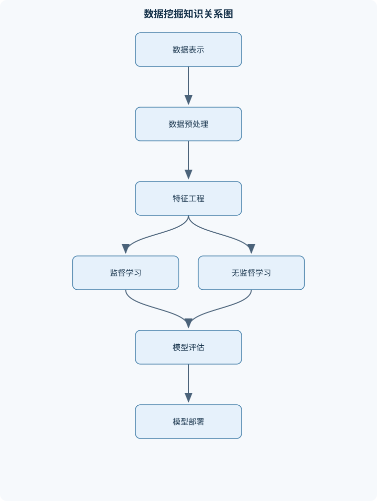
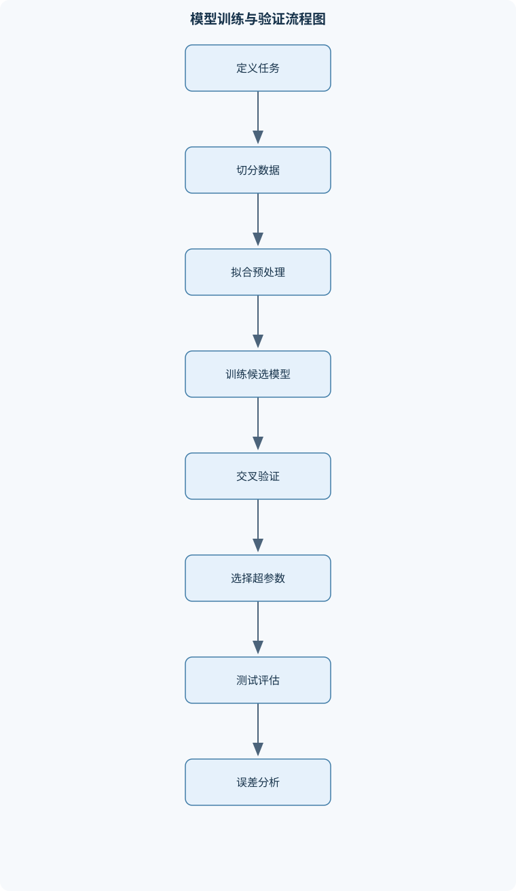

# 数据挖掘导论

## 一、课程整体知识框架

### 课程边界与先修知识

本课程介绍从数据表示、数据预处理、统计建模到模式发现的完整数据挖掘流程，重点覆盖监督学习、无监督学习、模型评估、特征表示、降维、文本主题分析和推荐系统中的矩阵分解。课程适合具备高等数学、线性代数、概率统计和基础编程知识的学习者。数学先修包括向量与矩阵运算、偏导数、梯度、极值、概率分布、条件概率、期望与方差；编程先修包括数组操作、函数、文件数据处理和基本可视化。课程不以特定软件版本或特定数据集为前提，强调算法目标、假设、推导、实现流程和适用边界。





### 1. 课程定位与核心问题

数据挖掘是从规模较大的、可能包含噪声和不完整信息的数据中，发现可用于预测、分类、分群、解释或决策支持的规律。它既不同于仅描述数据的统计汇总，也不同于只追求拟合训练样本的算法实现。一个完整的数据挖掘任务必须同时回答四个问题：数据中有哪些可表示的对象和变量；数据是否经过可靠的清洗与变换；模型依据什么目标进行学习；模型在未见样本和实际业务约束下是否仍然有效。

课程统一使用数据集

$$
D=\{(x_i,y_i)\}_{i=1}^{n}
$$

表示带标签数据，其中$n$为样本数，$x_i\in\mathbb{R}^{p}$为含有$p$个特征的输入向量，$y_i$为标签或连续响应值。设计矩阵记为$X\in\mathbb{R}^{n\times p}$，其第$i$行为$x_i^T$。模型输出记为

$$
\hat y=f(x;w,b),
$$

其中$w$为训练过程中估计的参数，$b$为偏置或截距。参数与超参数必须区分：参数由训练数据和优化过程确定，超参数如正则化强度、树深度、聚类数和学习率，则在训练前设定或通过验证过程选择。

### 2. 从数据到模型的统一流程

数据挖掘通常按照“问题定义—数据表示—数据切分—预处理—特征工程—模型训练—模型选择—最终评估—部署监控”的链条展开。问题定义首先确定预测对象、预测时点、目标变量和错误代价。例如，预测某用户未来是否购买属于分类任务，预测订单金额属于回归任务，寻找用户群体结构属于聚类任务，依据历史评分估计未评分项目的偏好属于推荐任务。

数据切分必须先于依赖数据统计量的预处理。常见划分包括训练集、验证集和测试集：训练集用于估计参数，验证集用于比较模型或选择超参数，测试集只在模型和处理流程确定后进行最终评估。测试集信息不得参与清洗规则、特征选择、标准化参数、主题数或正则化强度的选择，否则测试结果会偏乐观。若数据具有时间顺序，应使用过去预测未来的时间切分；若同一用户、设备或实体有多条记录，应按实体分组切分，避免同一实体同时进入训练集和测试集。

预处理器必须仅在训练部分拟合。例如，对第$j$个数值特征计算训练集均值$\mu_j$和标准差$s_j$，再进行

$$
z_{ij}=\frac{x_{ij}-\mu_j}{s_j}.
$$

其中$x_{ij}$与$\mu_j$具有相同单位，$z_{ij}$无量纲。若$s_j=0$，说明训练集中该特征没有变化，应删除该特征或明确将其作为常数处理，不能直接除以零。验证集、测试集和线上样本必须使用训练集得到的$\mu_j$和$s_j$，不能重新计算。

### 3. 学习范式与任务类型

监督学习的每个样本具有目标值$y_i$。回归预测连续量，例如价格、温度或需求量；分类预测离散类别，例如是否违约或属于哪种类型。分类模型可输出类别，也可输出条件概率

$$
P(Y=c\mid X=x).
$$

概率输出与最终类别并不等价，必须通过阈值或排序规则转化为决策。无监督学习没有预先给定的目标标签，主要包括聚类、降维、潜变量分析和主题发现。无监督结果描述的是数据表示下的结构，不自动等同于真实类别、因果机制或自然群体。

经验风险用于表示模型在样本上的平均损失：

$$
\hat R(f)=\frac{1}{n}\sum_{i=1}^{n}\ell(y_i,f(x_i)).
$$

其中$\ell$为损失函数。经验风险低并不保证泛化误差低，因为模型可能记住训练样本中的偶然噪声。一般化的正则化目标为

$$
\hat R(f)+\lambda\Omega(w),
$$

其中$\lambda\geq 0$控制拟合误差与模型复杂度之间的权衡，$\Omega(w)$是复杂度惩罚。$\lambda$过小可能过拟合，过大可能欠拟合；最优取值依赖数据规模、噪声水平、特征相关性和评价目标。

### 4. 评价、比较与不确定性

回归常用均方误差

$$
\operatorname{MSE}=\frac{1}{m}\sum_{i=1}^{m}(y_i-\hat y_i)^2
$$

和平均绝对误差

$$
\operatorname{MAE}=\frac{1}{m}\sum_{i=1}^{m}|y_i-\hat y_i|.
$$

MSE的单位是响应变量单位的平方，对大误差更敏感；MAE与响应变量同单位，对异常大误差相对不敏感。决定系数$R^2$衡量相对于基准均值预测的解释程度，但在分布外数据或目标均值变化时不能简单理解为因果解释比例。

二分类评价依赖混淆矩阵。TP、TN、FP、FN分别是真正例、真负例、假正例和假负例。准确率、精确率和召回率分别为

$$
\operatorname{Accuracy}=\frac{TP+TN}{TP+TN+FP+FN},
$$

$$
\operatorname{Precision}=\frac{TP}{TP+FP},\qquad
\operatorname{Recall}=\frac{TP}{TP+FN}.
$$

F1值为精确率与召回率的调和平均：

$$
F1=\frac{2\operatorname{Precision}\operatorname{Recall}}
{\operatorname{Precision}+\operatorname{Recall}}.
$$

在类别极不平衡时，准确率可能很高而少数类完全无法识别。例如，正类只占$1\%$时，全部预测为负类可得到约$99\%$准确率，但召回率为零。因此评价应结合业务代价、PR曲线、阈值变化和分层误差分析。概率模型还需要检查校准，即预测为$0.8$的一组样本是否约有$80\%$实际为正类。

交叉验证在训练数据内部进行。$K$折交叉验证将训练数据划分为$K$个互不重叠的折，依次用$K-1$折训练、剩余一折验证，并汇总各折得分。分类任务通常采用分层切分；同一用户或实体的记录应采用分组切分；时间序列则不能任意随机打乱。交叉验证只能估计特定采样和切分假设下的性能，不能保证未来分布不变。

### 5. 线性模型、正则化与分类边界

线性回归用特征的线性组合预测连续响应。最小二乘目标为

$$
J(w)=\frac12\|y-Xw\|_2^2.
$$

对$w$求梯度：

$$
\nabla J=X^T(Xw-y).
$$

令梯度为零得到正规方程

$$
X^TXw=X^Ty.
$$

当$X^TX$可逆时，

$$
\hat w=(X^TX)^{-1}X^Ty.
$$

该表达式适用于线性模型、平方损失以及矩阵条件良好的情形。实际计算不应优先显式求逆，因为特征共线或尺度差异较大时会产生数值不稳定，应采用线性方程求解、QR分解、SVD或迭代方法。

岭回归加入二范数惩罚：

$$
J_{\mathrm{ridge}}(w)=\frac12\|y-Xw\|_2^2+\frac{\lambda}{2}\|w\|_2^2.
$$

其梯度条件为

$$
(X^TX+\lambda I)w=X^Ty.
$$

$\lambda>0$通常改善矩阵稳定性，但会收缩系数；截距通常不正则化。LASSO使用$\lambda\|w\|_1$，绝对值函数在零点不可微，需要用次梯度分析。其重要性质是可能产生精确为零的系数，因而可用于稀疏选择，但相关特征之间的选择可能不稳定。弹性网络结合二范数和一范数，在相关变量成组保留与稀疏性之间折中。

逻辑回归用于二分类，令

$$
P(Y=1\mid x)=\sigma(w^Tx+b),\qquad
\sigma(t)=\frac{1}{1+e^{-t}}.
$$

由伯努利似然取负对数得到

$$
\ell(y,p)=-y\log p-(1-y)\log(1-p).
$$

对线性得分的导数为$p-y$，因此可用梯度法优化。逻辑回归是判别式模型，直接学习条件概率；生成式分类模型则先描述各类别的特征分布和类别先验，再通过贝叶斯公式计算后验概率。支持向量机通过最大化分类间隔构造边界。不可分时使用松弛变量$\xi_i$，满足

$$
y_i(w^Tx_i+b)\geq 1-\xi_i,\qquad \xi_i\geq0,
$$

并在目标中惩罚$\sum_i\xi_i$。核技巧可将内积替换为核函数，但核参数、特征尺度和样本数量会显著影响计算成本与结果。

### 6. 树模型、集成学习与神经网络

决策树通过递归划分特征空间完成预测。分类节点的不纯度可用基尼指数

$$
G=1-\sum_c p_c^2
$$

或熵

$$
H=-\sum_c p_c\log p_c
$$

表示，其中$p_c$是节点内类别$c$的比例。候选切分的质量由切分前后加权不纯度下降衡量。回归树通常用子节点平方误差或方差下降作为准则。树深越大通常越能降低训练误差，但也可能增加方差，因此需要最大深度、最小叶节点样本数、预剪枝或后剪枝。

随机森林通过样本自助采样和节点随机特征子集训练多棵树，分类时投票，回归时平均。随机化降低树之间的相关性，通常可以降低单棵深树的方差。梯度提升则按顺序训练弱学习器，每一步拟合当前损失的负梯度，以逐步修正残差。集成模型的特征重要性不等同于因果效应；在强相关特征存在时，分裂增益、置换重要性和扰动解释可能产生不同结论。

神经网络由线性变换与非线性激活组成。单层计算为

$$
a^{(l)}=W^{(l)}h^{(l-1)}+b^{(l)},\qquad
h^{(l)}=\phi(a^{(l)}).
$$

反向传播利用链式法则计算各层梯度。误差信号可递推为

$$
\delta^{(l)}
=(W^{(l+1)T}\delta^{(l+1)})\odot\phi'(a^{(l)}),
$$

权重梯度为

$$
\frac{\partial J}{\partial W^{(l)}}=
\delta^{(l)}h^{(l-1)T}.
$$

初始化、学习率、批量大小、归一化、正则化和早停共同影响训练。卷积层利用局部连接和权重共享提取局部模式，池化可降低空间分辨率，但会损失精细位置信息。深度表示能形成有用的特征变换，却不自动保证可解释、稳定或具有因果含义。

### 7. 聚类、降维与潜变量

K均值聚类最小化

$$
\sum_{i=1}^{n}\|x_i-\mu_{z_i}\|_2^2,
$$

其中$z_i\in\{1,\ldots,K\}$为簇标签，$\mu_k$为第$k$个中心。固定中心时，分配每个样本到最近中心不会增加目标；固定分配时，簇内平方损失的最优中心是样本均值。因此交替执行分配和更新可使目标不增，但只能保证收敛到局部最优。K均值适合尺度可比、近似球状且均值有意义的数据；对异常值、长条形簇和不同密度簇较敏感。K中心点用实际样本作为中心，通常比均值更抗异常值。层次凝聚聚类从单样本簇开始逐步合并，单链接容易产生链式效应，完全链接偏好紧凑簇，平均链接处于两者之间。

高斯混合模型表示为

$$
P(x)=\sum_{k=1}^{K}\pi_k\mathcal N(x\mid\mu_k,\Sigma_k),
$$

其中$\pi_k\geq0$且$\sum_k\pi_k=1$。它产生软分配而非强制的单一标签。期望最大化算法在E步计算责任度，在M步按责任度更新权重、均值和协方差；似然通常不下降，但可能收敛到局部极值或协方差退化。密度聚类依据局部邻域密度识别簇，可将低密度样本标记为噪声；谱聚类则依据相似图的特征向量进行嵌入，适合非凸结构，但相似度构造会直接影响结果。

主成分分析先对数值数据中心化。若中心化矩阵仍记为$X$，协方差矩阵为

$$
S=\frac1nX^TX.
$$

最大化单位方向上的投影方差$v^TSv$，约束$\|v\|_2=1$，构造拉格朗日函数并求导得到

$$
Sv=\lambda v.
$$

最大特征值对应方向保留最大方差，前$r$个特征向量构成低维子空间。PCA最大化的是线性方差，不保证保留分类边界或业务语义。SVD

$$
X=U\Sigma V^T
$$

可用于获得低秩近似；保留前$r$个奇异值所得矩阵是秩不超过$r$时Frobenius误差最小的近似。若特征量纲差异大，是否标准化会改变主成分；异常值也可能主导协方差结构。随机投影则通过较低维随机方向近似保持样本间距离，但解释性通常弱于PCA。

### 8. 文本主题与推荐系统

文本首先需要转化为数值表示。词袋模型记录文档中词项的出现或计数，忽略词序和长距离上下文。TF-IDF可写为

$$
\operatorname{tfidf}(t,d)
=\operatorname{tf}(t,d)\log\frac{N}{\operatorname{df}(t)},
$$

其中$N$为文档数，$\operatorname{df}(t)$为包含词项$t$的文档数。常见词的逆文档频率较低，稀有但具有区分度的词权重相对较高。潜在语义分析通过词—文档矩阵的低秩分解发现隐含语义方向；概率主题模型则假设文档由多个主题混合生成，主题数、词表、停用词处理和主题解释都会影响结果。主题是统计表示，不必然对应人工定义的真实主题。

推荐系统可把用户—物品评分表示为稀疏矩阵$R$。矩阵分解假设评分由低维用户因子和物品因子内积近似：

$$
R_{ij}\approx u_i^Tv_j.
$$

只对观测集合$\Omega$优化：

$$
\sum_{(i,j)\in\Omega}
(R_{ij}-u_i^Tv_j)^2
+\lambda(\|U\|_F^2+\|V\|_F^2).
$$

未评分不等于负反馈，不能机械把缺失项当作零。交替最小二乘固定一组因子、求解另一组，再交替迭代。推荐评价既包括评分预测误差，也包括排序指标；离线指标不能完全替代线上用户行为和长期效果。冷启动、稀疏性、流行度偏差和观测选择偏差是矩阵分解的主要边界。

### 9. 实际应用边界与治理要求

数据挖掘模型的有效性依赖训练数据与应用环境之间的关系。数据漂移包括特征分布变化、标签关系变化和标签比例变化；因此部署后应监控输入质量、缺失率、预测分布、延迟、分层性能和真实标签反馈。公平性要求检查不同群体的错误率、机会获得和资源分配是否出现不可接受差异；隐私保护要求限制不必要的数据收集、访问和暴露；可解释性应根据使用场景区分全局规律、个体预测解释和模型审计。预测相关性不能单独证明因果关系，高准确率、低重构误差或高特征重要性都不能直接推出干预效果。

## 二、章节和模块划分

### 核心知识覆盖清单

本清单用于检查正文是否覆盖本课程的主要知识模块：

- **数据挖掘问题与学习范式**：数据挖掘任务定义、样本、特征与标签、监督学习与无监督学习、回归、分类与聚类、训练集验证集测试集、经验风险与泛化误差、参数与超参数、过拟合与欠拟合、数据挖掘流程与可复现性。
- **数据表示、清洗与特征工程**：结构化数据表示、缺失值机制与处理、异常值识别与处理、类别变量编码、数值特征标准化、数据泄漏与时间切分、特征选择与特征构造、文本向量化、类别不平衡处理。
- **模型评估与统计学习基础**：损失函数与评价指标、回归评价指标、分类混淆矩阵、准确率、召回率与F1值、概率输出与阈值选择、交叉验证、分层抽样与分组切分、超参数搜索、置换检验与不确定性、模型比较与误差分析。
- **线性回归与正则化**：最小二乘回归、矩阵形式的线性模型、正规方程、梯度下降求解、偏差与方差、岭回归、LASSO回归、弹性网络、贝叶斯线性回归、共线性与可解释性。
- **线性分类与支持向量机**：逻辑回归、对数损失与极大似然、线性判别边界、生成式与判别式分类、多分类策略、软间隔支持向量机、间隔最大化、合页损失、对偶问题与核技巧、类别权重与概率校准。
- **决策树与集成学习**：树模型的递归划分、信息增益、基尼指数、回归树分裂准则、剪枝与复杂度控制、装袋法、随机森林、随机特征子集、梯度提升思想、特征重要性与集成误差。
- **神经网络与深度表示**：感知机与多层前馈网络、激活函数、反向传播、链式法则、批量梯度下降、初始化与归一化、正则化与早停、卷积层与局部连接、池化与权重共享、表示学习边界。
- **聚类与相似性分析**：距离与相似度、K均值聚类、K中心点聚类、层次聚类、凝聚式聚类、高斯混合模型、软聚类与期望最大化、密度聚类与噪声点、谱聚类、聚类数选择与内部评价。
- **降维、潜变量与文本主题**：主成分分析、协方差矩阵与特征分解、奇异值分解、低维嵌入与可视化、随机投影、潜在语义分析、词袋模型与TF-IDF、概率主题模型、主题数与主题解释、降维的信息损失。
- **矩阵分解、推荐与综合实践**：用户物品评分矩阵、低秩近似、非负矩阵分解、隐语义因子模型、交替最小二乘、推荐预测与排序评价、冷启动问题、端到端挖掘流程、数据漂移与模型监控、公平性、隐私与可解释性。


### 1. 数据挖掘问题与学习范式

本章建立统一符号和完整流程。首先区分样本、特征、标签、响应变量、参数和超参数，再说明监督学习与无监督学习的目标差异。回归输出连续值，分类输出离散类别或类别概率，聚类寻找相似样本群组，降维寻找低维表示。训练集、验证集和测试集的功能不同，经验风险描述样本内表现，泛化误差描述未见数据表现。过拟合是模型过度利用训练样本中的偶然规律，欠拟合则是模型表达能力不足或正则化过强。章节还介绍可复现性，包括固定数据版本、记录切分规则、保存预处理参数、记录随机种子和完整报告评价指标。

### 2. 数据表示、清洗与特征工程

本章讨论结构化表格、稀疏矩阵、文本词项矩阵和用户—物品矩阵的表示方式。缺失值需要先判断机制：完全随机缺失、依赖已观测变量的缺失和依赖未观测值的缺失，所需处理不能一概而论。可采用删除、常数填补、统计量填补或模型填补，但填补过程必须嵌入训练流程。异常值应区分录入错误、测量故障、真实极端事件和分布变化，不能仅因数值较大就删除。类别变量可用独热编码、序数编码或目标编码，但目标编码必须防止标签泄漏。数值标准化对线性模型、距离模型、核方法和神经网络通常重要，对基于阈值分裂的树模型通常不是必要条件。

特征选择通过删除无关、冗余或不稳定变量降低复杂度；特征构造则利用业务逻辑形成比原始变量更有用的比率、交互项、时间窗口和聚合变量。时间窗口必须只使用预测时点之前的信息。类别不平衡可通过类别权重、重采样、阈值调整或合适评价指标处理，但重采样也必须只在训练折内执行。文本特征包括词袋、TF-IDF和主题表示，用户—物品数据则要保留观测集合，不能把缺失评分直接视为零分。

### 3. 模型评估与统计学习基础

本章从损失函数出发建立评价体系。平方损失强调大误差，绝对损失对异常值更稳健，对数损失评价概率预测，合页损失强调分类间隔。分类评价需要同时报告混淆矩阵、准确率、精确率、召回率、F1值和特异度；阈值变化会引起精确率与召回率的权衡。交叉验证、分层抽样、分组切分和时间切分分别对应不同数据独立性假设。超参数搜索可采用网格搜索或随机搜索，但搜索过程本身会利用验证结果，因此最终测试集必须保持独立。置换检验可通过随机打乱标签或组别构造无效假设下的比较分布；不确定性分析还应考虑样本量、切分随机性、测量误差和数据漂移。

### 4. 线性回归与正则化

本章从标量最小二乘推导矩阵形式。通过展开平方损失得到梯度，再由一阶最优条件得到正规方程。正规方程需要$X^TX$可逆；当特征共线、特征数高于样本数或矩阵条件数很大时，应使用岭回归、QR分解或SVD。梯度下降不要求显式构造逆矩阵，但学习率过大可能发散，过小则收敛缓慢。偏差—方差分析解释正则化为何可能增加训练误差却降低测试误差。LASSO使用一范数产生稀疏性，坐标下降利用软阈值处理不可微点；弹性网络结合岭和LASSO的性质。贝叶斯线性回归通过先验与似然得到后验分布，能够表达参数不确定性，但先验选择会影响结果。共线性会使系数解释不稳定，即使预测性能尚可，也不能把单个系数简单解释为独立因果作用。

### 5. 线性分类与支持向量机

本章推导逻辑回归的Sigmoid输出、伯努利似然和对数损失，解释其线性判别边界及概率输出。多分类可使用一对其余、一对一或直接的多项逻辑模型；不同策略的训练成本和概率整合方式不同。生成式分类模型描述类别条件分布，判别式模型直接学习条件边界。支持向量机从几何间隔出发，硬间隔只适合线性可分情形，软间隔通过$C$控制间隔与违约之间的权衡。合页损失对远离边界且分类正确的样本不再增加惩罚。对偶问题和核技巧可以处理非线性边界，但核矩阵的存储和计算可能随样本数快速增长。类别权重和概率校准分别解决类别代价不对称与分数不具备可靠概率含义的问题。

### 6. 决策树与集成学习

本章说明树模型如何递归划分样本空间。信息增益来自熵下降，基尼指数反映节点内类别混杂程度；两者可能在候选切分较多或类别分布不同的情况下选择不同特征。回归树以平方误差或绝对误差为分裂依据。树的复杂度由深度、叶节点数和最小样本量控制，剪枝可减少对噪声的拟合。装袋法通过自助采样平均多个模型，随机森林进一步随机选择特征，降低树间相关性。梯度提升以残差或负梯度为学习目标，通常具有较强拟合能力，但需要控制树深、学习率和迭代轮数。集成误差应通过独立验证和分层分析确认，不能只根据训练误差或单一特征重要性判断模型质量。

### 7. 神经网络与深度表示

本章从感知机和多层前馈网络开始，说明非线性激活使网络具备表达复杂函数的能力。反向传播按链式法则计算梯度，小批量梯度下降在计算效率和梯度噪声之间折中。初始化不当会造成梯度消失或爆炸；归一化、合适激活函数和学习率调度可改善优化。权重衰减、丢弃、数据增强和早停用于降低过拟合。卷积层通过局部连接和权重共享提取空间或序列局部模式，池化降低分辨率并增强局部平移鲁棒性。深度表示适合复杂感知任务，但需要较多数据、计算资源和严格的验证，不能把训练损失下降直接视为泛化能力提高。

### 8. 聚类与相似性分析

本章先讨论距离与相似度的选择。欧氏距离受量纲影响，余弦相似度更关注方向，曼哈顿距离对坐标差异进行绝对值累加。K均值适用于近似球状簇，K中心点对异常值更稳健但计算可能更昂贵。层次聚类不必预先指定完整树结构中的簇数，可通过树状结构选择切分高度；链接准则不同会产生不同几何偏好。高斯混合模型以概率密度刻画软聚类，EM算法在责任度和参数之间交替优化。密度聚类可识别噪声和非凸簇，但对邻域半径和最小样本数敏感。谱聚类依赖相似图和图拉普拉斯特征向量。聚类数可结合轮廓系数、簇内误差、稳定性和领域解释选择，不能仅依据某一内部指标。

### 9. 降维、潜变量与文本主题

本章比较PCA、SVD、随机投影和主题模型。PCA通过协方差特征分解寻找最大方差方向，SVD直接提供正交低秩分解；二者对中心化、标准化、缺失值和异常值处理十分敏感。降维维数可根据累计解释方差、下游任务性能、重构误差和可视化目标选择。低维投影必然存在信息损失，二维图中的近邻关系不一定代表原空间关系。文本部分从分词、词表构造、停用词处理和TF-IDF开始，再介绍潜在语义分析和概率主题模型。主题数过少会混合不同语义，过多则产生碎片化主题；主题解释需要结合高权重词、代表文档和稳定性，不能只依据自动编号。

### 10. 矩阵分解、推荐与综合实践

本章从稀疏用户—物品评分矩阵出发介绍低秩近似、非负矩阵分解和隐语义因子模型。非负约束有助于形成部分可解释的加性成分，但不保证唯一分解。隐语义模型用用户因子与物品因子内积预测评分，交替最小二乘通过交替求解两个子问题完成训练。推荐系统除了预测误差，还需评价排序质量、覆盖率、多样性、新颖性和校准。冷启动要求利用用户或物品侧信息；观测偏差要求识别热门项目曝光更多、未评分含义不明确等问题。综合实践将全流程连接起来，并加入数据漂移监控、模型版本管理、隐私保护、公平性检查、可解释性报告和上线后的回滚条件。

## 三、核心概念的详细解释

### 1. 数据挖掘任务、数据表示与学习范式

数据挖掘的对象是由样本、特征和标签构成的数据集合。统一记号为

$$
D=\{(x_i,y_i)\}_{i=1}^{n},
$$

其中$n$为样本数，$x_i\in\mathbb{R}^{p}$为第$i$个样本的$p$维特征向量，$y_i$为标签或连续响应值。将所有样本按行排列得到设计矩阵$X\in\mathbb{R}^{n\times p}$。数值特征可以直接组成向量；类别特征、文本、时间序列和图结构则需要经过编码或专门表示后才能进入多数模型。

监督学习有明确的目标变量。回归预测连续数值，分类预测离散类别。例如，预测订单金额属于回归，预测用户是否流失属于二分类，预测商品类别属于多分类。无监督学习没有预先给定的标签，聚类用于发现样本群体，降维用于寻找低维表示，主题模型用于发现文本中的潜在语义成分。无监督结果反映的是给定特征表示和相似性定义下的结构，不自动等于真实类别，也不能单独证明因果关系。

参数是由训练数据估计的量，例如线性模型中的$w$和$b$；超参数是在训练前设定或通过验证选择的量，例如正则化强度$\lambda$、树的最大深度、聚类数$K$和神经网络学习率。模型训练通常最小化经验风险：

$$
\hat R(f)=\frac{1}{n}\sum_{i=1}^{n}\ell(y_i,f(x_i)),
$$

其中$\ell$是损失函数。经验风险只衡量训练样本表现，泛化误差则衡量模型在来自目标分布的未见样本上的表现。训练误差很低而测试误差很高，通常表示过拟合；训练误差和测试误差都较高，可能表示欠拟合、特征不足、模型偏差较大或数据质量较差。

训练集用于估计参数，验证集用于选择模型和超参数，测试集用于最终一次性评估。任何依赖数据分布的操作，包括缺失值填补、标准化、特征选择、词表建立和降维，都必须只在训练部分拟合。若样本含有时间顺序，应使用过去预测未来的时间切分；若同一用户、设备或实体有多条记录，应按实体分组切分，否则训练集和测试集中的重复实体会造成信息泄漏。

### 2. 数据清洗与特征工程

缺失值的处理必须考虑缺失机制。完全随机缺失表示缺失与观测值和未观测值均无关；随机缺失表示缺失概率可能依赖已观测变量；非随机缺失则可能与缺失值本身有关。简单均值填补适用于缺失比例较低且分布近似稳定的数值特征，但会压低方差；中位数对极端值更稳健；类别变量可增加“未知”类别。若缺失本身具有业务含义，应增加缺失指示变量。复杂填补模型必须在每个训练折内部拟合，不能先对全体数据填补再交叉验证。

异常值可能来自录入错误、测量故障，也可能是真实但罕见的对象。箱线图规则、稳健标准分数、分位数范围和模型残差都可以辅助识别，但“异常”不是“必须删除”的同义词。删除、截尾、变换或保留异常点的选择取决于任务目标。若异常值代表真实高风险客户，删除它会使模型失去重要信息。

类别变量可采用独热编码、序数编码、频数编码或目标编码。独热编码不应把没有顺序的类别强行映射成整数；目标编码必须在训练折内部计算，否则类别的标签信息会泄漏。高基数类别可能导致维度过高，此时可使用正则化编码、哈希表示或实体嵌入，但必须监控碰撞和稀有类别问题。

标准化将特征变为可比较尺度：

$$
z_{ij}=\frac{x_{ij}-\mu_j}{s_j},
$$

其中$\mu_j$和$s_j$分别为训练集第$j$个特征的均值和标准差，$z_{ij}$无量纲。若$s_j=0$，该特征在训练集中为常数，应删除或固定处理。标准化通常对线性模型、距离模型、核方法、神经网络和PCA重要；决策树按阈值分裂，通常不依赖特征尺度。

文本常用词袋模型表示。对文档分词、清理、建立词表后，可用词频或TF-IDF表示文档。词项$t$在文档$d$中的权重为

$$
\operatorname{tfidf}(t,d)
=
\operatorname{tf}(t,d)\log\frac{N}{\operatorname{df}(t)},
$$

其中$N$为文档数，$\operatorname{df}(t)$为包含$t$的文档数。TF-IDF降低普遍词的权重，但不表达词序、否定范围和深层语义。文本分类还应注意类别不平衡、长文档词频偏置和训练测试词表泄漏。

特征选择包括过滤式、包裹式和嵌入式方法。相关性筛选、互信息属于过滤式方法；递归特征消除属于包裹式方法；LASSO和树模型分裂则属于嵌入式方法。特征构造可以使用比值、时间窗口统计、交互项、对数变换和领域聚合，但构造变量必须严格遵守预测时点，不能使用未来信息。

### 3. 模型评估与误差分析

二分类混淆矩阵由TP、TN、FP、FN组成。准确率、精确率、召回率和特异度分别为

$$
\operatorname{Accuracy}=\frac{TP+TN}{TP+TN+FP+FN},
$$

$$
\operatorname{Precision}=\frac{TP}{TP+FP},\qquad
\operatorname{Recall}=\frac{TP}{TP+FN},
$$

$$
\operatorname{Specificity}=\frac{TN}{TN+FP}.
$$

精确率回答“预测为正的样本中有多少是真的正例”，召回率回答“所有正例中有多少被找出”。二者的调和平均为

$$
F_1=\frac{2\operatorname{Precision}\operatorname{Recall}}
{\operatorname{Precision}+\operatorname{Recall}}.
$$

类别严重不平衡时，准确率可能具有欺骗性。例如正类只占$1\%$时，全部预测为负类的准确率可达$99\%$，但召回率为$0$。此时应同时报告混淆矩阵、精确率、召回率、F1、PR曲线和业务代价。概率模型的阈值不必固定为$0.5$，应依据误报和漏报代价、资源容量及风险容忍度选择。

回归常用均方误差、均方根误差、平均绝对误差和决定系数。均方误差为

$$
\operatorname{MSE}=\frac{1}{n}\sum_{i=1}^{n}(y_i-\hat y_i)^2,
$$

其单位是响应变量单位的平方，对大误差敏感；均方根误差的单位与$y$相同；平均绝对误差为

$$
\operatorname{MAE}=\frac{1}{n}\sum_{i=1}^{n}|y_i-\hat y_i|,
$$

对异常误差更稳健。决定系数$R^2$衡量相对基准均值模型的解释程度，但在分布变化、非线性关系或外推场景下不能简单解释为因果解释率。

$K$折交叉验证将训练数据分为$K$个互不重叠的折，每次用$K-1$折训练、剩余一折验证，最后汇总平均得分和离散程度。分类任务可采用分层抽样；同一实体的记录必须处于同一折；时间数据不能随机打乱。超参数搜索必须嵌套在训练过程内，测试集不可用于反复调参。模型比较除了平均指标，还要检查置信区间、误差分布、分组表现、校准度、稳定性和计算成本。

### 4. 线性模型、分类器与正则化

线性回归假设响应可由特征的线性组合近似：

$$
\hat y=Xw.
$$

平方损失适合误差近似对称、极端误差需要较大惩罚的情形。岭回归加入二范数惩罚，LASSO加入一范数惩罚，弹性网络同时使用两者。岭回归通常使相关特征共同收缩，LASSO倾向产生零系数，因此可用于稀疏选择，但在强相关变量之间选择可能不稳定。截距通常不正则化；特征未标准化时，惩罚会不公平地影响不同量纲的系数。

逻辑回归通过Sigmoid函数输出二分类概率：

$$
p_i=P(Y=1\mid x_i)=\sigma(w^Tx_i+b),
\qquad
\sigma(t)=\frac{1}{1+e^{-t}}.
$$

对数损失为

$$
\ell_i=-y_i\log p_i-(1-y_i)\log(1-p_i).
$$

若线性得分为$a_i=w^Tx_i+b$，则

$$
\frac{\partial \ell_i}{\partial a_i}=p_i-y_i.
$$

因此对权重的梯度为

$$
\nabla_wJ=X^T(p-y).
$$

逻辑回归是判别式模型，直接建模条件概率；朴素贝叶斯等生成式模型则建模类别先验和条件分布。多分类可使用一对多、成对分类或Softmax。概率输出需要校准，分类正确率高不代表概率可靠。

支持向量机通过最大化分类间隔提高泛化能力。硬间隔条件为

$$
y_i(w^Tx_i+b)\geq 1,
$$

目标为最小化$\frac12\|w\|_2^2$。不可完全分离时引入$\xi_i\geq0$：

$$
y_i(w^Tx_i+b)\geq1-\xi_i,
$$

并最小化

$$
\frac12\|w\|_2^2+C\sum_i\xi_i.
$$

对应的合页损失为$\max(0,1-y_i(w^Tx_i+b))$。核技巧用核函数计算隐式高维空间中的内积，可构造非线性边界，但样本规模增大时计算和存储成本可能快速上升。

### 5. 树模型、集成学习与神经网络

决策树递归选择特征和阈值，使子节点的不纯度尽可能下降。分类树可使用基尼不纯度

$$
G=1-\sum_cp_c^2
$$

或熵

$$
H=-\sum_cp_c\log p_c.
$$

候选划分的收益等于父节点不纯度减去按样本比例加权的子节点不纯度。回归树通常以子节点平方误差下降为准。树深增加通常降低训练误差，却可能增加方差；预剪枝限制深度和叶节点样本数，后剪枝则依据验证表现删除复杂分支。

装袋法对样本进行自助采样并训练多棵模型，再平均或投票。随机森林在每个节点随机抽取特征子集，降低树之间的相关性，通常比单棵深树更稳健。梯度提升则逐轮拟合当前模型的残差或负梯度，逐步降低损失。树模型可处理非线性和特征交互，但特征重要性不等同于因果效应，相关特征会使分裂增益、置换重要性和扰动解释产生差异。

神经网络由线性变换和激活函数叠加构成：

$$
a^{(l)}=W^{(l)}h^{(l-1)}+b^{(l)},\qquad
h^{(l)}=\phi(a^{(l)}).
$$

反向传播利用链式法则计算梯度。若下一层误差信号为$\delta^{(l+1)}$，则

$$
\delta^{(l)}
=
\left(W^{(l+1)T}\delta^{(l+1)}\right)
\odot\phi'(a^{(l)}).
$$

批量梯度下降、小批量训练、权重衰减、早停和归一化用于改善优化与泛化。卷积层使用局部连接和权重共享提取局部模式，池化降低空间分辨率，但可能损失精细位置信息。深度表示适合复杂非线性任务，却需要更多数据、计算资源和严格的独立验证。

### 6. 聚类、降维、文本主题与推荐

K均值最小化

$$
J=\sum_{i=1}^{n}\|x_i-\mu_{z_i}\|_2^2.
$$

固定中心时，将样本分配给最近中心不会增加$J$；固定分配时，某簇的最优平方损失中心是该簇样本均值。因此交替执行“分配—更新”会使目标不增，但只能收敛到局部最优。K均值适合尺度可比、近似球状且均值有意义的簇；异常值和初始化会显著影响结果。K中心点以真实样本作为中心，对异常值更稳健。

层次凝聚聚类从每个样本一簇开始，反复合并最近的簇。单链接容易产生链式效应，完全链接偏好紧凑簇，平均链接处于二者之间。高斯混合模型以概率密度表示软聚类：

$$
P(x)=\sum_{k=1}^{K}\pi_k\mathcal N(x\mid\mu_k,\Sigma_k).
$$

EM算法的E步计算责任度，M步按责任度加权更新参数。协方差矩阵可能退化，需设置协方差下限或限制其形式。密度聚类能够识别噪声和非凸结构，但依赖邻域参数。聚类数可综合轮廓系数、稳定性、簇内误差和领域解释确定。

PCA先对数据中心化，再对协方差矩阵

$$
S=\frac1nX^TX
$$

进行特征分解。最大化投影方差$v^TSv$并约束$\|v\|_2=1$，拉格朗日条件给出

$$
Sv=\lambda v.
$$

最大特征值对应的特征向量是第一主成分方向。SVD将矩阵写为

$$
X=U\Sigma V^T.
$$

保留前$r$个奇异值所得的$X_r=U_r\Sigma_rV_r^T$，是在秩不超过$r$的矩阵中Frobenius误差最小的低秩近似。PCA最大化的是方差，不保证保留分类边界或因果信息；二维投影中的距离也不一定等同于原空间距离。

推荐系统将用户—物品评分矩阵$R$视为部分观测矩阵。隐因子模型用用户向量$u_i$和物品向量$v_j$预测

$$
\hat R_{ij}=u_i^Tv_j.
$$

只在观测集合$\Omega$上优化：

$$
\min_{U,V}
\sum_{(i,j)\in\Omega}(R_{ij}-u_i^Tv_j)^2
+\lambda(\|U\|_F^2+\|V\|_F^2).
$$

交替最小二乘固定$V$求$U$，再固定$U$求$V$，循环至目标变化足够小或达到最大轮数。未评分不等于负反馈，热门物品曝光更多会造成观测偏差。评价推荐系统不能只看评分误差，还应考察排序质量、覆盖率、多样性、新颖性、冷启动表现和群体公平性。

## 四、重要定义、公式、定理和推导

### 专业审校补充：关键定义与适用边界

隐式反馈推荐与显式评分推荐必须区分。显式评分矩阵中的数值通常表示用户主动给出的评分，未观测项只表示没有评分；隐式反馈中的点击、浏览、收藏或购买同时受用户偏好和曝光机会影响，未观测项不能直接视为负样本。设观测集合为$\Omega$，用户因子为$u_i\in\mathbb{R}^r$，物品因子为$v_j\in\mathbb{R}^r$，隐式反馈可用置信度加权目标：$$\min_{U,V}\sum_{i,j}c_{ij}(p_{ij}-u_i^Tv_j)^2+\lambda(\|U\|_F^2+\|V\|_F^2),$$其中$p_{ij}\in\{0,1\}$表示是否观察到行为，$c_{ij}>0$表示该观测的可信度，通常对行为样本和未观察样本采用不同权重。固定$V$时，用户因子的正规方程为$\left(V^TC_iV+\lambda I\right)u_i=V^TC_i p_i$。该模型适合排序或偏好强度近似问题，但不能自动消除曝光偏差、流行度偏差和选择偏差；若未观察项实际上从未展示给用户，将其作为负反馈会扭曲目标。


### 1. 线性回归、岭回归与LASSO推导

最小二乘目标定义为

$$
J(w)=\frac12\|y-Xw\|_2^2
=\frac12(y-Xw)^T(y-Xw).
$$

展开并对$w$求梯度：

$$
\nabla_wJ
=
\frac12\nabla_w
\left(y^Ty-2w^TX^Ty+w^TX^TXw\right)
=
X^TXw-X^Ty.
$$

令梯度为零，得到正规方程：

$$
X^TXw=X^Ty.
$$

当$X^TX$可逆时，

$$
\hat w=(X^TX)^{-1}X^Ty.
$$

该结果要求损失为平方损失，模型对参数线性，并且矩阵可逆。特征完全共线或$p>n$时，$X^TX$可能不可逆；即使可逆，近似共线也会造成数值不稳定。实际计算应优先使用QR分解、SVD或线性方程求解，而不是显式求逆。

岭回归目标为

$$
J_\lambda(w)=
\frac12\|y-Xw\|_2^2+\frac{\lambda}{2}\|w\|_2^2,
\qquad \lambda\geq0.
$$

求梯度得

$$
\nabla J_\lambda
=
X^TXw-X^Ty+\lambda w.
$$

令其为零：

$$
(X^TX+\lambda I)w=X^Ty,
$$

所以

$$
\hat w_\lambda
=
(X^TX+\lambda I)^{-1}X^Ty.
$$

当$\lambda>0$时，惩罚会收缩系数并改善病态矩阵的稳定性，但通常增加训练误差；验证误差是否下降取决于偏差和方差的权衡。截距应通过中心化或不纳入惩罚的方式处理。

LASSO目标为

$$
J(w)=\frac12\|y-Xw\|_2^2+\lambda\|w\|_1.
$$

由于$|w_j|$在$0$处不可微，最优条件使用次梯度。对单个坐标进行优化时，令其他坐标固定，得到软阈值形式：

$$
w_j\leftarrow
\frac{S(z_j,\lambda)}{a_j},
\qquad
S(z,\lambda)=\operatorname{sign}(z)\max(|z|-\lambda,0).
$$

当$|z_j|\leq\lambda$时，$w_j=0$，这解释了LASSO产生稀疏系数的原因。该结论依赖凸优化目标和正确收敛；强相关变量下，具体保留哪一个变量可能随样本扰动而改变。

### 2. 逻辑回归与梯度下降

给定样本$(x_i,y_i)$，$y_i\in\{0,1\}$，令

$$
p_i=\sigma(w^Tx_i+b).
$$

伯努利似然为

$$
L(w,b)=\prod_{i=1}^{n}p_i^{y_i}(1-p_i)^{1-y_i}.
$$

取负对数得到

$$
-\log L
=
-\sum_{i=1}^{n}
\left[
y_i\log p_i+(1-y_i)\log(1-p_i)
\right].
$$

因此，对数损失是伯努利极大似然估计的等价优化目标。由于

$$
\sigma'(a)=\sigma(a)(1-\sigma(a)),
$$

对单个线性得分$a_i$求导可得

$$
\frac{\partial\ell_i}{\partial a_i}=p_i-y_i.
$$

若设计矩阵已经包含截距列，则梯度写成$X^T(p-y)$。学习率为$\eta>0$时，梯度下降更新为

$$
w\leftarrow w-\eta X^T(p-y).
$$

学习率过大可能导致目标震荡，过小则收敛缓慢。逻辑回归的决策边界在二分类中为$w^Tx+b=0$，但概率是否校准不能由边界准确率推出。

### 3. K均值算法的单调性

K均值的输入是样本矩阵$X$、簇数$K$、初始化方式和停止条件，输出是簇标签$z_i$与中心$\mu_k$。算法为：

1. 初始化$K$个中心；
2. 对每个样本计算到各中心的距离，令$z_i$为最近中心的编号；
3. 对每个簇更新中心：
   $$
   \mu_k=\frac{1}{|\mathcal C_k|}
   \sum_{i:z_i=k}x_i;
   $$
4. 若标签不变、目标下降小于阈值或达到最大迭代次数，则终止，否则返回第2步。

固定中心时，选择最近中心使每个样本的平方距离最小，因此分配步骤不会增加目标。固定标签时，对某簇求

$$
\sum_{i:z_i=k}\|x_i-\mu_k\|_2^2
$$

关于$\mu_k$的导数并令其为零，可得样本均值，所以更新步骤也不会增加目标。目标函数非负且每轮不增，故算法在有限精度下通常终止；但该性质不保证得到全局最优。不同初始化可能得到不同局部解，应采用多次初始化并比较目标值。

### 4. PCA与低秩近似

设数据已中心化，第一主成分方向$v$满足$\|v\|_2=1$。样本投影为$Xv$，其方差为

$$
\frac1n\|Xv\|_2^2
=
v^T\left(\frac1nX^TX\right)v
=
v^TSv.
$$

构造拉格朗日函数

$$
\mathcal L(v,\lambda)=v^TSv-\lambda(v^Tv-1).
$$

对$v$求导并令零：

$$
2Sv-2\lambda v=0,
$$

因此

$$
Sv=\lambda v.
$$

在单位约束下，最大化方差的方向是最大特征值对应的特征向量。若保留前$r$个方向组成$V_r$，低维坐标为

$$
Z=XV_r.
$$

总方差等于所有特征值之和，前$r$个主成分的解释方差比例为

$$
\frac{\sum_{j=1}^{r}\lambda_j}
{\sum_{j=1}^{p}\lambda_j}.
$$

该比例只有在中心化、变量量纲和缺失处理合理时才具有可比解释。若某特征单位很大，其方差可能主导PCA；标准化后分析的是相关结构而非原始协方差结构。

### 5. 代表性算法流程与代码示例

下面的伪代码展示不依赖特定软件版本的训练流程。输入为带标签数据、模型、超参数候选集合和评价指标；输出为最终模型及测试报告。关键不变量是测试集不参与预处理拟合和参数选择。

```python
# Python：交叉验证选择模型并进行最终评估
def train_and_evaluate(data, labels, model_factory, candidates, metric):
    train_data, test_data, train_labels, test_labels = \
        group_or_time_split(data, labels)

    best_score = None
    best_config = None

    for config in candidates:
        fold_scores = []
        for train_fold, valid_fold in cross_validation_splits(train_data):
            # 预处理器只在当前训练折拟合
            preprocessor = fit_preprocessor(train_fold.X)
            X_fit = preprocessor.transform(train_fold.X)
            X_valid = preprocessor.transform(valid_fold.X)

            model = model_factory(config)
            model.fit(X_fit, train_fold.y)
            prediction = model.predict(X_valid)
            fold_scores.append(metric(valid_fold.y, prediction))

        score = average(fold_scores)
        if best_score is None or score > best_score:
            best_score = score
            best_config = config

    # 选定超参数后，才在完整训练集上重新拟合
    final_preprocessor = fit_preprocessor(train_data.X)
    X_train = final_preprocessor.transform(train_data.X)
    X_test = final_preprocessor.transform(test_data.X)

    final_model = model_factory(best_config)
    final_model.fit(X_train, train_data.y)
    test_prediction = final_model.predict(X_test)

    return final_model, metric(test_data.y, test_prediction)
```

若数据具有用户分组或时间顺序，`cross_validation_splits`必须替换为分组切分或滚动时间切分；不能机械使用随机折叠。若预处理器在全部数据上提前拟合，验证折的均值、方差、词频或特征选择结果会进入训练过程，导致评估偏乐观。

### 6. 典型例题

#### 例题一：混淆矩阵指标

**题干：**某分类器在测试集上得到$TP=80$、$TN=850$、$FP=50$、$FN=20$，计算准确率、精确率、召回率和$F_1$值。

**解答：**样本总数为$1000$。因此

$$
\operatorname{Accuracy}=\frac{80+850}{1000}=0.93,
$$

$$
\operatorname{Precision}=\frac{80}{80+50}\approx0.615,
$$

$$
\operatorname{Recall}=\frac{80}{80+20}=0.8.
$$

于是

$$
F_1=
\frac{2\times0.615\times0.8}{0.615+0.8}
\approx0.696.
$$

**验证与变式：**若漏报代价高，应优先提高召回率，即降低分类阈值，但精确率可能下降。若负类占绝大多数，仅报告$93\%$准确率会掩盖正类仍有$20\%$未被识别的事实。

#### 例题二：岭回归正规方程

**题干：**给定目标向量$y$和设计矩阵$X$，说明为什么在$X^TX$不可逆时不能直接使用最小二乘正规方程，并给出岭回归处理方式。

**分析：**不可逆通常来自特征完全共线、重复特征或$p>n$。此时最小二乘解可能不唯一，数值计算也会不稳定。

**解答：**最小二乘满足

$$
X^TXw=X^Ty.
$$

若$X^TX$不可逆，无法唯一求解。加入岭惩罚后得到

$$
(X^TX+\lambda I)w=X^Ty,\qquad\lambda>0.
$$

在合适维度下，$\lambda I$提高矩阵的正定性，所得解唯一。应通过验证集选择$\lambda$，而不是根据测试集反复调整。

**变式：**若特征量纲不同，应先在训练集内标准化；否则同一$\lambda$对不同特征的收缩力度不可比较。

#### 例题三：K均值一轮迭代

**题干：**二维样本为$(1,1)$、$(1,3)$、$(8,8)$、$(9,8)$，初始中心为$\mu_1=(1,1)$、$\mu_2=(8,8)$，执行一次分配和更新。

**解答：**前两个样本距离$\mu_1$更近，后两个样本距离$\mu_2$更近，因此

$$
\mathcal C_1=\{(1,1),(1,3)\},\qquad
\mathcal C_2=\{(8,8),(9,8)\}.
$$

更新中心为

$$
\mu_1'=\left(1,\frac{1+3}{2}\right)=(1,2),
$$

$$
\mu_2'=\left(\frac{8+9}{2},8\right)=(8.5,8).
$$

重新分配时，四个点仍分别属于原来的簇，算法达到稳定分配。

**验证与变式：**若初始两个中心都位于左侧，可能暂时产生空簇或得到较差局部解。实际训练应处理空簇，并使用多次初始化比较最终目标函数。

#### 例题四：TF-IDF计算

**题干：**有$N=4$篇文档，词项“模型”出现在其中$2$篇；在某文档中出现$3$次。若词频直接取出现次数，计算其未归一化TF-IDF。

**解答：**

$$
\operatorname{tfidf}
=
3\log\frac{4}{2}
=
3\log2.
$$

若采用自然对数，结果约为$2.079$。该词在当前文档中出现较多，但只出现在一半文档中，因此具有一定区分度。若一个词出现在全部文档中，则$\log(N/N)=0$，其IDF权重为零。

**变式：**不同实现可能使用平滑IDF、归一化词频或向量归一化，因此比较数值时必须说明具体定义。TF-IDF不能识别“没有风险”和“有风险”的否定关系。

#### 例题五：矩阵分解预测

**题干：**某用户潜在因子为$u=(2,1)$，某物品因子为$v=(1,3)$，无偏置时预测评分。

**解答：**预测值是内积：

$$
\hat R=u^Tv=2\times1+1\times3=5.
$$

该预测只表示模型在潜在空间中的估计，不代表用户一定会给出评分$5$。若加入用户偏置$b_u$、物品偏置$b_v$和全局均值$\mu$，预测可写为

$$
\hat R_{ij}=\mu+b_i+b_j+u_i^Tv_j.
$$

**变式：**若该用户或物品没有历史评分，因子估计不可靠，属于冷启动问题，应结合人口属性、内容特征或热门度基线。

### 7. 实验与项目流程

#### 实验一：比较预处理是否泄漏

**输入数据：**含数值特征、缺失值和二分类标签的数据集。  
**步骤：**

1. 按分层原则划分训练集和测试集；
2. 在训练集内部进行$K$折交叉验证；
3. 方案A在每一折训练子集内拟合填补器和标准化器；
4. 方案B先用所有训练数据拟合预处理器，再进行交叉验证；
5. 比较两种方案的交叉验证得分和最终测试得分。

**评价标准：**比较平均验证指标、折间标准差、测试集指标及混淆矩阵。若方案B的验证结果异常优越而测试表现没有同步提高，可能存在泄漏或选择偏差。

**排错方法：**检查预处理器的均值、方差、缺失统计和词表是否由单个训练折独立产生；检查重复实体是否跨折；检查标签编码和特征筛选是否在切分之前完成。

#### 实验二：用户—物品矩阵分解推荐

**输入数据：**稀疏评分记录$(用户,物品,评分)$、潜在维数$r$和正则化系数$\lambda$。  
**步骤：**

1. 按时间将早期评分作为训练集、后期评分作为测试集；
2. 仅在训练观测集合$\Omega$上初始化并优化$U,V$；
3. 用交替最小二乘更新用户因子和物品因子；
4. 对测试用户生成未观测物品的预测分数；
5. 排除用户已交互物品，形成候选排序；
6. 计算RMSE、Precision@K、Recall@K、覆盖率和新颖性。

**评价标准：**预测误差衡量评分拟合，排序指标衡量推荐前列的有效性；覆盖率和多样性用于防止系统只推荐少数热门项目。还应分组报告新用户、长尾物品和不同用户群体的结果。

**排错方法：**确认未评分项没有被错误地当作零评分；确认测试期信息未参与训练；检查因子维度、观测索引和正则化项是否一致；若训练损失下降而排序指标下降，应检查流行度偏差、评分预测与排序目标不一致或候选集构造错误。

## 五、算法、流程和实现思路

### 方法与流程覆盖索引

下列方法或流程应在正文中说明输入、步骤、适用条件、结果检查和边界：

- 数据挖掘建模流程：输入为原始样本、任务定义和评价目标，输出为经过验证的模型及误差报告。过程为定义预测对象和时间边界，按独立性原则切分训练集、验证集和测试集，在训练集内完成清洗与特征变换，使用交叉验证选择超参数，在固定测试集上进行一次最终评估，最后进行分层误差分析和部署监控。关键不变量是测试集信息不得进入训练和调参流程；若数据具有时间、用户或实体分组结构，应按组或时间切分。
- 标准化预处理：输入为训练矩阵$X_{train}$和待变换矩阵，输出为尺度可比较的特征。对每个特征仅用训练集计算均值$\mu_j$和标准差$s_j$，变换为$z_{ij}=(x_{ij}-\mu_j)/s_j$，再将同一组统计量应用到验证集、测试集和线上样本。若$s_j=0$则该特征无训练集方差，应删除或采用明确的常数处理。时间复杂度为$O(np)$，空间复杂度为$O(p)$。
- K折交叉验证：输入为训练数据、折数$K$和候选超参数集合，输出为每组超参数的平均验证得分及选定参数。将样本划分为$K$个互不重叠的折，依次用$K-1$折训练并在剩余一折评估，汇总$K$次得分后选择目标指标最优或满足复杂度约束的参数。分类任务可分层，群组或时间数据不可随意随机打乱。若每次拟合复杂度为$T$、候选参数数为$G$，复杂度约为$O(KGT)$。
- 岭回归训练：输入为特征矩阵$X$、响应向量$y$和惩罚系数$\lambda\ge0$，输出为回归系数。先决定是否包含截距并对特征进行训练集标准化，构造$X^TX+\lambda I$，求解线性方程而非显式求逆，得到系数并在验证集选择$\lambda$。当特征维数很高时可使用迭代优化。直接分解的典型复杂度约为$O(np^2+p^3)$，不适用于极端稀疏或超高维而未作专门优化的场景。
- 坐标下降求解LASSO：输入为标准化设计矩阵、响应、惩罚系数和收敛容差，输出为稀疏系数。固定其他坐标，计算当前坐标的部分残差，对一维二次目标使用软阈值更新$w_j\leftarrow S(z_j,\lambda)/a_j$，循环扫描全部坐标直至目标变化或参数变化低于容差。凸目标保证全局最优条件下的收敛，但强相关变量和未标准化特征会影响选择结果。每轮通常为$O(np)$，总复杂度取决于迭代轮数。
- 决策树训练：输入为带标签样本、最大深度、最小叶节点样本数等约束，输出为树结构。对每个候选节点枚举特征和切分阈值，计算加权不纯度下降，选择最大下降的切分；递归处理子节点，达到纯度、深度、样本数或无有效切分条件时停止，并可用验证集剪枝。排序后寻找阈值可降低枚举成本；树模型对高基数类别、微小样本和数据漂移需谨慎。
- 随机森林训练：输入为训练数据、树数、每棵树的样本自助采样规则和候选特征数，输出为多棵树及聚合预测器。对每棵树抽取自助样本，在每个节点随机抽取特征并进行最优分裂，生长到停止条件；分类取多数投票，回归取平均，也可利用袋外样本估计误差。若单树训练成本为$T$、树数为$B$，总复杂度近似为$O(BT)$，可并行但内存随树数增长。
- 反向传播与小批量训练：输入为网络参数、带标签小批量和损失函数，输出为更新后的参数。前向计算各层激活和损失，反向按链式法则计算梯度，使用学习率更新参数，并重复至达到轮数、验证集早停或梯度收敛。每轮必须保持参数和梯度形状一致；数值上应处理激活饱和、梯度爆炸和训练集与验证集分布差异。一次小批量更新复杂度约与网络参数量和批量大小的乘积相关。
- K均值聚类：输入为无标签样本、簇数$K$、初始化方式和停止阈值，输出为簇分配和中心。初始化中心，重复执行将每个样本分配给最近中心、按分配结果更新中心，直到分配不变、目标下降小于阈值或达到最大迭代次数。目标函数每轮不增，但初始化会影响局部最优；标准实现每轮复杂度约为$O(nKp)$，适合近似球状、尺度可比且使用均值有意义的数据。
- 层次凝聚聚类：输入为样本或距离矩阵、簇间距离定义和停止规则，输出为树状聚类结构或指定簇数的切分。初始每个样本为一簇，反复合并距离最近的两个簇，记录合并距离并更新簇间距离，直到只剩一簇或达到停止条件。单链接易产生链式效应，完全链接偏好紧凑簇，平均链接折中；朴素实现时间复杂度可达$O(n^3)$，大规模数据需使用高效优先队列或近似方法。





### 1. 可复现的数据挖掘总流程

数据挖掘流程的输入是原始记录、任务目标和评价标准，输出是经过验证的模型、误差分析报告及可部署的处理流程。完整过程应固定为：定义任务与预测时点，确认样本单位和标签，按时间或实体关系切分数据，在训练部分拟合预处理器，构造特征，训练候选模型，利用交叉验证选择超参数，在未参与调参的测试集上进行最终评估，最后进行分组误差分析和上线监控。

设数据集为

$$
D=\{(x_i,y_i)\}_{i=1}^{n},
$$

其中$x_i\in\mathbb{R}^{p}$是第$i$个样本的特征向量，$y_i$是标签或连续响应。若预测目标发生在未来，则样本特征必须只使用预测时点之前已经可获得的信息。例如，用订单完成后的退款状态预测订单是否退款，会把结果信息泄漏到特征中；即使模型测试指标很高，也不具有上线意义。

数据切分的关键不变量是：测试集信息不得进入训练、特征工程和超参数选择。独立同分布且样本相互独立时，可以随机切分；时间数据应按时间顺序切分；同一用户、设备、患者或商品具有多条记录时，应按实体分组切分。随机切分时间数据可能让未来行为进入训练集，随机切分实体数据则可能使同一实体的高度相似记录同时出现在训练集和测试集中。

### 2. 预处理、特征工程与实现边界

对数值特征进行标准化时，只用训练集计算统计量：

$$
z_{ij}=\frac{x_{ij}-\mu_j}{s_j}.
$$

其中$x_{ij}$和$\mu_j$具有相同单位，$s_j$也具有该单位，$z_{ij}$无量纲。若$s_j=0$，说明该特征在训练集内为常数，应删除或作为常数处理。验证集、测试集和线上数据必须使用同一组$\mu_j,s_j$，不能分别重新计算。

缺失值处理要区分“缺失没有信息”和“缺失本身有信息”。均值填补会降低方差，中位数填补对异常值更稳健；若“未填写收入”本身表示某种行为，应增加缺失指示变量。目标编码、特征选择、PCA、词表建立和TF-IDF统计都必须在训练折内完成。先对全部数据填补或标准化，再进行交叉验证，会将验证折的分布信息泄漏给训练过程。

类别变量不能机械地映射为整数。例如，将“红、绿、蓝”编码为$1,2,3$会人为引入大小关系。独热编码适合类别数较少的变量；高基数类别可使用频数编码、正则化目标编码、哈希表示或嵌入表示。目标编码必须严格按训练折计算，并防止同一记录的标签直接参与自身编码。

文本特征通常经过分词、词表构造、词频统计和向量化。TF-IDF可以写为

$$
\operatorname{tfidf}(t,d)=\operatorname{tf}(t,d)\log\frac{N}{\operatorname{df}(t)},
$$

其中$N$是文档数，$\operatorname{df}(t)$是包含词项$t$的文档数。常见词的逆文档频率较小，稀有但有区分度的词权重较高。词袋模型和TF-IDF不表达词序、否定范围和深层语义，因此“没有风险”和“有风险”可能被部分相同的词项表示。

类别不平衡时，不能只看准确率。若正类比例为$1\%$，始终预测负类也能取得约$99\%$准确率，却完全不能识别正类。应根据业务代价选择类别权重、重采样、阈值或评价指标，并确保重采样只发生在训练折内。

### 3. 监督学习算法流程

#### 3.1 线性回归、岭回归与LASSO

线性回归假设响应可由特征的线性组合近似：

$$
\hat y=Xw.
$$

最小二乘目标为

$$
J(w)=\frac12\|y-Xw\|_2^2.
$$

对$w$求梯度：

$$
\nabla J=X^T(Xw-y).
$$

令梯度为零，得到正规方程：

$$
X^TXw=X^Ty.
$$

当$X^TX$可逆时，

$$
\hat w=(X^TX)^{-1}X^Ty.
$$

这里的“逆矩阵”是理论表达，实际计算不应直接求逆，而应优先使用QR分解、SVD或线性方程求解器。若特征共线，$X^TX$可能奇异或病态，系数会对微小扰动十分敏感。

岭回归加入二范数惩罚：

$$
J_{\mathrm{ridge}}(w)=\frac12\|y-Xw\|_2^2+\frac{\lambda}{2}\|w\|_2^2.
$$

其一阶条件为

$$
(X^TX+\lambda I)w=X^Ty.
$$

$\lambda>0$通常改善数值稳定性，但会使系数收缩，增大偏差。截距通常不正则化，因此实际实现中应先对特征中心化或显式区分截距。LASSO使用一范数惩罚：

$$
J_{\mathrm{lasso}}(w)=\frac12\|y-Xw\|_2^2+\lambda\|w\|_1.
$$

由于$|w_j|$在零点不可微，求解使用次梯度或坐标下降。其软阈值更新形式为

$$
w_j\leftarrow \frac{S(z_j,\lambda)}{a_j},
\qquad
S(z,\lambda)=\operatorname{sign}(z)\max(|z|-\lambda,0).
$$

LASSO倾向于产生精确零系数，可用于稀疏选择；但当多个特征高度相关时，可能任意选择其中一部分，选择结果不稳定。弹性网络结合一范数和二范数，兼顾稀疏性与相关变量的成组收缩。

#### 3.2 逻辑回归、支持向量机与概率决策

二分类逻辑回归令

$$
P(Y=1\mid x)=\sigma(w^Tx+b),
\qquad
\sigma(t)=\frac{1}{1+e^{-t}}.
$$

对样本$(x_i,y_i)$，负对数似然损失为

$$
\ell_i=-y_i\log p_i-(1-y_i)\log(1-p_i),
$$

其中$p_i=\sigma(w^Tx_i+b)$。线性得分的导数为$p_i-y_i$，因此可用梯度下降、拟牛顿法或其他凸优化方法训练。默认阈值$0.5$并非自然法则；提高阈值通常会减少假正例、提高精确率，但可能降低召回率。

支持向量机通过扩大分类间隔提高泛化能力。硬间隔条件为

$$
y_i(w^Tx_i+b)\geq 1.
$$

数据不可完全线性可分时引入松弛变量$\xi_i\geq0$：

$$
y_i(w^Tx_i+b)\geq1-\xi_i,
$$

并最小化

$$
\frac12\|w\|_2^2+C\sum_i\xi_i.
$$

$C$越大，越重视训练样本的分类约束，可能降低训练误差但增加过拟合风险；$C$较小时，允许更多违反间隔的样本。合页损失为

$$
\max(0,1-y_i(w^Tx_i+b)).
$$

核技巧通过内积核隐式映射到高维空间，但核矩阵的存储和计算通常随样本数快速增长。特征尺度会影响距离和核值，因此核方法通常需要标准化。SVM的原始输出不是天然校准概率，若需要风险概率，应额外进行概率校准，并在独立验证流程中完成。

#### 3.3 决策树、随机森林与梯度提升

决策树在节点上选择特征和阈值，把样本递归划分为子集。分类树可用基尼不纯度

$$
G=1-\sum_c p_c^2
$$

或熵

$$
H=-\sum_c p_c\log p_c
$$

衡量节点混杂程度。一次划分的收益是划分前不纯度减去按子节点样本比例加权的不纯度。回归树通常选择使子节点平方误差最小的切分。

树深增加通常降低训练误差，但可能提高方差。最大深度、最小叶节点样本数、最小不纯度下降和剪枝都可控制复杂度。树模型通常不需要标准化，因为它只比较特征阈值；但高基数类别、极少数样本叶节点和分布漂移会使树结构不稳定。

随机森林对样本进行自助采样，并在每个节点随机抽取部分特征建树。分类时多数投票，回归时平均预测。样本和特征的双重随机性降低了树之间的相关性，通常能降低单棵深树的方差。袋外样本可以估计泛化误差，但不能替代与业务场景一致的时间或实体测试集。

梯度提升逐步拟合当前模型的残差或损失负梯度：

$$
F_m(x)=F_{m-1}(x)+\eta h_m(x),
$$

其中$h_m$是第$m$棵弱学习器，$\eta$是学习率。树数、树深度和学习率共同决定复杂度。小学习率通常需要更多树；过深的基学习器可能迅速过拟合。

#### 3.4 神经网络训练

多层前馈网络的第$l$层可写为

$$
a^{(l)}=W^{(l)}h^{(l-1)}+b^{(l)},
\qquad
h^{(l)}=\phi(a^{(l)}).
$$

反向传播利用链式法则计算梯度：

$$
\delta^{(l)}
=
\left(W^{(l+1)T}\delta^{(l+1)}\right)
\odot\phi'(a^{(l)}).
$$

权重梯度为

$$
\frac{\partial J}{\partial W^{(l)}}=
\delta^{(l)}h^{(l-1)T}.
$$

小批量训练每次从样本子集估计梯度，并按

$$
W\leftarrow W-\eta\nabla_WJ
$$

更新参数。初始化过小可能导致梯度消失，过大可能导致梯度爆炸；激活饱和、学习率过大、输入尺度不一致也会造成训练失败。批量归一化或其他归一化方法可以改善优化，但其统计量也必须遵守训练和推理阶段的区别。

卷积层通过局部连接和权重共享提取局部模式，池化降低空间分辨率并增强一定程度的平移鲁棒性。卷积结构适用于具有局部邻域关系的数据，不能把“使用卷积”理解为对所有表格数据都更优。权重衰减、丢弃、数据增强和早停可抑制过拟合，但训练损失下降不等于测试性能提高。

#### 3.5 可复现训练伪代码

下面的流程展示如何把预处理、交叉验证、超参数选择和最终评估分开。代码不依赖联网或外部文件执行。

```python
# python
from dataclasses import dataclass
import math
import random

@dataclass
class Standardizer:
    mean: list | None = None
    std: list | None = None

    def fit(self, X):
        n = len(X)
        p = len(X[0])
        self.mean = [sum(row[j] for row in X) / n for j in range(p)]
        self.std = []
        for j in range(p):
            var = sum((row[j] - self.mean[j]) ** 2 for row in X) / n
            self.std.append(math.sqrt(var))
        return self

    def transform(self, X):
        if self.mean is None or self.std is None:
            raise ValueError("standardizer has not been fitted")
        result = []
        for row in X:
            new_row = []
            for x, mu, s in zip(row, self.mean, self.std):
                # 常数特征在变换后置为0
                new_row.append(0.0 if s == 0 else (x - mu) / s)
            result.append(new_row)
        return result

def accuracy(y_true, y_pred):
    return sum(a == b for a, b in zip(y_true, y_pred)) / len(y_true)

def train_linear_classifier(X, y, lr=0.05, epochs=200):
    # 教材示例：用梯度下降训练带偏置的二分类线性模型
    p = len(X[0])
    w = [0.0] * p
    b = 0.0

    def sigmoid(t):
        t = max(min(t, 30.0), -30.0)
        return 1.0 / (1.0 + math.exp(-t))

    for _ in range(epochs):
        grad_w = [0.0] * p
        grad_b = 0.0
        for row, target in zip(X, y):
            prob = sigmoid(sum(a * c for a, c in zip(row, w)) + b)
            error = prob - target
            for j in range(p):
                grad_w[j] += error * row[j]
            grad_b += error
        n = len(X)
        for j in range(p):
            w[j] -= lr * grad_w[j] / n
        b -= lr * grad_b / n
    return w, b

def predict(X, model, threshold=0.5):
    w, b = model
    result = []
    for row in X:
        score = sum(a * c for a, c in zip(row, w)) + b
        prob = 1.0 / (1.0 + math.exp(-max(min(score, 30), -30)))
        result.append(1 if prob >= threshold else 0)
    return result

# 每个训练折内部单独拟合标准化器，避免验证信息泄漏
def fit_one_fold(X_train, y_train, X_valid, y_valid):
    scaler = Standardizer().fit(X_train)
    X_train_z = scaler.transform(X_train)
    X_valid_z = scaler.transform(X_valid)
    model = train_linear_classifier(X_train_z, y_train)
    pred = predict(X_valid_z, model)
    return accuracy(y_valid, pred)
```

该代码的关键不是具体实现规模，而是数据流边界：`Standardizer.fit`只能接收训练折；验证集只能调用`transform`；阈值是决策超参数，若通过验证集选择，则测试集必须保持未使用状态。

### 4. 无监督学习与潜变量算法

#### 4.1 K均值与K中心点

K均值最小化

$$
\sum_{i=1}^{n}\|x_i-\mu_{z_i}\|_2^2.
$$

固定中心时，每个样本选择最近中心不会增加目标；固定分配时，平方损失最小的中心是该簇样本均值。因此交替执行“分配—更新”会使目标函数不增，但只能保证收敛到局部最优。其一次迭代复杂度约为$O(nKp)$。

K均值适合尺度可比、近似球状且均值有意义的簇。异常值会显著移动均值；细长簇、环形簇和密度差异很大的簇通常不适合直接使用。K中心点用实际样本作为中心，对异常值更稳健，但搜索成本通常更高。

#### 4.2 层次聚类、密度聚类和谱聚类

凝聚式层次聚类从每个样本一簇开始，反复合并距离最近的两个簇。单链接使用两簇间最小距离，容易产生链式结构；完全链接使用最大距离，偏好紧凑簇；平均链接是折中方案。层次方法可先构造完整树状结构，再按合并高度切分，因此不一定一开始就确定最终簇数。朴素实现时间复杂度可达$O(n^3)$，大规模数据需使用高效数据结构或近似方法。

密度聚类依据邻域密度识别核心点、边界点和噪声点，能够发现非凸簇，也不必预先指定簇数。但邻域半径和最小样本数对结果影响很大，密度差异明显的簇可能难以用同一组参数识别。

谱聚类先构造相似图，再对图拉普拉斯矩阵进行特征分解，利用低维特征向量进行聚类。它适合图结构或非线性相似关系，但相似度定义、图稀疏化和特征分解成本决定了结果质量。聚类标签编号没有顺序，标签$0$和标签$1$互换不代表模型改变。

#### 4.3 高斯混合模型与EM

高斯混合模型表示为

$$
P(x)=\sum_{k=1}^{K}\pi_k\mathcal N(x\mid\mu_k,\Sigma_k),
$$

其中$\pi_k\geq0$且$\sum_k\pi_k=1$。与K均值的硬分配不同，高斯混合模型给出样本属于各成分的责任度：

$$
\gamma_{ik}
=
\frac{\pi_k\mathcal N(x_i\mid\mu_k,\Sigma_k)}
{\sum_{r=1}^{K}\pi_r\mathcal N(x_i\mid\mu_r,\Sigma_r)}.
$$

E步计算责任度，M步根据责任度加权更新$\pi_k,\mu_k,\Sigma_k$。对数似然在理想数值条件下不下降，但可能停留在局部极值；协方差矩阵还可能退化为接近奇异。可通过协方差下限、对角协方差、正则化和多次初始化缓解。

#### 4.4 PCA、SVD与文本主题分析

中心化数据的协方差矩阵为

$$
S=\frac1nX^TX.
$$

最大化投影方差$v^TSv$并约束$\|v\|_2=1$，构造拉格朗日函数并求导：

$$
Sv=\lambda v.
$$

因此最大特征值对应的特征向量是第一主成分方向，前$r$个特征向量构成低维空间。若变量量纲不同，未标准化PCA可能被数值范围大的变量支配；若异常值存在，协方差也可能被少数点主导。PCA保留的是线性方差，不保证保留分类边界或因果信息。

SVD写为

$$
X=U\Sigma V^T.
$$

保留前$r$个奇异值可得

$$
X_r=U_r\Sigma_rV_r^T,
$$

这是秩不超过$r$的矩阵中Frobenius误差最小的低秩近似。对缺失数据直接进行普通SVD会产生问题，通常需要填补、加权分解或专门的缺失值方法。

潜在语义分析通常对TF-IDF矩阵进行SVD，以较少的潜在方向表达词项和文档的共现结构。概率主题模型则把文档看作主题分布的混合，把词项看作主题条件分布的生成结果。主题数过少会混合不同语义，过多会形成碎片化主题；主题解释应结合高权重词、代表文档、主题稳定性和业务含义，不能仅依据主题编号。

### 5. 推荐系统中的矩阵分解

设用户—物品评分矩阵为$R$，观测集合为$\Omega$。隐语义因子模型用用户因子$u_i$和物品因子$v_j$预测：

$$
\hat R_{ij}=u_i^Tv_j.
$$

只在已观测评分上优化：

$$
\min_{U,V}
\sum_{(i,j)\in\Omega}
(R_{ij}-u_i^Tv_j)^2
+\lambda(\|U\|_F^2+\|V\|_F^2).
$$

未评分不等于零分，因此不能把整个矩阵中的空值直接当作负反馈。交替最小二乘固定$V$求$U$，再固定$U$求$V$，循环至目标变化小于阈值、参数变化足够小或达到最大迭代次数。潜在维数$r$过小会欠拟合，过大则可能过拟合并增加计算成本。

推荐评价应区分评分预测和排序效果。RMSE适合评价数值预测误差；Precision@K和Recall@K评价前$K$个推荐是否命中；覆盖率、多样性、新颖性和校准度用于衡量系统是否只集中推荐少数热门项目。冷启动用户或物品缺少历史交互，需要结合内容特征、人口属性、上下文、热门度或探索策略。热门项目被曝光更多会造成观测偏差，推荐结果不能简单解释为全部用户真实偏好。

### 6. 综合实验与排错流程

#### 实验一：模型评估与数据泄漏检查

**输入数据：**包含数值特征、缺失值和二分类标签的数据集。  
**步骤：**

1. 根据任务的时间或实体关系划分训练集与测试集；
2. 在训练集内建立分层$K$折；
3. 每一折只用训练子折拟合填补器、标准化器和特征选择器；
4. 训练逻辑回归、树模型或其他候选模型；
5. 记录准确率、精确率、召回率、F1值和PR曲线；
6. 固定处理流程和超参数后，在测试集上只评估一次；
7. 按类别、时间段、用户群体和缺失程度进行误差分析。

**评价标准：**指标必须与错误代价对应；类别不平衡时重点查看少数类召回率和PR曲线；分组指标差异过大时，需要分析数据量、标签质量和分布差异。

**排错方法：**检查预处理器是否在全体数据上拟合，检查同一实体是否跨折，检查标签或未来字段是否进入特征，检查测试集是否被重复用于调参。若训练指标很高而测试指标大幅下降，应优先检查泄漏、时间切分和重复记录。

#### 实验二：聚类和降维的稳定性分析

**输入数据：**数值样本或文本向量、候选簇数、PCA维数和聚类算法。  
**步骤：**

1. 检查量纲、缺失值、异常值和稀疏程度；
2. 分别使用原始尺度、标准化尺度和必要的降维表示；
3. 对K均值使用多次不同初始化；
4. 比较轮廓系数、簇内平方误差、簇大小和不同初始化的一致性；
5. 对层次聚类比较不同链接准则；
6. 对文本主题结合高权重词和代表文档解释主题；
7. 在下游分类、检索或推荐任务中检验降维表示是否有实际增益。

**评价标准：**不能只选择某个内部指标最高的方案；还应考察稳定性、簇的可解释性、业务可用性和下游性能。二维可视化只能作为辅助，不应作为结构真实性的充分证据。

**排错方法：**检查特征是否被少数大尺度变量支配，检查异常点是否形成虚假簇，检查距离度量是否适合数据类型，检查PCA是否在全体数据上拟合，检查主题是否只是停用词或高频词差异。

## 六、概念之间的关系与对比

### 1. 监督学习、无监督学习与推荐学习

| 对比维度 | 监督学习 | 无监督学习 | 推荐中的矩阵分解 |
|---|---|---|---|
| 是否有标签 | 有明确$y_i$ | 没有预先标签 | 只有部分交互或评分 |
| 主要目标 | 预测或分类 | 发现结构、降维、主题 | 预测偏好并进行排序 |
| 常见算法 | 回归、逻辑回归、树、神经网络 | K均值、GMM、PCA、主题模型 | 协同过滤、ALS、低秩分解 |
| 主要评价 | 损失、RMSE、F1、校准 | 稳定性、轮廓系数、解释性 | RMSE、Recall@K、覆盖率 |
| 主要风险 | 过拟合、标签泄漏 | 把算法结构误认为真实群体 | 未评分误当负反馈、冷启动 |

监督学习的优化目标直接依赖标签；无监督学习的目标依赖距离、似然或重构误差，因此结果对表示和相似度定义非常敏感。推荐系统介于二者之间：评分记录提供监督信号，但观测机制通常不是随机抽样，用户没有评分可能是未看到、未使用或无兴趣，不能简单解释为负标签。

### 2. 回归、分类与概率决策

回归输出连续值，平方损失会强调大误差，适合误差代价随数值差异增长的场景；绝对误差对异常值更稳健。分类输出类别或概率，概率必须经过阈值才能形成决策。一个模型可以保持相同的排序能力，却因阈值改变而产生不同的精确率和召回率。

准确率为

$$
\frac{TP+TN}{TP+TN+FP+FN},
$$

精确率为

$$
\frac{TP}{TP+FP},
$$

召回率为

$$
\frac{TP}{TP+FN}.
$$

当假阴性代价很高时，应优先保证召回率；当人工审核资源有限、假阳性代价很高时，可能更重视精确率。F1值是精确率和召回率的调和平均，但仍然没有直接表达具体业务成本。概率校准关注“预测为$0.8$的样本是否约有$80\%$为正类”，排序能力和概率校准是不同性质。

### 3. 参数、超参数与正则化

参数由训练过程估计，例如线性回归系数、树的切分点、神经网络权重和混合模型均值；超参数在训练前设定或通过验证选择，例如$\lambda$、树深度、学习率、簇数$K$和潜在维数$r$。把测试集用于选择超参数，会使测试集不再是独立评估数据。

正则化通过

$$
\hat R(f)+\lambda\Omega(w)
$$

限制模型复杂度。岭回归使用$\|w\|_2^2$，通常产生连续收缩；LASSO使用$\|w\|_1$，具有稀疏选择倾向；树模型通过深度和叶节点约束控制结构；神经网络可使用权重衰减、丢弃和早停。正则化不是必然降低测试误差，$\lambda$过大可能造成欠拟合，必须通过嵌套验证或严格的训练—验证流程选择。

### 4. 线性模型、树模型与神经网络

线性模型假设预测函数在特征空间中具有线性形式，参数少、解释相对直接，适合高维稀疏数据和需要稳定系数的场景，但难以自动表达复杂交互。树模型通过递归划分表达非线性和部分交互，对特征缩放不敏感，但单棵树容易高方差，集成后解释难度增加。神经网络通过多层非线性变换学习表示，适合大规模复杂数据，但对数据量、初始化、优化、正则化和计算资源要求更高。

特征重要性不能直接解释为因果效应。在线性模型中，系数受尺度和共线性影响；树模型的分裂增益可能偏向取值丰富的特征；置换重要性会受到相关特征影响；神经网络解释也可能依赖扰动方式。预测关联、模型解释和因果作用必须区分。

### 5. 岭回归、LASSO与弹性网络

| 方法 | 惩罚项 | 主要效果 | 适用边界 |
|---|---|---|---|
| 岭回归 | $\lambda\|w\|_2^2$ | 连续收缩，缓解共线性 | 相关特征可能同时保留 |
| LASSO | $\lambda\|w\|_1$ | 产生零系数，进行稀疏选择 | 相关特征中选择可能不稳定 |
| 弹性网络 | $\lambda_1\|w\|_1+\lambda_2\|w\|_2^2$ | 兼顾稀疏与成组收缩 | 需要选择两个惩罚强度 |

三者都通常要求数值特征先标准化，否则惩罚会对不同单位的变量产生不公平影响。岭回归不适合被解释为自动特征选择；LASSO的零系数也不一定表示变量没有真实作用，可能只是相关变量之间的替代结果。

### 6. K均值、GMM、层次聚类与密度聚类

K均值产生硬分配，优化平方距离，偏好近似球状且尺度相近的簇；GMM产生概率责任度，可表示椭圆形簇，但依赖高斯假设并可能出现协方差退化；层次聚类输出多层次结构，不必预先固定一个簇数，但链接准则会显著影响结果；密度聚类能够识别噪声和非凸形状，却对密度参数敏感。

簇数选择不能只依赖一个指标。轮廓系数偏好内部紧凑且相互分离的簇，可能不适合密度差异大的数据；K均值的肘部图依赖主观判断；GMM可比较似然和信息准则，但模型假设若不成立，数值选择仍未必具有业务意义。最可靠的判断通常同时考虑稳定性、几何结构、领域解释和下游用途。

### 7. PCA、SVD、随机投影与主题模型

PCA最大化线性投影方差，SVD提供矩阵的低秩分解，两者在中心化矩阵上密切相关，但PCA强调协方差解释，SVD更直接地描述矩阵近似。随机投影通过随机线性映射降低维度，重点是近似保持点间距离，计算上可适合高维数据；它不提供像主成分那样的方差方向解释。

PCA和SVD主要表达数值共变结构，TF-IDF和潜在语义分析主要表达词项共现结构，概率主题模型进一步给出主题—词和文档—主题的概率解释。任何降维都会产生信息损失，保留较高方差不保证保留分类边界、少数群体结构或因果变量。

### 8. 五个典型笔试问题及解答思路

#### 笔试题一：为什么训练误差低不代表泛化误差低？

**解答思路：**训练误差只在已见样本上计算。模型容量足够大时，可以记忆噪声和偶然相关，使经验风险很低，但在新样本上表现下降。应使用独立测试集、交叉验证、正则化和误差分析估计泛化能力。若测试集参与反复调参，也会形成对测试集的过拟合。

#### 笔试题二：推导线性回归正规方程。

**解答思路：**从

$$
J(w)=\frac12(y-Xw)^T(y-Xw)
$$

展开并求梯度：

$$
\nabla J=X^T(Xw-y).
$$

令梯度为零得到$X^TXw=X^Ty$。只有当$X^TX$可逆时才能写出显式解；共线或高维情形应使用岭回归、QR分解或SVD。

#### 笔试题三：为什么标准化必须在交叉验证折内进行？

**解答思路：**均值和标准差是从数据估计的统计量。若先用全部训练数据计算，它们包含验证折的信息，验证分数会偏乐观。正确流程是每一折只用训练子折拟合预处理器，再应用于该折验证部分。

#### 笔试题四：准确率为什么会误导类别不平衡任务？

**解答思路：**设正类只占$1\%$，全部预测为负类时准确率约为$99\%$，但正类召回率为$0$。因此应报告混淆矩阵、精确率、召回率、F1值和PR曲线，并按照假正例和假负例的业务代价选择阈值。

#### 笔试题五：K均值为什么只能保证局部最优？

**解答思路：**固定中心时最近中心分配不增加平方损失；固定分配时均值更新是最优中心。因此交替过程目标不增并最终停止，但目标函数非凸，不同初始化可能到达不同局部解，不能保证全局最优。

#### 笔试题六：比较岭回归与LASSO。

**解答思路：**岭回归的二范数惩罚使系数连续收缩，适合缓解共线性；LASSO的一范数惩罚能产生零系数，适合稀疏选择，但强相关特征之间的选择不稳定。两者的惩罚强度都应通过验证选择，且通常需要标准化特征。

#### 笔试题七：PCA第一主成分如何求得？

**解答思路：**先中心化数据，构造$S=\frac1nX^TX$。在$\|v\|_2=1$约束下最大化$v^TSv$，使用拉格朗日乘子求导得到$Sv=\lambda v$。最大特征值对应的单位特征向量就是第一主成分方向。

#### 笔试题八：矩阵分解推荐为什么不能把空值当作零？

**解答思路：**空值通常表示用户没有接触或没有评分，不代表不喜欢。若把空值全部当作零，会把曝光机制和用户偏好混在一起，使热门物品和活跃用户产生系统偏差。训练目标应只在观测集合$\Omega$上计算，或使用明确的隐式反馈建模。

### 9. 八个典型面试问题及参考回答

#### 面试题一：如何设计一个可上线的分类模型？

**参考答案：**先定义预测对象、预测时点和错误代价，再按时间或实体切分数据；在训练折内完成缺失处理、编码和标准化；用交叉验证选择模型与超参数；根据业务成本选择概率阈值；在固定测试集上评估，并报告分组指标、概率校准和稳定性。上线后监控输入分布、标签延迟、召回率和漂移。

**追问要点：**若标签延迟，应区分即时代理指标与最终标签；若少数类很少，应检查PR曲线、类别权重和阈值，而不是只增加采样。

#### 面试题二：如何判断模型过拟合？

**参考答案：**比较训练、交叉验证和测试表现；观察学习曲线、不同折的方差和不同时间段的表现。训练分数很高而验证分数低，通常提示过拟合，但也可能是切分错误、数据漂移或训练测试分布不同。

**追问要点：**应检查是否存在重复实体、未来字段、预处理泄漏和测试集反复调参。

#### 面试题三：什么时候选择树模型而不是逻辑回归？

**参考答案：**当特征与目标关系明显非线性、交互复杂且缺少可靠手工特征时，树模型通常更灵活；当需要概率稳定、系数解释、稀疏高维表示或线性基线时，逻辑回归更合适。最终仍需通过同一切分和指标比较，而不能只凭算法名称选择。

**追问要点：**树模型通常不需要标准化；逻辑回归需要注意尺度、共线性和概率校准。

#### 面试题四：如何解释一个模型的特征重要性？

**参考答案：**先明确解释对象是预测关联而非因果效应。可以比较置换重要性、局部扰动、系数和树分裂贡献，但要报告特征相关性、尺度、缺失处理和解释方法的不确定性。

**追问要点：**高度相关特征会分摊或转移重要性；删除一个特征后性能变化不一定等于该特征的因果贡献。

#### 面试题五：如何选择聚类数？

**参考答案：**结合簇内误差、轮廓系数、稳定性、不同初始化的一致性、簇大小和业务解释。若是GMM，还可参考似然和信息准则。最终选择应服务于分群、可视化或后续决策目标。

**追问要点：**若数据包含非凸簇或噪声，应比较密度聚类、谱聚类或层次聚类，而不是强行调K均值的$K$。

#### 面试题六：PCA降维前为什么可能需要标准化？

**参考答案：**协方差依赖原始单位。若一个变量以千克计、另一个以克计，数值范围大的变量可能主导最大方差方向。标准化后各变量具有可比尺度，但若原始方差本身具有业务意义，盲目标准化也可能丢失重要权重。

**追问要点：**异常值会影响均值和协方差；PCA的高方差方向不一定是最有预测价值的方向。

#### 面试题七：如何处理推荐系统冷启动？

**参考答案：**新用户可使用人口属性、上下文、初始兴趣选择和热门度；新物品可使用内容特征、文本、类别和质量指标；还可设计探索策略收集初始反馈。矩阵分解单独依赖历史交互，无法解决完全无历史的新用户或新物品。

**追问要点：**探索会牺牲部分短期点击率，应同时评估长期留存、覆盖率、公平性和长尾曝光。

#### 面试题八：模型上线后应该监控什么？

**参考答案：**监控输入特征分布、缺失率、类别比例、预测分布、延迟、资源消耗和真实标签到达后的业务指标。还要按用户群体、时间段和数据来源检查性能差异。出现显著漂移或关键指标下降时，应触发重新训练、人工复核或回滚。

**追问要点：**数据漂移不必然等于性能下降，标签漂移也可能由业务规则变化引起；监控阈值应与基线波动和业务风险相结合。

### 10. 课程知识与岗位任务的对应关系

| 岗位 | 实际任务 | 主要知识 | 典型产出与验收标准 |
|---|---|---|---|
| 数据分析师 | 清洗数据、构造指标、分析用户或业务差异 | 缺失处理、回归分类、可视化、误差分析 | 指标口径一致、分组结果可复现、结论有边界 |
| 数据挖掘工程师 | 构造特征、训练候选模型、自动化离线流程 | 特征工程、交叉验证、树模型、正则化 | 流程无泄漏、训练可复现、测试指标达到预设标准 |
| 机器学习工程师 | 优化训练、封装推理、监控线上表现 | 梯度下降、神经网络、模型评估、漂移监控 | 推理稳定、延迟和资源达标、具备回滚方案 |
| 推荐算法工程师 | 召回、排序、矩阵分解、冷启动处理 | 低秩分解、ALS、排序指标、偏差分析 | Recall@K、覆盖率、延迟和分群指标满足要求 |
| 风控建模人员 | 风险预测、阈值决策、稳定性检查 | 逻辑回归、SVM、概率校准、混淆矩阵 | 概率可靠、阈值有成本依据、不同群体性能可审查 |
| 自然语言处理工程师 | 文本清洗、向量化、主题分析和分类 | TF-IDF、SVD、主题模型、文本评估 | 词表和处理流程可复现、主题可解释、分类指标稳定 |
| 模型验证与风险分析人员 | 独立检查泄漏、偏差和稳定性 | 切分原则、置换检验、不确定性、公平性 | 能复核训练流程，指出风险来源并提出可执行修正 |
| 数据产品经理 | 定义挖掘目标、指标和上线约束 | 学习范式、评价指标、业务成本、可解释性 | 目标可测量、验收口径明确、失败和回滚条件清楚 |

### 11. 具体易错点汇总

1. 先用全体数据填补缺失值、标准化或降维，再进行交叉验证，造成预处理泄漏。  
2. 把测试集当作验证集反复调参，使最终测试分数偏乐观。  
3. 对时间序列随机切分，让未来信息进入过去的训练过程。  
4. 同一用户、设备或实体的记录跨越训练集和测试集，形成重复实体泄漏。  
5. 把缺失评分全部当作零分，错误解释用户没有交互的原因。  
6. 用整数编码表示无序类别，向模型引入虚假的大小关系。  
7. 在类别严重不平衡时只报告准确率，掩盖少数类完全失效。  
8. 把逻辑回归的默认阈值$0.5$当作固定最优决策。  
9. 把线性回归正规方程中的显式逆矩阵直接用于病态或高维矩阵。  
10. 认为岭回归会产生大量精确零系数，混淆二范数和一范数的作用。  
11. 认为LASSO选择出的特征必然具有因果作用。  
12. 认为K均值的簇编号有顺序，直接比较标签数字而不处理标签置换。  
13. 认为轮廓系数最高的聚类一定是真实群体结构。  
14. 未中心化或未考虑量纲就解释PCA方向。  
15. 把PCA最大方差方向等同于最有预测力或最有因果意义的方向。  
16. 把神经网络训练损失下降直接视为泛化能力提高。  
17. 忽视SVM、距离模型和核方法对特征尺度的敏感性。  
18. 把树模型的特征重要性直接解释成因果效应。  
19. 只用评分RMSE评价推荐系统，不检查排序、覆盖率、多样性和冷启动。  
20. 认为聚类或主题模型自动发现了具有自然意义的类别，忽略表示方式和算法假设。

## 七、典型例题和应用场景

### 专业审校补充：综合例题

题干：有三个一维样本$x_1=1,x_2=2,x_3=8$，使用两个一维高斯成分，初始参数为$\pi_1=0.5,\pi_2=0.5$，$\mu_1=1,\mu_2=6$，且两个方差均为$\sigma^2=1$。完成一次期望最大化算法的E步和M步，并验证对数似然不下降。分析：高斯混合模型不是先把样本硬分配给最近中心，而是计算每个样本属于各成分的责任度。对样本$x_i$，责任度为$\gamma_{ik}=\frac{\pi_k\mathcal N(x_i\mid\mu_k,1)}{\sum_l\pi_l\mathcal N(x_i\mid\mu_l,1)}$。常数$1/\sqrt{2\pi}$在同一行分子分母中抵消。逐步解答：对$x_1=1$，两个未归一化权重分别为$0.5e^0=0.5$和$0.5e^{-12.5}\approx0.00000186$，故责任度约为$(0.999996,0.000004)$。对$x_2=2$，权重约为$0.5e^{-0.5}=0.3033$和$0.5e^{-8}=0.000168$，责任度约为$(0.99945,0.00055)$。对$x_3=8$，权重约为$0.5e^{-24.5}$和$0.5e^{-2}=0.0677$，责任度约为$(0,1)$。因此第一成分的有效样本数$N_1\approx2.99945$，第二成分的有效样本数$N_2\approx1.00055$。M步更新为$\pi_k=N_k/3$，所以$\pi_1\approx0.99982,\pi_2\approx0.33352$不满足权重和为1，说明这里计算有误：应先注意$N_1+N_2=3$，故$\pi_1\approx0.99982,\pi_2\approx0.00018$。均值更新为$\mu_1'=(0.999996\times1+0.99945\times2+0\times8)/2.99945\approx1.5002$，$\mu_2'=(0.000004\times1+0.00055\times2+1\times8)/1.00055\approx7.9967$。若同时更新方差，应使用责任度加权平方残差；本题保持方差为1。结果验证：E步使用旧参数计算完整数据对数似然，M步最大化责任度加权的期望完整数据对数似然，因此在精确计算和非退化条件下，新参数对应的观测数据对数似然不低于旧参数；数值实现中若出现下降，应检查责任度归一化、权重和、指数下溢或对数似然计算。变式：若把第三个样本改为$x_3=4$，它距离两个均值都不远，第二成分责任度会明显增大，两个成分的均值更新将发生更强耦合；此时不能用“最近中心”替代责任度计算。


### 典型题型与应用覆盖索引

建议通过下列题型或应用检查概念是否能够迁移：

- 线性回归正规方程：给定两个特征和若干带响应样本，先构造含截距的设计矩阵，计算$X^TX$与$X^Ty$，解线性方程得到系数，再逐样本计算预测值、残差和均方误差，并说明$X^TX$不可逆时为何改用岭回归。
- 岭回归参数比较：给定标准化后的二维数据，分别取$\lambda=0$和正数，计算系数解并比较系数收缩、训练误差和验证误差，解释正则化不能简单理解为必然提高训练集表现。
- 逻辑回归单步更新：给定一个样本、初始权重、标签和学习率，计算线性得分、Sigmoid概率、对数损失、梯度及更新后的权重，并说明概率阈值改变会怎样影响精确率与召回率。
- 混淆矩阵指标：给定TP、TN、FP、FN，完整计算准确率、精确率、召回率、F1值和特异度，构造类别不平衡情形，说明仅报告准确率可能得出误导性结论。
- 交叉验证与数据泄漏：给定带有缺失值填补和标准化步骤的小数据集，比较先全体预处理再交叉验证与每折内部拟合预处理器的结果，指出前者如何把验证折的信息泄漏到训练过程。
- 决策树分裂：给定一个小型二分类数据集，分别计算父节点熵、候选切分后各子节点熵和信息增益，选择最优切分，再说明最大深度或最小叶节点约束如何改变树结构。
- K均值两轮迭代：给定二维点、两个初始中心，逐点计算欧氏距离并完成第一次分配，计算新中心后进行第二次分配，比较两轮目标函数，解释不同初始化可能得到不同结果。
- PCA手算：给定已中心化的二维数据，计算协方差矩阵、特征值和单位特征向量，将样本投影到第一主成分，并计算保留方差比例，说明中心化和标准化的差异。
- 文本TF-IDF：给定若干短文档，统计一个词的词频和文档频率，计算TF-IDF向量，比较常见词与稀有词的权重，并说明词袋模型忽略词序和上下文。
- 矩阵分解预测：给定一个含缺失评分的小型用户物品矩阵和低维因子，计算某个用户对未评分物品的内积预测，解释正则化、冷启动和观测偏差对推荐结果的影响。


### 1. 代表性算法：从数据切分到模型评估

监督学习实验的核心不是单次拟合，而是让训练过程模拟模型部署时面对未见数据的条件。输入是带标签样本、预测目标及评价指标；输出是固定的预处理与建模流程、超参数选择结果和独立测试集评估。若数据按时间产生，应以较早数据训练、较晚数据验证或测试；若同一用户或实体有多条记录，应按实体分组，防止相似记录跨集合泄漏。

一种可复现的流程如下：

```text
输入：带标签数据 D，候选模型集合 M，候选超参数集合 H
输出：选定模型、测试指标、分组误差报告

1. 明确样本单位、标签定义、预测时点和业务错误代价。
2. 按时间、实体分组或独立同分布假设切分训练集、验证集和测试集。
3. 对每个候选模型 m 和超参数 h：
   a. 在训练集内部进行交叉验证。
   b. 每一折只用该折训练子集拟合填补、标准化、编码、特征选择等步骤。
   c. 将同一折拟合出的变换应用于对应验证折，记录预先指定的指标。
4. 汇总各折得分及其波动，选择满足性能与复杂度要求的配置。
5. 用选定配置在训练数据上重新拟合完整流程。
6. 在测试集上评估一次，报告指标、置信或波动信息及分组误差。
7. 保存数据切分规则、特征定义、预处理参数、模型参数和软件环境。
```

不变量是测试集不参与模型选择，且所有依赖数据统计量的变换都只在相应训练部分拟合。若每个候选配置进行$K$折交叉验证，候选配置数为$G$，单次拟合成本为$T$，总计算成本约为$O(KGT)$。该流程适用于需要估计泛化表现的监督任务；时间相关数据不能用随机交叉验证替代时间切分，群组数据也不能忽略实体边界。

### 2. 代表性算法：K均值聚类

K均值的输入是数值矩阵$X\in\mathbb{R}^{n\times p}$、簇数$K$、中心初始化方案和停止条件；输出是每个样本的簇分配$z_i$及中心$\mu_k$。其目标为最小化簇内平方距离：

$$
J=\sum_{i=1}^{n}\|x_i-\mu_{z_i}\|_2^2.
$$

算法交替执行分配和更新。固定中心时，把每个样本分给最近的中心不会增加目标；固定分配时，簇内样本均值是平方距离损失的最优中心。因此目标函数逐轮不增，但算法通常只收敛到局部最优，初始化会影响结果。

```text
输入：样本矩阵 X，簇数 K，最大迭代次数 T，容差 ε
输出：簇分配 z，簇中心 μ

1. 初始化 K 个中心 μ1,...,μK。
2. 对 t = 1,...,T：
   a. 对每个样本 xi，令 zi 为使 ||xi-μk||² 最小的簇编号。
   b. 对每个簇 k，用所有满足 zi=k 的样本均值更新 μk。
   c. 计算目标函数 J。
   d. 若分配不变，或上轮与本轮目标下降小于 ε，则停止。
3. 返回 z 和 μ。
```

停止条件包括分配不再变化、目标下降低于容差或达到最大迭代次数。标准逐轮计算成本约为$O(nKp)$，另需考虑迭代轮数。K均值适合尺度可比、簇近似紧凑且均值具有解释意义的数据；它对异常值敏感，且不适合把明显非凸、密度差异很大的群体强行解释为球状簇。簇编号仅为任意标签，编号互换不表示聚类结构改变。

### 3. 例题一：分类混淆矩阵与阈值

**题干：**某二分类模型在测试集上得到$TP=18$、$TN=72$、$FP=8$、$FN=12$。计算准确率、精确率、召回率、F1值和特异度，并说明在漏报代价较高时如何考虑阈值。

**分析：**准确率计算总体判断正确比例；精确率回答预测为正的样本中有多少真正为正；召回率回答实际正例中识别出多少；特异度衡量实际负例中正确识别的比例。

**逐步解答：**

$$
\text{准确率}=\frac{TP+TN}{TP+TN+FP+FN}
=\frac{18+72}{110}\approx0.818.
$$

$$
\text{精确率}=\frac{TP}{TP+FP}=\frac{18}{26}\approx0.692,\qquad
\text{召回率}=\frac{TP}{TP+FN}=\frac{18}{30}=0.600.
$$

$$
F_1=\frac{2PR}{P+R}\approx0.643,\qquad
\text{特异度}=\frac{TN}{TN+FP}=\frac{72}{80}=0.900.
$$

**结果验证：**四类计数之和为$110$，正确分类数$18+72=90$，故准确率为$90/110$。精确率分母只含预测正例，召回率分母只含实际正例，两者不能互换。**变式：**若漏报比误报更昂贵，可在验证集上考虑降低分类阈值以提高召回率，再检查精确率、误报成本和容量约束；阈值应由业务代价决定，而非固定取$0.5$。

### 4. 例题二：交叉验证中的预处理泄漏

**题干：**先对完整数据计算均值并填补缺失值，再进行五折交叉验证。指出风险，并给出正确流程。

**分析：**每个验证折的特征分布参与了填补均值的计算。虽然没有直接使用验证标签，验证数据仍影响了训练预处理器，因此评估过程不再模拟对全新数据的预测。

**逐步解答：**将数据划分为五折；每轮用四折作为训练部分，只在这四折计算每个特征的填补统计量；用这些统计量变换四折训练数据和剩余一折验证数据；拟合模型并记录验证指标。完成五轮后汇总得分。最终测试集保持独立，只在模型和流程确定后评估。

**结果验证：**每个验证样本仅用于本轮打分，没有参与本轮填补参数的估计。**变式：**标准化、PCA、特征筛选、词表建立和目标编码都遵循相同原则；若数据按用户分组，交叉验证还须保证同一用户不跨折。

### 5. 例题三：K均值两轮迭代

**题干：**二维样本为$(0,0)$、$(0,2)$、$(8,8)$、$(10,8)$，初始中心为$\mu_1=(0,0)$、$\mu_2=(10,8)$。完成一次分配和中心更新，并检查平方误差目标。

**分析：**使用欧氏距离，比较样本到两个中心的平方距离即可，因为平方根不影响大小。

**逐步解答：**$(0,0)$和$(0,2)$分到第一簇；$(8,8)$和$(10,8)$分到第二簇。更新中心：

$$
\mu_1=\left(\frac{0+0}{2},\frac{0+2}{2}\right)=(0,1),
\qquad
\mu_2=\left(\frac{8+10}{2},\frac{8+8}{2}\right)=(9,8).
$$

更新前平方误差为$0+4+4+0=8$；更新后为$1+1+1+1=4$，目标下降。用

## 八、实验、实践和项目相关知识

### 专业审校补充：实践任务

任务：比较硬聚类与软聚类在一维重叠数据上的差异，并检查高斯混合模型的局部最优问题。输入材料为自行生成的三组一维样本：第一组来自均值为0、标准差为0.7的正态分布，第二组来自均值为2、标准差为0.7的正态分布，第三组加入少量远离主体的异常点；生成时固定随机种子，并保存真实生成组别仅用于实验后分析。步骤如下：先绘制直方图，观察重叠和异常点；再用$K=2$运行K均值，记录簇中心、平方误差和异常点归属；随后用两个高斯成分运行EM，记录每个样本的最大责任度、混合权重、均值、方差和对数似然曲线；使用至少三组不同初始化重复训练，并比较最终参数。输出包括两种算法的参数表、样本归属或责任度散点图、目标函数变化曲线、与真实生成组别比较的调整兰德指数或混淆矩阵，以及对异常点和重叠区域的文字解释。评价标准：实现必须明确输入、初始化、停止条件和最大迭代次数；EM每轮责任度按样本归一化，混合权重非负且总和为1；对数似然应在正常数值条件下不下降；报告不能只给一次运行结果，必须展示初始化敏感性。排错方法：若责任度行和不等于1，检查归一化分母；若方差趋近于0，加入最小方差下限或协方差正则化；若出现NaN，使用对数概率和对数和指数技巧；若K均值中心被异常点显著拉动，比较中位数或K中心点方法，并说明这改变了优化目标而非简单修复参数。


### 1. 数据挖掘实验的统一设计框架

数据挖掘实验不是把某个算法运行一次并报告一个分数，而是要验证一个明确的问题。例如，“标准化是否改善逻辑回归表现”“正则化如何影响线性回归的泛化误差”“聚类数如何改变用户分群结果”“低秩维数如何影响推荐预测”都属于可检验的实验问题。实验开始前应明确样本单位、预测时点、目标变量、评价指标、数据切分方式和可能造成偏差的因素。

一个完整实验至少包含以下环节：

1. **定义任务和数据对象。** 说明一行数据代表用户、订单、文档、交易还是用户—物品交互；说明特征在预测时点是否已经可获得；说明监督学习中的标签如何生成，或者无监督学习中希望发现什么结构。
2. **划分数据。** 对独立同分布且样本之间基本独立的数据，可以划分训练集、验证集和测试集；对时间数据，应使用过去训练、未来测试的时间切分；同一用户、设备或实体有多条记录时，应按实体分组切分。
3. **建立基线。** 回归任务可使用预测训练集均值的模型，分类任务可使用多数类模型，推荐任务可使用热门物品排序，文本任务可使用词频或TF-IDF结合线性分类器。没有基线，就无法判断复杂模型是否真正产生增益。
4. **在训练集内部完成预处理和调参。** 缺失值填补、标准化、词表建立、特征选择、PCA方向计算和主题数选择都属于可能利用数据统计量的步骤，必须只使用训练部分拟合。交叉验证时，每个折内都要重新拟合这些步骤。
5. **固定测试集进行最终评估。** 测试集不能用于反复比较模型或选择超参数。若测试集被多次查看并据此修改方案，它实际上已经参与了模型选择，最终分数会偏乐观。
6. **进行误差和稳定性分析。** 除总体指标外，应查看不同类别、时间段、用户群体、文本长度或样本难度下的表现，并比较不同随机种子、不同切分和不同超参数附近的结果。

实验的核心不变量是：测试信息不能反向进入训练、特征工程和模型选择流程。若实验代码把“先对全部数据标准化，再进行交叉验证”作为默认流程，就可能把验证折的均值和方差泄漏给训练折。正确做法是每个训练折独立计算$\mu_j$和$s_j$，并将该统计量应用到对应验证折。

### 2. 预处理、切分与数据泄漏实验

预处理实验适合使用一个小型结构化数据集进行逐步核验。设训练矩阵为$X_{\text{train}}\in\mathbb{R}^{n\times p}$，对第$j$个特征计算：

$$
\mu_j=\frac{1}{n}\sum_{i=1}^{n}x_{ij},
\qquad
s_j=\sqrt{\frac{1}{n}\sum_{i=1}^{n}(x_{ij}-\mu_j)^2}.
$$

标准化后的值为：

$$
z_{ij}=\frac{x_{ij}-\mu_j}{s_j}.
$$

实验时应记录训练集的$\mu_j$和$s_j$，验证集和测试集只能使用这组统计量。若某个特征在训练集中的$s_j=0$，该特征没有可学习的变化信息，应删除或作为常数处理。不能把测试集的均值用于补填测试集缺失值，因为这样会使测试集统计量进入处理流程；实际部署时也不能用未来尚未确定的数据重新计算训练统计量。

可以构造两组对照实验：

- **正确流程：** 先切分数据，再在每个训练折中拟合缺失值填补器、标准化器和特征选择器。
- **泄漏流程：** 先在全体数据上计算均值、方差、词表或主成分，再进行交叉验证。

如果数据量较小，两个流程的分数可能只相差很小，但这不意味着泄漏无害。高维文本、严重缺失数据、时间趋势明显的数据或重复实体数据中，泄漏会显著抬高验证结果。考试中常见的判断题会给出“先对全体数据做PCA，再划分训练集和测试集”的流程，正确判断是PCA方向已经使用了测试数据的信息，导致测试评估不再独立。

时间切分实验应明确预测时点。例如，用一月至六月的数据预测七月的违约，训练集只能包含预测时点之前可获得的信息。若把七月之后生成的“最终还款状态”或“事后处理结果”作为七月时点的特征，就属于标签泄漏。对于推荐系统，也应按交互时间划分训练和测试，并排除用户在训练阶段已经明确交互过的物品，避免把已知行为当作未来推荐能力。

### 3. 监督学习实验：回归、分类与模型比较

#### 3.1 线性回归与正则化实验

线性回归实验可以比较最小二乘、岭回归和LASSO在共线特征下的差异。含截距的设计矩阵可写为$X\in\mathbb{R}^{n\times(p+1)}$，最小二乘目标为：

$$
J(w)=\frac{1}{2}\|y-Xw\|_2^2.
$$

其梯度为：

$$
\nabla J=X^T(Xw-y).
$$

当$X^TX$可逆时，正规方程给出：

$$
\hat w=(X^TX)^{-1}X^Ty.
$$

实验中不应为了展示公式而直接计算显式逆矩阵。实际实现应优先求解线性方程，或使用QR分解、SVD等数值方法。当两个特征高度相关时，$X^TX$可能接近奇异，最小二乘系数会对样本扰动十分敏感。

岭回归加入二范数惩罚：

$$
J_{\text{ridge}}(w)=
\frac{1}{2}\|y-Xw\|_2^2+
\frac{\lambda}{2}\|w\|_2^2.
$$

其解满足：

$$
(X^TX+\lambda I)w=X^Ty.
$$

其中$\lambda>0$会使系数收缩并改善数值稳定性，但通常会增加训练误差。实验应绘制不同$\lambda$下的训练误差和验证误差：$\lambda$过小时容易保留共线性带来的高方差，$\lambda$过大时会产生欠拟合。截距通常不进行正则化。

LASSO使用$\lambda\|w\|_1$惩罚，具有产生零系数的倾向，因此可用于稀疏特征选择。但若多个特征高度相关，LASSO可能在相关特征中任意选择一个，选择结果在不同抽样下不稳定。考试中常要求解释：岭回归适合稳定收缩但不强调变量筛选；LASSO适合产生稀疏解，但相关特征选择可能不稳定。

#### 3.2 分类与阈值实验

二分类逻辑回归令：

$$
P(Y=1\mid x)=\sigma(w^Tx+b),
\qquad
\sigma(t)=\frac{1}{1+e^{-t}}.
$$

给定标签$y\in\{0,1\}$和预测概率$p$，单个样本的对数损失为：

$$
\ell(y,p)=-y\log p-(1-y)\log(1-p).
$$

对线性得分的导数为$p-y$，因此批量梯度可以写成$X^T(p-y)$。手算题通常要求给定一个样本、初始参数和学习率，依次计算线性得分、Sigmoid概率、损失、梯度和参数更新。计算时应注意标签、特征向量和梯度的形状一致，且$p$不能被错误地直接当成类别标签。

概率转类别需要阈值。例如默认阈值为$0.5$时，$p\geq0.5$判为正类；降低阈值通常会增加召回率，也可能增加假阳性。阈值不能只依据习惯选择，而应结合错误代价、人工审核容量和业务目标。类别不平衡时，准确率可能失真。若混淆矩阵为$TP,TN,FP,FN$，则：

$$
\operatorname{Precision}=\frac{TP}{TP+FP},
\qquad
\operatorname{Recall}=\frac{TP}{TP+FN},
$$

$$
F1=\frac{2\cdot\operatorname{Precision}\cdot\operatorname{Recall}}
{\operatorname{Precision}+\operatorname{Recall}}.
$$

例如在一千个样本中只有十个正类，即使模型把所有样本都判为负类，准确率也可能达到$99\%$，但正类召回率为$0$。因此风控、欺诈检测和医学筛查等任务必须结合召回率、精确率、PR曲线和决策成本。

### 4. 无监督学习、降维与文本实验

#### 4.1 K均值聚类实验

K均值最小化：

$$
J=\sum_{i=1}^{n}\|x_i-\mu_{z_i}\|_2^2.
$$

实验应明确输入特征是否已标准化。若一个特征的数值范围远大于其他特征，欧氏距离会主要由该特征决定。算法过程是：初始化$K$个中心；将每个样本分配给最近中心；对每个簇重新计算样本均值；重复直到分配不变、目标函数下降小于阈值或达到最大迭代次数。固定中心时，选择最近中心不会增加目标；固定分配时，簇均值是平方损失下的最优中心，因此每轮目标不增，但算法只能保证到达局部最优。

实验应使用多次初始化并报告目标函数、簇规模和稳定性，而不能只运行一次。$K$值可通过肘部图、轮廓系数和业务可解释性综合选择。轮廓系数高并不证明簇具有真实类别含义；聚类标签的编号没有语义，标签$0$与标签$1$互换不代表结果改变。

#### 4.2 PCA和SVD实验

PCA前应先中心化。若中心化矩阵仍记为$X$，协方差矩阵为：

$$
S=\frac{1}{n}X^TX.
$$

第一主成分方向$v$通过最大化$v^TSv$并约束$\|v\|_2=1$得到，满足：

$$
Sv=\lambda v.
$$

实验可使用二维数据计算协方差矩阵、特征值和特征向量，再将样本投影到第一主成分。保留前$r$个方向时，投影为$Z=XV_r$。若特征量纲差异很大，应比较“仅中心化”和“中心化后标准化”两种结果，因为前者反映原始单位下的方差，后者更接近各变量相对标准差结构。

SVD实验适合验证低秩近似。对矩阵分解：

$$
X=U\Sigma V^T,
$$

保留最大的$r$个奇异值可得：

$$
X_r=U_r\Sigma_rV_r^T.
$$

随着$r$增加，重构误差通常不增，但维度降低和信息损失之间存在权衡。PCA和SVD常被用于可视化、压缩和文本潜在语义分析，但主成分或潜在方向不自动代表因果因素，也不保证保留分类边界。

#### 4.3 TF-IDF与主题分析实验

文本实验应先划分文档，再在训练文档上建立词表和文档频率。TF-IDF可写为：

$$
\operatorname{tfidf}(t,d)
=
\operatorname{tf}(t,d)\log\frac{N}{\operatorname{df}(t)}.
$$

其中$N$是文档数，$\operatorname{df}(t)$是包含词项$t$的文档数。常见词通常具有较低逆文档频率，能够区分文档的稀有词权重更高。应明确词频的具体定义，例如原始计数、归一化计数或对数变换，不同定义会影响数值结果。

实验报告不能仅列出主题的高权重词。主题解释还应查看代表文档、主题在不同文档中的比例和不同初始化下的稳定性。词袋模型和TF-IDF不直接表达词序、否定关系和上下文语义；因此，“没有风险”和“有风险”可能因词项相似而被错误判断。主题数过少会把不同语义混在一起，过多会形成碎片化主题，应结合重构误差、主题一致性和人工解释选择。

### 5. 推荐系统和矩阵分解项目

推荐系统项目应区分评分预测和排序推荐。设用户—物品评分矩阵为$R$，观测集合为$\Omega$，隐因子模型预测：

$$
\hat R_{ij}=u_i^Tv_j.
$$

常见目标为：

$$
\min_{U,V}
\sum_{(i,j)\in\Omega}
(R_{ij}-u_i^Tv_j)^2
+\lambda\left(\|U\|_F^2+\|V\|_F^2\right).
$$

只在$\Omega$中的观测项计算损失。未评分可能表示用户没有看到该物品、没有机会交互或尚未处理，不能直接当作负反馈。ALS的过程是固定$V$逐个求解用户因子$u_i$，再固定$U$逐个求解物品因子$v_j$，反复交替直到目标变化小于阈值或达到最大迭代次数。若观测数为$|\Omega|$、潜在维数为$r$，每轮计算量主要与$|\Omega|r$及局部线性方程求解有关。

实验切分应按时间模拟未来预测。例如使用较早的交互训练，用较晚交互测试，并过滤用户已经在训练集中交互过的物品。评分预测可报告RMSE或MAE，但推荐前$K$项还需报告Precision@K、Recall@K、NDCG、覆盖率、多样性和新颖性。一个模型可能RMSE较低，却只推荐少数热门物品，导致覆盖率低、长尾项目完全没有曝光。

项目中必须分析冷启动和曝光偏差。新用户没有历史交互，新物品没有评分记录，矩阵分解难以获得可靠因子；可结合用户属性、物品内容、热门度或探索策略。历史评分还受到曝光机制影响，观测数据反映的是“用户看见后如何反应”，不等于用户对所有物品的完整偏好。

### 6. 综合项目实施、验收与常见考法

综合项目可以围绕“用户流失预测”“文本主题与分类”“用户分群”或“个性化推荐”展开。项目报告建议按以下结构组织：

1. **问题定义：** 明确样本单位、预测时点、标签生成规则、输入特征和错误代价。
2. **数据审计：** 检查字段类型、缺失比例、重复样本、异常值、标签分布和时间范围。
3. **切分与预处理：** 说明随机、分层、分组或时间切分的理由；记录所有只在训练集拟合的变换。
4. **基线与候选模型：** 至少包含一个简单基线，并解释选择线性模型、树模型、聚类方法、PCA或矩阵分解的原因。
5. **模型选择：** 说明交叉验证折数、评价指标、超参数范围和选择规则，避免依据测试集分数反复调参。
6. **最终评估：** 报告测试指标、置信区间或不同随机种子的变化，并进行分组误差分析。
7. **边界和部署：** 讨论数据漂移、冷启动、隐私、公平性、解释性、计算成本和模型失效条件。

可复现性要求固定随机种子并记录数据版本、特征定义、切分规则、超参数、评价脚本和运行环境；固定随机种子不能消除数据偏差，只能帮助重现某次随机过程。若代码中把训练、预处理、评估混在一个不可拆分流程里，难以确认是否发生泄漏，也难以在新数据上保持一致变换。

常见考试应用包括：给定混淆矩阵计算准确率、精确率、召回率和$F1$；根据$X^TX$和$X^Ty$推导正规方程；比较岭回归与LASSO的正则化效果；完成一次K均值分配和中心更新；根据协方差矩阵求PCA第一主成分；计算一个词项的TF-IDF；判断交叉验证流程中的数据泄漏；解释为什么随机切分不适用于时间序列或同一用户重复记录。回答这类问题时，应写出输入、计算步骤、结果含义和适用边界，而不能只给出算法名称。

工作实践中，模型验收也不能只依据单一分数。应同时检查数据质量、线上输入与训练特征的一致性、延迟和资源开销、不同群体表现、预测分布、真实标签延迟后的性能以及漂移告警。预测准确率、重构误差或聚类轮廓系数都只是模型表现的一部分，不能单独证明因果关系、业务有效性或长期稳定性。

## 九、常见错误和易混淆内容

### 重点易错项核对清单

复习和回答问题时应逐项检查以下边界：

- 训练、验证和测试数据混用会造成评估偏乐观；任何依赖数据统计量的变换都必须只在训练部分拟合。
- 随机切分不适用于时间序列、同一用户多条记录或同一实体的重复观测，否则相似样本可能同时出现在训练集和测试集。
- 标准化对树模型通常不是必要条件，但对距离模型、线性模型、核方法和神经网络通常重要；不同模型不能机械套用同一预处理。
- 相关性不等于因果关系；高特征重要性、较高预测准确率或低重构误差都不能单独证明因果作用。
- 准确率在类别严重不平衡时可能掩盖少数类失效，应结合混淆矩阵、精确率、召回率、PR曲线和业务代价。
- 交叉验证分数不是对所有未来数据的保证；样本量小、分布漂移、重复调参和高维偶然相关都会造成不稳定或虚高结果。
- 岭回归产生连续收缩而不通常产生精确零系数；LASSO具有稀疏性，但相关特征之间的选择可能不稳定。
- 正规方程显式求逆在数值上可能不稳定；实际计算应优先使用线性方程求解、QR分解、SVD或适当的迭代方法。
- K均值偏好近似球状、尺度可比和方差相近的簇，不能把其结果直接解释为真实类别；异常值会显著移动均值中心。
- 聚类标签编号没有语义顺序，标签0与标签1互换不代表模型改变；评价聚类时不能直接按标签编号逐项比较。
- PCA最大化的是线性投影方差，不一定保留分类边界或业务语义；低维可视化中的距离也可能因投影丢失而失真。
- 深度网络训练损失下降不代表泛化能力提高；应监控独立验证集，并处理初始化、学习率、梯度和数据分布问题。
- 核方法的计算和存储成本可能随样本数快速增长；核函数、核参数和特征尺度共同决定相似性结构。
- 矩阵分解推荐只能利用观测评分中的偏好信号，未评分不等于负反馈；稀疏性、冷启动和流行度偏差必须单独分析。
- 特征重要性不是因果效应；树模型的分裂增益、置换重要性和基于扰动的解释在相关特征下可能给出不同结论。


### 1. 数据切分、预处理与数据泄漏

#### 1.1 训练集、验证集和测试集的用途混淆

训练集用于估计模型参数，验证集用于选择模型结构和超参数，测试集只用于模型流程确定后的最终评估。若反复查看测试集分数并据此修改特征、阈值或模型，测试集事实上已经参与了模型选择，最终分数会偏乐观。

交叉验证不能消除测试集的作用。交叉验证通常发生在训练数据内部，用于比较候选超参数；选择完成后，仍应在独立测试集上进行一次最终检验。若数据量很小且需要同时估计模型选择的不确定性，可以使用嵌套交叉验证：外层循环评估，内层循环选择超参数。

#### 1.2 预处理泄漏

缺失值填补、标准化、异常值截尾、特征选择、PCA、词表建立、TF-IDF统计和目标编码都属于可能依赖数据分布的操作。它们必须只在当前训练部分拟合，再应用于验证部分。

例如，标准化应计算训练数据的均值$\mu_j$和标准差$s_j$：

$$
z_{ij}=\frac{x_{ij}-\mu_j}{s_j}.
$$

这里$\mu_j$和$s_j$必须来自训练集，而不是全体数据。若先用全体数据计算均值，再进行交叉验证，验证折的分布信息已经进入训练过程。若$s_j=0$，说明该特征在训练集内没有变化，应删除或按常数特征处理，不能直接除以零。

目标编码尤其容易泄漏。设某类别的编码使用该类别样本的平均标签，若一个样本的标签直接参与了自身编码，该编码已经包含答案信息。正确做法是在训练折内部计算编码，或使用交叉拟合方式生成训练样本编码。

#### 1.3 随机切分不适用的情形

独立同分布且样本之间相互独立时，随机切分通常合理。但以下情形不能简单随机打乱：

- 时间序列：未来样本不能进入过去的训练数据；
- 用户、设备、患者或商品重复观测：同一实体应按组切分；
- 同一事件的多条记录：事件相关记录应放在同一集合；
- 具有明显批次效应的数据：应评估跨批次泛化能力。

例如，预测未来一个月的用户流失，如果用未来行为构造特征，即使训练集和测试集没有重复行，也构成时间泄漏。特征必须对应预测时点已经可获得的信息。

### 2. 特征表示与模型假设的混淆

#### 2.1 数值编码不等于有序关系

把“城市”编码为$1,2,3$会让线性模型误以为城市之间存在数值距离和顺序。无序类别通常使用独热编码；有明确顺序的类别才可以使用序数编码，但编码间距仍未必具有等距含义。

类别变量的处理还要考虑高基数问题。独热编码可能产生大量稀疏列；目标编码虽然维度较低，却更容易泄漏和过拟合。频数编码、哈希表示或嵌入表示也不是无条件更优，应结合样本量、类别稳定性和解释要求选择。

#### 2.2 标准化并非所有模型都同样需要

线性模型、逻辑回归、支持向量机、K均值、最近邻、PCA和神经网络通常受特征尺度影响。若一个特征单位为元，另一个特征单位为毫米，欧氏距离可能主要由数值范围较大的特征决定。

决策树按照特征阈值分裂，单调缩放通常不会改变可选分裂的相对次序，因此标准化通常不是树模型的必要步骤。但若树模型与距离模型、PCA或神经网络组成同一流水线，仍应针对每个步骤分别设计预处理，不能简单认为“所有模型都必须标准化”或“所有模型都不需要标准化”。

#### 2.3 文本向量的含义边界

TF-IDF的典型形式为

$$
\operatorname{tfidf}(t,d)
=
\operatorname{tf}(t,d)\log\frac{N}{\operatorname{df}(t)},
$$

其中$N$为文档数，$\operatorname{df}(t)$为包含词项$t$的文档数。它提高区分性较强的词项权重，降低在大量文档中都出现的词项权重。

TF-IDF不直接表达词序、否定范围、长距离依赖和深层语义。“质量好”和“质量不好”可能共享大量词项；同义词也可能被表示为不同维度。因此，低维主题或文本分类结果必须结合代表文档和上下文解释，不能仅根据若干高权重词下结论。

### 3. 损失函数、评价指标与决策规则

#### 3.1 损失函数不等于评价指标

训练目标是模型优化使用的损失函数，评价指标是比较模型效果的标准，二者可以相同，也可以不同。逻辑回归常用对数损失训练，但业务可能关心召回率、PR曲线或加权错误成本；推荐模型可能优化平方误差，但最终验收关注Precision@K和Recall@K。

分类概率也不等于分类结果。模型输出的是

$$
p=P(Y=1\mid X=x),
$$

还需要阈值$\tau$将其转成决策：

$$
\hat y=
\begin{cases}
1,&p\geq\tau,\\
0,&p<\tau.
\end{cases}
$$

降低$\tau$通常会增加正类预测数量，可能提高召回率但降低精确率。阈值应依据错误代价、人工审核容量和风险容忍度选择，而不是机械固定为$0.5$。

#### 3.2 混淆矩阵指标不可互换

混淆矩阵中，TP、TN、FP、FN分别表示真正例、真负例、假正例和假负例。常用指标为：

$$
\text{Accuracy}
=
\frac{TP+TN}{TP+TN+FP+FN},
$$

$$
\text{Precision}
=
\frac{TP}{TP+FP},
\qquad
\text{Recall}
=
\frac{TP}{TP+FN}.
$$

精确率的分母是“预测为正”的样本数，召回率的分母是“实际为正”的样本数。特异度为

$$
\text{Specificity}
=
\frac{TN}{TN+FP}.
$$

类别严重不平衡时，准确率可能具有欺骗性。例如正类占$1\%$时，全部预测为负类可得到约$99\%$准确率，但正类召回率为$0$。此时应报告混淆矩阵、精确率、召回率、F1值、PR曲线，并说明正负类错误的实际代价。

#### 3.3 回归指标的量纲与适用边界

均方误差为

$$
\operatorname{MSE}
=
\frac{1}{n}\sum_{i=1}^{n}(y_i-\hat y_i)^2,
$$

其单位是响应变量单位的平方；均方根误差

$$
\operatorname{RMSE}=\sqrt{\operatorname{MSE}}
$$

与响应变量具有相同单位。平均绝对误差为

$$
\operatorname{MAE}
=
\frac{1}{n}\sum_{i=1}^{n}|y_i-\hat y_i|.
$$

MSE和RMSE对大误差更敏感，MAE相对稳健。不能在不同量纲的任务之间直接比较RMSE大小。若响应值可能接近零，MAPE会因分母接近零而不稳定；若数据包含大量异常值，只报告MSE可能使模型主要服务于极端样本。

### 4. 线性模型与正则化的易错点

#### 4.1 正规方程不是总能直接使用

线性回归最小二乘目标为

$$
J(w)=\frac12\|y-Xw\|_2^2.
$$

其梯度为

$$
\nabla J=X^T(Xw-y).
$$

令梯度为零得到

$$
X^TXw=X^Ty.
$$

只有当$X^TX$可逆时，才能写成

$$
\hat w=(X^TX)^{-1}X^Ty.
$$

当特征共线、特征数大于样本数或矩阵条件数很大时，显式求逆可能不存在或数值不稳定。实际计算应优先使用QR分解、SVD或直接求解线性方程，不应把显式逆矩阵当作唯一实现方式。

#### 4.2 岭回归和LASSO不能混为一谈

岭回归加入二范数惩罚：

$$
J_{\text{ridge}}(w)
=
\frac12\|y-Xw\|_2^2+\frac{\lambda}{2}\|w\|_2^2.
$$

在适当条件下有

$$
\hat w=(X^TX+\lambda I)^{-1}X^Ty.
$$

岭回归通常使相关特征的系数连续收缩，但不必产生精确零值。LASSO使用一范数惩罚：

$$
J_{\text{lasso}}(w)
=
\frac12\|y-Xw\|_2^2+\lambda\|w\|_1.
$$

一范数在零点不可微，其次梯度结构使部分系数可能精确为零，因此具有特征选择倾向。但当多个特征高度相关时，LASSO可能在它们之间任意选择一个，选择结果不稳定。稀疏系数也不意味着被选特征具有因果作用。

### 5. 树模型、集成与神经网络

#### 5.1 信息增益、基尼指数和树深度

分类树可用熵或基尼不纯度衡量节点混杂程度。基尼不纯度为

$$
G=1-\sum_c p_c^2,
$$

熵为

$$
H=-\sum_c p_c\log p_c.
$$

候选划分的评价通常是父节点不纯度减去按样本数加权的子节点不纯度。树深增加通常降低训练误差，但也可能提高方差。最大深度、最小叶节点样本数、预剪枝和后剪枝用于控制复杂度。

树模型的特征重要性不是因果效应。分裂增益会偏向取值较多的特征；在相关特征存在时，置换一个特征可能因其他相关特征仍能替代它而显示低重要性。因此应结合多种重要性方法和误差分析解释结果。

#### 5.2 随机森林与梯度提升的区别

随机森林主要通过样本自助采样和节点特征子集随机化，降低树之间的相关性，从而降低集成方差。分类通常投票，回归通常平均。梯度提升则逐步拟合前一轮模型的残差或负梯度，重点是降低系统性偏差；学习率、树数和树深共同决定复杂度。

“树越多越容易过拟合”并非对所有随机森林设置都成立，但树深、样本噪声、特征泄漏和分布漂移仍会影响泛化。集成模型通常较难解释，且对分布外样本不自动可靠。

#### 5.3 反向传播不是参数更新公式本身

对于

$$
a^{(l)}=W^{(l)}h^{(l-1)}+b^{(l)},
\qquad
h^{(l)}=\phi(a^{(l)}),
$$

反向传播依据链式法则计算梯度：

$$
\delta^{(l)}
=
\left(W^{(l+1)T}\delta^{(l+1)}\right)
\odot \phi'(a^{(l)}).
$$

反向传播只负责高效计算梯度，真正的参数更新还需要学习率、优化器和正则化规则。训练损失下降而验证损失上升，说明可能过拟合；训练和验证损失都不下降，则应检查学习率、初始化、梯度尺度、标签和数据管道。

### 6. 聚类、降维和推荐中的误解

#### 6.1 K均值的适用条件

K均值最小化

$$
\sum_{i=1}^{n}\|x_i-\mu_{z_i}\|_2^2.
$$

固定中心时进行最近中心分配，固定分配时以簇内均值更新中心，目标函数逐轮不增。但这只保证收敛到局部最优，不保证全局最优。K均值偏好近似球状、尺度可比、簇内方差相近的结构；异常值会显著移动均值中心。

K中心点用实际样本作为中心，对异常值通常更稳健；密度聚类能够识别噪声和非凸簇，但对邻域半径和最小样本数敏感；高斯混合模型提供软分配，却可能出现协方差退化或局部极值。聚类数不能只依据一个内部指标，应结合稳定性、领域解释和下游用途。

#### 6.2 PCA不是分类算法

PCA对中心化数据的协方差矩阵

$$
S=\frac1nX^TX
$$

进行特征分解，寻找最大投影方差方向。若$Sv=\lambda v$且$\|v\|_2=1$，则$v^TSv=\lambda$。保留最大特征值对应方向，可得到最大方差的低维投影。

PCA最大化的是线性方差，不保证保留分类边界、少数类结构或因果语义。若变量量纲差异很大，未标准化的PCA可能被数值范围最大的特征主导。SVD低秩近似的误差最小，并不表示重构误差最小的表示一定最适合预测。

#### 6.3 推荐中的未评分不等于零分

用户—物品评分矩阵通常只在观测集合$\Omega$上计算损失：

$$
\sum_{(i,j)\in\Omega}
(R_{ij}-u_i^Tv_j)^2
+
\lambda(\|U\|_F^2+\|V\|_F^2).
$$

未评分可能代表用户不知道该物品、尚未曝光、暂时没有兴趣或主动拒绝，不能直接视为负反馈。推荐评价还应区分评分预测与排序效果，并报告覆盖率、多样性、新颖性和不同用户群体的表现。冷启动、流行度偏差和曝光选择偏差会使离线指标与线上效果出现差异。

## 十、笔试重点、题型和解题方法

### 专业审校补充：笔试题型

题型一：给出一个小型高斯混合模型和若干样本，要求完成一次EM迭代。解题关键是先用旧参数计算每个样本对各成分的未归一化概率，再逐行归一化得到责任度；M步用责任度之和更新混合权重，用责任度加权平均更新均值，不能把责任度直接当作整数标签。常见失分点是忘记权重和为1、使用更新后的均值重新计算同一轮E步，或把高斯密度中的方差和标准差混淆。题型二：给出用户—物品交互记录，要求设计时间切分、负样本构造和推荐评价。解题关键是先确定预测时点，训练数据只能使用该时点之前的信息；未曝光物品不能无条件视为负样本，负样本应说明采样范围和假设；排序评价应排除训练期已经交互的物品，并计算Precision@K、Recall@K或NDCG。常见失分点是随机切分导致未来信息泄漏、把缺失评分全部当作零分、只报告RMSE而不评价前列排序。题型三：给出一棵决策树或随机森林的训练结果，要求解释袋装法、随机特征子集、OOB误差和特征重要性。解题关键是说明每棵树使用有放回抽样得到的自助样本，未被某棵树抽中的样本可用于该树的袋外评估；随机选择特征降低树之间相关性，但不保证所有特征重要性解释无偏。常见失分点是把OOB样本当作独立于所有树的测试集、认为树越多必然造成过拟合，或把基于分裂增益的特征重要性直接解释为因果作用。


### 1. 公式推导与条件判断题

#### 1.1 线性回归正规方程

**题型：**给出$J(w)=\frac12\|y-Xw\|_2^2$，要求推导梯度和最优解。

**解题步骤：**

1. 展开残差平方项；
2. 利用矩阵求导得到
   $$
   \nabla J=X^T(Xw-y);
   $$
   $$
   \nabla J=0
   $$
   时得到
   $$
   X^TXw=X^Ty;
   $$
3. 说明只有$X^TX$可逆时才能写成显式解；
4. 若不可逆或病态，说明应使用SVD、QR分解或岭回归；
5. 检查截距是否已在$X$中加入全一列，以及截距是否参与正则化。

**常见失分点：**漏写转置、把$X^TX$写成$XX^T$、忽略矩阵维度，或直接宣称正规方程永远可逆。

#### 1.2 岭回归与LASSO比较

**题型：**比较二范数和一范数正则化对系数、共线性和特征选择的影响。

**解题方法：**先写目标函数，再说明二范数在零点附近光滑，通常产生连续收缩；一范数在零点不可微，具有稀疏性。$\lambda$增大时，模型复杂度通常下降，训练误差不一定下降，验证误差可能先降后升。强相关特征下，岭回归倾向于共同收缩，LASSO可能不稳定地选择其中部分特征。

### 2. 概率模型与分类题

#### 2.1 逻辑回归单样本更新

**题型：**给定$x$、$w$、$b$、标签$y$和学习率，计算概率、损失、梯度和更新结果。

**步骤：**

1. 计算线性得分
   $$
   t=w^Tx+b;
   $$
2. 计算
   $$
   p=\sigma(t)=\frac1{1+e^{-t}};
   $$
3. 计算对数损失
   $$
   \ell=-y\log p-(1-y)\log(1-p);
   $$
4. 对参数求梯度：
   $$
   \nabla_w\ell=(p-y)x,\qquad
   \frac{\partial\ell}{\partial b}=p-y;
   $$
5. 按梯度下降更新：
   $$
   w\leftarrow w-\eta\nabla_w\ell,\qquad
   b\leftarrow b-\eta(p-y).
   $$

**结果检查：**若$y=1$而$p$很小，梯度应推动得分增大；若$y=0$而$p$很大，梯度应推动得分减小。

#### 2.2 混淆矩阵与阈值分析

**题型：**给定TP、TN、FP、FN，计算准确率、精确率、召回率、F1值和特异度。

**解题重点：**先写四类样本的含义，再分别确定分母。若题目要求改变阈值，应说明阈值降低通常增加召回率和假阳性，阈值升高通常提高精确率和特异度，但具体变化取决于分数分布。

若模型输出未校准概率，只能把它当作排序分数，不能直接解释为真实发生概率。概率校准可用可靠性图、校准误差或校准方法进行检查。

### 3. 交叉验证、泛化和不确定性题

#### 3.1 解释为什么不能在全体数据上预处理

**题型：**判断一段实验流程是否有泄漏，并修正流程。

**标准回答：**只要变换参数使用了验证折或测试集的信息，就破坏了独立评估。正确流程是每一折用训练子集拟合预处理器，再将同一预处理器应用于验证折；测试集只在所有模型和超参数确定后使用。

#### 3.2 分层切分、分组切分和时间切分

**题型：**根据数据结构选择切分方法。

- 类别比例不平衡但样本独立：可使用分层切分；
- 同一用户或实体多条记录：使用分组切分；
- 预测未来：使用时间切分；
- 同时存在时间和实体关系：优先保证预测方向和实体隔离，必要时设计滚动验证。

不能因为分层切分保持了类别比例，就认为它适用于时间数据或重复实体数据。

### 4. 决策树与集成学习题

#### 4.1 计算信息增益或基尼下降

**题型：**给出父节点和候选子节点类别比例，选择最优分裂。

**步骤：**

1. 计算父节点熵或基尼不纯度；
2. 分别计算左右子节点不纯度；
3. 按子节点样本数加权：
   $$
   I_{\text{split}}
   =
   \frac{n_L}{n}I_L+\frac{n_R}{n}I_R;
   $$
4. 计算不纯度下降：
   $$
   \Delta I=I_{\text{parent}}-I_{\text{split}};
   $$
5. 选择$\Delta I$最大的划分，同时说明最大深度和叶节点约束会改变最终树结构。

**易错点：**忘记加权、把熵和基尼指数混用、误把训练集最优分裂当作泛化性能最优。

#### 4.2 比较随机森林和梯度提升

**答题框架：**随机森林通过并行训练多棵具有随机性的树来降低方差；梯度提升按序训练弱学习器，逐步修正前一轮残差或负梯度，重点降低偏差。随机森林通常对参数初值和噪声较稳健，梯度提升往往具有较强拟合能力，但学习率、树数和树深的配合更重要。二者都需要独立验证，不应仅根据训练误差选择。

### 5. 聚类与降维计算题

#### 5.1 K均值一轮迭代

**题型：**给定二维点和初始中心，完成分配、中心更新并比较目标函数。

**步骤：**

1. 对每个样本计算到各中心的平方欧氏距离；
2. 选择距离最小的中心；
3. 对每个簇计算坐标均值；
4. 重新计算目标函数
   $$
   J=\sum_i\|x_i-\mu_{z_i}\|_2^2;
   $$
5. 说明目标不应增加，但不同初始化可能得到不同结果。

若某个簇为空，不能直接计算均值，应重新初始化该中心或采用明确的空簇处理规则。

#### 5.2 PCA手算题

**题型：**给出已中心化的二维数据，求协方差矩阵、特征值、主成分和解释方差比例。

**步骤：**

1. 确认是否已经中心化；
2. 计算
   $$
   S=\frac1nX^TX
   $$
   或题目指定的样本协方差版本；
3. 求特征值和单位特征向量；
4. 选择最大特征值对应的方向$v_1$；
5. 计算投影$z_i=x_i^Tv_1$；
6. 计算保留方差比例：
   $$
   \frac{\lambda_1}{\sum_j\lambda_j}.
   $$

**边界说明：**特征向量的正负号同时改变不影响子空间；使用$1/n$还是$1/(n-1)$会改变特征值数值，但不改变特征向量方向。若特征量纲不同，应说明是否需要标准化。

### 6. 文本主题与矩阵分解题

#### 6.1 TF-IDF计算题

**题型：**给出文档数量、某词在文档中的词频和文档频率，计算TF-IDF。

**步骤：**

1. 明确题目采用原始词频、归一化词频还是对数词频；
2. 计算逆文档频率；
3. 将词频与逆文档频率相乘；
4. 比较常见词与稀有词的权重；
5. 说明该权重不等同于词的语义重要性。

若某词出现在所有文档中，$\log(N/\operatorname{df}(t))=0$，其区分作用为零。不同实现可能使用平滑公式，解题时必须依据题目定义。

#### 6.2 矩阵分解预测题

**题型：**给定用户因子$u_i$和物品因子$v_j$，计算未评分项目的预测值。

**步骤：**

1. 确认预测是否只使用内积：
   $$
   \hat R_{ij}=u_i^Tv_j;
   $$
2. 若存在全局均值、用户偏置和物品偏置，则写成
   $$
   \hat R_{ij}=\mu+b_i+b_j+u_i^Tv_j;
   $$
3. 检查向量维数一致；
4. 说明训练损失只在观测集合$\Omega$上计算；
5. 分析冷启动和观测偏差的影响。

### 7. 常见综合笔试问题及解题思路

#### 问题一：为什么训练误差低而测试误差高？

**参考答案：**模型在训练数据上拟合了噪声或偶然模式，出现过拟合。可能原因包括模型复杂度过高、特征维数过大、样本量不足、重复调参、数据泄漏处理不当或训练测试分布不同。可通过正则化、早停、简化模型、增加数据、改进切分和误差分析缓解。

#### 问题二：为什么正则化可能提高测试性能却提高训练误差？

**参考答案：**正则化限制模型自由度，使模型牺牲部分训练拟合能力，换取更低的方差和更好的泛化。训练误差与测试误差不是同一个目标，不能要求正则化后训练误差必然下降。

#### 问题三：PCA与SVD有什么联系？

**参考答案：**对中心化矩阵$X$进行SVD：

$$
X=U\Sigma V^T.
$$

右奇异向量是$X^TX$的特征向量，奇异值平方与协方差矩阵特征值成比例。因此SVD可直接用于PCA计算，尤其适合避免显式构造协方差矩阵。但PCA解释仍依赖中心化、缩放和缺失值处理。

#### 问题四：为什么K均值不适合任意形状的簇？

**参考答案：**其目标是簇内到均值的平方距离，隐含偏好近似球状、尺度相近的簇。月牙形、环形或密度差异显著的数据，即使存在明显群体结构，也可能被K均值错误切分。应考虑密度聚类、谱聚类或适当的相似度定义。

#### 问题五：为什么未评分不能直接作为负反馈？

**参考答案：**未评分可能表示未曝光、未发现、没有时间评价或确实不感兴趣。将其全部设为零会把曝光机制与偏好混为一谈，导致模型学习到流行度和展示策略，而不是真实偏好。

#### 问题六：树模型和线性模型的特征工程有什么差异？

**参考答案：**线性模型依赖特征的线性可加关系，通常需要标准化、交互项或非线性变换；树模型能够通过递归阈值分裂表达部分非线性和交互，通常不要求标准化。但树模型对高基数类别、数据外推和小样本叶节点较敏感，不能认为它完全不需要特征工程。

#### 问题七：模型输出概率为什么还要校准？

**参考答案：**分类器的排序能力和概率可靠性是不同性质。一个模型可以正确排序大部分样本，却把$0.8$输出解释为真实发生概率时严重偏高或偏低。风险决策、资源分配和阈值成本分析需要可靠概率，因此应在验证数据上检查校准并避免使用测试集反复校准。

#### 问题八：如何比较两个模型的差异是否可靠？

**参考答案：**不能只比较一次测试集分数。应使用相同的数据切分、相同的评价指标和相同的预处理原则，报告交叉验证折间波动、配对差异、置信区间或置换检验结果，并进行分组误差分析。若差异小于评估波动，不能轻易宣称一个模型明显优于另一个模型。

### 8. 面试与综合口述题

#### 问题一：你会如何从零设计一个数据挖掘项目？

**参考答案：**先定义样本单位、预测时点、目标变量和错误代价，再检查数据可用性和切分边界。之后在训练集内完成清洗、特征工程和交叉验证，选择候选模型，在独立测试集上进行最终评估，最后报告分组误差、稳定性、可解释性和上线监控方案。

**深入追问要点：**若存在时间关系，应说明时间切分；若同一用户多条记录，应说明分组切分；若目标类别不平衡，应说明指标和阈值不能只看准确率。

#### 问题二：如何发现数据泄漏？

**参考答案：**逐项检查特征生成时间、标签定义、预处理拟合范围、重复实体、目标编码、测试集使用记录和线上不可获得信息。将所有变换封装为训练阶段拟合、推理阶段复用的流程，并通过时间回溯和消融实验检查异常高分。

**追问要点：**如果删除一个特征后性能大幅下降，不能立即认为它重要，应检查它是否包含标签后信息或未来信息。

#### 问题三：什么时候选择逻辑回归而不是复杂模型？

**参考答案：**当特征与结果关系近似线性、样本量有限、需要稳定概率和较强可解释性时，逻辑回归是合理基线。通过正则化、类别权重和特征构造可增强表现。

**追问要点：**复杂模型并非必然更好；应比较验证指标、校准、稳定性、推理成本和解释要求。

#### 问题四：如何解释树模型的特征重要性？

**参考答案：**先说明重要性定义，例如分裂增益、置换重要性或基于局部扰动的解释，再检查相关特征、类别基数和分组稳定性。重要性说明特征对预测有贡献，不证明因果效应。

**追问要点：**相关特征会互相替代，导致不同解释方法结果不一致；应报告不确定性和分组变化。

#### 问题五：如何选择聚类数？

**参考答案：**结合簇内平方误差、轮廓系数、不同初始化下的稳定性、样本规模、可解释性和下游用途。拐点或最高轮廓系数只能提供参考，不能单独证明最佳簇数。

**追问要点：**若不同距离度量得到不同聚类，说明结果依赖表示和相似性定义，应回到业务对象和特征含义重新判断。

#### 问题六：推荐系统离线指标很好，线上效果却差，可能为什么？

**参考答案：**可能存在时间泄漏、曝光选择偏差、训练测试分布变化、把未评分误当负反馈、候选集与线上候选集不一致，或离线目标与线上排序目标不一致。还可能由于流行度偏差导致热门物品指标很好但用户体验变差。

**追问要点：**应按时间重做评估，检查新老用户、长尾物品、不同曝光层级，并同时关注排序、覆盖率、多样性和业务约束。

#### 问题七：如何处理新用户和新物品冷启动？

**参考答案：**新用户可利用人口属性、初始兴趣选择、上下文信息和热门度基线；新物品可利用文本、类别、图像或其他内容特征。随着交互数据增加，再逐步融合协同过滤因子。

**追问要点：**冷启动方案必须单独分组评估，不能用老用户总体指标掩盖新用户性能。

#### 问题八：如何监控模型上线后的变化？

**参考答案：**监控输入特征分布、缺失率、类别比例、预测分布、标签延迟后的真实指标、分群性能和数据管道错误。数据漂移不一定意味着模型失效，性能下降也可能来自标签定义或业务流程变化，因此需要结合真实结果进行诊断。

**追问要点：**应预先设定告警阈值、回滚条件、模型重训周期和人工复核流程；监控系统本身也要记录模型版本、特征版本和切分规则。

### 9. 笔试与面试中的岗位关联

#### 9.1 数据分析和数据挖掘岗位

常见任务包括缺失值处理、指标构造、用户分群、回归分类和误差解释。需要掌握数据表示、统计描述、评价指标、交叉验证和可视化。主要产出是可复现的数据处理流程、模型报告和分组结论。验收标准包括指标口径一致、结论有边界、数据泄漏检查完整以及结果能够被他人复算。

#### 9.2 机器学习工程岗位

常见任务包括训练流程实现、模型优化、特征管道、推理服务和性能监控。需要掌握正则化、梯度下降、树模型、神经网络、数据切分和模型版本管理。产出包括训练脚本、模型文件、评估报告和监控指标。验收标准包括训练可复现、推理输入输出稳定、资源和延迟满足约束，并具备异常处理和回滚方案。

#### 9.3 推荐与自然语言处理岗位

推荐岗位需要掌握矩阵分解、ALS、排序评价、冷启动和曝光偏差；自然语言处理岗位需要掌握词袋模型、TF-IDF、SVD、主题模型和文本质量检查。推荐系统应同时报告评分误差、Recall@K、Precision@K、覆盖率和多样性；主题分析应检查高权重词、代表文档、主题稳定性和人工可解释性。不能仅凭单一离线指标或少量关键词判断系统有效。

## 十一、面试重点、追问方向和回答要点

### 专业审校补充：面试追问

问题一：为什么推荐系统中的“未发生交互”不能直接视为负反馈？参考回答：未交互可能表示不喜欢，也可能表示用户没有看到、没有机会点击或系统没有展示该物品。把全部未观测项当负样本会把曝光机制造成的缺失误认为偏好信息，并使热门物品获得不合理优势。应区分显式评分和隐式行为，记录曝光集合，采用加权目标、负采样或结合内容和探索策略进行建模。深入追问：如何验证负样本策略是否合理？回答要点是比较不同采样分布下的离线排序结果，按热门度、曝光次数、新旧用户和长尾物品分组评估，并尽量用接近线上曝光机制的数据进行时间切分；离线提升不能单独证明真实偏好得到改善。问题二：K均值和高斯混合模型都能形成簇，何时选择后者？参考回答：K均值优化近似球状、相同尺度下的平方距离，输出硬标签；高斯混合模型显式建模成分的均值、协方差和混合权重，输出样本属于各成分的概率，适合簇形状、尺度或重叠程度不同的情形。高斯混合模型也更容易受到初始化、协方差退化和成分数选择影响。深入追问：EM对数似然上升是否意味着聚类一定正确？回答要点是不会。EM只能保证在理想数值条件下目标不下降并收敛到局部极值；高似然可能来自过拟合或退化方差，仍需使用多次初始化、验证准则、稳定性分析和领域可解释性检查。


### 1. 如何完整描述一次数据挖掘项目

#### 参考答案

一次完整的数据挖掘项目应从业务目标而不是算法名称开始。首先明确预测对象、样本单位、标签定义、预测时点和错误代价；其次检查数据来源、字段含义、缺失机制、异常值和重复实体；然后按照独立同分布、时间顺序或实体分组原则切分训练集、验证集和测试集。在训练部分拟合缺失值填补、标准化、类别编码、文本向量化、特征选择和降维等预处理步骤，再训练多个候选模型，通过交叉验证选择超参数，最后在独立测试集上进行一次最终评估。

监督学习中的目标可以写为经验风险：

$$
\hat R(f)=\frac{1}{n}\sum_{i=1}^{n}\ell(y_i,f(x_i)).
$$

如果加入正则化，则优化目标通常为：

$$
\hat R(f)+\lambda\Omega(w).
$$

其中$\ell$是预测损失，$\Omega(w)$是复杂度惩罚，$\lambda\geq 0$控制拟合误差和模型复杂度之间的权衡。项目结束时不仅要报告一个分数，还应报告分组误差、模型稳定性、资源消耗、解释结果、上线限制和监控方案。

#### 深入追问与回答要点

如果追问“为什么不能先对全体数据标准化再交叉验证”，应指出全体数据的均值和标准差包含了验证折的信息，导致验证结果偏乐观。正确方法是每一折只用训练子集拟合预处理器，再将同一变换应用到该折验证集。

如果追问“测试集能否用于发现错误”，可以在模型冻结前使用测试集会造成测试信息参与迭代。若发现测试数据存在标签错误或字段异常，应记录为数据质量问题，并重新定义独立评估流程，而不是把测试集当作普通验证集反复使用。

如果追问“时间数据能否随机切分”，应回答通常不能。预测未来时，训练特征必须在预测时点已经可获得，验证集和测试集应位于更晚时间段；若存在用户或设备重复记录，还要同时考虑实体分组。

### 2. 如何解释过拟合、欠拟合、偏差与方差

#### 参考答案

过拟合是模型过度适应训练样本中的噪声和偶然关系，表现为训练误差很低而验证或测试误差较高。欠拟合是模型表达能力不足、特征信息不足或正则化过强，表现为训练误差和验证误差都较高。偏差反映模型假设与真实关系之间的系统性差异；方差反映模型对训练样本扰动的敏感性。

增加模型复杂度通常会降低训练误差，但可能提高估计方差。正则化通过限制参数规模或模型结构降低方差，却可能增加偏差。例如岭回归在目标中加入：

$$
\frac{\lambda}{2}\|w\|_2^2,
$$

会使系数连续收缩；LASSO加入$\lambda\|w\|_1$，具有产生精确零系数的倾向。树模型可通过限制最大深度、增加叶节点最小样本数、预剪枝或后剪枝控制复杂度；神经网络可使用权重衰减、早停、丢弃和数据增强。

#### 深入追问与回答要点

若训练误差和验证误差都很高，不能直接断定“模型太简单”。还应检查标签定义、特征是否在预测时可用、数据是否存在较大噪声、训练和验证分布是否不同，以及评价指标是否与任务目标一致。

若训练误差继续下降而验证误差上升，应优先考虑早停、正则化、减少特征或增加有效训练数据，同时进行误差分析。不能只凭曲线形状机械调整参数。

### 3. 线性回归、逻辑回归和支持向量机有什么区别

#### 参考答案

线性回归用于连续响应，常以平方损失为目标。设设计矩阵为$X$，响应向量为$y$，最小二乘目标为：

$$
J(w)=\frac12\|y-Xw\|_2^2.
$$

其梯度为：

$$
\nabla J=X^T(Xw-y).
$$

当$X^TX$可逆时，正规方程给出：

$$
\hat w=(X^TX)^{-1}X^Ty.
$$

实际计算中不应直接求逆，而应使用QR分解、SVD或线性方程求解；当特征共线或维度很高时，岭回归通常更稳定。

逻辑回归用于分类，通过Sigmoid函数输出条件概率：

$$
P(Y=1\mid x)=\sigma(w^Tx+b),\qquad
\sigma(t)=\frac{1}{1+e^{-t}}.
$$

伯努利负对数似然对应对数损失：

$$
-y\log p-(1-y)\log(1-p).
$$

逻辑回归的概率输出可以用于阈值决策、排序和风险分层，但概率是否可靠还需要校准检查。

支持向量机直接关注分类间隔。硬间隔条件为：

$$
y_i(w^Tx_i+b)\geq 1.
$$

不可完全分离时引入松弛变量$\xi_i$，目标中加入$C\sum_i\xi_i$。支持向量机的软间隔、合页损失和核技巧使其适合某些非线性边界任务，但核方法的计算和存储成本可能随样本数量快速增加。

#### 深入追问与回答要点

若追问“逻辑回归为何不是回归问题”，应说明名称中的“回归”来自参数化形式，但其输出是类别条件概率，训练目标是分类似然，最终可通过阈值转成类别。

若追问“概率为$0.5$是否总是最佳阈值”，应回答不是。阈值取决于正负类比例、误报和漏报代价、人工审核容量及业务约束。应在验证集上选择，并在测试集上固定后评估。

### 4. 如何选择分类评价指标

#### 参考答案

分类评价应从混淆矩阵出发。TP、TN、FP、FN分别是真正例、真负例、假正例和假负例。常用指标为：

$$
\text{准确率}=\frac{TP+TN}{TP+TN+FP+FN},
$$

$$
\text{精确率}=\frac{TP}{TP+FP},\qquad
\text{召回率}=\frac{TP}{TP+FN},
$$

$$
F_1=\frac{2PR}{P+R},
$$

其中$P$为精确率，$R$为召回率。特异度为：

$$
\text{特异度}=\frac{TN}{TN+FP}.
$$

类别不平衡时，准确率可能严重误导。例如正类只占$1\%$时，始终预测负类也能得到约$99\%$准确率，却没有识别任何正类的能力。此时应结合召回率、精确率、F1值、PR曲线、ROC曲线、校准误差以及业务成本进行判断。

#### 深入追问与回答要点

如果漏报代价高，应提高对正类的覆盖，通常考虑降低阈值或调整类别权重，但必须检查误报数量是否超过处理能力。若误报代价高，则需要更高精确率，可能提高阈值。

若模型输出概率，不能只比较分类准确率。概率校准关注预测为$0.8$的一组样本是否约有$80\%$实际为正。风险决策中，校准质量可能比单一分类准确率更重要。

### 5. 岭回归与LASSO如何选择

#### 参考答案

岭回归使用二范数惩罚：

$$
\min_w\frac12\|y-Xw\|_2^2+\frac{\lambda}{2}\|w\|_2^2.
$$

其解满足：

$$
(X^TX+\lambda I)w=X^Ty.
$$

当$\lambda>0$时，矩阵通常更稳定，适合处理共线性和大量相关特征。岭回归通常不会把系数压到精确零，因此更适合保留一组相关变量并提高预测稳定性。

LASSO使用一范数惩罚：

$$
\min_w\frac12\|y-Xw\|_2^2+\lambda\|w\|_1.
$$

一范数在零点不可微，需要使用次梯度或坐标下降求解。它具有稀疏性，可用于特征选择，但在强相关特征之间可能任意选择其中一部分，选择结果对样本扰动较敏感。弹性网络结合二范数和一范数，能够在稀疏性与相关变量成组保留之间折中。

#### 深入追问与回答要点

正则化前通常应标准化数值特征，否则惩罚会因特征尺度不同而产生不公平的收缩。截距一般不正则化，因为截距用于调整响应整体水平，而不是控制特征复杂度。

若追问“LASSO选中的变量是否就是因果变量”，应明确否定。LASSO只是在给定数据、表示和损失函数下进行预测性选择，相关性、混杂和选择偏差都可能导致非因果特征被保留。

### 6. 决策树、随机森林和梯度提升如何比较

#### 参考答案

决策树在节点上递归划分样本。分类树可用基尼不纯度：

$$
G=1-\sum_c p_c^2,
$$

或熵：

$$
H=-\sum_c p_c\log p_c.
$$

选择能够最大程度降低加权不纯度的特征和阈值。树深增加通常会降低训练误差，但可能提高方差，因此需要深度限制、最小叶节点样本数或剪枝。

随机森林通过样本自助采样和节点随机特征子集训练多棵树，再对分类结果投票或对回归结果平均。其关键作用是降低树之间的相关性，从而降低集成方差。袋外样本可用于估计误差，但仍不能代替严格的时间切分或实体分组评估。

梯度提升按顺序训练弱学习器，后续模型拟合前一轮的残差或负梯度。它通常具有较强的预测能力，但对学习率、树数量、树深度和噪声更敏感，需要严格验证和早停。

#### 深入追问与回答要点

树模型通常不要求标准化，因为单调尺度变换不会改变特征排序和候选阈值关系；但类别编码、缺失值处理和高基数类别仍可能显著影响树结构。

特征重要性不能直接解释为因果作用。树的分裂增益、置换重要性和模型扰动解释在相关特征存在时可能给出不同结论，因此应结合特征相关性、分组误差和业务流程解释。

### 7. 如何解释K均值、GMM、DBSCAN和层次聚类的差异

#### 参考答案

K均值最小化：

$$
\sum_{i=1}^{n}\|x_i-\mu_{z_i}\|_2^2.
$$

它偏好尺度可比、近似球状、方差相近且均值有意义的簇。算法交替执行最近中心分配和簇均值更新，目标函数逐轮不增，但只能保证收敛到局部最优。

高斯混合模型表示概率密度：

$$
P(x)=\sum_{k=1}^{K}\pi_k\mathcal N(x\mid\mu_k,\Sigma_k).
$$

它通过EM算法交替计算责任度和更新参数，提供软聚类结果，可描述不同方向和尺度的椭圆簇，但可能陷入局部极值或出现协方差退化。

DBSCAN依据密度连接形成簇，并能把低密度样本标记为噪声，适合非凸形状；但对邻域半径和最小样本数敏感，且不同区域密度差异大时效果可能不稳定。

层次凝聚聚类从每个样本一簇开始，反复合并最相近的簇，得到树状结构。单链接容易产生链式效应，完全链接偏好紧凑簇，平均链接处于两者之间。

#### 深入追问与回答要点

聚类数不能只依据一个内部指标决定。应综合轮廓系数、簇内误差、稳定性、不同初始化的一致性、可视化结果和业务解释。聚类标签编号没有顺序，比较两个聚类结果时应考虑标签置换或使用调整后的聚类指标。

### 8. PCA、SVD和主题模型如何区分

#### 参考答案

PCA对中心化数据的协方差矩阵进行特征分解。设：

$$
S=\frac1nX^TX.
$$

最大化单位方向上的投影方差：

$$
\max_{\|v\|_2=1}v^TSv.
$$

拉格朗日条件给出：

$$
Sv=\lambda v.
$$

最大特征值对应的方向是第一主成分，前$r$个特征向量构成低维子空间。PCA最大化的是线性投影方差，并不保证保留分类边界，也不自动产生因果解释。

SVD将矩阵分解为：

$$
X=U\Sigma V^T.
$$

保留最大的$r$个奇异值所得的低秩近似，是秩不超过$r$的矩阵中Frobenius误差最小的近似。文本中的潜在语义分析通常使用词项—文档矩阵的截断SVD，发现词项共现形成的低维结构。

概率主题模型把文档表示为多个主题的混合，把主题表示为词分布。主题数过少会混合不同语义，过多则会产生碎片化主题。主题解释应结合高权重词、代表文档和不同初始化下的稳定性。

#### 深入追问与回答要点

PCA前是否标准化取决于变量量纲和任务目标。若一个特征的数值范围远大于其他特征，未标准化PCA可能主要反映量纲而不是相对变化。若数据存在异常值，协方差和主成分方向也可能被少数点主导。

### 9. 推荐系统中的矩阵分解有哪些边界

#### 参考答案

设用户—物品评分矩阵为$R$，观测集合为$\Omega$。隐语义因子模型用用户因子$u_i$和物品因子$v_j$的内积预测评分：

$$
\hat R_{ij}=u_i^Tv_j.
$$

常见目标为：

$$
\sum_{(i,j)\in\Omega}(R_{ij}-u_i^Tv_j)^2
+\lambda(\|U\|_F^2+\|V\|_F^2).
$$

只在观测项$\Omega$上计算损失，因为未评分不等于负反馈。ALS固定一组因子，逐个求解另一组因子，再交替更新，直到目标变化很小或达到最大迭代次数。

推荐效果不能只用RMSE衡量。评分预测需要RMSE或MAE，排序推荐还要看Precision@K、Recall@K、NDCG、覆盖率、多样性和新颖性。测试集应按时间模拟未来交互，并排除用户已经交互过的项目。

#### 深入追问与回答要点

新用户和新物品没有足够历史交互，属于冷启动。可利用用户属性、物品内容、热门度、上下文信息或探索策略。热门项目曝光机会更多会造成观测偏差，矩阵分解学到的可能是曝光机制而不仅是偏好。

### 10. 神经网络训练失败时如何排查

#### 参考答案

排查应从数据、目标、形状、数值和泛化五个层面开始。首先检查标签是否正确、类别是否编码一致、训练与验证分布是否合理；其次检查每层输入输出形状和损失函数是否匹配；再次检查学习率、初始化、激活函数、梯度是否出现爆炸或消失；最后比较训练损失和验证损失，判断是优化失败还是过拟合。

反向传播依靠链式法则。对于：

$$
a^{(l)}=W^{(l)}h^{(l-1)}+b^{(l)},\qquad
h^{(l)}=\phi(a^{(l)}),
$$

误差信号可递推为：

$$
\delta^{(l)}
=
\left(W^{(l+1)T}\delta^{(l+1)}\right)
\odot\phi'(a^{(l)}).
$$

权重梯度为：

$$
\frac{\partial J}{\partial W^{(l)}}
=
\delta^{(l)}h^{(l-1)T}.
$$

若训练损失不下降，可先用极小数据集检查模型是否能够过拟合少量样本，以验证前向、损失和反向实现；若小数据能拟合而验证表现差，则重点检查正则化、数据切分和分布漂移。

### 11. 如何讨论公平性、隐私、可解释性和漂移

#### 参考答案

模型上线后，问题不再只是测试集分数。应监控输入分布、缺失率、类别比例、预测分布、真实标签延迟出现后的性能、分群指标和业务结果。数据漂移表示输入分布变化，概念漂移表示输入与目标之间的关系发生变化。两者都可能导致线上性能下降。

公平性分析需要明确比较群体、指标和允许的业务差异，不能笼统宣称“模型公平”。可以比较不同群体的召回率、误报率、校准表现和拒绝率，但不同公平准则之间可能无法同时满足。

隐私保护要求减少不必要的个人信息收集、限制访问、进行脱敏和权限管理，并评估特征是否能通过组合信息重新识别个体。可解释性应区分全局模型行为、单个样本预测原因和因果解释。特征重要性或局部扰动解释只能说明模型依赖关系，不能自动证明特征具有因果作用。

## 十二、与岗位技能和实际工作的关联

### 1. 数据分析师

#### 实际任务

数据分析师通常从业务问题出发，完成数据抽取后的质量检查、指标构建、分组比较、趋势分析和基础预测。例如分析用户流失、订单金额变化、客户分层或营销活动效果时，需要先确定样本单位、统计口径和观察时间窗，再判断问题属于描述性分析、回归、分类还是聚类。

#### 使用的课程知识

核心知识包括结构化数据表示、缺失值和异常值处理、类别变量编码、标准化、回归与分类评价、交叉验证以及误差分析。若分析用户行为，还必须识别同一用户多条记录带来的相关性，不能把每一行简单视为独立样本。若分析未来趋势，应使用时间切分而不是随机切分。

#### 产出与验收标准

典型产出包括指标口径文档、清洗后的数据表、分析报告、可视化结果、模型评估表和分组误差说明。验收标准包括：指标定义可追溯；样本筛选条件明确；缺失和异常处理有记录；结论能够区分相关关系与因果关系；图表与原始数据可复算；对小样本、类别不平衡和时间窗口变化给出边界说明。

### 2. 数据挖掘工程师

#### 实际任务

数据挖掘工程师负责把原始数据转化为可训练特征，构建候选模型，进行离线评估，并将重复性的清洗、训练、验证和报告过程自动化。典型任务包括用户分群、风险识别、流失预测、异常检测、文本分类和营销响应预测。

#### 使用的课程知识

需要综合使用数据切分、特征工程、正则化、逻辑回归、树模型、随机森林、梯度提升、聚类和交叉验证。特征工程必须围绕预测时点设计，防止使用结果发生后才可获得的信息。对于类别不平衡，应根据错误代价选择类别权重、采样策略和阈值，而不是盲目追求准确率。

#### 产出与验收标准

主要产出包括特征字典、可复现训练流程、模型文件、离线评估报告、误差分层报告和数据质量检查结果。验收时应检查训练和测试是否隔离、预处理是否只在训练部分拟合、不同随机种子下结果是否稳定、关键群体是否存在明显性能差异，以及模型在时间外推或新实体上的表现。

### 3. 机器学习工程师

#### 实际任务

机器学习工程师关注模型训练效率、推理接口、资源占用、版本管理和线上监控。工作内容可能包括实现批量梯度下降、调节小批量训练、处理模型保存与加载、优化特征计算、构建离线—线上一致的预处理流程，以及设计异常回滚机制。

#### 使用的课程知识

线性模型需要理解梯度、Hessian、正规方程、QR分解和SVD的数值边界；神经网络需要理解前向传播、反向传播、初始化、归一化、早停和梯度稳定性；树模型和集成模型需要理解单树复杂度、并行训练、模型大小和特征重要性限制。

#### 产出与验收标准

典型产出包括训练代码、推理服务或批处理程序、模型版本、输入输出协议、资源评估和监控面板。验收标准不仅包括离线指标，还包括推理延迟、吞吐量、内存使用、失败重试、输入字段兼容性、训练与线上特征一致性，以及在数据漂移时的告警和回滚条件。

### 4. 推荐算法工程师

#### 实际任务

推荐算法工程师负责召回、排序、协同过滤、矩阵分解、冷启动、曝光偏差和推荐结果质量控制。矩阵分解可用于从稀疏用户—物品交互中学习隐语义因子，也可以与内容特征、热门度和规则策略结合。

#### 使用的课程知识

需要掌握低秩近似、非负矩阵分解、隐语义因子模型和ALS。对于观测评分集合$\Omega$，训练目标可写为：

$$
\sum_{(i,j)\in\Omega}
(R_{ij}-u_i^Tv_j)^2
+
\lambda(\|U\|_F^2+\|V\|_F^2).
$$

只在观测项上计算损失，不能把未评分直接当作负样本。还应理解推荐预测与推荐排序的差异：评分误差较小不一定意味着前几名推荐有效。

#### 产出与验收标准

产出包括用户和物品因子、候选列表、排序模型、离线评估报告以及冷启动和长尾分析。验收指标可包括RMSE、Precision@K、Recall@K、NDCG、覆盖率、多样性、新颖性和分群表现。线上或实验评估还应关注曝光机会是否均衡、热门项目是否过度集中、用户已看项目是否被错误重复推荐，以及新用户和新物品的有效性。

### 5. 风控建模工程师

#### 实际任务

风控岗位通常预测违约、欺诈、异常交易或高风险行为，并据此决定通过、拒绝、人工审核或进一步验证。模型输出既可能用于排序，也可能用于基于阈值的决策。

#### 使用的课程知识

逻辑回归、树模型、支持向量机、类别不平衡处理、概率校准、混淆矩阵和阈值选择是基础。应明确区分预测概率与最终决策：模型给出的是$P(Y=1\mid X=x)$的估计，而通过或拒绝由阈值、风险成本、审核容量和政策约束共同决定。

#### 产出与验收标准

产出包括风险特征表、模型和评分卡、概率校准报告、阈值方案、稳定性监控和分群公平性分析。验收不能只看AUC或准确率，还应检查召回率、精确率、校准曲线、不同时间段表现、不同群体表现、拒绝率和人工审核量。若标签延迟较长，应明确评估窗口，避免把尚未形成结果的样本错误当作负类。

### 6. 自然语言处理工程师

#### 实际任务

自然语言处理岗位常处理文本清洗、分词、词表构造、文本分类、主题发现、相似文本检索和语料质量分析。实际文本中可能存在拼写差异、同义表达、特殊符号、短文本、重复文档和类别不平衡。

#### 使用的课程知识

词袋模型、TF-IDF、SVD和潜在语义分析是基础表示方法。TF-IDF为：

$$
\operatorname{tfidf}(t,d)
=
\operatorname{tf}(t,d)\log\frac{N}{\operatorname{df}(t)},
$$

其中$N$为文档数，$\operatorname{df}(t)$为包含词项$t$的文档数。它降低常见词权重，提高具有区分性的词项权重，但不直接理解词序、否定关系和上下文语义。

#### 产出与验收标准

产出包括文本清洗规则、词表和向量化器、分类模型、主题解释报告或检索索引。验收应检查词表是否只由训练语料建立，重复文档是否跨集合，短文本和稀有词如何处理，主题是否由代表文档和高权重词共同解释，以及模型在不同文本长度和时间段上的稳定性。

### 7. 商业智能分析师和用户分群岗位

#### 实际任务

商业智能分析师经常需要根据行为、交易、活跃度或内容偏好划分用户群体，用于营销策略、产品运营和资源分配。此类任务通常是无监督学习，但最终仍需把聚类结果转化为可解释的业务画像。

#### 使用的课程知识

应根据特征类型和尺度选择相似度。欧氏距离受量纲影响，余弦相似度更关注方向，曼哈顿距离对坐标差异采用绝对值累加。K均值适合近似球状且均值有意义的数据；K中心点对异常值更稳健；层次聚类便于观察不同合并层级；密度聚类可识别噪声和非凸结构。

#### 产出与验收标准

产出包括聚类标签、各簇特征画像、簇规模、稳定性分析和运营建议。验收应同时考察内部指标、不同初始化或抽样下的一致性、簇规模是否过小、画像是否有业务解释，以及后续策略是否在独立时间段得到验证。不能仅因为轮廓系数较高就断定用户群体具有真实自然类别。

### 8. 数据产品经理

#### 实际任务

数据产品经理负责把业务需求转化为可建模问题，协调数据、算法、产品和运营团队，明确上线目标与验收方式。例如“提升用户质量”需要进一步拆解为预测什么、在什么时点预测、采用什么标签、错误代价如何计算、模型结果由谁使用。

#### 使用的课程知识

需要理解监督学习与无监督学习的边界、经验风险与泛化误差、训练验证测试流程、分类和排序指标、冷启动、数据漂移、公平性和可解释性。产品目标不能只写成“模型准确率高”，而应说明预测范围、时间窗口、服务对象、使用动作和业务收益。

#### 产出与验收标准

典型产出包括问题定义文档、数据需求、指标口径、模型验收标准、上线流程、监控指标和回滚条件。验收指标应同时覆盖离线模型表现、线上业务结果、延迟、覆盖率、不同群体表现、数据质量和异常处理。若模型只能在历史分布下有效，应明确适用范围，不把一次测试结果承诺为长期效果。

### 9. 模型验证与风险分析人员

#### 实际任务

模型验证人员独立检查数据泄漏、切分合理性、特征稳定性、指标选择、模型比较和分群差异。他们不应只复核最终分数，还要复核从原始数据到模型输出的完整链路。

#### 使用的课程知识

重点包括交叉验证、分层抽样、分组切分、时间切分、置换检验、不确定性分析、误差分解、概率校准、特征重要性边界和公平性审查。对于矩阵分解推荐，要检查未评分是否被错误当作零；对于文本模型，要检查词表和TF-IDF统计是否使用了测试文本；对于PCA和聚类，要检查缩放、异常值和随机初始化的影响。

#### 产出与验收标准

产出包括独立验证报告、泄漏检查清单、稳定性分析、分组性能表、漂移风险说明和整改建议。验收标准包括结论可复核、测试集未被反复使用、关键假设有证据支持、不同切分方案下结论不发生无解释的剧烈变化，并且明确列出模型不能解决的问题。
