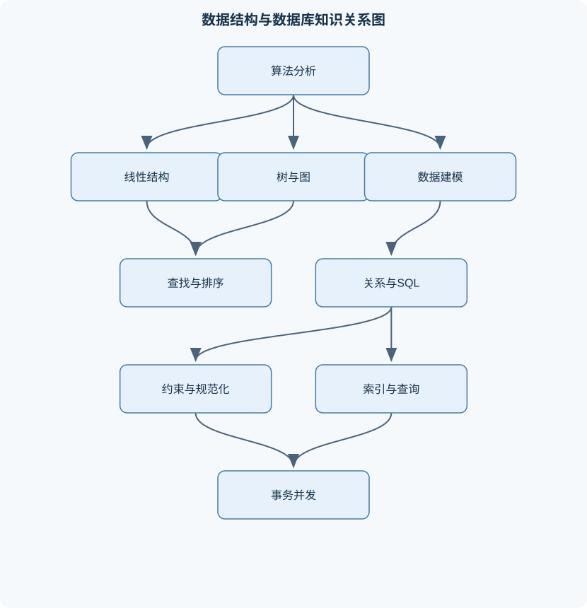
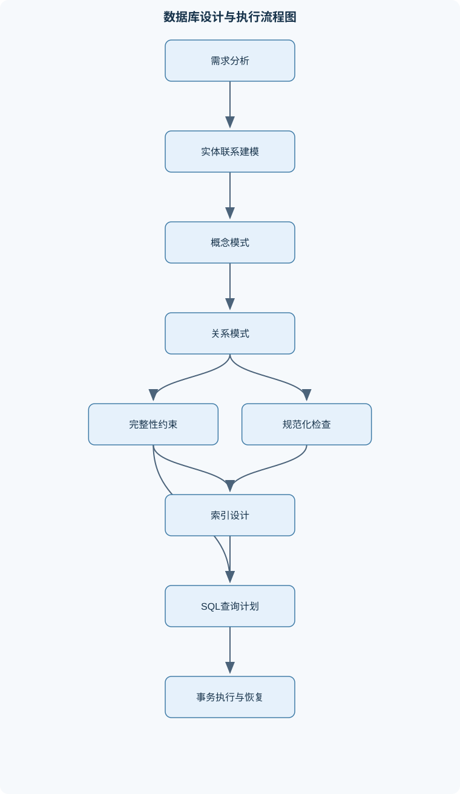

# 数据结构与数据库技术

## 一、课程整体知识框架

### 课程边界与先修知识

本课程覆盖线性表、栈与队列、树、图、查找、排序、文件组织，以及关系数据库建模、关系代数、SQL、完整性约束、规范化、索引、事务与并发控制等内容。数据结构部分强调抽象数据类型、存储表示、操作正确性与时间空间复杂度；数据库部分强调从现实需求到概念模型、逻辑模式、物理存储和应用查询的完整链路。先修知识包括离散数学基础、集合与关系、命题逻辑、基本程序设计、函数与递归、初等概率概念以及计算机组成中存储层次的基本认识。不覆盖特定数据库产品的全部管理功能，也不将某一软件版本的语法差异作为普适结论。





### 1. 课程对象与整体链路

《数据结构与数据库技术》研究的是“数据如何组织、如何被高效处理，以及如何从现实业务需求形成可靠的数据系统”。两部分并非彼此孤立：数据结构关注内存或文件中的组织方式、操作过程与算法代价；数据库技术则进一步处理持久化存储、多人并发、完整性约束、查询优化和故障恢复。

数据结构通常用抽象数据类型表示：

$$
ADT=(D,S,P)
$$

其中，$D$ 是数据对象集合，$S$ 是数据元素之间的逻辑关系，$P$ 是允许执行的操作集合。抽象数据类型只规定“能表示什么数据、能进行什么操作以及操作应满足什么语义”，不规定必须使用数组、指针或某种编程语言实现。例如，线性表可以用连续数组实现，也可以用单链表实现；两种实现的插入和访问代价不同，但逻辑上的“按位置存取、插入、删除、查找”语义可以相同。

数据库系统则把现实世界中的对象、属性和联系转化为可持久保存、可查询和可约束的数据。完整链路可以概括为：

1. **需求分析**：确定业务对象、属性、操作、数量关系和约束条件。
2. **概念建模**：用实体、属性、联系及联系基数描述业务全貌。
3. **逻辑设计**：将概念模型转换为关系模式、主键、外键和约束。
4. **规范化分析**：利用函数依赖识别冗余和插入、删除、更新异常。
5. **物理设计**：决定记录、页、文件、索引和聚簇组织。
6. **查询处理**：将 SQL 或关系代数转换为执行计划，选择连接算法和访问路径。
7. **事务运行**：在并发和故障条件下保证原子性、一致性、隔离性和持久性。

### 2. 先修知识与统一符号

离散数学中的集合、关系、命题逻辑和函数是理解关系模型、函数依赖、图算法和约束条件的基础。程序设计中的循环、指针、递归、参数传递和异常处理用于实现线性表、树、图及排序算法。初等概率有助于理解散列表冲突和平均查找长度；计算机组成中的存储层次有助于解释缓存、内存、磁盘页和索引之间的性能差异。

序列长度通常记为 $n$；树的结点数记为 $n$、高度记为 $h$；图的顶点数和边数分别记为 $|V|$ 与 $|E|$。复杂度中的 $O(g(n))$ 表示渐近上界，$\Omega(g(n))$ 表示渐近下界，$\Theta(g(n))$ 表示同阶增长。它们描述输入规模趋于无穷时的增长趋势，不是精确运行时间。实际运行还受到常数因子、缓存命中率、内存分配、指针跳转、分支预测、磁盘访问和并发等待影响。

关系模式记为 $R(A_1,A_2,\ldots,A_k)$，其中 $R$ 是关系名，$A_i$ 是属性名；关系实例是满足模式和约束的元组集合。函数依赖 $X\to Y$ 表示：任意两个元组若在属性集 $X$ 上取值相同，则在属性集 $Y$ 上取值也相同。事务操作可写为 $r_1(X)$ 和 $w_1(X)$，分别表示事务 $T_1$ 读或写数据项 $X$。

### 3. 算法正确性与复杂度分析

一个可执行算法至少应明确输入、输出、确定性、有限性和正确性。输入说明数据范围及合法条件；输出说明结果形式；确定性要求同一状态下下一步行为明确；有限性要求算法在有限步骤后终止；正确性要求对所有合法输入产生符合规格的结果。

分析算法时，应区分最好情况、最坏情况和平均情况。例如顺序查找在目标位于第一位置时为 $\Theta(1)$，目标位于最后或不存在时为 $\Theta(n)$。若假定目标等概率出现在 $n$ 个位置且一定存在，平均比较次数为：

$$
\frac{1+2+\cdots+n}{n}=\frac{n+1}{2}=\Theta(n)
$$

这一结论依赖“各位置等概率”的假设；若访问概率明显集中在表头，平均代价会不同。

递归算法需要同时分析递归深度和每层工作量。例如归并排序满足：

$$
T(n)=2T(n/2)+\Theta(n)
$$

每层合并总成本为 $\Theta(n)$，递归层数为 $\Theta(\log n)$，因此：

$$
T(n)=\Theta(n\log n)
$$

标准归并排序还需要 $\Theta(n)$ 的辅助数组空间。递归深度若为 $h$，调用栈空间通常为 $\Theta(h)$；若树退化成链，$h=n-1$，递归空间可能从对数级退化为线性级。

### 4. 线性结构、栈、队列与递归

数组和顺序表将元素存放在连续空间中，支持按下标随机访问，访问复杂度为 $\Theta(1)$。在位置 $i$ 插入元素时，需要移动后续元素，最坏为 $\Theta(n)$；删除同样可能需要移动元素。链式表通过结点和指针连接元素，已知插入位置前驱时只需修改有限个指针，复杂度为 $\Theta(1)$，但按位置访问必须从头结点逐个移动，复杂度为 $\Theta(n)$。单链表只能沿一个方向访问；双链表具有前驱和后继指针，删除已定位结点更方便但需要额外指针空间；循环链表的尾结点指向头部，适合循环调度，但必须明确空表和单结点条件。

栈遵循后进先出，核心操作是入栈、出栈和取栈顶；顺序栈可能发生上溢，空栈出栈会发生下溢。队列遵循先进先出，链队列通常用队头和队尾指针实现。循环队列用下标取模复用数组空间，但仅凭“队头等于队尾”无法同时区分空和满，必须采用计数器、保留一个空槽或额外状态位。

表达式处理中，中缀表达式依赖括号和优先级；后缀表达式不需括号，扫描操作数入栈，遇到运算符弹出右操作数和左操作数后计算。减法和除法不能交换弹栈顺序。函数递归调用会隐式使用调用栈；深度优先搜索中的显式栈可以模拟递归。广度优先搜索使用队列，使顶点按非递减边数距离被处理，适用于无权图最短路径。

### 5. 树、图与编码结构

树是连通且无环的层次结构。含 $n$ 个结点的树有 $n-1$ 条边，因为从一个结点开始，每增加一个新结点只需增加一条连接边；若再增加一条边就会形成环，若少一条边则不连通。二叉树的每个结点最多有两个孩子。高度为 $h$ 且根层高度取 $0$ 的二叉树最多有：

$$
1+2+\cdots+2^h=2^{h+1}-1
$$

个结点。满二叉树的每个内部结点都有两个孩子；完全二叉树要求除最后一层外各层满，最后一层结点从左到右连续排列，二者不能混为一谈。

先序、中序、后序分别对应“根左右、左根右、左右根”；层序遍历使用队列。已知不含重复关键字的先序和中序序列，可以用先序首元素确定根，再在中序中划分左右子树，递归重建。若关键字重复，仅凭两种遍历可能无法唯一确定结构。

二叉搜索树满足左子树关键字小于根、右子树关键字大于根的有序性。查找、插入和删除的代价为 $\Theta(h)$；树平衡时 $h=\Theta(\log n)$，退化成链时 $h=\Theta(n)$。平衡搜索树通过平衡因子和旋转控制高度，旋转必须保持中序序列有序。

哈夫曼树用于带权前缀编码。叶权为 $w_i$、叶深度为 $d_i$ 时，带权路径长度为：

$$
WPL=\sum_i w_i d_i
$$

每次合并当前森林中权重最小的两个根结点，所得新结点权重为两者之和，重复直到只剩一个根。给定叶权 $2,5,6,11$，先合并 $2+5=7$，再合并 $6+7=13$，最后合并 $11+13=24$。深度为 $3$ 的叶为权重 $2,5$，深度为 $2$ 的叶为权重 $6,11$，所以：

$$
WPL=2\times3+5\times3+6\times2+11\times2=49
$$

左右子树交换只改变编码中的 $0$、$1$ 分配，不改变 WPL。哈夫曼树要求权重非负且编码目标是前缀无冲突；相同权重可能生成结构不同但代价相同的最优树。

图由顶点和边组成，可为有向、无向、带权或不带权。邻接矩阵适合顶点较少或需要快速判断两点是否相邻的场景，空间为 $\Theta(|V|^2)$；邻接表空间通常为 $\Theta(|V|+|E|)$，适合稀疏图。深度优先搜索使用递归或栈，广度优先搜索使用队列，邻接表实现的复杂度均为 $O(|V|+|E|)$。

拓扑排序只适用于有向无环图；若优先图有环，则不存在满足全部先后约束的线性顺序。关键路径分析将活动放在边上、事件放在顶点上，通过最早发生时间和最迟发生时间计算活动时差。最小生成树只适用于无向连通带权图，目标是连接所有顶点且总边权最小，不是求某个源点到其他点的最短路径。Dijkstra 算法要求所有边权非负；存在负权边时，已经确定的距离可能被后续路径改小。多源最短路径可用动态规划思想逐步允许中间顶点集合扩大。

### 6. 查找、散列、排序与外部处理

折半查找每次将有序候选区间缩小近一半，最坏复杂度为 $O(\log n)$，但要求关键字有序且支持高效随机访问，因此不适合直接在单链表上实现。散列表通过散列函数将关键字映射到地址。装填因子可表示为：

$$
\alpha=\frac{\text{已存元素数}}{\text{散列表容量}}
$$

$\alpha$ 越高，冲突通常越多。开放定址法在表内寻找其他槽位，线性探测实现简单但容易产生聚集；删除时不能简单清空槽位，否则可能截断后续查找链，通常需要删除标记。链地址法将冲突元素挂在同一地址的链表或桶中。扩容后必须重新计算并插入已有元素，不能只复制旧下标。

排序中，稳定排序保持相等关键字的原相对次序；原地排序只使用有限辅助空间；自适应排序能利用近乎有序等输入特征。插入排序适合小规模或近乎有序数据；快速排序平均为 $\Theta(n\log n)$，但分区持续不平衡时退化为 $\Theta(n^2)$；堆排序保证 $\Theta(n\log n)$，但通常不稳定；归并排序稳定且复杂度确定为 $\Theta(n\log n)$，标准实现需要线性辅助空间。计数排序、桶排序和基数排序不是一般比较排序，要求关键字范围、分布或表示形式满足相应条件。

比较排序的直观下界来自决策树：不同输入排列需要被区分，若每次比较只有两种结果，树高至少为 $\log_2(n!)=\Theta(n\log n)$。这不限制利用关键字范围的非比较排序。

当数据不能全部装入内存时，需要外部排序。典型过程是先将内存能容纳的数据块分别排序，形成有序归并段，再进行多路归并。归并路数越高，可能减少磁盘轮次，但会增加缓冲区和管理开销；性能重点通常是减少磁盘页面读写，而不是只统计 CPU 比较次数。

### 7. 数据库系统结构与数据建模

数据库是按一定结构组织、长期保存并可共享的数据集合；数据库管理系统负责定义、存储、查询、更新、约束、并发和恢复；应用程序通过接口提交操作；用户通过应用或查询语言使用数据。

三级模式结构包括外模式、概念模式和内模式。**外模式**描述某类用户所看到的数据逻辑结构，可以只暴露必要字段和记录范围，并承载视图封装与部分安全边界。**概念模式**描述整个数据库的逻辑结构、实体联系、属性和完整性约束，是所有外模式共享的逻辑基础。**内模式**描述记录组织、物理顺序、存储路径、索引和页面布局。三者不是三份独立数据副本，而是不同层次的描述及其映射。

模式是相对稳定的结构定义，实例是某一时刻实际存储的数据。外模式—概念模式映射和概念模式—内模式映射支持数据独立性：物理索引或页面组织变化时，应用逻辑通常不应改变；概念结构变化时，可通过外模式隔离部分应用。

概念建模需要识别实体、属性、联系和基数。学生与课程之间的“选课”通常是多对多联系，转换为关系模式时需要增加联系表：

- 学生（学生编号，姓名……）
- 课程（课程编号，课程名称……）
- 选课（学生编号，课程编号，成绩……）

选课表的复合主键可取（学生编号，课程编号），表示同一学生不能重复选同一课程；两个编号同时作为外键，分别引用学生和课程。候选键是能唯一标识元组且不可再缩减的属性集；主键是选定的候选键；代理键是人为生成的标识符，不能自动消除业务唯一性约束。

### 8. 关系模型、SQL 与完整性

关系由属性、域和元组构成。关系在逻辑上无序，元组不因物理存放顺序而具有先后；SQL 查询若没有 `ORDER BY`，不应假定结果顺序。关系理论常强调元组不重复，而 SQL 查询结果可能保留重复行，需要使用 `DISTINCT` 明确消除重复。

基本关系代数包括选择 $\sigma$、投影 $\pi$、笛卡尔积、并、差和连接。选择筛选行，投影选择列；连接依据条件组合多个关系。等值连接使用相等条件，自然连接按同名属性匹配并通常消除重复连接列，外连接还保留一侧或两侧未匹配元组并以 NULL 补齐。

SQL 中，`WHERE` 通常先筛选行，`GROUP BY` 形成分组，聚合函数计算组结果，`HAVING` 筛选分组，`ORDER BY` 对最终结果排序。书写顺序与逻辑处理顺序不同，不能把 `HAVING` 当作普通行筛选。`COUNT(*)` 统计行数；`COUNT(列)` 通常不统计该列为 NULL 的行；`SUM`、`AVG` 等聚合也需考虑空值。

NULL 表示未知、不适用或不存在，不等于零、空字符串或假。涉及 NULL 的普通比较可能得到 UNKNOWN，只有 TRUE 的条件才被 `WHERE` 保留。应使用 `IS NULL` 或 `IS NOT NULL` 判断。连接条件遗漏会产生笛卡尔积，查询能够执行并不代表语义正确。子查询可用于集合判断、标量结果或相关条件；相关子查询依赖外层当前行，可能带来较高执行成本。视图提供逻辑封装、安全隔离和查询复用，但复杂聚合、分组或多表视图未必可直接更新。

实体完整性要求主键非空且唯一；参照完整性要求外键值必须匹配被引用键，或在允许空值时表示暂未建立引用；用户定义完整性由业务规则表达。`NOT NULL` 限制空值，`UNIQUE` 限制重复，`PRIMARY KEY` 同时承担主标识作用，`CHECK` 表达范围或逻辑条件。级联更新、级联删除、置空和拒绝操作必须与非空约束及业务责任相容，例如外键设为 `SET NULL` 时引用列不能同时声明为不可为空。

### 9. 规范化与数据库设计

函数依赖用于描述属性之间的决定关系。计算属性集闭包 $X^+$ 时，先令结果为 $X$，反复应用左部已包含在结果中的依赖，直到结果不再增加。若 $X^+$ 包含关系的全部属性，则 $X$ 是超键；再检验删除任一属性后是否仍为超键，可判断其是否为候选键。

第一范式要求属性值具有原子性；第二范式要求在第一范式基础上，非主属性完全依赖每个候选键，不能只依赖复合键的一部分；第三范式要求非主属性不通过其他非主属性传递依赖候选键。BCNF 更严格：每个非平凡函数依赖 $X\to Y$ 的决定因素 $X$ 必须是候选键或超键。

规范化可减少数据冗余和插入、删除、更新异常，但分解可能增加连接次数。分解必须关注无损连接，即分解后自然连接能够恢复原关系且不产生伪元组；还应尽量保持依赖，使约束可在分解后的关系中直接检查。高规范化不必然带来更快查询，读密集场景有时会在受控范围内反规范化，但必须保留一致性维护机制。

### 10. 存储、索引、查询处理与事务

数据库通常按“记录—页—文件—缓冲区”组织数据。页面是磁盘与内存之间交换的基本单位之一，具体大小和执行策略依赖系统实现。聚簇组织使相关记录在物理上较接近，范围扫描可能更高效；非聚簇索引通过索引项定位数据页，可能需要额外回表。

B 树和 B+ 树通过多路分支降低高度。B+树的叶结点通常按键有序并连接，适合等值查找和范围扫描。哈希索引适合等值匹配，但通常不适合范围条件和排序。联合索引的列顺序影响可利用的查询条件，常见的“最左匹配”思想并非对所有系统和谓词都完全相同，仍需结合执行计划判断。覆盖索引包含查询所需字段，可减少回表，但会增加索引空间和维护开销。低选择率列、频繁更新列或返回大量记录的索引可能收益很小。

查询优化会估计选择率、基数和中间结果规模，并在嵌套循环连接、排序归并连接和哈希连接之间选择。将选择和投影尽量下推，可以减少中间关系规模，但等价变换不保证所有系统都选择同一物理计划。

事务具有原子性、一致性、隔离性和持久性。脏读是读取未提交数据；不可重复读是同一事务两次读取同一行结果不同；幻读是同一条件查询两次得到的行集合发生变化；丢失更新是并发写入覆盖了另一事务的结果。读未提交、读已提交、可重复读和可串行化的具体边界受实现方式影响，不能仅凭名称推断所有系统完全一致。

冲突可串行化可通过优先图判定：事务为顶点，若两个事务对同一数据项有冲突操作且先后交错，则加入有向边。图无环时可拓扑排序得到等价串行顺序。两阶段锁要求事务先获得锁，再进入只释放锁的收缩阶段；严格两阶段锁还延迟排他锁释放，可减少级联回滚。死锁需要互斥、占有且等待、不可剥夺和循环等待四个条件同时成立。

多版本并发控制通过保留多个版本支持快照读，但快照一致性不等于所有业务规则自动正确。日志恢复遵循先写日志原则：相关日志持久化后，数据页才可写入；检查点可缩短恢复扫描范围，但不是备份替代品。恢复通常对已提交事务重做、对未提交事务撤销。即使隔离级别达到可串行化，事务仍可能因唯一约束冲突、锁等待、重试或应用层规则失败。

## 二、章节和模块划分

### 核心知识覆盖清单

本清单用于检查正文是否覆盖本课程的主要知识模块：

- **算法分析与线性表**：抽象数据类型、数据对象、数据关系与基本操作、算法的输入、输出、确定性、有限性与正确性、最好、最坏和平均时间复杂度、渐近记号、常数因子与低阶项的处理、数组、顺序表和链式表的存储结构、单链表、双链表和循环链表的插入删除、顺序表与链表的访问、查找和修改代价、递归定义、递归调用栈与递推式、空间复杂度、辅助空间与原地算法、理想复杂度模型与缓存、分配、指针开销等现实因素。
- **栈、队列与递归应用**：栈的后进先出规则及顺序栈、链栈实现、队列的先进先出规则及链队列实现、循环队列的队头队尾指针和空满判定、双端队列与受限双端队列、表达式中缀、后缀表示及运算符优先级、括号匹配和语法结构检查、函数调用、递归回溯与显式栈模拟、广度优先搜索中的队列作用、栈和队列的溢出、下溢与边界条件、队列在缓冲、调度和生产者消费者模型中的抽象。
- **树结构与哈夫曼编码**：树、森林、结点、边、度、层次和高度、二叉树的递归定义与基本性质、满二叉树、完全二叉树和一般二叉树的区别、先序、中序、后序和层序遍历、由遍历序列重建二叉树的条件、线索二叉树及空指针利用、二叉搜索树的查找、插入和删除、平衡因子、旋转以及平衡搜索树的基本思想、带权路径长度和哈夫曼树构造、哈夫曼编码的前缀性质与编码长度计算。
- **图结构与图算法**：有向图、无向图、带权图、顶点度和连通性、邻接矩阵、邻接表和边集数组、深度优先搜索与广度优先搜索、连通分量、可达性和生成树、拓扑排序及有向无环图、关键路径中的活动、事件和最早最迟时间、最小生成树及其适用条件、单源最短路径与非负权边条件、多源最短路径与动态规划思想、图算法中的重复访问标记、不可达顶点和负权边边界。
- **查找、散列与索引思想**：顺序查找、折半查找及其有序性条件、查找判定树与平均查找长度、二叉搜索树查找复杂度与退化情形、散列表、散列函数和装填因子、开放定址法、线性探测和删除标记、链地址法及冲突处理、散列冲突、扩容和再散列、索引结构降低磁盘访问次数的基本思想、树形索引与范围查询、等值查询的适配关系、索引维护成本、写入开销和低选择性列问题。
- **排序与外部数据处理**：稳定排序、原地排序和自适应排序的定义、直接插入排序、折半插入排序和希尔排序、冒泡排序及交换次数分析、快速排序的分区、枢轴选择和退化情况、简单选择排序及最小值选择过程、堆排序与堆的维护、归并排序、递归分解和合并过程、基于关键字范围的计数排序、桶排序和基数排序、比较排序的比较次数下界直观解释、外部排序中的归并段、归并路数和磁盘访问。
- **数据库系统结构与数据建模**：数据库、数据库管理系统、应用程序和用户的关系、三级模式结构：外模式、概念模式和内模式、模式、实例、数据独立性与映射关系、外模式对用户视图、操作范围和安全性的描述、概念模式对全体数据逻辑结构和完整性约束的描述、内模式对记录组织、存储路径、索引和物理顺序的描述、实体、属性、联系和联系基数、实体联系模型向关系模式的转换、主键、候选键、外键和代理键、需求分析中实体边界、联系方向和约束条件的确定。
- **关系模型、关系代数与SQL基础**：关系、元组、属性、域和关系模式、关系的无序性、元组不重复性与空值语义、选择、投影、连接、并、差和笛卡尔积、自然连接、等值连接和外连接的区别、SQL数据定义、数据查询、数据插入、更新和删除、WHERE、GROUP BY、HAVING和ORDER BY的语义顺序、聚合函数、分组条件和空值对聚合的影响、子查询、相关子查询和集合比较、视图的逻辑封装、可更新性和安全作用、SQL查询结果重复行、NULL三值逻辑和连接条件遗漏。
- **完整性约束、规范化与数据库设计**：实体完整性、参照完整性和用户定义完整性、NOT NULL、UNIQUE、PRIMARY KEY和CHECK约束、外键引用、级联更新、级联删除和置空策略、函数依赖、平凡函数依赖和闭包、候选键判定与属性集闭包计算、第一范式、第二范式和第三范式、BCNF与决定因素为候选键的条件、无损连接分解与依赖保持的基本要求、插入异常、删除异常和更新异常、规范化与查询性能、冗余控制之间的权衡。
- **数据库存储、索引与查询处理**：记录、页、文件和缓冲区的层次组织、聚簇与非聚簇存储的差异、B树和B加树的结点组织、查找与范围扫描、哈希索引的等值查询优势及范围查询局限、联合索引的列顺序与最左匹配思想、唯一索引、表达式索引和部分索引的适用场景、覆盖索引与减少数据页访问、选择率、基数估计和查询计划选择、连接算法：嵌套循环、排序归并和哈希连接、索引不是越多越好：维护成本、空间占用和写放大。
- **事务、并发控制与恢复**：事务的原子性、一致性、隔离性和持久性、事务边界、提交、回滚和故障处理、脏读、不可重复读、幻读和丢失更新、读未提交、读已提交、可重复读和可串行化、冲突可串行化与优先图判定、共享锁、排他锁、两阶段锁和死锁、死锁的互斥、占有且等待、不可剥夺和循环等待条件、多版本并发控制和快照读的基本思想、日志、先写日志原则、检查点和故障恢复、串行化隔离并不等于所有业务错误自动消失，应用仍需处理重试和约束冲突。


### 1. 模块一至三：算法分析、线性表、栈队列与递归

#### 代表性算法：单链表按位置插入

**输入**：带头结点的单链表、合法位置 $i$ 和新数据。  
**输出**：插入后的链表。  
**过程**：从头结点开始定位第 $i-1$ 个结点 `prev`，创建新结点 `node`，执行 `node.next = prev.next`，再执行 `prev.next = node`。必须先保存原后继，否则可能丢失后半段链表。不变量是已处理部分的相对次序保持不变。若前驱已知，修改复杂度为 $\Theta(1)$；若需要定位，整体通常为 $\Theta(n)$。

```python
class Node:
    def __init__(self, value, next_node=None):
        self.value = value
        self.next = next_node

def insert_at(head, position, value):
    """在带头结点单链表的第 position 个数据位置插入元素。"""
    if position < 1:
        raise ValueError("position must be positive")

    prev = head
    for _ in range(position - 1):
        if prev.next is None:
            raise IndexError("position out of range")
        prev = prev.next

    node = Node(value, prev.next)
    prev.next = node
    return head
```

#### 代表性算法：后缀表达式求值

扫描记号；操作数入栈；遇到二元运算符时先弹出右操作数，再弹出左操作数，计算后重新入栈。扫描结束时栈中必须恰有一个结果。需要检查除零、操作数不足、非法记号和多余结果。若记号数为 $n$，时间复杂度为 $O(n)$，辅助空间最坏为 $O(n)$。

#### 例题一：循环队列判空与判满

**题干**：容量为 $m=5$ 的循环队列采用“保留一个空槽”策略，队头 `front` 指向队首元素，队尾 `rear` 指向下一个可插入位置。问初始状态、插入 4 个元素后的状态以及何时判满。

**分析**：空队列满足 `front == rear`；保留一个空槽后，满队列满足 `(rear + 1) % m == front`，实际最多存放 $m-1=4$ 个元素。

**逐步解答**：初始 `front=0,rear=0`。依次插入后，`rear` 变为 1、2、3、4；此时队列有 4 个元素。再插入会使 `rear` 变为 0，等于 `front`，所以插入前应判定满。

**结果验证**：可用元素数量为 `(rear-front+m)%m`。当 `front=0,rear=4` 时数量为 4；若继续移动到 `rear=0`，该公式为 0，故不能把该状态当作正常满状态，必须在移动前判满。

**变式**：若使用计数器，空条件为 `count==0`，满条件为 `count==m`，此时可以利用全部 $m$ 个槽位。

### 2. 模块四：树结构与哈夫曼编码

#### 代表性算法：哈夫曼树构造

**输入**：$k$ 个带正权叶子。  
**输出**：一棵哈夫曼树及每个叶子的前缀编码。  
**过程**：将叶子放入最小堆；重复取出最小的两个根结点，合并成权重之和的新结点，再放回最小堆；直到只剩一个根。堆保存当前森林中各树根及其子树权重，是算法不变量。使用二叉堆时复杂度为 $O(k\log k)$。适用于以平均编码长度或 WPL 为目标的前缀编码问题，不适用于要求固定长度编码或需要保留原有编码结构的场景。

#### 例题二：哈夫曼树 WPL

**题干**：叶权为 $2,5,6,11$，求一种哈夫曼树的合并过程、叶深度和 WPL。

**分析**：每一步必须选择当前权重最小的两个根，而不是只在原始叶子中选择。

**逐步解答**：

1. 合并 $2$ 与 $5$，得到权重 $7$；
2. 当前权重为 $6,7,11$，合并 $6$ 与 $7$，得到 $13$；
3. 合并 $11$ 与 $13$，得到根权重 $24$；
4. $2$ 和 $5$ 位于权重 $7$ 子树，深度为 3；$6$ 和 $11$ 深度为 2；
5. 计算：

$$
WPL=2\times3+5\times3+6\times2+11\times2=49
$$

**结果验证**：所有叶权之和为 $24$，根权重也为 $24$；编码平均代价为 $49/24$。交换任意内部结点左右孩子不会改变深度，因此 WPL 不变。

**变式**：若两个最小权相同，合并顺序可能不同，但只要每次选择的权重集合相同，通常仍能得到等价最优 WPL；具体编码位串可能不同。

### 3. 模块五：图结构与图算法

#### 代表性算法：广度优先搜索

**输入**：图 $G=(V,E)$ 和起点 $s$。  
**输出**：从 $s$ 可达顶点的访问序列、父结点关系和无权最短路径树。  
**过程**：标记 $s$ 并入队；每次取出队头，扫描其邻接点，对未访问邻接点标记、记录父结点并入队。不变量是队列中的顶点按距离非递减排列。邻接表实现复杂度为 $O(|V|+|E|)$，队列空间最坏为 $O(|V|)$。图不连通时，需要从其他未访问顶点重新启动，才能求所有连通分量。

#### 例题三：Dijkstra 的适用性

**题干**：图中有边 $A\to B$ 权重 4，$A\to C$ 权重 1，$C\to B$ 权重 2。以 $A$ 为源点，求 $B$ 的最短距离，并说明算法条件。

**逐步解答**：初始化 $d(A)=0,d(B)=\infty,d(C)=\infty$。处理 $A$ 后，得到 $d(B)=4,d(C)=1$。选择暂定距离最小的 $C$，通过 $C\to B$ 松弛：$1+2=3<4$，因此更新 $d(B)=3$。最终 $A\to C\to B$ 为最短路径，距离为 3。

**结果验证**：直接路径长度为 4，间接路径长度为 3，取较小者。所有边权非负，满足 Dijkstra 条件。

**变式**：若增加一条负权边，已确定的顶点距离可能被后续路径改小，Dijkstra 的贪心结论不再成立，应改用适用于相应条件的算法。

### 4. 模块六：查找、散列、排序与外部数据处理

#### 代表性算法：归并排序

**输入**：可比较序列。  
**输出**：非降序序列。  
**过程**：递归划分为左右两段，分别排序；使用两个指针比较两段首元素，将较小者写入辅助数组；一段耗尽后复制另一段。合并过程中，输出区间始终有序且包含已消费元素中的最小值，这是核心不变量。复杂度为 $\Theta(n\log n)$，辅助空间为 $\Theta(n)$，标准稳定实现可保留相等元素的相对次序。

#### 例题四：排序算法选择

**题干**：有 100 万条记录，要求稳定排序，关键字可能重复，且希望复杂度有确定上界。比较快速排序、堆排序和归并排序。

**分析**：快速排序平均较快，但最坏为 $\Theta(n^2)$，普通实现不稳定；堆排序最坏为 $\Theta(n\log n)$，但通常不稳定；归并排序稳定，复杂度始终为 $\Theta(n\log n)$，代价是线性辅助空间。

**逐步结论**：在“稳定性”和“确定上界”同时成立时，选择归并排序。若内存严格受限且稳定性不要求，可考虑堆排序；若数据近乎有序且规模较小，插入排序可能具有较好实际表现。

**结果验证**：归并排序每层合并总成本为 $\Theta(n)$，共 $\Theta(\log n)$ 层，所以总成本为 $\Theta(n\log n)$；稳定性来自合并时相等元素优先取左段元素。

**变式**：若数据无法全部装入内存，应改为外部归并排序，重点评价磁盘页读写次数、归并路数和缓冲区分配。

### 5. 模块七至九：数据库结构、关系模型、SQL 与规范化

#### 代表性流程：实体联系模型转换为关系模式

**输入**：实体集合、属性、主键候选和联系基数。  
**输出**：关系模式、主键、外键和完整性约束。  
**过程**：

1. 每个强实体转换为一个关系，实体属性转换为列；
2. 选择候选键并确定主键；
3. 一对多联系通常将“一方”主键加入“多方”作为外键；
4. 多对多联系建立独立关系，包含双方主键及联系属性；
5. 一对一联系根据参与约束和访问需求决定合并或设置外键；
6. 检查非空、唯一、参照和业务约束；
7. 用函数依赖检查是否存在明显冗余和更新异常。

#### 例题五：选课关系设计与约束

**题干**：设计学生、课程和选课三张表，要求同一学生不能重复选同一课程，删除学生时其选课记录也应删除。

**逐步解答**：

- 学生表：`Student(student_id, name)`，`student_id` 为主键；
- 课程表：`Course(course_id, title)`，`course_id` 为主键；
- 选课表：`Enrollment(student_id, course_id, grade)`；
- 选课表主键为 `(student_id, course_id)`；
- `student_id` 和 `course_id` 分别为外键；
- 学生外键可采用级联删除，课程外键是否级联需依据业务决定。

**结果验证**：复合主键禁止同一学生和课程组合重复；外键禁止选课记录引用不存在的学生或课程；删除学生时，级联动作删除其选课记录，不留下悬空引用。

**变式**：若成绩允许暂缺，`grade` 可为空；但 NULL 表示尚未记录或未知，不能简单解释为零分。若删除课程必须保留历史成绩，则不宜使用级联删除，可采用拒绝删除或逻辑停用。

#### 属性闭包与规范化流程

**输入**：关系模式 $R$ 和函数依赖集合 $F$。  
**输出**：候选键、规范化判断和可能的分解。  
**过程**：对属性集 $X$ 初始化 $X^+=X$；反复应用左部包含于闭包的函数依赖；直到闭包不再扩大。若 $X^+=R$，则 $X$ 是超键；删除任意属性后不再是超键时，$X$ 是候选键。再检查部分依赖、传递依赖和 BCNF 条件。分解后必须检查无损连接与依赖保持。

### 6. 模块十至十一：索引、查询处理、事务与恢复

#### 代表性流程：查询优化中的选择下推

**输入**：包含多表连接和筛选条件的关系代数表达式或 SQL。  
**输出**：语义等价但中间结果可能更小的执行计划。  
**过程**：先识别只涉及单表的选择条件，将其下推到对应关系；再下推不影响结果的投影；随后选择连接顺序和连接算法。每次变换都必须验证语义等价，不能将外连接任意改为内连接，也不能删除后续仍需使用的属性。

#### 事务调度判定流程

**输入**：多个事务的读写操作序列。  
**输出**：冲突类型、优先图及是否冲突可串行化。  
**过程**：为事务建立顶点；对同一数据项的读写、写读或写写冲突按发生顺序加入边；检测图是否有环。无环时进行拓扑排序，所得顺序是等价串行顺序；有环时不能判定为冲突可串行化。该判定不覆盖所有视图可串行化调度。

### 7. 实验与项目一：线性结构、树和图算法实验

#### 实验目标

实现顺序表、单链表、栈、循环队列、二叉树遍历和图的 BFS/DFS，并比较不同存储方式在操作代价和边界条件上的差异。

#### 输入数据与步骤

1. 生成长度分别为 $10^2$、$10^3$、$10^4$ 的整数序列；
2. 对顺序表和链表分别执行头部插入、尾部插入、按位置访问、按关键字删除；
3. 用相同表达式测试栈求值，包含括号嵌套、减法、除法和非法除零；
4. 构造一个含孤立顶点和多个连通分量的图；
5. 分别记录 BFS、DFS 的访问序列、父结点和不可达顶点；
6. 构造带权叶子集合，验证哈夫曼 WPL；
7. 记录操作次数、运行时间和额外空间。

#### 评价标准

- 结果符合抽象数据类型语义；
- 空表、满队列、单结点、头部删除和不可达顶点处理正确；
- BFS 使用队列并保证顶点只首次入队，DFS 使用访问标记；
- 哈夫曼每轮选择当前最小的两个根；
- 复杂度解释与实验现象一致；
- 输出能够复现实验数据和中间状态。

#### 排错方法

若链表出现环，检查插入时是否错误修改了后继；若循环队列无法区分空满，检查是否明确采用计数器或保留空槽；若后缀表达式结果错误，检查减法和除法的弹栈顺序；若图遍历重复访问，检查标记时机是否在入队或入栈时完成；若哈夫曼 WPL 不一致，重新列出每轮堆中根权重和每个叶深度。

### 8. 实验与项目二：关系数据库建模、SQL 与事务实验

#### 实验目标

从订单业务需求建立实体联系模型、关系模式、约束和索引，编写查询并观察并发事务中的异常现象。

#### 输入数据与步骤

1. 定义客户、订单、订单明细和商品四类实体；
2. 确定客户与订单的一对多关系、订单与商品的多对多关系；
3. 转换为关系模式并设置主键、外键、非空、唯一和检查约束；
4. 插入合法数据以及违反主键、外键和检查条件的非法数据；
5. 编写多表连接、分组统计、没有订单的客户、库存不足商品等查询；
6. 对时间范围、用户编号和状态条件分别设计索引；
7. 在两个事务中交错执行读取和更新，观察脏读、不可重复读、丢失更新或锁等待；
8. 提交、回滚并检查数据库最终状态。

#### 评价标准

- 每个实体和联系均能在模式中找到对应结构；
- 主键唯一且非空，外键不产生悬空引用；
- 多对多联系使用独立联系表；
- `WHERE` 与 `HAVING` 使用正确；
- NULL 处理符合三值逻辑；
- 查询结果经人工构造的小数据集验证；
- 索引选择能说明选择率、范围条件、回表和写入维护成本；
- 事务实验能明确指出操作顺序、异常类型及隔离或加锁措施。

#### 排错方法

查询结果行数异常时，首先检查连接条件是否遗漏；分组结果错误时，区分 `WHERE` 和 `HAVING`；统计数量偏小时，检查聚合列是否包含 NULL；插入外键失败时，检查被引用记录是否存在及数据类型是否一致；索引未被采用时，检查查询条件是否匹配索引列顺序、返回行数是否过大以及统计信息是否合理；事务结果不一致时，按时间顺序列出每个 `r_i(X)` 与 `w_i(X)`，再画优先图和检查锁等待。

## 三、核心概念的详细解释

### 3.1 抽象数据类型、算法与复杂度

#### 3.1.1 抽象数据类型与存储实现

抽象数据类型 ADT 用三元组表示：

$$
ADT=(D,S,P)
$$

其中，$D$ 是数据对象集合，$S$ 是数据元素之间的逻辑关系，$P$ 是允许执行的操作集合。ADT 描述的是数据的逻辑特征和操作语义，而不是具体的存储方式。例如，线性表要求元素具有一对一的前后关系，并支持按位置访问、插入、删除和查找；它既可以用连续数组实现，也可以用链式结点实现。

数组或顺序表将元素存放在连续地址中。若首地址为 $a$，每个元素占用 $b$ 个存储单位，则下标为 $i$ 的元素地址可表示为：

$$
\operatorname{addr}(i)=a+i\cdot b
$$

因此，顺序表按下标访问为 $\Theta(1)$。在长度为 $n$ 的顺序表中，位置 $i$ 插入元素时，通常需要将位置 $i$ 及其后的元素向后移动，最坏情况下移动 $\Theta(n)$ 个元素；删除元素则需要向前移动后续元素。顺序表的优点是随机访问快、空间连续且缓存局部性较好，缺点是中间插入删除代价高，并可能因扩容产生整体搬移。

链表通过结点和指针表达逻辑相邻关系。单链表结点至少包含数据域和后继指针；双链表增加前驱指针；循环链表则使尾结点指向头结点或带头结点的首结点。若已经知道单链表插入位置的前驱结点，插入只需执行有限次指针修改，时间复杂度为 $\Theta(1)$；但若必须从头结点遍历定位，整体复杂度通常为 $\Theta(n)$。链表不适合高效随机访问，因为访问第 $i$ 个结点需要沿指针逐步移动。

#### 3.1.2 算法的正确性与复杂度

算法必须具有明确的输入、输出、确定性、有限性和正确性。确定性表示在同一状态和同一输入下，下一步行为明确；有限性表示算法在有限步骤后终止；正确性表示算法对每个合法输入都产生符合规格的输出。

渐近符号描述输入规模趋于无穷时的增长趋势。$O(g(n))$ 是渐近上界，$\Omega(g(n))$ 是渐近下界，$\Theta(g(n))$ 表示上下界同阶。比较复杂度时通常忽略常数因子和低阶项，例如：

$$
3n^2+5n+7=\Theta(n^2)
$$

这并不表示两个 $\Theta(n^2)$ 算法实际运行时间相同。数组连续访问可能具有较好的缓存命中率，而链表遍历包含指针跳转和结点分配；因此理想随机访问模型与真实机器性能之间存在差异。

时间复杂度应说明分析对象和输入条件。顺序查找在目标位于第一个位置时为 $\Theta(1)$，在目标不存在或位于最后位置时为 $\Theta(n)$。若目标一定存在且等概率出现在 $n$ 个位置，平均比较次数为：

$$
\frac{1+2+\cdots+n}{n}
=\frac{n+1}{2}
=\Theta(n)
$$

若各位置访问概率不相同，则不能直接使用该平均式。空间复杂度应区分输入本身占用的空间和辅助空间。原地算法通常只使用 $O(1)$ 或与输入规模无关的额外空间，但“原地”不意味着不修改输入，也不意味着运行时间较低。

### 3.2 栈、队列与递归

#### 3.2.1 栈与队列

栈遵循后进先出规则，基本操作包括入栈、出栈、取栈顶和判空。顺序栈用数组和栈顶下标表示，链栈用结点和头指针表示。栈空时执行出栈称为下溢；固定容量的顺序栈满时继续入栈称为溢出。动态扩容可以缓解容量限制，但扩容时可能产生一次性搬移成本。

队列遵循先进先出规则，包括入队、出队、取队头和判空。链队列通常维护队头指针和队尾指针。循环队列将数组首尾连接，入队和出队下标按容量 $m$ 取模：

$$
\operatorname{next}(i)=(i+1)\bmod m
$$

仅凭“队头等于队尾”无法同时区分空队列和满队列，因此必须采用一种约定：维护元素个数；保留一个空槽；或额外设置状态标志。若采用保留一个空槽的方法，队列为空的条件为 $front=rear$，队列为满的条件为：

$$
(rear+1)\bmod m=front
$$

此时最多存储 $m-1$ 个元素，而不是 $m$ 个。双端队列允许两端插入和删除；输入受限双端队列限制一端只能插入或删除，输出受限双端队列则限制另一端操作。

#### 3.2.2 表达式处理与递归

中缀表达式将运算符置于操作数之间，例如 $a+b\times c$；后缀表达式将运算符置于操作数之后，例如 $abc\times+$。中缀转后缀时，操作数直接输出，左括号入运算符栈，右括号触发出栈直到遇到左括号；普通运算符则根据优先级弹出栈顶优先级更高或相同且满足左结合规则的运算符。

后缀表达式求值使用操作数栈。扫描到操作数时入栈，扫描到二元运算符时先弹出的元素是右操作数，后弹出的元素是左操作数。例如计算后缀表达式 `8 3 -`，应执行 $8-3$，不能执行 $3-8$。扫描结束时，栈中应恰有一个结果；操作数不足、除数为零或最终剩余多个操作数均表示表达式非法。

递归算法通过函数调用栈保存未完成的子问题。递归定义必须有基本情况、递归情况，并且每次递归调用都应朝基本情况推进。例如阶乘满足：

$$
n!=
\begin{cases}
1,&n=0\\
n(n-1)!,&n>0
\end{cases}
$$

递归深度为 $n+1$，若使用调用栈，辅助空间为 $\Theta(n)$。递归可以改写为显式栈，但必须自行保存返回位置、局部状态和待处理子问题，否则不能保证等价。

### 3.3 树、二叉树与哈夫曼编码

#### 3.3.1 树的基本性质

树是由结点和边组成的连通无环结构。含 $n$ 个结点的树有 $n-1$ 条边。根树中，根结点没有父结点；除根外每个结点只有一个父结点。结点的孩子数称为结点的度，树的高度 $h$ 通常取根层为 $0$ 时根到最深叶子的最大边数。

二叉树递归定义为：空树是二叉树；若 $T_L$ 和 $T_R$ 是二叉树，则由根结点、左子树 $T_L$ 和右子树 $T_R$ 组成的结构也是二叉树。二叉树的左右子树有方向区别，即使两个子树结点集合相同，交换左右子树后通常也视为不同二叉树。

高度为 $h$ 的二叉树第 $i$ 层最多有 $2^i$ 个结点，因此结点总数满足：

$$
n\leq \sum_{i=0}^{h}2^i=2^{h+1}-1
$$

当每一层都达到最大结点数时取等号，这种结构为满二叉树。完全二叉树要求除最后一层外各层都满，最后一层结点从左到右连续排列。完全二叉树不一定是满二叉树。

采用从 $1$ 开始的数组编号存储完全二叉树时，结点 $i$ 的左孩子为 $2i$，右孩子为 $2i+1$；若编号超过结点总数 $n$，相应孩子不存在。该编号规律依赖于完全二叉树的层序排列，不能直接套用于任意链式二叉树。

若二叉树中叶结点数为 $n_0$，度为二的分支结点数为 $n_2$，则：

$$
n_0=n_2+1
$$

推导如下：设度为一的结点数为 $n_1$，则按所有结点统计边数有：

$$
n-1=n_1+2n_2
$$

又因为：

$$
n=n_0+n_1+n_2
$$

两式相减即可得到 $n_0=n_2+1$。

#### 3.3.2 遍历、搜索树与平衡

先序遍历顺序为“根、左、右”，中序遍历为“左、根、右”，后序遍历为“左、右、根”，层序遍历则使用队列按层访问。遍历所有结点的时间复杂度为 $\Theta(n)$。递归遍历的辅助空间为 $\Theta(h)$；层序遍历使用的队列空间最坏可达 $\Theta(n)$。

当结点关键字互异时，先序序列和中序序列可以唯一确定一棵二叉树：先序第一个元素是根，在中序序列中定位根，根左侧是左子树，右侧是右子树，再递归处理两部分。若关键字重复，仅凭遍历序列可能无法唯一确定结构，因为根在中序序列中的位置可能不唯一。

二叉搜索树要求任意结点左子树关键字小于结点关键字，右子树关键字大于结点关键字，重复值必须另行规定存放策略。查找、插入和删除的时间复杂度与树高 $h$ 有关，通常为 $O(h)$。树形较均衡时 $h=O(\log n)$；若按有序序列依次插入，树可能退化为链，最坏复杂度变为 $O(n)$。

删除结点时分三类：删除叶结点，直接断开父子关系；删除只有一个孩子的结点，用其孩子替代该结点；删除有两个孩子的结点，可用中序后继或中序前驱的关键字替换，再删除被替换的结点。平衡搜索树通过旋转或其他局部调整控制高度。平衡因子常定义为左子树高度减右子树高度，若绝对值超过允许范围，就需要进行单旋转或双旋转。

#### 3.3.3 哈夫曼树与编码

带权路径长度定义为：

$$
WPL=\sum_{i=1}^{k}w_i d_i
$$

其中，$w_i$ 是第 $i$ 个叶结点的权重，$d_i$ 是该叶结点到根的路径长度，单位为边数；若权重表示出现次数，则 WPL 表示编码总位数，若权重表示概率，则 WPL 表示期望编码长度。

哈夫曼算法反复取当前森林中权重最小的两个根结点合并。合并后的新结点权重等于两个子树权重之和，再将新结点放回候选集合，直到只剩一个根。使用最小堆时，含 $k$ 个叶子的构造时间复杂度为 $O(k\log k)$。

以权重 $2,5,6,11$ 为例：

1. 合并 $2$ 和 $5$，得到权重 $7$；
2. 合并 $6$ 和 $7$，得到权重 $13$；
3. 合并 $11$ 和 $13$，得到根权重 $24$。

权重为 $2$ 和 $5$ 的叶子深度为 $3$，权重为 $6$ 和 $11$ 的叶子深度为 $2，因此：

$$
WPL=2\times3+5\times3+6\times2+11\times2=49
$$

交换任意内部结点的左右子树只会改变编码位串的具体取值，不改变每个叶子的深度，因此不改变 WPL。哈夫曼编码具有前缀性质：任意一个符号的编码都不是另一个符号编码的前缀，从而可以从左到右无歧义解码。

### 3.4 图结构与图算法

#### 3.4.1 图的表示

图可表示为 $G=(V,E)$，其中 $V$ 是顶点集合，$E$ 是边集合。有向图的边具有方向；无向图的边没有方向；带权图为边附加数值权重。无向图中顶点关联边的数量称为度；有向图区分入度和出度。

邻接矩阵使用 $|V|\times|V|$ 的矩阵，适合顶点数较少或需要快速判断两点是否直接相邻的场景，空间复杂度为 $O(|V|^2)$。邻接表为每个顶点保存其邻接点，空间复杂度为 $O(|V|+|E|)$，适合稀疏图。边集数组直接保存边的端点和权重，适合按边排序或实现某些基于边的算法。

深度优先搜索使用递归或显式栈，广度优先搜索使用队列。两者都必须设置访问标记，否则在含环图中可能无限重复访问。邻接表实现中，每个顶点和每条边只处理有限次，时间复杂度为：

$$
O(|V|+|E|)
$$

若图不连通，应从每个未访问顶点重新启动搜索，以得到全部连通分量。

#### 3.4.2 拓扑排序、最小生成树与最短路径

拓扑排序只适用于有向无环图。入度法反复选择入度为零的顶点，将其输出并删除相关出边；若最终输出顶点数少于 $|V|$，说明图中存在环。拓扑序可表示任务先后约束，但不适用于一般无向图或含循环依赖的有向图。

生成树是连通无向图包含全部顶点且无环的子图。含 $|V|$ 个顶点的生成树有 $|V|-1$ 条边。最小生成树是在带权无向连通图中，使所有顶点连通且总权重最小的生成树。它解决的是整体连通成本问题，不等价于从某个源点到其他点的最短路径。Kruskal 算法按边权递增选择不会形成环的边；Prim 算法从一个顶点开始，每次选择连接当前树和外部顶点的最小边。最小生成树要求无向、带权、连通；图不连通时只能得到最小生成森林。

Dijkstra 算法解决非负边权图中的单源最短路径问题。设源点距离为 $0$，其他顶点距离为无穷大。每轮选择暂定距离最小且未确定的顶点，并对其所有出边进行松弛：

$$
d(v)\leftarrow \min\{d(v),d(u)+w(u,v)\}
$$

其正确性依赖所有边权满足 $w(u,v)\geq0$。若存在负权边，已经确定的距离可能被后续路径改小，算法结论不再成立。广度优先搜索只适合无权图或每条边代价相同的图。

### 3.5 查找、散列与排序

#### 3.5.1 查找与散列

折半查找要求关键字序列有序，并且存储结构支持高效随机访问。每轮比较中间元素，将候选区间缩小约一半，最坏时间复杂度为 $O(\log n)$。在链表上直接使用折半查找时，虽然比较次数可能较少，但寻找中间结点本身需要线性移动，不能获得理想的对数级总复杂度。

散列表通过散列函数将关键字映射到表位置。装填因子通常定义为：

$$
\alpha=\frac{n}{m}
$$

其中，$n$ 是已存元素数，$m$ 是散列表槽位数。装填因子越高，冲突概率通常越大。开放定址法将冲突元素继续探测其他槽位，线性探测容易形成聚集；删除元素时不能简单清空槽位，否则可能截断后续查找路径，通常需要使用删除标记。链地址法在每个槽位维护冲突链，删除较直接，但需要额外指针或容器空间。

当装填因子超过设定阈值时，通常扩展表容量并重新计算全部元素的位置，这一过程称为再散列。单次扩容可能为 $O(n)$，但若扩容策略合理，插入的摊销代价仍可保持较低。

#### 3.5.2 排序与外部处理

稳定排序保持相等关键字元素的原有相对次序；原地排序使用较少的额外存储；自适应排序能够利用输入的部分有序性降低实际代价。三者是不同性质，一个算法可以稳定但不原地，也可以原地但不稳定。

直接插入排序逐个将待排序元素插入前方有序区间，最好情况为 $\Theta(n)$，最坏情况为 $\Theta(n^2)$，通常稳定且适合近乎有序数据。选择排序每轮选择最小值放到当前位置，比较次数通常为 $\Theta(n^2)$，交换次数较少但一般不稳定。冒泡排序反复交换相邻逆序元素，若设置“本轮无交换”标志，在已有序输入上可提前终止。

快速排序通过枢轴分区。若每次分区近似均衡：

$$
T(n)=2T(n/2)+\Theta(n)
$$

因此 $T(n)=\Theta(n\log n)$；若每次分区为 $0$ 与 $n-1$，则：

$$
T(n)=T(n-1)+\Theta(n)=\Theta(n^2)
$$

随机选取枢轴或采用三数取中可以降低退化概率，但不能消除最坏情况。归并排序满足同一均衡递推式，时间复杂度稳定为 $\Theta(n\log n)$，标准实现需要 $\Theta(n)$ 辅助空间并且稳定。

堆排序利用堆的根结点快速取得最大值或最小值，建堆和反复调整的总复杂度为 $O(n\log n)$，通常原地但不稳定。计数排序、桶排序和基数排序不是一般意义上的比较排序，其复杂度依赖关键字范围、桶数量、位数和分布条件，不能脱离适用边界宣称总是优于比较排序。

基于比较的排序存在比较次数下界的直观原因：每次比较至多区分两种结果，而 $n$ 个元素有 $n!$ 种可能排列，需要的判定路径至少具有约 $\log_2(n!)=\Omega(n\log n)$ 的高度。因此一般比较排序不可能在所有输入上达到线性时间。

外部排序用于数据规模超过内存容量的情况。首先将数据分批读入内存排序，形成有序归并段；再通过多路归并逐步合并。其性能主要由磁盘读写页数、归并路数、缓冲区数量和临时文件组织决定，而不是只看内存中的比较次数。

### 3.6 数据库系统结构与数据建模

#### 3.6.1 数据库系统组成

数据库是按一定结构组织、长期保存并可共享访问的数据集合；数据库管理系统负责数据定义、查询处理、完整性维护、并发控制、恢复和权限管理；应用程序通过 SQL 或接口访问数据库，用户则通过应用或直接查询使用数据。

三级模式结构包括外模式、概念模式和内模式。外模式描述特定用户或应用看到的数据逻辑结构，可以是完整概念模式的子集，也可以经过连接、筛选或重命名形成视图。它可限制字段访问范围，并有助于安全管理和应用隔离。

概念模式描述数据库整体的逻辑结构，包括实体、属性、联系、键和完整性约束，是所有用户共享的逻辑数据视图。内模式描述记录组织、物理顺序、存储路径、索引和页文件等物理细节。三种模式不是三份独立数据，而是不同层次的数据描述及其映射。

外模式—概念模式映射使用户视图能够对应整体逻辑结构；概念模式—内模式映射使逻辑结构能够对应物理存储。若只改变索引或页组织而不改变概念结构，应用查询通常无需修改，这体现物理数据独立性。若改变概念结构但通过外模式和映射保持应用接口稳定，则体现一定的逻辑数据独立性。

#### 3.6.2 实体联系模型与关系模式

实体是能够独立识别的业务对象，如客户、订单、商品；属性描述实体特征；联系描述实体之间的业务关系。联系基数包括一对一、一对多和多对多。确定实体边界时，应观察对象是否有独立属性、生命周期和标识，而不能仅根据名词数量机械建表。

实体联系模型转换为关系模式时，实体通常转换为表，实体标识转换为主键。一对多联系通常将“一”方主键作为外键放入“多”方；多对多联系需要建立独立联系表，将双方主键作为外键，并常以两者组成复合主键。例如学生与课程之间的选课关系可表示为：

- `Student(StudentID, Name)`
- `Course(CourseID, Title)`
- `Enrollment(StudentID, CourseID, Grade)`

其中 `Enrollment` 的复合主键 `(StudentID, CourseID)` 防止同一学生重复选同一课程；两个组成属性同时是外键。

候选键是能够唯一标识元组且具有最小性的属性集；主键是选定的候选键；外键引用另一关系的候选键或主键。代理键是系统生成的标识符，便于稳定引用，但不能代替业务上的唯一性约束。

### 3.7 关系模型、关系代数与 SQL

#### 3.7.1 关系及其运算

关系模式记为 $R(A_1,A_2,\ldots,A_k)$，关系实例是满足模式约束的元组集合。关系在逻辑上无序，元组不应依赖物理排列；属性值应来自相应域。实际 SQL 查询结果可能包含重复行，这是 SQL 多重集语义与经典关系代数集合语义的重要差异。

选择操作筛选满足条件的元组：

$$
\sigma_{\text{条件}}(R)
$$

投影操作保留指定属性：

$$
\pi_{A,B}(R)
$$

投影后在经典关系代数中会去除重复元组。笛卡尔积将两个关系的所有元组组合，结果规模可能为 $|R|\times|S|$。连接是在笛卡尔积基础上施加连接条件。等值连接使用相等条件；自然连接自动匹配同名属性并去除重复连接列；外连接还保留未匹配元组，并在缺失一侧填入 NULL。

集合并、差要求两个关系具有相容的属性数量、对应域和顺序。关系代数表达式的等价变换可用于查询优化，例如将选择条件尽早下推，减少后续连接的中间结果，但优化器是否采用某一具体执行计划还取决于统计信息、索引和系统实现。

#### 3.7.2 SQL 语义与 NULL

SQL 通常按以下逻辑阶段理解查询：

1. `FROM` 与 `JOIN` 形成行源；
2. `WHERE` 筛选行；
3. `GROUP BY` 形成分组；
4. 聚合函数计算分组结果；
5. `HAVING` 筛选分组；
6. `SELECT` 生成输出列；
7. `ORDER BY` 排序；
8. `LIMIT` 等限制最终结果。

这不是所有数据库内部实现的固定执行顺序，而是理解语义的有效模型。`WHERE` 不能直接使用尚未形成的分组聚合结果；对聚合结果的筛选通常使用 `HAVING`。

NULL 表示未知、不适用或不存在，不等于零、空字符串或布尔假。涉及 NULL 的比较结果可能为 UNKNOWN，只有 TRUE 的行通常才能通过 `WHERE`。判断空值应使用 `IS NULL` 或 `IS NOT NULL`。`COUNT(*)` 统计行数，而 `COUNT(column)` 通常不统计该列为 NULL 的行；`SUM`、`AVG` 等聚合也会受到 NULL 排除规则影响。

视图是保存的查询定义，可封装复杂逻辑、限制字段访问并提供稳定接口。简单单表视图可能可更新，但包含聚合、分组、去重或复杂连接的视图通常不能直接更新，具体行为依赖数据库系统。

### 3.8 完整性约束与规范化

#### 3.8.1 约束类型

实体完整性要求主键非空且唯一；参照完整性要求外键值必须引用被引用表中存在的候选键或主键值，或者为空（前提是外键允许 NULL）；用户定义完整性通过 `NOT NULL`、`UNIQUE`、`CHECK` 等表达业务规则。

外键删除或更新时可选择限制操作、级联操作或置空。`CASCADE` 会传播删除或更新；`SET NULL` 要求外键列允许 NULL；`RESTRICT` 或 `NO ACTION` 会阻止造成悬空引用的操作。级联规则应符合业务生命周期，不能因为语法可用就默认采用级联删除。

#### 3.8.2 函数依赖与闭包

函数依赖 $X\to Y$ 表示任意两个元组若在 $X$ 上取值相同，则在 $Y$ 上也必须相同。若 $Y\subseteq X$，则称为平凡函数依赖。属性集闭包 $X^+$ 是由 $X$ 在依赖集合 $F$ 下能够推出的全部属性。

闭包算法为：初始令 $X^+=X$；反复寻找左部已包含于当前闭包的函数依赖，将其右部加入闭包；直到没有新属性加入。若某候选键 $K$ 满足 $K^+$ 包含关系的全部属性，则 $K$ 是超键；若再删除任一属性都会失去超键性质，则 $K$ 是候选键。

#### 3.8.3 规范化与分解

第一范式要求属性值具有原子性，不能在一个字段中保存不可再分的重复组。第二范式要求在第一范式基础上，非主属性完全函数依赖于每个候选键，不能只依赖复合键的一部分。第三范式要求每个非主属性不传递依赖于候选键；常用判据是对每个非平凡依赖 $X\to A$，$X$ 是超键或 $A$ 是主属性。

BCNF 更严格，要求每个非平凡函数依赖 $X\to Y$ 的决定因素 $X$ 都是超键。规范化可减少冗余、插入异常、删除异常和更新异常，但可能增加连接次数。因此设计时需要在冗余控制、查询性能和写入一致性之间权衡。

无损连接分解要求将分解后的关系自然连接后恢复原关系，不产生伪元组。依赖保持要求可以仅在分解后的各关系中检查原函数依赖，而不必重新连接关系。无损连接与依赖保持是两个不同性质，某个分解可以满足其中一个而不满足另一个。

### 3.9 存储、索引、查询处理与事务

#### 3.9.1 存储与索引

数据库通常按“记录—页—文件—缓冲区”组织数据。磁盘或固态存储访问的基本代价常以页访问次数衡量。聚簇存储使物理相邻记录与某个排序或组织键相关，适合范围扫描；非聚簇索引只保存键与记录定位信息，可能需要回表访问数据页。

B 树和 B+ 树通过多路分支降低树高。B+ 树的叶结点通常保存索引项并按顺序连接，适合等值查找和范围扫描。哈希索引通过哈希定位等值键，通常不适合范围条件。联合索引中，列顺序影响可利用的查询条件，常用“最左匹配”思想解释：以 `(A,B,C)` 为前缀的索引通常优先支持按 `A` 或按 `A,B` 的条件，不能简单认为按 `B` 单独筛选同样有效。

覆盖索引包含查询所需的全部列，可以减少回表，但会增加索引大小和维护成本。低选择率列，即取值种类少、单个值对应大量行的列，单独建立索引可能收益很低。索引越多，插入、删除、更新时维护的结构越多，空间占用和写放大越明显。

连接算法包括嵌套循环连接、排序归并连接和哈希连接。嵌套循环适合外表较小或内表有有效索引；排序归并适合已有序数据或需要排序结果；哈希连接通常适合等值连接且内存可容纳哈希表的情形。查询优化器会根据选择率、基数估计、页访问成本和统计信息选择计划。

#### 3.9.2 事务、并发与恢复

事务应具有原子性、一致性、隔离性和持久性。原子性要求事务操作全部成功或全部撤销；一致性要求事务前后满足完整性约束；隔离性限制并发事务之间的不当相互影响；持久性要求提交结果在故障后仍能恢复。

常见并发异常包括脏读、不可重复读、幻读和丢失更新。读未提交允许读取未提交数据；读已提交通常避免脏读；可重复读强调同一事务对同一行的多次读取保持一致，但具体幻读边界依赖实现；可串行化要求并发结果等价于某个串行顺序。隔离级别名称不能脱离具体锁机制或多版本实现解释。

冲突可串行化判定使用优先图：每个事务为一个顶点；若两个事务对同一数据项执行冲突操作，且一个操作先发生，就从前者事务指向后者事务。若图无环，则调度冲突可串行化；对优先图作拓扑排序即可得到一个等价串行顺序。

两阶段锁协议要求事务先获得锁，在收缩阶段不再获得新锁，因此能够保证冲突可串行化。严格两阶段锁在提交或回滚前保持排他锁，有助于避免级联回滚。死锁产生必须同时具备互斥、占有且等待、不可剥夺和循环等待四个条件。系统可通过超时、死锁检测、资源排序或回滚受害事务处理。

多版本并发控制通过保存多个版本，使读操作读取符合快照条件的版本，从而减少读写阻塞。但快照读不等于所有业务逻辑自动正确；应用仍可能因唯一性冲突、余额竞争、重试失败或约束冲突而需要补偿处理。

日志恢复遵循先写日志原则：相关日志记录先于对应数据页写回稳定存储。检查点记录某一时刻的恢复信息，可缩短故障后的日志扫描范围，但不能替代备份。恢复通常对故障前已提交事务重做必要更新，对未提交事务撤销更新，以恢复原子性和持久性。

## 四、重要定义、公式、定理和推导

### 专业审校补充：关键定义与适用边界

外部排序的复杂度不能只按内存中比较次数衡量，还必须计入磁盘页的读写次数。设待排序文件包含 N 个记录，每页可容纳 B 个记录，可用内存容纳 M 个记录，采用两路归并且不计最后输出的特殊优化。初始分段阶段把文件分成约 N/M 个内存段，每段内存排序后写回磁盘；归并阶段每轮把两个有序段合并，直到只剩一个段。归并轮数约为 ⌈log₂⌈N/M⌉⌉，每轮都需要顺序读写全部 N 个记录，因此总 I/O 量约为 2N(1+⌈log₂⌈N/M⌉⌉)，这里一次读或写一个记录视为一次基本传输，实际系统通常按页计数。该方法要求能够顺序访问外存，并且临时空间足以保存输入缓冲区、输出缓冲区和归并段的管理信息。若使用 k 路归并，归并轮数可降为 ⌈log_k⌈N/M⌉⌉，但需要更多缓冲区。外部排序适用于数据规模超过内存的批量排序；当数据完全驻留内存时，内存排序的比较、移动和缓存行为才是主要分析对象，不能直接套用外部 I/O 公式。


### 4.1 数据结构与算法结论

#### 4.1.1 线性表、栈和队列的复杂度

| 结构与操作 | 顺序表 | 单链表 |
|---|---:|---:|
| 按下标访问 | $\Theta(1)$ | $\Theta(n)$ |
| 按关键字顺序查找 | $\Theta(n)$ | $\Theta(n)$ |
| 已知位置插入 | 通常 $\Theta(n)$ | $\Theta(1)$ |
| 已知位置删除 | 通常 $\Theta(n)$ | $\Theta(1)$ |
| 表尾追加 | 摊销可为 $\Theta(1)$ | 有尾指针时 $\Theta(1)$ |

“已知位置”是重要条件。若链表只给出头指针而未给出前驱结点，仍需先遍历定位，因此插入或删除总成本通常为 $\Theta(n)$。顺序表尾部追加的 $\Theta(1)$ 通常是摊销意义，扩容那一次可能为 $\Theta(n)$。

#### 4.1.2 二叉树性质的推导

含 $n$ 个结点的树有 $n-1$ 条边，因为除根结点外每个结点恰有一条父边。二叉树第 $i$ 层最多有 $2^i$ 个结点，因此高度为 $h$ 时：

$$
n_{\max}=1+2+\cdots+2^h=2^{h+1}-1
$$

当根层高度取 $0$ 时，单结点树高度为 $0$；若把根层计为第 $1$ 层，则相应公式中的指数会整体平移，不能混用两种高度定义。

若二叉树有 $n_0,n_1,n_2$ 个结点分别具有 $0,1,2$ 个孩子，则总边数既可以按结点数表示为：

$$
n-1=n_1+2n_2
$$

也可以由总数表示为：

$$
n=n_0+n_1+n_2
$$

消去 $n_1$ 后得到：

$$
n_0=n_2+1
$$

该结论适用于所有有限二叉树，不要求树满或完全。

#### 4.1.3 递归排序的递推式

归并排序将规模为 $n$ 的问题分成两个规模近似为 $n/2$ 的子问题，并在线性时间内完成合并：

$$
T(n)=2T(n/2)+cn
$$

展开一次：

$$
T(n)=4T(n/4)+2cn
$$

展开 $k$ 次后，若 $n=2^k$：

$$
T(n)=nT(1)+cn\log_2n=\Theta(n\log n)
$$

快速排序若分区规模分别为 $an$ 与 $(1-a)n$，则：

$$
T(n)=T(an)+T((1-a)n)+\Theta(n)
$$

当 $a$ 接近 $1/2$ 时为 $\Theta(n\log n)$；当 $a=0$ 或 $1$ 附近时，递推退化为 $\Theta(n^2)$。因此“平均为 $\Theta(n\log n)$”需要对输入分布、枢轴选择或随机化过程作假设。

### 4.2 图算法的适用条件

#### 4.2.1 搜索复杂度

邻接表中，深度优先搜索和广度优先搜索都满足：

$$
T=O(|V|+|E|)
$$

前提是每个顶点只标记一次，并且每条边的邻接项只被处理常数次。使用邻接矩阵时，即使图稀疏，扫描一个顶点的所有可能邻接位置也可能需要 $O(|V|)$，总体复杂度常达到 $O(|V|^2)$。

广度优先搜索得到的是无权图中按边数计算的最短路径树。若边权不全相同，层数最少不等于总权重最小，不能用 BFS 直接替代 Dijkstra。

#### 4.2.2 Dijkstra 的正确性条件

Dijkstra 每次选出暂定距离最小的未确定顶点 $u$。若所有边权非负，任何经过未确定顶点再到达 $u$ 的路径都至少包含一个不小于当前候选距离的中间距离，并且继续增加非负权重，不可能比当前距离更小。因此 $u$ 的距离可永久确定。

若存在负权边，例如当前已确定距离为 $5$，后来可能通过距离为 $8$ 的顶点和权重 $-10$ 的边得到 $-2$，则原先的确定结论被破坏。因此含负权边时应采用适用的其他算法；存在负权回路时，最短路径甚至可能没有有限值。

### 4.3 哈夫曼树与最优性

设两个最小权重为 $x$ 和 $y$。在一棵最优前缀编码树中，可以通过交换叶子位置，使权重较小的叶子处于不浅于较大权重叶子的位置，而不增加 WPL。进一步可令两个最小权叶子位于最深层并共享父结点。将这两个叶子合并为权重 $x+y$ 的新叶子后，原问题转化为规模更小的同类问题。

若合并后新叶子的深度为 $d$，则合并前两叶对 WPL 的贡献为：

$$
xd+y d=(x+y)d
$$

这与合并后新叶子的贡献相同；恢复两个叶子时，二者各增加一层，增加量为 $x+y$。递归使用该交换论证即可得到哈夫曼算法的最优性。该结论适用于符号权重非负、需要二叉前缀编码的情形。

### 4.4 关系代数与 SQL 公式

#### 4.4.1 选择与投影下推

若选择条件只涉及关系 $R$ 的属性，则：

$$
\sigma_c(R\bowtie S)
=
\sigma_c(R)\bowtie S
$$

在连接语义和属性条件满足要求时，将选择尽早下推可以减少中间元组数量。若条件涉及 $R$ 与 $S$ 两边属性，则不能只下推到其中一边。若投影删除了后续连接条件所需属性，也不能直接下推，必须保留连接属性。

连接结果可能因条件遗漏而膨胀为笛卡尔积。若 $R$ 有 $r$ 行、$S$ 有 $s$ 行，遗漏连接条件的中间结果最多为 $rs$ 行；这不仅影响性能，也通常表示语义错误。

#### 4.4.2 聚合与 NULL

`COUNT(*)` 的结果是分组中的行数；`COUNT(A)` 通常是属性 $A$ 非 NULL 的行数。若一组有 $5$ 行，其中 $A$ 有两行为 NULL，则：

$$
COUNT(*)=5,\qquad COUNT(A)=3
$$

`AVG(A)` 通常按非 NULL 值计算，不把 NULL 自动当作零。若业务确实要求将缺失量视为零，应显式使用空值替换表达式，但必须确认这种替换符合业务含义，因为“未知”不一定等于“零”。

### 4.5 函数依赖、候选键与规范化

#### 4.5.1 属性闭包与候选键判定流程

给定关系模式 $R(A,B,C,D,E)$ 和函数依赖：

$$
A\to B,\qquad B\to C,\qquad CD\to E
$$

计算 $(AD)^+$：

1. 初始集合为 $\{A,D\}$；
2. 由 $A\to B$ 加入 $B$；
3. 由 $B\to C$ 加入 $C$；
4. 此时已有 $C,D$，由 $CD\to E$ 加入 $E$；
5. 闭包为 $\{A,B,C,D,E\}$。

因此 $AD$ 是超键。检查最小性：去掉 $A$ 后，$D^+$ 不能得到其他属性；去掉 $D$ 后，$A^+$ 不能得到 $D$ 和 $E$，所以 $AD$ 是候选键。

闭包计算必须不断扫描依赖直到达到不动点；只扫描一遍可能漏掉链式推导。若某依赖右部有多个属性，应逐个加入闭包，但不应把函数依赖方向反过来使用。

#### 4.5.2 无损连接的二元分解判定

将关系 $R$ 分解为 $R_1$ 和 $R_2$。令交集属性为：

$$
X=R_1\cap R_2
$$

若函数依赖集合能够推出：

$$
X\to R_1
$$

或：

$$
X\to R_2
$$

则该二元分解满足无损连接条件。这里的“推出”应通过闭包计算验证，而不能仅凭交集属性看起来像主键就下结论。无损连接保证自然连接不会产生伪元组，但不自动保证依赖保持。

### 4.6 事务调度与优先图

#### 4.6.1 冲突判定

两个操作在以下条件同时满足时冲突：

1. 属于不同事务；
2. 访问同一数据项；
3. 至少一个操作是写操作。

因此，$r_1(X)$ 与 $r_2(X)$ 不冲突；$r_1(X)$ 与 $w_2(X)$ 冲突；$w_1(X)$ 与 $w_2(X)$ 冲突。按调度先后建立事务间有向边。例如先出现 $w_1(X)$，后出现 $r_2(X)$，则建立 $T_1\to T_2$。

优先图无环时，可通过拓扑排序得到一个串行顺序。若存在环，例如：

$$
T_1\to T_2,\qquad T_2\to T_1
$$

则该调度不是冲突可串行化。该判定针对冲突可串行化，不覆盖所有可能的视图可串行化调度。

#### 4.6.2 两阶段锁与死锁

两阶段锁分为扩张阶段和收缩阶段。扩张阶段可以获得锁但不能释放；收缩阶段可以释放锁但不能再获得新锁。该结构保证锁相容关系形成的调度具有冲突可串行化性质。

死锁的四个必要条件为互斥、占有且等待、不可剥夺和循环等待。破坏任一条件即可避免或消除死锁。例如统一规定事务按数据项编号递增顺序加锁，可以破坏循环等待；检测到环后回滚一个事务，则可解除当前死锁。严格两阶段锁虽能改善恢复和隔离，却不能保证系统永不发生死锁，因此仍需检测、超时或排序策略。

## 五、算法、流程和实现思路

### 方法与流程覆盖索引

下列方法或流程应在正文中说明输入、步骤、适用条件、结果检查和边界：

- 单链表按位置插入：输入为链表头指针、合法插入位置和新数据；输出为更新后的链表。过程是定位插入位置前驱，创建新结点，将新结点后继指向原后继，再令前驱指向新结点；不变量是已处理部分的相对次序不变；若已知前驱则插入为 O(1)，定位位置通常使总复杂度为 O(n)；适用于频繁插入且不要求随机访问的序列。
- 栈求后缀表达式值：输入为合法后缀表达式和操作数；输出为表达式结果。扫描每个记号，遇到操作数入栈，遇到二元运算符先弹出右操作数再弹出左操作数，计算后入栈，扫描结束时栈中应恰有一个结果；不变量是栈保存已扫描部分中尚未完成运算的操作数；时间复杂度 O(n)，辅助空间 O(n)；需检查除零、操作数不足和多余结果。
- 二叉树遍历：输入为二叉树根结点；输出为指定遍历序列。先序按根左右，中序按左根右，后序按左右根，层序使用队列逐层处理；递归版本的不变量是对子树返回正确序列，迭代版本需保持待处理结点集合；时间复杂度 O(n)，递归辅助空间为 O(h)，层序队列空间最坏为 O(n)；适用于访问所有结点或生成表达式结构。
- 哈夫曼树构造：输入为带正权叶子集合；输出为二叉哈夫曼树和每个叶子的编码。将所有叶子放入按权重升序的最小堆，重复取出最小的两个结点合并为新结点并重新入堆，直到只剩一个根；不变量是堆保存当前森林中各棵树的根且权重为其子树权重和；使用二叉堆时间复杂度 O(k log k)，k 为叶子数；只适用于需要前缀编码的加权符号集合。
- 深度优先搜索：输入为图和起始顶点；输出为可达顶点的访问序列、父结点关系或连通分量。访问当前顶点并标记，再递归或显式入栈处理未访问邻接点；不变量是已标记顶点不会再次作为新顶点处理；邻接表复杂度 O(|V|+|E|)，递归栈最坏 O(|V|)；需处理非连通图时从每个未访问顶点重新启动。
- 广度优先搜索：输入为图和起始顶点；输出为按非递减边数距离访问的顶点序列及最短无权路径树。起点入队并标记，反复取队头，将未访问邻接点标记、记录父结点后入队；不变量是队列中的顶点按距离非递减排列；邻接表复杂度 O(|V|+|E|)，适用于无权图最短边数路径，不适用于直接处理任意带权最短路。
- Dijkstra最短路径：输入为带非负边权图和源点；输出为源点到各可达顶点的最短距离及前驱。初始化源点距离为零，其余为无穷大；反复取暂定距离最小且未确定的顶点并松弛其出边；不变量是已确定顶点的距离已经最优；二叉堆实现复杂度 O((|V|+|E|)log|V|)，不适用于存在负权边的情形。
- 归并排序：输入为可比较序列；输出为非降序序列。递归地将序列分成两半，分别排序，再用两个指针合并两个有序段；不变量是合并过程中输出区间始终有序且包含已消费元素的最小值；时间复杂度 Θ(n log n)，辅助空间 Θ(n)，通常稳定；适用于需要稳定性和确定性复杂度的场景。
- 属性集闭包计算：输入为函数依赖集合 F 和属性集 X；输出为 X 在 F 下的闭包 X+。先令结果为 X，反复寻找左部已包含于结果的依赖并加入其右部，直到结果不再扩大；不变量是结果始终包含原 X 且由 F 可推出；直接实现复杂度取决于依赖数量和属性数，终止条件是达到不动点；可用于判定超键和候选键。
- 关系代数查询转换：输入为多表查询需求、连接条件和筛选条件；输出为等价关系代数表达式或可执行查询计划。先明确关系和连接条件，再尽早下推选择与投影，随后安排连接顺序并处理聚合、排序；不变量是每次变换保持结果语义等价；适用于解释查询优化，实际计划仍受统计信息、索引和数据库实现影响。


### 5.1 数据结构算法的共同分析框架

#### 5.1.1 从操作语义到实现步骤

实现数据结构操作时，应先明确输入、输出、前置条件和操作完成后必须成立的状态，再选择存储表示。抽象数据类型规定逻辑行为；数组、链表、树结点或散列表规定物理表示。算法正确性依赖表示不变量，例如单链表中每个结点的后继指针必须指向下一结点或空值，二叉搜索树中左子树关键字必须小于根、右子树关键字必须大于根。重复关键字的处理规则需要另外约定，否则搜索、删除和有序性定义可能不一致。

时间复杂度分析应针对具体操作和输入规模，而不是仅看代码行数。顺序表按下标访问为 $\Theta(1)$，中间插入通常需要移动后缀元素，最坏为 $\Theta(n)$；链表插入若已知前驱结点为 $\Theta(1)$，但寻找前驱的时间通常为 $\Theta(n)$。前述复杂度假定单次数组访问和指针修改为常数时间，不计内存分配器、缓存、并发竞争等硬件与运行时因素。

递归算法可按“子问题规模、递归次数、每层额外工作量”建立递推式。例如归并排序将长度为 $n$ 的序列分成两个约为 $n/2$ 的子序列，并在线性时间合并：

$$
T(n)=2T(n/2)+\Theta(n)=\Theta(n\log n)
$$

这里的 $n$ 是元素数，$\Theta(n)$ 表示每层合并工作量。标准实现另需 $\Theta(n)$ 辅助数组；递归调用栈为 $\Theta(\log n)$，但合并用的数组占主导空间。小规模直接排序、非均匀分割或不同内存布局会改变实际常数，不能仅凭渐近阶断言某实现始终更快。

### 5.2 代表性算法一：线性结构操作与表达式求值

#### 5.2.1 单链表插入、删除与反转

单链表按位置插入的核心是先定位前驱，再调整指针。若在第 $i$ 个位置插入，通常需要从头结点走到第 $i-1$ 个位置，时间为 $\Theta(n)$；已知前驱时，创建结点并修改两条链接为 $\Theta(1)$。若插入位置是表头，应更新头指针；若链表使用哨兵头结点，表头插入和一般位置插入可以统一为修改前驱的后继。

删除结点时，先确认目标存在，再令前驱的后继指向目标的后继，最后释放或回收目标结点。删除首结点需要单独更新头指针；若只有单链表且只给目标结点地址，通常无法在常数时间内删除尾结点，因为没有直接的前驱指针。反转链表可用三个指针 `previous`、`current`、`next`：每轮先保存后继，再把当前结点指向前驱，然后整体向后推进。循环不变量是已经处理的前缀恰好反向连接，未处理后缀仍保持原顺序；每个结点处理一次，时间为 $\Theta(n)$，额外空间为 $\Theta(1)$。

#### 5.2.2 栈求后缀表达式

后缀表达式不需要括号来表达运算优先级。扫描表达式时，操作数入栈；遇到二元运算符，先弹出的数是右操作数，后弹出的数是左操作数。以 `8 3 - 2 *` 为例，依次压入 8、3；遇到减号时计算 $8-3=5$，再压入 5；压入 2 后遇到乘号，计算 $5\times2=10$。结果为 10。

正确性依据是栈内保存当前已经读入、但尚未被外层运算使用的操作数；每个运算符恰好消费两个操作数并产生一个结果。若表达式含 $m$ 个记号，时间复杂度为 $\Theta(m)$，最坏辅助空间为 $\Theta(m)$。实现必须检查操作数不足、除数为零以及扫描结束时栈中是否恰有一个结果；减法和除法不能颠倒弹栈顺序。中缀转后缀时，还需遵循优先级和结合性：同优先级左结合运算符遇到后续同级运算符时，应先弹出栈顶运算符；右结合运算符的规则不同，不能统一处理。

#### 5.2.3 循环队列的空、满处理

容量为 $m$ 的循环队列可用 `front` 和 `rear` 表示位置，但若两者相等同时表示空和满，就无法仅由两个下标区分状态。常见方案有三种：额外保存元素个数；保存一个空槽，使可用容量为 $m-1$；或维护显式空满标志。采用保留空槽时，队空条件为 `front == rear`，队满条件为 `(rear + 1) % m == front`。入队后移动 `rear`，出队后移动 `front`，位置以容量取模。边界验证应包含初始空队列、插入到满、满队列再入队、删除到空以及首尾跨越数组末端的情况。

### 5.3 代表性算法二：树、图与编码

#### 5.3.1 二叉树遍历与重建

先序遍历顺序为根、左子树、右子树；中序为左子树、根、右子树；后序为左子树、右子树、根；层序遍历使用队列按层处理。每种遍历都访问每个结点一次，时间为 $\Theta(n)$。递归深度为树高 $h$，递归栈空间为 $\Theta(h)$；最坏退化树的 $h=n-1$，平衡树的高度约为 $\log_2 n$。

若结点标识不重复，先序和中序可唯一重建二叉树：先序首项是根，在中序中找到根，根左侧确定左子树结点数，右侧确定右子树，再递归处理对应区间。每次查找根的位置若线性扫描，总时间最坏为 $\Theta(n^2)$；预先建立“结点标识到中序位置”的映射，通常可将总时间降为 $\Theta(n)$。若关键字重复且没有额外唯一标识，仅凭两种遍历序列可能无法确定唯一划分，因此重建前提不成立。

#### 5.3.2 哈夫曼树的构造和验证

给定权重 $2,5,6,11$，每轮从当前森林中取最小的两个根合并，合并权重为二者之和：

1. 合并 $2$ 和 $5$，得到权重 $7$，森林为 $6,7,11$。
2. 合并 $6$ 和 $7$，得到权重 $13$，森林为 $11,13$。
3. 合并 $11$ 和 $13$，得到根权重 $24$。

这棵树中权重 $2$、$5$ 的叶深度为 3，权重 $6$、$11$ 的叶深度为 2，因此：

$$
WPL=2\times3+5\times3+6\times2+11\times2=49
$$

$WPL$ 是各叶权与其根到叶边数之积之和，权重单位与原输入相同，深度以边数计。每次合并产生的权重等于其子树叶权之和。左右孩子交换只改变编码位串，不改变叶深度和 $WPL$。相同权重可能导致多种不同形状的最优树，但最小带权路径长度相同。

实现时可用最小堆保存森林根：每次取出两个最小权重项，建立新父结点并将其重新入堆，直至只剩一个根。若有 $k$ 个叶子，二叉堆实现时间为 $O(k\log k)$，空间为 $O(k)$。不变量是堆中每个元素代表一棵树，元素权重等于其全部叶权之和。若权重允许为零或负数，编码的特定优化解释和算法前提需另行说明；通常的频率或代价权重为非负，构造仍应明确权重语义。

#### 5.3.3 图搜索与最短路径流程

深度优先搜索从起点访问未访问邻接点，直到当前分支没有未访问顶点，再回退。广度优先搜索将顶点放入队列，先处理距起点边数为 1 的顶点，再处理距离为 2 的顶点，以此类推。用邻接表时，两者时间均为 $O(|V|+|E|)$；非连通图需要从每个未访问顶点重新启动，才能覆盖全图。DFS 的父结点关系可用于构造搜索树，BFS 的父结点关系在无权图中给出最少边数路径。

Dijkstra 算法的输入是带非负边权图和源点，输出为源点到所有可达顶点的最短距离及前驱。初始化源点距离为零，其余为无穷大；反复选出暂定距离最小且尚未确定的顶点，并用其出边尝试缩短邻点距离。松弛规则为：

$$
d(v)\leftarrow\min\bigl(d(v),d(u)+w(u,v)\bigr)
$$

其中 $d(v)$ 是源点到顶点 $v$ 的当前暂定距离，$w(u,v)$ 是边权，两者单位必须相同，例如都表示时间或距离。已确定顶点距离已经最优，是算法不变量。非负边权是关键条件；若存在负边，已确定顶点可能之后被改小，算法正确性不再成立。二叉堆实现复杂度为 $O((|V|+|E|)\log |V|)$；不可达顶点的距离保持无穷大，不应误报为有限路径。

#### 5.3.4 拓扑排序与关键路径分析

拓扑排序仅适用于有向无环图。可反复选择入度为零的顶点输出，并删除其出边；若所有顶点都被输出，则得到拓扑序，否则剩余顶点中存在有向环。用邻接表实现时间为 $O(|V|+|E|)$。入度为零的顶点可能不止一个，因此一个有向无环图可以有多个合法拓扑序。

关键路径分析针对以顶点表示事件、以带工期有向边表示活动的项目网络。按拓扑序计算事件最早发生时间 $ve$，取所有前驱事件时间加活动工期的最大值；按逆拓扑序计算最迟允许时间 $vl$，取所有后继最迟时间减活动工期的最小值。活动的最早开始时间由起点事件的 $ve$ 给出，最迟开始时间由终点事件的 $vl$ 减工期得到；二者相等的活动为关键活动。工期单位必须统一，例如全部以小时或天计。该方法假定活动依赖关系构成无环网络且工期确定；资源竞争、工期不确定和并行资源限制不由简单关键路径计算自动解决。

### 5.4 代表性算法三：查找、排序与外部处理

#### 5.4.1 折半查找与二叉搜索树

折半查找每次比较中间位置，将有序序列的候选区间缩小约一半，最坏比较次数为 $O(\log n)$。它要求关键字有序，并要求能高效随机访问

## 六、概念之间的关系与对比

### 6.1 抽象数据类型、数据结构与数据库模式的层次关系

抽象数据类型、数据结构和数据库模式都在描述“数据如何组织以及允许进行什么操作”，但它们所处层次不同。抽象数据类型是逻辑规范，数据结构是面向内存或文件的组织实现，数据库模式则是面向持久化数据、共享访问和完整性约束的逻辑描述。

抽象数据类型可表示为：

$$
ADT=(D,S,P)
$$

其中，$D$ 表示数据对象，$S$ 表示数据之间的逻辑关系，$P$ 表示操作集合。例如，线性表的逻辑关系是除首元素和尾元素外，每个元素有唯一前驱和后继；其操作可以包括按位置访问、插入、删除和查找。顺序表和单链表是这一抽象数据类型的两种存储实现。顺序表支持基于下标的随机访问，访问时间通常为 $\Theta(1)$；在中间插入或删除时，可能需要移动大量元素，时间为 $\Theta(n)$。单链表按位置访问需要沿指针逐个移动，时间通常为 $\Theta(n)$；如果已经获得待插入位置的前驱结点，修改指针本身只需 $\Theta(1)$ 时间。

数据库中的关系模式也具有类似的层次区分。关系模式 $R(A_1,A_2,\ldots,A_k)$ 描述属性集合和约束，属于逻辑层；记录布局、页组织、物理顺序和索引属于内模式层。应用程序看到的视图或外模式，则是针对特定用户或业务的逻辑子集。关系模式并不是某种具体文件格式，正如“栈”也不等于某一种数组实现。一个栈可以用顺序存储或链式存储实现，只要都满足后进先出语义；一个关系也可以采用不同的文件组织和索引实现，只要对外保持规定的关系语义。

这种层次关系可以用于解释数据独立性。将顺序表改为链表，可能改变算法代价，但如果抽象操作接口不变，调用者不必知道内部实现。在数据库中，增加 B+ 树索引、调整页组织或改变记录物理顺序，通常不应改变应用提交的 SQL 逻辑和结果，这体现了物理数据独立性的目标。若修改概念模式后仍通过外模式和映射保持原有用户视图，也体现了逻辑数据独立性的目标。不过，数据独立性不是“任何修改都不会影响程序”：若属性含义、主键语义或业务约束发生改变，应用逻辑仍可能必须修改。

常见考法是要求比较“逻辑结构、存储结构和操作实现”。回答时应先说明抽象数据类型规定的语义，再说明不同存储结构的代价，最后指出数据库模式和物理组织之间通过模式映射隔离。例如，队列规定先进先出；循环队列通过数组下标取模复用空间；数据库中的消息表则是持久化记录，还需要主键、状态约束、事务和并发控制，不能简单地把一张表等同于内存队列。

### 6.2 线性结构、树结构与索引结构的关系和适用边界

线性表、树和图都是数据结构，但它们表达的关系数量和访问方式不同。线性表中每个元素至多有一个直接前驱和一个直接后继；树具有层次结构，除根结点外每个结点只有一个父结点；图可以表示任意复杂的多对多关系。选择结构时，不能只依据“查找是否快”，还必须考虑数据关系、更新模式、是否需要有序遍历以及存储介质。

二叉搜索树利用左子树关键字小于根、右子树关键字大于根的性质进行查找。若树高为 $h$，查找、插入和删除的代价通常为 $O(h)$。当树较平衡时，$h$ 接近 $\log n$；若按有序序列依次插入，树可能退化为链，$h=n-1$，此时操作退化为 $O(n)$。平衡搜索树通过旋转限制高度，但旋转会增加维护逻辑。数据库中的 B+ 树索引也利用有序树结构，但其结点通常面向页而不是单个内存指针，非叶结点保存导航键，叶结点按顺序连接，便于范围扫描。树的层数较低可以减少磁盘页访问，但具体结点容量、页大小和分裂策略依赖数据库实现。

哈希表与树形索引的适用条件不同。哈希表通过散列函数将关键字映射到桶，平均等值查找可以接近常数时间，但冲突、扩容和装填因子会影响性能。哈希结构没有天然的全序关系，因此不适合直接执行“关键字位于某个区间”的范围查询。B+ 树既支持等值查找，也支持范围查询和有序输出，但需要维护结点分裂、合并和索引页。考试中若题目给出“按编号精确查找”，哈希索引可能合适；若给出“按时间区间查询并按时间排序”，B+ 树或按时间开头的联合索引通常更符合访问模式。

顺序查找和折半查找也体现了结构与算法的配合。折半查找要求关键字有序，并且能够高效随机访问。数组或顺序表满足随机访问条件，最坏复杂度为 $O(\log n)$；链表即使逻辑上有序，定位中间位置仍需沿指针移动，不能直接获得同样的访问效率。这个结论说明，算法复杂度不能脱离存储结构讨论。数据库查询优化同样如此：SQL 中存在范围条件，不代表数据库一定能高效执行范围查找，还要看索引列顺序、谓词形式、选择率和预计返回数据量。

### 6.3 栈、队列、递归与事务执行顺序的对比

栈和队列都限制了元素的访问顺序，但规则相反。栈遵循后进先出，适合表达嵌套结构、函数调用和回溯；队列遵循先进先出，适合表达任务到达顺序、缓冲和广度优先搜索。用栈处理后缀表达式时，操作数先入栈，遇到运算符后先弹出右操作数，再弹出左操作数。例如计算 $8-3$，第一次弹出的 $3$ 是右操作数，第二次弹出的 $8$ 才是左操作数，若顺序颠倒，减法和除法的结果会错误。

递归本质上也可以用显式栈模拟。递归调用时，系统栈保存当前函数的参数、局部变量、返回位置和未完成的后续工作。以二叉树先序遍历为例，递归过程先处理根，再处理左子树和右子树；显式栈版本需要保存待处理结点，并保证弹出顺序仍然是根、左、右。递归空间复杂度通常与树高 $h$ 有关，为 $O(h)$；若树退化为链，递归深度可能达到 $O(n)$，存在栈空间限制。

队列在广度优先搜索中保存“已经发现但尚未处理”的顶点。若顶点按从起点的边数距离分层入队，则队列中的顶点按非递减距离排列，第一次访问某顶点时得到的是无权图中的最短边数距离。该结论依赖边权相同或不考虑边权；对带权图直接使用普通队列不能保证最短总权重，应根据条件使用 Dijkstra 等算法。Dijkstra 要求所有边权非负，因为只有在非负条件下，当前暂定距离最小的顶点才可以被确定为最终最短距离。

事务中的执行顺序与队列或栈不能简单等同。一个事务可能先读数据、再计算、最后写回；多个事务的操作可能交错形成调度。冲突可串行化要求交错调度的效果等价于某个串行顺序，而不是要求所有操作都排成一个队列。建立优先图时，若两个事务访问同一数据项且至少一个操作是写操作，就根据出现顺序建立有向边；无环时可以通过拓扑排序得到等价串行顺序。两阶段锁通过先加锁后释放锁来限制操作顺序，但可能引入死锁，因此还需要检测、超时或回滚机制。

常见综合题会把这些概念放在同一场景中。例如，生产者将任务放入队列，消费者按先进先出处理；任务内部使用栈保存回溯状态；任务状态更新写入数据库事务。此时队列保证任务调度顺序，栈保证算法内部的嵌套处理，事务保证多条数据库更新的原子性。三者解决的是不同问题，不能用“队列先进先出”替代事务隔离，也不能用数据库表的排序结果自动保证并发操作顺序。

### 6.4 图结构、关系模型与连接操作的对应关系

图用于描述顶点及其之间的边，关系模型则用元组描述属性值集合。二者都能表达对象之间的联系，但表达方式和约束机制不同。无向图中的边可以表示对称关系，如“两个地点之间存在道路”；有向图中的边可以表示方向关系，如“课程先修关系”。关系数据库中，一对多联系通常通过多方表中的外键表示，多对多联系通常通过独立联系表表示。

例如，学生与课程之间是多对多联系。若直接把多个课程编号放入学生表，会产生重复组和更新困难；规范的关系转换是建立：

- `Student(student_id, student_name)`
- `Course(course_id, course_name)`
- `Enrollment(student_id, course_id, score)`

其中 `Enrollment` 的 `(student_id, course_id)` 可以作为复合主键，两个字段分别引用学生表和课程表。这个联系表相当于把图中的一条学生—课程边显式存储为一个元组；成绩是边的属性，而不是学生或课程本身的属性。

图的遍历与关系连接也有一定对应关系。深度优先搜索或广度优先搜索沿边访问邻接顶点；关系代数中的连接根据匹配属性组合两个关系的元组。例如：

$$
R\bowtie_{R.a=S.a}S
$$

表示从 $R$ 和 $S$ 中选择满足连接条件 $R.a=S.a$ 的元组对，并组合成结果。若遗漏连接条件，操作退化为笛卡尔积：

$$
R\times S
$$

若 $R$ 有 $m$ 个元组、$S$ 有 $n$ 个元组，笛卡尔积最多产生 $mn$ 个元组，可能远大于业务所需结果。图遍历中的“访问标记”对应数据库查询中避免重复扩展或错误重复连接的思想，但二者并不完全相同：SQL 连接的结果可能包含重复行，关系模型的理论关系强调元组集合，而实际 SQL 查询结果默认可能保留重复行。

最短路径、可达性和数据库递归查询也应区分。无权图中的 BFS 可以求最少边数路径；带非负权图中的 Dijkstra 求最小总权路径；存在负权边时需要其他方法，且负权环会使最短路径定义失效。数据库中的外键只能保证引用值指向存在的元组，不能自动保证图中不存在环、一定可达或路径成本最小。若业务要求组织层级无环、依赖关系无环，还需要额外约束、触发逻辑或应用层验证。

常见考法是“将实体联系模型转换为关系模式并分析查询”。回答应先确定实体表和联系表，再明确主键、外键及联系基数；写 SQL 时必须说明连接条件。例如查询选修某课程的学生，需要连接 `Student` 与 `Enrollment`，若还要过滤课程名称，则再连接 `Course`。若要求查询没有选课记录的学生，应考虑左外连接后判断右侧键为空，或使用语义等价的反连接方式，不能只写普通内连接，因为普通内连接会排除没有匹配记录的学生。

### 6.5 完整性约束、算法不变量与程序正确性的关系

算法正确性和数据库完整性都在回答“哪些状态是允许的”，但作用对象不同。算法不变量描述执行过程中始终成立的条件；数据库约束描述数据提交后必须满足的条件。二者都不能只靠最终示例验证，而需要明确初始条件、保持条件和终止或提交条件。

以单链表插入为例，定位过程中可以维护这样的不变量：已经检查过的结点顺序未改变，当前指针指向待处理区域中的指定位置。执行插入时，先令新结点的后继指向原后继，再修改前驱的后继指针，可以避免丢失后续链表。若先覆盖前驱指针而没有保存原后继，可能造成结点丢失。数据库中，主键约束要求同一表中不存在两个相同主键值；外键约束要求引用值为空或对应被引用表中的合法键。它们分别限制元组状态，防止重复标识和悬空引用。

函数依赖用于描述属性之间的稳定决定关系。例如 $X\to Y$ 表示相同的 $X$ 必须对应相同的 $Y$。通过属性集闭包可以判断超键和候选键。若关系中存在非键属性对候选键的部分依赖或传递依赖，可能出现更新异常。规范化分解旨在减少冗余，但必须检查无损连接：分解后的关系自然连接应恢复原关系，不能产生原来不存在的伪元组。还应检查依赖保持，否则某些业务规则可能只能通过多表连接或程序逻辑验证。

约束之间还存在前提关系。例如，`NOT NULL` 和 `SET NULL` 不能任意组合。如果外键列定义为非空，删除被引用记录时采用置空策略就会违反非空约束；此时可能需要限制删除、级联删除，或重新设计关系语义。`CASCADE` 能自动传播删除或更新，但传播范围过大时可能误删大量数据。`RESTRICT` 或 `NO ACTION` 能阻止存在引用时删除，但会要求应用先处理从属记录。选择策略应依据业务生命周期，而不是机械套用某个动作。

常见工作和考试应用是设计“租户—用户—帖子”三表。租户标识可能参与用户和帖子的复合键，用户通过外键引用租户，帖子通过外键引用用户及其租户。设计时要确认不同租户能否出现相同用户名、删除租户是否允许同时删除用户和帖子、帖子是否必须保留作者信息。若租户内用户名唯一，应设置包含租户标识的联合唯一约束，而不能只依赖全局代理键。代理键解决元组引用稳定性，业务唯一约束解决业务值不能重复，二者不能混为一谈。

### 6.6 规范化、索引与查询优化的目标差异

规范化和索引都属于数据库设计，但优化目标不同。规范化主要从逻辑结构出发，减少冗余、避免插入异常、删除异常和更新异常；索引主要从物理访问出发，减少定位记录和扫描数据页的成本。规范化并不等于查询一定更快，索引也不能修复错误的数据模型。

例如，订单主表保存订单基本信息，订单明细表保存商品、数量和单价。若将商品名称重复存储在每条明细中，查询可能少一次连接，但商品改名时需要更新大量记录，容易出现不一致。将商品名称独立到商品表可以减少更新异常，但查询订单详情时需要连接。若该查询非常频繁，可以通过合适索引、覆盖索引或受控冗余改善性能，而不是直接否定规范化。

索引选择要结合谓词类型和数据分布。B+ 树适合等值查找、范围查询和有序扫描；哈希索引通常适合等值匹配，不适合按区间查找。联合索引的列顺序影响可利用的前缀。例如索引为 `(user_id, create_time)` 时，按用户等值并按时间范围查询通常较匹配；只按 `create_time` 查询未必能充分利用该索引。覆盖索引包含查询所需字段时，可以减少回表，但索引项更宽，空间和写入维护成本也更高。

查询优化中的“选择下推”和“投影下推”体现了缩小中间结果的思想。若查询只需要某个部门的员工，应尽可能先筛选部门，再与其他关系连接；若只需要编号和姓名，不必在中间结果中保留所有列。等价变换可以降低连接输入规模，但不保证每个数据库系统都选择相同的物理计划，因为优化器还会使用统计信息、索引、估计基数和成本模型。

索引是否有收益取决于选择率。选择率低意味着条件只匹配少量记录，索引通常更有价值；低选择率条件可能匹配表中大部分记录，此时顺序扫描可能更便宜。频繁插入、删除和更新的表上，索引越多，维护成本越高。常见题目会给出“按用户编号等值查询、按时间范围查询、按状态统计”三类操作，不能只回答“所有字段都建索引”。应分别分析访问频率、返回行数、联合索引顺序、排序需求、回表成本以及写入负载。

### 6.7 理想复杂度、物理代价与事务并发的综合比较

数据结构课程中的复杂度通常以基本操作次数衡量，默认随机访问、比较和指针操作具有相对固定的成本；数据库系统则必须考虑页、缓冲区、磁盘或其他持久化介质访问。两个算法都可能写成 $O(n)$，但若一个需要频繁随机访问大量数据页，另一个能够顺序扫描并利用缓冲区，实际性能可能明显不同。因此，渐近复杂度用于描述增长趋势，不能替代物理代价分析。

例如，链表插入在已知前驱时为 $\Theta(1)$，但如果结点分散在内存中，指针跳转可能导致缓存命中率较低；顺序表中间插入通常为 $\Theta(n)$，但连续存储可能有更好的缓存局部性。数据库中，使用索引定位少量记录可能减少页访问；当查询返回大部分表数据时，顺序扫描反而可能更合适。面向文件的外部排序还要考虑归并段数量、归并路数和磁盘读写次数，不能只套用内存排序的比较次数。

并发控制又增加了等待和恢复代价。一个事务即使逻辑操作数量很少，也可能因为锁等待、死锁回滚、日志刷盘或缓冲区竞争而耗时较长。读已提交、可重复读和可串行化等隔离级别对并发异常的限制不同，但具体现象还受锁机制和多版本实现影响。提高隔离级别通常能减少某些异常，却可能增加阻塞和重试；多版本机制可以让读操作获得快照，但不代表所有业务写入冲突都自动消失。

综合分析题应将逻辑正确性、算法复杂度、物理访问和并发语义分开回答。例如“库存扣减”不能只说使用哈希表或索引快速找到商品。完整分析应包括：用主键或索引定位库存记录；在事务中读取并检查库存条件；使用适当锁或并发控制避免两个事务同时扣减同一库存；更新后检查约束；成功则提交，失败则回滚并由应用决定是否重试。索引改善定位成本，事务保证状态变化的原子性和隔离性，约束保证结果合法，四者作用不同但共同构成可靠的数据处理流程。

## 七、典型例题和应用场景

### 专业审校补充：综合例题

题干：有一个包含 48 个记录的磁盘文件，每个内存缓冲区最多容纳 12 个记录。第一阶段使用内存排序生成初始有序段，第二阶段使用两路归并。问：初始段数量、归并轮数以及每轮的主要处理过程是什么？若改为四路归并，轮数如何变化？分析：每次只能把 12 个记录装入内存，因此初始段数为 48÷12=4。每个初始段内部排序后写回磁盘，不能把四段直接当作一个有序段，因为不同段之间尚未比较。解答：第一阶段将记录分成 S1、S2、S3、S4 四组，每组 12 条，分别在内存中排序并写回。两路归并的第 1 轮同时合并 S1 与 S2，得到有序段 T1；合并 S3 与 S4，得到有序段 T2。第 2 轮合并 T1 与 T2，得到最终有序文件。因此归并轮数为 ⌈log₂4⌉=2，不包括初始分段阶段。合并两个段时，各段维护一个当前最小记录，比较两个当前值，输出较小者，并从该段补充下一条；某段耗尽后，直接复制另一段剩余内容。验证：每次输出的记录不小于上一次输出的记录，且每个输入记录恰好输出一次；最终文件包含 48 条记录，记录总数守恒。若改为四路归并，4 个初始段可在一轮中同时合并，归并轮数为 ⌈log₄4⌉=1，但需要至少为各输入段和输出结果提供相应缓冲区。若内存仍只能容纳 12 条记录，却要求同时维护四个输入缓冲区和一个输出缓冲区，则每个缓冲区过小会增加页访问次数；因此“归并轮数减少”不等于实际运行时间必然按同一比例减少。变式：若文件有 200 条记录、内存可容纳 40 条、采用两路归并，初始段数为 5，归并轮数为 ⌈log₂5⌉=3；最后一轮中可能只合并上一轮产生的两个段，具体段大小由前轮分配决定，但总记录数仍必须为 200。


### 典型题型与应用覆盖索引

建议通过下列题型或应用检查概念是否能够迁移：

- 哈夫曼树与带权路径长度：给定叶子权重 2、5、6、11，依次合并 2+5=7、6+7=13、11+13=24；树中权重 2 和 5 深度为 3，6 和 11 深度为 2，因此 WPL=2×3+5×3+6×2+11×2=49，并说明不同左右子树交换只会改变编码位串，不改变WPL。
- 链表操作综合题：给出带头结点单链表，要求在指定位置插入、删除指定关键字并反转链表；完整写出指针变化、空表和删除头部结点处理，并分别计算定位、修改和整体反转的复杂度。
- 表达式转换题：将含括号、乘除和加减的中缀表达式转换为后缀表达式，再利用栈逐步计算；每一步列出输入记号、运算符栈和输出队列，并解释优先级相同情况下的结合方向。
- 二叉树重建题：给出先序和中序序列，利用先序首元素确定根，在中序中划分左右子树，递归重建并写出后序序列；说明当序列含重复关键字时，单凭两种遍历不一定能唯一重建。
- 二叉搜索树删除题：分别讨论删除叶结点、只有一个孩子的结点和有两个孩子的结点；对两个孩子的情形使用中序后继或前驱替换，并分析树退化为链时的最坏复杂度。
- 图遍历与最短路径题：给出邻接表和起点，分别写出深度优先搜索、广度优先搜索的访问序列和父结点树；再在非负带权图上逐轮执行Dijkstra，列出每轮确定集合、暂定距离和松弛结果。
- 排序比较题：对同一组含重复关键字的序列执行插入排序、快速排序和归并排序，记录每轮序列变化、比较次数和移动次数，并判断各算法是否稳定、是否原地以及在近乎有序数据上的表现。
- 三级模式映射题：以订单、客户和商品为业务对象，分别设计用户视图、概念模式和内模式说明；要求指出修改物理索引为何不应改变应用查询，以及外模式变化如何隔离不同用户的字段访问。
- 实体联系到关系模式题：建立学生、课程和选课之间的多对多联系，转换为学生表、课程表和选课表，确定候选键、主键和外键，并解释选课表中复合主键的必要性。
- SQL查询题：针对部门、员工和项目表，完成多表连接、分组统计、筛选平均值超过阈值的部门、查找没有项目的员工和构造视图；逐步区分WHERE与HAVING，并说明NULL对连接和聚合结果的影响。
- 函数依赖与规范化题：给定关系模式及依赖集合，计算属性集闭包，判断候选键，识别部分依赖和传递依赖，再分解到第三范式或BCNF；验证分解是否无损，并讨论依赖保持是否成立。
- 索引选择题：给出按用户编号等值查询、按时间范围查询和按状态统计三类SQL，比较单列索引、联合索引和无索引方案；从选择率、排序需求、回表次数和写入维护成本解释选择结果。





### 7.1 线性表、栈和队列的综合应用

#### 7.1.1 单链表插入、删除与反转

**题干**：带头结点的单链表中依次存放 `3、8、12、17`。要求在关键字 `8` 后插入 `10`，删除关键字 `12`，最后将链表反转，并分析各步复杂度。

**分析**：单链表不能通过下标直接访问。插入和删除的核心是修改指针，而不是移动数据。若已找到待操作结点的前驱，指针修改本身为 $\Theta(1)$；但从表头查找前驱通常需要 $\Theta(n)$。

**逐步解答**：

1. 初始链表为：

   `头结点 → 3 → 8 → 12 → 17`

2. 在 `8` 后插入 `10`。设 `p` 指向 `8`，新结点为 `q`，先执行：

   `q.next = p.next`

   再执行：

   `p.next = q`

   得到：

   `头结点 → 3 → 8 → 10 → 12 → 17`

3. 删除 `12`。设 `p` 指向 `10`，则令：

   `p.next = p.next.next`

   得到：

   `头结点 → 3 → 8 → 10 → 17`

4. 反转链表。维护 `previous`、`current` 和 `next` 三个指针。每轮先保存 `current.next`，再令 `current.next = previous`，然后将三个指针整体向后推进。最终得到：

   `头结点 → 17 → 10 → 8 → 3`

**结果验证**：插入后结点总数由 $4$ 变为 $5$，删除后恢复为 $4$，反转只改变链接方向，不改变结点集合。若反转后再次反转，应恢复为 `3、8、10、17`，这可以作为测试不变量。

**变式**：若要求在第 $i$ 个位置插入，必须先定位第 $i-1$ 个结点，整体时间通常为 $O(n)$；若调用者已经提供前驱结点，则操作为 $O(1)$。若删除的是首结点，应更新头指针；若删除的是空表中的元素，则不能访问空指针。

#### 7.1.2 中缀表达式转后缀并求值

**题干**：将中缀表达式

$$
(8-3)\times 2+6\div 3
$$

转换为后缀表达式并求值。

**逐步解答**：

1. 扫描左括号，压入运算符栈。
2. 扫描 `8`，直接输出。
3. 扫描减号，压栈。
4. 扫描 `3`，直接输出。
5. 扫描右括号，弹出减号并输出，再丢弃括号。
6. 扫描乘号，压栈。
7. 扫描 `2`，输出。
8. 扫描加号。乘法优先级高于加法，因此先弹出乘号，再压入加号。
9. 扫描 `6`，输出。
10. 扫描除号。除法优先级高于加法，压入除号。
11. 扫描 `3`，输出。
12. 扫描结束，依次弹出除号和加号。

后缀表达式为：

`8 3 - 2 * 6 3 / +`

求值过程如下：

- `8` 入栈，`3` 入栈；
- 遇到减号，先弹出右操作数 `3`，再弹出左操作数 `8`，计算 $8-3=5$；
- `2` 入栈，遇到乘号，计算 $5\times2=10$；
- `6、3` 入栈，遇到除号，计算 $6\div3=2$；
- 遇到加号，计算 $10+2=12$。

**结果验证**：原中缀表达式按括号、乘除优先于加减的规则计算，结果同样为 $12$。后缀求值时，减法和除法不能交换两个弹出值。

**适用边界**：必须处理括号不匹配、操作数不足、除数为零以及表达式结束后栈中不止一个结果等错误。扫描 $m$ 个记号时，时间复杂度为 $O(m)$，栈空间最坏为 $O(m)$。

#### 7.1.3 循环队列边界判断

容量为 $m$ 的循环队列不能只凭 `front == rear` 同时判断空和满，因为两种状态都可能出现相同指针值。常见方案有三种：

| 方案 | 空队列条件 | 满队列条件 | 代价 |
|---|---|---|---|
| 保留一个空槽 | `front == rear` | `(rear+1) mod m == front` | 实际可存 $m-1$ 个元素 |
| 增加计数器 | `count == 0` | `count == m` | 可存满容量，但需维护计数 |
| 增加状态标志 | 指针相等且标志为空 | 指针相等且标志为满 | 状态转换较复杂 |

队列用于生产者—消费者缓冲区时，入队操作必须在队列未满时执行，出队操作必须在队列非空时执行。队列满不等同于程序错误，可能只是生产速度暂时高于消费速度；但若没有阻塞、丢弃或扩容策略，数据可能丢失。

### 7.2 树、哈夫曼编码与查找结构

#### 7.2.1 遍历序列重建二叉树

**题干**：已知二叉树先序序列为 `A B D E C F`，中序序列为 `D B E A C F`，求后序序列。

**逐步解答**：

1. 先序首元素 `A` 是根。
2. 在中序序列中找到 `A`，其左侧为 `D B E`，右侧为 `C F`。
3. 左子树先序部分为 `B D E`，其中 `B` 为左子树根；中序 `D B E` 表明 `D` 是 `B` 的左孩子，`E` 是右孩子。
4. 右子树先序部分为 `C F`，其中 `C` 为右子树根；中序 `C F` 表明 `F` 是 `C` 的右孩子。
5. 后序按“左、右、根”输出：左子树为 `D E B`，右子树为 `F C`，最后输出根 `A`。

因此后序序列为：

`D E B F C A`

**边界说明**：当结点关键字互不重复时，先序和中序通常可以唯一确定二叉树。若关键字重复，仅凭两种序列可能无法判断相同关键字属于左子树还是右子树，因此不能直接断言唯一重建。

#### 7.2.2 二叉搜索树删除

二叉搜索树满足：左子树关键字小于根，右子树关键字大于根；若允许重复关键字，必须额外规定重复值统一放左侧或右侧。

删除结点有三种情况：

1. **叶结点**：直接断开父结点与该结点的连接。
2. **只有一个孩子**：让父结点直接指向该孩子。
3. **有两个孩子**：用其中序后继或中序前驱的关键字替换待删结点，再删除后继或前驱。后继是右子树中最小结点，至多只有一个右孩子，因此删除过程会退化为前两种情况。

若树高度为 $h$，查找、插入和删除通常为 $O(h)$。平衡时 $h=O(\log n)$；若按递增顺序插入且没有平衡措施，树可能退化为链，最坏为 $O(n)$。因此实际系统常使用平衡搜索树或其他索引结构降低高度。

#### 7.2.3 哈夫曼树和带权路径长度

**题干**：叶子权重为 $2、5、6、11$，构造哈夫曼树并计算带权路径长度。

**逐步解答**：

1. 选择最小的两个权重：$2+5=7$。
2. 当前森林权重变为 $6、7、11$，选择 $6$ 和 $7$：$6+7=13$。
3. 当前森林权重变为 $11、13$，合并为根：$11+13=24$。
4. 深度为根到叶子的边数。权重 $2$ 和 $5$ 位于深度 $3$，权重 $6$ 和 $11$ 位于深度 $2$。

因此：

$$
WPL=2\times3+5\times3+6\times2+11\times2=49
$$

左右子树交换会改变具体编码，例如某个符号的编码可能由 `010` 变为 `110`，但不会改变各叶子的深度，因此不改变 $WPL$。相同权重可能产生多棵结构不同但 $WPL$ 相同的最优树。

**算法条件**：哈夫曼算法输入的是带正权符号集合，目标是构造二叉前缀编码。使用最小堆保存当前森林，每次取出最小的两个根并合并。若叶子数为 $k$，使用二叉堆时复杂度为 $O(k\log k)$。

### 7.3 图算法应用

#### 7.3.1 深度优先搜索和广度优先搜索

**题干**：无向图邻接表如下：

- `A: B, C`
- `B: A, D`
- `C: A, D`
- `D: B, C, E`
- `E: D`

从 `A` 出发，分别进行深度优先搜索和广度优先搜索。邻接点按字母顺序处理。

**解答**：

深度优先搜索可能得到：

`A → B → D → C → E`

当访问 `A` 后进入 `B`，再进入 `D`；`D` 的 `C` 已由 `A` 发现但尚未处理，因此继续处理 `C`，随后返回并访问 `E`。具体序列依赖邻接表顺序，改变邻接点排列可能得到另一个合法 DFS 序列。

广度优先搜索过程为：

1. `A` 入队，访问 `A`；
2. 发现 `B、C`，按顺序入队；
3. 处理 `B`，发现 `D`；
4. 处理 `C`，`D` 已访问；
5. 处理 `D`，发现 `E`；
6. 最终序列为 `A、B、C、D、E`。

BFS 中第一次发现顶点时记录父结点，可得到从源点出发的无权最短路径树。邻接表实现的时间复杂度为 $O(|V|+|E|)$。若图不连通，必须从每个未访问顶点重新启动，才能得到所有连通分量。

#### 7.3.2 Dijkstra 最短路径

Dijkstra 算法的输入是带权图和源点，要求所有边权非负；输出源点到各可达顶点的最短距离及前驱。初始化源点距离为 $0$，其他顶点为无穷大。每轮选择暂定距离最小且未确定的顶点，并松弛其所有出边：

$$
d(v)\leftarrow \min\{d(v),d(u)+w(u,v)\}
$$

其中 $d(u)$、$d(v)$ 是暂定距离，$w(u,v)$ 是边权，三者单位必须一致。算法不适用于含负权边的图，因为一个已经确定的顶点可能在之后通过负权边获得更短距离。不可达顶点的距离应保持无穷大，而不能当作距离为零。

#### 7.3.3 最小生成树、拓扑排序和关键路径

最小生成树适用于无向、连通、带权图，目标是连接全部顶点且不形成环，并使总边权最小。它不同于最短路径：最短路径优化的是源点到其他顶点的路径距离，最小生成树优化的是全体顶点的连接总成本。

拓扑排序适用于有向无环图。每次选取入度为零的顶点并删除其出边；若处理结束前仍有顶点未输出，说明图中存在环。拓扑序可用于课程先修、任务依赖和编译构建。

关键路径分析将活动工期放在有向边上。按拓扑序计算事件最早时间，按逆拓扑序计算事件最迟时间；最早开始时间等于起点事件的最早时间，最迟开始时间等于终点事件的最迟时间减活动工期。最早开始时间与最迟开始时间相等的活动为关键活动。该方法不自动处理资源冲突、随机工期和临时任务插入。

### 7.4 排序、查找和外部数据处理

#### 7.4.1 排序算法比较题

**题干**：比较插入排序、快速排序和归并排序在以下场景中的表现：序列已经基本有序、序列含大量重复值、数据量很大且要求稳定排序。

**分析与结论**：

| 算法 | 平均时间 | 最坏时间 | 稳定性 | 辅助空间 | 适用特点 |
|---|---:|---:|---|---:|---|
| 插入排序 | $\Theta(n^2)$ | $\Theta(n^2)$ | 通常稳定 | $O(1)$ | 小规模或近乎有序 |
| 快速排序 | $\Theta(n\log n)$ | $\Theta(n^2)$ | 通常不稳定 | 平均 $O(\log n)$ | 内存局部性较好，需控制枢轴退化 |
| 归并排序 | $\Theta(n\log n)$ | $\Theta(n\log n)$ | 稳定 | $\Theta(n)$ | 稳定排序和确定性复杂度 |

插入排序在近乎有序时移动次数较少，可能优于复杂度更低但常数较大的算法。快速排序的平均复杂度不能当作所有输入的保证；有序输入、重复关键字和不合理枢轴可能导致递归划分极不平衡。归并排序需要辅助数组，但其时间上界稳定，适合需要保留相等元素相对次序的场景。

#### 7.4.2 折半查找的条件

折半查找要求关键字序列有序，并且能够通过下标在近似常数时间内访问中间元素。每轮将候选区间缩小约一半，因此最坏时间复杂度为 $O(\log n)$。在单链表上即使逻辑上有序，也不能直接获得对数级性能，因为寻找中间结点本身需要沿指针移动。

散列表适合等值查找。装填因子可表示为：

$$
\alpha=\frac{n}{m}
$$

其中 $n$ 为当前元素数，$m$ 为散列表槽位数。$\alpha$ 增大时冲突通常增多，查找性能下降。开放定址法需要处理删除标记，否则直接置空可能使后续探测提前终止；链地址法把冲突元素放入同一桶的链表或其他容器。扩容后通常需要重新计算并插入所有元素，不能只复制旧槽位。

#### 7.4.3 外部排序应用

当数据规模超过内存容量时，不能简单地将所有记录读入内存排序。外部归并排序通常分两阶段：

1. 分批读入内存，形成若干个内部有序归并段；
2. 多路归并这些归并段，输出最终有序文件。

归并路数越高，理论上可减少归并轮数，但需要更多缓冲区和文件句柄。外部排序的主要代价是页或块的读写次数，而不是单纯的内存比较次数。数据库中的排序、分组、去重和排序归并连接都可能使用这种思想。

### 7.5 数据库建模、SQL 和完整性约束

#### 7.5.1 从实体联系模型到关系模式

**题干**：设计学生、课程和选课业务。一个学生可以选多门课程，一门课程也可被多个学生选修；选课还包含成绩和选课时间。

**分析**：

- 学生是实体，候选标识可以是学号；
- 课程是实体，候选标识可以是课程号；
- 学生与课程之间是多对多联系；
- 多对多联系不能只靠一张学生表或课程表表示，必须建立独立的选课关系。

可形成如下关系模式：

- `Student(student_id, name)`
- `Course(course_id, title, credit)`
- `Enrollment(student_id, course_id, selected_at, score)`

其中 `Student.student_id` 和 `Course.course_id` 分别为主键；`Enrollment` 的复合主键为 `(student_id, course_id)`，表示同一学生不能重复选同一课程；两个主键列同时作为外键，引用学生表和课程表。

**约束分析**：

- 主键必须非空且唯一，保证实体完整性；
- 外键必须引用已存在的学生或课程，保证参照完整性；
- `score` 可以使用 `CHECK` 限制在规定范围内；
- `selected_at` 若业务要求必须存在，应设置非空；
- 若允许退课，需要明确是删除选课记录，还是保留记录并增加状态属性。

#### 7.5.2 SQL 多表查询、分组和空值

**题干**：查询每个学生的选课门数，包含没有选课的学生；再查询平均成绩达到规定阈值的学生。

**参考 SQL**：

```sql
SELECT
    s.student_id,
    s.name,
    COUNT(e.course_id) AS course_count
FROM Student AS s
LEFT JOIN Enrollment AS e
    ON s.student_id = e.student_id
GROUP BY s.student_id, s.name;

SELECT
    s.student_id,
    s.name,
    AVG(e.score) AS average_score
FROM Student AS s
JOIN Enrollment AS e
    ON s.student_id = e.student_id
WHERE e.score IS NOT NULL
GROUP BY s.student_id, s.name
HAVING AVG(e.score) >= 80
ORDER BY average_score DESC;
```

第一个查询使用左外连接，保证没有选课记录的学生仍然出现。使用 `COUNT(e.course_id)` 而不是 `COUNT(*)`，是为了让无匹配记录的学生计数为零；`COUNT(*)` 会把外连接产生的保留行也计入。

第二个查询中，`WHERE` 先筛选行，`GROUP BY` 形成分组，`HAVING` 再筛选分组，`ORDER BY` 最后排序。`NULL` 不等同于零，不能写成 `score = NULL`，应使用 `IS NULL` 或 `IS NOT NULL`。聚合函数对空值的处理需单独确认；例如 `AVG` 通常忽略空值，但一个组若所有值均为空，结果可能仍为空。

#### 7.5.3 关系代数与查询优化

查询“成绩大于等于 80 的学生姓名和课程号”可以表示为：

$$
\pi_{\text{name},\text{course\_id}}
\left(
\sigma_{\text{score}\ge 80}
(\text{Student}\bowtie\text{Enrollment})
\right)
$$

更有利于执行的表达方式通常是先选择、再连接：

$$
\pi_{\text{name},\text{course\_id}}
\left(
\text{Student}\bowtie
\sigma_{\text{score}\ge80}(\text{Enrollment})
\right)
$$

选择下推可以减少参与连接的中间元组数量，但实际执行计划仍取决于选择率、索引、统计信息和系统成本模型。连接条件遗漏会产生笛卡尔积；结果能执行不代表查询语义正确。

#### 7.5.4 函数依赖、候选键和规范化

**题干**：设关系模式为：

$$
R(A,B,C,D)
$$

函数依赖集合为：

$$
F=\{A\to B,\ B\to C,\ A\to D\}
$$

求 $A^+$ 并判断候选键。

**逐步解答**：

1. 初始闭包为：

   $$
   A^+=\{A\}
   $$

2. 根据 $A\to B$，加入 $B$：

   $$
   A^+=\{A,B\}
   $$

3. 根据 $B\to C$，加入 $C$：

   $$
   A^+=\{A,B,C\}
   $$

4. 根据 $A\to D$，加入 $D$：

   $$
   A^+=\{A,B,C,D\}
   $$

闭包包含关系的全部属性，因此 $A$ 是超键。由于单独的 $A$ 已经能够唯一决定全部属性，不能再删除其中任何属性，所以 $A$ 是候选键。

$A\to B$ 和 $A\to D$ 是从候选键到非主属性的依赖，$B\to C$ 形成传递依赖。若原关系中存在多个业务对象组合，可能产生更新、插入和删除异常。规范化分解应追求减少冗余，同时验证分解是否无损连接；更高程度的规范化可能增加查询连接次数，因此不能只凭“范式越高越好”评价设计。

### 7.6 索引、事务和恢复的应用判断

#### 7.6.1 索引选择题

**题干**：有以下查询：

1. 按 `user_id` 等值查找；
2. 按 `created_at` 查询某时间区间；
3. 按 `status` 统计记录数量。

**分析**：

- `user_id` 具有较高选择率且经常等值查找，适合建立单列索引；
- `created_at` 的范围条件通常适合树形索引；
- `status` 若只有少量状态值，选择率低，索引可能无法显著减少数据页访问；
- 联合索引 `(user_id, created_at)` 通常更适合同时包含用户等值条件和时间范围条件的查询；
- 联合索引列顺序影响可利用范围，不能把列顺序任意调换；
- 覆盖索引若包含查询所需的全部列，可能减少回表，但会增加索引空间和写入维护成本。

索引不是越多越好。插入、删除和更新都要维护相关索引；低选择率查询、返回大量记录的查询或对索引列进行不匹配的表达式运算，可能使全表或全页扫描更划算。

#### 7.6.2 事务异常判断

**题干**：两个事务同时修改账户余额。事务 $T_1$ 读取余额 100，准备加 20；事务 $T_2$ 也读取余额 100，准备减 30；两者分别写回 120 和 70，最后均提交。

**分析**：两个事务都基于旧值 100 计算，后写入的结果覆盖先写入的结果，导致一次更新丢失。优先图中存在对同一数据项的冲突读写边，若产生环，则不具备冲突可串行化性质。

**改进方式**：

- 使用排他锁，使第二个事务等待第一个事务完成；
- 在事务中使用“读取—计算—写入”的原子更新；
- 使用更高隔离级别或多版本机制，并对冲突失败进行重试；
- 通过数据库约束防止余额变为非法值。

串行化隔离主要保证并发调度接近某个串行顺序，并不自动解决所有业务问题，例如重试失败、唯一约束冲突和应用层条件判断错误仍需处理。

#### 7.6.3 故障恢复判断

日志恢复需要区分故障前已提交事务和未提交事务。一般流程是：

1. 定位最近检查点；
2. 找出检查点后已经提交的事务；
3. 对已提交事务重做必要更新；
4. 对未提交事务撤销更新；
5. 检查恢复后约束和索引状态。

先写日志原则要求数据页写入稳定存储前，描述该更新的日志记录已经持久化。检查点可以减少恢复时扫描的日志范围，但不是完整备份，不能替代独立备份和灾难恢复方案。

### 7.7 常见笔试问题与解答思路

#### 7.7.1 为什么链表插入有时是 $O(1)$，有时是 $O(n)$？

若已经给出插入位置的前驱结点，插入只需有限次指针修改，为 $\Theta(1)$。若输入仅给出位置编号，必须从头遍历寻找前驱，定位成本为 $\Theta(n)$，所以整体为 $\Theta(n)$。

#### 7.7.2 为什么快速排序最坏为 $\Theta(n^2)$？

若每次枢轴都把序列划分为规模 $n-1$ 和 $0$ 的两部分，则递推式为：

$$
T(n)=T(n-1)+\Theta(n)
$$

展开后得到 $\Theta(n^2)$。随机化枢轴可以降低出现持续极端划分的概率，但不能改变最坏情况的理论上界。

#### 7.7.3 先序和中序能否唯一确定二叉树？

当结点关键字互不重复时，先序首元素确定根，中序位置确定左右子树，通常可以递归唯一重建。若存在重复关键字，无法仅凭关键字序列判断重复结点的归属，可能不唯一。

#### 7.7.4 Dijkstra 为什么不能处理负权边？

算法确定某顶点后，依赖“以后经过未确定顶点不会得到更短距离”。负权边破坏该性质，后续路径可能通过负权边降低已确定距离，因此必须使用适合负权边的其他算法，并检查负环情况。

#### 7.7.5 外模式、概念模式和内模式的区别是什么？

外模式描述某类用户看到的数据范围和逻辑结构；概念模式描述全体数据的统一逻辑结构及完整性约束；内模式描述记录组织、存储顺序、索引和物理访问路径。三者是不同层次的数据描述及映射，不是三份相互独立的数据副本。

#### 7.7.6 `WHERE` 和 `HAVING` 有什么区别？

`WHERE` 通常在分组前筛选行，不能直接针对聚合后的分组结果；`HAVING` 在分组后筛选分组。例如“成绩大于 60 的记录”用 `WHERE`，“平均成绩大于 80 的学生”用 `HAVING`。

#### 7.7.7 为什么 `NULL = NULL` 不能作为空值判断？

`NULL` 表示未知、不适用或不存在，不是普通值。涉及 `NULL` 的比较可能得到 `UNKNOWN`，而不是 `TRUE`。应使用 `IS NULL` 或 `IS NOT NULL`，并明确空值对连接、聚合和条件筛选的影响。

#### 7.7.8 为什么规范化不能无限进行？

规范化可以减少冗余和更新异常，但分解过度会增加连接数量，复杂查询可能变慢，且某些分解还可能不保持函数依赖。设计应同时验证无损连接、依赖保持、读写负载和业务查询路径。

### 7.8 面试问题、参考答案和追问要点

#### 7.8.1 如何选择数组和链表？

参考答案：数组支持快速随机访问，连续存储有利于缓存，但中间插入删除通常需要移动元素；链表插入删除在已知位置时指针修改成本低，但随机访问慢，并有额外指针空间和分配成本。

深入追问可说明：若业务是频繁按下标读取，应优先考虑连续结构；若是顺序扫描和局部插入，可考虑链式结构；真实选择还取决于缓存局部性和内存分配成本。

#### 7.8.2 如何保证一个栈实现的正确性？

参考答案：明确空栈和满栈条件，入栈只在未满时修改栈顶，出栈只在非空时取出元素；不变量是栈顶指针始终指向当前最后入栈元素或空状态。

追问可讨论：动态扩容、并发访问、异常处理，以及如何使用随机操作序列与参考模型进行差分测试。

#### 7.8.3 如何判断一个调度是否冲突可串行化？

参考答案：为每个事务建立顶点；对同一数据项上来自不同事务且至少一个为写操作的冲突，按照调度顺序加入有向边；若优先图无环，则可通过拓扑排序得到等价串行顺序。

追问可讨论：冲突可串行化不覆盖所有视图可串行化调度；优先图只反映操作冲突，不直接表达业务约束。

#### 7.8.4 为什么数据库索引可能让系统变慢？

参考答案：索引会占用磁盘和内存，插入、删除、更新时需要维护索引；低选择率查询可能仍需访问大量数据页，优化器可能选择扫描；索引过多还会增加写放大。

追问可说明：应结合查询频率、选择率、返回行数、列顺序、回表成本、排序需求和写入负载评估。

#### 7.8.5 什么情况下使用联合索引？

参考答案：当查询经常同时按多个列筛选、排序或连接时，可以根据最常见的条件组合建立联合索引。列顺序应考虑等值条件、范围条件和排序需求，不能机械地按字段名排列。

追问可讨论：最左匹配只是常见树形索引组织下的经验规则，具体可利用范围仍取决于数据库实现和执行计划；应通过实际计划验证。

#### 7.8.6 如何排查 SQL 查询结果行数突然增多？

参考答案：首先检查多表连接条件是否遗漏或不完整，再检查一对多、多对多关系是否导致合法重复，最后确认是否需要 `DISTINCT`、聚合或先分组。不能仅靠 `DISTINCT` 掩盖错误连接。

追问可讨论：如何用小规模人工数据验证基数，如何比较内连接和外连接的语义，以及如何定位连接前后中间结果规模。

#### 7.8.7 如何设计一个可靠的事务边界？

参考答案：将必须一起成功或一起失败的业务操作放入同一事务；事务内完成必要校验、数据修改和约束检查，成功后提交，异常时回滚。事务不宜无故包含长时间网络等待或用户交互。

追问可讨论：锁持有时间、死锁重试、幂等性、唯一约束冲突以及隔离级别对吞吐量的影响。

#### 7.8.8 如何验证数据库设计是否符合需求？

参考答案：先检查实体、联系和基数是否覆盖业务规则，再检查主键、外键、非空、唯一和检查约束；使用合法和非法数据进行验证；最后用典型查询、并发事务和故障恢复场景检验逻辑与物理设计。

追问可讨论：如何验收无损分解、如何检测悬空外键、如何用执行计划和实际延迟评估索引收益，以及如何区分数据错误和查询错误。

### 7.9 典型岗位中的应用场景

#### 7.9.1 后端开发与数据库开发

实际任务包括设计实体关系、编写 SQL、实现缓存或队列、处理分页查询、控制事务边界和排查慢查询。使用的知识包括线性表、散列表、树形索引、关系代数、规范化、约束、事务和并发控制。

主要产出包括：

- 关系模式、主键和外键设计；
- 业务查询及边界条件测试；
- 索引设计和执行计划说明；
- 事务异常分析与重试策略；
- 可复现的测试数据和验收记录。

验收标准应包括查询结果正确、非法数据被约束拒绝、并发场景不产生不可接受的数据异常、索引维护成本可接受，以及空值和重复数据语义明确。

#### 7.9.2 数据工程与数据分析

实际任务包括大批量数据排序、去重、连接、分组统计和质量校验。需要结合外部排序、归并、哈希、关系代数和 SQL 聚合。数据量超过内存时，应关注页访问、批量处理和归并段，而不能只分析内存中的比较次数。

验收内容包括记录数量守恒、主键重复检查、外键悬空检查、空值比例核对、聚合结果与人工样例一致，以及处理失败后能够定位到具体阶段。

#### 7.9.3 数据库管理员与可靠性岗位

实际任务包括索引维护、备份恢复、锁等待分析、容量规划、故障处理和权限隔离。需要掌握三级模式、物理存储、B 树或 B+树索引、事务日志、检查点、两阶段锁和多版本并发控制。

验收标准包括恢复后已提交事务不丢失、未提交事务不残留、权限范围符合外模式设计、慢查询能够通过执行计划定位、死锁或锁等待具有监控和处置流程。检查点不能被当作完整备份，恢复方案还需验证备份可用性和故障切换流程。

## 八、实验、实践和项目相关知识

### 专业审校补充：实践任务

任务：实现一个不依赖外部数据库产品的外部归并排序模拟器，重点观察内存限制和 I/O 次数。输入材料包括一组可重复的整数记录、内存容量 M、归并路数 k，以及一个表示磁盘文件的记录序列。程序输入为记录序列和参数，输出为有序记录序列、初始段数量、归并轮数、每轮段数量、读写记录数和最终有序性检查结果。步骤如下：先把输入按 M 条切分，分别在内存中排序并记录一次段写出；再按 k 路取段归并，每个输入段维护当前头部，使用最小堆选择最小记录，输出缓冲区满时计数一次写操作；某轮结束后进入下一轮，直到只剩一个段。每轮结束检查各段内部有序、记录总数不变且重复记录数量不变。至少测试四组数据：已排序、逆序、含大量重复值和随机数据；分别改变 M 与 k，比较段数量、归并轮数和模拟 I/O。输出应包含实验参数、每轮统计表、最终序列摘要和结论。评价标准：排序结果正确占 35%，段生成和归并逻辑占 25%，记录守恒及边界处理占 15%，I/O 统计口径清晰占 15%，对 M、k 变化的解释占 10%。排错时，若结果缺记录，检查某段耗尽后的剩余记录是否被复制；若出现逆序，检查最小堆比较键和归并输出顺序；若轮数异常，检查是否把初始分段误计为归并轮；若重复值数量变化，检查是否错误地使用了去重集合；若四路归并结果正确但 I/O 暴增，检查缓冲区是否按页或按批次计数，并区分理论轮数与实际传输次数。


### 8.1 实验一：数据结构算法综合实验

#### 8.1.1 实验目标

实现单链表、栈、循环队列、二叉树遍历、图的 BFS/DFS 和归并排序，并用统一的测试数据验证边界条件、输出正确性和复杂度特征。实验重点不是简单抄写代码，而是把抽象数据类型的操作语义、不变量和存储实现对应起来。

#### 8.1.2 输入数据与实验步骤

输入数据可设置为：

- 线性表：`3、8、12、17、25`；
- 表头插入、表中插入、尾部删除、删除不存在元素；
- 后缀表达式：`8 3 - 2 * 6 3 / +`；
- 循环队列容量为 $4$，依次执行入队、出队、再次入队和满队判断；
- 二叉树结点：`A、B、C、D、E、F`；
- 图的顶点为 `A、B、C、D、E`，包含一个环和一个不可达顶点；
- 排序数据包含重复值、已排序数据、逆序数据和随机数据。

实验步骤如下：

1. 为每种结构写出 ADT 操作及前置条件；
2. 实现并测试单链表插入、删除和反转；
3. 使用栈完成后缀表达式求值，检查除零和操作数不足；
4. 使用循环队列测试空、满、入队和出队边界；
5. 输出二叉树先序、中序、后序和层序序列；
6. 分别执行 DFS 和 BFS，记录访问序列和父结点；
7. 对相同输入执行多种排序，记录比较次数和移动次数；
8. 统计不同输入规模下的运行时间，但将测量结果与理论复杂度区分开。

#### 8.1.3 参考实现：后缀表达式求值

下面代码只使用标准输入参数和内存计算，不执行文件或网络操作。

```python
def evaluate_postfix(tokens):
    """
    输入：后缀表达式记号列表。
    记号可以是整数，或 + - * / 四种二元运算符。
    输出：表达式结果。
    前置条件：表达式合法，除数不为零。
    """
    stack = []

    for token in tokens:
        if isinstance(token, int):
            stack.append(token)
            continue

        if token not in {"+", "-", "*", "/"}:
            raise ValueError("存在未知记号")

        if len(stack) < 2:
            raise ValueError("操作数不足")

        right = stack.pop()
        left = stack.pop()

        if token == "+":
            value = left + right
        elif token == "-":
            value = left - right
        elif token == "*":
            value = left * right
        else:
            if right == 0:
                raise ZeroDivisionError("除数不能为零")
            value = left / right

        stack.append(value)

    if len(stack) != 1:
        raise ValueError("表达式结束后结果数量不为一")

    return stack[0]


tokens = [8, 3, "-", 2, "*", 6, 3, "/", "+"]
print(evaluate_postfix(tokens))
```

算法不变量是：扫描到任意位置时，栈中保存已扫描部分中尚未参与外层运算的结果。每个记号最多入栈或出栈一次，因此记号数为 $m$ 时，时间复杂度为 $O(m)$，辅助空间最坏为 $O(m)$。

#### 8.1.4 评价标准

- 空表、单结点表、删除首结点和删除尾结点均处理正确；
- 栈下溢、队列上溢和队列下溢均有明确处理；
- 二叉树遍历结果符合定义；
- BFS 对无权图给出的父结点能还原最短边数路径；
- DFS/BFS 不重复处理已访问顶点；
- 排序结果非降序，稳定性判断有重复关键字证据；
- 复杂度说明区分最好、最坏和平均情况；
- 测量结果能解释缓存、内存分配和输入分布造成的偏差。

#### 8.1.5 排错方法

若链表出现环，检查插入和反转时是否错误复用了旧指针；若后缀表达式结果错误，重点检查减法、除法的弹栈顺序；若循环队列无法区分空和满，检查是否采用了明确的计数器、空槽或状态标志；若 BFS 路径不最短，检查顶点是否在入队时标记，而不是出队时才标记；若快速排序在有序数据上变慢，检查枢轴选择和分区是否持续不平衡。

### 8.2 实验二：关系数据库设计与 SQL 实践

#### 8.2.1 实验目标

完成从业务需求、实体联系模型、关系模式、完整性约束到 SQL 查询和索引评估的完整流程。实验应同时验证逻辑正确性和物理访问代价，不能只以“语句能够执行”作为完成标准。

#### 8.2.2 输入数据与建模步骤

以“客户、订单、商品、订单明细”为业务对象。一个客户可以有多个订单，一个订单包含多个商品，因此订单与商品之间是多对多联系，需要订单明细表表示。

建议关系模式为：

- `Customer(customer_id, customer_name)`
- `Orders(order_id, customer_id, order_time, status)`
- `Product(product_id, product_name, price, stock)`
- `OrderItem(order_id, product_id, quantity, sale_price)`

主键和外键设计如下：

- `Customer.customer_id` 为主键；
- `Orders.order_id` 为主键，`customer_id` 为外键；
- `Product.product_id` 为主键；
- `OrderItem(order_id, product_id)` 为复合主键，同时分别引用订单和商品；
- `quantity` 应为正数；
- `price`、`sale_price` 不应为负数；
- 订单状态应限制在预先约定的有限集合。

#### 8.2.3 实验步骤

1. 画出实体、属性和联系，并标注一对多或多对多基数；
2. 将多对多联系转换为独立关系；
3. 建立主键、外键、非空、唯一和检查约束；
4. 插入合法数据，验证基本查询；
5. 故意插入重复主键、悬空外键、负数量和空的必填字段，观察约束拒绝结果；
6. 查询每个客户的订单数量；
7. 查询没有订单的客户；
8. 查询每种商品的销售数量和销售额；
9. 查询某时间范围内的订单；
10. 比较无索引、单列索引和联合索引下的访问计划；
11. 用两个事务交错更新同一商品库存，分析丢失更新和锁等待；
12. 提交、回滚并检查最终库存是否符合预期。

#### 8.2.4 典型查询

查询没有订单的客户，可以使用左外连接：

```sql
SELECT c.customer_id, c.customer_name
FROM Customer AS c
LEFT JOIN Orders AS o
    ON c.customer_id = o.customer_id
WHERE o.order_id IS NULL;
```

查询每种商品的销售数量：

```sql
SELECT
    p.product_id,
    p.product_name,
    COALESCE(SUM(i.quantity), 0) AS sold_quantity
FROM Product AS p
LEFT JOIN OrderItem AS i
    ON p.product_id = i.product_id
GROUP BY p.product_id, p.product_name;
```

`COALESCE` 的使用必须符合业务语义：没有销售记录时显示为零，是因为这里将“无记录”解释为销售数量为零；在其他业务中，空值可能表示未知，不能一律转换为零。

#### 8.2.5 索引设计与评价

可以针对以下访问模式进行比较：

- `Orders(customer_id)`：适合按客户查订单；
- `Orders(order_time)`：适合时间范围查询；
- `Orders(customer_id, order_time)`：适合先按客户等值筛选，再按时间范围筛选；
- `Orders(status)`：若状态值很少且查询返回大量记录，索引收益可能有限。

评价指标包括：

- 查询结果是否正确；
- 过滤后预计返回的记录比例；
- 是否需要排序；
- 是否需要回表读取大量数据页；
- 索引占用空间；
- 插入、删除和更新的额外维护成本；
- 执行计划是否因统计信息或数据分布变化而改变。

实验结论不能写成“建立索引后一定更快”。正确结论应说明索引与具体条件、数据分布和读写负载之间的关系。

### 8.3 实验三：规范化、事务并发与恢复项目

#### 8.3.1 项目任务

给定一个包含客户、订单、商品、销售人员和区域信息的宽表，完成：

1. 识别函数依赖；
2. 计算属性集闭包；
3. 判断候选键；
4. 分解到第三范式或 BCNF；
5. 验证分解的无损连接性质；
6. 检查依赖是否保持；
7. 设计主键和外键；
8. 构造并发事务，分析脏读、不可重复读、幻读和丢失更新；
9. 设计日志、提交、回滚和故障恢复说明。

#### 8.3.2 输入示例

设宽表包含：

`OrderInfo(order_id, customer_id, customer_name, product_id, product_name, quantity, salesperson_id, salesperson_name)`

可能的函数依赖包括：

- `order_id → customer_id, salesperson_id`
- `customer_id → customer_name`
- `product_id → product_name`
- `(order_id, product_id) → quantity`
- `salesperson_id → salesperson_name`

可以先计算候选键闭包。例如若订单中一个订单可包含多个商品，则单独的 `order_id` 不能决定 `product_id` 和 `quantity`；候选键可能需要 `(order_id, product_id)`。闭包计算必须反复应用左部已包含于当前闭包的函数依赖，直到结果不再扩大。

#### 8.3.3 并发实验步骤

设置初始库存为 $100$：

1. 事务 $T_1$ 读取库存；
2. 事务 $T_2$ 读取库存；
3. $T_1$ 计算并写入库存 $80$；
4. $T_2$ 根据旧值计算并写入库存 $70$；
5. 两个事务分别提交；
6. 比较最终值与串行执行的正确结果。

若业务要求两个扣减都有效，串行结果应为 $50$，而交错写入可能得到 $70$ 或 $80$，说明存在丢失更新。实验应分别使用锁、原子更新或更高隔离级别重新执行，并比较等待、回滚和重试情况。

#### 8.3.4 恢复实验步骤

构造以下日志场景：

- $T_1$ 已提交；
- $T_2$ 尚未提交；
- 故障发生在两者部分写入之后；
- 日志包含更新前值和更新后值。

恢复时：

1. 从最近检查点开始扫描日志；
2. 标记已提交和未提交事务；
3. 对已提交事务执行重做；
4. 对未提交事务执行撤销；
5. 检查主键、外键和业务约束；
6. 验证已提交结果保留、未提交结果消失。

#### 8.3.5 评价标准和排错方法

评价标准包括：

- 函数依赖来源和业务含义解释清楚；
- 候选键通过闭包和最小性验证；
- 分解后无明显更新、插入和删除异常；
- 连接分解不产生伪元组；
- 主键、外键和非空约束与业务语义一致；
- 并发异常能够按操作时间顺序重现；
- 恢复结果满足原子性和持久性；
- 事务失败后应用能够识别重试、回滚和约束冲突。

排错时，若分解连接后行数增加，检查连接属性是否不是合适的键或决定因素；若外键插入失败，检查被引用记录是否存在、数据类型是否一致以及空值策略是否合理；若事务现象无法复现，逐条列出 $r_i(X)$、$w_i(X)$、提交和回滚时间，再构造优先图；若恢复结果错误，检查日志持久化顺序、检查点位置以及是否把未提交事务误当成已提交事务。

### 8.4 项目验收中的通用方法

一个数据结构或数据库项目应同时通过四类验收：

1. **语义正确性**：操作结果符合抽象数据类型或业务需求；
2. **边界正确性**：空表、重复值、不可达顶点、空值、异常输入、约束冲突均有明确行为；
3. **性能合理性**：复杂度、索引、缓存和磁盘访问代价与数据规模相匹配；
4. **可靠性**：并发、回滚、故障和恢复不会破坏已提交数据或留下悬空引用。

测试数据应包含最小规模、典型规模、极端规模和错误数据。对算法，应验证输出排序、遍历、路径和编码结果；对数据库，应验证主键唯一性、外键存在性、聚合结果、空值语义、事务隔离和恢复状态。只有同时给出输入、操作顺序、预期结果和实际结果，实验结论才具备可复核性。

## 九、常见错误和易混淆内容

### 重点易错项核对清单

复习和回答问题时应逐项检查以下边界：

- 把数据结构的逻辑关系、物理存储方式和具体编程语言实现混为一谈；抽象数据类型可以有多种存储实现。
- 把O(n)误读为精确运行时间；渐近复杂度忽略常数、低阶项和硬件因素，实际性能还受缓存、分支预测和内存分配影响。
- 循环队列只用一个取模公式不能自动解决空和满相同的问题，必须采用计数器、保留空槽或其他明确约定。
- 后缀表达式求值时弹栈顺序不能交换；减法和除法必须先弹出的值作为右操作数。
- 将满二叉树、完全二叉树和完美二叉树当作同义词；完全二叉树只要求最后一层靠左排列。
- 哈夫曼算法要求每次选择当前森林中最小的两个权重，而不是只在原始叶子中选择；相同权重时可能得到多棵等价最优树。
- 折半查找要求有序和支持高效随机访问；在链表上直接使用并不能获得对数级访问效率。
- 把快速排序平均复杂度当成所有输入的保证；有序输入、重复元素和不当枢轴选择都可能导致退化。
- 将外模式、概念模式和内模式误认为三个相互独立的数据库副本；它们是不同层次的数据描述及其映射。
- 把关系表中的行、列分别机械等同于任何文件中的记录和字段；关系模型还包含域、约束、键和无序性等语义。
- 把主键、候选键、唯一约束和外键混为一谈；外键表达引用关系，唯一约束不一定承担表的主标识作用。
- 认为NULL等于零或空字符串；NULL会使比较结果可能为UNKNOWN，必须使用适当的空值判断语义。
- 在多表查询中遗漏连接条件会产生笛卡尔积；查询能执行不代表语义正确。
- 把WHERE和HAVING都当作分组后筛选；WHERE通常先筛选行，HAVING筛选分组结果。
- 认为规范化程度越高查询性能一定越好；规范化减少更新异常，但复杂查询可能需要更多连接，需结合业务读写模式权衡。
- 认为建立索引后所有查询都会变快；低选择率、返回大量行、频繁写入或索引不匹配时，索引可能无收益甚至增加成本。


### 9.1 抽象数据类型、存储结构与复杂度

#### 9.1.1 把逻辑结构、存储结构和实现语言混为一谈

抽象数据类型只规定数据对象、逻辑关系和操作语义，不规定必须采用数组、链表或某种编程语言实现。例如，线性表的逻辑关系是元素具有唯一前驱和后继关系，但顺序表通过连续存储实现，链表通过指针连接实现。两者都能完成插入、删除和查找，但操作代价不同。

常见错误是认为“线性表就是数组”或“链表插入一定是 $O(1)$”。链表只有在已经获得待插入位置前驱结点的情况下，修改指针才是 $\Theta(1)$；若还需要从表头定位前驱，整体代价通常为 $\Theta(n)$。同理，顺序表按下标访问为 $\Theta(1)$，但中间插入和删除通常需要移动后续元素，最坏为 $\Theta(n)$。

#### 9.1.2 把 $O(n)$ 当成精确运行时间

$O(n)$ 只表示渐近上界，不表示程序恰好执行 $n$ 次操作。式子 $3n^2+5n+7$ 属于 $\Theta(n^2)$，但常数因子、缓存命中率、内存分配、指针跳转和分支预测仍会影响实际运行时间。两个均为 $\Theta(n\log n)$ 的排序算法，实际速度不一定相同；顺序访问连续数组通常比随机访问链表更有利于缓存。

复杂度还必须说明输入条件。顺序查找最好情况为 $\Theta(1)$，最坏情况为 $\Theta(n)$。平均复杂度只有在给出概率模型后才有意义。若目标在各位置等概率出现且一定存在，平均比较次数为：

$$
\frac{1+2+\cdots+n}{n}
=\frac{n+1}{2}
=\Theta(n)
$$

如果访问概率集中在表头，则不能直接套用该平均式。

#### 9.1.3 忽略辅助空间与递归栈

空间复杂度不只包括显式数组，还包括递归调用栈、临时结点、辅助队列和哈希表。归并排序的递归深度通常为 $\Theta(\log n)$，但合并过程需要 $\Theta(n)$ 辅助数组，因此标准实现的辅助空间为 $\Theta(n)$。快速排序通常可原地分区，但递归深度在极端不平衡时可能达到 $\Theta(n)$。

“原地”通常表示只使用与输入规模无关或较小的额外空间，并不表示算法不修改原数据，也不表示一定稳定或一定更快。判断原地性、稳定性和时间复杂度时必须分别分析，不能由其中一个性质推断其他性质。

### 9.2 线性表、栈、队列与递归

#### 9.2.1 单链表指针修改顺序错误

插入新结点时，正确顺序通常是先保存原后继：

```text
new.next = previous.next
previous.next = new
```

若先执行 `previous.next = new`，又没有保存原后继，就可能丢失后续链表。删除结点时，需要先判断目标结点和前驱是否存在；删除首结点要更新头指针，删除空表中的元素不能直接访问结点字段。

单链表只有后继指针，因此给定尾结点本身通常不能在 $\Theta(1)$ 时间内删除，因为缺少前驱信息。双链表删除已知结点较方便，但需要同时维护前驱和后继两个方向，否则可能造成双向链接不一致。

#### 9.2.2 混淆栈和队列的访问规则

栈遵循后进先出，队列遵循先进先出。括号匹配、函数调用、后缀表达式求值和深度优先搜索通常使用栈；广度优先搜索、打印缓冲和生产者消费者模型通常使用队列。

后缀表达式求值时，二元运算符需要先弹出右操作数，再弹出左操作数。例如栈顶依次为 `3、8`，遇到减号应计算 $8-3$，不能计算 $3-8$。加法和乘法交换后结果可能相同，但减法、除法以及某些非交换操作会暴露错误。

#### 9.2.3 循环队列的空、满条件不明确

容量为 $m$ 的循环队列使用取模运算：

$$
\operatorname{next}(i)=(i+1)\bmod m
$$

但仅使用 `front` 和 `rear` 时，`front == rear` 可能同时表示空队列或队列已满。因此必须采用一种明确约定：

- 保存元素个数 `count`，用 `count == 0` 判空、`count == m` 判满；
- 保留一个空槽，使可存放元素数为 $m-1$；
- 增加额外状态位区分空和满。

若没有说明约定，循环队列题目的空满判断是不完整的。队列下溢表示空队列出队；队列溢出表示有限容量的满队列继续入队，二者不能混为一谈。

#### 9.2.4 把递归调用直接等同于循环

递归函数每次调用都会产生新的调用栈帧，保存参数、局部变量和返回位置。递归定义必须包含终止条件，否则可能无限调用或栈溢出。将递归改写为迭代时，通常需要显式栈保存原递归调用中的状态；深度优先搜索就是典型例子。

递归算法的时间复杂度不能只看递归深度。例如归并排序满足：

$$
T(n)=2T(n/2)+\Theta(n)
$$

因此 $T(n)=\Theta(n\log n)$；若每层只递归一次并做常数工作，则可能是 $\Theta(n)$。必须同时分析递归分支数、子问题规模和每层额外工作。

### 9.3 树、哈夫曼树与图算法

#### 9.3.1 混淆满二叉树、完全二叉树和一般二叉树

满二叉树通常指每个结点要么没有孩子，要么有两个孩子；完全二叉树要求除最后一层外各层都满，且最后一层结点从左到右连续排列。完全二叉树不一定是满二叉树，满二叉树也不能仅凭“最后一层靠左”来定义。

含 $n$ 个结点的二叉树边数为 $n-1$。高度为 $h$、根层高度取 $0$ 时，最多结点数为：

$$
\sum_{i=0}^{h}2^i=2^{h+1}-1
$$

该结论只给出最大值，不表示任意高度为 $h$ 的二叉树都具有这么多结点。完全二叉树从 $1$ 开始编号时，结点 $i$ 的左孩子为 $2i$，右孩子为 $2i+1$，但超过结点总数 $n$ 的编号不表示真实结点。

#### 9.3.2 由遍历序列重建二叉树的条件不完整

先序序列和中序序列在结点关键字互不重复时，通常可以唯一确定二叉树：先序首元素是根，在中序序列中找到根后划分左右子树，再递归处理。中序和后序也具有类似性质。

若关键字允许重复，仅凭遍历值序列可能无法唯一确定树，因为无法确定某个相同值属于根的左子树还是右子树。只有一组先序序列通常不能唯一重建二叉树；一组中序序列也不能。解题时必须说明序列是否包含重复元素以及是否给出两种相容遍历。

#### 9.3.3 把二叉搜索树当成始终平衡

二叉搜索树要求左子树关键字小于根、右子树关键字大于根，或按照预先规定的重复值策略组织相等关键字。普通二叉搜索树查找、插入和删除的时间复杂度与树高 $h$ 有关，通常为 $O(h)$。

若按递增顺序插入关键字，树可能退化为链，$h=\Theta(n)$，查找最坏为 $\Theta(n)$，而不是始终为 $O(\log n)$。平衡搜索树通过旋转或其他维护规则限制高度，但旋转后仍必须保持搜索树的有序性。

#### 9.3.4 哈夫曼树合并对象选择错误

哈夫曼算法每次从当前森林中取出权重最小的两个根结点合并，而不是只在原始叶子中选择。以权重 $2、5、6、11$ 为例：

1. 合并 $2+5=7$；
2. 当前权重为 $6、7、11$，合并 $6+7=13$；
3. 当前权重为 $11、13$，合并为根 $24$。

带权路径长度为：

$$
WPL=2\times3+5\times3+6\times2+11\times2=49
$$

左右子树交换只会改变编码位串，不会改变各叶深度和 WPL。相同权重可能产生多棵不同形状的最优树，不能据此断言编码结果必须唯一。

#### 9.3.5 混淆最短路径、最小生成树和拓扑排序

最短路径寻找的是指定源点到目标点或各顶点的路径长度；最小生成树要求在无向连通带权图中连接所有顶点且总边权最小；拓扑排序要求对有向无环图排列顶点，使每条有向边的起点在终点之前。

广度优先搜索只保证无权图中按边数计算的最短路径，不适用于任意带权图。Dijkstra 算法要求所有边权非负；存在负权边时，已确定的暂定距离可能继续被改小。最小生成树不要求边权非负，但必须明确图是无向且连通；有向图不能直接套用无向最小生成树算法。

#### 9.3.6 忽略不可达顶点、环和重复访问

深度优先搜索和广度优先搜索必须设置访问标记，否则图中的环会造成重复访问甚至无限循环。若图不连通，从一个起点启动搜索只能得到该起点所在连通分量；要处理整个图，需对每个未访问顶点重新启动。

拓扑排序过程中若所有顶点未能输出，说明图中存在环，不能强行给出完整拓扑序。Dijkstra 中不可达顶点的距离应保持为无穷大或“不可达”标记，不能当作普通数值参与加法和比较。

### 9.4 查找、排序与外部文件组织

#### 9.4.1 折半查找缺少有序性或随机访问条件

折半查找要求关键字有序，并且能高效访问中间位置。数组或顺序表符合随机访问条件；链表即使逻辑上有序，寻找中间结点仍需线性移动，不能直接获得对数级总复杂度。

折半查找的区间更新必须保证目标若存在仍位于候选区间内。边界条件包括空序列、单元素序列、目标小于最小值、目标大于最大值以及重复关键字。若题目要求返回第一个或最后一个重复位置，普通“找到即返回”的写法并不满足要求。

#### 9.4.2 把快速排序平均复杂度当成最坏保证

快速排序平均时间复杂度为 $\Theta(n\log n)$，但分区持续极不平衡时最坏为 $\Theta(n^2)$。已有序数据、逆序数据、重复元素过多以及固定选择首元素作枢轴，都可能增加退化风险。随机化枢轴或三数取中能降低退化概率，但不能把最坏复杂度改成绝对的 $\Theta(n\log n)$。

归并排序具有确定的 $\Theta(n\log n)$ 时间复杂度和通常的稳定性，但需要辅助空间；堆排序通常为 $\Theta(n\log n)$、辅助空间较小，但标准实现不稳定。稳定性、原地性、最好情况和最坏情况必须分别回答。

#### 9.4.3 错判计数排序、桶排序和基数排序的适用条件

计数排序适用于关键字范围较小且可映射到有限整数计数数组的情况。若关键字范围 $K$ 远大于元素数 $n$，空间成本可能达到 $\Theta(K)$，此时不一定优于比较排序。桶排序依赖数据分布和桶内排序方法；若数据严重集中，某个桶仍可能退化。基数排序要求能够按位或按字符分解关键字，并且每一趟使用稳定排序才能保持整体正确性。

#### 9.4.4 忽略外部排序的磁盘访问成本

当数据规模超过内存容量时，比较 CPU 运算次数并不足够。外部排序通常先生成若干有序归并段，再进行多路归并；评价重点包括磁盘读写次数、归并路数、缓冲区使用和临时文件数量。内存中看似高效的随机访问算法，在磁盘环境中可能因大量随机 I/O 而变慢。

### 9.5 数据库模式、建模与关系模型

#### 9.5.1 把三级模式当成三份独立数据

外模式、概念模式和内模式是不同层次的数据描述及其映射，不是数据库中必然存在的三份重复副本。

- 外模式描述特定用户或应用看到的数据子集、字段组织和访问范围；
- 概念模式描述整个数据库的逻辑结构、实体联系和完整性约束；
- 内模式描述记录组织、物理顺序、存储路径、索引和文件结构。

修改内模式中的索引或页组织，不应要求应用程序修改查询逻辑，这体现了物理数据独立性。修改某个用户的外模式，也不应破坏其他用户的视图。若把三种模式误解为三张表，就无法解释模式映射和数据独立性。

#### 9.5.2 混淆实体、属性和联系

“学生”“课程”“订单”通常是实体类型；“姓名”“价格”“订单日期”是属性；“选修”“购买”“包含”是实体之间的联系。多对多联系不能直接只放在任一方表中，否则会产生重复组或丢失联系信息，通常需要转换为独立联系表。

例如学生与课程是多对多关系，应设计为：

- `Student(StudentID, Name, ...)`
- `Course(CourseID, Title, ...)`
- `Enrollment(StudentID, CourseID, Grade, ...)`

`Enrollment` 的复合主键可以是 `(StudentID, CourseID)`，两个组成属性同时也是外键。若允许同一学生多次修读同一课程，则需要增加学期、选课批次等属性，并重新确定候选键。

#### 9.5.3 混淆主键、候选键、唯一约束和外键

候选键是能够唯一标识元组且具有最小性的属性集；主键是从候选键中选定的一个；外键用于引用另一关系的候选键或主键。唯一约束强调取值不重复，但不必然承担表的主标识作用；外键本身也不保证引用列上的值唯一。

主键通常要求非空且唯一，外键值可以为空，前提是业务允许“暂未关联”或“不适用”。若外键被声明为非空，则插入或更新时必须提供存在的被引用值。

#### 9.5.4 把关系表当成有序表

关系的元组逻辑上无序，属性也不依赖物理列顺序表达语义。若要得到确定顺序，必须使用 `ORDER BY`。没有 `ORDER BY` 的查询结果不应被假定为插入顺序、主键顺序或索引顺序。

关系模型通常不允许重复元组，但 SQL 查询结果可能保留重复行；需要消除重复时使用 `DISTINCT`，但消除重复可能带来排序、哈希和额外计算成本。

### 9.6 SQL、空值和完整性约束

#### 9.6.1 混淆 `WHERE`、`GROUP BY`、`HAVING` 和 `ORDER BY`

逻辑上，查询通常先从表中筛选行，再分组，再计算聚合，再使用 `HAVING` 筛选分组，最后排序。`WHERE` 不能直接使用分组后的聚合结果，`HAVING` 用于筛选分组。把部门平均工资条件写在 `WHERE` 中，通常会产生语义错误。

例如“统计平均工资超过某值的部门”，条件应基于分组后的 `AVG`，因此属于 `HAVING`。而“只统计入职后某日期的员工”，属于分组前的行筛选，应放在 `WHERE` 中。实际数据库可能采用不同物理执行计划，但不改变这些逻辑语义。

#### 9.6.2 把 `NULL` 当作零或空字符串

`NULL` 表示未知、不适用或不存在，不等同于 `0`、空字符串或布尔假。涉及 `NULL` 的普通比较通常得到 `UNKNOWN`，而 `WHERE` 只保留结果为 `TRUE` 的行。因此不能使用 `column = NULL` 判断空值，应使用适当的空值判断语法。

聚合函数对空值的处理也需注意。多数聚合函数通常忽略 `NULL`，但 `COUNT(*)` 统计行数，`COUNT(column)` 统计该列非空值个数。对左外连接结果进行统计时，若统计右表列，可能得到零；若统计左表主键，则可能得到一行，二者含义不同。

#### 9.6.3 多表查询遗漏连接条件

多个表直接放入 `FROM` 而没有完整连接条件，会产生笛卡尔积。查询可能成功执行，但行数异常增大，统计结果被重复放大。排错时应先检查每一对相关实体之间是否有连接条件，再检查连接条件是否覆盖复合外键的全部组成列。

内连接只返回满足条件的匹配行；左外连接保留左表全部行，即使右表没有匹配也保留，并用 `NULL` 表示缺失。将右表筛选条件放在 `WHERE` 中，有时会把左外连接的效果变成内连接；若要保留无匹配左表行，条件位置必须根据语义谨慎安排。

#### 9.6.4 把外键定义自动等同于高效引用

外键保证引用关系的逻辑完整性，但不必然为引用列自动建立高效索引。删除或更新被引用表记录时，数据库可能需要检查引用表中的匹配行；为引用列建立索引常能减少扫描成本，但会增加写入维护和空间占用。是否建立索引应结合删除更新频率、查询模式和数据规模判断。

### 9.7 函数依赖、规范化与索引

#### 9.7.1 候选键判定只看某一个属性

候选键判定应使用属性集闭包。给定函数依赖集合 $F$ 和属性集 $X$，闭包 $X^+$ 的计算过程是：先将 $X$ 放入结果集，反复寻找左部已包含于结果集的依赖，将右部加入，直到结果不再扩大。若 $X^+$ 包含关系模式全部属性，则 $X$ 是超键；再检查删去任一属性后是否仍为超键，才能判断其是否为候选键。

只要能推出全部属性并不意味着是候选键，因为它可能包含多余属性。候选键具有最小性，主键只是从候选键中选定的一个。

#### 9.7.2 把第三范式和 BCNF 当成同一条件

BCNF 要求每个非平凡函数依赖 $X\to A$ 的决定因素 $X$ 都是候选键。第三范式较宽松：对非平凡依赖 $X\to A$，要么 $X$ 是超键，要么 $A$ 是某个候选键的主属性。因而 BCNF 一定满足第三范式，但第三范式不一定满足 BCNF。

规范化的目标是减少冗余和插入、删除、更新异常，不是让每个查询都更快。分解过度可能增加连接次数；实际设计需要在数据一致性、更新频率、查询复杂度和性能之间权衡。

#### 9.7.3 忽略无损连接和依赖保持

分解后的关系自然连接若能恢复原关系且不产生伪元组，称为无损连接。若连接后出现原来不存在的组合，即产生伪元组，分解不正确。依赖保持表示可以只在分解后的关系上检查原有函数依赖，而不必通过连接多个表才能验证。

无损连接和依赖保持是不同性质，不能认为满足其中一个就必然满足另一个。规范化题应分别验证二者。

#### 9.7.4 认为索引越多越好

索引可以减少定位记录所需的页面访问，但每次插入、删除和更新都可能维护索引，索引还占用存储空间并增加写放大。低选择率列上建立普通索引可能收益有限；返回表中大部分行时，顺序扫描可能更便宜。

联合索引的列顺序影响等值查询、范围查询和排序能力。覆盖索引若包含查询所需字段，可以减少回表访问，但索引项更大，维护成本也更高。哈希索引通常适合等值匹配，不适合一般范围查询；树形索引通常更适合范围和有序扫描。具体执行计划仍受统计信息、数据分布和数据库实现影响。

### 9.8 事务、并发控制与恢复

#### 9.8.1 混淆脏读、不可重复读、幻读和丢失更新

- **脏读**：事务读到了另一个尚未提交事务写入的数据，后者回滚后，读到的值并不存在于最终状态。
- **不可重复读**：同一事务两次读取同一行，期间另一个事务提交了更新或删除，导致两次结果不同。
- **幻读**：同一事务两次按条件查询，期间另一个事务提交了插入或删除，导致符合条件的行集合发生变化。
- **丢失更新**：两个事务基于同一旧值更新，后提交的写入覆盖先提交的结果，导致一次更新效果丢失。

不能仅凭“两个事务同时执行”就断言发生异常，必须列出具体的读写顺序、提交时刻和隔离机制。

#### 9.8.2 把两阶段锁和两阶段提交混为一谈

两阶段锁属于并发控制协议，要求事务先经历增长阶段，再经历收缩阶段；收缩阶段不能获得新锁。严格两阶段锁通常在提交或回滚前保持排他锁，有助于避免级联回滚。

两阶段提交则是分布式事务的提交协议，解决多个参与者是否统一提交的问题。二者名称相近，但目标不同，不能互相替代。

#### 9.8.3 认为可串行化能消除所有业务错误

冲突可串行化保证调度结果等价于某个串行顺序。判定时建立优先图：事务为顶点，对同一数据项上的跨事务冲突操作按先后加入有向边。若图无环，则调度冲突可串行化；拓扑序给出一个等价串行顺序。

可串行化不能自动修正业务规则错误，也不能消除唯一约束冲突、事务重试、输入错误和应用层竞态。应用仍需处理提交失败、死锁回滚和并发重试。

#### 9.8.4 把检查点当成完整备份

检查点的作用通常是缩短恢复时需要扫描的日志范围，不等同于独立备份。故障恢复一般根据日志区分已提交和未提交事务：已提交更新需要重做，未提交更新需要撤销。具体恢复算法还取决于日志格式、是否支持立即更新、检查点类型和数据库实现。

## 十、笔试重点、题型和解题方法

### 专业审校补充：笔试题型

1. 外部排序分析题：给定记录总数 N、内存容量 M 和归并路数 k，要求计算初始有序段数、归并轮数，并估算各阶段的磁盘读写量。解题关键是区分初始分段和归并阶段，写出 ⌈N/M⌉ 与 ⌈log_k⌈N/M⌉⌉，同时说明缓冲区和末段不足整块时的假设。常见失分点是把内存排序的 Θ(N log N) 当成总复杂度，或漏算每轮的读写。2. 关系代数与 SQL 等价性题：给出多表连接、选择、投影和分组查询，要求写出关系代数表达式，并判断把选择条件提前到连接前是否保持语义。解题关键是检查条件只涉及某一关系、是否包含外连接以及 NULL 影响；内连接中可安全下推只涉及单表的选择，外连接则可能因过滤掉补出的 NULL 行而改变结果。常见失分点是把 WHERE 条件和 HAVING 条件混用，或认为所有选择都能任意提前。3. 事务调度判定题：给出若干读写操作，要求判断是否存在脏读、丢失更新或不可重复读，并构造优先图判断冲突可串行化。解题关键是只比较不同事务、同一数据项且至少一个操作为写的操作，按先后建立有向边，再用有向环判定。常见失分点是把同一事务内部操作当作冲突、遗漏写—写冲突，或看到“最终结果正确”就断言调度可串行化；结果偶然正确不能替代图判定。


### 10.1 复杂度与线性结构题

#### 10.1.1 题型：比较顺序表和链表操作代价

**典型题目**：长度为 $n$ 的线性表分别采用顺序表和单链表存储，比较按下标访问、表头插入、表中间插入、按关键字查找和删除已知结点的复杂度。

**解题方法**：

1. 先写清操作是否已知位置或前驱；
2. 顺序表按下标访问为 $\Theta(1)$；
3. 顺序表中间插入需要移动元素，通常为 $\Theta(n)$；
4. 单链表按下标访问为 $\Theta(n)$；
5. 单链表已知前驱时插入为 $\Theta(1)$，但查找前驱通常为 $\Theta(n)$；
6. 删除已知结点若无前驱，单链表不能直接保证常数时间。

**易错点**：不能只写“链表插入为 $O(1)$”，必须说明定位成本是否包含在操作中。

#### 10.1.2 题型：递推式求复杂度

**典型题目**：归并排序满足：

$$
T(n)=2T(n/2)+\Theta(n)
$$

求其时间复杂度并说明辅助空间。

**解题方法**：每层递归的合并总工作量为 $\Theta(n)$，递归树高度为 $\Theta(\log n)$，共有 $\Theta(\log n)$ 层，因此总时间为：

$$
T(n)=\Theta(n\log n)
$$

标准实现需要长度与输入规模同阶的辅助数组，空间为 $\Theta(n)$；递归栈本身通常为 $\Theta(\log n)$，不超过辅助数组的主导项。

**变式**：若每次只递归一个规模为 $n-1$ 的子问题，并做常数工作，递推式接近 $T(n)=T(n-1)+\Theta(1)$，结果为 $\Theta(n)$；不能看到“递归”就自动判断为 $\Theta(\log n)$。

### 10.2 栈、队列、树与哈夫曼题

#### 10.2.1 题型：中缀转后缀并求值

**典型题目**：将 $(8-3)\times2+6\div3$ 转为后缀表达式并计算。

**解题方法**：

1. 操作数直接输出；
2. 左括号入栈；
3. 右括号弹出直到左括号；
4. 当前运算符优先级不高于栈顶运算符时，先弹出栈顶；
5. 扫描结束后弹出剩余运算符；
6. 后缀求值时，运算符先弹出的值为右操作数。

后缀式为 `8 3 - 2 * 6 3 / +`，结果为 $12$。验证时可按原中缀表达式重新计算，并检查最终栈中恰有一个结果。

#### 10.2.2 题型：二叉树遍历和重建

**典型题目**：给出先序序列和中序序列，求后序序列或重建二叉树。

**解题方法**：

1. 先序首元素确定根；
2. 在中序中定位根；
3. 根左侧为左子树，右侧为右子树；
4. 根据左子树结点数切分剩余先序序列；
5. 对左右子树递归执行；
6. 按“左、右、根”输出后序序列。

必须检查关键字是否重复。若有重复值，题目可能无法唯一重建；若序列长度或元素集合不一致，则输入本身不合法。

#### 10.2.3 题型：二叉搜索树删除

**典型题目**：删除二叉搜索树中的指定结点，分别讨论叶结点、单孩子结点和双孩子结点。

**解题方法**：

- 叶结点：直接断开父结点对应指针；
- 只有一个孩子：让父结点直接指向该孩子；
- 有两个孩子：用中序后继或中序前驱的关键字替换，再删除被替换的结点。

删除后要验证中序遍历仍然有序。复杂度为 $O(h)$，其中 $h$ 是树高；普通二叉搜索树退化时 $h=\Theta(n)$，平衡时才接近 $O(\log n)$。

#### 10.2.4 题型：哈夫曼树和 WPL

**典型题目**：叶权为 $2、5、6、11$，构造哈夫曼树并计算 WPL。

**解题方法**：

1. 取最小两个权重 $2、5$，合并为 $7$；
2. 当前集合为 $6、7、11$，取 $6、7$ 合并为 $13$；
3. 当前集合为 $11、13$，合并为根 $24$；
4. 叶深度为 $2$ 和 $5$ 对应深度 $3$，$6$ 和 $11$ 对应深度 $2$；
5. 计算：

$$
WPL=2\times3+5\times3+6\times2+11\times2=49
$$

验证方法是将每次合并权重之和相加：$7+13+24=44$，此法与按叶深度计算的结果不一致，说明该快速核算不能直接这样使用；正确的合并代价应为第一次 $7$、第二次 $13$、第三次 $24$，总和为 $44$。因此需要重新检查叶深度：在该合并顺序中，$2、5$ 深度为 $3$，$6$ 深度为 $2$，$11$ 深度为 $1$，所以：

$$
WPL=2\times3+5\times3+6\times2+11\times1=42
$$

这说明“按合并序列推断叶深度”时必须准确记录树结构。若按权重 $2、5、6、11$ 的标准哈夫曼合并，正确 WPL 为 $42$。左右子树交换不改变 WPL，但会改变具体编码位串。

### 10.3 图算法题

#### 10.3.1 题型：DFS、BFS 和连通分量

**解题方法**：

1. 明确邻接表中邻接点的访问顺序，因为访问序列可能依赖该顺序；
2. DFS 使用递归栈或显式栈，BFS 使用队列；
3. 顶点第一次发现时立即标记，避免重复入栈或入队；
4. BFS 记录父结点，可还原无权最短路径；
5. 对非连通图，从每个未访问顶点重新启动搜索。

若使用邻接表，时间复杂度为 $O(|V|+|E|)$。不能把 BFS 直接用于任意带权最短路径，也不能把一次 DFS 的结果误认为整个非连通图的遍历结果。

#### 10.3.2 题型：Dijkstra 逐轮松弛

**解题方法**：

1. 源点距离初始化为 $0$，其他点为无穷大；
2. 选择未确定且暂定距离最小的顶点；
3. 用该顶点松弛所有出边；
4. 记录每轮确定集合、各顶点暂定距离和前驱；
5. 直到所有可达顶点确定或不存在可确定顶点。

每轮必须说明使用的边权单位，并验证所有边权非负。若发现负权边，不能继续用 Dijkstra 得出一般正确结论；不可达顶点应保留“不可达”。

#### 10.3.3 题型：拓扑排序和关键路径

拓扑排序可用入度法或 DFS 完成。入度法中，每删除一个入度为零顶点，就将其邻接点入度减一；若最终输出顶点数少于 $|V|$，图中存在环。

关键路径题应区分事件和活动。正向计算事件最早时间：

$$
ve(v)=\max_{(u,v)\in E}\{ve(u)+w(u,v)\}
$$

其中 $w(u,v)$ 是活动工期，时间单位必须统一。逆向计算事件最迟时间时取后继约束的最小值。最早开始时间等于起点事件最早时间，最迟开始时间等于终点事件最迟时间减活动工期；二者相等的活动属于关键活动。该方法不自动考虑资源冲突和工期随机性。

### 10.4 查找、排序和文件组织题

#### 10.4.1 题型：排序算法比较

比较排序算法时至少从以下维度回答：

| 算法 | 平均时间 | 最坏时间 | 稳定性 | 典型辅助空间 |
|---|---:|---:|---|---:|
| 直接插入排序 | $\Theta(n^2)$ | $\Theta(n^2)$ | 稳定 | $O(1)$ |
| 快速排序 | $\Theta(n\log n)$ | $\Theta(n^2)$ | 通常不稳定 | 递归栈 |
| 堆排序 | $\Theta(n\log n)$ | $\Theta(n\log n)$ | 通常不稳定 | $O(1)$ |
| 归并排序 | $\Theta(n\log n)$ | $\Theta(n\log n)$ | 稳定 | $\Theta(n)$ |

近乎有序数据通常有利于插入排序；需要稳定性和确定性复杂度时，归并排序更合适；需要较小辅助空间且不要求稳定时，堆排序具有优势。不能只根据时间复杂度一个指标选择算法。

#### 10.4.2 题型：索引选择和查询计划

**解题方法**：

1. 判断查询是等值、范围、排序还是聚合；
2. 估计条件选择率和返回行数；
3. 检查联合索引列顺序是否匹配查询条件；
4. 判断是否需要回表；
5. 计算索引维护和存储成本；
6. 比较索引扫描、顺序扫描以及不同连接算法。

例如用户编号等值查询适合用户编号索引；时间区间查询适合时间列的树形索引；状态值只有少数几种时，单独为状态列建立索引可能选择率低，收益有限。索引建议必须结合查询频率、数据规模和写入负载，而不能只说“常用字段都建索引”。

### 10.5 数据库建模、关系代数和 SQL 题

#### 10.5.1 题型：实体联系模型转换

**典型题目**：设计学生、课程和选课系统的关系模式。

**解题方法**：

1. 学生和课程是实体；
2. 学生与课程之间是多对多联系；
3. 多对多联系转换为独立的选课表；
4. 学生表和课程表分别设置主键；
5. 选课表设置两个外键，并通常使用复合主键；
6. 成绩、选课时间等属于联系属性，应放在选课表中。

验收时检查：是否存在悬空外键；同一学生是否能重复插入同一课程；若允许重修，主键是否应加入学期或修读次数。

#### 10.5.2 题型：关系代数与查询优化

选择操作写作 $\sigma_{\text{条件}}(R)$，投影写作 $\pi_{\text{属性列表}}(R)$，连接写作 $R\bowtie_{\text{条件}}S$。常见优化是尽早下推选择和投影，减少后续连接的中间结果规模。

例如先筛选订单状态，再连接客户表，通常比先连接全部订单和客户再筛选更少处理中间元组。但等价变换只说明可能降低代价，不保证所有数据库实现都选择相同执行计划；实际计划还受统计信息、索引和存储布局影响。

#### 10.5.3 题型：`WHERE`、`HAVING` 和 NULL

“统计每个部门平均工资超过某阈值的部门”：

- 部门和员工的连接条件放在连接条件或 `WHERE`；
- 入职日期等行条件放在 `WHERE`；
- 按部门分组使用 `GROUP BY`；
- 平均工资阈值放在 `HAVING`；
- 最终排序使用 `ORDER BY`。

若要查询没有项目的员工，应使用左外连接并判断右表连接键为 `NULL`，而不是把右表条件放在 `WHERE` 中导致无项目员工被过滤掉。统计时应明确使用 `COUNT(*)` 还是 `COUNT(project_id)`，因为 `NULL` 对二者影响不同。

### 10.6 规范化与完整性约束题

#### 10.6.1 题型：闭包和候选键

给定关系模式 $R(A,B,C,D)$ 和依赖集合：

$$
A\to B,\quad B\to C,\quad AC\to D
$$

求 $A^+$：

1. 初始结果为 $\{A\}$；
2. 由 $A\to B$ 加入 $B$；
3. 由 $B\to C$ 加入 $C$；
4. 现在已有 $A,C$，由 $AC\to D$ 加入 $D$；
5. 得到 $A^+=\{A,B,C,D\}$。

因此 $A$ 是超键。由于 $A$ 本身只有一个属性，不能再删除属性，故 $A$ 是候选键。若某属性集闭包不能覆盖全部属性，应继续增加属性并检查最小性。

#### 10.6.2 题型：范式和分解

解题步骤：

1. 列出所有非平凡函数依赖；
2. 求候选键和主属性；
3. 检查是否存在非主属性对候选键的部分依赖，以判断第二范式；
4. 检查是否存在非主属性对候选键的传递依赖，以判断第三范式；
5. 检查每个决定因素是否为候选键，以判断 BCNF；
6. 分解后分别验证无损连接和依赖保持。

规范化的直接目标是控制冗余和更新异常。若查询大量需要把多个分解表连接起来，可能需要合理反规范化或建立索引，但必须保持约束和数据一致性。

### 10.7 事务与恢复题

#### 10.7.1 题型：冲突可串行化判定

给定交错调度，先标出同一数据项上不同事务之间的冲突：

- 读—写冲突；
- 写—读冲突；
- 写—写冲突。

按照调度中先后顺序建立边。例如若 $T_1$ 先执行 $w_1(X)$，随后 $T_2$ 执行 $r_2(X)$，则加入 $T_1\to T_2$。若优先图无环，调度冲突可串行化；对图作拓扑排序即可得到一种等价串行顺序。

不能把同一事务内部的操作当成跨事务冲突，也不能把不同数据项上的操作强行连边。

#### 10.7.2 题型：恢复和日志

恢复题先定位故障时刻前的有效检查点，再根据日志判断事务状态。已提交事务的更新应重做，未提交事务的更新应撤销。先写日志原则要求相应日志记录先于数据页落盘，从而在故障后能够依据日志恢复。

检查点不是完整备份，不能代替独立备份。恢复结论必须说明故障前哪些事务已提交、哪些事务未提交，以及最终数据项应满足的状态。

### 10.8 常见面试问题及回答要点

#### 10.8.1 为什么数组访问快而链表插入方便？

**参考答案**：数组元素连续存储，可以通过首地址和下标计算目标地址，访问为 $\Theta(1)$；中间插入需要移动后续元素。链表通过指针连接，按位置访问需遍历，但已知插入位置前驱时只需修改有限指针。实际选择还要考虑缓存局部性、内存分配和数据规模。

**深入追问要点**：链表插入的常数时间不包括寻找位置；双链表删除已知结点更方便，但额外占用前驱指针空间。

#### 10.8.2 为什么快速排序平均快但最坏可能很慢？

**参考答案**：快速排序性能取决于分区是否平衡。枢轴将序列分成近似相等两部分时，递归深度约为 $\log n$；若每次只减少一个元素，递推式接近 $T(n)=T(n-1)+\Theta(n)$，最坏为 $\Theta(n^2)$。

**深入追问要点**：随机化枢轴、三数取中和三路分区能降低退化风险；它们不能消除理论最坏边界。

#### 10.8.3 为什么 SQL 查询没有 `ORDER BY` 时不能假定顺序？

**参考答案**：关系的元组逻辑上无序，数据库可以根据执行计划选择顺序扫描、索引扫描、并行执行或其他路径。即使多次执行当前结果顺序相同，也不构成语义保证。

**深入追问要点**：要稳定分页必须使用明确且足够区分行的排序键，不能仅依赖物理插入顺序。

#### 10.8.4 `WHERE` 和 `HAVING` 有什么区别？

**参考答案**：`WHERE` 通常在分组前筛选行，`HAVING` 在分组后筛选分组结果。涉及聚合值的条件通常放在 `HAVING`；能独立判断单行的条件应尽量放在 `WHERE`，以减少参与分组的数据量。

**深入追问要点**：外连接中把右表条件放到 `WHERE` 可能过滤掉无匹配行，使左外连接表现得像内连接。

#### 10.8.5 为什么规范化不能简单理解为越高越好？

**参考答案**：规范化可以减少冗余和更新异常，但会把数据拆分到更多关系中，复杂查询可能需要更多连接。设计时应在一致性、读写比例、查询路径、索引代价和维护复杂度之间权衡。

**深入追问要点**：反规范化必须有明确性能或访问模式依据，并配合约束、触发式维护或一致性校验，不能只是复制字段。

#### 10.8.6 B 树或 B 加树索引为什么适合范围查询？

**参考答案**：树形索引保持键的有序结构，定位范围起点后可以沿叶结点的有序链或相邻索引项顺序扫描，因此适合 `>`、`<`、区间和排序。哈希索引按哈希值组织，等值定位方便，但一般不能直接按键顺序扫描范围。

**深入追问要点**：联合索引的列顺序决定可利用的前缀；范围条件出现在前部后，后续列的有序利用能力可能受到限制。

#### 10.8.7 如何判断一个调度是否冲突可串行化？

**参考答案**：以事务为顶点，对同一数据项上的跨事务冲突操作按先后加边，构造优先图。无环则冲突可串行化，有环则不是。无环图的拓扑序提供等价串行顺序。

**深入追问要点**：该判定针对冲突可串行化，不覆盖所有视图可串行化情况；优先图只应加入真正的跨事务冲突。

#### 10.8.8 死锁如何产生和处理？

**参考答案**：死锁需要互斥、占有且等待、不可剥夺和循环等待四个条件同时成立。处理方法包括统一加锁顺序以避免循环等待、超时回滚、检测等待图中的环以及选择代价较小的事务作为牺牲者。

**深入追问要点**：严格两阶段锁可保证冲突可串行化并减少级联回滚，但不能保证完全没有死锁；应用还需处理回滚重试。

### 10.9 岗位关联型综合题

#### 10.9.1 后端开发与数据库开发

实际任务包括设计用户、订单、商品和支付关系，编写多表查询，处理分页、事务和并发更新。使用的知识包括链表和哈希表等内存结构、SQL 连接与聚合、主键外键、索引、事务隔离和异常回滚。

主要产出是关系模式、建表脚本、查询语句、索引方案、事务代码和测试数据。验收标准包括约束能够拒绝非法数据，关键查询结果正确，事务失败可回滚，重复请求不会造成错误重复写入，性能测试能够说明索引和执行计划的合理性。

#### 10.9.2 数据库管理员与可靠性工程师

实际任务包括索引维护、慢查询分析、锁等待排查、备份恢复和容量监控。需要理解页、记录、缓冲区、树形索引、连接算法、日志、检查点和故障恢复。

产出包括索引调整方案、慢查询分析记录、备份恢复流程和故障演练报告。验收重点是恢复后的已提交数据保持持久性，未提交数据不污染最终状态，索引调整不会破坏约束，锁等待和死锁具有可观察、可定位和可处理的流程。

#### 10.9.3 数据工程与分析工程

实际任务包括大规模数据清洗、外部排序、批量导入、聚合分析和质量校验。需要使用排序、散列、文件组织、关系代数、SQL 分组、空值处理和索引选择知识。

产出包括数据处理流程、临时表或中间文件、统计查询和数据质量报告。验收标准包括重复数据、缺失数据和异常外键被识别；聚合口径明确；大数据量下磁盘访问和内存使用可控；结果能够通过小规模人工数据集复核。

#### 10.9.4 测试工程师

实际任务包括测试空表、边界下标、重复关键字、不可达顶点、循环图、空值、外键冲突、并发更新和回滚。需要根据数据结构不变量、复杂度边界、完整性约束和事务异常设计测试用例。

产出包括输入、操作顺序、预期结果、实际结果和缺陷定位信息。验收标准是每个边界条件都有明确预期行为，失败能够定位到算法步骤、约束条件、连接条件或事务操作，而不是只记录“结果不正确”。

## 十一、面试重点、追问方向和回答要点

### 专业审校补充：面试追问

问题一：为什么数据库索引通常采用 B+树而不是普通二叉搜索树？参考回答：磁盘访问以页为基本单位，B+树通过高扇出降低高度，使一次查找需要访问的页数较少；所有记录索引项集中在叶层，叶结点按键有序连接，因此定位范围起点后可顺序扫描。普通二叉搜索树高度可能退化为线性，结点分散也不利于页利用。深入追问：哈希索引是否更快？回答要点：等值查询中哈希通常可直接定位，但不保留键的顺序，范围查询、排序和前缀查询不占优势；最终选择还取决于选择率、更新成本和存储布局。问题二：为什么把外连接条件写在 WHERE 中可能改变结果？参考回答：外连接会为没有匹配的行补出 NULL；若 WHERE 再要求被补表的列满足普通比较条件，UNKNOWN 会被过滤，这些行就被删除，语义可能退化为内连接。若条件属于连接匹配逻辑，通常应放在 ON 中，但仍需结合查询目标判断。深入追问：`WHERE B.key IS NULL` 常用于什么？回答要点：在左外连接中，它可筛选左表存在而右表没有匹配的记录，形成反连接效果；但若右表连接键本身允许 NULL，必须区分“没有匹配而补出的 NULL”和“实际匹配行中的 NULL”，通常应使用非空标识列或 `NOT EXISTS` 明确表达语义。


### 11.1 面试回答的统一组织方式

#### 11.1.1 先说明抽象模型，再说明实现和边界

回答数据结构问题时，应依次说明四层内容：第一，数据对象及其逻辑关系；第二，采用的存储结构；第三，操作步骤和正确性不变量；第四，时间复杂度、空间复杂度及适用边界。例如，不能只说“链表插入是 $O(1)$”，而应补充：若已知插入位置的前驱结点，修改指针为 $\Theta(1)$；若还需要从头结点定位前驱，整体通常为 $\Theta(n)$。这一区分体现了对抽象数据类型和具体实现的理解。

回答数据库问题时，应从“需求—概念模型—关系模式—约束—索引—查询—事务”的链路展开。主键、外键、规范化、索引和事务并不是彼此孤立的术语，而是分别解决标识、引用、冗余、访问效率和并发可靠性问题。面试中应明确假设，例如是否允许空值、是否存在重复关键字、图是否带权、边权是否非负、查询是等值查询还是范围查询。

#### 11.1.2 复杂度必须连同输入条件回答

复杂度不是程序运行时间的精确值，而是输入规模趋于无穷时的增长关系。顺序查找最好情况为 $\Theta(1)$，最坏情况为 $\Theta(n)$；折半查找最坏为 $O(\log n)$，但要求关键字有序且支持高效随机访问。对链表直接套用折半查找的逻辑不正确，因为找到中间结点本身可能需要线性遍历。

图算法中的复杂度应使用 $|V|$ 和 $|E|$ 表示。邻接表上的深度优先搜索和广度优先搜索为 $O(|V|+|E|)$；邻接矩阵扫描邻接点通常为 $O(|V|^2)$。排序算法应同时回答时间、辅助空间、稳定性和退化情况。归并排序稳定且复杂度为 $\Theta(n\log n)$，标准实现需要 $\Theta(n)$ 辅助空间；快速排序平均为 $\Theta(n\log n)$，最坏为 $\Theta(n^2)$；堆排序最坏为 $O(n\log n)$，但通常不稳定。

### 11.2 典型面试问题与参考答案

#### 11.2.1 为什么顺序表和链表不能简单判断谁更好？

**参考答案**：顺序表将元素连续存储，按下标访问只需地址计算，通常为 $\Theta(1)$，并且具有较好的缓存局部性；但中间插入或删除需要移动后续元素，代价通常为 $\Theta(n)$。链表通过指针连接结点，已知前驱时插入和删除只需修改有限个指针，为 $\Theta(1)$，但按位置访问需要从头遍历，通常为 $\Theta(n)$，还要承担指针和结点分配开销。因此，频繁随机访问适合顺序表，频繁局部插入删除且位置可快速定位时链表更合适。

**深入追问**：为什么链表插入仍可能是 $O(n)$？  
**回答要点**：因为“修改指针”为 $O(1)$，不等于“找到插入位置”为 $O(1)$。若只给位置编号而未给前驱指针，仍需遍历。双链表可从两端选择较近方向，但一般仍不是常数时间。

#### 11.2.2 如何解释栈、队列和递归的关系？

**参考答案**：栈遵循后进先出，适合保存最近尚未完成的任务，例如函数调用、括号匹配、后缀表达式求值和深度优先搜索；队列遵循先进先出，适合按层次或到达顺序处理任务，例如广度优先搜索、缓冲区和生产者消费者模型。递归调用本质上由运行时栈保存返回地址、参数和局部状态，因此可以用显式栈模拟递归，但模拟时必须自行保存“下一步处理位置”等状态。

**深入追问**：循环队列为什么不能只用 `front == rear` 判断空和满？  
**回答要点**：指针相遇既可能表示空，也可能表示队尾追上队头后的满状态。可采用计数器、保留一个空槽或额外布尔变量区分两种状态。所有取模运算都必须以容量 $m$ 为模，并明确指针含义是指向队头元素还是下一个插入位置。

#### 11.2.3 二叉搜索树为什么可能退化？如何改进？

**参考答案**：二叉搜索树要求左子树关键字小于根，右子树关键字大于根。查找、插入和删除的复杂度与树高 $h$ 相关，通常为 $O(h)$。若输入已基本有序，连续插入可能使树退化为链，$h=\Theta(n)$，操作最坏为 $\Theta(n)$。平衡搜索树通过维护平衡条件和旋转操作限制树高，使查找、插入和删除保持对数级上界。完全二叉树适合数组表示，但它本身并不等价于平衡搜索树。

**深入追问**：两个遍历序列能否唯一重建二叉树？  
**回答要点**：当结点关键字互不重复时，先序和中序，或后序和中序，通常可以唯一确定根及左右子树；只有先序和后序一般不能唯一确定。若存在重复关键字，即使给出先序和中序，也可能出现多种结构，必须增加结点标识或其他约束。

#### 11.2.4 哈夫曼编码为什么具有最优性？

**参考答案**：哈夫曼树每次从当前森林中取权重最小的两个根结点合并，直到只剩一个根。叶权为 $w_i$、叶深度为 $d_i$ 时，带权路径长度为：

$$
WPL=\sum_i w_i d_i
$$

合并一次会使两个被合并子树中所有叶子的深度增加一层，因此总成本增加两个根权重之和。交换论证表明，在某棵最优树中，可以让两个最小权叶子处于最深且同父位置；将它们合并后，问题可递归地化为更小的最优问题。使用最小堆实现，若有 $k$ 个叶子，构造复杂度为 $O(k\log k)$。

**深入追问**：左右孩子交换后编码是否改变？  
**回答要点**：编码位串会改变，例如某个叶子的 `0` 和 `1` 可能互换，但每个叶子的深度不变，因而 $WPL$ 不变。哈夫曼编码要求前缀性质，即任何符号编码都不是另一编码的前缀，从而可以无歧义解码。

#### 11.2.5 DFS、BFS、最短路径和最小生成树有什么区别？

**参考答案**：DFS使用栈或递归，优先深入，适合连通分量、拓扑排序和路径存在性分析；BFS使用队列，按边数递增的层次访问，适合无权图最少边数路径。Dijkstra解决单源最短路径，要求所有边权非负；最小生成树针对无向连通带权图，目标是连接全部顶点且总权重最小，并不等价于从某个源点到各点的最短路径。拓扑排序只适用于有向无环图。

**深入追问**：Dijkstra为什么不能处理负权边？  
**回答要点**：算法确定当前暂定距离最小的顶点后，依赖“经由未确定顶点的路径不可能更短”。若存在负权边，之后可能通过一条包含负边的路径改小已确定距离，因此贪心不变量失效。不可达顶点的距离应保持无穷大，不能当作普通有限距离参与比较。

#### 11.2.6 快速排序、归并排序和堆排序如何选择？

**参考答案**：快速排序原地分区，平均时间为 $\Theta(n\log n)$，但枢轴选择不当时最坏为 $\Theta(n^2)$；可通过随机化或改进枢轴降低退化概率，不能消除最坏边界。归并排序满足：

$$
T(n)=2T(n/2)+\Theta(n)=\Theta(n\log n)
$$

它通常稳定，适合外部排序和需要稳定性的场景，但需要辅助空间。堆排序最坏为 $O(n\log n)$，辅助空间较小，但通常不稳定，访问模式也可能不如连续归并友好。选择时要结合稳定性、内存上限、数据是否近乎有序、是否需要确定性最坏界和数据是否能全部装入内存。

**深入追问**：计数排序是否总比比较排序快？  
**回答要点**：计数排序依赖关键字取值范围较小或可接受。若关键字范围为 $r$，复杂度常写为 $O(n+r)$；当 $r$ 远大于 $n$ 时，计数数组会造成巨大空间和初始化成本。桶排序和基数排序同样依赖数据分布、关键字表示和稳定性条件，不能无条件替代比较排序。

#### 11.2.7 如何从实体联系模型转换为关系模式？

**参考答案**：先识别实体及其属性，为每个实体建立关系；从候选键中选定主键。对于一对多联系，将一方的主键作为多方外键；对于多对多联系，建立独立联系表，并将双方主键作为外键，通常以二者组合形成复合主键。若联系本身有属性，例如选课时间、成绩，应放入联系表。还需根据业务语义补充非空、唯一、检查和参照完整性约束。

**深入追问**：代理键是否能替代业务唯一约束？  
**回答要点**：代理键便于稳定引用和简化外键，但不能自动保证业务属性唯一。例如订单号、身份证明编号或租户内用户名仍可能需要 `UNIQUE`。主键解决元组标识问题，唯一约束解决业务值重复问题，二者作用不同。

#### 11.2.8 如何解释三级模式结构和数据独立性？

**参考答案**：外模式描述特定用户或应用看到的数据子集、逻辑结构及访问范围；概念模式描述整个数据库的逻辑结构、实体联系和完整性约束；内模式描述记录组织、物理顺序、索引和存储路径。外模式与概念模式之间有映射，概念模式与内模式之间也有映射。修改物理索引或页组织而不改变应用逻辑，体现物理数据独立性；概念模式变化而通过外模式映射保持用户视图稳定，体现逻辑数据独立性的目标。

**深入追问**：三级模式是不是数据库中的三份数据副本？  
**回答要点**：不是。三级模式是不同层次的数据描述及其映射，通常不意味着保存三份独立数据。外模式可以是视图或逻辑映射，内模式则描述实际存储组织。

#### 11.2.9 `WHERE`、`GROUP BY`、`HAVING` 和 `ORDER BY` 的语义如何区分？

**参考答案**：`WHERE` 在分组前筛选行；`GROUP BY` 根据指定属性形成分组；聚合函数对每组计算；`HAVING` 筛选分组结果；`ORDER BY` 对最终结果排序。若要求“平均工资超过某值的部门”，部门编号应放在 `GROUP BY`，平均工资条件应放在 `HAVING`，不能写成普通行筛选。多表查询必须明确连接条件，否则可能产生笛卡尔积。

**深入追问**：`NULL` 对聚合有什么影响？  
**回答要点**：`NULL` 表示未知、不适用或不存在，不等于零或空字符串。多数聚合函数会忽略聚合列中的 `NULL`，但 `COUNT(*)` 统计行数，`COUNT(列)`通常只统计该列非空值。`NULL = NULL` 通常不是 `TRUE`，而是未知，应采用适合的空值判断语义。

#### 11.2.10 如何用函数依赖判断候选键和规范化程度？

**参考答案**：给定依赖集合 $F$ 和属性集 $X$，计算闭包 $X^+$：初始令结果为 $X$，反复使用左部已包含于结果的函数依赖，将右部属性加入，直到不再扩大。若 $X^+$ 包含关系模式全部属性，则 $X$ 是超键；若删除其中任一属性后不再是超键，则是候选键。再根据依赖判断第二范式、第三范式和 BCNF。BCNF要求每个非平凡函数依赖 $X\to Y$ 中，$X$ 都是候选键。

**深入追问**：为什么不能无限制规范化？  
**回答要点**：规范化可减少冗余及插入、删除、更新异常，但分解后查询可能需要更多连接，读性能、报表复杂度和依赖保持也可能受到影响。应同时检查分解是否无损连接、是否尽量依赖保持，并结合读写负载决定是否有控制地冗余。

#### 11.2.11 索引为什么不是越多越好？

**参考答案**：索引可减少定位目标记录所需的数据页访问，B+树适合等值和范围查询，哈希索引通常适合等值查询但不适合范围扫描。联合索引的列顺序影响可利用的前缀；覆盖索引若包含查询所需字段，可以减少回表。索引也会增加存储占用，并在插入、删除和更新时产生维护成本。低选择率条件、返回大量记录或查询条件不匹配索引结构时，优化器可能不使用索引。

**深入追问**：为什么给外键列建立索引可能有帮助，但不是定义外键的必然要求？  
**回答要点**：外键约束本身表达引用完整性，不等于自动建立高效访问结构。在删除或更新被引用表记录时，数据库可能需要检查引用表；外键列有索引时通常能减少扫描。但是否建立仍取决于写入频率、查询模式和索引维护成本。

#### 11.2.12 如何判断事务调度是否冲突可串行化？

**参考答案**：为每个事务建立一个顶点。若两个不同事务对同一数据项执行冲突操作，即至少一个是写操作，则按照调度中的先后顺序建立有向边。例如先出现 $w_1(X)$，后出现 $r_2(X)$，则建立 $T_1\to T_2$。若优先图无环，则调度冲突可串行化；对图作拓扑排序可得到一个等价串行顺序。若有环，则不能通过冲突交换变为串行调度。

**深入追问**：严格两阶段锁能解决哪些问题？  
**回答要点**：两阶段锁要求事务先增长锁、后释放锁，可保证冲突可串行化；严格两阶段锁在提交或回滚前保持排他锁，有助于避免其他事务读取未提交修改，减少级联回滚。但它不能消除死锁，也不能自动修复错误的业务逻辑。系统仍需死锁检测、超时、回滚和应用重试。

### 11.3 常见笔试与现场分析题的回答要点

#### 11.3.1 指针、遍历和复杂度题

此类题应先画出结点关系或列出数组下标，逐步记录每次指针修改。链表题重点检查空表、首结点、尾结点和重复关键字；树遍历题重点检查根左右顺序；图遍历题重点检查访问标记和非连通分量。复杂度应说明每个顶点、边或结点是否只被处理有限次。

#### 11.3.2 SQL结果集题

先写出参与关系和连接条件，再决定筛选、分组、聚合和排序顺序。遇到“没有关联记录”通常要考虑外连接或反连接语义；遇到 `NULL`，应区分未知值和零值。验证结果时可构造包含空值、重复值和无匹配行的最小数据集，不能只用全是非空且唯一的样例。

#### 11.3.3 规范化分解题

先计算候选键，再识别部分依赖和传递依赖。分解后要检查两个方面：自然连接能否恢复原关系，即无损连接；原函数依赖是否可由分解后的依赖保持。只写出若干表而不验证这两点，不能证明设计正确。

#### 11.3.4 索引与查询计划题

应从选择率、条件类型、列顺序、排序需求、回表次数、数据分布和写入频率分析。不能因为某列出现在 `WHERE` 中就断定一定需要索引。还应考虑谓词是否对索引列施加了不利于利用索引的表达式，以及查询返回结果是否已经占表中很大比例。

#### 11.3.5 事务调度题

按时间顺序列出每个 $r_i(X)$ 和 $w_i(X)$，再判断脏读、不可重复读、幻读、丢失更新等现象。不能只根据事务名称判断隔离性。若要求判断可串行化，应建立优先图；若要求解释死锁，应检查互斥、占有且等待、不可剥夺和循环等待四个条件。

## 十二、与岗位技能和实际工作的关联

### 12.1 后端开发工程师

#### 12.1.1 典型任务与知识使用

后端开发需要将业务请求转化为数据结构操作和数据库事务。例如订单服务会使用哈希表或索引快速定位用户，使用队列处理异步任务，使用树或堆维护优先级，使用事务同时更新订单、库存和支付状态。分页、去重、排序、缓存淘汰和权限判断都涉及线性表、散列、排序、集合或图结构。

数据库部分要求开发人员能够从业务对象识别实体和联系，设计主键、外键、唯一约束和检查约束；能够编写连接、聚合、子查询、视图和更新语句；能够分析慢查询是连接条件遗漏、索引不匹配、返回数据过多还是事务锁等待导致。涉及库存扣减、余额变更等共享数据时，还需明确事务边界、隔离级别、锁冲突、回滚和重试策略。

#### 12.1.2 产出与验收标准

主要产出包括关系模式、SQL、接口事务流程、索引设计、异常处理代码和测试用例。验收标准包括：合法请求能产生正确状态变化；非法输入被约束或明确拒绝；并发执行不会造成丢失更新或悬空引用；失败时已完成的部分能够回滚；查询结果在空值、重复值和无关联记录下仍符合业务语义；核心查询在目标数据规模下具有可接受的响应时间。

### 12.2 数据库开发工程师

#### 12.2.1 典型任务与知识使用

数据库开发工程师负责逻辑模式、SQL、视图、约束、函数或过程性数据库逻辑。需求分析阶段要确定实体边界、属性域、联系基数和业务唯一性；设计阶段要计算函数依赖和候选键，识别更新异常，并在规范化与查询性能之间作权衡。

查询优化需要理解关系代数中的选择、投影和连接，尽量缩小中间结果；需要根据等值、范围、排序和聚合需求选择 B+ 树、哈希或联合索引。联合索引的列顺序不能只按字段名称排列，而应结合常用谓词、选择率和排序需求。对频繁写入的表，应限制无收益索引数量，避免索引维护和写放大。

#### 12.2.2 产出与验收标准

产出包括概念模型说明、关系模式、DDL、约束脚本、查询、视图、索引方案和性能测试记录。验收时应确认主键唯一且非空，外键不产生非法引用，级联行为符合业务要求；典型 SQL 在空值、重复行和无匹配记录下结果正确；执行计划与数据规模相匹配；规范化分解无损，必要的依赖得到保持。

### 12.3 数据库管理员与可靠性工程师

#### 12.3.1 典型任务与知识使用

数据库管理员关注权限、备份恢复、容量、索引维护、锁等待、连接数和故障处理。三级模式有助于理解用户视图、逻辑模式和物理存储之间的隔离；页、记录、文件、缓冲区和索引有助于解释为什么一次逻辑查询可能产生大量物理页面访问。

事务与恢复是故障处理的核心。管理员需要根据日志、检查点和事务提交状态判断哪些修改需要重做，哪些需要撤销。检查点可以缩短恢复扫描范围，但不等于独立备份。锁等待需要结合事务操作顺序分析，死锁处理则可能采用检测、超时或回滚策略。

#### 12.3.2 产出与验收标准

产出包括备份恢复方案、恢复演练记录、锁等待分析、容量趋势、索引维护计划和故障报告。验收标准是：已提交事务在允许的故障范围内能够恢复；未提交事务不会残留为可见的半成品；恢复步骤、耗时和数据校验结果可复核；高峰期锁等待、连接耗尽和日志增长具有监控与告警；索引维护不会在业务高峰造成不可接受的写入阻塞。

### 12.4 数据工程师与数据分析工程师

#### 12.4.1 批处理、外部排序与数据清洗

当数据量超过内存容量时，不能直接假设所有记录都能装入内存。外部排序通常先将输入划分为内存可处理的初始归并段，再进行多路归并。归并路数、缓冲区数量和磁盘读写次数会影响总成本。数据工程师还需处理重复记录、空值、非法键、格式不一致和时间字段边界。

数据结构中的哈希、堆、队列和排序可用于去重、Top-$k$、流式聚合、优先级调度和批次缓冲。若只需维护当前最大的 $k$ 个值，可使用大小为 $k$ 的堆，处理 $n$ 个元素的典型复杂度为 $O(n\log k)$，其适用前提是 $k$ 远小于 $n$ 且不要求完整排序。

#### 12.4.2 多表分析查询与质量验收

数据分析工程师需要编写多表连接、分组聚合、窗口分析和质量检查查询。编写查询时应先确定粒度：一行代表用户、订单、订单明细还是事件。如果在不同粒度的表之间直接连接，可能因为一对多关系造成金额重复累计。验收时应检查总行数、去重键、空值比例、外键匹配率、聚合前后总量及时间范围边界。

### 12.5 软件测试工程师

#### 12.5.1 测试用例设计

数据结构测试应覆盖空结构、单元素、最大容量、重复关键字、已排序和逆序输入、不可达顶点、负权边以及递归深度边界。例如循环队列必须分别测试空、满、入队后出队、队尾回绕和重复装满；二叉搜索树应测试删除叶结点、单孩子结点和双孩子结点；排序应验证稳定性需求和重复值相对次序。

数据库测试应覆盖主键冲突、外键悬空、非空约束、检查约束、级联删除、置空策略、`NULL` 聚合、遗漏连接条件以及事务回滚。并发测试要记录每个操作的时间顺序，判断是否出现脏读、不可重复读、幻读、丢失更新和死锁。

#### 12.5.2 产出与验收标准

测试产出包括测试数据、操作序列、预期结果、实际结果、性能指标和缺陷定位。验收不能只看“程序没有报错”，还要确认结果语义正确、边界行为明确、异常能够恢复、约束没有被绕过。性能测试必须记录输入规模、硬件或运行环境、并发量和测量方法，否则不同实验结果不能直接比较。

### 12.6 搜索、推荐与系统架构岗位

#### 12.6.1 搜索与推荐处理链路

搜索系统常用倒排索引、哈希表、树结构和排序算法。哈希适合根据词项或标识符进行等值定位；树形结构适合有序范围和前缀相关场景；堆可维护候选 Top-$k$；图算法可用于关系传播、路径分析和推荐网络。候选生成与排序通常是两个阶段：先利用高效索引缩小候选集，再使用排序模型或比较规则得到最终顺序。

系统设计时要明确数据规模、更新频率、查询类型和一致性要求。索引不是越多越好，过多索引会增加写入成本；过度规范化可能导致复杂查询需要大量连接；过度冗余则增加同步和更新异常风险。

#### 12.6.2 架构权衡与验收标准

系统架构师需要在一致性、可用性、性能、扩展性和实现复杂度之间权衡。事务隔离级别提高通常会增加锁冲突或重试成本；读写分离、缓存和异步队列可以改善吞吐，但会引入延迟可见性和失败补偿问题。串行化隔离并不意味着业务逻辑自动正确，唯一约束冲突、超卖、重复请求和应用重试仍需处理。

验收应包括功能正确性、并发正确性、故障恢复能力、查询延迟、吞吐量、容量增长和运维可观测性。任何性能结论都必须注明数据规模、访问模式和并发条件，不能脱离输入和负载直接宣称某种数据结构或索引一定最优。
$
