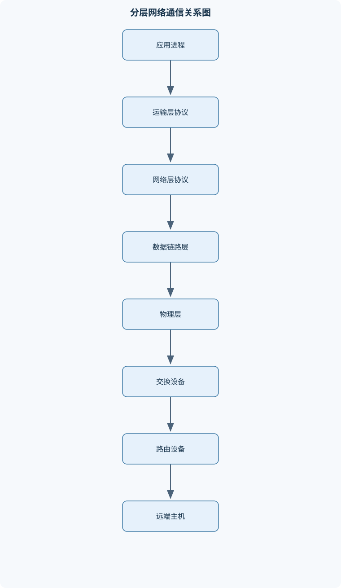
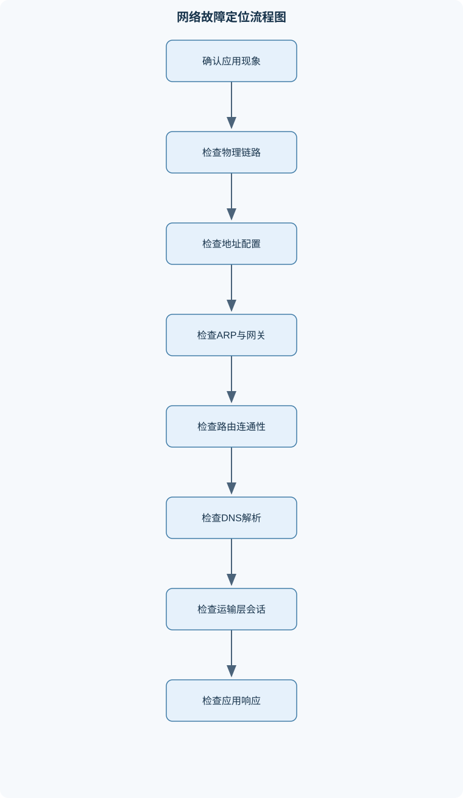

# 数据通信与计算机网络Data Connectino and Computer Network

## 一、课程整体知识框架

### 课程边界与先修知识

本课程系统讲授数据通信与计算机网络的基本理论、协议体系、网络互联、端到端通信、网络应用、网络安全及实验分析方法。内容覆盖物理层、数据链路层、网络层、运输层和应用层，并补充无线局域网、IPv6、网络管理与协议分析。先修知识包括计算机组成原理、操作系统基础、二进制与十六进制运算、基础概率统计和初等代数；不要求预先掌握具体网络设备厂商命令。课程重点是理解分层模型中数据封装与解封装过程，能够根据带宽、时延、差错、拥塞、地址规划和协议状态进行定量分析，并能使用协议分析工具解释真实网络报文。理想模型与实际网络的区别包括传播介质的不确定性、排队时延、丢包、路由变化、协议实现差异、加密保护和设备资源限制。





### 1. 课程对象、目标与先修基础

数据通信与计算机网络研究信息如何在通信介质、网络设备和协议系统中可靠、高效、安全地传输。课程对象不是某一种厂商设备，也不是单纯的网页访问操作，而是从比特、信号、帧、分组、报文段到应用数据的完整通信过程。学习重点包括三个相互联系的方面：一是理解分层体系结构及各层职责；二是能够用时延、吞吐量、窗口、地址和路由等量进行定量分析；三是能够通过真实报文观察协议状态，并根据现象定位故障。

课程通常以计算机组成原理、操作系统基础、二进制与十六进制运算、基础概率统计和初等代数为先修知识。二进制和十六进制用于分析地址、首部字段、掩码与校验值；初等代数用于推导速率、时延、窗口和信道容量关系；操作系统知识有助于理解进程、套接字、缓冲区和系统调用在网络通信中的作用。课程不要求预先掌握特定厂商的命令格式，因为协议原理、地址规划、报文结构和故障分析方法不依赖于某一品牌设备。

### 2. 分层体系与数据封装主线

课程采用五层协议体系作为主要学习主线，同时说明 TCP/IP 体系和 OSI 体系的对应关系。五层结构由下至上包括物理层、数据链路层、网络层、运输层和应用层。物理层处理比特到信号的表示和传输；数据链路层在相邻节点之间组织帧并进行介质访问与差错检测；网络层负责跨网络寻址和分组转发；运输层为进程之间提供复用、分用、流量控制、拥塞控制或可靠传输；应用层规定具体网络应用的消息格式和交互状态。

发送方的应用数据向下传递时，运输层增加 TCP 或 UDP 首部，形成 TCP 报文段或 UDP 用户数据报；网络层增加 IP 首部，形成 IP 数据报；链路层再增加帧首部和尾部，形成以太网帧或其他链路层帧。接收方按照相反方向解封装。以太网帧、IP 数据报、TCP 报文段和 UDP 用户数据报是不同层次的协议数据单元，不能混称为“数据包”。

分层的价值在于模块化和独立演进。例如，应用层协议可以在不同链路上运行，网络层可以承载不同运输层协议，物理层可以更换双绞线、光纤或无线介质。但分层不是绝对隔离：运输层的窗口会受到网络时延和接收缓存影响，网络层的路径 MTU 会影响运输层分段，应用层的缓存策略又会改变实际流量。因此，分析真实网络时必须同时观察多个层次。

### 3. 网络组成、边缘与核心

计算机网络可以按覆盖范围分为局域网、城域网、广域网等，也可以按接入方式分为有线网络、无线网络和移动网络。网络边缘由端系统构成，包括个人计算机、服务器、移动终端、传感器和嵌入式设备。端系统中运行着浏览器、邮件客户端、文件传输程序、实时音视频程序等应用进程，进程之间通过套接字进行通信。

网络核心主要由路由器、交换机、传输链路和互联节点组成。交换机通常依据链路层 MAC 地址在局域网内转发帧，路由器依据网络层 IP 地址和路由表在不同网络之间转发分组。路由器还可能执行分片处理、访问控制、地址转换、队列管理和控制报文生成。集线器只在物理层复制信号，不能依据地址进行选择性转发；网桥是早期的链路层互联设备，现代交换机继承了网桥的自学习和转发思想。

电路交换先建立专用通信资源，通信期间资源通常保持分配，适合持续、稳定的业务，但建立时间和资源闲置问题较明显。报文交换以完整报文为单位逐节点存储转发，缓冲需求大，单个报文的等待时间可能较长。分组交换将报文划分为较小分组，各分组可独立排队和转发，资源利用率较高，但会产生排队、丢包、乱序和重传。分组交换并不必然等于无连接服务，分组网络也可以通过虚电路等方式提供面向连接的服务。

因特网由端系统、接入网、区域网络、骨干网络、互联网服务提供者 ISP、互联交换点以及各种内容和云服务设施组成。不同网络通过路由协议和互联协议交换可达性信息。因特网的演进经历了从少量节点互联、形成多级 ISP 结构到移动化、云化、虚拟化和物联网广泛接入的过程。新型网络呈现出高速链路、软件定义、虚拟网络、边缘计算、多接入融合和加密普遍部署等特征，但这些特征并未消除时延、拥塞、故障和资源竞争。

### 4. 性能指标与理想模型边界

常用性能指标包括数据率、带宽、吞吐量、时延、时延抖动、丢包率、误码率、可用性和服务质量。数据率 $R$ 的单位是 bit/s；字节用 B 表示，且 $1\ \mathrm{B}=8\ \mathrm{bit}$。带宽 $W$ 在物理层理论中表示信道频带宽度，单位为 Hz；工程语境中也可能把链路容量称为带宽，因此计算时必须明确含义。吞吐量是单位时间实际交付的有效数据量，通常小于或等于链路标称数据率。

长度为 $L$ bit 的数据以速率 $R$ bit/s 发送时，发送时延为

$$
t_s=\frac{L}{R}.
$$

发送时延表示发送方把全部比特推入链路所需的时间，与数据长度和发送速率有关。距离为 $d$、信号传播速率为 $v$ 的链路，其传播时延为

$$
t_p=\frac{d}{v}.
$$

传播时延由距离和介质中的传播速度决定，与数据包长度无关，也不会因为提高发送速率而自动消失。单段链路的端到端时延可近似写为

$$
t_{\mathrm{end}}=t_s+t_p+t_{\mathrm{proc}}+t_{\mathrm{queue}},
$$

其中 $t_{\mathrm{proc}}$ 为设备处理时延，$t_{\mathrm{queue}}$ 为排队时延。该式是分解模型；多跳网络应对每一跳分别计算并求和，且排队时延随网络负载变化，不能简单视为常数。

时延带宽积描述链路中可能同时存在的在途数据量。若使用往返时间 RTT 和数据率 $R$，则

$$
\mathrm{BDP}=R\times RTT.
$$

当发送窗口显著小于 BDP 时，发送方在等待确认期间可能无法持续发送，链路利用率下降；窗口足够大也不保证吞吐量一定达到链路速率，因为丢包、拥塞、接收窗口、处理能力和协议开销仍可能成为限制因素。

### 5. 从物理比特到应用服务

物理层把比特表示为电压变化、光脉冲或无线电磁波。数据链路层把连续比特组织成帧并处理相邻节点传输；网络层把多个链路连接成可达路径；运输层把网络服务交付给具体进程；应用层则定义 DNS、DHCP、HTTP、电子邮件等服务。

一个网页访问通常涉及多个协议阶段：终端先通过 DHCP 或静态配置获得地址、网关和 DNS 信息；若目标不在本地网络，终端通过 ARP 或 IPv6 邻居发现获得下一跳链路层地址；随后进行 DNS 查询获得资源记录，再建立运输层连接或使用其他运输机制，最后交换 HTTP 请求和响应。抓包时必须根据时间顺序和字段关联分析这些阶段，不能仅凭一个应用层响应判断整个网络过程。

## 二、章节和模块划分

### 核心知识覆盖清单

本清单用于检查正文是否覆盖本课程的主要知识模块：

- **网络体系与因特网概述**：计算机网络的定义与分类、网络边缘与网络核心、端系统与网络应用进程、路由器与交换设备的作用、电路交换、报文交换和分组交换、面向连接与无连接服务、因特网组成、ISP与交换点、网络性能指标与服务质量、因特网发展阶段与新型网络特征。
- **数据通信基础与性能分析**：数据、信号与码元、基带信号和带通信号、单工、半双工和全双工、发送时延、传播时延与处理时延、排队时延和端到端时延、速率、带宽与吞吐量、信道利用率与时延的关系、时延带宽积与在途比特数、传输效率与协议开销。
- **物理层编码、调制与传输介质**：物理层接口与电气特性、数字基带编码、二元数字调制、奈奎斯特无噪声信道上限、香农有噪声信道上限、双绞线、同轴电缆和光纤、无线传播的基本限制、光纤波分复用、同步光纤网与光接口层、xDSL、HFC和FTTx接入技术。
- **信道复用与数据链路控制**：频分复用与时分复用、统计时分复用、波分复用、码分多址与正交码片、数据链路层服务、帧定界与透明传输、字节填充与零比特填充、差错检测与循环冗余校验、PPP协议组成与帧格式、确认、重传和链路可靠性边界。
- **局域网与以太网**：局域网的特点与拓扑、网卡和适配器的功能、MAC地址及其表示、以太网MAC帧格式、共享信道与碰撞域、CSMA/CD工作原理、集线器、网桥和交换机、网桥自学习与转发、生成树与交换网络环路、VLAN及其逻辑隔离。
- **网络层、IP编址与路由**：网络层服务模型、IPv4数据报格式、IP地址与分类编址、子网掩码与子网划分、CIDR与地址块聚合、ARP与地址解析、ICMP控制和差错报告、静态路由与默认路由、RIP与OSPF基本机制、路由器组成与分组转发、IP分片与路径MTU、IPv6基本首部与扩展首部。
- **运输层与端到端传输**：运输层复用与分用、端口号与套接字、UDP报文与无连接服务、TCP连接管理、TCP序号、确认与重传、TCP流量控制、滑动窗口与累积确认、TCP拥塞控制、往返时间与重传定时器、SCTP的基本特征、链路可靠性与端到端可靠性的关系。
- **网络应用协议**：域名系统DNS、递归解析与迭代解析、DHCP地址配置过程、HTTP请求、响应与状态码、HTTP资源、方法和缓存语义、URI、URL与超文本、电子邮件体系、SMTP、POP3和IMAP、MIME与多媒体内容、客户端、服务器和代理、应用层协议与运输层协议的选择。
- **网络安全与密码基础**：被动攻击与主动攻击、机密性、完整性和可用性、对称密钥密码体制、公钥密码与RSA基本原理、密码分析与密钥长度、报文摘要、数字签名、实体鉴别与报文鉴别、密钥分配与公钥分配、重放攻击与中间人攻击、防火墙与访问控制、链路加密与端到端加密。
- **无线网络与移动接入**：无线局域网基本组成、接入点与终端关联、无线局域网信道接入、热点与基础设施模式、自组网络、无线传感器网络、不同无线接入方式、无线链路的误码与隐藏终端、移动性对地址和路由的影响、无线网络安全基础。
- **网络协议分析与实验工作流**：抓包工具的工作层次、捕获接口与数据范围、以太网帧和IP数据报观察、ARP请求与响应分析、ICMP请求与应答分析、TCP三次握手分析、TCP四次挥手分析、HTTP请求与响应分析、显示过滤与流跟踪、报文时间线和字段关联、实验结果验证与误差解释。
- **综合网络设计与故障诊断**：局域网分层设计、碰撞域与广播域规划、地址块分配与路由规划、默认路由与动态路由选择、带宽和时延瓶颈定位、丢包、重传和拥塞诊断、DNS与DHCP故障区分、ARP异常和地址冲突分析、安全策略与访问控制设计、从应用现象反推协议故障。


### 1. 网络体系与因特网概述

本模块介绍网络定义、分类、端系统、网络核心、路由器、交换设备、ISP 和互联交换点。重点比较电路交换、报文交换和分组交换，说明面向连接服务与无连接服务的差异。学习者应能解释下载速度下降可能由链路拥塞、排队、丢包、TCP 重传或服务器处理能力不足共同造成，而不能把所有慢速现象归因于“带宽不够”。

### 2. 数据通信基础与性能分析

本模块区分数据、信号、码元、基带信号和带通信号，并说明单工、半双工和全双工通信。分析发送时延、传播时延、处理时延、排队时延和总时延，进一步讨论速率、带宽、吞吐量、信道利用率、时延带宽积和协议开销。对于应用数据量为 $A$ 字节、TCP 首部为 20 字节、IPv4 首部为 20 字节、链路层额外开销为 18 字节且不考虑重传时，传输效率为

$$
\eta=\frac{A}{A+20+20+18}=\frac{A}{A+58}.
$$

例如 $A=100$ 字节时，$\eta\approx63.29\%$；$A=1000$ 字节时，$\eta\approx94.52\%$。该结果只适用于首部无可选字段、链路层开销确为 18 字节且没有重传的简化条件。

### 3. 物理层编码、调制与传输介质

本模块讲授物理层接口的机械、电气、功能和过程特性，分析数字基带编码、二元数字调制以及双绞线、同轴电缆、光纤和无线介质。奈奎斯特无噪声信道上限为

$$
C=2W\log_2M,
$$

其中 $W$ 为带宽，单位 Hz；$M$ 为码元可能取值数；$C$ 为理论最大数据率，单位 bit/s。香农有噪声信道上限为

$$
C=W\log_2(1+S/N),
$$

其中 $S/N$ 为信噪比，$S$ 和 $N$ 分别为信号功率与噪声功率。两式均是理想化上限，不能直接替代实际链路速率。现实系统还受到编码开销、器件带宽、串扰、衰减、调制实现和误码率要求限制。

本模块还覆盖光纤波分复用、同步光纤网及其光接口层，以及 xDSL、HFC 和 FTTx 接入技术。频率与波长满足 $f=v/\lambda$；在光纤中比较两个波长的频带宽度时，应先换算为频率，再取频率差，不能直接用波长差代替频带宽度。

### 4. 信道复用与数据链路控制

频分复用把不同信号安排在不同频带，时分复用把不同信号安排在不同时间片，统计时分复用则根据实际需求动态分配时隙。波分复用是光纤中的频分思想，码分多址通过正交码片序列区分多个发送方。若接收序列分别与各站码片序列求内积，理想正交条件下，目标站的内积具有明显正负幅度，其他站的内积接近零。

数据链路层负责帧定界、透明传输、差错检测和介质访问控制。字节填充通过转义特殊字节避免数据被误认作帧界定符；零比特填充通过在连续若干个特定位后插入相反比特实现透明传输。CRC 使用模 2 除法检测差错，接收端余数为零只能说明未检测到错误，不能证明数据绝对正确。PPP 包含帧界定、地址与控制字段、协议字段、信息字段和帧校验序列，通常进行差错检测，但不等同于 TCP 的端到端确认和重传。

### 5. 局域网与以太网

本模块介绍局域网拓扑、网卡、MAC 地址和以太网帧。MAC 地址用于链路层局部范围内的帧交付；以太网帧包含目的地址、源地址、类型或长度、数据和 FCS 等字段。共享信道存在碰撞域，CSMA/CD 通过监听、发送、检测碰撞和二进制指数退避减少冲突。其经典条件要求最短帧发送时间不小于冲突信号往返传播时间；若单程传播时延为 $\tau$，数据率为 $R$，则理想最短帧长度至少为 $2\tau R$ bit。

交换机通过记录源 MAC 与入端口建立转发表。目的地址已知且端口不同则定向转发，端口相同则过滤，目的未知或帧为广播时向其他端口泛洪。生成树用于避免交换网络环路；VLAN 在逻辑上划分广播域，可将同一物理网络分为多个相互隔离的逻辑网络。

### 6. 网络层、IP 编址与路由

本模块覆盖 IPv4 数据报、分类编址、子网掩码、CIDR、ARP、ICMP、静态路由、默认路由、RIP、OSPF、路由器转发、IPv4 分片和 IPv6。IPv4 地址共 32 位，CIDR 前缀为 `/p` 时地址块包含 $2^{32-p}$ 个地址。网络地址把主机位清零，广播地址把主机位置一；可分配地址数量取决于地址用途和具体网络规则，不能不加条件地都减去两个。

路由器依据目标 IP 进行最长前缀匹配。默认路由只有在没有更具体匹配项时才使用。ARP 解决同一链路上的 IP 地址到 MAC 地址映射，DNS 则解决域名与资源记录之间的映射，二者作用范围和故障表现不同。IPv4 分片时，除最后一片外的数据长度通常应为 8 字节的整数倍，片偏移字段的单位也是 8 字节。IPv6 基本首部固定为 40 字节，通常由发送端处理分片，路由器一般不进行分片，因此路径 MTU 发现更加重要。

### 7. 运输层与端到端传输

运输层通过端口号实现复用与分用。TCP 连接套接字由本地 IP、本地端口、远端 IP 和远端端口共同确定，端口号不是物理接口。UDP 提供无连接、低开销服务，不保证交付、顺序或重传；TCP 通过三次握手建立连接，通过序号、确认号、重传、滑动窗口、流量控制和拥塞控制提供可靠字节流。

TCP 序号以字节为单位，确认号表示接收方期望收到的下一个字节。SYN 和 FIN 各占用一个序号。接收窗口用于防止接收方缓存溢出，拥塞窗口用于根据网络拥塞状态调节发送量，有效发送窗口通常不超过接收窗口与拥塞窗口中较小者。RTT 可由样本平滑估计，例如

$$
RTT_s^{\mathrm{new}}=(1-\alpha)RTT_s^{\mathrm{old}}+\alpha R.
$$

该值不是简单算术平均。SCTP 具有消息边界、多流和多宿主等特征，但具体可靠性和部署环境仍需结合协议实现分析。

### 8. 网络应用协议

本模块介绍 DNS、DHCP、HTTP、电子邮件和代理。DNS 解析可能经历本地缓存、hosts 映射、递归服务器、根服务器、顶级域服务器和权威服务器；递归查询由服务器代为完成，迭代查询则由请求方根据返回信息继续查询。DHCP 通常涉及发现、提供、请求和确认等阶段。

HTTP 是无状态应用层协议，使用请求方法、URI、首部、状态码和消息内容表达资源操作。状态码表示协议层处理结果，不必然等于业务逻辑成功。缓存、代理、连接复用、认证和加密保护可能由 HTTP 版本、传输层及其他机制共同实现。电子邮件体系包括 SMTP、POP3、IMAP 和 MIME，分别承担邮件传输、收取、服务器端管理及多媒体内容编码等功能。应用选择 TCP 还是 UDP，应根据可靠性、时延、顺序、连接状态和应用自身恢复能力综合判断。

### 9. 网络安全与密码基础

本模块区分被动攻击与主动攻击，分析机密性、完整性和可用性。对称密码适合高效处理大量数据，但密钥分发困难；公钥密码便于密钥协商和数字签名，但计算开销通常更高。报文摘要用于完整性校验，数字签名还需要证明签名者身份和不可否认性；实体鉴别、报文鉴别、密钥分配和公钥分配必须结合协议上下文理解。

重放攻击利用旧的有效消息重复发送，中间人攻击则篡改通信双方的交互。防御机制包括随机数、时间戳、序列号、证书验证、密钥确认和访问控制。防火墙依据地址、端口、协议、状态或应用特征实施策略；链路加密保护单段或局部链路，端到端加密则由通信端点保护内容，二者的信任边界不同。

### 10. 无线网络与移动接入

无线局域网通常由终端、接入点和分布式网络组成，终端先扫描并关联接入点，再通过共享无线信道通信。无线介质存在干扰、衰减、误码、隐藏终端和暴露终端问题，不能直接套用有线以太网的碰撞检测模型。无线传感器网络强调低功耗、低速率和多跳协作；自组网络不依赖固定基础设施。

移动性会改变终端的接入点、链路地址、可达路径和路由状态。无线安全需要同时保护身份、接入控制、链路数据和密钥更新，不能仅依靠隐藏网络名称或限制地址访问。

### 11. 网络协议分析与实验工作流

协议分析应先明确捕获接口和捕获范围，再按时间顺序观察以太网帧、IP 数据报、ARP、ICMP、TCP 和 HTTP。分析 TCP 时，应按照五元组筛选连接，检查 SYN、SYN+ACK、ACK、序号、确认号、窗口、FIN、RST 及报文时间间隔。分析 HTTP 时，应把请求方法、URI、响应状态码、缓存首部和实际内容联系起来。

抓包工具显示的是捕获点所看到的报文，可能受到网卡卸载、镜像端口、加密、时间戳误差和抓包丢失影响。因此，单个抓包点看到一次重传，不能直接断定某条链路发生故障。实验结论应区分直接观察到的字段、根据协议推断的状态以及尚不能由当前捕获证明的端到端事实。

### 12. 综合网络设计与故障诊断

综合设计包括局域网分层、碰撞域与广播域规划、地址块分配、路由规划、默认路由和动态路由选择。设计时要同时考虑端口容量、链路带宽、传播距离、设备处理能力、广播范围、冗余路径、安全边界和扩展空间。

故障诊断应从应用现象向下分层验证。例如网页无法打开，可能是 DNS 解析失败、ARP 异常、默认网关不可达、路由缺失、TCP 连接失败、HTTP 服务异常或访问控制阻断。DNS 故障通常表现为域名解析失败而直接使用 IP 可能仍可访问；ARP 异常可能造成同一局域网内通信失败或网关不可达；丢包和重传则需要结合链路利用率、队列、RTT、窗口和拥塞状态判断。有效诊断必须形成“现象—假设—报文证据—排除过程—修复验证”的闭环，而不能只依据单一命令或单个协议字段下结论。

## 三、核心概念的详细解释

### 1. 网络体系结构与因特网组成

#### 1.1 计算机网络、网络边缘与网络核心

计算机网络是由相互连接的自治计算设备、通信链路、交换设备和协议系统构成的通信系统。网络的基本功能不是简单地“传输数据”，而是使不同位置、不同硬件和不同操作系统上的进程能够按照约定格式交换信息，并在共享资源、链路故障、拥塞和安全威胁存在时维持可接受的服务质量。

网络边缘主要由端系统构成，包括个人计算机、服务器、移动终端、传感器和嵌入式设备。端系统中运行着应用进程，进程通过套接字与运输层交互。网络核心由路由器、交换机、传输链路和互联节点组成。交换机通常依据 MAC 地址在同一局域网内部转发帧；路由器依据网络层地址和路由表，在不同网络之间转发 IP 数据报。集线器只复制物理信号，不理解 MAC 地址，也不能进行选择性转发。

网络可以按照覆盖范围划分为局域网、城域网和广域网；也可以按照传输媒介划分为有线网络、无线网络和移动网络。分类标准不同，分类结果可以交叉。例如，一个校园范围的无线网络既属于局域网，也属于无线网络。网络类型本身不能直接决定其可靠性、速率或安全性，具体性能还取决于介质、设备、拓扑结构、协议和负载。

#### 1.2 分层模型与封装

五层协议体系通常包括物理层、数据链路层、网络层、运输层和应用层。物理层规定比特如何转换为电、光或电磁信号，并规定接口的电气、机械、功能和过程特性。数据链路层在相邻节点之间传送帧，负责帧定界、介质访问和差错检测。网络层负责跨网络寻址、路由和分组转发。运输层实现进程到进程的通信，并可提供复用、分用、可靠传输、流量控制和拥塞控制。应用层规定 DNS、DHCP、HTTP、电子邮件等应用协议的消息格式和状态转换。

发送端的封装过程是逐层增加控制信息。应用数据交给 TCP 后，增加 TCP 首部形成 TCP 报文段；交给 IP 后增加 IP 首部形成 IP 数据报；交给以太网后增加帧首部和帧尾形成以太网帧。接收端按相反顺序解封装。应用数据、TCP 报文段、IP 数据报和以太网帧属于不同层次的协议数据单元，不能混称为同一种“数据包”。

分层的优点是模块化。例如，HTTP 不必知道底层使用双绞线、光纤还是无线链路，IP 也可以承载 TCP、UDP 或其他运输层协议。但分层并不意味着各层互不影响。路径 MTU 会影响运输层分段，运输层窗口会受到接收缓存和往返时延影响，应用层缓存会改变实际报文流量。因此，实际故障分析必须把多个层次的证据联系起来。

#### 1.3 电路交换、报文交换与分组交换

电路交换在通信前建立一条逻辑或物理电路，并为通信过程预留资源。建立完成后，数据传输时延较稳定，适合持续、规则的业务；但建立过程需要时间，通信间歇时预留资源可能闲置，且网络资源分配缺乏弹性。

报文交换以完整报文为单位进行存储转发。中间节点必须接收并缓存整个报文后再发送，所需缓存较大，报文越长，等待时间越明显。分组交换把报文划分为若干较小分组，各分组可以在多个节点逐跳转发。它提高了共享链路的利用率，但可能产生排队时延、丢包、乱序和重复。分组交换不等于无连接服务：数据报网络可采用无连接方式，虚电路网络也可在分组交换基础上提供面向连接的服务。

分组首部包含源地址、目的地址、长度、协议类型、序号、控制标志或生存时间等字段。首部使网络设备能够判断“把数据交给谁、如何转发、是否需要分片、属于哪个连接以及如何解释有效载荷”。首部会增加传输开销，并可能暴露通信元数据；在加密场景下，通常仍需保留一定可路由或可复用的外层首部。

#### 1.4 因特网、ISP与交换点

因特网不是一张由单一机构完全控制的网络，而是许多自治网络通过 IP 协议和互联机制连接形成的网络。端系统通过接入网连接到 ISP，ISP 之间通过区域网络、骨干链路和互联交换点交换流量。交换点可以减少流量必须绕行其他网络的需要，但实际路径仍由路由策略、容量、成本和故障状态共同决定。

因特网的发展可以概括为三个相互衔接的阶段：早期是少量研究和实验网络的互联；随后形成由骨干网络、区域网络和接入网络组成的多级结构，并出现 ISP 与互联交换点；当前阶段则表现为云计算、移动接入、内容分发、物联网、虚拟化和软件定义网络共同参与。新型网络具有业务类型多样、终端数量大、无线接入普遍、资源虚拟化和安全边界复杂等特点，传统“固定主机—固定链路”的假设不再充分。

### 2. 数据通信基础与网络性能

#### 2.1 数据、信号、比特与码元

数据是需要传输的信息，信号是数据在物理媒介中的表现形式。比特是二进制信息的基本单位，记为 bit；字节记为 B，且 $1\ \mathrm{B}=8\ \mathrm{bit}$。码元是一次信号状态变化所代表的基本符号，一个码元不一定只表示一个比特。当符号集合大小为 $M$ 时，每个码元最多携带 $\log_2 M$ bit，实际携带量还受到编码、同步、噪声和协议开销影响。

基带传输直接在信道原有频带中传送数字脉冲，适合某些局域网和短距离场景。带通传输先把基带数据调制到载波附近的频带，适合无线、电话线和有线电视网络。单工通信只能单向传输；半双工通信双方都能发送，但同一时刻通常只能有一方发送；全双工通信允许双方同时发送。全双工不代表没有冲突或没有拥塞，它只表示两个方向具有同时传输的能力。

#### 2.2 时延、吞吐量与利用率

数据长度为 $L$ bit、发送速率为 $R$ bit/s 时，发送时延为

$$
t_s=\frac{L}{R}.
$$

发送时延表示发送端把全部比特推入链路所需的时间。传播距离为 $d$、信号传播速率为 $v$ m/s 时，传播时延为

$$
t_p=\frac{d}{v}.
$$

传播时延取决于物理距离和传播速度，与数据长度和发送速率无直接关系。端到端时延可近似写为

$$
t_{\mathrm{end}}=t_s+t_p+t_{\mathrm{proc}}+t_{\mathrm{queue}},
$$

其中，$t_{\mathrm{proc}}$ 是节点处理时延，$t_{\mathrm{queue}}$ 是等待输出链路的排队时延。该式是分项近似；多跳网络中应对每一跳分别计算，且排队时延会随流量变化，不能预先视为固定常数。

吞吐量是单位时间内实际成功传输的有效数据量，单位通常为 bit/s。链路容量是理想或规定条件下的最大传输能力，实际吞吐量还受到首部、重传、窗口、拥塞、接收处理能力和协议实现的影响。因此，“带宽”必须区分两种含义：在物理层，$W$ 常表示频带宽度，单位为 Hz；在工程口语中，带宽也常指链路容量，单位为 bit/s。将二者直接当作同一物理量会造成单位错误。

#### 2.3 时延带宽积与在途数据

设链路速率为 $R$ bit/s，往返时间为 RTT，则时延带宽积为

$$
\mathrm{BDP}=R\times \mathrm{RTT}.
$$

它表示在一个 RTT 时间内链路最多能够承载的在途比特数。若发送窗口显著小于 BDP，发送端在等待确认期间可能已经没有新数据可发送，链路因而无法持续满载。若窗口达到或超过 BDP，仍不保证吞吐量等于链路速率，因为接收窗口、拥塞窗口、丢包、处理能力和应用供给速度也可能成为瓶颈。

在途比特数也可由单程传播时延计算：

$$
N_{\mathrm{flight}}=R\times t_p.
$$

例如，高速链路即使只有较短的物理距离，也可能同时存在大量在途比特；长距离链路在高数据率下尤其明显。该结果是连续流动的理想估计，实际网络还会受到帧边界、队列和链路协议的影响。

### 3. 物理层编码、调制与传输介质

#### 3.1 物理层限制与编码

物理层需要规定接口电平、连接器、时钟、信号持续时间、编码规则、传输方向和最大距离。数字基带编码包括不归零编码、曼彻斯特编码、差分编码等。编码不仅表示 0 和 1，还要帮助接收端恢复时钟、识别边界并减少直流分量。某种编码可能改善同步，却扩大所需频带，因此不存在脱离场景的“最好编码”。

调制是利用载波的振幅、频率或相位表示数字信息。最基本的二元调制包括二进制振幅键控、二进制频移键控和二进制相移键控。调制方式的选择需要在频带利用率、抗噪性、实现复杂度和功率效率之间折中。无线链路还会受到路径损耗、多径、遮挡、干扰和移动速度影响，理想有线信道的结论不能直接套用。

#### 3.2 奈奎斯特与香农限制

在理想无噪声信道中，带宽为 $W$ Hz、信号具有 $M$ 个离散电平时，奈奎斯特最大码元传输速率对应的最大比特率为

$$
C=2W\log_2 M.
$$

推导思路是：带宽为 $W$ 的理想信道每秒最多支持约 $2W$ 次独立码元变化；每个码元从 $M$ 种状态中选择一种，携带 $\log_2M$ bit；两者相乘得到上限。该公式假设无噪声、同步理想且信号电平可可靠区分。现实中噪声和失真会降低可实现速率，增加 $M$ 并不一定有效，因为电平间隔会变小。

考虑加性高斯噪声时，香农信道容量为

$$
C=W\log_2\left(1+\frac{S}{N}\right),
$$

其中 $S/N$ 是信号功率与噪声功率之比，必须使用线性值；若使用分贝值，应先按

$$
\mathrm{SNR}_{\mathrm{dB}}=10\lg(S/N)
$$

换算。香农公式给出理论无差错传输上限，不表示任意协议都能达到该速率。固定 $W$ 时，提高目标容量需要使信噪比按指数增长；因此，继续提高速率通常要付出功率、编码复杂度或误码率方面的代价。

#### 3.3 传输介质与接入技术

双绞线成本低、安装方便，适合局域网和电话接入，但距离、串扰和频率损耗限制其性能。同轴电缆屏蔽性较好、带宽较大，常用于有线电视网络。光纤具有高带宽、低损耗、抗电磁干扰和较强保密性，适合长距离骨干传输，但连接、弯曲半径和光电转换要求更高。

波分复用在同一根光纤中使用不同波长的光信号，使多个逻辑信道共享一条物理光纤。频率与波长满足

$$
f=\frac{v}{\lambda},
$$

其中 $f$ 为频率，$\lambda$ 为波长，$v$ 为介质中的传播速度。若用两个波长端点计算频带宽度，必须先换算为频率，再取频率差，不能直接用波长差代替频率带宽。

同步光纤网通过标准化的帧结构、复用机制和光接口层支持高速、同步和可管理传输。光接口层通常涉及物理介质、光电转换、线路传输和路径承载等功能。xDSL 利用电话铜线的不同频段提供数字接入，ADSL 通常使下行速率高于上行速率；HFC 将光纤骨干与同轴接入结合，用户侧共享介质可能产生拥塞；FTTx 将光纤推进到不同位置，包括楼宇、路边或用户家庭，光纤越接近用户，通常越有利于提高带宽和降低铜线段限制。

### 4. 复用、链路控制与局域网

#### 4.1 复用技术

频分复用把不同信号放在不同频带，同时传输；各信道需要保护频带以减少相互干扰。时分复用让不同信号在不同时间片使用同一信道，适合具有同步时钟和固定时隙的系统。统计时分复用根据实际需求动态分配时隙，利用率较高，但需要标识来源并承担排队等待。

码分多址为不同用户分配具有良好相关性的码片序列。接收端将混合信号与某用户的码序列进行内积，理想正交条件下，本用户信号内积具有明显正负值，其他用户信号内积接近零。正交性受到同步误差、多径和功率差异影响，因此实际无线系统需要功率控制、扩频和抗干扰机制。

#### 4.2 数据链路层、帧定界与差错检测

数据链路层向网络层提供相邻节点之间的帧传送服务。它可以提供帧定界、透明传输、介质访问控制和差错检测，但不必然提供端到端可靠交付。帧定界可以利用长度字段、特殊标志字节、字节填充或零比特填充实现。若数据本身出现与帧边界相同的模式，发送端必须进行填充，接收端再反向删除，以避免把有效数据误认为控制标志。

循环冗余校验把数据视为二进制多项式，使用模 2 除法计算余数。发送端在数据后补若干个零，再除以生成多项式，将余数替换补上的零；接收端再次相除，余数为零只能说明“未检测到规定范围内的错误”，不能证明绝对无错。PPP 使用帧标志、字节转义和帧校验序列组织链路帧，但通常不提供类似 TCP 的端到端确认和重传。

#### 4.3 以太网、交换机与 VLAN

以太网帧包含目的 MAC 地址、源 MAC 地址、类型或长度字段、有效载荷和 FCS。MAC 地址用于链路范围内的帧交付，不等同于 IP 地址，也不等同于硬件插口。共享以太网中多个设备竞争同一信道，碰撞会形成共同碰撞域。传统半双工以太网使用 CSMA/CD：发送前监听，检测空闲后发送；发生碰撞时停止发送，执行二进制指数退避。现代全双工交换式以太网通常不存在传统共享信道碰撞，不能机械地套用 CSMA/CD。

交换机依据源 MAC 学习“地址—端口”对应关系，并根据目的 MAC 进行单播转发、过滤或泛洪。若目的地址未知，交换机向除入端口外的其他端口泛洪；MAC 表项经过老化后需要重新学习。二层环路会造成广播无限循环和 MAC 表抖动，因此冗余交换网络需要生成树等机制阻断部分逻辑路径。VLAN 将一个物理交换网络划分为多个逻辑广播域，能够隔离广播和组织安全边界，但跨 VLAN 通信仍需三层设备或三层交换功能。

### 5. 网络层、运输层与应用层

#### 5.1 IP 编址、路由与控制报文

IPv4 地址共 32 bit，IPv6 地址共 128 bit。CIDR 前缀 `/p` 表示前 $p$ 位是网络前缀。IPv4 的 `/p` 地址块含有

$$
2^{32-p}
$$

个地址。网络地址把主机位清零，广播地址把主机位置一；但可分配地址数量还取决于地址用途、点到点链路、特殊地址和具体部署规则，不能始终简单地减去两个。

路由器收到 IP 数据报后，检查目标地址、首部和生存时间，再依据最长前缀匹配选择下一跳。默认路由只有在没有更具体匹配项时才使用。RIP 以跳数等指标交换距离信息，适合较小网络；OSPF 在自治系统内部建立链路状态信息并计算路径，能够较快响应拓扑变化。ARP 把同一链路上的 IPv4 地址解析为 MAC 地址；DNS 把域名解析为资源记录，二者解决的问题和作用范围完全不同。ICMP 用于差错报告、诊断和控制，不承载普通应用数据。

当 IP 数据报大于链路 MTU 时，IPv4 可以进行分片。除最后一片外，分片数据长度通常取 8 字节的整数倍，因为片偏移字段的单位是 8 字节。IPv6 基本首部固定为 40 字节，扩展首部承载可选功能；通常由发送端根据路径 MTU 进行分片，路由器不承担普通分片工作。

#### 5.2 UDP、TCP与端到端通信

运输层通过端口号区分同一主机上的不同应用进程。TCP 连接通常由本地 IP、本地端口、远端 IP 和远端端口共同确定，端口号不是物理接口。UDP 无连接、首部较短、延迟低，不提供内建的可靠交付、排序和拥塞控制，适合实时业务、简单查询和由应用自行控制可靠性的场景。

TCP 是面向连接的字节流协议。三次握手用于确认双方可达、交换初始序号并建立状态；它不是三次应用数据传输。TCP 序号按字节计算，SYN 和 FIN 各占用一个序号空间；确认号表示接收方期望收到的下一个字节序号。连接关闭时，两个方向分别关闭，因此通常需要 FIN、ACK、FIN、ACK 四个控制步骤；半关闭和 TIME-WAIT 是全双工关闭过程的重要状态。

TCP 发送量同时受接收窗口和拥塞窗口限制，可近似写为

$$
W_{\mathrm{send}}\leq \min(\mathrm{Wnd},\mathrm{cwnd}).
$$

接收窗口用于防止接收缓存溢出，拥塞窗口用于适应网络拥塞状态。TCP 使用累计确认、超时重传和重复确认等机制恢复丢失数据。往返时间的平滑估计可以写为

$$
\mathrm{RTT}_{s,\mathrm{new}}
=(1-\alpha)\mathrm{RTT}_{s,\mathrm{old}}+\alpha R,
$$

其中 $R$ 为本次样本 RTT，$0<\alpha<1$。实际重传定时器还需要考虑 RTT 波动，不能把平滑 RTT 直接当作固定超时值。SCTP 除了可靠传输，还支持多流、多宿主等特征，但其适用范围和部署条件与 TCP、UDP 不同。

#### 5.3 DNS、DHCP、HTTP与电子邮件

DNS 使用分层命名空间，将域名映射到 A、AAAA、MX、CNAME 等资源记录。递归解析由递归服务器代表客户端完成后续查询；迭代解析则由查询方根据服务器返回的信息继续访问下一级服务器。缓存可以减少查询时延和负载，但 TTL 到期、记录变化和缓存污染会影响结果。

DHCP 通过发现、提供、请求、确认等交互为主机配置 IP 地址、子网掩码、默认网关和 DNS 服务器。DHCP 解决地址配置问题，不等于 ARP，也不等于 DNS。

HTTP 是无状态的应用层协议，请求通常包含方法、目标资源和首部，响应包含状态码、首部和可选消息内容。状态码反映协议处理结果，但例如 200 只表示 HTTP 请求在协议层获得成功响应，不保证业务逻辑一定成功。URI 用于标识资源，URL 是包含定位信息的 URI 形式。缓存、连接复用、认证和加密可以由 HTTP 语义、具体版本、运输层或其他机制共同实现，HTTP 本身不能等同于可靠传输。

电子邮件体系通常由 SMTP 负责邮件提交和服务器间转发，由 POP3 或 IMAP 支持用户取信。MIME 使邮件能够表示文本、附件和多媒体内容。客户端、服务器和代理的职责不同，代理还可能承担缓存、过滤、访问控制和协议转换。

### 6. 网络安全、无线网络与协议分析

#### 6.1 安全目标与密码机制

网络安全的基本目标包括机密性、完整性和可用性，并涉及实体鉴别、报文鉴别、不可否认性和密钥管理。被动攻击主要观察或分析通信内容，主动攻击则可能修改、注入、重放或阻断报文。

对称密码使用同一密钥进行加密和解密，速度快，适合大量数据传输，但通信双方需要安全地共享密钥。公钥密码使用公钥和私钥，便于密钥交换和数字签名，但计算开销通常较大。RSA 的基本思想依赖大整数分解困难性：选择两个大素数形成模数，在满足互素条件的指数之间建立幂运算逆关系；实际安全性还依赖密钥长度、填充、随机数和正确实现，不能把裸幂运算直接当作安全加密。

报文摘要把任意长度消息映射为固定长度摘要，主要用于完整性校验；数字签名通常由私钥生成、由公钥验证，能够证明签名者对消息的控制，但不能单独提供消息保密。重放攻击可通过随机数、时间戳、序列号或状态绑定缓解；中间人攻击则要求可靠的公钥分配和实体鉴别。防火墙按照地址、端口、协议、状态或应用特征实施访问控制。链路加密保护某段链路，端到端加密保护通信端点之间的内容，二者的保护范围和信任假设不同。

#### 6.2 无线网络与移动性

无线局域网通常由终端、接入点和无线信道组成。基础设施模式下，终端先扫描并与接入点关联；自组网络则由终端直接或多跳协作。无线信道存在误码、干扰、隐藏终端和暴露终端问题，难以直接使用有线以太网的碰撞检测，因此通常采用冲突避免、确认和退避机制。

移动性会改变终端的接入点、链路地址、可达路径和安全上下文。移动终端的 IP 地址、路由和会话保持需要额外机制支持。无线传感器网络通常受到能量、带宽、计算能力和节点规模限制，协议设计需重视低功耗、聚合和多跳传输。无线网络安全除加密外，还需要鉴别接入点、保护密钥、抵抗伪造热点和重放。

#### 6.3 协议分析与故障诊断

协议分析工具显示的是捕获点观察到的帧和报文，而不是整个网络的绝对事实。分析时应先确定捕获接口和时间范围，再按五元组筛选连接，按照时间顺序关联 ARP、DNS、TCP 握手、HTTP 交互和 TCP 关闭。应记录源地址、目的地址、端口、序号、确认号、窗口、标志位、状态码和报文时间间隔。

故障诊断应遵循“现象—假设—证据—排除—验证”的链条。网页无法访问可能是 DNS 解析失败、ARP 异常、默认网关不可达、路由缺失、TCP 连接失败、HTTP 服务异常或访问控制阻断。单个抓包点看到重传，可能是发送端确实未收到确认，也可能是抓包点丢包、网卡卸载、镜像延迟、时间戳误差或加密导致的观察限制。结论必须区分直接观察到的字段、根据协议状态推断出的结果，以及当前捕获不能证明的端到端事实。

## 四、重要定义、公式、定理和推导

### 专业审校补充：关键定义与适用边界

IPv6地址规划不能简单沿用IPv4的“网络地址、广播地址、可用主机地址”三分法。IPv6单播地址通常由路由前缀、子网标识和接口标识组成，典型局域网前缀长度为/64；IPv6没有广播地址，邻居发现协议NDP使用组播完成邻居解析、路由器发现和重复地址检测。链路本地地址通常位于fe80::/10，只在本链路有效，不能作为跨路由器通信的源地址。全球单播地址可被路由，唯一本地地址fc00::/7用于受限范围内部通信。主机通过路由器通告获得前缀时，可使用无状态地址自动配置生成地址，但仍应执行DAD以检查地址冲突；DHCPv6也可以补充地址或其他配置。IPv6地址规划的关键边界是：/64并非所有场景都绝对强制，但许多自动配置和邻居发现机制按/64设计；点到点链路、特殊基础设施链路可采用不同规划，必须以具体协议和设备实现为前提。NDP依赖ICMPv6，过滤ICMPv6会导致地址配置或邻居通信异常，不能把它当作可随意屏蔽的普通诊断流量。


### 1. 通信性能公式及推导

#### 1.1 发送时延与传播时延

设待发送数据长度为 $L$ bit，发送速率为 $R$ bit/s。发送端每秒推出 $R$ 个比特，因此推出 $L$ 个比特所需时间为

$$
t_s=\frac{L}{R}.
$$

若 $L$ 固定而 $R$ 提高，$t_s$ 按反比例下降；若 $R$ 固定而 $L$ 增大，$t_s$ 线性增加。

传播时延由距离决定。信号传播距离为 $d$ m，传播速度为 $v$ m/s，则

$$
t_p=\frac{d}{v}.
$$

例如，$d=1000\ \mathrm{km}=10^6\ \mathrm{m}$，$v=2\times10^8\ \mathrm{m/s}$，则

$$
t_p=\frac{10^6}{2\times10^8}=5\times10^{-3}\ \mathrm{s}=5\ \mathrm{ms}.
$$

若数据长度为 $10^7$ bit、发送速率为 $100\ \mathrm{kb/s}=10^5\ \mathrm{bit/s}$，则

$$
t_s=\frac{10^7}{10^5}=100\ \mathrm{s}.
$$

若改为 $10^3$ bit、速率改为 $1\ \mathrm{Gb/s}=10^9\ \mathrm{bit/s}$，则

$$
t_s=\frac{10^3}{10^9}=10^{-6}\ \mathrm{s}=1\ \mu\mathrm{s}.
$$

两种情况下传播时延仍为 $5\ \mathrm{ms}$。因此，提高发送速率不能消除由物理距离决定的传播时延。若题目还给出处理时延和排队时延，应使用

$$
t_{\mathrm{end}}=t_s+t_p+t_{\mathrm{proc}}+t_{\mathrm{queue}},
$$

而不能只相加发送时延和传播时延。

#### 1.2 时延带宽积

设单向链路速率为 $R$，往返时间为 RTT，则一个 RTT 内能够发送的最大数据量为

$$
\mathrm{BDP}=R\times\mathrm{RTT}.
$$

若 $R=1\ \mathrm{Gb/s}$、$\mathrm{RTT}=100\ \mathrm{ms}=0.1\ \mathrm{s}$，则

$$
\mathrm{BDP}=10^9\times0.1=10^8\ \mathrm{bit}
=12.5\times10^6\ \mathrm{B}.
$$

这表示要让发送端在确认返回前持续发送，窗口量级至少需要接近 $12.5\ \mathrm{MB}$。若窗口只有 $64\ \mathrm{KB}$，发送端可能频繁等待确认，最大吞吐量将受到窗口限制。

在忽略处理、排队、丢包和协议开销的理想模型中，窗口为 $W_{\mathrm{win}}$ bit 时，窗口受限吞吐量近似为

$$
T\approx \frac{W_{\mathrm{win}}}{\mathrm{RTT}}.
$$

实际吞吐量还必须满足

$$
T\leq \min(R,\;T_{\mathrm{window}},\;T_{\mathrm{receiver}},\;T_{\mathrm{application}}),
$$

其中 $T_{\mathrm{receiver}}$ 表示接收端处理能力，$T_{\mathrm{application}}$ 表示应用供给数据的能力。该不等式说明，提升某一项能力不一定带来端到端吞吐量提升。

#### 1.3 传输效率

若应用有效数据量为 $A$ 字节，TCP 首部为 20 字节，IPv4 首部为 20 字节，链路层首部和尾部合计 18 字节，且暂不考虑 TCP 选项、重传和其他封装，则总发送量为

$$
A+20+20+18=A+58\ \mathrm{B}.
$$

传输效率为

$$
\eta=\frac{A}{A+58}.
$$

当 $A=100\ \mathrm{B}$ 时，

$$
\eta=\frac{100}{158}\approx63.29\%.
$$

当 $A=1000\ \mathrm{B}$ 时，

$$
\eta=\frac{1000}{1058}\approx94.52\%.
$$

由此可见，小报文的固定首部开销比例较高。该推导的适用条件是首部长度固定、未使用选项、没有重传、没有额外隧道封装，并且链路层开销确实为 18 字节。若使用 IPv6、TCP 选项、VLAN、隧道或加密协议，应重新列出所有字段后计算。

### 2. 物理层容量公式

#### 2.1 奈奎斯特公式

无噪声信道中，若带宽为 $W$ Hz、码元状态数为 $M$，则最大比特率为

$$
C=2W\log_2M.
$$

推导分为两步。第一步，带宽为 $W$ 的理想信道每秒最多承载 $2W$ 个独立码元变化；第二步，每个码元有 $M$ 种状态，最多携带 $\log_2M$ bit。因此：

$$
C=(2W)\times(\log_2M).
$$

当 $M=2$ 时，公式退化为 $C=2W$。当 $M$ 增大时，理论容量增加，但实际电平间隔变小，对噪声、线性度和接收端精度的要求提高。含噪声时不能只使用奈奎斯特公式。

#### 2.2 香农公式

含噪声信道的理论容量为

$$
C=W\log_2\left(1+\frac{S}{N}\right).
$$

其中，$W$ 的单位为 Hz，$S$ 和 $N$ 必须使用相同单位的功率，$S/N$ 是无量纲线性信噪比。若给出信噪比为分贝值 $x$ dB，应先换算：

$$
\frac{S}{N}=10^{x/10}.
$$

若要求达到目标容量 $C$，可反解所需信噪比：

$$
\frac{S}{N}=2^{C/W}-1.
$$

该式说明在固定带宽下，目标速率每增加一定数值，所需信噪比按指数增长。香农公式是假设加性高斯噪声、信道统计特性稳定和编码长度足够长的理论上限；它不考虑具体调制方式、协议开销、同步损耗、峰均功率比和设备实现限制，因此实际可用速率通常低于该上限。

### 3. 编址、分片与路由公式

#### 3.1 CIDR地址块

IPv4 地址共 32 bit，前缀长度为 $p$ 时，主机位数为 $32-p$，地址总数为

$$
N=2^{32-p}.
$$

例如，`140.120.84.24/20` 的掩码为 `255.255.240.0`。第三字节的块大小为

$$
256-240=16.
$$

84 落在 80 至 95 这一块内，因此网络地址为 `140.120.80.0`，广播地址为 `140.120.95.255`，总地址数为

$$
2^{32-20}=2^{12}=4096.
$$

CIDR 聚合可以把连续地址块用较短的共同前缀表示，减少路由表项；但只有地址块连续、边界对齐且确实属于同一可达路径时，聚合才不会造成错误转发。过度聚合可能把实际上不可达的地址也纳入前缀。

#### 3.2 IPv4分片

原始 IPv4 数据报总长度为 $L$ 字节，首部长度为 $H$ 字节，链路 MTU 为 $M$ 字节，则单片最多携带

$$
M-H
$$

字节数据；除最后一片外，数据长度必须向下取整为 8 字节的倍数。第 $i$ 片的片偏移为

$$
\mathrm{Offset}_i=\frac{\text{该片之前已发送的数据字节数}}{8}.
$$

例如，原始数据报总长度为 4000 字节，固定首部为 20 字节，MTU 为 1500 字节。原始数据长度为

$$
4000-20=3980\ \mathrm{B}.
$$

每个非末片最多携带

$$
1500-20=1480\ \mathrm{B},
$$

且 1480 是 8 的倍数，因此三片数据长度为 1480、1480 和 1020 字节。片偏移分别为

$$
0,\quad \frac{1480}{8}=185,\quad
\frac{1480+1480}{8}=370.
$$

前两片 MF 置 1，最后一片 MF 置 0。每片都拥有自己的 IP 首部，因此分片会增加首部开销和重组复杂度。IPv6 通常由发送端完成分片，路径 MTU 发现能够减少中间路由器分片需求。

#### 3.3 最长前缀匹配

路由器将目标 IP 地址与所有路由前缀逐项比较。若多个前缀都匹配，选择前缀长度最大的条目。例如，目标地址同时匹配 `/8`、`/16` 和 `/24`，应选择 `/24`，因为它代表最具体的网络范围。若没有任何普通前缀匹配，才检查默认路由 `0.0.0.0/0`。默认路由并不是优先级最高的路由，而是其他匹配失败后的兜底项。

### 4. 链路差错检测与协议状态

#### 4.1 CRC

设原始数据比特串为 $D$，生成多项式对应的二进制除数长度为 $k+1$。发送端先在 $D$ 后补 $k$ 个零，得到

$$
D\cdot 2^k.
$$

然后使用模 2 除法计算余数 $R$，其中减法等价于按位异或，不发生借位。最终发送序列为

$$
T=D\cdot2^k\oplus R.
$$

接收端对 $T$ 再除以同一个生成多项式。若余数为零，则判定“未检测到错误”；若余数非零，则判定检测到错误。CRC 不是纠错算法，也不能保证所有错误都能检测出来。其检测能力取决于生成多项式和错误模式。

#### 4.2 TCP序号与确认号

TCP 序号以字节为单位。若某报文段的第一个数据字节序号为 `Seq`，有效载荷长度为 $L$，则接收方在连续收到该段及此前数据后，通常确认

$$
\mathrm{Ack}=\mathrm{Seq}+L.
$$

SYN 和 FIN 虽然不携带普通应用数据，但各占用一个序号。因此，若初始 SYN 序号为 $x$，服务器在 SYN+ACK 中确认客户端时使用 `Ack = x+1`；客户端确认服务器 SYN 序号时也要将服务器初始序号加 1。

累计确认表示接收方已经按序收到确认号之前的全部字节，并期待下一个字节。重复确认可能提示中间数据段缺失，但也可能由乱序、路径变化或接收端实现造成，不能只凭一次重复确认断定丢包。

#### 4.3 TCP窗口与拥塞控制

TCP 实际发送窗口受接收窗口和拥塞窗口共同约束：

$$
W_{\mathrm{effective}}
=\min(\mathrm{Wnd},\mathrm{cwnd}).
$$

接收窗口反映接收端剩余缓存，主要用于流量控制；拥塞窗口反映发送端对网络承载能力的估计，主要用于拥塞控制。流量控制防止接收方缓存溢出，拥塞控制防止网络中队列持续增长和大量丢包，二者不能混为一谈。

慢开始阶段通常使拥塞窗口按 RTT 级别增长，拥塞避免阶段增长较缓；发生超时或重复确认时，窗口如何调整取决于具体实现和拥塞控制算法。因而不能把某一实现的固定数值当作所有 TCP 的普遍定理。

### 5. 协议分析的判定原则

协议分析应先明确输入、观察范围和判定标准。输入可以是抓包文件或实时捕获数据；输出应包括连接状态、地址关联、序号确认关系、窗口变化、重传候选和应用响应。分析时应先按五元组筛选，再按时间和序号排序，最后把控制位、首部字段和应用层消息联系起来。

TCP 三次握手的判定条件不是“看到了三个包”这么简单，而是应依次确认：第一步存在 SYN；第二步存在 SYN+ACK 且确认第一步序号；第三步存在 ACK 且确认服务器初始序号。TCP 四次挥手也应分别识别一方 FIN、对方 ACK、另一方 FIN 和最后 ACK，并考虑半关闭状态。

协议分析结果必须注明捕获点边界。网卡硬件卸载可能使抓包中的校验和或分段形式与线路上的真实帧不同；加密会隐藏应用内容；镜像端口可能丢包；时间戳精度会影响间隔判断。因此，“抓包未看到某报文”不等同于“网络中绝对没有该报文”，“看到一次重传”也不等同于“已经证明某条物理链路损坏”。

## 五、算法、流程和实现思路

### 方法与流程覆盖索引

下列方法或流程应在正文中说明输入、步骤、适用条件、结果检查和边界：

- 二进制与十六进制转换流程：输入一个二进制或十六进制数，输出等值表示；按每4个二进制位对应1个十六进制位分组，或逐位累乘进制并相加；结果必须满足位数和值一致；适用于地址、首部和CRC计算，时间复杂度为O(n)。
- 网桥自学习与转发流程：输入入端口、源MAC、目的MAC和MAC表，输出转发、过滤或泛洪动作；先记录源MAC与入端口，再查目的MAC，目的在表中且端口不同则单播转发、端口相同则过滤、未知或广播则向其他端口泛洪；MAC表达到老化条件后删除旧项；每帧处理时间为O(1)，表空间为O(m)。
- CRC差错检测流程：输入比特串和生成多项式，输出余数及是否通过校验；在数据后补生成多项式次数个零，进行模2除法，将余数附加到数据后发送，接收端再次相除，余数为零才判定未检测到错误；不变量是每一步使用异或而非算术减法；处理复杂度为O(nk)，n为数据长度、k为生成多项式长度。
- 子网划分流程：输入网络前缀、所需子网数或每个子网主机数，输出新前缀、地址范围和可用地址范围；计算需要借用的主机位数，确定新前缀，按块大小递增生成网络地址，再计算广播地址；终止条件是所有需求均被覆盖且无地址块重叠；复杂度为O(s)，s为子网数量。
- 最长前缀匹配流程：输入目标IP和路由表，输出下一跳或不可达；逐项检查目标地址是否与路由前缀匹配，保留匹配项中前缀长度最大的条目，若无匹配则检查默认路由；不变量是当前候选项始终具有已检查项中的最长前缀；朴素实现复杂度为O(r)，r为路由条目数，前缀树可降低查询开销。
- IPv4分片流程：输入原始数据报长度、首部长度和链路MTU，输出各分片的数据长度、片偏移和MF标志；计算每片最大数据量并向下取整到8字节倍数，依次分配数据，除最后一片外MF置1，片偏移等于已发送数据量除以8；当剩余数据为零时终止；复杂度为O(q)，q为分片数量。
- TCP三次握手分析流程：输入按时间排序的TCP报文，输出连接建立状态和关键序号；识别客户端SYN，检查服务器SYN+ACK是否确认客户端序号，再检查客户端ACK是否确认服务器序号；只有三步状态转移完成后才判定双方均已确认初始序号；报文扫描复杂度为O(n)。
- TCP四次挥手分析流程：输入连接关闭阶段报文，输出双方关闭状态；分别识别一方FIN、对方ACK、对方FIN和最后ACK，解释半关闭状态及TIME-WAIT存在的意义；当双方FIN均被确认且状态机满足终止条件时完成关闭；复杂度为O(n)。
- TCP协议分析流程：输入抓包文件或实时捕获数据，输出连接建立、数据传输、重传、窗口和关闭结论；先按五元组筛选连接，再按序号和确认号排序，标记SYN、ACK、FIN、RST，计算报文间隔与重传候选，结合窗口字段判断流量控制或拥塞迹象；结论必须区分抓包点局限和端到端事实；存储复杂度为O(n)。
- DNS解析分析流程：输入域名和本地解析配置，输出IP地址或失败原因；先检查本地缓存和 hosts 映射，再向递归服务器请求，递归服务器按根、顶级域和权威服务器逐级查询并缓存结果；达到TTL过期、成功获得记录或返回错误时终止；缓存命中时近似O(1)，未命中时查询次数取决于域名层级和服务器响应。





### 1. 网络通信的分层封装与解封装流程

#### 1.1 输入、输出与处理过程

分层通信流程的输入是应用进程产生的字节序列、源端套接字、目的端套接字以及各层协议配置；输出是接收端应用进程可以读取的有效数据。发送端依次执行以下步骤：

1. 应用层按照具体协议生成请求或响应，例如 DNS 查询、HTTP 请求、电子邮件消息。
2. 运输层根据端口号进行复用。TCP 增加源端口、目的端口、序号、确认号、窗口和控制位等字段；UDP 增加端口、长度和校验字段。
3. 网络层增加 IP 首部，写入源 IP、目的 IP、生存时间、上层协议号等信息，形成 IP 数据报。
4. 数据链路层根据下一跳的链路类型封装成帧。以太网帧包括目的 MAC、源 MAC、类型字段、有效载荷和帧校验序列。
5. 物理层把帧转换为电信号、光信号或无线电信号，在介质上传输。

接收端按照相反顺序处理。链路层先检查帧是否发给本机或本地广播域，网络层检查目的 IP 和首部合法性，运输层依据端口和连接状态进行分用，应用层再解析消息。解封装中的“不变量”是：每一层只能按照本层协议解释对应控制信息，不能把 TCP 端口当作 MAC 地址，也不能把 IP 分片字段当作 TCP 序号。

#### 1.2 封装开销的计算方法

若应用数据为 $A$ 字节，TCP 首部为 $H_T$ 字节，IP 首部为 $H_I$ 字节，链路层额外开销为 $H_L$ 字节，则不考虑重传时，总发送量为

$$
T=A+H_T+H_I+H_L.
$$

传输效率为

$$
\eta=\frac{A}{T}.
$$

例如，$A=100$ 字节、$H_T=20$ 字节、$H_I=20$ 字节、$H_L=18$ 字节，则

$$
T=100+20+20+18=158\text{ B},
$$

$$
\eta=\frac{100}{158}\approx 63.29\%.
$$

当 $A=1000$ 字节时，

$$
\eta=\frac{1000}{1000+20+20+18}\approx94.52\%.
$$

该计算假设 TCP 和 IPv4 首部没有可选字段，且不计前导码、帧间间隔、确认报文、重传和加密填充。实际吞吐效率可能更低；若应用不断发送极小报文，固定首部开销占比会显著增加。

### 2. 时延、在途数据量与窗口的分析流程

#### 2.1 端到端时延计算

数据长度为 $L$ bit，发送速率为 $R$ bit/s，链路距离为 $d$ m，传播速率为 $v$ m/s 时，发送时延和传播时延分别为

$$
t_s=\frac{L}{R},
$$

$$
t_p=\frac{d}{v}.
$$

若还存在处理时延 $t_{\mathrm{proc}}$ 和排队时延 $t_{\mathrm{queue}}$，则单段链路的端到端时延可近似写为

$$
t_{\mathrm{end}}=t_s+t_p+t_{\mathrm{proc}}+t_{\mathrm{queue}}.
$$

例如，距离为 $1000$ km，$v=2\times10^8$ m/s，数据长度为 $10^7$ bit，$R=100$ kb/s，则

$$
t_p=\frac{10^6}{2\times10^8}=5\text{ ms},
$$

$$
t_s=\frac{10^7}{10^5}=100\text{ s}.
$$

若改为 $10^3$ bit、$R=1$ Gb/s，则

$$
t_s=\frac{10^3}{10^9}=1\ \mu\text{s},
$$

而传播时延仍为 $5$ ms。由此可知，提高发送速率只能直接降低发送时延，不能改变由距离和传播速度决定的传播时延。

#### 2.2 时延带宽积与发送窗口

链路速率为 $R$ bit/s，往返时间为 $RTT$ s 时，时延带宽积为

$$
BDP=R\times RTT.
$$

它表示在一个往返时间内链路上可能存在的在途比特数。若发送窗口小于 $BDP$，发送方在等待确认时可能暂时没有数据可发送，链路利用率下降。若窗口达到或超过 $BDP$，才具备持续填满链路的条件，但实际吞吐量仍可能受接收窗口、拥塞窗口、丢包、处理能力和应用供给速率限制。

例如，链路速率为 $1$ Gb/s，往返时间为 $20$ ms，则

$$
BDP=10^9\times0.02=2\times10^7\text{ bit}=2.5\text{ MB}.
$$

如果 TCP 有效窗口只有 $64$ KB，理论上无法充分利用这条长时延高速链路。这里的“窗口足够大”只是必要条件，不是达到链路容量的充分条件。

### 3. CRC差错检测流程

#### 3.1 算法定义

CRC 的输入是待发送比特串和生成多项式 $G(x)$，输出是校验余数以及接收端的通过或失败判断。若生成多项式最高次数为 $k$，发送端先在数据末尾补 $k$ 个零，再进行模二除法。模二除法中的减法使用异或，不产生借位。所得 $k$ 位余数附加在原数据后面。

接收端把收到的完整比特串再次除以同一个生成多项式。余数为零只能说明“未检测到该类错误”，不能证明数据绝对无错。CRC 主要用于差错检测，通常不负责确认、排序和端到端重传。

#### 3.2 伪代码

```text
算法 CRC_Check
输入：比特串 frame，生成多项式 generator
输出：通过或失败

1. 若 generator 为空或最高位不是 1，则返回参数错误
2. remainder ← frame
3. 从 remainder 的最高有效位开始扫描：
   3.1 若当前位置为 1，则将 generator 对齐后与 remainder 异或
   3.2 若当前位置为 0，则不异或，继续右移对齐位置
4. 若最终余数全为 0，返回“未检测到错误”
5. 否则返回“检测到错误”
```

其不变量是每次异或都在相同位宽下进行，不能使用普通十进制减法。朴素实现的时间复杂度约为 $O(nk)$，其中 $n$ 是比特串长度，$k$ 是生成多项式长度。硬件移位寄存器可以把实际处理速度提高到适合高速链路的水平。

### 4. 子网划分与最长前缀匹配

#### 4.1 子网划分流程

子网划分的输入是原网络前缀和地址需求，输出是新前缀、各子网网络地址、广播地址及可使用地址范围。若 IPv4 网络为 `/p`，借用 $b$ 个主机位划分子网，则新前缀为 `/p+b`，每个子网包含

$$
2^{32-(p+b)}
$$

个 IPv4 地址。网络地址将主机位清零，广播地址将主机位置一。可用地址数量不能机械地一律减二；点到点链路、特殊保留地址和具体编址规则可能改变可用范围。

例如，将 `136.23.12.64/26` 等分为四个子网，需要借用 $2$ 位，得到 `/28`。每个子网包含 $16$ 个地址，范围为：

- `136.23.12.64/28`：网络地址 `.64`，广播地址 `.79`；
- `136.23.12.80/28`：网络地址 `.80`，广播地址 `.95`；
- `136.23.12.96/28`：网络地址 `.96`，广播地址 `.111`；
- `136.23.12.112/28`：网络地址 `.112`，广播地址 `.127`。

#### 4.2 最长前缀匹配

路由器收到目的 IP 后，对路由表逐项检查。若目的地址属于某一前缀，则该表项是候选项；在多个候选项中选择前缀长度最大的条目。若没有更具体的匹配项，才使用默认路由。该过程的输入是目标 IP 和路由表，输出是下一跳或不可达结果。

最长前缀匹配的关键不变量是：扫描到任意位置时，当前候选项始终是已检查匹配项中前缀最长者。直接逐条扫描的复杂度为 $O(r)$，其中 $r$ 是路由条目数；使用前缀树、硬件查找表或其他索引结构可以降低实际查询开销。

### 5. 协议分析与故障诊断流程

#### 5.1 抓包分析步骤

协议分析的输入是抓包文件或实时捕获数据，输出是连接状态、字段关系、时延、重传候选和故障假设。规范流程如下：

1. 确定捕获接口、时间范围和捕获点，记录是否存在镜像端口、网卡卸载或抓包丢失。
2. 先按源 IP、目的 IP、源端口、目的端口和运输层协议筛选五元组。
3. 按时间排序，分别观察 ARP、DNS、ICMP、TCP 和 HTTP 等协议。
4. 对 TCP 流，检查 SYN、SYN+ACK、ACK 的序号与确认号关系。
5. 根据 Seq、Ack、窗口、时间间隔和重复报文识别重传候选。
6. 结合 DNS 返回码、ARP 应答、路由可达性和 HTTP 状态码形成故障判断。
7. 区分直接观察、协议推断和无法由当前捕获证明的结论。

单个抓包点看不到某报文，不等于报文绝对未发送；出现一次重传，也不能仅凭此证明物理链路损坏。网卡分段卸载可能使主机捕获结果与线路上的实际帧形式不同；加密会隐藏 HTTP 内容；镜像端口拥塞会丢失报文。

#### 5.2 DNS、ARP与网页故障的区分

DNS 负责把域名解析为资源记录，ARP 负责在同一链路上解析 IPv4 地址对应的 MAC 地址。若域名解析失败但直接访问已知 IP 成功，故障可能位于 DNS 配置、递归服务器或权威服务器；若同一局域网内连默认网关都不可达，应优先检查 ARP、VLAN、网卡和链路；若 DNS 和 ARP 均正常但 TCP 三次握手失败，则还需检查路由、访问控制、服务监听和拥塞丢包。

### 6. 具体易错点

1. 发送时延由 $L/R$ 决定，传播时延由 $d/v$ 决定，提高速率不必然降低传播时延。
2. “带宽”可能表示频带宽度，也可能口语化表示链路容量，计算前必须明确单位。
3. 物理层不等同于传输介质，物理层还包括接口、电气、机械和信号编码规范。
4. 分组交换不必然提供无连接服务，虚电路也是分组交换网络的一种服务方式。
5. PPP 的帧校验序列只能检测部分差错，通常不等价于 TCP 的确认和重传。
6. 以太网 FCS 不能证明应用数据已经端到端可靠到达。
7. 交换机依据 MAC 地址转发，路由器依据 IP 地址和路由表转发。
8. 默认路由只有在没有更具体匹配项时才使用，不是所有分组的优先路径。
9. ARP 解析 IP 到 MAC，DNS 解析域名到资源记录，二者作用范围不同。
10. 端口号不是物理接口编号，TCP 套接字通常由本地和远端 IP、端口四元组确定。
11. TCP 确认号按字节计数，不是按报文段数量计数。
12. SYN 和 FIN 各自占用一个 TCP 序号。
13. 流量控制保护接收端缓存，拥塞控制保护共享网络，目标不同。
14. IPv4 片偏移单位是 8 字节，不是 1 字节。
15. IPv6 基本首部固定为 40 字节，路由器通常不负责 IPv6 分片。
16. HTTP 状态码为 200 只表示协议层面的成功响应，不保证业务逻辑成功。
17. 无线局域网存在隐藏终端和干扰，不能直接套用有线共享以太网的碰撞模型。
18. 加密会隐藏应用内容，但通常不能隐藏所有外层地址、长度和时间信息。

### 5.10 可执行实现：带长度字段的可靠消息解析

TCP 提供字节流，不保留应用消息边界。下面的实现约定前两个字节为无符号大端长度，正文为 UTF-8，单条消息正文不得超过 4096 字节。解析器必须保留不完整帧，能够一次处理多个连续帧，并在长度超过上限时拒绝连接或进入错误状态。

```python
HEADER_SIZE = 2
MAX_BODY = 4096


def extract_messages(buffer: bytearray) -> list[str]:
    messages = []
    while len(buffer) >= HEADER_SIZE:
        size = int.from_bytes(buffer[:HEADER_SIZE], "big")
        if size > MAX_BODY:
            raise ValueError("frame too large")
        frame_end = HEADER_SIZE + size
        if len(buffer) < frame_end:
            break
        body = bytes(buffer[HEADER_SIZE:frame_end])
        del buffer[:frame_end]
        messages.append(body.decode("utf-8"))
    return messages
```

实现不变量是：解析成功后，缓冲区只剩下一个不完整帧或空缓冲区；任何被返回的消息都已经完整解码；长度字段不会导致解析器读取边界之外的数据。测试至少覆盖半个长度字段、完整头部但不完整正文、一次接收多帧、空正文、最大长度、超长长度和非法 UTF-8。验收应记录输入字节序列、返回消息、剩余缓冲区以及异常类型，不能只验证“正常字符串能够回显”。

## 六、概念之间的关系与对比

### 1. 典型笔试问题及解答思路

#### 问题一：为什么提高链路速率后网页仍可能很慢？

应从端到端路径分析。提高速率主要降低发送时延，但网页访问还包括 DNS 查询、TCP 建立、TLS 协商、服务器处理、排队时延、传播时延和重传。如果瓶颈在远端服务器、长距离传播、拥塞队列或接收窗口，单纯提高接入速率不会按比例缩短总时间。

#### 问题二：比较电路交换和分组交换。

电路交换的资源和时延较稳定，适合持续流量，但建立时间较长且突发业务下资源利用率低。分组交换按需共享链路，适合突发数据，资源利用率高，但会出现排队、丢包、乱序和抖动。比较时不能只说“一个可靠、一个不可靠”，因为可靠性还取决于上层协议。

#### 问题三：计算 $1000$ km 链路上的发送时延和传播时延。

先统一单位：$1000$ km 为 $10^6$ m。使用

$$
t_s=\frac{L}{R},\qquad t_p=\frac{d}{v}.
$$

取 $L=10^7$ bit、$R=100$ kb/s、$v=2\times10^8$ m/s，可得 $t_s=100$ s、$t_p=5$ ms。结论是大数据量低速发送时发送时延占主导；小数据量高速发送时传播时延可能占主导。

#### 问题四：为什么 TCP 窗口小会限制吞吐量？

在没有丢包且窗口受限时，吞吐量近似不超过

$$
\frac{W}{RTT},
$$

其中 $W$ 是有效窗口，单位必须与吞吐量统一为 bit 或 byte。若 $W<BDP=R\times RTT$，发送方无法连续发送足够数据填满链路。实际吞吐量还会受拥塞窗口、接收窗口和应用发送速度限制。

#### 问题五：TCP 三次握手分别确认什么？

第一次 SYN 表明客户端请求建立连接并发送初始序号；第二次 SYN+ACK 同时确认客户端序号并发送服务器序号；第三次 ACK 确认服务器序号。三次握手的重点是让双方确认双向初始序号和连接状态，不是简单地把数据发送三遍。

#### 问题六：流量控制和拥塞控制有什么区别？

流量控制依据接收方通告窗口，防止接收缓存溢出；拥塞控制依据丢包、往返时间、确认反馈等网络迹象，防止中间网络过载。实际发送量受到二者共同限制：

$$
W_{\mathrm{effective}}=\min(\mathrm{Wnd},\mathrm{cwnd}).
$$

即使接收方缓存很大，网络拥塞仍可能使发送速率下降。

#### 问题七：ARP 和 DNS 为什么不能互相替代？

ARP 的输入通常是同一链路上的 IPv4 地址，输出是 MAC 地址；DNS 的输入是域名，输出是 IP 地址或其他资源记录。DNS 查询本身可能要经过 ARP 才能发给默认网关，但二者解决的是不同层次的问题。

#### 问题八：IPv4 分片时为什么非最后分片的数据长度通常要取 8 字节倍数？

IPv4 片偏移字段以 8 字节为单位表示分片数据在原数据报中的位置。若非最后分片长度不是 8 字节倍数，后续分片的偏移就无法精确表示。因此给定 MTU 时，非最后分片的最大数据长度应向下取整到 8 字节倍数。

### 2. 典型面试问题、参考答案与追问要点

#### 问题一：交换机和路由器有什么区别？

参考答案：交换机主要在链路层根据 MAC 地址转发帧，通常用于同一局域网内部；路由器在网络层根据 IP 地址和路由表转发数据报，用于连接不同 IP 网络。追问时应说明交换机扩大端口规模但通常不隔离广播域，路由器通常划分广播域，并可实施三层访问控制。

#### 问题二：如何判断 TCP 重传是网络丢包还是抓包点问题？

参考答案：不能只看一个重复报文。应检查序号是否重复、确认号是否推进、重传间隔是否接近定时器、是否存在重复确认、捕获接口是否丢包，以及网卡卸载是否改变了报文表现。追问时要强调抓包点只能直接证明该点看到的现象，不能直接证明端到端物理原因。

#### 问题三：解释 TCP 半关闭和四次挥手。

参考答案：TCP 两个方向的数据流可以独立关闭。一方发送 FIN 后表示自己不再发送，但仍可能接收对方数据；对方先确认 FIN，待自身数据发送完毕后再发送 FIN，最后由第一方确认。因此常见流程是 FIN、ACK、FIN、ACK，但延迟确认、同时关闭或 RST 可能改变实际报文数。

#### 问题四：如何规划一个局域网地址？

参考答案：先统计终端、服务器、网关、管理地址和扩展需求，再按广播域和安全边界划分 VLAN 或子网，使用 CIDR 分配地址块，配置网关和路由汇总，最后验证地址不重叠、广播范围可控、路由可达。追问时应补充 DHCP 地址池、保留地址、故障冗余和访问控制策略。

#### 问题五：为什么 DNS 常采用分层和分布式结构？

参考答案：分层结构把根、顶级域和权威管理职责分开，分布式部署可以降低单点故障和集中负载，并允许不同组织管理各自域名。追问时应说明递归解析器会缓存记录，TTL 影响缓存有效期；缓存提高效率，但会导致记录更新存在传播延迟。

#### 问题六：HTTP 是不是可靠协议？

参考答案：HTTP 规定应用层请求、响应和语义，本身不等同于可靠传输。传统 HTTP 常运行在 TCP 之上，可靠字节流由 TCP 提供；具体 HTTP 版本也可能使用其他运输机制。追问时应区分 HTTP 的无状态语义、连接复用、缓存和运输层可靠性。

#### 问题七：无线局域网为什么不直接使用 CSMA/CD？

参考答案：无线节点通常不能在发送时可靠检测自身信号与远端信号的碰撞，且存在隐藏终端，因此更常采用冲突避免、确认和退避机制。追问时应说明无线信道受干扰、衰落和移动性影响，重传不一定表示发生了碰撞，也可能是信号质量下降。

#### 问题八：如何定位“能 ping 通但网页打不开”？

参考答案：先确认 ping 使用的是 IP 还是域名，再检查 DNS 解析、TCP 目标端口、TLS 协商、HTTP 响应和代理配置。能 ping 通只说明某种 ICMP 或其他路径测试成功，不代表目标端口开放，也不代表应用服务正常。追问时应考虑防火墙可能允许 ICMP 但阻断 TCP，HTTP 状态码也可能显示认证、重定向或业务错误。

### 3. 相关概念的系统对比

| 对比对象 | 主要依据 | 解决问题 | 典型限制 |
|---|---|---|---|
| 集线器与交换机 | 集线器复制信号；交换机查 MAC 表 | 前者完成物理层扩展，后者选择性转发帧 | 集线器共享冲突域，交换机仍需处理环路和广播 |
| 交换机与路由器 | MAC 地址与 IP 地址 | 局域网转发与跨网络转发 | 交换机不能替代完整路由，路由器也不等于普通二层交换机 |
| ARP 与 DNS | IP 到 MAC；域名到资源记录 | 本地链路寻址与名称解析 | ARP 通常只在本地广播域有效，DNS 具有分层和缓存 |
| UDP 与 TCP | 无连接报文服务；连接型字节流 | 低开销传输与可靠、有序传输 | UDP 不保证交付；TCP 会产生握手、确认、重传和拥塞控制开销 |
| 流量控制与拥塞控制 | 接收窗口；拥塞窗口 | 防止接收端溢出；防止网络过载 | 两者都可能限制吞吐量，但观测对象不同 |
| FCS 与 TCP 重传 | 链路帧校验；端到端确认 | 检测局部传输错误；恢复端到端丢失 | FCS 不负责重传，TCP 也不能修复所有应用逻辑错误 |
| IPv4 与 IPv6 | 32 位地址；128 位地址 | 网络层寻址和转发 | 首部、分片处理、地址配置和邻居发现机制不同 |
| 带宽与吞吐量 | 频带宽度或链路容量；实际有效数据率 | 描述理论资源与实际结果 | 吞吐量会受协议开销、拥塞、窗口和丢包影响 |
| 传播时延与发送时延 | 距离和传播速率；数据量和发送速率 | 描述信号到达时间与发送完毕时间 | 提高速率不能直接消除传播时延 |
| 链路加密与端到端加密 | 单跳链路；通信端点 | 保护局部链路或端到端内容 | 链路加密在中间节点可能解密，端到端加密不一定隐藏流量元数据 |

### 4. 岗位任务、知识使用与验收标准

网络工程师在实际任务中需要根据终端数量和业务类型划分 VLAN、设计 IPv4 或 IPv6 地址块、配置默认路由和动态路由，并验证广播域、路由收敛和冗余路径。验收结果应包括地址规划表、拓扑和路由验证记录，要求地址无重叠、关键网段可达、故障切换符合预期。

网络运维工程师通常处理网页访问慢、DNS 失败、网关不可达、丢包和重传等问题。需要结合分层模型、时延公式、ARP、DNS、TCP 窗口和抓包结果，形成“现象—假设—证据—修复—复测”记录。验收标准不是简单恢复一次访问，而是能够说明故障范围、根因、修复影响和是否仍存在丢包或性能瓶颈。

网络安全工程师需要分析 ARP 欺骗、中间人攻击、重放攻击、异常扫描和访问控制绕过。需要使用实体鉴别、报文鉴别、数字签名、加密边界、防火墙规则和日志关联知识。产出应包括风险判断、受影响资产、阻断策略、误报分析和复测结果，不能只依据单个告警字段下结论。

协议栈软件工程师和网络测试工程师需要实现或验证 TCP 状态转换、窗口处理、IPv4 分片、IPv6 扩展首部、DNS 缓存和 HTTP 消息解析。验收应覆盖正常输入、边界长度、乱序、重复、超时、非法首部和资源耗尽场景，并检查实现是否保持状态机不变量、是否正确释放缓存以及是否避免把差错检测误当成可靠交付。

## 七、典型例题和应用场景

### 专业审校补充：综合例题

题干：某组织获得IPv6前缀2001:db8:1200::/48，需要为办公网、服务器网、访客网和管理网分别规划IPv6子网；每个子网采用/64，并为办公网分配子网标识0x0012。要求写出办公网前缀，说明该/48最多可划分多少个/64子网，并判断地址2001:db8:1200:0012:abcd::25是否属于办公网。分析：从/48扩展到/64，需要借用64-48=16位作为子网标识，因此可形成2^16=65536个/64子网。前缀前三组2001:db8:1200保持不变，第四组用于子网标识。逐步解答：第一步，办公网子网标识为0012，所以办公网前缀为2001:db8:1200:12::/64；IPv6书写时可省略前导零，但不能把不同位置的连续零重复压缩。第二步，服务器网、访客网和管理网可分别使用2001:db8:1200:13::/64、2001:db8:1200:14::/64和2001:db8:1200:15::/64。第三步，检查目标地址的前64位：2001:db8:1200:0012，与办公网前缀完全一致，因此该地址属于办公网；后64位abcd::25是接口标识部分，不影响其子网归属。结果验证：四个子网的第四组分别为0012、0013、0014、0015，均处于同一/48地址块且互不重叠；每个/64包含2^64个接口标识值，但可用地址是否全部分配取决于地址管理策略，不能把地址总数等同于实际终端容量。变式：若将办公网前缀改为2001:db8:1200:1200::/56，则从/48到/56只使用8位子网标识，可划分2^8=256个/56子网；若再从该/56划分/64，则还可在其内部使用8位继续划分256个/64。地址2001:db8:1200:1212::1属于该/56，但不一定属于预先指定的0012/64子网。


### 典型题型与应用覆盖索引

建议通过下列题型或应用检查概念是否能够迁移：

- 时延计算题：给定距离1000 km、传播速率2×10^8 m/s、数据长度10^7 bit和速率100 kb/s，计算发送时延100 s、传播时延5 ms；再将数据长度改为10^3 bit、速率改为1 Gb/s，说明发送时延变为1 μs而传播时延仍为5 ms。
- 在途比特数题：给定传播速率2.3×10^8 m/s，分别对0.1 m、100 m、100 km和5000 km链路计算传播时延，再分别乘以1 Mb/s和10 Gb/s，比较短链路与长链路在高速率下的在途数据量。
- 香农公式题：给定带宽3100 Hz和目标速率35 kb/s，先由C=Wlog₂(1+S/N)求所需信噪比，再计算目标速率提高60%时信噪比的增长倍数，并分析固定带宽条件下继续提升速率的代价。
- CDMA相关题：给出四个长度为8的±1码片序列和接收序列，分别计算接收序列与各码片序列的内积；内积为正的相应幅度表示发送1，内积为负表示发送0，接近0表示该站未发送，需说明正交码条件。
- PPP透明传输题：对十六进制数据7D 5E FE 27 7D 5D 7D 5D 65 7D 5E执行字节反转义；解释7D 5E还原为7E、7D 5D还原为7D，并给出恢复后的真实数据序列。
- CSMA/CD最短帧题：给定1 km链路、传播速率200000 km/s和1 Gb/s数据率，先求单程传播时延5 μs，再用往返传播时延10 μs乘以数据率，得到最短帧长度10000 bit，即1250字节，并讨论理想传播速率假设。
- IPv4分片题：给定4000字节数据报、固定20字节首部和1500字节MTU，原始数据为3980字节；每个非末片最多携带1480字节，因此分为1480、1480和1020字节三片，片偏移为0、185、370，MF分别为1、1、0。
- CIDR地址范围题：给定140.120.84.24/20，先将第三字节按掩码255.255.240.0计算，得到网络地址140.120.80.0，广播地址为140.120.95.255，共有2^12=4096个地址，并说明其相当于16个/24地址块。
- 子网划分题：将136.23.12.64/26等分为4个子网，借用2位得到/28，每个子网16个地址；依次列出64–79、80–95、96–111、112–127，并区分网络地址、广播地址和可分配地址。
- TCP窗口题：给定链路速率256 kb/s、端到端时延128 ms和吞吐量120 kb/s，建立吞吐量与窗口、往返等待时间的方程，统一使用bit或byte单位后求窗口约为7.2 kB，并检查结果是否满足窗口小于链路时延带宽积。
- TCP平滑往返时间题：初始RTTs为30 ms，α=0.1，连续样本为26、32、24 ms，依次计算29.6 ms、29.84 ms和29.256 ms，并说明该平滑值不是简单算术平均。
- 协议分析综合题：捕获一次网页访问，按时间顺序识别ARP、DNS、TCP握手、HTTP请求、HTTP响应和TCP关闭；记录源目的地址、端口、序号、确认号、状态码和时间间隔，并解释某次重传不能仅凭单个抓包点断定网络故障。


### 1. 端到端时延、吞吐量与在途比特数

#### 例题1：区分发送时延与传播时延

**题干：**收发两端距离为 $1000\ \text{km}$，信号传播速率为 $2\times10^8\ \text{m/s}$。分别计算以下两种情况下的发送时延和传播时延：

1. 数据长度为 $10^7\ \text{bit}$，发送速率为 $100\ \text{kb/s}$；
2. 数据长度为 $10^3\ \text{bit}$，发送速率为 $1\ \text{Gb/s}$。

**分析：**数据长度为 $L$ bit，发送速率为 $R$ bit/s，距离为 $d$ m，传播速率为 $v$ m/s，则

$$
t_s=\frac{L}{R},\qquad t_p=\frac{d}{v}.
$$

发送时延表示发送端把全部比特推入链路所需的时间；传播时延表示信号从链路一端传播到另一端所需的时间。二者的决定因素不同。

**逐步解答：**

距离换算为

$$
d=1000\ \text{km}=10^6\ \text{m}.
$$

第一种情况：

$$
t_s=\frac{10^7}{100\times10^3}=100\ \text{s},
$$

$$
t_p=\frac{10^6}{2\times10^8}=5\times10^{-3}\ \text{s}=5\ \text{ms}.
$$

第二种情况：

$$
t_s=\frac{10^3}{1\times10^9}=10^{-6}\ \text{s}=1\ \mu\text{s},
$$

$$
t_p=\frac{10^6}{2\times10^8}=5\ \text{ms}.
$$

**结果验证：**两种情况下距离和传播速率没有变化，所以传播时延相同；改变数据长度和发送速率只改变发送时延。提高链路速率不能消除长距离链路的传播时延。

**变式：**若还存在处理时延 $t_{\mathrm{proc}}=2\ \text{ms}$ 和排队时延 $t_{\mathrm{queue}}=8\ \text{ms}$，则第二种情况下的单向端到端时延近似为

$$
t_{\mathrm{end}}=1\ \mu\text{s}+5\ \text{ms}+2\ \text{ms}+8\ \text{ms}
=15.001\ \text{ms}.
$$

排队时延由当前负载和设备队列状态决定，不能仅由链路距离推出。

#### 例题2：时延带宽积与高速链路中的窗口

**题干：**一条链路速率为 $10\ \text{Gb/s}$，往返时间 RTT 为 $40\ \text{ms}$。估算链路中可能同时存在的在途比特数，并判断发送窗口为 $20\ \text{MB}$ 时能否充分利用链路。

**分析：**时延带宽积为

$$
\mathrm{BDP}=R\times RTT.
$$

其中 $R$ 用 bit/s，RTT 用 s，结果为 bit。它表示在一个往返周期内，为使链路持续有数据传输，发送方大致需要维持的在途数据量。

**逐步解答：**

$$
R=10\times10^9\ \text{bit/s},\qquad RTT=0.04\ \text{s},
$$

因此

$$
\mathrm{BDP}=10\times10^9\times0.04
=4\times10^8\ \text{bit}.
$$

换算为字节：

$$
\frac{4\times10^8}{8}=5\times10^7\ \text{B}=50\ \text{MB}.
$$

发送窗口只有 $20\ \text{MB}$，小于约 $50\ \text{MB}$ 的时延带宽积。若没有其他限制，发送方可能在确认返回前耗尽窗口，导致链路出现空闲，因此难以达到 $10\ \text{Gb/s}$。

**结果验证：**窗口为 $20\ \text{MB}=160\ \text{Mbit}$，理想窗口限制下的近似吞吐量为

$$
\frac{160\times10^6}{0.04}=4\times10^9\ \text{bit/s},
$$

即约 $4\ \text{Gb/s}$，低于链路容量 $10\ \text{Gb/s}$。

**变式：**实际吞吐量还可能受到接收窗口、拥塞窗口、丢包、协议首部和应用读取速度限制。因而 BDP 只是判断窗口是否可能成为瓶颈的理想化工具，不是实际吞吐量的保证。

### 2. 复用、封装开销与有效传输效率

#### 例题3：不同层次首部对小报文的影响

**题干：**应用数据分别为 $100\ \text{B}$ 和 $1000\ \text{B}$，使用无可选字段的 TCP 和 IPv4。TCP 首部为 $20\ \text{B}$，IPv4 首部为 $20\ \text{B}$，链路层首部和尾部共 $18\ \text{B}$。计算两种报文的总发送量和传输效率。

**分析：**传输效率定义为应用层有效数据量占总发送量的比例：

$$
\eta=\frac{A}{A+H_T+H_I+H_L}.
$$

该模型不计确认报文、重传、帧前导码、帧间间隔、加密填充和其他链路开销。

**逐步解答：**

当 $A=100\ \text{B}$ 时：

$$
T=100+20+20+18=158\ \text{B},
$$

$$
\eta=\frac{100}{158}\approx63.29\%.
$$

当 $A=1000\ \text{B}$ 时：

$$
T=1000+20+20+18=1058\ \text{B},
$$

$$
\eta=\frac{1000}{1058}\approx94.52\%.
$$

**结果验证：**固定首部不随应用数据量同比增加，因此应用数据越小，固定开销占比越大。实时控制、传感器上报等小报文业务可能需要通过批量聚合、压缩或协议设计降低相对开销，但聚合也会增加等待时间。

**变式：**若启用 IPv4 可选字段或 TCP 时间戳，首部长度增加，效率会进一步下降；若出现重传，总发送量还应加入重复发送的数据，实际效率低于上述结果。

### 3. IPv4 分片与地址规划

#### 例题4：IPv4 分片

**题干：**一个 IPv4 数据报总长度为 $4000\ \text{B}$，固定首部为 $20\ \text{B}$，经过 MTU 为 $1500\ \text{B}$ 的链路。计算各分片的数据长度、片偏移和 MF 标志。

**分析：**原始数据长度为

$$
4000-20=3980\ \text{B}.
$$

每个分片都要增加 $20\ \text{B}$ 的 IPv4 首部，因此非最后分片可承载的最大数据量为

$$
1500-20=1480\ \text{B}.
$$

除最后一片外，分片数据长度通常必须是 $8\ \text{B}$ 的整数倍，因为片偏移字段以 $8\ \text{B}$ 为单位。

**逐步解答：**

3980 B 数据可分为：

- 第一片：数据 $1480\ \text{B}$，片偏移 $0/8=0$，MF=1；
- 第二片：数据 $1480\ \text{B}$，片偏移 $1480/8=185$，MF=1；
- 第三片：剩余数据 $3980-1480-1480=1020\ \text{B}$，片偏移 $(1480+1480)/8=370$，MF=0。

各片总长度分别为 $1500\ \text{B}$、$1500\ \text{B}$ 和 $1040\ \text{B}$。

**结果验证：**三片数据长度之和为

$$
1480+1480+1020=3980\ \text{B},
$$

片偏移和数据长度能够连续覆盖原始数据。MF=0 的最后一片表示后面没有同一数据报的分片。

**边界与变式：**IPv6 基本首部中没有 IPv4 式的分片字段，路由器通常不负责分片；发送端应通过路径 MTU 发现等机制选择合适的报文大小。将 IPv4 的片偏移规则直接套用于 IPv6 是错误的。

#### 例题5：CIDR 地址块与子网划分

**题干：**给定地址块 $140.120.84.24/20$，求网络地址、广播地址和地址总数。再将 $136.23.12.64/26$ 等分为四个子网。

**逐步解答：**

IPv4 地址总长为 32 bit。$/20$ 表示前 20 bit 为网络前缀，主机位为

$$
32-20=12\ \text{bit}.
$$

地址总数为

$$
2^{12}=4096.
$$

/20 的子网掩码为 $255.255.240.0$。第三字节 $84$ 与掩码第三字节 $240$ 按位与，得到

$$
84\ \&\ 240=80.
$$

因此网络地址为

$$
140.120.80.0.
$$

第三字节的块大小为 $16$，所以该地址块覆盖第三字节 $80$ 至 $95$，广播地址为

$$
140.120.95.255.
$$

将 /26 等分为四个子网，需要借用

$$
\log_2 4=2
$$

个主机位，新前缀为 /28。每个子网有

$$
2^{32-28}=16
$$

个地址，块大小为 16，范围如下：

| 子网 | 地址范围 | 网络地址 | 广播地址 |
|---|---|---|---|
| 1 | 136.23.12.64–79 | 136.23.12.64 | 136.23.12.79 |
| 2 | 136.23.12.80–95 | 136.23.12.80 | 136.23.12.95 |
| 3 | 136.23.12.96–111 | 136.23.12.96 | 136.23.12.111 |
| 4 | 136.23.12.112–127 | 136.23.12.112 | 136.23.12.127 |

**结果验证：**四个 /28 地址块连续覆盖原始 /26 的 $64$ 至 $127$ 范围，且没有重叠或遗漏。

**边界说明：**可分配地址数量不能机械地一律写成总地址数减二。传统 IPv4 子网常将网络地址和定向广播地址排除，但点到点链路、特殊用途地址和具体设备规则可能不同，必须结合使用场景判断。

### 4. 典型网络应用场景

#### 4.1 网页访问的分层过程

用户输入一个域名后，客户端通常先检查本地缓存和 hosts 映射；若没有结果，则向递归 DNS 服务器查询。获得 IP 地址后，主机通过 ARP 或 IPv6 邻居发现获得下一跳链路地址，然后建立 TCP 连接或使用其他运输方式，再发送 HTTP 请求。

一次典型访问可能依次出现：

1. ARP 请求与响应；
2. DNS 查询与响应；
3. TCP 三次握手；
4. HTTP 请求；
5. HTTP 响应；
6. 后续资源请求、连接复用或连接关闭。

DNS 解决“域名到资源记录”的映射，ARP 解决“同一链路上的 IPv4 地址到 MAC 地址”的映射。DNS 正常并不保证 ARP 正常；ARP 正常也不保证 DNS 服务可用。

#### 4.2 下载速度异常

文件下载慢可能由带宽不足、路径拥塞、队列排队、无线干扰、TCP 拥塞窗口较小、接收窗口不足、服务器限速或丢包重传造成。若网络中某处队列持续增长，路由器可能丢弃分组；TCP 通过重复确认或超时发现缺失并进行重传，吞吐量下降、完成时间增加。

诊断时应区分：

- DNS 失败：域名解析不成功，直接使用已知 IP 可能仍可连接；
- ARP 异常：同一局域网或默认网关不可达；
- TCP 建连失败：可能是路由、访问控制、端口监听或路径丢包；
- HTTP 响应慢：可能是服务器处理、应用排队或后端数据库问题；
- TCP 重传增多：可能是丢包、拥塞、乱序或抓包点观测偏差。

不能仅凭 HTTP 状态码 200 判定业务成功，也不能仅凭一次 TCP 重传判定物理链路损坏。

#### 4.3 无线局域网与移动接入

无线局域网使用共享无线介质，终端通过接入点完成关联和通信。无线环境存在隐藏终端、信号衰减、同频干扰和误码，不能直接套用有线共享以太网的碰撞模型。无线介质通常采用冲突避免机制，并结合确认、退避和重传降低冲突影响。

移动终端在接入点之间切换时，IP 地址、默认网关、路由和会话连续性都可能受到影响。无线安全还需要考虑开放接入、弱口令、伪造接入点、窃听和中间人攻击。加密保护内容并不意味着隐藏所有流量元数据，通信时间、方向和流量规模仍可能被观察。

## 八、实验、实践和项目相关知识

### 专业审校补充：实践任务

实验任务：在隔离的双栈局域网或模拟拓扑中，观察IPv6路由器发现、邻居发现和重复地址检测过程，并比较IPv4 ARP与IPv6 NDP。输入材料包括一台支持IPv6的主机、一个IPv6路由器或模拟路由器、一个交换网络、分配给链路的/64前缀、抓包工具以及拓扑图。步骤如下：第一，记录主机启用IPv6前后的地址、地址状态、默认路由和接口标识，区分链路本地地址与全球单播地址。第二，在清空邻居缓存或重新启用接口后抓包，按时间顺序识别路由器请求RS、路由器通告RA、邻居请求NS和邻居通告NA；若出现DAD，确认目标地址为未指定地址、目的地址为相应组播地址，并观察是否存在冲突响应。第三，使用一个同链路IPv6地址和一个跨链路IPv6地址进行连通性测试，记录是否先发生邻居解析；检查主机选择的下一跳和路由前缀。第四，在受控条件下暂时改变RA中的前缀或路由有效期，再观察地址和默认路由变化，随后恢复正确配置。输出包括报文时间线、地址与前缀表、邻居缓存变化、IPv4 ARP与IPv6 NDP对照表，以及每个结论对应的报文字段。评价标准：能准确区分RS/RA/NS/NA；能解释链路本地地址不能跨路由器使用；能验证/64前缀匹配和DAD过程；所有判断均有抓包或配置证据；不把ICMPv6直接称为普通Ping报文。排错方法：看不到RA时先检查接口、链路范围组播和路由器通告配置；地址只有链路本地地址时检查前缀通告、地址自动配置开关和过滤规则；出现重复地址提示时检查是否存在相同静态地址或虚拟机克隆；能访问同链路主机但不能跨网段时，检查默认路由、IPv6转发和ICMPv6过滤，而不是只检查DNS。


### 1. 协议分析实验：从域名访问到 TCP 关闭

#### 1.1 实验目标与输入数据

实验输入是一台终端发起的一次普通网页访问及其抓包结果。应记录捕获接口、开始时间、终端地址、默认网关、DNS 服务器和访问目标。实验输出包括：

- ARP 请求与响应的地址关联；
- DNS 查询类型、事务对应关系和响应记录；
- TCP 三次握手的 Seq、Ack 和控制位；
- HTTP 请求方法、目标资源和响应状态码；
- TCP 四次挥手或连接复用情况；
- 各阶段时间间隔、重传候选和窗口变化。

实验应在明确授权和可控环境中进行，不采集与实验无关的敏感通信内容。

#### 1.2 操作步骤

1. 选择正确的捕获接口，避免把无线接口、虚拟接口和有线接口混淆。
2. 记录实验开始时间，并先清晰定义分析对象，例如目标域名、目标 IP 或 TCP 四元组。
3. 观察是否存在 ARP 请求。请求通常以广播方式发送，响应通常由目标主机或网关返回。
4. 根据 DNS 事务标识、源端口、目的端口和时间顺序匹配查询与响应，区分 A、AAAA、CNAME 等记录。
5. 按 TCP 四元组筛选连接，识别客户端 SYN、服务器 SYN+ACK 和客户端 ACK。
6. 检查 TCP 序号关系。SYN 消耗一个序号，确认号表示期望接收的下一个字节序号。
7. 查看 HTTP 请求和响应，记录请求方法、资源标识、状态码、内容长度以及是否存在连接复用。
8. 分析 FIN、ACK 和可能的 RST，判断连接是正常关闭、半关闭还是异常中止。
9. 以时间线形式整理报文，计算 DNS 到 TCP 建连、建连到首个应用数据、请求到响应的时间间隔。

#### 1.3 评价标准与排错方法

实验结果应满足以下标准：

- 每个结论都有具体字段或报文作为依据；
- 能区分直接观察、协议推断和无法由当前捕获证明的事实；
- TCP 三次握手不能仅按“出现三个报文”判断，而要检查序号确认关系；
- DNS 和 ARP 的作用范围不混淆；
- 报文时间线中单位统一为秒或毫秒；
- 对重传、乱序、校验和异常给出抓包点、网卡卸载和镜像丢包等替代解释。

若找不到 DNS 报文，可能是本地缓存命中、使用加密 DNS、捕获接口错误或过滤条件过严；若看不到 HTTP 明文，可能使用了加密传输；若 TCP 校验和显示错误，可能是网卡校验和卸载导致抓包时尚未完成硬件计算。排错时应先检查捕获范围和过滤条件，再检查协议状态，不能直接把缺失报文解释为网络故障。

### 2. 地址规划与路由设计项目

#### 2.1 项目输入与任务

设计一个包含办公网、服务器网、访客无线网和管理网的局域网。输入包括：

- 各网段的终端数量；
- 是否需要广播域隔离；
- 是否需要 IPv4 与 IPv6 双栈；
- 互联网出口数量；
- 服务器访问策略；
- 未来扩展比例；
- 链路速率和关键业务时延要求。

项目输出应包括逻辑拓扑、VLAN 划分、IPv4 CIDR 地址表、IPv6 前缀规划、三层网关、静态或动态路由方案、默认路由、安全访问控制表以及验证记录。

#### 2.2 实施步骤

1. 按业务和安全边界确定广播域。访客网不应与管理网处于同一逻辑网段。
2. 统计每个子网所需主机数，并预留扩展空间。根据主机位数 $h$ 判断地址容量：

$$
N=2^h.
$$

3. 使用 VLSM 或 CIDR 从大到小分配地址块，确保各网段不重叠。
4. 为每个 VLAN 设置三层网关，明确终端默认路由。
5. 在内部路由器之间配置静态路由或动态路由。小型拓扑可使用静态路由；存在多路径、规模扩大或需要自动收敛时，可采用链路状态或距离矢量协议。
6. 设计出口默认路由，并确认默认路由只在没有更具体匹配项时使用。
7. 配置访问控制：访客网只允许访问必要的互联网服务，管理网限制来源，服务器网按端口和方向开放。
8. 验证同 VLAN 通信、跨 VLAN 通信、默认网关可达性、内部路由、互联网访问和故障切换。

#### 2.3 评价标准与排错方法

验收标准包括：

- 地址块无重叠，网络地址和广播地址计算正确；
- 每个终端都能获得正确前缀、网关和 DNS 配置；
- 不同 VLAN 之间只有策略允许的流量可达；
- 路由表具有正确的下一跳，最长前缀匹配结果符合预期；
- 断开一条非关键链路后，业务能够按设计恢复，或明确记录不可恢复范围；
- 广播流量不会无控制地扩散到所有业务网段；
- 文档能够从地址、端口、路由和策略反推出故障位置。

排错应采用分层顺序。若终端无法访问同网段主机，先检查网卡状态、VLAN、ARP 和地址冲突；若同网段正常但跨网段失败，检查默认网关、三层接口和路由表；若 IP 可达但域名失败，检查 DNS 配置和 DNS 响应；若 TCP 连接建立但应用失败，检查监听端口、访问控制和应用协议。每次修改后都要复测正向路径和不应被放行的反向路径，避免只验证“能通”而忽略安全边界。

### 3. TCP 性能与窗口实验

#### 3.1 实验数据与步骤

给定链路速率、RTT、发送窗口、接收窗口和一段 TCP 报文序列，实验者应：

1. 统一单位，将速率换算为 bit/s，将窗口换算为 bit 或 byte；
2. 计算时延带宽积 $\mathrm{BDP}=R\times RTT$；
3. 计算有效窗口：

$$
W_{\mathrm{effective}}=\min(\mathrm{Wnd},\mathrm{cwnd});
$$

4. 比较有效窗口与 BDP，判断窗口是否可能限制吞吐量；
5. 根据 Seq、Ack 和时间间隔标记按序到达、乱序、重复确认和重传候选；
6. 区分接收窗口不足造成的流量控制限制和拥塞窗口变化造成的拥塞控制限制。

#### 3.2 评价标准与排错方法

实验结果应给出计算过程、单位和假设。若估算吞吐量，可使用窗口除以 RTT 的近似关系，但必须说明该关系忽略了报文首部、确认策略、慢开始、重传、应用读取速度和路径瓶颈。

若窗口远大于 BDP 但吞吐量仍低，可能存在丢包、拥塞、服务器限速、接收端处理能力不足或链路容量低于设定值。若抓包显示重复确认，应检查是否存在乱序；若只看到发送端重传而看不到丢失原因，应考虑抓包点不在丢失位置、镜像端口丢包或中间设备重排。若 RTT 突然上升，应同时观察排队时延和链路利用率，不能仅以传播距离变化解释。

### 4. 网络故障诊断综合项目

#### 4.1 项目场景

设计一个“网页无法访问或访问缓慢”的故障场景，故障可能来自 DNS、DHCP、ARP、默认路由、访问控制、TCP 重传、拥塞或应用服务器。项目输入是用户现象、终端配置、部分日志和抓包；项目输出是故障假设、证据链、根因判断、修复方案和复测结果。

#### 4.2 标准工作流

1. **定义现象：**明确是所有网站失败、单一域名失败、只有部分终端失败，还是连接建立后响应缓慢。
2. **检查配置：**查看 IP 地址、前缀、默认网关和 DNS 配置，区分 DHCP 未分配、配置错误和手工地址冲突。
3. **验证本地链路：**检查网卡、交换机端口、VLAN、ARP 表和网关 MAC 映射。
4. **验证网络层：**按目标 IP 测试默认网关、内部路由和外部路径，查看 ICMP 错误或不可达信息。
5. **验证运输层：**检查目标端口是否监听，观察 SYN、SYN+ACK、ACK、超时、RST 和重传。
6. **验证应用层：**检查 DNS 资源记录、HTTP 方法、状态码、响应时间和服务端日志。
7. **形成根因链：**每个结论必须对应报文、配置、日志或可重复测试。
8. **修复并复测：**除验证故障已消失外，还应验证未授权流量仍被阻断，避免修复造成安全边界扩大。

#### 4.3 常见误判及改进

“能 Ping 通所以网页一定正常”是错误判断，因为 ICMP 可达不代表 TCP 目标端口开放，也不代表 HTTP 服务正常。“DNS 能解析所以网络正常”同样不成立，解析服务器可达而默认路由、目标服务或访问控制仍可能故障。“看到 TCP 重传所以链路坏了”也不充分，重传可能由拥塞、无线误码、乱序、接收端延迟确认或抓包点丢失造成。

高质量项目报告应把结论分为三类：直接观察到的事实，例如某报文的源地址和状态码；根据协议规则推导出的状态，例如服务器确认了客户端 SYN；当前数据无法证明的内容，例如某中间链路是否物理损坏。这样的证据分级能够避免把抓包工具的局部视图误认为整个网络的完整事实。

## 九、常见错误和易混淆内容

### 重点易错项核对清单

复习和回答问题时应逐项检查以下边界：

- 发送时延由数据长度和发送速率决定，传播时延由距离和传播速率决定；提高带宽不必然降低传播时延。
- 带宽既可表示频带宽度，也常被口语化地表示链路容量；计算前必须明确单位和定义。
- 传输介质是物理层使用的媒介，不等同于物理层；物理层还规定接口、电气、机械和信号表示特性。
- 分组交换不必然等于无连接服务；分组网络也可以提供面向连接的虚电路服务。
- PPP有帧校验序列但通常不提供类似TCP的确认和重传，不应把差错检测误称为可靠交付。
- 以太网帧的FCS只能检测许多传输错误，不能证明网络层端到端数据一定可靠。
- 交换机主要依据MAC地址转发，路由器依据网络层地址和路由表转发；二者功能不能简单互相替代。
- 默认路由是匹配其他路由失败时使用的特殊路由，不是任何情况下优先使用的路由。
- ARP解析同一链路上的IP到MAC映射，DNS解析域名到资源记录；二者解决的问题和作用范围不同。
- 端口号不是硬件插口，socket也不等于单个端口；TCP连接通常由四元组唯一标识。
- TCP三次握手不是三次数据传输，而是双方确认初始序号和连接状态的控制过程。
- TCP四次挥手可能因全双工关闭而需要分别确认两个方向，不能机械地简化为两次报文。
- TCP确认号按字节编号，不能按报文段数量理解；SYN和FIN会占用序号空间。
- 流量控制防止接收方缓存溢出，拥塞控制防止网络过载；两者的观测量、目标和调节机制不同。
- TCP序号空间有限但现代实现使用序号回绕保护和时间相关机制；不能把文件最大长度简单等同于2^32字节而忽略实现条件。
- IPv4片偏移单位是8字节，非最后分片数据长度通常必须是8字节倍数；IPv6分片位置和处理方式不同。


### 1. 分层体系、协议数据单元与封装关系

#### 1.1 不同层次的名称不能混用

应用数据向下传输时，运输层增加首部形成 TCP 报文段或 UDP 用户数据报；网络层增加 IP 首部形成 IP 数据报；数据链路层再封装为帧。接收端按照相反顺序解封装。以太网帧、IP 数据报、TCP 报文段和 UDP 用户数据报属于不同层次，不能笼统地都称为“数据包”。

常见错误是认为“IP 数据报中包含以太网帧”，实际关系正好相反：以太网帧的有效载荷通常是 IP 数据报，IP 数据报的有效载荷可以是 TCP 报文段或 UDP 用户数据报。路由器转发时通常去掉入链路的帧封装，再根据下一跳链路重新封装，IP 数据报本身可能保持不变，也可能因生存时间、分片等字段发生变化。

#### 1.2 TCP/IP、OSI与五层体系不能机械一一对应

OSI 是较完整的参考模型，通常划分为七层；TCP/IP 体系强调实际互联网协议族；课程中的五层体系把表示层、会话层的部分功能并入应用层。三种体系的层数不同，不表示协议功能完全不同，也不能根据层数简单判断某协议“属于哪一层”。例如，加密、编码、会话管理可能由应用层实现，也可能由独立机制提供。

“分层后各层完全独立”也是错误理解。路径 MTU 会影响运输层分段，运输层窗口会受到网络 RTT 和接收缓存影响，应用层缓存会改变报文数量。分层的含义是职责划分和接口约束，而不是各层之间不存在性能和状态联系。

### 2. 速率、带宽与时延的混淆

#### 2.1 带宽有两种常用含义

物理层和信号分析中，带宽 $W$ 通常指频带宽度，单位为 Hz；工程人员口语中的“带宽很大”有时指链路容量，单位为 bit/s。使用公式

$$
C=W\log_2(1+S/N)
$$

时，$W$ 必须是 Hz，$C$ 是 bit/s，不能把“100 Mb/s 的链路带宽”直接代入作为 $W$。

#### 2.2 发送时延不等于传播时延

发送时延由数据长度和发送速率决定：

$$
t_s=\frac{L}{R}.
$$

传播时延由距离和传播速率决定：

$$
t_p=\frac{d}{v}.
$$

提高 $R$ 可以降低 $t_s$，但不能直接降低 $t_p$。例如距离为 $1000\ \text{km}$、传播速率为 $2\times10^8\ \text{m/s}$ 时，传播时延为

$$
t_p=\frac{10^6}{2\times10^8}=5\ \text{ms}.
$$

无论数据率是 $100\ \text{kb/s}$ 还是 $1\ \text{Gb/s}$，只要距离和传播速率不变，该传播时延仍约为 $5\ \text{ms}$。

排队时延则取决于当前负载、队列长度和设备调度，不能由距离或链路速率单独推出。实际端到端时延通常写为

$$
t_{\mathrm{end}}=t_s+t_p+t_{\mathrm{proc}}+t_{\mathrm{queue}}.
$$

#### 2.3 吞吐量不必然等于链路容量

链路容量是理想条件下链路可提供的最大数据率，吞吐量是实际有效数据的传输速率。协议首部、确认、重传、窗口限制、排队、拥塞和接收端处理能力都会使吞吐量低于链路容量。下载速度慢可能由服务器限速、路径拥塞、丢包重传、TCP 窗口不足、无线干扰或磁盘读写速度造成，不能仅凭“链路标称速率高”判断网络没有问题。

### 3. 物理层、编码、调制和复用中的错误

#### 3.1 传输介质不等于物理层

双绞线、同轴电缆、光纤和无线电波是传输介质；物理层还规定接口形状、电气或光学特性、信号电平、调制方式、同步方法和码元表示。更换介质可能改变传播速率、衰减、抗干扰能力和可用带宽，但不等于只更换一根“线”。

#### 3.2 基带信号与带通信号不能混为一谈

基带传输直接使用数字脉冲或其他低频信号表示数据，常见于局域网有线链路；带通传输则通过载波调制，把信号搬移到适合信道的频段，常见于无线通信和某些宽带接入。调制不是简单地“把数字变成模拟”，而是改变载波的幅度、频率或相位，使信息能够适应信道。

奈奎斯特公式

$$
C=2W\log_2M
$$

适用于理想无噪声信道，其中 $W$ 是带宽、$M$ 是符号集合大小。香农公式

$$
C=W\log_2(1+S/N)
$$

用于加性高斯噪声等理想化模型，$S/N$ 必须使用线性信噪比，而不是直接把分贝值代入。分贝值为

$$
10\lg(S/N),
$$

因此先要把分贝转换为线性比值。

#### 3.3 FDM、TDM、统计TDM、WDM和CDMA的区别

频分复用为不同信号分配不同频带，通常需要保护频带；同步时分复用为不同用户分配固定时隙，即使用户暂时无数据，时隙也可能空闲；统计时分复用按照实际需求动态分配时隙，需要额外地址或标识；波分复用是光纤中的频分思想，不应简单称作普通电缆的频分复用；CDMA 通过正交或低相关码片序列区分用户，接收端通过内积相关恢复信号，正交条件和同步条件不能省略。

### 4. 数据链路层与局域网中的错误

#### 4.1 差错检测不等于可靠交付

CRC 或以太网 FCS 能够检测许多传输错误，但只能说明“该帧未检测到错误”，不能证明数据已经到达最终应用进程。PPP 通常具有帧定界、转义和帧校验功能，但不因此自动提供类似 TCP 的端到端确认和重传。

字节填充和零比特填充的目的都是避免数据内容被误认为帧定界标志，但适用规则不同。PPP 中遇到转义字节后，需要按协议规则反转义；不能把字节填充规则套用于 HDLC 的零比特填充。

#### 4.2 集线器、网桥、交换机和路由器的作用不同

集线器在物理层复制信号，所有端口共享碰撞域；交换机依据 MAC 地址转发帧，通常每个端口形成独立碰撞域；路由器依据 IP 地址和路由表在不同网络之间转发分组，并能隔离广播域。交换机不是“更快的路由器”，路由器也不是“能识别所有 MAC 地址的交换机”。

交换机自学习时先记录源 MAC 与入端口，再查询目的 MAC。目的地址未知或为广播时向其他端口泛洪；目的端口与入端口相同则过滤。MAC 表会老化，旧表项不能永久有效。交换网络存在物理环路时，可能产生广播风暴和 MAC 地址抖动，生成树等机制用于阻断冗余环路。

#### 4.3 CSMA/CD不能直接套用于现代无线网络

CSMA/CD 假设节点能够在发送时检测碰撞，并通过退避重传处理共享介质冲突。无线局域网由于发送端通常难以同时可靠监听自身信号，且存在隐藏终端、暴露终端和信道衰落，不能直接把有线 CSMA/CD 当作无线接入机制。无线网络更关注载波侦听、随机退避、确认、重传和可选的预约机制。

### 5. IP编址、路由、ARP和IPv6中的错误

#### 5.1 子网掩码、前缀长度和地址范围

IPv4 地址为 32 bit，CIDR 前缀 `/p` 表示前 $p$ 位为网络前缀。地址块总数为

$$
2^{32-p}.
$$

例如，$140.120.84.24/20$ 的掩码为 $255.255.240.0$，第三字节的块大小为 $16$，因此网络地址是 $140.120.80.0$，广播地址是 $140.120.95.255$，总地址数为 $4096$。可分配地址数量不能机械地总是减二；是否保留网络地址、广播地址，取决于具体地址类型和使用规则。

子网划分时要先确定需求，再借用主机位。例如把 `/26` 等分为四个子网，需要借用两位，得到 `/28`。每个子网包含 $16$ 个地址，网络地址分别可以是 `.64`、`.80`、`.96`、`.112`，每个子网的最后地址为广播地址。地址范围重叠或前缀边界不对齐，都会导致规划错误。

#### 5.2 ARP、DNS和DHCP解决的问题不同

ARP 解决同一链路内 IP 地址到 MAC 地址的解析问题；DNS 解析域名和资源记录；DHCP 为主机提供 IP 地址、前缀、默认网关和 DNS 等配置。ARP 不能跨越路由器解析远端主机的 MAC，DNS 也不负责给主机分配本地 IP。

访问域名失败而直接访问已知 IP 成功，可能提示 DNS 故障，但不能据此断定所有网络功能正常；目标服务可能仍被防火墙阻断。ARP 缓存错误、地址冲突或 ARP 欺骗可能导致同一局域网通信异常，需结合 ARP 请求、响应、缓存变化和交换机端口信息分析。

#### 5.3 路由选择与默认路由

路由器对目标地址执行最长前缀匹配，而不是看到默认路由就立即使用。具体过程是：筛选所有与目标 IP 匹配的前缀，选择前缀长度最大的条目；没有更具体匹配时才使用默认路由。静态路由配置简单但拓扑变化时不会自动适应；RIP 以距离向量为基础，OSPF 以链路状态为基础，不能把两者的更新机制和收敛特征混同。

IPv4 分片的片偏移单位是 8 字节，不是 1 字节。除最后一片外，每片数据长度通常必须是 8 字节的整数倍。IPv6 基本首部固定为 40 字节，路由器通常不负责分片，分片由发送端通过分片扩展首部完成。IPv6 地址压缩时，连续零字段的 `::` 一般只能使用一次，不能任意删除非零字段。

### 6. TCP、UDP和应用协议中的错误

#### 6.1 TCP三次握手不是三次数据传输

三次握手用于确认双方的初始序号和连接状态。客户端发送 SYN，服务器返回 SYN+ACK，客户端再发送 ACK。SYN 会消耗一个序号，因此服务器确认客户端的 SYN 序号加一。三次握手完成并不意味着应用数据已经成功处理，只表示运输层连接状态已建立。

TCP 序号按字节计数，不按报文段个数计数；ACK 表示接收方期望的下一个字节序号。SYN 和 FIN 各消耗一个序号。四次挥手通常需要分别关闭两个方向，因此不能简单说成“发送一个关闭包、返回一个关闭包”。

#### 6.2 流量控制与拥塞控制

流量控制依据接收方通告窗口，防止接收缓存溢出；拥塞控制依据丢包、RTT 和确认等网络状态，防止网络队列持续增长。实际有效窗口近似为

$$
W_{\mathrm{effective}}=\min(\mathrm{Wnd},\mathrm{cwnd}).
$$

把接收窗口不足称为网络拥塞，或把网络丢包都归因于接收端缓冲区，都是错误的。快速重传、超时重传和拥塞窗口调整还取决于具体实现，不能把某一算法的固定数值当作所有 TCP 的统一规则。

#### 6.3 HTTP、DNS和加密边界

HTTP 是无状态的应用层协议。HTTP 状态码 200 只表示请求在协议层面获得成功响应，不保证业务逻辑成功；响应内容、缓存控制、认证状态和应用数据仍需分析。HTTP 本身不等同于可靠传输，可靠性通常由运输层或其他机制提供。

TLS 等安全机制可以保护应用内容的机密性和完整性，但加密并不一定隐藏目的地址、端口、流量时间和流量大小。链路加密保护某一跳，端到端加密保护通信端点之间的内容；中间设备是否能够解密，取决于加密边界和密钥管理。

## 十、笔试重点、题型和解题方法

### 专业审校补充：笔试题型

题型一：IPv6前缀划分与地址归属。题目方向是给定一个/48或/56前缀、若干业务子网和指定/64长度，计算可划分子网数量，写出网络前缀并判断某地址是否属于目标子网。解题关键是先计算新增前缀位数，再用2的幂求数量，比较地址的前64位而不是比较完整字符串。常见失分点包括把IPv6地址中的冒号组直接当作十进制计算、遗漏前导零、错误压缩连续零、把接口标识部分当作子网标识，以及把IPv6地址误套用广播地址和“网络地址不可分配”的IPv4规则。题型二：TCP序号、确认号与窗口状态分析。题目方向是给出若干TCP报文的序号、确认号、有效载荷长度、SYN/FIN标志和接收窗口，要求判断下一确认号、缺失字节范围或发送方能否继续发送。解题关键是确认号表示按序期望接收的下一个字节序号；SYN和FIN各消耗一个序号，纯ACK通常不消耗序号；有效发送范围还受发送窗口和拥塞窗口共同限制。常见失分点包括把确认号写成最后一个已收到字节、忘记SYN/FIN占用序号、混淆报文段长度与应用数据长度，以及把接收窗口直接当作拥塞窗口。题型三：无线隐藏终端与CSMA/CA分析。题目方向是给出三个无线站点的可听范围、接入点位置和发送时间，判断为什么两个站点可能同时发送、RTS/CTS如何缓解问题，以及为何无线不能直接照搬CSMA/CD。解题关键是区分“能否侦听”与“能否到达接收端”，说明隐藏终端会造成接收端碰撞；CSMA/CA通过随机退避、确认和可选RTS/CTS降低冲突影响。常见失分点包括认为无线终端一定能检测到碰撞、把RTS/CTS当作绝对消除碰撞、忽略信道误码和暴露终端问题，以及把无线接入点与以太网交换机的转发机制混为一谈。


### 1. 计算题：时延、在途比特数与效率

#### 题型一：计算发送时延和传播时延

**题干：**距离为 $1000\ \text{km}$，传播速率为 $2\times10^8\ \text{m/s}$，数据长度为 $10^7\ \text{bit}$，速率为 $100\ \text{kb/s}$。求两种时延。

**解题步骤：**

1. 统一单位：$1000\ \text{km}=10^6\ \text{m}$，$100\ \text{kb/s}=10^5\ \text{bit/s}$。
2. 计算发送时延：

$$
t_s=\frac{10^7}{10^5}=100\ \text{s}.
$$

3. 计算传播时延：

$$
t_p=\frac{10^6}{2\times10^8}=5\ \text{ms}.
$$

**验证与变式：**若数据长度改为 $10^3\ \text{bit}$、速率改为 $1\ \text{Gb/s}$，发送时延为 $1\ \mu\text{s}$，传播时延仍为 $5\ \text{ms}$。若题目还给出排队和处理时延，必须继续相加，不能只写 $t_s+t_p$。

#### 题型二：时延带宽积

**题干：**链路速率为 $10\ \text{Gb/s}$，RTT 为 $40\ \text{ms}$，求时延带宽积。

**解题步骤：**

$$
\mathrm{BDP}=R\times RTT
=10\times10^9\times0.04
=4\times10^8\ \text{bit}.
$$

换算为字节：

$$
4\times10^8/8=5\times10^7\ \text{B}=50\ \text{MB}.
$$

**结论：**若有效窗口明显小于约 $50\ \text{MB}$，发送端可能在等待确认时无法持续填满链路。变式题若给的是单向时延而不是 RTT，必须先确认题目要求；窗口利用率分析通常使用往返时间。

#### 题型三：传输效率

**题干：**应用数据为 $100$ 字节，TCP 首部、IPv4 首部和链路层开销分别为 $20$、$20$ 和 $18$ 字节，求效率。

**解题步骤：**

$$
T=100+20+20+18=158\ \text{B},
$$

$$
\eta=\frac{100}{158}\approx63.29\%.
$$

**验证与变式：**应用数据为 $1000$ 字节时，效率为

$$
\frac{1000}{1058}\approx94.52\%.
$$

若题目加入 TCP 选项、IPv6 首部、重传或确认报文，应把新增开销纳入总发送量，不能继续使用固定的 $58$ 字节。

### 2. 物理层和信道容量题

#### 题型四：奈奎斯特与香农公式

**题干：**无噪声信道带宽为 $W$，符号集合大小为 $M$，求最大码元传输能力；有噪声信道给出信噪比时求容量。

**解题步骤：**

无噪声理想模型使用

$$
C=2W\log_2M.
$$

其中 $W$ 单位为 Hz，$M$ 是每个码元可取的符号数，$C$ 单位为 bit/s。若给定信噪比，则使用

$$
C=W\log_2(1+S/N).
$$

先确认 $S/N$ 是线性值；若给出分贝值 $x$，则

$$
S/N=10^{x/10}.
$$

**边界说明：**奈奎斯特公式不包含噪声限制，香农公式也不是实际系统必然达到的速率上限；调制实现、编码效率、同步误差和设备限制都会使实际速率降低。

### 3. 链路层、局域网和CRC题

#### 题型五：CRC计算与判定

**题干：**给定数据比特串和生成多项式，求 CRC 余数并判断接收帧是否通过。

**解题步骤：**

1. 设生成多项式最高次数为 $k$。
2. 在数据末尾补 $k$ 个零。
3. 使用模二除法，减法改为异或，不产生借位。
4. 得到 $k$ 位余数，将其附加到原数据后发送。
5. 接收端再次除以同一生成多项式；余数为零只能说明“未检测到错误”。

**易错点：**不能用普通十进制减法；不能把 CRC 通过等同于端到端可靠；不能忽略生成多项式位数。若题目给出比特串较长，应按异或过程逐步写出商和余数，最后检查余数长度不超过 $k$ 位。

### 4. 编址、分片和路由题

#### 题型六：CIDR地址范围

**题干：**求 $140.120.84.24/20$ 的网络地址、广播地址和地址总数。

**解题步骤：**

1. `/20` 的掩码为 $255.255.240.0$。
2. 第三个字节块大小为 $256-240=16$。
3. 84 所在块为 80–95。
4. 网络地址为 $140.120.80.0$。
5. 广播地址为 $140.120.95.255$。
6. 主机位数为 $32-20=12$，地址总数为

$$
2^{12}=4096.
$$

**验证与变式：**若要求可分配主机数，必须根据题目规定判断是否扣除网络地址和广播地址；若题目改为 IPv6，不能继续使用“广播地址扣除两个”的 IPv4 规则。

#### 题型七：IPv4分片

**题干：**原始 IPv4 数据报总长为 $4000$ 字节，首部为 $20$ 字节，链路 MTU 为 $1500$ 字节。求分片结果。

**解题步骤：**

1. 原始数据长度：

$$
4000-20=3980\ \text{B}.
$$

2. 每片除首部外最多容纳：

$$
1500-20=1480\ \text{B}.
$$

1480 是 8 的倍数，可以用于非末片。
3. 数据分为 $1480$、$1480$、$1020$ 字节。
4. 片偏移分别为

$$
0,\quad 1480/8=185,\quad (1480+1480)/8=370.
$$

5. MF 标志分别为 $1$、$1$、$0$。

**验证：**三片数据总和为 $3980$ 字节，偏移单位为 8 字节。若 MTU 更小，应先计算每片最大数据量并向下取整到 8 字节倍数。

#### 题型八：最长前缀匹配

**题干：**路由表同时存在 `/16`、`/24` 和默认路由，目标地址匹配前两个前缀，选择哪条？

**解题思路：**所有匹配项中选择前缀长度最大的条目，因此 `/24` 优先于 `/16`，二者都不匹配时才使用默认路由。不能按照路由表书写顺序选择，也不能认为默认路由优先级最高。

### 5. TCP序号、窗口和RTT题

#### 题型九：TCP确认号

**题干：**主机发送 SYN，初始序号为 1000；服务器返回 SYN+ACK；客户端随后发送长度为 500 字节的数据。求服务器对该数据的确认号变化。

**解题步骤：**

1. SYN 占用一个序号，因此服务器确认客户端 SYN 时确认号为 $1001$。
2. 客户端数据从序号 $1001$ 开始。
3. 数据长度为 $500$ 字节，服务器按序收到后，确认号为

$$
1001+500=1501.
$$

**验证与变式：**若中间再发送 FIN，FIN 也消耗一个序号；若数据乱序到达，TCP 可能继续发送累计确认，不能按“收到几个报文段”计算确认号。

#### 题型十：加权平均 RTT

**题干：**初始平滑 RTT 为 $30\ \text{ms}$，$\alpha=0.1$，样本依次为 $26$、$32$、$24\ \text{ms}$，求每次更新值。

**解题步骤：**

使用

$$
RTT_s^{new}=(1-\alpha)RTT_s^{old}+\alpha R.
$$

第一次：

$$
0.9\times30+0.1\times26=29.6\ \text{ms}.
$$

第二次：

$$
0.9\times29.6+0.1\times32=29.84\ \text{ms}.
$$

第三次：

$$
0.9\times29.84+0.1\times24=29.256\ \text{ms}.
$$

**验证与变式：**每次使用前一次平滑值，而不是把所有样本做简单算术平均。若 $\alpha$ 增大，新样本影响更强，平滑值对突发变化更敏感。

### 6. 简答题和论述题的组织方法

#### 6.1 “为什么下载速度慢”

完整答案应按因果链展开：路径中某处负载升高，路由器队列增长并可能丢包；TCP 通过重复确认或超时发现缺失并重传；重传增加有效完成时间，拥塞控制又可能降低发送窗口，最终表现为下载速度下降。还应补充服务器限速、无线误码、接收窗口不足和应用处理能力等替代原因。不能只写“网络拥塞”，因为题目通常要求说明丢包、重传和窗口变化的关系。

#### 6.2 “集中式DNS还是分布式DNS”

分布式层次结构通常具有更好的扩展性、容错性和管理分工。缓存可以减少重复查询，权威服务器负责各自区域，递归服务器承担客户端查询压力。集中式方案在规模很小时结构简单，但单点故障、容量瓶颈和跨区域访问延迟更明显。答案不能绝对化，应说明小规模内部网络可以使用简化的集中式部署，大规模公共服务通常需要分层、分布式和冗余设计。

### 7. 常见面试问题、参考答案与追问要点

#### 面试题一：交换机与路由器有什么区别？

**参考答案：**交换机主要依据 MAC 地址在链路层转发帧，路由器依据 IP 地址和路由表在网络层转发分组。交换机通常划分碰撞域，路由器通常隔离广播域。现代设备可能集成多种功能，但不能因此混淆其基本转发依据。

**深入追问：**交换机收到未知单播如何处理？应答为在同一 VLAN 的其他端口泛洪，并学习源 MAC。若网络有环路，应进一步说明广播风暴、MAC 抖动和生成树的作用。

#### 面试题二：ARP和DNS有什么区别？

**参考答案：**ARP 解析同一链路上的 IPv4 地址到 MAC 地址映射，DNS 解析域名到 IP 地址或其他资源记录。ARP 的作用范围受广播域限制，DNS 通过递归和迭代查询服务更大范围的命名空间。

**深入追问：**域名能解析但网页打不开怎么办？应继续检查默认路由、ARP、TCP 端口、访问控制和 HTTP 状态，不能把 DNS 成功当成业务访问成功。

#### 面试题三：TCP为什么需要三次握手？

**参考答案：**三次握手用于确认双方能够发送和接收控制报文，并同步双方初始序号，避免旧连接报文造成错误状态。第二步的 SYN+ACK 同时确认客户端序号并发送服务器序号，第三步确认服务器序号。

**深入追问：**为什么不是两次？两次时服务器无法确认客户端已经收到自己的初始序号，双方状态可能不一致。

#### 面试题四：流量控制和拥塞控制有什么区别？

**参考答案：**流量控制面向接收方，依据通告窗口防止接收缓存溢出；拥塞控制面向网络，依据丢包、确认和 RTT 等信息防止网络过载。实际发送窗口通常受二者较小值限制。

**深入追问：**窗口很小但没有丢包，可能是接收端缓存或应用读取慢；窗口很大但仍有丢包，可能是路径拥塞、无线误码或设备队列溢出。

#### 面试题五：为什么高速长距离链路需要大窗口？

**参考答案：**链路可持续利用所需的在途数据量近似为 $R\times RTT$。速率越高、RTT 越大，时延带宽积越大。窗口小于该值时，发送方可能等待确认，导致链路空闲。

**深入追问：**窗口达到 BDP 是否保证吞吐量达到链路容量？不保证，还要考虑拥塞、重传、协议开销、接收端处理能力和链路设备限制。

#### 面试题六：抓包看到TCP重传，能否断定链路故障？

**参考答案：**不能。重传可能由真实丢包、拥塞、无线误码、乱序、确认延迟、抓包点丢包或网卡卸载造成。需要结合 RTT、重复确认、窗口、多个捕获点和设备日志判断。

**深入追问：**如果只在一个终端抓包，应明确结论范围只能覆盖该捕获点看到的报文，不能证明所有中间链路的完整行为。

#### 面试题七：IPv4和IPv6分片有什么重要区别？

**参考答案：**IPv4 允许中间路由器在必要时分片；IPv6 通常由发送端根据路径 MTU 发现结果进行分片，路由器不负责普通分片。IPv6 基本首部固定为 40 字节，分片信息位于扩展首部。

**深入追问：**为什么分片会影响性能？分片增加首部和重组缓存压力，任一分片丢失都可能导致完整数据报无法重组，因此应尽量通过路径 MTU 发现和运输层分段避免不必要分片。

#### 面试题八：如何诊断“只有域名访问失败，IP访问正常”？

**参考答案：**优先检查本地 DNS 配置、缓存、hosts 映射、递归服务器可达性、UDP 或 TCP DNS 查询、记录是否过期以及 DNSSEC 或访问控制相关问题。若 IP 访问实际绕过了代理、虚拟主机或证书校验，也要说明“IP能访问”不一定与域名访问完全等价。

**深入追问：**DNS 返回多个地址时，应考虑负载均衡、缓存 TTL、地址可达性和不同路径，而不能只测试一个返回地址就下结论。

### 8. 岗位关联、实际产出与验收标准

#### 8.1 网络工程师与云网络工程师

实际任务包括 VLAN 和广播域规划、IPv4/IPv6 地址块划分、默认路由与动态路由设计、链路容量评估和冗余路径验证。使用的知识包括 CIDR、最长前缀匹配、交换机自学习、生成树、MTU、时延带宽积和访问控制。

主要产出是拓扑设计、地址规划表、路由策略、配置变更说明和连通性测试记录。验收标准包括地址无重叠、路由无环路、指定网段按要求可达、非授权网段被隔离、故障切换后业务能恢复，并且变更不会扩大广播域或暴露管理接口。

#### 8.2 网络运维工程师与网络性能分析师

实际任务包括定位 DNS 失败、DHCP 地址异常、ARP 冲突、TCP 重传、链路利用率过高和网页响应缓慢。使用的知识包括分层封装、抓包过滤、ARP/DNS/DHCP 流程、TCP 序号确认、RTT、窗口和拥塞控制。

主要产出是故障时间线、证据截图或字段记录、根因分析、修复建议和复测报告。验收标准是能够区分现象、推断和证据，说明故障影响范围，证明修复后目标业务恢复，并验证丢包、RTT、解析时间或状态码等关键指标达到预期。

#### 8.3 网络安全工程师与安全运营分析师

实际任务包括分析 ARP 欺骗、中间人攻击、端口扫描、重放攻击、异常 DNS 请求和防火墙策略失效。使用的知识包括机密性、完整性、可用性、实体鉴别、报文鉴别、数字签名、重放防护、链路加密与端到端加密。

主要产出是告警研判、受影响资产清单、访问控制规则、阻断方案、误报分析和复测结果。验收标准包括明确攻击证据和时间范围，阻断策略不会误伤正常业务，安全日志能够记录关键事件，并通过重放测试、权限测试或抓包验证策略确实生效。

#### 8.4 协议栈软件工程师与网络测试工程师

实际任务包括实现或测试 TCP 状态机、窗口处理、IPv4 分片、IPv6 扩展首部、DNS 缓存、HTTP 消息解析和异常输入处理。使用的知识包括协议字段语义、序号空间、超时状态、封装边界、MTU、校验和与状态转换。

主要产出是协议模块、测试用例、自动化测试报告、异常日志和性能数据。验收标准应覆盖正常报文、乱序、重复、丢失、超时、非法长度、边界 MTU、资源耗尽和连接异常关闭等情况；测试不仅要检查“能否通信”，还要验证状态机不变量、缓存释放、错误码、重传行为和安全边界。

## 十一、面试重点、追问方向和回答要点

### 专业审校补充：面试追问

问题一：为什么IPv6中不能简单说“用NDP代替ARP”，二者有哪些实质差异？参考回答：ARP在IPv4局域网中通过广播请求把IPv4地址解析为MAC地址；NDP建立在ICMPv6之上，使用请求节点组播和其他IPv6组播完成邻居解析，同时还承担路由器发现、前缀发现、重定向和重复地址检测等功能。因此，NDP不仅是地址映射机制，还是IPv6主机获得链路配置和验证邻居可达性的重要协议。IPv6没有广播机制，若错误屏蔽ICMPv6，可能导致自动配置、邻居解析和路径最大传输单元发现异常。深入追问：为什么NDP存在安全风险？回答要点：同一链路上的攻击者可能伪造RA或NA，造成默认路由劫持、邻居缓存污染或流量转发异常；防护应结合交换网络的端口控制、RA防护、源地址验证或更高层的安全机制，不能只依赖地址格式本身。问题二：TCP窗口扩大后，吞吐量为什么仍可能不提高？参考回答：理想情况下，窗口受限吞吐量可近似为窗口大小除以RTT；但实际有效发送窗口取发送窗口和拥塞窗口中的较小值。即使接收窗口足够大，链路容量、拥塞控制、丢包重传、接收端处理能力、应用供给速度和中间设备队列仍可能成为瓶颈。窗口扩大只能消除“等待确认导致的空闲”，不能消除所有瓶颈。深入追问：如何根据抓包区分接收窗口受限和拥塞控制受限？回答要点：比较报文中的接收窗口、发送端可发送数据量、确认返回节奏、重复确认、超时和窗口变化；若接收窗口持续较小且发送端受其限制，倾向于接收端流量控制；若接收窗口充足但发送速率随丢包、重复确认或超时显著下降，可能与拥塞控制有关。不过单个捕获点只能证明观察到的协议行为，不能仅凭一次速率下降断定具体物理链路故障。


### 1. 分层体系、封装过程与网络设备职责

#### 常见问题：请说明一次网页访问涉及哪些协议和封装过程

**参考回答：**用户在浏览器中输入 URI 后，应用层可能先通过 DNS 获取目标地址；若使用 DHCP 获得网络配置，则终端已经拥有 IP 地址、前缀、默认网关和 DNS 服务器信息。访问同一局域网中的下一跳时，主机需要通过 ARP 将下一跳 IP 解析为 MAC 地址。随后，浏览器生成 HTTP 请求，运输层通常使用 TCP 建立连接，网络层封装为 IP 数据报，链路层再封装为以太网帧，物理层将帧转换为电、光或无线信号。

在发送端，应用数据依次增加运输层、网络层和链路层控制信息；在每个路由器处，入链路帧通常被拆除，路由器依据目的 IP 和路由表选择下一跳，再使用下一条链路的帧格式重新封装。交换机主要依据 MAC 地址在局域网内转发帧，路由器主要依据 IP 地址在不同网络之间转发分组。接收端按照相反方向解封装，并将应用数据交给对应进程。

**深入追问：为什么分层并不意味着各层完全独立？**

回答应指出，路径 MTU 会影响运输层分段，RTT 和接收缓存会影响 TCP 窗口，排队会影响应用响应时间，链路丢包会触发运输层重传，应用层缓存又会改变网络流量。因此，分层提供职责边界，但性能和状态会跨层关联。还应区分协议数据单元：以太网帧、IP 数据报、TCP 报文段和 UDP 用户数据报不能混称为同一种“数据包”。

### 2. 时延、带宽、吞吐量和时延带宽积

#### 常见问题：提高链路速率是否一定能降低网页访问时延？

**参考回答：**不一定。数据发送时延为

$$
t_s=\frac{L}{R},
$$

其中 $L$ 是数据长度，单位为 bit；$R$ 是发送速率，单位为 bit/s。传播时延为

$$
t_p=\frac{d}{v},
$$

其中 $d$ 是传播距离，单位为 m；$v$ 是信号传播速率，单位为 m/s。提高 $R$ 可以降低发送时延，但不能直接改变由距离和传播介质决定的传播时延。实际端到端时延还包括处理时延和排队时延：

$$
t_{\mathrm{end}}=t_s+t_p+t_{\mathrm{proc}}+t_{\mathrm{queue}}.
$$

如果网络拥塞，排队时延可能成为主要部分；如果网页访问包含 DNS 查询、TCP 握手、TLS 协商和多次 HTTP 请求，用户感受到的时间还包括这些协议阶段。

**深入追问：什么是时延带宽积？**

时延带宽积通常写为

$$
\mathrm{BDP}=R\times RTT.
$$

它表示一个往返周期内链路中可能存在的在途数据量。若 TCP 有效窗口长期小于 BDP，发送方在等待确认时可能无法持续填满链路；但窗口大于 BDP 也不意味着吞吐量一定达到链路容量，因为还存在丢包、拥塞、服务器限速、接收端处理能力和协议开销等限制。回答时必须统一 bit 与 B 的单位，不能把 bit/s 和字节窗口直接相乘。

### 3. 物理层、编码调制与信道容量

#### 常见问题：奈奎斯特公式和香农公式有什么区别？

**参考回答：**奈奎斯特公式描述理想无噪声带限信道中，带宽和信号离散电平数对最高码元传输速率的限制：

$$
C=2W\log_2 M.
$$

其中 $W$ 是带宽，单位为 Hz；$M$ 是符号集合大小；$C$ 是理想条件下的数据率上限，单位为 bit/s。香农公式描述存在加性噪声时的理论信道容量：

$$
C=W\log_2(1+S/N),
$$

其中 $S/N$ 是信噪比，必须使用线性值而不是直接使用分贝值。分贝信噪比为

$$
10\lg(S/N).
$$

奈奎斯特公式强调带宽和码元数，香农公式强调带宽与信噪比。二者都是理想化上限，实际系统还受到编码实现、非线性、同步误差、衰减、干扰和硬件能力限制。

**深入追问：带宽和数据率能否直接等同？**

不能。物理意义上的带宽通常是频带宽度，单位为 Hz；工程语境中的“链路带宽”有时指容量，单位为 bit/s。分析公式前必须说明使用的是哪一种含义。提高载波频率本身也不等于提高有效数据率，仍需考虑可用频带、调制方式、信噪比和编码效率。

### 4. 数据链路层、差错检测和局域网

#### 常见问题：CRC 能否保证数据可靠到达？

**参考回答：**不能。CRC 是差错检测机制，不是端到端可靠传输机制。发送方在数据后补充若干个零，用生成多项式进行模 2 除法，将所得余数附加到数据后；接收方再次进行模 2 除法，余数为零只能说明“未检测到符合该校验模型的错误”。某些错误模式可能未被检测，帧也可能在校验通过后因路由故障、缓冲区丢弃或运输层超时而无法到达应用进程。

PPP 和以太网通常具有帧校验机制，但不等同于 TCP 的确认、排序和重传。端到端可靠性需要由 TCP 或应用层机制提供。

**深入追问：交换机如何学习和转发？**

交换机收到帧后先记录源 MAC 与入端口的对应关系，再查询目的 MAC。若目的地址已知且出端口不同，则单播转发；若目的端口就是入端口，则过滤；若目的地址未知或为广播，则向除入端口外的其他端口泛洪。MAC 表会因老化删除旧记录。若二层网络存在环路，广播和未知单播可能持续循环，因此需要生成树或其他环路控制机制。VLAN 可以把一个物理交换网络划分为多个逻辑广播域，但不同 VLAN 之间通信通常需要三层转发。

### 5. IP 编址、路由与 IPv6

#### 常见问题：如何解释最长前缀匹配？

**参考回答：**路由器将目的 IP 与路由表中的多个前缀逐项比较，保留所有匹配项中前缀长度最大的条目。例如，一个目的地址同时匹配默认路由、一个 `/16` 路由和一个 `/24` 路由，通常选择 `/24`，因为它描述的地址范围更具体。若没有更具体匹配项，才使用默认路由。

CIDR 地址块 `/p` 在 IPv4 中包含

$$
2^{32-p}
$$

个地址。划分子网时需要区分网络地址、广播地址和可分配地址；可分配数量不能在所有场景下机械地减去两个，因为点到点链路、特殊前缀和具体地址使用规则可能不同。

**深入追问：IPv4 分片和 IPv6 分片有什么不同？**

IPv4 中路由器在满足条件时可能进行分片；IPv6 通常由发送端根据路径 MTU 发现结果进行分片，路由器不负责普通分片。IPv6 基本首部固定为 40 字节，分片信息放在扩展首部中。IPv4 片偏移的单位是 8 字节，除最后一片外，分片数据长度通常也必须是 8 字节的整数倍。分片会增加处理和重组缓存压力，任一分片丢失都可能导致完整数据报无法重组。

### 6. TCP、UDP、流量控制与拥塞控制

#### 常见问题：TCP 三次握手的目的是什么？

**参考回答：**三次握手用于确认双方的初始序号、收发能力和连接状态。客户端先发送 SYN，并携带自己的初始序号；服务器返回 SYN+ACK，确认客户端序号并声明自己的初始序号；客户端再发送 ACK，确认服务器序号。只有完成状态转换后，双方才认为连接建立。SYN 和 FIN 各占用一个序号，TCP 数据序号按字节计算，而不是按报文段数量计算。

TCP 四次挥手通常需要分别关闭两个方向：一方发送 FIN，对方确认；另一方完成剩余数据发送后再发送 FIN，原发送方最后确认。半关闭状态和 TIME-WAIT 是全双工关闭过程中的重要状态。

**深入追问：流量控制和拥塞控制有什么区别？**

流量控制依据接收方通告窗口，防止接收缓存溢出；拥塞控制依据发送方对网络状态的估计，防止中间网络过载。有效发送窗口通常满足

$$
W_{\mathrm{effective}}=\min(\mathrm{Wnd},\mathrm{cwnd}).
$$

重复确认可能触发快速重传，超时也可能触发重传，但具体拥塞窗口调整取决于实现的拥塞控制算法，不能把某一实现的固定数值当作所有 TCP 的普遍规则。UDP 不建立连接、不保证顺序和重传，但可以用于 DNS、实时媒体或应用自行实现可靠性的场景。

### 7. 应用协议、DNS、HTTP和协议分析

#### 常见问题：DNS、ARP和DHCP分别解决什么问题？

**参考回答：**ARP 解决同一链路上 IP 地址到 MAC 地址的映射；DNS 根据域名查询资源记录，最常见的是域名到 IP 地址；DHCP 用于自动提供 IP 地址、前缀、默认网关、DNS 服务器等配置。三者的对象、作用范围和状态不同，不能互相替代。

DNS 解析通常先检查本地缓存和 hosts 映射，再向递归服务器请求；递归服务器可能依次访问根、顶级域和权威服务器，并依据 TTL 缓存结果。DNS 故障时，直接使用 IP 可能暂时访问成功，但如果服务依赖基于域名的虚拟主机、代理或证书校验，则 IP 访问不一定等价于域名访问。

**深入追问：如何分析一次网页访问抓包？**

应按时间线识别 ARP、DNS 查询与响应、TCP 三次握手、HTTP 请求、HTTP 响应以及连接关闭过程。先按五元组筛选连接，再检查端口、SYN/ACK/FIN/RST、Seq、Ack、窗口、状态码和报文间隔。HTTP 的 `200` 表示请求在协议层面成功响应，不代表业务逻辑一定成功；HTTP 是无状态应用层协议，也不能把 HTTP 本身等同于可靠传输。若使用加密，抓包可能只能看到外层地址、端口、长度和时间关系，无法直接读取应用内容。

### 8. 网络安全、无线网络和故障边界

#### 常见问题：如何区分机密性、完整性和实体鉴别？

**参考回答：**机密性要求未授权者不能理解内容，通常通过对称加密等机制实现；完整性要求接收方能够发现内容被篡改，常使用报文摘要、消息鉴别码或数字签名；实体鉴别要求确认通信对方身份，通常依赖口令、证书、公钥机制或多因素方法。数字签名还能够提供来源证明和不可否认性相关能力，但其安全性依赖私钥保护、证书分发、随机数和协议流程。

链路加密主要保护某一跳链路，经过中间节点时可能解密；端到端加密主要保护通信端点之间的内容，但不一定隐藏 IP、端口、长度和时间等元数据。防火墙的访问控制应明确源、目的、协议、端口、方向和状态，不能只写“允许内部访问”这类含义不清的规则。

**深入追问：无线网络为什么不能直接套用有线 CSMA/CD？**

无线终端通常难以在发送时同时可靠检测自身信号与接收信号，且存在隐藏终端、暴露终端、衰落和干扰，因此无线局域网更强调冲突避免、确认和退避。移动性还会改变接入点关联、地址可达性和路由状态。无线安全除了访问控制，还需要考虑身份鉴别、密钥更新、重放防护和管理帧保护。

## 十二、与岗位技能和实际工作的关联

### 1. 网络工程师与云网络工程师

#### 典型任务

网络工程师需要根据终端数量、业务类型和安全边界规划局域网分层结构，划分 VLAN 和广播域，设计 IPv4/IPv6 地址块、默认路由、静态路由或动态路由，并验证交换网络是否存在环路。云网络工程师还要处理虚拟网络、子网、路由表、安全组、负载均衡、跨区域链路和路径 MTU 等问题。

这些任务直接使用 CIDR、子网划分、最长前缀匹配、ARP、交换机自学习、生成树、IPv6 首部、路由收敛、带宽和时延带宽积等知识。设计不能只追求“全网可达”，还要区分管理面、业务面和存储面，控制广播范围，并为地址扩展、冗余链路和故障切换预留空间。

#### 主要产出与验收标准

主要产出包括拓扑图、地址规划表、VLAN 与路由设计、访问控制策略、变更步骤、回滚方案和验证记录。验收时应检查：

- 地址块无重叠，网络地址、广播地址和可用地址范围计算正确；
- 允许通信的网段可达，禁止通信的网段确实被隔离；
- 路由不存在明显环路，默认路由只在更具体路由不匹配时使用；
- 链路故障或设备故障时，冗余路径能够按预期接管；
- 广播域规模、链路利用率和设备处理能力不超过设计边界；
- IPv4/IPv6 双栈环境下，地址解析、MTU 和访问控制行为一致可解释。

### 2. 网络运维工程师与系统网络管理员

#### 典型任务

网络运维人员经常处理“网页打不开”“访问很慢”“部分终端无法上网”“偶发丢包”“DNS 解析异常”和“DHCP 地址冲突”等问题。诊断应采用从应用现象向下分层的方法，而不是只执行一次 Ping 或只查看一个日志。

标准流程是先明确故障范围，再检查终端地址、前缀、默认网关和 DNS 配置；随后验证本地链路、ARP 映射、VLAN 和网关可达性；然后检查路由、ICMP 错误、TCP 握手、端口监听、重传、窗口和 RTT；最后检查 DNS 记录、HTTP 请求、响应状态码、服务器日志和访问控制。若问题是访问缓慢，还应区分 DNS 延迟、TCP 建连延迟、TLS 协商延迟、服务器处理延迟和网络排队延迟。

#### 主要产出与验收标准

运维产出应包括故障时间线、影响范围、假设列表、报文或日志证据、根因判断、修复操作和复测报告。验收不能只写“恢复正常”，还应说明：

- DNS 失败、ARP 失败、路由失败和服务端口失败如何被区分；
- 发现的 TCP 重传是否有多个证据支持，是否排除了抓包点丢包和网卡卸载影响；
- 修复后解析耗时、RTT、丢包率、HTTP 状态码和响应时间是否改善；
- 是否存在地址冲突、异常 ARP 更新、错误 DHCP 配置或不必要的开放端口；
- 修复是否引入新的安全风险或影响其他业务。

### 3. 网络安全工程师与安全运营分析师

#### 典型任务

安全岗位需要分析 ARP 欺骗、中间人攻击、异常 DNS 请求、端口扫描、重放攻击、恶意代理、访问控制绕过和拒绝服务现象。分析时要同时关注通信双方身份、报文完整性、密钥协商、流量方向、时间序列和资产关系。

例如，ARP 欺骗可通过同一 IP 对应多个 MAC、网关 MAC 突然变化和异常广播行为进行研判；DNS 异常需要结合请求域名、TTL、响应地址、请求频率和终端进程；重放攻击需要观察消息是否包含随机数、时间戳、序列号或一次性令牌。不能因为报文被加密就认为通信一定安全，也不能因为使用公钥算法就忽略证书验证和私钥保护。

#### 主要产出与验收标准

主要产出包括告警研判报告、受影响资产清单、攻击时间线、访问控制规则、隔离方案、误报分析和复测记录。验收标准包括：

- 能够说明告警来自哪些报文、日志或设备状态；
- 能够区分被动窃听、主动篡改、身份冒用和可用性攻击；
- 阻断规则明确源、目的、协议、端口、方向和状态；
- 阻断后恶意流量被限制，正常业务仍能按授权访问；
- 通过重放测试、权限测试、抓包或日志确认防护措施实际生效；
- 安全结论注明加密边界，不能把链路加密误认为端到端机密性。

### 4. 数据中心网络工程师与通信系统工程师

#### 典型任务

数据中心网络工程师关注高带宽、低时延、冗余、负载均衡、队列和故障域划分；通信系统工程师关注光纤链路、波分复用、同步光纤系统、接入网、无线链路和误码性能。工作中需要理解传播时延、发送时延、在途比特数、链路容量、复用方式、光纤衰减、无线干扰和设备缓冲。

例如，评估高速长距离链路时，应先计算

$$
\mathrm{BDP}=R\times RTT,
$$

再检查发送窗口、接收缓存和队列是否足以维持链路利用率。分析光纤频带时，应使用

$$
f=\frac{v}{\lambda}
$$

将波长转换为频率后再求频带宽度，不能直接用波长差代替频率差。无线规划则应考虑覆盖、干扰、隐藏终端、移动性和安全接入，而不能只比较标称速率。

#### 主要产出与验收标准

产出包括链路预算、带宽和时延评估、复用方案、容量规划、无线覆盖测试、误码与丢包报告、冗余切换记录和性能基线。验收时应检查：

- 速率、频带、距离、传播速率和信噪比单位一致；
- 理论容量与实际吞吐量明确区分；
- 队列、重传和拥塞对性能的影响得到量化或证据支持；
- 光纤、无线或接入链路的误码、衰减和干扰达到设计要求；
- 故障切换、链路恢复和告警时间满足业务需求；
- 测试数据说明采样位置、时间范围、负载条件和仪器或抓包点局限。

### 5. 协议栈软件工程师与网络测试工程师

#### 典型任务

协议栈软件工程师需要实现或维护 TCP 状态机、UDP 分用、IP 转发、IPv4 分片、IPv6 扩展首部、DNS 缓存、HTTP 消息解析和校验处理。网络测试工程师需要构造正常、边界和异常报文，验证协议实现是否遵守字段语义和状态转换。

测试不能只验证一次正常连接。TCP 测试应覆盖 SYN、SYN+ACK、ACK、FIN、RST、超时、重复确认、乱序、零窗口和半关闭；IP 测试应覆盖不同 MTU、分片偏移、禁止分片、IPv6 分片扩展首部和非法长度；DNS 测试应覆盖缓存命中、TTL 过期、递归失败、多地址响应和异常记录；HTTP 测试应覆盖不同方法、状态码、缓存控制、连接复用和畸形首部。

#### 主要产出与验收标准

主要产出包括协议模块、状态机设计、测试用例、自动化测试报告、抓包对照、性能数据和缺陷修复记录。验收标准包括：

- 每个状态转换都有明确的输入条件、输出动作和终止条件；
- 序号、确认号、端口、长度、偏移和首部边界计算正确；
- 异常报文不会导致越界解析、无限等待、缓存泄漏或状态机失控；
- 重传、超时和重复报文处理符合预期；
- 大量连接、短连接、小报文和高 RTT 条件下性能可解释；
- 测试结论区分“实现实际观察到的行为”和“协议规范要求的行为”。

### 6. 网络性能分析师和综合故障诊断能力

#### 典型任务

网络性能分析师需要从应用现象反推底层瓶颈，判断问题属于带宽不足、传播时延、排队拥塞、窗口限制、丢包重传、服务器处理不足、DNS 延迟还是安全设备策略。典型工作是将应用日志、设备计数器、抓包、RTT、吞吐量和队列长度放在同一时间线上分析。

例如，网页响应慢但 TCP 建连迅速，可能是服务器处理或应用层等待；DNS 查询时间明显增加，可能是解析服务器负载、缓存失效或路径故障；TCP 重传增多且窗口下降，可能与丢包或拥塞有关，但仍需排除无线误码、接收端延迟、抓包丢失和网卡卸载影响。有效结论必须有多层证据支持。

#### 主要产出与验收标准

性能分析产出包括指标基线、时间线、瓶颈定位、容量预测和优化建议。验收应做到：

- 明确区分容量、吞吐量、利用率、RTT、丢包率和响应时间；
- 说明每个指标的采样位置、单位和统计范围；
- 通过对照实验或复测验证优化是否有效；
- 不把单个 Ping、单次抓包或单个状态码作为完整根因；
- 给出理想模型与现实限制之间的差异，包括排队、路由变化、加密、协议实现和设备资源限制。
