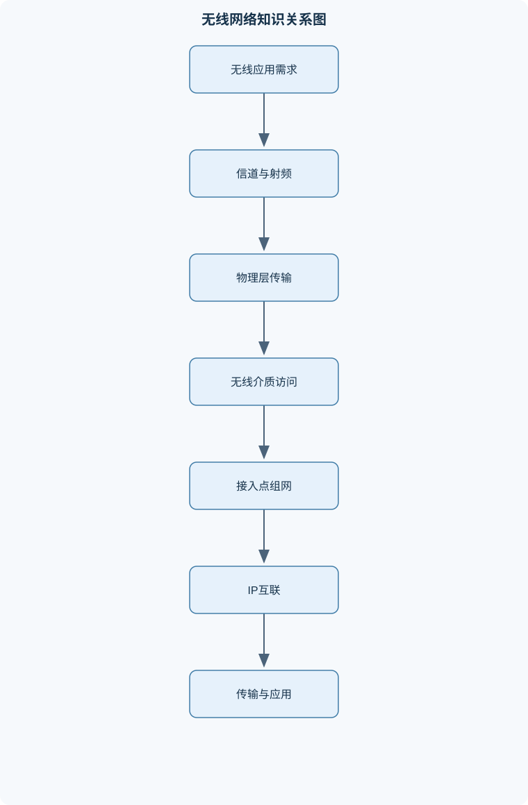
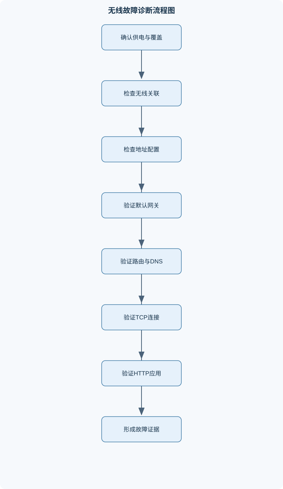

# 无线网络应用

## 一、课程整体知识框架

### 课程边界与先修知识

本课程研究无线局域网及其与以太网、IPv4/IPv6、传输层和应用层协同工作的原理、协议、部署、配置、性能分析与故障诊断。内容覆盖无线信道、射频基础、IEEE 802.11体系结构、无线介质访问控制、WLAN组网、地址规划、移动性、安全、服务质量、无线应用和实验验证。课程不深入推导天线电磁场全波模型，也不替代蜂窝移动通信、无线通信理论或网络安全攻防课程。先修知识包括计算机网络分层模型、二进制与十六进制运算、IPv4子网划分、IPv6地址表示、交换机与路由器基本配置、TCP/IP基础、操作系统命令行和基本概率统计。





### 1. 课程对象、研究边界与先修基础

《无线网络应用》研究无线局域网如何在共享无线介质上完成终端接入、数据转发、移动切换和应用承载，并分析其与以太网、IPv4、IPv6、TCP、UDP及HTTP的协同关系。课程对象不是单独的射频系统，也不是只会配置接入点的操作课程，而是从“无线信号—链路帧—IP转发—传输连接—应用请求”这一端到端路径解释网络行为。

课程需要使用计算机网络分层模型、二进制和十六进制运算、IPv4子网划分、IPv6地址表示、交换机和路由器基本配置、TCP/IP基础、操作系统命令行以及基本概率统计。无线局域网主要位于物理层和数据链路层，但其部署结果必须通过网络层寻址、传输层可靠性和应用层响应来验证。例如，终端能够关联AP，只说明无线链路的部分管理过程成功；若终端没有正确的IP地址、默认网关或DNS配置，仍然不能访问应用服务器。

课程不深入推导天线电磁场全波模型，不替代蜂窝移动通信、无线通信理论或网络安全攻防课程。课程中的公式多数是工程近似模型，适合进行初步估算、参数比较和故障解释，不能在没有现场测量的情况下直接替代完整的无线勘测。

### 2. 从分层模型理解无线网络

无线网络的数据平面负责转发用户数据，例如AP将无线帧桥接到有线交换网络；控制平面负责路径、接入和移动性相关状态，例如认证状态、关联关系、VLAN映射和路由；管理平面负责设备配置、监控、日志、备份和故障处理。三者相互关联但职责不同：修改SSID属于管理操作，终端关联属于控制过程，用户访问HTTP服务器属于数据传输。

典型家庭网络通常由无线AP、交换功能、路由器、DHCP服务和DNS转发组成；企业网络会进一步引入多个AP、集中管理或分布式控制、VLAN、访客网络、认证服务器、日志和无线入侵检测；物联网网络则更加关注低功耗终端数量、覆盖稳定性、设备生命周期和业务报文的周期性。家庭、企业和物联网并非仅由规模区分，业务时延、终端能力、安全边界和运维方式也不同。

AP是无线接入点，STA是无线站点。BSS是一个基本服务集，通常包括一个AP及其关联的无线站点；BSSID用于识别具体的基本服务集，SSID则是供用户或终端识别服务的逻辑名称。多个BSS通过分布式系统互联形成ESS，ESS可以提供较大范围的连续服务，但“多个AP使用相同SSID”并不自动保证无缝漫游，仍需要合理的信道、覆盖、认证和转发配置。

独立基本服务集不依赖AP，由站点直接通信，适合临时自组织场景，但集中管理、覆盖控制和安全策略较弱。基础设施模式通过AP连接无线终端与有线网络，AP是否同时承担路由功能取决于设备工作模式；许多企业AP主要执行二层桥接，默认网关由路由器或三层交换设备提供。

### 3. 无线信道与射频基础

载波频率用 $f$ 表示，单位为Hz；波长用 $\lambda$ 表示，单位为m。在传播速度近似为 $c$ 时：

$$
\lambda=\frac{c}{f}
$$

其中真空中的 $c$ 近似为 $3\times10^8\ \text{m/s}$。因此，在传播速度基本不变时，频率越高，波长越短。波长较短的信号通常绕射能力较弱，更容易受到墙体、人体、金属柜和设备遮挡影响，但实际覆盖还取决于发射功率、天线增益、材料特性和接收机能力，不能仅依据频率判断覆盖范围。

发射功率为 $P_t$，接收功率为 $P_r$，天线增益分别为 $G_t$和 $G_r$。功率比以分贝表示时使用 $10\log_{10}(P_2/P_1)$，天线增益通常以dBi表示。自由空间链路预算为：

$$
P_r(\text{dBm})=P_t(\text{dBm})+G_t(\text{dBi})+G_r(\text{dBi})-PL(\text{dB})
$$

自由空间路径损耗为：

$$
PL=20\log_{10}\left(\frac{4\pi d}{\lambda}\right)
$$

其中 $d$ 是收发距离，单位为m；该式要求无遮挡、远场传播和近似自由空间条件。室内环境存在反射、绕射、吸收和遮挡，不能直接把自由空间结果当作实际覆盖半径。

工程上常用路径损耗指数模型：

$$
PL(d)=PL(d_0)+10n\log_{10}\left(\frac{d}{d_0}\right)+X_\sigma
$$

其中 $d_0$ 是参考距离，$n$ 是路径损耗指数，$X_\sigma$是阴影衰落随机项。理想自由空间中 $n$约为2，室内走廊、开放办公区、隔间和仓库的有效值可能不同。该模型说明距离增大不一定造成固定比例的信号下降，因为障碍物和反射会使局部信号出现波动。

信噪比定义为：

$$
SNR=\frac{S}{N}
$$

以分贝表示为：

$$
SNR_{\text{dB}}=10\log_{10}\left(\frac{S}{N}\right)
$$

其中 $S$是信号功率，$N$是噪声功率。干扰不一定属于热噪声，但在接收判决中会降低有效信干噪比。SNR提高通常有利于降低误码率并选择更高速率，但不能保证吞吐率线性增加；信道竞争、重传和协议开销可能成为新的瓶颈。

信道带宽用 $B$表示，单位为Hz；符号率用 $R_s$表示，单位为baud；原始比特率用 $R_b$表示，单位为bit/s。若一个符号有 $L$种可区分状态，则理想无噪声条件下：

$$
R_b=R_s\log_2L
$$

实际速率还需乘以编码率，并扣除前导、保护间隔、MAC头、确认帧和重传等开销。香农容量上界为：

$$
C=B\log_2(1+SNR)
$$

其中SNR必须使用线性值。该式是假设信道统计特性稳定、编码足够理想且允许任意长码字时的理论上界，不是用户实际看到的吞吐率。若带宽扩大但同频干扰和竞争同时增加，应用吞吐率可能不升反降。

多径会使同一信号沿不同路径到达接收端，形成时间延迟差和相位叠加，可能产生衰落、符号间干扰和时间色散。同频干扰是相同或重叠信道上的其他发射活动，邻频干扰则来自频谱相邻但不完全分离的信道。信道“编号不重叠”不等于没有干扰，还要考虑邻道泄漏、接收机选择性和非无线设备干扰。

### 4. IEEE 802.11物理层

802.11物理层规定频段、信道、调制、编码、保护间隔和空间传输方式。单载波系统将信息集中在一个载波上，多载波系统把数据分配到多个相互正交的子载波，以减轻频率选择性衰落的影响。正交频分复用的核心思想不是消除所有噪声，而是在符号设计和接收机处理允许的条件下，使多个子载波能够并行传输而减少相互干扰。

保护间隔用于吸收多径造成的延迟扩展。若保护间隔明显小于环境最大延迟差，前一符号的尾部可能干扰后一符号；若保护间隔过长，虽然抗多径能力增强，但单位时间内可传输有效数据减少。MIMO使用多个天线和空间信号处理提高可靠性或并行传输能力。空间复用需要接收端能够区分空间信道，终端距离、天线相关性和反射环境都会影响实际收益。

标称物理层速率由带宽、调制阶数、编码率、空间流数量和保护间隔等共同决定。有效吞吐率还要减去管理帧、竞争等待、ACK、帧间间隔、加密处理、重传和上层协议开销。因此，比较设备规格中的速率时，不能把物理层速率直接当作应用层下载速度。速率自适应会根据SNR、重传率和接收质量选择调制编码方式：环境变差时降低速率可能提高成功发送概率，最终吞吐率反而可能比强行使用高速率更高。

### 5. 802.11介质访问控制

无线介质通常由多个站点共享，站点不能像全双工交换端口那样在发送时可靠地检测所有碰撞，因此802.11采用载波侦听多路访问/冲突避免思想。站点先侦听信道；信道空闲达到规定帧间间隔后，选择随机退避计数器BO。BO按空闲时隙递减，信道变忙时冻结，恢复空闲后继续倒计时。计数器归零后发送数据，成功收到ACK则认为本次发送成功，否则按重传策略扩大竞争窗口CW并重试。

若竞争窗口取值为 $[0,CW]$，随机退避时隙的期望值为 $CW/2$。实际等待时间还包括DIFS、退避时隙、数据帧发送时间、SIFS和ACK发送时间。SIFS通常用于需要快速响应的控制帧，DIFS用于普通竞争，帧间间隔差异会影响发送优先级。

隐藏终端是指两个站点彼此听不到，却都能影响同一个接收端。例如站点A和C无法互相侦听，但都在AP的接收范围内；二者可能同时发送，导致AP处碰撞。RTS/CTS通过先交换预约控制帧，使周围站点设置网络分配向量，从而缓解部分隐藏终端问题，但会增加控制开销，不能消除所有碰撞。

MAC帧包括管理帧、控制帧和数据帧。信标用于周期性公布网络存在、能力和参数；探测请求与响应用于发现网络；认证和关联完成接入过程中的状态建立；ACK确认数据帧接收。SSID是逻辑服务名称，BSSID通常对应具体BSS，二者不能混同。无线帧中的地址字段承担发送端、接收端、源端和目的端等不同语义，需结合帧到分布式系统的方向分析，不能简单套用以太网二地址模型。

### 6. WLAN组网、地址规划与网络互联

覆盖设计需要同时考虑下行和上行。终端能收到AP信号，不代表终端发射功率足以让AP稳定接收；因此覆盖边界应由接收灵敏度、噪声、重传率、业务速率和双向链路共同确定。AP部署还应考虑同频复用、邻道干扰、用户密度、漫游重叠区和供电位置。提高发射功率可能扩大覆盖，但也可能扩大竞争范围、增加同频干扰并造成上下行不平衡。

VLAN用于把不同业务映射到不同二层广播域。例如员工网络、访客网络和设备管理网络可使用不同VLAN，并由三层设备控制互访。AP的管理接口、业务接口和带外管理接口可能具有不同职责；带外管理可在业务网络异常时保留管理通道，但需要独立地址、访问控制和物理或逻辑隔离。

IPv4地址由32位组成，前缀长度用“/p”表示。对一个IPv4网络进行子网划分时，若每个子网需要至少 $H$ 台普通主机，应选择最小主机位数 $h$，使：

$$
2^h-2\geq H
$$

然后前缀长度为 $32-h$。传统以太网子网中网络地址和广播地址通常不能分配给普通主机，但点到点链路、特殊保留地址和设备实现可能有不同规则。

例如，192.168.1.0/24划分为一个需要30台主机的子网和一个需要14台主机的子网。30台主机需要 $2^5-2=30$，所以使用/27；从192.168.1.0开始，网络地址为192.168.1.0，广播地址为192.168.1.31，可用范围为192.168.1.1至192.168.1.30。14台主机需要 $2^4-2=14$，使用/28；下一个按边界对齐的网络为192.168.1.32/28，广播地址为192.168.1.47，可用范围为192.168.1.33至192.168.1.46。剩余地址应保留给扩展、服务器或管理用途，不能因为当前未使用就随意跨子网分配。

IPv6地址由128位组成。全球单播地址用于跨路由器通信，链路本地地址只在本链路有效，通常用于邻居发现和默认网关。IPv6没有IPv4意义上的广播地址，相关发现机制使用组播。IPv6路由器转发报文时通常将Hop Limit减1，减到零后丢弃；路由器一般不为转发中的IPv6报文执行传统意义上的分片，发送端需要依据路径MTU发现结果调整报文。

终端访问不同IPv4子网的服务器时，先用自己的IP地址、掩码和目标IP判断目标是否本地。若目标不在本地，终端通过ARP或邻近机制获得默认网关的MAC地址，把目的IP仍设置为服务器IP，但把二层目的MAC设置为默认网关。AP将无线数据桥接到有线VLAN，路由器查找路由表并递减TTL，再向下一跳转发。服务器返回TCP和HTTP响应，反向过程完成后，终端才表现为应用页面加载成功。

### 7. 无线安全、移动性、传输层与应用层

开放无线网络缺少可靠的身份确认和链路保护，攻击者可能监听、仿冒AP、插入恶意DHCP服务或诱导终端连接。无线安全需要分别考虑身份认证、密钥协商、机密性、完整性、重放防护、管理帧保护和网络隔离。预共享密钥适合规模较小且成员稳定的网络；企业认证通常为不同用户提供独立身份和密钥生命周期。访客网络应与员工、设备管理和服务器网络隔离，不能仅依靠隐藏SSID实现安全。

设备加固包括修改默认管理凭据、限制管理来源、关闭不必要服务、及时更新固件、保护配置备份和审计日志。加密解决的是数据被窃听的问题，认证解决的是“谁可以接入”，隔离解决的是“接入后可以访问什么”，三者不能相互替代。

漫游通常由当前AP信号下降、重传增加、候选AP更优或策略阈值触发。终端需要发现候选AP，执行认证和重新关联，并更新AP、交换网络和控制器中的转发状态。若地址保持，TCP会话可能较连续；若切换导致IP地址变化，原有连接可能中断。漫游测试应记录信号、探测、认证、关联、地址状态和TCP时间线，不能只观察SSID是否保持不变。

TCP通过SYN、SYN-ACK和ACK完成三次握手，确认双方初始序号和连接状态。可靠性来自序号、确认号、校验和、接收窗口、重传超时和拥塞控制，而非无线链路本身。无线丢包可能由干扰、遮挡和重传造成，TCP却通常只能观察到报文延迟或丢失，因此可能把无线问题误判为拥塞。UDP不提供连接建立和可靠重传，适合对时延敏感、由应用自行处理丢包的业务。

HTTP请求包含方法、目标资源和字段，响应包含状态码、字段和表示数据。2xx通常表示成功，3xx表示重定向，4xx表示客户端错误，5xx表示服务器错误。HTTP成功不等于无线链路性能良好；端到端时延还包括DNS解析、TCP连接、安全握手、请求排队、服务器处理和响应传输。IPv6扩展首部、路径MTU变化和防火墙策略也可能使连接建立或大报文传输失败。

### 8. 服务质量、规划、验证与故障诊断

无线业务的基本指标包括吞吐率、时延、抖动和丢包率。语音关注低时延和低抖动，视频关注持续吞吐和抖动，普通数据通常更重视完整性和总体传输时间。业务分类可以映射到不同竞争参数，但提高某类业务优先级会压缩其他业务的接入机会，优先级配置不是无成本的。

规划时先区分覆盖目标和容量目标。覆盖目标回答“某位置是否能够稳定通信”，容量目标回答“高峰时有多少终端并发、每类业务需要多少吞吐率”。AP数量不能只用面积除以覆盖半径估算，还要考虑用户密度、并发流量、信道复用、速率门限、漫游重叠和有线回程容量。理想覆盖半径与实际可服务半径不同，现场环境中的墙体、人体、设备、非无线干扰和时间变化都可能造成偏差。

故障诊断应从物理层逐层向应用层推进：先检查电源、天线、信道和射频状态，再检查关联、认证和数据帧；随后检查IPv4或IPv6地址、默认网关、邻居表、路由、DNS、TCP端口、TLS和HTTP响应。能ping通默认网关只能证明有限的网络层路径可达，不能证明DNS、服务器端口或HTTP应用正常。

## 二、章节和模块划分

### 核心知识覆盖清单

本清单用于检查正文是否覆盖本课程的主要知识模块：

- **无线网络体系结构与应用场景**：无线网络分类与典型拓扑、终端、接入点与控制器、基础服务集与扩展服务集、独立基本服务集与自组织网络、无线局域网与有线局域网互联、数据平面、控制平面与管理平面、家庭、企业、物联网无线应用、分层模型中的无线网络位置。
- **无线信道与射频基础**：频率、波长与带宽、信号功率与分贝表示、自由空间传播损耗、路径损耗与阴影衰落、多径效应与时间色散、同频干扰与邻频干扰、信噪比与误码率关系、信道带宽、空间流与吞吐率边界。
- **IEEE 802.11物理层**：载波频段与信道划分、调制与编码的基本作用、正交频分复用思想、单载波与多载波传输、MIMO与空间复用、保护间隔与符号间干扰、物理层速率与有效吞吐率、速率自适应与环境变化。
- **802.11介质访问控制**：无线共享介质的隐藏终端问题、载波侦听与冲突避免、退避计时器与竞争窗口、帧间间隔与优先级、确认帧、重传与重复检测、RTS/CTS预约机制、MAC帧类型与地址字段、关联、认证与信标过程。
- **WLAN组网与网络互联**：接入点部署与覆盖设计、SSID、BSSID与漫游域、二层桥接与VLAN映射、管理接口与带外管理、DHCP、DNS与默认网关、IPv4子网划分与地址分配、IPv6全球单播地址与链路本地地址、无线终端到互联网的数据转发。
- **无线安全与访问控制**：开放网络的安全风险、身份认证与密钥协商、预共享密钥与企业认证、机密性、完整性与重放防护、管理帧保护的基本思想、访客网络与业务网络隔离、最小权限与设备加固、无线入侵、仿冒接入点与防范。
- **移动性、传输层与应用层**：漫游触发条件与关联切换、地址保持与会话连续性、TCP连接建立与可靠传输、序号、确认号与滑动窗口、拥塞控制与无线丢包的区别、UDP实时业务特征、HTTP请求响应模型、IPv6扩展首部与路径MTU问题。
- **无线服务质量与实时应用**：时延、抖动、丢包率与吞吐率、业务分类与优先级、竞争参数对接入机会的影响、语音、视频与数据业务差异、队列调度与拥塞管理、应用层自适应码率、端到端性能与无线链路性能区分、服务质量配置的副作用。
- **无线网络规划与性能评估**：需求分析与业务容量估算、覆盖目标与容量目标、接入点数量初估、信道复用与频率规划、用户密度与并发量分析、链路预算与覆盖边界、测量指标与采样方法、理想模型与现场环境偏差。
- **无线网络配置、验证与故障诊断**：设备初始配置与安全加固、无线参数和接口配置、终端IPv4与IPv6配置、连通性分层验证、抓包与帧级分析、日志、状态表与邻居表检查、配置备份与恢复、从物理层到应用层的故障定位。


### 1. 无线网络体系结构与应用场景

本模块先建立终端、AP、控制器、交换机、路由器和服务器之间的职责边界，再分析BSS、ESS、SSID、BSSID、桥接、VLAN和三层转发。学习重点不是记忆缩写，而是能够回答数据从STA进入AP后经过哪些接口、哪个设备修改二层头、哪个设备执行路由，以及业务网络和管理网络为何需要隔离。

典型案例是“无线终端访问不同子网的HTTP服务器”：终端判断目标不在本地后，将帧发给默认网关的MAC；AP完成二层桥接；路由器查表、递减TTL并转发；服务器返回TCP和HTTP数据。若终端已关联但没有DHCP地址，问题属于网络层配置；若地址正确但DNS失败，问题属于名称解析链路，不能笼统归为“无线信号差”。

### 2. 无线信道、射频与802.11物理层

本模块依次讲解频率与波长、功率和分贝、自由空间损耗、路径损耗、阴影衰落、多径、同频和邻频干扰、SNR、调制编码、OFDM、MIMO、保护间隔、空间流和速率自适应。链路预算分析流程如下：

1. 输入频率、距离、发射功率、天线增益、接收灵敏度和环境模型。
2. 用 $\lambda=c/f$计算波长。
3. 根据无遮挡远场条件选择自由空间模型；若为室内环境，则使用实测或路径损耗指数模型。
4. 计算 $P_r$，再计算链路余量 $P_r-\text{接收灵敏度}$。
5. 将余量与设计安全余量比较，并对遮挡、干扰和终端上行能力进行修正。

该流程的输入单位必须统一，输出只能作为初步覆盖判断。自由空间公式在室内反射显著、距离过近或不满足远场条件时不能直接作为结论。

### 3. 802.11介质访问控制与帧交换

本模块围绕“无线为何不能像交换机端口一样直接检测碰撞”展开，解释CSMA/CA、DIFS、SIFS、CW、BO、ACK、重传和RTS/CTS。一次发送的分析应明确：信道是否空闲、DIFS是否完成、退避是否冻结、数据帧是否发送、ACK是否收到以及重传次数是否达到上限。

#### CSMA/CA退避伪代码

```text
伪代码
输入：待发送帧 frame，初始竞争窗口 CWmin，最大重传次数 Rmax
输出：发送成功或发送失败

retry ← 0
CW ← CWmin

while retry ≤ Rmax:
    侦听信道
    if 信道忙:
        等待信道重新空闲，并完成规定帧间间隔
    BO ← 在 [0, CW] 中随机选择一个时隙
    while BO > 0:
        if 信道空闲:
            等待一个时隙
            BO ← BO - 1
        else:
            冻结 BO，等待信道重新空闲并完成帧间间隔
    发送 frame
    等待 ACK
    if 收到正确 ACK:
        输出“成功”
        终止
    retry ← retry + 1
    CW ← min(2 × (CW + 1) - 1, CWmax)

输出“失败”
```

不变量是信道忙时BO不递减；终止条件是收到ACK或达到最大重传次数。该过程适用于解释竞争式无线接入，不适用于把无线链路当作无竞争的专用点到点链路。复杂度按一次退避选择计为 $O(1)$，但等待时间受随机退避、竞争和重传影响，不能用固定常数表示。

### 4. WLAN组网、IPv4/IPv6与地址规划

本模块把无线参数与二层、三层配置连接起来，包含SSID、BSSID、漫游域、VLAN、DHCP、DNS、默认网关、IPv4子网、IPv6/64、链路本地地址和双栈验证。

#### 例题一：IPv4子网规划

**题干：**将192.168.1.0/24划分为需要30台主机和14台主机的两个子网。

**分析：**30台主机需要满足 $2^h-2\geq30$，取 $h=5$，前缀为/27；14台主机取 $h=4$，前缀为/28。

**逐步解答：**

- 第一个子网为192.168.1.0/27，总地址数为 $2^{32-27}=32$，广播地址为192.168.1.31，可用范围为192.168.1.1至192.168.1.30。
- 第二个子网从下一个合法边界192.168.1.32开始，为192.168.1.32/28，总地址数为16，广播地址为192.168.1.47，可用范围为192.168.1.33至192.168.1.46。
- 可将第一个子网的192.168.1.1分配给网关，将第二个子网的192.168.1.33分配给网关，其他地址再分配给终端。
- 验证时检查两个范围不重叠、网络地址和广播地址未分配给普通主机、终端默认网关与自身前缀一致。

**变式：**若需求为31台主机，/27不再满足，因为只能提供30个传统可用地址，应改用/26或重新规划地址空间。

#### 例题二：IPv6双栈访问

**题干：**为两个LAN分别规划两个/64前缀，终端通过路由器访问另一LAN的HTTP服务器。

**解答：**路由器在LAN-A接口配置一个/64全球单播地址，在LAN-B接口配置另一个/64全球单播地址；每个接口还自动或手工配置链路本地地址。终端根据路由通告获得前缀和默认路由，默认网关可使用路由器的链路本地地址，因为该地址在本链路内唯一且不依赖全球地址变化。验证顺序为：检查邻居发现，检查终端默认路由，检查两个/64之间的路由，再测试TCP连接和HTTP响应。若只测试链路本地地址，不能证明跨路由器的全球单播通信成功。

### 5. 无线安全与访问控制

本模块区分开放网络风险、预共享密钥、企业认证、密钥协商、完整性、重放防护、管理帧保护、访客隔离、设备加固和仿冒AP。安全配置的验收不能只看“已启用加密”，还应检查终端身份是否可追踪、访客是否不能访问内部服务器、管理面是否限制来源、配置备份是否受保护以及异常AP是否能被发现。

一个常见边界是：隐藏SSID不能防止专业监听；提高发射功率不能解决身份认证问题；访客使用加密也不等于访客与员工网络隔离。安全、可用性和运维复杂度需要同时评估。

### 6. 移动性、传输层、应用层与服务质量

漫游分析应记录当前AP信号、重传率、候选AP、认证、重新关联、地址状态和业务流。若二层切换耗时过长，可能出现短时丢包；若地址改变，TCP连接可能重置；若只有HTTP请求变慢，还需区分DNS、TCP、TLS、服务器处理和无线传输时间。

#### 例题三：端到端HTTP故障

**题干：**终端已关联AP，能够访问默认网关，但无法打开网站。

**逐步诊断：**

1. 查询DNS；若域名无法解析而直接访问服务器IP成功，优先检查DNS地址、可达性和策略。
2. 若DNS成功，测试目标TCP端口；连接超时说明可能存在路由、防火墙、端口监听或路径MTU问题。
3. TCP成功但TLS失败，应检查时间、证书、握手报文和中间设备策略。
4. TLS成功但HTTP返回4xx，重点检查请求资源、认证和客户端参数；返回5xx则重点检查服务器或上游服务。
5. 对齐无线抓包、终端日志和服务器时间线，确认重传发生在哪一段。

**结果验证：**只有DNS、TCP、TLS和HTTP均成功，才能认为应用访问链路完整。单次ping成功不能替代上述验证。

#### 例题四：无线吞吐率

**题干：**应用传输有效载荷 $M$ bit，总测试时间为 $T$ s，期间发生重传和协议开销。

**解答：**应用层吞吐率为：

$$
\text{Throughput}_{app}=\frac{M}{T}
$$

若另有物理层标称速率，则它是调制编码产生的原始速率，不等于应用吞吐率。链路有效吞吐率应根据扣除前导、保护间隔、MAC头、ACK、竞争等待和重传后的成功数据时间计算。验证时至少分别记录物理层速率、成功帧速率、重传率和应用层有效数据量；若只测文件大小除以总时间，无法解释吞吐率下降的具体原因。

#### 例题五：隐藏终端与RTS/CTS

**题干：**站点A和C彼此听不到，但都能与AP通信，判断直接竞争和启用RTS/CTS的差异。

**分析与解答：**A和C可能同时认为信道空闲并发送，碰撞位置集中在AP接收端。启用RTS/CTS后，先发送RTS并由AP回复CTS，听到控制帧的站点会推迟发送，因而可缓解部分碰撞。代价是每个数据传输增加控制帧、帧间间隔和等待时间；短帧或低竞争场景中，额外开销可能使总吞吐率下降。验证应比较碰撞率、重传率、信道占用和有效吞吐率，而不能仅凭“启用后没有瞬时丢包”判断机制完全有效。

### 7. 无线规划、配置、实验与故障诊断

#### 实验一：链路预算与现场覆盖验证

**输入数据：**频率、候选AP位置、发射功率、天线增益、接收灵敏度、参考距离、路径损耗指数、现场测得的信号和噪声。

**步骤：**

1. 用自由空间模型完成初步链路预算，计算 $P_r$和链路余量。
2. 使用路径损耗指数模型估算不同距离的覆盖边界。
3. 在开阔区、墙体边缘、金属遮挡区和人员密集区采样。
4. 记录接收功率、SNR、协商速率、重传率和应用吞吐率。
5. 比较模型预测与现场结果，标记偏差超过设计余量的位置。

**评价标准：**覆盖不仅看“能否看到SSID”，还应满足目标SNR、接收灵敏度、重传率和业务吞吐率；覆盖边界应满足双向通信和业务时延要求。

**排错方法：**若信号强但吞吐率低，检查同频干扰、邻频干扰和竞争；若下行正常而上行差，检查终端发射功率和上行噪声；若模型和测量差异大，检查墙体材料、天线方向、采样位置和单位是否一致。

#### 实验二：端到端无线访问与抓包验证

**输入数据：**一个无线终端、一个或多个AP、交换网络、IPv4或IPv6地址规划、默认网关、DNS服务和HTTP服务器。

**步骤：**

1. 配置AP的SSID、认证方式、业务VLAN和管理地址。
2. 配置交换侧VLAN、路由接口、DHCP或IPv6路由通告。
3. 终端完成关联后检查地址、前缀、默认路由和邻居表。
4. 依次测试AP关联、默认网关、跨网段地址、DNS、TCP端口和HTTP响应。
5. 在空口和有线侧抓包，按时间排序匹配信标、认证、关联、数据、ACK、IP、TCP和HTTP事件。
6. 人为引入一种故障，如错误网关、错误VLAN或DNS地址，记录故障现象和最早失败层次，再恢复配置并复测。

**评价标准：**应能给出每一层的成功证据、失败证据和时间戳；不能只提交“ping成功”。HTTP请求应核对状态码、响应长度和总时延，IPv6还应验证邻居发现、Hop Limit变化和路径MTU行为。

**排错方法：**无关联先查射频和认证；已关联无地址查DHCP、VLAN和地址池；有地址不能到网关查前缀、邻居解析和二层映射；能到网关但DNS失败查DNS配置；DNS成功但TCP失败查路由、防火墙和端口；TCP成功但HTTP失败查TLS、请求资源和服务器响应。

### 8. 配置、诊断和岗位任务的连接

无线网络工程师的实际任务包括覆盖与容量规划、信道设计、AP部署和漫游优化，使用链路预算、干扰分析、信道复用和抓包知识，产出覆盖报告、配置方案和验收记录；验收标准是目标区域满足信号、SNR、吞吐率、漫游时延和并发要求。

企业网络运维工程师关注VLAN、DHCP、DNS、路由、日志、配置备份和故障恢复，产出变更记录、配置基线和故障报告；验收标准是业务网络与访客网络隔离、地址分配无冲突、恢复过程可重复。网络安全运维工程师关注认证、密钥、管理面、仿冒AP、访客隔离和设备加固，产出访问控制矩阵、审计记录和风险处置结果；验收标准是未经授权终端不能进入受保护业务，管理操作可追踪。

网络测试与故障诊断工程师需要把无线抓包、终端日志、有线抓包、TCP时间线和HTTP结果对齐，产出可复现的故障证据链。验收标准不是“更换AP后问题消失”，而是能够说明最早失败的必要条件、排除的替代原因、修复后的指标变化以及在相同测试条件下是否稳定复现。

## 三、核心概念的详细解释

### 3.1 无线局域网体系结构与分层位置

无线局域网（WLAN）是在共享无线介质上连接终端的局域网络。无线部分主要承担物理层传输和数据链路层介质访问控制，但实际业务必须经过完整的端到端协议栈：无线信号被调制并发送后，形成802.11帧；帧经接入点（AP）与有线交换网络互联；网络层根据IPv4或IPv6地址进行转发；传输层使用TCP或UDP承载业务；应用层则通过HTTP等协议完成资源访问。

无线网络中常见的设备角色包括无线站点（STA）、接入点（AP）、交换机、路由器、认证服务器、DHCP服务器和DNS服务器。STA可以是笔记本电脑、手机、传感器或工业终端。AP的基本职责是接收无线帧并将其桥接到有线网络；部分家庭设备还集成交换、路由、地址转换、DHCP和DNS转发功能，但这些功能在逻辑上仍然不同。不能因为设备外观上是“一台无线路由器”，就认为AP一定承担三层路由。

基本服务集（BSS）表示一个相互关联的无线服务单元。基础设施模式下，BSS通常包括一个AP及其关联的STA；独立基本服务集（IBSS）则由站点直接通信，不依赖AP。多个BSS通过分布式系统互联后形成扩展服务集（ESS），可以使用相同的SSID提供连续覆盖。SSID是逻辑服务名称，BSSID通常用于识别具体的BSS，不能把SSID当作AP的物理地址。

数据平面传送用户数据，例如AP桥接终端与交换机之间的帧；控制平面维护关联、认证、路由和漫游状态；管理平面负责配置、日志、监控、备份和恢复。三者相互关联但不可混淆：修改SSID属于管理平面操作，终端与AP建立关联属于控制过程，终端访问网页属于数据平面业务。

家庭网络强调部署简便和共享上网，企业网络通常需要多个AP、VLAN、访客隔离、集中管理、身份认证和日志审计，物联网网络则更重视终端数量、低功耗、周期性报文和长期稳定性。无线局域网与蜂窝网络都支持移动终端，但覆盖范围、频谱使用方式、核心网结构和移动性管理机制不同，本课程不把WLAN漫游等同于蜂窝切换。

### 3.2 无线信道、射频传播与物理层

载波频率 $f$ 的单位是Hz，波长 $\lambda$ 的单位是m。在传播速度近似不变时：

$$
\lambda=\frac{c}{f}
$$

其中 $c$ 为电磁波传播速度，真空中近似为 $3\times10^8\ \text{m/s}$。因此频率升高会使波长缩短。较短波长通常绕射能力较弱，遮挡、墙体、人体和金属物体对信号的影响可能更明显，但实际覆盖不能只由频率决定，还取决于发射功率、天线方向图、接收灵敏度、材料特性和干扰水平。

自由空间传播损耗可写为：

$$
PL=20\log_{10}\left(\frac{4\pi d}{\lambda}\right)
$$

其中 $d$ 是收发距离，单位为m；$PL$ 以dB表示。该公式假定无遮挡、远场传播和近似自由空间环境，适合初步链路预算，不适合直接代替复杂室内环境的现场测量。室内环境常使用对数距离模型：

$$
PL(d)=PL(d_0)+10n\log_{10}\left(\frac{d}{d_0}\right)+X_\sigma
$$

$d_0$ 是参考距离，$n$ 是路径损耗指数，$X_\sigma$ 是阴影衰落随机项。自由空间中 $n$ 约为2，办公室、走廊、仓库等环境的有效值会受墙体、反射和遮挡影响。距离增加通常会降低接收功率，但下降比例并非固定，也不能根据一次测量推断所有位置的信号强度。

信号在建筑物内传播时会产生反射、绕射、散射和多径叠加。多径会造成深衰落、频率选择性衰落和符号间干扰；移动人员、开关门和设备运行会使信道随时间变化。信噪比（SNR）定义为信号功率与噪声功率之比，线性形式为 $S/N$，分贝形式为：

$$
SNR_{\mathrm{dB}}=10\log_{10}\left(\frac{S}{N}\right)
$$

同频干扰会直接抬高接收端的有效噪声，邻频干扰则与信道间隔、滤波能力和发射机频谱泄漏有关。终端“能看到SSID”只能说明某些管理帧到达了接收机，并不表示上行和下行都具有稳定的通信余量。

物理层通过调制将比特映射为符号，通过编码增加抗误码能力。若每个符号有 $L$ 种可区分状态，则理想无噪声条件下：

$$
R_b=R_s\log_2L
$$

其中 $R_b$ 是原始比特率，单位为bit/s；$R_s$ 是符号率，单位为baud。实际速率还要乘以编码率，并扣除前导、保护间隔、协议头、确认、竞争等待和重传等开销。正交频分复用将宽带信道划分为相互正交的子载波，使系统能够较好地处理频率选择性衰落；保护间隔用于降低多径引起的符号间干扰，但会占用时间，不能无限增大。

MIMO利用多个天线形成空间复用或分集。空间流数增加可能提高峰值速率，但要求终端和AP具有足够的天线、较高的信道质量和相互独立的空间传播路径。空间流数量不是简单等于天线数量，也不是在所有位置都能达到标称值。速率自适应会根据信道质量选择不同的调制编码方式：信道恶化时降低速率以减少误码和重传，因而较低的物理速率有时反而带来更高的有效吞吐率。

### 3.3 802.11介质访问控制

无线终端通常不能像全双工交换机端口那样可靠地边发送边检测碰撞，因此802.11采用载波侦听多路访问/冲突避免（CSMA/CA）。STA发送前先侦听信道。信道空闲达到规定的帧间间隔后，终端进行随机退避；退避计数器只在信道空闲时递减，信道忙时冻结。计数器归零后发送数据，成功收到ACK才认为本次传输完成。

竞争窗口用CW表示，退避计数器用BO表示。若随机值在整数区间 $[0,CW]$ 内均匀选择，则期望退避时隙数为：

$$
E[BO]=\frac{CW}{2}
$$

发生碰撞、ACK丢失或其他未确认情况时，发送方通常增大竞争窗口，直到达到上限；成功发送后再恢复较小窗口。SIFS用于需要快速响应的控制帧，例如ACK；DIFS用于普通竞争发送。较短的帧间间隔具有更高的访问优先级，但优先级提高会挤压普通数据业务。

隐藏终端问题发生在两个STA彼此听不到，但都能影响同一个AP的情况下。两者可能同时判断信道空闲并发送，导致AP处碰撞。RTS/CTS通过先交换短控制帧预约介质，能够缓解部分隐藏终端问题，但会增加控制开销，且不能消除所有碰撞。暴露终端则表现为某站点听到邻近发送，却实际上可以无害地向其他接收端发送；过度保守的载波侦听会降低空间复用效率。

802.11帧通常可分为管理帧、控制帧和数据帧。信标用于宣告服务参数，探测请求与响应用于发现网络，认证和关联帧用于建立接入状态，ACK用于确认数据帧。无线帧地址字段可能同时涉及发送方、接收方、当前接入点和分布式系统，不能简单按“源IP—目的IP”的方式解释。MAC地址位于数据链路层，IP地址位于网络层；AP桥接时不会因为转发无线帧就替换终端的IP地址。

### 3.4 WLAN组网、寻址与互联

部署AP时要同时考虑覆盖和容量。覆盖设计关心边缘位置是否仍满足接收灵敏度、SNR和业务速率要求；容量设计关心同一信道上的并发终端、业务类型、竞争等待和空口占用时间。增大发射功率可以扩大覆盖，但也可能增加同频干扰、扩大竞争范围，并造成下行覆盖远大于终端上行覆盖的不平衡。

多个AP通常通过交换机连接，使用VLAN将访客、办公、物联网和管理流量隔离。SSID到VLAN的映射是逻辑配置关系，必须在AP、交换机和三层网关之间保持一致。管理接口可以使用独立管理VLAN或带外管理网络，以避免业务故障时无法访问设备。

IPv4地址由32位组成。若网络使用前缀长度为 $/p$，地址总数为：

$$
2^{32-p}
$$

例如，$192.168.1.96/27$ 有32个地址，网络地址为$192.168.1.96$，广播地址为$192.168.1.127$，传统主机地址范围为$192.168.1.97$至$192.168.1.126$。网络地址和广播地址不能分配给普通主机。点到点链路、特殊保留地址和具体设备实现可能改变传统“减2”规则，因此规划时必须明确链路类型。

IPv6地址由128位组成。全球单播地址用于跨路由器通信，链路本地地址只在本链路有效，常用于邻居发现和默认网关。IPv6没有IPv4意义上的广播地址，相关发现机制使用组播。终端默认网关常配置为路由器的链路本地地址，这是因为链路本地地址在该链路上稳定且不依赖全球前缀变化，但它不能作为跨链路的全球可达地址。

终端访问不同子网的服务器时，先通过掩码判断目标是否本地。若目标不在本地，终端保留服务器的IP地址作为最终目的地址，但将帧的目的MAC地址设置为默认网关接口的MAC地址。AP完成无线到有线的二层桥接，路由器查找路由表并转发IP报文，IPv4每经过一个路由器通常使TTL减一，IPv6则使Hop Limit减一。路由器转发完成后，下一跳的链路层封装会发生变化，但端到端IP地址通常不变。

### 3.5 无线安全、移动性、传输层与应用层

开放无线网络缺少可靠的接入身份和机密性保护，攻击者可能监听、伪造接入点、诱导终端连接或篡改流量。无线安全至少包含身份认证、密钥协商、机密性、完整性、重放防护和网络隔离几个方面。预共享密钥适合规模较小的网络，但密钥共享会增加泄露和撤换困难；企业认证通常为不同用户或设备建立独立身份。加密并不自动实现访客隔离，访客网络仍需通过VLAN、策略和防火墙限制访问范围。

管理帧保护的基本思想是防止关键管理消息被伪造或篡改，但其具体能力取决于安全模式、终端支持和网络配置。设备加固还包括关闭不必要的管理服务、限制管理来源、使用独立管理网络、保护配置备份和定期检查日志。仿冒AP的识别不能只看SSID，还应结合BSSID、信道、认证方式、证书或设备侧控制信息。

漫游通常包含候选AP发现、信号与负载评估、认证、重新关联、密钥状态更新以及有线侧转发状态调整。相同SSID不等于无缝漫游；如果认证延迟、信道拥塞、覆盖存在空洞或地址状态改变，应用仍可能短时中断。保持同一IP前缀有助于维持会话，但并不能消除TCP重传和应用超时。

TCP通过SYN、SYN-ACK和ACK完成三次握手，建立双方对初始序号和连接状态的确认。可靠性来自序号、确认、校验和、接收窗口以及超时重传。TCP将无线丢帧引起的重复确认或超时部分地视为拥塞信号，因此无线链路的误码、漫游和拥塞不能仅凭TCP重传区分。UDP不提供连接建立、可靠重传和顺序保证，适合对时延敏感且由应用自行处理丢包的业务。

HTTP是请求—响应型应用层协议。请求包含方法、目标资源和字段，响应包含状态码、字段和表示数据。2xx通常表示成功，3xx表示重定向，4xx表示客户端请求问题，5xx表示服务器侧处理问题。网页访问失败需要区分DNS解析、TCP连接、TLS握手、HTTP请求排队、服务器处理和响应传输等阶段，不能只看HTTP状态码判断无线故障。

### 3.6 服务质量、规划与诊断

无线业务的关键指标包括吞吐率、时延、抖动和丢包率。语音通常对时延和抖动敏感，视频同时需要稳定吞吐率，普通数据业务可以容忍一定等待但要求可靠传输。业务分类和竞争参数可以改变接入机会，但高优先级队列会增加其他队列等待，甚至造成低优先级业务饥饿。应用层自适应码率能够根据测得吞吐率和缓存状态调整视频质量，但它不能修复持续的射频覆盖不足。

规划过程应先确定用户数量、并发比例、业务类型、覆盖边界、最低可接受速率和安全隔离要求，再估算AP数量、信道复用和有线回程容量。理想覆盖半径只是模型结果，实际可服务半径还受干扰、终端功率、速率门限、漫游策略和业务时延要求影响。

故障诊断应沿“物理层—关联—链路层—IP层—传输层—应用层”逐层验证。能关联AP不等于能获取地址；能访问默认网关不等于DNS、TCP、TLS和HTTP都正常。抓包时要记录监听信道、抓包点位置、时间戳和终端状态，并将空口数据与有线侧抓包、设备日志、邻居表和路由表对齐。

## 四、重要定义、公式、定理和推导

### 专业审校补充：关键定义与适用边界

无线局域网容量不仅由接入点的标称物理层速率决定，还受空口时间（airtime）占用影响。对一个长度为L bit的帧，若其物理层速率为R bit/s，且固定前导、帧间间隔、确认、退避等时间合计为T0 s，则近似空口占用时间为T≈L/R+T0；单位时间内可承载的有效数据量受所有终端占用时间之和限制。低速终端传输同样数据需要更长空口时间，即使其业务流量不大，也可能降低同一BSS中其他终端的可用容量。该模型假定帧长、速率、竞争状态和重传率相对稳定，不能直接替代真实802.11时序分析。RSSI较高只说明接收信号较强，不代表SNR足够高、空口空闲或没有低速终端。规划时应同时区分覆盖目标、容量目标和公平目标；盲目提高发射功率可能扩大同频竞争范围，并不必然提高总容量。


### 4.1 链路预算与吞吐率公式

自由空间链路预算为：

$$
P_r(\text{dBm})=P_t(\text{dBm})+G_t(\text{dBi})+G_r(\text{dBi})-PL(\text{dB})
$$

链路余量为：

$$
M_{\mathrm{link}}=P_r-P_{\mathrm{sens}}
$$

其中 $P_{\mathrm{sens}}$ 是接收灵敏度，单位为dBm。若余量大于设计所需的衰落和工程余量，链路才具有初步可用性。链路余量为正并不保证高吞吐率，因为干扰、竞争和重传仍可能占用大量时间。

香农容量上界为：

$$
C=B\log_2(1+\mathrm{SNR})
$$

$B$ 为带宽，单位为Hz；SNR必须使用线性值，不能直接代入分贝数。该公式假定理想编码、稳定信道和可接受的误码率，是理论上界，不包含协议头、竞争等待、确认和重传。因此，将香农容量直接作为应用层速率是错误的。

有效吞吐率可近似写为：

$$
R_{\mathrm{eff}}\approx\frac{M}{T}
$$

其中 $M$ 是有效载荷长度，单位为bit；$T$ 是从开始发送到完成传输的总时间，单位为s。若总时间包含前导、帧间间隔、退避、ACK、重传和排队，则有效吞吐率必然低于物理层标称速率。

### 4.2 代表性算法与流程

#### IPv4子网划分算法

**输入：** IPv4网络地址、每个子网的主机需求、地址保留规则。  
**输出：** 每个子网的网络地址、前缀、可用范围和广播地址。

1. 对每个主机需求计算最小主机位数 $h$，使 $2^h-2$ 不小于需求。
2. 令前缀长度为 $32-h$。
3. 按需求从大到小分配，保证当前地址满足该前缀的边界对齐。
4. 计算网络地址、广播地址和可用范围。
5. 检查各子网不重叠，并检查是否超出原始地址池。

不变量是每个子网的起始地址符合前缀边界且子网互不重叠。所有需求均被分配或地址池无法继续容纳时终止。若需求已排序，扫描分配近似为 $O(k)$；未排序时排序复杂度为 $O(k\log k)$。

#### CSMA/CA退避流程

**输入：**信道状态、竞争窗口、时隙长度、帧间间隔、最大重传次数。  
**输出：**发送成功、重传或失败，以及等待时间。

1. 侦听信道。
2. 信道空闲达到规定帧间间隔后选择退避值。
3. 退避计数器在空闲时隙递减，信道忙时冻结。
4. 计数器归零后发送数据帧。
5. 收到ACK则成功；未收到ACK则增大竞争窗口并重传。
6. 达到最大重传次数后报告失败。

不变量是信道忙时BO不递减。若退避值为 $b$ 个时隙，时隙长度为 $\sigma$，则退避时间为 $b\sigma$；一次成功发送还应加入DIFS、数据帧、SIFS和ACK时间。RTS/CTS可插入数据发送前，但会增加控制开销。

#### 端到端连通性诊断流程

先检查AP供电、射频关联、信号和重传情况；再检查终端IPv4地址、子网掩码或IPv6前缀；随后测试默认网关、地址解析、跨网段路由、DNS、TCP端口和HTTP响应。每一层只有在必要条件满足后才进入下一层。失败时必须保存状态表、抓包、日志或命令输出作为证据。该流程的重点不是依次执行命令，而是定位第一个不满足的必要条件。

```python
def diagnose(result):
    """
    result按层记录布尔值：
    radio、address、gateway、route、dns、tcp、http
    """
    layers = [
        ("无线关联", "radio"),
        ("地址配置", "address"),
        ("默认网关", "gateway"),
        ("跨网段路由", "route"),
        ("DNS解析", "dns"),
        ("TCP端口", "tcp"),
        ("HTTP响应", "http"),
    ]
    for name, key in layers:
        if not result.get(key, False):
            return f"首个失败层：{name}"
    return "各层均通过，需进一步检查业务逻辑或性能"

sample = {
    "radio": True,
    "address": True,
    "gateway": True,
    "route": True,
    "dns": False,
    "tcp": False,
    "http": False,
}
print(diagnose(sample))
```

该代码只处理已经采集的诊断结果，不执行联网操作。它的输入是各层验证结果，输出是第一个失败层；复杂度为 $O(l)$，其中 $l$ 是检查层数。它不能证明服务器一定正常，也不能由“HTTP失败”反推无线射频故障。

### 4.3 代表性例题

#### 例题一：自由空间链路预算

**题干：**发射功率为20 dBm，收发天线增益均为2 dBi，频率为2.4 GHz，距离为10 m，接收灵敏度为−82 dBm。估算自由空间接收功率和链路余量。

**分析与解答：**

首先计算波长：

$$
\lambda=\frac{3\times10^8}{2.4\times10^9}=0.125\ \text{m}
$$

再计算路径损耗：

$$
PL=20\log_{10}\left(\frac{4\pi\times10}{0.125}\right)
\approx60.05\ \text{dB}
$$

接收功率为：

$$
P_r=20+2+2-60.05\approx-36.05\ \text{dBm}
$$

链路余量为：

$$
M_{\mathrm{link}}=-36.05-(-82)=45.95\ \text{dB}
$$

**结果验证：**接收功率高于灵敏度约46 dB，在无遮挡自由空间假设下链路具有较大余量。**边界：**室内墙体、多径、人体遮挡和同频干扰未计入，因此不能直接保证实际吞吐率。

#### 例题二：IPv4子网划分

**题干：**将$192.168.1.0/24$划分为一个至少容纳30台主机的办公网和一个至少容纳14台主机的设备网。

**解答：**

30台主机需要满足：

$$
2^h-2\ge30
$$

取 $h=5$，因此前缀为$32-5=27$。办公网可使用$192.168.1.0/27$，网络地址为$192.168.1.0$，广播地址为$192.168.1.31$，可用范围为$192.168.1.1$至$192.168.1.30$。

14台主机需要：

$$
2^h-2\ge14
$$

取 $h=4$，前缀为/28。接下来地址从$192.168.1.32$开始，设备网为$192.168.1.32/28$，广播地址为$192.168.1.47$，可用范围为$192.168.1.33$至$192.168.1.46$。

**结果验证：**两个子网均边界对齐且不重叠；办公网提供30个传统可用主机地址，设备网提供14个。**变式：**如果还需一个至少60台主机的无线办公网，应先分配/26，再重新检查剩余地址空间。

#### 例题三：一次CSMA/CA成功发送时间

**题干：**某帧退避值为5个时隙，时隙长度为9 μs，DIFS为34 μs，数据帧发送时间为1000 μs，SIFS为16 μs，ACK发送时间为44 μs。忽略传播时延，求一次成功发送的时间。

**解答：**

退避时间为：

$$
5\times9=45\ \mu s
$$

总时间为：

$$
T=34+45+1000+16+44=1139\ \mu s
$$

即约1.139 ms。

**结果验证：**顺序为DIFS、退避、数据帧、SIFS、ACK。若退避期间信道变忙，BO冻结，实际时间大于1.139 ms；若ACK丢失，发送方会等待超时并重传，不能仍按一次成功发送计算。

#### 例题四：TCP与HTTP故障定位

**题干：**终端已关联AP，能够访问默认网关，但浏览器无法打开网站。DNS查询失败，TCP连接尚未建立。故障应定位在哪里？

**解答：**

关联成功说明部分无线管理过程正常；默认网关可达说明终端到本地三层网关的路径基本可用。DNS失败意味着目标域名尚未解析为IP地址，后续TCP连接没有合法的目标地址，因此不能先把问题归因于HTTP服务器。应检查终端DNS配置、DNS服务器可达性、UDP或TCP DNS端口、访客网络策略以及是否存在错误的IPv6优先选择。

**结果验证：**若直接访问已知IP地址能够建立TCP连接，则进一步证明故障集中在DNS；若DNS恢复后TCP仍失败，再检查路由、防火墙和端口服务。

#### 例题五：漫游短时丢包

**题干：**终端从AP-A移动到AP-B。信号在A边缘下降，终端经过较长时间才完成对B的认证和关联，切换期间TCP出现超时，切换后IP地址未改变。判断主要原因。

**解答：**

信号下降说明原AP覆盖余量不足，触发了候选AP发现；认证和关联耗时较长，说明切换控制过程存在延迟。IP地址未改变，排除了因重新获取地址导致的主要中断。TCP超时是切换期间数据暂时无法传送的结果，而非充分证据表明服务器拥塞。

**结果验证：**应对照无线抓包中的探测、认证、关联和ACK时间戳；若B的信号和信道均正常，而认证阶段耗时显著，则应优化漫游认证和候选AP策略。若A与B之间存在覆盖空洞，则主要原因是部署问题而非TCP参数。

### 4.4 实验与项目流程

#### 实验一：无线链路与吞吐率测量

**输入数据：**两个AP或一个AP与多个终端、已知信道配置、不同距离点、信号强度、噪声、物理速率、重传次数和应用层传输数据量。

**步骤：**

1. 固定AP位置、信道带宽和测试终端。
2. 在近距离、遮挡位置和远距离分别采样。
3. 记录RSSI、噪声、SNR、协商速率、信道忙占比和重传。
4. 使用固定大小的数据流测量应用层吞吐率。
5. 计算$R=M/T$，并将吞吐率变化与速率下降、重传和竞争等待对照。
6. 在相同位置改变信道或带宽，重复测试。

**评价标准：**测量条件可复现；每个位置至少有多次样本；能区分信号下降、同频干扰和并发竞争；报告同时列出物理速率与应用层吞吐率，而不是只报告标称速率。

**排错方法：**若RSSI良好但吞吐率低，优先检查同频干扰、信道忙占比、隐藏终端和重传；若近距离正常、遮挡位置骤降，应检查多径和材料衰减；若只有某一终端异常，应比较其天线、驱动和功率能力。

#### 实验二：双栈WLAN端到端验证

**输入数据：**两个IPv4子网、两个IPv6/64前缀、AP、交换机、路由器、DHCP或IPv6自动配置、DNS和HTTP服务器。

**步骤：**

1. 为两个LAN配置不同的IPv4前缀和IPv6/64前缀。
2. 在路由器接口上配置IPv4地址、全球单播IPv6地址和链路本地地址。
3. 将不同SSID或VLAN映射到相应网络。
4. 检查终端是否获得IPv4地址、默认网关、IPv6全球地址和链路本地地址。
5. 验证同网段邻居发现、默认网关可达性和跨网段路由。
6. 分别通过IPv4和IPv6访问HTTP服务器，记录DNS、TCP、TLS和HTTP阶段。
7. 改变IPv6路径MTU或引入较小MTU链路，观察路径MTU发现和大报文传输。

**评价标准：**不同业务网络不能互相越权访问；IPv4和IPv6路由方向正确；IPv6终端使用路由器链路本地地址作为本链路默认下一跳；HTTP请求在两种协议下均能完成；改变MTU后能够解释大报文失败或调整的原因。

**排错方法：**若终端无地址，检查VLAN、DHCP和路由通告；若有地址但不能跨网段，检查路由表和防火墙；若IPv4成功而IPv6失败，检查链路本地地址、邻居发现、路由通告和Hop Limit；若TCP成功而HTTP失败，检查端口服务、请求目标和服务器响应。

## 五、算法、流程和实现思路

### 方法与流程覆盖索引

下列方法或流程应在正文中说明输入、步骤、适用条件、结果检查和边界：

- IPv4子网划分算法：输入IPv4网络地址、每个子网的主机需求和地址保留规则；输出各子网网络地址、前缀、可用主机范围和广播地址。过程为先按主机需求计算最小主机位h，使2^h-2不小于需求，再令前缀为32-h；按地址从小到大分配并检查边界对齐。终止条件是所有需求均已分配。不变量是每个子网边界符合前缀长度且子网不重叠。复杂度为O(k log k)，k为子网数量，若需求已按大小排序则扫描分配近似O(k)。适用于IPv4规划，不适用于直接推断无线覆盖。
- 无线链路预算分析流程：输入频率、距离、发射功率、天线增益、接收灵敏度和环境路径损耗指数；输出接收功率、链路余量和覆盖判断。过程为计算波长，选择自由空间或环境路径损耗模型，求接收功率，再计算链路余量Pr-灵敏度，并与设计余量比较。终止条件是完成所有候选位置或所有链路。每一步保留单位一致是不变量。复杂度为O(m)，m为候选链路数。适用于初步规划，不适用于替代现场勘测。
- CSMA/CA退避分析流程：输入信道忙闲状态、竞争窗口、帧间间隔和重传次数；输出一次发送的等待时间和可能的重传结果。过程为侦听信道，若空闲持续达到规定帧间间隔则选择或继续退避；退避计数器按空闲时隙递减，信道忙时冻结；计数器归零后发送，收到ACK则成功，否则增大竞争窗口并重传。终止条件是收到ACK或达到最大重传次数。不变量是信道忙时退避计数器不递减。若竞争窗口范围为[0,CW]，随机选择的期望退避时隙为CW/2；单次选择复杂度为O(1)。
- 端到端连通性诊断流程：输入终端、接入点、默认网关、DNS服务器和目标应用；输出故障所在层次及证据。依次检查电源和射频关联、终端地址和前缀、默认网关可达性、同网段地址解析、跨网段路由、DNS解析、TCP端口和HTTP响应。每通过一层才进入下一层，失败时保留抓包、状态表或命令输出作为证据。终止条件是定位到第一个不满足的必要条件，或所有层均验证通过。复杂度为O(l)，l为检查层数。适用于分层定位，不应只使用一次ping作最终结论。
- 漫游事件分析流程：输入终端信号测量、候选接入点列表、认证状态和业务会话；输出漫游触发点、切换耗时和丢包阶段。过程为记录当前接入点信号和重传情况，发现候选接入点，比较候选信道和策略，执行重新认证或快速切换，更新二层转发和必要的地址状态，最后以连续业务流验证。终止条件是终端完成新接入点确认并恢复数据，或切换失败。不变量是业务流的源目的地址和安全策略必须保持一致，除非网络明确允许地址变化。复杂度为O(r)，r为候选接入点数。适用于WLAN漫游测试，不能直接代表蜂窝网络切换。
- 无线抓包分析流程：输入空口抓包、关联信息和测试时间线；输出帧交换、重传原因和性能瓶颈。过程为按时间排序，识别信标、探测、认证、关联、数据和确认帧，匹配序号和重传关系，统计信道忙占比、ACK缺失、信号强度与速率变化，再与终端日志和有线侧抓包对齐。终止条件是形成可重复的故障证据链。不变量是时间戳和帧方向不能在分析中混淆。对N个抓包帧排序复杂度为O(N log N)，扫描统计为O(N)。适用于协议级诊断，受抓包点位置、监听信道和加密可见性限制。
- HTTP无线应用验证流程：输入目标URI、客户端网络状态、DNS结果、TCP或TLS连接记录和HTTP响应；输出应用失败阶段及可观测指标。过程为解析URI，验证DNS，建立传输连接，验证安全握手，发送HTTP请求，检查状态码、响应字段、响应长度和端到端时延，并与无线重传和切换事件对齐。终止条件是请求成功完成或明确定位失败阶段。不变量是每个阶段的时间戳单调递增。复杂度为O(1)个协议阶段，若对N次请求统计则为O(N)。适用于应用可用性验证，不等同于服务器性能压测。


### 5.1 IPv4子网划分与无线业务地址规划

无线网络地址规划不能只按终端数量分配地址，还要同时考虑管理网、业务网、访客网、服务器网、网关地址、广播域规模以及未来扩容。输入为一个IPv4网络地址、各网络的主机需求和地址保留规则，输出为每个子网的网络地址、前缀长度、可用主机范围和广播地址。

#### 算法步骤

1. 按主机需求从大到小排列各子网。
2. 对于需要 $N$ 台主机的子网，选择最小的主机位数 $h$，使传统IPv4条件下
   $$
   2^h-2\geq N
   $$
   前缀长度为 $32-h$。
3. 从当前可用地址块的起始位置分配，并检查网络地址是否满足该前缀的边界对齐要求。
4. 计算广播地址：在网络地址的主机位全部置为1。
5. 将下一个未分配地址移动到当前块末尾之后，继续处理其他需求。
6. 终止条件是所有子网均已分配，且任意两个子网地址范围不重叠。

算法不变量是：已经分配的每个子网均满足边界对齐，已分配范围互不重叠，剩余地址仍可按合法前缀继续划分。若输入需求已排序，分配过程近似为 $O(k)$；若需要先排序，复杂度为 $O(k\log k)$，其中 $k$ 为子网数量。

#### 例题一：两个无线业务网的划分

**题干：**将 $192.168.1.0/24$ 划分为一个至少容纳30台主机的办公网和一个至少容纳14台主机的访客网。

**分析：**办公网需要满足 $2^h-2\geq30$，所以 $h=5$，前缀为/27；访客网需要满足 $2^h-2\geq14$，所以 $h=4$，前缀为/28。

**逐步解答：**

- 办公网：$192.168.1.0/27$，地址范围为192.168.1.0至192.168.1.31，广播地址为192.168.1.31，可用地址为192.168.1.1至192.168.1.30。
- 访客网：下一个满足/28边界的地址为$192.168.1.32/28$，范围为192.168.1.32至192.168.1.47，广播地址为192.168.1.47，可用地址为192.168.1.33至192.168.1.46。
- 可将办公网网关设置为192.168.1.1，将访客网网关设置为192.168.1.33；AP管理地址、服务器地址和终端地址必须在各自范围内且不能重复。

**结果验证：**办公网可用主机数为 $2^5-2=30$，访客网可用主机数为 $2^4-2=14$；两个地址区间不重叠，且均符合边界要求。

**变式：**若访客网需要15台主机，/28只能提供14个传统可用地址，应改为/27，而不能把网络地址或广播地址分配给普通终端。若使用特殊点到点链路或设备支持非传统地址规则，应依据具体实现重新判断。

### 5.2 无线链路预算与覆盖边界估算

链路预算用于判断某个位置的接收功率是否高于接收机灵敏度。输入包括频率 $f$、距离 $d$、发射功率 $P_t$、天线增益 $G_t$和$G_r$、接收灵敏度以及环境路径损耗模型；输出包括接收功率和链路余量。

先由
$$
\lambda=\frac{c}{f}
$$
计算波长，其中$\lambda$单位为m，$c$近似为$3\times10^8\ \text{m/s}$，$f$单位为Hz。自由空间条件下：
$$
PL=20\log_{10}\left(\frac{4\pi d}{\lambda}\right)
$$
再使用：
$$
P_r(\text{dBm})=P_t(\text{dBm})+G_t(\text{dBi})+G_r(\text{dBi})-PL(\text{dB})
$$
链路余量为：
$$
M_{\text{link}}=P_r-P_{\text{sensitivity}}
$$
其中$P_{\text{sensitivity}}$为接收灵敏度，单位为dBm。若链路余量大于设计要求，说明在该理想模型下具备可用余量；但这不等于现场一定稳定，因为人体遮挡、同频干扰、多径和终端上行功率仍可能造成失败。

#### 例题二：自由空间链路预算

**题干：**某无线链路频率为2.4 GHz，距离为10 m，发射功率为20 dBm，发射和接收天线增益均为2 dBi，接收灵敏度为−75 dBm。忽略馈线损耗，估算链路余量。

**逐步解答：**

1. $f=2.4\times10^9\ \text{Hz}$，因此
   $$
   \lambda=\frac{3\times10^8}{2.4\times10^9}=0.125\ \text{m}
   $$
2. 代入自由空间损耗：
   $$
   PL=20\log_{10}\left(\frac{4\pi\times10}{0.125}\right)
   \approx60.05\ \text{dB}
   $$
3. 接收功率：
   $$
   P_r=20+2+2-60.05\approx-36.05\ \text{dBm}
   $$
4. 链路余量：
   $$
   M_{\text{link}}=-36.05-(-75)=38.95\ \text{dB}
   $$

**结果验证：**计算得到的接收功率高于灵敏度约39 dB，说明自由空间模型下余量较大。

**边界与变式：**若改用5 GHz而距离和功率不变，波长变短，自由空间损耗增大，接收功率会下降。但不能直接据此断定5 GHz必然不可用，因为实际结果还受信道带宽、天线、干扰和墙体材料影响。若在办公室内规划，应使用路径损耗指数模型和现场测量，而不能把自由空间结果当成最终覆盖图。

### 5.3 CSMA/CA退避与隐藏终端分析

无线终端不能像全双工交换机端口那样在发送过程中可靠检测碰撞，因此802.11通常采用载波侦听、多次接入和碰撞避免。输入为信道状态、帧间间隔、竞争窗口$CW$、时隙长度、最大重传次数和ACK结果；输出为一次发送的等待过程和最终状态。

#### 退避流程

1. 终端先侦听信道。
2. 信道空闲并持续达到规定的帧间间隔后，从当前竞争窗口中选择退避值$BO$。
3. 每经过一个空闲时隙，$BO$减1；若信道变忙，冻结计数器。
4. $BO=0$时发送数据帧。
5. 在规定时间内收到ACK则发送成功；未收到ACK则认为可能发生丢帧、碰撞或链路异常，扩大竞争窗口并重传。
6. 收到ACK或达到最大重传次数时终止。

若退避值在$[0,CW]$内均匀选择，期望退避时隙数为$CW/2$。不变量是信道忙时退避计数器不递减。该流程的单次随机选择复杂度为$O(1)$，但总等待时间受竞争、重传和信道占用影响。

#### 例题三：退避状态变化

**题干：**某STA选择$BO=4$。连续两个时隙为空闲后，第三个时隙检测到其他终端发送，之后信道重新空闲。说明计数器如何变化。

**解答：**

- 初始：$BO=4$。
- 第一个空闲时隙结束：$BO=3$。
- 第二个空闲时隙结束：$BO=2$。
- 第三个时隙信道忙：计数器冻结，仍为2。
- 信道重新空闲并满足所需帧间间隔后，继续递减为1、0。
- 计数器为0时发送数据帧。

**结果验证：**忙时计数器没有减少，符合退避不变量。若发送后收到ACK，则本次成功；若ACK丢失，则进入重传阶段，而不能简单认为“没有ACK就一定发生了碰撞”。

**变式：**隐藏终端场景中，STA1和STA2彼此听不到，但都能到达同一个AP。两者可能同时认为信道空闲并发送，导致AP处发生碰撞。RTS/CTS可以通过预约机制降低较长数据帧碰撞的概率，但会增加控制帧开销，也不能消除所有碰撞。

### 5.4 端到端连通性诊断流程

诊断必须从较低层到较高层逐步验证，不能只凭一次Ping判断应用是否正常。输入为终端、AP、默认网关、DNS服务器和目标应用；输出为第一个失败的必要条件、证据和修复方向。

#### 分层诊断步骤

1. **物理与无线接入层：**检查设备供电、信道、信号强度、噪声、关联状态、认证状态和重传情况。
2. **地址配置层：**确认IPv4地址、子网掩码、默认网关，或确认IPv6全球单播地址、链路本地地址、前缀和默认路由。
3. **本地链路层：**检查ARP或IPv6邻居发现，确认终端能否解析默认网关的链路层地址。
4. **网络层：**测试默认网关、远端网段、路由表、TTL或Hop Limit变化。
5. **DNS层：**直接验证名称解析结果，区分“地址不可达”和“域名解析失败”。
6. **传输层：**检查TCP端口建立、UDP报文返回、RTT、重传和窗口状态。
7. **应用层：**检查HTTP请求方法、目标资源、响应状态码、响应字段和响应时间。

流程终止于第一个不满足必要条件的层次，但必须保留命令输出、抓包、日志或状态表作为证据。复杂度为$O(l)$，其中$l$为检查层数。

#### 例题四：能访问网关但打不开网站

**题干：**终端已关联AP，可以Ping通默认网关，但浏览器无法打开网站。

**分析与解答：**

1. 网关可达说明无线关联、终端地址配置、至少一段二层转发和本地网络层路径基本正常。
2. 先查询DNS。若名称无法解析而直接访问服务器IP成功，故障集中在DNS配置、DNS可达性或DNS策略。
3. 若DNS成功，测试目标TCP端口。TCP连接失败可能与路由、防火墙、端口服务或路径MTU有关。
4. 若TCP成功但TLS失败，检查时间、证书、握手报文和中间设备策略。
5. 若TLS成功但HTTP返回4xx或5xx，说明网络连接可能正常，问题转移到请求参数、权限、服务器或应用逻辑。
6. 若HTTP成功但页面加载慢，应进一步分析无线重传、RTT、服务器处理和响应数据量，不能只看状态码。

**结果验证：**每个阶段都应有独立证据，例如DNS响应、TCP三次握手、TLS握手完成、HTTP状态码和响应长度。一次Ping只能证明有限的网络层路径可达。

### 5.5 漫游事件分析流程

漫游分析的输入包括当前AP和候选AP的信号测量、信道占用、认证状态、关联日志、地址状态和业务时间线；输出包括漫游触发原因、切换耗时、丢包区间和恢复结果。

#### 流程

1. 记录终端在AP-A上的信号、速率、重传和业务RTT。
2. 记录候选AP的信号、信道、负载和安全配置。
3. 判断触发原因：覆盖衰减、信道拥塞、策略阈值、AP不可用或终端主动选择。
4. 对齐探测、认证、关联、密钥协商和转发状态更新时间。
5. 检查终端是否保持原有IP地址和业务网络；若地址变化，分析DHCP、路由和TCP会话影响。
6. 以连续HTTP、UDP语音或视频流验证切换后的业务恢复。
7. 若成功接入新AP并恢复业务则终止；若失败，区分候选发现失败、认证失败、关联失败、地址失败和应用恢复失败。

候选AP遍历复杂度为$O(r)$，其中$r$为候选AP数量。分析时必须保持源地址、目的地址、安全策略和时间戳的一致性，除非网络明确设计为允许地址变化。

### 5.6 无线抓包与HTTP应用验证

无线抓包流程的输入为空口抓包、关联信息和测试时间线，输出为帧交换过程、重传关系和性能证据。

1. 按时间戳排序。
2. 识别信标、探测、认证、关联、数据、ACK和控制帧。
3. 按帧序号、发送方和接收方匹配重传。
4. 统计信号强度、调制速率、信道忙占比、ACK缺失和重传。
5. 与终端日志、AP状态、有线侧抓包进行时间对齐。
6. 判断是无线丢帧、竞争等待、上游拥塞、路径MTU还是应用服务器处理延迟。

对$N$个抓包帧排序复杂度为$O(N\log N)$，扫描统计为$O(N)$。该流程受监听信道、抓包点位置、时间同步和加密可见性限制。抓包中出现重传并不能单独证明射频故障。

下面的伪代码展示端到端诊断的基本实现思路：

```text
输入：终端、默认网关、DNS服务器、目标服务器
输出：失败层次和诊断证据

检查无线关联
如果未关联：
    输出“无线接入层失败”和关联日志
    终止

检查终端地址、前缀和默认网关
如果地址或网关缺失：
    输出“地址配置层失败”
    终止

测试默认网关
如果失败：
    检查ARP或IPv6邻居发现、VLAN和AP桥接状态
    输出“本地链路或网关路径失败”
    终止

查询DNS
如果解析失败：
    输出“DNS阶段失败”和DNS报文
    终止

建立目标TCP连接
如果失败：
    输出“传输层或路径访问失败”
    终止

执行TLS或其他安全握手
如果失败：
    输出“安全握手失败”
    终止

发送HTTP请求并检查响应
如果响应成功：
    输出“应用访问成功”和各阶段耗时
否则：
    输出“HTTP应用阶段失败”、状态码和响应字段
```

## 六、概念之间的关系与对比

### 6.1 无线网络各层职责的关系

无线业务可以表示为“射频信号—802.11帧—IP报文—TCP/UDP段—HTTP消息”的逐层封装。物理层决定信号能否可靠传输；MAC层决定共享介质上的发送机会、确认与重传；IP层决定跨网段寻址和转发；TCP或UDP决定端到端传输特征；HTTP决定资源请求和响应语义。

各层故障表现可能相似。例如无线丢帧会引发TCP重传和吞吐下降，但TCP重传也可能由服务器拥塞、路径丢包或接收窗口限制造成。因此诊断必须将无线侧指标与有线侧、传输层和应用层时间线对齐。AP关联成功不代表IP可达，IP可达也不代表DNS、TCP、TLS和HTTP均成功。

### 6.2 BSS、ESS、SSID与BSSID的区别

| 概念 | 作用 | 是否标识具体无线单元 | 常见误解 |
|---|---|---:|---|
| BSS | 一个基本无线服务集 | 是 | 认为所有同SSID设备属于同一个BSS |
| ESS | 多个互联BSS形成的扩展服务集 | 否，表示更大的服务范围 | 认为同SSID自动实现无缝漫游 |
| SSID | 服务名称 | 否 | 把SSID当作AP硬件地址 |
| BSSID | 具体BSS的标识 | 是 | 认为改SSID就会改变所有漫游条件 |

多个AP可以使用相同SSID构成连续服务，但漫游质量还取决于覆盖重叠、信道规划、认证速度、转发状态、终端策略和业务会话。隐藏SSID也不是安全机制，因为无线管理过程和流量特征仍可能暴露服务存在。

### 6.3 AP、交换机、路由器和控制器的职责对比

AP通常在无线与有线二层之间桥接，交换机负责局域网帧转发和VLAN隔离，路由器或三层交换设备负责不同IP网络之间的转发，控制器或管理系统负责集中配置、状态收集、射频策略和漫游协同。家庭设备可能把这些功能集成到同一硬件中，但逻辑职责不能混为一谈。

若终端能关联AP但无法访问其他网段，应优先检查默认网关、VLAN和路由，而不是反复调整无线信号。若终端能访问内部业务但不能访问互联网，应检查默认路由、地址转换、DNS和出口策略。若只有某一AP异常，应比较该AP的有线链路、VLAN映射、射频配置和供电状态。

### 6.4 覆盖、容量、速率与吞吐率的区别

覆盖是“信号和接收质量达到最低要求的空间范围”；容量是“在并发用户和业务负载下能够提供目标服务的能力”；标称物理层速率是理想调制编码条件下的链路速率；有效吞吐率是扣除协议头、保护间隔、竞争等待、确认和重传后的实际数据率。

香农容量上界：
$$
C=B\log_2(1+\mathrm{SNR})
$$
其中$B$为带宽，单位为Hz，SNR必须使用线性值。该公式只描述理想无误码信道容量，不包含竞争、协议开销和实现损耗。提高带宽可能提高理论容量，但也可能增加同频占用；提高发射功率可能增加覆盖，却同时扩大干扰范围、降低空间复用能力并造成上下行不平衡。因此“信号越强、带宽越大”不等于“容量一定越高”。

### 6.5 频率、带宽、空间流和调制编码的关系

频率决定载波位置和波长，带宽决定可占用的频谱宽度，调制决定每个符号可承载的状态数量，编码率决定有效信息占原始编码比特的比例，空间流利用MIMO多天线在空间上并行传输独立数据。

若每个符号具有$L$种可区分状态，理想无噪声条件下：
$$
R_b=R_s\log_2L
$$
其中$R_b$为原始比特率，单位为bit/s；$R_s$为符号率，单位为baud。实际速率还要乘以编码率并扣除前导、保护间隔、MAC、ACK和重传开销。SNR下降时，系统通常降低调制阶数或编码效率以维持误码率，结果是速率下降但稳定性可能提高。

### 6.6 CSMA/CA、RTS/CTS与以太网介质访问的对比

无线介质存在隐藏终端、暴露终端和信号衰减，终端无法可靠地在发送中检测所有碰撞，因此使用载波侦听和退避避免碰撞。RTS/CTS通过短控制帧预约介质，可降低隐藏终端造成长数据帧碰撞的代价，但会引入额外时延和开销。

以太网交换机端口通常是点到点、全双工，不需要无线共享介质中的同类退避过程；不能把“无线半双工共享信道”和“交换机独占端口”用同一吞吐率模型计算。无线信道空闲也不表示整个网络没有业务，因为终端的侦听范围和实际干扰范围可能不同。

### 6.7 IPv4与IPv6在无线部署中的对比

IPv4地址为32位，传统子网通常需要保留网络地址和广播地址。IPv6地址为128位，每个LAN通常使用/64前缀，IPv6没有IPv4意义上的广播地址，而使用组播和邻居发现机制。IPv6链路本地地址只在本链路有效，常用于邻居发现和默认路由器下一跳，不能作为跨路由器的全球可达地址。

IPv4转发中TTL每经过一个路由器通常减1；IPv6使用Hop Limit实现类似的逐跳限制。二者都不是TCP连接剩余时间，也不是无线信号强度。IPv6路由器通常不在转发途中执行传统意义上的分片，发送端需要依据路径MTU发现调整报文；因此“IPv4可访问而IPv6大报文失败”可能与路径MTU、ICMPv6消息过滤或邻居发现异常有关。

### 6.8 TCP、UDP与无线链路可靠性的关系

TCP通过序号、确认号、校验和、重传、接收窗口和拥塞控制提供面向连接的可靠字节流。三次握手通过SYN、SYN-ACK和ACK确认连接状态及初始序号，但它不能修复无线覆盖不足，也不能保证低时延。

无线丢包可能由误码、碰撞、漫游或暂时遮挡造成；TCP可能将其视为拥塞信号并降低发送速率。UDP不负责可靠重传，适合对时延敏感且由应用自行处理丢包的语音、视频或实时控制，但无线链路仍可能造成抖动和丢包。比较TCP和UDP时，应同时说明可靠性、时延、顺序、拥塞控制和应用容错机制。

### 6.9 QoS指标与业务类型的关系

吞吐率描述单位时间传输的数据量，时延描述端到端等待时间，抖动描述时延变化，丢包率描述未成功交付的数据比例。文件传输通常重视吞吐率和可靠性，语音更重视低时延、低抖动和连续性，视频则同时关注吞吐率、缓冲和码率适应。

提高高优先级业务的接入机会可能改善语音时延，却可能增加普通数据业务的等待时间；增大竞争窗口可降低碰撞概率，但会增加平均等待；过度使用优先级可能造成低优先级队列饥饿。因此QoS配置必须按端到端目标评价，不能只观察无线侧队列。

### 6.10 安全机制之间的区别

加密主要提供机密性，完整性保护用于发现报文被修改，身份认证用于确认终端或用户身份，密钥协商用于建立会话密钥，重放防护用于拒绝旧报文重复注入。访客网络隔离属于网络边界和访问控制问题，设备加固属于管理平面安全问题，管理帧保护用于降低部分伪造或篡改管理报文的风险。

开放网络没有可靠的链路层保密和身份保证，即使设置了复杂SSID也不能替代认证。预共享密钥适合规模较小、成员稳定的网络；企业认证适合需要按用户或设备管理身份、权限和撤销的环境。启用加密不等于完成最小权限，也不等于访客与内部业务已经隔离。

### 6.11 漫游与会话连续性的关系

漫游通常包括候选AP发现、认证、重新关联、密钥处理、二层转发更新和业务恢复。终端可能保持原IP，也可能因网络边界变化而重新获取地址。若地址保持，TCP会话仍可能因切换期间丢包、RTT突增或重传超时而暂时停顿；若地址变化，原TCP连接通常不能直接继续。

漫游验证不能只检查“终端是否连上新AP”，还应测量切换耗时、丢包数量、认证阶段、地址状态、TCP恢复时间和应用层连续性。蜂窝网络的切换机制、核心网和无线接入体系与WLAN漫游不同，不能直接互换结论。

### 6.12 典型易错点

1. 把标称物理层速率当作应用层吞吐率，忽略竞争、确认、重传和协议头。
2. 把SSID当成AP地址，忽略SSID是逻辑服务名称、BSSID用于识别具体BSS。
3. 看到终端能搜索到信号就认为一定能够稳定通信，忽略接收灵敏度、噪声和上行链路。
4. 把AP默认当作路由器，忽略许多AP只完成二层桥接。
5. 把隐藏终端当作覆盖盲区；隐藏终端的核心是相互听不到但共同影响接收端。
6. 认为信道编号不相同就一定没有干扰，忽略邻道泄漏和非无线干扰。
7. 认为RTS/CTS可以消除所有碰撞，忽略其控制开销和覆盖限制。
8. 把IPv4网络地址、广播地址分配给普通主机。
9. 把IPv6链路本地地址当成跨路由器的全球地址。
10. 把TTL或Hop Limit当作无线信号强度或TCP连接寿命。
11. 认为TCP会自动消除无线高时延和抖动。
12. 只凭Ping通默认网关就判断HTTP应用正常。
13. 只凭抓包重传数量就断定射频故障。
14. 认为提高AP发射功率必然提高整体容量，忽略干扰范围和上下行不平衡。
15. 认为多个AP使用相同SSID就自动实现无缝漫游。
16. 认为启用无线加密就完成了访客隔离、最小权限和设备加固。
17. 忽略运行配置与启动配置的差异，导致重启后配置丢失。
18. 忽略IPv6路径MTU发现和ICMPv6相关报文，导致小报文成功而大报文失败。

### 6.13 常见笔试问题及解答思路

#### 问题一：为什么频率升高通常使波长变短？

由$\lambda=c/f$可知，在传播速度$c$近似不变时，$f$增大使$\lambda$减小。进一步分析时应说明短波长通常绕射能力较弱，但不能据此单独判断覆盖，因为天线、功率、材料和干扰同样重要。

#### 问题二：自由空间路径损耗公式能否直接用于室内覆盖？

不能直接替代现场模型。自由空间公式假定无遮挡、远场和近似自由空间；室内存在反射、绕射、散射、遮挡和多径，应使用对数距离模型、环境校准和实测结果。

#### 问题三：为什么无线标称速率通常高于应用层吞吐率？

标称速率通常对应特定调制编码和理想链路条件；实际还需扣除前导、保护间隔、MAC头、ACK、竞争等待、重传、加密和上层协议开销。

#### 问题四：隐藏终端如何产生，RTS/CTS解决什么问题？

两个站点可能互相听不到，却都能到达同一AP，因此会同时发送并在AP处碰撞。RTS/CTS用控制帧预约介质，减少长数据帧碰撞概率，但会增加控制开销，不能消除所有碰撞。

#### 问题五：为什么AP关联成功仍可能无法访问网站？

关联只说明无线管理过程的一部分成功。还必须检查IP地址、默认网关、ARP或IPv6邻居发现、路由、DNS、TCP端口、TLS和HTTP响应。

#### 问题六：为什么TCP不能等同于无线链路可靠性？

TCP在端到端提供序号、确认和重传，但无线链路的误码、碰撞和漫游可能增加RTT与丢包。TCP还可能把非拥塞丢包误判为拥塞，因此TCP可靠不等于无线体验稳定。

#### 问题七：IPv4与IPv6路径MTU处理有何差异？

IPv4可能由中间设备执行分片，而IPv6转发路由器通常不执行传统分片，发送端需要依据路径MTU发现调整报文。若相关控制报文被过滤，可能出现小报文可达、大报文失败。

#### 问题八：覆盖目标和容量目标为什么不能混为一谈？

覆盖只关注信号和质量是否达到最低阈值；容量还要考虑并发用户、空口时间、业务速率、竞争和重传。扩大覆盖范围可能增加远端低速终端占用空口时间，反而降低总体容量。

### 6.14 典型面试问题、参考答案与深入追问

#### 问题一：如何定位“能连Wi-Fi但不能上网”？

**参考答案：**按无线关联、地址配置、网关、邻居解析、路由、DNS、TCP、TLS和HTTP顺序排查，并为每一步保存日志或抓包证据。  
**深入追问要点：**说明能Ping网关不代表DNS和HTTP正常；区分DNS失败、端口失败、TLS失败和HTTP返回错误。

#### 问题二：如何设计办公无线网络的VLAN？

**参考答案：**按办公、访客、管理、物联网等信任边界划分VLAN，配置SSID到VLAN的映射，在三层设备上提供网关和访问控制，并验证访客不能访问内部业务。  
**深入追问要点：**检查交换机干道、AP管理面、DHCP作用域、IPv4/IPv6双栈策略和故障时的隔离效果。

#### 问题三：现场测得信号很强但用户仍然卡顿，原因可能是什么？

**参考答案：**可能是同频干扰、信道忙、重传、多径、隐藏终端、上行功率不足、AP过载或上游拥塞。应同时查看SNR、信道利用率、重传率、调制速率、客户端数量和有线侧吞吐。  
**深入追问要点：**解释RSSI强不等于SNR高；比较无线抓包与有线侧抓包时间线。

#### 问题四：如何判断漫游失败发生在哪个阶段？

**参考答案：**将探测、认证、关联、密钥处理、地址状态和业务流按时间排序，找出第一个缺失或超时的阶段。  
**深入追问要点：**区分候选发现失败、认证失败、关联失败、转发状态未更新和TCP恢复慢；说明切换成功不等于应用无感知。

#### 问题五：为什么不建议简单提高AP发射功率？

**参考答案：**功率提高可能扩大干扰和竞争范围，造成上下行不平衡，使终端能听到AP但AP听不到终端，还可能降低空间复用。  
**深入追问要点：**提出降低小区功率、合理布点、优化信道和改善覆盖重叠等替代措施。

#### 问题六：如何验证IPv6无线业务？

**参考答案：**检查链路本地地址、全球单播地址、路由通告、默认路由、邻居发现、DNS、Hop Limit和路径MTU，再进行端到端TCP或HTTP验证。  
**深入追问要点：**解释链路本地地址只在本链路有效，以及IPv6无IPv4广播地址。

#### 问题七：HTTP访问慢应先看无线还是服务器？

**参考答案：**应分解端到端时延，记录DNS、连接建立、安全握手、服务器处理、响应传输和接收处理时间，再与无线竞争、重传和漫游事件对齐。  
**深入追问要点：**说明HTTP状态码不能独立证明无线故障，2xx也可能伴随严重高时延。

#### 问题八：无线配置变更后如何确认不会造成回滚故障？

**参考答案：**先记录现状和变更范围，备份配置，分阶段修改，检查运行配置和启动配置，验证AP关联、VLAN、DHCP、路由、IPv4/IPv6和应用访问，最后在受控条件下确认重启后的配置一致。  
**深入追问要点：**说明备份文件含敏感信息时要限制访问；验收不能只看设备界面“配置成功”。

### 6.15 岗位任务、知识使用与验收产出

#### 无线网络规划与优化工程师

实际任务包括需求分析、覆盖与容量估算、AP点位和信道规划、现场勘测、漫游优化和性能复测。使用无线传播、链路预算、信道复用、MIMO、QoS、VLAN和抓包分析知识。主要产出包括覆盖报告、容量评估、AP配置表、问题清单和优化前后对比。验收标准应包含目标区域覆盖达标、关键业务时延和丢包满足要求、同频干扰受控、漫游时间可接受，并在相同测试条件下可重复。

#### 企业网络运维工程师

实际任务包括AP、交换机、路由器、DHCP、DNS、VLAN、IPv4/IPv6和安全策略维护。使用分层模型、地址规划、路由、无线关联和日志分析知识。产出包括配置变更记录、备份文件、故障工单、拓扑和验证结果。验收标准是配置重启后保持、访客与内部网络隔离、管理面受控、IPv4和IPv6路径均经过验证，并且故障证据能够复现。

#### 网络测试与故障诊断工程师

实际任务包括制定测试用例、采集无线抓包、对齐有线和终端日志、验证TCP及HTTP性能、定位漫游和MTU问题。使用CSMA/CA、帧类型、TCP状态、DNS、HTTP、IPv6邻居发现和统计方法。产出包括测试脚本或步骤、原始数据、时间线、根因分析和复测报告。验收标准是每个结论均有帧、日志、状态表或端到端结果支持，能够区分无线侧故障与服务器、路由或应用侧故障。

#### 网络安全运维工程师

实际任务包括无线身份认证、密钥策略、访客隔离、仿冒AP识别、管理帧保护和设备加固。使用机密性、完整性、认证、密钥协商、VLAN和最小权限原则。产出包括安全配置基线、访问控制矩阵、告警记录和整改报告。验收标准是未授权终端不能进入受保护业务网，访客访问范围符合策略，管理接口受限，配置备份得到保护，安全事件能够通过日志和关联状态追溯。

#### 网络实施与交付工程师

实际任务包括设备初始化、无线参数配置、交换机端口和VLAN配置、地址分配、联调、文档交付和变更回退。使用地址规划、二层桥接、三层路由、DHCP、DNS、IPv6和分层验证流程。产出包括实施方案、配置清单、验收测试表、回退方案和竣工文档。验收标准是设备角色与拓扑一致、终端能够完成从无线接入到HTTP访问的完整链路验证，配置和密码管理符合安全要求，出现故障时可以依据文档恢复。

## 七、典型例题和应用场景

### 专业审校补充：综合例题

题干：某接入点服务两个终端。每个终端均发送100个长度为1500字节的数据帧。忽略重传，假定每帧除数据发送时间外还固定占用200微秒，该固定时间包含前导、帧间间隔、确认和平均退避。终端A的物理层速率为54 Mbit/s，终端B为6 Mbit/s。求两终端连续发送完毕所需的近似时间和应用有效吞吐率，并解释低速终端的影响。
分析：1500字节等于1500×8=12000 bit。每帧空口时间由数据发送时间和固定开销组成。这里不计算协议字段的具体内部组成，而把它们统一纳入200微秒；因此结果是理想化的容量估算，不表示任何特定设备的实测值。
解答：A发送一帧的数据时间为12000/(54×10^6)≈222.22微秒，加固定开销后为422.22微秒。A的100帧约占42.22毫秒。B发送一帧的数据时间为12000/(6×10^6)=2000微秒，加固定开销后为2200微秒。B的100帧约占220毫秒。两者合计空口时间为262.22毫秒，传输的有效数据总量为200×12000=2,400,000 bit，所以近似应用吞吐率为2,400,000/0.26222≈9.16 Mbit/s。若只有A发送，其100帧占42.22毫秒，吞吐率约为28.42 Mbit/s；因此B虽然发送的数据量相同，却占用了明显更多空口时间。
结果验证：A和B各占用的时间相加等于总时间；总数据量除以总时间得到的单位为bit/s，且低于54 Mbit/s与6 Mbit/s的简单相加，符合共享无线介质的约束。
变式：若采用近似公平空口时间而不是每个终端发送相同帧数，在相同时间内，A可发送的帧数约为B的2200/422.22≈5.21倍。但实际比例还会受竞争窗口、聚合、重传和速率自适应影响，不能直接作为设备配置值。


### 典型题型与应用覆盖索引

建议通过下列题型或应用检查概念是否能够迁移：

- 链路预算例题：给定频率、距离、发射功率、天线增益和接收灵敏度，先由λ=c/f求波长，再计算自由空间路径损耗，代入Pr=Pt+Gt+Gr-PL，最后求链路余量并判断是否满足设计阈值；解答必须标明d、f、功率的单位及自由空间模型的适用条件。
- IPv4无线办公网规划例题：将192.168.1.0/24划分为一个需要30台主机的子网和一个需要14台主机的子网，依次求最小主机位、前缀、网络地址、广播地址、可用范围，并为路由器接口、交换机管理接口、服务器和终端分配不冲突地址。
- 无线端到端访问例题：终端通过AP访问不同IPv4子网中的HTTP服务器，完整说明终端判断目标是否本地、构造以默认网关为目的MAC的帧、AP桥接、路由器递减TTL并转发、服务器返回TCP和HTTP响应的过程。
- IPv6双栈配置例题：为两个LAN分别规划/64前缀，配置路由器全球单播地址和链路本地地址，说明终端默认网关使用链路本地地址的原因，并验证邻居发现、路由和HTTP访问。
- CSMA/CA退避例题：给定竞争窗口、时隙长度、DIFS、SIFS和ACK传输时间，计算一次成功发送的等待时间；分别讨论信道在退避期间变忙、ACK丢失和达到最大重传次数时的状态变化。
- 隐藏终端例题：给定三个站点和一个接入点的可听范围，判断哪些站点能够互相侦听、哪些站点可能同时发送，比较直接竞争与RTS/CTS机制下碰撞和额外控制开销的变化。
- 吞吐率测量例题：给定应用层传输数据量、总测试时间、帧重传次数和协议开销，分别计算原始速率、链路有效吞吐率和应用层吞吐率，并解释三者不相等的原因。
- 漫游故障例题：终端从接入点A移动到B时出现短时丢包，依据信号、探测、认证、关联、地址和TCP时间线，判断故障是覆盖不足、信道拥塞、安全切换延迟还是地址状态变化。
- HTTP故障定位例题：终端已关联AP且能访问默认网关，但不能打开网站；按DNS、TCP、TLS和HTTP顺序验证，给出每一步的成功证据、失败现象和下一步诊断动作。


### 7.1 例题一：自由空间链路预算与覆盖判断

#### 题干

某无线链路工作频率为 $2.4\ \text{GHz}$，收发距离为 $100\ \text{m}$，发射功率为 $20\ \text{dBm}$，收发天线增益分别为 $2\ \text{dBi}$，接收机灵敏度为 $- seventy\ \text{dBm}$，暂不考虑馈线损耗。判断自由空间条件下链路是否满足接收要求。

#### 分析与解答

先统一单位：

$$
f=2.4\times10^9\ \text{Hz},\qquad d=100\ \text{m}
$$

由波长公式：

$$
\lambda=\frac{c}{f}
=\frac{3\times10^8}{2.4\times10^9}
=0.125\ \text{m}
$$

自由空间路径损耗为：

$$
PL=20\log_{10}\left(\frac{4\pi d}{\lambda}\right)
$$

代入：

$$
PL=20\log_{10}\left(\frac{4\pi\times100}{0.125}\right)
\approx80.05\ \text{dB}
$$

接收功率为：

$$
P_r=P_t+G_t+G_r-PL
=20+2+2-80.05
\approx-56.05\ \text{dBm}
$$

链路余量为：

$$
M_{\text{link}}=P_r-\text{灵敏度}
=-56.05-(-70)
=13.95\ \text{dB}
$$

因此，在理想自由空间假设下，接收功率高于灵敏度约 $13.95\ \text{dB}$，链路可以建立。

#### 结果验证与边界

该结果只表示满足一个理想接收门限，并不等于业务一定稳定。室内墙体、人体遮挡、多径衰落、同频干扰、天线方向偏差和发射端与接收端功率不对称，都会减少可用余量。若设计要求保留至少 $10\ \text{dB}$ 的工程余量，则该链路剩余约 $3.95\ \text{dB}$，现场变化可能使链路不稳定。

**变式：**若距离增加到 $200\ \text{m}$，自由空间损耗增加：

$$
20\log_{10}\left(\frac{200}{100}\right)\approx6.02\ \text{dB}
$$

这说明自由空间中距离增加一倍，路径损耗约增加 $6\ \text{dB}$。室内环境不一定遵循这一固定比例，因为路径损耗指数 $n$ 和阴影衰落项 $X_\sigma$ 会随环境变化。

### 7.2 例题二：IPv4无线业务网划分

#### 题干

将 $192.168.1.0/24$ 划分为办公网和访客网。办公网至少需要30个终端地址，访客网至少需要14个终端地址。为每个网络给出前缀、网络地址、广播地址和可用主机范围。

#### 逐步解答

办公网需要主机位 $h$ 满足：

$$
2^h-2\geq30
$$

取 $h=5$，所以前缀长度为：

$$
32-5=27
$$

办公网为：

- 网络：$192.168.1.0/27$
- 地址范围：$192.168.1.0$ 至 $192.168.1.31$
- 广播地址：$192.168.1.31$
- 可用主机：$192.168.1.1$ 至 $192.168.1.30$

访客网需要：

$$
2^h-2\geq14
$$

取 $h=4$，得到/28。下一个符合/28边界的地址是$192.168.1.32$，因此访客网为：

- 网络：$192.168.1.32/28$
- 地址范围：$192.168.1.32$ 至 $192.168.1.47$
- 广播地址：$192.168.1.47$
- 可用主机：$192.168.1.33$ 至 $192.168.1.46$

可以把办公网网关设为$192.168.1.1$，访客网网关设为$192.168.1.33$。AP管理地址、服务器地址和终端地址不能重复，也不能使用网络地址和广播地址。

#### 验证与变式

办公网可用地址数为$2^5-2=30$，访客网可用地址数为$2^4-2=14$，两个子网互不重叠。若访客网需求增加到15台，/28不再满足传统主机地址规则，应改用/27或重新规划更大的地址块。点到点链路、特殊设备和非传统地址规则可能改变可用地址判断，不能机械套用“减2”。

### 7.3 例题三：终端通过AP访问跨网段HTTP服务器

#### 题干

无线终端地址为$192.168.1.20/27$，默认网关为$192.168.1.1$。HTTP服务器地址为$192.168.2.10/24$，路由器连接两个网段。说明终端访问服务器时的逐层过程。

#### 逐步解答

1. 终端对目标地址和自身地址分别应用/27掩码，判断$192.168.2.10$不属于本地子网。
2. 终端选择默认网关作为网络层下一跳，但以太网或802.11帧的目的MAC不是服务器MAC，而是网关接口的MAC。
3. 若终端没有网关MAC，会先通过IPv4地址解析机制请求网关MAC；获得后构造数据帧。
4. AP在基础设施模式下接收无线帧，并按二层桥接规则转发到有线侧；AP不一定执行三层路由。
5. 路由器收到帧后去掉二层封装，检查目的IPv4地址，查路由表并从连接服务器的接口转发。
6. 每经过一个路由器，IPv4的TTL通常减1；若TTL减至0，路由器丢弃报文并可能返回超时报文。
7. 服务器收到TCP连接请求，完成SYN、SYN-ACK、ACK三次握手后返回HTTP响应。
8. 返回流量依据服务器侧路由返回终端，终端再通过AP接收无线帧。

#### 结果验证与边界

能关联AP只能证明无线管理过程的一部分成功；必须进一步验证终端地址、网关、路由、TCP端口和HTTP响应。若终端能访问网关但不能访问服务器，应检查路由表、服务器防火墙、返回路径和端口监听状态，而不能直接认定为射频故障。

### 7.4 例题四：CSMA/CA退避状态分析

#### 题干

某站点竞争窗口为$[0,15]$，随机选择退避计数器$BO=6$，时隙长度为$9\ \mu s$，DIFS为$34\ \mu s$。站点开始竞争后，前3个时隙空闲，第4个时隙信道变忙，持续$100\ \mu s$，随后信道重新空闲并满足DIFS。说明退避过程。

#### 解答

退避计数器只在信道空闲且满足相应帧间间隔时递减：

- 初始：$BO=6$
- 连续3个空闲时隙后：$BO=3$
- 第4个时隙信道变忙：计数器冻结，仍为3
- 信道忙期间：$BO$不减少
- 信道恢复空闲并持续DIFS后：继续倒计时
- 再经过3个空闲时隙：$BO=0$
- 站点发送数据帧，等待SIFS和ACK

若成功收到ACK，发送成功；若ACK丢失，站点通常将这次传输视为失败，增大竞争窗口并按重传规则重新竞争。若达到最大重传次数仍未成功，则报告发送失败或向上层返回错误。

在随机均匀选择$[0,CW]$时，退避时隙期望值为$CW/2$。该期望只描述随机选择的平均结果，不能预测某一次实际退避时间。

#### 变式：隐藏终端

若两个站点彼此听不到，但都能到达同一个AP，它们可能同时发送并在AP处发生碰撞。RTS/CTS可以让发送者先预约信道，使听到CTS的其他站点推迟发送，但RTS/CTS增加控制帧、等待和处理开销，也不能消除所有碰撞。

### 7.5 例题五：IPv6默认网关与路径MTU

#### 题干

某终端获得IPv6地址$2001:db8:10:1::20/64$，路由器接口地址为$2001:db8:10:1::1/64$，链路本地地址为$fe80::1$。说明终端默认网关应如何设置，并分析大报文经过较小MTU链路时的行为。

#### 解答

终端与路由器处于同一个/64前缀，终端可以通过邻居发现确认路由器接口。IPv6默认路由的下一跳通常使用路由器的链路本地地址，因为链路本地地址只需在本链路唯一，并且不依赖路由器全球地址的规划变化。该地址不能作为跨路由器的全球可达地址。

IPv6转发节点通常不为转发中的报文执行传统意义上的分片。若发送端报文超过路径中的最小MTU，路径MTU发现机制可以通过差错通知使发送端减小报文；发送端也可以使用分片扩展首部，但分片由源节点完成。若相关差错报文被过滤，应用可能表现为连接建立成功但大响应传输失败，即典型的“路径MTU黑洞”。

#### 验证方法

应检查：

1. 终端是否同时拥有链路本地地址和全球单播地址；
2. 是否收到包含默认路由信息的路由通告；
3. 邻居缓存中是否存在路由器链路本地地址；
4. IPv6路由表是否有默认路由；
5. 小报文和大报文是否表现不同；
6. 抓包中是否出现路径MTU相关差错报文。

### 7.6 典型应用场景分析

#### 家庭无线网络

家庭设备常把AP、交换机、路由器、DHCP和DNS转发集成在同一设备中。故障诊断仍应按逻辑角色拆分：先确认无线关联，再确认地址和网关，最后确认DNS、TCP和HTTP。提高发射功率可能扩大覆盖，但也可能增加同频干扰、扩大竞争范围并造成上下行不平衡。

#### 企业办公网络

企业网络通常将员工、访客、物联网和管理设备分为不同SSID或VLAN。安全目标不仅是加密，还包括身份认证、访问控制、网络隔离、管理面保护和日志审计。相同SSID不自动保证漫游连续，仍需统一认证策略、合理的覆盖重叠、信道规划和转发状态。

#### 物联网网络

物联网终端数量多、报文小而周期性强，容量评估不能只看总带宽，还要考虑并发接入、唤醒行为、重传、设备功耗和地址规模。应避免让大量低速终端长期占用高优先级队列，否则会影响语音、视频等实时业务。

### 7.7 常见笔试问题及解答思路

1. **为什么无线标称速率不等于应用层吞吐率？**  
   应从物理层速率开始，扣除前导、保护间隔、MAC头、确认、竞争等待、重传和上层协议开销。应用层吞吐率可近似为有效载荷$M$除以总时间$T$。

2. **SSID和BSSID有什么区别？**  
   SSID是逻辑服务名称，BSSID用于识别具体BSS。多个AP可以使用相同SSID，但BSSID通常不同。

3. **隐藏终端与覆盖盲区有何区别？**  
   隐藏终端是两个发送站点互相听不到，却同时影响同一接收端；覆盖盲区是目标位置信号或接收质量不足。

4. **为什么AP不一定是默认网关？**  
   AP可能只做二层桥接，三层网关由路由器或三层交换设备提供。设备是否承担路由取决于工作模式。

5. **TCP为何不能消除无线高时延？**  
   TCP提供序号、确认、重传和拥塞控制，但无线竞争、链路重传、漫游和信道变化仍会增加RTT和抖动。

6. **为什么RTS/CTS不能保证无碰撞？**  
   它只能缓解部分隐藏终端问题，且控制帧也可能丢失；竞争、同频干扰和未参与预约的设备仍可能造成碰撞。

7. **IPv6为什么没有IPv4意义上的广播地址？**  
   IPv6使用组播和邻居发现机制完成相关功能。链路本地地址只在本链路有效，不能用作跨网段全球通信地址。

8. **能否用一次ping证明网页访问正常？**  
   不能。ping主要验证有限的网络层可达性，网页还依赖DNS、TCP端口、TLS、HTTP服务和应用处理。

### 7.8 常见面试问题及回答要点

1. **如何定位“已连接Wi-Fi但打不开网页”？**  
   按无线关联、地址、网关、路由、DNS、TCP、TLS、HTTP顺序检查，并为每一步保留状态表、日志或抓包证据。追问时应说明“能ping通网关”不能证明DNS和HTTP正常。

2. **如何区分覆盖不足和信道拥塞？**  
   覆盖不足通常表现为接收信号弱、较低调制速率和较高重传；拥塞可能表现为信号尚可但信道忙占比高、竞争等待长。需要结合频谱、信道利用率、速率和重传数据判断。

3. **漫游时短时丢包如何分析？**  
   对齐终端信号、候选AP、探测、认证、重新关联、密钥协商、转发状态和TCP时间线，判断是覆盖重叠不足、认证延迟、控制器状态更新还是地址变化。

4. **如何规划办公无线网络？**  
   先区分覆盖目标和容量目标，统计用户并发及业务类型，再进行链路预算、AP点位、信道复用和容量校验，最后现场测量并复测。不能仅按面积除以理论覆盖半径。

5. **如何设计访客网络？**  
   使用独立SSID或VLAN、独立地址池和访问控制策略，限制其访问内部网和管理面，只开放必要的互联网服务，并通过日志验证隔离效果。

6. **如何处理IPv4成功而IPv6失败？**  
   检查IPv6地址、链路本地地址、路由通告、邻居发现、默认路由、ACL和路径MTU，不应因为IPv4正常就推断双栈网络完整正常。

7. **何时考虑RTS/CTS？**  
   当存在明显隐藏终端且碰撞代价较高时考虑；应比较碰撞减少带来的收益与控制帧开销，不能对所有网络无条件启用。

8. **配置变更后如何防止无法恢复？**  
   先记录当前配置并备份，限制备份文件权限，分阶段变更，验证运行配置和启动配置，准备回退路径，并在重启或故障恢复场景下复核。

### 7.9 关键易错点

1. 把无线标称速率当作应用层速率。  
2. 把SSID当作AP的物理标识。  
3. 认为能看到信号就一定能稳定通信。  
4. 把信道不重叠等同于没有任何干扰。  
5. 将隐藏终端误认为覆盖盲区。  
6. 认为AP必然承担三层路由。  
7. 把IPv4网络地址或广播地址分配给普通主机。  
8. 把IPv6链路本地地址当作全球地址。  
9. 把TTL或Hop Limit当成信号强度或TCP寿命。  
10. 认为TCP可靠性能够消除无线高时延。  
11. 认为RTS/CTS能消除所有碰撞。  
12. 认为提高发射功率一定提高容量。  
13. 认为相同SSID自动实现无缝漫游。  
14. 认为能ping通网关就能证明HTTP正常。  
15. 看到TCP重传就直接断定射频故障。  
16. 只检查运行配置而不检查启动配置。  
17. 只启用加密而不做身份认证和访客隔离。  
18. 直接用自由空间公式代替复杂室内现场测量。

## 八、实验、实践和项目相关知识

### 专业审校补充：实践任务

任务：完成“低速终端对WLAN容量影响”的受控测量。输入材料包括一个接入点、两个支持不同调制编码速率的无线终端、一个有线或无线测试服务器、抓包终端、统一的测试文件、记录表以及能够查看信道利用率、重传率、物理层速率和接收信号指标的工具。不得改变非实验网络的安全策略或干扰其他业务。
步骤：先固定接入点信道、带宽、发射功率和安全配置，记录两个终端的位置、关联BSSID和初始速率。第一轮只接入高速终端，使用相同大小文件进行上行或下行测试，记录应用吞吐率、测试时长、信道利用率和重传率。第二轮加入低速终端，保持高速终端位置不变，使低速终端通过遮挡或距离变化形成较低但仍可通信的速率，再重复测试。第三轮恢复无遮挡条件，区分低速率本身与信号极弱、重传增加的影响。每轮至少重复数次，并记录平均值和离散程度。
输出：形成一张包含终端速率、数据量、总时间、应用吞吐率、空口利用率、重传率和信号指标的对照表；绘制两终端同时存在前后的吞吐率变化图；提交按“现象—证据—原因—限制”组织的分析结论。评价标准包括变量控制清楚、单位统一、能区分物理层速率与应用吞吐率、能用空口占用时间解释结果，并明确说明测试工具和聚合机制造成的偏差。
排错方法：若终端无法保持目标速率，先检查信道带宽、速率自适应和位置稳定性；若吞吐率波动大，检查后台流量、其他BSS和测试服务器负载；若抓包统计与设备计数器不一致，核对抓包点、重传帧标记和时间窗口；若低速终端未显著影响结果，确认其是否真正产生持续业务，以及接入点是否使用帧聚合、调度或流量整形。


### 8.1 实验一：无线抓包与CSMA/CA行为验证

#### 实验目标

验证信标、探测、认证、关联、数据和ACK等帧的时序，观察信道忙闲变化、重传、速率自适应和退避行为。实验不以“抓到数据包”为完成标准，而应形成从时间戳到故障解释的证据链。

#### 输入数据与环境

需要两个或多个无线终端、一个AP、能够监听目标信道的抓包终端、测试服务器和统一时间记录。测试应分别设置空闲环境、增加并发终端、改变终端与AP距离、引入遮挡等条件。加密网络中的数据载荷可能不可直接查看，但管理帧、时序、信号信息和重传关系仍可用于分析。

#### 步骤

1. 记录AP的SSID、BSSID、信道、带宽和安全模式。
2. 在监听终端固定到目标信道，记录信标和探测过程。
3. 让测试终端断开后重新连接，按时间识别认证、关联和密钥协商阶段。
4. 进行固定大小的数据传输，记录发送帧、ACK、重传、信号强度和调制速率。
5. 增加第二个并发终端，比较信道忙占比、退避等待和有效吞吐率。
6. 改变终端位置和遮挡，观察速率自适应、重传和业务时延变化。
7. 若条件允许，构造隐藏终端场景，比较启用与不启用RTS/CTS时的碰撞和控制开销。

#### 评价标准

- 能正确区分管理帧、数据帧和确认帧；
- 能按时间线说明关联是否成功；
- 能指出重传与信道忙、信号弱或ACK缺失之间的证据关系；
- 能区分物理层速率、链路有效吞吐率和应用层吞吐率；
- 能解释RTS/CTS带来的收益和额外开销。

#### 排错方法

若抓不到信标，先检查监听信道、网卡监听能力和抓包位置；若只有单向帧，检查天线位置和监听端接收能力；若看到大量重传，结合信号强度、信道忙占比、邻道干扰和终端距离判断，不能只凭重传数量断定AP故障。若时间戳不一致，应先统一设备时钟或以单一抓包点为主，避免错误推断帧间隔。

### 8.2 实验二：IPv4/IPv6双栈WLAN端到端验证

#### 实验目标

验证无线终端从关联AP到访问HTTP服务器的完整路径，比较IPv4地址解析、IPv6邻居发现、路由、DNS、TCP和HTTP行为，并分析路径MTU变化。

#### 输入数据与拓扑

准备两个无线业务网络、两个IPv4地址块、两个IPv6/64前缀、AP、交换机、路由器、DHCP服务或静态地址配置、IPv6路由通告、DNS服务器和HTTP服务器。两个业务网络应具有不同的访问控制策略，例如办公网允许访问内部服务器，访客网仅允许访问外部服务。

#### 实验步骤

1. 配置两个业务网络的SSID、VLAN和地址池。
2. 在路由器接口配置IPv4地址、IPv6全球单播地址和链路本地地址。
3. 确认终端分别获得IPv4地址、IPv4默认网关、IPv6全球单播地址和链路本地地址。
4. 检查IPv4地址解析、IPv6邻居缓存和两种协议的路由表。
5. 从终端测试同网段网关、跨网段接口和HTTP服务器。
6. 分别记录DNS解析、TCP连接建立、TLS握手和HTTP响应的时间。
7. 在路径中设置较小MTU，测试小报文和大报文，观察路径MTU发现或传输失败。
8. 检查访客终端是否能够访问办公网地址，并验证隔离策略。

#### 评价标准

- IPv4和IPv6均能完成预定业务；
- IPv6默认下一跳使用本链路有效的路由器链路本地地址；
- 不同业务网络路由和访问控制符合设计；
- DNS、TCP、TLS和HTTP阶段均有可复核证据；
- MTU变化后的行为能够解释，而不是只记录“成功”或“失败”。

#### 排错方法

终端无地址时检查VLAN、DHCP、路由通告和端口配置；有地址但不能访问网关时检查二层关联、地址解析或邻居发现；能访问网关但不能访问服务器时检查路由、ACL和返回路径；TCP成功但HTTP失败时检查端口服务、请求资源和服务器状态；仅大报文失败时优先检查路径MTU和相关差错报文。

### 8.3 项目一：小型办公WLAN规划与验收

#### 项目输入

假设办公区域包含两个楼层、多个会议室、开放办公区和访客接待区。需求包括员工终端、访客终端、打印设备和物联网设备；员工语音和视频业务对时延、抖动和丢包有较高要求，访客网络必须与内部网络隔离。

#### 实施步骤

1. 统计各区域面积、墙体材料、终端数量、并发用户和业务类型。
2. 分别确定覆盖目标和容量目标，不能只按面积估算AP数量。
3. 进行链路预算初估，选择信道和带宽，规划同频复用。
4. 为员工、访客、物联网和管理面规划SSID、VLAN、IPv4子网和IPv6/64前缀。
5. 设计AP上联、交换机端口、路由、DHCP、DNS和访问控制。
6. 安装设备后进行现场测量，记录接收信号、噪声、信道忙占比、速率、重传和业务时延。
7. 测试静态位置、移动漫游、并发业务、访客隔离和IPv4/IPv6双栈访问。
8. 根据测试结果调整点位、信道、功率和QoS参数，并进行同条件复测。

#### 评价标准

覆盖达标不只看信号强度，还应结合接收灵敏度、信噪比、最低可接受速率和业务丢包；容量验收应检查并发时吞吐率和时延；漫游验收应记录切换耗时和业务中断；安全验收应证明访客不能访问内部资源；配置验收应包括运行配置、启动配置、备份和回退方案。

#### 常见失败原因

AP数量过少会造成覆盖和容量同时不足；AP数量过多又可能增加同频干扰。提高所有AP功率可能扩大竞争域并破坏频率复用。只测试空闲时吞吐率会掩盖会议高峰期的排队和重传。只测试IPv4会遗漏IPv6邻居发现、路由通告和路径MTU问题。

### 8.4 项目二：无线故障诊断报告

#### 项目目标

针对“终端已连接无线网络，但访问网站间歇失败”的问题，形成可复现、可验证、可回退的诊断报告。

#### 输入数据

包括终端无线状态、AP关联表、认证日志、DHCP租约、IPv4/IPv6地址、默认路由、DNS结果、路由表、TCP连接记录、HTTP响应、无线抓包和有线侧抓包。

#### 分层流程

1. **物理层：**检查AP供电、射频状态、信号、噪声和干扰。
2. **无线链路层：**检查BSSID、关联状态、认证结果、重传、ACK缺失和速率变化。
3. **网络层：**检查IPv4地址、IPv6地址、邻居状态、默认网关、路由、TTL或Hop Limit。
4. **传输层：**检查TCP三次握手、RTT、RTO、重复确认和接收窗口；对UDP业务记录丢包和抖动。
5. **应用层：**依次验证DNS、TLS和HTTP状态码、响应时间及响应长度。
6. **移动性：**若问题发生在移动过程中，关联信号、候选AP、重新认证、地址状态和TCP时间线。
7. **复测：**修复后在相同位置、相同信道、相同业务负载下重复测试。

#### 报告应包含

- 问题现象和发生条件；
- 最早失败的必要条件；
- 已排除的替代原因；
- 抓包、日志和状态表证据；
- 修复动作及其副作用；
- 修复前后的信号、重传、时延、丢包和应用成功率；
- 配置备份与回退方法。

### 8.5 可复用算法与伪代码

#### 端到端分层诊断算法

**输入：**终端、AP、默认网关、DNS服务器、目标服务器和目标应用。  
**输出：**第一个失败层次及支持证据。  
**不变量：**只有当前层必要条件满足，才进入下一层；每个判断保留时间戳和原始证据。  
**终止条件：**发现不可满足的必要条件，或所有层验证通过。  
**复杂度：**若层数为$l$，流程复杂度为$O(l)$。

```python
def diagnose_wireless_path(state):
    """
    state中的字段由测试系统预先采集。
    函数只根据已有状态返回诊断结果，不执行联网或系统命令。
    """
    checks = [
        ("association", state.get("associated") is True,
         "检查AP关联、BSSID和认证日志"),
        ("ip_address", state.get("has_ip") is True,
         "检查DHCP、静态地址、前缀和地址冲突"),
        ("gateway", state.get("gateway_reachable") is True,
         "检查二层地址解析、默认网关和VLAN"),
        ("routing", state.get("route_ok") is True,
         "检查路由表、返回路径和访问控制"),
        ("dns", state.get("dns_ok") is True,
         "检查DNS服务器、解析结果和UDP/TCP端口"),
        ("transport", state.get("tcp_ok") is True,
         "检查端口监听、TCP握手、RTT和重传"),
        ("application", state.get("http_ok") is True,
         "检查TLS、HTTP状态码、请求资源和服务器日志"),
    ]

    for layer, passed, action in checks:
        if not passed:
            return {
                "failed_layer": layer,
                "next_action": action
            }

    return {
        "failed_layer": None,
        "next_action": "各层必要条件均通过，继续观察时延、抖动和业务稳定性"
    }
```

该流程不能证明所有深层故障都已排除。例如，HTTP成功不代表长期吞吐率、漫游和高峰期容量满足要求；默认网关可达也不代表跨网段路由或DNS正常。

### 8.6 岗位实践中的产出与验收

#### 无线网络规划与优化

实际任务包括需求分析、AP点位设计、信道规划、现场勘测、漫游优化和容量评估。需要使用链路预算、传播模型、信道复用、MIMO、QoS、VLAN和抓包知识。产出包括覆盖报告、容量报告、配置表和优化前后对比。验收应包含覆盖、并发容量、关键业务时延、漫游丢包和安全隔离。

#### 网络运维与实施交付

实际任务包括设备初始化、SSID和VLAN配置、DHCP/DNS联调、IPv4/IPv6部署、配置备份和故障回退。产出包括实施方案、配置清单、验收表、拓扑和回退文档。验收不能只看设备界面显示“配置成功”，还必须验证终端从无线关联到HTTP访问的完整链路。

#### 网络安全运维

实际任务包括身份认证、密钥策略、访客隔离、管理面保护、仿冒AP告警和配置加固。需要区分机密性、完整性、身份认证和访问控制。产出包括安全基线、访问矩阵、告警记录和整改报告。验收标准是未授权终端不能进入受保护网络，访客只能访问允许的资源，管理接口受到限制，敏感配置备份得到保护。

#### 网络测试与故障诊断

实际任务包括构造测试用例、采集无线抓包、对齐终端和设备日志、分析TCP与HTTP性能、验证漫游和MTU。产出包括原始数据、时间线、根因分析和复测报告。每个结论都应有帧、日志、状态表或端到端结果支持，并明确区分无线链路、网络路由、传输协议和服务器应用问题。

## 九、常见错误和易混淆内容

### 重点易错项核对清单

复习和回答问题时应逐项检查以下边界：

- 无线速率标称值不是应用层吞吐率，协议开销、竞争等待、重传和信号质量都会降低实际速率。
- SSID用于标识服务集，不能把SSID当作接入点物理地址；BSSID通常用于识别具体基本服务集。
- 无线客户端能看到信号不等于能够稳定通信，接收灵敏度、上行功率、噪声和干扰同样决定可用性。
- 信道不重叠只表示频谱规划上的一种条件，邻道泄漏、非无线干扰和接收机选择性仍可能造成性能下降。
- 隐藏终端是相互听不到但同时影响同一接收端的站点问题，不等同于信号覆盖盲区。
- AP工作在桥接和接入角色时不一定承担三层路由；默认网关通常由路由器或三层交换设备提供。
- IPv4的网络地址和广播地址不能按普通主机地址分配；IPv6没有IPv4意义上的广播地址，相关发现机制使用组播。
- IPv6链路本地地址只在本链路有效，不能把它当作跨路由器的全球可达地址。
- TTL和IPv6 Hop Limit是逐跳限制字段，不是TCP连接剩余寿命，也不能用于衡量无线信号强度。
- TCP可靠传输不能消除无线链路的高时延和大抖动；TCP丢包反应可能把无线误码误判为网络拥塞。
- RTS/CTS能够缓解部分隐藏终端问题，但会增加控制开销，不能保证所有碰撞消失。
- 提高发射功率不一定提高整体容量，可能增加同频干扰、扩大竞争范围并造成上下行链路不平衡。
- 漫游通常涉及二层重新关联、认证和转发状态更新；仅改变SSID或信道不能保证业务会话连续。
- 能ping通默认网关只能证明有限的网络层路径可达，不能证明DNS、TCP端口、TLS或HTTP应用正常。
- 抓包中的重传可能由丢帧、重复确认、接收端窗口、路径MTU或拥塞控制引起，不能仅凭重传数量断定射频故障。
- 配置备份文件包含敏感信息时必须进行访问控制；运行配置与启动配置可能不同，验证时要明确检查对象。


### 9.1 把无线接入成功误认为端到端网络正常

终端能够搜索到SSID，只能说明终端接收到了信标或探测响应；终端完成认证和关联，也只能说明无线管理过程及部分链路参数基本成立。要访问应用服务器，还必须继续完成数据帧传输、VLAN映射、IPv4或IPv6地址配置、默认网关选择、路由转发、DNS解析、TCP或UDP通信以及HTTP请求响应。

因此，故障定位应区分以下状态：

| 状态 | 能证明的内容 | 不能证明的内容 |
|---|---|---|
| 能看到SSID | 能接收一定强度的无线管理帧 | 能够完成双向通信 |
| 已关联AP | 无线认证、关联过程至少部分成功 | 已获得正确IP地址 |
| 能获取IP地址 | DHCP或IPv6自动配置部分成功 | 默认网关、DNS和跨网段路由正常 |
| 能访问默认网关 | 本地网络层路径基本可达 | DNS、TCP端口和HTTP服务正常 |
| 能解析域名 | DNS请求得到响应 | 目标服务器端口和应用正常 |
| TCP连接成功 | 目标传输层端口可建立连接 | HTTP资源、TLS或业务逻辑正常 |
| HTTP返回2xx | 请求在应用层得到成功响应 | 无高时延、无抖动、无容量问题 |

一个常见反例是：终端可以访问网关，但不能打开网站。此时不能直接把原因归结为无线信号差，应依次检查DNS、目标IP路由、TCP端口、TLS握手、HTTP请求目标和服务器日志。

### 9.2 混淆SSID、BSSID、AP和无线信道

SSID是服务集的逻辑名称，用于让用户或终端识别网络；BSSID通常用于识别具体的基本服务集，常表现为无线接口的MAC地址。多个AP可以使用同一个SSID，但它们通常具有不同的BSSID。SSID相同不代表AP位于同一位置、使用同一信道或已经形成良好的漫游域。

AP是设备角色，BSSID是标识，信道是无线传输所使用的频率资源，三者不能互换。终端从AP A移动到AP B时，SSID可能保持不变，但BSSID会变化；若认证状态、VLAN映射或转发状态未正确同步，仍可能出现断流。

“隐藏SSID”也不是安全机制。关闭SSID广播并不能阻止具备监听能力的设备识别无线网络，也不能替代身份认证、加密和访客隔离。

### 9.3 把标称物理层速率当作应用层吞吐率

物理层速率通常由带宽、调制编码方式、空间流数量、保护间隔等决定，但应用层实际吞吐率还要扣除前导、帧头、确认帧、帧间间隔、退避等待、竞争冲突、重传、TCP协议行为和服务器处理时间。

若有效载荷长度为 $M$ bit，总传输时间为 $T$ s，应用层吞吐率可近似写为：

$$
R_{\text{app}}=\frac{M}{T}
$$

该值不是物理层速率。即使信号强度较高，若同频用户很多，退避等待和空口占用也可能使应用吞吐率较低。反过来，短距离单用户测试的高吞吐率，也不能代表高密度办公环境中的容量。

### 9.4 把信号强度等同于链路质量

终端能够“看到信号”或显示较高接收功率，不代表上行和下行都稳定。无线通信是双向过程，还要考虑：

- 接收端灵敏度是否满足当前调制编码方式；
- 噪声功率和同频干扰是否过高；
- 终端发射功率是否低于AP；
- 多径、遮挡和人体移动是否造成深衰落；
- 信道是否因竞争而长期繁忙；
- 误码、ACK丢失和重传是否增加。

信噪比定义为：

$$
\mathrm{SNR}=\frac{S}{N}
$$

以分贝表示为：

$$
\mathrm{SNR}_{\mathrm{dB}}=10\log_{10}\left(\frac{S}{N}\right)
$$

其中 $S$ 为信号功率，$N$ 为噪声功率。接收功率升高但干扰功率同时升高时，SNR可能不变甚至下降。

### 9.5 误用自由空间路径损耗公式

自由空间路径损耗为：

$$
PL=20\log_{10}\left(\frac{4\pi d}{\lambda}\right)
$$

其中 $d$ 为距离，单位为m；$\lambda$ 为波长，单位为m。它适用于无遮挡、远场、近似自由空间的理想条件。室内环境存在墙体、反射、散射、人体遮挡和多径效应，不能直接用一次自由空间计算结果替代现场勘测。

链路预算为：

$$
P_r=P_t+G_t+G_r-PL
$$

其中功率用dBm表示，天线增益用dBi表示，路径损耗用dB表示。若还存在馈线损耗、连接器损耗、极化失配或其他衰减，应继续扣除相应损耗。

对数距离模型为：

$$
PL(d)=PL(d_0)+10n\log_{10}\left(\frac{d}{d_0}\right)+X_\sigma
$$

其中 $n$ 是路径损耗指数，$X_\sigma$ 是阴影衰落随机项。$n$ 和 $X_\sigma$ 不能在没有环境依据时随意指定。理想自由空间中距离加倍约增加6 dB损耗，但复杂室内环境不必满足这一固定关系。

### 9.6 混淆带宽、空间流和调制编码

增加信道带宽通常可以提高理论传输能力，但会占用更多频谱资源，也可能增加邻信道干扰和可用信道减少的问题。空间流数量增加需要发射端、接收端、天线布置和信道条件共同支持，不能只通过软件设置强行获得。

若每个符号可区分 $L$ 种状态，理想无噪声条件下：

$$
R_b=R_s\log_2L
$$

其中 $R_b$ 为原始比特率，单位为bit/s；$R_s$ 为符号率，单位为baud。实际比特率还要乘以编码率，并扣除保护间隔、前导、帧头和重传等开销。调制阶数越高，单位符号承载的比特越多，但通常需要更高SNR；在信道恶化时，速率自适应可能降低调制阶数或编码效率。

### 9.7 混淆载波侦听与冲突避免

无线终端不能像典型全双工有线交换机那样在发送时可靠地同时检测碰撞，因此802.11主要使用载波侦听多路访问/冲突避免。退避计数器在信道空闲时递减，在信道忙时冻结；只有计数器减到零并满足规定帧间间隔后才发送。

若竞争窗口取值范围为 $[0,CW]$，随机退避时隙的期望值为：

$$
E[\mathrm{BO}]=\frac{CW}{2}
$$

这里的期望只描述一次随机选择的平均时隙数，不等于实际等待时间。实际等待还要加上DIFS、每个时隙长度、信道被占用时的冻结时间以及可能的重传。

RTS/CTS可以让部分隐藏终端提前获知信道预约状态，但会增加控制帧开销，不能消除所有碰撞。隐藏终端是两个站点彼此听不到，但都能影响同一接收端的问题；它不是覆盖盲区，也不是单纯的信号衰减。

### 9.8 混淆无线桥接与三层路由

许多AP主要完成二层桥接：无线帧进入AP后，根据VLAN或交换网络配置转发到有线侧。默认网关通常由路由器或三层交换设备提供。家庭一体化设备可能同时具有AP、交换机、路由器、DHCP和地址转换功能，但分析时仍应按逻辑角色区分。

同一子网通信时，终端通常通过地址解析获得对方的链路层地址；跨子网通信时，终端判断目标不在本地网络，会把数据帧交给默认网关，而不是直接把目标服务器的IP地址映射成目标服务器的MAC地址。

### 9.9 IPv4地址规划中的边界错误

传统IPv4子网中，主机位全为0的地址是网络地址，主机位全为1的地址是广播地址，通常不能分配给普通主机。对于需要 $N$ 个传统主机地址的网络，应选择满足：

$$
2^h-2\geq N
$$

的最小主机位数 $h$，前缀长度为 $32-h$。例如，/27共有 $2^{32-27}=32$个地址，通常有30个可用主机地址；/28共有16个地址，通常有14个可用主机地址。

子网还必须满足边界对齐。不能因为地址数量“看起来足够”，就从任意地址开始设置前缀。点到点链路、特殊设备实现和保留地址规则可能改变传统可用地址的判断，考试或工程题中应依据题目明确的地址规则。

### 9.10 混淆IPv6地址、广播和默认网关

IPv6地址为128位，常见前缀长度为/64。链路本地地址只在本链路有效，常用于邻居发现和默认下一跳标识，不能作为跨路由器的全球可达地址。IPv6没有IPv4意义上的广播机制，相关发现功能通常使用组播。

IPv6路由器转发报文时通常不在中间节点执行传统意义上的分片。若链路MTU较小，发送端需要依据路径MTU发现结果调整报文。若防火墙错误阻断必要的控制报文，可能出现“小报文可达、大报文失败”的现象，这不能简单归咎于无线信号。

### 9.11 混淆TTL、Hop Limit、TCP和无线寿命

IPv4的TTL和IPv6的Hop Limit是逐跳限制字段。路由器每转发一次通常减一，减到零后丢弃报文，并可能返回超时报文。它们不是TCP连接剩余寿命，也不是无线信号强度指标。

TCP可靠性来自序号、确认号、校验和、接收窗口、超时重传和拥塞控制。TCP并不能消除无线链路的高时延、抖动和丢包。无线链路因干扰而丢帧时，TCP可能把表现出的丢包解释为拥塞，从而降低发送速率。

### 9.12 混淆TCP重传与无线帧重传

无线链路层可能因ACK缺失而重传802.11帧，TCP又可能因重复确认或RTO超时而重传TCP段。二者处于不同层次，时间尺度、序号和触发条件不同。

抓包中出现TCP重传，不能直接证明射频故障。还应检查无线帧重传、信号与噪声、信道忙占比、TCP窗口、路径MTU、接收端处理能力和服务器发送行为。只有将空口抓包、终端抓包和有线侧抓包按时间对齐，才能建立较可靠的因果关系。

### 9.13 混淆TCP、UDP和HTTP的职责

TCP负责面向连接的可靠字节流，不理解网页内容；UDP不提供TCP式的可靠传输、排序和拥塞控制，适合对时延敏感且由应用自行处理可靠性的业务。HTTP是应用层请求—响应协议，包含方法、目标资源、字段和表示数据。

HTTP返回2xx通常只表示服务器对该请求给出了成功类响应，不表示无线时延、吞吐率、抖动或长期稳定性达标。HTTP 4xx通常表示请求方或请求内容存在问题，5xx通常表示服务器处理失败，但具体原因仍需结合日志、请求字段和网络时间线判断。

### 9.14 把漫游、切换和会话连续性混为一谈

漫游通常包括发现候选AP、选择目标AP、认证、重新关联、密钥处理、转发状态更新以及必要的地址状态维护。多个AP使用同一个SSID并不自动保证无缝漫游。

若终端在漫游过程中保持IP地址和传输路径，TCP会话可能短暂停顿后继续；若地址、VLAN或路由发生变化，原有TCP连接可能中断。漫游测试应记录当前AP、候选AP、信号变化、探测、认证、关联、首个数据包恢复时间和丢包数量，而不能只看终端界面是否显示“已连接”。

### 9.15 混淆覆盖目标与容量目标

覆盖目标关注指定区域内是否能够达到最低可用信号、SNR、接收灵敏度和业务可靠性；容量目标关注并发终端、业务模型、空口占用、吞吐率和时延。增加AP数量可能改善覆盖，却也可能增加同频竞争和控制开销；提高发射功率可能扩大覆盖，却可能扩大竞争范围、增加干扰并造成上下行不平衡。

因此，AP数量初估不能只按覆盖半径计算，还应同时考虑用户密度、业务类型、并发量、信道复用、终端能力和漫游策略。理想覆盖半径不等于实际可服务半径。

### 9.16 混淆安全功能的边界

加密主要保护机密性，完整性保护用于发现数据被修改，身份认证用于确认通信对象，访问控制决定用户能访问哪些网络和资源，访客隔离则限制不同业务域之间的可达范围。启用无线加密不等于完成企业身份认证，也不等于完成VLAN隔离和最小权限控制。

仿冒AP可能使用相同或相似SSID诱导终端连接。防范不能只依赖“隐藏SSID”，还需要使用可靠认证、证书校验、终端策略、无线监测、管理面加固和日志分析。管理帧保护可以提高部分管理通信的抗伪造能力，但不能替代全部安全措施。

## 十、笔试重点、题型和解题方法

### 专业审校补充：笔试题型

1. 空口时间计算题：给定两个终端的帧长、物理层速率、固定前导和确认开销、发送帧数，要求计算每帧占用时间、总测试时间和应用有效吞吐率。解题关键是先把字节转换为bit，使用T=L/R+T0，并将所有微秒统一换算为秒。常见失分点是把Mbit/s与MB/s混用、漏加固定开销、把两个终端的速率直接相加，或把标称速率当作有效吞吐率。
2. 故障证据判别题：给出RSSI、SNR、物理层速率、重传率、信道利用率和应用吞吐率的多组观测，要求判断主要瓶颈是弱信号、同频竞争、低速终端占用空口还是服务器限制。解题关键是联合解释指标，不能只看RSSI；还要比较改变终端位置、停止并发流量或更换测试服务器后的结果。常见失分点是看到重传就断定射频故障，或把信道利用率高直接等同于干扰。
3. EDCA服务质量分析题：给定不同业务类别的AIFS、竞争窗口范围和帧长度，要求比较其获得发送机会的倾向，并说明提高优先级的代价。解题关键是说明较短等待和较小竞争窗口会提高接入机会，但不能消除碰撞；还需讨论高优先级业务过多时对普通数据的影响。常见失分点是把优先级当成带宽保证、认为优先级越高吞吐率必然越高，或忽略竞争参数改变带来的碰撞和公平性问题。





### 10.1 公式计算题：波长、路径损耗与链路预算

#### 典型题型

给定频率、距离、发射功率、收发天线增益和接收灵敏度，计算波长、自由空间路径损耗、接收功率和链路余量。

#### 解题步骤

1. 统一单位，将GHz转换为Hz，将距离转换为m。
2. 使用
   $$
   \lambda=\frac{c}{f}
   $$
   计算波长。
3. 在题目明确无遮挡、远场、自由空间时使用
   $$
   PL=20\log_{10}\left(\frac{4\pi d}{\lambda}\right)
   $$
4. 使用
   $$
   P_r=P_t+G_t+G_r-PL
   $$
   计算接收功率。
5. 使用
   $$
   M_{\text{link}}=P_r-P_{\text{sens}}
   $$
   计算链路余量，其中 $P_{\text{sens}}$ 是接收灵敏度。
6. 判断余量是否满足题目给定的工程门限。

#### 常见失分点

功率单位没有统一、把功率比误用$20\log_{10}$、把理想自由空间结果当作室内实测结论、忘记扣除馈线和连接器损耗，或者把链路余量误认为应用吞吐率。

### 10.2 概念题：香农容量与实际吞吐率的区别

香农容量上界为：

$$
C=B\log_2(1+\mathrm{SNR})
$$

其中 $B$ 为带宽，单位为Hz；SNR必须使用线性比值，而不是直接把dB数值代入。该公式描述理想信道在理论上可达到的无误码容量上界，不包含协议开销、竞争等待、重传、实现损耗和干扰变化。

答题时应说明：增加带宽或提高SNR可以提高理论上界，但用户可见吞吐率还受调制编码、空间流、保护间隔、MAC竞争、TCP窗口、服务器能力和共享用户数影响。若题目给出SNR为dB，应先换算为线性值：

$$
\mathrm{SNR}_{\text{linear}}=10^{\mathrm{SNR}_{\text{dB}}/10}
$$

### 10.3 计算题：IPv4子网划分

#### 典型题型

给定一个IPv4地址块和多个无线业务网的主机需求，求各子网前缀、网络地址、广播地址和可用范围。

#### 解题方法

先将需求按从大到小排序。对每个需求 $N$，求满足 $2^h-2\geq N$ 的最小 $h$，前缀为$32-h$。分配时必须检查地址块边界，不能只按连续地址数量随意截取。

例如，/27有32个地址，传统规则下可用30个；/28有16个地址，传统规则下可用14个。子网划分完成后应验证三点：地址范围不重叠、网络和广播地址未分配给普通主机、所有需求均满足。

### 10.4 过程题：CSMA/CA退避与RTS/CTS

#### 典型题型

给定DIFS、SIFS、时隙长度、竞争窗口、帧传输时间和ACK传输时间，分析一次发送的时间，或说明信道变忙、ACK丢失、达到最大重传次数时的状态变化。

#### 解题方法

成功发送的基本时间可表示为：

$$
T_{\text{success}}
=\mathrm{DIFS}+\mathrm{BO}\cdot T_{\text{slot}}
+T_{\text{data}}+\mathrm{SIFS}+T_{\text{ACK}}
$$

其中 $\mathrm{BO}$ 是实际随机退避时隙数，$T_{\text{slot}}$ 是时隙长度。若退避期间信道变忙，计数器冻结，不能继续递减；信道重新空闲并满足规定帧间间隔后才继续。若发送后没有收到ACK，发送方通常将其视为失败，增大竞争窗口并重传，直到收到ACK或达到最大重传次数。

RTS/CTS适合缓解部分隐藏终端问题，但会增加控制帧和等待开销。答题时应同时说明收益和代价，不能写成“启用RTS/CTS后一定没有碰撞”。

### 10.5 地址与转发题：无线终端访问跨网段服务器

#### 典型题型

终端通过AP访问不同IPv4子网中的HTTP服务器，要求说明目标判断、链路层地址、AP桥接和路由器转发过程。

#### 逐步作答

1. 终端将服务器IP与自身IP及子网掩码比较，判断目标是否属于本地子网。
2. 若目标是跨网段地址，终端选择默认网关作为下一跳。
3. 终端通过地址解析获得默认网关的链路层地址。
4. 终端构造无线数据帧，链路层目的地址指向默认网关对应的本地下一跳。
5. AP根据桥接和VLAN配置将数据转发到有线交换网络。
6. 路由器接收IP报文，递减TTL，查找路由表并从下一接口转发。
7. 服务器返回TCP确认和HTTP响应，返回方向也必须有正确路由。
8. 返回帧经过路由器、交换网络和AP到达终端。

关键判断是：跨网段时，第一跳的链路层目的地址通常是默认网关，而不是远端服务器的MAC地址。

### 10.6 IPv6题：地址、邻居发现和路径MTU

IPv6题目常要求配置或判断全球单播地址、链路本地地址、默认路由和Hop Limit。答题时应明确：

- IPv6地址长度为128位；
- 常见LAN前缀为/64；
- 链路本地地址只在本链路有效；
- IPv6没有IPv4广播地址；
- 邻居发现使用相关组播机制；
- IPv6转发节点通常不替发送端分片；
- 大报文传输依赖路径MTU发现。

若“小报文成功、大报文失败”，应优先检查MTU、相关控制报文是否被过滤、隧道或中间链路是否改变了最大传输单元，而不是直接判断无线覆盖不足。

### 10.7 TCP题：三次握手、序号确认和窗口

#### 典型题型

给出SYN、SYN-ACK和ACK报文，要求判断初始序号、确认号、连接状态，或解释可靠传输机制。

#### 解题要点

三次握手的逻辑是：

1. 客户端发送SYN，声明自己的初始序号；
2. 服务端发送SYN-ACK，确认客户端序号，并声明自己的初始序号；
3. 客户端发送ACK，确认服务端序号。

TCP可靠性来自序号、确认号、校验和、超时重传、重复确认处理和接收窗口。滑动窗口允许发送方在未收到每个报文段独立确认前继续发送一定数量的数据。拥塞窗口则反映网络拥塞控制状态，不能与接收窗口混为一谈。

### 10.8 故障分析题：已关联但无法访问网站

#### 推荐答题顺序

1. 检查终端是否获得正确IPv4地址、前缀、默认网关或IPv6地址。
2. 检查终端到默认网关的连通性和地址解析。
3. 检查跨网段路由、返回路径和访问控制。
4. 检查DNS服务器地址和解析结果。
5. 检查目标TCP端口是否监听，观察SYN、SYN-ACK和ACK。
6. 若使用HTTPS，检查TLS握手和证书相关错误。
7. 检查HTTP方法、目标资源、状态码、响应字段和服务器日志。
8. 将故障时间与无线重传、漫游、信道忙占比和终端日志对齐。

“能ping通网关”只是网络层局部证据；“HTTP返回4xx”通常应先检查请求目标和权限；“HTTP返回5xx”应结合服务器处理和上游依赖判断，不能只归因于无线链路。

### 10.9 性能分析题：吞吐率、时延、抖动和丢包

吞吐率是单位时间内成功传输的数据量，时延是数据从发送到接收所经历的时间，抖动描述时延变化，丢包率描述未成功到达的数据比例。这些指标相互关联但不能互相替代。

应用层吞吐率可用：

$$
R_{\text{app}}=\frac{M}{T}
$$

估算，其中 $M$ 是实际有效载荷长度，单位为bit；$T$ 是测试总时间，单位为s。若测试中包含启动、DNS、TCP握手、空闲等待或服务器处理时间，计算结果反映的是端到端应用体验，而非纯无线空口速率。

实时语音更关注低时延、低抖动和连续性；视频通常同时关注吞吐率、丢包和码率适应；普通文件传输可以容忍一定时延，但更依赖稳定吞吐率。提高高优先级业务参数可能导致低优先级业务饥饿，因此QoS配置必须结合队列、并发量和业务比例验收。

### 10.10 设备配置与故障诊断题

配置题不能只写“设置SSID和密码”。完整流程应包括设备角色确认、管理地址、VLAN映射、上联端口、无线安全、DHCP或IPv6配置、默认网关、DNS、路由、访客隔离、日志和配置保存。

验证时要区分运行配置和启动配置。运行中生效但未保存的配置可能在重启后丢失；配置备份中可能包含密钥、认证信息和管理凭据，必须进行访问控制。故障定位应从物理和射频层开始，依次经过关联、二层、地址、路由、DNS、TCP和应用层，每通过一层才进入下一层。

### 10.11 面试问题：如何设计企业无线网络？

**参考答案：**先收集区域面积、墙体材料、终端数量、并发量、业务类型、漫游要求、安全等级和IPv4/IPv6规划，再分别确定覆盖目标和容量目标。之后进行初步链路预算、AP点位设计、信道和功率规划、VLAN与访客隔离设计，并通过现场勘测和负载测试修正模型。

**深入追问要点：**应说明覆盖半径不能直接等于服务半径；高密度区域可能需要按容量部署AP；提高功率可能增加同频干扰；验收应包括信号、SNR、漫游、时延、丢包、吞吐率和隔离测试。

### 10.12 面试问题：终端能关联但不能上网，如何排查？

**参考答案：**按照物理/射频、关联认证、二层VLAN、IPv4或IPv6地址、默认网关、路由、DNS、TCP端口和HTTP应用的顺序排查。每一层都要保留证据，例如关联状态、地址信息、地址解析表、路由表、DNS结果、TCP握手和HTTP响应。

**深入追问要点：**如果能访问网关但不能访问域名，应重点查DNS和跨网段路径；如果能解析域名但TCP失败，应查防火墙、端口监听和返回路径；如果TCP成功但HTTP失败，应检查TLS、请求资源和服务器日志。

### 10.13 面试问题：什么时候使用RTS/CTS？

**参考答案：**当网络存在较明显的隐藏终端，且数据帧较大、碰撞代价较高时，可以考虑使用RTS/CTS减少部分数据帧碰撞。它通过控制帧先预约信道，使相关站点推迟发送。

**深入追问要点：**RTS/CTS增加控制开销和等待时间，不能消除所有干扰和碰撞。应通过抓包比较启用前后的重传率、信道占用、吞吐率和时延，而不是凭直觉启用。

### 10.14 面试问题：如何判断是无线问题还是服务器问题？

**参考答案：**将无线空口抓包、终端抓包、有线侧抓包、AP日志、路由器状态、TCP时间线和服务器日志按时间对齐。若无线帧大量重传、ACK缺失且有线侧未见对应数据，优先考虑空口；若无线和路由均正常但服务器迟迟不响应，应检查服务器处理、端口和上游依赖。

**深入追问要点：**TCP重传不能单独证明无线故障；还要排除接收窗口、路径MTU、服务器发送行为和拥塞控制。HTTP状态码只能说明应用层结果，不能独立证明网络路径质量。

### 10.15 面试问题：漫游时出现短时丢包，如何定位？

**参考答案：**建立包含信号变化、候选AP发现、认证、关联、密钥处理、转发状态更新、地址变化和业务恢复的时间线。判断丢包发生在发现阶段、认证阶段、关联阶段、地址更新阶段还是新AP接入后的数据转发阶段。

**深入追问要点：**检查相邻AP覆盖是否重叠、信道是否拥塞、认证耗时是否过长、VLAN和转发状态是否一致、终端是否更换了IP地址。不能仅根据“切换成功”判断漫游质量。

### 10.16 面试问题：如何处理无线丢包导致TCP性能下降？

**参考答案：**先区分无线链路层重传和TCP重传，再检查SNR、同频干扰、信道忙占比、调制编码速率、AP负载、终端位置和路径MTU。若无线误码明显，应改善信道、覆盖、终端位置或部署密度；若TCP拥塞窗口受影响，还要观察RTT、RTO和服务器发送行为。

**深入追问要点：**不能简单通过增大发射功率解决所有问题；功率升高可能扩大干扰范围和竞争域。应比较修复前后的空口重传、TCP重传、吞吐率和时延。

### 10.17 面试问题：如何规划访客网络安全？

**参考答案：**将访客业务与内部业务映射到不同VLAN或其他明确的隔离域，限制访客到内部网段的访问，仅开放必要的互联网服务和管理流程。使用可靠的身份认证或访问控制策略，限制AP和网络设备管理面，记录认证和访问日志。

**深入追问要点：**加密、认证、网络隔离和最小权限分别解决不同问题；隐藏SSID不能替代安全控制；应验证访客不能访问内部服务器、管理接口和其他不必要的终端。

### 10.18 面试问题：如何验证IPv6无线网络？

**参考答案：**检查终端是否获得正确的全球单播地址和链路本地地址，检查路由器通告、邻居发现、默认路由、前缀长度和DNS配置，然后分别验证本链路、跨网段和HTTP访问。对大报文进行路径MTU测试，观察是否存在控制报文被过滤的问题。

**深入追问要点：**链路本地地址只在本链路有效；IPv6没有传统广播；Hop Limit是逐跳字段；IPv6转发节点通常不为报文分片。IPv4成功而IPv6失败时，不能只检查无线信号，还要检查IPv6路由和安全策略。

### 10.19 面试问题：如何评估QoS配置是否有效？

**参考答案：**先定义业务分类和验收指标，再测量各类业务的时延、抖动、丢包率、吞吐率和完成率。比较QoS启用前后的结果，并在低负载、高负载、漫游和多用户并发条件下重复测试。

**深入追问要点：**提高某类业务优先级可能造成其他业务饥饿；空口优先级、AP队列、交换机队列和应用层队列可能相互影响。必须采用端到端指标，而不能只看AP界面上的队列计数。

### 10.20 面试问题：无线配置变更如何保证可回退？

**参考答案：**变更前记录拓扑、地址、VLAN、SSID、安全策略和运行状态，备份并保护配置文件；明确变更窗口、影响范围、验证步骤和回退条件。变更后检查运行配置和启动配置，验证无线关联、地址获取、网关、DNS、IPv4/IPv6、HTTP和访客隔离，必要时进行受控重启验证。

**深入追问要点：**备份文件可能含有密钥和管理凭据，必须限制访问；“设备显示配置成功”不是验收标准；回退方案应明确恢复哪个版本、由谁执行、如何判断恢复成功。

### 10.21 岗位关联：考试知识如何对应实际工作

无线规划与优化岗位需要把传播模型、链路预算、信道规划、容量估算和QoS知识转化为覆盖报告、AP点位表、信道规划表和优化前后测量结果，验收标准是关键区域覆盖、并发性能、漫游和业务指标达标。

网络实施与运维岗位需要使用VLAN、IPv4/IPv6地址规划、DHCP、DNS、路由、无线安全和配置备份知识，产出实施配置、验收记录、故障工单和回退文档，验收标准是配置重启后保持、业务隔离有效、端到端访问成功且证据可复现。

网络测试与故障诊断岗位需要使用抓包、日志、状态表、TCP时间线、HTTP验证和分层诊断流程，产出测试数据、根因分析和复测报告，验收标准是能够区分无线帧丢失、二层转发错误、地址配置错误、路由故障、DNS故障、传输层故障和应用层故障。

网络安全运维岗位需要使用认证、密钥协商、加密、完整性、访客隔离、最小权限和仿冒AP识别知识，产出安全基线、访问控制矩阵、告警记录和整改报告，验收标准是未授权终端不能进入受保护网络，访客访问范围符合策略，管理面和敏感配置得到保护。

## 十一、面试重点、追问方向和回答要点

### 专业审校补充：面试追问

问题一：为什么终端信号很强，应用吞吐率仍可能很低？参考回答：信号强度只反映接收功率，吞吐率还取决于噪声与干扰形成的SNR、调制编码、空间流数量、信道带宽、同频竞争、低速终端占用的空口时间、重传、协议开销和服务器处理能力。应通过物理层速率、重传率、信道利用率、抓包时序以及有线侧吞吐进行分层验证，而不能只依据信号格数判断。深入追问：如何区分竞争拥塞和无线误码？回答要点是比较信道忙占比、退避冻结、ACK缺失、重传位置、SNR变化及停止其他终端后的结果；多个指标一致时才能确定主要根因。
问题二：同一个SSID下多个接入点为什么不一定能实现无缝漫游？参考回答：相同SSID只提供逻辑服务名称，漫游还依赖安全配置一致性、VLAN和地址连续性、终端候选接入点选择、认证切换速度、转发路径以及业务对丢包和时延的容忍度。终端从一个BSSID切换到另一个BSSID时，可能经历探测、重新认证、关联和密钥处理，短时业务中断仍可能发生。深入追问：漫游时终端更换了IP地址会带来什么后果？回答要点是原有TCP连接通常依赖原地址和路径状态，地址变化可能导致连接中断、重新建立会话或应用重试；应通过同一二层漫游域、合理地址规划和必要的移动性机制降低影响，但不能承诺所有应用都保持无感连续。


### 11.1 面试回答的总体方法

无线网络问题不能只从“信号强不强”回答，而应沿着“射频信号—802.11帧—二层转发—IP寻址—传输层—应用层”的路径说明。一个完整回答通常应包含四部分：先界定现象，再提出分层假设，随后说明验证证据，最后给出修复措施和验收指标。

例如，“终端连上无线但打不开网页”不能直接回答为“AP信号不好”。应先确认终端是否完成认证和关联，是否获得IPv4地址或IPv6地址，是否存在默认网关，是否能够完成邻居发现或地址解析；然后依次检查DNS、TCP连接、TLS握手和HTTP响应。若无线抓包显示ACK丢失、物理速率下降和重传增加，才有理由把无线链路列为主要嫌疑。

面试中还要区分标称能力和实际结果。物理层速率不是应用层吞吐率，RSSI或接收功率不是链路质量的全部，能访问默认网关也不代表DNS和HTTP正常，HTTP返回2xx也不代表时延、抖动和容量满足业务要求。回答时应明确公式的假设，例如自由空间路径损耗适合无遮挡、远场和近似自由空间条件，不能直接代替复杂室内环境的现场勘测。

### 11.2 体系结构与无线接入问题

#### 问题一：AP、无线控制器、交换机和路由器分别承担什么职责？

**参考答案：**AP主要负责无线站点与有线网络之间的接入和二层帧转发，完成信标发送、探测响应、认证、关联以及无线介质访问控制。交换机负责二层转发、VLAN划分和有线侧连接。路由器或三层交换设备负责不同IP子网之间的转发，并通常提供默认网关。无线控制器或集中管理系统负责AP配置下发、状态监控、射频管理、漫游协同和安全策略管理，具体数据转发方式取决于部署架构。

数据平面、控制平面和管理平面不能混为一谈。用户访问服务器属于数据平面；终端关联AP、认证和漫游属于控制过程；修改SSID、备份配置和查看日志属于管理平面。

**深入追问要点：**

- AP是否承担路由功能取决于工作模式，不能仅凭设备名称判断。
- 家庭设备可能把AP、交换机、路由器、DHCP和DNS转发集成在同一外壳中，但逻辑职责仍然不同。
- 若多个AP使用相同SSID，还必须检查BSSID、信道、VLAN、认证方式和漫游策略。
- 控制器集中管理不必然意味着所有用户数据都经过同一设备，需结合实际转发路径判断。

#### 问题二：SSID、BSSID和ESS有什么区别？

**参考答案：**SSID是服务集的逻辑名称，便于终端识别和选择网络；BSSID通常用于识别具体的基本服务集，常与某个AP无线接口的MAC地址相关；BSS是一个基本服务集，基础设施模式下通常包括一个AP及其关联站点；多个BSS通过分布式系统互联后形成ESS。多个AP可以使用相同SSID，但相同SSID不自动保证连续漫游。

**深入追问要点：**

- 终端从AP A切换到AP B时，SSID可能不变，但BSSID会改变。
- SSID隐藏不能替代身份认证、加密和访问控制。
- 若同一SSID对应不同VLAN或不同安全策略，终端漫游和业务连续性可能受到影响。
- 应通过终端关联记录、AP状态和交换机VLAN表确认实际接入位置。

### 11.3 射频、信道与物理层问题

#### 问题三：如何解释无线频率、波长和覆盖范围之间的关系？

**参考答案：**频率$f$与波长$\lambda$满足：

$$
\lambda=\frac{c}{f}
$$

其中$f$单位为Hz，$\lambda$单位为m，$c$为传播速度，真空中近似为$3\times10^8\ \text{m/s}$。在传播速度近似不变时，频率越高，波长越短。较短波长通常绕射能力较弱，更容易受到墙体、人体和金属障碍物影响。

但不能简单地说“频率越低覆盖一定越好”。覆盖还受发射功率、天线增益、接收灵敏度、调制编码、噪声、同频干扰和建筑材料影响。实际设计还要考虑上行链路：AP能听到终端不代表终端也能稳定听到AP。

**深入追问要点：**

- 自由空间路径损耗为
  $$
  PL=20\log_{10}\left(\frac{4\pi d}{\lambda}\right)
  $$
  该式只适合无遮挡、远场和近似自由空间。
- 室内环境可用对数距离模型描述，但路径损耗指数$n$和阴影衰落项$X_\sigma$需要依据环境或测量确定。
- 提高发射功率可能扩大竞争范围和同频干扰，不能作为无限制的优化手段。
- 信号强度较高但SNR较低时，仍可能出现低速率和高重传。

#### 问题四：为什么无线标称速率通常高于实际吞吐率？

**参考答案：**标称速率主要表示特定物理层参数下的原始传输能力，实际吞吐率还要扣除前导、物理层和MAC头部、保护间隔、ACK、帧间间隔、退避等待、竞争冲突、重传以及上层协议开销。若应用层有效载荷为$M$ bit，总测试时间为$T$ s，则应用层吞吐率近似为：

$$
R_{\text{app}}=\frac{M}{T}
$$

总时间$T$中不仅包括真正发送有效数据的时间，还包括竞争、等待和恢复时间。

**深入追问要点：**

- 多用户共享同一信道时，容量取决于空口占用和并发关系，而不只是单用户速率。
- 调制编码方式越高，对SNR和链路稳定性的要求通常越高。
- 重传增加时，原始速率可能不变，但有效吞吐率会下降。
- 测量时必须说明统计层次：物理层、MAC层、TCP层还是应用层。

### 11.4 介质访问控制与帧分析问题

#### 问题五：CSMA/CA如何避免无线碰撞？为什么无线不能像有线以太网那样直接检测碰撞？

**参考答案：**无线站点发送前先侦听信道。若信道空闲并持续达到规定帧间间隔，站点选择随机退避计数器；退避期间信道空闲，计数器按时隙递减；信道变忙时计数器冻结；计数器归零后发送数据。接收端正确收到帧后发送ACK，发送端在规定时间内未收到ACK，则认为传输可能失败并重传，通常还会扩大竞争窗口。

无线节点在发送时受到自身发射信号影响，难以像有线网络那样可靠地同时检测远端碰撞，因此采用“冲突避免”而不是直接“冲突检测”。

**深入追问要点：**

- 退避计数器在信道忙时不递减，这是分析过程中的重要不变量。
- 隐藏终端可能互相听不到，却同时向同一AP发送，造成接收端碰撞。
- RTS/CTS可以预约信道并缓解部分隐藏终端问题，但会增加控制开销，不能消除所有碰撞。
- ACK丢失可能是数据帧未到达、ACK未到达或干扰造成，不能只凭一次ACK缺失判断故障原因。

#### 问题六：如何利用无线抓包判断是信道拥塞、信号问题还是认证问题？

**参考答案：**先按时间排序，识别信标、探测、认证、关联、数据和ACK帧，再结合帧方向、信号强度、物理速率、重传标记、ACK缺失和信道占用情况进行分析。若认证或关联帧被拒绝，应检查安全策略、身份认证和终端能力；若关联成功但数据帧大量重传，应进一步区分低SNR、同频干扰、隐藏终端、接收端忙或上层拥塞；若多个站点等待时间明显增加且信道长期繁忙，可能存在竞争或容量问题。

**深入追问要点：**

- 抓包设备必须监听正确的信道，否则看不到完整帧交换。
- 加密网络中通常只能直接观察部分管理信息和帧元数据，不能把不可见的应用内容当作空口没有数据。
- 现场抓包点的位置会影响信号强度判断，单个监听点不能代表所有终端位置。
- 需要将空口时间线与AP日志、终端日志和有线侧抓包对齐，形成证据链。

### 11.5 地址规划、IPv4/IPv6与端到端转发问题

#### 问题七：终端通过无线访问其他IPv4子网中的服务器时，数据如何转发？

**参考答案：**终端先根据自己的IPv4地址和子网掩码判断服务器是否与自己处于同一子网。若目标不在本地子网，终端不会直接寻找服务器的MAC地址，而是通过ARP等机制解析默认网关的MAC地址，并构造以默认网关为目的MAC地址的以太网或无线数据帧。AP通常把帧桥接到有线网络，交换机根据MAC地址转发，路由器收到后去掉二层封装，依据目标IP查路由表并重新封装下一跳链路帧。IPv4转发过程中TTL通常减一，服务器返回方向则经过相反的路由路径。

**深入追问要点：**

- AP桥接和路由器三层转发是不同过程。
- 终端地址、掩码、默认网关、VLAN和返回路由必须共同正确。
- 能访问网关不代表目标服务器路由或端口正常。
- 若发生地址冲突、ARP异常或VLAN错配，可能出现间歇性而非完全断网。

#### 问题八：IPv6默认网关为什么常使用链路本地地址？IPv6与IPv4转发有什么重要区别？

**参考答案：**IPv6链路本地地址只在本链路有效，但可以作为邻居发现和默认路由下一跳的稳定标识，不需要依赖可路由的全球单播地址。IPv6终端通过路由通告等机制获得前缀和默认路由，使用邻居发现完成链路层地址解析。IPv6没有IPv4意义上的广播地址，相关发现机制使用组播。

IPv6路由器转发报文时通常使Hop Limit减一。当Hop Limit为零时，路由器不得继续转发。IPv6路由器一般不对转发中的报文执行传统意义上的分片，发送端需要根据路径MTU发现结果调整报文。

**深入追问要点：**

- 链路本地地址不能当作跨路由器的全球可达地址。
- IPv6邻居发现异常时，应检查链路本地地址、组播可达性、路由通告和二层VLAN。
- IPv4成功而IPv6失败，不能简单归因于DNS，因为可能是IPv6路由或PMTUD问题。
- 路由器配置全球单播地址不代表终端一定获得正确前缀和默认路由。

### 11.6 安全、移动性和服务质量问题

#### 问题九：无线安全中的认证、加密、完整性和网络隔离分别解决什么问题？

**参考答案：**身份认证用于确认终端或用户是否有资格接入；密钥协商用于建立通信所需的会话密钥；机密性防止未授权方直接理解数据内容；完整性保护用于发现数据是否被篡改；重放防护用于拒绝旧数据包被再次注入。访客网络隔离则解决“即使允许接入，也只能访问规定资源”的权限边界问题。

预共享密钥适合规模较小、身份管理简单的环境；企业认证通常依赖用户或设备身份、认证服务器和更细粒度的账号生命周期管理。无论哪种方式，都不能把启用加密等同于完成最小权限和网络隔离。

**深入追问要点：**

- 开放网络存在窃听、仿冒AP、恶意接入和流量篡改风险。
- 管理帧保护能够减少部分伪造管理帧攻击，但不能替代完整身份认证。
- 设备管理接口应限制来源、使用安全认证并进行日志审计。
- 仿冒AP防范需要结合终端配置、证书或认证校验、无线监测和用户侧告警。

#### 问题十：无线漫游为什么会造成短时丢包？如何判断根因？

**参考答案：**终端移动时会根据信号、重传、候选AP列表和策略决定是否切换。切换过程可能包括发现候选AP、认证、重新关联、密钥处理、VLAN映射、转发状态更新以及必要的地址状态确认。任何一个环节耗时过长，都可能造成短时丢包。

排查时应记录当前AP和目标AP的BSSID、信号和重传变化，确认探测、认证、关联和数据恢复的时间点，再检查切换前后的IP地址、默认网关、VLAN和TCP序号。如果地址保持且只有少量帧丢失，可能是切换时延；如果切换后地址变化或返回路径错误，则可能是网络边界或地址状态问题；如果终端迟迟不切换而在弱信号下持续重传，则应检查漫游阈值和覆盖重叠。

**深入追问要点：**

- 相同SSID不等于无缝漫游。
- 漫游切换与蜂窝网络切换不是同一机制。
- TCP可能通过重传掩盖短时丢包，但会增加RTT和应用时延。
- 验收应使用连续业务流，而不是只观察一次关联成功。

#### 问题十一：语音、视频和普通数据业务的无线QoS要求有什么不同？

**参考答案：**语音通常对时延、抖动和连续丢包敏感，视频既需要较高吞吐率，也需要控制时延和队列增长，普通文件传输更关注总吞吐率和完成时间。QoS通常通过业务分类、队列、竞争参数和调度策略影响不同业务获得信道的机会。

但提高某类业务优先级并不会创造额外带宽。高优先级业务可能挤压低优先级业务，过度提高竞争优势还可能增加其他业务的等待时间。应用层自适应码率可以根据吞吐率和丢包改变视频编码质量，但不能修复根本性的覆盖、干扰或回程链路问题。

**深入追问要点：**

- 端到端时延应拆分为无线竞争、重传、排队、路由、传输层和服务器处理时间。
- QoS配置前应先确认业务识别和标记可信边界。
- 只测平均吞吐率不能评价语音质量，还需观察抖动、连续丢包和高分位时延。
- 无线侧性能良好但应用仍慢时，要检查有线回程、服务器和DNS。

### 11.7 故障诊断与配置变更问题

#### 问题十二：终端已关联AP，也能访问默认网关，但无法打开网站，如何定位？

**参考答案：**按照最短必要路径继续验证：

1. 检查DNS解析是否成功，确认解析服务器地址、响应内容和超时。
2. 若已有目标IP，检查到目标网段的路由和访问控制。
3. 检查TCP连接是否完成三次握手，记录RTT、重传和连接失败类型。
4. 若使用HTTPS，检查TLS握手、证书验证和安全策略。
5. 检查HTTP请求方法、目标资源、响应状态码、响应时间和响应长度。
6. 对照服务器日志，确认请求是否到达以及是否被应用拒绝。
7. 同时检查无线重传、漫游、MTU和高峰期拥塞，避免把应用层错误简单归因于无线信号。

**深入追问要点：**

- 2xx只说明应用请求得到成功响应，不代表低时延和高吞吐。
- DNS失败、TCP端口关闭、TLS失败和HTTP 4xx/5xx分别属于不同阶段。
- 能ping通目标地址不能证明TCP端口开放，ping被禁用也不必然表示业务不可用。
- IPv6优先时，IPv6路径故障可能造成访问延迟，即使IPv4路径正常。

#### 问题十三：如何安全地实施一次无线网络配置变更？

**参考答案：**先明确变更目标、影响范围、依赖关系和回退条件，记录当前运行配置和启动配置，备份配置并保护其中的敏感信息。然后在低风险窗口分阶段修改SSID、VLAN、地址、认证或射频参数，每一步都记录结果。变更后依次验证AP状态、终端关联、地址获取、默认网关、DNS、IPv4/IPv6路由、关键应用、访客隔离和漫游。最后确认重启后配置仍然存在，并保留变更前后差异和验收数据。

**深入追问要点：**

- 运行配置和启动配置可能不同，必须分别检查。
- 配置备份不能随意暴露，尤其是认证信息、密钥和管理凭据。
- 应准备带外管理或现场回退路径，避免修改管理VLAN后失去设备访问。
- 验收应包含正向测试和反向测试，例如内部用户允许访问的资源、访客明确禁止的资源。

### 11.8 面试中的综合追问

#### 追问一：为什么“提高AP发射功率”可能使网络变差？

提高功率可以增加某些位置的接收功率，但也可能扩大同频竞争范围、提高邻近小区的干扰、降低空间复用效率，并造成AP下行覆盖远大于终端上行覆盖的链路不平衡。正确做法应同时评估接收功率、SNR、重传、信道利用率、上下行对称性和用户容量。

#### 追问二：为什么不能只依据一次测速结果评价无线网络？

一次测速受测试服务器、TCP窗口、终端能力、信道竞争、时间段、方向和应用协议影响。应明确测试位置、频段、信道、并发用户数、协议层次和测试时长，至少同时记录吞吐率、时延、抖动、丢包、重传和信号质量，并在相同条件下重复测试。

#### 追问三：抓到很多TCP重传，能否直接证明无线链路有问题？

不能。TCP重传可能来自无线帧丢失、路径拥塞、接收窗口不足、服务器处理延迟、路径MTU问题或抓包点不完整。需要结合802.11重传标记、ACK情况、信道利用率、RSSI、SNR、TCP确认号和两端抓包判断。只有多个证据同时指向空口，才能把无线链路作为主要根因。

## 十二、与岗位技能和实际工作的关联

### 12.1 无线网络规划与优化工程师

#### 实际任务

该岗位负责收集覆盖区域、终端数量、并发量、业务类型和安全边界，估算AP数量，制定点位、信道、功率和漫游规划，并通过现场勘测验证设计。办公区、仓库、会议室和生产现场的需求不同：办公区通常关注高密度并发，仓库可能关注遮挡和移动终端，语音和视频则更关注抖动、丢包和切换时延。

#### 使用的课程知识

需要综合使用波长、路径损耗、链路预算、SNR、多径、信道复用、MIMO、CSMA/CA、隐藏终端、QoS、VLAN、漫游和抓包分析。覆盖设计不能只追求最大信号强度，还要考虑接收灵敏度、最低可用速率、上下行平衡、同频干扰、容量和业务时延。

#### 工作产出与验收

典型产出包括需求分析表、AP点位图、信道和功率规划、覆盖报告、容量报告、漫游测试记录和优化前后对比。验收应明确：

- 目标区域达到规定的覆盖和SNR条件；
- 关键业务的时延、抖动、丢包率和吞吐率满足需求；
- 高密度区域的信道利用率和并发容量可接受；
- 漫游过程中业务中断时间和丢包量可控；
- 访客、办公、物联网等网络之间的隔离符合设计；
- 测试方法、位置、时间和终端条件可重复。

理想自由空间模型只能用于初步估算，不能替代现场测量。若设计报告没有说明模型假设、测量方法和误差边界，结论就不具备充分的工程可验证性。

### 12.2 企业网络运维工程师

#### 实际任务

企业运维需要维护AP、交换机、路由器、DHCP、DNS、VLAN、IPv4/IPv6、认证和日志系统，处理用户无法接入、地址获取失败、跨网段访问异常、漫游中断和应用访问缓慢等问题。工作重点不是单独修改某个无线参数，而是确认无线接入与整个网络服务链条的一致性。

#### 使用的课程知识

需要掌握AP桥接与三层路由的边界、SSID与BSSID、VLAN映射、IPv4子网划分、IPv6链路本地地址、默认网关、邻居发现、DNS、TCP和HTTP。故障处理应遵循分层流程：先查电源、链路和射频关联，再查地址、VLAN和网关，随后查路由、DNS、TCP端口和应用响应。

#### 工作产出与验收

典型产出包括拓扑文档、地址规划、配置备份、变更记录、故障工单、日志证据和复测报告。验收包括：

- 运行配置与启动配置一致；
- 设备重启后关键服务能够恢复；
- IPv4和IPv6路径均经过验证；
- 管理网、办公网、访客网和物联网网络边界清晰；
- 关键DNS、DHCP、认证和路由服务有监控；
- 故障结论能够由抓包、日志、状态表或命令输出复核。

“用户已经连上SSID”只能作为故障流程的中间节点，不能作为工单关闭依据。

### 12.3 网络实施与交付工程师

#### 实际任务

实施交付岗位负责设备初始化、AP和交换机配置、VLAN及地址部署、认证联调、设备上架、现场测试、文档编制和回退准备。实施过程必须把逻辑设计转化为可执行的端口、接口、SSID、地址、路由和安全策略配置。

#### 使用的课程知识

需要使用二层桥接、VLAN、IPv4子网、IPv6/64规划、DHCP、DNS、默认网关、无线安全、QoS和端到端验证知识。对于两个无线业务网，不能只创建两个SSID，还要确认SSID到VLAN的映射、交换机干道、三层网关、地址池、访问控制和返回路径全部一致。

#### 工作产出与验收

主要产出包括实施方案、设备配置清单、端口和地址表、测试用例、验收表、回退方案和竣工文档。验收应从终端视角完成完整路径测试：

1. 终端能够发现并关联指定SSID；
2. 认证过程符合安全策略；
3. 能够获得正确的IPv4地址或IPv6前缀；
4. 能够访问正确的默认网关；
5. 能够完成DNS解析和跨网段路由；
6. 能够建立TCP连接并完成HTTP请求；
7. 访客和办公网络不能越权访问；
8. 重启、链路切换或AP切换后配置和业务仍符合预期。

### 12.4 网络技术支持与故障诊断工程师

#### 实际任务

技术支持岗位接收用户对“连不上网、网速慢、网页打不开、移动后断线、视频卡顿”等现象的描述，需要把模糊体验转化为可验证的技术问题。工作不是重复执行某个ping命令，而是建立时间线和分层证据。

#### 使用的课程知识

需要掌握信号、噪声、干扰、重传、速率自适应、CSMA/CA、漫游、IPv4/IPv6、TCP、DNS和HTTP。对“网速慢”的分析至少要区分：空口竞争导致的吞吐下降、无线重传导致的有效速率下降、DNS解析慢、TCP建立慢、服务器处理慢以及应用资源本身较大。

#### 工作产出与验收

产出包括问题复现步骤、终端和AP日志、无线抓包、路由和邻居表、TCP时间线、根因分析、修复建议和复测结果。合格报告应说明：

- 故障何时发生、在哪些位置和哪些终端上复现；
- 最早失败的必要条件是什么；
- 哪些替代原因已经被排除；
- 修复后哪些指标发生变化；
- 在相同条件下是否能够稳定复现修复效果。

如果只写“重启AP后恢复”，而没有说明是状态表清理、信道变化、负载下降还是偶然恢复，就不能形成可迁移的故障知识。

### 12.5 网络安全运维工程师

#### 实际任务

该岗位负责无线身份认证、密钥和证书策略、管理接口保护、访客隔离、物联网接入控制、仿冒AP识别、管理帧保护和安全事件处置。无线安全不只是选择一种加密方式，还包括身份、权限、网络边界、设备加固和日志审计。

#### 使用的课程知识

需要区分认证、密钥协商、机密性、完整性、重放防护和访问控制。还要结合VLAN、路由和防火墙策略，判断访客用户是否只能访问互联网，物联网终端是否只能访问指定服务器，管理终端是否能够访问设备管理面。

#### 工作产出与验收

主要产出包括安全配置基线、账号和证书生命周期要求、访问控制矩阵、访客隔离测试、仿冒AP告警记录、设备加固清单和整改报告。验收应包括：

- 未授权终端不能进入受保护网络；
- 访客不能访问内部管理地址和不必要的业务网段；
- 管理接口只允许规定来源访问；
- 配置备份和密钥材料受到访问控制；
- 认证失败、异常AP和策略变更能够被记录；
- 安全策略不会破坏必要的IPv4、IPv6和漫游业务。

### 12.6 网络测试与性能工程师

#### 实际任务

测试岗位负责制定覆盖、容量、漫游、吞吐率、时延、应用可用性和异常恢复测试，采集空口、有线侧、终端、AP和服务器数据，并对测试结果进行统计和解释。

#### 使用的课程知识

需要综合使用链路预算、信道利用率、帧级分析、TCP序号与确认号、RTT、RTO、MSS、MTU、IPv6路径MTU、HTTP请求响应和QoS指标。测试必须明确观察层次：空口速率、链路吞吐率、TCP吞吐率和应用吞吐率不能混为一个指标。

#### 工作产出与验收

产出包括测试方案、原始抓包、测试时间线、统计结果、异常样本、性能基线和结论报告。验收标准包括：

- 测试输入、位置、终端、信道和并发条件明确；
- 关键指标有足够时间窗口和重复样本；
- 平均值之外保留最大值、最小值或高分位时延等信息；
- 能区分无线链路、回程网络、传输层和应用层瓶颈；
- 修复前后使用相同方法比较；
- 结论能够由原始数据重新计算或复核。

### 12.7 物联网网络工程师

#### 实际任务

物联网无线网络通常包含大量低功耗、低速率或长期在线终端，工程任务包括接入容量、覆盖稳定性、地址和安全策略、设备生命周期、周期性报文、异常重连和远程运维设计。

#### 使用的课程知识

需要关注终端发射功率、接收灵敏度、睡眠与唤醒行为、信道竞争、IPv4/IPv6地址规划、VLAN隔离、认证、UDP或TCP业务特征以及长期日志。大量终端周期性同时发送可能形成突发竞争，即使平均吞吐率不高，也会造成瞬时拥塞和丢包。

#### 工作产出与验收

产出包括终端接入规划、地址和网络隔离方案、容量估算、功耗与重连测试、异常告警规则和运维手册。验收应覆盖终端批量上线、断电恢复、AP重启、地址续租、IPv6邻居状态、服务器可达性和异常终端隔离，不能只以少量笔记本电脑的测速结果代表物联网网络质量。

### 12.8 网络自动化与配置工程师

#### 实际任务

自动化岗位将设备配置、状态采集、连通性检查、配置备份和验收测试流程化，减少人工输入错误并提高变更可追溯性。自动化的对象可以包括AP状态、SSID和VLAN一致性、地址池使用率、邻居表、路由状态、日志和HTTP健康检查结果。

#### 使用的课程知识

需要理解设备角色和配置依赖，掌握IPv4/IPv6地址规划、分层验证、配置与运行状态的区别，以及输入、输出、不变量和终止条件。自动化脚本不能只检查“命令执行成功”，还要验证业务结果，例如终端是否获得预期地址、访客是否被隔离、IPv6路径是否可用。

#### 工作产出与验收

产出包括配置模板、状态检查程序、变更前后差异、备份文件、测试报告和回退脚本。验收标准包括输入参数校验、敏感信息保护、重复执行不会造成错误累积、失败时能够停止并报告原因、配置变更可以回退，以及自动化结果能够与人工抓包和日志证据相互印证。
