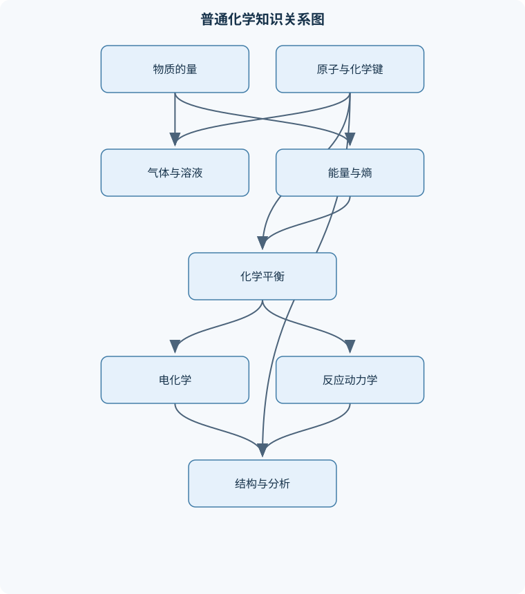
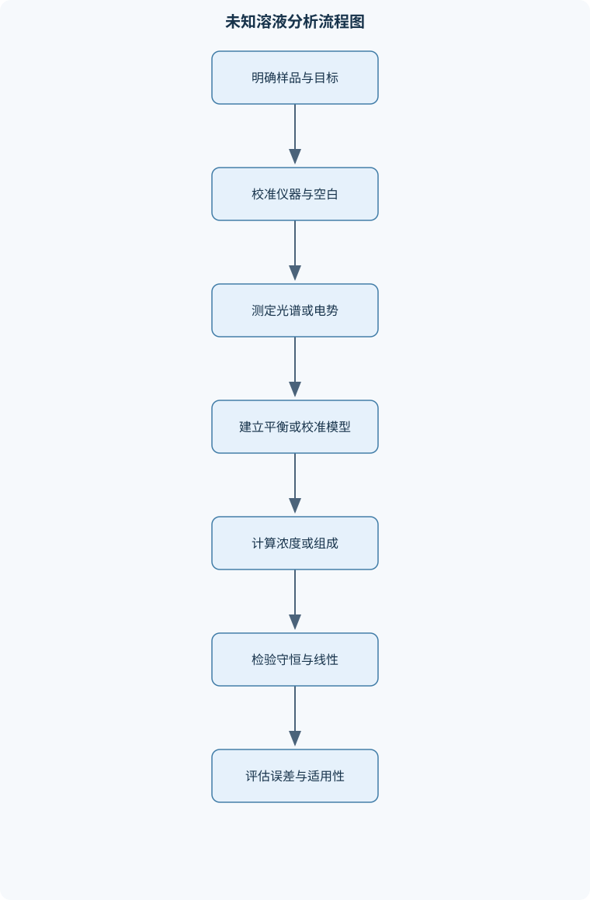

# 普通化学（H）

## 一、课程整体知识框架

### 课程边界与先修知识

《普通化学（H）》覆盖物质结构、化学热力学、相平衡与溶液、化学平衡、电化学、化学动力学、晶体与量子化学基础、基础有机化学、配位化学和化学分析方法。课程重点是用微观结构解释宏观性质，并通过守恒关系、状态方程、平衡常数、电势、速率方程和光谱信号完成定量分析。先修知识包括高中阶段的化学式与化学方程式配平、摩尔质量和物质的量、基本无机反应、有机官能团初步知识，以及代数运算、对数、指数、函数图像和简单微积分概念。课程不替代高等数学、物理化学、结构化学或系统有机化学；涉及量子力学、晶体学和仪器分析时，以解释化学现象和掌握基本计算、分析流程为边界。





### 1. 课程目标与主线

《普通化学（H）》以“微观结构—宏观性质—定量关系—实验信号”为主线，解释物质为什么具有特定的状态、反应性、溶解性、导电性、颜色和光谱特征。课程不是各章公式的简单汇编，而是通过守恒关系和状态函数把不同层次的化学知识联系起来。

在微观层面，原子核外电子的能级、电子排布、轨道形状和成键方式决定分子的几何构型、极性、键能及分子间作用力；晶体中的周期性排列、配位关系和缺陷结构进一步决定固体的硬度、熔点、导电性及衍射信号。在宏观层面，物质的量、压力、体积、温度、热量、自由能、电势和反应速率分别描述物质数量、状态变化、能量方向、电化学驱动力和时间尺度。

课程中常用符号必须与物理量含义和单位一致。$n$为物质的量，单位为$\mathrm{mol}$；$m$为质量，常用单位为$\mathrm{g}$或$\mathrm{kg}$；$M$为摩尔质量，单位为$\mathrm{g\,mol^{-1}}$或$\mathrm{kg\,mol^{-1}}$；$N$为粒子数，$N_A$为阿伏伽德罗常数，满足$N=nN_A$。气体计算中，$p$为压力，$V$为体积，$T$为热力学温度，必须使用开尔文；$R$为气体常数，在国际单位制中取$8.314\ \mathrm{J\,mol^{-1}\,K^{-1}}$。溶液中$c$表示物质的量浓度，单位为$\mathrm{mol\,L^{-1}}$；$a$表示活度。热力学中，$q$为热，$w$为功，$U$为内能，$H$为焓，$S$为熵，$G$为吉布斯自由能。平衡常数记为$K$，反应商记为$Q$；严格表达应采用活度，浓度或分压只是在适当条件下的近似。

### 2. 从组成、结构到性质的递进关系

课程首先建立物质的量和气体状态的定量基础。相对原子质量是相对于统一原子质量单位的相对数值，式量是化学式中各元素相对原子质量按下标加权所得的总和。摩尔质量把微观粒子数与可称量质量联系起来：

$$
n=\frac{m}{M},\qquad N=nN_A
$$

该关系适用于纯物质或组成明确的样品；混合物必须先确定各组分质量或物质的量，不能把混合物总质量直接除以任意一种物质的摩尔质量。

理想气体模型把分子视为无体积、无分子间作用力的粒子，其状态方程为：

$$
pV=nRT
$$

由$n=m/M$可得：

$$
m=\frac{pVM}{RT}
$$

推导中必须保持单位相容。例如采用$R=8.314\ \mathrm{J\,mol^{-1}\,K^{-1}}$时，压力应使用$\mathrm{Pa}$、体积使用$\mathrm{m^3}$。气体混合物满足道尔顿分压定律：

$$
p_{\mathrm{tot}}=\sum_i p_i,\qquad p_i=\frac{n_iRT}{V}=x_i p_{\mathrm{tot}}
$$

气体先在不同容器中存在、再充入同一容器时，各组分的物质的量不变，但体积改变，应分别使用$p_iV_i=p_i'V_{\mathrm{final}}$，不能对初始压力作简单平均。排水集气时，湿气体总压包括目标气体和水蒸气，干燥气体分压为$p_{\mathrm{dry}}=p_{\mathrm{total}}-p_{\mathrm{H_2O}}$；若液面内外存在明显压差，还需修正静压差。

在高压、低温、接近液化或临界区域，理想气体方程会偏离真实情况。范德华方程为：

$$
\left(p+\frac{an^2}{V^2}\right)(V-nb)=nRT
$$

其中$a$反映分子间吸引作用，吸引力使实际压力低于理想估计；$b$反映分子自身占据的体积，使可用于平动的体积小于容器体积。范德华方程仍是近似模型，不能在所有压力和温度下代替实验状态方程。压缩因子$Z=pV/(nRT)$用于衡量偏离理想气体的程度，$Z=1$为理想行为，$Z<1$通常表示吸引作用占优势，$Z>1$通常表示排斥体积效应占优势。

### 3. 能量、方向和平衡

热力学第一定律采用化学热力学常用符号约定：

$$
\Delta U=q+w
$$

体系吸热时$q>0$，体系对外膨胀作功时体积功通常为负。热和功依赖过程路径，不是状态函数；内能和焓只由初态、终态决定。若体系只做体积功，恒容时$w=0$，因此：

$$
q_V=\Delta U
$$

定义焓为$H=U+pV$。恒压且只有体积功时：

$$
q_p=\Delta H
$$

对于理想气体反应，若气体物质的量变化为$\Delta n_g$，则常用近似为：

$$
\Delta H=\Delta U+\Delta n_gRT
$$

热容描述温度变化所需的热量，$C_p$和$C_V$分别为定压热容和定容热容。相变热、反应热和标准摩尔生成焓都必须注明物态和标准状态。赫斯定律源于焓是状态函数，反应式可以反向、倍乘和相加，但焓变必须同步反号或倍乘：

$$
\Delta_rH^\circ
=\sum_i\nu_i\Delta_fH_i^\circ(\text{生成物})
-\sum_i\nu_i\Delta_fH_i^\circ(\text{反应物})
$$

其中$\nu_i$为化学计量数。固态水、液态水和水蒸气的标准生成焓不能混用。

熵$S$反映能量分散和微观状态数的变化。可逆过程中：

$$
\mathrm dS=\frac{\delta q_{\mathrm{rev}}}{T}
$$

孤立体系自发过程的总熵变大于或等于零。恒温恒压下更常用吉布斯自由能：

$$
G=H-TS
$$

因此：

$$
\Delta G<0
$$

表示过程具有正向自发趋势，$\Delta G=0$表示平衡，$\Delta G>0$表示正向过程在该条件下没有自发驱动力。自发性不等于反应快速；热力学只判断方向和平衡位置，不能给出达到平衡所需时间。

非标准状态下：

$$
\Delta G=\Delta G^\circ+RT\ln Q
$$

当$Q<K$时正向反应具有驱动力，当$Q>K$时逆向反应具有驱动力，$Q=K$时达到平衡。由平衡状态$\Delta G=0$得：

$$
\Delta_rG^\circ=-RT\ln K
$$

平衡常数只随温度改变，改变压力、浓度或加入催化剂通常改变平衡组成或达到平衡的速度，但不改变给定温度下的$K$。纯固体和纯液体的活度通常取$1$，不写入平衡表达式；气体和溶液物种必须使用活度，只有在低压或稀溶液等近似条件下才可用分压或浓度替代。

### 4. 溶液、电化学、动力学与结构分析的统一

理想溶液中，组分$i$的蒸气压满足拉乌尔定律：

$$
p_i=x_i p_i^*
$$

其中$x_i$是液相摩尔分数，$p_i^*$是纯组分饱和蒸气压。该式要求不同组分间相互作用与纯组分内部相互作用相近。强缔合、强排斥、电解质溶液等体系不能机械套用理想模型。稀溶液的沸点升高和凝固点降低主要取决于溶质粒子数：

$$
\Delta T_b=iK_bm,\qquad \Delta T_f=iK_fm
$$

其中$m$为质量摩尔浓度，单位为$\mathrm{mol\,kg^{-1}}$，$i$为范特霍夫因子。电解质解离、溶质缔合和非理想性都会使实际$i$偏离简单整数。

酸碱平衡涉及弱电解质电离、水的离子积、缓冲作用和沉淀生成。定义：

$$
\mathrm{pH}=-\log a_{\mathrm{H_3O^+}},\qquad
\mathrm{pOH}=-\log a_{\mathrm{OH^-}}
$$

在一定温度下：

$$
\mathrm{pH}+\mathrm{pOH}=\mathrm{p}K_w
$$

稀溶液中可近似用浓度代替活度。弱酸初始浓度为$c_0$且无共同离子时，若电离产生的氢离子浓度为$x$：

$$
K_a=\frac{x^2}{c_0-x}
$$

当$x/c_0$足够小，才可近似为$x\approx\sqrt{K_ac_0}$；若电离度不小或存在共同离子，应使用二次方程、物料守恒和电荷守恒。缓冲溶液的有效条件是共轭酸碱对同时存在且浓度不能过低，加入少量强酸或强碱后，先按化学计量中和，再计算新的平衡。

难溶盐的溶度积由平衡表达式决定。例如：

$$
\mathrm{M(OH)_2(s)\rightleftharpoons M^{2+}+2OH^-}
$$

有：

$$
K_{sp}=a_{\mathrm{M^{2+}}}a_{\mathrm{OH^-}}^2
$$

忽略活度系数时，若无外加离子、溶解度为$s$，则$K_{sp}=s(2s)^2=4s^3$。共同离子会降低溶解度，配位反应或酸碱反应若消耗自由离子，则可能促进沉淀溶解。

电化学把氧化还原反应与电势联系起来。氧化数用于判断电子转移方向，但配平氧化还原方程式还必须满足元素守恒和电荷守恒。阳极发生氧化，阴极发生还原；原电池把自发反应的化学能转化为电能，电解池则利用外加电能推动非自发反应。标准电极电势均按还原方向列出：

$$
E_{\mathrm{cell}}^\circ
=E_{\mathrm{cathode}}^\circ-E_{\mathrm{anode}}^\circ
$$

能斯特方程为：

$$
E=E^\circ-\frac{RT}{n_eF}\ln Q
$$

电池反应满足：

$$
\Delta_rG=-n_eFE,\qquad
\ln K=\frac{n_eFE^\circ}{RT}
$$

盐桥维持两半电池的电中性并减少液接电势；电动势测量适用于可逆、近似无电流取样的体系，所得热力学电势不能直接表示电池在大电流下的实际功率。

化学动力学研究反应速率和机理。反应速率必须根据化学计量数归一化，例如对$aA\rightarrow$产物：

$$
v=-\frac{1}{a}\frac{\mathrm d[A]}{\mathrm dt}
$$

经验速率方程写作：

$$
v=k[A]^m[B]^n
$$

$m,n$由实验确定，不一定等于总反应式中的计量数。零级和一级反应的积分式分别为：

$$
[A]_t=[A]_0-kt
$$

$$
\ln\frac{[A]_t}{[A]_0}=-kt
$$

一级反应半衰期：

$$
t_{1/2}=\frac{\ln2}{k}
$$

阿伦尼乌斯方程为：

$$
\ln\frac{k_2}{k_1}
=-\frac{E_a}{R}\left(\frac1{T_2}-\frac1{T_1}\right)
$$

温度必须使用开尔文，且假定研究温区内反应机理基本不变。催化剂降低有效活化能或改变反应路径，但不改变热力学平衡常数。

### 5. 量子化学、晶体、有机、配位与分析信号

量子化学基础用于解释周期性和成键。量子数必须满足：

$$
n\geq1,\qquad 0\leq l\leq n-1,\qquad
-l\leq m_l\leq l,\qquad m_s=\pm\frac12
$$

一个亚层含有$2l+1$个轨道，最多容纳$2(2l+1)$个电子。因此$2d$和$1p$不存在。电子排布遵循能量最低原理、泡利不相容原理和洪特规则，但过渡元素可能出现由能级接近导致的异常排布。价层电子对互斥模型可解释线形、平面三角形、正四面体、三角锥形和折线形结构；孤电子对通常比成键电子对占据空间更大。杂化是描述成键方向的模型，不应被当作直接测量的独立实体。

晶体具有周期性和对称性。晶格点、晶胞、配位数、键长和键角共同描述晶体结构。离子晶体由静电作用稳定，分子晶体主要由分子间作用力稳定，原子晶体由连续共价网络稳定。晶体缺陷包括空位、间隙原子、替位缺陷和位错等，缺陷会影响扩散、导电和力学性质。布拉格条件为：

$$
2d\sin\theta=n\lambda
$$

其中$d$为晶面间距，$\theta$为入射线与晶面的夹角，$\lambda$为波长，$n$为衍射级次。X射线衍射通过峰位反推出晶面间距和晶胞参数，通过峰强分析原子在晶胞中的排列；实际结构反演还需要考虑仪器分辨率、样品取向、热振动和缺陷。

基础有机化学按碳骨架和官能团分类。烷烃以饱和单键为主，烯烃含碳碳双键，芳香化合物具有环状、近似平面、连续共轭并满足$4n+2$个π电子的条件。杂环化合物的杂原子会改变电子云分布和酸碱性。同分异构包括构造异构和立体异构；手性中心的$R/S$构型由取代基优先级和空间方向确定，不能与旋光方向正负混同。常见有机反应包括加成、取代、消除及氧化还原，生物分子反应则涉及缩合、加水分解、肽键形成等基本过程。

配位化合物由中心金属$\mathrm M$和配体$\mathrm L$组成。配位数是直接与中心原子相连的配位原子数，不等于配体分子数；多齿配体可占据多个配位位置。螯合效应通常提高配合物稳定性。配位平衡可写为：

$$
\mathrm M+\mathrm L\rightleftharpoons \mathrm{ML}
$$

形成常数必须与具体配位反应式对应。配位、沉淀、酸碱和氧化还原平衡可以耦合，例如配体降低自由金属离子活度后，可能推动难溶盐继续溶解。几何异构和立体异构会影响配合物的颜色、磁性、反应性和生物功能。

光谱与色谱把物质结构转化为可测信号。原子发射光谱利用激发态回到低能级时的特征发射，原子吸收光谱利用基态原子对特定波长的选择性吸收。分子振动可近似为弹簧振子：

$$
\tilde{\nu}\propto\sqrt{\frac{k_f}{\mu}}
$$

其中$k_f$为键力常数，$\mu$为约化质量；键越强，振动波数通常越高，重同位素替换通常使波数降低。红外光谱可通过羟基、羰基、胺基等特征吸收区间识别官能团，但单一峰通常不能独立证明完整结构。

比尔—朗伯定律为：

$$
A=\varepsilon bc
$$

其中$A$为吸光度，$\varepsilon$为摩尔吸光系数，$b$为光程长度，$c$为浓度。定量分析要求空白校正、波长选择、浓度处于线性范围且样品均匀透明。色谱利用组分在固定相和流动相之间的分配或吸附差异实现分离。气相色谱适用于挥发性和热稳定性较好的物质，液相色谱适用于难挥发、热不稳定或极性较强的物质。保留时间可用于初步定性，峰面积结合外标、内标或标准加入法可用于定量，但必须检查峰形、分离度、校准范围和基质效应。

## 二、章节和模块划分

### 核心知识覆盖清单

本清单根据本课程的章节划分整理，用于检查正文是否覆盖各个核心模块：

- **1. 物质的量、气体与相态基础**。
- **2. 热力学第一定律与热化学**。
- **3. 熵、自由能与化学平衡**。
- **4. 溶液、酸碱平衡与沉淀平衡**。
- **5. 电化学与氧化还原**。
- **6. 化学动力学**。
- **7. 原子结构、周期性与化学键**。
- **8. 晶体结构与固体材料基础**。
- **9. 基础有机化学与立体化学**。
- **10. 配位化学与配合物平衡**。
- **11. 光谱与色谱分析基础**。


### 1. 物质的量、气体与相态基础

本模块建立后续所有定量计算的计量基础，内容包括相对原子质量、式量、物质的量、粒子数换算、理想气体状态方程、分压、水蒸气校正、真实气体、临界状态、饱和蒸气压、表面张力和过饱和现象。相态变化由分子热运动、分子间作用力和外界条件共同决定。液体沸腾的条件是饱和蒸气压等于外界压力，而不是达到某个固定温度；因此外压升高，沸点通常升高。

饱和蒸气压与温度的近似关系可由克劳修斯—克拉珀龙方程表示：

$$
\ln\frac{p_2}{p_1}
=-\frac{\Delta H_{\mathrm{vap}}}{R}
\left(\frac1{T_2}-\frac1{T_1}\right)
$$

该式假定蒸气近似理想气体，液相体积相对可忽略，且温区内$\Delta H_{\mathrm{vap}}$近似不变。接近临界点或温区过大时不能机械外推。表面张力源于液面分子受力不对称，弯曲液面会产生附加压力；毛细现象、成核困难和过饱和状态都说明界面能会影响相变路径。过饱和并不表示热力学平衡状态稳定，而可能是缺少成核中心造成的动力学暂态。

### 2. 热力学第一定律与热化学

本模块处理体系、环境、状态函数、热、功、可逆过程、不可逆过程、内能、焓、热容、相变热和反应热。可逆过程是理想化的极限过程，体系始终接近平衡；不可逆膨胀、有限温差传热和摩擦过程会产生熵。可逆过程不是“反应一定很慢”的同义词，而是要求过程中的驱动力无限小且能够反向恢复。

恒容热和恒压热的结论必须结合功的类型使用。若存在电功、表面功或轴功，仅凭恒容或恒压不能直接断言$q_V=\Delta U$或$q_p=\Delta H$。热化学方程式中的物态、温度、压力和化学计量数必须完整给出。赫斯定律适用于反应路径可分解的情形，但计算结果只在各热化学数据状态定义一致时可靠。

### 3. 熵、自由能与化学平衡

本模块从熵的微观含义过渡到自由能和化学平衡。气体自由膨胀通常使熵增加，但在恒温恒压下某一过程能否自发，还要同时考虑焓和熵。相变平衡时：

$$
\Delta G_{\mathrm{phase}}=0
$$

因此在相变温度下，$\Delta H_{\mathrm{phase}}=T\Delta S_{\mathrm{phase}}$。理想气体等温膨胀、压缩的自由能变化取决于压力比；压力变化改变$Q$，从而改变$\Delta G$。

化学平衡是正、逆反应速率相等的动态状态，反应并未停止。温度改变会改变$K$；压力或组成改变通常改变平衡组成。对气体平衡，压缩体系只有在气体总物质的量两侧不同的情况下才会产生明显组成变化；若两侧气体物质的量相同，压缩可能同时改变各分压，但平衡组成未必改变。加入惰性气体时，恒容与恒压条件的影响不同，不能只凭“总压增加”判断平衡移动。

### 4. 溶液、酸碱平衡与沉淀平衡

本模块涵盖理想溶液、拉乌尔定律、溶剂蒸气压、沸点升高、凝固点降低、弱电解质、水的离子积、缓冲溶液、溶度积、共同离子效应和选择性沉淀。溶液计算的核心是区分分析浓度、平衡浓度和活度。分析浓度表示加入量，平衡浓度表示实际存在量，活度还要考虑离子间相互作用。

选择性沉淀要求不同离子达到沉淀条件的先后差异足够大。判断是否沉淀时，应先根据混合后的总体积修正各离子浓度，再计算$Q_{sp}$。若$Q_{sp}>K_{sp}$，体系有沉淀趋势；若$Q_{sp}<K_{sp}$，在所用模型下无沉淀趋势。配位反应、酸碱反应和离子强度会改变自由离子浓度，因此简单的$K_{sp}$比较可能只是初步判断。

### 5. 电化学与氧化还原

本模块包括氧化数、氧化还原方程式、原电池、电解池、阳极、阴极、标准电极电势、能斯特方程、盐桥和电动势应用。配平氧化还原反应时，半反应法必须同时满足原子守恒和电荷守恒；酸性介质和碱性介质的配平步骤不同。阳极始终氧化、阴极始终还原，但原电池中阳极为负极，电解池中阳极为正极，不能把“阳极”与固定正负极混同。

标准电势是相对量，不能单独表示某个电极的绝对电势。组成电池时必须先确定阴极和阳极，再按还原电势之差计算。能斯特方程中的$Q$必须与电池总反应一致，固体和纯液体活度取$1$。电动势测定可以反推离子活度或平衡常数，但需要控制温度、避免电流通过和减少液接电势影响。

### 6. 化学动力学

本模块研究速率定义、速率方程、反应级数、基元反应、积分方程、半衰期、初始速率法、图像法、阿伦尼乌斯方程、碰撞理论、过渡态理论、对行反应、平行反应、连续反应以及吸附脱附与色谱基础。

基元反应的速率式可依据其分子碰撞步骤写出，但总反应式通常由多个基元步骤组成，不能直接把总反应式系数当作级数。初始速率法适合比较不同初始浓度下的瞬时速率；积分法适合利用时间—浓度数据检验模型。零级反应的半衰期随初始浓度变化，一级反应的半衰期与初始浓度无关，这是区分反应级数的重要边界。对行反应和平行反应必须说明各通道速率常数及产物关系，不能只用一个总速率常数概括所有产物分布。

### 7. 原子结构、周期性与化学键

本模块解释核外电子波动性、量子数、原子轨道、电子云、能级、电子排布、周期性、价键、$\sigma$键、$\pi$键、杂化、价层电子对互斥、分子间作用力和氢键。电子云表示电子在空间某处出现的概率密度，不是电子在轨道中沿固定轨道运行的路线。

周期表分区与价电子进入的亚层有关。原子半径、电离能、电子亲和能和电负性等周期性可用有效核电荷、电子层数和屏蔽效应解释，但存在亚层半充满、全充满等局部偏差。$\sigma$键沿核间轴方向重叠，$\pi$键由平行轨道侧向重叠形成；双键和三键通常分别含一个、两个$\pi$键。氢键要求供体和受体具有适当的电负性原子及孤电子对，有极性不等于必然存在强氢键。

### 8. 晶体结构与固体材料基础

本模块介绍晶体周期性、对称性、晶格、晶胞、配位数、离子晶体、分子晶体、原子晶体、晶体缺陷、布拉格衍射和结构反演。晶胞是描述周期性重复的基本几何单元，但不同晶胞选择可能包含不同数量的晶格点；判断晶体组成时必须考虑角点、面心和体心等位置的共享关系。

布拉格方程把衍射角与晶面间距联系起来，但实际衍射峰还受晶胞对称性、原子散射因子、热振动、缺陷和仪器展宽影响。X射线衍射得到的是结构信息的间接信号，电子云密度通常需要经过相位处理和模型拟合才能反演。生物大分子晶体测定一般包括样品纯化、结晶、衍射数据采集、数据处理、相位求解、模型建立、精修和结构质量评价；结晶不良、辐射损伤和分辨率不足都会限制结果。

### 9. 基础有机化学与立体化学

本模块按照碳骨架、官能团、杂化方式和反应类型组织知识。单键通常允许旋转，双键因$\pi$键存在而限制旋转；离域电子可使多个键长趋于平均，并改变稳定性和反应位置。芳香性不是“有环即可”，必须同时满足环状、近似平面、连续共轭和$4n+2$个π电子等条件。

构造异构体的原子连接顺序不同，立体异构体的连接顺序相同但空间排列不同。对映异构体彼此为不可重合镜像，非对映异构体不是镜像关系，外消旋体含等量对映体，整体通常不表现旋光性。R/S只描述构型，不直接表示旋光方向。加成、取代、消除和氧化还原反应的判断应同时考虑官能团、试剂、溶剂、温度和立体因素，不能只按反应名称机械分类。

### 10. 配位化学与配合物平衡

本模块包括中心离子、配体、配位键、配位数、配位多面体、单齿和多齿配体、螯合效应、命名、异构、配体交换和条件稳定常数。配体通过孤电子对向中心金属提供电子，中心金属的价态、电子构型、配体场强和空间位阻共同影响配合物结构。

配位平衡和沉淀平衡耦合时，不能只比较单独的形成常数或溶度积。若配体大量结合自由金属离子，金属离子活度降低，难溶盐可能继续溶解；若配体交换缓慢，则热力学上允许的变化未必能在实验时间内完成。功能配合物和生物配位化学涉及金属离子运输、电子转移、催化和分子识别，但结构稳定性与反应动力学必须分别讨论。

### 11. 光谱与色谱分析基础

本模块从信号产生机制出发，说明原子发射、原子吸收、分子振动、红外识别、比尔—朗伯定律、色谱分配和吸附、气相色谱、液相色谱及校准分析。原子谱线反映能级差，分子红外吸收反映振动能级变化；分子振动只有在振动引起偶极矩变化时才具有明显红外活性。

定量分析应先测空白和标准系列，再建立信号与浓度的校准关系。校准曲线的线性范围、截距、残差、重复性和样品基质都会影响结果。色谱定性不能仅凭一个保留时间下结论，应结合标准品、相对保留时间、光谱信息或其他检测器。色谱定量需检查峰面积积分、分离度、响应因子、稀释倍数和样品回收率；峰重叠、拖尾、基线漂移和进样量不稳定都会造成系统误差。

## 三、核心概念的详细解释

### 1. 物质的量、气体与相态

物质的量 $n$ 用于表示微观粒子集合的数量，单位为 $\mathrm{mol}$。一个物质的量含有 $N_A$ 个指定粒子，因此 $N=nN_A$；质量、物质的量和摩尔质量满足 $n=m/M$。相对原子质量和相对分子质量是无量纲相对值，摩尔质量则有单位，数值上通常与相对原子质量或式量相同，但二者概念不能混淆。

理想气体模型假定分子本身不占体积且分子间没有作用力，状态方程为 $pV=nRT$。这里 $p$ 为压力，$V$ 为体积，$T$ 必须使用开尔文温度，$R=8.314\ \mathrm{J\,mol^{-1}\,K^{-1}}$。由 $n=m/M$ 可得：

$$
m=\frac{pVM}{RT}
$$

该式要求压力、体积和气体常数的单位相容。高压、低温、接近液化或临界状态时，分子间作用力和分子自身大小不可忽略，应使用真实气体模型。范德华方程为：

$$
\left(p+\frac{an^2}{V^2}\right)(V-nb)=nRT
$$

其中 $a$ 描述分子间吸引作用，$b$ 描述分子自身占据的体积。吸引作用使气体实际压力降低；排斥体积使可供分子运动的有效体积小于容器体积。范德华方程仍是近似方程，不能保证在所有状态下都准确。

混合气体中，各组分对容器壁的碰撞形成分压。理想气体满足道尔顿分压定律：

$$
p_{\mathrm{tot}}=\sum_i p_i,\qquad p_i=x_i p_{\mathrm{tot}}
$$

若气体从初始体积 $V_i$ 进入最终体积 $V_f$，且温度不变，则每种气体的物质的量不变，分压应按 $p_i'V_f=p_iV_i$ 计算，不能对各初始压力直接取平均。排水集气时，总压包括目标气体和水蒸气，干燥气体分压为：

$$
p_{\mathrm{dry}}=p_{\mathrm{tot}}-p_{\mathrm{H_2O}}
$$

若集气瓶内外液面高度不同，还需考虑静压差。

液体的饱和蒸气压是液相与气相达到动态平衡时蒸气的压力。温度升高，分子平均动能增大，更多分子能够逸出液面，因此饱和蒸气压升高。当饱和蒸气压等于外压时液体沸腾。弯曲液面会产生附加压力，表面张力则使体系倾向于减小表面积；这些因素可导致毛细现象、过热或过饱和等现象。

### 2. 热力学第一定律与热化学

体系是研究对象，环境是体系以外的部分；体系与环境之间通过物质或能量交换相互作用。内能 $U$、焓 $H$、熵 $S$ 和吉布斯自由能 $G$ 是状态函数，只由状态决定；热 $q$ 和功 $w$ 是过程量，取决于达到同一终态所采用的路径。

采用化学热力学常用符号约定，体系吸热时 $q>0$，外界对体系做功时 $w>0$，热力学第一定律为：

$$
\Delta U=q+w
$$

若只有体积功，且体系膨胀对外做功，则 $w=-p_{\mathrm{ext}}\Delta V$。恒容条件下 $\Delta V=0$，所以：

$$
q_V=\Delta U
$$

定义焓：

$$
H=U+pV
$$

在恒压、仅有体积功的条件下：

$$
q_p=\Delta H
$$

对于理想气体反应，若气体物质的量变化为 $\Delta n_g$，则近似有：

$$
\Delta H=\Delta U+\Delta n_gRT
$$

热容表示温度变化单位值所需的热量。定容热容和定压热容分别记为 $C_V$ 和 $C_p$。相变热、反应热和溶解热都必须明确过程、物态、温度和压力。标准摩尔生成焓是标准状态下由各元素标准态生成一摩尔指定物质时的焓变。反应焓可由赫斯定律计算，因为焓是状态函数：

$$
\Delta_rH^\circ
=
\sum_i\nu_i\Delta_fH_i^\circ(\text{生成物})
-
\sum_i\nu_i\Delta_fH_i^\circ(\text{反应物})
$$

其中 $\nu_i$ 为化学计量数。物质的物态必须对应，液态水和水蒸气不能混用；反应式反向时焓变变号，系数乘以倍数时焓变也乘以同一倍数。

### 3. 熵、自由能与化学平衡

熵 $S$ 反映能量分散程度和体系可能微观状态数。可逆过程中熵变定义为：

$$
\mathrm{d}S=\frac{\delta q_{\mathrm{rev}}}{T}
$$

孤立体系自发变化的判据是总熵增加，即 $\Delta S_{\mathrm{isolated}}>0$；平衡时总熵达到极大值。仅依据体系熵判断自发性通常不方便，因为体系可能与环境交换热量。

恒温恒压条件下使用吉布斯自由能：

$$
G=H-TS
$$

若温度恒定，则：

$$
\Delta G=\Delta H-T\Delta S
$$

$\Delta G<0$ 表示过程具有正向自发趋势，$\Delta G>0$ 表示逆向趋势，$\Delta G=0$ 表示平衡。这里的“自发”只表示热力学方向允许，不表示反应一定很快；金刚石转化为石墨在热力学上可能有利，但速率可以极慢。

非标准状态下：

$$
\Delta_rG=\Delta_rG^\circ+RT\ln Q
$$

其中 $Q$ 为反应商，严格写法应使用活度。平衡时 $\Delta_rG=0$，因此：

$$
\Delta_rG^\circ=-RT\ln K
$$

由此得到：$Q<K$ 时正向反应有驱动力，$Q>K$ 时逆向反应有驱动力，$Q=K$ 时达到平衡。纯固体和纯液体的活度通常取 $1$，不写入平衡表达式。改变浓度或压力会改变 $Q$ 并使体系重新建立平衡；催化剂只改变达到平衡的速率，不改变 $K$。温度改变会改变平衡常数，升温有利于吸热方向，降温有利于放热方向，但必须以具体反应焓为依据。

### 4. 溶液、酸碱平衡与沉淀平衡

理想溶液中各组分分子间作用力与纯物质中相近，液面上组分 $i$ 的分压遵循拉乌尔定律：

$$
p_i=x_i p_i^*
$$

其中 $x_i$ 是液相摩尔分数，$p_i^*$ 是纯组分的饱和蒸气压。强相互作用、缔合、解离或电解质效应会导致偏离，应使用活度或非理想溶液模型。

稀溶液依数性主要取决于溶质粒子数。沸点升高和凝固点降低近似为：

$$
\Delta T_b=iK_bm,\qquad \Delta T_f=iK_fm
$$

$m$ 为质量摩尔浓度，$K_b$ 和 $K_f$ 分别为溶剂的沸点升高常数和凝固点降低常数，$i$ 为范特霍夫因子。非电解质理想稀溶液中 $i\approx1$；电解质解离后粒子数增加，但离子相互作用会使实际 $i$ 偏离理想值。若溶质缔合，粒子数减少，测得的表观摩尔质量可能偏大。

弱酸、弱碱在水中建立电离平衡。弱酸 $\mathrm{HA}$ 的电离常数为：

$$
K_a=\frac{a_{\mathrm{H_3O^+}}a_{\mathrm{A^-}}}{a_{\mathrm{HA}}}
$$

稀溶液中可用浓度近似活度。水的离子积为：

$$
K_w=a_{\mathrm{H_3O^+}}a_{\mathrm{OH^-}}
$$

定义：

$$
\mathrm{pH}=-\log a_{\mathrm{H_3O^+}},\qquad
\mathrm{pOH}=-\log a_{\mathrm{OH^-}}
$$

在给定温度下有 $\mathrm{pH}+\mathrm{pOH}=\mathrm{p}K_w$，但 $\mathrm{p}K_w$ 随温度变化，不能把室温数值无条件用于其他温度。弱酸浓度为 $c_0$ 且电离程度较小时，有：

$$
[\mathrm{H_3O^+}]\approx\sqrt{K_ac_0}
$$

若电离度不小、存在同离子或溶液很浓，则应使用物料守恒、电荷守恒和完整平衡方程求解。

缓冲溶液由弱酸及其共轭碱，或弱碱及其共轭酸组成。加入少量强酸时，共轭碱消耗 $\mathrm{H_3O^+}$；加入少量强碱时，弱酸消耗 $\mathrm{OH^-}$。缓冲能力与两种组分的总浓度及比例有关，不是任何含酸碱物质的溶液都具有良好缓冲能力。

难溶盐的溶解平衡用溶度积表示。例如：

$$
\mathrm{M(OH)_2(s)\rightleftharpoons M^{2+}+2OH^-}
$$

其溶度积为：

$$
K_{sp}=a_{\mathrm{M^{2+}}}a_{\mathrm{OH^-}}^2
$$

用离子反应商 $Q_{sp}$ 判断沉淀：$Q_{sp}>K_{sp}$ 时有沉淀趋势，$Q_{sp}<K_{sp}$ 时可继续溶解，$Q_{sp}=K_{sp}$ 时达到平衡。共同离子降低溶解度；配位反应或酸碱反应若消耗自由金属离子或阴离子，则可能促进沉淀溶解。选择性沉淀必须同时考虑各离子的浓度、$K_{sp}$、配位作用和沉淀完全程度。

### 5. 电化学与氧化还原

氧化数是描述原子形式电荷分配的记账方法，不一定等于真实局部电荷。氧化数升高表示氧化，降低表示还原。配平氧化还原反应时必须同时满足元素守恒和电荷守恒，酸性介质可用 $\mathrm{H^+}$ 和 $\mathrm{H_2O}$ 配平，碱性介质还需将 $\mathrm{H^+}$ 转换为 $\mathrm{OH^-}$。

原电池把自发氧化还原反应的化学能转化为电能；电解池利用外加电能推动非自发反应。无论哪类电池，阳极都发生氧化，阴极都发生还原；原电池中阳极为负极，电解池中阳极为正极。盐桥维持两侧电中性并提供离子迁移通道，不能简单认为盐桥传递电子。

标准电极电势表中的数值均按还原方向给出。电池电动势为：

$$
E_{\mathrm{cell}}=E_{\mathrm{cathode}}-E_{\mathrm{anode}}
$$

非标准状态下，能斯特方程为：

$$
E=E^\circ-\frac{RT}{n_eF}\ln Q
$$

纯固体和纯液体不写入 $Q$，气体和溶液物种应使用活度，低压气体和稀溶液中才可分别近似使用分压和浓度。电池反应自由能满足：

$$
\Delta_rG=-n_eFE
$$

标准状态下结合 $\Delta_rG^\circ=-RT\ln K$ 可得：

$$
\ln K=\frac{n_eFE^\circ}{RT}
$$

因此标准电势越正，作为氧化剂接受电子的热力学倾向通常越强；但实际反应速率还受活化能、界面过程和传质影响，不能仅凭 $E^\circ$ 判断电流大小。

### 6. 化学动力学

反应速率描述浓度随时间的变化。对反应 $\mathrm{aA+bB\rightarrow products}$，反应速率可按化学计量数统一定义：

$$
v=-\frac{1}{a}\frac{\mathrm{d}[A]}{\mathrm{d}t}
=-\frac{1}{b}\frac{\mathrm{d}[B]}{\mathrm{d}t}
$$

经验速率方程通常写为：

$$
v=k[A]^m[B]^n
$$

总反应级数为 $m+n$，必须由实验确定，不一定等于总反应式中的计量数。只有基元反应才可根据分子碰撞关系直接写出质量作用形式的速率方程。

零级反应和一级反应的积分式分别为：

$$
[A]_t=[A]_0-kt
$$

$$
\ln\frac{[A]_t}{[A]_0}=-kt
$$

一级反应半衰期为：

$$
t_{1/2}=\frac{\ln2}{k}
$$

它与初始浓度无关，是一级反应的特征。反应级数可用初始速率法比较浓度变化与速率变化，也可用积分法检验不同线性图像。阿伦尼乌斯方程为：

$$
k=Ae^{-E_a/(RT)}
$$

两温度形式为：

$$
\ln\frac{k_2}{k_1}
=
-\frac{E_a}{R}\left(\frac1{T_2}-\frac1{T_1}\right)
$$

$T$ 必须为开尔文。该关系要求温度范围内反应机理和表观活化能近似不变。碰撞理论强调有效碰撞需具有足够能量和适当取向；过渡态理论则用活化复合物解释速率。催化剂提供另一条活化能较低的路径，不改变反应物和生成物的热力学平衡。

对行反应、平行反应和连续反应的浓度变化由多个速率方程共同决定，不能把每一步孤立处理后简单相加。吸附和脱附达到动态平衡时，表面覆盖度影响异相催化速率；色谱分离正是利用不同组分在固定相和流动相之间分配或吸附能力不同而产生迁移差异。

### 7. 原子结构、化学键与晶体

电子具有波粒二象性，原子中的电子状态用量子数描述：$n\ge1$；$0\le l\le n-1$；$-l\le m_l\le l$；$m_s=\pm1/2$。一个亚层含有 $2l+1$ 个轨道，最多容纳 $2(2l+1)$ 个电子。因此 $2d$ 和 $3f$ 不存在，因为相应的 $l$ 超出了允许范围。

电子排布遵循构造原理、泡利不相容原理和洪特规则，但过渡元素可能因半充满或全充满的相对稳定性出现异常排布。价电子排布决定元素周期性、常见氧化态和成键能力。共价键包括沿键轴重叠形成的 $\sigma$ 键和侧向重叠形成的 $\pi$ 键；双键、三键分别包含一个 $\sigma$ 键和一个或两个 $\pi$ 键。杂化轨道是解释成键方向和分子构型的模型，不是直接可分离观测的独立实体。

价层电子对互斥模型认为成键电子对和孤电子对尽可能分离。中心原子周围电子域为两个时常呈线形，三个时常呈平面三角形，四个时常呈正四面体电子域；有孤电子对时，分子形状可变为三角锥形或折线形。孤电子对排斥通常强于成键电子对，因此会压缩键角。分子间作用力包括色散力、偶极—偶极作用和氢键；氢键需要合适的供体与受体，不能仅由分子极性判断。

晶体由具有周期性排列的结构单元构成。晶胞是描述周期结构的基本重复单元，配位数表示一个粒子直接相邻的配位粒子数。离子晶体以静电作用为主，分子晶体以分子间作用力为主，原子晶体以连续共价网络为主。晶体缺陷包括空位、间隙原子、替位原子以及位错等，缺陷会影响扩散、导电性、机械强度和颜色。

晶体结构可由布拉格条件分析：

$$
2d\sin\theta=n\lambda
$$

其中 $d$ 为晶面间距，$\theta$ 为入射线与晶面的夹角，$\lambda$ 为波长，$n$ 为衍射级次。粉末或单晶衍射信号反映晶面间距和对称性；通过峰位、峰强和系统消光等信息可反演晶胞参数、空间排列和部分电子密度。生物大分子晶体结构测定通常包括结晶、衍射数据采集、相位确定、电子密度计算、模型搭建和精修，最终还需检查结构参数与实验数据的一致性。

### 8. 基础有机化学、配位化学与分析方法

有机化合物按碳骨架、官能团和不饱和程度分类。烷烃以单键为主，烯烃含碳碳双键，芳香化合物具有环状连续共轭体系。芳香性通常要求环状、近似平面、连续共轭并含有 $4n+2$ 个 $\pi$ 电子；仅有环状结构并不足以判定芳香性。构造异构体具有不同连接方式；立体异构体连接方式相同但空间排列不同。

手性中心通常连接四个不同取代基。按照原子序数规则确定优先级后，将最低优先级基团背向观察者，其他三个基团按顺时针为 $R$，逆时针为 $S$。$R/S$ 构型不表示旋光方向。对映异构体互为镜像且不可重合；非对映异构体不是镜像关系；外消旋体含等量对映体，通常不表现净旋光性。常见有机反应包括加成、取代、消除和氧化还原。蛋白质合成涉及氨基酸通过肽键连接，缩合形成肽链，空间折叠则由氢键、离子作用、疏水作用和二硫键等共同影响。

配合物由中心离子 $\mathrm{M}$ 和配体 $\mathrm{L}$ 构成。配体以孤电子对向中心离子提供电子形成配位键；配位数是直接连接的配位原子数，不等于配体分子数。单齿配体占据一个配位位置，多齿配体可形成螯环，螯合效应通常提高配合物的热力学稳定性。配合物可出现几何异构和光学异构，配体交换、配位平衡、沉淀平衡与酸碱平衡可能相互耦合。形成常数越大，表示在给定条件下配合物形成倾向越强；实际体系应使用条件稳定常数，因为 pH、竞争配体和副反应会改变自由金属离子浓度。

原子发射光谱源于激发态原子回到低能级时发射特征光；原子吸收光谱则测量基态原子对特定波长光的吸收。分子红外光谱来自振动能级跃迁，双原子振动可用胡克定律近似：

$$
\tilde{\nu}\propto\sqrt{\frac{k}{\mu}}
$$

其中 $k$ 为键力常数，$\mu$ 为约化质量。键越强，振动波数通常越高；同位素变重会使波数降低。红外光谱可用于识别羟基、羰基、胺基等官能团，但峰位会受氢键、共轭、溶剂和样品状态影响。

比尔—朗伯定律建立吸光度与浓度的关系：

$$
A=\varepsilon bc
$$

其中 $A$ 为吸光度，$\varepsilon$ 为摩尔吸光系数，$b$ 为光程长度，$c$ 为浓度。定量分析需进行空白校正，使用标准系列建立校准曲线，并确认信号处于线性范围。色谱则依据组分在固定相和流动相之间的分配或吸附差异进行分离。气相色谱适合挥发性和热稳定性物质，液相色谱适合难挥发、热不稳定或极性较强的物质。保留时间可用于初步定性，峰面积结合外标、内标或标准加入法可进行定量；单独相同的保留时间不能完全证明结构相同。

## 四、重要定义、公式、定理和推导

### 专业审校补充：关键定义与适用边界

电化学中必须区分热力学电势与实际电池电压。对于可逆电池，在恒温、恒压且只考虑电功时，电池反应的吉布斯自由能变化与电动势满足 $\Delta_rG=-nFE$；标准状态下为 $\Delta_rG^\circ=-nFE^\circ$。其中 $n$ 是每进行一个反应式所转移的电子物质的量，单位为 $\mathrm{mol}$；$F$ 为法拉第常数，单位为 $\mathrm{C\,mol^{-1}}$；$E$ 的单位为伏特。非标准状态下，能斯特方程为 $E=E^\circ-\frac{RT}{nF}\ln Q$，$Q$ 必须按配平后的总反应式写成活度形式，纯固体和纯液体的活度取 1。该式描述的是平衡或近可逆条件下的电势，不能直接当作有电流输出时的端电压。实际端电压还受内阻、活化极化、浓差极化、液接电势和副反应影响；放电时常低于理论电动势，充电时外加电压通常高于可逆电压。若电极反应、电子数或反应方向写错，$E^\circ$、$Q$ 和自由能判断都会同时出错。


### 1. 气体与相平衡公式

由理想气体方程和 $n=m/M$：

$$
pV=\frac{m}{M}RT
\quad\Longrightarrow\quad
m=\frac{pVM}{RT}
$$

若恒温、恒容且气体近似理想，压力差与质量差满足：

$$
\Delta m=\frac{\Delta p\,VM}{RT}
$$

该式只适用于有效体积不变且压力变化主要来自该气体物质的量变化的情形。

对混合气体，各组分有：

$$
p_i=\frac{n_iRT}{V}=x_ip_{\mathrm{tot}}
$$

若同一气体由 $V_i$ 转入 $V_f$，则：

$$
p_i'=\frac{p_iV_i}{V_f}
$$

克劳修斯—克拉珀龙方程在蒸气近似理想、液相体积可忽略且 $\Delta H_{\mathrm{vap}}$ 近似不随温度变化时为：

$$
\ln\frac{p_2}{p_1}
=
-\frac{\Delta H_{\mathrm{vap}}}{R}
\left(\frac1{T_2}-\frac1{T_1}\right)
$$

它说明升高温度会增大饱和蒸气压，但不能把一个很宽温区内的蒸发焓无条件视为常数。

### 2. 溶液依数性与平衡表达式

理想二元溶液中：

$$
p_A=x_Ap_A^*,\qquad p_B=x_Bp_B^*
$$

非挥发性溶质使溶剂蒸气压降低。稀溶液近似下：

$$
\Delta T_b=iK_bm,\qquad
\Delta T_f=iK_fm
$$

其中 $m$ 的单位为 $\mathrm{mol\,kg^{-1}}$，不能误写成物质的量浓度 $c$。当溶质缔合或解离时，$i$ 应由粒子数的实际变化或实验数据确定。

一般反应：

$$
\alpha A+\beta B\rightleftharpoons\gamma C+\delta D
$$

其平衡常数为：

$$
K=
\frac{a_C^\gamma a_D^\delta}
{a_A^\alpha a_B^\beta}
$$

反应商 $Q$ 具有相同形式。由：

$$
\Delta_rG=\Delta_rG^\circ+RT\ln Q
$$

并在平衡时令 $\Delta_rG=0$，得到：

$$
\Delta_rG^\circ=-RT\ln K
$$

反应式乘以 $r$ 时，新的平衡常数为 $K^r$；反应式反向时，新的平衡常数为 $1/K$。因此计算平衡常数前必须先核对反应式方向和系数。

### 3. 酸碱和沉淀平衡推导

弱酸初始浓度为 $c_0$，电离量为 $x$：

$$
\mathrm{HA+H_2O\rightleftharpoons H_3O^++A^-}
$$

忽略水自电离时：

$$
K_a=\frac{x^2}{c_0-x}
$$

若 $x\ll c_0$，则：

$$
K_a\approx\frac{x^2}{c_0}
\quad\Longrightarrow\quad
x\approx\sqrt{K_ac_0}
$$

计算后必须检验 $x/c_0$ 是否足够小；若不满足，应求解：

$$
x^2+K_ax-K_ac_0=0
$$

缓冲溶液中，若酸碱对为 $\mathrm{HA/A^-}$，由：

$$
K_a=\frac{[\mathrm{H_3O^+}][\mathrm{A^-}]}{[\mathrm{HA}]}
$$

可得近似关系：

$$
\mathrm{pH}
=
\mathrm{p}K_a+
\log\frac{[\mathrm{A^-}]}{[\mathrm{HA}]}
$$

该式要求溶液浓度适中、活度可由浓度近似，并且酸碱形态确实构成主要共轭对。

难溶盐 $\mathrm{M_xA_y}$ 的平衡为：

$$
\mathrm{M_xA_y(s)}
\rightleftharpoons
x\mathrm{M^{y+}}+y\mathrm{A^{x-}}
$$

故：

$$
K_{sp}=a_{\mathrm{M^{y+}}}^{x}
a_{\mathrm{A^{x-}}}^{y}
$$

例如 $\mathrm{M(OH)_2}$ 的摩尔溶解度为 $s$ 且无外加共同离子时：

$$
[\mathrm{M^{2+}}]=s,\qquad
[\mathrm{OH^-}]=2s
$$

因此：

$$
K_{sp}=s(2s)^2=4s^3
$$

若溶液已有浓度为 $c$ 的 $\mathrm{M^{2+}}$，应写成：

$$
K_{sp}=(c+s)(2s)^2
$$

只有当 $c\gg s$ 时，才能近似为 $K_{sp}\approx4cs^2$。

### 4. 热力学与电化学推导

由 $H=U+pV$：

$$
\Delta H=\Delta U+\Delta(pV)
$$

恒压且只有体积功时，$\Delta(pV)=p\Delta V$，而第一定律给出 $q_p=\Delta U+p\Delta V$，所以：

$$
q_p=\Delta H
$$

理想气体反应中 $pV=n_gRT$，因此：

$$
\Delta(pV)=\Delta n_gRT
$$

从而：

$$
\Delta H=\Delta U+\Delta n_gRT
$$

对于可逆电池，电能与反应自由能关系为：

$$
\Delta_rG=-n_eFE
$$

标准状态下：

$$
\Delta_rG^\circ=-n_eFE^\circ
$$

与 $\Delta_rG^\circ=-RT\ln K$ 联立：

$$
\ln K=\frac{n_eFE^\circ}{RT}
$$

能斯特方程可由非标准自由能代入上述关系得到：

$$
E=E^\circ-\frac{RT}{n_eF}\ln Q
$$

其中 $n_e$ 是配平后转移电子的物质的量，不能随意取半反应中的电子数；$F$ 为法拉第常数。正的 $E$ 对应负的 $\Delta_rG$，说明正向电池反应具有热力学自发性，但不等于电池一定能输出所需大小的电流。

### 5. 反应动力学推导

零级反应满足：

$$
-\frac{\mathrm d[A]}{\mathrm dt}=k
$$

从 $t=0$、$[A]=[A]_0$ 积分到任意时刻：

$$
[A]_t-[A]_0=-kt
$$

即：

$$
[A]_t=[A]_0-kt
$$

一级反应满足：

$$
-\frac{\mathrm d[A]}{\mathrm dt}=k[A]
$$

分离变量并积分：

$$
\int_{[A]_0}^{[A]_t}\frac{\mathrm d[A]}{[A]}
=
-\int_0^t k\,\mathrm dt
$$

得到：

$$
\ln\frac{[A]_t}{[A]_0}=-kt
$$

当 $[A]_t=[A]_0/2$ 时：

$$
t_{1/2}=\frac{\ln2}{k}
$$

阿伦尼乌斯方程取对数为：

$$
\ln k=\ln A-\frac{E_a}{RT}
$$

在 $\ln k$ 对 $1/T$ 的图中，若机理不变，斜率为 $-E_a/R$。两温度数据可直接使用：

$$
E_a=
R\frac{\ln(k_2/k_1)}
{1/T_1-1/T_2}
$$

温度必须使用开尔文，且外推不能跨越反应机理改变、相态改变或控制步骤改变的区域。

### 6. 结构、光谱与分析定量公式

量子数允许范围为：

$$
n=1,2,\ldots;\qquad
l=0,1,\ldots,n-1
$$

对给定 $l$，$m_l$ 有 $2l+1$ 个取值，因此轨道数为 $2l+1$，最大电子数为 $2(2l+1)$。

布拉格定律为：

$$
2d\sin\theta=n\lambda
$$

给定波长和衍射角即可求晶面间距：

$$
d=\frac{n\lambda}{2\sin\theta}
$$

双原子振动的胡克定律近似为：

$$
\omega=\sqrt{\frac{k}{\mu}},
\qquad
\mu=\frac{m_1m_2}{m_1+m_2}
$$

由于波数与频率成正比，故：

$$
\tilde{\nu}\propto\sqrt{\frac{k}{\mu}}
$$

键力常数 $k$ 增大时振动波数升高；原子质量增大使约化质量增大，振动波数降低。

光谱定量使用比尔—朗伯定律：

$$
A=\log\frac{I_0}{I}=\varepsilon bc
$$

其中 $I_0$ 是入射光强，$I$ 是透射光强。该关系要求样品均匀、散射可忽略、波长固定且浓度处于线性范围。实际测定应先扣除空白，再用多个标准溶液建立校准曲线；若样品稀释，应将反算浓度乘以总稀释倍数。色谱定量中，峰面积与浓度的关系需要通过外标、内标或标准加入法校准，且必须检查峰分离、基线稳定性、响应线性和进样重复性。

## 五、算法、流程和实现思路

### 方法与流程覆盖索引

下列方法或流程应在正文中说明输入、步骤、适用条件、结果检查和边界：

- 1. 化学定量问题的统一建模流程
- 2. 气体状态与混合气体分压算法
- 3. 热化学与标准反应焓计算流程
- 4. 平衡组成与酸碱平衡算法
- 5. 电池电势与动力学分析流程
- 6. 光谱与色谱定量分析流程
- 7. 实验与项目工作流程





### 1. 化学定量问题的统一建模流程

普通化学中的计算不应从“寻找一个可套用的公式”开始，而应先确定体系边界、物质种类、状态条件和守恒关系。通用流程如下：

1. **明确输入与目标**：列出已知量及单位，确定要求的是质量、物质的量、浓度、压力、平衡组成、自由能、电势、速率常数还是分析信号。
2. **写出化学模型**：包括配平的化学方程式、相态、反应方向、平衡反应式或电极半反应。若涉及溶液，区分总浓度、自由离子浓度和活度；若涉及气体，判断理想气体近似是否成立。
3. **建立不变量或约束**：常见约束有元素守恒、电荷守恒、电子守恒、物料守恒、能量关系、状态方程和平衡常数定义。
4. **选择适用方程**：例如低压气体使用$pV=nRT$，恒压且仅有体积功时使用$q_p=\Delta H$，恒温恒压下用$\Delta G$判断方向，定量光谱使用$A=\varepsilon bc$。
5. **进行单位统一和数值计算**：温度换为开尔文，浓度和体积单位相容，压力、体积与$R$配套；对数和指数中的量应为无量纲比值。
6. **检验结果**：检查符号、数量级、物理边界、守恒关系和近似条件。浓度、物质的量、压力和绝对温度不能为负；平衡组成不能超过初始量；概率、摩尔分数和电离度应处于允许范围。

算法的输出不仅是一个数字，还应包括模型、单位、近似条件和误差来源。若同一个问题可以用不同方法求解，应比较方法所依赖的假设，而不能只比较计算结果。

### 2. 气体状态与混合气体分压算法

**输入**：各气体的压力$p_i$、体积$V_i$、温度$T_i$、最终容器体积$V_f$、摩尔质量$M_i$及过程前后状态。  
**输出**：物质的量、质量、最终分压、总压或状态变化量。  
**适用条件**：气体可近似为理想气体，或真实气体修正已知；若存在反应、吸收、液化或泄漏，必须把这些过程另行纳入模型。

对于单一气体，先将温度换为开尔文，再使用：

$$
n=\frac{pV}{RT},\qquad m=nM=\frac{pVM}{RT}
$$

若只比较同一容器内气体使用前后的质量，且$V$和$T$不变，则：

$$
\Delta m=\frac{\Delta p\,VM}{RT}
$$

混合气体由不同容器充入同一容器时，每种气体的物质的量不变。对第$i$种气体：

$$
p_{i,f}V_f=p_{i,i}V_i
$$

所以：

$$
p_{i,f}=p_{i,i}\frac{V_i}{V_f},\qquad
p_{\mathrm{tot}}=\sum_i p_{i,f}
$$

**不变量**是每种气体的物质的量；**终止条件**是所有组分都已换算到最终体积和温度。不能将初始压力直接平均，因为不同气体的初始体积可能不同。

#### 例题一：钢瓶中氧气的质量变化

某氧气容器有效体积为$50.0\ \mathrm{m^3}$，温度为$293.15\ \mathrm{K}$，压力由$12.0\ \mathrm{MPa}$降至$10.0\ \mathrm{MPa}$。求用掉的氧气质量。取$M(\mathrm{O_2})=32.0\ \mathrm{g\,mol^{-1}}$。

压力变化为：

$$
\Delta p=(12.0-10.0)\times10^6\ \mathrm{Pa}
$$

使用理想气体近似：

$$
\Delta m=
\frac{\Delta pVM}{RT}
=
\frac{2.0\times10^6\times50.0\times32.0}
{8.314\times293.15}\ \mathrm{g}
$$

得到：

$$
\Delta m\approx1.31\times10^6\ \mathrm{g}
=1.31\times10^3\ \mathrm{kg}
$$

**验证**：压力降低、质量为正，结果约为$1.31\ \mathrm{t}$。该结果依赖于容器有效体积不变、温度相同、气体近似理想等条件。高压氧气接近真实气体区域时，应使用压缩因子$Z$，即$pV=ZnRT$，此时质量差不能直接使用理想气体式。

#### 例题二：不同容器气体混合

在相同温度下，将$400\ \mathrm{kPa}$、$5.0\ \mathrm{dm^3}$的氧气和$100\ \mathrm{kPa}$、$20.0\ \mathrm{dm^3}$的氢气充入$40.0\ \mathrm{dm^3}$容器。最终分压分别为：

$$
p_{\mathrm{O_2}}=
400\times\frac{5.0}{40.0}
=50\ \mathrm{kPa}
$$

$$
p_{\mathrm{H_2}}=
100\times\frac{20.0}{40.0}
=50\ \mathrm{kPa}
$$

因此：

$$
p_{\mathrm{tot}}=50+50=100\ \mathrm{kPa}
$$

不能将$400\ \mathrm{kPa}$和$100\ \mathrm{kPa}$平均为$250\ \mathrm{kPa}$，因为这忽略了两个气体初始体积不同。若氢气和氧气点燃，混合后的气体将发生化学反应，分压算法只适用于反应尚未发生或反应被排除的状态。

#### 代码实现：理想混合气体分压计算

```python
# Python
# 输入：各组分初始压力、初始体积、最终体积
# 压力和体积只要分别使用一致单位，输出压力单位与输入压力相同

def final_partial_pressures(components, final_volume):
    """
    components: [(name, initial_pressure, initial_volume), ...]
    final_volume: 最终容器体积
    返回：各组分最终分压和总压
    """
    if final_volume <= 0:
        raise ValueError("最终体积必须为正")

    result = {}
    total_pressure = 0.0

    for name, p_initial, v_initial in components:
        if p_initial < 0 or v_initial < 0:
            raise ValueError("压力和体积不能为负")
        p_final = p_initial * v_initial / final_volume
        result[name] = p_final
        total_pressure += p_final

    return result, total_pressure


gases = [
    ("O2", 400.0, 5.0),
    ("H2", 100.0, 20.0),
]

partial, total = final_partial_pressures(gases, 40.0)
print(partial)
print(total)
```

该程序的复杂度为$O(s)$，其中$s$为气体组分数；额外存储空间为$O(s)$。它只实现物理状态转换，不判断化学反应、非理想性或气体泄漏。若需要处理反应，应先根据化学计量关系更新各组分物质的量，再计算分压。

### 3. 热化学与标准反应焓计算流程

**输入**：配平反应式、标准摩尔生成焓或若干已知热化学方程式。  
**输出**：反应焓$\Delta_rH^\circ$。  
**过程**：

1. 检查反应式是否配平；
2. 核对每种物质的物态，例如$\mathrm{H_2O(l)}$和$\mathrm{H_2O(g)}$不能混用；
3. 若使用生成焓，按生成物减反应物计算；
4. 若使用赫斯定律，允许反转方程式、整体倍乘并相加，同时对焓变进行同样操作；
5. 检查单位和符号。

公式为：

$$
\Delta_rH^\circ
=
\sum_i\nu_i\Delta_fH_i^\circ(\text{生成物})
-
\sum_i\nu_i\Delta_fH_i^\circ(\text{反应物})
$$

其中$\nu_i$是配平后的化学计量数，生成物取正、反应物取负也可以统一写入代数和。标准生成焓对应标准状态，不能把不同温度、物态或标准条件的数据直接拼接。

若体系恒容且只考虑体积功：

$$
q_V=\Delta U
$$

若恒压且只有体积功：

$$
q_p=\Delta H
$$

对于理想气体反应，还可近似使用：

$$
\Delta H=\Delta U+\Delta n_gRT
$$

其中$\Delta n_g$只统计气体物质的量变化。

#### 例题三：由反应商判断方向

某恒温恒压反应的标准自由能变化为$\Delta_rG^\circ$，当前组成对应反应商$Q$。分析反应方向时不能只看$\Delta_rG^\circ$，而应使用：

$$
\Delta_rG=\Delta_rG^\circ+RT\ln Q
$$

若$\Delta_rG<0$，正向过程具有自发方向；若$\Delta_rG>0$，逆向过程具有自发方向；若$\Delta_rG=0$，体系达到平衡。由：

$$
\Delta_rG^\circ=-RT\ln K
$$

可得：

$$
\Delta_rG=RT\ln\frac{Q}{K}
$$

因此，$Q<K$时正向进行，$Q>K$时逆向进行，$Q=K$时平衡。这里的$Q$和$K$严格使用活度构成；稀溶液或低压气体中才可用浓度或分压近似。

### 4. 平衡组成与酸碱平衡算法

#### 4.1 一般化学平衡

以：

$$
a\mathrm{A}+b\mathrm{B}\rightleftharpoons c\mathrm{C}+d\mathrm{D}
$$

为例，平衡常数写为：

$$
K=
\frac{a_{\mathrm C}^{\,c}a_{\mathrm D}^{\,d}}
{a_{\mathrm A}^{\,a}a_{\mathrm B}^{\,b}}
$$

纯固体和纯液体的活度通常取$1$，不写入表达式。算法步骤是：

1. 写出平衡反应式和$K$表达式；
2. 建立初始—变化—平衡表；
3. 用反应进度$x$表示各物种变化；
4. 代入$K$得到方程；
5. 先判断小变化近似，再求解；
6. 检验所有平衡浓度非负，并将结果代回$K$。

#### 例题四：弱酸近似的检验

浓度为$c_0$的弱酸$\mathrm{HA}$电离：

$$
\mathrm{HA+H_2O\rightleftharpoons H_3O^++A^-}
$$

若电离量为$x$，则：

$$
[\mathrm{HA}]=c_0-x,\qquad
[\mathrm{H_3O^+}]=[A^-]=x
$$

因此：

$$
K_a=\frac{x^2}{c_0-x}
$$

当$x\ll c_0$时，可近似为：

$$
x\approx\sqrt{K_ac_0}
$$

近似结果必须检查$x/c_0$。若该比值不够小，必须解二次方程：

$$
x^2+K_ax-K_ac_0=0
$$

取非负根：

$$
x=\frac{-K_a+\sqrt{K_a^2+4K_ac_0}}{2}
$$

若存在共同离子，则初始离子浓度不能忽略，近似式需要改写。若酸、碱浓度极低，还必须考虑水的自电离。

酸碱分析的完整流程是：先辨认强弱电解质，再列物料守恒和电荷守恒，写$K_a$、$K_b$或$K_w$关系，最后计算$\mathrm{pH}$。定义为：

$$
\mathrm{pH}=-\log a_{\mathrm{H_3O^+}}
$$

稀溶液中可近似为$-\log[\mathrm{H_3O^+}]$，但高离子强度溶液应使用活度。

#### 4.2 沉淀与配位平衡耦合

难溶盐：

$$
\mathrm{M_pX_q(s)\rightleftharpoons pM^{z+}+qX^{y-}}
$$

其溶度积为：

$$
K_{sp}=a_{\mathrm{M^{z+}}}^{\,p}a_{\mathrm{X^{y-}}}^{\,q}
$$

混合溶液后先计算稀释后的自由离子浓度，再计算离子反应商$Q_{sp}$：

- $Q_{sp}<K_{sp}$：未达到沉淀条件；
- $Q_{sp}=K_{sp}$：达到饱和；
- $Q_{sp}>K_{sp}$：有沉淀生成趋势。

若金属离子与配体形成配合物，金属自由离子浓度下降，沉淀可能继续溶解。此时应同时列出：

$$
K_{sp}=[\mathrm{M^{z+}}][\mathrm{X^-}]^q
$$

和配合物形成常数，例如：

$$
\beta_n=
\frac{[\mathrm{ML_n}]}{[\mathrm{M^{z+}}][\mathrm L]^n}
$$

总金属浓度不等于自由金属离子浓度，必须通过物料守恒连接。选择性沉淀的判断不能只比较不同盐的$K_{sp}$大小，还要考虑初始离子浓度、共同离子、配位、酸碱反应和活度系数。

### 5. 电池电势与动力学分析流程

#### 5.1 电化学流程

**输入**：电池表示式、标准还原电势、物种活度或浓度。  
**输出**：电池电动势、自发方向、平衡常数或未知浓度。  
**步骤**：

1. 写出阳极氧化半反应和阴极还原半反应；
2. 配平原子、电荷和电子；
3. 将标准表中的还原电势按方向组合；
4. 计算：

$$
E_{\mathrm{cell}}=E_{\mathrm{cathode}}-E_{\mathrm{anode}}
$$

5. 用能斯特方程修正非标准状态：

$$
E=E^\circ-\frac{RT}{n_eF}\ln Q
$$

6. 用：

$$
\Delta_rG=-n_eFE
$$

判断热力学方向，或使用：

$$
\ln K=\frac{n_eFE^\circ}{RT}
$$

求平衡常数。

原电池中阳极为负极、阴极为正极；电解池中阳极仍发生氧化、阴极仍发生还原，但正负极名称可能相反。盐桥主要维持溶液电中性、提供离子迁移通道并减少两溶液直接混合；它不是电子在溶液中的通道。

#### 例题五：标准电动势与平衡常数

某电池反应转移$n_e$个电子，标准电动势为$E^\circ>0$。由：

$$
\Delta_rG^\circ=-n_eFE^\circ
$$

可知$\Delta_rG^\circ<0$。再结合：

$$
\Delta_rG^\circ=-RT\ln K
$$

得到：

$$
\ln K=\frac{n_eFE^\circ}{RT}
$$

由于右侧为正，故$K>1$。若把电池反应方程式整体乘以$2$，电子数也乘以$2$，新的平衡常数为原来的平方；若反应式反向，则电动势变号、平衡常数变为倒数。这个检验可避免错误地把半反应电势直接相加。

#### 5.2 反应级数判定流程

**输入**：不同初始浓度下的初始速率，或一组时间—浓度数据。  
**输出**：经验速率方程、反应级数和速率常数。  
**步骤**：

1. 假设$v=k[A]^m[B]^n$；
2. 用初始速率法比较两组实验中只改变一个浓度时的速率比；
3. 对时间数据分别检验：
   - 零级：$[A]$—$t$线性；
   - 一级：$\ln[A]$—$t$线性；
   - 二级：$1/[A]$—$t$线性；
4. 比较线性程度、残差和参数物理意义；
5. 用另一组数据验证预测能力。

反应级数由实验速率方程确定，一般不等于总反应式系数。只有基元反应才可根据基元分子碰撞数直接写出相应速率式。

一级反应的积分式为：

$$
\ln\frac{[A]_t}{[A]_0}=-kt
$$

半衰期为：

$$
t_{1/2}=\frac{\ln2}{k}
$$

若反应为零级，半衰期为$[A]_0/(2k)$，会随初始浓度改变。

### 6. 光谱与色谱定量分析流程

#### 6.1 光谱定量

**输入**：空白信号、标准系列浓度及信号、未知样信号。  
**输出**：未知样浓度和主要不确定度来源。  
**流程**：

1. 选择对目标物有选择性的波长；
2. 测定空白并进行基线校正；
3. 测量多个标准溶液；
4. 建立信号对浓度的校准关系；
5. 检查线性范围、异常点和重复性；
6. 反算未知样，再乘以稀释倍数；
7. 以独立标准或加标回收检验结果。

比尔—朗伯定律为：

$$
A=\varepsilon bc
$$

其中$A$为吸光度，$\varepsilon$为摩尔吸光系数，$b$为光程长度，$c$为浓度。高浓度、散射、杂散光、化学平衡变化或多组分光谱重叠都会导致偏离。

#### 6.2 色谱定性与定量

色谱分离依靠组分在固定相和流动相之间分配或吸附能力不同。气相色谱中流动相是载气，样品通常需具有适当挥发性和热稳定性；液相色谱可通过流动相组成、固定相极性和洗脱程序控制分离。

**定性**：比较标准品与未知物的保留时间或相对保留时间，同时检查峰形和分离情况。保留时间相同不能单独证明结构相同。  
**定量**：用外标法、内标法或标准加入法建立峰面积与浓度关系。应检查峰面积重复性、基线、分离度、响应范围和样品稀释倍数。

### 7. 实验与项目工作流程

#### 7.1 水上集气与气体状态测定

**输入数据**：气体质量或生成量、总压、温度、集气体积、水蒸气压、液面高度差。  
**步骤**：

1. 检查装置气密性；
2. 记录温度、外界压力、集气体积和液面高度；
3. 查取同温度下水的饱和蒸气压；
4. 计算干燥气体分压：

$$
p_{\mathrm{dry}}=p_{\mathrm{tot}}-p_{\mathrm{H_2O}}
$$

5. 必要时修正液面静压差；
6. 使用$p_{\mathrm{dry}}V=nRT$计算物质的量；
7. 用已知质量或理论产量比较摩尔质量和产率。

**评价标准**：气密性合格，温度稳定，液面读数视线水平，压力修正方向正确，重复测定结果具有合理一致性。  
**排错方法**：若计算摩尔质量偏大，检查是否把总压误当干燥气体分压；若偏小，检查是否遗漏水蒸气压、气体泄漏或体积读数偏大；若重复值漂移，检查温度平衡和液面高度。

#### 7.2 未知有机物的红外—色谱综合分析

**输入数据**：未知样红外谱图、标准品谱图、色谱图、峰面积和校准数据。  
**步骤**：

1. 先观察红外官能团区，判断是否存在羟基、羰基、胺基等特征吸收；
2. 再分析指纹区，避免仅凭单个峰下结论；
3. 选择合适的气相或液相色谱条件；
4. 用标准品保留时间进行初步定性；
5. 用外标、内标或标准加入法定量；
6. 通过加标回收、重复进样和峰分离度评价结果。

**评价标准**：红外官能团判断与色谱保留行为相互支持，色谱峰分离充分，校准关系在工作范围内近似线性，重复进样精密度满足项目要求，稀释倍数和样品处理回收率记录完整。  
**排错方法**：峰拖尾时检查进样量、柱状态和样品溶解性；基线漂移时检查温度、流动相纯度和检测器稳定性；红外峰异常时检查水分、溶剂残留和样品厚度；定量偏差大时检查标准液配制、峰积分和响应因子。

## 六、概念之间的关系与对比

### 1. 状态函数、过程量与平衡量

| 概念 | 主要含义 | 是否为状态函数 | 典型关系 |
|---|---|---:|---|
| 内能$U$ | 体系微观能量总和 | 是 | $\Delta U=q+w$ |
| 焓$H$ | $U+pV$，适合恒压过程分析 | 是 | $q_p=\Delta H$，需满足条件 |
| 熵$S$ | 能量分散程度和可及微观状态数的表征 | 是 | 可逆过程$dS=\delta q_{\mathrm{rev}}/T$ |
| 自由能$G$ | 恒温恒压下可用来判断方向的状态函数 | 是 | $\Delta G<0$表示有自发方向 |
| 热$q$ | 由温差传递的能量 | 否 | 取决于过程路径 |
| 功$w$ | 由力、体积、电功等方式传递的能量 | 否 | 体积功可写为$-p_{\mathrm{ext}}\Delta V$ |

“恒容热等于$\Delta U$”不是热和内能本来相同，而是因为在恒容且只有体积功时$w=0$；“恒压热等于$\Delta H$”也依赖恒压和功的类型。相变温度处，液气两相共存时平衡要求两相化学势相等，蒸发焓反映相变所需能量，而自由能变化在可逆相变平衡条件下为零。

### 2. 理想模型、经验模型与真实体系

| 模型 | 忽略或保留的因素 | 适用范围 | 主要失效边界 |
|---|---|---|---|
| 理想气体 | 忽略分子体积和分子间作用力 | 低压、高温、远离凝聚区 | 高压、低温、临界区 |
| 范德华气体 | 用$a$、$b$修正吸引力和体积 | 解释真实气体偏离方向 | 不能保证广泛高精度 |
| 理想溶液 | 液相各组分相互作用近似相似 | 近似拉乌尔定律 | 强缔合、强离子作用 |
| 稀溶液近似 | 浓度代替活度，溶剂性质近似不变 | 低浓度、低离子强度 | 浓溶液和强电解质 |
| 平衡模型 | 正逆过程均可发生且体系封闭 | 恒温、充分达到平衡 | 传质受限、反应极慢、开放体系 |

理想模型的价值在于建立清晰的变量关系，而不是宣称现实体系完全遵守模型。使用模型时必须同时说明状态范围和可能的系统误差。

### 3. 反应热力学与反应动力学的区别

热力学回答“反应在给定条件下是否有方向、平衡位置在哪里”；动力学回答“反应以多快的速度进行、经过什么机理”。例如某反应可能满足$\Delta G<0$，但由于活化能很高，常温下几乎观察不到反应。催化剂可以降低有效活化能、改变速率，但不改变反应的$\Delta G^\circ$、平衡常数$K$或平衡组成。

| 比较项 | 热力学 | 动力学 |
|---|---|---|
| 核心问题 | 方向与平衡 | 速率与机理 |
| 常用量 | $\Delta G$、$K$、$E$ | $v$、$k$、$E_a$ |
| 影响因素 | 温度、压力、组成 | 温度、浓度、催化剂、表面积 |
| 催化剂作用 | 不改变平衡常数 | 改变达到平衡的速度 |
| 典型限制 | 只说明能否自发 | 不能仅凭速率判断最终平衡 |

### 4. 平衡常数、反应商与离子反应商

$K$是特定温度下平衡状态的组成比，$Q$是任意当前状态的组成比。两者形式相同，但物理意义不同。比较$Q$和$K$可以判断方向，而不能把初始浓度直接代入并称为平衡常数。

对于沉淀平衡，$Q_{sp}$是根据当前自由离子浓度计算的离子反应商。$K_{sp}$只适用于特定难溶盐的溶解平衡。若存在配位反应，盐的表观溶解度可能显著增加，但$K_{sp}$本身在温度和活度定义不变时并没有因此改变；改变的是自由离子与总溶解量之间的关系。

### 5. 浓度、活度、分压与摩尔分数

浓度$c$表示单位体积溶液中溶质的物质的量，受体积变化影响；摩尔分数$x_i$表示组分物质的量占总物质的量的比例；分压$p_i$是理想混合气体中组分独立贡献的压力。活度$a_i$则是修正非理想相互作用后的有效浓度或有效压力。

理想气体混合物中：

$$
p_i=x_i p_{\mathrm{tot}}
$$

稀溶液中常用浓度近似活度，但在高离子强度、强电解质、浓溶液或显著缔合体系中，$a_i\neq c_i$的无量纲化形式。因而平衡常数、能斯特方程和$pH$严格都应使用活度。把有单位的浓度直接放入对数或幂指数表达式，是常见但不严格的写法。

### 6. 电极电势、氧化还原强弱与电池能量

标准还原电势越正，表示该物种在标准条件下越容易被还原，通常表现为较强氧化剂；标准还原电势越负，其对应还原态越容易失去电子，通常表现为较强还原剂。比较氧化剂和还原剂时，必须把两个半反应配成同一总反应，不能只凭电势绝对值或把电子数乘到电势上。

电池电动势、电池自由能和反应平衡常数相互联系：

$$
\Delta_rG=-n_eFE
$$

$$
\Delta_rG^\circ=-RT\ln K
$$

$$
E^\circ=\frac{RT}{n_eF}\ln K
$$

电动势是热力学驱动力，不等于实际端电压。实际电池还受内阻、极化、传质、界面反应和电流大小影响。

### 7. 结构、键合、构型与性质

量子数规定电子状态的允许范围；电子排布决定价电子数、未成对电子数和周期性趋势；价键、分子轨道和价层电子对互斥模型则从不同层次解释成键与几何结构。杂化轨道是解释键方向的模型，不应当被当作独立测量量。分子几何构型还受到孤电子对、键对、离域和分子间作用力影响。

键的极性不等于分子的极性。分子是否有净偶极矩，取决于各键偶极的矢量和以及空间构型。例如线形对称分子可能有极性键但净偶极为零；折线形分子中键偶极不能完全抵消，通常表现出较大的分子极性。分子间氢键需要合适的供体和受体，不能仅凭分子含有电负性较大的元素就断定存在强氢键。

### 8. 晶体结构、缺陷与宏观性质

晶格描述周期性排列，晶胞是能够重复生成晶体结构的基本几何单元；配位数表示某原子或离子直接相邻的配位对象数。配位数不等于晶胞中粒子数，也不一定等于化学式中配体数量。离子晶体的性质与离子半径、静电作用和晶格能有关；分子晶体主要受分子间作用力影响；原子晶体由连续共价网络构成，通常具有较高硬度和熔点。

晶体缺陷分为点缺陷、线缺陷、面缺陷等。缺陷会改变密度、扩散、导电性、力学强度和反应活性，因此理想晶格模型不能完全代表实际材料。X射线衍射通过布拉格条件：

$$
2d\sin\theta=n\lambda
$$

把衍射角与晶面间距联系起来。衍射峰是周期性结构在倒空间中的信号，结构反演还需要晶胞参数、对称性、强度和相位等信息，不能只凭一个峰确定完整结构。

### 9. 有机反应类型与立体化学的对比

| 反应类型 | 主要变化 | 常见特征 |
|---|---|---|
| 加成 | 多键转化为更多单键，加入新原子或基团 | 常见于烯烃、炔烃和羰基 |
| 取代 | 一个原子或基团被另一基团替代 | 常见于卤代物、芳香化合物 |
| 消除 | 脱去小分子并形成多键 | 常与加成相反 |
| 氧化还原 | 电子、氢氧组成或氧化数发生变化 | 有机反应中可用多种判据 |

构造异构是原子连接顺序不同；构型异构需要断键才能互相转化，包括对映异构和非对映异构。对映异构体互为镜像且不能重合；非对映异构体不是镜像关系。外消旋体含等量一对对映体，整体旋光效应可相互抵消。$R/S$由取代基优先级和空间方向确定，与旋光方向正负没有必然对应关系。

芳香性不能只由“有环”判断，通常需要环状、近似平面、连续共轭并具有$4n+2$个$\pi$电子。杂环化合物还要判断杂原子的孤电子对是否参与离域，不同参与方式会造成碱性、芳香性和反应性的差异。

### 10. 配位化学、沉淀和螯合效应

配位化合物由中心离子$\mathrm M$和配体$\mathrm L$组成，配体通过孤电子对向中心离子提供电子对。配位数统计直接与中心相连的配位原子数，而不是配体分子数。双齿或多齿配体可一次占据多个配位位置。

螯合效应通常使多齿配合物具有较高条件稳定性，原因既包括多位点结合，也包括平衡和熵因素。配合物稳定性应区分热力学稳定性和配体交换动力学惰性：形成常数大表示平衡上有利，不一定表示交换速率很慢。

配位平衡会降低自由金属离子浓度，从而推动难溶盐溶解；酸碱平衡也可能通过消耗阴离子或阳离子改变沉淀条件。因此沉淀、酸碱和配位平衡往往必须联立分析，不能孤立比较一个$K_{sp}$或一个形成常数。

### 11. 光谱信号与色谱信号的差异

| 方法 | 信号来源 | 主要用途 | 典型限制 |
|---|---|---|---|
| 原子发射光谱 | 激发态原子回到低能级发光 | 元素定性和定量 | 激发条件、基体效应 |
| 原子吸收光谱 | 基态原子选择性吸收特定波长 | 元素定量 | 原子化效率、背景吸收 |
| 红外光谱 | 分子振动引起的选择性吸收 | 官能团识别、结构辅助判断 | 峰重叠、样品状态影响 |
| 色谱 | 组分在两相间分配或吸附差异 | 混合物分离、定性、定量 | 保留时间受条件影响，峰重叠 |

光谱主要利用能级或振动频率差异提供结构和浓度信息；色谱先按保留行为分离，再通过峰位置和峰面积分析。红外中的强吸收峰可支持官能团判断，但不能仅凭一个峰确定完整结构；色谱保留时间可用于初步定性，但需要标准品或其他光谱信息提高可靠性。两类信号结合时，应分别说明定性证据、定量模型和校准范围，避免把“出现一个峰”直接等同于“确定一种化合物”。

## 七、典型例题和应用场景

### 专业审校补充：综合例题

题干：在 $25.0^\circ\mathrm{C}$ 下，构成电池 $\mathrm{Zn(s)|Zn^{2+}(0.0100\ mol\,L^{-1})||Cu^{2+}(1.00\times10^{-3}\ mol\,L^{-1})|Cu(s)}$。已知 $E^\circ(\mathrm{Cu^{2+}/Cu})=+0.340\ \mathrm V$，$E^\circ(\mathrm{Zn^{2+}/Zn})=-0.763\ \mathrm V$。求该电池的标准电动势、非标准电动势，并判断正极、负极和反应方向。分析：锌电极的还原电势更低，因此锌失电子，是负极和阳极；铜离子在正极和阴极得到电子。总反应为 $\mathrm{Zn+Cu^{2+}\rightarrow Zn^{2+}+Cu}$，转移电子数 $n=2$。解答：标准电动势为 $E^\circ_\text{cell}=E^\circ_\text{cathode}-E^\circ_\text{anode}=0.340-(-0.763)=1.103\ \mathrm V$。总反应商为 $Q=a(\mathrm{Zn^{2+}})/a(\mathrm{Cu^{2+}})$，在稀溶液近似下可用浓度代替活度，因此 $Q=0.0100/(1.00\times10^{-3})=10.0$。在 $298.15\ \mathrm K$ 时，$E=E^\circ-\frac{RT}{nF}\ln Q$，其中 $R=8.314\ \mathrm{J\,mol^{-1}\,K^{-1}}$、$F\approx96485\ \mathrm{C\,mol^{-1}}$。代入得 $E=1.103-\frac{8.314\times298.15}{2\times96485}\ln10.0\approx1.073\ \mathrm V$。结果验证：$E>0$，所以按所写方向反应具有正的电动势；相应的 $\Delta_rG=-nFE$ 约为 $-2.07\times10^5\ \mathrm{J\,mol^{-1}}$，与自发方向一致。这里的电压是可逆电动势，不等于接入负载后的端电压。变式：若将 $\mathrm{Cu^{2+}}$ 浓度提高到 $0.100\ \mathrm{mol\,L^{-1}}$，而锌离子仍为 $0.0100\ \mathrm{mol\,L^{-1}}$，则 $Q=0.100$，$\ln Q<0$，非标准电动势将高于 $1.103\ \mathrm V$；这体现了降低生成物活度或提高反应物活度会增强正向电池电势。


### 典型题型与应用覆盖索引

建议通过下列题型或应用检查概念是否能够迁移：

- 1. 物质的量、气体状态与混合气体
- 2. 相态、溶液与热化学的定量分析
- 3. 热力学、平衡、酸碱和沉淀
- 4. 电化学与动力学应用
- 5. 结构、材料、配位和仪器分析综合应用
- 6. 普通化学定量分析的通用算法
- 7. 岗位关联中的综合应用


### 1. 物质的量、气体状态与混合气体

#### 例题一：由压力变化计算钢瓶中氧气用量

某氧气钢瓶的有效体积为 $50.0\ \mathrm{m^3}$，温度保持在 $20.0^\circ\mathrm{C}$，使用前后压力分别为 $12.0\ \mathrm{MPa}$ 和 $10.0\ \mathrm{MPa}$。若把氧气近似看作理想气体，求用掉的氧气质量。取 $M(\mathrm{O_2})=32.0\ \mathrm{g\,mol^{-1}}$。

**分析。**钢瓶体积和温度不变，压力降低对应钢瓶内氧气物质的量减少。由理想气体方程

$$
pV=nRT
$$

以及 $m=nM$，可得质量变化：

$$
\Delta m=\frac{\Delta p\,V\,M}{RT}
$$

温度必须换成开尔文：

$$
T=20.0+273.15=293.15\ \mathrm{K}
$$

压力变化为：

$$
\Delta p=(12.0-10.0)\times10^6
=2.00\times10^6\ \mathrm{Pa}
$$

代入：

$$
\Delta m=
\frac{(2.00\times10^6\ \mathrm{Pa})(50.0\ \mathrm{m^3})
(32.0\ \mathrm{g\,mol^{-1}})}
{(8.314\ \mathrm{J\,mol^{-1}\,K^{-1}})(293.15\ \mathrm K)}
$$

因为 $1\ \mathrm J=1\ \mathrm{Pa\,m^3}$，单位相容，得到：

$$
\Delta m\approx1.31\times10^6\ \mathrm g
=1.31\times10^3\ \mathrm{kg}
$$

**结果验证。**压力下降约为初始压力的六分之一，钢瓶中原有气体质量约为数吨量级，因此用掉约 $1.31\times10^3\ \mathrm{kg}$ 在该理想模型下数量级合理。

**适用边界。**高压氧气的压缩因子可能明显偏离 $1$，实际钢瓶计量通常应使用压缩因子、温度分布和校准后的容积参数。若温度变化，不能只用压力差计算质量。

#### 例题二：混合气体的分压和总压

在相同温度下，将压力为 $400\ \mathrm{kPa}$、体积为 $5.0\ \mathrm{dm^3}$ 的氧气和压力为 $100\ \mathrm{kPa}$、体积为 $20.0\ \mathrm{dm^3}$ 的氢气，分别充入一个体积为 $40.0\ \mathrm{dm^3}$ 的密闭容器。求最终各气体的分压和总压。

对每一种气体分别应用

$$
p_iV_i=p_{i,f}V_f
$$

氧气最终分压为：

$$
p_{\mathrm{O_2},f}
=400\ \mathrm{kPa}\times\frac{5.0}{40.0}
=50\ \mathrm{kPa}
$$

氢气最终分压为：

$$
p_{\mathrm{H_2},f}
=100\ \mathrm{kPa}\times\frac{20.0}{40.0}
=50\ \mathrm{kPa}
$$

理想气体混合物满足道尔顿分压定律：

$$
p_{\mathrm{tot}}=p_{\mathrm{O_2}}+p_{\mathrm{H_2}}
=100\ \mathrm{kPa}
$$

不能把 $400\ \mathrm{kPa}$ 和 $100\ \mathrm{kPa}$ 直接平均，因为两种气体的初始体积不同。分压由该组分的物质的量、最终容器体积和温度共同决定。

#### 例题三：排水集气中的水蒸气校正

在 $20.0^\circ\mathrm C$、标准大气压下，用排水法收集 $0.100\ \mathrm g$ 氢气。该温度下水的饱和蒸气压为 $2.70\ \mathrm{kPa}$，求湿气体总体积。取 $M(\mathrm{H_2})=2.00\ \mathrm{g\,mol^{-1}}$。

湿气体总压并不等于干燥氢气的分压。先求氢气分压：

$$
p_{\mathrm{H_2}}
=101.325-2.70
=98.625\ \mathrm{kPa}
$$

氢气物质的量为：

$$
n(\mathrm{H_2})=\frac{0.100}{2.00}
=0.0500\ \mathrm{mol}
$$

用相容单位代入状态方程：

$$
V=\frac{nRT}{p}
=
\frac{(0.0500)(8.314)(293.15)}
{98.625\times10^3}
\ \mathrm{m^3}
$$

得到：

$$
V\approx1.23\times10^{-3}\ \mathrm{m^3}
=1.23\ \mathrm L
$$

若忽略水蒸气分压，将总压误作氢气分压，会低估气体体积。若量气管内外液面高度不同，还应进一步修正静压差。

### 2. 相态、溶液与热化学的定量分析

#### 例题四：外压改变时的沸点估算

已知水在 $373.15\ \mathrm K$ 时的饱和蒸气压为 $101.325\ \mathrm{kPa}$，摩尔蒸发焓近似为 $40.67\ \mathrm{kJ\,mol^{-1}}$。估算外压为 $670\ \mathrm{kPa}$ 时的沸点。

沸腾条件是液体饱和蒸气压等于外压，因此：

$$
\ln\frac{p_2}{p_1}
=
-\frac{\Delta H_{\mathrm{vap}}}{R}
\left(\frac1{T_2}-\frac1{T_1}\right)
$$

其中

$$
p_1=101.325\ \mathrm{kPa},\quad
p_2=670\ \mathrm{kPa},\quad
T_1=373.15\ \mathrm K
$$

将 $\Delta H_{\mathrm{vap}}$ 换为 $\mathrm{J\,mol^{-1}}$ 后求得：

$$
T_2\approx436\ \mathrm K
$$

即约为 $163^\circ\mathrm C$。该计算假定蒸发焓在温度区间内近似不变，并把蒸气视为理想气体。接近临界点或温度区间较大时，该近似会产生明显误差。

#### 例题五：苯和甲苯理想溶液的分压

$20^\circ\mathrm C$ 时，苯和甲苯的饱和蒸气压分别为 $9.96\ \mathrm{kPa}$ 和 $2.98\ \mathrm{kPa}$。若两者以等物质的量形成近似理想溶液，求各自分压和总蒸气压。

对于理想溶液，拉乌尔定律为：

$$
p_i=x_i p_i^*
$$

等物质的量意味着：

$$
x_{\mathrm{benzene}}=x_{\mathrm{toluene}}=0.500
$$

因此：

$$
p_{\mathrm{benzene}}
=0.500\times9.96
=4.98\ \mathrm{kPa}
$$

$$
p_{\mathrm{toluene}}
=0.500\times2.98
=1.49\ \mathrm{kPa}
$$

总蒸气压为：

$$
p_{\mathrm{tot}}=4.98+1.49=6.47\ \mathrm{kPa}
$$

该结果只适用于液相近似理想的情况。若两组分之间存在强烈缔合、氢键或显著结构差异，应以活度修正：

$$
p_i=a_i p_i^*
$$

#### 例题六：由沸点升高测定表观摩尔质量

将 $12.20\ \mathrm g$ 苯甲酸溶于 $100\ \mathrm g$ 乙醇中，沸点升高 $1.13\ \mathrm K$。乙醇的沸点升高常数取 $K_b=1.20\ \mathrm{K\,kg\,mol^{-1}}$。估算苯甲酸的表观摩尔质量。

稀溶液依数性给出：

$$
\Delta T_b=K_bm
$$

其中 $m$ 是质量摩尔浓度，单位为 $\mathrm{mol\,kg^{-1}}$。因此：

$$
m=\frac{1.13}{1.20}
=0.942\ \mathrm{mol\,kg^{-1}}
$$

溶剂质量为 $0.100\ \mathrm{kg}$，溶质物质的量为：

$$
n=0.942\times0.100
=0.0942\ \mathrm{mol}
$$

表观摩尔质量为：

$$
M_{\mathrm{app}}
=\frac{12.20}{0.0942}
\approx129.5\ \mathrm{g\,mol^{-1}}
$$

苯甲酸真实摩尔质量约为 $122\ \mathrm{g\,mol^{-1}}$，两者不完全一致，可能源于温度测量、浓度不够稀、溶质在溶剂中缔合或实验常数不适用等因素。若溶质电离，范特霍夫因子会使沸点升高增大；若发生缔合，有效粒子数减少，表观摩尔质量往往偏大。

### 3. 热力学、平衡、酸碱和沉淀

#### 例题七：由标准生成焓计算反应焓

对反应

$$
\mathrm{CaCO_3(s)\rightarrow CaO(s)+CO_2(g)}
$$

若已知各物质标准摩尔生成焓，反应标准焓由赫斯定律给出：

$$
\Delta_rH^\circ
=
\Delta_fH^\circ(\mathrm{CaO})
+\Delta_fH^\circ(\mathrm{CO_2})
-\Delta_fH^\circ(\mathrm{CaCO_3})
$$

计算时必须确认三点：第一，反应式已经配平；第二，物质的状态正确，如 $\mathrm{CO_2(g)}$ 不能用液态或其他状态的数据替代；第三，标准生成焓的计量系数与反应式一致。若反应式反向，焓变变号；若方程式乘以系数，焓变也乘以相同系数。

若进一步研究非标准条件，应写反应商：

$$
Q=a_{\mathrm{CO_2}}
$$

纯固体活度取 $1$，因此不写入 $Q$。恒温恒压下：

$$
\Delta_rG=\Delta_rG^\circ+RT\ln Q
$$

当 $Q<K$ 时，反应有正向进行趋势；当 $Q>K$ 时，逆向趋势占优。

#### 例题八：弱酸的 pH 与电离度

设弱酸 $\mathrm{HA}$ 的分析浓度为 $0.0600\ \mathrm{mol\,L^{-1}}$，酸电离常数为 $K_a$。建立平衡表：

| 物种 | 初始浓度 | 变化量 | 平衡浓度 |
|---|---:|---:|---:|
| $\mathrm{HA}$ | $c_0$ | $-x$ | $c_0-x$ |
| $\mathrm{H_3O^+}$ | 近似 $0$ | $+x$ | $x$ |
| $\mathrm{A^-}$ | $0$ | $+x$ | $x$ |

于是：

$$
K_a=\frac{x^2}{c_0-x}
$$

若 $x\ll c_0$，可近似为：

$$
x\approx\sqrt{K_ac_0}
$$

然后：

$$
\mathrm{pH}=-\log x
$$

小电离近似必须验证：

$$
\frac{x}{c_0}\times100\%
$$

若电离度通常不超过约 $5\%$，近似较可靠；若不满足，则应解完整二次方程：

$$
x^2+K_ax-K_ac_0=0
$$

存在共轭碱盐时，初始的 $\mathrm{A^-}$ 浓度不能写成零，体系应按缓冲溶液处理。

#### 例题九：共同离子对难溶氢氧化物溶解度的影响

考虑：

$$
\mathrm{Mg(OH)_2(s)\rightleftharpoons Mg^{2+}+2OH^-}
$$

溶度积为：

$$
K_{sp}=[\mathrm{Mg^{2+}}][\mathrm{OH^-}]^2
$$

若纯水中溶解度为 $s$，则：

$$
[\mathrm{Mg^{2+}}]=s,\qquad
[\mathrm{OH^-}]=2s
$$

所以：

$$
K_{sp}=s(2s)^2=4s^3
$$

若溶液中已有浓度为 $c_{\mathrm{Mg^{2+}}}$ 的镁离子，且 $c_{\mathrm{Mg^{2+}}}\gg s$，则：

$$
K_{sp}\approx c_{\mathrm{Mg^{2+}}}(2s)^2
$$

得到：

$$
s\approx\frac12
\sqrt{\frac{K_{sp}}{c_{\mathrm{Mg^{2+}}}}}
$$

这里不能把所有离子浓度都写成 $s$，因为外加镁离子已经提供了共同离子。若溶液还含有酸，$\mathrm{OH^-}$ 会被消耗，沉淀溶解度可能增大；若含有能配位镁离子的配体，自由 $\mathrm{Mg^{2+}}$ 浓度降低，也会促进溶解。

### 4. 电化学与动力学应用

#### 例题十：电池电势和反应方向

给定两个还原半反应的标准电极电势：

$$
\mathrm{Cu^{2+}+2e^-\rightarrow Cu}
$$

$$
\mathrm{Zn^{2+}+2e^-\rightarrow Zn}
$$

若 $E^\circ(\mathrm{Cu^{2+}/Cu})$ 大于 $E^\circ(\mathrm{Zn^{2+}/Zn})$，则铜半电池发生还原，是阴极；锌半电池发生氧化，是阳极。电池标准电动势为：

$$
E^\circ_{\mathrm{cell}}
=E^\circ_{\mathrm{cathode}}-E^\circ_{\mathrm{anode}}
$$

不能把两个还原电势无方向地相加。电池反应为：

$$
\mathrm{Zn+Cu^{2+}\rightarrow Zn^{2+}+Cu}
$$

若转移电子数为 $n_e=2$，则：

$$
\Delta_rG^\circ=-n_eFE^\circ_{\mathrm{cell}}
$$

并且：

$$
\ln K=\frac{n_eFE^\circ_{\mathrm{cell}}}{RT}
$$

正的标准电动势对应负的标准自由能，说明正向电池反应在热力学上有利。实际输出电流还受内阻、电极表面、传质和极化影响，不能只凭 $E^\circ$ 判断功率。

#### 例题十一：一级反应的半衰期

某一级反应的半衰期为 $25.0\ \mathrm{min}$。求速率常数，并求反应物降至初始浓度的 $10\%$ 所需时间。

一级反应半衰期为：

$$
t_{1/2}=\frac{\ln2}{k}
$$

所以：

$$
k=\frac{0.693}{25.0}
=2.77\times10^{-2}\ \mathrm{min^{-1}}
$$

由积分速率方程：

$$
\ln\frac{[A]_t}{[A]_0}=-kt
$$

当 $[A]_t/[A]_0=0.100$ 时：

$$
t=\frac{-\ln(0.100)}{k}
=\frac{2.303}{2.77\times10^{-2}}
\approx83.1\ \mathrm{min}
$$

一级反应每经过一个半衰期，剩余量都变为原来的一半，因此半衰期与初始浓度无关。零级反应不具有这一性质，其半衰期取决于初始浓度。

#### 例题十二：两温度下求活化能

某反应在 $300.0\ \mathrm K$ 和 $320.0\ \mathrm K$ 时的速率常数分别为 $k_1$ 和 $k_2$。若同一机理在该温区内成立，使用：

$$
\ln\frac{k_2}{k_1}
=
-\frac{E_a}{R}
\left(\frac1{T_2}-\frac1{T_1}\right)
$$

可得：

$$
E_a=
R\frac{\ln(k_2/k_1)}
{1/T_1-1/T_2}
$$

温度必须使用开尔文。若温度升高引发相变、催化剂失活、反应控制步骤改变或出现副反应，则单一阿伦尼乌斯直线不再适用，不能机械外推。

### 5. 结构、材料、配位和仪器分析综合应用

#### 例题十三：量子数和电子排布

判断下列量子数是否允许：

1. $n=2,l=1,m_l=0,m_s=+\frac12$；
2. $n=2,l=2,m_l=0,m_s=+\frac12$；
3. $n=3,l=1,m_l=-2,m_s=-\frac12$。

允许条件为：

$$
n\geq1,\qquad
0\leq l\leq n-1,\qquad
-l\leq m_l\leq l,\qquad
m_s=\pm\frac12
$$

第一组允许，因为 $l=1$ 满足 $0\leq l\leq1$，且 $m_l=0$ 合法。第二组不允许，因为 $n=2$ 时最大 $l$ 为 $1$，不存在 $2d$ 亚层。第三组不允许，因为 $l=1$ 时 $m_l$ 只能为 $-1,0,+1$，不能为 $-2$。

#### 例题十四：分子空间构型

分析 $\mathrm{CO_2}$、$\mathrm{BF_3}$、$\mathrm{CH_4}$、$\mathrm{NH_3}$ 和 $\mathrm{H_2O}$ 的中心原子价层电子对。

- $\mathrm{CO_2}$ 中心碳有两个成键电子域、无孤电子对，构型为直线形；
- $\mathrm{BF_3}$ 中心硼有三个成键电子域，构型为平面三角形；
- $\mathrm{CH_4}$ 有四个成键电子域，构型为正四面体；
- $\mathrm{NH_3}$ 有三个成键电子域和一个孤电子对，构型为三角锥形；
- $\mathrm{H_2O}$ 有两个成键电子域和两个孤电子对，构型为折线形。

孤电子对的排斥通常强于成键电子对，因此 $\mathrm{NH_3}$ 和 $\mathrm{H_2O}$ 的键角小于理想正四面体角。杂化模型可以解释方向性，但杂化本身是模型，不应被当作直接测量量。

#### 例题十五：晶体衍射和红外信号

某晶体使用波长为 $\lambda$ 的 X 射线，在一级衍射、衍射角为 $\theta$ 的位置出现峰。由布拉格定律：

$$
2d\sin\theta=n\lambda
$$

当 $n=1$ 时：

$$
d=\frac{\lambda}{2\sin\theta}
$$

衍射峰的位置反映晶面间距，峰强还与原子排列、电子云密度和结构因子有关。仅凭一个峰通常不能唯一确定完整晶体结构，需要多个峰及结构模型共同反演。

红外分析中，双原子振动频率近似满足：

$$
\tilde{\nu}\propto\sqrt{\frac{k}{\mu}}
$$

强键的力常数 $k$ 较大，通常对应较高波数；较重同位素使约化质量 $\mu$ 增大，振动波数降低。羰基、羟基、胺基等吸收区间可辅助判断官能团，但峰重叠、氢键、溶剂和样品状态都会改变峰形与峰位。

### 6. 普通化学定量分析的通用算法

#### 算法一：平衡组成计算流程

**输入：**配平后的平衡反应式、初始浓度或分压、平衡常数和温度。  
**输出：**平衡浓度、平衡分压、反应方向或平衡转化率。  
**过程：**

1. 明确反应式和各物种状态；
2. 建立初始—变化—平衡表；
3. 设反应进度为 $x$，按计量数写各物种变化；
4. 用活度、浓度或分压写 $K$；
5. 判断“小变化近似”是否成立；
6. 求解方程并检查所有平衡量非负；
7. 将结果代回平衡表达式，检查相对误差。

**不变量：**元素守恒、电荷守恒和反应计量关系。  
**适用条件：**封闭体系、温度固定、平衡常数适用于当前反应式。催化剂只改变达到平衡的速率，不改变 $K$。

#### 算法二：电池电势分析流程

**输入：**电池组成、标准还原电势、溶液浓度或气体分压。  
**输出：**标准电动势、非标准电动势、自发方向或平衡常数。  
**过程：**

1. 写出两个还原半反应；
2. 比较还原电势，确定阴极和阳极；
3. 配平电子，得到总反应和 $n_e$；
4. 计算

$$
E^\circ_{\mathrm{cell}}
=E^\circ_{\mathrm{cathode}}-E^\circ_{\mathrm{anode}}
$$

5. 写反应商 $Q$，纯固体和纯液体不写入；
6. 使用

$$
E=E^\circ-\frac{RT}{n_eF}\ln Q
$$

7. 检查电势符号与自由能符号是否一致。

**适用边界：**该流程给出热力学电势，不直接预测实际电流、反应速率和电池寿命。

#### 算法三：光谱定量流程

**输入：**空白样、多个标准样、未知样信号和稀释倍数。  
**输出：**未知样浓度及主要误差来源。  
**过程：**

1. 固定测定波长、光程和仪器条件；
2. 测量空白并进行基线校正；
3. 测量标准系列，建立信号—浓度关系；
4. 检查线性范围、残差、重复性和异常点；
5. 测量未知样并代入校准方程；
6. 乘以稀释倍数，换算原样浓度；
7. 用平行样或加标回收率检查结果。

比尔—朗伯定律为：

$$
A=\varepsilon bc
$$

当浓度过高、样品散射严重或仪器杂散光明显时，线性关系会失效。

#### 代码示例：用 Python 检查一级反应模型

下面代码只对给定的时间和浓度数据进行计算，不涉及联网、文件操作或外部副作用。

```python
import math

time_min = [0.0, 10.0, 20.0, 30.0, 40.0]
concentration = [1.000, 0.758, 0.575, 0.436, 0.331]

if len(time_min) != len(concentration) or len(time_min) < 2:
    raise ValueError("时间和浓度数据长度必须相同，且至少有两个数据点")

if any(c <= 0 for c in concentration):
    raise ValueError("一级反应取对数前，浓度必须为正")

# 用首末数据点估算一级反应速率常数
k = -math.log(concentration[-1] / concentration[0]) / (
    time_min[-1] - time_min[0]
)

half_life = math.log(2) / k

print(f"一级反应速率常数 k = {k:.5f} min^-1")
print(f"估算半衰期 t_1/2 = {half_life:.2f} min")
```

该程序的模型假设是 $[A]$ 随时间服从一级积分方程，并未自动证明一级模型正确。严谨分析还应比较 $\ln[A]$—$t$ 图像与零级、二级模型的线性程度，检查温度、取样和浓度测定误差。

### 7. 岗位关联中的综合应用

在化学实验技术、质量控制、环境监测和食品药品分析岗位中，典型任务包括配制标准溶液、测量 pH、电导率、吸光度或色谱峰面积，并根据校准曲线报告样品浓度。实际产出通常包括原始记录、计算表、校准曲线、质量控制结果和最终检测报告。验收标准包括单位正确、空白和标准样合格、平行样重复性满足实验室规定、稀释倍数无误、异常峰或异常数据有解释。

在材料测试和晶体结构分析中，任务包括采集衍射图谱、标定峰位、计算晶面间距并与结构模型比较。需要使用晶胞、配位数、布拉格定律、缺陷和电子云密度等知识。验收时不能只看是否出现峰，还应检查峰位一致性、峰强合理性、样品污染和结构拟合残差。

在电池和电化学测试中，任务包括组装电池、测定开路电压、记录极化曲线和分析循环性能。标准电极电势、能斯特方程和自由能关系用于解释电压；内阻、传质、极化和副反应用于解释实际性能偏离。报告应区分热力学电势与实际工作电压，不能把标准电势直接当作输出功率。

## 八、实验、实践和项目相关知识

### 专业审校补充：实践任务

任务：测定锌—铜原电池在不同离子浓度下的可逆电压，并检验能斯特方程的趋势。输入材料包括锌片、铜片、含不同浓度硫酸锌和硫酸铜的溶液、两个烧杯或分隔电池、盐桥、导线、电压表、温度计、容量器具和去离子水。步骤如下：先打磨并清洗两电极，记录溶液浓度和温度；按“锌片置于锌盐、铜片置于铜盐”的方式组装电池，盐桥两端分别浸入两半电池；不接负载，仅用高内阻电压表测定开路电压，记录极性和稳定读数；保持锌离子浓度不变，依次改变铜离子浓度，待读数稳定后重复测量至少两次；由总反应 $\mathrm{Zn+Cu^{2+}\rightarrow Zn^{2+}+Cu}$ 计算 $Q=[\mathrm{Zn^{2+}}]/[\mathrm{Cu^{2+}}]$，再用能斯特方程预测电压；比较实测值与预测值，并注明温度、浓度单位和活度近似。输出应包括原始记录表、各组 $Q$、理论电压、实测电压、偏差、极性判断和结论。评价标准：电极连接正确；浓度和温度记录完整；盐桥两端未混淆；理论计算使用正确反应商；浓度变化引起的电压方向与理论一致；重复测量差异有说明；报告明确区分可逆电动势和带负载电压。排错时，若电压符号相反，先检查电压表正负端和电极标识；若读数接近零，检查盐桥是否断路、电极表面是否被氧化膜覆盖或导线接触不良；若读数漂移，检查温度变化、液面接触、盐桥堵塞和电极极化；若偏差随电流增大而明显增加，应停止带负载测量并说明内阻和极化影响。


### 1. 实验一：气体状态、排水集气与不确定度分析

#### 实验目标

通过测定气体质量、体积、温度和压力，验证理想气体状态方程，理解水蒸气校正、液面压差和单位换算的影响。实验不以“套用公式”为目的，而是比较测得状态量与模型预测之间的偏差。

#### 输入数据与仪器

输入数据包括反应物质量或生成气体物质的量、气体体积、实验温度、大气压、水蒸气压以及量气管内外液面高度差。仪器可包括电子天平、量气管、温度计、气压计和带导管的反应装置。

#### 实验步骤

1. 检查装置气密性，确认导管连接处无明显泄漏；
2. 测定室温和大气压，记录量气管内外液面高度；
3. 通过化学反应生成气体，先排出装置中的空气，再收集目标气体；
4. 调整液面，使内外液面尽量等高；若不能等高，记录高度差；
5. 读取湿气体体积，查取实验温度下水的饱和蒸气压；
6. 计算干燥气体分压：

$$
p_{\mathrm{dry}}
=p_{\mathrm{atm}}-p_{\mathrm{H_2O}}-\Delta p_{\mathrm{hydrostatic}}
$$

7. 用

$$
n=\frac{p_{\mathrm{dry}}V}{RT}
$$

计算气体物质的量，并与由反应物计量关系得到的理论值比较；
8. 计算相对偏差，并判断偏差来自泄漏、残留空气、读数视差、液面压差还是温度未平衡。

#### 评价标准

实验记录应包括原始读数、单位、有效数字和修正项。评价不只看最终数值，还要检查：

- 是否将摄氏温度转换为开尔文；
- 是否扣除水蒸气分压；
- 是否说明液面内外压差；
- 气体体积读数是否达到温度平衡；
- 计算结果是否符合元素守恒和反应计量关系；
- 平行测定结果是否具有合理重复性。

#### 排错方法

若测得物质的量明显偏大，优先检查是否把湿气体总压直接代入，或装置中混有空气。若结果偏小，检查是否漏气、气体溶解于水、反应不完全或收集前有气体逸出。若不同平行实验差异很大，应检查量气管读数、气泡附着和温度波动，而不是简单删除异常值。

### 2. 实验二：酸碱平衡与缓冲溶液

#### 实验目标

测定弱酸、共轭碱和缓冲溶液的 pH，比较理论值与实测值，理解浓度、活度、离子强度和校准误差对结果的影响。

#### 输入数据与试剂

输入包括酸或碱的分析浓度、体积、标准溶液浓度、温度、$K_a$ 或 $K_b$，以及 pH 计读数。实际实验应使用适当的缓冲标准液校准仪器，不应把理论 pH 直接当作校准值。

#### 实验步骤

1. 根据目标浓度和体积计算所需溶质质量或标准溶液体积；
2. 使用容量器具定容，记录实际温度和溶液外观；
3. 用至少两个标准缓冲点校准 pH 计；
4. 测定弱酸或弱碱溶液的 pH；
5. 对缓冲溶液分别测定加入少量强酸、强碱前后的 pH；
6. 按物料守恒、电荷守恒和电离平衡计算理论值；
7. 比较理论和实验结果，并报告温度、离子强度、活度近似和仪器漂移的影响。

弱酸近似计算使用：

$$
[\mathrm{H_3O^+}]
\approx\sqrt{K_ac_0}
$$

但必须检查电离度。缓冲体系可在适当条件下使用：

$$
\mathrm{pH}
\approx
\mathrm{p}K_a+\log
\frac{[\mathrm{A^-}]}{[\mathrm{HA}]}
$$

当酸碱浓度很低、比例极端或溶液离子强度较高时，应减少对浓度近似活度的依赖。

#### 评价标准

- 标准液校准斜率和零点应处于仪器允许范围；
- 同一样品重复测定的读数应稳定；
- 配制过程中的移液、定容和洗涤步骤完整；
- 理论计算明确列出平衡假设；
- 实验值与理论值的差异有定量解释；
- 加酸或加碱后，缓冲液 pH 变化应小于相同浓度的非缓冲水溶液，但不能声称完全不变。

#### 排错方法

若所有样品 pH 都偏高或偏低，优先检查电极校准、温度补偿和电极保存状态。若只有某一溶液异常，检查称量、定容和试剂污染。若理论值与实验值偏差在低浓度样品中特别明显，可能是水的自偶电离、二氧化碳吸收或活度效应不能忽略。

### 3. 实验三：光谱定量分析项目

#### 项目任务

利用可见—紫外吸收或其他适合的光谱信号测定未知样品中某一有色物质的浓度，并形成完整校准和质量控制记录。

#### 输入与步骤

1. 配制空白、至少五个浓度水平的标准系列；
2. 选择合适波长，记录各标准和未知样的吸光度；
3. 用空白值进行校正；
4. 建立 $A$ 对 $c$ 的校准关系；
5. 检查是否存在高浓度偏离、散射或异常点；
6. 反算未知样浓度，并乘以稀释倍数；
7. 用独立标准、平行样或加标回收率评价准确性。

若校准方程为

$$
A=bc+a
$$

则未知样浓度为：

$$
c_{\mathrm{unknown}}=\frac{A-a}{b}
$$

若样品经过 $D$ 倍稀释，原样浓度为：

$$
c_{\mathrm{original}}=D c_{\mathrm{unknown}}
$$

#### 评价标准与排错

评价指标包括校准曲线线性、空白稳定性、重复测定的离散程度、加标回收率和样品是否落在线性范围内。若未知样吸光度超出标准系列，应先稀释后重测，不能直接外推。若吸光度重复性差，检查比色皿方向、气泡、浑浊、光源稳定性和样品混匀情况。

### 4. 实验四：色谱定性与定量项目

#### 项目任务

对含有多个有机组分的未知样进行色谱分析，利用标准品保留时间进行初步定性，再用外标、内标或标准加入法定量。

#### 分析流程

1. 用空白确认溶剂和系统背景；
2. 分别进样标准品，记录保留时间和峰面积；
3. 分析未知样，观察峰数、保留时间、峰形和基线；
4. 用相对保留时间或标准品比较进行初步定性；
5. 建立峰面积—浓度校准关系；
6. 对未知样进行平行进样；
7. 检查分离度、拖尾、峰面积重复性和进样稳定性；
8. 结合稀释倍数和样品质量计算原样含量。

#### 评价标准

保留时间相同只能提供初步证据，不能单独证明结构完全相同。可靠定性应结合标准品、红外、质谱或其他独立信息。定量时应关注峰面积积分边界、响应因子、内标回收率和基线漂移。若峰重叠，不能简单把总峰面积分配给某一组分，应改变色谱条件或采用多检测器分辨。

### 5. 综合项目：难溶盐—配位平衡耦合分析

#### 项目目标

研究配体存在时难溶盐的表观溶解度变化，理解沉淀平衡与配位平衡的耦合。

以银盐和配体 $\mathrm L$ 为例：

$$
\mathrm{AgX(s)\rightleftharpoons Ag^++X^-}
$$

$$
\mathrm{Ag^++L\rightleftharpoons AgL^+}
$$

沉淀平衡为：

$$
K_{sp}=a_{\mathrm{Ag^+}}a_{\mathrm{X^-}}
$$

配位形成常数为：

$$
\beta=\frac{a_{\mathrm{AgL^+}}}
{a_{\mathrm{Ag^+}}a_{\mathrm L}}
$$

配体降低自由 $\mathrm{Ag^+}$ 活度，沉淀会进一步溶解以恢复 $K_{sp}$。实验时应分别测定无配体和有配体条件下的溶解量，保持温度、离子强度、固体质量和搅拌时间一致。评价时需区分“总银浓度”和“自由银离子浓度”，不能用总浓度直接代替平衡表达式中的自由离子活度。

### 6. 实验安全、数据记录与结果表达

普通化学实验中，气体、强酸强碱、挥发性有机物、重金属盐和紫外光源都可能产生风险。操作前应根据物质性质选择通风、护目镜、手套和适当废液分类；不能将含重金属、强氧化剂和有机溶剂的废液混合。发生泄漏、破损或异常放热时，应先停止实验并隔离风险，再按实验室流程处理。

完整实验记录至少应包含样品编号、试剂批次或浓度、仪器条件、原始读数、单位、计算公式、有效数字、空白校正、稀释倍数、平行测定结果和异常说明。最终报告应明确区分测量值、计算值、模型预测值和不确定度来源。一个只有最终浓度、没有原始读数和校准过程的结果，不能作为可追溯的化学分析产出。

## 九、常见错误和易混淆内容

### 重点易错项核对清单

复习和回答问题时应逐项检查以下边界：

- 1. 物质的量、式量与摩尔质量的混淆
- 2. 气体温度、单位和真实气体条件
- 3. 分压、水蒸气和气体混合
- 4. 热、功、内能与焓不能互换
- 5. 标准生成焓、赫斯定律和物态
- 6. 熵、自发性和平衡的区别
- 7. 活度、浓度和纯物质的处理
- 8. 弱电解质、缓冲溶液和 pH
- 9. 溶度积、溶解度和选择性沉淀
- 10. 电化学中的电极、符号和能斯特方程
- 11. 动力学级数、半衰期和机理
- 12. 量子数、电子排布和分子构型
- 13. 晶体、衍射和结构反演
- 14. 有机结构、芳香性和立体化学
- 15. 配位数、配体数和稳定性
- 16. 光谱、比尔定律和色谱定性


### 1. 物质的量、式量与摩尔质量的混淆

相对原子质量、相对分子质量和式量是相对数值，本身无单位；摩尔质量是每摩尔物质的质量，必须带有 $\mathrm{g\,mol^{-1}}$ 或 $\mathrm{kg\,mol^{-1}}$。例如，$\mathrm{H_2O}$ 的式量约为 $18.0$，而水的摩尔质量为 $18.0\ \mathrm{g\,mol^{-1}}$。二者数值上常相同，但物理意义不同。

质量、物质的量和粒子数的换算必须明确对象：

$$
n=\frac{m}{M},\qquad N=nN_A
$$

其中 $N$ 是指定粒子数。对离子化合物，若题目要求离子数，应先由化学式中的计量关系换算。例如 $1\ \mathrm{mol}$ $\mathrm{Al_2(SO_4)_3}$ 含有 $2\ \mathrm{mol}$ $\mathrm{Al^{3+}}$ 和 $3\ \mathrm{mol}$ $\mathrm{SO_4^{2-}}$，不能把化合物的物质的量直接当成某一种离子的物质的量。

### 2. 气体温度、单位和真实气体条件

气体状态方程、克劳修斯—克拉珀龙方程和阿伦尼乌斯方程中的温度必须使用开尔文：

$$
T=t/{}^\circ\mathrm C+273.15
$$

不能把摄氏温度直接代入。采用 $R=8.314\ \mathrm{J\,mol^{-1}\,K^{-1}}$ 时，压力应使用 $\mathrm{Pa}$，体积使用 $\mathrm{m^3}$；若使用 $\mathrm{kPa}$ 和 $\mathrm{dm^3}$，应选用与之匹配的气体常数。虽然 $1\ \mathrm{kPa\,dm^3}=1\ \mathrm J$，但必须在计算中保持一致。

理想气体方程

$$
pV=nRT
$$

适用于低压、高温且远离液化和临界区域的近似情形。高压、低温、分子间作用力显著时，直接使用该式可能产生系统偏差。范德华方程能够体现吸引力和排斥体积，但也只是近似模型，不能认为它在临界区和所有高压条件下都精确。

### 3. 分压、水蒸气和气体混合

理想气体混合物满足：

$$
p_{\mathrm{tot}}=\sum_i p_i,\qquad p_i=x_i p_{\mathrm{tot}}
$$

分压取决于组分的物质的量、温度和最终体积，不取决于气体摩尔质量，也不是初始压力的简单平均。若各组分从不同容器充入同一容器，应分别使用：

$$
p_{i,f}=p_{i,i}\frac{V_i}{V_f}
$$

排水集气时，测得的是湿气体总压，目标气体分压应为：

$$
p_{\mathrm{dry}}=p_{\mathrm{total}}-p_{\mathrm{H_2O}}
$$

如果集气瓶内外液面高度不同，还需考虑液柱静压差。忽略水蒸气会使计算出的气体物质的量偏大或体积关系判断错误。

### 4. 热、功、内能与焓不能互换

热 $q$ 和功 $w$ 是过程量；内能 $U$、焓 $H$ 是状态函数。采用化学热力学符号约定：

$$
\Delta U=q+w
$$

体系吸热时 $q>0$，环境对体系做功时 $w>0$。体系膨胀对外做体积功时，通常 $w<0$。恒容且只有体积功时：

$$
q_V=\Delta U
$$

恒压且只有体积功时：

$$
q_p=\Delta H
$$

这两个结论都依赖过程条件。若存在电功、轴功、表面功或其他形式的功，不能机械地把恒压热量等同于焓变。对于理想气体反应：

$$
\Delta H=\Delta U+\Delta n_gRT
$$

其中 $\Delta n_g$ 只统计气态物质的化学计量数变化，不能把固体、液体或溶液中的物质计入。

### 5. 标准生成焓、赫斯定律和物态

标准生成焓必须对应指定物质的指定物态和标准状态。水蒸气、液态水和固态水的标准生成焓不同，不能混用。利用标准生成焓计算反应焓时：

$$
\Delta_rH^\circ
=
\sum_i\nu_i\Delta_fH_i^\circ(\text{生成物})
-
\sum_i\nu_i\Delta_fH_i^\circ(\text{反应物})
$$

$\nu_i$ 是配平后的化学计量数。反应式反向时，焓变变号；反应式乘以倍数时，焓变也乘以相同倍数。赫斯定律成立的根本原因是焓为状态函数，而不是因为不同反应路径具有相同的反应速率。

### 6. 熵、自发性和平衡的区别

恒温恒压下，过程的自发方向由 $\Delta G$ 判断：

$$
\Delta G<0
$$

表示正向过程具有热力学驱动力；$\Delta G=0$ 表示平衡；$\Delta G>0$ 表示正向过程在当前条件下不自发，但逆向可能自发。自发不等于快速，金刚石转化为石墨在热力学上可能有利，但速率极慢。

反应商和标准自由能的关系为：

$$
\Delta_rG=\Delta_rG^\circ+RT\ln Q
$$

并且：

$$
\Delta_rG^\circ=-RT\ln K
$$

因此 $Q<K$ 时正向反应有驱动力，$Q>K$ 时逆向反应有驱动力。平衡是正、逆反应速率相等的动态状态，不是反应停止。催化剂降低正逆反应的活化能，但不改变 $K$ 和平衡组成。

### 7. 活度、浓度和纯物质的处理

平衡常数严格应使用活度，活度是无量纲量。稀溶液中常用浓度近似活度，低压气体中常用相对标准压力近似分压。纯固体和纯液体的活度通常取 $1$，因此不写入平衡常数表达式。例如：

$$
\mathrm{CaCO_3(s)\rightleftharpoons CaO(s)+CO_2(g)}
$$

有：

$$
K=a_{\mathrm{CO_2}}
$$

而不是把固体的量写入表达式。浓溶液、高离子强度溶液或存在明显离子缔合时，直接用浓度代替活度会造成明显误差。

### 8. 弱电解质、缓冲溶液和 pH

弱酸 $\mathrm{HA}$ 的电离平衡为：

$$
\mathrm{HA+H_2O\rightleftharpoons H_3O^++A^-}
$$

若初始浓度为 $c_0$，电离产生的浓度为 $x$，则：

$$
K_a=\frac{x^2}{c_0-x}
$$

只有当 $x/c_0$ 足够小时，才能使用：

$$
x\approx\sqrt{K_ac_0}
$$

否则必须解二次方程。存在共同离子时，初始状态不能简单地视为只有弱酸；例如缓冲溶液中，$\mathrm{HA}$ 和 $\mathrm{A^-}$ 的浓度应由配制量和反应消耗共同确定。pH 严格定义为：

$$
\mathrm{pH}=-\log a_{\mathrm{H_3O^+}}
$$

稀溶液中才近似使用浓度。不同温度下 $K_w$ 不同，因此 $\mathrm{pH}=7$ 只在特定温度下代表中性，不能无条件地把“中性”与“pH 7”画等号。

### 9. 溶度积、溶解度和选择性沉淀

对难溶盐：

$$
\mathrm{M(OH)_2(s)\rightleftharpoons M^{2+}+2OH^-}
$$

有：

$$
K_{sp}=a_{\mathrm{M^{2+}}}a_{\mathrm{OH^-}}^2
$$

若没有外加离子，溶解度为 $s$，则：

$$
K_{sp}=s(2s)^2=4s^3
$$

不能把所有离子浓度都写成 $s$。若存在共同离子，例如溶液中原本含有大量 $\mathrm{M^{2+}}$，则应写成：

$$
K_{sp}=(c_{\mathrm{M^{2+}}}+s)(2s)^2
$$

当 $c_{\mathrm{M^{2+}}}\gg s$ 时，才可近似为 $K_{sp}\approx c_{\mathrm{M^{2+}}}(2s)^2$。沉淀判断必须先考虑混合后的稀释，再计算离子反应商 $Q_{sp}$：$Q_{sp}>K_{sp}$ 才有沉淀趋势，$Q_{sp}<K_{sp}$ 则倾向溶解。

### 10. 电化学中的电极、符号和能斯特方程

无论原电池还是电解池，阳极都发生氧化，阴极都发生还原；但原电池中阳极为负极、阴极为正极，电解池的正负极由外加电源决定。标准电极电势表给出的通常是还原电势，因此：

$$
E_{\mathrm{cell}}^\circ
=
E_{\mathrm{cathode}}^\circ
-
E_{\mathrm{anode}}^\circ
$$

不能把两个还原电势不加方向地相加。能斯特方程为：

$$
E=E^\circ-\frac{RT}{n_eF}\ln Q
$$

其中 $Q$ 必须按完整电池反应写出，$n_e$ 是配平后总转移电子数。纯固体和纯液体不写入 $Q$；气体和溶液物种应使用活度，或在适用近似下使用相对分压和浓度。

电池关系为：

$$
\Delta_rG=-n_eFE,\qquad
\Delta_rG^\circ=-n_eFE^\circ
$$

联立平衡关系得到：

$$
\ln K=\frac{n_eFE^\circ}{RT}
$$

正的标准电动势对应正的 $K$ 对数和负的标准自由能，但电动势为正不代表电池一定具有足够大的实际功率，还要考虑内阻、极化和传质限制。

### 11. 动力学级数、半衰期和机理

经验速率方程由实验确定：

$$
v=k[A]^m[B]^n
$$

总反应式的计量数不能直接当作 $m,n$，只有基元反应才可根据分子碰撞关系建立相应速率式。一级反应积分式为：

$$
\ln\frac{[A]_t}{[A]_0}=-kt
$$

其半衰期为：

$$
t_{1/2}=\frac{\ln2}{k}
$$

一级反应半衰期与初始浓度无关；零级和一般高阶反应通常不具有这一性质。对数据进行级数判断时，应比较积分图像的线性、残差和参数物理意义，不能只看某一张图“看起来较直”。

阿伦尼乌斯方程为：

$$
\ln\frac{k_2}{k_1}
=
-\frac{E_a}{R}
\left(\frac1{T_2}-\frac1{T_1}\right)
$$

温度必须为开尔文。若温度范围内反应机理、控制步骤、催化剂状态或物相发生改变，用一条直线外推会失去物理意义。

### 12. 量子数、电子排布和分子构型

量子数必须满足：

$$
n\geq1,\qquad 0\leq l\leq n-1,\qquad
-l\leq m_l\leq l,\qquad
m_s=\pm\frac12
$$

因此 $2d$ 和 $1p$ 不存在。给定 $l$ 时，轨道数为 $2l+1$，最多容纳电子数为 $2(2l+1)$。书写电子排布时要遵守构造原理、泡利不相容原理和洪特规则，但过渡元素存在部分异常排布，不能机械地按简单能级顺序套用。

价层电子对互斥模型用于预测空间构型。孤电子对通常比成键电子对占据空间更大，因此会压缩键角。$\mathrm{CO_2}$ 中心碳原子周围有两个电子域，呈直线形；$\mathrm{H_2O}$ 中心氧有两个成键电子对和两个孤电子对，分子呈折线形。杂化是解释成键方向和几何结构的模型，不应当把它当作直接观测到的独立实体。

### 13. 晶体、衍射和结构反演

晶胞是描述晶体周期性重复的基本几何单元，但晶胞中的原子数必须按共享关系折算，不能简单数图中所有球。晶体类型、配位数、晶格缺陷与宏观性质有关，但“配位数大”不必然意味着熔点、硬度或导电性一定更高。

布拉格定律为：

$$
2d\sin\theta=n\lambda
$$

其中 $d$ 是晶面间距，$\theta$ 是入射光与晶面的夹角，$\lambda$ 是波长，$n$ 是衍射级数。实验仪器有时标记的是 $2\theta$，计算时不能把仪器读数直接当作 $\theta$。衍射图样是周期性结构的综合信号，结构解析需要多个峰、强度信息、对称性和模型精修，不能只凭一个峰确定完整晶体结构。

### 14. 有机结构、芳香性和立体化学

有机反应类型必须结合键的变化判断。加成通常降低不饱和度，取代以一个基团替换另一个基团，消除常形成双键，氧化还原需根据电子、氢氧组成或氧化数变化判断。芳香性要求环状、近似平面、连续共轭，并满足 $4n+2$ 个 $\pi$ 电子；“有环”不等于“芳香”。

$R/S$ 构型由四个取代基按原子序数规则排序，再观察最低优先级基团背向观察者时的旋转方向确定。$R/S$ 与旋光方向的正负没有必然对应关系。对映异构体互为镜像且不能重合；非对映异构体不是镜像关系；外消旋体是等量对映体的混合物，整体旋光效应可能抵消。

### 15. 配位数、配体数和稳定性

配位数是直接与中心原子相连的配位原子数，不一定等于配体分子数。一个双齿配体可占据两个配位位置，一个四齿配体可占据四个位置。配位键常用“配体提供孤电子对、中心离子提供受体轨道”来描述，但具体电子结构需结合配位几何和金属价层情况分析。

形成常数大表示热力学平衡上配合物较稳定，不等于配体交换一定很慢。沉淀平衡与配位平衡耦合时，配体降低自由金属离子浓度，可能使沉淀继续溶解。计算时必须区分自由金属离子、配合物中金属和总金属浓度。

### 16. 光谱、比尔定律和色谱定性

比尔—朗伯定律为：

$$
A=\varepsilon bc
$$

其中 $A$ 是吸光度，$\varepsilon$ 是摩尔吸光系数，$b$ 是光程长度，$c$ 是浓度。该关系要求波长固定、样品均匀、散射可忽略、浓度处于线性范围。高浓度、杂散光、背景吸收、化学平衡变化和散射都会造成偏离。定量时应进行空白校正，使用多个标准点建立校准曲线，并检查线性范围。

红外光谱中的吸收峰可支持羟基、羰基、胺基等官能团判断，但单个峰不能确定完整结构。色谱保留时间相同不能单独证明结构相同；定性应结合标准品、相对保留时间、光谱检测或其他独立证据。色谱定量还要检查峰面积积分、基线漂移、峰重叠、响应因子、稀释倍数和样品回收率。

## 十、笔试重点、题型和解题方法

### 专业审校补充：笔试题型

题型一：能斯特方程与电池方向判断。题目方向是给出两个半电池的标准还原电势、离子浓度和温度，要求写总反应、计算非标准电动势并判断自发方向。解题关键是先比较还原电势确定阴极和阳极，再配平电子、写正确的 $Q$，最后统一使用开尔文温度和无量纲活度比。常见失分点是把阳极仍写成还原反应、漏乘反应系数、把纯固体写入 $Q$、忘记浓度变化后的总体积或把摄氏温度代入。题型二：电解定量与法拉第定律。题目方向是给定电流、电解时间和电极反应，求析出金属质量、气体体积或所需电量。解题关键是先写阴极或阳极半反应，确定每生成 1 mol 产物所需电子物质的量，再用 $Q_\text{电}=It$ 和 $n(e^-)=Q_\text{电}/F$ 计算；若有多个竞争反应，还要说明选择性假设。常见失分点是把电荷 $Q$ 与反应商混淆、电子数取错、时间未换成秒、摩尔质量单位不一致，以及未说明电流效率小于 100% 时理论值只能作为上限。题型三：腐蚀与原电池机理分析。题目方向是给出金属接触、潮湿电解质或充氧条件，要求判断阳极、阴极、电子和离子迁移方向，并解释局部腐蚀或牺牲阳极保护。解题关键是区分电子在金属内部由阳极流向阴极，电解质中由离子迁移维持电中性，并结合氧浓差、金属活泼性和环境酸碱性写半反应。常见失分点是把原电池的正负极与电解池混用、认为阴极一定发生金属析出、忽略水膜和氧浓度差，或把热力学易腐蚀直接等同于腐蚀速率快。


### 1. 气体状态与水上集气计算题

**典型问题。**给定气体质量、温度、外界压力和水蒸气压，求排水收集气体的体积。

**解题步骤：**

1. 将摄氏温度换为开尔文。
2. 计算干燥气体分压：
   $$
   p_{\mathrm{dry}}=p_{\mathrm{total}}-p_{\mathrm{H_2O}}
   $$
3. 由质量求物质的量：
   $$
   n=\frac{m}{M}
   $$
4. 代入：
   $$
   V=\frac{nRT}{p_{\mathrm{dry}}}
   $$
5. 检查压力单位和体积单位是否与 $R$ 一致。

若题目给出内外液面高度差，应先修正气体总压。若气体在高压或接近液化条件下，需说明理想气体近似的局限。

### 2. 混合气体分压题

**典型问题。**不同气体在不同初始体积和压力下充入同一容器，求最终总压。

不能直接平均初始压力。对每种气体分别使用：

$$
p_{i,f}=p_{i,i}\frac{V_i}{V_f}
$$

然后相加：

$$
p_{\mathrm{tot}}=\sum_i p_{i,f}
$$

若充气过程中发生反应，例如氢气和氧气混合后点燃，则不能只使用分压叠加，必须先进行反应计量和限量试剂判断，再对剩余气体使用状态方程。

### 3. 热化学和赫斯定律题

**典型问题。**已知若干物质的标准生成焓，求反应焓；或已知几条热化学方程式，组合求目标反应焓。

首先配平目标反应，核对每种物质的物态。使用：

$$
\Delta_rH^\circ
=
\sum\nu_i\Delta_fH_i^\circ(\text{生成物})
-
\sum\nu_i\Delta_fH_i^\circ(\text{反应物})
$$

若采用赫斯定律组合方程式，应记录每一步的反转、倍乘和相加，并同步改变焓变。最后检查目标反应两边的物质种类、系数和物态完全一致。

### 4. 自由能、反应商和平衡常数题

**典型问题。**给定标准自由能或平衡常数，并给出非标准压力、浓度，判断反应方向。

先写配平的反应式和 $Q$，纯固体、纯液体通常不写入。然后使用：

$$
\Delta_rG=\Delta_rG^\circ+RT\ln Q
$$

或：

$$
\Delta_rG=RT\ln\frac{Q}{K}
$$

当 $Q<K$ 时，正向反应有利；当 $Q>K$ 时，逆向反应有利；$Q=K$ 时达到平衡。若反应式整体乘以 $r$，则 $K$ 变为原来的 $r$ 次方，$\Delta_rG^\circ$ 变为原来的 $r$ 倍。

### 5. 弱酸和缓冲溶液 pH 题

**典型问题。**计算弱酸溶液、弱碱溶液或由弱酸及其盐组成的缓冲溶液 pH。

弱酸先写：

$$
K_a=\frac{[\mathrm{H_3O^+}][\mathrm{A^-}]}{[\mathrm{HA}]}
$$

若只有弱酸且电离度小，可近似：

$$
[\mathrm{H_3O^+}]\approx\sqrt{K_ac_0}
$$

并检查 $x/c_0$ 是否足够小。若有较高浓度的共轭碱，可使用：

$$
\mathrm{pH}=\mathrm{p}K_a+
\log\frac{[\mathrm{A^-}]}{[\mathrm{HA}]}
$$

该式基于活度近似为浓度，且溶液中酸碱反应已达到平衡。若加入强酸或强碱，必须先进行化学计量反应，再计算剩余弱酸和共轭碱的比例。

### 6. 溶度积和选择性沉淀题

**典型问题。**判断混合后是否沉淀，或计算共同离子存在时的溶解度。

步骤是：

1. 计算混合后的离子浓度，注意体积变化。
2. 写出难溶盐的溶解反应。
3. 根据计量数写 $Q_{sp}$。
4. 比较 $Q_{sp}$ 与 $K_{sp}$。
5. 若发生沉淀，建立物料守恒和电荷守恒，求平衡浓度。

对选择性沉淀，不能只比较两个 $K_{sp}$ 的大小，还要考虑各离子的初始浓度和沉淀反应的化学计量数。若存在配位、酸碱或氧化还原副反应，应使用自由离子浓度而不是总浓度。

### 7. 电池电势和能斯特方程题

**典型问题。**给出两个半电池和离子浓度，求电池电动势、反应方向或平衡常数。

先把所有半反应写成还原式，确定阴极和阳极，再配平电子。电池电势为：

$$
E_{\mathrm{cell}}
=
E_{\mathrm{cathode}}-
E_{\mathrm{anode}}
$$

随后写完整电池反应和反应商 $Q$，代入：

$$
E=E^\circ-\frac{RT}{n_eF}\ln Q
$$

若求平衡常数，使用：

$$
\ln K=\frac{n_eFE^\circ}{RT}
$$

要特别检查 $n_e$ 是否为总反应转移电子数，以及 $Q$ 中是否误写入纯固体或纯液体。

### 8. 化学动力学级数和速率常数题

**典型问题。**由不同初始浓度下的初始速率确定反应级数，或由时间—浓度数据判断零级、一级反应。

初始速率法中，若只改变 $[A]$：

$$
\frac{v_2}{v_1}
=
\left(\frac{[A]_2}{[A]_1}\right)^m
$$

取对数即可求 $m$。积分法中分别检验：

- 零级：$[A]_t$ 对 $t$ 线性；
- 一级：$\ln[A]_t$ 对 $t$ 线性；
- 二级：$1/[A]_t$ 对 $t$ 线性。

选择模型时不能只比较相关系数，还要检查残差分布、数据误差、速率常数单位和浓度范围。一级反应可由半衰期求：

$$
k=\frac{\ln2}{t_{1/2}}
$$

### 9. 电子排布和分子构型题

**典型问题。**写出原子或离子的基态电子排布，判断未成对电子数，并预测分子构型。

先根据原子序数排布电子，再处理离子失电子。过渡金属成阳离子时通常先失去最外层 $ns$ 电子，再考虑 $(n-1)d$ 电子。判断分子构型时，先画路易斯结构，计算中心原子的价层电子域，再区分成键电子对和孤电子对。不能只凭分子式判断构型，例如 $\mathrm{CO_2}$ 与 $\mathrm{H_2O}$ 都含两个端位氢或氧并不能说明几何形状相同。

### 10. 晶体结构和布拉格定律题

**典型问题。**给定波长和衍射角，求晶面间距；或根据晶胞参数、配位数判断晶体结构。

使用：

$$
d=\frac{n\lambda}{2\sin\theta}
$$

必须确认题目中的角度是 $\theta$ 还是 $2\theta$。若 $n=1$，只能在题目说明或合理假设下使用一级衍射。结构判断还应结合晶格对称性、峰的位置和相对强度，不能仅凭一个衍射峰作出完整结构结论。

### 11. 有机立体化学和反应类型题

**典型问题。**判断给定分子的同分异构关系、芳香性或手性中心构型。

判断芳香性时依次检查环状、平面、连续共轭和 $4n+2$ 个 $\pi$ 电子。判断 $R/S$ 时先按原子序数排列四个取代基，再将最低优先级基团置于背后观察。若最低优先级基团朝向观察者，所得顺逆方向需要反转。$R/S$ 不等于旋光方向的正负。

### 12. 光谱与色谱定量题

**典型问题。**由标准溶液吸光度建立校准曲线，计算未知样浓度；或依据色谱峰进行定性和定量。

光谱分析的基本流程为：

1. 测量空白并校正；
2. 测定多个标准溶液；
3. 建立 $A$ 对 $c$ 的校准关系；
4. 检查线性范围和异常点；
5. 将未知样信号代入回归方程；
6. 乘以稀释倍数。

色谱分析应先用标准品或相对保留时间进行定性，再用外标、内标或标准加入法定量。若峰重叠、基线漂移或响应超出线性范围，应先解决分离和校准问题，不能直接把峰面积当成浓度。

### 13. 常见面试问题及参考回答

#### 问题一：为什么平衡常数只随温度改变？

**参考回答：**平衡常数由标准自由能决定：

$$
\Delta_rG^\circ=-RT\ln K
$$

在给定反应和温度下，标准自由能确定，因此 $K$ 固定。改变浓度或压力会改变反应商 $Q$，使体系移动到新的平衡组成，但不改变同一温度下的 $K$。催化剂只改变达到平衡的速率，不改变正逆反应的热力学关系。

**深入追问要点：**若改变反应式的计量系数，新的平衡常数会发生幂次变化；若改变温度，则需要根据反应焓判断平衡常数的变化方向。

#### 问题二：理想气体模型何时失效？

**参考回答：**高压时分子间距离减小，分子自身占据的体积不可忽略；低温时分子间吸引力增强，气体接近液化；在临界区域，理想气体的无体积、无相互作用假设明显失效。可用压缩因子 $Z=pV/(nRT)$ 判断偏离程度，但具体计算需使用合适的真实气体状态方程或实验数据。

**深入追问要点：**范德华参数 $a$ 修正吸引力，$b$ 修正排斥体积；范德华方程并不等于所有条件下的精确真实气体方程。

#### 问题三：为什么自发反应不一定快？

**参考回答：**自发性由热力学自由能决定，反应速率由活化能和动力学路径决定。即使 $\Delta G<0$，若活化能很高，反应仍可能极慢。催化剂可以降低活化能、加快达到平衡的速度，但不能改变 $\Delta G^\circ$ 和 $K$。

**深入追问要点：**需区分热力学有利、动力学可行和工程上可实施三个层面，实际反应还会受到传质、传热和界面面积影响。

#### 问题四：原电池中盐桥有什么作用？

**参考回答：**盐桥通过离子迁移维持两侧溶液的电中性，减少液接电势，并完成内电路。若没有盐桥，阳极氧化产生的正离子会使阳极溶液带正电，阴极消耗阳离子会使阴极溶液带负电，电流很快停止。盐桥中的电解质应尽量不与两侧溶液发生沉淀、配位或氧化还原反应。

**深入追问要点：**盐桥不直接提供电子；电子沿外电路移动，离子沿内电路移动。

#### 问题五：如何判断一个速率方程是否可信？

**参考回答：**应检查实验数据拟合、残差、速率常数的单位、浓度范围和重复性。反应级数应由实验确定，不能仅由总反应式计量数推断。若不同温度下线性关系改变，可能是机理或控制步骤发生变化。

**深入追问要点：**初始速率法适合避免复杂的逆反应或产物影响；积分法要求浓度随时间数据质量较好；二者结论应相互验证。

#### 问题六：为什么水是折线形而二氧化碳是直线形？

**参考回答：**二氧化碳中心碳原子周围有两个电子域，两个成键方向相隔约 $180^\circ$，因此为直线形。水分子中心氧原子有两个成键电子对和两个孤电子对，电子域近似四面体，孤电子对对键角排斥更强，使两个 $\mathrm O-H$ 键形成折线形。

**深入追问要点：**杂化模型可分别解释为 $\mathrm{sp}$ 和 $\mathrm{sp^3}$ 类型，但杂化是模型，不应与分子轨道的完整能级图混为一谈。

#### 问题七：为什么配体会促进某些沉淀溶解？

**参考回答：**配体与金属离子形成配合物，降低自由金属离子活度。对于：

$$
K_{sp}=a_{\mathrm{M^{n+}}}a_{\mathrm{X^{m-}}}
$$

自由金属离子被消耗后，离子积低于原平衡值，固体继续溶解以恢复平衡。因此配位平衡可以改变沉淀平衡，但必须使用自由离子浓度，不能把总金属浓度直接代入 $K_{sp}$。

**深入追问要点：**配体浓度、形成常数、酸碱副反应和离子强度都会影响实际表观溶解度。

#### 问题八：如何评价一次光谱或色谱定量结果？

**参考回答：**应检查空白、标准曲线、线性范围、重复性、回收率、基体效应和稀释倍数。光谱分析还要确认吸光度未超出线性范围；色谱分析要检查峰分离、保留时间稳定性、峰面积重复性和内标响应。最终报告应给出浓度、单位、计算过程和主要不确定度来源。

**深入追问要点：**标准加入法适合基体复杂且基体效应明显的样品；内标法可校正进样量和仪器响应波动，但内标必须与待测物在分离和检测行为上具有适当相似性。

### 14. 岗位关联与产出验收

#### 化学实验技术员

实际任务包括配制标准溶液、进行酸碱滴定、记录气体体积和温度、维护常用仪器并处理实验废液。需要使用物质的量、浓度、误差传播、酸碱平衡和守恒关系。合格产出应包括完整原始记录、可追溯计算、单位统一、平行样结果和异常说明；验收重点是数据重复性、操作安全和记录完整性。

#### 质量控制与质量保证分析员

实际任务包括建立校准曲线、测定原料或成品中目标组分、判断结果是否满足放行要求。需要使用比尔—朗伯定律、色谱定量、内标法、标准加入法、空白校正和质量控制图。验收标准包括校准曲线线性、空白和质控样合格、重复测定一致、样品稀释记录完整以及结果能够追溯到原始信号。

#### 环境监测与水质分析技术员

实际任务包括测定水样中的酸碱度、金属离子、阴离子或有机污染物。需要综合使用沉淀平衡、配位平衡、光谱分析和色谱分析。评价时要关注采样代表性、保存条件、基体干扰、检出限、空白和加标回收率。仅有一个仪器读数而没有空白、加标和质量控制信息，不能充分证明检测结果可靠。

#### 材料测试与晶体结构分析助理

实际任务包括整理衍射数据、计算晶面间距、比较晶相、分析晶体缺陷或相变信号。需要掌握布拉格定律、晶胞、晶格对称性和衍射峰识别。产出应包含峰位、峰强、角度定义、波长、拟合或匹配依据以及不确定度说明。不能仅凭单个峰对材料结构作出完整结论。

#### 电池与电化学测试工程师

实际任务包括组装电池、测量开路电压、分析浓度差电池和评价极化行为。需要使用氧化还原配平、标准电极电势、能斯特方程、自由能关系和离子传导原理。验收时应区分热力学电动势与实际工作电压，记录电极面积、温度、浓度、内阻和测试条件，避免把正的标准电势直接等同于高功率输出能力。

#### 光谱和色谱分析技术员

实际任务包括识别官能团、确认元素或分离复杂混合物，并根据校准关系计算含量。需要结合红外吸收、原子发射或吸收、气相色谱和液相色谱的信号来源。验收标准包括定性证据充分、峰分离良好、定量处于线性范围、重复性合格、基线处理合理和结果具有独立验证手段。

## 十一、面试重点、追问方向和回答要点

### 专业审校补充：面试追问

问题一：为什么催化剂能提高电池反应或电极反应的速率，却不能改变可逆电池的标准电动势？参考回答：标准电动势由总反应的标准自由能变化决定，满足 $\Delta_rG^\circ=-nFE^\circ$，只要总反应和标准状态不变，电极材料或催化剂不改变反应物、生成物的热力学状态，因此不改变 $E^\circ$。催化剂主要降低电极反应的活化能，减小活化极化，使电池在给定电流下更接近可逆电压。深入追问：实际电压仍可能改变的原因是什么？回答要点：电极表面改变会影响交换电流密度、内阻、析气副反应和传质；这些因素改变的是极化损失和端电压，不等于改变总反应的热力学平衡电势。问题二：如何判断一个沉积过程是电化学控制还是传质控制？参考回答：先比较不同电流密度下的电压、沉积速率和表面形貌；若电流增大导致过电位显著增加但溶液浓度影响较小，可能以电荷转移动力学为主；若近阴极浓度明显降低、搅拌能显著提高极限电流，则传质限制突出。应结合电极反应、溶液电导、搅拌状态和温度综合判断，不能仅凭一次电压读数下结论。深入追问：为什么沉积电流不能无限增大？回答要点：当反应物到达电极表面的速率不足时，出现浓差极化和极限电流；继续增大电流可能诱发析氢、枝晶、粗糙沉积或其他副反应，导致电流效率下降。


### 1. 用“微观结构—宏观性质—定量信号”解释课程主线

#### 常见面试问题：普通化学中最重要的分析主线是什么？

**参考答案：**普通化学的核心不是孤立记忆公式，而是把微观结构、宏观性质、热力学方向、动力学速率和实验信号联系起来。电子排布与成键方式决定分子几何构型、极性、键强和分子间作用力；这些微观因素影响物质的沸点、溶解性、晶体类型、导电性和光谱特征。宏观反应能否发生由自由能和平衡决定，反应快慢由动力学决定，最终则通过压力、浓度、电势、吸光度、保留时间等信号完成定量分析。

例如，红外光谱中羰基吸收峰的出现，首先反映特定化学键的振动；峰强在适当条件下又可通过比尔—朗伯定律与浓度建立关系。相同地，难溶盐是否沉淀由离子反应商与$K_{sp}$比较决定，而实际沉淀速度还受成核、搅拌和温度影响。

**深入追问：为什么不能只用热力学判断实际反应结果？**

**回答要点：**热力学回答“方向是否有利”和“平衡组成如何”，动力学回答“达到该状态需要多长时间”。$\Delta G<0$只说明正向过程具有热力学驱动力，不说明活化能低，也不保证在操作时间内能观察到明显反应。催化剂降低活化能、改变速率，但不改变平衡常数和标准自由能。

### 2. 气体状态方程、真实气体与单位检查

#### 常见面试问题：如何判断$pV=nRT$是否适用？钢瓶压力变化能否直接换算气体质量？

**参考答案：**理想气体方程适用于低压、高温、远离液化和临界区域的近似情况。先将温度换为开尔文，统一压力和体积单位，再由

$$
n=\frac{pV}{RT},\qquad m=nM
$$

求质量。若容器有效体积和温度不变，压力变化对应的理想气体质量变化为

$$
\Delta m=\frac{\Delta p\,VM}{RT}
$$

但高压钢瓶内气体通常需要考虑压缩因子$Z$，即使用$pV=ZnRT$或经过标定的实际气体模型。范德华方程中的参数$a$反映分子间吸引，$b$反映分子自身体积；它能说明偏离来源，但不一定具有足够的工程精度。

**深入追问：为什么摄氏温度不能直接代入？**

**回答要点：**状态方程中的温度是与热运动能量相关的绝对温度，零点必须对应热力学零点，因此使用开尔文。摄氏温度只适合表示温差，因为$\Delta T$的摄氏度数值与开尔文温差相同，但不能作为状态方程中的$T$。

**进一步追问：水上集气如何处理？**

**回答要点：**测得的总压包括目标气体和水蒸气，若液面内外压差可以忽略，则

$$
p_{\mathrm{dry}}=p_{\mathrm{total}}-p_{\mathrm{H_2O}}
$$

再用干燥气体分压计算物质的量。若液面高度差明显，还应修正液柱静压。

### 3. 热力学第一定律、焓和自由能的区分

#### 常见面试问题：恒容热为什么等于$\Delta U$，恒压热为什么常等于$\Delta H$？

**参考答案：**采用$\Delta U=q+w$，且只考虑体积功时，体系膨胀功为

$$
w=-p_{\mathrm{ext}}\Delta V
$$

恒容时$\Delta V=0$，所以$q_V=\Delta U$。定义焓$H=U+pV$，在恒压且只有体积功、压力保持适当恒定的条件下，可得$q_p=\Delta H$。若存在电功、轴功、表面功或非恒压过程，不能机械套用这两个结论。

焓变用于描述恒压热效应或状态变化的能量差；熵反映能量分散和微观状态数变化；恒温恒压下，自发方向由$\Delta G=\Delta H-T\Delta S$判断。$\Delta G<0$表示正向过程具有自发方向，$\Delta G=0$表示平衡。

**深入追问：为什么放热反应不一定自发？**

**回答要点：**放热只表示$\Delta H<0$，还要考虑熵项。若$\Delta S$很负，$-T\Delta S$为正，可能抵消放热贡献，使$\Delta G>0$。因此必须结合温度和熵变判断。

### 4. 化学平衡、酸碱平衡和沉淀平衡

#### 常见面试问题：如何判断改变浓度或压力后平衡移动？

**参考答案：**先写配平后的平衡反应式，再按活度定义反应商$Q$。在恒温下，$K$不因加入催化剂或瞬时改变组成而改变；改变组成会使$Q$偏离$K$，体系通过正向或逆向反应恢复$Q=K$。气体反应中，改变压力的影响取决于气态物质总化学计量数；加入不参与反应的气体，若体积不变，反应物和生成物分压通常不变，平衡不一定移动。

弱酸$\mathrm{HA}$的电离为

$$
\mathrm{HA+H_2O\rightleftharpoons H_3O^++A^-}
$$

若初始浓度为$c_0$、电离产生$x$，则

$$
K_a=\frac{x^2}{c_0-x}
$$

只有当$x/c_0$足够小，才可近似为$x\approx\sqrt{K_ac_0}$。缓冲溶液中，共轭酸碱对共同消耗外加的$\mathrm{H_3O^+}$或$\mathrm{OH^-}$，但缓冲容量有限，不能认为$pH$绝对不变。

难溶盐则比较离子反应商$Q_{sp}$与$K_{sp}$：$Q_{sp}>K_{sp}$有沉淀倾向，$Q_{sp}<K_{sp}$有溶解倾向，$Q_{sp}=K_{sp}$处于平衡。配位或酸碱反应改变自由离子浓度时，必须把这些平衡耦合考虑。

**深入追问：浓度能否总是代替活度？**

**回答要点：**稀溶液和低压气体中，浓度或分压可作为活度的近似。高离子强度、浓溶液、强相互作用或高压条件下，活度系数不可忽略。严格的$pH$定义为

$$
\mathrm{pH}=-\log a_{\mathrm{H_3O^+}}
$$

而不是无条件地等于$-\log[\mathrm{H_3O^+}]$。

### 5. 电化学和氧化还原判断

#### 常见面试问题：如何计算原电池电动势并判断正负极？

**参考答案：**先配平氧化还原反应，确定电子转移数；再把两个半反应都按还原方向查表。原电池中阳极发生氧化，阴极发生还原，电池标准电动势为

$$
E^\circ_{\mathrm{cell}}
=E^\circ_{\mathrm{cathode}}-E^\circ_{\mathrm{anode}}
$$

非标准条件下使用能斯特方程：

$$
E=E^\circ-\frac{RT}{n_eF}\ln Q
$$

并且

$$
\Delta_rG=-n_eFE,\qquad
\Delta_rG^\circ=-n_eFE^\circ
$$

所以$E>0$对应$\Delta_rG<0$。盐桥维持两侧电中性、闭合离子传导通路，并尽量减少液接电势。电极电势是相对量，不能脱离参比体系理解。

**深入追问：正电动势是否等于电池能输出大电流？**

**回答要点：**不等于。电动势是接近平衡、无电流条件下的热力学量；实际工作电压受内阻、极化、传质、电极面积和温度影响。正的$E$只能说明反应方向在热力学上有利。

### 6. 化学动力学和机理分析

#### 常见面试问题：如何由实验数据确定反应级数？

**参考答案：**反应级数由实验速率方程确定，不能仅凭总反应式系数判断。初始速率法中，比较两组实验的浓度比和速率比。例如若只改变$[A]$，并发现$[A]$加倍使初始速率加倍，则对$A$为一级；若速率不变则为零级；若速率变为四倍则为二级。对时间—浓度数据，还可检验积分关系：

- 零级：$[A]_t$对$t$线性；
- 一级：$\ln[A]_t$对$t$线性；
- 二级：$1/[A]_t$对$t$线性。

一级反应满足

$$
\ln\frac{[A]_t}{[A]_0}=-kt,\qquad
t_{1/2}=\frac{\ln2}{k}
$$

半衰期与初始浓度无关是一级反应的特征，不适用于一般反应。

**深入追问：如何解释温度升高使速率常数增大？**

**回答要点：**阿伦尼乌斯方程为

$$
\ln k=\ln A-\frac{E_a}{RT}
$$

温度升高使具有足够能量越过活化能的粒子比例增加，因此$k$通常增大。利用两温度数据求$E_a$时必须使用开尔文，并假设反应机理和控制步骤在该温区不变。若发生相变、催化剂改变或机理转换，单一直线外推可能失效。

### 7. 原子结构、化学键、晶体和结构表征

#### 常见面试问题：如何由电子结构解释分子构型和晶体性质？

**参考答案：**量子数满足$n\ge1$、$0\le l\le n-1$、$-l\le m_l\le l$、$m_s=\pm1/2$。电子排布、未成对电子和价电子数影响成键方式。价层电子对互斥模型用成键电子对和孤电子对的空间排斥解释线形、平面三角形、四面体、三角锥形和折线形；杂化是解释几何方向的模型，不是直接观测到的独立实体。分子间作用力和氢键影响沸点、黏度和溶解性。

晶体中，晶格周期性、晶胞、配位数和缺陷决定材料的密度、硬度、导电性及反应活性。通过布拉格定律

$$
2d\sin\theta=n\lambda
$$

可由衍射角和波长计算晶面间距。完整结构分析需要多个衍射信号、强度信息和结构模型，不能凭单一峰确定全部晶体结构。

**深入追问：为什么水是折线形而二氧化碳是直线形？**

**回答要点：**中心氧在水分子中有两个成键电子对和两个孤电子对，电子域近似四面体，孤电子对排斥使分子呈折线形；二氧化碳中心碳有两个成键电子域、无孤电子对，两个域相背排列，分子呈直线形。

### 8. 有机、配位、光谱和色谱综合判断

#### 常见面试问题：如何区分有机结构判断、配位平衡和仪器分析证据？

**参考答案：**有机结构判断先识别官能团、杂化和离域体系，再分析加成、取代、消除、氧化还原及立体化学。芳香性要求环状、近似平面、连续共轭并具有$4n+2$个$\pi$电子；$R/S$构型由取代基优先级和空间方向确定，不等同于旋光方向。

配位化学中应明确中心离子、配体齿数、配位数、几何构型和形成常数。多齿配体产生螯合效应，但配体数量不一定等于配位数。形成常数描述热力学平衡，不直接等同于配体交换速率。

仪器分析中，红外峰可支持官能团判断，原子发射和原子吸收主要用于元素分析；色谱依据分配或吸附差异分离混合物。定量必须有空白、标准曲线、线性范围、重复性和基体效应评价。保留时间相同不能单独证明结构完全相同。

**深入追问：为什么重同位素会使红外振动波数降低？**

**回答要点：**双原子振动可近似为

$$
\omega=\sqrt{\frac{k}{\mu}},\qquad
\mu=\frac{m_1m_2}{m_1+m_2}
$$

同一化学键的力常数$k$近似不变时，重同位素使约化质量$\mu$增大，振动频率和波数降低。

## 十二、与岗位技能和实际工作的关联

### 1. 化学实验技术员

#### 典型任务

化学实验技术员通常负责称量、溶液配制、气体收集、加热或恒温反应、滴定和基础仪器操作。物质的量、摩尔浓度、稀释关系和气体状态方程用于确定投料量、配制浓度和气体体积；热力学知识用于判断加热、冷却和相变过程中的能量变化；酸碱、沉淀和配位平衡用于解释试剂之间的反应现象。

#### 主要产出与验收标准

产出包括原始实验记录、计算表、样品标签、平行测定结果和实验报告。验收应检查单位是否统一、配平是否正确、有效数字是否合理、空白和对照是否齐全、物料是否守恒以及异常现象是否记录。气体实验还要检查温度是否为开尔文、是否校正水蒸气和是否存在泄漏。

### 2. 质量控制与质量保证分析员

#### 典型任务

质量控制分析员需要测定原料、中间体和成品中的目标组分，判断是否满足内部质量要求。常用方法包括酸碱平衡计算、氧化还原滴定、沉淀或配位反应、紫外—可见或原子光谱定量，以及气相或液相色谱分析。

#### 主要产出与验收标准

产出包括校准曲线、样品浓度、稀释倍数、质控结果、偏差说明和可追溯原始数据。验收重点是空白信号、标准曲线线性、重复测定精密度、加标回收率、样品基体干扰和仪器稳定性。比尔—朗伯定律只有在线性范围内适用，吸光度过高时应稀释样品并记录稀释因子。色谱定量则要检查峰分离、基线、进样重复性、响应因子和积分规则。

### 3. 环境监测与水质分析技术员

#### 典型任务

水质分析涉及酸碱度、硬度、金属离子、阴离子、溶解性物质和有机污染物。沉淀平衡用于判断特定离子是否形成沉淀；配位平衡用于理解络合剂对金属离子自由浓度的影响；氧化还原和光谱分析用于测定不同价态或不同元素。

#### 主要产出与验收标准

必须形成采样记录、样品保存记录、空白、平行样、加标样和校准记录。验收不仅看最终浓度，还要看检出限、定量限、回收率和不确定度来源。样品保存不当、基体离子竞争配位、浑浊导致散射或色谱峰重叠，都可能使仪器读数偏离真实浓度。

### 4. 药品和食品检验分析员

#### 典型任务

这类岗位需要确认目标成分、杂质和降解产物。基础有机化学用于识别官能团和可能的氧化、还原、加成、取代及水解过程；立体化学用于区分对映体和非对映体；光谱和色谱用于定性、纯度判断及含量测定。

#### 主要产出与验收标准

产出包括样品前处理记录、标准品和对照品信息、色谱图或光谱图、定性依据和定量结果。验收时，不能把单一红外峰或单一保留时间作为完整结构证明；应结合标准品、多个特征峰、保留行为和必要的独立分析信号。还要关注样品溶解性、提取回收率、降解稳定性和基质效应。

### 5. 材料测试与晶体结构分析助理

#### 典型任务

材料测试人员需要分析晶体相组成、晶胞变化、缺陷和热处理前后结构差异。晶格、晶胞、配位数、晶体类型和缺陷知识用于解释材料性质；布拉格定律用于由衍射峰计算晶面间距；电子云密度和结构反演概念用于理解衍射信号与原子排列之间的关系。

#### 主要产出与验收标准

产出应包括样品状态、辐射波长、峰位、峰强、峰宽、晶面间距、拟合参数和结构判断依据。验收时要明确角度定义和单位，检查峰位是否经过仪器校正，并区分“观察到衍射峰”和“确定完整晶体结构”。晶体缺陷、微晶尺寸、应力和多相混合都会造成峰位或峰形变化，不能只用理想晶体模型解释全部信号。

### 6. 光谱分析和色谱分析技术员

#### 典型任务

光谱分析技术员负责原子发射、原子吸收、红外或其他基础光谱测定；色谱分析技术员负责气相或液相色谱的进样、分离、峰识别和定量。前者关注能级跃迁、分子振动、吸收强度和波长选择，后者关注流动相、固定相、分配、吸附、保留时间和峰面积。

#### 主要产出与验收标准

光谱定量应建立空白校正后的校准曲线：

$$
A=\varepsilon bc
$$

实际工作中还需检查线性范围、光程、散射、背景吸收和样品均匀性。色谱定量可采用外标、内标或标准加入法，必须检查峰形、分离度、基线漂移和重复进样精密度。遇到异常结果时，应先区分样品问题、进样问题、仪器漂移、积分问题和校准问题，而不能直接删除异常数据。

### 7. 电池与电化学测试工程师

#### 典型任务

电化学岗位涉及电极制备、电池组装、开路电压、充放电、内阻和浓度差电池测试。氧化还原配平用于确定电子转移数；标准电极电势和能斯特方程用于分析电势与浓度、温度的关系；自由能关系用于判断反应方向和理论电压。

#### 主要产出与验收标准

产出包括电池结构、电极材料、活度或浓度、温度、开路电压、工作电压、内阻和循环数据。验收时必须区分热力学电动势与带负载时的实际电压，记录极化、传质和接触电阻影响。阳极和阴极分别按氧化、还原定义，不因原电池和电解池正负极名称不同而改变反应定义。

### 8. 化工生产工艺技术员

#### 典型任务

化工工艺技术员需要根据物料衡算计算投料、气体流量和产率，根据相平衡和蒸气压分析蒸馏、蒸发、冷凝和气液分离，根据热化学和传热条件设置温度、压力和换热要求。化学平衡用于判断组成变化，动力学用于确定反应停留时间、温度和催化条件。

#### 主要产出与验收标准

产出包括物料衡算表、能量衡算表、工艺参数窗口、异常分析和操作记录。验收要检查元素守恒、电荷守恒、单位相容性、气体状态模型和设备压力边界。高压或接近凝聚区不能无条件使用理想气体；平衡上有利也不代表生产速率足够，还需结合活化能、传热、传质和设备能力。

### 9. 配方研发与配位化学实验员

#### 典型任务

配方研发可能涉及金属离子、络合剂、缓冲体系、表面活性物质和难溶盐。需要判断中心离子、配体齿数、配位构型、形成常数和螯合效应；同时分析酸碱、沉淀和配位平衡之间的耦合关系。

#### 主要产出与验收标准

产出包括配方组成、稳定性测试、自由金属离子或总金属浓度、沉淀观察和条件变化记录。验收时要明确测得的是总浓度还是自由离子浓度，不能把配合物浓度直接代入$K_{sp}$表达式。配体浓度、离子强度、pH、温度和竞争离子都会改变条件稳定性。

### 10. 基础化学教育与实验教学岗位

#### 典型任务

实验教学人员需要把抽象的物质的量、平衡、电化学、动力学和结构知识转化为可观察、可计算、可验证的实验任务。例如通过排水集气说明分压校正，通过原电池说明氧化还原和盐桥作用，通过吸光度校准说明仪器信号与浓度关系。

#### 主要产出与验收标准

产出包括实验方案、操作说明、数据表、评分量规和安全要求。评价不能只看最终数字，还应检查方程式配平、变量控制、原始数据完整性、单位、误差分析和结论边界。教学实验必须明确理想模型与现实限制，例如把气体看作理想气体是为了突出状态关系，并不意味着高压真实气体一定满足该模型。
